# 第三章 复变积分

利用复变积分可以相对简明地证明解析函数的很多重要性质。本章不刻意追求给出数学上完整的严格证明，一些结论会不加证明直接引用，但是由于这部分内容对于研究解析函数性质很重要，建议感兴趣的同学查阅相关的参考文献。

## §3.1 复变积分

复变积分是复平面 $\mathbb{C}$ 上的线积分。设 $C$ 是 $\mathbb{C}$ 内的一条由 $A$ 点到 $B$ 点的曲线，函数 $f(z)$ 在 $C$ 上有定义。如图 3.1，把曲线 $C$ 任意分割为 $n$ 段，分点为 $z_0(=A),z_1,z_2,\cdots,z_n(=B)$，$\zeta_k$ 是 $z_{k-1}\to z_k$ 段上的任意一点，作和数

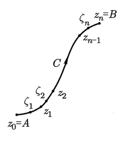

$$
\sum_{k=1}^{n}f(\zeta_k)\,(z_k-z_{k-1})=\sum_{k=1}^{n}f(\zeta_k)\Delta z_k,
$$

其中 $\Delta z_k=z_k-z_{k-1}$。若当 $n\to\infty,\max|\Delta z_k|\to 0$ 时，此和数的极限存在，且极限值与 $\zeta_k$ 的选取无关，则称此极限值为函数 $f(z)$ 沿曲线 $C$ 的积分，记为

$$
\int_C f(z)\,\mathrm{d}z=\lim_{\max|\Delta z_k|\to 0}\sum_{k=1}^{n}f(\zeta_k)\Delta z_k.\qquad (3.1)
$$

曲线 $C$ 也称为积分路径。如果积分路径是闭合的，又常称为（积分）围道。

一个复变积分实际上是两个实变线积分的有序组合：

$$
\int_C f(z)\,\mathrm{d}z=\int_C (u+\mathrm{i}v)(\mathrm{d}x+\mathrm{i}\mathrm{d}y)=\int_C (u\,\mathrm{d}x-v\,\mathrm{d}y)+\mathrm{i}\int_C (v\,\mathrm{d}x+u\,\mathrm{d}y).\qquad (3.2)
$$

因此，根据实函数线积分的知识可以知道，如果 $C$ 是分段光滑曲线，$f(z)$ 是 $C$ 上的连续函数，则复变积分一定存在。

和实变积分相似，复变积分具有下列性质：

(1) 如果积分 $\int_C f_1(z)\,\mathrm{d}z,\ \int_C f_2(z)\,\mathrm{d}z,\ \cdots,\ \int_C f_n(z)\,\mathrm{d}z$ 都存在，其中 $n$ 是正整数，则

$$
\int_C \left[f_1(z)+f_2(z)+\cdots+f_n(z)\right]\mathrm{d}z=\int_C f_1(z)\,\mathrm{d}z+\int_C f_2(z)\,\mathrm{d}z+\cdots+\int_C f_n(z)\,\mathrm{d}z;
$$

(2) 若 $C=C_1+C_2+\cdots+C_n$，其中 $n$ 是正整数，则

$$
\int_C f(z)\,\mathrm{d}z=\int_{C_1}f(z)\,\mathrm{d}z+\int_{C_2}f(z)\,\mathrm{d}z+\cdots+\int_{C_n}f(z)\,\mathrm{d}z;
$$

(3) $\int_{C^-}f(z)\,\mathrm{d}z=-\int_C f(z)\,\mathrm{d}z$，其中 $C^-$ 表示 $C$ 的逆向；

(4) $\displaystyle\int_C a f(z)\,\mathrm{d}z=a\int_C f(z)\,\mathrm{d}z$，其中 $a$ 为复常数；

(5) $\displaystyle\left|\int_C f(z)\,\mathrm{d}z\right|\leqslant\int_C\left|f(z)\right|\left|\mathrm{d}z\right|$；

(6) $\displaystyle\left|\int_C f(z)\,\mathrm{d}z\right|\leqslant Ml$，其中 $M$ 为 $|f(z)|$ 在 $C$ 上的上界，$l$ 为 $C$ 的长度。

显然，复变积分的值，不仅依赖于被积函数和积分路径的端点，还依赖于积分路径。

**例 3.1** 求 $\displaystyle\int_C \operatorname{Re}z\,\mathrm{d}z$，其中 $C$ 为 (i) 沿实轴由 $0\to 1$，再平行于虚轴由 $1\to 1+\mathrm{i}$；(ii) 沿虚轴由 $0\to\mathrm{i}$，再平行于实轴由 $\mathrm{i}\to 1+\mathrm{i}$；(iii) 沿直线由 $0\to 1+\mathrm{i}$。

**解** 对于 (i)，

$$
\int_C \operatorname{Re}z\,\mathrm{d}z=\int_0^1 x\,\mathrm{d}x+\int_0^1 \mathrm{i}\,\mathrm{d}y=\frac{1}{2}+\mathrm{i};
$$

对于 (ii)，

$$
\int_C \operatorname{Re}z\,\mathrm{d}z=\int_0^1 x\,\mathrm{d}x=\frac{1}{2};
$$

对于 (iii)，

$$
\int_C \operatorname{Re}z\,\mathrm{d}z=\int_0^1 (1+\mathrm{i})t\,\mathrm{d}t=\frac{1}{2}(1+\mathrm{i}).
$$

## §3.2 Cauchy 定理

**定理 3.1（Cauchy 定理）** 如果函数 $f(z)$ 在有界闭区域 $\overline{G}$ 中解析，则沿 $\overline{G}$ 的边界 $C$（见图 3.2 与图 3.3 (a)），有

$$
\oint_C f(z)\,\mathrm{d}z=0.\qquad (3.3)
$$

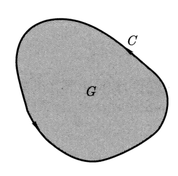

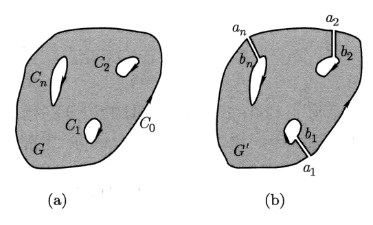

**证** 证明分两步走。首先证明定理对于单连通区域成立，然后再推广到多连通区域。

对于单连通区域的情形，为简单起见，下面在更强的条件下证明这个定理。附加的条件是 $f'(z)$ 在 $\overline{G}$ 中连续，因而可以对

$$
\oint_C f(z)\,\mathrm{d}z=\oint_C (u\,\mathrm{d}x-v\,\mathrm{d}y)+\mathrm{i}\oint_C (v\,\mathrm{d}x+u\,\mathrm{d}y)
$$

应用 Green 公式

$$
\oint_C \left[P(x,y)\,\mathrm{d}x+Q(x,y)\,\mathrm{d}y\right]=\iint_S\left(\frac{\partial Q}{\partial x}-\frac{\partial P}{\partial y}\right)\mathrm{d}x\,\mathrm{d}y,
$$

从而将闭合围道积分化为面积分：

$$
\oint_C (u\,\mathrm{d}x-v\,\mathrm{d}y)=-\iint_S\left(\frac{\partial v}{\partial x}+\frac{\partial u}{\partial y}\right)\mathrm{d}x\,\mathrm{d}y,
$$

$$
\oint_C (v\,\mathrm{d}x+u\,\mathrm{d}y)=\iint_S\left(\frac{\partial u}{\partial x}-\frac{\partial v}{\partial y}\right)\mathrm{d}x\,\mathrm{d}y.
$$

由 Cauchy-Riemann 方程，右端两个积分中的被积函数均为 0，故 (3.3) 式得证。

如果被积函数在区域内有奇点，为了保证被积函数的解析性就需要把奇点排除在外，这样 $f(z)$ 就是定义在多连通闭区域 $\overline{G}$ 中的解析函数。设（有界）多连通闭区域 $\overline{G}$ 的边界是由分段光滑曲线 $C_0,C_1,C_2,\cdots,C_n$ 组成，并且 $C_1,C_2,\cdots,C_n$ 都包含在 $C_0$ 的内部。于是，可以作适当的割线把 $C_0,C_1,C_2,\cdots,C_n$ 和 $C_0$ 连接起来（如图 3.3 (b)），从而得到一个有界单连通闭区域 $\overline{G'}$，$f(z)$ 在 $\overline{G'}$ 中是解析的，因而可以应用有界单连通区域的 Cauchy 定理，得

$$
\begin{aligned}
&\oint_{C_0}f(z)\,\mathrm{d}z+\int_{a_1}^{b_1}f(z)\,\mathrm{d}z+\oint_{C_1}f(z)\,\mathrm{d}z+\int_{b_1}^{a_1}f(z)\,\mathrm{d}z+\int_{a_2}^{b_2}f(z)\,\mathrm{d}z+\oint_{C_2}f(z)\,\mathrm{d}z\\
&\qquad +\int_{b_2}^{a_2}f(z)\,\mathrm{d}z+\cdots+\int_{a_n}^{b_n}f(z)\,\mathrm{d}z+\oint_{C_n}f(z)\,\mathrm{d}z+\int_{b_n}^{a_n}f(z)\,\mathrm{d}z=0,
\end{aligned}
$$

这里积分路径均为沿边界的正向，即沿 $C_0$ 段为逆时针方向，而沿 $C_1,C_2,\cdots,C_n$ 等段则为顺时针方向。由于 $f(z)$ 在 $\overline{G'}$ 中单值，故沿同一割线两岸的积分值互相抵消，

$$
\int_{a_i}^{b_i}f(z)\,\mathrm{d}z+\int_{b_i}^{a_i}f(z)\,\mathrm{d}z=0,
$$

所以

$$
\oint_{C_0}f(z)\,\mathrm{d}z+\sum_{i=1}^{n}\oint_{C_i}f(z)\,\mathrm{d}z=0.
$$

这样也就证明了 (3.3) 式。注意这时的积分路径 $C$ 应当是沿多连通区域的边界（正向）。$\square$

就多连通区域而言，有时还将 Cauchy 定理改写成

$$
\oint_{C_0}f(z)\,\mathrm{d}z=\sum_{i=1}^{n}\oint_{C_i^{(-)}}f(z)\,\mathrm{d}z,\qquad (3.3')
$$

只是需要注意，这里 $C_0$ 与 $C_i^{(-)},\ i=1,2,3,\cdots,n$ 须保持为同向，即同为逆时针方向，或同为顺时针方向。

定理 3.1 的成立条件还可以减弱为：若 $f(z)$ 在有界单连通区域 $G$ 内解析，在闭区域 $\overline{G}$ 中连续。证明从略。

**思考题** 对于任一解析函数的实部或虚部，Cauchy 定理仍成立吗？如果成立，试证明之。如果不成立，试说明理由，并举一例。

还值得指出，以上讨论的，无论是单连通区域，或是多连通区域，均只限于有界区域，不能包含 $\infty$ 点在内。从下面例 3.3 即可看到，即使 $f(z)$ 在 $\infty$ 点解析，例如 $f(z)=1/z$，它绕 $\infty$ 点一周的积分也可以不为 0。

Cauchy 定理还可以表述为复变积分的变形定理：若函数 $f(z)$ 在区域 $G$ 内解析，$C$ 为 $G$ 内的简单闭合曲线，如果能将曲线 $C$ 在 $G$ 内连续地变形为曲线 $C'$①，则必有

$$
\oint_C f(z)\,\mathrm{d}z=\int_{C'}f(z)\,\mathrm{d}z.
$$

Cauchy 定理，顾名思义，最早由 Cauchy 给出并证明。但是当初 Cauchy 给出的解析函数定义是函数 $f(z)$ 在区域 $G$ 内每一点均可导且 $f'(z)$ 连续。后来 Goursat 论证了，不需要“导函数连续”这个条件即可证明 Cauchy 定理。从此解析函数的定义修改为区域 $G$ 内每一点都可导的函数。所以，上面给出的 Cauchy 定理的证明，是解析函数理论发展历史中的产物。现在，一些文献中也称 Cauchy 定理为 Cauchy-Goursat 定理。下面我们不加证明地介绍几个引理，用 Goursat 的方法证明 Cauchy 定理②。

**引理 3.1** 设 $\overline{K_1},\overline{K_2},\overline{K_3},\cdots$ 是复平面 $\mathbb{C}$ 内的一系列有界闭区域，并且满足 $\overline{K_1}\supset\overline{K_2}\supset\overline{K_3}\supset\cdots$，则至少存在一个点 $x_0$，满足 $x_0\in\underset{i}{\bigcap}\overline{K_i}$。

**引理 3.2** 设 $\alpha$ 和 $\beta$ 是复值常数，$\gamma$ 是复平面 $\mathbb{C}$ 内任意一个闭合的三角形围道，那么

$$
\oint_\gamma (\alpha+\beta z)\,\mathrm{d}z=0.
$$

**引理 3.3** 设 $G$ 是复平面 $\mathbb{C}$ 内的一个有界单连通区域，$f$ 是定义在 $G$ 上的一个连续函数，$\gamma$ 是 $G$ 内的一条可求长曲线，则 $\forall\varepsilon>0$，存在内接于 $\gamma$ 且完全位于 $G$ 内的折线 $\Gamma$，使得

$$
\left|\int_\gamma f\,\mathrm{d}z-\int_\Gamma f\,\mathrm{d}z\right|<\varepsilon.
$$

根据引理 3.3，只需证明对于内接于 $C$ 的任何闭折线 $P$，均有

$$
\oint_P f(z)\,\mathrm{d}z=0
$$

即可。现在将 $P$ 所围成的多边形加以分割。如果它不是凸多边形的话，首先总可以将它分割为若干个凸多边形，函数沿这些凸多边形的公共边上的积分互相抵消（因为积分路径方向相反），沿闭折线 $P$ 的积分就等于沿各凸多边形积分之和，因此我们只要证明函数沿凸多边形的积分为 0 即可。而对于凸多边形，又可以从选定的一点出发，与多边形的各个顶点作连线，把它分解成若干个三角形区域。于是，沿凸多边形的积分就是沿各个三角形积分之和。这样，问题就又归结为只要证明函数沿任意一个三角形 $T$ 的积分 $\displaystyle\oint_T f(z)\,\mathrm{d}z=0$ 即可。记

$$
\left|\oint_T f(z)\,\mathrm{d}z\right|=M.
$$

下面证明 $M=0$。

---

① 准确地说，$C$ 与 $C'$ 应当是同伦曲线。

② 严格的证明见参考书目 [22] 的第 4 章，第 2 节；或 L. A. Ahlfors, Complex Analysis (Third Edition), McGraw-Hill International Editions, 2004, 第四章。

为此，把三角形 $T$ 三条边的中点连接起来，就得到 4 个与 $T$ 相似的、小的全等三角形 $T_1,T_2,T_3,T_4$（见图 3.4）。这 4 个三角形相邻边的积分相互抵消，因此有

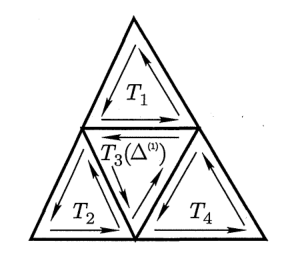

$$
M=\left|\oint_T f(z)\,\mathrm{d}z\right|=\left|\sum_{i=1}^{4}\oint_{T_i}f(z)\,\mathrm{d}z\right|\leqslant\sum_{i=1}^{4}\left|\oint_{T_i}f(z)\,\mathrm{d}z\right|,
$$

所以右端的 4 个积分中至少有一个积分的模不小于 $M/4$。不妨设这个积分来自小三角形 $T^{(1)}$，即

$$
\left|\oint_{T^{(1)}}f(z)\,\mathrm{d}z\right|\geqslant\frac{M}{4}.
$$

再将这个小三角形分割为 4 个更小的三角形，重复上面的讨论，我们又能得到

$$
\left|\oint_{T^{(2)}}f(z)\,\mathrm{d}z\right|\geqslant\frac{M}{4^2}.
$$

如此继续，将三角形 $T$ 分割 $n$ 次后，就得到

$$
\left|\oint_{T^{(n)}}f(z)\,\mathrm{d}z\right|\geqslant\frac{M}{4^n}.
$$

若三角形 $T$ 的周长为 $l$，最大边长为 $d$，则 $T^{(n)}$ 的周长为 $l/2^n$，最大边长为 $d/2^n$。将 $T^{(n)}$ 所包围的闭区域记为 $\Delta_n$，则应当有

$$
\Delta_{i+1}\subset\Delta_i,\qquad i=0,1,2,\cdots.
$$

按照上面的引理 3.1，就必然存在唯一的一点 $z_0$，$z_0\in\underset{i}{\bigcap}\Delta_i$。因为 $z_0\in G$，$f(z)$ 在 $z_0$ 点可导，故在 $z_0$ 点的邻域 $V(z_0;\delta):|z-z_0|<\delta$ 内有

$$
f(z)-f(z_0)=f'(z_0)(z-z_0)+\rho(z,z_0)(z-z_0),
$$

其中 $\lim\limits_{z\to z_0}\rho(z,z_0)=0$。

在此基础上，我们就能来考察 $\displaystyle\oint_{T^{(n)}}f(z)\,\mathrm{d}z$。因为当 $n$ 足够大时，$\Delta_n\subset V(z_0;\delta)$，所以

$$
\oint_{T^{(n)}}f(z)\,\mathrm{d}z=f(z_0)\oint_{T^{(n)}}\mathrm{d}z+f'(z_0)\oint_{T^{(n)}}(z-z_0)\,\mathrm{d}z+\oint_{T^{(n)}}\rho(z,z_0)(z-z_0)\,\mathrm{d}z.
$$

由引理 3.2，

$$
\oint_{T^{(n)}}\mathrm{d}z=0,\qquad\oint_{T^{(n)}}z\,\mathrm{d}z=0,
$$

所以

$$
\oint_{T^{(n)}}f(z)\,\mathrm{d}z=\oint_{T^{(n)}}\rho(z,z_0)(z-z_0)\,\mathrm{d}z.
$$

这样就立即得到

$$
\left|\oint_{T^{(n)}}f(z)\,\mathrm{d}z\right|\leqslant\oint_{T^{(n)}}\left|\rho(z,z_0)(z-z_0)\,\mathrm{d}z\right|\leqslant\frac{d}{2^n}\cdot\frac{l}{2^n}\cdot\max_{z\in T^{(n)}}\left|\rho(z,z_0)\right|.
$$

上面已经证明 $M\leqslant 4^n\displaystyle\oint_{T^{(n)}}f(z)\,\mathrm{d}z$，因此

$$
M\leqslant dl\cdot\max_{z\in T^{(n)}}\left|\rho(z,z_0)\right|.
$$

因为 $\lim\limits_{z\to z_0}\rho(z,z_0)=0$，亦即 $\lim\limits_{n\to\infty}\max\limits_{z\in T^{(n)}}\left|\rho(z,z_0)\right|=0$，所以 $M=0$。证毕。

**例 3.2** 计算 $\displaystyle\oint_C z^n\,\mathrm{d}z$ 值，其中 $n$ 为整数，$C$ 为复平面 $\mathbb{C}$ 内一条简单闭合围道。

**解** 当 $n$ 为自然数时，显然，按照（有界单连通区域的）Cauchy 定理

$$
\oint_C z^n\,\mathrm{d}z=0.
$$

当 $n$ 为负整数时，如果 $C$ 沿逆时针方向时所包含的区域内（简称 $C$ 内）不含 $z=0$，则也有

$$
\oint_C z^n\,\mathrm{d}z=0.
$$

如果 $C$ 内含有 $z=0$ 点，则按（有界多连通区域的）Cauchy 定理，有

$$
\oint_C z^n\,\mathrm{d}z=\oint_{|z|=\varepsilon}z^n\,\mathrm{d}z=\int_0^{2\pi}\varepsilon^{n+1}\mathrm{e}^{\mathrm{i}(n+1)\theta}\mathrm{i}\,\mathrm{d}\theta=
\begin{cases}
2\pi\mathrm{i}, & n=-1;\\
0, & n=-2,-3,-4,\cdots.
\end{cases}
$$

上式中的 $\varepsilon$ 足够小，以保证圆 $|z|=\varepsilon$ 位于 $C$ 所包含的区域内。

总结上面的结果，就有

$$
\oint_C z^n\,\mathrm{d}z=
\begin{cases}
2\pi\mathrm{i}, & n=-1,\ \text{且}\ C\ \text{内含有}\ z=0;\\
0, & \text{其他情形}.
\end{cases}\qquad (3.4)
$$

或者，更一般地，

$$
\oint_C (z-a)^n\,\mathrm{d}z=
\begin{cases}
2\pi\mathrm{i}, & n=-1,\ \text{且}\ C\ \text{内含有}\ z=a;\\
0, & \text{其他情形}.
\end{cases}\qquad (3.5)
$$

**例 3.3** 计算积分 $\displaystyle\int_0^{2\pi}\sin^{2n}\theta\,\mathrm{d}\theta$。

**解** 令 $z=\mathrm{e}^{\mathrm{i}\theta}$，则

$$
\sin\theta=\frac{z^2-1}{2\mathrm{i}z},\qquad \mathrm{d}\theta=\frac{\mathrm{d}z}{\mathrm{i}z},
$$

而原积分即化为 $z$ 平面上沿单位圆的积分，

$$
\int_0^{2\pi}\sin^{2n}\theta\,\mathrm{d}\theta=\oint_{|z|=1}\left(\frac{z^2-1}{2\mathrm{i}z}\right)^{2n}\frac{\mathrm{d}z}{\mathrm{i}z}=\frac{(-)^n}{2^{2n}\mathrm{i}}\oint_{|z|=1}\left(z^2-1\right)^{2n}\frac{\mathrm{d}z}{z^{2n+1}}.
$$

将 $(z^2-1)^{2n}$ 作二项式展开，

$$
(z^2-1)^{2n}=\sum_{l=0}^{2n}\frac{(2n)!}{l!\,(2n-l)!}(-)^{2n-l}z^{2l},
$$

则其中只有 $z^{2n}$ 项（即 $l=n$ 项）对积分有贡献（为什么？），因此，

$$
\int_0^{2\pi}\sin^{2n}\theta\,\mathrm{d}\theta=2\pi\mathrm{i}\times\frac{1}{2^{2n}\mathrm{i}}\frac{(2n)!}{n!\,n!}=\frac{\pi}{2^{2n-1}}\frac{(2n)!}{n!\,n!}.
$$

**例 3.4** 证明实系数多项式必有零点，除非该多项式恒为常数（零次多项式）。

**证** 用反证法。设此多项式为

$$
P_n(z)=a_nz^n+a_{n-1}z^{n-1}+\cdots+a_0,\qquad a_n\neq 0,
$$

$a_n,a_{n-1},\cdots,a_0$ 均为实数。按所设，若 $P_n(z)$ 无零点，则当 $z$ 取实数值 $x$ 时，$P(x)$ 一定不为 0，且不变号，因此

$$
\int_0^{2\pi}\frac{\mathrm{d}\theta}{P_n(2\cos\theta)}\neq 0.
$$

令 $z=\mathrm{e}^{\mathrm{i}\theta}$，则上式化为

$$
\oint_{|z|=1}\frac{1}{P_n(z+z^{-1})}\frac{\mathrm{d}z}{\mathrm{i}z}=\frac{1}{\mathrm{i}}\oint_{|z|=1}\frac{z^{n-1}}{Q_{2n}(z)}\mathrm{d}z\neq 0,\qquad (3.6)
$$

其中 $Q_{2n}(z)=z^nP_n(z+z^{-1})$ 为 $2n$ 次多项式。因为 $P_n(z)\neq 0$，故当 $z\neq 0$ 时 $P_n(z+z^{-1})\neq 0$，即 $Q_{2n}(z)\neq 0$；又，$Q_{2n}(0)=a_n$ 亦不为 0，因此函数 $z^{n-1}/Q_{2n}(z)$（在全平面）解析。根据 Cauchy 定理，一定有

$$
\oint_{|z|=1}\frac{z^{n-1}}{Q_{2n}(z)}\mathrm{d}z=0,
$$

与 (3.6) 矛盾。因此 $P_n(z)$ 必有零点。命题得证。

**讨论** 此结论可推广到复数多项式。因为即使

$$
P_n(z)=a_nz^n+a_{n-1}z^{n-1}+\cdots+a_0
$$

为复数多项式，也可以构造一个新的实系数多项式

$$
\left(a_nz^n+a_{n-1}z^{n-1}+\cdots+a_0\right)\left(a_n^*z^n+a_{n-1}^*z^{n-1}+\cdots+a_0^*\right),
$$

因此上述结论仍然成立。

由 Cauchy 定理立即可得到下面的推论（其实它就是复变积分变形定理的另一种表述形式）：

**推论** 若 $f(z)$ 在有界单连通区域 $G$ 中解析，则复变积分 $\displaystyle\int_C f(z)\,\mathrm{d}z$ 与路径 $C$ 无关，其中 $C\subset G$。

既然在有界单连通区域中解析函数的积分值与路径无关，因此，如果固定起点 $z_0$，而令终点 $z$ 为变点，则作为积分上限的函数

$$
\int_{z_0}^{z}f(\zeta)\,\mathrm{d}\zeta=F(z),\qquad z\in G\qquad (3.7)
$$

是有界单连通区域 $G$ 内的单值函数，称为 $f(z)$ 的不定积分。

**定理 3.2** 如果函数 $f(z)$ 在有界单连通区域 $G$ 内解析，则 $f(z)$ 的不定积分

$$
F(z)=\int_{z_0}^{z}f(\zeta)\,\mathrm{d}\zeta,\qquad z\in G\qquad (3.8)
$$

也在 $G$ 内解析，并且

$$
F'(z)=\frac{\mathrm{d}}{\mathrm{d}z}\int_{z_0}^{z}f(\zeta)\,\mathrm{d}\zeta=f(z),\qquad z\in G.\qquad (3.9)
$$

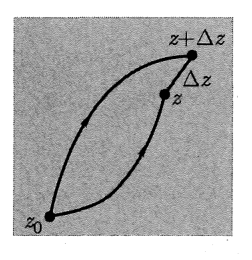

**证** 只要直接求出 $F(z)$ 的导数即可。为此，设 $z$ 是 $G$ 内一点，$z+\Delta z$ 是它的邻点，如图 3.5 所示，则

$$
F(z)=\int_{z_0}^{z}f(\zeta)\,\mathrm{d}\zeta,\qquad F(z+\Delta z)=\int_{z_0}^{z+\Delta z}f(\zeta)\,\mathrm{d}\zeta.
$$

因为积分与路径无关，所以

$$
\frac{\Delta F}{\Delta z}=\frac{F(z+\Delta z)-F(z)}{\Delta z}=\frac{1}{\Delta z}\int_z^{z+\Delta z}f(\zeta)\,\mathrm{d}\zeta.
$$

由此可得

$$
\begin{aligned}
\left|\frac{\Delta F}{\Delta z}-f(z)\right|&=\left|\frac{1}{\Delta z}\int_z^{z+\Delta z}f(\zeta)\,\mathrm{d}\zeta-f(z)\right|=\left|\frac{1}{\Delta z}\int_z^{z+\Delta z}\left[f(\zeta)-f(z)\right]\mathrm{d}\zeta\right|\\
&\leqslant\frac{1}{|\Delta z|}\int_z^{z+\Delta z}\left|f(\zeta)-f(z)\right|\cdot|\mathrm{d}\zeta|.
\end{aligned}
$$

由于 $f(z)$ 是连续的，$\forall\varepsilon>0$，$\exists\delta>0$，使当 $|\zeta-z|<\delta$ 时，$|f(\zeta)-f(z)|<\varepsilon$，所以

$$
\left|\frac{\Delta F}{\Delta z}-f(z)\right|\leqslant\frac{1}{|\Delta z|}\cdot\varepsilon\cdot|\Delta z|=\varepsilon,
$$

即得

$$
F'(z)=\lim_{\Delta z\to 0}\frac{\Delta F}{\Delta z}=f(z),\qquad z\in G.
$$

这样就证明了 $F(z)$ 在 $G$ 内可导，并且 $F'(z)=f(z)$。$\square$

在复变函数中，除了不定积分外，也还有原函数的概念。

如果函数 $\Phi(z)$ 的导数 $\Phi'(z)=f(z)$，则称 $\Phi(z)$ 为 $f(z)$ 的原函数。上面 (3.7) 式定义的 $f(z)$ 的不定积分就是 $f(z)$ 的一个原函数。对于给定的函数 $f(z)$，其原函数并不唯一，任意两个原函数之间相差一个常数。这是因为，如果 $\Phi_1(z)$ 与 $\Phi_2(z)$ 都是 $f(z)$ 的原函数，则

$$
\Phi_1'(z)=f(z),\qquad\Phi_2'(z)=f(z).
$$

所以，$\left[\Phi_1(z)-\Phi_2(z)\right]'=0$，即

$$
\Phi_1(z)-\Phi_2(z)=C.\qquad (3.10)
$$

知道了被积函数的原函数，可使复变积分的计算大为简化。例如，设 $\Phi(z)$ 为 $f(z)$ 的一个原函数，则 $f(z)$ 的不定积分

$$
F(z)=\int_{z_0}^{z}f(\zeta)\,\mathrm{d}\zeta=\Phi(z)+C.
$$

但是，显然有 $F(z_0)=\Phi(z_0)+C=0$，$C=-\Phi(z_0)$。所以

$$
\int_{z_0}^{z}f(\zeta)\,\mathrm{d}\zeta=\Phi(z)-\Phi(z_0).\qquad (3.11)
$$

**例 3.5** 计算积分 $\displaystyle\int_a^b z^n\,\mathrm{d}z$，$n$ 为整数。

**解** 当 $n$ 为自然数时，$z^n$ 在 $\mathbb{C}$ 内解析，$\dfrac{1}{n+1}z^{n+1}$ 是它的一个原函数。因此，对于 $\mathbb{C}$ 内的任意一条积分路径，均有

$$
\int_a^b z^n\,\mathrm{d}z=\frac{1}{n+1}\left(b^{n+1}-a^{n+1}\right).\qquad (3.12)
$$

当 $n=-2,-3,-4,\cdots$ 时，$z^n$ 在 $\overline{\mathbb{C}}\setminus 0$ 内解析，其原函数仍可取为 $\dfrac{1}{n+1}z^{n+1}$。因此，在不包含 $z=0$ 的任一有界区域内，仍有

$$
\int_a^b z^n\,\mathrm{d}z=\frac{1}{n+1}\left(b^{n+1}-a^{n+1}\right),\qquad n=-2,-3,-4,\cdots.\qquad (3.12')
$$

当 $n=-1$ 时，$z^{-1}$ 也是在 $\overline{\mathbb{C}}\setminus 0$ 内解析，但原函数为 $\ln z$。故在不包含 $z=0$ 的任一有界单连通区域内，

$$
\int_a^b\frac{\mathrm{d}z}{z}=\ln b-\ln a.\qquad (3.13)
$$

这里需要特别注意，一旦积分的上、下限给定，则在一个有界单连通区域内，上面的积分值一定与路径无关，但对于不同的有界单连通区域，可能会给出不同的积分值。从计算过程看，(3.13) 式的原函数是多值函数，因此积分值与由 $a$ 变化到 $b$ 的方式有关。当限制在不含 $z=0$ 的一个有界单连通区域内时，原函数的支点 $z=0$ 和 $z=\infty$ 都不在区域内，就是把 $\ln z$ 限制在某一个单值分支内，故积分值 $\ln b-\ln a$ 唯一确定。而对于不同的有界单连通区域，就可能对应于 $\ln z$ 的不同单值分支，因而积分值也就可能不同。表面上看，积分的上、下限给定，即积分路径的终点与起点给定，但是实际上，它们在多叶 Riemann 面上的位置并不见得相同。

## §3.3 两个有用的引理

**引理 3.4（小圆弧引理）** 如果函数 $f(z)$ 在 $z=a$ 点的空心邻域内连续，并且在 $\theta_1\leqslant\arg(z-a)\leqslant\theta_2$ 中，当 $|z-a|\to 0$ 时，$(z-a)f(z)$ 一致地趋近于 $k$，则

$$
\lim_{\delta\to 0}\int_{C_\delta}f(z)\,\mathrm{d}z=\mathrm{i}k(\theta_2-\theta_1),\qquad (3.14)
$$

其中 $C_\delta$ 是以 $z=a$ 为圆心、$\delta$ 为半径、张角为 $\theta_2-\theta_1$ 的圆弧，$|z-a|=\delta$，$\theta_1\leqslant\arg(z-a)\leqslant\theta_2$，见图 3.6。

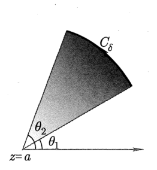

**证** 因为 $\displaystyle\int_{C_\delta}\frac{\mathrm{d}z}{z-a}=\mathrm{i}(\theta_2-\theta_1)$，所以

$$
\left|\int_{C_\delta}f(z)\,\mathrm{d}z-\mathrm{i}k(\theta_2-\theta_1)\right|=\left|\int_{C_\delta}\left[f(z)-\frac{k}{z-a}\right]\mathrm{d}z\right|\leqslant\int_{C_\delta}\left|(z-a)f(z)-k\right|\frac{|\mathrm{d}z|}{|z-a|}.
$$

由于在 $\theta_1\leqslant\arg(z-a)\leqslant\theta_2$ 中，当 $|z-a|\to 0$ 时，$(z-a)f(z)$ 一致地趋近于 $k$，这就意味着 $\forall\varepsilon>0$，$\exists$（与 $\arg(z-a)$ 无关的）$r(\varepsilon)>0$，使当 $|z-a|=\delta<r$ 时，$|(z-a)f(z)-k|<\varepsilon$。所以

$$
\left|\int_{C_\delta}f(z)\,\mathrm{d}z-\mathrm{i}k(\theta_2-\theta_1)\right|\leqslant\varepsilon(\theta_2-\theta_1),
$$

即

$$
\lim_{\delta\to 0}\int_{C_\delta}f(z)\,\mathrm{d}z=\mathrm{i}k(\theta_2-\theta_1).\qquad\square
$$

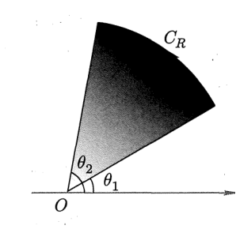

**引理 3.5（大圆弧引理）** 设 $f(z)$ 在 $\infty$ 点的邻域内连续，在 $\theta_1\leqslant\arg z\leqslant\theta_2$ 中，当 $|z|\to\infty$ 时，$zf(z)$ 一致地趋近于 $K$，则

$$
\lim_{R\to\infty}\int_{C_R}f(z)\,\mathrm{d}z=\mathrm{i}K(\theta_2-\theta_1),\qquad (3.15)
$$

其中 $C_R$ 是以原点为心、$R$ 为半径、张角为 $\theta_2-\theta_1$ 的圆弧，$|z|=R$，$\theta_1\leqslant\arg z\leqslant\theta_2$，见图 3.7。

**证** 证明和引理 3.4 相仿。因为 $\displaystyle\int_{C_R}\frac{\mathrm{d}z}{z}=\mathrm{i}(\theta_2-\theta_1)$，所以

$$
\left|\int_{C_R}f(z)\,\mathrm{d}z-\mathrm{i}K(\theta_2-\theta_1)\right|=\left|\int_{C_R}\left[f(z)-\frac{K}{z}\right]\mathrm{d}z\right|\leqslant\int_{C_R}\left|zf(z)-K\right|\frac{|\mathrm{d}z|}{|z|}.
$$

由于在 $\theta_1\leqslant\arg z\leqslant\theta_2$ 中，当 $|z|\to\infty$ 时，$zf(z)$ 一致地趋近于 $K$，这意味着 $\forall\varepsilon>0$，$\exists$（与 $\arg z$ 无关的）$M(\varepsilon)>0$，使当 $|z|=R>M$ 时，$|zf(z)-K|<\varepsilon$。所以

$$
\left|\int_{C_R}f(z)\,\mathrm{d}z-\mathrm{i}K(\theta_2-\theta_1)\right|\leqslant\varepsilon(\theta_2-\theta_1),
$$

即

$$
\lim_{R\to\infty}\int_{C_R}f(z)\,\mathrm{d}z=\mathrm{i}K(\theta_2-\theta_1).\qquad\square
$$

## §3.4 Cauchy 积分公式

Cauchy 定理从一个侧面反映了解析函数的基本特性：解析函数在其解析区域内各点的函数值是密切相关的。Cauchy-Riemann 方程可以说是这种关联的微分形式，而 Cauchy 定理则是它的积分形式。这种关联性在 Cauchy 积分公式中也清楚地表现出来。

### 有界区域的 Cauchy 积分公式

设 $f(z)$ 是有界闭区域 $\overline{G}$ 中的单值解析函数，$\overline{G}$ 的边界 $C$ 是分段光滑曲线，$a$ 为 $G$ 内一点，则

$$
f(a)=\frac{1}{2\pi\mathrm{i}}\oint_C\frac{f(z)}{z-a}\mathrm{d}z,\qquad a\in G,\qquad (3.16)
$$

其中积分路径沿 $C$ 的正向。

**证** 在有界区域 $G$ 内作小圆 $|z-a|<r$（见图 3.8，$r$ 足够小以保证圆周 $|z-a|=r$ 位于 $G$ 内），则根据（有界多连通区域的）Cauchy 定理，有

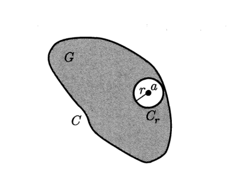

$$
\oint_C\frac{f(z)}{z-a}\mathrm{d}z=\oint_{|z-a|=r}\frac{f(z)}{z-a}\mathrm{d}z,\qquad (3.17)
$$

其中 $C$ 沿区域边界正方向。令 $r\to 0$，因为

$$
\lim_{z\to a}(z-a)\frac{f(z)}{z-a}=f(a),
$$

(3.17) 式等号左边与 $r$ 的大小无关，故可令 $r\to 0$，由上节的引理 3.4，就证得

$$
\frac{1}{2\pi\mathrm{i}}\oint_C\frac{f(z)}{z-a}\mathrm{d}z=f(a).\qquad\square
$$

作为 Cauchy 积分公式的特殊形式，取 $C$ 为以 $a$ 为圆心、$R$ 为半径的圆周，如果 $f(z)$ 在圆内解析，即可得到

$$
f(a)=\frac{1}{2\pi}\int_0^{2\pi}f\left(a+R\mathrm{e}^{\mathrm{i}\theta}\right)\mathrm{d}\theta.\qquad (3.18)
$$

这个结果称为均值定理：解析函数 $f(z)$ 在解析区域 $G$ 内任意一点 $a$ 的函数值 $f(a)$，等于（完全位于 $G$ 内的）以该点为圆心的任一圆周上函数值的平均。

对于无界区域，需要假设 $f(z)$ 在简单闭合围道 $C$ 上及 $C$ 外（包括 $\infty$ 点）单值解析。类似地计算 $\displaystyle\frac{1}{2\pi\mathrm{i}}\oint_C\frac{f(z)}{z-a}\mathrm{d}z$，其中 $a$ 为 $C$ 外一点，积分路径 $C$ 的走向是绕无穷远点的正向，即顺时针方向，如图 3.9。在 $C$ 外再作一个以原点为圆心，$R$ 为半径的圆 $C_R$，对于 $C$ 和 $C_R$ 所包围的有界多连通区域，根据有界区域的 Cauchy 积分公式，就有

$$
\frac{1}{2\pi\mathrm{i}}\left[\oint_{C_R}\frac{f(z)}{z-a}\mathrm{d}z+\oint_C\frac{f(z)}{z-a}\mathrm{d}z\right]=f(a),
$$

$C_R$ 的走向是逆时针方向。等号两边令 $R\to\infty$，若

$$
\lim_{z\to\infty}z\cdot\frac{f(z)}{z-a}=\lim_{z\to\infty}f(z)=K,\qquad (3.19)
$$

根据上一节的引理 3.5，即得

$$
\lim_{R\to\infty}\left[\frac{1}{2\pi\mathrm{i}}\oint_{C_R}\frac{f(z)}{z-a}\mathrm{d}z\right]=K,
$$

因此

$$
\frac{1}{2\pi\mathrm{i}}\oint_C\frac{f(z)}{z-a}\mathrm{d}z=f(a)-K.\qquad (3.20)
$$

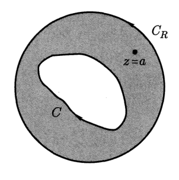

当 $K=0$ 时，就得到了无界区域的 Cauchy 积分公式：如果 $f(z)$ 在简单闭合围道 $C$ 上及 $C$ 外解析，且当 $z\to\infty$ 时，$f(z)$ 趋于 0，则 Cauchy 积分公式

$$
f(a)=\frac{1}{2\pi\mathrm{i}}\oint_C\frac{f(z)}{z-a}\mathrm{d}z\qquad (3.21)
$$

仍然成立，此处 $a$ 是 $C$ 为顺时针方向时所包含的区域内的一点。

## §3.5 解析函数的高阶导数

从 Cauchy 积分公式，可以推断出一个重要结论：如果 $f(z)$ 在有界闭区域 $\overline{G}$ 中解析，则在 $G$ 内 $f(z)$ 的任何阶导数 $f^{(n)}(z)$ 均存在，并且

$$
f^{(n)}(z)=\frac{n!}{2\pi\mathrm{i}}\oint_C\frac{f(\zeta)}{(\zeta-z)^{n+1}}\mathrm{d}\zeta,\qquad z\in G,\qquad (3.22)
$$

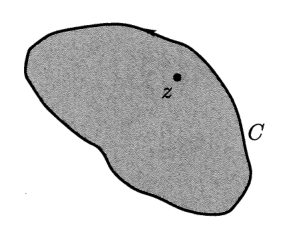

其中 $C$ 是 $\overline{G}$ 的正向边界，$z$ 为 $G$ 内任意一点，如图 3.10 所示。

**证** 用数学归纳法证明。首先求 $f'(z)$。因为

$$
\begin{aligned}
\frac{f(z+h)-f(z)}{h}&=\frac{1}{2\pi\mathrm{i}}\frac{1}{h}\oint_C\left[\frac{f(\zeta)}{\zeta-z-h}-\frac{f(\zeta)}{\zeta-z}\right]\mathrm{d}\zeta\\
&=\frac{1}{2\pi\mathrm{i}}\oint_C\frac{f(\zeta)}{(\zeta-z-h)(\zeta-z)}\mathrm{d}\zeta,
\end{aligned}
$$

取极限 $h\to 0$，左端即为 $f'(z)$，而右端被积函数的极限为 $f(\zeta)/(\zeta-z)^2$。为了证明在积分号下求极限合法，不妨考察

$$
\oint_C\frac{f(\zeta)\,\mathrm{d}\zeta}{(\zeta-z-h)(\zeta-z)}-\oint_C\frac{f(\zeta)\,\mathrm{d}\zeta}{(\zeta-z)^2}=h\oint_C\frac{f(\zeta)\,\mathrm{d}\zeta}{(\zeta-z-h)(\zeta-z)^2}.
$$

由于 $f(\zeta)$ 在 $C$ 上连续，故在 $C$ 上有 $|f(\zeta)|\leqslant M$，

$$
\left|\oint_C\frac{f(\zeta)}{(\zeta-z-h)(\zeta-z)}\mathrm{d}\zeta-\oint_C\frac{f(\zeta)}{(\zeta-z)^2}\mathrm{d}\zeta\right|\leqslant h\cdot\frac{Ml}{\delta^2(\delta-h)}\to 0,
$$

其中 $\delta$ 为 $z$ 到 $C$ 的最短距离，$l$ 为 $C$ 的长度。因此，

$$
f'(z)=\frac{1}{2\pi\mathrm{i}}\oint_C\frac{f(\zeta)}{(\zeta-z)^2}\mathrm{d}\zeta.
$$

现在假设

$$
f^{(k)}(z)=\frac{k!}{2\pi\mathrm{i}}\oint_C\frac{f(\zeta)}{(\zeta-z)^{k+1}}\mathrm{d}\zeta
$$

成立，于是

$$
\begin{aligned}
\frac{f^{(k)}(z+h)-f^{(k)}(z)}{h}&=\frac{k!}{2\pi\mathrm{i}}\frac{1}{h}\oint_C\left[\frac{f(\zeta)}{(\zeta-z-h)^{k+1}}-\frac{f(\zeta)}{(\zeta-z)^{k+1}}\right]\mathrm{d}\zeta\\
&=\frac{k!}{2\pi\mathrm{i}}\frac{1}{h}\oint_C f(\zeta)\frac{(\zeta-z)^{k+1}-(\zeta-z-h)^{k+1}}{(\zeta-z)^{k+1}(\zeta-z-h)^{k+1}}\mathrm{d}\zeta\\
&=\frac{k!}{2\pi\mathrm{i}}\oint_C\frac{f(\zeta)}{(\zeta-z)^{k+1}(\zeta-z-h)^{k+1}}\left[(k+1)(\zeta-z-h)^k+O(h)\right]\mathrm{d}\zeta,
\end{aligned}
$$

亦即

$$
\left|\frac{f^{(k)}(z+h)-f^{(k)}(z)}{h}-\frac{(k+1)!}{2\pi\mathrm{i}}\oint_C\frac{f(\zeta)}{(\zeta-z)^{k+2}}\mathrm{d}\zeta\right|=O(h),
$$

由此即可证得

$$
f^{(k+1)}(z)=\frac{(k+1)!}{2\pi\mathrm{i}}\oint_C\frac{f(\zeta)}{(\zeta-z)^{k+2}}\mathrm{d}\zeta
$$

成立。$\square$

这个结果说明，一个复变函数，在其解析区域内任何阶导数都存在，并且都是这个区域内的解析函数。而在实变函数中并非如此，并不能由 $f'(x)$ 的存在推断出 $f''(x)$ 的存在。

## §3.6 Cauchy 型积分和含参量积分的解析性

上一节关于解析函数高阶导数公式的证明过程中，$f(z)$ 的解析性只是用在：(1) $f(z)$ 可用 Cauchy 积分公式表示；(2) $f(z)$ 在 $C$ 上连续。因此，重复上面的步骤就可以证明：在一条分段光滑的（闭合或不闭合）曲线 $C$ 上连续的函数 $\phi(\zeta)$ 所构成的积分

$$
f(z)=\frac{1}{2\pi\mathrm{i}}\int_C\frac{\phi(\zeta)}{\zeta-z}\mathrm{d}\zeta,\qquad z\notin C\qquad (3.23)
$$

（称为 Cauchy 型积分）是曲线外点 $z$ 的解析函数，并且 $f(z)$ 的任意 $p$（$p$ 为自然数）阶导数 $f^{(p)}(z)$ 可通过积分号下求导而得到，

$$
f^{(p)}(z)=\frac{p!}{2\pi\mathrm{i}}\int_C\frac{\phi(\zeta)}{(\zeta-z)^{p+1}}\mathrm{d}\zeta,\qquad z\notin C.\qquad (3.24)
$$

**例 3.6** 计算积分 $\displaystyle f(z)=\frac{1}{2\pi\mathrm{i}}\oint_{|\zeta|=1}\frac{\zeta^*}{\zeta-z}\mathrm{d}\zeta$，其中 $|z|\neq 1$。

**解** 这是一个 Cauchy 型积分。因为在 $|\zeta|=1$ 上 $\zeta^*=1/\zeta$，故

$$
f(z)=\frac{1}{2\pi\mathrm{i}}\oint_{|\zeta|=1}\frac{1}{\zeta(\zeta-z)}\mathrm{d}\zeta.
$$

当 $|z|>1$ 时，$1/(\zeta-z)$ 在 $|\zeta|=1$ 内解析，因此可以用 Cauchy 积分公式计算此积分，

$$
f(z)=\frac{1}{2\pi\mathrm{i}}\oint_{|\zeta|=1}\frac{1}{\zeta}\left(\frac{1}{\zeta-z}\right)\mathrm{d}\zeta=\left.\frac{1}{\zeta-z}\right|_{\zeta=0}=-\frac{1}{z}.
$$

当 $0<|z|<1$ 时，

$$
f(z)=\frac{1}{2\pi\mathrm{i}}\oint_{|\zeta|=1}\frac{1}{z}\left(\frac{1}{\zeta-z}-\frac{1}{\zeta}\right)\mathrm{d}\zeta=0.
$$

可以看出，此结果对于 $z=0$ 仍成立。综合以上结果，就有

$$
f(z)=\frac{1}{2\pi\mathrm{i}}\oint_{|\zeta|=1}\frac{\zeta^*}{\zeta-z}\mathrm{d}\zeta=
\begin{cases}
-\dfrac{1}{z}, & |z|>1,\\[2mm]
0, & |z|<1.
\end{cases}
$$

由此可见，$f(z)$ 在 $|z|\neq 1$ 处解析，尽管 $\zeta^*$ 在全平面不解析。

利用 Cauchy 型积分，就可以推出含参量积分的解析性。

**定理 3.3（含参量积分的解析性）** 设

1. $f(t,z)$ 是 $t$ 和 $z$ 的连续函数，$t\in[a,b]$，$z\in\overline{G}$，其中 $\overline{G}$ 是有界闭区域；
2. 对于 $[a,b]$ 上的任何 $t$ 值，$f(t,z)$ 是 $\overline{G}$ 上的单值解析函数，

则 $F(z)=\displaystyle\int_a^b f(t,z)\,\mathrm{d}t$ 在 $G$ 内是解析的，且

$$
F'(z)=\int_a^b\frac{\partial f(t,z)}{\partial z}\mathrm{d}t,\qquad z\in G.\qquad (3.25)
$$

**证** 因为 $f(t,z)$ 在 $\overline{G}$ 中解析，故对于 $G$ 内的任何一点 $z$，Cauchy 积分公式成立，

$$
f(t,z)=\frac{1}{2\pi\mathrm{i}}\oint_C\frac{f(t,\zeta)}{\zeta-z}\mathrm{d}\zeta,
$$

其中 $C$ 是 $\overline{G}$ 的边界，积分沿 $C$ 的正方向。代入 $F(z)$ 的定义，并交换积分次序（因为 $f(t,z)$ 连续），得

$$
F(z)=\int_a^b\frac{\mathrm{d}t}{2\pi\mathrm{i}}\oint_C\frac{f(t,\zeta)}{\zeta-z}\mathrm{d}\zeta=\frac{1}{2\pi\mathrm{i}}\oint_C\frac{1}{\zeta-z}\left[\int_a^b f(t,\zeta)\,\mathrm{d}t\right]\mathrm{d}\zeta.
$$

这是一个 Cauchy 型积分，$\displaystyle\int_a^b f(t,z)\,\mathrm{d}t$ 在 $C$ 上连续，故 $F(z)$ 为 $G$ 内的解析函数，且

$$
\begin{aligned}
F'(z)&=\frac{1}{2\pi\mathrm{i}}\oint_C\frac{1}{(\zeta-z)^2}\left[\int_a^b f(t,\zeta)\,\mathrm{d}t\right]\mathrm{d}\zeta\\
&=\int_a^b\left[\frac{1}{2\pi\mathrm{i}}\oint_C\frac{f(t,\zeta)}{(\zeta-z)^2}\mathrm{d}\zeta\right]\mathrm{d}t=\int_a^b\frac{\partial f(t,z)}{\partial z}\mathrm{d}t.\qquad\square
\end{aligned}
$$

显然，这个结论也适用于 $\displaystyle\int_{C'}f(t,z)\,\mathrm{d}t$。这时应当要求 $C'$ 是分段光滑曲线，当 $t$ 在 $C'$ 上变动，$z\in\overline{G}$ 时，$f(t,z)$ 是 $t$ 和 $z$ 的连续函数。证明的方法与上面相同。

## *§3.7 Poisson 公式

Cauchy 积分公式告诉我们，对于有界闭区域 $\overline{G}$ 中的解析函数 $f(z)$，边界上的数值就完全决定了函数在 $G$ 内任意一点的值。作为它的特殊情形，当 $f(z)$ 在上半平面解析时，就有

$$
f(z)=\frac{1}{2\pi\mathrm{i}}\oint_C\frac{f(\zeta)}{\zeta-z}\mathrm{d}\zeta,
$$

其中 $C$ 是上半平面内的简单闭合围道，$z$ 为 $C$ 内任意一点。

现在取一个特殊的围道，它由实轴上的线段 $[-R,R]$ 和以原点为圆心、$R$ 为半径的半圆弧 $C_R$ 组成（见图 3.11）。只要 $R$ 足够大，则 $z$ 点必在围道内。令 $\zeta=\xi+\mathrm{i}\eta$，就有

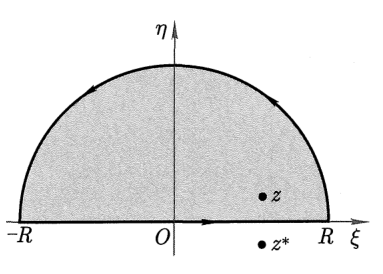

$$
f(z)=\frac{1}{2\pi\mathrm{i}}\int_{-R}^{R}\frac{f(\xi)}{\xi-z}\mathrm{d}\xi+\frac{1}{2\pi\mathrm{i}}\int_{C_R}\frac{f(\zeta)}{\zeta-z}\mathrm{d}\zeta.
$$

下面讨论 $R\to\infty$ 的极限情形。因为 $f(z)$ 在上半平面解析，故只需 $z$ 在上半平面趋于 $\infty$ 时 $f(z)$ 趋于 0，则根据 §3.4 中的引理 3.5 可知，

$$
\lim_{R\to\infty}\int_{C_R}\frac{f(\zeta)}{\zeta-z}\mathrm{d}\zeta=0,
$$

由此即得

$$
f(z)=\frac{1}{2\pi\mathrm{i}}\int_{-\infty}^{\infty}\frac{f(\xi)}{\xi-z}\mathrm{d}\xi.\qquad (3.26)
$$

此结果说明，由 $f(z)$ 在实轴上的值，可以唯一地决定它在上半平面任意一点的数值。更进一步，令 $z=x+\mathrm{i}y$，$f(z)=u+\mathrm{i}v$，还可以单独地写出 $f(z)$ 的实部与虚部：

$$
u(x,y)=\frac{1}{2\pi}\int_{-\infty}^{\infty}\frac{(\xi-x)u(\xi,0)+yv(\xi,0)}{(\xi-x)^2+y^2}\mathrm{d}\xi,\qquad (3.27)
$$

$$
v(x,y)=-\frac{1}{2\pi}\int_{-\infty}^{\infty}\frac{(\xi-x)v(\xi,0)-yu(\xi,0)}{(\xi-x)^2+y^2}\mathrm{d}\xi.\qquad (3.28)
$$

由于解析函数的实部和虚部并不互相独立，由解析函数的实部就可以求出虚部（反之亦然），从而确定解析函数本身。因此，可以设想，如果只知道解析函数的实部在实轴上的数值，也有可能求出虚部在实轴上的数值，从而完全决定函数在上半平面内任意一点 $z$ 的值。为此，考虑 $z$ 相对于实轴的反演点 $z^*$。它一定位于下半平面，所以

$$
\lim_{R\to\infty}\left\{\frac{1}{2\pi\mathrm{i}}\oint_C\frac{f(\zeta)}{\zeta-z^*}\mathrm{d}\zeta\right\}=\frac{1}{2\pi\mathrm{i}}\int_{-\infty}^{\infty}\frac{f(\xi)}{\xi-x+\mathrm{i}y}\mathrm{d}\xi=0.\qquad (3.29)
$$

或者也分别比较等式两端的实部与虚部，

$$
\frac{1}{2\pi}\int_{-\infty}^{\infty}\frac{(\xi-x)u(\xi,0)+yv(\xi,0)}{(\xi-x)^2+y^2}\mathrm{d}\xi=0,\qquad (3.30)
$$

$$
\frac{1}{2\pi}\int_{-\infty}^{\infty}\frac{(\xi-x)v(\xi,0)-yu(\xi,0)}{(\xi-x)^2+y^2}\mathrm{d}\xi=0.\qquad (3.31)
$$

将 (3.27) 和 (3.31) 式相加，就得到

$$
\begin{aligned}
u(x,y)&=\frac{1}{\pi}\int_{-\infty}^{\infty}\frac{(\xi-x)v(\xi,0)}{(\xi-x)^2+y^2}\mathrm{d}\xi\qquad (3.32\mathrm{a})\\
&=\frac{1}{\pi}\int_{-\infty}^{\infty}\frac{yu(\xi,0)}{(\xi-x)^2+y^2}\mathrm{d}\xi.\qquad (3.32\mathrm{b})
\end{aligned}
$$

将 (3.28) 和 (3.30) 式相加，又能得到

$$
\begin{aligned}
v(x,y)&=-\frac{1}{\pi}\int_{-\infty}^{\infty}\frac{(\xi-x)u(\xi,0)}{(\xi-x)^2+y^2}\mathrm{d}\xi\qquad (3.33\mathrm{a})\\
&=\frac{1}{\pi}\int_{-\infty}^{\infty}\frac{yv(\xi,0)}{(\xi-x)^2+y^2}\mathrm{d}\xi.\qquad (3.33\mathrm{b})
\end{aligned}
$$

(3.32) 和 (3.33) 诸式的特点是，只根据 $u(x,y)$ 或 $v(x,y)$ 在实轴上的数值，便可以完全确定 $u(x,y)$ 和 $v(x,y)$ 在上半平面内任意一点的值。更进一步，也就给出 $f(z)$ 本身在上半平面内任意一点的值：

$$
\begin{aligned}
f(z)&=\frac{1}{\pi\mathrm{i}}\int_{-\infty}^{\infty}\frac{u(\xi,0)}{\xi-(x+\mathrm{i}y)}\mathrm{d}\xi\qquad (3.34\mathrm{a})\\
&=\frac{1}{\pi}\int_{-\infty}^{\infty}\frac{v(\xi,0)}{\xi-(x+\mathrm{i}y)}\mathrm{d}\xi.\qquad (3.34\mathrm{b})
\end{aligned}
$$

而且将 (3.32) 和 (3.33) 的各式适当组合，或者直接将 (3.26) 和 (3.29) 两式相减，还能得到

$$
\begin{aligned}
f(z)&=\frac{y}{\pi}\int_{-\infty}^{\infty}\frac{f(\xi)}{(\xi-x)^2+y^2}\mathrm{d}\xi\qquad (3.35\mathrm{a})\\
&=\frac{1}{\pi\mathrm{i}}\int_{-\infty}^{\infty}\frac{(\xi-x)f(\xi)}{(\xi-x)^2+y^2}\mathrm{d}\xi.\qquad (3.35\mathrm{b})
\end{aligned}
$$

(3.32)–(3.26) 诸式均称为上半平面的 Poisson 公式。这些结果说明：如果 $f(z)$ 在上半平面解析，并且当 $z$ 在上半平面趋于 $\infty$ 时趋于 0，根据它（或者它的实部或虚部）在实轴上的数值，就可以唯一地决定它在上半平面内任意一点的数值。

**思考题** §2.3 中曾经指出，由解析函数的实部（虚部）就可以求出虚部（实部），但可差一个任意实常数。可是在上面的 (3.32a)、(3.33a) 和 (3.34a)、(3.34b) 诸式中并不出现任意常数，为什么？

下面导出另一种 Poisson 公式：圆内区域内的 Poisson 公式。设函数 $f(z)$ 在圆 $|z|\leqslant a$ 中解析，则对于圆内任意一点 $z=r\mathrm{e}^{\mathrm{i}\phi}$，$r<a$（见图 3.13），根据有界区域 Cauchy 积分公式，有

$$
\begin{aligned}
f(z)&=\frac{1}{2\pi\mathrm{i}}\oint_{|\zeta|=a}\frac{f(\zeta)}{\zeta-z}\mathrm{d}\zeta=\frac{a}{2\pi}\int_0^{2\pi}\frac{f(a\mathrm{e}^{\mathrm{i}\theta})}{a-r\mathrm{e}^{\mathrm{i}(\phi-\theta)}}\mathrm{d}\theta\\
&=\frac{a}{2\pi}\int_0^{2\pi}\frac{a-r\mathrm{e}^{-\mathrm{i}(\phi-\theta)}}{a^2+r^2-2ar\cos(\phi-\theta)}f(a\mathrm{e}^{\mathrm{i}\theta})\,\mathrm{d}\theta.\qquad (3.36)
\end{aligned}
$$

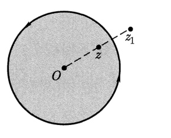

另一方面，对于圆外的点 $z_1=a^2/z^*=r_1\mathrm{e}^{\mathrm{i}\phi}$，$r_1=a^2/r$，也应该有

$$
\frac{1}{2\pi\mathrm{i}}\oint_{|\zeta|=a}\frac{f(\zeta)}{\zeta-z_1}\mathrm{d}\zeta=\frac{a}{2\pi}\int_0^{2\pi}\frac{a-r_1\mathrm{e}^{-\mathrm{i}(\phi-\theta)}}{a^2+r_1^2-2ar_1\cos(\phi-\theta)}f(a\mathrm{e}^{\mathrm{i}\theta})\,\mathrm{d}\theta
$$

$$
=\frac{r}{2\pi}\int_0^{2\pi}\frac{r-a\mathrm{e}^{-\mathrm{i}(\phi-\theta)}}{a^2+r^2-2ar\cos(\phi-\theta)}f(a\mathrm{e}^{\mathrm{i}\theta})\,\mathrm{d}\theta=0.\qquad (3.37)
$$

将 (3.36) 和 (3.37) 两式相减，就得到圆内区域的 Poisson 公式

$$
f(z)=\frac{a^2-r^2}{2\pi}\int_0^{2\pi}\frac{f(a\mathrm{e}^{\mathrm{i}\theta})}{a^2+r^2-2ar\cos(\phi-\theta)}\mathrm{d}\theta.\qquad (3.38)
$$

或者令 $f(z)$ 的实部和虚部分别是 $u(r,\theta)$ 和 $v(r,\theta)$，则对它们也有

$$
u(r,\phi)=\frac{a^2-r^2}{2\pi}\int_0^{2\pi}\frac{u(a,\theta)}{a^2+r^2-2ar\cos(\phi-\theta)}\mathrm{d}\theta,\qquad (3.39)
$$

$$
v(r,\phi)=\frac{a^2-r^2}{2\pi}\int_0^{2\pi}\frac{v(a,\theta)}{a^2+r^2-2ar\cos(\phi-\theta)}\mathrm{d}\theta.\qquad (3.40)
$$

## 习题

1. 试按给定的路径计算下列积分：

(1) $\displaystyle\int_0^{2+\mathrm{i}}\operatorname{Re}z\,\mathrm{d}z$，积分路径为：

(i) 线段 $[0,2]$ 和 $[2,2+\mathrm{i}]$ 组成的折线，　　(ii) 线段 $z=(2+\mathrm{i})t$，$0\leqslant t\leqslant 1$。

(2) $\displaystyle\int_C\frac{\mathrm{d}z}{\sqrt{z}}$，规定 $\left.\sqrt{z}\right|_{z=1}=1$，积分路径为由 $z=1$ 出发的：

(i) 单位圆的上半周，　　(ii) 单位圆的下半周。

2. 计算下列积分：

(1) $\displaystyle\oint_{|z|=1}\frac{\mathrm{d}z}{z}$；　　(2) $\displaystyle\oint_{|z|=1}\frac{|\mathrm{d}z|}{z}$；

(3) $\displaystyle\oint_{|z|=1}\frac{\mathrm{d}z}{|z|}$；　　(4) $\displaystyle\oint_{|z|=1}\left|\frac{\mathrm{d}z}{z}\right|$。

3. 计算下列积分：

(1) $\displaystyle\oint_C\frac{1}{z^2-1}\sin\frac{\pi z}{4}\mathrm{d}z$，$C$ 分别为：

(i) $|z|=1/2$，　　(ii) $|z-1|=1$，

(iii) $|z|=3$，　　(iv) $|z|=R$，$R\to\infty$。

(2) $\displaystyle\oint_C\frac{1}{z^2+1}\mathrm{e}^{\mathrm{i}z}\,\mathrm{d}z$，$C$ 分别为：

(i) $|z-\mathrm{i}|=1$，　　(ii) $|z|=2$，

(iii) $|z+\mathrm{i}|+|z-\mathrm{i}|=2\sqrt{2}$，　　(iv) 闭合曲线 $r=3-\sin^2\dfrac{\theta}{4}$。

4. 计算下列积分：

(1) $\displaystyle\oint_{|z|=2}\frac{\cos z}{z}\mathrm{d}z$；　　(2) $\displaystyle\oint_{|z|=2}\frac{z^2-1}{z^2+1}\mathrm{d}z$；

(3) $\displaystyle\oint_{|z|=2}\frac{\sin\left(\mathrm{e}^z\right)}{z}\mathrm{d}z$；　　(4) $\displaystyle\oint_{|z|=2}\frac{\mathrm{e}^z}{\cosh z}\mathrm{d}z$；

(5) $\displaystyle\oint_{|z|=2}\frac{\sin z}{z^2}\mathrm{d}z$；　　(6) $\displaystyle\oint_{|z|=2}\frac{|z|\,\mathrm{e}^z}{z^2}\mathrm{d}z$；

(7) $\displaystyle\oint_{|z|=2}\frac{\sin z}{z^4}\mathrm{d}z$；　　(8) $\displaystyle\oint_{|z|=2}\frac{\mathrm{d}z}{z^2\left(z^2+16\right)}$。

5. (1) 计算积分 $\displaystyle\oint_{|z|=1}\frac{\mathrm{e}^z}{z^3}\mathrm{d}z$；

(2) $a$ 取何值时，函数 $\displaystyle F(z)=\int_{z_0}^{z}\mathrm{e}^z\left(\frac{1}{z}+\frac{a}{z^3}\right)\mathrm{d}z$ 是单值的？

6. 计算下列积分：

(1) $\displaystyle f(z)=\oint_{|\zeta|=2}\frac{\left(\zeta^*\right)^2\mathrm{e}^\zeta}{\zeta-z}\mathrm{d}\zeta$（其中 $\zeta^*$ 是复数 $\zeta$ 的共轭复数，$z$ 是复数，且 $|z|\neq 2$）；

(2) $\displaystyle\oint_{|z|=1}\ln\frac{2z+1}{2z-1}\frac{\mathrm{d}z}{z+2}$，在实轴上沿 $-\dfrac{1}{2}$ 到 $\dfrac{1}{2}$ 作割线，规定割线上岸 $\arg\dfrac{2z+1}{2z-1}=\pi$。

### 无界区域的高阶导数公式

可以模仿有界区域高阶导数公式的证明方法。根据 (3.20) 式，我们知道，如果 $f(\zeta)$ 在简单闭合围道 $C$ 上及 $C$ 外解析，且当 $z\to\infty$ 时 $f(z)$ 的极限存在，则对于圆外一点 $z$，

$$
f(z)-f(\infty)=\frac{1}{2\pi\mathrm{i}}\oint_C\frac{f(\zeta)}{\zeta-z}\mathrm{d}\zeta,
$$

其中 $C$ 为顺时针方向，即绕 $\infty$ 点的正向。因此，

$$
\frac{f(z+\Delta z)-f(z)}{\Delta z}=\frac{1}{2\pi\mathrm{i}}\frac{1}{\Delta z}\oint_C\left[\frac{f(\zeta)}{\zeta-z-\Delta z}-\frac{f(\zeta)}{\zeta-z}\right]\mathrm{d}\zeta=\frac{1}{2\pi\mathrm{i}}\oint_C\frac{f(\zeta)}{(\zeta-z-\Delta z)(\zeta-z)}\mathrm{d}\zeta.
$$

仿照有界区域的做法，就能证得

$$
f'(z)\equiv\lim_{\Delta z\to 0}\frac{f(z+\Delta z)-f(z)}{\Delta z}=\frac{1}{2\pi\mathrm{i}}\oint_C\frac{f(\zeta)}{(\zeta-z)^2}\mathrm{d}\zeta.
$$

重复以上计算，还可以推得更普遍的结果：

$$
f^{(n)}(z)\equiv\lim_{\Delta z\to 0}\frac{f^{(n-1)}(z+\Delta z)-f^{(n-1)}(z)}{\Delta z}=\frac{n!}{2\pi\mathrm{i}}\oint_C\frac{f(\zeta)}{(\zeta-z)^{n+1}}\mathrm{d}\zeta,\qquad n=1,2,3,\cdots.
$$
