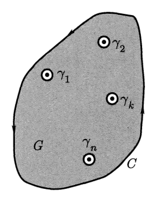
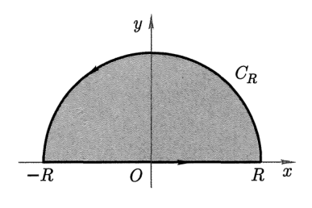
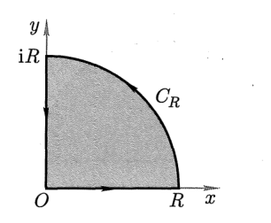
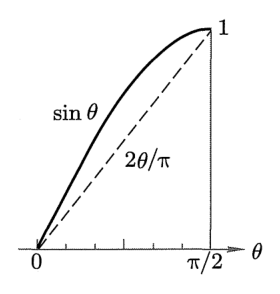
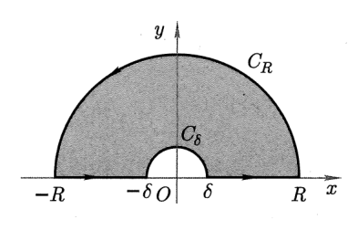
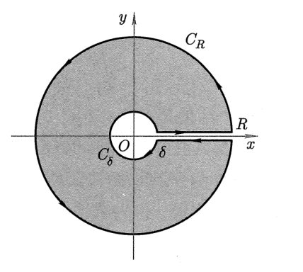
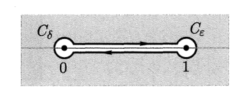
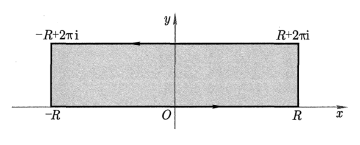
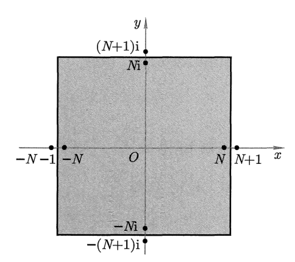

# 第六章 留数定理及其应用

## §6.1 留数定理

**定理 6.1**（留数定理）　设有界区域 $G$ 的边界 $C$ 为分段光滑的简单闭合曲线。若除有限个孤立奇点 $b_k$，$k=1,2,3,\cdots,n$ 外，函数 $f(z)$ 在 $G$ 内单值解析，在 $\bar{G}$ 中连续，并且 $f(z)$ 在边界 $C$ 上连续，则沿区域 $G$ 边界正向的积分

$$
\oint_C f(z)\mathrm{d}z = 2\pi\mathrm{i}\sum_{k=1}^{n}\operatorname{Res} f(b_k). \qquad (6.1)
$$

$\operatorname{Res} f(b_k)$ 称为 $f(z)$ 在 $b_k$ 处的留数，它等于 $f(z)$ 在孤立奇点 $b_k$ 的空心邻域内 Laurent 展开

$$
f(z)=\sum_{l=-\infty}^{\infty} a_l^{(k)}(z-b_k)^l,\quad 0<|z-b_k|<r
$$

中 $(z-b_k)^{-1}$ 的系数 $a_{-1}^{(k)}$。

**证**　如图 6.1 所示，围绕每个孤立奇点 $b_k$ 作简单闭合曲线 $\gamma_k$，使 $\gamma_k$ 均在 $G$ 内，且互不交叠，则根据（多连通有界区域）Cauchy 定理及函数作 Laurent 展开的系数公式（5.23），就有

$$
\oint_C f(z)\mathrm{d}z=\sum_{k=1}^{n}\oint_{\gamma_k} f(z)\mathrm{d}z=2\pi\mathrm{i}\sum_{k=1}^{n}a_{-1}^{(k)}=2\pi\mathrm{i}\sum_{k=1}^{n}\operatorname{Res} f(b_k).\qquad\square
$$

所以，留数定理就是（多连通有界区域的）Cauchy 定理和 Laurent 展开系数公式的直接推论。它告诉我们，为了计算解析函数的围道积分值，只需计算出函数在孤立奇点处的留数即可。

求出 $f(z)$ 在孤立奇点 $b$ 处的留数，就是要求出 $f(z)$ 在 $z=b$ 的空心邻域内 Laurent 展开中 $(z-b)^{-1}$ 项的系数。在极点的情况下，通过微商的计算就可以比较容易地求出来。

设 $z=b$ 是 $f(z)$ 的 $m$ 阶极点，则

$$
\begin{aligned}
f(z)&=a_{-m}(z-b)^{-m}+a_{-m+1}(z-b)^{-m+1}+\cdots\\
&\quad +a_{-1}(z-b)^{-1}+a_0+a_1(z-b)+\cdots,\quad 0<|z-b_k|<r. \qquad (6.2)
\end{aligned}
$$

两端乘上 $(z-b)^m$，有

$$
(z-b)^m f(z)=a_{-m}+a_{-m+1}(z-b)+\cdots+a_{-1}(z-b)^{m-1}+a_0(z-b)^m+a_1(z-b)^{m+1}+\cdots.
$$

这时 $a_{-1}$ 是 $(z-b)^m f(z)$ 的展开式中 $(z-b)^{m-1}$ 项的系数，故

$$
a_{-1}=\left.\frac{1}{(m-1)!}\frac{\mathrm{d}^{m-1}}{\mathrm{d}z^{m-1}}(z-b)^m f(z)\right|_{z=b}. \qquad (6.3)
$$

**思考题**　求函数 $f(z)$ 在极点 $z=b$ 处的留数时，可否在（6.2）式两端同乘以 $(z-b)^k$，而 $k>m$？

特别是 $z=b$ 为一阶极点的情形，

$$
f(z)=a_{-1}(z-b)^{-1}+a_0+a_1(z-b)+a_2(z-b)^2+\cdots,\quad 0<|z-b_k|<r. \qquad (6.4)
$$

所以函数 $f(z)$ 在该点的留数就是

$$
a_{-1}=\lim_{z\to b}(z-b)f(z). \qquad (6.5)
$$

可见，函数 $f(z)$ 在复平面内一阶极点 $z=b$ 处的留数一定不为零。

常见的情况是 $f(z)$ 可以表示为 $\dfrac{P(z)}{Q(z)}$ 的形式，其中 $P(z)$ 和 $Q(z)$ 都在 $b$ 点及其邻域内解析，且 $P(b)\neq 0$，$z=b$ 是 $Q(z)$ 的一阶零点，即 $Q(b)=0$，$Q'(b)\neq 0$，则

$$
a_{-1}=\lim_{z\to b}(z-b)f(z)=\lim_{z\to b}(z-b)\frac{P(z)}{Q(z)}=\frac{P(b)}{Q'(b)}. \qquad (6.6)
$$

**例 6.1**　求 $\dfrac{1}{z^2+1}$ 在复平面 $\mathbb{C}$ 内孤立奇点处的留数。

**解**　$z=\pm\mathrm{i}$ 是它的一阶极点，

$$
\operatorname{Res} f(\pm\mathrm{i})=\left.\frac{1}{2z}\right|_{z=\pm\mathrm{i}}=\mp\frac{\mathrm{i}}{2}.
$$

**例 6.2**　求 $\dfrac{\mathrm{e}^{\mathrm{i}az}-\mathrm{e}^{\mathrm{i}bz}}{z^2}$ 在复平面 $\mathbb{C}$ 内孤立奇点处的留数。

**解**　$z=0$ 是它的一阶极点，

$$
\operatorname{Res} f(0)=\lim_{z\to 0}z\cdot\frac{\mathrm{e}^{\mathrm{i}az}-\mathrm{e}^{\mathrm{i}bz}}{z^2}=\lim_{z\to 0}\frac{\mathrm{e}^{\mathrm{i}az}-\mathrm{e}^{\mathrm{i}bz}}{z}=\mathrm{i}(a-b).
$$

**例 6.3**　求 $1/(z^2+1)^3$ 在复平面 $\mathbb{C}$ 内孤立奇点处的留数。

**解**　$z=\pm\mathrm{i}$ 是它的三阶极点，

$$
\operatorname{Res} f(\pm\mathrm{i})=\frac{1}{2!}\frac{\mathrm{d}^2}{\mathrm{d}z^2}\left[(z\mp\mathrm{i})^3\cdot\frac{1}{(z^2+1)^3}\right]_{z=\pm\mathrm{i}}=\mp\frac{3}{16}\mathrm{i}.
$$

**练习 6.1**　设 $f(z)$ 为偶函数，$z=0$ 点是它的孤立奇点，证明 $f(z)$ 在 $z=0$ 处的留数必为 0。

**练习 6.2**　若 $z=0$ 是 $f(z)$ 的 $n$ 阶零点，试求下列函数在该点的留数：

（1）$\dfrac{f'(z)}{f(z)}$；

（2）$\dfrac{f''(z)}{f(z)}$；

（3）$\dfrac{f''(z)}{f'(z)}$；

（4）$\dfrac{(n-1)f'(z)-zf''(z)}{f(z)}$。

**练习 6.3**　若 $z=0$ 是 $f(z)$ 的 $n$ 阶极点，试求下列函数在该点的留数：

（1）$\dfrac{f'(z)}{f(z)}$；

（2）$\dfrac{f''(z)}{f(z)}$；

（3）$\dfrac{f''(z)}{f'(z)}$；

（4）$\dfrac{(n+1)f'(z)+zf''(z)}{f(z)}$。

**练习 6.4**　总结各种情形下孤立奇点 $(z_0)$ 处留数的求法，并填充下表：

| 函　数 | 给　定　条　件 | 奇　点　类　型 | 留　　数 |
|:--|:--|:--|:--|
| $f(z)$ | $\lim\limits_{z\to z_0}(z-z_0)f(z)=0$ | | |
| $f(z)$ | $\lim\limits_{z\to z_0}(z-z_0)f(z)\neq 0$ | | |
| $f(z)$ | $\lim\limits_{z\to z_0}(z-z_0)^{k-1}f(z)=\infty$，$\lim\limits_{z\to z_0}(z-z_0)^k f(z)\neq 0$ | | |
| $\dfrac{g(z)}{f(z)}$ | $z_0$ 点为 $g(z)$，$f(z)$ 的同阶零点 | | |
| $\dfrac{g(z)}{f(z)}$ | $g(z_0)\neq 0$，$f(z_0)=0$，$f'(z_0)\neq 0$ | | |
| $\dfrac{g(z)}{f(z)}$ | $z_0$ 点为 $g(z)$ 的 $m$ 阶零点，$f(z)$ 的 $m+1$ 阶零点 | | |
| $\dfrac{g(z)}{f(z)}$ | $g(z_0)\neq 0$，$f(z_0)=f'(z_0)=0$，$f''(z_0)\neq 0$ | | |
| $\dfrac{g(z)}{(z-z_0)^2}$ | $g(z_0)\neq 0$ | | |
| $\dfrac{g(z)}{f(z)}$ | $z_0$ 点为 $f(z)$ 的 $m$ 阶零点，且 $g(z_0)\neq 0$ | | |
| $\dfrac{g(z)}{f(z)}$ | $z_0$ 点为 $g(z)$ 的 $m$ 阶零点，$f(z)$ 的 $m+n$ 阶零点 | | |

应用留数概念，可以方便地讨论有理函数的部分分式。例如，要求将函数

$$
f(z)=\frac{1}{(z-1)(z-2)(z-3)}
$$

部分分式，

$$
\frac{1}{(z-1)(z-2)(z-3)}=\frac{A}{z-1}+\frac{B}{z-2}+\frac{C}{z-3}. \qquad (6.7)
$$

那么，三个待定常数，$A$，$B$ 和 $C$，正好就是函数 $f(z)$ 在一阶极点 $z=1$，$z=2$ 和 $z=3$ 点处的留数。因此

$$
A=\operatorname{Res}\left.\frac{1}{(z-1)(z-2)(z-3)}\right|_{z=1}=\frac{1}{2}, \qquad (6.8\mathrm{a})
$$

$$
B=\operatorname{Res}\left.\frac{1}{(z-1)(z-2)(z-3)}\right|_{z=2}=-1, \qquad (6.8\mathrm{b})
$$

$$
C=\operatorname{Res}\left.\frac{1}{(z-1)(z-2)(z-3)}\right|_{z=3}=\frac{1}{2}. \qquad (6.8\mathrm{c})
$$

如果函数 $f(z)$ 具有高阶极点，也可以类似地处理。例如，

$$
\frac{1}{(z-1)^2(z-2)(z-3)}=\frac{A}{(z-1)^2}+\frac{B}{z-1}+\frac{C}{z-2}+\frac{D}{z-3}. \qquad (6.9)
$$

容易看出

$$
A=\operatorname{Res}\left.\frac{1}{(z-1)(z-2)(z-3)}\right|_{z=1}=\frac{1}{2}, \qquad (6.10\mathrm{a})
$$

$$
B=\operatorname{Res}\left.\frac{1}{(z-1)^2(z-2)(z-3)}\right|_{z=1}=\frac{3}{4}, \qquad (6.10\mathrm{b})
$$

$$
C=\operatorname{Res}\left.\frac{1}{(z-1)^2(z-2)(z-3)}\right|_{z=2}=-1, \qquad (6.10\mathrm{c})
$$

$$
D=\operatorname{Res}\left.\frac{1}{(z-1)^2(z-2)(z-3)}\right|_{z=3}=\frac{1}{4}. \qquad (6.10\mathrm{d})
$$

### 无穷远点的留数

以上的讨论均局限于复平面 $\mathbb{C}$ 内的孤立奇点。如果 $\infty$ 点不是 $f(z)$ 的非孤立奇点，那么可以定义

$$
\operatorname{Res} f(\infty)=\frac{1}{2\pi\mathrm{i}}\oint_{C'} f(z)\mathrm{d}z, \qquad (6.11)
$$

其中 $C'$ 为绕 $\infty$ 点正向（即顺时针方向）一周的简单封闭曲线，在围道内除 $\infty$ 点外的其他点均解析，$\infty$ 点是 $f(z)$ 的唯一可能的孤立奇点。需要注意，$\operatorname{Res} f(\infty)$ 并不是 $f(z)$ 在 $\infty$ 点邻域内 Laurent 展开中 $z^1$ 项的系数。这是因为，作变换 $t=1/z$，则

$$
\begin{aligned}
\operatorname{Res} f(\infty)&=\frac{1}{2\pi\mathrm{i}}\oint_{C'} f(z)\mathrm{d}z=-\frac{1}{2\pi\mathrm{i}}\oint_{C}\frac{f(1/t)}{t^2}\mathrm{d}t\\
&=-\frac{f(1/t)}{t^2}\ \text{在}\ t=0\ \text{点邻域内幂级数展开中}\ t^{-1}\ \text{项的系数}\\
&=-f(1/t)\ \text{在}\ t=0\ \text{点邻域内幂级数展开中}\ t^1\ \text{项的系数}\\
&=-f(z)\quad\text{在}\ z=\infty\ \text{点邻域内幂级数展开中}\ z^{-1}\ \text{项的系数}. \qquad (6.12)
\end{aligned}
$$

在这个结果中，与有限远处不同之处在于：

（1）从结果上说，函数 $f(z)$ 在 $\infty$ 点的留数，等于 $-f(z)$ 在 $\infty$ 点邻域内幂级数展开中 $z^{-1}$ 项的系数，这里多了一个负号。

（2）从概念上说，由于 $z^{-1}$ 项属于 $f(z)$ 在 $\infty$ 点邻域内幂级数展开式的正则部分，因此，即使 $f(z)$ 在 $\infty$ 点解析，$\operatorname{Res} f(\infty)$ 也可能不为 0。反之，即使 $\infty$ 点是 $f(z)$ 的孤立奇点，甚至是一阶极点，$\operatorname{Res} f(\infty)$ 也可能为 0。

**练习 6.5**　设 $f(z)$ 在 $z=\infty$ 点邻域内的展开式为

$$
f(z)=c_0+\frac{c_1}{z}+\frac{c_2}{z^2}+\cdots,
$$

试求 $f^2(z)$ 在 $z=\infty$ 处的留数。

**练习 6.6**　证明：若 $f(z)$ 在 $\mathbb{C}$ 内除有限个孤立奇点外解析，则函数 $f(z)$ 在 $\bar{\mathbb{C}}$ 中的留数和为 0。

留数定理把围道积分的计算转化为留数的计算，只要能把定积分和某个解析函数的围道积分联系起来，就有可能比较简便地计算出这些定积分。

## §6.2 有理三角函数的积分

作为应用留数定理计算定积分的第一类例子，研究有理三角函数的积分

$$
I=\int_0^{2\pi}R(\sin\theta,\cos\theta)\mathrm{d}\theta, \qquad (6.13)
$$

其中 $R$ 是 $\sin\theta,\cos\theta$ 的有理函数，即 $R$ 是由 $\sin\theta,\cos\theta$ 的多项式相除得到的函数，$R$ 在积分区间 $[0,2\pi]$ 上是连续的。作变换 $z=\mathrm{e}^{\mathrm{i}\theta}$，则

$$
\sin\theta=\frac{z^2-1}{2\mathrm{i}z},\qquad \cos\theta=\frac{z^2+1}{2z},\qquad \mathrm{d}\theta=\frac{\mathrm{d}z}{\mathrm{i}z},
$$

相应的积分路径则变为 $z$ 复平面内的一条封闭围道——单位圆的圆周 $|z|=1$。于是，

$$
I=\oint_{|z|=1}R\left(\frac{z^2-1}{2\mathrm{i}z},\frac{z^2+1}{2z}\right)\frac{\mathrm{d}z}{\mathrm{i}z}. \qquad (6.14)
$$

有理三角函数 $R(\sin\theta,\cos\theta)$ 在积分区间 $[0,2\pi]$ 上连续，保证了有理函数 $R\left(\dfrac{z^2-1}{2\mathrm{i}z},\dfrac{z^2+1}{2z}\right)$ 在积分围道（单位圆的圆周）上无奇点。如果被积函数 $R\left(\dfrac{z^2-1}{2\mathrm{i}z},\dfrac{z^2+1}{2z}\right)\dfrac{1}{\mathrm{i}z}$ 在单位圆内部只有有限个孤立奇点，那么可以应用留数定理得

$$
\oint_{|z|=1}R\left(\frac{z^2-1}{2\mathrm{i}z},\frac{z^2+1}{2z}\right)\frac{\mathrm{d}z}{\mathrm{i}z}=2\pi\sum_{|z|<1}\operatorname{Res}\left\{\frac{1}{z}R\left(\frac{z^2-1}{2\mathrm{i}z},\frac{z^2+1}{2z}\right)\right\}. \qquad (6.15)
$$

**例 6.4**　计算积分 $I=\displaystyle\int_0^{\pi}\frac{1}{1+\varepsilon\cos\theta}\mathrm{d}\theta$，$|\varepsilon|<1$。

**解**　由于被积函数 $\dfrac{1}{1+\varepsilon\cos\theta}$ 是 $\theta$ 的偶函数，所以

$$
\int_0^{\pi}\frac{1}{1+\varepsilon\cos\theta}\mathrm{d}\theta=\frac{1}{2}\int_{-\pi}^{\pi}\frac{1}{1+\varepsilon\cos\theta}\mathrm{d}\theta.
$$

仿照上面的方法步骤，我们有

$$
\begin{aligned}
\int_{-\pi}^{\pi}\frac{1}{1+\varepsilon\cos\theta}\mathrm{d}\theta&=\oint_{|z|=1}\frac{1}{1+\varepsilon\dfrac{z^2+1}{2z}}\frac{\mathrm{d}z}{\mathrm{i}z}=\oint_{|z|=1}\frac{2}{\varepsilon z^2+2z+\varepsilon}\frac{\mathrm{d}z}{\mathrm{i}}\\
&=2\pi\sum_{|z|<1}\operatorname{Res}\left\{\frac{2}{\varepsilon z^2+2z+\varepsilon}\right\}\\
&=\left.2\pi\cdot\frac{2}{2\varepsilon z+2}\right|_{z=(-1+\sqrt{1-\varepsilon^2})/\varepsilon}=\frac{2\pi}{\sqrt{1-\varepsilon^2}}.
\end{aligned}
$$

因此

$$
I=\frac{\pi}{\sqrt{1-\varepsilon^2}}.
$$

这里在计算留数时，要注意函数 $2/(\varepsilon z^2+2z+\varepsilon)$ 有两个极点，

$$
z=\frac{-1\pm\sqrt{1-\varepsilon^2}}{\varepsilon},
$$

由于它们的乘积为 1，且模 $\neq 1$，所以一定只有一个极点，$z=(-1+\sqrt{1-\varepsilon^2})/\varepsilon$，处于单位圆内。

**练习 6.7**　如果 $R(\sin\theta,\cos\theta)$ 在 $[0,2\pi]$ 中有瑕点，则通过变换 $z=\mathrm{e}^{\mathrm{i}\theta}$ 后，$R(\sin\theta,\cos\theta)$ 变为

$$
f(z)\equiv R\left(\frac{z^2-1}{2\mathrm{i}z},\frac{z^2+1}{2z}\right),
$$

$f(z)$ 在单位圆的圆周 $|z|=1$ 上有奇点。设这些奇点 $\beta_k(k=1,2,\cdots,m)$ 均为一阶极点，证明：

$$
\int_0^{2\pi}R(\sin\theta,\cos\theta)\mathrm{d}\theta=2\pi\sum_{|z|<1}\operatorname{Res}\left\{\frac{f(z)}{z}\right\}+\pi\sum_{k=1}^{m}\operatorname{Res}\left\{\frac{f(z)}{z}\right\}_{z=\beta_k}.
$$

## §6.3 无穷积分

第二类可以用留数定理计算的定积分是无穷积分$^{①}$

$$
I=\int_{-\infty}^{\infty}f(x)\mathrm{d}x. \qquad (6.16)
$$

在复平面上看，积分的路径是实轴，并不构成闭合围道。为了应用留数定理计算这种类型的积分，其基本原则是：（1）将实函数 $f(x)$ 的定义域延拓到复平面成为复函数 $f(z)$，（2）补上适当的积分路径从而形成复平面内的闭合围道。为此可以在上半平面补上以原点 $O$ 为圆心、$R$ 为半径的半圆弧 $C_R$（见图 6.2）。由实轴上的线段 $[-R,R]$ 及 $C_R$ 就构成闭合围道。如果函数 $f(z)$ 在闭合围道上没有奇点，而且在围道内部只有有限个孤立奇点，则可以应用留数定理计算围道积分，而后令 $R\to\infty$，如果极限存在，即可算出积分（6.16）。

---

①　无穷积分（但非瑕积分）的定义为

$$
I=\lim_{\substack{R_1\to+\infty\\ R_2\to+\infty}}\int_{-R_1}^{R_2}f(x)\mathrm{d}x.
$$

有时这种极限不存在，但 $\lim\limits_{R\to+\infty}\displaystyle\int_{-R}^{R}f(x)\mathrm{d}x$ 存在，称为积分主值，记为

$$
\mathrm{v.p.}\int_{-\infty}^{\infty}f(x)\mathrm{d}x=\lim_{R\to+\infty}\int_{-R}^{R}f(x)\mathrm{d}x.
$$

显然，当这两种极限都存在时，它们必定相等。为了保证积分存在，一般要求满足当 $x\to\pm\infty$ 时，$f(x)=O\left(x^{-\lambda}\right)$，$\lambda>1$。

**例 6.5**　计算积分 $\displaystyle\int_{-\infty}^{\infty}\frac{\mathrm{d}x}{(1+x^2)^3}$。

**解**　考虑复变积分 $\displaystyle\oint_C\frac{\mathrm{d}z}{(1+z^2)^3}$，积分围道如图 6.2。根据留数定理，有

$$
\oint_C\frac{\mathrm{d}z}{(1+z^2)^3}=\int_{-R}^{R}\frac{\mathrm{d}x}{(1+x^2)^3}+\int_{C_R}\frac{1}{(1+z^2)^3}\mathrm{d}z=2\pi\mathrm{i}\cdot\operatorname{Res}\left.\frac{1}{(1+z^2)^3}\right|_{z=\mathrm{i}}. \qquad (6.17)
$$

因为

$$
\lim_{z\to\infty}\left[z\cdot\frac{1}{(1+z^2)^3}\right]=0,
$$

根据引理 3.5 即得

$$
\lim_{R\to\infty}\int_{C_R}\frac{1}{(1+z^2)^3}\mathrm{d}z=0.
$$

所以将（6.17）式取极限 $R\to\infty$，并代入例 6.3 中的结果，最后就求得

$$
\int_{-\infty}^{\infty}\frac{\mathrm{d}x}{(1+x^2)^3}=\frac{3}{8}\pi.
$$

不难看出，应用留数定理计算这种类型的无穷积分时，函数 $f(z)$ 应满足下列条件：

（1）$f(z)$ 在上半平面除有限个孤立奇点外处处解析，在实轴上没有奇点；

（2）在 $0\leqslant\arg z\leqslant\pi$ 范围内，当 $|z|\to\infty$ 时，$zf(z)$ 一致地趋于 0，即 $\forall\varepsilon>0$，$\exists M(\varepsilon)>0$，使当 $|z|\geqslant M$，并且 $0\leqslant\arg z\leqslant\pi$ 时，$|zf(z)|<\varepsilon$。

在上述基本原则下，围道的选取具有一定灵活性。

**例 6.6**　计算定积分 $\displaystyle\int_0^{\infty}\frac{\mathrm{d}x}{1+x^4}$。

**解**　由于这里的被积函数 $f(x)=1/(1+x^4)$ 是 $x^4$ 的函数，故可采用图 6.3 的围道：沿正虚轴回到原点。这样，在围道内，就只有一个奇点，$z=\mathrm{e}^{\mathrm{i}\pi/4}$。根据留数定理，我们就有

$$
\begin{aligned}
\oint_C\frac{\mathrm{d}z}{1+z^4}&=\int_0^{R}\frac{\mathrm{d}x}{1+x^4}+\int_{C_R}\frac{\mathrm{d}z}{1+z^4}+\int_R^{0}\frac{\mathrm{i}\mathrm{d}y}{1+(\mathrm{i}y)^4}\\
&=(1-\mathrm{i})\int_0^{R}\frac{\mathrm{d}x}{1+x^4}+\int_{C_R}\frac{\mathrm{d}z}{1+z^4}\\
&=2\pi\mathrm{i}\operatorname{Res}\left.\frac{1}{1+z^4}\right|_{z=\mathrm{e}^{\mathrm{i}\pi/4}}=\frac{\pi}{2}\frac{1-\mathrm{i}}{\sqrt{2}}. \qquad (6.18)
\end{aligned}
$$

取极限 $R\to\infty$，同样根据引理 3.5，可以判断沿 $C_R$ 的积分趋于 0，

$$
\lim_{R\to\infty}\int_{C_R}\frac{\mathrm{d}z}{1+z^4}=0.
$$

于是，就得到

$$
\int_0^{\infty}\frac{\mathrm{d}x}{1+x^4}=\frac{\sqrt{2}}{4}\pi.
$$

在这个例子中，当然也可以采用图 6.2 所示的半圆形的围道。这时被积函数 $1/(1+z^4)$ 在围道内有两个孤立奇点：$z=\mathrm{e}^{\mathrm{i}\pi/4}$ 和 $z=\mathrm{e}^{3\pi\mathrm{i}/4}$，计算量要略微大一些。可以设想，如果要计算定积分 $\displaystyle\int_0^{\infty}\frac{\mathrm{d}x}{1+x^{100}}$，若采用夹角为 $\pi/50$ 的扇形围道，围道内只有一个孤立奇点；而若采用半圆形围道，围道内则有 50 个孤立奇点。两者在计算量上的差异就很可观了。

**练习 6.8**　计算积分 $\displaystyle\int_0^{\infty}\frac{\mathrm{d}x}{1+x^3}$。

上面关于留数定理的应用条件还可以放宽：如果函数 $f(z)$ 在上半平面内没有非孤立奇点，但是有无穷多个孤立奇点 $b_n$，$n=1,2,\cdots$，只要存在曲线序列 $\{C_m\}$，每一条 $C_m$ 都与实轴上从 $-R_m$ 到 $R_m$ 的直线段构成闭合围道，在围道上没有 $f(z)$ 的奇点，且当 $m\to\infty$ 时，$C_m$ 上的点 $z$ 的模 $|z|$ 和 $R_m$ 都趋于 $\infty$，同时 $\lim\limits_{m\to\infty}\displaystyle\int_{C_m}f(z)\mathrm{d}z=0$，则

$$
\int_{-\infty}^{\infty}f(x)\mathrm{d}x=2\pi\mathrm{i}\sum_{n=1}^{\infty}\operatorname{Res} f(b_n). \qquad (6.19)
$$

## §6.4 含三角函数的无穷积分

第三类可以应用留数定理计算的定积分是

$$
I=\int_{-\infty}^{\infty}f(x)\cos px\,\mathrm{d}x\quad\text{或}\quad I=\int_{-\infty}^{\infty}f(x)\sin px\,\mathrm{d}x. \qquad (6.20)
$$

这里不妨假设 $p>0$。

处理这种类型的积分，仍可采用如图 6.2 所示的半圆形围道。至于被积函数，通常并不取为 $f(z)\cos pz$ 或 $f(z)\sin pz$。这是因为 $z=\infty$ 是 $\cos pz$，$\sin pz$ 的本性奇点，当 $|z|=R\to\infty$ 时，函数 $\cos pz$，$\sin pz$ 的行为略显复杂，在计算

$$
\lim_{R\to\infty}\int_{C_R}f(z)\cos pz\,\mathrm{d}z\quad\text{或}\quad\lim_{R\to\infty}\int_{C_R}f(z)\sin pz\,\mathrm{d}z
$$

时似乎会遇到一点困难。避开这一困难的方法是将被积函数取为 $f(z)\mathrm{e}^{\mathrm{i}pz}$。如果 $f(z)\mathrm{e}^{\mathrm{i}pz}$ 在上半平面内只有有限个孤立奇点，则可以利用留数定理计算沿闭合围道的积分，有

$$
\begin{aligned}
\oint_C f(z)\mathrm{e}^{\mathrm{i}pz}\mathrm{d}z&=\int_{-R}^{R}f(x)\mathrm{e}^{\mathrm{i}px}\mathrm{d}x+\int_{C_R}f(z)\mathrm{e}^{\mathrm{i}pz}\mathrm{d}z\\
&=\int_{-R}^{R}f(x)(\cos px+\mathrm{i}\sin px)\mathrm{d}x+\int_{C_R}f(z)\mathrm{e}^{\mathrm{i}pz}\mathrm{d}z.
\end{aligned}
$$

这样，只要能够计算出 $\lim\limits_{R\to\infty}\displaystyle\int_{C_R}f(z)\mathrm{e}^{\mathrm{i}pz}\mathrm{d}z$，然后分别比较实部和虚部，就可以求得积分 $\displaystyle\int_{-\infty}^{\infty}f(x)\cos px\,\mathrm{d}x$ 和 $\displaystyle\int_{-\infty}^{\infty}f(x)\sin px\,\mathrm{d}x$。为此，介绍一个引理。

**引理 6.1**（Jordan 引理）　设在 $0\leqslant\arg z\leqslant\pi$ 范围内，当 $|z|\to\infty$ 时 $Q(z)$ 一致地趋于 0，则

$$
\lim_{R\to\infty}\int_{C_R}Q(z)\mathrm{e}^{\mathrm{i}pz}\mathrm{d}z=0, \qquad (6.21)
$$

其中 $p>0$，$C_R$ 是以原点为圆心，$R$ 为半径的上半圆弧。

**证**　当 $z$ 在 $C_R$ 上时，$z=R\mathrm{e}^{\mathrm{i}\theta}$，在 $0\leqslant\arg z\leqslant\pi$ 范围内，当 $|z|\to\infty$ 时 $Q(z)$ 一致地趋于 0，意味着 $\forall\varepsilon>0$，存在与 $\arg z$ 无关的 $M(\varepsilon)>0$，使得当 $|z|=R>M$，且 $0\leqslant\arg z\leqslant\pi$ 时，$|Q(z)|<\varepsilon$，

$$
\begin{aligned}
\left|\int_{C_R}Q(z)\mathrm{e}^{\mathrm{i}pz}\mathrm{d}z\right|&=\left|\int_0^{\pi}Q\left(R\mathrm{e}^{\mathrm{i}\theta}\right)\mathrm{e}^{\mathrm{i}pR(\cos\theta+\mathrm{i}\sin\theta)}R\mathrm{e}^{\mathrm{i}\theta}\mathrm{i}\mathrm{d}\theta\right|\\
&\leqslant\int_0^{\pi}\left|Q\left(R\mathrm{e}^{\mathrm{i}\theta}\right)\right|\mathrm{e}^{-pR\sin\theta}R\mathrm{d}\theta\\
&<\varepsilon R\int_0^{\pi}\mathrm{e}^{-pR\sin\theta}\mathrm{d}\theta\\
&=2\varepsilon R\int_0^{\pi/2}\mathrm{e}^{-pR\sin\theta}\mathrm{d}\theta.
\end{aligned}
$$

证明的关键在于精确估计 $\sin\theta$ 值。由图 6.4 可见，当 $0\leqslant\theta\leqslant\pi/2$ 时有 $\sin\theta\geqslant2\theta/\pi$，所以

$$
\left|\int_{C_R}Q(z)\mathrm{e}^{\mathrm{i}pz}\mathrm{d}z\right|<2\varepsilon R\int_0^{\pi/2}\mathrm{e}^{-pR\cdot2\theta/\pi}\mathrm{d}\theta=\frac{\varepsilon\pi}{p}\left(1-\mathrm{e}^{-pR}\right).
$$

这样，就证明了

$$
\lim_{R\to\infty}\int_{C_R}Q(z)\mathrm{e}^{\mathrm{i}pz}\mathrm{d}z=0.\qquad\square
$$

**例 6.7**　计算积分 $\displaystyle\int_0^{\infty}\frac{x\sin x}{x^2+a^2}\mathrm{d}x$，$a>0$。

**解**　考虑复变积分 $\displaystyle\oint_C\frac{z\mathrm{e}^{\mathrm{i}z}}{z^2+a^2}\mathrm{d}z$，积分围道 $C$ 如图 6.2 所示。则由留数定理，有

$$
\begin{aligned}
\oint_C\frac{z\mathrm{e}^{\mathrm{i}z}}{z^2+a^2}\mathrm{d}z&=\int_{-R}^{R}\frac{x\mathrm{e}^{\mathrm{i}x}}{x^2+a^2}\mathrm{d}x+\int_{C_R}\frac{z\mathrm{e}^{\mathrm{i}z}}{z^2+a^2}\mathrm{d}z\\
&=2\pi\mathrm{i}\cdot\operatorname{Res}\left.\frac{z\mathrm{e}^{\mathrm{i}z}}{z^2+a^2}\right|_{z=a\mathrm{i}}=\pi\mathrm{i}\mathrm{e}^{-a}.
\end{aligned}
$$

取极限 $R\to\infty$，因为

$$
\lim_{z\to\infty}\frac{z}{z^2+a^2}=0,
$$

故根据 Jordan 引理，有

$$
\lim_{R\to\infty}\int_{C_R}\frac{z\mathrm{e}^{\mathrm{i}z}}{z^2+a^2}\mathrm{d}z=0.
$$

最后就求得

$$
\int_{-\infty}^{\infty}\frac{x\mathrm{e}^{\mathrm{i}x}}{x^2+a^2}\mathrm{d}x=\pi\mathrm{i}\mathrm{e}^{-a}.
$$

所以

$$
\int_{-\infty}^{\infty}\frac{x\sin x}{x^2+a^2}\mathrm{d}x=\pi\mathrm{e}^{-a},\qquad \int_0^{\infty}\frac{x\sin x}{x^2+a^2}\mathrm{d}x=\frac{\pi}{2}\mathrm{e}^{-a}. \qquad (6.22)
$$

与此同时，还得到

$$
\int_{-\infty}^{\infty}\frac{x\cos x}{x^2+a^2}\mathrm{d}x=0. \qquad (6.23)
$$

这是显然的，因为被积函数是奇函数。

上面介绍了应用留数定理计算含三角函数的无穷积分

$$
\int_{-\infty}^{\infty}Q(x)\sin px\,\mathrm{d}x\quad\text{与}\quad\int_{-\infty}^{\infty}Q(x)\cos px\,\mathrm{d}x,\qquad p>0
$$

的一种做法，就是采用半圆形围道计算复变积分 $\displaystyle\oint_C Q(z)\mathrm{e}^{\mathrm{i}pz}\mathrm{d}z$。这种做法的优点是，只要 $Q(z)$ 在上半平面范围内，当 $|z|\to\infty$ 时一致地趋于 0，根据 Jordan 引理就能判断 $\lim\limits_{R\to\infty}\displaystyle\int_{C_R}Q(z)\mathrm{e}^{\mathrm{i}pz}\mathrm{d}z=0$。我们可以列举出种种理由，说明在构造复变积分时，为什么不是简单地将实函数 $Q(x)\sin px$，$Q(x)\cos px$ 延拓为 $Q(z)\sin pz$，$Q(z)\cos pz$，核心的理由是 $z=\infty$ 是 $\sin pz$，$\cos pz$ 的本性奇点，或者说，$\sin pz$，$\cos pz$ 中含有 $\mathrm{e}^{-\mathrm{i}pz}$，因而给处理沿 $C_R$ 的积分带来一些困难。应该说，这种分析与讨论有助于我们理解如何选择复变积分（包括被积函数与积分围道两个方面），但绝不可以将上面提到的困难绝对化，更不应该引申出不正确的结论。例如，因为 $z=\infty$ 是 $\sin pz$，$\cos pz$ 的本性奇点，当 $z$ 按不同方式逼近 $\infty$ 时，$\sin pz$，$\cos pz$ 可以逼近不同的值，或者说，$z\to\infty$ 时函数 $\sin pz$，$\cos pz$ 的极限均不存在，这些说法无疑都是正确的，但是，我们并不能由此就得出“$\lim\limits_{R\to\infty}\displaystyle\int_{C_R}Q(z)\sin pz\,\mathrm{d}z$ 或 $\lim\limits_{R\to\infty}\displaystyle\int_{C_R}Q(z)\cos pz\,\mathrm{d}z$ 不存在”的臆断。

正是基于这一思想，我们现在就来探讨应用留数定理直接计算围道积分 $\displaystyle\oint_C Q(z)\sin pz\,\mathrm{d}z$ 与 $\displaystyle\oint_C Q(z)\cos pz\,\mathrm{d}z$ 的可行性。读者将会看到，就其基本精神而言，这一做法与上面的做法并不矛盾。应用这种新方法，在计算某些积分时可能更加简单。为此目的，只需要建立一个新的引理，姑且称之为“补充引理”，它是留数定理与 Jordan 引理相结合的产物。

**补充引理**　设函数 $Q(z)$ 只有有限个奇点，且在下半平面的范围内，当 $|z|\to\infty$ 时一致地趋近于 0，则

$$
\begin{aligned}
\lim_{R\to\infty}\int_{C_R}Q(z)\mathrm{e}^{-\mathrm{i}pz}\mathrm{d}z&=2\pi\mathrm{i}\times\sum_{\text{全平面}}\operatorname{Res}\left\{Q(z)\mathrm{e}^{-\mathrm{i}pz}\right\} \qquad (6.24\mathrm{a})\\
&=-2\pi\mathrm{i}\times\operatorname{Res}\left\{Q(z)\mathrm{e}^{-\mathrm{i}pz}\right\}_{z=\infty}, \qquad (6.24\mathrm{b})
\end{aligned}
$$

其中 $p>0$，$C_R$ 是以原点为圆心、$R$ 为半径的半圆弧，位于上半平面（见图 6.2）。

请读者补足证明。

现在就可以重算上面的例题。根据留数定理，有

$$
\oint_C\frac{z\sin z}{z^2+a^2}\mathrm{d}z=2\pi\mathrm{i}\times\operatorname{Res}\left.\frac{z\sin z}{z^2+a^2}\right|_{z=a\mathrm{i}}=\frac{\pi}{2}\left(\mathrm{e}^{-a}-\mathrm{e}^{a}\right).
$$

另一方面，

$$
\oint_C\frac{z\sin z}{z^2+a^2}\mathrm{d}z=\int_{-R}^{R}\frac{x\sin x}{x^2+a^2}\mathrm{d}x+\int_{C_R}\frac{z\sin z}{z^2+a^2}\mathrm{d}z,
$$

取极限 $R\to\infty$，

$$
\lim_{R\to\infty}\int_{C_R}\frac{z\mathrm{e}^{\mathrm{i}z}}{z^2+a^2}\mathrm{d}z=0, \qquad\text{（Jordan 引理）}
$$

$$
\lim_{R\to\infty}\int_{C_R}\frac{z\mathrm{e}^{-\mathrm{i}z}}{z^2+a^2}\mathrm{d}z=2\pi\mathrm{i}\times\frac{1}{2}\left(\mathrm{e}^{a}+\mathrm{e}^{-a}\right), \qquad\text{（补充引理）}
$$

所以，

$$
\lim_{R\to\infty}\int_{C_R}\frac{z\sin z}{z^2+a^2}\mathrm{d}z=-\frac{\pi}{2}\left(\mathrm{e}^{a}+\mathrm{e}^{-a}\right).
$$

这样就直接求得

$$
\int_{-\infty}^{\infty}\frac{x\sin x}{x^2+a^2}\mathrm{d}x=\pi\mathrm{e}^{-a},\qquad\text{即}\qquad\int_0^{\infty}\frac{x\sin x}{x^2+a^2}\mathrm{d}x=\frac{\pi}{2}\mathrm{e}^{-a}.
$$

**例 6.8**　计算积分 $\displaystyle\int_{-\infty}^{\infty}\frac{\sin x}{x}\mathrm{d}x$。

**解**　考虑复变积分 $\displaystyle\oint_C\frac{\sin z}{z}\mathrm{d}z$，围道 $C$ 仍见图 6.2。因为被积函数在围道内无奇点，所以

$$
\oint_C\frac{\sin z}{z}\mathrm{d}z=\int_{-R}^{R}\frac{\sin x}{x}\mathrm{d}x+\int_{C_R}\frac{\sin z}{z}\mathrm{d}z=0.
$$

取极限 $R\to\infty$，分别根据留数定理和补充引理，有

$$
\lim_{R\to\infty}\int_{C_R}\frac{\mathrm{e}^{\mathrm{i}z}}{z}\mathrm{d}z=0,\qquad \lim_{R\to\infty}\int_{C_R}\frac{\mathrm{e}^{-\mathrm{i}z}}{z}\mathrm{d}z=2\pi\mathrm{i},
$$

亦即

$$
\lim_{R\to\infty}\int_{C_R}\frac{\sin z}{z}\mathrm{d}z=-\pi.
$$

这样就求得

$$
\int_{-\infty}^{\infty}\frac{\sin x}{x}\mathrm{d}x=\pi. \qquad (6.25)
$$

按照这样的办法，还可以计算更复杂的积分，例如

$$
\begin{gathered}
\int_{-\infty}^{\infty}\frac{\sin^2x}{x^2}\mathrm{d}x=\pi,\qquad
\int_{-\infty}^{\infty}\frac{\sin^3x}{x^3}\mathrm{d}x=\frac{3}{4}\pi,\qquad
\int_{-\infty}^{\infty}\frac{\sin^4x}{x^4}\mathrm{d}x=\frac{2}{3}\pi,\\
\int_{-\infty}^{\infty}\frac{\sin^5x}{x^5}\mathrm{d}x=\frac{115}{192}\pi,\qquad
\int_{-\infty}^{\infty}\frac{\sin^6x}{x^6}\mathrm{d}x=\frac{11}{20}\pi,\qquad
\cdots
\end{gathered}
$$

或者，更普遍的结果$^{①}$：

$$
I_n\equiv\int_{-\infty}^{\infty}\frac{\sin^n x}{x^n}\mathrm{d}x=\frac{\pi}{(n-1)!}\sum_{k=0}^{[n/2]}(-)^k\binom{n}{k}\left(\frac{n-2k}{2}\right)^{n-1}. \qquad (6.26)
$$

## §6.5 积分路径上有奇点的情形

如果实变积分是瑕积分$^{②}$（例如瑕点为 $x=a$），则在处理相应的复变积分 $\displaystyle\oint_C f(z)\mathrm{d}z$ 时，实轴上的 $z=a$ 点也是被积函数的奇点，那么我们选择积分路径时必须绕开奇点而构成闭合的积分围道。下面通过两个例子来具体说明处理这类积分的基本精神。

**例 6.9**　计算主值积分 $\mathrm{v.p.}\displaystyle\int_{-\infty}^{\infty}\frac{\mathrm{d}x}{x(1+x+x^2)}$。

**解**　这是一个反常积分，其反常性既表现在积分区间为无穷区间，又表现为 $x=0$ 是被积函数的瑕点。此积分在主值意义下存在。因此，在应用留数定理计算此积分时，应考虑复变积分

$$
\oint_C\frac{\mathrm{d}z}{z(1+z+z^2)},
$$

积分围道 $C$ 如图 6.5 所示，由以原点为圆心、$\delta$ 为半径的小半圆弧 $C_\delta$ 和以原点为圆心、$R$ 为半径的大半圆弧 $C_R$ 以及直线段 $-R\to-\delta$ 和 $\delta\to R$ 构成。于是，根据留数定理，有

$$
\begin{aligned}
\oint_C\frac{\mathrm{d}z}{z(1+z+z^2)}&=\int_{-R}^{-\delta}\frac{\mathrm{d}x}{x(1+x+x^2)}+\int_{C_\delta}\frac{\mathrm{d}z}{z(1+z+z^2)}\\
&\quad +\int_{\delta}^{R}\frac{\mathrm{d}x}{x(1+x+x^2)}+\int_{C_R}\frac{\mathrm{d}z}{z(1+z+z^2)}
\end{aligned}
$$

---

①　见 T. M. Apostol, Math. Mag. 53 (1980), 183；亦可见参考书目 [19] 的第 175–176 页。

②　瑕积分的定义是：若 $a<c<b$，$c$ 是被积函数 $f(x)$ 的瑕点，则积分 $\displaystyle\int_a^b f(x)\mathrm{d}x$ 称为瑕积分。而若 $\lim\limits_{\delta_1\to0}\displaystyle\int_a^{c-\delta_1}f(x)\mathrm{d}x$ 和 $\lim\limits_{\delta_2\to0}\displaystyle\int_{c+\delta_2}^{b}f(x)\mathrm{d}x$ 都存在，则瑕积分的积分值定义为

$$
\int_a^b f(x)\mathrm{d}x=\lim_{\delta_1\to0}\int_a^{c-\delta_1}f(x)\mathrm{d}x+\lim_{\delta_2\to0}\int_{c+\delta_2}^{b}f(x)\mathrm{d}x.
$$

如果

$$
\lim_{\delta\to0}\left[\int_a^{c-\delta}f(x)\mathrm{d}x+\int_{c+\delta}^{b}f(x)\mathrm{d}x\right]
$$

存在，则称瑕积分的主值存在，记为

$$
\mathrm{v.p.}\int_a^b f(x)\mathrm{d}x=\lim_{\delta\to0}\left[\int_a^{c-\delta}f(x)\mathrm{d}x+\int_{c+\delta}^{b}f(x)\mathrm{d}x\right].
$$

当然，如果瑕积分及其主值都存在，那么它们一定相等。

$$
=2\pi\mathrm{i}\cdot\operatorname{Res}\left.\frac{1}{z(1+z+z^2)}\right|_{z=\mathrm{e}^{2\pi\mathrm{i}/3}}=-\frac{\pi}{\sqrt{3}}-\mathrm{i}\pi. \qquad (6.27)
$$

由引理 3.5，可以判断

$$
\lim_{R\to\infty}\int_{C_R}\frac{\mathrm{d}z}{z(1+z+z^2)}=0.
$$

为了计算沿小圆弧 $C_\delta$ 积分的极限值，则可以应用引理 3.4。因为

$$
\lim_{z\to0}\left[z\cdot\frac{1}{z(1+z+z^2)}\right]=1,
$$

所以有

$$
\lim_{\delta\to0}\int_{C_\delta}\frac{\mathrm{d}z}{z(1+z+z^2)}=-\pi\mathrm{i}.
$$

这样，对（6.27）式取极限 $R\to\infty$，$\delta\to0$，就得到

$$
\mathrm{v.p.}\int_{-\infty}^{\infty}\frac{\mathrm{d}x}{x(1+x+x^2)}=-\frac{\pi}{\sqrt{3}}. \qquad (6.28)
$$

**思考题**　如果积分围道中的小半圆弧是从下半平面绕过 $z=0$ 点，从而把 $z=0$ 点包围在围道内，是否会得到不同的结果？为什么？

在有些情况（例如，含三角函数的无穷积分）下，由于在计算复变积分中，并不是简单地将被积函数 $f(x)$ 换成 $f(z)$，因而本来实积分并不是瑕积分，但在复变函数的围道积分中，积分路径上却可能出现奇点。例如前面的例 6.8，计算积分 $\displaystyle\int_{-\infty}^{\infty}\frac{\sin x}{x}\mathrm{d}x$。如果考虑复变积分 $\displaystyle\oint_C\frac{\mathrm{e}^{\mathrm{i}z}}{z}\mathrm{d}z$。虽然 $x=0$ 不是原来实积分中被积函数 $\dfrac{\sin x}{x}$ 的瑕点，但是 $z=0$ 却是新的复变积分中被积函数 $\dfrac{\mathrm{e}^{\mathrm{i}z}}{z}$ 的奇点。因此积分路径需要绕过奇点 $z=0$，所以积分围道 $C$ 和例 6.9 相同（见图 6.5）。

$$
\oint_C\frac{\mathrm{e}^{\mathrm{i}z}}{z}\mathrm{d}z=\int_{-R}^{-\delta}\frac{\mathrm{e}^{\mathrm{i}x}}{x}\mathrm{d}x+\int_{C_\delta}\frac{\mathrm{e}^{\mathrm{i}z}}{z}\mathrm{d}z+\int_{\delta}^{R}\frac{\mathrm{e}^{\mathrm{i}x}}{x}\mathrm{d}x+\int_{C_R}\frac{\mathrm{e}^{\mathrm{i}z}}{z}\mathrm{d}z.
$$

在积分围道包围的区域内，被积函数解析，故围道积分为 0。根据 Jordan 引理和引理 3.4，又有

$$
\lim_{R\to\infty}\int_{C_R}\frac{\mathrm{e}^{\mathrm{i}z}}{z}\mathrm{d}z=0,\qquad \lim_{\delta\to0}\int_{C_\delta}\frac{\mathrm{e}^{\mathrm{i}z}}{z}\mathrm{d}z=-\pi\mathrm{i}.
$$

因此

$$
\int_{-\infty}^{\infty}\frac{\mathrm{e}^{\mathrm{i}x}}{x}\mathrm{d}x=\pi\mathrm{i}.
$$

比较两端的实部和虚部，即得

$$
\mathrm{v.p.}\int_{-\infty}^{\infty}\frac{\cos x}{x}\mathrm{d}x=0,\qquad \int_{-\infty}^{\infty}\frac{\sin x}{x}\mathrm{d}x=\pi. \qquad (6.29)
$$

就复变积分而言，在积分路径上可以有奇点，但这种奇点一般说来只能是一阶极点。这从引理 3.4 就可以看出。如果是二阶或二阶以上的极点，或是本性奇点，沿小圆弧 $C_\delta$ 的积分极限值就可能不存在。

## §6.6 涉及多值函数的复变积分

下面讨论一类新的积分：如果把定义域扩展到复平面，这些积分的被积函数是多值函数。我们运用围道积分计算这类积分时，就需要明确规定被积函数的函数值，例如，适当规定被积函数的单值分支。一种常见的类型就是

$$
I=\int_0^{\infty}x^{s-1}Q(x)\mathrm{d}x, \qquad (6.30)
$$

其中 $s$ 为实数。从复平面上看，$Q(z)$ 单值，在正实轴上没有奇点。被积函数中的 $z^{s-1}$，当 $s$ 不等于整数时，就是一个多值函数。原来积分（6.30）中的积分变量应该理解为 $\arg z=0$。

为了计算这种类型的积分，通常考虑相应的复变积分为 $\displaystyle\oint_C z^{s-1}Q(z)\mathrm{d}z$。由于 $z=0$ 及 $\infty$ 是 $z^{s-1}$ 的分支点，所以需要将复平面沿正实轴割开，并规定割线上岸 $\arg z=0$。这时的积分路径由割开的大、小同心圆弧（圆心为 $z=0$ 点，半径分别为 $R$ 和 $\delta$）及割线上、下岸组成（见图 6.6）。割线成为（玦形）积分围道的一部分。只是需要注意，在计算留数时，要遵守上面对于 $z^{s-1}$ 所作的限制，即 $0\leqslant\arg z\leqslant2\pi$。

**例 6.10**　计算积分 $\displaystyle\int_0^{\infty}\frac{x^{\alpha-1}}{x+\mathrm{e}^{\mathrm{i}\phi}}\mathrm{d}x$，$0<\alpha<1$，$-\pi<\phi<\pi$。

**解**　考虑复变积分 $\displaystyle\oint_C\frac{z^{\alpha-1}}{z+\mathrm{e}^{\mathrm{i}\phi}}\mathrm{d}z$，积分围道 $C$ 如图 6.6 所示。由留数定理有

$$
\begin{aligned}
\oint_C\frac{z^{\alpha-1}}{z+\mathrm{e}^{\mathrm{i}\phi}}\mathrm{d}z&=\int_{\delta}^{R}\frac{x^{\alpha-1}}{x+\mathrm{e}^{\mathrm{i}\phi}}\mathrm{d}x+\int_{C_R}\frac{z^{\alpha-1}}{z+\mathrm{e}^{\mathrm{i}\phi}}\mathrm{d}z+\int_R^{\delta}\frac{\left(x\mathrm{e}^{2\pi\mathrm{i}}\right)^{\alpha-1}}{x+\mathrm{e}^{\mathrm{i}\phi}}\mathrm{d}x+\int_{C_\delta}\frac{z^{\alpha-1}}{z+\mathrm{e}^{\mathrm{i}\phi}}\mathrm{d}z\\
&=2\pi\mathrm{i}\cdot\left(\frac{z^{\alpha-1}}{z+\mathrm{e}^{\mathrm{i}\phi}}\ \text{在围道内的留数和}\right). \qquad (6.31)
\end{aligned}
$$

因为在 $0<\alpha<1$ 的条件下，

$$
\lim_{z\to0}\left(z\cdot\frac{z^{\alpha-1}}{z+\mathrm{e}^{\mathrm{i}\phi}}\right)=0,\qquad \lim_{z\to\infty}\left(z\cdot\frac{z^{\alpha-1}}{z+\mathrm{e}^{\mathrm{i}\phi}}\right)=0,
$$

根据引理 3.4 和引理 3.5，有

$$
\lim_{\delta\to0}\int_{C_\delta}\frac{z^{\alpha-1}}{z+\mathrm{e}^{\mathrm{i}\phi}}\mathrm{d}z=0,\qquad \lim_{R\to\infty}\int_{C_\delta}\frac{z^{\alpha-1}}{z+\mathrm{e}^{\mathrm{i}\phi}}\mathrm{d}z=0.
$$

另一方面，被积函数在围道内只有一个孤立奇点（一阶极点），$z=\mathrm{e}^{\mathrm{i}(\phi+\pi)}$，在该点的留数为

$$
\mathrm{e}^{\mathrm{i}(\phi+\pi)(\alpha-1)}=-\mathrm{e}^{\mathrm{i}\pi\alpha}\mathrm{e}^{\mathrm{i}\phi(\alpha-1)}.
$$

因此对（6.31）式取极限 $\delta\to0$，$R\to\infty$，就得到

$$
\int_0^{\infty}\frac{x^{\alpha-1}}{x+\mathrm{e}^{\mathrm{i}\phi}}\mathrm{d}x=-\frac{2\pi\mathrm{i}}{1-\mathrm{e}^{2\pi\mathrm{i}\alpha}}\mathrm{e}^{\mathrm{i}\pi\alpha}\mathrm{e}^{\mathrm{i}\phi(\alpha-1)}=\frac{\pi}{\sin\pi\alpha}\cdot\mathrm{e}^{\mathrm{i}\phi(\alpha-1)}. \qquad (6.32)
$$

从这个积分还可以推出其他一些积分。例如，作为它的特殊情形，取 $\phi=0$，则

$$
\int_0^{\infty}\frac{x^{\alpha-1}}{1+x}\mathrm{d}x=\frac{\pi}{\sin\pi\alpha}. \qquad (6.33)
$$

在 $\Gamma$ 函数一章中要用到这个结果。又如，比较（6.32）式两端的虚部，还可以得到$^{①}$

$$
\int_0^{\infty}\frac{x^{\alpha-1}}{x^2+2x\cos\phi+1}\mathrm{d}x=\frac{\pi}{\sin\pi\alpha}\cdot\frac{\sin(1-\alpha)\phi}{\sin\phi}. \qquad (6.34)
$$

（6.34）式这个结果是在 $0<\alpha<1$ 的条件下得到的，但是可以解析延拓到 $0<\alpha<2$。比较（6.32）式两端的实部，也可以得到同样的结果。

当复变积分中被积函数在积分路径上有奇点时，需要将图 6.6 中的积分围道修改为从奇点的上方和下方绕过。作为练习，读者不妨计算积分 $\displaystyle\int_0^{\infty}\frac{x^{\alpha-1}}{1-x}\mathrm{d}x$，其中 $0<\alpha<1$。

**思考题**　如果规定在割线上岸 $\arg z=2\pi$，是否还能用于计算积分（6.30）？得到的积分值是否相同？

**思考题**　如果 $Q(x)$ 具有一定的对称性质，例如是 $x$ 的奇函数或偶函数，是否可以取其他形式的围道？

另一种多值函数的积分涉及对数函数。

**例 6.11**　计算积分 $\displaystyle\int_0^{\infty}\frac{\ln x}{1+x+x^2}\mathrm{d}x$。

**解**　仍取围道如图 6.6，计算复变积分 $\displaystyle\oint_C\frac{\ln z}{1+z+z^2}\mathrm{d}z$。则由留数定理，有

$$
\begin{aligned}
\oint_C\frac{\ln z}{1+z+z^2}\mathrm{d}z&=\int_{\delta}^{R}\frac{\ln x}{1+x+x^2}\mathrm{d}x+\int_{C_R}\frac{\ln z}{1+z+z^2}\mathrm{d}z\\
&\quad +\int_R^{\delta}\frac{\ln\left(x\mathrm{e}^{2\pi\mathrm{i}}\right)}{1+x+x^2}\mathrm{d}x+\int_{C_\delta}\frac{\ln z}{1+z+z^2}\mathrm{d}z\\
&=2\pi\mathrm{i}\sum_{\text{全平面}}\operatorname{Res}\left\{\frac{\ln z}{1+z+z^2}\right\}=2\pi\mathrm{i}\left(\frac{2\pi}{3\sqrt{3}}-\frac{4\pi}{3\sqrt{3}}\right)\\
&=-\frac{4\pi^2\mathrm{i}}{3\sqrt{3}}. \qquad (6.35)
\end{aligned}
$$

根据引理 3.4 和引理 3.5，有

$$
\lim_{\delta\to0}\int_{C_\delta}\frac{\ln z}{1+z+z^2}\mathrm{d}z=0,\qquad \lim_{R\to\infty}\int_{C_R}\frac{\ln z}{1+z+z^2}\mathrm{d}z=0.
$$

所以，将（6.35）式取极限 $R\to\infty$，$\delta\to0$，即得

$$
\int_0^{\infty}\frac{\ln x}{1+x+x^2}\mathrm{d}x-\int_0^{\infty}\frac{\ln x+2\pi\mathrm{i}}{1+x+x^2}\mathrm{d}x=-\frac{4\pi^2\mathrm{i}}{3\sqrt{3}}.
$$

尽管现在沿割线上、下岸的积分都与所要计算的积分有关，但却相互抵消，只剩下一个并非我

---

①　1785 年，Euler 实际上已经得到了这个结果，或者说，这个结果的特殊情形，即 $\alpha$ 为有理数 $m/n$ 的情形。

们所要计算的定积分

$$
\int_0^{\infty}\frac{1}{1+x+x^2}\mathrm{d}x=\frac{2\pi}{3\sqrt{3}}. \qquad (6.36)
$$

通过计算围道积分 $\displaystyle\oint_C\frac{\ln z}{1+z+z^2}\mathrm{d}z$ 不能得到积分 $\displaystyle\int_0^{\infty}\frac{\ln x}{1+x+x^2}\mathrm{d}x$ 的值，其原因是对数函数 $\ln z$ 的多值性表现在虚部上，因此沿割线上、下岸积分时，实部 $\ln x$ 互相抵消。但上面的计算过程表明，一方面，可以通过围道积分 $\displaystyle\oint_C f(z)\ln z\,\mathrm{d}z$ 来计算定积分 $\displaystyle\int_0^{\infty}f(x)\mathrm{d}x$；另一方面，如果要计算积分 $\displaystyle\int_0^{\infty}f(x)\ln x\,\mathrm{d}x$，则应当考虑复变积分 $\displaystyle\oint_C f(z)\ln^2z\,\mathrm{d}z$。因为这时 $\ln^2z$ 在割线上、下岸的函数值 $\ln^2x$ 和 $(\ln x+2\pi\mathrm{i})^2$ 相互抵消掉一部分，剩下的正好有所需要的 $\ln x$ 项。事实正是如此。将被积函数换成 $\dfrac{\ln^2z}{1+z+z^2}$，重复上面的计算步骤，就得到

$$
\begin{aligned}
&\int_0^{\infty}\frac{\ln^2x}{1+x+x^2}\mathrm{d}x-\int_0^{\infty}\frac{(\ln x+2\pi\mathrm{i})^2}{1+x+x^2}\mathrm{d}x\\
&\qquad=2\pi\mathrm{i}\sum_{\text{全平面}}\operatorname{Res}\left\{\frac{\ln^2z}{1+z+z^2}\right\}=\frac{2\pi}{\sqrt{3}}\left(\frac{16}{9}\pi^2-\frac{4}{9}\pi^2\right)=\frac{8}{3\sqrt{3}}\pi^3.
\end{aligned}
$$

于是

$$
-4\pi\mathrm{i}\int_0^{\infty}\frac{\ln x}{1+x+x^2}\mathrm{d}x+4\pi^2\int_0^{\infty}\frac{1}{1+x+x^2}\mathrm{d}x=\frac{8}{3\sqrt{3}}\pi^3.
$$

所以，就可以得到所要求的积分

$$
\int_0^{\infty}\frac{\ln x}{1+x+x^2}\mathrm{d}x=0. \qquad (6.37)
$$

除此之外，也还可以再次得到（6.36）式的结果。

**思考题**　如果 $f(x)$ 具有一定的对称性质，例如是 $x$ 的奇函数或偶函数，是否可以取其他形式的围道？

## ＊§6.7 其他形式的积分围道

以上几节讨论了留数定理的一种最基本的应用——计算定积分。介绍了常见的几种类型的定积分，涉及的围道大体上都是圆形、半圆形以及为了绕开奇点而作的少许变化。本节再介绍两种围道，一种是哑铃型围道，可以用于计算多值函数的积分，如果被积函数的分支点出现在有限远处的话；另一种是矩形围道，多用于计算含指数函数的积分，因为复指数函数的周期为复数。

**例 6.12**　指定积分围道如图 6.7 所示，选择适当的被积函数，计算积分 $\displaystyle\int_0^1\frac{\sqrt[4]{x(1-x)^3}}{(1+x)^3}\mathrm{d}x$。

**解**　考虑复变积分 $\displaystyle\oint_C f(z)\mathrm{d}z=\oint_C\frac{\sqrt[4]{z(1-z)^3}}{(1+z)^3}\mathrm{d}z$。因为被积函数在围道的内部区域不可能解析（存在分支点），本题只能对围道包围的外部区域应用留数定理，故而也就约定沿围道顺时针方向积分。如果规定在割线上岸 $\arg z=0$，

$\arg(1-z)=0$，则在割线下岸就有 $\arg z=0$，$\arg(1-z)=-2\pi$。除 $z=\mathrm{e}^{\mathrm{i}\pi}$ 点外，被积函数 $f(z)$ 在围道外单值解析，所以

$$
\begin{aligned}
\oint_C\frac{\sqrt[4]{z(1-z)^3}}{(1+z)^3}\mathrm{d}z&=\int_{\delta}^{1-\varepsilon}\frac{\sqrt[4]{x(1-x)^3}}{(1+x)^3}\mathrm{d}x+\int_{C_\varepsilon}\frac{\sqrt[4]{z(1-z)^3}}{(1+z)^3}\mathrm{d}z\\
&\quad +\int_{1-\varepsilon}^{\delta}\frac{\sqrt[4]{x\left[(1-x)\mathrm{e}^{-\mathrm{i}2\pi}\right]^3}}{(1+x)^3}\mathrm{d}x+\int_{C_\delta}\frac{\sqrt[4]{z(1-z)^3}}{(1+z)^3}\mathrm{d}z\\
&=2\pi\mathrm{i}\left[\operatorname{Res} f\left(\mathrm{e}^{\mathrm{i}\pi}\right)+\operatorname{Res} f(\infty)\right].
\end{aligned}
$$

由于

$$
\lim_{\delta\to0}\int_{C_\delta}\frac{\sqrt[4]{z(1-z)^3}}{(1+z)^3}\mathrm{d}z=0,\qquad \lim_{\varepsilon\to0}\int_{C_\varepsilon}\frac{\sqrt[4]{z(1-z)^3}}{(1+z)^3}\mathrm{d}z=0,
$$

令 $\delta\to0$，$\varepsilon\to0$，就得到

$$
\left(1-\mathrm{e}^{-\mathrm{i}3\pi/2}\right)\int_0^1\frac{\sqrt[4]{x(1-x)^3}}{(1+x)^3}\mathrm{d}x=2\pi\mathrm{i}\left[\operatorname{Res} f\left(\mathrm{e}^{\mathrm{i}\pi}\right)+\operatorname{Res} f(\infty)\right].
$$

现在就来求这两个留数。对于 $\operatorname{Res} f(\mathrm{e}^{\mathrm{i}\pi})$，有

$$
\operatorname{Res} f\left(\mathrm{e}^{\mathrm{i}\pi}\right)=\frac{1}{2!}\frac{\mathrm{d}^2}{\mathrm{d}z^2}\left[(z+1)^3\cdot\frac{\sqrt[4]{z(1-z)^3}}{(1+z)^3}\right]_{z=\mathrm{e}^{\mathrm{i}\pi}}=-\frac{3}{128}2^{3/4}\mathrm{e}^{\mathrm{i}\pi/4}.
$$

为了求 $\operatorname{Res} f(\infty)$，只需注意

$$
\sqrt[4]{z(1-z)^3}=O(z),\qquad \frac{\sqrt[4]{z(1-z)^3}}{(1+z)^3}=O\left(z^{-2}\right),
$$

这说明 $f(z)$ 在 $z=\infty$ 点的幂级数展开中不可能含有 $z^{-1}$ 项，因而 $\operatorname{Res} f(\infty)=0$。

将求得的 $\operatorname{Res} f(\mathrm{e}^{\mathrm{i}\pi})$ 和 $\operatorname{Res} f(\infty)$ 代入，并注意 $\mathrm{e}^{-\mathrm{i}3\pi/2}=\mathrm{e}^{\mathrm{i}\pi/2}$，最后就得到

$$
\int_0^1\frac{\sqrt[4]{x(1-x)^3}}{(1+x)^3}\mathrm{d}x=-\frac{3\pi\mathrm{i}}{64}2^{3/4}\frac{\mathrm{e}^{\mathrm{i}\pi/4}}{1-\mathrm{e}^{\mathrm{i}\pi/2}}=\frac{3\pi}{64}\frac{2^{-1/4}}{\sin\pi/4}=\frac{3\sqrt[4]{2}}{64}\pi. \qquad (6.38)
$$

**例 6.13**　采用矩形围道计算积分 $\displaystyle\int_{-\infty}^{\infty}\frac{\mathrm{e}^{\alpha x}}{1+\mathrm{e}^{x}}\mathrm{d}x$，其中 $0<\alpha<1$。

**解**　选取被积函数为 $f(z)=\dfrac{P(z)}{Q(z)}=\dfrac{\mathrm{e}^{\alpha z}}{1+\mathrm{e}^{z}}$。显然分母 $Q(z)=1+\mathrm{e}^{z}$ 为周期函数，$Q(z+2\pi\mathrm{i})=Q(z)$，同时分子 $P(z)=\mathrm{e}^{\alpha z}$ 也具有良好的变换性质：$P(z+2\pi\mathrm{i})=\mathrm{e}^{2\pi\mathrm{i}\alpha}P(z)$，适合于采用矩形围道（见图 6.8），且矩形的高度为 $2\pi$。函数 $f(z)$ 在此围道内只有一个奇点 $z=\pi\mathrm{i}$，留数为 $-\mathrm{e}^{\alpha\pi\mathrm{i}}$。因此，根据留数定理，有

$$
\int_{-R}^{R}\frac{\mathrm{e}^{\alpha x}}{1+\mathrm{e}^{x}}\mathrm{d}x+\int_0^{2\pi}\frac{\mathrm{e}^{\alpha(R+\mathrm{i}y)}}{1+\mathrm{e}^{R+\mathrm{i}y}}\mathrm{i}\mathrm{d}y+\int_R^{-R}\frac{\mathrm{e}^{\alpha(x+2\pi\mathrm{i})}}{1+\mathrm{e}^{x}}\mathrm{d}x+\int_{2\pi}^{0}\frac{\mathrm{e}^{\alpha(-R+\mathrm{i}y)}}{1+\mathrm{e}^{-R+\mathrm{i}y}}\mathrm{i}\mathrm{d}y=-2\pi\mathrm{i}\,\mathrm{e}^{\alpha\pi\mathrm{i}}.
$$

现在分别估计沿矩形两条侧边上的积分值。因为

$$
\left|\int_0^{2\pi}\frac{\mathrm{e}^{\alpha(R+\mathrm{i}y)}}{1+\mathrm{e}^{R+\mathrm{i}y}}\mathrm{i}\mathrm{d}y\right|\leqslant\frac{\mathrm{e}^{\alpha R}}{\mathrm{e}^{R}-1}\int_0^{2\pi}\mathrm{d}y=\frac{2\pi\mathrm{e}^{\alpha R}}{\mathrm{e}^{R}-1},
$$

$$
\left|\int_{2\pi}^{0}\frac{\mathrm{e}^{\alpha(-R+\mathrm{i}y)}}{1+\mathrm{e}^{-R+\mathrm{i}y}}\mathrm{i}\mathrm{d}y\right|\leqslant\mathrm{e}^{-\alpha R}\int_0^{2\pi}\mathrm{d}y=2\pi\mathrm{e}^{-\alpha R},
$$

所以

$$
\lim_{R\to\infty}\int_0^{2\pi}\frac{\mathrm{e}^{\alpha(R+\mathrm{i}y)}}{1+\mathrm{e}^{R+\mathrm{i}y}}\mathrm{i}\mathrm{d}y=0,\qquad \lim_{R\to\infty}\int_{2\pi}^{0}\frac{\mathrm{e}^{\alpha(-R+\mathrm{i}y)}}{1+\mathrm{e}^{-R+\mathrm{i}y}}\mathrm{i}\mathrm{d}y=0.
$$

因此就得到

$$
\left(1-\mathrm{e}^{2\pi\mathrm{i}\alpha}\right)\int_{-\infty}^{\infty}\frac{\mathrm{e}^{\alpha x}}{1+\mathrm{e}^{x}}\mathrm{d}x=-2\pi\mathrm{i}\,\mathrm{e}^{\pi\alpha\mathrm{i}},
$$

$$
\int_{-\infty}^{\infty}\frac{\mathrm{e}^{\alpha x}}{1+\mathrm{e}^{x}}\mathrm{d}x=\frac{\pi}{\sin\pi\alpha},\qquad 0<\alpha<1. \qquad (6.39)
$$

作变换 $t=\mathrm{e}^{x}$，本题就化为例 6.10 中的（6.33）式。

## ＊§6.8 应用留数定理计算无穷级数的和

本节讨论留数定理的另一个应用，即计算某些无穷级数的和。设 $f(z)$ 是已知函数，在 $\mathbb{C}$ 内除有限个极点外解析，而且 $f(z)$ 的极点都不是整数。如果存在另一个函数 $G(z)$，在 $\mathbb{C}\setminus\{0,\pm1,\pm2,\cdots\}$ 内解析，而 $z=0,\pm1,\pm2,\cdots$ 是 $G(z)$ 的一阶极点，且在这些极点处的留数均为 1。于是，作闭合围道 $C_N$，将 $n=0,\pm1,\pm2,\cdots,\pm N$ 包围在内，根据留数定理，就有

$$
\oint_{C_N}G(z)f(z)\mathrm{d}z=2\pi\mathrm{i}\left\{\sum_{n=-N}^{N}f(n)+\sum_{f(z)\text{的极点}}\operatorname{Res}\left[G(z)f(z)\right]\right\}.
$$

如果当 $N\to\infty$ 时，能求出 $\displaystyle\oint_{C_N}G(z)f(z)\mathrm{d}z$ 的极限值（例如，在一定条件下为零），就可以算出无穷级数 $\displaystyle\sum_{n=-\infty}^{\infty}f(n)$ 的和。

这里存在两个问题。一是要找到这样的函数 $G(z)$，二是如何求出 $\lim\limits_{N\to\infty}\displaystyle\oint_{C_N}G(z)f(z)\mathrm{d}z$ 的极限值。前一个问题的答案是 $G(z)$ 可取为 $\pi\cot\pi z$。后一个问题，则用引理 6.2 解决。

**引理 6.2**　设 $f(z)$ 在 $\mathbb{C}$ 内除了有限个孤立奇点外处处解析，若存在常数 $R>0$ 和 $M>0$，使当 $|z|>R$ 时，$|zf(z)|\leqslant M$，则

$$
\lim_{N\to\infty}\oint_{C_N}\pi\cot\pi z\,f(z)\mathrm{d}z=0, \qquad (6.40)
$$

其中积分围道 $C_N$ 为正方形（见图 6.9），四个顶点位于 $(N+1/2)(1\pm\mathrm{i})$ 和 $-(N+1/2)(1\pm\mathrm{i})$。

证明从略。有兴趣的读者可参阅参考书目[1]的 8.9 节，亦见本书第一版的 8.7 节。

根据这个引理，立即可以证明下面的定理。

**定理 6.2**　若函数 $f(z)$ 在 $\mathbb{C}$ 上除有限个非整数的极点外处处解析，且存在常数 $R>0$ 和 $M>0$，使当 $|z|>R$ 时，$|zf(z)|\leqslant M$，则

$$
\sum_{n=-\infty}^{\infty}f(n)=\lim_{N\to\infty}\sum_{n=-N}^{N}f(n)=-\sum_{f(z)\text{的极点}}\operatorname{Res}\left\{\pi\cot\pi z\,f(z)\right\}. \qquad (6.41)
$$

**证**　取图 6.7 中的方形围道 $C_N$，考虑积分 $\displaystyle\oint_{C_N}\pi\cot\pi z\,f(z)\mathrm{d}z$。只要 $N$ 足够大，则 $C_N$ 一定包围了 $f(z)$ 的全部极点。这样，在 $C_N$ 中，除了有 $f(z)$ 的全部极点外，还有 $\pi\cot\pi z$ 的孤立奇点（一阶极点）$z=n$，$n=0,\pm1,\pm2,\cdots,\pm N$。在这些孤立奇点处，留数为

$$
\left.\frac{\pi\cos\pi z}{(\sin\pi z)'}\cdot f(z)\right|_{z=n}=f(n).
$$

于是，根据留数定理，有

$$
\oint_{C_N}\pi\cot\pi z\,f(z)\mathrm{d}z=2\pi\mathrm{i}\left\{\sum_{n=-N}^{N}f(n)+\sum_{f(z)\text{的极点}}\operatorname{Res}\left[\pi\cot\pi z\,f(z)\right]\right\}. \qquad (6.42)
$$

（6.42）式两边取极限，即得所求。$\qquad\square$

**例 6.14**　求无穷级数 $\displaystyle\sum_{n=1}^{\infty}\frac{1}{n^2}$ 之和。

**解**　按照上面的讨论，可取 $f(z)=1/z^2$。但是，$f(z)$ 的极点为整数，所以不能直接引用定理 6.2 的结果，而应该仿照前面的做法，从留数定理出发，得到

$$
\oint_{C_N}\frac{\pi\cot\pi z}{z^2}\mathrm{d}z=2\pi\mathrm{i}\sum_{n=-N}^{N}\operatorname{Res}\left\{\frac{\pi\cot\pi z}{z^2}\right\}_{z=n}.
$$

$\pi\cot\pi z/z^2$ 在 $z=0$ 点的留数即为 $\pi\cot\pi z$ 在 $z=0$ 点邻域内展开式中 $z^1$ 的系数，利用 §5.5 中（5.28）式的结果即得

$$
\operatorname{Res}\left\{\frac{\pi\cot\pi z}{z^2}\right\}_{z=0}=-\frac{\pi^2}{3}.
$$

在 $z=n\neq0$ 点，

$$
\operatorname{Res}\left\{\frac{\pi\cot\pi z}{z^2}\right\}_{z=n}=\frac{1}{n^2}.
$$

所以

$$
\oint_{C_N}\frac{\pi\cot\pi z}{z^2}\mathrm{d}z=2\pi\mathrm{i}\left(-\frac{\pi^2}{3}+2\sum_{n=1}^{N}\frac{1}{n^2}\right).
$$

令 $N\to\infty$，左端的极限为零，故得

$$
\sum_{n=1}^{\infty}\frac{1}{n^2}=\frac{\pi^2}{6}. \qquad (6.43)
$$

**练习 6.9**　求无穷级数 $\displaystyle\sum_{n=1}^{\infty}\frac{1}{n^4}$ 之和。

**练习 6.10**　求无穷级数 $\displaystyle\sum_{n=1}^{\infty}\frac{1}{n^{2k}}$，$k\geqslant1$ 之和。

**练习 6.11**　求无穷级数 $\displaystyle\sum_{n=1}^{\infty}\frac{(-1)^{n-1}}{n^2}$ 之和。

提示：考虑积分 $\displaystyle\oint_{C_N}\frac{\pi}{z^2\sin\pi z}\mathrm{d}z$。

## 习　题

1. 求下列函数在指定点 $z_0$ 处的留数：

（1）$\dfrac{1}{z-1}\exp\left(z^2\right)$，$z_0=1$；

（2）$\dfrac{1}{(z-1)^2}\exp\left(z^2\right)$，$z_0=1$；

（3）$\left(\dfrac{z}{1-\cos z}\right)^2$，$z_0=0$；

（4）$\dfrac{1}{z^2\sin z}$，$z_0=0$；

（5）$\dfrac{\mathrm{e}^z}{(z^2-1)^2}$，$z_0=1$；

（6）$\dfrac{1}{\cosh\sqrt{z}}$，$z_0=-\left(\dfrac{2n+1}{2}\pi\right)^2$，$n=0,1,2,\cdots$。

2. 求下列函数在复平面 $\mathbb{C}$ 内每一个孤立奇点处的留数：

（1）$\dfrac{1}{z^3-z^5}$；

（2）$\dfrac{1}{(1+z^2)^{m+1}}$，$m$ 为正整数；

（3）$\dfrac{z}{1-\cos z}$；

（4）$\dfrac{\sqrt{z}}{\sinh\sqrt{z}}$；

（5）$\exp\left[\dfrac{1}{2}\left(z-\dfrac{1}{z}\right)\right]$；

（6）$\cos\dfrac{1}{\sqrt{z}}$；

（7）$\dfrac{1}{(z-1)\ln z}$；

（8）$\dfrac{1}{z}\left[1+\dfrac{1}{z+1}+\dfrac{1}{(z+1)^2}+\cdots+\dfrac{1}{(z+1)^n}\right]$。

3. 求下列函数在 $\infty$ 点处的留数：

（1）$\dfrac{1}{z}$；

（2）$\dfrac{\cos z}{z}$；

（3）$\dfrac{z}{\cos z}$；

（4）$(z^2+1)\mathrm{e}^z$；

（5）$\exp\left(-\dfrac{1}{z^2}\right)$；

（6）$\sqrt{(z-1)(z-2)}$。

4. 计算下列积分值：

（1）$\displaystyle\oint_{|z-1|=1}\frac{1}{1+z^4}\mathrm{d}z$；

（2）$\displaystyle\oint_{|z-1|=2}\frac{1}{1+z^4}\mathrm{d}z$；

（3）$\displaystyle\oint_{|z-1|=1}\frac{1}{z^2-1}\sin\frac{\pi z}{4}\mathrm{d}z$；

（4）$\displaystyle\oint_{|z|=3}\frac{1}{z^2-1}\sin\frac{\pi z}{4}\mathrm{d}z$；

（5）$\displaystyle\oint_{|z|=n}\tan\pi z\,\mathrm{d}z$，$n$ 为正整数；

（6）$\displaystyle\oint_{|z|=2}\frac{1}{z^3\left(z^{10}-2\right)}\mathrm{d}z$；

（7）$\displaystyle\oint_{|z|=1}\frac{\mathrm{e}^z}{z^3}\mathrm{d}z$；

（8）$\displaystyle\oint_{|z|=R}\frac{z^2}{\mathrm{e}^{2\pi\mathrm{i}z^3}-1}\mathrm{d}z$，$n<R^3<n+1$，$n$ 为正整数。

5. 计算下列积分：

（1）$\displaystyle\int_0^{2\pi}\cos^{2n}\theta\,\mathrm{d}\theta$，$n$ 为正整数；

（2）$\displaystyle\int_0^{2\pi}\frac{\mathrm{d}x}{(a+b\cos x)^2}$，$a>b>0$；

（3）$\displaystyle\int_0^{\pi}\frac{\mathrm{d}\theta}{1+\sin^2\theta}$；

（4）$\displaystyle\int_0^{\pi}\frac{\mathrm{d}\theta}{\left(1+\sin^2\theta\right)^2}$。

6. 计算下列积分：

（1）$\displaystyle\int_{-\infty}^{\infty}\frac{x^2}{1+x^4}\mathrm{d}x$；

（2）$\displaystyle\int_{-\infty}^{\infty}\frac{1}{\left(1+x^2\right)^{n+1}}\mathrm{d}x$，$n$ 为正整数；

（3）$\displaystyle\int_{-\infty}^{\infty}\frac{x^{2m}}{1+x^{2n}}\mathrm{d}x$，$n,m$ 均为正整数，且 $n>m$；

（4）$\displaystyle\int_{-\infty}^{\infty}\frac{\mathrm{d}x}{\left(1+x^2\right)\cosh\dfrac{\pi x}{2}}$。

7. 计算下列积分：

（1）$\displaystyle\int_0^{\infty}\frac{\cos x}{1+x^4}\mathrm{d}x$；

（2）$\displaystyle\int_0^{\infty}\frac{\cos x}{\left(1+x^2\right)^3}\mathrm{d}x$；

（3）$\displaystyle\int_{-\infty}^{\infty}\frac{x\sin x}{x^2-2x+2}\mathrm{d}x$；

（4）$\displaystyle\int_0^{\infty}\frac{\sin(a+2n)x-\sin ax}{\left(1+x^2\right)\sin x}\mathrm{d}x$，$a>-1$，$n$ 为正整数。

8. 计算下列积分：

（1）$\mathrm{v.p.}\displaystyle\int_{-\infty}^{\infty}\frac{\mathrm{d}x}{x(x-1)(x-2)}$；

（2）$\displaystyle\int_0^{\infty}\frac{\sin(x+a)\sin(x-a)}{x^2-a^2}\mathrm{d}x$，$a>0$；

（3）$\displaystyle\int_0^{\infty}\frac{x-\sin x}{x^3\left(1+x^2\right)}\mathrm{d}x$；

（4）$\displaystyle\int_{-\infty}^{\infty}\frac{\mathrm{e}^{px}-\mathrm{e}^{qx}}{1-\mathrm{e}^{x}}\mathrm{d}x$，$0<p<1$，$0<q<1$。

9. 计算下列积分：

（1）$\mathrm{v.p.}\displaystyle\int_0^{\infty}\frac{x^{s-1}}{1-x}\mathrm{d}x$，$0<s<1$；

（2）$\displaystyle\int_0^{\infty}\frac{x^s}{\left(1+x^2\right)^2}\mathrm{d}x$，$-1<s<3$；

（3）$\displaystyle\int_0^{\infty}\frac{x^{\alpha-1}\ln x}{1+x}\mathrm{d}x$，$0<\alpha<1$；

（4）$\displaystyle\int_0^{\infty}\frac{\ln x}{(x+a)(x+b)}\mathrm{d}x$，$b>a>0$。

**题海拾贝**

已知

$$
\frac{1}{1+bx+ax^2}=\sum_{n=0}^{\infty}p_nx^n,
$$

求 $\displaystyle\sum_{n=0}^{\infty}p_n^2x^{2n}$。其中 $a,b$ 为已知实数，而 $x$ 为足够小的正数。
