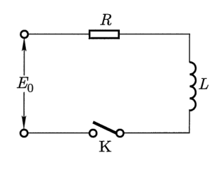
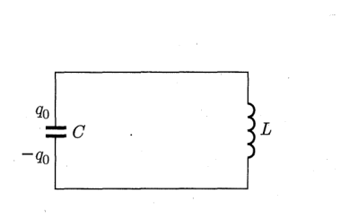
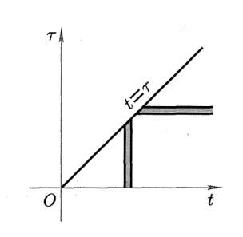
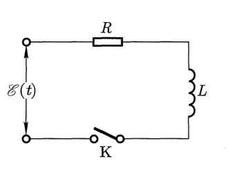
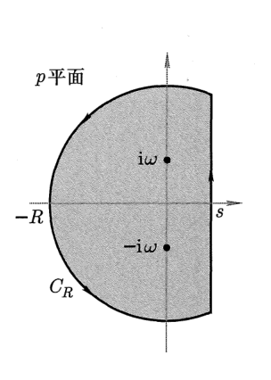
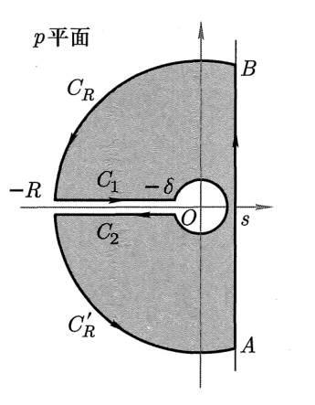
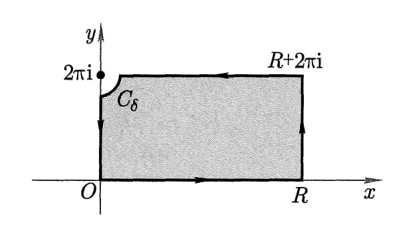
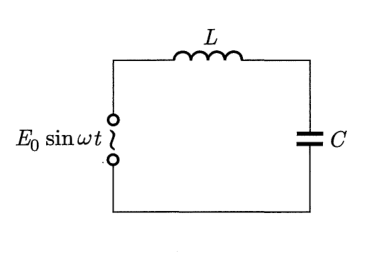
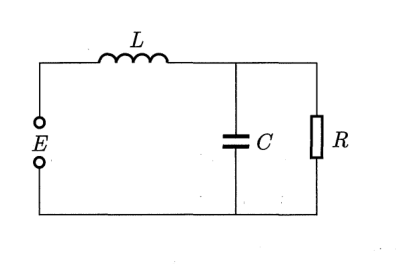

# 第八章 Laplace 变换

Laplace 变换是一种常用的积分变换。在数学、物理及工程科学中有广泛的应用。本章介绍 Laplace 变换的定义及其基本性质，以及它的简单应用。

## §8.1 Laplace 变换的定义

Laplace 变换（简称拉氏变换）是一种积分变换，它把定义在正实轴上的函数 $f(t)$ 变换为定义在复平面上的函数 $F(p)$，

$$
F(p)=\int_{0}^{\infty}\mathrm{e}^{-pt}f(t)\,\mathrm{d}t. \qquad (8.1)
$$

这里的 $t>0$ 是非负实数，$p=s+\mathrm{i}\sigma$ 是复数。$F(p)$ 称为 $f(t)$ 的 **Laplace 换式**，简称拉氏换式。$\mathrm{e}^{-pt}$ 是 Laplace 变换的核。通常把 Laplace 变换简写为

$$
F(p)=\mathcal{L}\{f(t)\} \qquad \text{或} \qquad F(p)\doteq f(t); \qquad (8.2)
$$

$$
f(t)=\mathcal{L}^{-1}\{F(p)\} \qquad \text{或} \qquad f(t)\doteq F(p). \qquad (8.3)
$$

$f(t)$ 和 $F(p)$ 有时也分别称为 Laplace 变换的原函数和像函数。已知原函数 $f(t)$，求像函数 $F(p)$ 称为对原函数 $f(t)$ 作 Laplace 变换；已知像函数 $F(p)$，求原函数 $f(t)$ 的运算称为反演。

需要说明，在本章中约定：当 $t<0$ 时应该理解为 $f(t)=0$，或者说，应该将 $f(t)$ 理解为 $f(t)\eta(t)$，其中

$$
\eta(t)=\begin{cases}1, & t>0,\\[4pt] 0, & t<0\end{cases} \qquad (8.4)
$$

是 Heaviside 的单位阶跃函数。相应地，$f(t-\tau)$ 就应该理解为 $f(t-\tau)\eta(t-\tau)$。

**练习 8.1** 证明：

$$
f(t-\tau)\doteq\mathrm{e}^{-p\tau}F(p),\ \tau>0; \qquad f(at)\doteq\frac{1}{a}F\left(\frac{p}{a}\right),\ a>0; \qquad \mathrm{e}^{p_{0}t}f(t)\doteq F(p-p_{0}).
$$

**例 8.1** 函数 $f(t)=1$ 的 Laplace 换式为

$$
1\doteq\int_{0}^{\infty}\mathrm{e}^{-pt}\,\mathrm{d}t=-\frac{1}{p}\left.\mathrm{e}^{-pt}\right|_{0}^{\infty}=\frac{1}{p}, \quad \operatorname{Re}p>0. \qquad (8.5)
$$

这里的限制条件 $\operatorname{Re}p>0$ 是为了保证积分收敛，换言之，也就是函数 $\eta(t)$ 的 Laplace 变换存在的条件。

**例 8.2** 函数 $f(t)=\mathrm{e}^{\alpha t}$ 的 Laplace 换式为

$$
\mathrm{e}^{\alpha t}\doteq\int_{0}^{\infty}\mathrm{e}^{-pt}\cdot\mathrm{e}^{\alpha t}\,\mathrm{d}t=\frac{1}{p-\alpha}, \quad \operatorname{Re}p>\operatorname{Re}\alpha. \qquad (8.6)
$$

这里的限制条件 $\operatorname{Re}p>\operatorname{Re}\alpha$，同样是为了保证积分收敛，即保证函数 $\mathrm{e}^{\alpha t}\eta(t)$ 的 Laplace 变换存在。

$f(t)$ 的 Laplace 变换存在的条件就是积分 $\displaystyle\int_{0}^{\infty}\mathrm{e}^{-pt}f(t)\,\mathrm{d}t$ 收敛的条件。由于 Laplace 变换的核是 $\mathrm{e}^{-pt}$，所以对于相当广泛的函数 $f(t)$，其拉氏换式都存在，甚至当 $t\to\infty$，$f(t)\to\infty$ 时（例如例 8.2 中的 $\mathrm{e}^{\alpha t}$，$\operatorname{Re}\alpha>0$），拉氏换式也可能存在。

在绝大多数实际问题中，$f(t)$ 都能满足

（1）$f(t)$ 在区间 $0\leqslant t<\infty$ 上除第一类间断点外都是连续的，且有连续导数，在任何有限区间内这种间断点的数目是有限的；

（2）$f(t)$ 有有限的增长指数，即存在正数 $M>0$，$t_{0}>0$ 及 $s'\geqslant 0$，使对于任何 $t>t_{0}$，

$$
|f(t)|<M\mathrm{e}^{s't}. \qquad (8.7)
$$

这是 Laplace 变换存在的充分条件。一般物理问题中遇到的函数都能满足这个要求。

当然，如果 $s'$ 存在，则 $s'$ 并不唯一，因为比 $s'$ 大的任何正数显然都符合要求。符合要求的 $s'$ 的下界称为收敛横标，记为 $s_{0}$。

## §8.2 Laplace 变换的基本性质

Laplace 变换具有下列基本性质：

**性质 1** Laplace 变换是一个线性变换，即若 $f_{1}(t)\doteq F_{1}(p)$，$f_{2}(t)\doteq F_{2}(p)$，则对任意复常数 $\alpha_{1}$ 和 $\alpha_{2}$，

$$
\alpha_{1}f_{1}(t)+\alpha_{2}f_{2}(t)\doteq\alpha_{1}F_{1}(p)+\alpha_{2}F_{2}(p). \qquad (8.8)
$$

这个性质很容易从 Laplace 变换的定义得到，因为它只不过是积分运算线性性质的反映。根据这个性质，立即得到

$$
\sin\omega t=\frac{\mathrm{e}^{\mathrm{i}\omega t}-\mathrm{e}^{-\mathrm{i}\omega t}}{2\mathrm{i}}\doteq\frac{1}{2\mathrm{i}}\left(\frac{1}{p-\mathrm{i}\omega}-\frac{1}{p+\mathrm{i}\omega}\right)=\frac{\omega}{p^{2}+\omega^{2}}; \qquad (8.9)
$$

$$
\cos\omega t=\frac{\mathrm{e}^{\mathrm{i}\omega t}+\mathrm{e}^{-\mathrm{i}\omega t}}{2}\doteq\frac{1}{2}\left(\frac{1}{p-\mathrm{i}\omega}+\frac{1}{p+\mathrm{i}\omega}\right)=\frac{p}{p^{2}+\omega^{2}}. \qquad (8.10)
$$

**性质 2** Laplace 换式的解析性。

如果函数 $f(t)$ 满足 Laplace 变换存在的充分条件，则

$$
|\mathrm{e}^{-pt}f(t)|<M\mathrm{e}^{-(s-s_{0})t}, \qquad s=\operatorname{Re}p.
$$

当 $s-s_{0}\geqslant\delta>0$ 时，

$$
|\mathrm{e}^{-pt}f(t)|<M\mathrm{e}^{-\delta t}.
$$

而积分 $\displaystyle\int_{0}^{\infty}M\mathrm{e}^{-\delta t}\,\mathrm{d}t$ 收敛，故 $\displaystyle\int_{0}^{\infty}\mathrm{e}^{-pt}f(t)\,\mathrm{d}t$ 在 $\operatorname{Re}p\geqslant s_{0}+\delta$ 上一致收敛，因而在 $\operatorname{Re}p>s_{0}$ 的半平面内代表一个解析函数，即 $F(p)$ 在半平面 $\operatorname{Re}p>s_{0}$ 内解析。

这个性质可以用来确定收敛横标 $s_{0}$。

**性质 3** 若 $f(t)$ 满足 Laplace 变换存在的充分条件，则

$$
F(p)\to 0, \quad \text{当}\ \operatorname{Re}p=s\to+\infty. \qquad (8.11)
$$

**证** 因为

$$
|F(p)|\leqslant\int_{0}^{\infty}\left|\mathrm{e}^{-pt}f(t)\right|\mathrm{d}t\leqslant M\int_{0}^{\infty}\mathrm{e}^{-(s-s_{0})t}\,\mathrm{d}t=\frac{M}{s-s_{0}}, \qquad s>s_{0},
$$

故当 $\operatorname{Re}p=s\to+\infty$ 时，$F(p)\to 0$。

此外，由 Riemann-Lebesgue 定理 ① 还可证明，当 $\operatorname{Re}p=s>s_{0}$ 时，

$$
\lim_{\operatorname{Im}p\to\pm\infty}F(p)=0.
$$

**性质 4** 原函数导数的 Laplace 变换。设 $f(t)$ 及 $f'(t)$ 的 Laplace 变换均存在，$f(t)\doteq F(p)$，则因为

$$
\int_{0}^{\infty}f'(t)\mathrm{e}^{-pt}\,\mathrm{d}t=\left.f(t)\mathrm{e}^{-pt}\right|_{0}^{\infty}+p\int_{0}^{\infty}f(t)\mathrm{e}^{-pt}\,\mathrm{d}t,
$$

所以

$$
f'(t)\doteq pF(p)-f(0). \qquad (8.12)
$$

同样，只要 $f(t),f'(t),\cdots,f^{(n)}(t)$ 的 Laplace 变换均存在，$f(t)\doteq F(p)$，则

$$
f''(t)\doteq p^{2}F(p)-pf(0)-f'(0), \qquad (8.13a)
$$

$$
f^{(3)}(t)\doteq p^{3}F(p)-p^{2}f(0)-pf'(0)-f''(0), \qquad (8.13b)
$$

$$
f^{(n)}(t)\doteq p^{n}F(p)-p^{n-1}f(0)-p^{n-2}f'(0)-\cdots-pf^{(n-2)}(0)-f^{(n-1)}(0). \qquad (8.13c)
$$

这个性质表明，对原函数 $f(t)$ 的微商运算就转化为对像函数 $F(p)$ 的乘法运算，而且还自动包括了 $f(t)$ 的初值。所以 Laplace 变换是求解常微分方程初值问题的一种重要方法。

**例 8.3** $LR$ 串联电路（图 8.1），假设在 K 合上前电路中没有电流，求 K 合上后电路中的电流。

**解** 根据 Kirchhoff 定律，可列出微分方程

---

① Riemann-Lebesgue 定理：如果积分 $\displaystyle\int_{a}^{b}f(t)\,\mathrm{d}t$ 存在，则

$$
\lim_{\omega\to\infty}\int_{a}^{b}f(t)\sin\omega t\,\mathrm{d}t=0, \qquad \lim_{\omega\to\infty}\int_{a}^{b}f(t)\cos\omega t\,\mathrm{d}t=0.
$$

读者可参阅参考书目 [7] 的（中译本）第 449 页。

$$
L\frac{\mathrm{d}i}{\mathrm{d}t}+Ri=E, \qquad (8.14a)
$$

$$
i(0)=0. \qquad (8.14b)
$$

设 $i(t)\doteq I(p)$，则

$$
\frac{\mathrm{d}i}{\mathrm{d}t}\doteq pI(p)-i(0)=pI(p).
$$

所以

$$
LpI(p)+RI(p)=\frac{E}{p}. \qquad (8.15)
$$

这样，经过 Laplace 变换，求解原函数 $i(t)$ 的常微分方程的定解问题（8.14）就转化为求解像函数 $I(p)$ 的代数方程（8.15），易得

$$
I(p)=\frac{E}{p}\frac{1}{Lp+R}=\frac{E}{R}\left(\frac{1}{p}-\frac{L}{Lp+R}\right).
$$

反演，得

$$
i(t)=\frac{E}{R}\left[1-\mathrm{e}^{-(R/L)t}\right]. \qquad (8.16)
$$

Laplace 变换不仅仅可以用于求解常微分方程的初值问题，也可以用来求解半无界空间常微分方程的边值问题。

**例 8.4** 求解下列定解问题

$$
y''(t)-y'(t)-2y(t)=0, \qquad t>0, \qquad (8.17a)
$$

$$
y(0)=1, \qquad \left.y(t)\right|_{t\to\infty}\ \text{有界}. \qquad (8.17b)
$$

**解** 设 $y(t)$ 的 Laplace 变换存在，$y(t)\doteq Y(p)$，相应地，

$$
y'(t)\doteq pY(p)-1, \qquad y''(t)\doteq p^{2}Y(p)-p-y'(0).
$$

在原题中并未给出 $y'(0)$ 值，不妨当作待定常数，下面我们将看到，它可以根据无穷远条件（$t\to\infty$ 时 $y(t)$ 有界）确定。于是，经过 Laplace 变换后，定解问题（8.17）变为

$$
\left[p^{2}Y(p)-p-y'(0)\right]-\left[pY(p)-1\right]-2Y(p)=0,
$$

解之得

$$
Y(p)=\frac{p-1+y'(0)}{p^{2}-p-2}=\frac{1}{3}\left(\frac{1}{p-2}+\frac{2}{p+1}\right)+\frac{1}{3}y'(0)\left(\frac{1}{p-2}-\frac{1}{p+1}\right).
$$

求反演，有

$$
y(t)=\frac{1}{3}\left[2-y'(0)\right]\mathrm{e}^{-t}+\frac{1}{3}\left[1+y'(0)\right]\mathrm{e}^{2t}.
$$

因 $t\to\infty$ 时 $\mathrm{e}^{2t}$ 无界，故由无穷远条件，可以定出 $y'(0)=-1$。所以最后就求得

$$
y(t)=\mathrm{e}^{-t}.
$$

**性质 5** 原函数积分的 Laplace 变换。设 $f(t)$ 满足 Laplace 变换存在的充分条件，则

$$
\left|\int_{0}^{t}f(\tau)\,\mathrm{d}\tau\right|\leqslant\int_{0}^{t}|f(\tau)|\,\mathrm{d}\tau\leqslant\int_{0}^{t}M\mathrm{e}^{s_{0}\tau}\,\mathrm{d}\tau=\frac{M}{s_{0}}\left(\mathrm{e}^{s_{0}t}-1\right),
$$

所以 $\displaystyle\int_{0}^{t}f(\tau)\,\mathrm{d}\tau$ 的 Laplace 变换也存在，记

$$
f(t)\doteq F(p), \qquad \int_{0}^{t}f(\tau)\,\mathrm{d}\tau\doteq\mathcal{L}\left\{\int_{0}^{t}f(\tau)\,\mathrm{d}\tau\right\}.
$$

因为 $\displaystyle\frac{\mathrm{d}}{\mathrm{d}t}\int_{0}^{t}f(\tau)\,\mathrm{d}\tau=f(t)$，根据性质 4，就有

$$
F(p)=p\mathcal{L}\left\{\int_{0}^{t}f(\tau)\,\mathrm{d}\tau\right\}-0.
$$

所以

$$
\int_{0}^{t}f(\tau)\,\mathrm{d}\tau\doteq\frac{F(p)}{p}. \qquad (8.18)
$$

**练习 8.2** 证明：

$$
\int_{0}^{\infty}f(t,\tau)\,\mathrm{d}\tau\doteq\int_{0}^{\infty}F(p,\tau)\,\mathrm{d}\tau, \qquad \frac{\partial f(x,t)}{\partial x}\doteq\frac{\mathrm{d}F(x,p)}{\mathrm{d}x}, \qquad \int_{t}^{\infty}\frac{f(\tau)}{\tau}\,\mathrm{d}\tau\doteq\frac{1}{p}\int_{0}^{p}F(q)\,\mathrm{d}q,
$$

假定有关的积分均存在。

**例 8.5** 求 $LC$ 串联电路（见图 8.2）中电流随时间的变化。

**解** 因为

$$
\frac{q(t)}{C}=L\frac{\mathrm{d}i}{\mathrm{d}t}, \qquad (8.19a)
$$

$$
q(t)=-\int_{0}^{t}i(\tau)\,\mathrm{d}\tau+q_{0}, \qquad (8.19b)
$$

所以

$$
L\frac{\mathrm{d}i}{\mathrm{d}t}+\frac{1}{C}\int_{0}^{t}i(\tau)\,\mathrm{d}\tau=\frac{q_{0}}{C}.
$$

这是关于未知函数 $i(t)$ 的微分积分方程。设 $i(t)\doteq I(p)$，则有

$$
LpI(p)+\frac{1}{C}\frac{I(p)}{p}=\frac{q_{0}}{C}\frac{1}{p}.
$$

所以求解微分积分方程的定解问题（8.19）也就转化为求解代数方程

$$
I(p)=\frac{q_{0}}{LCp^{2}+1}.
$$

利用（8.9）式求反演，即得

$$
i(t)=\frac{q_{0}}{\sqrt{LC}}\sin\frac{t}{\sqrt{LC}}. \qquad (8.20)
$$

还值得对上面得到的（8.18）式做进一步的分析。如果我们将该式改写成

$$
\int_{0}^{\infty}f(t)\mathrm{e}^{-pt}\,\mathrm{d}t=p\int_{0}^{\infty}g(t)\mathrm{e}^{-pt}\,\mathrm{d}t, \qquad \text{其中}\ g(t)=\int_{0}^{t}f(\tau)\,\mathrm{d}\tau, \qquad (8.18')
$$

上面的推导表明，只要 $f(t)$ 满足 Laplace 变换存在的充分条件，则 $g(t)$ 的 Laplace 变换就存在；反过来说，只要 $g(t)$ 的 Laplace 变换存在，而且 $g(t)$ 可导，则 $g'(t)$ 就一定满足 Laplace 变换存在的充分条件。因此我们在讨论 Laplace 变换的性质时，包括下面在讨论 Laplace 变换的反演时，常常假设原函数满足 Laplace 变换存在的充分条件（或者等价地，假设像函数在 $\operatorname{Re}p\geqslant s_{1}>s_{0}$ 的半平面上解析）。这一要求实际上可以减弱，在通常情况下，要求原函数的 Laplace 变换存在即可。

## §8.3 Laplace 变换的反演

求 Laplace 变换的反演，首先就遇到反演的唯一性问题，即对于任意给定的像函数 $F(p)$，是否可能存在不止一个原函数？例如是否可能存在两个不同的原函数 $f_{1}(t)$ 和 $f_{2}(t)$，使得

$$
f_{1}(t)\doteq F(p), \qquad f_{2}(t)\doteq F(p). \qquad (8.21)
$$

或者说，是否存在函数 $g(t)\equiv f_{1}(t)-f_{2}(t)\neq 0$，使得

$$
g(t)\doteq 0. \qquad (8.22)
$$

回答是：如果限定 $g(t)$ 为连续函数，则由（8.22）式一定能推出 $g(t)\equiv 0$；但若许可 $g(t)$ 不连续，则 $g(t)$ 可以不恒为 0，但是几乎处处为 0（例如在有限个点处不为 0，而在其余点均为 0）。如果我们也将这种函数称为“零函数”，则对应于同一个 $F(p)$，它的原函数可以有无穷多个，彼此间相差一个零函数。但是，如果限定原函数为连续函数，则 Laplace 变换的反演具有唯一性。以下的讨论中，我们将约定原函数均为连续函数。

**像函数导数的反演** 设 $f(t)$ 满足 Laplace 变换存在的充分条件，$f(t)\doteq F(p)$，则 $F(p)$ 在 $\operatorname{Re}p\geqslant s_{1}>s_{0}$ 的半平面上解析，因而可以在积分号下求导：

$$
F^{(n)}(p)=\frac{\mathrm{d}^{n}}{\mathrm{d}p^{n}}\int_{0}^{\infty}f(t)\mathrm{e}^{-pt}\,\mathrm{d}t=\int_{0}^{\infty}(-t)^{n}f(t)\mathrm{e}^{-pt}\,\mathrm{d}t.
$$

所以

$$
F^{(n)}(p)\doteq(-t)^{n}f(t). \qquad (8.23)
$$

根据这个公式，可以得到

$$
\frac{1}{p^{2}}=-\frac{\mathrm{d}}{\mathrm{d}p}\frac{1}{p}\doteq t, \qquad (8.24)
$$

$$
\frac{1}{p^{3}}=\frac{1}{2}\frac{\mathrm{d}^{2}}{\mathrm{d}p^{2}}\frac{1}{p}\doteq\frac{1}{2}t^{2}. \qquad (8.25)
$$

这样，若 $F(p)$ 是有理函数，则总可以通过部分分式求反演。例如

$$
\begin{aligned}
\frac{1}{p^{3}(p+\alpha)}&=\frac{1}{\alpha}\frac{1}{p^{3}}-\frac{1}{\alpha^{2}}\frac{1}{p^{2}}+\frac{1}{\alpha^{3}}\frac{1}{p}-\frac{1}{\alpha^{3}}\frac{1}{p+\alpha}\\
&\doteq\frac{1}{2\alpha}t^{2}-\frac{1}{\alpha^{2}}t+\frac{1}{\alpha^{3}}-\frac{1}{\alpha^{3}}\mathrm{e}^{-\alpha t}.
\end{aligned} \qquad (8.26)
$$

**像函数的积分的反演** 如果 $\displaystyle G(p)=\int_{p}^{\infty}F(q)\,\mathrm{d}q$ 存在 ①，且当 $t\to 0$ 时，$|f(t)/t|$ 有界，则

$$
\int_{p}^{\infty}F(q)\,\mathrm{d}q\doteq\frac{f(t)}{t}. \qquad (8.27)
$$

**证** 设 $G(p)\doteq g(t)$，则因为 $G'(p)=-F(p)$，故有

$$
(-t)g(t)=-f(t),
$$

因此即证得（8.27）式。

利用这个公式，又可以得到许多函数的 Laplace 变换。例如，

$$
\frac{\sin\omega t}{t}\doteq\int_{p}^{\infty}\frac{\omega}{q^{2}+\omega^{2}}\,\mathrm{d}q=\frac{\pi}{2}-\arctan\frac{p}{\omega}. \qquad (8.28)
$$

特别是，如果 $p\to 0$ 时，（8.27）式两端的积分均存在，则有

$$
\int_{0}^{\infty}F(p)\,\mathrm{d}p=\int_{0}^{\infty}\frac{f(t)}{t}\,\mathrm{d}t. \qquad (8.29)
$$

利用这个结果，可以计算 $\displaystyle\int_{0}^{\infty}\frac{f(t)}{t}\,\mathrm{d}t$ 型的积分。例如

$$
\int_{0}^{\infty}\frac{\sin t}{t}\,\mathrm{d}t=\int_{0}^{\infty}\frac{1}{p^{2}+1}\,\mathrm{d}p=\frac{\pi}{2}. \qquad (8.30)
$$

这个积分曾经应用留数定理计算过。但是这里的计算更为简便。

同样，还可以计算

$$
\begin{aligned}
\int_{0}^{\infty}\frac{\cos at-\cos bt}{t}\,\mathrm{d}t&=\int_{0}^{\infty}\left(\frac{p}{p^{2}+a^{2}}-\frac{p}{p^{2}+b^{2}}\right)\mathrm{d}p\\
&=\frac{1}{2}\left.\ln\frac{p^{2}+a^{2}}{p^{2}+b^{2}}\right|_{0}^{\infty}=\ln b-\ln a, \qquad a>0,\ b>0.
\end{aligned} \qquad (8.31)
$$

**像函数在 $\infty$ 点解析的情形** 现在研究一个更特殊的情形，它特别容易求出原函数。如果可以将 $F(p)$ 由半平面 $\operatorname{Re}p>s_{0}$（单值地）解析延拓到含有 $p=\infty$ 点在内的一定区域内，且 $F(p)$ 在 $p=\infty$ 点解析，这样，函数 $F(p)$ 就可以在 $p=\infty$ 点作 Taylor 级数展开：

$$
F(p)=\sum_{n=1}^{\infty}c_{n}p^{-n}. \qquad (8.32)
$$

---

① 这里的积分上限应理解为 $\operatorname{Re}p\to+\infty$，并且积分路径在 $F(p)$ 的解析区域内，因而积分值与路径无关。

级数中不含 $n=0$ 项，是因为 $F(p)$ 作为 Laplace 换式，应当满足 $\operatorname{Re}p\to+\infty$ 时 $F(p)\to 0$ 的要求。将级数逐项求反演，就得到

$$
f(t)=\sum_{n=0}^{\infty}\frac{c_{n+1}}{n!}t^{n}. \qquad (8.33)
$$

考察这种做法的合法性在于证明级数收敛。为此作圆周 $C_{R}:|p|=R$，在 $C_{R}$ 外 $F(p)$ 解析，

$$
c_{n}=\frac{1}{2\pi\mathrm{i}}\oint_{C_{R}}F(p)p^{n-1}\,\mathrm{d}p.
$$

因为 $p=\infty$ 是 $F(p)$ 的零点，故当 $|p|>R$ 时，$|F(p)|<M/R$，因而 $|c_{n}|<MR^{n-1}$。由此即得

$$
\left|\sum_{n=0}^{\infty}\frac{c_{n+1}}{n!}t^{n}\right|\leqslant\sum_{n=0}^{\infty}\frac{|c_{n+1}|}{n!}|t|^{n}<M\sum_{n=0}^{\infty}\frac{1}{n!}R^{n}|t|^{n}=M\mathrm{e}^{R|t|},
$$

故级数收敛。这里同时也证明了 $f(t)$ 具有有限的增长指数，因而 Laplace 变换存在。

应用这个方法可以求出函数 $1/\sqrt{p^{2}+1}$ 的反演。这是一个多值函数，如果规定单值分支 $\left.1/\sqrt{p^{2}+1}\right|_{p\to\infty}\to 1/p$，则有

$$
\frac{1}{\sqrt{p^{2}+1}}=\sum_{k=0}^{\infty}(-)^{k}\frac{(2k)!}{2^{2k}(k!)^{2}}\frac{1}{p^{2k+1}}\doteq\sum_{k=0}^{\infty}(-)^{k}\frac{1}{2^{2k}(k!)^{2}}t^{2k}=\sum_{k=0}^{\infty}\frac{(-)^{k}}{k!k!}\left(\frac{t}{2}\right)^{2k}. \qquad (8.34)
$$

这正是 §5.5 例 5.9 中见到过的 Bessel 函数 $\mathrm{J}_{0}(t)$。

另一个例子是

$$
\frac{1}{p}\mathrm{e}^{-1/p}=\sum_{n=0}^{\infty}(-)^{n}\frac{1}{n!}\frac{1}{p^{n+1}}\doteq\sum_{n=0}^{\infty}\frac{(-)^{n}}{n!n!}t^{n}=\mathrm{J}_{0}\left(2\sqrt{t}\right). \qquad (8.35)
$$

如果 $F(p)$ 可以分解为 $F_{1}(p)$ 和 $F_{2}(p)$ 之积，其反演问题就需要用到下面的卷积定理。

**定理 8.1（卷积定理）** 设 $F_{1}(p)\doteq f_{1}(t)$，$F_{2}(p)\doteq f_{2}(t)$，则

$$
F_{1}(p)F_{2}(p)\doteq\int_{0}^{t}f_{1}(\tau)f_{2}(t-\tau)\,\mathrm{d}\tau. \qquad (8.36)
$$

**证** 因为

$$
F_{1}(p)=\int_{0}^{\infty}f_{1}(t)\mathrm{e}^{-pt}\,\mathrm{d}t, \qquad F_{2}(p)=\int_{0}^{\infty}f_{2}(t)\mathrm{e}^{-pt}\,\mathrm{d}t,
$$

所以，

$$
\begin{aligned}
F_{1}(p)F_{2}(p)&=\int_{0}^{\infty}f_{1}(\tau)\mathrm{e}^{-p\tau}\,\mathrm{d}\tau\int_{0}^{\infty}f_{2}(\nu)\mathrm{e}^{-p\nu}\,\mathrm{d}\nu\\
&=\int_{0}^{\infty}f_{1}(\tau)\,\mathrm{d}\tau\int_{0}^{\infty}f_{2}(\nu)\mathrm{e}^{-p(\tau+\nu)}\,\mathrm{d}\nu\\
&=\int_{0}^{\infty}f_{1}(\tau)\,\mathrm{d}\tau\int_{\tau}^{\infty}f_{2}(t-\tau)\mathrm{e}^{-pt}\,\mathrm{d}t,
\end{aligned}
$$

在 $Ot\tau$ 平面上画出积分区域（见图 8.3），改变积分次序，即得

$$
F_{1}(p)F_{2}(p)=\int_{0}^{\infty}\mathrm{e}^{-pt}\,\mathrm{d}t\int_{0}^{t}f_{1}(\tau)f_{2}(t-\tau)\,\mathrm{d}\tau,
$$

定理得证。

**例 8.6** 在 $LR$ 串联电路（见图 8.4）中加一方形脉冲电压

$$
\mathscr{E}(t)=\begin{cases}E_{0}, & 0\leqslant t\leqslant T,\\[4pt] 0, & t>T.\end{cases} \qquad (8.37)
$$

求电路中的电流 $i(t)$，设 $i(0)=0$。

**解** 列方程

$$
L\frac{\mathrm{d}i}{\mathrm{d}t}+Ri=\mathscr{E}(t),
$$

$$
i(0)=0.
$$

作 Laplace 变换：设 $i(t)\doteq I(p)$，$\mathscr{E}(t)\doteq E(p)$，则

$$
LpI(p)+RI(p)=E(p), \qquad \text{即}\qquad I(p)=\frac{1}{Lp+R}\cdot E(p).
$$

所以

$$
i(t)=\int_{0}^{t}\mathscr{E}(\tau)\frac{1}{L}\mathrm{e}^{-R(t-\tau)/L}\,\mathrm{d}\tau=\begin{cases}\dfrac{E_{0}}{R}\left(1-\mathrm{e}^{-Rt/L}\right), & 0\leqslant t\leqslant T,\\[10pt] \dfrac{E_{0}}{R}\left(\mathrm{e}^{RT/L}-1\right)\mathrm{e}^{-Rt/L}, & t>T.\end{cases}
$$

由上述计算过程可以看出，应用卷积定理，在整个求解过程中我们无需求出方程非齐次项 $\mathscr{E}(t)$ 的像函数 $E(p)$ 的具体表达式。

## §8.4 普遍反演公式

若函数 $F(p)=F(s+\mathrm{i}\sigma)$ 在区域 $\operatorname{Re}p>s_{0}$ 内满足：（1）$F(p)$ 解析，（2）当 $|p|\to\infty$ 时 $F(p)$ 趋于 0，（3）对于所有的 $\operatorname{Re}p=s>s_{0}$，沿直线 $L:\operatorname{Re}p=s$ 的无穷积分

$$
\int_{s-\mathrm{i}\infty}^{s+\mathrm{i}\infty}|F(p)|\,\mathrm{d}\sigma \qquad (s>s_{0})
$$

收敛，则对于 $\operatorname{Re}p=s>s_{0}$，$F(p)$ 的原函数为

$$
f(t)=\frac{1}{2\pi\mathrm{i}}\int_{s-\mathrm{i}\infty}^{s+\mathrm{i}\infty}F(p)\mathrm{e}^{pt}\,\mathrm{d}p. \qquad (8.38)
$$

证明从略。读者可参阅参考书目 [29] 的 8.2 节；或见本书（第一版）§10.4。也可转换为 Fourier 变换而证明，见参考书目 [1] 的 10.7 节。

**例 8.7** 用普遍反演公式求 Laplace 换式 $F(p)=1/(p^{2}+\omega^{2})^{2}\ (\omega>0)$ 的原函数。

**解** 由普遍反演公式，此像函数的原函数为

$$
f(t)=\frac{1}{2\pi\mathrm{i}}\int_{s-\mathrm{i}\infty}^{s+\mathrm{i}\infty}\frac{1}{(p^{2}+\omega^{2})^{2}}\mathrm{e}^{pt}\,\mathrm{d}p.
$$

函数 $1/(p^{2}+\omega^{2})^{2}$ 的孤立奇点都在虚轴上，所以取 $s>0$ 即可。因为 $t<0$ 时一定有 $f(t)=0$，故只需讨论 $t>0$ 的情形。此时可取围道如图 8.5 所示。由于

$$
\lim_{p\to\infty}\frac{1}{(p^{2}+\omega^{2})^{2}}=0,
$$

所以，根据推广的 Jordan 引理 ①，可以断定

$$
\lim_{R\to\infty}\int_{C_{R}}\frac{1}{(p^{2}+\omega^{2})^{2}}\mathrm{e}^{pt}\,\mathrm{d}p=0.
$$

这样，由留数定理，就得到

$$
\begin{aligned}
f(t)&=\frac{1}{2\pi\mathrm{i}}\int_{s-\mathrm{i}\infty}^{s+\mathrm{i}\infty}\frac{1}{(p^{2}+\omega^{2})^{2}}\mathrm{e}^{pt}\,\mathrm{d}p=\sum_{\text{全平面}}\operatorname{res}\left\{\frac{1}{(p^{2}+\omega^{2})^{2}}\mathrm{e}^{pt}\right\}\\
&=\left\{\left[\frac{t}{(p+\mathrm{i}\omega)^{2}}-\frac{2}{(p+\mathrm{i}\omega)^{3}}\right]\mathrm{e}^{pt}\right\}_{p=\mathrm{i}\omega}+\left\{\left[\frac{t}{(p-\mathrm{i}\omega)^{2}}-\frac{2}{(p-\mathrm{i}\omega)^{3}}\right]\mathrm{e}^{pt}\right\}_{p=-\mathrm{i}\omega}\\
&=\frac{1}{2\omega^{3}}\left(\sin\omega t-\omega t\cos\omega t\right).
\end{aligned} \qquad (8.39)
$$

**例 8.8** 用普遍反演公式求 Laplace 换式 $F(p)=\dfrac{1}{\sqrt{p}}\mathrm{e}^{-\alpha\sqrt{p}}$，$\alpha>0$ 的原函数。

**解** 由普遍反演公式，原函数为

$$
\frac{1}{2\pi\mathrm{i}}\int_{s-\mathrm{i}\infty}^{s+\mathrm{i}\infty}\frac{1}{\sqrt{p}}\mathrm{e}^{-\alpha\sqrt{p}}\mathrm{e}^{pt}\,\mathrm{d}p.
$$

其中的积分路径 $L:\operatorname{Re}p=s>0$ 是右半平面上的一条平行于虚轴的无穷直线。考虑到被积函数是多值函数，$p=0$ 和 $p=\infty$ 是分支点，为保证像函数在积分路径 $L$ 右侧解析，从 $p=0$ 沿负实轴到 $p=\infty$ 作割线。因此，在应用留数定理计算这个积分时，应该取积分围道如图 8.6 所示。因为在积分围道内解析，所以

$$
\begin{aligned}
&\oint_{C}\frac{1}{\sqrt{p}}\mathrm{e}^{-\alpha\sqrt{p}}\mathrm{e}^{pt}\,\mathrm{d}p\\
&\quad=\int_{A}^{B}\frac{1}{\sqrt{p}}\mathrm{e}^{-\alpha\sqrt{p}}\mathrm{e}^{pt}\,\mathrm{d}p+\int_{C_{R}}\frac{1}{\sqrt{p}}\mathrm{e}^{-\alpha\sqrt{p}}\mathrm{e}^{pt}\,\mathrm{d}p\\
&\quad\quad+\int_{C_{1}}\frac{1}{\sqrt{p}}\mathrm{e}^{-\alpha\sqrt{p}}\mathrm{e}^{pt}\,\mathrm{d}p+\int_{C_{\delta}}\frac{1}{\sqrt{p}}\mathrm{e}^{-\alpha\sqrt{p}}\mathrm{e}^{pt}\,\mathrm{d}p\\
&\quad\quad+\int_{C_{2}}\frac{1}{\sqrt{p}}\mathrm{e}^{-\alpha\sqrt{p}}\mathrm{e}^{pt}\,\mathrm{d}p+\int_{C_{R}'}\frac{1}{\sqrt{p}}\mathrm{e}^{-\alpha\sqrt{p}}\mathrm{e}^{pt}\,\mathrm{d}p=0.
\end{aligned}
$$

在 $C_{1}$ 和 $C_{2}$ 上，$\arg p=\pm\pi$，故可分别令 $p=r\mathrm{e}^{\pm\mathrm{i}\pi}$ 而得到

$$
\int_{C_{1}}\frac{1}{\sqrt{p}}\mathrm{e}^{-\alpha\sqrt{p}}\mathrm{e}^{pt}\,\mathrm{d}p=-\mathrm{i}\int_{\delta}^{R}\frac{1}{\sqrt{r}}\mathrm{e}^{-\mathrm{i}\alpha\sqrt{r}}\mathrm{e}^{-rt}\,\mathrm{d}r,
$$

$$
\int_{C_{2}}\frac{1}{\sqrt{p}}\mathrm{e}^{-\alpha\sqrt{p}}\mathrm{e}^{pt}\,\mathrm{d}p=-\mathrm{i}\int_{\delta}^{R}\frac{1}{\sqrt{r}}\mathrm{e}^{\mathrm{i}\alpha\sqrt{r}}\mathrm{e}^{-rt}\,\mathrm{d}r.
$$

又，由推广的 Jordan 引理 ①，可知

$$
\lim_{R\to\infty}\int_{C_{R}}\frac{1}{\sqrt{p}}\mathrm{e}^{-\alpha\sqrt{p}}\mathrm{e}^{pt}\,\mathrm{d}p=0, \qquad \lim_{R\to\infty}\int_{C_{R}'}\frac{1}{\sqrt{p}}\mathrm{e}^{-\alpha\sqrt{p}}\mathrm{e}^{pt}\,\mathrm{d}p=0.
$$

根据引理 3.4，也有

$$
\lim_{\delta\to0}\int_{C_{\delta}}\frac{1}{\sqrt{p}}\mathrm{e}^{-\alpha\sqrt{p}}\mathrm{e}^{pt}\,\mathrm{d}p=0.
$$

所以，在取极限 $R\to\infty$，$\delta\to0$ 后，就有

$$
\frac{1}{\sqrt{p}}\mathrm{e}^{-\alpha\sqrt{p}}\doteq\frac{1}{2\pi}\int_{0}^{\infty}\frac{1}{\sqrt{r}}\left[\mathrm{e}^{\mathrm{i}\alpha\sqrt{r}}+\mathrm{e}^{-\mathrm{i}\alpha\sqrt{r}}\right]\mathrm{e}^{-rt}\,\mathrm{d}r=\frac{2}{\pi}\int_{0}^{\infty}\mathrm{e}^{-x^{2}t}\cos\alpha x\,\mathrm{d}x,
$$

代入（4.29）式的结果即得

$$
\frac{1}{\sqrt{p}}\mathrm{e}^{-\alpha\sqrt{p}}\doteq\frac{1}{\sqrt{\pi t}}\mathrm{e}^{-\alpha^{2}/4t}. \qquad (8.40)
$$

---

① 这里所谓推广的 Jordan 引理，指的是将原始的 Jordan 引理（见 §6.4）作了如下的变化与扩充：

（1）将 Jordan 引理所讨论的圆弧旋转了 $90^{\circ}$。

（2）现在的圆弧是和直线 $L:\operatorname{Re}p=s>0$ 相交，所以要略大于半圆弧。但可以证明（从略），只要圆弧与虚轴的距离（即 $s$）固定（因而当圆弧的半径 $R\to\infty$ 时，虚轴右方圆弧的张角 $\to 0$），则引理仍然成立。

在这个结果的基础上就可以证明下列公式：

$$
\begin{aligned}
\frac{1}{\sqrt{\pi t}}\int_{0}^{\infty}f(\tau)\mathrm{e}^{-\tau^{2}/4t}\,\mathrm{d}\tau&\doteq\int_{0}^{\infty}\mathrm{e}^{-pt}\left\{\frac{1}{\sqrt{\pi t}}\int_{0}^{\infty}f(\tau)\mathrm{e}^{-\tau^{2}/4t}\,\mathrm{d}\tau\right\}\mathrm{d}t\\
&=\int_{0}^{\infty}f(\tau)\left\{\int_{0}^{\infty}\frac{1}{\sqrt{\pi t}}\mathrm{e}^{-\tau^{2}/4t}\mathrm{e}^{-pt}\,\mathrm{d}t\right\}\mathrm{d}\tau\\
&=\int_{0}^{\infty}f(\tau)\frac{1}{\sqrt{p}}\mathrm{e}^{-\tau\sqrt{p}}\,\mathrm{d}\tau=\frac{1}{\sqrt{p}}F(\sqrt{p}).
\end{aligned} \qquad (8.41)
$$

**例 8.9** 求 $\dfrac{1}{p}\mathrm{e}^{-\alpha\sqrt{p}}$，$\alpha>0$ 的原函数。

**解** 在（8.41）式中代入 $F(p)=\dfrac{1}{p}\mathrm{e}^{-\alpha p}$，并注意 $\dfrac{1}{p}\mathrm{e}^{-\alpha p}\doteq\eta(t-\alpha)$，就有

$$
\frac{1}{p}\mathrm{e}^{-\alpha\sqrt{p}}\doteq\frac{1}{\sqrt{\pi t}}\int_{0}^{\infty}\eta(\tau-\alpha)\mathrm{e}^{-\tau^{2}/4t}\,\mathrm{d}\tau=\frac{1}{\sqrt{\pi t}}\int_{\alpha}^{\infty}\mathrm{e}^{-\tau^{2}/4t}\,\mathrm{d}\tau,
$$

由此即得

$$
\frac{1}{p}\mathrm{e}^{-\alpha\sqrt{p}}\doteq\operatorname{erfc}\frac{\alpha}{2\sqrt{t}}, \qquad (8.42)
$$

其中的 $\operatorname{erfc}x$ 称为余误差函数，定义为

$$
\operatorname{erfc}x=\frac{2}{\sqrt{\pi}}\int_{x}^{\infty}\mathrm{e}^{-\xi^{2}}\,\mathrm{d}\xi. \qquad (8.43)
$$

相关的还有误差函数 $\operatorname{erf}x$，

$$
\operatorname{erf}x=1-\operatorname{erfc}x=\frac{2}{\sqrt{\pi}}\int_{0}^{x}\mathrm{e}^{-\xi^{2}}\,\mathrm{d}\xi. \qquad (8.44)
$$

## *§8.5 利用 Laplace 变换计算级数和

Laplace 变换也可以用来计算某些级数 $\sum F(n)$ 之和。基本思路是利用 Laplace 变换

$$
F(p)=\int_{0}^{\infty}f(t)\mathrm{e}^{-pt}\,\mathrm{d}t,
$$

将级数的通项表示成积分，而后交换积分和级数求和的次序，

$$
\sum F(n)=\sum\int_{0}^{\infty}f(t)\mathrm{e}^{-nt}\,\mathrm{d}t=\int_{0}^{\infty}f(t)\left(\sum\mathrm{e}^{-nt}\right)\mathrm{d}t, \qquad (8.45)
$$

从而将级数求和的问题转化为计算定积分。由于函数 $\mathrm{e}^{-nt}$ 的存在，一般情况下常常可以保证交换积分与求和次序是合法的。

在计算中常用到的 Laplace 变换的结果有

$$
\int_{0}^{\infty}\mathrm{e}^{\alpha t}\mathrm{e}^{-pt}\,\mathrm{d}t=\frac{1}{p-\alpha}, \qquad \int_{0}^{\infty}t^{\alpha-1}\mathrm{e}^{-pt}\,\mathrm{d}t=\frac{\Gamma(\alpha)}{p^{\alpha}},
$$

$$
\int_{0}^{\infty}\mathrm{e}^{-pt}\sin\omega t\,\mathrm{d}t=\frac{\omega}{p^{2}+\omega^{2}}, \qquad \int_{0}^{\infty}\mathrm{e}^{-pt}\cos\omega t\,\mathrm{d}t=\frac{p}{p^{2}+\omega^{2}},
$$

$$
\int_{0}^{\infty}\mathrm{e}^{-pt}\sinh at\,\mathrm{d}t=\frac{a}{p^{2}-a^{2}}, \qquad \int_{0}^{\infty}\mathrm{e}^{-pt}\cosh at\,\mathrm{d}t=\frac{p}{p^{2}-a^{2}}.
$$

**例 8.10** 求级数 $\displaystyle\sum_{n=1}^{\infty}\frac{1}{n^{2}}$ 之和。

**解** 此级数和在第 6 章已经计算过（见例 6.14），现在改用 Laplace 变换方法计算。

容易将待求级数化为积分：

$$
\sum_{n=1}^{\infty}\frac{1}{n^{2}}=\sum_{n=1}^{\infty}\int_{0}^{\infty}x\mathrm{e}^{-nx}\,\mathrm{d}x=\int_{0}^{\infty}\frac{x\mathrm{e}^{-x}}{1-\mathrm{e}^{-x}}\,\mathrm{d}x=\int_{0}^{\infty}\frac{x}{\mathrm{e}^{x}-1}\,\mathrm{d}x.
$$

下面就用留数定理计算这个积分。取积分围道如图 8.7 所示，则

$$
\begin{aligned}
\oint_{C}\frac{z^{2}}{\mathrm{e}^{z}-1}\,\mathrm{d}z&=\int_{0}^{R}\frac{x^{2}}{\mathrm{e}^{x}-1}\,\mathrm{d}x+\int_{0}^{2\pi}\frac{(R+\mathrm{i}y)^{2}}{\mathrm{e}^{R+\mathrm{i}y}-1}\mathrm{i}\,\mathrm{d}y+\int_{R}^{\delta}\frac{(x+2\pi\mathrm{i})^{2}}{\mathrm{e}^{x}-1}\,\mathrm{d}x\\
&\quad+\int_{C_{\delta}}\frac{z^{2}}{\mathrm{e}^{z}-1}\,\mathrm{d}z+\int_{2\pi-\delta}^{0}\frac{(\mathrm{i}y)^{2}}{\mathrm{e}^{\mathrm{i}y}-1}\,\mathrm{d}z=0.
\end{aligned}
$$

取极限 $R\to\infty$，$\delta\to0$，因为

$$
\lim_{R\to\infty}\int_{0}^{2\pi}\frac{(R+\mathrm{i}y)^{2}}{\mathrm{e}^{R+\mathrm{i}y}-1}\mathrm{i}\,\mathrm{d}y=0,
$$

$$
\lim_{\delta\to0}\int_{C_{\delta}}\frac{z^{2}}{\mathrm{e}^{z}-1}\,\mathrm{d}z=-\frac{\pi\mathrm{i}}{2}\cdot(2\pi\mathrm{i})^{2}=2\pi^{3}\mathrm{i},
$$

所以就得到

$$
\int_{0}^{\infty}\frac{4\pi\mathrm{i}x-4\pi^{2}}{\mathrm{e}^{x}-1}\,\mathrm{d}x-\int_{0}^{2\pi}\frac{y^{2}}{\mathrm{e}^{\mathrm{i}y}-1}\mathrm{i}\,\mathrm{d}y=2\pi^{3}\mathrm{i}.
$$

注意

$$
\int_{0}^{2\pi}\frac{y^{2}}{\mathrm{e}^{\mathrm{i}y}-1}\mathrm{i}\,\mathrm{d}y=\int_{0}^{2\pi}\frac{y^{2}\mathrm{e}^{-\mathrm{i}y/2}}{2\sin(y/2)}\,\mathrm{d}y,
$$

所以比较上式的虚部，即得

$$
4\pi\int_{0}^{\infty}\frac{x}{\mathrm{e}^{x}-1}\,\mathrm{d}x+\frac{1}{2}\int_{0}^{2\pi}y^{2}\,\mathrm{d}y=2\pi^{3},
$$

于是就求得

$$
\int_{0}^{\infty}\frac{x}{\mathrm{e}^{x}-1}\,\mathrm{d}x=-\frac{1}{3}\pi^{2}+\frac{1}{2}\pi^{2}=\frac{\pi^{2}}{6},
$$

亦即

$$
\sum_{n=1}^{\infty}\frac{1}{n^{2}}=\frac{\pi^{2}}{6}. \qquad (8.46)
$$

**例 8.11** 求级数 $\displaystyle\sum_{n=1}^{\infty}\frac{1}{n^{4}}$ 之和。

**解** 类似于上题，我们有

$$
\sum_{n=1}^{\infty}\frac{1}{n^{4}}=\frac{1}{6}\int_{0}^{\infty}\frac{x^{3}}{\mathrm{e}^{x}-1}\,\mathrm{d}x.
$$

考虑复变积分 $\displaystyle\oint_{C}\frac{z^{4}}{\mathrm{e}^{z}-1}\mathrm{d}z$，积分围道 $C$ 如图 8.7 所示。因为在积分内无奇点，所以

$$
\begin{aligned}
&\int_{0}^{R}\frac{x^{4}}{\mathrm{e}^{x}-1}\,\mathrm{d}x+\int_{0}^{2\pi}\frac{(R+\mathrm{i}y)^{4}}{\mathrm{e}^{R+\mathrm{i}y}-1}\mathrm{i}\,\mathrm{d}y+\int_{R}^{\delta}\frac{(x+2\pi\mathrm{i})^{4}}{\mathrm{e}^{x}-1}\,\mathrm{d}x\\
&\quad+\int_{C_{\delta}}\frac{z^{4}}{\mathrm{e}^{z}-1}\,\mathrm{d}z+\int_{2\pi-\delta}^{0}\frac{(\mathrm{i}y)^{4}}{\mathrm{e}^{\mathrm{i}y}-1}\,\mathrm{d}z=0.
\end{aligned}
$$

取极限 $R\to\infty$，$\delta\to0$，因为

$$
\lim_{R\to\infty}\int_{0}^{2\pi}\frac{(R+\mathrm{i}y)^{4}}{\mathrm{e}^{R+\mathrm{i}y}-1}\mathrm{i}\,\mathrm{d}y=0,
$$

$$
\lim_{\delta\to0}\int_{C_{\delta}}\frac{z^{4}}{\mathrm{e}^{z}-1}\,\mathrm{d}z=-\frac{\pi\mathrm{i}}{2}\cdot(2\pi\mathrm{i})^{4}=-8\pi^{5}\mathrm{i},
$$

所以就得到

$$
\int_{0}^{\infty}\frac{4x^{3}2\pi\mathrm{i}+6x^{2}(2\pi\mathrm{i})^{2}+4x(2\pi\mathrm{i})^{3}+(2\pi\mathrm{i})^{4}}{\mathrm{e}^{x}-1}\,\mathrm{d}x-\int_{0}^{2\pi}\frac{(\mathrm{i}y)^{4}}{\mathrm{e}^{\mathrm{i}y}-1}\mathrm{i}\,\mathrm{d}y=-8\pi^{5}\mathrm{i}.
$$

注意

$$
\int_{0}^{2\pi}\frac{y^{4}}{\mathrm{e}^{\mathrm{i}y}-1}\mathrm{i}\,\mathrm{d}y=\int_{0}^{2\pi}\frac{y^{4}\mathrm{e}^{-\mathrm{i}y/2}}{2\sin(y/2)}\,\mathrm{d}y,
$$

所以比较上式的虚部，即得

$$
8\pi\int_{0}^{\infty}\frac{x^{3}}{\mathrm{e}^{x}-1}\,\mathrm{d}x-32\pi^{3}\int_{0}^{\infty}\frac{x}{\mathrm{e}^{x}-1}\,\mathrm{d}x-\frac{1}{2}\int_{0}^{2\pi}y^{4}\,\mathrm{d}y=-8\pi^{5},
$$

于是就求得

$$
\begin{aligned}
\int_{0}^{\infty}\frac{x^{3}}{\mathrm{e}^{x}-1}\,\mathrm{d}x&=-\pi^{4}+4\pi^{2}\int_{0}^{\infty}\frac{x}{\mathrm{e}^{x}-1}\,\mathrm{d}x+\frac{2}{5}\pi^{4}\\
&=-\pi^{4}+4\pi^{2}\cdot\frac{\pi^{2}}{6}+\frac{2}{5}\pi^{4}=\frac{1}{15}\pi^{4},
\end{aligned}
$$

亦即

$$
\sum_{n=1}^{\infty}\frac{1}{n^{4}}=\frac{\pi^{4}}{90}. \qquad (8.47)
$$

**例 8.12** 计算级数 $\displaystyle\sum_{n=0}^{\infty}\frac{1}{n^{2}-a^{2}}$ 之和，其中 $a$ 不为整数，且不妨设 $\operatorname{Re}a>0$。

**解** 这个级数和实际上在 §7.5（见（7.44）式）也已经遇到过，当时是作为 $\Gamma$ 函数无穷乘积表示的直接应用而得到的。这里再采用 Laplace 变换的办法讨论。因为

$$
\int_{0}^{\infty}\mathrm{e}^{-pt}\sinh at\,\mathrm{d}t=\frac{a}{p^{2}-a^{2}}, \qquad \operatorname{Re}p>\operatorname{Re}a,
$$

所以在 $\operatorname{Re}a<1$ 的条件下，级数可化为

$$
\sum_{n=0}^{\infty}\frac{1}{n^{2}-a^{2}}=-\frac{1}{a^{2}}+\sum_{n=1}^{\infty}\frac{1}{a}\int_{0}^{\infty}\mathrm{e}^{-nt}\sinh at\,\mathrm{d}t=-\frac{1}{a^{2}}+\frac{1}{a}\int_{0}^{\infty}\frac{\sinh at}{\mathrm{e}^{t}-1}\,\mathrm{d}t.
$$

可以直接算出上式左端的积分，

$$
\begin{aligned}
\int_{0}^{\infty}\frac{\sinh at}{\mathrm{e}^{t}-1}\,\mathrm{d}t&=\frac{1}{2}\int_{0}^{\infty}\frac{\mathrm{e}^{at}}{\mathrm{e}^{t}-1}\,\mathrm{d}t-\frac{1}{2}\int_{0}^{\infty}\frac{\mathrm{e}^{-at}}{\mathrm{e}^{t}-1}\,\mathrm{d}t=\frac{1}{2}\int_{1}^{\infty}\frac{x^{a-1}}{x-1}\,\mathrm{d}x+\frac{1}{2}\int_{0}^{1}\frac{x^{a}}{x-1}\,\mathrm{d}x\\
&=\frac{1}{2}\int_{0}^{\infty}\frac{x^{a-1}}{x-1}\,\mathrm{d}x+\frac{1}{2}\int_{0}^{1}x^{a}\,\mathrm{d}x=-\frac{\pi}{2}\cot\pi a+\frac{1}{2a}.
\end{aligned}
$$

最后一步用到了第 6 章习题 9（1）的结果。由此就求出了级数和

$$
\sum_{n=0}^{\infty}\frac{1}{n^{2}-a^{2}}=-\frac{1}{a^{2}}+\frac{1}{a}\left(-\frac{\pi}{2}\cot\pi a+\frac{1}{2a}\right)=-\frac{1}{2a^{2}}-\frac{\pi}{2a}\cot\pi a. \qquad (8.48)
$$

此式还可以改写成

$$
\sum_{n=1}^{\infty}\frac{1}{n^{2}-a^{2}}=\frac{1}{2a^{2}}-\frac{\pi}{2a}\cot\pi a. \qquad (8.48')
$$

以上结果是在 $0<\operatorname{Re}a<1$ 的条件下得到的。但是容易延拓到 $\operatorname{Re}a>0$。另外，当 $a$ 为纯虚数时也成立。这时不妨将（8.48）和（8.48'）式中的 $a$ 改写成 $\mathrm{i}a$，而设 $a>0$，

$$
\sum_{n=0}^{\infty}\frac{1}{n^{2}+a^{2}}=\frac{1}{2a^{2}}+\frac{\pi}{2a}\coth\pi a \qquad (8.49)
$$

或

$$
\sum_{n=1}^{\infty}\frac{1}{n^{2}+a^{2}}=-\frac{1}{2a^{2}}+\frac{\pi}{2a}\coth\pi a. \qquad (8.49')
$$

作为（8.48'）或（8.49'）式的特殊情况，也还可以取 $a=0$，所得结果当然与例 7.5 一致。

将（8.49'）式积分，还可以得到

$$
\sum_{n=1}^{\infty}\ln\left(1+\frac{a^{2}}{n^{2}}\right)=\sum_{n=1}^{\infty}\int_{0}^{a}\frac{2x}{n^{2}+x^{2}}\,\mathrm{d}x=\int_{0}^{a}\left(-\frac{1}{x}+\pi\coth\pi x\right)\mathrm{d}x=\ln\frac{\sinh\pi a}{\pi a}. \qquad (8.50)
$$

## 习 题

（下列各题中的原函数 $f(t)$，均应理解为 $f(t)\eta(t)$）

1. 求下列函数的 Laplace 换式：

（1）$t^{n}$，$n=0,1,2,\cdots$；

（2）$t^{\alpha}$，$\operatorname{Re}\alpha>-1$；

（3）$\mathrm{e}^{\lambda t}\sin\omega t$，$\lambda>0$，$\omega>0$；

（4）$\dfrac{\sin\omega t}{t}$，$\omega>0$；

（5）$\dfrac{1-\cos\omega t}{t^{2}}$，$\omega>0$；

（6）$\displaystyle\int_{t}^{\infty}\frac{\cos\tau}{\tau}\,\mathrm{d}\tau$。

2. 若 $f(t)$ 为周期函数，周期为 $\alpha$，即 $f(t+\alpha)=f(t)$。如果 $f(t)\eta(t)$ 的 Laplace 变换存在，证明：像函数是

$$
F(p)=\frac{1}{1-\mathrm{e}^{-\alpha p}}\int_{0}^{\alpha}\mathrm{e}^{-pt}f(t)\,\mathrm{d}t.
$$

3. 求下列函数的 Laplace 换式：

（1）$|\sin\omega t|$，$\omega>0$；

（2）$t-a\left[\dfrac{t}{a}\right]$，$a>0$。

4. 求下列 Laplace 换式的原函数：

（1）$\dfrac{a^{3}}{p(p+a)^{3}}$；

（2）$\dfrac{\omega}{p(p^{2}+\omega^{2})}$，$\omega>0$；

（3）$\dfrac{4p-1}{(p^{2}+p)(4p^{2}-1)}$；

（4）$\dfrac{p^{2}+\omega^{2}}{(p^{2}-\omega^{2})^{2}}$，$\omega>0$；

（5）$\dfrac{\mathrm{e}^{-p\tau}}{p^{2}}$，$\tau>0$；

（6）$\dfrac{1}{p}\dfrac{\mathrm{e}^{-\alpha p}}{1-\mathrm{e}^{-\alpha p}}$，$\alpha>0$。

5. 利用 Laplace 变换求解下列微分方程（组）或积分方程：

（1）如图 8.8 所示，已知 $i(0)=0$，$q(0)=0$，求 $i(t)$；

（2）如图 8.9 所示，已知 $i(0)=0$，$q(0)=0$，求 $i(t)$；

（3）$y(t)=a\sin t-2\displaystyle\int_{0}^{t}y(\tau)\cos(t-\tau)\mathrm{d}\tau$；

（4）$f(t)+2\displaystyle\int_{0}^{t}f(\tau)\cos(t-\tau)\mathrm{d}\tau=9\mathrm{e}^{2t}$。

6. 利用 Laplace 变换计算下列积分：

（1）$\displaystyle\int_{0}^{\infty}\frac{\mathrm{e}^{-ax}-\mathrm{e}^{-bx}}{x}\cos cx\,\mathrm{d}x$，$a>0$，$b>0$，$c>0$；

（2）$\displaystyle\int_{0}^{\infty}\frac{1-\cos bx}{x^{2}}\,\mathrm{d}x$，$b>0$；

（3）$\displaystyle\int_{0}^{\infty}\frac{\sin xt}{x(x^{2}+1)}\,\mathrm{d}x$。

7. 用普遍反演公式求下列 Laplace 换式的原函数：

（1）$\dfrac{p}{p^{2}-\omega^{2}}$，$\omega>0$；

（2）$\dfrac{\mathrm{e}^{-p\tau}}{p^{4}+4\omega^{4}}$，$\tau>0$，$\omega>0$；

（3）$\dfrac{1}{p}\mathrm{e}^{-\alpha p}$，$\alpha>0$；

（4）$\dfrac{1}{p}\dfrac{\cosh(l-x)\sqrt{p}}{\cosh l\sqrt{p}}$，$0<x<l$。

8. 求下列无穷级数之和：

（1）$\displaystyle\sum_{n=0}^{\infty}\frac{(-1)^{n}}{3n+1}$；

（2）$\displaystyle\sum_{n=0}^{\infty}\frac{(-1)^{n}}{4n+1}$；

（3）$\displaystyle\sum_{n=0}^{\infty}\frac{(-1)^{n}}{(3n+1)(3n+2)(3n+3)}$；

（4）$\displaystyle\sum_{n=0}^{\infty}\frac{1}{(3n+1)(3n+2)(3n+3)}$。
