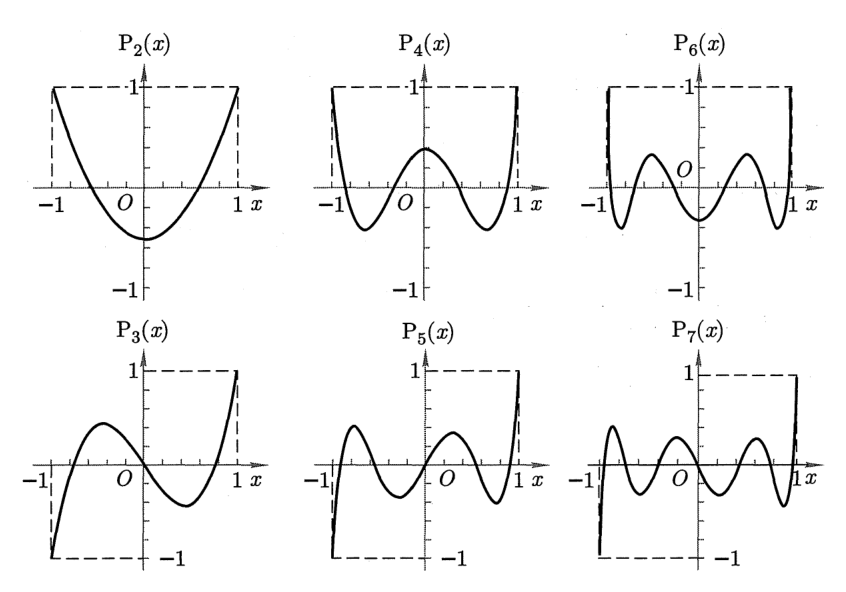
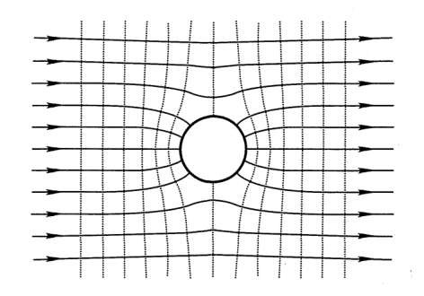

# 第十五章 球函数

Helmholtz 方程在球坐标系下分离变量时，我们曾经得到连带 Legendre 方程

$$
\frac{1}{\sin\theta}\frac{\mathrm{d}}{\mathrm{d}\theta}\left(\sin\theta\frac{\mathrm{d}\Theta}{\mathrm{d}\theta}\right)+\left(\lambda-\frac{\mu}{\sin^2\theta}\right)\Theta=0
$$

以及它的特殊情形，Legendre 方程

$$
\frac{1}{\sin\theta}\frac{\mathrm{d}}{\mathrm{d}\theta}\left(\sin\theta\frac{\mathrm{d}\Theta}{\mathrm{d}\theta}\right)+\lambda\Theta=0.
$$

作变换 $x=\cos\theta$，$y(x)=\Theta(\theta)$，则又可将它们改写成

$$
\frac{\mathrm{d}}{\mathrm{d}x}\left[(1-x^2)\frac{\mathrm{d}y}{\mathrm{d}x}\right]+\left(\lambda-\frac{\mu}{1-x^2}\right)y=0
\qquad\text{和}\qquad
\frac{\mathrm{d}}{\mathrm{d}x}\left[(1-x^2)\frac{\mathrm{d}y}{\mathrm{d}x}\right]+\lambda y=0.
$$

本章就将求解这两个方程，特别是相关的本征值问题，讨论本征函数的主要性质及其应用。

## §15.1 Legendre 方程的解

在求出 Legendre 方程的解的具体形式之前，根据常微分方程的解析理论（见第九章），事先就可以对 Legendre 方程的解的解析性有如下判断。

首先，Legendre 方程

$$
\frac{\mathrm{d}}{\mathrm{d}z}\left[(1-z^2)\frac{\mathrm{d}w}{\mathrm{d}z}\right]+\lambda w=0, \qquad (15.1)
$$

有三个奇点，$z=\pm1$ 和 $z=\infty$，并且都是正则奇点。因此，除了这三个点外，Legendre 方程的解在全复平面上任意一点均解析。

$z=0$ 点是 Legendre 方程的常点，因此，方程的解在以 $z=0$ 点为圆心的单位圆 $|z|<1$ 内解析，可以展开为 Taylor 级数。第九章中已经求出了两个线性无关的特解，它们是

$$
w_1(z)=\sum_{n=0}^{\infty}\frac{2^{2n}}{(2n)!}\left(-\frac{\nu}{2}\right)_n\left(\frac{\nu+1}{2}\right)_n z^{2n}, \qquad (15.2a)
$$

$$
w_2(z)=\sum_{n=0}^{\infty}\frac{2^{2n}}{(2n+1)!}\left(-\frac{\nu-1}{2}\right)_n\left(1+\frac{\nu}{2}\right)_n z^{2n+1}, \qquad (15.2b)
$$

其中

$$
\nu(\nu+1)=\lambda. \qquad (15.3)
$$

根据 $\Gamma$ 函数的 Stirling 公式（见第七章 (7.14) 式）可以估计，当 $n$ 足够大时，

$$
c_{2n}=\frac{2^{2n}}{(2n)!}\left(-\frac{\nu}{2}\right)_n\left(\frac{\nu+1}{2}\right)_n\sim-\frac{1}{\sqrt{\pi}}\frac{\Gamma(1+\nu/2)}{\Gamma((1+\nu)/2)}\sin\frac{\pi\nu}{2}\frac{1}{n},
$$

$$
c_{2n+1}=\frac{2^{2n}}{(2n+1)!}\left(-\frac{\nu-1}{2}\right)_n\left(1+\frac{\nu}{2}\right)_n\sim\frac{1}{2\sqrt{\pi}}\frac{\Gamma((1+\nu)/2)}{\Gamma(1+\nu/2)}\cos\frac{\pi\nu}{2}\frac{1}{n+1/2}.
$$

这说明，$w_1(z)$ 与 $w_2(z)$ 在 $z=\pm1$ 均对数发散，

$$
w_1(z)\sim-\frac{1}{\sqrt{\pi}}\frac{\Gamma(1+\nu/2)}{\Gamma((1+\nu)/2)}\sin\frac{\pi\nu}{2}\ln\frac{1}{1-z^2},
$$

$$
w_2(z)\sim\pm\frac{1}{2\sqrt{\pi}}\frac{\Gamma((1+\nu)/2)}{\Gamma(1+\nu/2)}\cos\frac{\pi\nu}{2}\ln\frac{1+z}{1-z}.
$$

可以把它们解析延拓到由 $z=1$ 向左沿实轴到 $\infty$ 割开的 $z$ 复平面上。分支点为 $z=\pm1$ 和 $\infty$。

还可以在 $z=1$ 点（或 $z=-1$ 点）的邻域内求解 Legendre 方程。由于 $z=\pm1$ 是方程的正则奇点，方程在环域 $0<|z-1|<2$ 内有两个正则解，故可设

$$
w(z)=(z-1)^{\rho}\sum_{n=0}^{\infty}c_n(z-1)^n, \qquad (15.4)
$$

代入 (15.1) 式，就可以得到 Legendre 方程在 $z=1$ 点的指标方程

$$
\rho(\rho-1)+\rho=0
$$

和递推关系

$$
c_{n+1}=-\frac{(n+\rho+1)(n+\rho)-\nu(\nu+1)}{2(n+\rho+1)^2}c_n. \qquad (15.5)
$$

所以，$\rho_1=\rho_2=0$。这说明 Legendre 方程在 $z=1$ 点邻域内的第一解实际上是在圆域 $|z-1|<2$ 内解析的，而第二解则一定含有对数函数项，$z=1$ 是它的一个分支点。

按照常微分方程级数解法的标准步骤，将 $\rho_1=0$ 代入递推关系，可以求出

$$
c_n=\frac{1}{(n!)^2}\frac{\Gamma(\nu+n+1)}{\Gamma(\nu-n+1)}\frac{1}{2^n}c_0.
$$

取 $c_0=1$，就得到 Legendre 方程在 $z=1$ 点邻域内的第一解

$$
\mathrm{P}_{\nu}(z)=\sum_{n=0}^{\infty}\frac{1}{(n!)^2}\frac{\Gamma(\nu+n+1)}{\Gamma(\nu-n+1)}\left(\frac{z-1}{2}\right)^n,\qquad |z-1|<2, \qquad (15.6)
$$

称为 $\nu$ 次第一类 Legendre 函数，其中 $\nu$ 的定义见 (15.3) 式。

第二解称为 $\nu$ 次第二类 Legendre 函数，定义为

$$
\mathrm{Q}_{\nu}(z)=\begin{cases}
\dfrac{\pi}{2}\dfrac{\mathrm{e}^{-\mathrm{i}\nu\pi}\mathrm{P}_{\nu}(z)-\mathrm{P}_{\nu}(-z)}{\sin\nu\pi}, & \operatorname{Im}z>0,\\[12pt]
\dfrac{\pi}{2}\dfrac{\mathrm{e}^{\mathrm{i}\nu\pi}\mathrm{P}_{\nu}(z)-\mathrm{P}_{\nu}(-z)}{\sin\nu\pi}, & \operatorname{Im}z<0,
\end{cases} \qquad (15.7)
$$

其中 $\gamma$ 是欧拉常数，$\psi(z)$ 是 $\Gamma$ 函数的对数微商。$\mathrm{Q}_{\nu}(z)$ 是多值函数，分支点为 $z=\pm1$，沿实轴连接 $z=\pm1$ 作割线，由 (15.7) 式可以看出，$\mathrm{Q}_{\nu}(z)$ 在割线上、下岸的值不相等。通常规定对于区间 $-1<x<1$ 内的实数 $x$，

$$
\mathrm{Q}_{\nu}(x)=\frac{1}{2}\left[\mathrm{Q}_{\nu}(x+\mathrm{i}0)+\mathrm{Q}_{\nu}(x-\mathrm{i}0)\right].
$$

也可以类似地求出 Legendre 方程在 $z=-1$ 或 $z=\infty$ 邻域内的解。这里从略，读者可参阅参考书目 [12, 13]。

## §15.2 Legendre 多项式

首先看一个球形区域内 $x^2+y^2+z^2<a^2$ 的 Laplace 方程边值问题

$$
\nabla^2u=0, \qquad (15.8a)
$$

$$
u\big|_{\Sigma}=f(\Sigma), \qquad (15.8b)
$$

其中 $\Sigma$ 代表球面 $x^2+y^2+z^2=a^2$ 上的变点。考虑到空间区域的具体形状，自然采用球坐标系来求解这个定解问题，且把球坐标架的坐标原点放置在球心。如果边界条件具有绕某一个通过球心的固定轴旋转不变的对称性，那么，也就应当把这个对称轴的方向取为极轴的方向。这样选定了坐标系后，所要求的未知函数 $u$ 就与 $\phi$ 无关，$u=u(r,\theta)$。

利用上一章中得到的 Laplace 算符在球坐标系下的表达式 (14.50)，容易写出定解问题 (15.8) 在球坐标系下的具体形式。但需要注意，这时 Laplace 方程在 $\theta=0$ 和 $\theta=\pi$ 方向上以及在坐标原点 $r=0$ 均不成立。因此，当把 Laplace 方程从直角坐标系改写到球坐标系时，为了保持整个定解问题的等价性，就还要补偿上 $u(r,\theta)$ 在 $\theta=0$ 和 $\theta=\pi$ 方向上以及在坐标原点 $r=0$ 处的有界条件。换言之，定解问题 (15.8) 在球坐标系下的完整表达形式应该是

$$
\frac{1}{r^2}\frac{\partial}{\partial r}\left(r^2\frac{\partial u}{\partial r}\right)+\frac{1}{r^2\sin\theta}\frac{\partial}{\partial\theta}\left(\sin\theta\frac{\partial u}{\partial\theta}\right)=0, \qquad (15.9a)
$$

$$
u\big|_{\theta=0}\ \text{有界},\qquad u\big|_{\theta=\pi}\ \text{有界}, \qquad (15.9b)
$$

$$
u\big|_{r=0}\ \text{有界},\qquad u\big|_{r=a}=f(\theta). \qquad (15.9c)
$$

令

$$
u(r,\theta)=R(r)\Theta(\theta), \qquad (15.10)
$$

代入方程 (15.9a) 和有界条件 (15.9b)，就能够分离变量而得到

$$
\frac{1}{\sin\theta}\frac{\mathrm{d}}{\mathrm{d}\theta}\left[\sin\theta\frac{\mathrm{d}\Theta(\theta)}{\mathrm{d}\theta}\right]+\lambda\Theta(\theta)=0, \qquad (15.11a)
$$

$$
\Theta(0)\ \text{有界},\qquad \Theta(\pi)\ \text{有界} \qquad (15.11b)
$$

和

$$
\frac{\mathrm{d}}{\mathrm{d}r}\left[r^2\frac{\mathrm{d}R(r)}{\mathrm{d}r}\right]-\lambda R(r)=0, \qquad (15.12)
$$

其中 $\lambda$ 是待定常数。Legendre 方程 (15.11a) 配上有界条件 (15.11b)，就构成本征值问题。通常总要作变换 $x=\cos\theta$，$y(x)=\Theta(\theta)$，并将参数 $\lambda$ 写成 $\nu(\nu+1)$，这样本征值问题 (15.11) 就变为

$$
\frac{\mathrm{d}}{\mathrm{d}x}\left[(1-x^2)\frac{\mathrm{d}y}{\mathrm{d}x}\right]+\nu(\nu+1)y=0, \qquad (15.13a)
$$

$$
y(\pm1)\ \text{有界}. \qquad (15.13b)
$$

**练习 15.1** 证明：如果本征值问题 (15.13) 有（非零）解的话，其本征值 $\nu(\nu+1)$ 一定为非负实数。

为了求解本征值问题 (15.13)，我们可以从 Legendre 方程在 $x=1$ 点邻域内的两个线性无关解 $\mathrm{P}_{\nu}(x)$ 和 $\mathrm{Q}_{\nu}(x)$ 出发。这时，Legendre 方程的通解是

$$
y(x)=c_1\mathrm{P}_{\nu}(x)+c_2\mathrm{Q}_{\nu}(x), \qquad (15.14)
$$

$\mathrm{P}_{\nu}(x)$ 在 $x=1$ 点解析，因而有界，而 $\mathrm{Q}_{\nu}(x)$ 在 $x=1$ 点对数发散。由于要求解在 $x=1$ 有界，故必有 $c_2=0$。不妨取 $c_1=1$。再进一步，当 $x\to-1$ 时，$\mathrm{P}_{\nu}(x)$ 的数值为

$$
\mathrm{P}_{\nu}(x)=\sum_{n=0}^{\infty}\frac{1}{(n!)^2}\frac{\Gamma(\nu+n+1)}{\Gamma(\nu-n+1)}\left(\frac{x-1}{2}\right)^n
=-\frac{\sin\nu\pi}{\pi}\sum_{n=0}^{\infty}\frac{\Gamma(n+\nu+1)\Gamma(n-\nu)}{(n!)^2}\left(\frac{1-x}{2}\right)^n.
$$

根据 $\Gamma$ 函数的 Stirling 公式，可以估计出，当 $n$ 足够大时，

$$
\frac{\Gamma(n+\nu+1)\Gamma(n-\nu)}{(n!)^2}\sim\frac{1}{n},
$$

因此，对于一般的 $\nu$ 值，换言之，只要 $\mathrm{P}_{\nu}(x)$ 是无穷级数，它就一定在 $x=-1$ 点对数发散，

$$
\mathrm{P}_{\nu}(x)\sim-\frac{\sin\nu\pi}{\pi}\ln\frac{2}{1+x}.
$$

要使得本征值问题 (15.13) 有（非零）解，唯一可能就必须要 $\mathrm{P}_{\nu}(x)$ 不是无穷级数，即截断为多项式。从 $\mathrm{P}_{\nu}(x)$ 的求解过程中的递推关系 (15.5) 式看，这只能发生在 $\nu$ 为自然数时。所以，本征值问题 (15.13) 的解就是

$$
\text{本征值}\qquad \lambda_l=l(l+1),\qquad l=0,1,2,3,\cdots, \qquad (15.15a)
$$

$$
\text{本征函数}\qquad y_l(x)=\mathrm{P}_l(x). \qquad (15.15b)
$$

回到本征值问题 (15.11)，它的解就是

$$
\text{本征值}\qquad \lambda_l=l(l+1),\qquad l=0,1,2,3,\cdots, \qquad (15.15a')
$$

$$
\text{本征函数}\qquad \Theta_l(\theta)=\mathrm{P}_l(\cos\theta). \qquad (15.15b')
$$

$\mathrm{P}_l(x)$ 是一个 $l$ 次多项式，称为 $l$ 次 Legendre 多项式，

$$
\mathrm{P}_l(x)=\sum_{n=0}^{l}\frac{1}{(n!)^2}\frac{(l+n)!}{(l-n)!}\left(\frac{x-1}{2}\right)^n. \qquad (15.16)
$$

它是作为本征值问题 (15.13) 的解（Legendre 方程在有界条件下的本征函数）出现的。下面列出最低的几个 Legendre 多项式的表达式（图形见图 15.1）：

$$
\begin{aligned}
&\mathrm{P}_0(x)=1, & &\mathrm{P}_1(x)=x,\\
&\mathrm{P}_2(x)=\frac{1}{2}\left(3x^2-1\right), & &\mathrm{P}_3(x)=\frac{1}{2}\left(5x^3-3x\right),\\
&\mathrm{P}_4(x)=\frac{1}{8}\left(35x^4-30x^2+3\right), & &\mathrm{P}_5(x)=\frac{1}{8}\left(63x^5-70x^3+15x\right).
\end{aligned} \qquad (15.17)
$$

由 (15.16) 式，还能立即得到 Legendre 多项式在 $x=1$ 点的数值：

$$
\mathrm{P}_l(1)=1. \qquad (15.18)
$$

**练习 15.2** 求 $\mathrm{P}_l'(1)$ 和 $\mathrm{P}_l''(1)$ 之值。

最后说明一下，完整地求解定解问题 (15.9)，就还要解常微分方程 (15.12)，求出满足线性齐次偏微分方程 (15.9a) 和线性齐次边界条件 (15.9b) 的特解，再由全部特解叠加出一般解，而后利用边界条件 (15.9c) 定出叠加系数。本节的目的只在于引进 Legendre 多项式。下面几节将先研究 Legendre 多项式的一些基本性质，然后在 §15.7 集中讨论 Legendre 多项式在分离变量法中的应用，讨论有关偏微分方程定解问题的求解问题。

## §15.3 Legendre 多项式的微分表示

Legendre 多项式的微分表示（亦称 Rodrigues 公式）是①

$$
\mathrm{P}_l(x)=\frac{1}{2^l l!}\frac{\mathrm{d}^l}{\mathrm{d}x^l}\left(x^2-1\right)^l. \qquad (15.19)
$$

① 回顾在第九章的例 9.6 中，我们曾经求解过常微分方程

$$
(1-x^2)\frac{\mathrm{d}^2w}{\mathrm{d}x^2}+2(l-1)x\frac{\mathrm{d}w}{\mathrm{d}x}+2lw=0,
$$

它的两个线性无关解是

$$
w_1(x)=A(x^2-1)^l \qquad\text{和}\qquad w_2(x)=B(x^2-1)^l\int^{x}\frac{\mathrm{d}x}{(x^2-1)^{l+1}}.
$$

将这个微分方程求导 $l$ 次，就得到 $l$ 阶 Legendre 方程。因此，不难理解，Legendre 方程的解就可以表示为

$$
A\frac{\mathrm{d}^l}{\mathrm{d}x^l}(x^2-1)^l \qquad\text{和}\qquad B\frac{\mathrm{d}^l}{\mathrm{d}x^l}\left[(x^2-1)^n\int^{x}\frac{\mathrm{d}x}{(x^2-1)^{n+1}}\right].
$$

适当选择常数 $A,B$，前者就给出 Legendre 多项式的微分表示，而后者也就是第二类 Legendre 函数的微分表示。

**证** 因为

$$
\left(x^2-1\right)^l=(x-1)^l[2+(x-1)]^l=\sum_{n=0}^{l}\frac{l!}{n!(l-n)!}2^{l-n}(x-1)^{l+n},
$$

所以

$$
\begin{aligned}
\frac{1}{2^l l!}\frac{\mathrm{d}^l}{\mathrm{d}x^l}\left(x^2-1\right)^l
&=\frac{\mathrm{d}^l}{\mathrm{d}x^l}\sum_{n=0}^{l}\frac{1}{n!(l-n)!}2^{-n}(x-1)^{l+n}\\
&=\sum_{n=0}^{l}\frac{1}{n!(l-n)!}\frac{(l+n)!}{n!}\left(\frac{x-1}{2}\right)^n.
\end{aligned}
$$

正是 (15.16) 式。 □

从 Legendre 多项式的微分表示，立即可以看出 Legendre 多项式的奇偶性：

$$
\mathrm{P}_l(-x)=(-)^l\mathrm{P}_l(x). \qquad (15.20)
$$

再结合 $\mathrm{P}_l(1)=1$，又可以得到

$$
\mathrm{P}_l(-1)=(-1)^l. \qquad (15.21)
$$

**练习 15.3** 求 $\mathrm{P}_l'(-1)$ 和 $\mathrm{P}_l''(-1)$ 之值。

从 Legendre 多项式的微分表示还可以导出 Legendre 多项式的另一个显明表达式。为此，可将 $(x^2-1)^l$ 展开，然后微商，

$$
\frac{\mathrm{d}^l}{\mathrm{d}x^l}\left(x^2-1\right)^l=\frac{\mathrm{d}^l}{\mathrm{d}x^l}\sum_{r=0}^{l}(-)^r\frac{l!}{r!(l-r)!}x^{2l-2r}.
$$

由于微商 $l$ 次后，多项式的次数要降低 $l$ 次，所以

$$
\mathrm{P}_l(x)=\sum_{r=0}^{[l/2]}(-)^r\frac{(2l-2r)!}{2^l r!(l-r)!(l-2r)!}x^{l-2r}. \qquad (15.22)
$$

从这个表达式容易求出 Legendre 多项式在 $x=0$ 点的数值：

$$
\mathrm{P}_{2l}(0)=(-)^l\frac{(2l)!}{2^{2l}l!l!},\qquad \mathrm{P}_{2l+1}(0)=0. \qquad (15.23)
$$

**练习 15.4** 求 $\mathrm{P}_{2l}'(0)$ 和 $\mathrm{P}_{2l+1}'(0)$ 之值。

从 Legendre 多项式的微分表示，还可以得到许多有意义的结果。例如，把 Legendre 多项式的微分表示和 Rolle 引理结合起来，就能证明 $l$ 次 Legendre 多项式的 $l$ 个零点一定都是实数，并且位于区间 $(-1,1)$ 内。

Legendre 多项式的微分表示的用途之一是计算某些含 Legendre 多项式的积分。

**例 15.1** 计算积分 $\int_{-1}^{1}x^k\mathrm{P}_l(x)\,\mathrm{d}x$，$k,l$ 均为自然数。

**解** 从被积函数的奇偶性可以判断，

$$
\int_{-1}^{1}x^k\mathrm{P}_l(x)\,\mathrm{d}x=0,\qquad \text{当 }k\pm l=\text{奇数}. \qquad (15.24)
$$

当 $k\pm l$ 为偶数时，可将 $\mathrm{P}_l(x)$ 用它微分表示代入，分部积分，就有

$$
\int_{-1}^{1}x^k\mathrm{P}_l(x)\,\mathrm{d}x=\frac{1}{2^l l!}\int_{-1}^{1}(-)^l\frac{\mathrm{d}x^k}{\mathrm{d}x}\frac{\mathrm{d}^{l-1}}{\mathrm{d}x^{l-1}}\left(x^2-1\right)^l\mathrm{d}x.
$$

重复分部积分 $l$ 次后，结果就变为

$$
\int_{-1}^{1}x^k\mathrm{P}_l(x)\,\mathrm{d}x=\frac{1}{2^l l!}\int_{-1}^{1}(-)^l\frac{\mathrm{d}^l x^k}{\mathrm{d}x^l}\left(x^2-1\right)^l\mathrm{d}x.
$$

这时有两种可能，一是 $k<l$，函数 $x^k$ 微商 $l$ 次一定为 0，于是

$$
\int_{-1}^{1}x^k\mathrm{P}_l(x)\,\mathrm{d}x=0,\qquad \text{当 }k<l. \qquad (15.25)
$$

另一种可能是 $k\ge l$，不妨令 $k=l+2n$，于是

$$
\int_{-1}^{1}x^{l+2n}\mathrm{P}_l(x)\,\mathrm{d}x=\frac{1}{2^l l!}\int_{-1}^{1}(-)^l\frac{\mathrm{d}^l x^{l+2n}}{\mathrm{d}x^l}\left(x^2-1\right)^l\mathrm{d}x
=\frac{1}{2^l l!}\frac{(l+2n)!}{(2n)!}\int_{-1}^{1}x^{2n}\left(1-x^2\right)^l\mathrm{d}x.
$$

作变换 $x^2=t$，并利用 B 函数就可以算出积分

$$
\begin{aligned}
\int_{-1}^{1}x^{l+2n}\mathrm{P}_l(x)\,\mathrm{d}x
&=\frac{1}{2^l l!}\frac{(l+2n)!}{(2n)!}\int_{0}^{1}t^{n-1/2}(1-t)^l\,\mathrm{d}t\\
&=\frac{1}{2^l l!}\frac{(l+2n)!}{(2n)!}\mathrm{B}(n+1/2,l+1)
=2^{l+1}\frac{(l+2n)!(l+n)!}{n!(2l+2n+1)!}.
\end{aligned} \qquad (15.26)
$$

特别是 $k=l$，即 $n=0$ 时，

$$
\int_{-1}^{1}x^l\mathrm{P}_l(x)\,\mathrm{d}x=\frac{l!}{2^l}\frac{\sqrt{\pi}}{\Gamma(l+3/2)}=2^{l+1}\frac{l!l!}{(2l+1)!}. \qquad (15.27)
$$

值得强调，上面的 (15.24) 和 (15.25) 两式说明，只要 $k<l$，不论 $k\pm l$ 是奇数或偶数，积分 $\int_{-1}^{1}x^k\mathrm{P}_l(x)\,\mathrm{d}x$ 都一定为 0。

**练习 15.5** 设 $f_k(x)$ 是任意一个 $k$ 次多项式，证明

$$
\int_{-1}^{1}f_k(x)\mathrm{P}_l(x)\,\mathrm{d}x=0,\qquad \text{当 }k<l.
$$

## §15.4 Legendre 多项式的正交完备性

Legendre 多项式是作为本征值问题 (15.13) 的解（本征函数）出现的，因此，从本征值问题 (15.13) 出发，可以证明 Legendre 多项式的正交性：

$$
\int_{-1}^{1}\mathrm{P}_l(x)\mathrm{P}_k(x)\,\mathrm{d}x=0,\qquad k\ne l, \qquad (15.28)
$$

即不同次数的 Legendre 多项式在区间 $[-1,1]$ 上正交。作为练习，请读者补足这个证明。

另一种方法是直接应用 (15.24)、(15.25) 和 (15.27) 诸式的结果。当 $k\ne l$ 时，不妨假设 $k<l$。于是 $\mathrm{P}_k(x)$ 作为 $k$ 次多项式，它的每一项乘以 $\mathrm{P}_l(x)$ 的积分都是 0，所以就证明了不同次数的 Legendre 多项式在区间 $[-1,1]$ 上正交，即 (15.28) 式。

下面讨论 $k=l$ 的情形。这时仍然写出一个 $\mathrm{P}_l(x)$ 的各项，然后逐项积分，

$$
\int_{-1}^{1}\mathrm{P}_l(x)\mathrm{P}_l(x)\,\mathrm{d}x=\int_{-1}^{1}\left[c_lx^l+c_{l-2}x^{l-2}+c_{l-4}x^{l-4}+\cdots\right]\mathrm{P}_l(x)\,\mathrm{d}x.
$$

除了第一项和 $l$ 次 Legendre 多项式的乘积的积分不为 0 外，其余各项和 $l$ 次 Legendre 多项式的乘积的积分均为 0。于是，就有

$$
\int_{-1}^{1}\mathrm{P}_l(x)\mathrm{P}_l(x)\,\mathrm{d}x=c_l\int_{-1}^{1}x^l\mathrm{P}_l(x)\,\mathrm{d}x=c_l\times2^{l+1}\frac{l!l!}{(2l+1)!},
$$

$c_l$ 是 $l$ 次 Legendre 多项式中 $x^l$ 项的系数。由 (15.22) 式可得出 $c_l=(2l)!/2^l(l!)^2$，所以

$$
\int_{-1}^{1}\mathrm{P}_l(x)\mathrm{P}_l(x)\,\mathrm{d}x=\frac{2}{2l+1}. \qquad (15.29)
$$

把 (15.28) 式和 (15.29) 式合并起来，还可以写成

$$
\int_{-1}^{1}\mathrm{P}_k(x)\mathrm{P}_l(x)\,\mathrm{d}x=\frac{2}{2l+1}\delta_{kl}. \qquad (15.30)
$$

以上关于 Legendre 多项式正交性的讨论和模方的计算都是以 $x$ 为自变量表述的。也可以通过变换 $x=\cos\theta$ 变回到以 $\theta$ 为自变量。例如 (15.30) 式就变为

$$
\int_{0}^{\pi}\mathrm{P}_k(\cos\theta)\mathrm{P}_l(\cos\theta)\sin\theta\,\mathrm{d}\theta=\frac{2}{2l+1}\delta_{kl}. \qquad (15.30')
$$

这就是说，$k$ 次 Legendre 多项式 $\mathrm{P}_k(\cos\theta)$ 和 $l$ 次 Legendre 多项式 $\mathrm{P}_l(\cos\theta)$ 在区间 $[0,\pi]$ 上以权函数 $\sin\theta$ 正交。这里的权函数 $\sin\theta$ 正好就是微分方程

$$
\frac{\mathrm{d}}{\mathrm{d}\theta}\left(\sin\theta\frac{\mathrm{d}\Theta}{\mathrm{d}\theta}\right)+\lambda\sin\theta\,\Theta=0
$$

中本征值 $\lambda$ 后的函数 $\sin\theta$。

可以证明，作为本征函数的 Legendre 多项式也具有**完备性**：任意一个在区间 $[-1,1]$ 中分段连续的函数 $f(x)$（在平均收敛①意义下）可以展开为级数

$$
f(x)=\sum_{l=0}^{\infty}c_l\mathrm{P}_l(x), \qquad (15.31)
$$

① 如果

$$
\lim_{N\to\infty}\int_{-1}^{1}\left|f(x)-\sum_{l=0}^{N}c_l\mathrm{P}_l(x)\right|^2\mathrm{d}x=0,
$$

则称级数 $\sum\limits_{l=0}^{\infty}c_l\mathrm{P}_l(x)$ 平均收敛到 $f(x)$。

其中的展开系数 $c_l$ 可以根据 Legendre 多项式的正交性求得：

$$
c_l=\frac{2l+1}{2}\int_{-1}^{1}f(x)\mathrm{P}_l(x)\,\mathrm{d}x. \qquad (15.32)
$$

也可以改用以 $\theta$ 为自变量表述：任意一个在 $0\le\theta\le\pi$ 中分段连续的函数 $f(\theta)$，可以按 Legendre 多项式 $\mathrm{P}_l(\cos\theta)$ 展开：

$$
f(\theta)=\sum_{l=0}^{\infty}c_l\mathrm{P}_l(\cos\theta), \qquad (15.33)
$$

展开系数为

$$
c_l=\frac{2l+1}{2}\int_{0}^{\pi}f(\theta)\mathrm{P}_l(\cos\theta)\sin\theta\,\mathrm{d}\theta. \qquad (15.34)
$$

**例 15.2** 将函数 $f(x)=x^3$ 按 Legendre 多项式展开。

**解** 设 $x^3=\sum\limits_{l=0}^{\infty}c_l\mathrm{P}_l(x)$，则

$$
c_l=\frac{2l+1}{2}\int_{-1}^{1}x^3\mathrm{P}_l(x)\,\mathrm{d}x.
$$

根据上面的讨论，可以判断，除 $c_1$ 和 $c_3$ 外，其余的 $c_l$ 均为 0，

$$
x^3=c_1\mathrm{P}_1(x)+c_3\mathrm{P}_3(x). \qquad (15.35)
$$

利用 (15.26) 式的结果，可以求得展开系数 $c_1$ 和 $c_3$ 分别为

$$
c_1=\frac{3}{2}\int_{-1}^{1}x^4\,\mathrm{d}x=\frac{3}{5},\qquad c_3=\frac{7}{2}\int_{-1}^{1}x^3\mathrm{P}_3(x)\,\mathrm{d}x=\frac{2}{5}.
$$

最后的结果就是

$$
x^3=\frac{3}{5}\mathrm{P}_1(x)+\frac{2}{5}\mathrm{P}_3(x). \qquad (15.36)
$$

将 $f(x)=x^3$ 按 Legendre 多项式展开，还有更简单的方法：我们只要写出 $\mathrm{P}_3(x)$ 的表达式

$$
\mathrm{P}_3(x)=\frac{5}{2}x^3-\frac{3}{2}x,
$$

并且将右端第二项中的 $x$ 改写为 $\mathrm{P}_1(x)$，重新整理，就能得到 (15.36) 式。从 Legendre 多项式的正交完备性出发，不难导出函数按照 Legendre 多项式展开的唯一性，从而也就确认这种做法的正确性。

更一般地说，将 $x^k$ 按 Legendre 多项式展开，$x^k=\sum\limits_{l=0}^{\infty}c_l\mathrm{P}_l(x)$，从 (15.25) 式可以看出，当 $l>k$ 时，$c_l$ 一定为 0。换一个角度看：仿照上面的做法，根据 $\mathrm{P}_k(x)$ 的表达式，总可以将 $x^k$ 写为 $\mathrm{P}_k(x)$ 以及 $x^{k-2},x^{k-4},x^{k-6},\cdots$ 的线性组合。重复这样的做法，再将 $x^{k-2}$ 写为 $\mathrm{P}_{k-2}(x)$ 以及 $x^{k-4},x^{k-6},x^{k-8},\cdots$ 的线性组合。如此继续，最后我们总能将 $x^k$ 表示为 $\mathrm{P}_l(x)$，$l\le k$ 的线性组合。这个结论，既可以从幂级数展开的唯一性的角度加以确认，也可以从按 Legendre 多项式展开的唯一性的角度加以确认。这一思想，还可以应用到函数按其他正交多项式的展开中。

**例 15.3** 计算积分 $\int_{0}^{1}x^{\alpha}\mathrm{P}_l(x)\,\mathrm{d}x$，$\alpha>-1$。

**解** 本积分与例 15.2 不同，表现在：(1) $\alpha$ 可以不是整数，(2) 积分区间为 $[0,1]$，因此，需要调整一下计算方法。但是，令人意外的是，只凭简单的计算与推理，就能算出这个积分值。

我们首先注意到 $\mathrm{P}_l(x)$ 是 $l$ 次多项式，并且只含偶次幂或奇次幂，

$$
\mathrm{P}_l(x)=a_0x^l+a_1x^{l-2}+a_2x^{l-4}+\cdots,
$$

共有 $[l/2]+1$ 项，所以，逐项积分，就一定有

$$
\begin{aligned}
\int_{0}^{1}x^{\alpha}\mathrm{P}_l(x)\,\mathrm{d}x&=\frac{a_0}{\alpha+l+1}+\frac{a_1}{\alpha+l-1}+\frac{a_2}{\alpha+l-3}+\cdots\\
&=\frac{f(\alpha)}{(\alpha+l+1)(\alpha+l-1)(\alpha+l-3)\cdots},
\end{aligned}
$$

其中的分母是 $\alpha$ 的 $[l/2]+1$ 次多项式，分子 $f(\alpha)$ 是 $\alpha$ 的 $[l/2]$ 次多项式。但因为 $\mathrm{P}_l(1)=a_0+a_1+a_2+\cdots=1$，所以 $f(\alpha)$ 的最高次幂项的系数必为 1。再注意当 $\alpha=l-2,l-4,\cdots$ 时，

$$
\int_{0}^{1}x^{\alpha}\mathrm{P}_l(x)\,\mathrm{d}x=\frac{1}{2}\int_{-1}^{1}x^{\alpha}\mathrm{P}_l(x)\,\mathrm{d}x=0,
$$

因此 $f(\alpha)$ 作为 $\alpha$ 的多项式，就一定含有 $(\alpha-l+2),(\alpha-l+4),\cdots$ 等因子，即

$$
f(\alpha)=(\alpha-l+2)(\alpha-l+4)\cdots,
$$

连乘积中正好有 $[l/2]$ 个因子，最后一项为 $\alpha$ 或 $\alpha-1$，视 $l$ 为偶数或奇数而定。所以就得到

$$
\int_{0}^{1}x^{\alpha}\mathrm{P}_{2l}(x)\,\mathrm{d}x=\frac{(\alpha-2l+2)(\alpha-2l+4)\cdots\alpha}{(\alpha+2l+1)(\alpha+2l-1)\cdots(\alpha+1)}, \qquad (15.37a)
$$

$$
\int_{0}^{1}x^{\alpha}\mathrm{P}_{2l+1}(x)\,\mathrm{d}x=\frac{(\alpha-2l+1)(\alpha-2l+3)\cdots(\alpha-1)}{(\alpha+2l+2)(\alpha+2l)\cdots(\alpha+2)}. \qquad (15.37b)
$$

## §15.5 Legendre 多项式的生成函数

Legendre 多项式是首先在势论的研究中引进的。设在极轴方向（$\theta=0$）上距原点 $r$ 处放有一个单位点电荷，此点电荷在 $(r',\theta,\phi)$ 点的电势（显然与 $\phi$ 无关）即为

$$
\frac{1}{\sqrt{r^2+r'^2-2rr'\cos\theta}}=\begin{cases}
\dfrac{1}{r}\dfrac{1}{\sqrt{1-2xt+t^2}}, & t=\dfrac{r'}{r},\\[10pt]
\dfrac{1}{r'}\dfrac{1}{\sqrt{1-2xt+t^2}}, & t=\dfrac{r}{r'},
\end{cases}
$$

其中 $x=\cos\theta$。多值函数 $1/\sqrt{1-2xt+t^2}$ 的分支点是 $x\pm\sqrt{x^2-1}$，连接两个分支点作割线，并规定单值分支为

$$
\left.\frac{1}{\sqrt{1-2xt+t^2}}\right|_{t=0}=1.
$$

在这样的规定下，只要割线不通过 $t=0$ 点，则 $1/\sqrt{1-2xt+t^2}$ 在 $t=0$ 点的邻域内解析，因而可作 Taylor 展开。下面证明展开系数就是 Legendre 多项式 $\mathrm{P}_l(x)$，即

$$
\frac{1}{\sqrt{1-2xt+t^2}}=\sum_{l=0}^{\infty}\mathrm{P}_l(x)t^l,\qquad |t|<\min\left|x\pm\sqrt{x^2-1}\right|. \qquad (15.38)
$$

$1/\sqrt{1-2xt+t^2}$ 即称为 Legendre 多项式的**生成函数**。由于 $\left(x+\sqrt{x^2-1}\right)\left(x-\sqrt{x^2-1}\right)=1$，因此两个分支点要么都位于单位圆周上，要么一个在圆内另一个在圆外，所以 (15.38) 式的收敛范围不会超出单位圆 $|t|<1$。

**证** 直接将函数 $1/\sqrt{1-2xt+t^2}$ 在 $t=0$ 点作 Taylor 展开

$$
\begin{aligned}
\frac{1}{\sqrt{1-2xt+t^2}}&=\frac{1}{\sqrt{1-2t+t^2-2(x-1)t}}=\frac{1}{1-t}\left[1-\frac{2(x-1)t}{(1-t)^2}\right]^{-1/2}\\
&=\frac{1}{1-t}\sum_{k=0}^{\infty}\frac{1}{k!}\left(-\frac{1}{2}\right)\left(-\frac{3}{2}\right)\cdots\left(\frac{1}{2}-k\right)\left[-\frac{2(x-1)t}{(1-t)^2}\right]^k\\
&=\sum_{k=0}^{\infty}\frac{(2k-1)!!}{k!}(x-1)^kt^k(1-t)^{-(2k+1)}\\
&=\sum_{k=0}^{\infty}\frac{(2k-1)!!}{k!}(x-1)^kt^k\sum_{n=0}^{\infty}\frac{(2k+n)!}{n!(2k)!}t^n\\
&=\sum_{l=0}^{\infty}\left[\sum_{k=0}^{l}\frac{(l+k)!}{k!k!(l-k)!}\left(\frac{x-1}{2}\right)^k\right]t^l.
\end{aligned}
$$

对照 (15.16) 式就可以看出，展开系数正是 $l$ 次 Legendre 多项式。这样就证明了 (15.38) 式。 □

利用 Legendre 多项式的生成函数，可以得到许多有用的结果。例如，在 (15.38) 式中令 $x=1$，

$$
\frac{1}{\sqrt{1-2t+t^2}}=\frac{1}{1-t}=\sum_{l=0}^{\infty}t^l=\sum_{l=0}^{\infty}\mathrm{P}_l(1)t^l,
$$

就可以证得 $\mathrm{P}_l(1)=1$。

又如，根据

$$
\frac{1}{\sqrt{1-2xt+t^2}}=\frac{1}{\sqrt{1-2(-x)(-t)+(-t)^2}},
$$

亦即

$$
\sum_{l=0}^{\infty}\mathrm{P}_l(x)t^l=\sum_{l=0}^{\infty}\mathrm{P}_l(-x)(-t)^l,
$$

也可以证明 Legendre 多项式的奇偶性 $\mathrm{P}_l(-x)=(-)^l\mathrm{P}_l(x)$。

利用 Legendre 多项式的生成函数，也可以得到一些展开式（或计算某些积分）。例如，

$$
\frac{1}{\sqrt{\cosh\xi-\cos\theta}}=\frac{\sqrt{2}\mathrm{e}^{-\xi/2}}{\sqrt{1-2\mathrm{e}^{-\xi}\cos\theta+\mathrm{e}^{-2\xi}}}=\sqrt{2}\mathrm{e}^{-\xi/2}\sum_{l=0}^{\infty}\mathrm{P}_l(\cos\theta)\mathrm{e}^{-l\xi},\qquad \xi>0.
$$

相应地，可以计算积分

$$
\int_{-1}^{1}\frac{\mathrm{P}_l(x)}{\sqrt{\cosh\xi-x}}\,\mathrm{d}x=\frac{2\sqrt{2}}{2l+1}\mathrm{e}^{-(l+1/2)\xi},\qquad \xi>0.
$$

从 Legendre 多项式的生成函数出发，还可以证明 Legendre 多项式的正交性，并计算 Legendre 多项式的模方。读者可参阅 H. Sagan, *Boundary and eigenvalue problems in mathematical physics*, John Wiley & Sons, Inc., New York, 1961.

## §15.6 Legendre 多项式的递推关系

从 Legendre 多项式的生成函数展开式 (15.38) 出发，容易导出邻次 Legendre 多项式之间的关系，即 Legendre 多项式的递推关系。

首先，将 (15.38) 式两端对 $t$ 微商，有

$$
\frac{x-t}{(1-2xt+t^2)^{3/2}}=\sum_{l=0}^{\infty}l\mathrm{P}_l(x)t^{l-1},
$$

即

$$
(x-t)\sum_{l=0}^{\infty}\mathrm{P}_l(x)t^l=\left(1-2xt+t^2\right)\sum_{l=0}^{\infty}l\mathrm{P}_l(x)t^{l-1}.
$$

比较 $t^l$ 项的系数，整理即得

$$
(2l+1)x\mathrm{P}_l(x)=(l+1)\mathrm{P}_{l+1}(x)+l\mathrm{P}_{l-1}(x). \qquad (15.39)
$$

这就得到了 Legendre 多项式的一个递推关系，涉及三个邻次 Legendre 多项式。

如果将 (15.38) 式对 $x$ 求导，又能得到

$$
\frac{t}{(1-2xt+t^2)^{3/2}}=\sum_{l=0}^{\infty}\mathrm{P}_l'(x)t^l,
$$

即

$$
t\sum_{l=0}^{\infty}\mathrm{P}_l(x)t^l=\left(1-2xt+t^2\right)\sum_{l=0}^{\infty}\mathrm{P}_l'(x)t^l.
$$

比较 $t^{l+1}$ 项的系数，得

$$
\mathrm{P}_l(x)=\mathrm{P}_{l+1}'(x)-2x\mathrm{P}_l'(x)+\mathrm{P}_{l-1}'(x). \qquad (15.40)
$$

这个递推关系中，出现的是三个邻次 Legendre 多项式及其导数。

把 (15.39) 式对 $x$ 求导，还可以得到

$$
(2l+1)\mathrm{P}_l(x)+(2l+1)x\mathrm{P}_l'(x)=(l+1)\mathrm{P}_{l+1}'(x)+l\mathrm{P}_{l-1}'(x).
$$

和 (15.40) 式联立，消去 $\mathrm{P}_{l-1}'(x)$ 或 $\mathrm{P}_{l+1}'(x)$，又可以得到

$$
\mathrm{P}_{l+1}'(x)=x\mathrm{P}_l'(x)+(l+1)\mathrm{P}_l(x), \qquad (15.41)
$$

$$
\mathrm{P}_{l-1}'(x)=x\mathrm{P}_l'(x)-l\mathrm{P}_l(x). \qquad (15.42)
$$

这两个递推关系，则是把 $\mathrm{P}_{l\pm1}'(x)$ 用 $\mathrm{P}_l(x)$ 及其导数表示出来。

把这些递推关系重新组合，还能给出其他形式的递推关系。例如，将 (15.41)、(15.42) 两式相减，消去 $\mathrm{P}_l'(x)$，就得到

$$
\mathrm{P}_{l+1}'(x)-\mathrm{P}_{l-1}'(x)=(2l+1)\mathrm{P}_l(x). \qquad (15.43)
$$

递推关系也可以用于计算某些类型的积分，例如

$$
\int_{-1}^{1}x\mathrm{P}_k(x)\mathrm{P}_l(x)\,\mathrm{d}x.
$$

根据递推关系 (15.39)，就能够计算出

$$
\begin{aligned}
\int_{-1}^{1}x\mathrm{P}_k(x)\mathrm{P}_l(x)\,\mathrm{d}x
&=\frac{k+1}{2k+1}\int_{-1}^{1}\mathrm{P}_{k+1}(x)\mathrm{P}_l(x)\,\mathrm{d}x+\frac{k}{2k+1}\int_{-1}^{1}\mathrm{P}_{k-1}(x)\mathrm{P}_l(x)\,\mathrm{d}x\\
&=\frac{k+1}{2k+1}\frac{2}{2k+3}\delta_{k+1,l}+\frac{k}{2k+1}\frac{2}{2k-1}\delta_{k-1,l}.
\end{aligned} \qquad (15.44)
$$

递推关系还能用于导出 Legendre 多项式的一些新的关系式。例如，将 (15.39) 式两端同乘以 $\mathrm{P}_l(y)$，得

$$
(2l+1)x\mathrm{P}_l(x)\mathrm{P}_l(y)=(l+1)\mathrm{P}_{l+1}(x)\mathrm{P}_l(y)+l\mathrm{P}_{l-1}(x)\mathrm{P}_l(y).
$$

将变量 $x,y$ 互换，并与原式相减，就可以写成

$$
\begin{aligned}
(2l+1)(x-y)\mathrm{P}_l(x)\mathrm{P}_l(y)\\
=(l+1)\left[\mathrm{P}_{l+1}(x)\mathrm{P}_l(y)-\mathrm{P}_{l+1}(y)\mathrm{P}_l(x)\right]-l\left[\mathrm{P}_l(x)\mathrm{P}_{l-1}(y)-\mathrm{P}_l(y)\mathrm{P}_{l-1}(x)\right].
\end{aligned}
$$

于是，对 $l$ 求和，就得到 Legendre 多项式的 Christoffel（第一）和式，

$$
\sum_{l=0}^{n}(2l+1)\mathrm{P}_l(x)\mathrm{P}_l(y)=\frac{n+1}{x-y}\left[\mathrm{P}_{n+1}(x)\mathrm{P}_n(y)-\mathrm{P}_{n+1}(y)\mathrm{P}_n(x)\right]. \qquad (15.45)
$$

令 $y=-x$，还能得到

$$
\sum_{l=0}^{n}(-)^{n-l}(2l+1)\left[\mathrm{P}_l(x)\right]^2=\frac{n+1}{x}\mathrm{P}_n(x)\mathrm{P}_{n+1}(x).
$$

## §15.7 Legendre 多项式应用举例

本节通过静电学的几个例子，讨论 Legendre 多项式在分离变量法中的应用。

**例 15.4** 均匀电场中的导体球。

设在电场强度为 $E_0$ 的均匀电场中放进一个接地导体球，球的半径为 $a$，求球外任意一点的电势。

**解** 放进导体球后，由于静电感应，在导体球的球面上就会形成一定的感生面电荷分布，而使球体成为等势体。球外任意一点的总电势就是原有均匀电场的电势和感生电荷的电势的叠加。

球体接地，意味着球体的电势为 0。因为在球外处处没有电荷，所以在球外的电势满足 Laplace 方程。如果采用球坐标系，坐标原点与球心重合，极轴沿原来电场的方向。考虑到均匀电场以及球体的对称性，在球面上的感生电荷一定是绕极轴旋转不变的，因而，对于球外任意一点，无论是感生电荷产生的电势，或是总电势，也都是绕极轴旋转不变的。设 $u(r,\theta)$ 是球外一点 $(r,\theta,\phi)$ 的总电势，$u_1(r,\theta)$ 和 $u_2(r,\theta)$ 分别是均匀电场和感生电荷的电势，$u(r,\theta)=u_1(r,\theta)+u_2(r,\theta)$。由 $-\nabla u_1=E_0\boldsymbol{e}_z$ 可以推定

$$
u_1(r,\theta)=-E_0z+u_0=-E_0r\cos\theta+u_0,
$$

常数 $u_0$ 即为均匀电场在坐标原点处的电势。$u_2(r,\theta)$ 则由定解问题

$$
\frac{1}{r^2}\frac{\partial}{\partial r}\left(r^2\frac{\partial u_2}{\partial r}\right)+\frac{1}{r^2\sin\theta}\frac{\partial}{\partial\theta}\left(\sin\theta\frac{\partial u_2}{\partial\theta}\right)=0, \qquad (15.46a)
$$

$$
u_2\big|_{\theta=0}\ \text{有界},\qquad u_2\big|_{\theta=\pi}\ \text{有界}, \qquad (15.46b)
$$

$$
u_2\big|_{r=a}=E_0a\cos\theta-u_0,\qquad u_2\big|_{r\to\infty}\to0 \qquad (15.46c)
$$

决定。$u_2(r,\theta)$ 满足 Laplace 方程，从物理上说，是由于感生电荷只分布在球面上，球外处处皆无感生电荷存在。从数学上说，因为 $u(r,\theta)$ 和单独的 $u_1(r,\theta)$ 都满足 Laplace 方程。同样由于感生电荷只分布在球面上，所以可以规定当 $r\to\infty$ 时 $u_2(r,\theta)$ 趋于 0。

下面就来求解定解问题 (15.46)。将 (15.46a) 和 (15.46b) 分离变量后，可以得到

$$
\frac{1}{\sin\theta}\frac{\mathrm{d}}{\mathrm{d}\theta}\left[\sin\theta\frac{\mathrm{d}\Theta(\theta)}{\mathrm{d}\theta}\right]+\lambda\Theta(\theta)=0, \qquad (15.47a)
$$

$$
\Theta(0)\ \text{有界},\qquad \Theta(\pi)\ \text{有界}, \qquad (15.47b)
$$

$$
\frac{\mathrm{d}}{\mathrm{d}r}\left[r^2\frac{\mathrm{d}R(r)}{\mathrm{d}r}\right]-\lambda R(r)=0, \qquad (15.48)
$$

其中 $\lambda$ 是分离变量时引进的待定参数。本征值问题 (15.47) 亦即 §15.2 中讨论过的本征值问题 (15.11)，其解为

$$
\text{本征值}\qquad \lambda_l=l(l+1),\qquad l=0,1,2,3,\cdots, \qquad (15.49a)
$$

$$
\text{本征函数}\qquad \Theta_l(\theta)=\mathrm{P}_l(\cos\theta). \qquad (15.49b)
$$

为了求解方程 (15.48)，可作变换 $t=\ln r$，将方程变为

$$
\frac{\mathrm{d}^2R_l}{\mathrm{d}t^2}+\frac{\mathrm{d}R_l}{\mathrm{d}t}-l(l+1)R_l=0.
$$

于是

$$
R_l(r)=A_l\mathrm{e}^{lt}+B_l\mathrm{e}^{-(l+1)t}=A_lr^l+B_lr^{-l-1}. \qquad (15.50)
$$

因此，满足方程 (15.46a) 和有界条件 (15.46b) 的一般解就是

$$
u_2(r,\theta)=\sum_{l=0}^{\infty}\left(A_lr^l+B_lr^{-l-1}\right)\mathrm{P}_l(\cos\theta). \qquad (15.51)
$$

考虑到无穷远条件 $u_2\big|_{r\to\infty}\to0$，应该有 $A_l=0$。再代入球面 $r=a$ 上的边界条件，

$$
\sum_{l=0}^{\infty}B_la^{-l-1}\mathrm{P}_l(\cos\theta)=E_0a\mathrm{P}_1(\cos\theta)-u_0\mathrm{P}_0(\cos\theta),
$$

所以有

$$
B_0=-u_0a,\qquad B_1=E_0a^3\qquad\text{和}\qquad B_l=0,\quad l\ge2.
$$

这样就求得

$$
u_2(r,\theta)=-u_0\frac{a}{r}+\frac{E_0a^3}{r^2}\cos\theta. \qquad (15.52)
$$

这里求得的 $u_2(r,\theta)$ 就反映了球面上感生电荷的分布状况。在均匀电场的作用下，接地球面上的感生电荷等效于（位于坐标原点的）点电荷与电偶极子的叠加。点电荷的电量为 $-4\pi\varepsilon_0u_0a$。电偶极子的偶极矩为 $4\pi\varepsilon_0E_0a^3$，方向与均匀电场的方向相同。

将 $u_1(r,\theta)$ 和 $u_2(r,\theta)$ 叠加，就得到球外任意一点的总电势

$$
u(r,\theta)=u_0\left(1-\frac{a}{r}\right)-E_0\left(1-\frac{a^3}{r^3}\right)r\cos\theta. \qquad (15.53)
$$

图 15.2 给出了过极轴的任意一个截面上电场线的分布图。

**例 15.5** 均匀带电细圆环的静电势。

设有一均匀带电细圆环，半径为 $a$，总电荷量为 $Q$，求它在空间任意一点的静电势。

**解** **解法一** 除了圆环上各点外，静电势处处满足 Laplace 方程。

仍取球坐标系，坐标原点在环心，而圆环则处在赤道面上。这时，空间任意一点 $(r,\theta,\phi)$ 的静电势应与 $\phi$ 无关，$u=u(r,\theta)$。可以写出 $u$ 所满足的定解问题

$$
\frac{1}{r^2}\frac{\partial}{\partial r}\left(r^2\frac{\partial u}{\partial r}\right)+\frac{1}{r^2\sin\theta}\frac{\partial}{\partial\theta}\left(\sin\theta\frac{\partial u}{\partial\theta}\right)=-\frac{1}{\varepsilon_0}\rho(r,\theta), \qquad (15.54a)
$$

$$
u\big|_{\theta=0}\ \text{有界},\qquad u\big|_{\theta=\pi}\ \text{有界}, \qquad (15.54b)
$$

$$
u\big|_{r=0}\ \text{有界},\qquad u\big|_{r\to\infty}\to0, \qquad (15.54c)
$$

其中电荷密度分布函数为

$$
\rho(r,\theta)=C\delta(r-a)\delta\left(\theta-\frac{\pi}{2}\right). \qquad (15.55a)
$$

由圆环上的总电荷

$$
\iiint C\delta(r-a)\delta\left(\theta-\frac{\pi}{2}\right)r^2\sin\theta\,\mathrm{d}r\,\mathrm{d}\theta\,\mathrm{d}\phi=Q
$$

就可以定出常数 $C$：

$$
C=\frac{Q}{2\pi a^2}. \qquad (15.55b)
$$

下面就来求解定解问题 (15.54)。由 $\delta$ 函数的性质可以知道，当 $r\ne a$ 时，方程 (15.54a) 退化为 Laplace 方程。这样，再结合 (15.54b) 和 (15.54c)，就可以得到

$$
u(r,\theta)=\begin{cases}
\sum\limits_{l=0}^{\infty}A_lr^l\mathrm{P}_l(\cos\theta), & r<a,\\[14pt]
\sum\limits_{l=0}^{\infty}B_lr^{-l-1}\mathrm{P}_l(\cos\theta), & r>a.
\end{cases} \qquad (15.56)
$$

把球面 $r=a$ 看成是界面，在界面上存在电荷分布（即方程 (15.54a) 右端的非齐次项）。考虑到 $\delta$ 函数应该是间断函数的导数，所以 $u(r,\theta)$ 在球面 $r=a$ 上一定是连续的，

$$
\left.u(r,\theta)\right|_{r=a-0}^{r=a+0}=0, \qquad (15.57)
$$

而 $\partial u(r,\theta)/\partial r$ 在球面 $r=a$ 上一定是不连续的，它在球面 $r=a$ 两侧的跃变可以由方程 (15.54a) 对 $r$ 积分得到：

$$
\left.\frac{\partial u}{\partial r}\right|_{r=a-0}^{r=a+0}=-\frac{Q}{2\pi a^2\varepsilon_0}\delta\left(\theta-\frac{\pi}{2}\right). \qquad (15.58)
$$

由 (15.57) 式可得

$$
A_la^l=B_la^{-l-1},
$$

将 (15.58) 式中的 $\delta$ 函数也按 Legendre 多项式展开，

$$
\delta\left(\theta-\frac{\pi}{2}\right)=\sum_{l=0}^{\infty}\frac{2l+1}{2}\mathrm{P}_l(0)\mathrm{P}_l(\cos\theta),
$$

又可得

$$
A_lla^{l+1}+B_l(l+1)a^{-l}=\frac{(2l+1)Q}{4\pi\varepsilon_0}\mathrm{P}_l(0).
$$

解之即得

$$
A_l=\frac{Q}{4\pi\varepsilon_0}a^{-l-1}\mathrm{P}_l(0),\qquad B_l=\frac{Q}{4\pi\varepsilon_0}a^{l}\mathrm{P}_l(0).
$$

因为 $\mathrm{P}_{2l+1}(0)=0$，所以

$$
u(r,\theta)=\begin{cases}
\dfrac{Q}{4\pi\varepsilon_0}\dfrac{1}{a}\sum\limits_{l=0}^{\infty}\left(\dfrac{r}{a}\right)^{2l}\mathrm{P}_{2l}(0)\mathrm{P}_{2l}(\cos\theta), & r<a,\\[14pt]
\dfrac{Q}{4\pi\varepsilon_0}\dfrac{1}{a}\sum\limits_{l=0}^{\infty}\left(\dfrac{a}{r}\right)^{2l+1}\mathrm{P}_{2l}(0)\mathrm{P}_{2l}(\cos\theta), & r>a.
\end{cases} \qquad (15.59)
$$

解式 (15.59) 中只含有偶次 Legendre 多项式，反映了静电势 $r(r,\theta)$ 对于赤道面的（镜像）反射不变性，即

$$
u(r,\theta)=u(r,\pi-\theta).
$$

**解法二** 本题还有一种非标准的解法，即在 $r\ne a$ 的条件下写出一般解 (15.56)，把它看成是 $u(r,\theta)$ 在 $r=0$ 或 $r=\infty$ 点邻域内的 Taylor 展开，设法找到 $u(r,\theta)$ 在某一特殊 $\theta$ 方向上的数值，而后根据 Taylor 展开的唯一性定出叠加系数。由于圆环上各点到轴线上 $(r,\theta)=(r,0)$ 或 $(r,\pi)$ 点的距离相等，故可直接叠加出轴线上任意一点的静电势，

$$
\begin{aligned}
\left.u(r,\theta)\right|_{\theta=0,\pi}&=\frac{Q}{4\pi\varepsilon_0}\frac{1}{\sqrt{a^2+r^2}}=\frac{Q}{4\pi\varepsilon_0}\left.\frac{1}{\sqrt{a^2+r^2-2ra\cos\theta'}}\right|_{\theta'=\pi/2}\\
&=\begin{cases}
\dfrac{Q}{4\pi\varepsilon_0}\dfrac{1}{a}\sum\limits_{l=0}^{\infty}\left(\dfrac{r}{a}\right)^{2l}\mathrm{P}_{2l}(0), & r<a,\\[14pt]
\dfrac{Q}{4\pi\varepsilon_0}\dfrac{1}{r}\sum\limits_{l=0}^{\infty}\left(\dfrac{a}{r}\right)^{2l}\mathrm{P}_{2l}(0), & r>a.
\end{cases}
\end{aligned} \qquad (15.60)
$$

另一方面，由 (15.56) 式又可以得到

$$
\left.u(r,\theta)\right|_{\theta=0,\pi}=\begin{cases}
\sum\limits_{l=0}^{\infty}(\pm)^lA_lr^l, & r<a,\\[14pt]
\sum\limits_{l=0}^{\infty}(\pm)^lB_lr^{-l-1}, & r>a,
\end{cases}
$$

其中的正、负号分别对应于 $\theta=0$ 和 $\pi$，$(\pm)^l$ 也正好就是 $\mathrm{P}_l(\pm1)$。与 (15.60) 式相比较，就有

$$
A_{2l}=\frac{Q}{4\pi\varepsilon_0}a^{-2l-1}\mathrm{P}_{2l}(0),\qquad A_{2l+1}=0,
$$

$$
B_{2l}=\frac{Q}{4\pi\varepsilon_0}a^{2l}\mathrm{P}_{2l}(0),\qquad B_{2l+1}=0.
$$

代入 (15.56) 式，正如预料的那样，所得解式和 (15.59) 式完全相同。

这种非标准解法①的中心思想是：(1) 在球内（$r<a$）和球外（$r>a$）写出解式 (15.56)，其前提是在球内外都必须满足 Laplace 方程，电荷最多只能分布在界面（$r=a$）上；(2) 用其他方法求出轴线上任意一点的电势，并展开为

$$
\left.u(r,\theta)\right|_{\theta=0,\pi}=\begin{cases}
\sum\limits_{l=0}^{\infty}(\pm)^lA_lr^l, & r<a,\\[14pt]
\sum\limits_{l=0}^{\infty}(\pm)^lB_lr^{-l-1}, & r>a,
\end{cases}
$$

这样才能根据幂级数展开的唯一性定出系数 $A_l$ 和 $B_l$。

① 有关这种解法的分析讨论，请见：吴崇试，均匀带电圆盘的静电势问题，大学物理，第 19 卷（2000 年）第 11 期．吴崇试，张之翔，轴对称荷电圆盘的静电势，大学物理，第 19 卷（2000 年）第 12 期；吴崇试，圆形面偶极层的静电势，大学物理，第 22 卷（2003 年）第 1 期．

## §15.8 连带 Legendre 函数

本节求解连带 Legendre 方程的本征值问题

$$
\frac{\mathrm{d}}{\mathrm{d}x}\left[\left(1-x^2\right)\frac{\mathrm{d}y}{\mathrm{d}x}\right]+\left(\lambda-\frac{m^2}{1-x^2}\right)y=0,\qquad m=0,1,2,\cdots, \qquad (15.61a)
$$

$$
y(\pm1)\ \text{有界}. \qquad (15.61b)
$$

首先要解连带 Legendre 方程

$$
\frac{\mathrm{d}}{\mathrm{d}z}\left[\left(1-z^2\right)\frac{\mathrm{d}w}{\mathrm{d}z}\right]+\left(\lambda-\frac{m^2}{1-z^2}\right)w=0. \qquad (15.62)
$$

可以看出，连带 Legendre 方程的奇点和 Legendre 方程完全一样，都是 $z=\pm1$ 和 $z=\infty$，而且也都是正则奇点。不难求出在 $z=\pm1$ 处的指标为 $\rho=\pm m/2$。这样，设

$$
w(z)=\left(z^2-1\right)^{m/2}v(z),
$$

代入方程 (15.62)，就可以得到 $v(z)$ 所满足的方程（称为**超球微分方程**）

$$
\left(1-z^2\right)v''-2(m+1)zv'+[\lambda-m(m+1)]v=0. \qquad (15.63)
$$

这时 $v(z)$ 在 $z=\pm1$ 的指标为 0 与 $-m$。指标为 $-m$ 的解在 $z=\pm1$ 点一定是发散的。

用数学归纳法可以证明，方程 (15.63) 可以通过 Legendre 方程 (15.1) 微商 $m$ 次而得到，换言之，方程 (15.63) 的解，就可以由方程 (15.1) 的解微商 $m$ 次而得到。于是，令 $\lambda=\nu(\nu+1)$，就能写出连带 Legendre 方程的两个线性无关解

$$
\mathrm{P}_{\nu}^{m}(z)\equiv\left(z^2-1\right)^{m/2}\frac{\mathrm{d}^m\mathrm{P}_{\nu}(z)}{\mathrm{d}z^m}, \qquad (15.64a)
$$

$$
\mathrm{Q}_{\nu}^{m}(z)\equiv\left(z^2-1\right)^{m/2}\frac{\mathrm{d}^m\mathrm{Q}_{\nu}(z)}{\mathrm{d}z^m}. \qquad (15.64b)
$$

$\mathrm{P}_{\nu}^{m}(z)$ 和 $\mathrm{Q}_{\nu}^{m}(z)$ 都是多值函数，分支点为 $\pm1$ 和无穷远点。通常沿实轴由 $z=1$ 向左到 $z=\infty$ 作割线，规定单值分支后，$\mathrm{P}_{\nu}^{m}(z)$ 和 $\mathrm{Q}_{\nu}^{m}(z)$ 在这样割开的复平面上解析，但一般说来，在割线两侧并不连续。这样求得的 $\mathrm{P}_{\nu}^{m}(z)$ 和 $\mathrm{Q}_{\nu}^{m}(z)$ 并不适合于用来表示本征值问题 (15.61) 的解，因为我们要求的恰恰是连带 Legendre 方程在区间 $-1<x<1$ 上的解。为此，Hobson 定义

$$
\begin{aligned}
\mathrm{P}_{\nu}^{m}(x)&\equiv\mathrm{i}^{m}\mathrm{P}_{\nu}^{m}(x+\mathrm{i}0)\equiv\mathrm{i}^{-m}\mathrm{P}_{\nu}^{m}(x-\mathrm{i}0)\\
&\equiv(-)^{m}\left(1-x^2\right)^{m/2}\frac{\mathrm{d}^m\mathrm{P}_{\nu}(x)}{\mathrm{d}x^m},
\end{aligned} \qquad (15.65a)
$$

$$
\begin{aligned}
\mathrm{Q}_{\nu}^{m}(x)&\equiv\frac{(-)^{m}}{2}\left[\mathrm{i}^{-m}\mathrm{Q}_{\nu}^{m}(x+\mathrm{i}0)+\mathrm{i}^{m}\mathrm{Q}_{\nu}^{m}(x-\mathrm{i}0)\right]\\
&\equiv(-)^{m}\left(1-x^2\right)^{m/2}\frac{\mathrm{d}^m\mathrm{Q}_{\nu}(x)}{\mathrm{d}x^m}.
\end{aligned} \qquad (15.65b)
$$

而连带 Legendre 方程 (15.61a) 的通解便是

$$
y(x)=c_1\mathrm{P}_{\nu}^{m}(x)+c_2\mathrm{Q}_{\nu}^{m}(x). \qquad (15.66)
$$

为了求解本征值问题 (15.61)，需要讨论 $\mathrm{P}_{\nu}^{m}(x)$ 和 $\mathrm{Q}_{\nu}^{m}(x)$ 在 $x=\pm1$ 的行为。§15.1 中已经指出，在 $x=1$ 点，$\mathrm{P}_{\nu}(x)$ 有界，而 $\mathrm{Q}_{\nu}(x)$ 对数发散。所以 $(1-x^2)^{m/2}\mathrm{P}_{\nu}^{(m)}(x)$ 在 $x=1$ 点也有界，它是连带 Legendre 方程在 $x=1$ 点邻域内指标 $\rho=m/2$ 的解；而 $(1-x^2)^{m/2}\mathrm{Q}_{\nu}^{(m)}(x)$ 在 $x=1$ 也发散，它正是连带 Legendre 方程在 $x=1$ 点邻域内指标 $\rho=-m/2$ 的解。要求解在 $x=1$ 有界，就一定有 $c_2=0$。

更进一步，§15.2 中还指出，对于一般的 $\nu$ 值，只要 $\mathrm{P}_{\nu}(x)$ 是无穷级数，它在 $x=-1$ 点就是对数发散的。这样，$(1-x^2)^{m/2}\mathrm{P}_{\nu}^{(m)}(x)$ 在 $x=-1$ 点也还是发散的。为了满足在 $x=-1$ 点有界的要求，唯一的可能是 $\mathrm{P}_{\nu}(x)$ 断成多项式，即 $\nu$ 为自然数。但由于在解中出现的是 $\mathrm{P}_{\nu}^{(m)}(x)$，所以必须有 $\nu\ge m$。

总结上面的讨论，就求出了本征值问题 (15.61) 的解

$$
\text{本征值}\qquad \lambda_l=l(l+1),\quad l=m,m+1,m+2,\cdots, \qquad (15.67a)
$$

$$
\text{本征函数}\qquad y_l(x)=\mathrm{P}_l^m(x)\equiv(-)^{m}\left(1-x^2\right)^{m/2}\frac{\mathrm{d}^m\mathrm{P}_l(x)}{\mathrm{d}x^m}. \qquad (15.67b)
$$

$\mathrm{P}_l^m(x)$ 称为 $m$ 阶 $l$ 次连带 Legendre 函数（或关联 Legendre 函数）。

另外，也还有 $\mathrm{P}_l^{-m}(x)$，它与 $\mathrm{P}_l^m(x)$ 线性相关，

$$
\mathrm{P}_l^{-m}(x)=(-)^{m}\frac{(l-m)!}{(l+m)!}\mathrm{P}_l^m(x). \qquad (15.68)
$$

证明从略。读者可参阅参考书目 [1] 的第 15.11 节。

连带 Legendre 函数也是作为本征值问题的解，即常微分方程 (15.61a) 在有界条件 (15.61b) 下的本征函数引入的，因此，连带 Legendre 函数也应当具有正交性：相同阶但不同次的连带 Legendre 函数在区间 $[-1,1]$ 上正交，

$$
\int_{-1}^{1}\mathrm{P}_l^m(x)\mathrm{P}_k^m(x)\,\mathrm{d}x=0,\qquad k\ne l. \qquad (15.69)
$$

因为对于连带 Legendre 方程的本征值问题来说，$m$ 是固定的已知参数，故在上面的正交关系中，连带 Legendre 函数的阶数 $m$ 必须相同。

可以从方程 (15.61a) 出发，并应用有界条件 (15.61b)，来证明正交关系 (15.63)。这是证明本征函数正交性的标准方法，前面已多次用过，这里不再重复。下面采用和证明 Legendre 多项式的正交性类似的办法。由于 $k\ne l$，不妨假设 $k<l$，代入连带 Legendre 函数的定义 (15.67b)，并分部积分，即得

$$
\begin{aligned}
\int_{-1}^{1}\mathrm{P}_l^m(x)\mathrm{P}_k^m(x)\,\mathrm{d}x&=\int_{-1}^{1}\left(1-x^2\right)^{m}\frac{\mathrm{d}^m\mathrm{P}_k(x)}{\mathrm{d}x^m}\frac{\mathrm{d}^m\mathrm{P}_l(x)}{\mathrm{d}x^m}\,\mathrm{d}x\\
&=-\int_{-1}^{1}\frac{\mathrm{d}}{\mathrm{d}x}\left[\left(1-x^2\right)^{m}\frac{\mathrm{d}^m\mathrm{P}_k(x)}{\mathrm{d}x^m}\right]\frac{\mathrm{d}^{m-1}\mathrm{P}_l(x)}{\mathrm{d}x^{m-1}}\,\mathrm{d}x=\cdots\\
&=(-)^{m}\int_{-1}^{1}\frac{\mathrm{d}^m}{\mathrm{d}x^m}\left[\left(1-x^2\right)^{m}\frac{\mathrm{d}^m\mathrm{P}_k(x)}{\mathrm{d}x^m}\right]\mathrm{P}_l(x)\,\mathrm{d}x.
\end{aligned}
$$

注意上式右方的被积函数是 $l$ 次 Legendre 多项式与另一个多项式

$$
\frac{\mathrm{d}^m}{\mathrm{d}x^m}\left[\left(1-x^2\right)^{m}\frac{\mathrm{d}^m\mathrm{P}_k(x)}{\mathrm{d}x^m}\right]
$$

的乘积。容易求出这个多项式的次数为 $k-m+2m-m=k$。由于前设 $k<l$，根据 §15.3 练习 15.5，立即就可以证得连带 Legendre 函数的正交性，即 (15.69) 式。

完全模仿前面的做法，还能求得连带 Legendre 函数的模方。事实上，这只要在以上证明过程的各式中取 $k=l$ 即可。于是，

$$
\int_{-1}^{1}\mathrm{P}_l^m(x)\mathrm{P}_l^m(x)\,\mathrm{d}x=(-)^{m}\int_{-1}^{1}\frac{\mathrm{d}^m}{\mathrm{d}x^m}\left[\left(1-x^2\right)^{m}\frac{\mathrm{d}^m\mathrm{P}_l(x)}{\mathrm{d}x^m}\right]\mathrm{P}_l(x)\,\mathrm{d}x.
$$

现在出现在等式右端的被积函数是 $l$ 次 Legendre 多项式与另一个 $l$ 次多项式

$$
\frac{\mathrm{d}^m}{\mathrm{d}x^m}\left[\left(1-x^2\right)^{m}\frac{\mathrm{d}^m\mathrm{P}_l(x)}{\mathrm{d}x^m}\right]=\frac{1}{2^ll!}\frac{\mathrm{d}^m}{\mathrm{d}x^m}\left[\left(1-x^2\right)^{m}\frac{\mathrm{d}^{l+m}}{\mathrm{d}x^{l+m}}\left(x^2-1\right)^l\right]
$$

的乘积。由 §15.4 的讨论可知，对积分值的唯一贡献就只来自这个多项式的最高幂次项。容易求出这个最高幂次项的系数是

$$
(-)^{m}\frac{1}{2^ll!}\frac{(2l)!}{(l-m)!}\frac{(l+m)!}{l!},
$$

所以，就得到

$$
\int_{-1}^{1}\mathrm{P}_l^m(x)\mathrm{P}_l^m(x)\,\mathrm{d}x=\frac{(2l)!}{2^l(l!)^2}\frac{(l+m)!}{(l-m)!}\int_{-1}^{1}x^l\mathrm{P}_l(x)\,\mathrm{d}x=\frac{(l+m)!}{(l-m)!}\frac{2}{2l+1}. \qquad (15.70)
$$

(15.69) 和 (15.70) 两式还可以合并写为

$$
\int_{-1}^{1}\mathrm{P}_l^m(x)\mathrm{P}_k^m(x)\,\mathrm{d}x=\frac{(l+m)!}{(l-m)!}\frac{2}{2l+1}\delta_{lk}, \qquad (15.71)
$$

或者作变换 $x=\cos\theta$，写成另一种形式：

$$
\int_{0}^{\pi}\mathrm{P}_l^m(\cos\theta)\mathrm{P}_k^m(\cos\theta)\sin\theta\,\mathrm{d}\theta=\frac{(l+m)!}{(l-m)!}\frac{2}{2l+1}\delta_{lk}. \qquad (15.68')
$$

注意，这里也出现正交权函数 $\sin\theta$。

从原则上说，连带 Legendre 函数的许多性质都可由 Legendre 多项式的相应性质得到。

## §15.9 球面调和函数

重新回到 Laplace 方程在球坐标系下的分离变量。为确定起见，不妨讨论球内 Laplace 方程的第一类边值问题，定解问题是

$$
\frac{1}{r^2}\frac{\partial}{\partial r}\left(r^2\frac{\partial u}{\partial r}\right)+\frac{1}{r^2\sin\theta}\frac{\partial}{\partial\theta}\left(\sin\theta\frac{\partial u}{\partial\theta}\right)+\frac{1}{r^2\sin^2\theta}\frac{\partial^2u}{\partial\phi^2}=0, \qquad (15.72a)
$$

$$
u\big|_{\theta=0}\ \text{有界},\qquad u\big|_{\theta=\pi}\ \text{有界}, \qquad (15.72b)
$$

$$
u\big|_{\phi=0}=u\big|_{\phi=2\pi},\qquad \left.\frac{\partial u}{\partial\phi}\right|_{\phi=0}=\left.\frac{\partial u}{\partial\phi}\right|_{\phi=2\pi}, \qquad (15.72c)
$$

$$
u\big|_{r=0}\ \text{有界},\qquad u\big|_{r=a}=f(\theta,\phi). \qquad (15.72d)
$$

重复 §14.6 的步骤，令 $u(r,\theta,\phi)=R(r)S(\theta,\phi)$，分离变量，即得

$$
\frac{\mathrm{d}}{\mathrm{d}r}\left[r^2\frac{\mathrm{d}R(r)}{\mathrm{d}r}\right]-\lambda R(r)=0, \qquad (15.73a)
$$

$$
R(0)\ \text{有界} \qquad (15.73b)
$$

和

$$
\frac{1}{\sin\theta}\frac{\partial}{\partial\theta}\left[\sin\theta\frac{\partial S(\theta,\phi)}{\partial\theta}\right]+\frac{1}{\sin^2\theta}\frac{\partial^2S(\theta,\phi)}{\partial\phi^2}+\lambda S(\theta,\phi)=0, \qquad (15.74a)
$$

$$
S\big|_{\theta=0}\ \text{有界},\qquad S\big|_{\theta=\pi}\ \text{有界}, \qquad (15.74b)
$$

$$
S\big|_{\phi=0}=S\big|_{\phi=2\pi},\qquad \left.\frac{\partial S}{\partial\phi}\right|_{\phi=0}=\left.\frac{\partial S}{\partial\phi}\right|_{\phi=2\pi}. \qquad (15.74c)
$$

(15.74) 也是一个本征值问题，是偏微分方程的本征值问题。为了求出本征值 $\lambda$ 和相应的本征函数，可以再令 $S(\theta,\phi)=\Theta(\theta)\Phi(\phi)$，进一步分离变量，就有

$$
\frac{1}{\sin\theta}\frac{\mathrm{d}}{\mathrm{d}\theta}\left[\sin\theta\frac{\mathrm{d}\Theta(\theta)}{\mathrm{d}\theta}\right]+\left[\lambda-\frac{\mu}{\sin^2\theta}\right]\Theta(\theta)=0, \qquad (15.75a)
$$

$$
\Theta(0)\ \text{有界},\qquad \Theta(\pi)\ \text{有界} \qquad (15.75b)
$$

和

$$
\Phi''+\mu\Phi=0, \qquad (15.76a)
$$

$$
\Phi(0)=\Phi(2\pi),\qquad \Phi'(0)=\Phi'(2\pi). \qquad (15.76b)
$$

这两个常微分方程本征值问题都已经讨论过，分别见 §15.8 和 §14.4。这样，对于偏微分方程本征值问题 (15.74)，本征值就是

$$
\lambda_l=l(l+1),\quad l=0,1,2,3,\cdots. \qquad (15.77)
$$

而对应于一个本征值 $\lambda_l$，有 $2l+1$ 个本征函数

$$
S_{lm1}(\theta,\phi)=\mathrm{P}_l^m(\cos\theta)\cos m\phi,\qquad m=0,1,2,\cdots,l, \qquad (15.78a)
$$

$$
S_{lm2}(\theta,\phi)=\mathrm{P}_l^m(\cos\theta)\sin m\phi,\qquad m=1,2,\cdots,l. \qquad (15.78b)
$$

这些本征函数，统称为球面调和函数，或球面谐函数。本征值问题 (15.74) 的简并度是 $2l+1$。至于常微分方程 (15.73a)，§15.7 已经讨论过。它在有界条件 (15.73b) 下的解是 $R_l(r)=r^l$。这样，偏微分方程定解问题 (15.72) 的 $2l+1$ 个特解就是

$$
u_{lm1}(r,\theta,\phi)=r^l\mathrm{P}_l^m(\cos\theta)\cos m\phi,\qquad l=0,1,2,\cdots,\ m=0,1,2,\cdots,l, \qquad (15.79a)
$$

$$
u_{lm2}(r,\theta,\phi)=r^l\mathrm{P}_l^m(\cos\theta)\sin m\phi,\qquad l=0,1,2,\cdots,\ m=1,2,\cdots,l. \qquad (15.79b)
$$

而一般解则为

$$
u(r,\theta,\phi)=\sum_{l=0}^{\infty}\sum_{m=0}^{l}r^l\mathrm{P}_l^m(\cos\theta)\left(A_{lm}\cos m\phi+B_{lm}\sin m\phi\right). \qquad (15.80)
$$

**练习 15.6** 写出球外区域 Laplace 方程的第一类边值问题

$$
\frac{1}{r^2}\frac{\partial}{\partial r}\left(r^2\frac{\partial u}{\partial r}\right)+\frac{1}{r^2\sin\theta}\frac{\partial}{\partial\theta}\left(\sin\theta\frac{\partial u}{\partial\theta}\right)+\frac{1}{r^2\sin^2\theta}\frac{\partial^2u}{\partial\phi^2}=0,
$$

$$
u\big|_{\theta=0}\ \text{有界},\qquad u\big|_{\theta=\pi}\ \text{有界},
$$

$$
u\big|_{\phi=0}=u\big|_{\phi=2\pi},\qquad \left.\frac{\partial u}{\partial\phi}\right|_{\phi=0}=\left.\frac{\partial u}{\partial\phi}\right|_{\phi=2\pi},
$$

$$
u\big|_{r=a}=f(\theta,\phi),\qquad u\big|_{r\to\infty}\to0
$$

的（全部）特解和一般解。

**练习 15.7** 写出空心球壳内部 Laplace 方程的第一类边值问题

$$
\frac{1}{r^2}\frac{\partial}{\partial r}\left(r^2\frac{\partial u}{\partial r}\right)+\frac{1}{r^2\sin\theta}\frac{\partial}{\partial\theta}\left(\sin\theta\frac{\partial u}{\partial\theta}\right)+\frac{1}{r^2\sin^2\theta}\frac{\partial^2u}{\partial\phi^2}=0,
$$

$$
u\big|_{\theta=0}\ \text{有界},\qquad u\big|_{\theta=\pi}\ \text{有界},
$$

$$
u\big|_{\phi=0}=u\big|_{\phi=2\pi},\qquad \left.\frac{\partial u}{\partial\phi}\right|_{\phi=0}=\left.\frac{\partial u}{\partial\phi}\right|_{\phi=2\pi},
$$

$$
u\big|_{r=a}=f(\theta,\phi),\qquad u\big|_{r=b}=g(\theta,\phi)
$$

的（全部）特解和一般解。

回顾一下 §12.8 中的讨论。该节中给出过 Laplace 方程在直角坐标系中的多项式解，它们和上面得到的特解 (15.80) 完全一致，只是因为采用的坐标系不同，因而表达式的具体形式不同。把 (15.80) 式中的特解改写为直角坐标 $x,y,z$ 的函数，它们正是 $x,y,z$ 的 $l$ 齐次多项式。就固定的 $l$ 而言，这样的多项式有 $2l+1$ 个。这正是 §12.8 中提到过的结论。

综合 §15.4 和 §15.8 的讨论可以看出，$l$ 或 $m$ 不同的球面调和函数在整个 $4\pi$ 立体角上是彼此正交的，即当 $(l,m)\ne(k,n)$ 时，有

$$
\int_{0}^{\pi}\mathrm{P}_l^m(\cos\theta)\mathrm{P}_k^n(\cos\theta)\sin\theta\,\mathrm{d}\theta\int_{0}^{2\pi}\cos m\phi\cos n\phi\,\mathrm{d}\phi=0, \qquad (15.81a)
$$

$$
\int_{0}^{\pi}\mathrm{P}_l^m(\cos\theta)\mathrm{P}_k^n(\cos\theta)\sin\theta\,\mathrm{d}\theta\int_{0}^{2\pi}\sin m\phi\sin n\phi\,\mathrm{d}\phi=0, \qquad (15.81b)
$$

$$
\int_{0}^{\pi}\mathrm{P}_l^m(\cos\theta)\mathrm{P}_k^n(\cos\theta)\sin\theta\,\mathrm{d}\theta\int_{0}^{2\pi}\cos m\phi\sin n\phi\,\mathrm{d}\phi=0. \qquad (15.81c)
$$

同样，还可以写出球面调和函数的模方

$$
\int_{0}^{\pi}\left[\mathrm{P}_l^m(\cos\theta)\right]^2\sin\theta\,\mathrm{d}\theta\int_{0}^{2\pi}\cos^2m\phi\,\mathrm{d}\phi=\frac{(l+m)!}{(l-m)!}\frac{2\pi}{2l+1}\left(1+\delta_{m0}\right), \qquad (15.82a)
$$

$$
\int_{0}^{\pi}\left[\mathrm{P}_l^m(\cos\theta)\right]^2\sin\theta\,\mathrm{d}\theta\int_{0}^{2\pi}\sin^2m\phi\,\mathrm{d}\phi=\frac{(l+m)!}{(l-m)!}\frac{2\pi}{2l+1}. \qquad (15.82b)
$$

物理学中常用的是另一种形式的球面调和函数：对应于本征值 $\lambda_l=l(l+1)$，$l=0,1,2,\cdots$，本征值问题 (15.74) 的本征函数取为

$$
S_{lm}(\theta,\phi)=\mathrm{P}_l^{|m|}(\cos\theta)\mathrm{e}^{\mathrm{i}m\phi},\qquad m=0,\pm1,\pm2,\cdots,\pm l. \qquad (15.83)
$$

它们仍称为球面调和函数，但是正交归一关系的形式更简单：

$$
\int_{0}^{\pi}\int_{0}^{2\pi}S_{lm}(\theta,\phi)S_{kn}^{*}(\theta,\phi)\sin\theta\,\mathrm{d}\theta\,\mathrm{d}\phi=\frac{(l+|m|)!}{(l-|m|)!}\frac{4\pi}{2l+1}\delta_{lk}\delta_{mn}. \qquad (15.84)
$$

通常采用归一化的球面调和函数。例如，可定义

$$
Y_l^m(\theta,\phi)=\sqrt{\frac{(l-|m|)!}{(l+|m|)!}\frac{2l+1}{4\pi}}\mathrm{P}_l^{|m|}(\cos\theta)\mathrm{e}^{\mathrm{i}m\phi},\qquad m=0,\pm1,\pm2,\cdots,\pm l, \qquad (15.83')
$$

这时就有正交归一关系

$$
\int_{0}^{\pi}\int_{0}^{2\pi}Y_l^m(\theta,\phi)Y_k^{n*}(\theta,\phi)\sin\theta\,\mathrm{d}\theta\,\mathrm{d}\phi=\delta_{lk}\delta_{mn}. \qquad (15.84')
$$

最后值得提醒，在不同的文献中，$Y_l^m(\theta,\phi)$ 常常有不同的定义，使用时需要认真核对。

## *§15.10 连带 Legendre 函数的加法公式

讨论一个点电荷的静电势问题。设在 $(r',\theta',\phi')$ 处有一点电荷，电量为 $4\pi\varepsilon_0$，则 $(r,\theta,\phi)$ 处的电势为

$$
G(\boldsymbol{r};\boldsymbol{r}')\equiv\frac{1}{|\boldsymbol{r}-\boldsymbol{r}'|}. \qquad (15.85)
$$

显然，$G(\boldsymbol{r};\boldsymbol{r}')$ 应当是定解问题

$$
\nabla^2G(\boldsymbol{r};\boldsymbol{r}')=-4\pi\delta(\boldsymbol{r}-\boldsymbol{r}'), \qquad (15.86a)
$$

$$
G(\boldsymbol{r};\boldsymbol{r}')\big|_{\theta=0}\ \text{有界},\qquad G(\boldsymbol{r};\boldsymbol{r}')\big|_{\theta=\pi}\ \text{有界}, \qquad (15.86b)
$$

$$
G(\boldsymbol{r};\boldsymbol{r}')\big|_{\phi=0}=G(\boldsymbol{r};\boldsymbol{r}')\big|_{\phi=2\pi},\qquad \left.\frac{\partial G(\boldsymbol{r};\boldsymbol{r}')}{\partial\phi}\right|_{\phi=0}=\left.\frac{\partial G(\boldsymbol{r};\boldsymbol{r}')}{\partial\phi}\right|_{\phi=2\pi}, \qquad (15.86c)
$$

$$
G(\boldsymbol{r};\boldsymbol{r}')\big|_{r=0}\ \text{有界},\qquad G(\boldsymbol{r};\boldsymbol{r}')\big|_{r\to\infty}\to0 \qquad (15.86d)
$$

的解。因为当 $r\ne r'$ 时，方程 (15.86a) 是齐次的，所以

$$
G(\boldsymbol{r};\boldsymbol{r}')=\begin{cases}
\sum\limits_{l=0}^{\infty}\sum\limits_{m=0}^{l}\left(\dfrac{r}{r'}\right)^l\mathrm{P}_l^m(\cos\theta)\left[A_{lm}\cos m\phi+B_{lm}\sin m\phi\right], & r<r',\\[16pt]
\sum\limits_{l=0}^{\infty}\sum\limits_{m=0}^{l}\left(\dfrac{r'}{r}\right)^{l+1}\mathrm{P}_l^m(\cos\theta)\left[C_{lm}\cos m\phi+D_{lm}\sin m\phi\right], & r>r'.
\end{cases}
$$

将方程 (15.86a) 积分，并注意

$$
\delta(\boldsymbol{r}-\boldsymbol{r}')=\frac{1}{r^2\sin\theta}\delta(r-r')\delta(\theta-\theta')\delta(\phi-\phi'),
$$

就可以得到 $G(\boldsymbol{r};\boldsymbol{r}')$ 在球面 $r=r'$ 上的连接条件

$$
G(\boldsymbol{r};\boldsymbol{r}')\big|_{r=r'-0}^{r=r'+0}=0,\qquad \left.\frac{\partial G(\boldsymbol{r};\boldsymbol{r}')}{\partial r}\right|_{r=r'-0}^{r=r'+0}=-\frac{4\pi}{r'^2\sin\theta}\delta(\theta-\theta')\delta(\phi-\phi').
$$

将 $\delta(\theta-\theta')\delta(\phi-\phi')$ 按连带 Legendre 函数展开，

$$
\begin{aligned}
\frac{1}{\sin\theta}\delta(\theta-\theta')\delta(\phi-\phi')&=\sum_{l=0}^{\infty}\sum_{m=0}^{l}\left\{\frac{2l+1}{2\pi(1+\delta_{m0})}\frac{(l-m)!}{(l+m)!}\right.\\
&\quad\times\left.\mathrm{P}_l^m(\cos\theta)\mathrm{P}_l^m(\cos\theta')\left[\cos m\phi\cos m\phi'+\sin m\phi\sin m\phi'\right]\right\},
\end{aligned}
$$

由此可以定出

$$
A_{lm}=C_{lm}=\frac{2}{1+\delta_{m0}}\frac{(l-m)!}{(l+m)!}\frac{1}{r'}\mathrm{P}_l^m(\cos\theta')\cos m\phi',
$$

$$
B_{lm}=D_{lm}=\frac{(l-m)!}{(l+m)!}\frac{1}{r'}\mathrm{P}_l^m(\cos\theta')\sin m\phi',
$$

于是就得到展开式

$$
\frac{1}{|\boldsymbol{r}-\boldsymbol{r}'|}=\begin{cases}
\dfrac{1}{r'}\sum\limits_{l=0}^{\infty}\left(\dfrac{r}{r'}\right)^l\left\{\mathrm{P}_l(\cos\theta)\mathrm{P}_l(\cos\theta')+2\sum\limits_{m=1}^{l}\dfrac{(l-m)!}{(l+m)!}\mathrm{P}_l^m(\cos\theta)\mathrm{P}_l^m(\cos\theta')\cos m(\phi-\phi')\right\}, & r<r',\\[18pt]
\dfrac{1}{r}\sum\limits_{l=0}^{\infty}\left(\dfrac{r'}{r}\right)^l\left\{\mathrm{P}_l(\cos\theta)\mathrm{P}_l(\cos\theta')+2\sum\limits_{m=1}^{l}\dfrac{(l-m)!}{(l+m)!}\mathrm{P}_l^m(\cos\theta)\mathrm{P}_l^m(\cos\theta')\cos m(\phi-\phi')\right\}, & r>r'.
\end{cases} \qquad (15.87a)
$$

另一方面，可以直接计算场点 $(r,\theta,\phi)$ 与源点 $(r',\theta',\phi')$ 之间的距离 $|\boldsymbol{r}-\boldsymbol{r}'|$，

$$
|\boldsymbol{r}-\boldsymbol{r}'|^2=r^2+r'^2-2rr'\left[\cos\theta\cos\theta'+\sin\theta\sin\theta'\cos(\phi-\phi')\right],
$$

将此二点对于坐标原点的张角记为 $\gamma$，

$$
\cos\gamma=\cos\theta\cos\theta'+\sin\theta\sin\theta'\cos(\phi-\phi'),
$$

于是又应该有

$$
\frac{1}{|\boldsymbol{r}-\boldsymbol{r}'|}=\begin{cases}
\dfrac{1}{r'}\sum\limits_{l=0}^{\infty}\left(\dfrac{r}{r'}\right)^l\mathrm{P}_l(\cos\gamma), & r<r',\\[14pt]
\dfrac{1}{r}\sum\limits_{l=0}^{\infty}\left(\dfrac{r'}{r}\right)^l\mathrm{P}_l(\cos\gamma), & r>r'.
\end{cases} \qquad (15.87b)
$$

与 (15.87a) 式比较，由 Taylor 展开的唯一性，即可导出

$$
\mathrm{P}_l(\cos\gamma)=\mathrm{P}_l(\cos\theta)\mathrm{P}_l(\cos\theta')+2\sum_{m=1}^{l}\frac{(l-m)!}{(l+m)!}\mathrm{P}_l^m(\cos\theta)\mathrm{P}_l^m(\cos\theta')\cos m(\phi-\phi'). \qquad (15.88)
$$

此即连带 Legendre 函数的加法公式，亦称球面调和函数的叠加定理。这个结果还可以理解为改变球坐标极轴方向时连带 Legendre 函数（球面调和函数）的变换关系。

重新讨论例 15.5 的带电圆环问题。在环上取弧元 $a\mathrm{d}\phi'$，它到空间任意一点 $(r,\theta,\phi)$ 的静电势就是

$$
\mathrm{d}u=\frac{1}{4\pi\varepsilon_0}\frac{Q\mathrm{d}\phi'}{2\pi}\frac{1}{\sqrt{r^2+a^2-2ra\cos\gamma}},
$$

其中

$$
\cos\gamma=\left.\cos\theta\cos\theta'+\sin\theta\sin\theta'\cos(\phi-\phi')\right|_{\theta'=\pi/2}=\sin\theta\cos(\phi-\phi').
$$

由此就直接叠加出整个带电圆环在 $(r,\theta,\phi)$ 的静电势

$$
u(r,\theta,\phi)=\frac{Q}{8\pi^2\varepsilon_0}\int_{0}^{2\pi}\frac{\mathrm{d}\phi'}{\sqrt{r^2+a^2-2ra\cos\gamma}}.
$$

可以利用 (15.88) 式计算出这个积分。当 $r<a$ 时，

$$
\begin{aligned}
\int_{0}^{2\pi}\frac{\mathrm{d}\phi'}{\sqrt{r^2+a^2-2ra\cos\gamma}}&=\frac{1}{a}\sum_{l=0}^{\infty}\left(\frac{r}{a}\right)^l\int_{0}^{2\pi}\mathrm{P}_l(\cos\gamma)\,\mathrm{d}\phi'\\
&=\frac{1}{a}\sum_{l=0}^{\infty}\left(\frac{r}{a}\right)^l\int_{0}^{2\pi}\left[\mathrm{P}_l(\cos\theta)\mathrm{P}_l(0)+2\sum_{m=1}^{l}\frac{(l-m)!}{(l+m)!}\mathrm{P}_l^m(\cos\theta)\mathrm{P}_l^m(0)\cos m(\phi-\phi')\right]\mathrm{d}\phi'\\
&=\frac{2\pi}{a}\sum_{l=0}^{\infty}\left(\frac{r}{a}\right)^l\mathrm{P}_l(\cos\theta)\mathrm{P}_l(0),
\end{aligned}
$$

所以

$$
u(r,\theta,\phi)=\frac{Q}{4\pi a\varepsilon_0}\sum_{l=0}^{\infty}\left(\frac{r}{a}\right)^l\mathrm{P}_l(\cos\theta)\mathrm{P}_l(0)=\frac{Q}{4\pi a\varepsilon_0}\sum_{l=0}^{\infty}\left(\frac{r}{a}\right)^{2l}\mathrm{P}_{2l}(\cos\theta)\mathrm{P}_{2l}(0).
$$

这里用到了 $\mathrm{P}_{2l+1}(0)=0$。类似地，当 $r>a$ 时也可以得到

$$
u(r,\theta,\phi)=\frac{Q}{4\pi r\varepsilon_0}\sum_{l=0}^{\infty}\left(\frac{a}{r}\right)^{2l}\mathrm{P}_{2l}(\cos\theta)\mathrm{P}_{2l}(0).
$$

这里的结果显然和 (15.59) 式完全相同。

**例 15.6** 载流圆线圈的静磁场问题。

设圆线圈的半径为 $a$，通有电流 $I$，求空间任意一点的磁矢势 $\boldsymbol{A}$ 和磁感应强度 $\boldsymbol{B}$。

**解** 取球坐标系。坐标原点位于圆心，圆线圈处于赤道面上，电流方向即为 $\phi$ 增大的方向。按定义，此电流圈在空间 $\boldsymbol{r}=(r,\theta,\phi)$ 处的磁矢势 $\boldsymbol{A}$ 应为

$$
\boldsymbol{A}=\frac{\mu_0I}{4\pi}\oint_{l}\frac{\mathrm{d}\boldsymbol{l}'}{|\boldsymbol{r}-\boldsymbol{r}'|},
$$

其中 $\boldsymbol{r}'=(r',\theta',\phi')$ 是圆环 $l$ 上的变点（$r'=a,\theta'=\pi/2$），$\mathrm{d}\boldsymbol{l}'$ 是圆环上的弧元（矢量）

$$
\mathrm{d}\boldsymbol{l}'=a\left(-\sin\phi'\boldsymbol{e}_x+\cos\phi'\boldsymbol{e}_y\right)\mathrm{d}\phi'.
$$

由对称性可知，磁矢势 $\boldsymbol{A}$ 一定只有 $\boldsymbol{e}_{\phi}$ 分量，即 $A_r=A_{\theta}=0$，$A_{\phi}\ne0$。记径矢 $\boldsymbol{r}$ 与 $\boldsymbol{r}'$ 间的夹角为 $\gamma$，则

$$
\frac{1}{|\boldsymbol{r}-\boldsymbol{r}'|}=\frac{1}{\sqrt{r^2+a^2-2ra\cos\gamma}},
$$

其中 $\cos\gamma=\left.\cos\theta\cos\theta'+\sin\theta\sin\theta'\cos(\phi-\phi')\right|_{\theta'=\pi/2}$。代入即得

$$
\boldsymbol{A}=\frac{\mu_0aI}{4\pi}\int_{0}^{2\pi}\frac{-\sin\phi'\boldsymbol{e}_x+\cos\phi'\boldsymbol{e}_y}{\sqrt{r^2+a^2-2ra\cos\gamma}}\,\mathrm{d}\phi'.
$$

下面分别就 $r<a$ 和 $r>a$ 的两种情形计算积分。当 $r<a$ 时，

$$
\frac{1}{\sqrt{r^2+a^2-2ra\cos\gamma}}=\frac{1}{a}\sum_{l=0}^{\infty}\left(\frac{r}{a}\right)^l\mathrm{P}_l(\cos\gamma),
$$

所以

$$
\boldsymbol{A}=\frac{\mu_0I}{4\pi}\sum_{l=0}^{\infty}\left(\frac{r}{a}\right)^l\int_{0}^{2\pi}\mathrm{P}_l(\cos\gamma)\left(-\sin\phi'\boldsymbol{e}_x+\cos\phi'\boldsymbol{e}_y\right)\mathrm{d}\phi'.
$$

更进一步，由连带 Legendre 函数的加法公式以及正交关系

$$
\int_{0}^{2\pi}\sin m\phi'\sin\phi'\,\mathrm{d}\phi'=\pi\delta_{m1},\qquad \int_{0}^{2\pi}\sin m\phi'\cos\phi'\,\mathrm{d}\phi'=0,
$$

$$
\int_{0}^{2\pi}\cos m\phi'\cos\phi'\,\mathrm{d}\phi'=\pi\delta_{m1},\qquad \int_{0}^{2\pi}\cos m\phi'\sin\phi'\,\mathrm{d}\phi'=0,
$$

可以算出积分

$$
\int_{0}^{2\pi}\mathrm{P}_l(\cos\gamma)\sin\phi'\,\mathrm{d}\phi'=2\pi\frac{(l-1)!}{(l+1)!}\mathrm{P}_l^1(\cos\theta)\mathrm{P}_l^1(\cos\theta')\sin\phi,
$$

$$
\int_{0}^{2\pi}\mathrm{P}_l(\cos\gamma)\cos\phi'\,\mathrm{d}\phi'=2\pi\frac{(l-1)!}{(l+1)!}\mathrm{P}_l^1(\cos\theta)\mathrm{P}_l^1(\cos\theta')\cos\phi.
$$

注意 $\theta'=\pi/2$，

$$
\mathrm{P}_{2l}^{1}(\cos\theta')=\mathrm{P}_{2l}^{1}(0)=0,\qquad \mathrm{P}_{2l+1}^{1}(\cos\theta')=\mathrm{P}_{2l+1}^{1}(0),
$$

就得到

$$
\begin{aligned}
\boldsymbol{A}&=\frac{\mu_0I}{2}\sum_{l=0}^{\infty}\left(\frac{r}{a}\right)^l\frac{(l-1)!}{(l+1)!}\mathrm{P}_l^1(\cos\theta)\mathrm{P}_l^1(\cos\theta')\left(-\sin\phi\,\boldsymbol{e}_x+\cos\phi\,\boldsymbol{e}_y\right)\\
&=\frac{\mu_0I}{2}\boldsymbol{e}_{\phi}\sum_{l=0}^{\infty}\frac{1}{(2l+1)(2l+2)}\left(\frac{r}{a}\right)^{2l+1}\mathrm{P}_{2l+1}^{1}(0)\mathrm{P}_{2l+1}^{1}(\cos\theta).
\end{aligned}
$$

当 $r>a$ 时，

$$
\frac{1}{\sqrt{r^2+a^2-2ra\cos\gamma}}=\frac{1}{r}\sum_{l=0}^{\infty}\left(\frac{a}{r}\right)^l\mathrm{P}_l(\cos\gamma).
$$

经过完全类似的计算，也可得到

$$
\boldsymbol{A}=\frac{\mu_0I}{2}\boldsymbol{e}_{\phi}\sum_{l=0}^{\infty}\frac{1}{(2l+1)(2l+2)}\left(\frac{a}{r}\right)^{2l+2}\mathrm{P}_{2l+1}^{1}(0)\mathrm{P}_{2l+1}^{1}(\cos\theta).
$$

在此基础上，可以进一步求出磁感应强度 $\boldsymbol{B}=\nabla\times\boldsymbol{A}=\nabla\times(A_{\phi}\boldsymbol{e}_{\phi})$：

$$
B_r=\frac{1}{r\sin\theta}\frac{\partial(\sin\theta A_{\phi})}{\partial\theta}=\begin{cases}
-\dfrac{\mu_0I}{2r}\sum\limits_{l=0}^{\infty}\left(\dfrac{a}{r}\right)^{2l+2}\mathrm{P}_{2l+1}^{1}(0)\mathrm{P}_{2l+1}(\cos\theta), & r<a,\\[16pt]
-\dfrac{\mu_0I}{2r}\sum\limits_{l=0}^{\infty}\left(\dfrac{a}{r}\right)^{2l+2}\mathrm{P}_{2l+1}^{1}(0)\mathrm{P}_{2l+1}(\cos\theta), & r>a;
\end{cases}
$$

$$
B_{\theta}=-\frac{1}{r}\frac{\partial(rA_{\phi})}{\partial r}=\begin{cases}
-\dfrac{\mu_0I}{2r}\sum\limits_{l=0}^{\infty}\frac{1}{2l+1}\left(\dfrac{r}{a}\right)^{2l+1}\mathrm{P}_{2l+1}^{1}(0)\mathrm{P}_{2l+1}^{1}(\cos\theta), & r<a,\\[16pt]
\dfrac{\mu_0I}{2r}\sum\limits_{l=0}^{\infty}\frac{1}{2l+2}\left(\dfrac{a}{r}\right)^{2l+2}\mathrm{P}_{2l+1}^{1}(0)\mathrm{P}_{2l+1}^{1}(\cos\theta), & r>a;
\end{cases}
$$

$$
B_{\phi}=0.
$$

$A_{\phi}$ 和 $B_r$ 显然是处处连续的。至于 $B_{\theta}$，当 $r=a$ 时，

$$
\left.B_{\theta}\right|_{r=a-0}^{r=a+0}=\frac{\mu_0I}{2r}\sum_{l=0}^{\infty}\left[\frac{1}{2l+2}+\frac{1}{2l+1}\right]\mathrm{P}_{2l+1}^{1}(0)\mathrm{P}_{2l+1}^{1}(\cos\theta)
$$

$$
=\frac{\mu_0I}{2r}\sum_{l=0}^{\infty}\frac{4l+3}{(2l+1)(2l+2)}\mathrm{P}_{2l+1}^{1}(0)\mathrm{P}_{2l+1}^{1}(\cos\theta)=\frac{\mu_0I}{r}\delta(\theta-\pi/2).
$$

所以除 $\theta=\pi/2$ 外，$B_{\theta}$ 在 $r=a$ 的球面上也是连续的。最后一步用到了 $\delta$ 函数的展开式

$$
\delta(\theta-\pi/2)=\sum_{l=0}^{\infty}\frac{4l+3}{2}\frac{(2l)!}{(2l+2)!}\mathrm{P}_{2l+1}^{1}(0)\mathrm{P}_{2l+1}^{1}(\cos\theta). \qquad (15.89)
$$

## 习  题

（在下列各题中，$k,l$ 均为自然数）

1. 证明：

$$
\int_{x}^{1}\mathrm{P}_k(x)\mathrm{P}_l(x)\,\mathrm{d}x=\left(1-x^2\right)\frac{\mathrm{P}_k'(x)\mathrm{P}_l(x)-\mathrm{P}_l'(x)\mathrm{P}_k(x)}{k(k+1)-l(l+1)},\qquad k\ne l.
$$

2. 计算积分 $\int_{-1}^{1}(1+x)^k\mathrm{P}_l(x)\,\mathrm{d}x$。注意分别讨论 $k\ge l$ 和 $k<l$ 两种情形。

3. 计算下列积分：

(1) $\int_{-1}^{1}\mathrm{P}_l(x)\ln(1-x)\,\mathrm{d}x$；

(2) $\int_{-1}^{1}\mathrm{P}_l(x)(1-x)^{-\alpha}\,\mathrm{d}x$，$0<\alpha<1$；

(3) $\int_{0}^{1}\mathrm{P}_k(x)\mathrm{P}_l(x)\,\mathrm{d}x$；

(4) $\int_{-1}^{1}x\mathrm{P}_l(x)\mathrm{P}_{l+1}(x)\,\mathrm{d}x$；

(5) $\int_{-1}^{1}x^2\mathrm{P}_l(x)\mathrm{P}_{l+2}(x)\,\mathrm{d}x$；

(6) $\int_{-1}^{1}\left[x\mathrm{P}_l(x)\right]^2\,\mathrm{d}x$。

4. 将下列定义在 $[-1,1]$ 上的函数按 Legendre 多项式展开：

(1) $f(x)=x^2$；

(2) $f(x)=\sqrt{1-2xt+t^2}$；

(3) $f(x)=|x|$；

(4) $f(x)=\frac{1}{2}(x+|x|)$。

5. 求解空心球壳内的定解问题

$$
\nabla^2u=0,\qquad a<r<b,
$$

$$
\left.u\right|_{r=a}=u_0,
$$

$$
\left.u\right|_{r=b}=u_0\cos^2\theta.
$$

6. 求解第十一章习题第 4 题，假设温度已达到稳定。

7. 设有一半径为 $a$ 的导体半球，球面温度为常数 $u_0$，底面温度为 0，求半球内的稳定温度分布。

8. 设有一半径为 $a$ 的导体半球，球面温度为常数 $u_0\cos\theta$，底面温度为 0，求半球内的稳定温度分布。

9. 一完全柔软的均匀细线，$x=0$ 端固定在匀速转动的轴上，角频率为 $\omega$，另一端（$x=l$）自由。在重力可以忽略的条件下，由于惯性离心力的作用，此细线的平衡位置为水平线。当此线相对于平衡位置作横振动时，方程及定解条件为

$$
\frac{\partial^2u}{\partial t^2}-\frac{\omega^2}{2}\frac{\partial}{\partial x}\left[\left(l^2-x^2\right)\frac{\partial u}{\partial x}\right]=0,
$$

$$
\left.u\right|_{x=0}=0,\qquad \left.u\right|_{x=l}\ \text{有界},
$$

$$
\left.u\right|_{t=0}=\phi(x),\qquad \left.\frac{\partial u}{\partial t}\right|_{t=0}=\psi(x).
$$

试求解此定解问题。

10. 有一半径为 $b$ 的接地导体球壳，内部放有一个圆环，环的半径为 $a$，环心与球心重合，环上均匀带电，总电量为 $Q$，求球内的电势分布。

11. 将下列函数按球谐函数 $Y_l^m(\theta,\phi)$ 展开：

(1) $\sin^2\theta\cos^2\phi$；

(2) $(1+\cos\theta)\sin\theta\cos\phi$。

12. 试求出均匀导体球内的稳定温度分布。设球的半径为 $a$，球内无热源，球面温度为

(1) $\left.u\right|_{r=a}=\mathrm{P}_1^1(\cos\theta)\cos\phi$；

(2) $\left.u\right|_{r=a}=\mathrm{P}_1(\cos\theta)\sin\theta\cos\phi$。

13. 求解球内问题：

$$
\nabla^2u=A+Br^2\sin2\theta\cos\phi,
$$

$$
\left.u\right|_{r=a}=0,
$$

其中 $A,B$ 为已知常数。

### Legendre 方程的线性无关解

对于 Legendre 方程

$$
\frac{\mathrm{d}}{\mathrm{d}z}\left[\left(1-z^2\right)\frac{\mathrm{d}w}{\mathrm{d}z}\right]+\nu(\nu+1)w=0,
$$

我们看到，在变换 $\nu\mapsto-(\nu+1)$ 或 $z\mapsto-z$ 之下，方程的形式不变，因此，如果①

$$
\mathrm{P}_{\nu}(z)=\mathrm{F}\left(-\nu,\nu+1;1;\frac{1-z}{2}\right)
$$

是 Legendre 方程的解，则 $\mathrm{P}_{\nu}(-z)$ 及 $\mathrm{P}_{-\nu-1}(\pm z)$ 也一定是解。同样，如果

$$
\mathrm{Q}_{\nu}(z)=\frac{\pi}{2}\frac{\mathrm{e}^{-\mathrm{i}\nu\pi\operatorname{Im}z}\mathrm{P}_{\nu}(z)-\mathrm{P}_{\nu}(-z)}{\sin\nu\pi}
$$

是 Legendre 方程的解，则 $\mathrm{Q}_{\nu}(-z)$ 及 $\mathrm{Q}_{-\nu-1}(\pm z)$ 也一定都是解。从这 8 个函数中，我们总可以找到两个线性无关的特解，而其余的 6 个函数总可以表示为这两个线性无关特解的线性组合。Legendre 函数之间的这些关系式，在有关的专著中都可以找到。

① 式中的 $\mathrm{F}(\alpha,\beta;\gamma;z)$ 为超几何函数，当 $|z|<1$ 时，它可以展开为

$$
\mathrm{F}(\alpha,\beta;\gamma;z)=\frac{\Gamma(\gamma)}{\Gamma(\alpha)\Gamma(\beta)}\sum_{n=0}^{\infty}\frac{\Gamma(\alpha+n)\Gamma(\beta+n)}{n!\,\Gamma(\gamma+n)}z^n.
$$
