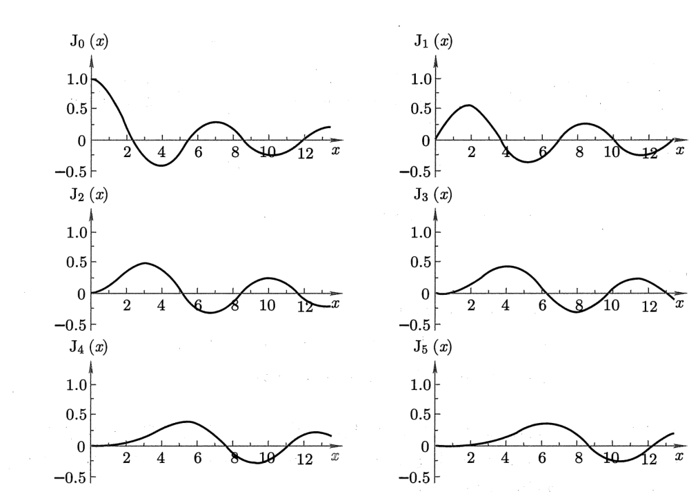
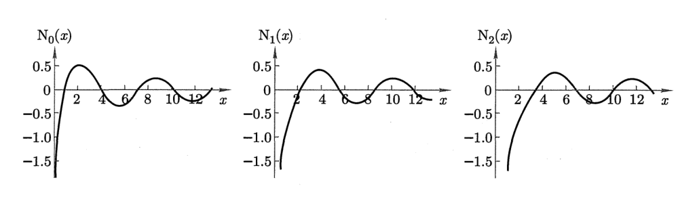
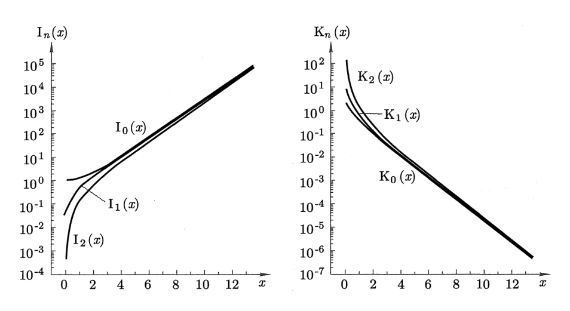
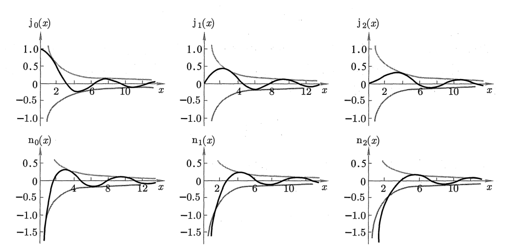

# 第十六章 柱函数

第十四章中将 Helmholtz 方程在柱坐标系下分离变量时，曾经得到常微分方程 (14.91)

$$
\frac{1}{r}\frac{\mathrm{d}}{\mathrm{d}r}\left[r\frac{\mathrm{d}R(r)}{\mathrm{d}r}\right]+\left(k^{2}-\lambda-\frac{\mu}{r^{2}}\right)R(r)=0. \qquad (16.1)
$$

如果 $k^{2}-\lambda\neq0$，则可以作变换 $x=\sqrt{k^{2}-\lambda}\,r$，$y(x)=R(r)$，于是，方程 (16.1) 变为

$$
\frac{1}{x}\frac{\mathrm{d}}{\mathrm{d}x}\left[x\frac{\mathrm{d}y(x)}{\mathrm{d}x}\right]+\left(1-\frac{\nu^{2}}{x^{2}}\right)y(x)=0, \qquad (16.2)
$$

其中 $\mu=\nu^{2}$．方程 (16.2) 称为 ($\nu$ 阶) Bessel 方程．

本章将讨论 Bessel 方程及相关微分方程的解及其性质，以及它们在分离变量法中的应用．

## §16.1 Bessel 函数和 Neumann 函数

Bessel 方程 (16.2) 有两个奇点：$x=0$ 和 $x=\infty$．$x=0$ 是正则奇点，$x=\infty$ 是非正则奇点．在正则奇点 $x=0$ 处，指标 $\rho=\pm\nu$．在第九章中已经求出了 Bessel 方程在 $x=0$ 点的正则解．下面先扼要地罗列一下已经得到的结果．

当 $\nu\neq$ 整数时，Bessel 方程的两个（线性无关）正则解是

$$
\mathrm{J}_{\pm\nu}(x)=\sum_{k=0}^{\infty}\frac{(-)^{k}}{k!\,\Gamma(k\pm\nu+1)}\left(\frac{x}{2}\right)^{2k\pm\nu}, \qquad (16.3)
$$

称为 ($\pm\nu$ 阶) **第一类 Bessel 函数**（简称 Bessel 函数）．图 16.1 中给出了自变量为实数时前几个 $\mathrm{J}_{n}(x)$ 的图形．在表达式 (16.3) 中代入 $\nu=n$ 就可以看出，$\mathrm{J}_{n}(x)$ 具有奇偶性

$$
\mathrm{J}_{n}(-x)=(-)^{n}\mathrm{J}_{n}(x), \qquad (16.4)
$$

所以图 16.1 中只画出了 $x\geqslant0$ 的一半．

如果 $\nu=$ 整数 $n$，则 $\mathrm{J}_{n}(x)$ 和 $\mathrm{J}_{-n}(x)$ 线性相关，

$$
\mathrm{J}_{-n}(x)=(-)^{n}\mathrm{J}_{n}(x).
$$

这一点也可以从 $\mathrm{J}_{\pm\nu}(x)$ 之间的 Wroński 行列式

$$
W\left[\mathrm{J}_{\nu}(x),\mathrm{J}_{-\nu}(x)\right]\equiv
\begin{vmatrix}
\mathrm{J}_{\nu}(x) & \mathrm{J}_{-\nu}(x)\\
\mathrm{J}_{\nu}'(x) & \mathrm{J}_{-\nu}'(x)
\end{vmatrix}
=-\frac{2}{\pi x}\sin\pi\nu \qquad (16.5)
$$

看出（证明见 §9.4）．在此基础上，即可定义**第二类 Bessel 函数**（又称 Neumann 函数）$^{①}$

$$
\mathrm{N}_{\nu}(x)=\frac{\cos\nu\pi\,\mathrm{J}_{\nu}(x)-\mathrm{J}_{-\nu}(x)}{\sin\nu\pi}. \qquad (16.6)
$$

---

① 在有的文献中也写作 $\mathrm{Y}_{\nu}(x)$．

因为它是 $\mathrm{J}_{\pm\nu}(x)$ 的线性组合，所以它也是 Bessel 方程 (16.2) 的解．引进 Neumann 函数 $\mathrm{N}_{\nu}(x)$ 的优点是：不论 $\nu$ 是否为整数，它总与 $\mathrm{J}_{\nu}(x)$ 线性无关．

整数阶的 Neumann 函数 $\mathrm{N}_{n}(x)$，应该理解为 $\nu\to n$ 时 $\mathrm{N}_{\nu}(x)$ 的极限，

$$
\begin{aligned}
\mathrm{N}_{n}(x)&=\lim_{\nu\to n}\frac{\cos\nu\pi\,\mathrm{J}_{\nu}(x)-\mathrm{J}_{-\nu}(x)}{\sin\nu\pi}
=\frac{1}{\pi}\left[\frac{\partial \mathrm{J}_{\nu}(x)}{\partial\nu}-(-)^{n}\frac{\partial \mathrm{J}_{-\nu}(x)}{\partial\nu}\right]_{\nu=n}\\
&=\frac{2}{\pi}\mathrm{J}_{n}(x)\ln\frac{x}{2}-\frac{1}{\pi}\sum_{k=0}^{n-1}\frac{(n-k-1)!}{k!}\left(\frac{x}{2}\right)^{2k-n}\\
&\quad-\frac{1}{\pi}\sum_{k=0}^{\infty}\frac{(-)^{k}}{k!\,(n+k)!}\left[\psi(n+k+1)+\psi(k+1)\right]\left(\frac{x}{2}\right)^{2k+n},\qquad |\arg x|<\pi,
\end{aligned} \qquad (16.7)
$$

并且约定，当 $n=0$ 时要去掉右端第二项的有限和．

前几个 $\mathrm{N}_{n}(x)$ 的图形见图 16.2．

**练习 16.1**　证明 $\mathrm{J}_{\nu}(x)$ 和 $\mathrm{N}_{\nu}(x)$ 无共同零点．

提示：证明若 $\mathrm{J}_{\nu}(x)$ 和 $\mathrm{N}_{\nu}(x)$ 有共同零点，则必线性相关．

**练习 16.2**　证明：$\left.\dfrac{\partial \mathrm{J}_{\nu}(x)}{\partial\nu}\right|_{\nu=0}=\dfrac{\pi}{2}\mathrm{N}_{0}(x)$．

**练习 16.3**　证明：

$$
\mathrm{N}_{-\nu}(z)=\sin\nu\pi\,\mathrm{J}_{\nu}(z)+\cos\nu\pi\,\mathrm{N}_{\nu}(z),
$$

$$
\mathrm{N}_{\nu}(ze^{m\pi\mathrm{i}})=e^{-m\nu\pi\mathrm{i}}\mathrm{N}_{\nu}(z)+2\mathrm{i}\sin m\nu\pi\cot\nu\pi\,\mathrm{J}_{\nu}(z),
$$

$$
\mathrm{N}_{-\nu}(ze^{m\pi\mathrm{i}})=e^{-m\nu\pi\mathrm{i}}\mathrm{N}_{-\nu}(z)+2\mathrm{i}\sin m\nu\pi\csc\nu\pi\,\mathrm{J}_{\nu}(z).
$$

级数表达式是 Bessel 函数的基本表达式，由此可以推出 Bessel 函数的一些其他性质，例如递推关系（见 §16.2）．应用 Bessel 函数的级数表达式，还可以计算某些类型的积分，例如被积函数为指数函数与 Bessel 函数的乘积的无穷积分．

**例 16.1**　计算积分 $\displaystyle\int_{0}^{\infty}e^{-ax}\mathrm{J}_{0}(bx)\,\mathrm{d}x$，$\mathrm{Re}\,a>0$．

**解**　将 Bessel 函数的级数表示代入，并逐项积分：

$$
\begin{aligned}
\int_{0}^{\infty}e^{-ax}\mathrm{J}_{0}(bx)\,\mathrm{d}x&=\int_{0}^{\infty}e^{-ax}\sum_{k=0}^{\infty}\frac{(-)^{k}}{(k!)^{2}}\left(\frac{bx}{2}\right)^{2k}\mathrm{d}x\\
&=\sum_{k=0}^{\infty}\frac{(-)^{k}}{(k!)^{2}}\left(\frac{b}{2}\right)^{2k}\int_{0}^{\infty}e^{-ax}x^{2k}\mathrm{d}x=\sum_{k=0}^{\infty}\frac{(-)^{k}}{(k!)^{2}}\left(\frac{b}{2}\right)^{2k}\frac{(2k)!}{a^{2k+1}}\\
&=\frac{1}{a}\sum_{k=0}^{\infty}\frac{1}{k!}\left(-\frac{1}{2}\right)\left(-\frac{3}{2}\right)\left(-\frac{5}{2}\right)\cdots\left(-\frac{2k-1}{2}\right)\left(\frac{b}{a}\right)^{2k}\\
&=\frac{1}{a}\left[1+\left(\frac{b}{a}\right)^{2}\right]^{-1/2}=\frac{1}{\sqrt{a^{2}+b^{2}}},
\end{aligned} \qquad (16.8)
$$

这种做法的难点是级数求和，求和时还往往要有一定的限制条件．例如在上面求和时就要求 $|b/a|<1$．但就本题而言，容易证明，原来的积分在 $\mathrm{Re}\,a>0$ 的任意闭区域中一致收敛，因而在 $\mathrm{Re}\,a>0$ 的任意区域内解析．而积分出的结果也在同一区域内解析．根据解析延拓的原理，就可以去掉这个限制条件．

从这个积分还可以推出一个有意思的结果．如果将这个积分理解为 Bessel 函数 $\mathrm{J}_{0}(bt)$ 的 Laplace 变换，

$$
\int_{0}^{\infty}\mathrm{J}_{0}(bt)e^{-pt}\mathrm{d}t=\frac{1}{\sqrt{p^{2}+b^{2}}},
$$

那么，根据 Laplace 变换的卷积定理（见 §8.3），就应该有

$$
\int_{0}^{t}\mathrm{J}_{0}(b\tau)\mathrm{J}_{0}(b(t-\tau))\,\mathrm{d}\tau\fallingdotseq\frac{1}{p^{2}+b^{2}}.
$$

另一方面，我们又知道，

$$
\frac{1}{p^{2}+b^{2}}\fallingdotseq\frac{1}{b}\sin bt.
$$

所以，就能得到积分

$$
\int_{0}^{t}\mathrm{J}_{0}(b\tau)\mathrm{J}_{0}(b(t-\tau))\,\mathrm{d}\tau=\frac{1}{b}\sin bt. \qquad (16.9)
$$

## §16.2 Bessel 函数的递推关系

Bessel 函数 $\mathrm{J}_{\pm\nu}(x)$ 的基本递推关系是

$$
\frac{\mathrm{d}}{\mathrm{d}x}\left[x^{\nu}\mathrm{J}_{\nu}(x)\right]=x^{\nu}\mathrm{J}_{\nu-1}(x), \qquad (16.10)
$$

$$
\frac{\mathrm{d}}{\mathrm{d}x}\left[x^{-\nu}\mathrm{J}_{\nu}(x)\right]=-x^{-\nu}\mathrm{J}_{\nu+1}(x). \qquad (16.11)
$$

**证**　先证明 (16.10) 式．为此，直接从 Bessel 函数的级数表达式 (16.3) 出发．由于级数在全复平面收敛，所以可以逐项微商，

$$
\frac{\mathrm{d}}{\mathrm{d}x}\left[x^{\nu}\mathrm{J}_{\nu}(x)\right]=\sum_{k=0}^{\infty}\frac{(-)^{k}}{k!\,\Gamma(k+\nu)}\frac{x^{2k+2\nu-1}}{2^{2k+\nu-1}}=x^{\nu}\mathrm{J}_{\nu-1}(x).
$$

这就是 (16.10) 式．同样，

$$
\frac{\mathrm{d}}{\mathrm{d}x}\left[x^{-\nu}\mathrm{J}_{\nu}(x)\right]=\sum_{k=0}^{\infty}\frac{(-)^{k+1}}{k!\,\Gamma(k+\nu+2)}\frac{x^{2k+1}}{2^{2k+\nu+1}}=-x^{-\nu}\mathrm{J}_{\nu+1}(x).
$$

这样就又证明了 (16.11) 式．$\square$

在这两个递推关系中消去 $\mathrm{J}_{\nu}(x)$ 或 $\mathrm{J}_{\nu}'(x)$，又可以得到两个新的递推关系：

$$
\mathrm{J}_{\nu-1}(x)-\mathrm{J}_{\nu+1}(x)=2\mathrm{J}_{\nu}'(x), \qquad (16.12)
$$

$$
\mathrm{J}_{\nu-1}(x)+\mathrm{J}_{\nu+1}(x)=\frac{2\nu}{x}\mathrm{J}_{\nu}(x). \qquad (16.13)
$$

从这些递推关系可以看出，任意整数阶的 Bessel 函数，总可以用 $\mathrm{J}_{0}(x)$ 和 $\mathrm{J}_{1}(x)$ 表示出来．特别是，在 (16.10)、(16.11) 或 (16.12) 式中令 $\nu=0$，并利用 (16.4) 式的结果，还能得到

$$
\mathrm{J}_{0}'(x)=-\mathrm{J}_{1}(x). \qquad (16.14)
$$

根据 $\mathrm{N}_{\nu}(x)$ 的定义 (16.6) 及 $\mathrm{J}_{\nu}(x)$ 的递推关系 (16.10) 和 (16.11)，可以导出 $\mathrm{N}_{\nu}(x)$ 的递推关系，其形式和 $\mathrm{J}_{\nu}(x)$ 完全相同：

$$
\frac{\mathrm{d}}{\mathrm{d}x}\left[x^{\nu}\mathrm{N}_{\nu}(x)\right]=x^{\nu}\mathrm{N}_{\nu-1}(x), \qquad (16.15)
$$

$$
\frac{\mathrm{d}}{\mathrm{d}x}\left[x^{-\nu}\mathrm{N}_{\nu}(x)\right]=-x^{-\nu}\mathrm{N}_{\nu+1}(x). \qquad (16.16)
$$

**练习 16.4**　证明 $\mathrm{N}_{\nu}(x)$ 的递推关系 (16.15) 和 (16.16) 式．

**练习 16.5**　$\mathrm{J}_{\nu}(x)$ 和 $\mathrm{N}_{\nu}(x)$ 的任意线性组合是否还满足递推关系 (16.15) 和 (16.16)？为什么？

满足递推关系

$$
\frac{\mathrm{d}}{\mathrm{d}x}\left[x^{\nu}\mathrm{C}_{\nu}(x)\right]=x^{\nu}\mathrm{C}_{\nu-1}(x), \qquad (16.17)
$$

$$
\frac{\mathrm{d}}{\mathrm{d}x}\left[x^{-\nu}\mathrm{C}_{\nu}(x)\right]=-x^{-\nu}\mathrm{C}_{\nu+1}(x) \qquad (16.18)
$$

的函数 $\{C_{\nu}(x)\}$ 统称为**柱函数**．可以证明：柱函数一定是 Bessel 方程的解．

第一类 Bessel 函数又称第一类柱函数，第二类 Bessel 函数又称第二类柱函数．除了这两类柱函数之外，还有第三类柱函数，或称为 **Hankel 函数**：

$$
\mathrm{H}_{\nu}^{(1)}(x)\equiv\mathrm{J}_{\nu}(x)+\mathrm{i}\mathrm{N}_{\nu}(x) \qquad (16.19a)
$$

$$
\mathrm{H}_{\nu}^{(2)}(x)\equiv\mathrm{J}_{\nu}(x)-\mathrm{i}\mathrm{N}_{\nu}(x). \qquad (16.19b)
$$

$\mathrm{H}_{\nu}^{(1)}(x)$ 和 $\mathrm{H}_{\nu}^{(2)}(x)$ 更分别称为**第一种和第二种 Hankel 函数**．

**练习 16.6**　证明：

$$
\mathrm{H}_{-\nu}^{(1)}(z)=e^{\nu\pi\mathrm{i}}\mathrm{H}_{\nu}^{(1)}(z),\qquad
\mathrm{H}_{-\nu}^{(2)}(z)=e^{-\nu\pi\mathrm{i}}\mathrm{H}_{\nu}^{(2)}(z).
$$

**练习 16.7**　证明：

$$
\mathrm{H}_{\nu}^{(1)}(ze^{m\pi\mathrm{i}})=\frac{\sin(1-m)\nu\pi}{\sin\nu\pi}\mathrm{H}_{\nu}^{(1)}(z)-e^{-\nu\pi\mathrm{i}}\frac{\sin m\nu\pi}{\sin\nu\pi}\mathrm{H}_{\nu}^{(2)}(z),
$$

$$
\mathrm{H}_{\nu}^{(2)}(ze^{m\pi\mathrm{i}})=\frac{\sin(1+m)\nu\pi}{\sin\nu\pi}\mathrm{H}_{\nu}^{(2)}(z)+e^{\nu\pi\mathrm{i}}\frac{\sin m\nu\pi}{\sin\nu\pi}\mathrm{H}_{\nu}^{(1)}(z).
$$

Bessel 函数递推关系的应用之一，是计算含 Bessel 函数的积分．主要用于被积函数为幂函数与 Bessel 函数的乘积的情形．

**例 16.2**　计算积分 $\displaystyle\int_{0}^{1}(1-x^{2})\mathrm{J}_{0}(\mu x)x\,\mathrm{d}x$，其中 $\mathrm{J}_{0}(\mu)=0$．

**解**　利用递推关系 (16.10)，分部积分，有

$$
\begin{aligned}
\int_{0}^{1}(1-x^{2})\mathrm{J}_{0}(\mu x)x\,\mathrm{d}x&=\int_{0}^{1}(1-x^{2})\frac{1}{\mu}\frac{\mathrm{d}}{\mathrm{d}x}\left[x\mathrm{J}_{1}(\mu x)\right]\mathrm{d}x\\
&=(1-x^{2})\frac{1}{\mu}\left[x\mathrm{J}_{1}(\mu x)\right]_{0}^{1}+\frac{2}{\mu}\int_{0}^{1}x^{2}\mathrm{J}_{1}(\mu x)\,\mathrm{d}x\\
&=\frac{2}{\mu^{2}}x^{2}\mathrm{J}_{2}(\mu x)\Big|_{0}^{1}=\frac{2}{\mu^{2}}\mathrm{J}_{2}(\mu).
\end{aligned}
$$

再令递推关系 (16.13) 中 $\nu=1$，有

$$
\mathrm{J}_{0}(x)+\mathrm{J}_{2}(x)=\frac{2}{x}\mathrm{J}_{1}(x),
$$

并考虑到 $\mathrm{J}_{0}(\mu)=0$，就有

$$
\mathrm{J}_{2}(\mu)=\frac{2}{\mu}\mathrm{J}_{1}(\mu).
$$

代入即得

$$
\int_{0}^{1}(1-x^{2})\mathrm{J}_{0}(\mu x)x\,\mathrm{d}x=\frac{4}{\mu^{3}}\mathrm{J}_{1}(\mu). \qquad (16.20)
$$

下面针对幂函数与 Bessel 函数乘积的积分做一点更普遍的讨论．

首先考虑积分 $\int x^{\mu}\mathrm{J}_{\nu}(x)\mathrm{d}x$．采用递推关系

$$
\frac{\mathrm{d}}{\mathrm{d}x}\left[x^{\nu}\mathrm{J}_{\nu}(x)\right]=x^{\nu}\mathrm{J}_{\nu-1}(x),
$$

反复分部积分，就有

$$
\begin{aligned}
\int x^{\mu}\mathrm{J}_{\nu}(x)\mathrm{d}x&=\int x^{\mu-\nu-1}x^{\nu+1}\mathrm{J}_{\nu}(x)\mathrm{d}x\\
&=x^{\mu-\nu-1}x^{\nu+1}\mathrm{J}_{\nu+1}(x)-(\mu-\nu-1)\int x^{\mu-\nu-2}x^{\nu+1}\mathrm{J}_{\nu+1}(x)\mathrm{d}x\\
&=x^{\mu}\mathrm{J}_{\nu+1}(x)-(\mu-\nu-1)\int x^{\mu-\nu-3}x^{\nu+2}\mathrm{J}_{\nu+1}(x)\mathrm{d}x\\
&=\left[x^{\mu}\mathrm{J}_{\nu+1}(x)-(\mu-\nu-1)x^{\mu-1}\mathrm{J}_{\nu+2}(x)\right]\\
&\quad+(\mu-\nu-1)(\mu-\nu-3)\int x^{\mu-\nu-5}x^{\nu+3}\mathrm{J}_{\nu+2}(x)\mathrm{d}x\\
&=\cdots.
\end{aligned}
$$

每分部积分一次，除了分部积分出的项中再增加一项外，在新出现的积分中，被积函数的幂函数的幂次就降低一次，而 Bessel 函数的阶数则升高 1．这样，分部积分 $n$ 次后，便会遇到积分 $\int x^{\mu-n}\mathrm{J}_{\nu+n}(x)\mathrm{d}x$．若 $(\mu-n)\pm(\nu+n)=1$，即 $\mu+\nu=1$ 或 $\mu-\nu=2n+1$，则这个积分可以表示为有限的形式，并且能够用初等方法积出．

如果改用递推关系

$$
\frac{\mathrm{d}}{\mathrm{d}x}\left[x^{-\nu}\mathrm{J}_{\nu}(x)\right]=-x^{-\nu}\mathrm{J}_{\nu+1}(x)
$$

计算，重复上面的讨论，又可以得到

$$
\begin{aligned}
\int x^{\mu}\mathrm{J}_{\nu}(x)\mathrm{d}x&=\int x^{\mu+\nu-1}x^{-\nu+1}\mathrm{J}_{\nu}(x)\mathrm{d}x\\
&=-x^{\mu+\nu-1}x^{-\nu+1}\mathrm{J}_{\nu-1}(x)-(\mu+\nu-1)\int x^{\mu+\nu-2}x^{-\nu+1}\mathrm{J}_{\nu-1}(x)\mathrm{d}x\\
&=-x^{\mu}\mathrm{J}_{\nu-1}(x)+(\mu+\nu-1)\int x^{\mu-1}\mathrm{J}_{\nu-1}(x)\mathrm{d}x.
\end{aligned}
$$

这样，每分部积分一次，在新出现的积分中，被积函数的幂函数的幂次降低一次，而 Bessel 函数的阶数也降低 1．于是，在分部积分 $n$ 次后，便会遇到积分 $\int x^{\mu-n}\mathrm{J}_{\nu-n}(x)\mathrm{d}x$．若 $(\mu-n)\pm(\nu-n)=1$，即 $\mu-\nu=1$ 或 $\mu+\nu=2n+1$，则此积分也可以表示为有限的形式，也能用初等方法积出．

当 $\mu\pm\nu\neq$ 奇数时，积分

$$
\int x^{\mu}\mathrm{J}_{\nu}(x)\mathrm{d}x
$$

常常会涉及我们不熟悉的特殊函数．例如，

$$
\int_{0}^{z}z^{\nu}\mathrm{J}_{\nu}(z)\,\mathrm{d}z=2^{\nu-1}\sqrt{\pi}\,\Gamma\left(\nu+\frac{1}{2}\right)z\left[\mathrm{J}_{\nu}(z)\mathbf{H}_{\nu-1}(z)-\mathrm{J}_{\nu-1}(z)\mathbf{H}_{\nu}(z)\right].
$$

$\mathbf{H}_{\nu}(z)$ 称为 ($\nu$ 阶) Struve 函数，

$$
\mathbf{H}_{\nu}(z)=\sum_{k=0}^{\infty}\frac{(-)^{k}}{\Gamma(k+3/2)\Gamma(\nu+k+3/2)}\left(\frac{z}{2}\right)^{2k+\nu+1}.
$$

**例 16.3**　根据柱函数的递推关系，证明（任意阶）柱函数 $C_{\nu}(z)$ 的加法公式

$$
C_{\nu}(z+t)=\sum_{m=-\infty}^{\infty}C_{\nu-m}(t)\mathrm{J}_{m}(z),\qquad |z|<|t|.
$$

**证**　考虑右端的无穷级数 $\displaystyle\sum_{m=-\infty}^{\infty}C_{\nu-m}(t)\mathrm{J}_{m}(z)$，

$$
\begin{aligned}
\left(\frac{\partial}{\partial t}-\frac{\partial}{\partial z}\right)\sum_{m=-\infty}^{\infty}C_{\nu-m}(t)\mathrm{J}_{m}(z)
&=\sum_{m=-\infty}^{\infty}\left[C_{\nu-m}'(t)\mathrm{J}_{m}(z)-C_{\nu-m}(t)\mathrm{J}_{m}'(z)\right]\\
&=\frac{1}{2}\sum_{m=-\infty}^{\infty}\left\{\left[C_{\nu-m-1}(t)-C_{\nu-m+1}(t)\right]\mathrm{J}_{m}(z)-C_{\nu-m}(t)\left[\mathrm{J}_{m-1}(z)-\mathrm{J}_{m+1}(z)\right]\right\}.
\end{aligned}
$$

但是

$$
\begin{aligned}
&\sum_{m=-\infty}^{\infty}C_{\nu-m}(t)\left[\mathrm{J}_{m-1}(z)-\mathrm{J}_{m+1}(z)\right]\\
&\quad=\sum_{m=-\infty}^{\infty}C_{\nu-m}(t)\mathrm{J}_{m-1}(z)-\sum_{m=-\infty}^{\infty}C_{\nu-m}(t)\mathrm{J}_{m+1}(z)\\
&\quad=\sum_{m=-\infty}^{\infty}\left[C_{\nu-m-1}(t)-C_{\nu-m+1}(t)\right]\mathrm{J}_{m}(z),
\end{aligned}
$$

因此

$$
\left(\frac{\partial}{\partial t}-\frac{\partial}{\partial z}\right)\sum_{m=-\infty}^{\infty}C_{\nu-m}(t)\mathrm{J}_{m}(z)=0.
$$

这说明此级数的和函数应该是 $t+z$ 的函数，设为 $f(t+z)$，

$$
f(t+z)=\sum_{m=-\infty}^{\infty}C_{\nu-m}(t)\mathrm{J}_{m}(z).
$$

代入 $z=0$，即可定出

$$
f(t)=\sum_{m=-\infty}^{\infty}C_{\nu-m}(t)\mathrm{J}_{m}(0)=C_{\nu}(t).
$$

因此就证得

$$
C_{\nu}(t+z)=\sum_{m=-\infty}^{\infty}C_{\nu-m}(t)\mathrm{J}_{m}(z).
$$

## §16.3 Bessel 函数的渐近展开

Bessel 函数的渐近展开有两种基本类型．一种适用于 $x\to0$，

$$
\mathrm{J}_{\nu}(x)=\frac{1}{\Gamma(\nu+1)}\left(\frac{x}{2}\right)^{\nu}+O\left(x^{\nu+2}\right). \qquad (16.21)
$$

这可以直接由 Bessel 函数的级数表达式 (16.3) 得到．另一种渐近展开适用于 $x\to\infty$，

$$
\mathrm{J}_{\nu}(x)\sim\sqrt{\frac{2}{\pi x}}\cos\left(x-\frac{\nu\pi}{2}-\frac{\pi}{4}\right),\qquad |\arg x|<\pi. \qquad (16.22)
$$

这个公式的推导通常要用到任意阶 Bessel 函数的积分表示，还要用到一种特殊的技巧（鞍点法，或称最陡下降法）．严格的推导可见参考书目 [22] 的第 7 章．在参考书目 [1] 中也给出了整数阶 Bessel 函数渐近展开的证明．本书第九章事实上也曾得到过 Bessel 方程的解的渐近展开，但并不完全，因为在那里并未能证明得到的渐近展开式到底对应于 Bessel 方程的哪一种解式．

当 $x\to0$，$\mathrm{Re}\,\nu>0$ 时，$\mathrm{N}_{\nu}(x)$ 的渐近行为由 $\mathrm{J}_{-\nu}(x)$ 决定：

$$
\mathrm{N}_{\nu}(x)\sim-\frac{\Gamma(\nu)}{\pi}\left(\frac{x}{2}\right)^{-\nu}. \qquad (16.23)
$$

而对于 $\mathrm{N}_{0}(x)$，可由 (16.7) 式直接得到：

$$
\mathrm{N}_{0}(x)\sim\frac{2}{\pi}\ln\frac{x}{2}. \qquad (16.24)
$$

所以，不论 $\nu$ 是否为整数，$\mathrm{N}_{\nu}(x)$ 在 $x=0$ 点都是发散的．

还可以证明，当 $x\to\infty$ 时，Neumann 函数的渐近表达式是

$$
\mathrm{N}_{\nu}(x)\sim\sqrt{\frac{2}{\pi x}}\sin\left(x-\frac{\nu\pi}{2}-\frac{\pi}{4}\right),\qquad |\arg x|<\pi. \qquad (16.25)
$$

将 (12.22)、(12.25) 两式组合起来，又可以得到 Hankel 函数在 $x\to\infty$ 时的渐近表达式

$$
\mathrm{H}_{\nu}^{(1)}(x)\sim\sqrt{\frac{2}{\pi x}}\exp\left[\mathrm{i}\left(x-\frac{\nu\pi}{2}-\frac{\pi}{4}\right)\right],\qquad |\arg x|<\pi, \qquad (16.26a)
$$

$$
\mathrm{H}_{\nu}^{(2)}(x)\sim\sqrt{\frac{2}{\pi x}}\exp\left[-\mathrm{i}\left(x-\frac{\nu\pi}{2}-\frac{\pi}{4}\right)\right],\qquad |\arg x|<\pi. \qquad (16.26b)
$$

在物理学中，柱函数可用于描写柱面波．例如，将 (16.22) 式两端同乘以时间因子 $e^{-\mathrm{i}\omega t}$，并作代换 $x=kr$，则当 $r$ 足够大时，右端即为

$$
\begin{aligned}
&\sqrt{\frac{2}{\pi kr}}\cos\left(kr-\frac{\nu\pi}{2}-\frac{\pi}{4}\right)e^{-\mathrm{i}\omega t}\\
&\quad=\frac{1}{2}\sqrt{\frac{2}{\pi kr}}\left\{\exp\left[\mathrm{i}\left(kr-\frac{\nu\pi}{2}-\frac{\pi}{4}-\omega t\right)\right]+\exp\left[-\mathrm{i}\left(kr-\frac{\nu\pi}{2}-\frac{\pi}{4}+\omega t\right)\right]\right\},
\end{aligned}
$$

如果将 $r$ 理解为柱坐标系中的坐标变量，$k$ 为波数，则此式就可以描写等相位面为柱面

$$
kr-\frac{\nu\pi}{2}-\frac{\pi}{4}\mp\omega t=\text{常数}
$$

的波动过程，准确地说，是等相位面随着时间不断扩大（发散）和收缩（会聚）的两个柱面波的叠加．而且，由于上式中还含有与 $\sqrt{r}$ 成反比的振幅因子，即波动过程的能流密度与 $r$ 成反比，可是由于圆柱的侧面积与 $r$ 成正比，所以单位时间内通过每个圆柱面流过的总能量不变．这就是说，(16.22) 式描述的还是一个不衰减的柱面波．

同样，$\mathrm{N}_{\nu}(x)$ 也可以用来描写柱面波，也是发散的柱面波和会聚的柱面波的叠加．如果仍限定时间因子为 $e^{-\mathrm{i}\omega t}$，则 $\mathrm{H}_{\nu}^{(1)}(x)$ 代表发散波，$\mathrm{H}_{\nu}^{(2)}(x)$ 代表会聚波．

## §16.4 整数阶 Bessel 函数的生成函数和积分表示

Bessel 方程 (16.2) 中的 $\nu^{2}$，即方程 (16.1) 中的 $\mu$，通常是由本征值问题

$$
\Phi''+\mu\Phi=0,
$$

$$
\Phi(0)=\Phi(2\pi),\qquad \Phi'(0)=\Phi'(2\pi)
$$

决定的，$\mu=m^{2}$，$m=0,1,2,\cdots$．因此，本节特别介绍整数阶 Bessel 函数特有的性质．

### 1. 生成函数展开式（§5.5，例 5.9 中已证）

$$
\exp\left[\frac{x}{2}\left(t-\frac{1}{t}\right)\right]=\sum_{n=-\infty}^{\infty}\mathrm{J}_{n}(x)t^{n},\qquad 0<|t|<\infty. \qquad (16.27)
$$

### 2. 积分表示

$$
\mathrm{J}_{n}(x)=\frac{1}{\pi}\int_{0}^{\pi}\cos(x\sin\theta-n\theta)\,\mathrm{d}\theta. \qquad (16.28)
$$

**证**　在 (16.27) 式中令 $t=e^{\mathrm{i}\theta}$，就得到

$$
e^{\mathrm{i}x\sin\theta}=\sum_{n=-\infty}^{\infty}\mathrm{J}_{n}(x)e^{\mathrm{i}n\theta}. \qquad (16.29)
$$

这就是函数 $e^{\mathrm{i}x\sin\theta}$ 的 Fourier 展开式（复数形式）．于是，由 Fourier 展开的系数公式，就能证得

$$
\begin{aligned}
\mathrm{J}_{n}(x)&=\frac{1}{2\pi}\int_{-\pi}^{\pi}e^{\mathrm{i}x\sin\theta}\left(e^{\mathrm{i}n\theta}\right)^{*}\mathrm{d}\theta\\
&=\frac{1}{2\pi}\int_{-\pi}^{\pi}\left[\cos(x\sin\theta-n\theta)+\mathrm{i}\sin(x\sin\theta-n\theta)\right]\mathrm{d}\theta.
\end{aligned}
$$

在右端积分的被积函数中，虚部是奇函数，积分为 0，所以就能直接化为 (16.28) 式．$\square$$\mathrm{J}_{n}(x)$ 的积分表示，也可以用来计算含 Bessel 函数的积分．例如对于例 16.1 中的积分，有

$$
\begin{aligned}
\int_{0}^{\infty}e^{-ax}\mathrm{J}_{0}(bx)\mathrm{d}x&=\int_{0}^{\infty}e^{-ax}\left[\frac{1}{2\pi}\int_{-\pi}^{\pi}e^{\mathrm{i}bx\sin\theta}\mathrm{d}\theta\right]\mathrm{d}x\\
&=\frac{1}{2\pi}\int_{-\pi}^{\pi}\mathrm{d}\theta\int_{0}^{\infty}e^{-(a-\mathrm{i}b\sin\theta)x}\mathrm{d}x\\
&=\frac{1}{2\pi}\int_{-\pi}^{\pi}\frac{\mathrm{d}\theta}{a-\mathrm{i}b\sin\theta}.
\end{aligned}
$$

用留数定理计算这个积分，

$$
\begin{aligned}
\int_{0}^{\infty}e^{-ax}\mathrm{J}_{0}(bx)\mathrm{d}x&=\frac{1}{2\pi\mathrm{i}}\oint_{|z|=1}\frac{2\mathrm{d}z}{-bz^{2}+2az+b}\\
&=\left.\frac{1}{-bz+a}\right|_{z=(a-\sqrt{a^{2}+b^{2}})/b}=\frac{1}{\sqrt{a^{2}+b^{2}}}.
\end{aligned}
$$

就本题而言，这种做法要比代入 Bessel 函数的级数表达式更容易些，因为现在的计算步骤明确，不像级数求和更具有技巧性．这种做法的另一个好处是不需作解析延拓．

上面的计算显然不适用于 $\mathrm{Re}\,\alpha=0$ 的情形．当 $\mathrm{Re}\,\alpha=0$ 时，我们实际上遇到的是 Bessel 函数与三角函数乘积的积分，例如 $\displaystyle\int_{0}^{\infty}\mathrm{J}_{0}(\beta x)\cos\alpha x\,\mathrm{d}x$，其中 $\alpha$，$\beta$ 均为正数．仍然用 (16.28) 式代入，交换积分次序，则有

$$
\begin{aligned}
\int_{0}^{\infty}\mathrm{J}_{0}(\beta x)\cos\alpha x\,\mathrm{d}x&=\frac{1}{\pi}\int_{0}^{\pi}\mathrm{d}\theta\int_{0}^{\infty}\cos\alpha x\cos(\beta x\sin\theta)\mathrm{d}x\\
&=\frac{1}{2\pi}\int_{0}^{\pi}\mathrm{d}\theta\int_{0}^{\infty}\left[\cos(\alpha-\beta\sin\theta)x+\cos(\alpha+\beta\sin\theta)x\right]\mathrm{d}x\\
&=\frac{1}{4\pi}\int_{0}^{\pi}\mathrm{d}\theta\int_{-\infty}^{\infty}\left[e^{\mathrm{i}(\alpha-\beta\sin\theta)x}+e^{\mathrm{i}(\alpha+\beta\sin\theta)x}\right]\mathrm{d}x\\
&=\frac{1}{2}\int_{0}^{\pi}\left[\delta(\alpha-\beta\sin\theta)+\delta(\alpha+\beta\sin\theta)\right]\mathrm{d}\theta\\
&=\frac{1}{2}\int_{0}^{\pi}\delta(\alpha-\beta\sin\theta)\mathrm{d}\theta=\int_{0}^{\pi/2}\delta(\alpha-\beta\sin\theta)\mathrm{d}\theta.
\end{aligned}
$$

令 $t=\beta\sin\theta$，上面的积分就能化为

$$
\int_{0}^{\infty}\mathrm{J}_{0}(\beta x)\cos\alpha x\,\mathrm{d}x=\int_{0}^{\beta}\frac{\delta(\alpha-t)}{\sqrt{\beta^{2}-t^{2}}}\mathrm{d}t.
$$

需要区分 $\alpha<\beta$，$\alpha>\beta$ 和 $\alpha=\beta$ 的三种情形．当 $\alpha<\beta$ 时，积分区间中含有 $t=\alpha$ 点，所以

$$
\int_{0}^{\infty}\mathrm{J}_{0}(\beta x)\cos\alpha x\,\mathrm{d}x=\left.\frac{1}{\sqrt{\beta^{2}-t^{2}}}\right|_{t=\alpha}=\frac{1}{\sqrt{\beta^{2}-\alpha^{2}}}.
$$

当 $\alpha>\beta$ 时，积分区间中不含有 $t=\alpha$ 点，所以

$$
\int_{0}^{\infty}\mathrm{J}_{0}(\beta x)\cos\alpha x\,\mathrm{d}x=0.
$$

$\alpha=\beta$ 的情形需要特别的分析．因为 $\displaystyle\int_{0}^{\infty}\mathrm{J}_{0}(\beta x)\cos\alpha x\,\mathrm{d}x$ 是一个反常积分，其反常性表现在积分上限为 $\infty$，因此，当 $x$ 足够大时，不妨将被积函数中的 $\mathrm{J}_{0}(\beta x)$ 用渐近展开代入：

$$
\begin{aligned}
\mathrm{J}_{0}(\beta x)\cos\alpha x&\sim\sqrt{\frac{2}{\pi x}}\cos\left(\beta x-\frac{\pi}{4}\right)\cos\alpha x\\
&=\frac{1}{\sqrt{2\pi x}}\left[\cos(\beta-\alpha)x+\cos(\beta+\alpha)x+\sin(\beta-\alpha)x+\sin(\beta+\alpha)x\right].
\end{aligned}
$$

这就明白地表现出被积函数的主要特征．我们也就能够理解为什么当 $\beta\neq\alpha$ 时积分收敛．但是，当 $\beta=\alpha$ 时，

$$
\mathrm{J}_{0}(\alpha x)\cos\alpha x\sim\frac{1}{\sqrt{2\pi x}}\left(1+\cos2\alpha x+\sin2\alpha x\right),
$$

$1/\sqrt{2\pi x}$ 项的存在，使得反常积分不再收敛，

$$
\int_{0}^{\infty}\mathrm{J}_{0}(\alpha x)\cos\alpha x\,\mathrm{d}x=\infty.
$$

把上面的三种情形写到一起，就是

$$
\int_{0}^{\infty}\mathrm{J}_{0}(\beta x)\cos\alpha x\,\mathrm{d}x=
\begin{cases}
\dfrac{1}{\sqrt{\beta^{2}-\alpha^{2}}}, & \alpha<\beta,\\[2mm]
\infty, & \alpha=\beta,\\[2mm]
0, & \alpha>\beta.
\end{cases} \qquad (16.30)
$$

Bessel 函数与三角函数乘积的积分，一般说来都比较复杂，在很多情况下积分值是间断函数．考虑到反常积分的收敛性，在积分方法的选择上，需要特别小心．

如果在 (16.27) 式中令 $t=\mathrm{i}e^{\mathrm{i}\theta}$，还可以得到

$$
e^{\mathrm{i}x\cos\theta}=\sum_{n=-\infty}^{\infty}\mathrm{J}_{n}(x)\mathrm{i}^{n}e^{\mathrm{i}n\theta}=\mathrm{J}_{0}(x)+2\sum_{n=1}^{\infty}\mathrm{i}^{n}\mathrm{J}_{n}(x)\cos n\theta. \qquad (16.31)
$$

我们又能得到 Bessel 函数的另一个积分表示：

$$
\mathrm{J}_{n}(x)=\frac{\mathrm{i}^{-n}}{\pi}\int_{0}^{\pi}e^{\mathrm{i}x\cos\theta}\cos n\theta\,\mathrm{d}\theta. \qquad (16.32)
$$

对于 (16.31) 式还可以有另一种解读：如果令 $x=kr$，于是就有

$$
e^{\mathrm{i}kr\cos\theta}=\mathrm{J}_{0}(kr)+2\sum_{n=1}^{\infty}\mathrm{i}^{n}\mathrm{J}_{n}(kr)\cos n\theta. \qquad (16.31')
$$

把 (16.31′) 式中的 $r$ 和 $\theta$ 理解为柱坐标系中的坐标变量，并且把 $k$ 理解为波数，同时取相位的时间因子为 $e^{-\mathrm{i}\omega t}$，则上式两端都分别对应于波动过程相位因子的空间部分：左端是沿正 $x$ 轴方向传播$^{①}$的平面波，因为它的等相位面是

$$
kr\cos\theta-\omega t=\text{常数}.
$$

---

① 传播方向与相位的时间因子的规定有关．如果取时间因子为 $e^{\mathrm{i}\omega t}$，这个平面波就是向负 $x$ 轴方向传播的．

而右端各项中的 $\mathrm{J}_{0}(kr)$ 和 $\mathrm{J}_{n}(kr)$ 描述的是柱面波（见 §16.3）．因此，就可以赋予 (16.31′) 式一个物理上的解释：平面波按柱面波展开．

## §16.5 Bessel 方程的本征值问题

现在从一个具体问题入手，讨论 Bessel 方程的本征值问题．要讨论的问题是：求四周固定的圆形薄膜的固有频率．

注意，这个问题不同于过去讨论过的偏微分方程定解问题：现在并没有给出初始条件，所要求的也不是描写圆形薄膜振动的位移如何随时间和空间而变化．现在要求的是固有频率，即求出给定偏微分方程和边界条件下的所有各种振动模式的角频率．也正是因为现在的问题中并没有给出初始条件，所以也不能得出位移转动不变的结论．

取平面极坐标系，坐标原点放置在圆形薄膜的中心．这样，偏微分方程和边界条件就是

$$
\frac{\partial^{2}u}{\partial t^{2}}-c^{2}\left[\frac{1}{r}\frac{\partial}{\partial r}\left(r\frac{\partial u}{\partial r}\right)+\frac{1}{r^{2}}\frac{\partial^{2}u}{\partial\phi^{2}}\right]=0, \qquad (16.33\mathrm{a})
$$

$$
u\big|_{r=0}\ \text{有界},\qquad u\big|_{r=a}=0, \qquad (16.33\mathrm{b})
$$

$$
u\big|_{\phi=0}=u\big|_{\phi=2\pi},\qquad \left.\frac{\partial u}{\partial\phi}\right|_{\phi=0}=\left.\frac{\partial u}{\partial\phi}\right|_{\phi=2\pi}. \qquad (16.33\mathrm{c})
$$

现在要求的就是在边界条件 (16.33b) 和 (16.33c) 的限制下，到底许可哪些 $\omega$ 值，使得方程 (16.33a) 有非零解

$$
u(r,\phi,t)=v(r,\phi)e^{\mathrm{i}\omega t}. \qquad (16.34)
$$

将此解式代入方程 (16.33a) 及边界条件 (16.33b) 和 (16.33c)，并令 $k=\omega/c$，就可以得到下列偏微分方程的本征值问题：

$$
\frac{1}{r}\frac{\partial}{\partial r}\left(r\frac{\partial v}{\partial r}\right)+\frac{1}{r^{2}}\frac{\partial^{2}v}{\partial\phi^{2}}+k^{2}v=0,
$$

$$
v\big|_{r=0}\ \text{有界},\qquad v\big|_{r=a}=0,
$$

$$
v\big|_{\phi=0}=v\big|_{\phi=2\pi},\qquad \left.\frac{\partial v}{\partial\phi}\right|_{\phi=0}=\left.\frac{\partial v}{\partial\phi}\right|_{\phi=2\pi}.
$$

再令 $v(r,\phi)=R(r)\Phi(\phi)$，分离变量，就分解为两个常微分方程的本征值问题

$$
\Phi''(\phi)+\lambda\Phi(\phi)=0, \qquad (16.35\mathrm{a})
$$

$$
\Phi(0)=\Phi(2\pi),\qquad \Phi'(0)=\Phi'(2\pi) \qquad (16.35\mathrm{b})
$$

和

$$
\frac{1}{r}\frac{\mathrm{d}}{\mathrm{d}r}\left[r\frac{\mathrm{d}R(r)}{\mathrm{d}r}\right]+\left(k^{2}-\frac{\lambda}{r^{2}}\right)R(r)=0, \qquad (16.36\mathrm{a})
$$

$$
R(0)\ \text{有界},\qquad R(a)=0. \qquad (16.36\mathrm{b})
$$

本征值问题 (16.35) 已经多次见到过，它的解是

$$
\text{本征值}\qquad \lambda_{m}=m^{2},\qquad m=0,1,2,3,\cdots,
$$

$$
\text{本征函数}\qquad \Phi_{m}(\phi)=
\begin{cases}
\cos m\phi, & m=0,1,2,\cdots,\\
\sin m\phi, & m=1,2,3,\cdots.
\end{cases}
$$

所以，在本征值问题 (16.36) 中，参数 $\lambda=m^{2}$ 是已知的，而本征值 $k^{2}$ 待求．

将 (16.36a) 式两端乘以 $rR^{*}(r)$，再积分，就可以得到

$$
k^{2}\int_{0}^{a}R(r)R^{*}(r)r\mathrm{d}r=m^{2}\int_{0}^{a}R(r)R^{*}(r)\frac{\mathrm{d}r}{r}+\int_{0}^{a}\frac{\mathrm{d}R(r)}{\mathrm{d}r}\frac{\mathrm{d}R^{*}(r)}{\mathrm{d}r}r\mathrm{d}r,
$$

所以，一定有本征值 $k^{2}>0$．通过作变换 $x=kr$，$y(x)=R(r)$，就可以将微分方程 (16.36a) 化为 Bessel 方程，从而求得它的通解

$$
R(r)=C\mathrm{J}_{m}(kr)+D\mathrm{N}_{m}(kr). \qquad (16.37)
$$

考虑到边界条件 (16.36b) 的要求，$R(0)$ 有界，故 $D=0$．又由于要求 $R(a)=0$，就得到

$$
\mathrm{J}_{m}(ka)=0. \qquad (16.38)
$$

将 $m$ 阶 Bessel 函数 $\mathrm{J}_{m}(x)$ 的第 $i$ 个正零点（由小到大排列）记作 $\mu_{i}^{(m)}$，$i=1,2,3,\cdots$，则本征值问题 (16.36) 的解是

$$
\text{本征值}\qquad k_{mi}^{2}=\left(\frac{\mu_{i}^{(m)}}{a}\right)^{2},\qquad i=1,2,3,\cdots, \qquad (16.39\mathrm{a})
$$

$$
\text{本征函数}\qquad R_{mi}(r)=\mathrm{J}_{m}(k_{mi}r). \qquad (16.39\mathrm{b})
$$

于是就求得了圆形薄膜的固有振动的角频率

$$
\omega_{mi}=\frac{\mu_{i}^{(m)}}{a}c, \qquad (16.40)
$$

其中 $\mu_{i}^{(m)}$ 是 $m$ 阶 Bessel 函数 $\mathrm{J}_{m}(x)$ 的第 $i$ 个正零点．

在上述求解过程中，实际上用到了有关 $\mathrm{J}_{\nu}(x)$ 零点的结论：当 $\nu>-1$ 或为整数时，$\mathrm{J}_{\nu}(x)$ 有无穷多个零点，它们全部都是实数，对称地分布在实轴上．

为了在分离变量法中的应用，自然要讨论上面得到的本征函数的正交归一关系．下面介绍一种和上一章不同的做法，也可以同时得到本征函数的正交归一关系．

首先，写出本征函数 $R_{mi}(r)=\mathrm{J}_{m}(k_{mi}r)$ 所满足的微分方程和边界条件：

$$
\frac{1}{r}\frac{\mathrm{d}}{\mathrm{d}r}\left[r\frac{\mathrm{d}\mathrm{J}_{m}(k_{mi}r)}{\mathrm{d}r}\right]+\left(k_{mi}^{2}-\frac{m^{2}}{r^{2}}\right)\mathrm{J}_{m}(k_{mi}r)=0, \qquad (16.41\mathrm{a})
$$

$$
\mathrm{J}_{m}(0)\ \text{有界},\qquad \mathrm{J}_{m}(k_{mi}a)=0. \qquad (16.41\mathrm{b})
$$

同时，再写出函数 $R(r)=\mathrm{J}_{m}(kr)$ 所满足的微分方程和边界条件：

$$
\frac{1}{r}\frac{\mathrm{d}}{\mathrm{d}r}\left[r\frac{\mathrm{d}\mathrm{J}_{m}(kr)}{\mathrm{d}r}\right]+\left(k^{2}-\frac{m^{2}}{r^{2}}\right)\mathrm{J}_{m}(kr)=0, \qquad (16.42\mathrm{a})
$$

$$
\mathrm{J}_{m}(0)\ \text{有界}. \qquad (16.42\mathrm{b})
$$

由于其中的 $k$ 为任意实数，所以一般说来，不会有 $\mathrm{J}_{m}(ka)=0$．

再用 $r\mathrm{J}_{m}(kr)$ 和 $r\mathrm{J}_{m}(k_{mi}r)$ 分别乘方程 (16.41a) 和 (16.42a)，相减，并在区间 $[0,a]$ 上积分，就得到

$$
\left(k_{mi}^{2}-k^{2}\right)\int_{0}^{a}\mathrm{J}_{m}(k_{mi}r)\mathrm{J}_{m}(kr)r\mathrm{d}r
=r\left[\mathrm{J}_{m}(k_{mi}r)\frac{\mathrm{d}\mathrm{J}_{m}(kr)}{\mathrm{d}r}-\mathrm{J}_{m}(kr)\frac{\mathrm{d}\mathrm{J}_{m}(k_{mi}r)}{\mathrm{d}r}\right]_{r=0}^{r=a}.
$$

代入边界条件 (16.41b) 和 (16.42b)，可以将上面的结果化为

$$
\left(k_{mi}^{2}-k^{2}\right)\int_{0}^{a}\mathrm{J}_{m}(k_{mi}r)\mathrm{J}_{m}(kr)r\mathrm{d}r
=-k_{mi}a\mathrm{J}_{m}(ka)\mathrm{J}_{m}'(k_{mi}a). \qquad (16.43)
$$

我们对两个特殊情形感兴趣．第一种情形是 $k=k_{mj}\neq k_{mi}$．这时就有 $\mathrm{J}_{m}(k_{mj}a)=0$，因此 (16.43) 式的右端为 0．但由于 $k_{mj}\neq k_{mi}$，所以

$$
\int_{0}^{a}\mathrm{J}_{m}(k_{mi}r)\mathrm{J}_{m}(k_{mj}r)r\mathrm{d}r=0,\qquad k_{mi}\neq k_{mj}, \qquad (16.44)
$$

即对应于不同本征值的本征函数在区间 $[0,a]$ 上以权函数 $r$ 正交．

另一种情形是 $k=k_{mi}$，这时 (16.43) 式的两端均为 0．我们可以先将 (16.43) 式的两端同除以 $k_{mi}^{2}-k^{2}$，然后取极限 $k\to k_{mi}$，这样就得到

$$
\int_{0}^{a}\mathrm{J}_{m}^{2}(k_{mi}r)r\mathrm{d}r
=-\lim_{k\to k_{mi}}\frac{k_{mi}a}{k_{mi}^{2}-k^{2}}\mathrm{J}_{m}(ka)\mathrm{J}_{m}'(k_{mi}a)
=\frac{a^{2}}{2}\left[\mathrm{J}_{m}'(k_{mi}a)\right]^{2}. \qquad (16.45)
$$

这正是本征函数 $\mathrm{J}_{m}(k_{mi}r)$ 的模方．

如果将本征值问题 (16.41b) 中 $r=a$ 端的齐次边界条件改为第二类或第三类边界条件，也可以类似地讨论．

**练习 16.8**　将边界条件 (16.41b) 改为

$$
u\big|_{r=0}\ \text{有界},\qquad \left.\frac{\partial u}{\partial r}\right|_{r=a}=0,
$$

重复以上的讨论．

**练习 16.9**　将边界条件 (16.41b) 改为

$$
u\big|_{r=0}\ \text{有界},\qquad \left(\frac{\partial u}{\partial r}\sin\theta+u\cos\theta\right)_{r=a}=0,
$$

其中已知常数 $0\leqslant\theta\leqslant\pi/2$，重复以上的讨论．

事实上，可以把这三种情形统一写成

$$
\frac{1}{r}\frac{\mathrm{d}}{\mathrm{d}r}\left[r\frac{\mathrm{d}R(r)}{\mathrm{d}r}\right]+\left(k^{2}-\frac{m^{2}}{r^{2}}\right)R(r)=0, \qquad (16.46\mathrm{a})
$$

$$
R(0)\ \text{有界},\qquad R'(a)\sin\beta+R(a)\cos\beta=0, \qquad (16.46\mathrm{b})
$$

其中 $\beta\in[0,\pi/2]$ 为已知常数．如果 $\beta=0$，则是第一类边界条件；如果 $\beta=\pi/2$，就是第二类边界条件；如果 $0<\beta<\pi/2$，则为第三类边界条件．

关于 Bessel 函数族的完备性，这里只给出结论：如果函数 $f(r)$ 在区间 $[0,a]$ 上连续，且只有有限个极大和极小，则可按本征函数 $\mathrm{J}_{m}(k_{i}r)$ 展开：

$$
f(r)=\sum_{i=1}^{\infty}b_{i}\mathrm{J}_{m}(k_{i}r), \qquad (16.47)
$$

其中 $\mathrm{J}_{m}(k_{i}r)$ 是本征值问题 (16.46) 的解，而展开系数为

$$
b_{i}=\frac{\displaystyle\int_{0}^{a}f(r)\mathrm{J}_{m}(k_{i}r)r\mathrm{d}r}{\displaystyle\int_{0}^{a}\mathrm{J}_{m}^{2}(k_{i}r)r\mathrm{d}r}. \qquad (16.48)
$$

这样得到的级数在区间 $[\delta,a-\delta]$（$\delta>0$）上是一致收敛的．证明见参考书目 [15] 的 §16.33．该书中还有更普遍的展开定理．

**例 16.4**　圆柱体的冷却．

设有一个无穷长的圆柱体，半径为 $a$．很自然地我们应该选用柱坐标系，$z$ 轴即为圆柱体的轴．如果柱体的表面温度维持为 0，初温为 $u_{0}f(r)$，试求柱体内温度的分布和变化．

**解**　显然温度 $u$ 与 $\phi$、$z$ 无关，即 $u=u(r,t)$．它由定解问题

$$
\frac{\partial u}{\partial t}-\frac{\kappa}{r}\frac{\partial}{\partial r}\left(r\frac{\partial u}{\partial r}\right)=0, \qquad (16.49\mathrm{a})
$$

$$
u\big|_{r=0}\ \text{有界},\qquad u\big|_{r=a}=0, \qquad (16.49\mathrm{b})
$$

$$
u\big|_{t=0}=u_{0}f(r) \qquad (16.49\mathrm{c})
$$

决定．根据前面的一般讨论，容易写出满足方程 (16.49a) 及边界条件 (16.49b) 的一般解

$$
u(r,t)=\sum_{i=1}^{\infty}c_{i}\mathrm{J}_{0}\left(\frac{\mu_{i}}{a}r\right)\exp\left[-\kappa\left(\frac{\mu_{i}}{a}\right)^{2}t\right], \qquad (16.50)
$$

其中 $\mu_{i}$ 是 $\mathrm{J}_{0}(x)$ 的第 $i$ 个正零点．代入初条件，有

$$
u(r,t)\big|_{t=0}=\sum_{i=1}^{\infty}c_{i}\mathrm{J}_{0}\left(\frac{\mu_{i}}{a}r\right)=u_{0}f(r).
$$

所以

$$
c_{i}=\frac{2u_{0}}{a^{2}\mathrm{J}_{1}^{2}(\mu_{i})}\int_{0}^{a}f(r)\mathrm{J}_{0}\left(\frac{\mu_{i}}{a}r\right)r\mathrm{d}r. \qquad (16.51)
$$

知道了 $f(r)$ 的具体形式，就可以算出上面的积分．例如，若

$$
f(r)=1-\left(\frac{r}{a}\right)^{2}, \qquad (16.52)
$$

便有

$$
c_{i}=\frac{2u_{0}}{a^{2}\mathrm{J}_{1}^{2}(\mu_{i})}\int_{0}^{a}\left[1-\left(\frac{r}{a}\right)^{2}\right]\mathrm{J}_{0}\left(\frac{\mu_{i}}{a}r\right)r\mathrm{d}r=\frac{8u_{0}}{\mu_{i}^{3}\mathrm{J}_{1}(\mu_{i})}. \qquad (16.53)
$$

最后一步用到了例 16.2 中的计算结果（见 (16.20) 式）．

将本题得到的结果

$$
1-x^{2}=8\sum_{i=1}^{\infty}\frac{1}{\mu_{i}^{3}\mathrm{J}_{1}(\mu_{i})}\mathrm{J}_{0}(\mu_{i}x)
$$

两端微商，并令 $x=1$，还可以导出一个有意思的结果：

$$
\sum_{i=1}^{\infty}\frac{1}{\mu_{i}^{2}}=\frac{1}{4}. \qquad (16.54)
$$

**例 16.5**　圆环作平面径向振动的固有频率．设圆环的内外半径分别为 $a$ 和 $b$．若内边界（内圆）固定，外边界（外圆）自由，求圆环作平面径向振动的固有频率．

**解**　显然应该选用平面极坐标系，则位移（矢量）$\boldsymbol{u}=u\boldsymbol{e}_{r}$ 满足的波动方程为

$$
\frac{\partial^{2}\boldsymbol{u}}{\partial t^{2}}-c^{2}\nabla^{2}\boldsymbol{u}=0. \qquad (16.55)
$$

因为（见 (14.54) 式）

$$
\nabla^{2}\boldsymbol{u}\equiv\nabla^{2}(u\boldsymbol{e}_{r})=\left(\nabla^{2}u-\frac{u}{r^{2}}\right)\boldsymbol{e}_{r}+\frac{2}{r^{2}}\frac{\partial u}{\partial\phi}\boldsymbol{e}_{\phi},
$$

所以方程 (16.55) 等价于偏微分方程组

$$
\frac{\partial^{2}u}{\partial t^{2}}-c^{2}\left(\nabla^{2}u-\frac{u}{r^{2}}\right)=0,\qquad \frac{\partial u}{\partial\phi}=0. \qquad (16.55')
$$

由此可见，径向位移与 $\phi$ 无关，$u=u(r,t)$ 满足微分方程和边界条件

$$
\frac{\partial^{2}u}{\partial t^{2}}-c^{2}\left[\frac{1}{r}\frac{\partial}{\partial r}\left(r\frac{\partial u}{\partial r}\right)-\frac{u}{r^{2}}\right]=0, \qquad (16.56\mathrm{a})
$$

$$
u\big|_{r=a}=0,\qquad \left.\frac{\partial u}{\partial r}\right|_{r=b}=0. \qquad (16.56\mathrm{b})
$$

令 $u(r,t)=R(r)e^{-\mathrm{i}\omega t}$，$k=\omega/c$，代入 (16.56)，便得到

$$
\frac{1}{r}\frac{\mathrm{d}}{\mathrm{d}r}\left[r\frac{\mathrm{d}R(r)}{\mathrm{d}r}\right]+\left(k^{2}-\frac{1}{r^{2}}\right)R(r)=0, \qquad (16.57\mathrm{a})
$$

$$
R(a)=0,\qquad R'(b)=0. \qquad (16.57\mathrm{b})
$$

容易证明，$k=0$ 时本征值问题 (16.57) 无解．于是，可作变换 $x=kr$ 和 $y(x)=R(r)$，而将方程 (16.57a) 化为 Bessel 方程，由此即可得到方程 (16.57a) 的通解

$$
R(r)=C\mathrm{J}_{1}(kr)+D\mathrm{N}_{1}(kr).
$$

代入边界条件 (16.57b)，即得

$$
C\mathrm{J}_{1}(ka)+D\mathrm{N}_{1}(ka)=0,\qquad C\mathrm{J}_{1}'(kb)+D\mathrm{N}_{1}'(kb)=0.
$$

这可以看成是关于 $C$ 和 $D$ 的线性代数方程组，有非零解的充分必要条件是

$$
\begin{vmatrix}
\mathrm{J}_{1}(ka) & \mathrm{N}_{1}(ka)\\
\mathrm{J}_{1}'(kb) & \mathrm{N}_{1}'(kb)
\end{vmatrix}=0.
$$

由此超越方程就可以求得圆环作平面径向振动的固有频率 $\omega_{i}=k_{i}c$，其中 $k_{i}$ 是

$$
\mathrm{J}_{1}(ka)\mathrm{N}_{1}'(kb)-\mathrm{N}_{1}(ka)\mathrm{J}_{1}'(kb)=0 \qquad (16.58)
$$

的第 $i$ 个正根（由小到大排列）．求出 $C$ 和 $D$，就可写出相应的固有振动模式

$$
u_{i}(r,t)=\left[\mathrm{N}_{1}(k_{i}a)\mathrm{J}_{1}(k_{i}r)-\mathrm{J}_{1}(k_{i}a)\mathrm{N}_{1}(k_{i}r)\right]e^{-\mathrm{i}k_{i}ct}. \qquad (16.59)
$$

**练习 16.10**　例 16.5 中的本征函数是

$$
R_{i}(r)=\mathrm{N}_{1}(k_{i}a)\mathrm{J}_{1}(k_{i}r)-\mathrm{J}_{1}(k_{i}a)\mathrm{N}_{1}(k_{i}r).
$$

试讨论本征函数的正交归一性质．

## *§16.6 虚宗量 Bessel 函数

从原则上说，在 Bessel 函数乃至 Neumann 函数和 Hankel 函数的定义中，它们的宗量本来就可以是复数．但是，为了实用上的方便，对于 Bessel 函数的宗量为纯虚数的情形还是值得做一些分析讨论，并进一步定义两类虚宗量的 Bessel 函数（或称修正的 Bessel 函数）．

不妨仍然从偏微分方程的定解问题出发，来引进虚宗量的 Bessel 函数．例如，假设有圆柱体内的 Laplace 方程定解问题

$$
\frac{1}{r}\frac{\partial}{\partial r}\left(r\frac{\partial u}{\partial r}\right)+\frac{1}{r^{2}}\frac{\partial^{2}u}{\partial\phi^{2}}+\frac{\partial^{2}u}{\partial z^{2}}=0, \qquad (16.60\mathrm{a})
$$

$$
u\big|_{\phi=0}=u\big|_{\phi=2\pi},\qquad \left.\frac{\partial u}{\partial\phi}\right|_{\phi=0}=\left.\frac{\partial u}{\partial\phi}\right|_{\phi=2\pi}, \qquad (16.60\mathrm{b})
$$

$$
u\big|_{z=0}=0,\qquad u\big|_{z=h}=0, \qquad (16.60\mathrm{c})
$$

$$
u\big|_{r=0}\ \text{有界},\qquad u\big|_{r=a}=f(\phi,z). \qquad (16.60\mathrm{d})
$$

按照分离变量法的标准做法，令

$$
u(r,\phi,z)=R(r)\Phi(\phi)Z(z),
$$

代入方程 (16.60a) 以及边界条件 (16.60b) 和 (16.60c)，分离变量，就会得到本征值问题

$$
\Phi''(\phi)+\mu\Phi(\phi)=0, \qquad (16.61\mathrm{a})
$$

$$
\Phi(0)=\Phi(2\pi),\qquad \Phi'(0)=\Phi'(2\pi) \qquad (16.61\mathrm{b})
$$

和

$$
Z''(z)+\lambda Z(z)=0, \qquad (16.62\mathrm{a})
$$

$$
Z(0)=0,\qquad Z(h)=0, \qquad (16.62\mathrm{b})
$$

以及常微分方程

$$
\frac{1}{r}\frac{\mathrm{d}}{\mathrm{d}r}\left(r\frac{\mathrm{d}R}{\mathrm{d}r}\right)-\left(\lambda+\frac{\mu}{r^{2}}\right)R=0. \qquad (16.63)
$$

由本征值问题 (16.61)，可以得到

$$
\text{本征值}\qquad \mu_{m}=m^{2},\qquad m=0,1,2,\cdots, \qquad (16.64\mathrm{a})
$$

$$
\text{本征函数}\qquad \Phi_{m}(\phi)=
\begin{cases}
\cos m\phi,\\
\sin m\phi.
\end{cases} \qquad (16.64\mathrm{b})
$$

再由本征值问题 (16.62)，又可求得

$$
\text{本征值}\qquad \lambda_{n}=\left(\frac{n\pi}{h}\right)^{2},\qquad n=1,2,3,\cdots, \qquad (16.65\mathrm{a})
$$

$$
\text{本征函数}\qquad Z_{n}(z)=\sin\frac{n\pi}{h}z. \qquad (16.65\mathrm{b})
$$

这样，常微分方程 (16.63) 就变成

$$
\frac{1}{r}\frac{\mathrm{d}}{\mathrm{d}r}\left(r\frac{\mathrm{d}R}{\mathrm{d}r}\right)-\left[\left(\frac{n\pi}{h}\right)^{2}+\frac{m^{2}}{r^{2}}\right]R=0. \qquad (16.63')
$$

作变换 $x=(n\pi/h)r$ 和 $y(x)=R(r)$，就可以将此方程化为

$$
\frac{1}{x}\frac{\mathrm{d}}{\mathrm{d}x}\left(x\frac{\mathrm{d}y}{\mathrm{d}x}\right)-\left(1+\frac{m^{2}}{x^{2}}\right)y=0. \qquad (16.66)
$$

这个方程称为**虚宗量 Bessel 方程**，因为再作变换 $t=\mathrm{i}x$ 就可以将它化为 Bessel 方程．于是，方程 (16.63′) 的通解就是

$$
R(r)=C\mathrm{J}_{m}\left(\frac{\mathrm{i}n\pi}{h}r\right)+D\mathrm{N}_{m}\left(\frac{\mathrm{i}n\pi}{h}r\right). \qquad (16.67)
$$

这里就出现了宗量为纯虚数的 Bessel 函数和 Neumann 函数．

一般说来，当 Bessel 函数的宗量为纯虚数 $xe^{\mathrm{i}\pi/2}$（$x$ 为实数）时，函数值也是复数：

$$
\mathrm{J}_{\nu}(xe^{\mathrm{i}\pi/2})=\sum_{k=0}^{\infty}\frac{(-)^{k}}{k!\,\Gamma(k+\nu+1)}\left(\frac{x}{2}e^{\mathrm{i}\pi/2}\right)^{2k+\nu}
=e^{\mathrm{i}\nu\pi/2}\sum_{k=0}^{\infty}\frac{1}{k!\,\Gamma(k+\nu+1)}\left(\frac{x}{2}\right)^{2k+\nu}.
$$

方程 (16.66) 是实系数方程，采用实值函数的解在讨论物理问题时会更方便，因此，不妨定义**第一类虚宗量 Bessel 函数**

$$
\mathrm{I}_{\nu}(x)\equiv e^{-\mathrm{i}\nu\pi/2}\mathrm{J}_{\nu}(xe^{\mathrm{i}\pi/2})
=\sum_{k=0}^{\infty}\frac{1}{k!\,\Gamma(k+\nu+1)}\left(\frac{x}{2}\right)^{2k+\nu}. \qquad (16.68)
$$

特别是对于整数阶的第一类虚宗量 Bessel 函数，简单地有

$$
\mathrm{I}_{n}(x)=\mathrm{i}^{-n}\mathrm{J}_{n}(\mathrm{i}x). \qquad (16.69)
$$

因此，当 $x$ 和 $\nu$ 均为实数时，$\mathrm{I}_{\nu}(x)$ 的函数值也是实数．

同样，由于 $\mathrm{I}_{\nu}(x)$ 和 $\mathrm{I}_{-\nu}(x)$ 都是虚宗量 Bessel 方程 (16.66) 的解，而且，考虑到

$$
\mathrm{I}_{-n}(x)=\mathrm{I}_{n}(x), \qquad (16.70)
$$

可以定义**第二类虚宗量 Bessel 函数**为

$$
\mathrm{K}_{\nu}(x)=\frac{\pi}{2\sin\nu\pi}\left[\mathrm{I}_{-\nu}(x)-\mathrm{I}_{\nu}(x)\right]. \qquad (16.71)
$$

这样，当 $\nu$ 为整数 $n$ 时，$\mathrm{K}_{n}(x)$ 仍然有意义，且与 $\mathrm{I}_{n}(x)$ 线性无关：

$$
\begin{aligned}
\mathrm{K}_{n}(x)&=\lim_{\nu\to n}\mathrm{K}_{\nu}(x)\\
&=\frac{1}{2}\sum_{k=0}^{n-1}(-)^{k}\frac{(n-k-1)!}{k!}\left(\frac{x}{2}\right)^{2k-n}\\
&\quad+(-)^{n+1}\sum_{k=0}^{\infty}\frac{1}{k!\,(n+k)!}\left[\ln\frac{x}{2}-\frac{1}{2}\psi(n+k+1)-\frac{1}{2}\psi(k+1)\right]\left(\frac{x}{2}\right)^{2k+n}.
\end{aligned} \qquad (16.72)
$$

这里仍约定，当 $n=0$ 时，应去掉右端第一项的有限和．

图 16.3 中给出了前几个 $\mathrm{I}_{n}(x)$ 和 $\mathrm{K}_{n}(x)$ 的图形．$\mathrm{I}_{n}(x)$ 是单调递增函数，而 $\mathrm{K}_{n}(x)$ 是单调递减函数．

**练习 16.11**　证明 $\mathrm{I}_{-n}(x)=\mathrm{I}_{n}(x)$．

**练习 16.12**　证明

$$
\mathrm{K}_{\nu}(z)=
\begin{cases}
\dfrac{\pi\mathrm{i}}{2}e^{\nu\pi\mathrm{i}/2}\mathrm{H}_{\nu}^{(1)}(ze^{\pi\mathrm{i}/2}), & -\pi<\arg z\leqslant\pi/2;\\[2mm]
-\dfrac{\pi\mathrm{i}}{2}e^{-\nu\pi\mathrm{i}/2}\mathrm{H}_{\nu}^{(2)}(ze^{-\pi\mathrm{i}/2}), & -\pi/2<\arg z<\pi.
\end{cases}
$$

**练习 16.13**　导出 $\mathrm{I}_{\nu}(x)$ 和 $\mathrm{K}_{\nu}(x)$ 的递推关系．

由 $\mathrm{I}_{\nu}(x)$ 和 $\mathrm{K}_{\nu}(x)$ 的定义，容易写出它们在 $x\to0$ 时的渐近行为．特别是，如果 $\nu\geqslant0$，则 $\mathrm{I}_{\nu}(x)$ 是有界的，而 $\mathrm{K}_{\nu}(x)$ 是无界的．当 $x\to\infty$ 时，它们的渐近行为又是

$$
\mathrm{I}_{\nu}(x)\sim\sqrt{\frac{1}{2\pi x}}e^{x}, \qquad (16.73)
$$

$$
\mathrm{K}_{\nu}(x)\sim\sqrt{\frac{\pi}{2x}}e^{-x}. \qquad (16.74)
$$

在实用中，常常需要根据这些渐近行为挑选出所需要的解．例如，在上面的定解问题 (16.60) 中，由于有界条件 $u\big|_{r=0}$ 有界的限制，在解式 (16.67) 中就一定有 $D=0$．于是，在边界条件 (16.60b)、(16.60c) 和有界条件的限制下，方程 (16.60a) 的特解就是

$$
u_{mn}(r,\phi,z)=\left(A_{mn}\cos m\phi+B_{mn}\sin m\phi\right)\mathrm{I}_{m}\left(\frac{n\pi}{h}r\right)\sin\frac{n\pi}{h}z. \qquad (16.75)
$$

将全部特解叠加起来，得到一般解，再利用边界条件 (16.60d) 即可定出叠加系数．

**练习 16.14**　将圆柱体内的定解问题 (16.60) 改为圆柱体外的定解问题，边界条件 (16.60d) 改为

$$
u\big|_{r=a}=f(\phi,z),\qquad \lim_{r\to\infty}u(r,\phi,z)=0,
$$

重复上面的讨论．

$\mathrm{I}_{\nu}(x)$ 和 $\mathrm{K}_{\nu}(x)$ 的其他性质（例如，递推关系），都可以由 $\mathrm{J}_{\nu}(x)$ 和 $\mathrm{N}_{\nu}(x)$ 的相应性质导出，此处从略．

以上定义的虚宗量 Bessel 函数，纯粹是在默认 $x$ 为实数的条件下引进的．但是，这种限制条件并不是必要的，完全可以把 $\mathrm{I}_{\nu}(x)$ 的定义 (16.68) 扩充到带有割线的复平面 $|\arg x|<\pi$ 上．相应地，$\mathrm{K}_{\nu}(x)$ 的定义 (16.71) 也就扩充到了同一区域中．

## §16.7 半奇数阶 Bessel 函数

本节讨论另一类特殊的 Bessel 函数：半奇数阶的 Bessel 函数．先讨论 $\mathrm{J}_{1/2}(x)$：

$$
\begin{aligned}
\mathrm{J}_{1/2}(x)&=\sum_{k=0}^{\infty}\frac{(-)^{k}}{k!\,\Gamma(k+3/2)}\left(\frac{x}{2}\right)^{2k+1/2}\\
&=\sqrt{\frac{2}{\pi x}}\sum_{k=0}^{\infty}\frac{(-)^{k}}{(2k+1)!}x^{2k+1}=\sqrt{\frac{2}{\pi x}}\sin x.
\end{aligned} \qquad (16.76)
$$

因此，$\mathrm{J}_{1/2}(x)$ 是初等函数．同样也能推出

$$
\mathrm{J}_{-1/2}(x)=\sqrt{\frac{2}{\pi x}}\cos x. \qquad (16.77)
$$

实际上，把 $\mathrm{J}_{\nu}(x)$ 的两个递推关系改写成

$$
\left(\frac{1}{x}\frac{\mathrm{d}}{\mathrm{d}x}\right)x^{\nu}\mathrm{J}_{\nu}(x)=x^{\nu-1}\mathrm{J}_{\nu-1}(x), \qquad (16.78)
$$

$$
\left(-\frac{1}{x}\frac{\mathrm{d}}{\mathrm{d}x}\right)x^{-\nu}\mathrm{J}_{\nu}(x)=x^{-(\nu+1)}\mathrm{J}_{\nu+1}(x), \qquad (16.79)
$$

就可以得到

$$
x^{-n+1/2}\mathrm{J}_{-n+1/2}(x)=\left(\frac{1}{x}\frac{\mathrm{d}}{\mathrm{d}x}\right)^{n}x^{1/2}\mathrm{J}_{1/2}(x)=\left(\frac{1}{x}\frac{\mathrm{d}}{\mathrm{d}x}\right)^{n}\sqrt{\frac{2}{\pi}}\sin x, \qquad (16.80)
$$

$$
x^{-n-1/2}\mathrm{J}_{n+1/2}(x)=\left(-\frac{1}{x}\frac{\mathrm{d}}{\mathrm{d}x}\right)^{n}x^{-1/2}\mathrm{J}_{1/2}(x)=\left(-\frac{1}{x}\frac{\mathrm{d}}{\mathrm{d}x}\right)^{n}\sqrt{\frac{2}{\pi}}\frac{\sin x}{x}. \qquad (16.81)
$$

因此，任意一个半奇数阶 Bessel 函数都是初等函数，都是幂函数和三角函数的复合函数．

显然，$\mathrm{J}_{n+1/2}(x)$ 与 $\mathrm{J}_{-(n+1/2)}(x)$ 是线性无关的，

$$
W\left[\mathrm{J}_{n+1/2}(x),\mathrm{J}_{-(n+1/2)}(x)\right]=(-)^{n+1}\frac{2}{\pi x}. \qquad (16.82)
$$

而 $\mathrm{N}_{n+1/2}(x)$ 与 $\mathrm{J}_{-(n+1/2)}(x)$ 线性相关，

$$
\begin{aligned}
\mathrm{N}_{n+1/2}(x)&=\frac{\cos(n+1/2)\pi\cdot\mathrm{J}_{n+1/2}(x)-\mathrm{J}_{-(n+1/2)}(x)}{\sin(n+1/2)\pi}\\
&=(-)^{n+1}\mathrm{J}_{-(n+1/2)}(x).
\end{aligned} \qquad (16.83)
$$

## §16.8 球 Bessel 函数

Helmholtz 方程 $\nabla^{2}u+k^{2}u=0$ 在球坐标系下分离变量时，我们曾经得到常微分方程

$$
\frac{1}{r^{2}}\frac{\mathrm{d}}{\mathrm{d}r}\left(r^{2}\frac{\mathrm{d}R}{\mathrm{d}r}\right)+\left(k^{2}-\frac{\lambda}{r^{2}}\right)R=0.
$$

在一般情况下 $\lambda_l=l(l+1)$，$l=0,1,2,\cdots$．本节就讨论这个方程的求解问题．

方程的 $k=0$ 的特殊情形，在第十五章已经讨论过．它的两个线性无关解就是 $r^{l}$ 和 $r^{-l-1}$．如果 $k\neq0$，则可以作变换 $x=kr$ 和 $y(x)=R(r)$，将方程变为

$$
\frac{1}{x^{2}}\frac{\mathrm{d}}{\mathrm{d}x}\left(x^{2}\frac{\mathrm{d}y}{\mathrm{d}x}\right)+\left[1-\frac{l(l+1)}{x^{2}}\right]y(x)=0. \qquad (16.84)
$$

这个方程称为**球 Bessel 方程**，它的形式和 Bessel 方程非常相似．而且，球 Bessel 方程也有两个奇点，一个是 $x=0$，正则奇点，一个是 $x=\infty$，非正则奇点，也和 Bessel 方程相同．因此，可以试图将它化为 Bessel 方程．考虑到这个方程在 $x=0$ 点的指标方程

$$
\rho(\rho-1)+2\rho-l(l+1)=0,
$$

因而指标为 $\rho_1=l$ 和 $\rho_2=-(l+1)$，和 Bessel 方程的指标 $\rho=\pm\nu$ 不同，故应该作变换

$$
y(x)=\frac{v(x)}{\sqrt{x}}. \qquad (16.85)
$$

这样，可以预料，$v(x)$ 的微分方程在 $x=0$ 点的指标就会变为

$$
\rho=\pm\left(l+\frac{1}{2}\right),
$$

和 Bessel 方程的特点完全一样．实际上，$v(x)$ 所满足的微分方程就是

$$
\frac{1}{x}\frac{\mathrm{d}}{\mathrm{d}x}\left(x\frac{\mathrm{d}v}{\mathrm{d}x}\right)+\left[1-\frac{(l+1/2)^{2}}{x^{2}}\right]v=0, \qquad (16.86)
$$

正是 $l+1/2$ 阶的 Bessel 方程．它的两个线性无关解就是 $\mathrm{J}_{l+1/2}(x)$ 和 $\mathrm{N}_{l+1/2}(x)$．在此基础上，就可以将球 Bessel 方程 (16.84) 的线性无关解取为

$$
\mathrm{j}_{l}(x)=\sqrt{\frac{\pi}{2x}}\mathrm{J}_{l+1/2}(x)
=\frac{\sqrt{\pi}}{2}\sum_{n=0}^{\infty}\frac{(-)^{n}}{n!\,\Gamma(n+l+3/2)}\left(\frac{x}{2}\right)^{2n+l} \qquad (16.87)
$$

和

$$
\begin{aligned}
\mathrm{n}_{l}(x)&=(-)^{l+1}\mathrm{j}_{-l-1}(x)=\sqrt{\frac{\pi}{2x}}\mathrm{N}_{l+1/2}(x)\\
&=(-)^{l+1}\frac{\sqrt{\pi}}{2}\sum_{n=0}^{\infty}\frac{(-)^{n}}{n!\,\Gamma(n-l+1/2)}\left(\frac{x}{2}\right)^{2n-l-1},
\end{aligned} \qquad (16.88)
$$

分别称为 $l$ 阶的**第一类球 Bessel 函数**（简称球 Bessel 函数）和**第二类球 Bessel 函数**（又称球 Neumann 函数）．

前几个球 Bessel 函数和球 Neumann 函数（图形见图 16.4）的表达式是：

$$
\begin{aligned}
\mathrm{j}_{0}(x)&=\frac{\sin x}{x}, & \mathrm{n}_{0}(x)&=-\frac{\cos x}{x},\\
\mathrm{j}_{1}(x)&=\frac{1}{x^{2}}\left(\sin x-x\cos x\right), & \mathrm{n}_{1}(x)&=-\frac{1}{x^{2}}\left(\cos x+x\sin x\right),\\
\mathrm{j}_{2}(x)&=\frac{1}{x^{3}}\left[(3-x^{2})\sin x-3x\cos x\right]; & \mathrm{n}_{2}(x)&=-\frac{1}{x^{3}}\left[(3-x^{2})\cos x+3x\sin x\right].
\end{aligned} \qquad (16.89)
$$

类似地，也还可以定义**第三类球 Bessel 函数**（亦称球 Hankel 函数）

$$
\mathrm{h}_{l}^{(1)}(x)=\mathrm{j}_{l}(x)+\mathrm{i}\mathrm{n}_{l}(x),\qquad \mathrm{h}_{l}^{(2)}(x)=\mathrm{j}_{l}(x)-\mathrm{i}\mathrm{n}_{l}(x). \qquad (16.90)
$$

**练习 16.15**　当球 Bessel 方程配合上适当的边界条件也可以构成本征值问题．试问：如果该本征值问题有解的话，其本征函数的正交权函数是什么？

**例 16.6**　将函数 $e^{\mathrm{i}kr\cos\theta}$ 按 Legendre 多项式展开．

**解**　设

$$
e^{\mathrm{i}kr\cos\theta}=\sum_{l=0}^{\infty}c_{l}(kr)\mathrm{P}_{l}(\cos\theta),
$$

则展开系数

$$
c_{l}(kr)=\frac{2l+1}{2}\int_{-1}^{1}e^{\mathrm{i}krx}\mathrm{P}_{l}(x)\mathrm{d}x
=\frac{2l+1}{2}\sum_{n=0}^{\infty}\frac{(\mathrm{i}kr)^{n}}{n!}\int_{-1}^{1}x^{n}\mathrm{P}_{l}(x)\mathrm{d}x.
$$

利用 (15.24)～(15.26) 式的结果，就有

$$
\begin{aligned}
c_{l}(kr)&=\frac{2l+1}{2}\sum_{n=0}^{\infty}\frac{(\mathrm{i}kr)^{l+2n}}{(l+2n)!}\int_{-1}^{1}x^{l+2n}\mathrm{P}_{l}(x)\mathrm{d}x\\
&=\frac{2l+1}{2}\mathrm{i}^{l}\sum_{n=0}^{\infty}\frac{(-)^{n}}{(l+2n)!}(kr)^{l+2n}\cdot\frac{(l+2n)!}{2^{l+2n}n!}\frac{\sqrt{\pi}}{\Gamma(n+l+3/2)}\\
&=\frac{2l+1}{2}\mathrm{i}^{l}\sqrt{\pi}\sum_{n=0}^{\infty}\frac{(-)^{n}}{n!\,\Gamma(n+l+3/2)}\left(\frac{kr}{2}\right)^{l+2n}\\
&=(2l+1)\mathrm{i}^{l}\mathrm{j}_{l}(kr).
\end{aligned}
$$

所以，最后就有展开式

$$
e^{\mathrm{i}kr\cos\theta}=\sum_{l=0}^{\infty}(2l+1)\mathrm{i}^{l}\mathrm{j}_{l}(kr)\mathrm{P}_{l}(\cos\theta). \qquad (16.91)
$$

可以赋予这个展开式一个物理解释：平面波按球面波展开．这是因为，若取相位的时间因子为 $e^{-\mathrm{i}\omega t}$，且 $r$ 和 $\theta$ 为球坐标，则上式左端是沿 $\theta=0$（即正 $z$ 轴）方向传播的平面波，波数为 $k$，而右端每一项中的 $\mathrm{j}_{l}(kr)$ 则具有球面波的相位因子，

$$
\mathrm{j}_{l}(kr)\sim\frac{1}{kr}\sin\left(kr-\frac{l\pi}{2}\right), \qquad (16.92)
$$

因此，等式右端是会聚的球面波和发散的球面波的叠加．

换一个角度考察展开式 (16.91)．我们看到，该式左端的函数 $e^{\mathrm{i}kr\cos\theta}$ 是 Helmholtz 方程

$$
\nabla^{2}u+k^{2}u=0
$$

的解，与 $\phi$ 无关，而且满足

$$
u\big|_{\theta=0}\ \text{有界},\qquad u\big|_{\theta=\pi}\ \text{有界},
$$

以及

$$
u\big|_{r=0}\ \text{有界}.
$$

另一方面，我们又知道，在轴对称情形下（即与 $\phi$ 无关），Helmholtz 方程在上述有界条件下的一般解应该是

$$
u(r,\theta)=\sum_{l=0}^{\infty}d_{l}\mathrm{j}_{l}(kr)\mathrm{P}_{l}(\cos\theta).
$$

因此，要求将 $e^{\mathrm{i}kr\cos\theta}$ 按 Legendre 多项式展开，我们其实应该能够立刻写出

$$
e^{\mathrm{i}kr\cos\theta}=\sum_{l=0}^{\infty}d_{l}\mathrm{j}_{l}(kr)\mathrm{P}_{l}(\cos\theta),
$$

而只需定出常系数 $d_{l}$，

$$
d_{l}\mathrm{j}_{l}(kr)=\frac{2l+1}{2}\int_{-1}^{1}e^{\mathrm{i}krx}\mathrm{P}_{l}(x)\mathrm{d}x.
$$

分别写出此式两端在 $r\to\infty$ 时的渐近展开：

$$
\begin{aligned}
\text{左端}&=\frac{d_{l}}{kr}\sin\left(kr-\frac{l\pi}{2}\right)+O\left(\frac{1}{r^{2}}\right)
=\frac{d_{l}}{2\mathrm{i}kr}\left(\mathrm{i}^{-l}e^{\mathrm{i}kr}-\mathrm{i}^{l}e^{-\mathrm{i}kr}\right)+O\left(\frac{1}{r^{2}}\right),\\
\text{右端}&=\frac{2l+1}{2}\left[\frac{1}{\mathrm{i}kr}e^{\mathrm{i}krx}\mathrm{P}_{l}(x)\right]_{-1}^{1}-\frac{1}{\mathrm{i}kr}\int_{-1}^{1}e^{\mathrm{i}krx}\mathrm{P}_{l}'(x)\mathrm{d}x\\
&=\frac{2l+1}{2}\frac{1}{\mathrm{i}kr}\left[e^{\mathrm{i}kr}-(-)^{l}e^{-\mathrm{i}kr}\right]+O\left(\frac{1}{r^{2}}\right).
\end{aligned}
$$

比较系数，即得 $d_{l}=(2l+1)\mathrm{i}^{l}$．

## 习题

1. 将 $\mathrm{J}_{\nu}(x)$ 表示为 $\mathrm{N}_{\pm\nu}(x)$ 的线性组合，证明：$\left.\dfrac{\partial \mathrm{N}_{\nu}(x)}{\partial\nu}\right|_{\nu=0}=-\dfrac{2}{\pi}\mathrm{J}_{0}(x)$．

2. 计算下列积分：

(1) $\displaystyle\int_{0}^{1}\sqrt{1-x}\sin\left(a\sqrt{x}\right)\mathrm{d}x$，$a>0$；

(2) $\displaystyle\int_{0}^{\infty}e^{-ax}\mathrm{J}_{0}\left(\sqrt{bx}\right)\mathrm{d}x$，$a>0$，$b\geqslant0$；

(3) $\displaystyle\int_{0}^{\infty}e^{-ax}\mathrm{J}_{\nu}(bx)x^{\nu+1}\mathrm{d}x$，$\nu>-1$，$a>0$，$b>0$；

(4) $\displaystyle\int_{0}^{\infty}\exp\left\{-a^{2}x^{2}\right\}\mathrm{J}_{\nu}(bx)x^{\nu+1}\mathrm{d}x$，$\nu>-1$，$a>0$，$b>0$．

3. 证明：

(1) $\cos x=\mathrm{J}_{0}(x)-2\mathrm{J}_{2}(x)+2\mathrm{J}_{4}(x)-+\cdots$，(2) $x=2\left[\mathrm{J}_{1}+3\mathrm{J}_{3}(x)+5\mathrm{J}_{5}(x)+\cdots\right]$；

$\sin x=2\mathrm{J}_{1}(x)-2\mathrm{J}_{3}(x)+2\mathrm{J}_{5}(x)-+\cdots$；

(3) $x^{2}=2\displaystyle\sum_{n=1}^{\infty}(2n)^{2}\mathrm{J}_{2n}(x)$；　　　(4) $\mathrm{J}_{0}^{2}(x)+2\displaystyle\sum_{n=1}^{\infty}\mathrm{J}_{n}^{2}(x)=1$．

4. 计算下列积分：

(1) $\displaystyle\int_{0}^{x}x^{-n}\mathrm{J}_{n+1}(x)\mathrm{d}x$；　　　(2) $\displaystyle\int_{0}^{a}x^{3}\mathrm{J}_{0}(x)\mathrm{d}x$；

(3) $\displaystyle\int_{0}^{t}\mathrm{J}_{0}\left(\sqrt{x(t-x)}\right)\mathrm{d}x$；　　　(4) $\displaystyle\int_{0}^{t}\left[\sqrt{x(t-x)}\right]^{n}\mathrm{J}_{n}\left(\sqrt{x(t-x)}\right)\mathrm{d}x$．

5. 将函数 $\cos(z\cos\phi)$ 展开为 $z$ 的幂级数，逐项积分，证明（非整数阶）Bessel 函数的积分表示：

$$
\begin{aligned}
\mathrm{J}_{\nu}(z)&=\frac{1}{\Gamma(\nu+1/2)\Gamma(1/2)}\left(\frac{z}{2}\right)^{\nu}\int_{0}^{\pi}\cos(z\cos\phi)\sin^{2\nu}\phi\,\mathrm{d}\phi\\
&=\frac{1}{\Gamma(\nu+1/2)\Gamma(1/2)}\left(\frac{z}{2}\right)^{\nu}\int_{-1}^{1}\cos(z\xi)\left(1-\xi^{2}\right)^{\nu-1/2}\mathrm{d}\xi,
\end{aligned}
$$

其中 $\mathrm{Re}\,\nu>-1/2$．

6. 半径为 $R$ 的圆形膜，边缘固定，初始形状呈旋转抛物面

$$
u\big|_{t=0}=A\left(1-\frac{r^{2}}{R^{2}}\right)
$$

形，初速为 0．求解圆膜的横振动问题．

7. 求解下列定解问题：

$$
\frac{\partial u}{\partial t}-\kappa\left[\frac{1}{r}\frac{\partial}{\partial r}\left(r\frac{\partial u}{\partial r}\right)+\frac{1}{r^{2}}\frac{\partial^{2}u}{\partial\phi^{2}}\right]=0,
$$

$$
u\big|_{r=0}\ \text{有界},\qquad u\big|_{r=a}=0,
$$

$$
u\big|_{t=0}=u_{0}\sin2\phi.
$$

8. 一长为 $\pi$、半径为 1 的圆柱形导体，柱体的侧面和上下底的温度均保持为 0，初始时柱体内的温度分布为 $f(r)\sin nz$，求柱体内温度的分布与变化．

9. 一空心圆柱，内半径为 $a$，外半径为 $b$，维持内外柱面的温度为 0．又设柱体高 $h$，上下底绝热，初温为 $u_{0}$，求柱体内温度的分布与变化．

10. 求解圆形薄膜的受迫振动．设膜的半径为 $R$，边缘固定，初位移与初速度均为 0．膜上单位质量受周期力作用：

(1) $f(r,t)=A\sin\omega t$；　　　(2) $f(r,t)=A\left(1-\dfrac{r^{2}}{R^{2}}\right)\sin\omega t$．

11. 计算积分：

(1) $\displaystyle\int_{0}^{\infty}e^{-ax/2}\sin bx\,\mathrm{I}_{0}\left(\frac{ax}{2}\right)\mathrm{d}x$，$\displaystyle\int_{0}^{\infty}e^{-ax/2}\cos bx\,\mathrm{I}_{0}\left(\frac{ax}{2}\right)\mathrm{d}x$，其中 $a>0$，$b>0$；

(2) $\displaystyle\int_{0}^{\infty}\mathrm{J}_{0}(\alpha x)\mathrm{K}_{0}(\beta x)x\mathrm{d}x$，$\alpha>0$，$\mathrm{Re}\,\beta>0$．

12. 高为 $h$、半径为 $a$ 的圆柱体，上下底保持温度为 0，而柱面温度为 $u_{0}\sin\dfrac{2\pi}{h}z$，求柱体内的稳定温度分布．这里取定上、下底所在的平面分别为 $z=h$ 和 $z=0$．

13. 半径为 $a$ 的导体球，初温为常数 $u_{0}$，球面温度为 0．求球内温度的分布和变化．

14. 求长圆柱形和球形铀块的临界半径．

15. 将函数 $e^{r\cos\theta}\mathrm{J}_{0}(r\sin\theta)$ 按 Legendre 多项式 $\mathrm{P}_{l}(\cos\theta)$ 展开，其中 $0\leqslant\theta\leqslant\pi$ 为球坐标系中 $(r,\theta,\phi)$ 点的极角．

提示：证明函数 $e^{r\cos\theta}\mathrm{J}_{0}(r\sin\theta)$ 满足 Laplace 方程，因此

$$
e^{r\cos\theta}\mathrm{J}_{0}(r\sin\theta)=\sum_{l=0}^{\infty}c_{l}r^{l}\mathrm{P}_{l}(\cos\theta),
$$

令 $r=0$，根据 Taylor 展开的唯一性定出系数 $c_{l}$．

### Bessel 方程的线性无关解

在变换 $\nu\mapsto-\nu$ 或 $z\mapsto-z$ 之下，Bessel 方程

$$
\frac{1}{z}\frac{\mathrm{d}}{\mathrm{d}z}\left(z\frac{\mathrm{d}w}{\mathrm{d}z}\right)+\left(1-\frac{\nu^{2}}{z^{2}}\right)w=0
$$

的形式不变，因此，如果

$$
\mathrm{J}_{\nu}(z)=\sum_{n=0}^{\infty}\frac{(-)^{n}}{n!\,\Gamma(n+\nu+1)}\left(\frac{z}{2}\right)^{2n+\nu},\qquad |\arg z|<\pi
$$

是 Bessel 方程的解，则 $\mathrm{J}_{-\nu}(z)$ 及 $\mathrm{J}_{\pm\nu}(-z)$ 也一定是解．同样，因为

$$
\mathrm{N}_{\nu}(z)=\frac{\mathrm{J}_{\nu}(z)\cos\pi\nu-\mathrm{J}_{-\nu}(z)}{\sin\pi\nu}
$$

是 Bessel 方程的解，则 $\mathrm{N}_{-\nu}(z)$ 及 $\mathrm{N}_{\pm\nu}(-z)$ 也一定都是解．更进一步，因为

$$
\mathrm{H}_{\nu}^{(1)}(z),\qquad \mathrm{H}_{\nu}^{(2)}(z)
$$

是 Bessel 方程的解，则 $\mathrm{H}_{-\nu}^{(1)}(z)$，$\mathrm{H}_{\pm\nu}^{(1)}(-z)$ 以及 $\mathrm{H}_{-\nu}^{(2)}(z)$，$\mathrm{H}_{\pm\nu}^{(2)}(-z)$ 也一定都是解．这 16 个函数都是柱函数，我们总可以从中找到两个线性无关的特解，而其余的 14 个函数总可以表示为这两个线性无关特解的线性组合．柱函数之间的这些关系式，在有关的专著中都可以找到．
