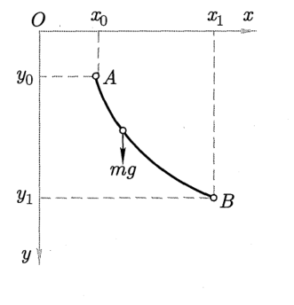
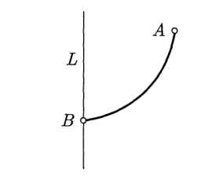
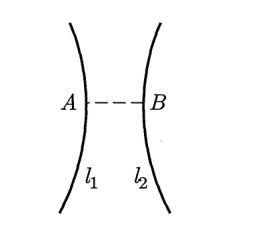
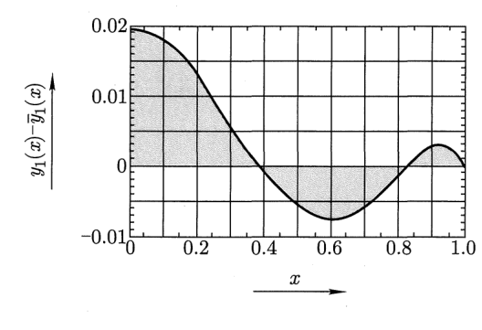

# 第二十章 变分法初步

变分法是数学物理中一个古老而成熟的方法。早在古希腊时期，有人就已经提出了“等周问题”。17 世纪，许多数学家采用不同方法，解决了 Galileo 提出的著名“捷线问题”，而 Euler 和 Lagrange 对于这一类问题的研究，则为变分法奠定了理论基础。

变分法在物理学中的应用集中在两个方面：基本物理规律的一种新的表述语言和具体物理问题的近似方法。本章就围绕这两方面的应用，对变分法做一点初步的介绍。

## §20.1 泛函的概念

泛函是从函数到数的映射，简单地，就是以整个函数为自变量的函数。

设在 $x-y$ 平面上有一簇曲线 $y(x)$，其长度为

$$
L=\int_{C} \mathrm{d} s=\int_{x_{0}}^{x_{1}} \sqrt{1+y^{\prime 2}} \mathrm{d} x .
$$

显然，$y(x)$ 不同，$L$ 值也不同，即 $L$ 的数值依赖于整个函数 $y(x)$。$L$ 和函数 $y(x)$ 之间的这种依赖关系称为泛函关系。类似的例子还有闭合曲线围成的面积，平面曲线绕固定轴而生成的旋转体体积或表面积，等等。它们也都定义了各自的泛函关系。

设对于（某一函数集合内的）每一个函数 $y(x)$，都有唯一一个数 $J[y]$ 与之对应，则称 $J[y]$ 为 $y(x)$ 的泛函。这里的函数集合，即泛函的定义域，通常要求 $y(x)$ 具有连续的二阶导数，并且满足一定的边界条件。这样的 $y(x)$ 称为可取函数。

这里要特别强调，泛函不同于复合函数，例如 $g=g(f(x))$。对于后者，给定一个 $x$ 值，仍然有一个 $g$ 值与之对应；对于前者，则必须给出某一区间上的整个函数 $y(x)$，才能得到一个泛函值 $J[y]$。（定义在同一区间上的）函数不同，泛函值当然不同。为了强调泛函值 $J[y]$ 与函数 $y(x)$ 之间的依赖关系，常常又把函数 $y(x)$ 称为变量函数。

**例 20.1** 捷线问题（brachistochrone problem）。如图 20.1 所示，在重力作用下，一质点从 $(x_{0},y_{0})$ 点沿平面曲线 $y(x)$ 无摩擦地自由下滑到 $(x_{1},y_{1})$ 点，则所需时间

$$
T=\int_{(x_{0},y_{0})}^{(x_{1},y_{1})} \frac{\mathrm{d} s}{\sqrt{2 g(y_{0}-y)}}=\int_{x_{0}}^{x_{1}} \frac{\sqrt{1+y^{\prime 2}}}{\sqrt{2 g(y_{0}-y)}} \mathrm{d} x \qquad (20.1)
$$

就是 $y(x)$ 的泛函。这里，自然要求变量函数 $y(x)$ 一定通过端点 $(x_{0},y_{0})$ 和 $(x_{1},y_{1})$。

**例 20.2** 弦的横振动问题。设在弦上隔离出足够短的一段弦，则该段弦的动能 $E_{k}$ 和势能 $E_{p}$ 分别为

$$
E_{k}=\frac{1}{2} \rho \Delta x\left(\frac{\partial u}{\partial t}\right)^{2}, \qquad E_{\mathrm{p}}=\frac{1}{2} T \Delta x\left(\frac{\partial u}{\partial x}\right)^{2},
$$

其中 $u(x,t)$ 是弦的横向位移，$\rho$ 是弦的线密度，$T$ 是张力。这样，弦的 Hamilton 作用量

$$
S=\int_{t_{0}}^{t_{1}} \mathrm{d} t \int_{x_{0}}^{x_{1}} \frac{1}{2}\left[\rho\left(\frac{\partial u}{\partial t}\right)^{2}-T\left(\frac{\partial u}{\partial x}\right)^{2}\right] \mathrm{d} x \qquad (20.2)
$$

也是位移 $u(x,t)$ 的泛函。这里的

$$
L=\int_{x_{0}}^{x_{1}} \frac{1}{2}\left[\rho\left(\frac{\partial u}{\partial t}\right)^{2}-T\left(\frac{\partial u}{\partial x}\right)^{2}\right] \mathrm{d} x
$$

称为 Lagrange 量，而被积函数

$$
\frac{1}{2}\left[\rho\left(\frac{\partial u}{\partial t}\right)^{2}-T\left(\frac{\partial u}{\partial x}\right)^{2}\right]
$$

称为 Lagrange 量密度。

泛函的形式可以多种多样，例如求函数的最大值，也是定义了一个泛函关系。但本书中只限于用积分定义的泛函，例如

$$
J[y]=\int_{x_{0}}^{x_{1}} F\left(x, y, y^{\prime}\right) \mathrm{d} x, \qquad (20.3)
$$

其中 $F$ 是它的宗量 $x, y(x)$ 及 $y^{\prime}(x)$ 的已知函数，且具有连续的二阶偏导数。如果变量函数是二元函数 $u(x,y)$，则泛函为

$$
J[u]=\iint_{S} F\left(x, y, u, u_{x}, u_{y}\right) \mathrm{d} x \mathrm{d} y, \qquad (20.4)
$$

其中 $u_{x} \equiv \partial u / \partial x$，$u_{y} \equiv \partial u / \partial y$。对于更多个自变量的多元函数，也可以有类似的定义。

## §20.2 泛函的极值

泛函极值的概念和函数极值非常类似。例如，“当变量函数为 $y(x)$ 时，泛函 $J[y]$ 取极小值”的含义就是：对于极值函数 $y(x)$ 及其“附近”的变量函数 $y(x)+\delta y(x)$，恒有

$$
J[y+\delta y] \geqslant J[y]. \qquad (20.5)
$$

所谓 $y(x)+\delta y(x)$ 在 $y(x)$ 的“附近”，是函数空间的语言，其含义是它们的差 $\delta y(x)$（称为函数 $y(x)$ 的变分）满足

（1）$\|\delta y(x)\|<\varepsilon$，

（2）有时还要求 $\left\|(\delta y)^{\prime}(x)\right\|<\varepsilon$，

其中 $\|\delta y(x)\|$ 就是（17.10）式定义的函数 $\delta y(x)$ 的范数。

可以仿照函数极值必要条件的导出办法，导出泛函取极值的必要条件。为此，不妨不失普遍性地假定，所考虑的变量函数均通过固定的两个端点 $y\left(x_{0}\right)=a$，$y\left(x_{1}\right)=b$，即

$$
\delta y\left(x_{0}\right)=0, \qquad \delta y\left(x_{1}\right)=0. \qquad (20.6)
$$

现在，考虑泛函的差值

$$
J[y+\delta y]-J[y]=\int_{x_{0}}^{x_{1}}\left[F\left(x, y+\delta y, y^{\prime}+(\delta y)^{\prime}\right)-F\left(x, y, y^{\prime}\right)\right] \mathrm{d} x .
$$

当函数的变分 $\delta y(x)$ 足够小时，可以将被积函数在极值函数附近作 Taylor 展开，有

$$
\begin{aligned}
J[y+\delta y]-J[y] &=\int_{x_{0}}^{x_{1}}\left\{\left[\delta y \frac{\partial}{\partial y}+(\delta y)^{\prime} \frac{\partial}{\partial y^{\prime}}\right] F+\frac{1}{2 !}\left[\delta y \frac{\partial}{\partial y}+(\delta y)^{\prime} \frac{\partial}{\partial y^{\prime}}\right]^{2} F+\cdots\right\} \mathrm{d} x \\
&=\delta J[y]+\frac{1}{2 !} \delta^{2} J[y]+\cdots,
\end{aligned}
$$

其中

$$
\delta J[y] \equiv \int_{x_{0}}^{x_{1}}\left[\frac{\partial F}{\partial y} \delta y+\frac{\partial F}{\partial y^{\prime}}(\delta y)^{\prime}\right] \mathrm{d} x, \qquad (20.7)
$$

$$
\begin{aligned}
\delta^{2} J[y] & \equiv \int_{x_{0}}^{x_{1}}\left[\delta y \frac{\partial}{\partial y}+(\delta y)^{\prime} \frac{\partial}{\partial y^{\prime}}\right]^{2} F \mathrm{d} x \\
&=\int_{x_{0}}^{x_{1}}\left[\frac{\partial^{2} F}{\partial y^{2}}(\delta y)^{2}+2 \frac{\partial^{2} F}{\partial y \partial y^{\prime}} \delta y(\delta y)^{\prime}+\frac{\partial^{2} F}{\partial y^{\prime 2}}(\delta y)^{\prime 2}\right] \mathrm{d} x
\end{aligned}
\qquad (20.8)
$$

分别是泛函 $J[y]$ 的一级变分和二级变分。这样就得到：泛函 $J[y]$ 取极小值的必要条件是泛函的一级变分为 0，

$$
\delta J[y] \equiv \int_{x_{0}}^{x_{1}}\left[\delta y \frac{\partial F}{\partial y}+(\delta y)^{\prime} \frac{\partial F}{\partial y^{\prime}}\right] \mathrm{d} x=0 . \qquad (20.9)
$$

对于泛函 $J[y]$ 取极大值的情形，也可以类似地讨论，并且也会得到相同形式的必要条件。

将（20.9）式的积分中的第二项分部积分，同时考虑到边界条件（20.6），就有

$$
\begin{aligned}
\delta J[y] &=\left.\frac{\partial F}{\partial y^{\prime}} \delta y\right|_{x_{0}} ^{x_{1}}+\int_{x_{0}}^{x_{1}}\left(\delta y \frac{\partial F}{\partial y}-\delta y \frac{\mathrm{d}}{\mathrm{d} x} \frac{\partial F}{\partial y^{\prime}}\right) \mathrm{d} x \\
&=\int_{x_{0}}^{x_{1}}\left(\frac{\partial F}{\partial y}-\frac{\mathrm{d}}{\mathrm{d} x} \frac{\partial F}{\partial y^{\prime}}\right) \delta y \mathrm{d} x=0 .
\end{aligned}
$$

由于 $\delta y$ 的任意性，我们又可以得到

$$
\frac{\partial F}{\partial y}-\frac{\mathrm{d}}{\mathrm{d} x} \frac{\partial F}{\partial y^{\prime}}=0 . \qquad (20.10)
$$

这个方程称为 Euler-Lagrange 方程，它是泛函 $J[y]$ 取极小值的必要条件的微分形式。一般说来，这是一个二阶常微分方程。

在导出方程（20.10）时，需要用到下面的引理：

**引理 20.1**（变分学基本引理） 设 $\phi(x)$ 是连续函数，$\eta(x)$ 具有连续的二阶导数，并且满足 $\left.\eta(x)\right|_{x=x_{0}}=\left.\eta(x)\right|_{x=x_{1}}=0$，若对于任意 $\eta(x)$，

$$
\int_{x_{0}}^{x_{1}} \phi(x) \eta(x) \mathrm{d} x=0
$$

均成立，则必有 $\phi(x) \equiv 0$。证明从略。

**例 20.3** 设质点在有势力场中沿路径 $q=q(t)$ 由 $\left(t_{0}, q\left(t_{0}\right)\right)$ 点运动到 $\left(t_{1}, q\left(t_{1}\right)\right)$ 点，它的 Hamilton 作用量是

$$
S=\int_{t_{0}}^{t_{1}} L(t, q, \dot{q}) \mathrm{d} t, \qquad (20.11)
$$

其中 $q$ 和 $\dot{q}$ 是描写质点运动的广义坐标和广义动量，$L=T-V$ 是动能 $T$ 和势能 $V$ 之差，即 Lagrange 量。Hamilton 原理告诉我们，在一切（运动学上允许的）可能路径中，真实发生的（即由力学规律决定的）运动路径使作用量 $S$ 取极值。根据上面的讨论可知，作用量 $S$ 取极值的必要条件的积分形式和微分形式分别是

$$
\delta S=\int_{t_{0}}^{t_{1}}\left(\frac{\partial L}{\partial q} \delta q+\frac{\partial L}{\partial \dot{q}} \delta \dot{q}\right) \mathrm{d} t=0 \qquad (20.12)
$$

和

$$
\frac{\partial L}{\partial q}-\frac{\mathrm{d}}{\mathrm{d} t} \frac{\partial L}{\partial \dot{q}}=0 . \qquad (20.13)
$$

在给定的有势力场中，写出 Lagrange 量 $L$ 的具体形式，代入（20.13）式就会发现，它和 Newton 力学的动力学方程完全一样。

现在讨论两种常见的特殊情形。一种是泛函（20.3）中的 $F=F\left(x, y^{\prime}\right)$ 不显含 $y$，这时的 Euler-Lagrange 方程就是

$$
\frac{\mathrm{d}}{\mathrm{d} x} \frac{\partial F}{\partial y^{\prime}}=0,
$$

所以，立即就得到它的首次积分

$$
\frac{\partial F}{\partial y^{\prime}}=\text { 常量 } C . \qquad (20.14)
$$

另一种是泛函（20.3）中的 $F=F\left(y, y^{\prime}\right)$ 不显含 $x$，容易证明，

$$
\frac{\mathrm{d}}{\mathrm{d} x}\left(y^{\prime} \frac{\partial F}{\partial y^{\prime}}-F\right)=y^{\prime \prime} \frac{\partial F}{\partial y^{\prime}}+y^{\prime} \frac{\mathrm{d}}{\mathrm{d} x} \frac{\partial F}{\partial y^{\prime}}-\frac{\partial F}{\partial y} y^{\prime}-\frac{\partial F}{\partial y^{\prime}} y^{\prime \prime}=-y^{\prime}\left(\frac{\partial F}{\partial y}-\frac{\mathrm{d}}{\mathrm{d} x} \frac{\partial F}{\partial y^{\prime}}\right),
$$

所以，这时的 Euler-Lagrange 方程也可以有首次积分

$$
y^{\prime} \frac{\partial F}{\partial y^{\prime}}-F=\text { 常量 } C . \qquad (20.15)
$$

把这个结果应用到例 20.3 中，如果 Lagrange 量 $L$ 不显含 $t$，则有

$$
\dot{q} \frac{\partial L}{\partial \dot{q}}-L=\text { 常量 } C, \qquad (20.16)
$$

这就是能量守恒。

下面研究变量函数是二元函数的情形。设有二元函数 $u(x,y)$，$(x,y)\in S$，在此基础上可定义泛函

$$
J[u]=\iint_{S} F\left(x, y, u, u_{x}, u_{y}\right) \mathrm{d} x \mathrm{d} y . \qquad (20.17)
$$

仍然约定，$u(x,y)$ 在 $S$ 的边界 $\Gamma$ 上的数值给定，即

$$
u|_{\Gamma} \text { 固定. } \qquad (20.18)
$$

首先，当然要计算

$$
\begin{aligned}
& J[u+\delta u]-J[u] \\
=& \iint_{S} F\left(x, y, u+\delta u,(u+\delta u)_{x},(u+\delta u)_{y}\right) \mathrm{d} x \mathrm{d} y-\iint_{S} F\left(x, y, u, u_{x}, u_{y}\right) \mathrm{d} x \mathrm{d} y \\
=& \iint_{S}\left[\delta u \frac{\partial}{\partial u}+(\delta u)_{x} \frac{\partial}{\partial u_{x}}+(\delta u)_{y} \frac{\partial}{\partial u_{y}}\right] F \mathrm{d} x \mathrm{d} y \\
&+\frac{1}{2 !} \iint_{S}\left[\delta u \frac{\partial}{\partial u}+(\delta u)_{x} \frac{\partial}{\partial u_{x}}+(\delta u)_{y} \frac{\partial}{\partial u_{y}}\right]^{2} F \mathrm{d} x \mathrm{d} y+\cdots,
\end{aligned}
$$

于是，泛函 $J[u]$ 取极值的必要条件就是泛函的一级变分为 0，

$$
\begin{aligned}
\delta J[u]=& \iint_{S}\left[\delta u \frac{\partial F}{\partial u}+(\delta u)_{x} \frac{\partial F}{\partial u_{x}}+(\delta u)_{y} \frac{\partial F}{\partial u_{y}}\right] \mathrm{d} x \mathrm{d} y \\
=& \iint_{S}\left[\frac{\partial F}{\partial u}-\frac{\partial}{\partial x}\left(\frac{\partial F}{\partial u_{x}}\right)-\frac{\partial}{\partial y}\left(\frac{\partial F}{\partial u_{y}}\right)\right] \delta u \mathrm{d} x \mathrm{d} y \\
&+\iint_{S}\left[\frac{\partial}{\partial x}\left(\frac{\partial F}{\partial u_{x}} \delta u\right)+\frac{\partial}{\partial y}\left(\frac{\partial F}{\partial u_{y}} \delta u\right)\right] \mathrm{d} x \mathrm{d} y=0 .
\end{aligned}
\qquad (20.19)
$$

利用公式

$$
\iint_{S}\left(\frac{\partial Q}{\partial x}-\frac{\partial P}{\partial y}\right) \mathrm{d} x \mathrm{d} y=\int_{\Gamma}(P \mathrm{d} x+Q \mathrm{d} y),
$$

取 $Q=\frac{\partial F}{\partial u_{x}} \delta u$，$P=-\frac{\partial F}{\partial u_{y}} \delta u$，就能将上面的结果化为

$$
\delta J[u]=\iint_{S}\left(\frac{\partial F}{\partial u}-\frac{\partial}{\partial x} \frac{\partial F}{\partial u_{x}}-\frac{\partial}{\partial y} \frac{\partial F}{\partial u_{y}}\right) \delta u \mathrm{d} x \mathrm{d} y+\int_{\Gamma}\left(-\frac{\partial F}{\partial u_{x}} \mathrm{d} x+\frac{\partial F}{\partial u_{y}} \mathrm{d} y\right) \delta u .
$$

根据（20.18）式，$\left.\delta u\right|_{\Gamma}=0$，可知上式右端第二项的线积分为 0，所以

$$
\delta J[u]=\iint_{S}\left(\frac{\partial F}{\partial u}-\frac{\partial}{\partial x} \frac{\partial F}{\partial u_{x}}-\frac{\partial}{\partial y} \frac{\partial F}{\partial u_{y}}\right) \delta u \mathrm{d} x \mathrm{d} y=0 .
$$

再利用 $\delta u$ 的任意性，就可以导出上面的被积函数一定为 0，即

$$
\frac{\partial F}{\partial u}-\frac{\partial}{\partial x} \frac{\partial F}{\partial u_{x}}-\frac{\partial}{\partial y} \frac{\partial F}{\partial u_{y}}=0 . \qquad (20.20)
$$

这就是二元函数情形下，泛函

$$
J[u]=\iint_{S} F\left(x, y, u, u_{x}, u_{y}\right) \mathrm{d} x \mathrm{d} y
$$

取极值的必要条件的微分形式（Euler-Lagrange 方程）。

把这个结果应用到例 20.2 中弦的横振动问题上，就得到使作用量

$$
S=\int_{t_{0}}^{t_{1}} \mathrm{d} t \int_{x_{0}}^{x_{1}} \frac{1}{2}\left[\rho\left(\frac{\partial u}{\partial t}\right)^{2}-T\left(\frac{\partial u}{\partial x}\right)^{2}\right] \mathrm{d} x
$$

取极值的必要条件

$$
\frac{\partial^{2} u}{\partial t^{2}}-\frac{T}{\rho} \frac{\partial^{2} u}{\partial x^{2}}=0, \qquad (20.21)
$$

正是我们在第 11 章导出的弦的横振动方程。

**练习 20.1** 在 $n$ 个自变量的情形下，导出泛函

$$
\int \cdots \int F\left(x_{1}, x_{2}, \cdots, x_{n}, u, u_{x_{1}}, u_{x_{2}}, \cdots, u_{x_{n}}\right) \mathrm{d} x_{1} \mathrm{d} x_{2} \cdots \mathrm{d} x_{n}
$$

取极值的必要条件，包括它的积分形式和微分形式。上式中的积分是在 $n$ 维空间中的一定区域内进行的。

下面以一元函数为例，总结一下变分运算的几条简单法则。

（1）变量函数 $y$ 本身只有一级变分，

$$
\delta^{2} y=0 . \qquad (20.22)
$$

（2）变分运算是线性运算，

$$
\delta(\alpha F+\beta G)=\alpha \delta F+\beta \delta G, \qquad (20.23)
$$

其中 $\alpha$ 和 $\beta$ 是常数。

（3）直接计算，就可以得到函数乘积的变分法则：

$$
\delta(F G)=(\delta F) G+F(\delta G) . \qquad (20.24)
$$

（4）变分运算和微分或微商运算可交换次序，

$$
\delta \frac{\mathrm{d} y}{\mathrm{d} x}=\frac{\mathrm{d}(\delta y)}{\mathrm{d} x}, \qquad \text { 即 } \qquad \delta y^{\prime}=(\delta y)^{\prime} . \qquad (20.25)
$$

（5）变分运算和积分（微分的逆运算）也可以交换次序，

$$
\delta \int_{a}^{b} F \mathrm{d} x=\int_{a}^{b}(\delta F) \mathrm{d} x . \qquad (20.26)
$$

（6）复合函数的变分运算，其法则和微分运算完全相同，只要简单地将微分运算中的“$\mathrm{d}$”换成“$\delta$”即可。例如，

$$
\delta F\left(x, y, y^{\prime}\right)=\frac{\partial F}{\partial y} \delta y+\frac{\partial F}{\partial y^{\prime}} \delta y^{\prime} . \qquad (20.27)
$$

这里注意，引起 $F$ 变化的原因，是函数 $y$ 的变分，而非自变量 $x$。

这些运算法则，可以毫不困难地推广到多元函数的情形。

作为完整的泛函极值问题，在列出泛函取极值的必要条件（即 Euler-Lagrange 方程）后，还需要在给定的定解条件下求解微分方程，才求得极值函数。这里需要注意，Euler-Lagrange 方程只是泛函取极值的必要条件，并非充分条件。在给定的定解条件下，Euler-Lagrange 方程的解到底是不是极值函数，还需要进一步加以甄别。和求函数极值的情形一样，现在也可以有两种方法。一种是直接比较所求得解及其“附近”的函数的泛函值，根据泛函极值的定义加以判断。另一种方法是计算泛函的二级变分 $\delta^{2} J$，如果对于所求得的解，泛函的二级变分取正（负）值，则该解即为极值函数，泛函取极小（大）。如果二级变分为 0，则需要继续讨论高级变分。

可是，实际问题往往又特别简单，这就是在给定的边界条件下，Euler-Lagrange 方程只有一个解，同时，从物理或数学内容上又能判断，该泛函的极值一定存在，那么，这时求得的唯一解当然就是所要求的极值函数了。

## §20.3 泛函的条件极值

要求泛函

$$
J[y]=\int_{x_{0}}^{x_{1}} F\left(x, y, y^{\prime}\right) \mathrm{d} x \qquad (20.28)
$$

在边界条件

$$
y\left(x_{0}\right)=a, \qquad y\left(x_{1}\right)=b \qquad (20.29)
$$

以及约束条件

$$
J_{1}[y] \equiv \int_{x_{0}}^{x_{1}} G\left(x, y, y^{\prime}\right) \mathrm{d} x=C \qquad (20.30)
$$

下的极值，可采用处理多元函数条件极值问题的 Lagrange 乘子法，即定义

$$
J_{0}[y]=J[y]-\lambda J_{1}[y], \qquad (20.31)
$$

其中 Lagrange 乘子 $\lambda$ 为待定常数，仍将 $\delta y$ 看成是独立的，于是泛函 $J_{0}[y]$ 在边界条件（20.29）下取极值的必要条件就是

$$
\left(\frac{\partial}{\partial y}-\frac{\mathrm{d}}{\mathrm{d} x} \frac{\partial}{\partial y^{\prime}}\right)(F-\lambda G)=0 . \qquad (20.32)
$$

由微分方程（20.32）、边界条件（20.29）以及约束条件（20.30），必要时经过甄别，就可以求出 Lagrange 乘子的值 $\lambda=\lambda_{0}$、极值函数 $y=y\left(x, \lambda_{0}\right)$，及相应泛函 $J_{0}[y]$ 的条件极值。

**例 20.4** 求泛函

$$
I[y]=\int_{0}^{1} x y^{\prime 2} \mathrm{d} x \qquad (20.33)
$$

在边界条件

$$
y(0) \text { 有界, } \qquad y(1)=0 \qquad (20.34)
$$

和约束条件

$$
\int_{0}^{1} x y^{2} \mathrm{d} x=1 \qquad (20.35)
$$

下的极值曲线。

**解** 采用上面描述的 Lagrange 乘子法，可以得到必要条件

$$
\left(\frac{\partial}{\partial y}-\frac{\mathrm{d}}{\mathrm{d} x} \frac{\partial}{\partial y^{\prime}}\right)\left(x y^{\prime 2}-\lambda x y^{2}\right)=0, \qquad \text { 即 } \qquad \frac{\mathrm{d}}{\mathrm{d} x}\left(x \frac{\mathrm{d} y}{\mathrm{d} x}\right)+\lambda x y=0 . \qquad (20.36)
$$

此方程及齐次的边界条件（20.34）即构成一个本征值问题，它的本征值

$$
\lambda_{i}=\mu_{i}^{2}, \qquad \mu_{i} \text { 是零阶 Bessel 函数 } \mathrm{J}_{0}(x) \text { 的第 } i \text { 个正零点, } i=1,2,3, \cdots \qquad (20.37)
$$

正好就是 Lagrange 乘子，而极值函数就是相应的本征函数

$$
y_{i}(x)=C_{i} \mathrm{J}_{0}\left(\mu_{i} x\right) .
$$

常量 $C_{i}$ 可以由约束条件定出。因为

$$
C_{i}^{2} \int_{0}^{1} x \mathrm{J}_{0}^{2}\left(\mu_{i} x\right) \mathrm{d} x=\frac{1}{2} C_{i}^{2} \mathrm{J}_{1}^{2}\left(\mu_{i}\right)=1,
$$

所以 $C_{i}=\sqrt{2} / \mathrm{J}_{1}\left(\mu_{i}\right)$。这样就求出了极值函数

$$
y_{i}(x)=\frac{\sqrt{2}}{\mathrm{J}_{1}\left(\mu_{i}\right)} \mathrm{J}_{0}\left(\mu_{i} x\right) . \qquad (20.38)
$$

值得注意，这里由于 Lagrange 乘子的引进，在 Euler-Lagrange 方程出现了待定参量，和齐次边界条件组合在一起，就构成本征值问题。而作为本征值问题，它的解（本征值和本征函数）有无穷多个。这无穷多个本征函数都是极值函数，因为 $I[y]$ 的二级变分

$$
\delta^{2} I[y]=2 \int_{0}^{1} x(\delta y)^{2} \mathrm{d} x>0,
$$

所以这些极值函数均使泛函取极小。而且，这无穷个本征值正好也就是泛函的极值。这是因为，将方程（20.36）乘以极值函数 $y(x)$，再积分，就有

$$
\lambda \int_{0}^{1} x y^{2} \mathrm{d} x=-\int_{0}^{1} y\left(x y^{\prime}\right)^{\prime} \mathrm{d} x=\left.-y \cdot x y^{\prime}\right|_{0} ^{1}+\int_{0}^{1} x y^{\prime 2} \mathrm{d} x=\int_{0}^{1} x y^{\prime 2} \mathrm{d} x .
$$

根据约束条件（20.35），就能得到

$$
\lambda=\int_{0}^{1} x y^{\prime 2} \mathrm{d} x . \qquad (20.39)
$$

还可以从另一个角度来理解泛函的条件极值问题。从第十七章的讨论知道，自伴算符本征函数的全体构成完备函数组。因此，作为泛函（20.33）中的可取函数 $y(x)$，一定可以按照本征函数（20.38）展开（不妨设展开系数 $c_{i}$ 为实数）：

$$
y(x)=\sum_{i=1}^{\infty} c_{i} y_{i}(x) . \qquad (20.40)
$$

容易证明：

$$
\begin{aligned}
\int_{0}^{1} x y^{\prime 2} \mathrm{d} x &=\left.x y^{\prime} y\right|_{0} ^{1}-\int_{0}^{1}\left(x y^{\prime}\right)^{\prime} y \mathrm{d} x=-\int_{0}^{1} \sum_{i=1}^{\infty} c_{i}\left(x y_{i}^{\prime}\right)^{\prime} \sum_{j=1}^{\infty} c_{j} y_{j} \mathrm{d} x \\
&=\sum_{i, j} c_{i} c_{j} \lambda_{i} \int_{0}^{1} y_{i} y_{j} x \mathrm{d} x=\sum_{i=1}^{\infty} \lambda_{i} c_{i}^{2},
\end{aligned}
\qquad (20.41)
$$

$$
\int_{0}^{1} x y^{2} \mathrm{d} x=\sum_{i=1}^{\infty} c_{i}^{2}=1 . \qquad (20.42)
$$

因此，例 20.4 中的泛函条件极值问题就完全等价于（无穷维）二次型（20.41）在约束条件（20.42）下的极值问题。

最后，还要提到，这一类泛函的条件极值问题的原型，可以追溯到“闭合曲线周长一定而面积取极大”的原始几何问题。因此，泛函的条件极值问题，常称为等周问题（isoperimetric problem）。

## §20.4 微分方程定解问题和本征值问题的变分形式

在前两节中读者看到，泛函取极值的必要条件的微分形式（Euler-Lagrange 方程）是常微分方程或偏微分方程，它和变量函数的定解条件结合起来，就构成常微分方程或偏微分方程的定解问题。对于泛函的条件极值问题，其必要条件中出现待定参量（Lagrange 乘子），它和齐次边界条件结合起来，就构成微分方程本征值问题。这一节将研究它的反问题：如何将微分方程的定解问题或本征值问题转化为泛函的极值或条件极值问题，即如何将微分方程的定解问题或本征值问题用变分语言表述。

**例 20.5** 写出常微分方程边值问题

$$
\frac{\mathrm{d}}{\mathrm{d} x}\left[p(x) \frac{\mathrm{d} y}{\mathrm{d} x}\right]+q(x) y(x)=f(x), \qquad x_{0}<x<x_{1}, \qquad (20.43 \mathrm{a})
$$

$$
y\left(x_{0}\right)=y_{0}, \qquad y\left(x_{1}\right)=y_{1} \qquad (20.43 \mathrm{b})
$$

的泛函形式，即求相应的泛函，它在边界条件（20.43b）下取极值的必要条件即为（20.43a）。

**解** 既然泛函极值必要条件的微分形式就是方程（20.43a），那么，这个方程一定来自

$$
\int_{x_{0}}^{x_{1}}\left\{\frac{\mathrm{d}}{\mathrm{d} x}\left[p(x) \frac{\mathrm{d} y}{\mathrm{d} x}\right]+q(x) y(x)-f(x)\right\} \delta y(x) \mathrm{d} x=0 .
$$

现在的问题就是要把上式左端化成泛函的变分。对于上式左端积分中被积函数的第二项和第三项，显然有

$$
\int_{x_{0}}^{x_{1}} q(x) y(x) \delta y(x) \mathrm{d} x=\frac{1}{2} \delta \int_{x_{0}}^{x_{1}} q(x) y^{2}(x) \mathrm{d} x,
$$

$$
\int_{x_{0}}^{x_{1}} f(x) \delta y(x) \mathrm{d} x=\delta \int_{x_{0}}^{x_{1}} f(x) y(x) \mathrm{d} x .
$$

注意已知函数 $q(x)$ 和 $f(x)$ 是与 $y(x)$ 的变分无关的，因此它们在变分计算中都是常量。对于被积函数中的第一项，可以通过分部积分而化为

$$
\begin{aligned}
\int_{x_{0}}^{x_{1}} \frac{\mathrm{d}}{\mathrm{d} x}\left[p(x) \frac{\mathrm{d} y}{\mathrm{d} x}\right] \delta y(x) \mathrm{d} x &=-\int_{x_{0}}^{x_{1}} p(x) \frac{\mathrm{d} y}{\mathrm{d} x} \delta\left(\frac{\mathrm{d} y}{\mathrm{d} x}\right) \mathrm{d} x \\
&=-\frac{1}{2} \delta \int_{x_{0}}^{x_{1}} p(x)\left(\frac{\mathrm{d} y}{\mathrm{d} x}\right)^{2} \mathrm{d} x,
\end{aligned}
$$

其中用到了 $\left.\delta y(x)\right|_{x_{0}}=\left.\delta y(x)\right|_{x_{1}}=0$。综合上面的结果，就得到

$$
\begin{aligned}
& \int_{x_{0}}^{x_{1}}\left\{\frac{\mathrm{d}}{\mathrm{d} x}\left[p(x) \frac{\mathrm{d} y}{\mathrm{d} x}\right]+q(x) y(x)-f(x)\right\} \delta y(x) \mathrm{d} x \\
=&-\delta \int_{x_{0}}^{x_{1}}\left\{\frac{1}{2}\left[p(x)\left(\frac{\mathrm{d} y}{\mathrm{d} x}\right)^{2}-q(x) y^{2}(x)\right]+f(x) y(x)\right\} \mathrm{d} x=0 .
\end{aligned}
\qquad (20.44)
$$

这就说明，方程（20.43a）一定就是泛函

$$
J[y]=\int_{x_{0}}^{x_{1}}\left\{\frac{1}{2}\left[p(x)\left(\frac{\mathrm{d} y}{\mathrm{d} x}\right)^{2}-q(x) y^{2}(x)\right]+f(x) y(x)\right\} \mathrm{d} x \qquad (20.45)
$$

取极值的必要条件。读者也可以直接验算。

**例 20.6** 写出偏微分方程定解问题

$$
\nabla^{2} u(\boldsymbol{r})+k^{2} u(\boldsymbol{r})=-\rho(\boldsymbol{r}), \qquad \boldsymbol{r} \in V, \qquad (20.46 \mathrm{a})
$$

$$
\left.u(\boldsymbol{r})\right|_{\Sigma}=f(\Sigma) \qquad (20.46 \mathrm{b})
$$

的变分形式。

**解** 可以完全仿照例 20.5 的做法，考虑积分

$$
\iiint_{V}\left[\nabla^{2} u+k^{2} u+\rho(\boldsymbol{r})\right] \delta u \mathrm{d} \boldsymbol{r} .
$$

对于被积函数中的后两项，有

$$
\iiint_{V} k^{2} u \delta u \mathrm{d} \boldsymbol{r}=\frac{1}{2} \delta \iiint_{V} k^{2} u^{2} \mathrm{d} \boldsymbol{r}, \qquad \iiint_{V} \rho(\boldsymbol{r}) \delta u \mathrm{d} \boldsymbol{r}=\delta \iiint_{V} \rho(\boldsymbol{r}) u \mathrm{d} \boldsymbol{r} .
$$

对于被积函数中的第一项，则需要应用 Green 第一公式以及边界条件 $\left.\delta u(\boldsymbol{r})\right|_{\Sigma}=0$，有

$$
\iiint_{V} \nabla^{2} u \delta u \mathrm{d} \boldsymbol{r}=\iint_{\Sigma} \delta u \nabla u \cdot \mathrm{d} \boldsymbol{\Sigma}-\iiint_{V} \nabla u \cdot \nabla(\delta u) \mathrm{d} \boldsymbol{r}=-\frac{1}{2} \delta \iiint_{V}(\nabla u)^{2} \mathrm{d} \boldsymbol{r} .
$$

因此，原方程就转化为

$$
\delta \iiint_{V}\left\{\frac{1}{2}\left[(\nabla u)^{2}-k^{2} u^{2}\right]-\rho u\right\} \mathrm{d} \boldsymbol{r}=0 .
$$

这说明，定解问题（20.46）就等价于在边界条件（20.46b）下求泛函

$$
\iiint_{V}\left\{\frac{1}{2}\left[(\nabla u)^{2}-k^{2} u^{2}\right]-\rho u\right\} \mathrm{d} \boldsymbol{r} \qquad (20.47)
$$

的极值问题。

**例 20.7** 写出偏微分方程的本征值问题

$$
\nabla^{2} u(\boldsymbol{r})+\lambda u(\boldsymbol{r})=0, \qquad \boldsymbol{r} \in V, \qquad (20.48 \mathrm{a})
$$

$$
\left.u(\boldsymbol{r})\right|_{\Sigma}=0 \qquad (20.48 \mathrm{b})
$$

的变分形式。

**解** 可将本问题看成例 20.6 的特殊情形。因此，本征值问题（20.48）就等价于泛函

$$
J[u]=\iiint_{V}\left\{[\nabla u(\boldsymbol{r})]^{2}-\lambda[u(\boldsymbol{r})]^{2}\right\} \mathrm{d} \boldsymbol{r} \qquad (20.49)
$$

在边界条件（20.48b）下的极值问题。更进一步，把本征值 $\lambda$ 看成 Lagrange 乘子，那么，这个泛函极值问题又等价于泛函

$$
J[u]=\iiint_{V}[\nabla u(\boldsymbol{r})]^{2} \mathrm{d} \boldsymbol{r} \qquad (20.50)
$$

在边界条件（20.48b）和约束条件（本征函数的归一化条件）

$$
J_{1}[u] \equiv \iiint_{V}[u(\boldsymbol{r})]^{2} \mathrm{d} \boldsymbol{r}=1 \qquad (20.51)
$$

下的条件极值问题。

不难证明，这样得到的泛函的条件极值问题的确和本征值问题（20.48）同解。这些本征函数正好就是泛函的极值函数，而本征值正好是泛函的极值。由于泛函 $J[u]$ 的二级变分

$$
\delta^{2} J[u]=2 \iiint_{V}[\nabla(\delta u(\boldsymbol{r}))]^{2} \mathrm{d} \boldsymbol{r} \qquad (20.52)
$$

恒为正，所以泛函的极值是极小值。这些极小值中的最小者，当然就是本征值问题（20.48）的最小本征值。

## *§20.5 变边值问题

在实际问题中还会遇到另一类泛函的极值问题，即极值函数在一端或两端的数值并未指定。可以看下面这两个例子。

**例 20.8** 找出连接一定点 $A$ 到一铅直线 $L$ 的路径（见图 20.2），使质点在重力作用下以最少的时间由 $A$ 到 $L$。在这个问题中，起点 $A$ 的位置是给定的，

$$
y_{A}=y\left(x_{A}\right) .
$$

但是，终点 $B$ 的位置并不完全确定，它只是限定在 $L$ 上变化，因此，只是 $x_{B}$ 给定，而 $y_{B}$ 不定。

**例 20.9** 如图 20.3 所示，求两条不相交曲线之间的最短路径。这里，两个端点的位置都是不完全确定的，需要决定端点的坐标，以及连接这两点的最短路径。

从数学上看，这类问题仍然可以归结为求泛函

$$
J[y]=\int_{x_{0}}^{x_{1}} F\left(x, y, y^{\prime}\right) \mathrm{d} x \qquad (20.53)
$$

的极值问题，只不过边界条件需要修改。仿照前面的讨论，可得到这个泛函取极值的必要条件

$$
\begin{aligned}
\delta J[y] &=\int_{x_{0}}^{x_{1}} \delta F\left(x, y, y^{\prime}\right) \mathrm{d} x=\int_{x_{0}}^{x_{1}}\left(\frac{\partial F}{\partial y} \delta y+\frac{\partial F}{\partial y^{\prime}} \delta y^{\prime}\right) \mathrm{d} x \\
&=\left.\frac{\partial F}{\partial y^{\prime}} \delta y\right|_{x_{0}} ^{x_{1}}+\int_{x_{0}}^{x_{1}}\left(\frac{\partial F}{\partial y}-\frac{\mathrm{d}}{\mathrm{d} x} \frac{\partial F}{\partial y^{\prime}}\right) \delta y \mathrm{d} x=0 .
\end{aligned}
$$

设起点的位置 $\left(x_{0}, y_{0}\right)$ 给定，因而 $\left.\delta y\right|_{x_{0}}=0$；但终点的位置 $\left(x_{1}, y_{1}\right)$ 仅 $x_{1}$ 给定，而 $y_{1}$ 不定，所以 $\left.\delta y\right|_{x_{1}}$ 也不定。但是，只要极值函数存在（因而终点位置 $\left(x_{1}, y_{1}\right)$ 完全确定），则此极值函数一定也是同一个泛函在两端固定的边界条件

$$
y\left(x_{0}\right)=y_{0}, \qquad y\left(x_{1}\right)=y_{1}
$$

下的极值函数，所以一定也还是方程

$$
\frac{\partial F}{\partial y}-\frac{\mathrm{d}}{\mathrm{d} x} \frac{\partial F}{\partial y^{\prime}}=0 \qquad (20.54)
$$

的解。换句话说，这个 Euler-Lagrange 方程也还是泛函在变边值条件下取极值的必要条件。但是，只有这个条件不够，还必须有

$$
\left.\frac{\partial F}{\partial y^{\prime}}\right|_{x=x_{1}}=0 \qquad (20.55)
$$

才能保证泛函的一级变分 $\delta J[y]=0$。

结论：泛函（20.53）在一端完全固定（$y\left(x_{0}\right)=y_{0}$），另一端 $x_{1}$ 给定，而 $y\left(x_{1}\right)$ 不定的条件下取极值的必要条件是

$$
\frac{\partial F}{\partial y}-\frac{\mathrm{d}}{\mathrm{d} x} \frac{\partial F}{\partial y^{\prime}}=0, \qquad (20.56 \mathrm{a})
$$

$$
y\left(x_{0}\right)=y_{0}, \qquad \left.\frac{\partial F}{\partial y^{\prime}}\right|_{x=x_{1}}=0 . \qquad (20.56 \mathrm{b})
$$

**练习 20.2** 在两端均为变边值的条件下，求泛函

$$
J[y]=\int_{x_{0}}^{x_{1}} F\left(x, y, y^{\prime}\right) \mathrm{d} x
$$

取极值的必要条件。

再推广到二元函数的情形。在自由边值条件（边界 $\Gamma$ 上的 $u(x,y)$ 值自由）下，泛函

$$
J[u]=\iint_{S} F\left(x, y, u, \frac{\partial u}{\partial x}, \frac{\partial u}{\partial y}\right) \mathrm{d} x \mathrm{d} y \qquad (20.57)
$$

取极值的必要条件，仍然是此泛函的一级变分为 0，

$$
\begin{aligned}
\delta J[u]=& \iint_{S}\left(\frac{\partial F}{\partial u} \delta u+\frac{\partial F}{\partial u_{x}} \delta u_{x}+\frac{\partial F}{\partial u_{y}} \delta u_{y}\right) \mathrm{d} x \mathrm{d} y \\
=& \iint_{S}\left(\frac{\partial F}{\partial u}-\frac{\partial}{\partial x} \frac{\partial F}{\partial u_{x}}-\frac{\partial}{\partial y} \frac{\partial F}{\partial u_{y}}\right) \delta u \mathrm{d} x \mathrm{d} y+\iint_{S}\left[\frac{\partial}{\partial x}\left(\frac{\partial F}{\partial u_{x}} \delta u\right)+\frac{\partial}{\partial y}\left(\frac{\partial F}{\partial u_{y}} \delta u\right)\right] \mathrm{d} x \mathrm{d} y
\end{aligned}
$$

$$
=\iint_{S}\left(\frac{\partial F}{\partial u}-\frac{\partial}{\partial x} \frac{\partial F}{\partial u_{x}}-\frac{\partial}{\partial y} \frac{\partial F}{\partial u_{y}}\right) \delta u \mathrm{d} x \mathrm{d} y+\int_{\Gamma}\left(-\frac{\partial F}{\partial u_{y}} \mathrm{d} x+\frac{\partial F}{\partial u_{x}} \mathrm{d} y\right) \delta u=0 .
$$

所以，必要条件的微分形式是

$$
\frac{\partial F}{\partial u}-\frac{\partial}{\partial x} \frac{\partial F}{\partial u_{x}}-\frac{\partial}{\partial y} \frac{\partial F}{\partial u_{y}}=0, \qquad (20.58 \mathrm{a})
$$

$$
\int_{\Gamma}\left(-\frac{\partial F}{\partial u_{y}} \mathrm{d} x+\frac{\partial F}{\partial u_{x}} \mathrm{d} y\right) \delta u=0 . \qquad (20.58 \mathrm{b})
$$

或者把沿边界的第二型线积分改写成第一型线积分的形式，边界条件（20.58b）又可改写成

$$
\left[\frac{\partial F}{\partial u_{x}} \cos (n, x)+\frac{\partial F}{\partial u_{y}} \cos (n, y)\right]_{\Gamma}=0 . \qquad (20.58 \mathrm{b}^{\prime})
$$

## §20.6 Rayleigh-Ritz 方法

到现在为止，读者应该已经了解了变分法应用于物理问题的大概轮廓。变分法在物理学中的应用，可以分为两个主要的方面。一种应用是作为基本物理规律的表述语言。可以用 Hamilton 原理或其他类似的语言描述力学系统（质点、质点组等）的运动，可以用费马原理描述光线在介质中的传播，也可以用变分的语言描述电磁场乃至微观粒子的运动，等等。在物理学的这些分支中，支配物质运动的各种特定形式的基本规律，无一例外地都可以表述为各自的泛函极值问题。变分法的这种应用，具有重要的理论意义。它可以使我们用统一的语言描述物质世界的运动，可以协调一致地处理涉及多个物理学分支的综合问题，也可以更方便地从已知的物理领域向新的领域扩展。变分法的第二种应用则体现出它的实用价值：它为求解具体的物理问题提供了一种新的灵活手段。在变分法的基础上，可以建立起实用的近似解法。本节就以常微分方程本征值问题为例介绍这种近似方法。

假设有一个一般的本征值问题

$$
\hat{L} X=\lambda X, \qquad (20.59 \mathrm{a})
$$

$$
D(\hat{L})=\left\{X(x): a \leqslant x \leqslant b, \cos \alpha X(a)-\sin \alpha X^{\prime}(a)=0, \cos \beta X(b)+\sin \beta X^{\prime}(b)=0\right\} . \qquad (20.59 \mathrm{b})
$$

这时存在两种可能：一种是常微分方程（20.59a）的解已知，很容易求得；另一种可能是还需要用常微分方程级数解法，才能求出常微分方程的解。但是，无论哪种情况，都还要代入边界条件，定出本征值和本征函数。一般说来，除了少数已经熟悉的函数外，难以指望能得到本征值的准确表达式。即使像

$$
\hat{L} X \equiv-\frac{\mathrm{d}^{2} X}{\mathrm{d} x^{2}}=\lambda X,
$$

$$
D(\hat{L})=\left\{X(x): a \leqslant x \leqslant b, \cos \alpha X(a)-\sin \alpha X^{\prime}(a)=0, \cos \beta X(b)+\sin \beta X^{\prime}(b)=0\right\}
$$

这样简单的方程，有熟知的两个线性无关解 $\sin \sqrt{\lambda} x$ 和 $\cos \sqrt{\lambda} x$，在一般的第三类边界条件下，也无法写出本征值的显明表达式。对于一般的本征值问题，困难可想而知。变分法就为我们提供了求解本征值的近似方法。

用 Rayleigh-Ritz 方法近似求解本征值问题的基本思路是：首先把本征值问题转化为泛函的条件极值问题，然后在一定的函数空间中求解，把问题又转化为函数的条件极值问题。前提条件是选择的函数空间（对于此本征值问题）是完备的。从实用的角度看，要选择一个“好”的函数空间（实际上是一个函数序列），一方面便于计算，一方面又能够足够快地、足够精确地求得本征值的近似值。这就要求函数序列具有本征函数所要求的主要基本特征，要求我们事先从物理上和数学上对于本征函数的性质做出尽可能准确的判断。

为了便于比较，不妨举一个已知精确解的例子。

**例 20.10** 求本征值问题

$$
\frac{1}{x} \frac{\mathrm{d}}{\mathrm{d} x}\left(x \frac{\mathrm{d} y}{\mathrm{d} x}\right)+\lambda y(x)=0, \qquad (20.60 \mathrm{a})
$$

$$
y(0) \text { 有界, } \qquad y(1)=0 \qquad (20.60 \mathrm{b})
$$

的最小本征值。

**解** 这个本征值问题在 §20.3 的例 20.4 中已经讨论过。当时讨论的是泛函

$$
I[y]=\int_{0}^{1} x y^{\prime 2} \mathrm{d} x \qquad (20.61)
$$

在边界条件（20.60b）和约束条件

$$
I_{1}[y] \equiv \int_{0}^{1} x y^{2} \mathrm{d} x=1 \qquad (20.62)
$$

下的条件极值问题，它的 Euler-Lagrange 方程就是（20.60a）式。

现在就用 Rayleigh-Ritz 方法来近似求解这个泛函的条件极值问题。事先，我们对于本征函数的了解是，它除了必须满足边界条件（20.60b）之外，还可以具有奇偶性（为什么？请读者证明）。因此，可用多项式序列

$$
y_{n}(x)=\sum_{k=1}^{n} \alpha_{k}\left(1-x^{2}\right)^{k}, \qquad n=1,2,3, \cdots \qquad (20.63)
$$

去逼近本征函数。首先取近似的本征函数 $y_{2}(x)$，即在（20.63）中取前两项，代入泛函（20.61）及约束条件（20.62），得

$$
I\left[y_{2}\right]=\int_{0}^{1} x y_{2}^{\prime 2} \mathrm{d} x=\alpha_{1}^{2}+\frac{4}{3} \alpha_{1} \alpha_{2}+\frac{2}{3} \alpha_{2}^{2}, \qquad (20.64)
$$

$$
I_{1}\left[y_{2}\right]=\int_{0}^{1} x y_{2}^{2} \mathrm{d} x=\frac{1}{6} \alpha_{1}^{2}+\frac{1}{4} \alpha_{1} \alpha_{2}+\frac{1}{10} \alpha_{2}^{2}=1 . \qquad (20.65)
$$

这可以看成是 $\alpha_{1}$ 和 $\alpha_{2}$ 的二元函数的条件极值问题，必要条件是

$$
\frac{\partial\left(I-\lambda I_{1}\right)}{\partial \alpha_{1}}=2 \alpha_{1}+\frac{4}{3} \alpha_{2}-\lambda\left(\frac{1}{3} \alpha_{1}+\frac{1}{4} \alpha_{2}\right)=0, \qquad (20.66)
$$

$$
\frac{\partial\left(I-\lambda I_{1}\right)}{\partial \alpha_{2}}=\frac{4}{3} \alpha_{2}+\frac{4}{3} \alpha_{1}-\lambda\left(\frac{1}{5} \alpha_{2}+\frac{1}{4} \alpha_{1}\right)=0 . \qquad (20.67)
$$

这又是关于 $\alpha_{1}$ 和 $\alpha_{2}$ 的代数方程组，有非零解的充分必要条件是

$$
\left|\begin{array}{cc}
2-\frac{\lambda}{3} & \frac{4}{3}-\frac{\lambda}{4} \\
\frac{4}{3}-\frac{\lambda}{4} & \frac{4}{3}-\frac{\lambda}{5}
\end{array}\right|=0, \qquad \text { 即 } \qquad 3 \lambda^{2}-128 \lambda+640=0 . \qquad (20.68)
$$

解之得

$$
\lambda=\frac{64}{3} \pm \frac{8}{3} \sqrt{34} . \qquad (20.69)
$$

这两个给出的都是 $\lambda$ 的极小值。在 §20.3 和 §20.4 中已经论证过，最小的极小值就对应于最小的本征值。这里得到的当然只是本征值问题（20.60）的最小本征值的近似值

$$
\bar{\lambda}_{1}=\frac{64}{3}-\frac{8}{3} \sqrt{34}=5.7841 \cdots, \qquad (20.70)
$$

它和精确值

$$
\lambda_{1}=(2.4048 \cdots)^{2}=5.7831 \cdots
$$

的相对误差不到 $2 \times 10^{-4}$。相应地，本征函数的近似解是

$$
\bar{y}_{1}(x)=\alpha_{1}\left(1-x^{2}\right)+\alpha_{2}\left(1-x^{2}\right)^{2}, \qquad (20.71 \mathrm{a})
$$

$$
\alpha_{1}=2 \sqrt{12-33 \sqrt{2 / 17}}=1.6505676 \cdots, \qquad (20.71 \mathrm{b})
$$

$$
\alpha_{2}=\sqrt{80-230 \sqrt{2 / 17}}=1.0538742 \cdots . \qquad (20.71 \mathrm{c})
$$

为了与精确解

$$
y_{1}(x)=\frac{\sqrt{2}}{\mathrm{J}_{1}\left(\mu_{1}\right)} \mathrm{J}_{0}\left(\mu_{1} x\right)
$$

做比较，不妨计算

$$
\begin{aligned}
\Delta &=\int_{0}^{1}\left[y_{1}(x)-\bar{y}_{1}(x)\right]^{2} x \mathrm{d} x=2-2 \int_{0}^{1} y_{1}(x) \bar{y}_{1}(x) x \mathrm{d} x \\
&=2\left\{1-\left[\alpha_{1} \frac{4 \sqrt{2}}{\mu_{1}^{3}}+\alpha_{2} \frac{8 \sqrt{2}}{\mu_{1}^{3}}\left(\frac{8}{\mu_{1}^{2}}-1\right)\right]\right\}=1.66 \times 10^{-5} .
\end{aligned}
$$

在多项式逼近（20.63）中才只取了两项，本征值和本征函数就能达到这个精度，这的确是令人惊异的。可以想象，如果取的项数更多，得到的精度会更高。

从上面的计算可以看出，在应用 Rayleigh-Ritz 方法时，只能求得最低的几本征值的近似值，本征值的个数和使用的逼近函数中的参数数目相同。这是应用 Rayleigh-Ritz 方法求解本征值问题的一个特点。在实际应用中，并不会因为 Rayleigh-Ritz 方法只能求得有限个本征值而降低它的实用价值，因为有不少问题只需要求出最小的若干个本征值。

再看一下上面得到的第二个本征值

$$
\bar{\lambda}_{2}=\frac{64}{3}+\frac{8}{3} \sqrt{34}=36.883 \cdots, \qquad (20.72)
$$

它和精确值 $\lambda_{2}=30.471 \cdots$ 之间的误差竟超过 20%！为了求得足够精确的第二个本征值，就必须

增加逼近函数中的参数，这必然以计算量的急剧增长为代价。在实用中，更好的办法是求解一个新的泛函条件极值问题，它和原来的泛函条件极值问题的差别只在于排除掉第一个本征值。这只要在原来的泛函条件极值问题中再附加上一个正交条件

$$
\int_{0}^{1} y(x) \bar{y}_{1}(x) x \mathrm{d} x=0 \qquad (20.73)
$$

即可。这样，在这个新的泛函条件极值问题中，最小的本征值当然就是原来的第二个本征值了。读者不难想到，如果需要求得更高的本征值，应该如何处理。

### 习 题

1. 写出使下列泛函取极值的 Euler-Lagrange 方程，并求解：

（1）$\int_{x_{0}}^{x_{1}} \sqrt{1+y^{2} y^{\prime 2}} \mathrm{d} x$；　　　　（2）$\int_{x_{0}}^{x_{1}}\left(y^{2}+y^{\prime 2}\right) \mathrm{d} x$；

（3）$\int_{x_{0}}^{x_{1}} \frac{x}{x+y^{\prime}} \mathrm{d} x$；　　　　（4）$\int_{x_{0}}^{x_{1}} \sqrt{1+x} \sqrt{1+y^{\prime 2}} \mathrm{d} x$。

规定极值曲线均通过平面上的已知点 $\left(x_{0}, y_{0}\right)$ 和 $\left(x_{1}, y_{1}\right)$。

2. 求锥面 $x^{2}+y^{2}=z^{2}$ 上的“短程线”（准确说，称为测地线，geodesic）。

3. 求圆柱面上的测地线，设圆柱的母线平行于 $z$ 轴。

4. 求泛函

$$
J[y]=\iiint_{x^{2}+y^{2}+z^{2}<a^{2}}\left[(\nabla u)^{2}-k^{2} u^{2}\right] \mathrm{d} x \mathrm{d} y \mathrm{d} z
$$

在边界条件

$$
\left.u\right|_{x^{2}+y^{2}+z^{2}=a^{2}}=z
$$

下的极值函数，其中 $k>0$ 和 $a>0$ 都是已知常数，且满足 $k a \neq \tan k a$。

5. 光在折射率为 $n$ 的介质中的传播速率为 $v=\frac{\mathrm{d} s}{\mathrm{d} t}=\frac{c}{n}$，$c$ 是真空中的速率，于是光由 $A$ 点 $\left(x_{0}, y_{0}\right)$ 传播到 $B$ 点 $\left(x_{1}, y_{1}\right)$ 的时间便是

$$
T=\int_{\left(x_{0}, y_{0}\right)}^{\left(x_{1}, y_{1}\right)} \frac{\mathrm{d} s}{v}=\frac{1}{c} \int_{\left(x_{0}, y_{0}\right)}^{\left(x_{1}, y_{1}\right)} n \mathrm{d} s .
$$

而光由 $A$ 到 $B$ 的实际路径应当使 $T$ 取极值（Fermat 原理）。试求光在下列介质中传播时的实际轨迹：

（1）$n=k(x+1)$；　　　　（2）$n=k \sqrt{y}$；

（3）$n=\frac{k}{2 x+3}$；　　　　（4）$n=\frac{k}{y}$；

（5）$n=k \mathrm{e}^{y}$；　　　　（6）$n=k \sqrt{x+y}$；

（7）$n=k r^{-1 / 2}$；　　　　（8）$n=\frac{k}{r}$。

其中 $k$ 均为已知常数，$r^{2}=x^{2}+y^{2}$。

6. 求泛函

$$
J[y]=\int_{0}^{1}\left[\left(x \frac{\mathrm{d} y}{\mathrm{d} x}\right)^{2}+2 y^{2}\right] \mathrm{d} x
$$

在边界条件

$$
y(0)=0, \qquad y(1)=0
$$

以及约束条件

$$
J_{1}[y]=\int_{0}^{1} y^{2}(x) x^{2} \mathrm{d} x=1
$$

下的最小值。

7. 试写出本征值问题

$$
\nabla^{2} u+\lambda u=0,
$$

$$
\left(\alpha u+\beta \frac{\partial u}{\partial n}\right)_{\Sigma}=0
$$

所对应的泛函极值问题，设 $\beta \neq 0$。

8. 用 Rayleigh-Ritz 方法求出

$$
y^{\prime \prime}+\lambda y=0,
$$

$$
y(-1)=0, \qquad y(1)=0
$$

的最低的两个本征值的近似值，取试探函数为

（1）$y=c_{1}\left(1-x^{2}\right)+c_{2} x\left(1-x^{2}\right)$；　　　　（2）$y=c_{1}\left(1-x^{2}\right)+c_{2} x^{2}\left(1-x^{2}\right)$。
