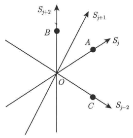
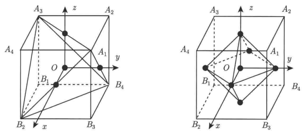

# 第1章 群的基本概念

群论是研究系统对称性质的有力工具。本章首先从系统对称性质的研究中，概括出群的基本概念。通过物理中常见的对称变换群的例子，使读者对群有较具体的认识。然后，引入群的各种子集的概念、群的同构与同态的概念和群的直接乘积的概念。

## 1.1 对　称

对称是一个人们十分熟悉的用语。世界处在既对称又不严格对称的矛盾统一之中。房屋布局的对称给人一种舒服的感觉，但过分的严格对称又会给人死板的感觉。科学理论的和谐美，其中很大程度上表现为对称的美。在现代科学研究中，对称性的研究起着越来越重要的作用。

我们常说，斜三角形很不对称，等腰三角形比较对称，正三角形对称多了，圆比它们都更对称。但是，对称性的高低究竟是如何描写的呢？

对称的概念是和变换密切联系在一起的，所谓系统的对称性就是指它对某种变换保持不变的性质。保持系统不变的变换越多，系统的对称性就越高。只有恒等变换，也就是不变的变换，才保持斜三角形不变。等腰三角形对底边的垂直平分面反射保持不变，而正三角形对三边的垂直平分面反射都保持不变，还对通过中心垂直三角形所在平面的轴转动 $\pm 2\pi/3$ 角的变换保持不变。圆对任一直径的垂直平分面的反射都保持不变，也对通过圆心垂直圆所在平面的轴转动任何角度的变换保持不变。因为保持圆不变的变换最多，所以它的对称性最高。

量子系统的物理特征由系统的哈密顿量（Hamiltonian）决定，量子系统的对称性则由保持系统哈密顿量不变的变换集合来描写。例如，$N$ 个粒子构成的孤立系统的哈密顿量为

$$
H = -\frac{\hbar^2}{2}\sum_{j=1}^{N} m_j^{-1}\nabla_j^2 + \sum_{i<j} U(|r_i - r_j|). \tag{1.1}
$$

其中，$r_j$ 和 $m_j$ 是第 $j$ 个粒子的坐标矢量和质量，$\nabla_j^2$ 是关于 $r_j$ 的拉普拉斯（Laplace）算符，$U$ 是两个粒子间的二体相互作用势，它只是粒子间距离的函数。拉普拉斯算符是对坐标分量的二阶微商之和，它对系统平移、转动和反演都保持不变。作用势只依赖于粒子间的相对坐标绝对值，也对这些变换保持不变。若粒子是全同粒子，哈密顿量还对粒子间的任意置换保持不变。这个量子系统的对称性质就用系统对这些变换的不变性来描述。

保持系统不变的变换称为系统的对称变换，对称变换的集合描写系统的全部对称性质。根据系统的对称性质，通过群论方法研究，可以直接得到系统许多精确的、与细节无关的重要性质。

## 1.2 群及其乘法表

### 1.2.1 群的定义

系统的对称性质由对称变换的集合来描写。我们先来研究系统对称变换集合的共同性质。按照物理中的惯例，两个变换的乘积 $RS$ 定义为先做 $S$ 变换，再做 $R$ 变换。显然，相继做两次对称变换仍是系统的对称变换，三个对称变换的乘积满足结合律。不变的变换称为恒等变换 $E$，它也是一个对称变换，并与任何一个对称变换 $R$ 的乘积仍是该变换 $R$。对称变换的逆变换也是系统的一个对称变换。上述性质是系统对称变换集合的共同性质，与系统的具体性质无关。把对称变换集合的这些共同性质归纳出来，得到群（group）的定义。

**定义 1.1**　在规定了元素的“乘积”法则后，元素的集合 $G$ 如果满足下面四个条件，则称为群。

(1) 集合对乘积的封闭性。集合中任意两元素的乘积仍属此集合：

$$
RS \in G, \quad \forall R \text{ 和 } S \in G. \tag{1.2}
$$

(2) 乘积满足结合律：

$$
R(ST) = (RS)T, \quad \forall R,\ S \text{ 和 } T \in G. \tag{1.3}
$$

(3) 集合中存在恒元 $E$，用它左乘集合中的任意元素，保持该元素不变：

$$
E \in G, \quad ER = R, \quad \forall R \in G. \tag{1.4}
$$

(4) 任何元素 $R$ 的逆 $R^{-1}$ 存在于集合中，满足

$$
\forall R \in G, \quad \exists R^{-1} \in G, \quad \text{使 } R^{-1}R = E. \tag{1.5}
$$

作为数学中群的定义，群的元素可以是任何客体，元素的乘积法则也可任意规定。一旦确定了元素的集合和元素的乘积规则，满足上述四个条件的集合就称为群。系统对称变换的集合，对于变换的乘积规则，满足群的四个条件，因而构成群，称为系统的对称变换群。在物理中常见的群大多是线性变换群、线性算符群或矩阵群。如果没有特别说明，当元素是线性变换或线性算符时，元素的乘积规则都定义为相继做两次变换；当元素是矩阵时，元素的乘积则取通常的矩阵乘积。

在群的定义中，群元素是什么客体并不重要，重要的是它们的乘积规则，也就是它们以什么方式构成群。如果两个群，它们的元素之间可用某种适当给定的方式一一对应起来，而且元素的乘积仍以此同一方式一一对应，常称对应关系对元素乘积保持不变，那么，从群论观点看，这两个群完全相同。具有这种对应关系的两个群称为同构（isomorphism）。

**定义 1.2**　若群 $G'$ 和 $G$ 的所有元素间都按某种规则存在一一对应关系，它们的乘积也按同一规则一一对应，则称两群同构。用符号表示，若 $R$ 和 $S \in G$，$R'$ 和 $S' \in G'$，$R' \longleftrightarrow R$，$S' \longleftrightarrow S$，必有 $R'S' \longleftrightarrow RS$，则 $G' \approx G$，其中符号“$\longleftrightarrow$”代表一一对应，“$\approx$”代表同构。

互相同构的群，它们群的性质完全相同。研究清楚一个群的性质，也就了解了所有与它同构的群的性质。在群同构的定义里，元素之间的对应规则没有什么限制。但如果选择的规则不适当，使元素的乘积不再按此规则一一对应，并不等于说，这两个群就不同构。只要对某一种对应规则，两个群符合群同构的定义，它们就是同构的。

从群的定义出发，可以证明，恒元和逆元也满足

$$
RE = R, \quad RR^{-1} = E. \tag{1.6}
$$

第二个式子表明元素与其逆元是相互的。由此易证群中恒元是唯一的，即若 $E'R = R$，则 $E' = E$。群中任一元素的逆元是唯一的，即若 $SR = E$，则 $S = R^{-1}$。于是，恒元的逆元是恒元，和 $(RS)^{-1} = S^{-1}R^{-1}$。作为逻辑练习，习题第 1 题让读者证明这些结论。证明中除群的定义外，不能用以前熟悉的任何运算法则，因为它们不一定适合群元素的运算。下面我们认为这些结论已经证明，可以应用了。

一般说来，群元素乘积不能对易，$RS \neq SR$。元素乘积都可以对易的群称为阿贝尔（Abel）群。若群中至少有一对元素的乘积不能对易，就称为非阿贝尔群。元素数目有限的群称为有限群，元素的数目 $g$ 称为有限群的阶（order）。元素数目无限的群称为无限群，如果无限群的元素可用一组连续变化的参数描写，则称为连续群。

把群的子集，即群中部分元素的集合 $\mathcal{R} = \{R_1,\ R_2,\ \cdots,\ R_m\}$，看成一个整体，称为复元素。作为集合，复元素不关心所包含元素的排列次序，且重复的元素只取一次。两复元素相等的充要条件是它们包含的元素相同，即 $\mathcal{R} = \mathcal{S}$ 的充要条件是 $\mathcal{R} \subset \mathcal{S}$ 和 $\mathcal{S} \subset \mathcal{R}$。普通元素和复元素相乘仍是复元素。$T\mathcal{R}$ 是由元素 $TR_j$ 的集合构成的复元素，而 $\mathcal{R}T$ 则由元素 $R_jT$ 的集合构成。设 $\mathcal{S} = \{S_1,\ S_2,\ \cdots,\ S_n\}$，两复元素的乘积 $\mathcal{R}\mathcal{S}$ 是所有形如 $R_jS_k$ 的元素集合构成的复元素。上面出现的元素乘积，如 $TR_j$，$R_jT$ 和 $R_jS_k$，均按群元素的乘积规则相乘。复元素的乘积满足结合律。如果复元素的集合，按照复元素的乘积规则，符合群的四个条件，也构成群。

**定理 1.1（重排定理）**　设 $T$ 是群 $G = \{E,\ R,\ S,\ \cdots\}$ 中的任一确定元素，则下面三个集合与原群 $G$ 相同：

$$
\begin{aligned}
TG &= \{T,\ TR,\ TS,\ \cdots\},\\
GT &= \{T,\ RT,\ ST,\ \cdots\},\\
G^{-1} &= \{E,\ R^{-1},\ S^{-1},\ \cdots\}.
\end{aligned}
$$

用复元素符号表达为

$$
TG = GT = G^{-1} = G. \tag{1.7}
$$

**证明**　以 $TG = G$ 为例证明。对群 $G$ 任何元素 $R$，有 $TR \in G$，因而 $TG \subset G$。反之，因为 $R = T(T^{-1}R)$，而 $T^{-1}R \in G$，所以 $G \subset TG$。证完。

对于有限群，群元素数目有限，因此有可能把元素的乘积全部排列出来，构成一个表，称为群的乘法表（multiplication table），简称群表。为了确定起见，对于 $RS = T$，今后称 $R$ 为左乘元素，$S$ 为右乘元素，而 $T$ 为乘积元素。乘法表由下法建立：在表的最左面一列，把全部群元素列出来，作为左乘元素，在表的最上面一行，也把全部群元素列出来，作为右乘元素，元素的排列次序可以任意选定，但常让左乘元素和右乘元素的排列次序相同，恒元排在第一位。表的内容有 $g \times g$ 格，每一格填入它所在行最左面一列的元素 $R$（左乘元素）和它所在列最上面一行的元素 $S$（右乘元素）的乘积 $RS$。因为恒元与任何元素相乘还是该元素，如果把恒元排在表中第一个位置，则乘法表内容中第一行和右乘元素相同，第一列和左乘元素相同。由重排定理，乘法表乘积元素中每一行（或列）都不会有重复元素。乘法表完全描写了有限群的性质。

我们先来看二阶群和三阶群的乘法表。当把第一列和第一行按左乘元素和右乘元素填完后，重排定理已完全确定了表中各位置的填充，如表 1.1 和表 1.2 所示。因此准确到同构，二阶群只有一种，三阶群也只有一种。

表 1.1  二阶群的乘法表

| $C_2$ | $e$ | $\sigma$ |
|---|---|---|
| $e$ | $e$ | $\sigma$ |
| $\sigma$ | $\sigma$ | $e$ |

在二阶群中，可让 $e$ 代表恒等变换，$\sigma$ 代表空间反演变换，则这是对空间反演不变的系统的对称变换群，常记为 $V_2$。也可让 $e$ 代表数 1，$\sigma$ 代表数 $-1$，按普通的数乘积，它们也构成二阶群，记为 $C_2$。这两个群是同构的，$V_2 \approx C_2$。对三阶群有 $\omega^2 = \omega'$ 和 $\omega^3 = e$。表 1.2  三阶群的乘法表

| $C_3$ | $e$ | $\omega$ | $\omega'$ |
|---|---|---|---|
| $e$ | $e$ | $\omega$ | $\omega'$ |
| $\omega$ | $\omega$ | $\omega'$ | $e$ |
| $\omega'$ | $\omega'$ | $e$ | $\omega$ |

按右手螺旋法则，绕沿空间 $\hat{n}(\theta, \varphi)$ 方向的轴转动 $\omega$ 角的变换记为 $R(\hat{n}, \omega)$，其中 $\theta$ 和 $\varphi$ 是 $\hat{n}$ 方向的极角和方位角，尖角 $\wedge$ 表单位矢量。设 $R = R(\hat{n}, 2\pi/N)$，$R$ 及其幂次的集合

$$
C_N = \{E,\ R,\ R^2,\ \cdots,\ R^{N-1}\}, \quad R^N = E, \quad R^{-1} = R^{N-1}, \tag{1.8}
$$

定义元素乘积为相继做变换，则此集合满足群的定义，构成群。一般说来，由一个元素 $R$ 及其幂次构成的有限群称为由 $R$ 生成的循环群，$R$ 称为循环群的生成元。$C_N$ 是 $N$ 阶循环群，生成元 $R$ 常记为 $C_N$，称为 $N$ 次固有转动，或简称 $N$ 次转动。此转动轴常称为 $N$ 次固有转动轴，简称 $N$ 次轴。

$N$ 次转动和空间反演 $\sigma$ 的乘积记为 $S_N$，$S_N = \sigma C_N = C_N \sigma$，称为 $N$ 次非固有转动。由 $S_N$ 及其幂次构成的循环群记为 $\bar{C}_N$，此转动轴称为 $N$ 次非固有转动轴。$C_N$ 群的阶是 $N$，$\bar{C}_N$ 群的阶，根据 $N$ 是偶数或奇数，分别是 $N$ 或 $2N$。

循环群中元素乘积可以对易，因而循环群是阿贝尔群。循环群生成元的选择不是唯一的，如循环群 $C_N$ 中，$C_N$ 和 $C_N^{N-1}$ 都可作生成元。循环群的乘法表有共同的特点，当表中元素按生成元的幂次排列时，表的每一行都可由前一行向左移动一格得到，而最左面的元素移到最右面去。

现在来研究四阶群的乘法表。四阶循环群 $C_4$ 的乘法表如表 1.3 所示，其中 $R$ 的自乘和 $T$ 的自乘都不等于恒元，它们的四次幂才是恒元。如果四阶群中所有元素的自乘都是恒元，由于重排定理，这样的四阶群乘法表只能如表 1.4 所示。设 $\sigma$，$\tau$ 和 $\rho$ 分别是空间反演、时间反演和时空全反演，则此群称为四阶反演群 $V_4$。也由于重排定理，四阶群中除恒元外的任一元素的三次幂不能等于恒元。因此，准确到同构，四阶群只有两种：如果群中所有元素自乘都是恒元，它就与 $V_4$ 群同构；否则，它就与 $C_4$ 群同构。

表 1.3  四阶循环群 $C_4$ 的乘法表

| $C_4$ | $E$ | $R$ | $S$ | $T$ |
|---|---|---|---|---|
| $E$ | $E$ | $R$ | $S$ | $T$ |
| $R$ | $R$ | $S$ | $T$ | $E$ |
| $S$ | $S$ | $T$ | $E$ | $R$ |
| $T$ | $T$ | $E$ | $R$ | $S$ | 表 1.4  四阶反演群 $V_4$ 的乘法表

| $V_4$ | $e$ | $\sigma$ | $\tau$ | $\rho$ |
|---|---|---|---|---|
| $e$ | $e$ | $\sigma$ | $\tau$ | $\rho$ |
| $\sigma$ | $\sigma$ | $e$ | $\rho$ | $\tau$ |
| $\tau$ | $\tau$ | $\rho$ | $e$ | $\sigma$ |
| $\rho$ | $\rho$ | $\tau$ | $\sigma$ | $e$ |

### 1.2.2 子群

群 $G$ 的子集 $H$，如果按照原来的元素乘积规则，也满足群的四个条件，则称为群 $G$ 的子群（subgroup）。注意，乘积规则是群的最重要的性质，如果给子集元素重新定义新的乘积规则，那它就与原群脱离了关系，即使此子集构成群，也不能称为原群的子群。任何群都有两个平庸的子群：恒元和整个群。但通常更关心非平庸子群。

既然有限群的元素数目是有限的，那么有限群任一元素的自乘，当幂次足够高时必然会有重复。由群中恒元唯一性知，有限群任一元素的自乘若干次后必可得到恒元。若 $R^n = E$，$n$ 是 $R$ 自乘得到恒元的最低幂次，则 $n$ 称为元素 $R$ 的阶，$R$ 生成的循环群称为元素 $R$ 的周期。元素的周期构成子群，称为循环子群（cyclic subgroup）。阶数为 $n$ 的循环子群，通常就记为 $C_n$，必要时用撇来加以区分。恒元的阶为 1，其他元素的阶都大于 1。不同元素的周期也可有重复或重合。请注意不要混淆群的阶和元素的阶这两个不同的概念，只有循环群生成元的阶才等于该群的阶。

如何来判定一个子集是否构成子群？既然子集元素满足原群的元素乘积规则，结合律是显然满足的。如果子集对元素乘积封闭，则它必定包含子集中任一元素的周期，对有限群来说，元素 $R$ 的周期包含了恒元和逆元 $R^{-1}$，因此对有限群，检验子集是否满足封闭性就可以判定子集是否构成子群。当然对无限群，判定子群还必须检验恒元和逆元是否在子集中。不含恒元的子集肯定不是子群，这是否定子集为子群的一个最简单判据。

有限群中任一元素 $R$ 的周期构成群中一个子群。若此子群尚未充满整个群，则在子群外再任取群中一元素 $S$，由 $R$ 和 $S$ 所有可能的乘积构成一个更大的子群。若它还没有充满整个群，则再取第三个、第四个元素加入上述乘积，最后总能充满整个有限群，即群中所有元素都可表为若干个元素的乘积。适当选择这些元素，使有限群中所有元素都可表为尽可能少的若干个元素的乘积，这些元素称为有限群的生成元，生成元不能表成其他生成元的乘积。有限群生成元的数目称为有限群的秩。

### 1.2.3 正 N 边形对称群

把正 $N$ 边形放在 $xy$ 平面上，中心和原点重合，一个顶点在正 $x$ 轴上。保持正$N$ 边形不变的变换有两类。$z$ 轴是 $N$ 次固有转动轴，绕 $z$ 轴转动 $2\pi/N$ 角的变换记为 $T$，则有 $N$ 个对称变换 $T^n(1\leqslant n\leqslant N)$，其中 $T^N=E$。在 $xy$ 平面上，当 $N$ 是偶数时，两相对顶点的连线和两对边中点的连线都是二次固有转动轴，当 $N$ 是奇数时，顶点和对边中点的连线都是二次固有转动轴，绕它们转动 $\pi$ 角的变换都保持正 $N$ 边形不变。这样的二次转动轴共有 $N$ 个，它们与 $x$ 轴的夹角分别为 $j\pi/N$ 角，对应的对称变换记为 $S_j$，$0\leqslant j\leqslant N-1$。由这 $2N$ 个元素 $T^m$ 和 $S_j$ 的集合构成正 $N$ 边形对称群 $D_N$ (dihedral group)。

研究 $D_N$ 群元素的乘积规则。$T$ 的周期是 $N$ 阶循环群，现在关键是要计算 $TS_j$ 等于什么。既然这些变换都不移动原点，那么再有两点就完全确定了平面图形的位置。设与 $S_j$ 相应的二次轴上有点 $A$，它在变换 $S_j$ 中保持不变，而在变换 $T$ 中逆时针转动了 $2\pi/N$ 角，设转到 $B$ 点。相应地，原先的 $B$ 点，经 $S_j$ 变到与二次轴对称的位置 $C$，再经 $T$ 变换，恰好转到 $A$ 点 (图 1.1)。可见 $TS_j$ 是绕 $\angle AOB$ 的角平分线转动 $\pi$ 角的变换，因为此角平分线与原二次轴夹角为 $\pi/N$，所以

$$
TS_j = S_{j+1}, \quad j \bmod N, \tag{1.9}
$$

$j \bmod N$ 是一种常用的数学符号，它把取值相差 $N$ 的两个 $j$ 看成相同的，即 $S_{j+N}=S_j$。

注意到 $S_j$ 的阶是 2，由式 (1.9) 可推得群中所有元素的乘积规则：

$$
\begin{aligned}
&T^N = S_j^2 = E, \quad T^m S_j = S_{j+m}, \quad j \text{ 和 } m \bmod N.\\
&T^m = S_{j+m} S_j = S_j S_{j-m}, \quad S_j T^m = S_{j-m},
\end{aligned}
\tag{1.10}
$$

$D_N$ 群的生成元可取为 $T$ 和 $S_0$，而 $S_m = T^m S_0$。式 (1.10) 用公式给出了有限群的元素乘积规则。当群的阶数较高时，公式法比乘法表更方便。阶数较低时采用乘法表更直观。例如，由式 (1.10) 可以列出正三角形对称群 $D_3$ 的乘法表，如表 1.5 所示。表 1.5  正三角形对称群 $D_3$ 的乘法表

|  | $E$ | $T$ | $T^2$ | $S_1$ | $S_2$ | $S_3$ |
|---|---|---|---|---|---|---|
| $E$ | $E$ | $T$ | $T^2$ | $S_1$ | $S_2$ | $S_3$ |
| $T$ | $T$ | $T^2$ | $E$ | $S_2$ | $S_3$ | $S_1$ |
| $T^2$ | $T^2$ | $E$ | $T$ | $S_3$ | $S_1$ | $S_2$ |
| $S_1$ | $S_1$ | $S_3$ | $S_2$ | $E$ | $T^2$ | $T$ |
| $S_2$ | $S_2$ | $S_1$ | $S_3$ | $T$ | $E$ | $T^2$ |
| $S_3$ | $S_3$ | $S_2$ | $S_1$ | $T^2$ | $T$ | $E$ |

对六阶群，若有一个元素的阶为 6，则此群为循环群 $C_6$。习题第 4 题中请大家证明：准确到同构，六阶群只有循环群 $C_6$ 和正三角形对称群 $D_3$。对于给定的六阶群，如何判断它与哪个群同构呢？如果六阶群中阶数等于 2 的元素多于一个，它就与 $D_3$ 群同构；反之，如果群中存在阶数大于 3 的元素 (自乘三次还未出现恒元)，则它就与 $C_6$ 群同构。

虽然不存在正二边形，但还是可以定义 $D_2$ 群，取 $T=T_z$，$S_1=T_x$ 和 $S_2=T_y$，它们分别是绕坐标轴转动 $\pi$ 角的变换，则

$$
D_2 = \{E,\ T_x,\ T_y,\ T_z\}, \quad T_x^2 = T_y^2 = T_z^2 = E, \quad T_x T_y = T_z. \tag{1.11}
$$

显然，$D_2$ 群和四阶反演群 $V_4$ 同构。

### 1.2.4 置换群

研究 $n$ 个全同粒子体系的置换对称性，$n$ 个客体排列次序的变换称为置换 (permutation)。设原来排在第 $j$ 位置的客体，经过置换 $R$ 后排到了第 $r_j$ 位置，用一个 $2\times n$ 矩阵来描写这一置换 $R$，

$$
R = \begin{pmatrix} 1 & 2 & \cdots & n \\ r_1 & r_2 & \cdots & r_n \end{pmatrix}. \tag{1.12}
$$

对一个给定的置换，式 (1.12) 中各列的排列次序是无关紧要的，重要的是每一列上下两个数字的对应关系，也就是各客体在变换前后所处位置的关系。因此式 (1.12) 中各列次序可以任意交换。例如，

$$
R = \begin{pmatrix} 1 & 2 & 3 & 4 & 5 \\ 3 & 4 & 5 & 2 & 1 \end{pmatrix} = \begin{pmatrix} 5 & 4 & 1 & 2 & 3 \\ 1 & 2 & 3 & 4 & 5 \end{pmatrix}. \tag{1.13}
$$

今后，常把以数字标记的客体间的置换，简单地说成数字间的置换。这样的说法通常不会引起混淆。

两个置换的乘积定义为相继做两次置换。例如，乘积 $SR$，客体先按 $R$ 置换重新排列，然后在此新排列的基础上再做 $S$ 置换。在做 $S$ 置换时，把新排列中第 $j$ 位置的客体移到第 $s_j$ 位置去，而不管这第 $j$ 位置的客体在 $R$ 置换之前排在什么位置。这正是全同粒子体系的实际情况。粒子经过置换以后，只知道目前粒子排在什么位置，而“忘却”了变换前它排在什么位置。按照这一观念，在具体计算两个置换乘积 $SR$ 时，可以先改变 $R$ 各列的排列次序，使 $R$ 的第二行和 $S$ 的第一行排列一样，然后用 $R$ 的第一行代替 $S$ 的第一行，就得到乘积置换 $SR$。也可以先改变 $S$ 各列的排列次序，使 $S$ 的第一行和 $R$ 的第二行排列一样，然后用 $S$ 的第二行代替 $R$ 的第二行，也得到乘积置换 $SR$。两种方法的计算结果是完全相同的。例如，

$$
\begin{aligned}
S &= \begin{pmatrix} 1 & 2 & 3 & 4 & 5 \\ 3 & 1 & 2 & 4 & 5 \end{pmatrix} = \begin{pmatrix} 3 & 4 & 5 & 2 & 1 \\ 2 & 4 & 5 & 1 & 3 \end{pmatrix},\\
SR &= \begin{pmatrix} 1 & 2 & 3 & 4 & 5 \\ 3 & 1 & 2 & 4 & 5 \end{pmatrix}\begin{pmatrix} 5 & 4 & 1 & 2 & 3 \\ 1 & 2 & 3 & 4 & 5 \end{pmatrix} = \begin{pmatrix} 5 & 4 & 1 & 2 & 3 \\ 3 & 1 & 2 & 4 & 5 \end{pmatrix}.
\end{aligned}
\tag{1.14}
$$

或

$$
SR = \begin{pmatrix} 3 & 4 & 5 & 2 & 1 \\ 2 & 4 & 5 & 1 & 3 \end{pmatrix}\begin{pmatrix} 1 & 2 & 3 & 4 & 5 \\ 3 & 4 & 5 & 2 & 1 \end{pmatrix} = \begin{pmatrix} 1 & 2 & 3 & 4 & 5 \\ 2 & 4 & 5 & 1 & 3 \end{pmatrix}, \tag{1.15}
$$

我们看到，式 (1.14) 和式 (1.15) 给出的结果，每一列上下的数字关系都是相同的，就是说它们是相等的。例如，第 4 位置的客体经变换 $R$ 排到了第 2 位置，再经过 $S$ 变换，从第 2 位置变到第 1 位置，而式 (1.14) 和式 (1.15) 给出的结果中，数字 4 下方填的数字都是 1。

置换变换虽用矩阵来描写，但置换的乘积并不服从通常的矩阵乘积规则。作为变换的乘积，两个置换的乘积仍是一个置换，置换乘积满足结合律，但不满足交换律。所有客体位置不变的置换是恒等变换 $E$，它的上下两行数字完全相同。

$$
E = \begin{pmatrix} 1 & 2 & 3 & \cdots & n \\ 1 & 2 & 3 & \cdots & n \end{pmatrix}. \tag{1.16}
$$

$E$ 与任何置换 $R$ 相乘仍得置换 $R$，故 $E$ 是恒元。把置换上下两行交换得逆置换。例如，

$$
R^{-1} = \begin{pmatrix} r_1 & r_2 & \cdots & r_n \\ 1 & 2 & \cdots & n \end{pmatrix}, \tag{1.17}
$$

$$
R^{-1}R = \begin{pmatrix} r_1 & r_2 & \cdots & r_n \\ 1 & 2 & \cdots & n \end{pmatrix}\begin{pmatrix} 1 & 2 & \cdots & n \\ r_1 & r_2 & \cdots & r_n \end{pmatrix} = E.
$$

$n$ 个客体共有 $n!$ 个不同的置换。按照上述置换乘积规则，$n$ 个客体的所有置换的集合满足群的四个条件，构成群，称为 $n$ 个客体置换群，记为 $S_n$。$S_n$ 群的阶数为$g=n!$。在文献中对置换及其乘积有不同的定义，读者看书时要注意书中采用的定义。

轮换 (cycle) 是一类特殊的置换。如果在一个置换中，有 $(n-\ell)$ 个客体保持不变，而余下的 $\ell$ 个客体顺序变换，即第 $a_1$ 位置的客体排到第 $a_2$ 位置，第 $a_2$ 位置的客体排到第 $a_3$ 位置，以此类推，最后第 $a_\ell$ 位置的客体排到第 $a_1$ 位置，形成一个循环，则这样的置换称为轮换，$\ell$ 称为轮换长度。轮换常用一行的矩阵来描写

$$
(a_1\ a_2\ \cdots\ a_\ell) = \begin{pmatrix} a_1 & a_2 & \cdots & a_{\ell-1} & a_\ell & b_1 & \cdots & b_{n-\ell} \\ a_2 & a_3 & \cdots & a_\ell & a_1 & b_1 & \cdots & b_{n-\ell} \end{pmatrix}. \tag{1.18}
$$

在用行矩阵描写轮换时，数字的排列次序不能改变，但允许数字顺序变换

$$
(q\ a\ b\ c\ \cdots\ p) = (a\ b\ c\ \cdots\ p\ q) = (b\ c\ \cdots\ p\ q\ a). \tag{1.19}
$$

例如，

$$
\begin{aligned}
(1\ 2\ 3) &= (2\ 3\ 1) = (3\ 1\ 2) = \begin{pmatrix} 1 & 2 & 3 \\ 2 & 3 & 1 \end{pmatrix}\\
&\neq (2\ 1\ 3) = (1\ 3\ 2) = (3\ 2\ 1) = \begin{pmatrix} 1 & 2 & 3 \\ 3 & 1 & 2 \end{pmatrix} = (1\ 2\ 3)^{-1}.
\end{aligned}
$$

长度为 1 的轮换是恒等变换，长度为 2 的轮换称为对换 (transposition)。显然对换满足

$$
(a\ b) = (b\ a), \quad (a\ b)(a\ b) = E. \tag{1.20}
$$

推而广之，长度为 $\ell$ 的轮换，它的 $\ell$ 次自乘等于恒元，即它的阶数为 $\ell$。

两个没有公共客体的轮换，乘积次序可以交换。对一给定的置换 $R$，任选一数 $a_1$，设经过置换 $R$，第 $a_1$ 位置的客体变到第 $a_2$ 位置，第 $a_2$ 位置的客体变到第 $a_3$ 位置，以此类推，在此客体链中总会有某客体，如第 $a_\ell$ 位置的客体变到第 $a_1$ 位置，形成一个循环，则置换 $R$ 包含一个长度为 $\ell$ 的轮换 $(a_1\ a_2\ \cdots\ a_\ell)$。然后，再在余下的数中任选一数 $b_1$，如上法找出它的客体链，确定 $R$ 中包含的另一个轮换。两轮换没有公共客体，因而乘积次序可以交换。把这做法继续下去，总能穷尽全部 $n$ 个数，从而把置换 $R$ 分解为若干个没有公共客体的轮换乘积。这些轮换的乘积次序可以互相交换。在这意义上说，任何置换都可以唯一地分解为若干个没有公共客体的轮换乘积。例如，式 (1.14) 中用到的两个置换 $R$ 和 $S$ 可分别分解为

$$
R = (1\ 3\ 5)(2\ 4) = (2\ 4)(1\ 3\ 5),
$$

$$
S = (1\ 3\ 2)(4)(5) = (1\ 3\ 2).
$$

把一置换分解为没有公共客体的轮换乘积时，各轮换长度 $\ell_i$ 的集合，称为该置换的轮换结构。例如，上式中 $R$ 的轮换结构是 $(3\ 2)$，$S$ 的轮换结构是 $(3,1,1)\equiv(3,1^2)$。在表达一个置换的轮换结构时，轮换长度 $\ell_i$ 的排列次序可以任意。相同的轮换长度可用幂次方式给出。一般说来，$n$ 个客体的任一置换 $R$ 的轮换结构可表为

$$
(\ell_1, \ell_2, \cdots), \quad \sum_i \ell_i = n. \tag{1.21}
$$

把一个正整数 $n$ 分解为若干个正整数 $\ell_i$ 之和，这样的正整数 $\ell_i$ 的集合称为 $n$ 的一组配分数 (partition)。置换的轮换结构是由一组配分数来描写的。

虽然每一置换都可分解为没有公共客体的轮换乘积，但在计算两个置换乘积时，我们必须计算两个有公共客体的轮换乘积问题。通常认为，只有把置换化为没有公共客体的轮换乘积时，才算把置换化到了最简形式。

先讨论只有一个公共客体的轮换乘积的计算方法。例如，

$$
\begin{aligned}
(a\ b\ c\ d)(d\ e\ f) &= \begin{pmatrix} a & b & c & e & f & d \\ b & c & d & e & f & a \end{pmatrix}\begin{pmatrix} a & b & c & d & e & f \\ a & b & c & e & f & d \end{pmatrix}\\
&= \begin{pmatrix} a & b & c & d & e & f \\ b & c & d & e & f & a \end{pmatrix} = (a\ b\ c\ d\ e\ f).
\end{aligned}
$$

推而广之

$$
(a\ b\ \cdots\ d)(d\ e\ \cdots\ f) = (a\ b\ \cdots\ d\ e\ \cdots\ f). \tag{1.22}
$$

这公式可以做如下两种理解。从左面向右面看，式 (1.22) 提供有一个公共客体的两轮换的乘积规则：先按式 (1.19)，在每个轮换内部，把公共客体顺序变到最右面或最左面的位置，然后按式 (1.22) 把两个轮换“接”起来。从右面向左面看，式 (1.22) 提供把一个轮换分解为有一个公共客体的两轮换乘积的规则：在轮换中任一客体的位置，如 $d$ 处，把轮换“切断”成两个轮换的乘积，并让 $d$ 同时出现在两个轮换中。

按照这样的理解，很容易利用式 (1.22) 计算有任意多个公共客体的轮换乘积问题。其基本思想就是先把轮换切断，使每一对轮换乘积都只包含一个公共客体，从而可用式 (1.22) 接起来。例如，有两个公共客体的轮换乘积可用下法计算：

$$
\begin{aligned}
&(a_1\ \cdots\ a_i\ c\ a_{i+1}\ \cdots\ a_j\ d)(d\ b_1\ \cdots\ b_r\ c\ b_{r+1}\ \cdots\ b_s)\\
={}&(a_1\ \cdots\ a_i\ c)(c\ a_{i+1}\ \cdots\ a_j\ d)(d\ b_1\ \cdots\ b_r\ c)(c\ b_{r+1}\ \cdots\ b_s)\\
={}&(a_1\ \cdots\ a_i\ c)(a_{i+1}\ \cdots\ a_j\ d\ c)(c\ d\ b_1\ \cdots\ b_r)(c\ b_{r+1}\ \cdots\ b_s)\\
={}&(a_1\ \cdots\ a_i\ c)(a_{i+1}\ \cdots\ a_j\ d)(d\ c)(c\ d)(d\ b_1\ \cdots\ b_r)(c\ b_{r+1}\ \cdots\ b_s)\\
={}&(a_1\ \cdots\ a_i\ c)(a_{i+1}\ \cdots\ a_j\ d)(d\ b_1\ \cdots\ b_r)(c\ b_{r+1}\ \cdots\ b_s)\\
={}&(a_1\ \cdots\ a_i\ c\ b_{r+1}\ \cdots\ b_s)(a_{i+1}\ \cdots\ a_j\ d\ b_1\ \cdots\ b_r).
\end{aligned}
$$

可以用置换的乘积规则计算正三角形对称群的乘法表。把三角形的三个顶点看成三个客体，记为 1, 2, 3，正三角形的每个对称变换就是把三个客体重新排列。这样，6 个对称变换分别表成下面 6 个置换，

$$
\begin{aligned}
E &= \begin{pmatrix} 1 & 2 & 3 \\ 1 & 2 & 3 \end{pmatrix}, &
T &= \begin{pmatrix} 1 & 2 & 3 \\ 3 & 1 & 2 \end{pmatrix}, &
T^2 &= \begin{pmatrix} 1 & 2 & 3 \\ 2 & 3 & 1 \end{pmatrix},\\
S_1 &= \begin{pmatrix} 1 & 2 & 3 \\ 1 & 3 & 2 \end{pmatrix}, &
S_2 &= \begin{pmatrix} 1 & 2 & 3 \\ 3 & 2 & 1 \end{pmatrix}, &
S_3 &= \begin{pmatrix} 1 & 2 & 3 \\ 2 & 1 & 3 \end{pmatrix}.
\end{aligned}
\tag{1.23}
$$

通过这 6 个置换的乘积，也可以得到乘法表 1.5。例如，

$$
TS_1 = \begin{pmatrix} 1 & 2 & 3 \\ 3 & 1 & 2 \end{pmatrix}\begin{pmatrix} 1 & 2 & 3 \\ 1 & 3 & 2 \end{pmatrix} = (1\ 3\ 2)(2\ 3) = (1\ 3) = S_2.
$$

因为这 6 个置换包含了 3 个客体的全部置换，构成三个客体置换群 $S_3$，所以 $S_3$ 群和 $D_3$ 群同构：$S_3 \approx D_3$。

## 1.3 群的各种子集

### 1.3.1 陪集和不变子群

设群 G 阶为 $g$，有子群 H，阶为 $h$，

$$
H = \{S_1,\ S_2,\ S_3,\ \cdots,\ S_h\}, \quad S_1 = E.
$$

任取群 G 中不属于子群 H 的元素 $R_j$，把它左乘或右乘到子群 H 上，得到群 G 的两个子集

$$
\begin{aligned}
R_j H &= \{R_j,\ R_j S_2,\ R_j S_3,\ \cdots,\ R_j S_h\},\\
H R_j &= \{R_j,\ S_2 R_j,\ S_3 R_j,\ \cdots,\ S_h R_j\},
\end{aligned}
\qquad R_j \in G, \quad R_j \notin H. \tag{1.24}
$$

$R_jH$ 称为子群 H 的左陪集 (left coset)，$HR_j$ 称为右陪集 (right coset)。

陪集和子群没有公共元素。以左陪集为例，用反证法证明。设 $R_j S_\mu = S_\nu$，用 $S_\mu^{-1}$ 右乘，得 $R_j = S_\nu S_\mu^{-1} \in H$，与假设矛盾。因此陪集不包含恒元，陪集一定不是群 G 的子群。

陪集中没有重复元素，因而陪集也包含 $h$ 个不同的元素。以左陪集为例，若 $R_j S_\mu = R_j S_\nu$，用 $R_j^{-1}$ 左乘后必有 $S_\mu = S_\nu$。

若 H 和 $R_jH$ 的并还没有充满整个群 G，则再选 G 中不属于 H 和 $R_jH$ 的元素 $R_k$ 构造新的左陪集 $R_kH$。同理可证，$R_kH$ 也包含 $h$ 个不同的元素，它们都不属于 H 和 $R_jH$。事实上，两个有公共元素的左陪集必全同，因为若 $R_j S_\mu = R_k S_\nu$，则

$$
R_k = R_j\left(S_\mu S_\nu^{-1}\right), \quad R_k H = R_j\left(S_\mu S_\nu^{-1}\right)H = R_j H.
$$

后式用到了重排定理。用上法继续做下去，群 G 一定可分解为子群 H 和若干个左陪集 $R_jH$ 之并，这些子集间都没有公共元素，每个子集包含 $h$ 个不同元素。因此，群 G 的阶数 $g$ 一定是子群 H 阶数 $h$ 的整数倍。

$$
G = H \cup R_2 H \cup R_3 H \cup \cdots \cup R_d H, \quad g = dh. \tag{1.25}
$$

$d$ 称为子群 H 的指数 (index)，它等于子群的左陪集数加 1。如果群 G 的一个子集包含的元素数目不是群 G 阶数 $g$ 的约数，则此子集一定不构成子群。这也是判定一个子集不是子群的简单方法。根据这一方法，阶数为素数的群不会有非平庸子群，因而一定是循环群。

群 G 中两元素 $R$ 和 $T$ 属同一左陪集的充要条件是 $R^{-1}T \in H$。因为如果此条件成立，则 $T=RS_\mu$，而 $R=RE$，它们同属左陪集 RH；反之，若 $T \in RH$，则 $T=RS_\mu$，$R^{-1}T=S_\mu \in H$。

上述性质同样适用于右陪集。群 G 一定可分解为子群 H 和 $(d-1)$ 个右陪集 $HR_j$ 之并，这些子集间都没有公共元素，每个子集包含 $h$ 个不同元素，两个有公共元素的右陪集必全同，群 G 中两元素 $R$ 和 $T$ 属同一右陪集的充要条件是 $TR^{-1} \in H$。

用群 G 中子群 H 外一个元素 $R_j$，左乘和右乘子群 H，得到的左陪集 $R_jH$ 和右陪集 $HR_j$ 不一定相同。若子群 H 的所有左陪集都与对应的右陪集相等，

$$
R_j H = H R_j, \quad \text{即} \quad R_j S_\mu = S_\nu R_j, \tag{1.26}
$$

则此子群称为不变子群 (invariant subgroup)，或称正规子群 (normal subgroup)。注意，此定义并不要求不变子群的元素 $S_\mu$ 和群 G 中所有其他元素 $R_j$ 对易。当然，阿贝尔群的所有子群都是不变子群。指数为 2 的子群必为不变子群，因为它只有一个陪集，左右陪集只能相等。

不变子群 H 及其所有陪集，作为复元素的集合，按复元素的乘积，满足群的四个条件，构成群，称为群 G 关于不变子群 H 的商群 (quotient group)，记为 G/H。商群的恒元是子群 H，阶数是子群的指数 $d$。在证明上述复元素的集合满足群的四个条件过程中，用到了不变子群的定义式 (1.26)，

$$
\begin{aligned}
R_j H R_k H &= R_j R_k H H = (R_j R_k) H,\\
H R_j H &= R_j H H = R_j H,\\
R_j^{-1} H R_j H &= R_j^{-1} R_j H H = H.
\end{aligned}
$$

因此不能由一般子群及其陪集定义商群。

从群的乘法表上很容易找到子群的陪集。事实上，乘法表里与子群元素有关的各列中，每一行的元素分别构成子群或左陪集，而与子群元素有关的各行中，每一列的元素分别构成子群或右陪集。例如，从表 1.5 读出，$D_3$ 群的子群 $\{E,\ S_1\}$ 有两个左陪集：$\{T,\ S_2\}$ 和 $\{T^2,\ S_3\}$，右陪集也有两个：$\{T,\ S_3\}$ 和 $\{T^2,\ S_2\}$。左右陪集不对应相等，因而此子群不是不变子群。另一子群 $\{E,\ T,\ T^2\}$ 的指数为 2，它是不变子群，陪集是 $\{S_1,\ S_2,\ S_3\}$。

设 H 是群 G 的非平庸不变子群，若群 G 不包含比 H 阶数更高的非平庸不变子群，则 H 称为群 G 的极大不变子群。指数为 2 的不变子群当然是极大不变子群。置换群 $S_n$ 有一个指数为 2 的极大不变子群，称为交变子群 (alternating subgroup)，常记为 $S'_n$。现在来研究这一子群。

在轮换每一客体处都切断，则长度为 $\ell$ 的轮换分解为 $\ell-1$ 个对换的乘积

$$
(a\ b\ c\ \cdots\ p\ q) = (a\ b)(b\ c)\cdots(p\ q).
$$

当然，这些对换有公共客体，而且这种分解不是唯一的。例如，

$$
E = (a\ b)(a\ b)(b\ c)(b\ c) = (a\ b)(a\ c)(a\ b)(b\ c).
$$

同理，任何置换都可以分解为若干个对换的乘积。这种分解虽然不是唯一的，但容易证明，它包含对换个数的偶奇性与分解方式无关。为了证明这一命题，借用范德蒙德 (Vandermonde) 行列式：

$$
D(x_1, x_2, \cdots, x_n) = \begin{vmatrix}
1 & 1 & \cdots & 1 \\
x_1 & x_2 & \cdots & x_n \\
x_1^2 & x_2^2 & \cdots & x_n^2 \\
\vdots & \vdots & & \vdots \\
x_1^{n-1} & x_2^{n-1} & \cdots & x_n^{n-1}
\end{vmatrix} = \prod_{i>j} (x_i - x_j),
$$

把 $n$ 个 $x_j$ 做置换 $R$，行列式只能保持不变或改变符号，是否改变符号完全由 $R$ 本身决定。但把 $x_j$ 做任何对换，行列式一定改变符号。当把 $R$ 分解为对换乘积时，包含对换的偶奇性决定了行列式是否改号。因此在给定 $R$ 的分解中包含对换个数的偶奇性是完全确定的。

当把置换分解为对换乘积时，对换数目是偶数的置换称为偶置换，对换数目是奇数的置换称为奇置换。长度为奇数的轮换是偶置换，长度为偶数的轮换是奇置换。两个偶置换的乘积或两个奇置换的乘积是偶置换，一个偶置换和一个奇置换的乘积是奇置换。恒元是偶置换。常引入置换宇称 (permutation parity) $\delta(R)$ 的概念来区分 $R$ 是偶置换还是奇置换：

$$
\delta(R) = \begin{cases} 1, & R \text{ 是偶置换，} \\ -1, & R \text{ 是奇置换．} \end{cases} \tag{1.27}
$$

两个置换相乘时，它们的置换宇称也对应相乘。当 $n > 1$ 时，置换群 $S_n$ 中所有偶置换的集合构成置换群的一个指数为 2 的不变子群，称为交变子群，奇置换的集合是它的陪集，商群是二阶群。

### 1.3.2 共轭元素和类

对群 G 中任意元素 $S$，元素 $R' = SRS^{-1}$ 和 $R$ 称为互相共轭 (conjugate) 的元素。共轭关系是相互的，与同一元素共轭的元素也互相共轭：

$$
R' = SRS^{-1}, \quad R'' = TRT^{-1} = (TS^{-1}) R' (TS^{-1})^{-1}.
$$

所有互相共轭的元素的集合称为类 (class)，记为

$$
C_\alpha = \{R_1, R_2, \cdots, R_{n(\alpha)}\} = \{R_k | R_k = S R_j S^{-1}, S \in G\}, \tag{1.28}
$$

$n(\alpha)$ 是类 $C_\alpha$ 中所包含的元素数目。显然，恒元本身自成一类，常记为 $C_1 = E$。阿贝尔群每个元素自成一类。两个类不会有公共元素，因而除恒元外，类不是子群。设 $g_c$ 是群 G 包含的类数，则

$$
\sum_{\alpha=1}^{g_c} n(\alpha) = g. \tag{1.29}
$$

对群 G 中任意给定的元素 $S \in G$，当 $R_j$ 取遍类中所有元素时，$S R_j S^{-1}$ 互相共轭，且不会有重复元素，故有

$$
S C_\alpha S^{-1} = C_\alpha, \quad S C_\alpha = C_\alpha S. \tag{1.30}
$$

这说明，类 $C_\alpha$ 作为复元素，可以和群 G 任意元素 $S$ 对易。反之，对类 $C_\alpha$ 中固定的元素 $R_j$，让 $S$ 取遍群 G 中所有元素，$S R_j S^{-1}$ 会有重复的元素，而且可证类中每一个元素 $R_k$ 的重复次数 $m(\alpha)$ 都相同 (习题第 17 题)，可见类 $C_\alpha$ 中包含的元素数目 $n(\alpha) = g/m(\alpha)$ 是群 G 阶数 $g$ 的因子。

类 $C_\alpha$ 中各元素的逆元也必定互相共轭：

$$
R_k = S R_j S^{-1}, \quad R_k^{-1} = S R_j^{-1} S^{-1}. \tag{1.31}
$$

因此 $R_j^{-1}$ 的集合也构成类，记为 $C_\alpha^{-1}$。$C_\alpha$ 和 $C_\alpha^{-1}$ 称为相逆 (reciprocal) 类，它们包含的元素数目 $n(\alpha)$ 相同。若 $C_\alpha$ 中有元素与其逆元共轭，则 $C_\alpha$ 与其相逆类 $C_\alpha^{-1}$ 重合，这样的类称为自逆 (self reciprocal) 类。

互相共轭的元素存在某种共同的性质，这就是互相共轭元素的集合称为类的原因。例如，若 $R^n = E$，则 $(SRS^{-1})^n = S R^n S^{-1} = E$，同类元素的阶必相同。但阶数相同的元素不一定属于同一类。尽管如此，在寻找类时，我们只需在阶数相同的元素中去判别它们是否共轭。$TS$ 和 $ST$ 是共轭的，因为 $(ST) = S(TS)S^{-1}$。反之，互相共轭的元素一定可表达成某两元素的不同次序的乘积，因为若 $R' = S(RS^{-1})$，则 $R = (RS^{-1})S$。如果群表中取左乘元素和右乘元素的排列次序相同，则在群表中关于对角线对称的两元素互相共轭，互相共轭的元素也一定会在乘法表关于对角线对称的位置出现。在阶数相同的元素中，根据它们是否在群表对称位置出现，就可以确定它们是否属群 G 的同一类。这是计算有限群类的重要方法。

保持空间一个固定点 $O$ (常取为原点) 不变的若干固有转动的集合构成的有限群称为固有点群 (proper point group)。设固有点群 G 中包含沿 $\hat{n}$ 方向和沿 $\hat{m}$ 方向两个 $N$ 次固有转动轴，生成元分别为 $R = R(\hat{n}, 2\pi/N)$ 和 $R' = R(\hat{m}, 2\pi/N)$，G 又包含把 $\hat{n}$ 方向转到 $\hat{m}$ 方向的转动 $S$，则元素乘积 $SRS^{-1}$ 是先把 $\hat{m}$ 方向转到 $\hat{n}$ 方向，然后绕 $\hat{n}$ 方向转动 $2\pi/N$ 角，最后又把 $\hat{n}$ 方向转回到 $\hat{m}$ 方向。这样，转动 $SRS^{-1}$ 保持 $\hat{m}$ 方向不变，它就是绕 $\hat{m}$ 方向的 $N$ 次转动 $R'$，即

$$
S\hat{n} = \hat{m}, \quad S R(\hat{n}, 2\pi/N) S^{-1} = R(\hat{m}, 2\pi/N). \tag{1.32}
$$

这两个转动轴称为等价轴。绕等价轴转动相同角度的变换互相共轭。等价轴一定是同次轴。不同次的转动轴不可能通过对称群中的元素联系起来。转动不同角度的元素当然不共轭。绕两个次数不相同的转动轴的转动，即使转动角度 (不为零) 相同也一定不共轭。若一个 $N$ 次轴的正反两个方向可以通过对称群中的元素联系起来，则此轴称为双向轴，或非极性轴。绕双向轴转动正负相同角度的变换互相共轭。二次轴不需要规定轴的方向。

由不变子群的定义式 (1.26) 知，不变子群必须包含子群中每个元素的共轭元素，即不变子群是由群 G 中若干个完整的类组成。寻找群的类和不变子群是分析有限群性质的关键步骤。对有限群，首先根据群表确定每个元素的阶数，在阶数相同元素中判断它们是否共轭，从而找出所有的类，然后把若干类并起来，判断此子集是否构成子群。若它是子群，则它也是不变子群。判断的方法，首先检查此子集是否满足子群的必要条件：子群包含恒元，子群的元素数目是群阶数的约数，子群完整地包含每一元素的周期。只有在这些条件都满足后，才进一步利用群表检验子集的封闭性是否满足。

由 $R$ 生成的循环群 $C_N$ 是阿贝尔群，它的每个元素都自成一类，$C_N$ 群的类数$g_c$ 等于群的阶数 $N$。除恒元是自逆类外，只有当 $N$ 是偶数时，$R^{N/2}$ 是自逆类，其他类都不是自逆类。当 $N$ 是素数时，$C_N$ 群不存在非平庸子群。若 $N$ 可分解因子，$N = nm$，则由 $R^n$ 和 $R^m$ 分别生成的循环子群 $C_m$ 和 $C_n$ 都是 $C_N$ 群的不变子群。

$D_N$ 群包含一个称为主轴的 $N$ 次轴和在垂直平面均匀分布的 $N$ 个二次轴。$N$ 次轴的生成元记为 $T$，$N$ 个二次轴生成元分别记为 $S_j$，乘法规则已由式 (1.10) 给出。二次转动使 $N$ 次轴成为双向轴。$N$ 是奇数时，$N$ 次转动使所有二次轴互相等价。$N$ 是偶数时，$N$ 次转动使二次轴分成两组，分别互相等价。因此，$D_{2n+1}$ 群包含 $n+2$ 个自逆类：

$$
\{E\}, \quad \{T^m, T^{-m}\}, \quad \{S_0, S_1, \cdots, S_{2n+1}\}, \quad 1 \leqslant m \leqslant n. \tag{1.33}
$$

$D_{2n+1}$ 群包含的不变子群就是由 $T$ 的幂次生成的一些循环子群，包括 $C_{2n+1}$ 群。$D_{2n}$ 群包含 $n+3$ 个自逆类：

$$
\begin{aligned}
&\{E\}, \quad \{T^m, T^{-m}\}, \quad \{T^n\}, \quad 1 \leqslant m \leqslant n-1, \\
&\{S_0, S_2, \cdots, S_{2n-2}\}, \quad \{S_1, S_3, \cdots, S_{2n-1}\}.
\end{aligned} \tag{1.34}
$$

作为正 $N$ 边形的对称变换，后两个类包含的元素，几何意义是不同的。它们都是系统的二次转动，但 $S_{2m}$ 是关于相对顶点连线的转动，而 $S_{2m+1}$ 是关于对边中点连线的转动。$D_{2n}$ 群包含的不变子群，除由 $T$ 的幂次构成的一些循环子群外，还有如下两个不变子群：

$$
\begin{aligned}
D_n &= \{E, T^2, T^4, \cdots, T^{2n-2}, S_0, S_2, \cdots, S_{2n-2}\}, \\
D'_n &= \{E, T^2, T^4, \cdots, T^{2n-2}, S_1, S_3, \cdots, S_{2n-1}\}.
\end{aligned}
$$

例如，$D_5$ 群只包含一个非平庸的不变子群：

$$
C_5 = \{E, T, T^2, T^3, T^4\}.
$$

$D_6$ 群包含 5 个非平庸不变子群：

$$
\begin{aligned}
&C_2 = \{E, T^3\}, \quad C_3 = \{E, T^2, T^4\}, \quad C_6 = \{E, T, T^2, T^3, T^4, T^5\}, \\
&D_3 = \{E, T^2, T^4, S_0, S_2, S_4\}, \quad D'_3 = \{E, T^2, T^4, S_1, S_3, S_5\}.
\end{aligned}
$$

现在讨论置换群的类。从另一角度来理解两置换乘积的公式 (1.14) 和公式 (1.15)。式 (1.15) 告诉我们，当把 $S$ 从左面乘到 $R$ 上，其结果是把 $R$ 置换的第二行数字做 $S$ 置换，而式 (1.14) 告诉我们，当把 $R$ 从右面乘到 $S$ 上，其结果是把 $S$ 置换的第一行数字做 $R^{-1}$ 置换。结合起来，共轭元素 $SRS^{-1}$ 把描写 $R$ 置换的两行数字同时做 $S$ 置换。特别当 $R$ 是一个轮换时，有

$$
S(a \; b \; c \; \cdots \; d) S^{-1} = (s_a \; s_b \; s_c \; \cdots \; s_d). \tag{1.35}
$$

共轭变换不改变轮换的长度，只改变轮换涉及的客体编号。因此，置换群中有相同轮换结构的元素互相共轭，它们的集合构成置换群的类。置换群的类是由轮换结构 (1.21) 来描写的。式 (1.35) 还可做另一种理解。把式 (1.35) 的 $S^{-1}$ 移到等式右面，

$$
S(a \; b \; c \; \cdots \; d) = (s_a \; s_b \; s_c \; \cdots \; s_d) S. \tag{1.36}
$$

此式说明，当 $S$ 从轮换左面移到轮换右面时，轮换中的客体做 $S$ 置换；反之，当 $S$ 从轮换右面移到轮换左面时，轮换中的客体做 $S^{-1}$ 置换。把轮换换成任意置换，这结论也成立。利用式 (1.36) 还可以讨论置换群的秩。

任何置换都可表为对换的乘积，而任何对换又都可表为相邻客体对换 $P_a = (a \; a+1)$ 的乘积。$P_a$ 满足

$$
\begin{aligned}
&P_a^2 = E, \\
&P_a P_b = P_b P_a, \quad |a - b| \geqslant 2, \\
&P_a P_{a+1} P_a = (a \; a+2) = P_{a+1} P_a P_{a+1},
\end{aligned} \tag{1.37}
$$

$$
\begin{aligned}
(a \; d) = (d \; a) &= P_{a-1} P_{a-2} \cdots P_{d+1} P_d P_{d+1} \cdots P_{a-2} P_{a-1}, \\
&= P_d P_{d+1} \cdots P_{a-2} P_{a-1} P_{a-2} \cdots P_{d+1} P_d, \quad d < a.
\end{aligned} \tag{1.38}
$$

引入长度为 $n$ 的轮换 $W$

$$
W = (1 \; 2 \; \cdots \; n), \quad W^{-1} = W^{n-1}, \tag{1.39}
$$

则

$$
P_a = W P_{a-1} W^{-1} = W^{a-1} P_1 W^{-a+1}. \tag{1.40}
$$

因此，$W$ 和 $P_1$ 是置换群的生成元，置换群的秩为 2。

### 1.3.3 群的同态关系

我们已经介绍过群的同构关系。两个同构的群，元素之间存在一一对应的关系，而且这种对应关系对元素乘积保持不变。尽管这两个群可以有完全不同的物理或几何背景，但从群论观点看，它们的性质完全相同，一个群完全描写了另一个群。如果这种对应关系不是一一对应，而是一多对应，而且对应关系仍对群元素乘积保持不变，那么称为一个群同态 (homomorphism) 于另一个群。本节我们将研究群的同态关系是如何建立起来的，一个群反映了同态的群的哪些性质，什么性质被掩盖了。

**定义 1.3**　若群 G′ 和 G 的所有元素间都按某种规则存在一多对应关系，即 G 中任一元素都唯一地对应 G′ 中一个元素，G′ 中任一元素至少对应 G 中一个元素，也可以对应 G 中若干个元素，而且群元素的乘积也按同一规则一多对应，则称两群同态。用符号表示，若 $R$ 和 $S \in G$，$R'$ 和 $S' \in G'$，$R' \longleftarrow R$，$S' \longleftarrow S$，必有$R'S' \longleftarrow RS$，则 $G' \sim G$，其中符号“$\longleftarrow$”代表一多对应，“$\sim$”代表同态，写在左面的群 G′ 的元素一多对应于写在右面的群 G 的元素。

两个群元素间的对应关系不是唯一的。只要在两个群元素间存在一种一多对应关系，而且这种对应关系对群元素乘积保持不变，这两个群就同态。若 $G' \sim G$，则群 G′ 只反映了群 G 的部分性质，下面定理将精确地告诉我们群 G′ 反映了群 G 的哪部分性质。

**定理 1.2**　若 $G' \sim G$，则与 G′ 恒元相对应的 G 中元素的集合 H 构成群 G 的不变子群，与 G′ 其他每一个元素相对应的 G 中元素的集合构成 H 的陪集，群 G′ 与群 G 关于 H 的商群同构，$G' \approx G/H$，H 称为同态对应的核。

**证明**　证明过程主要用到与群 G 元素对应的 G′ 元素是唯一确定的。先证明与 G′ 恒元 E′ 相对应的 G 中元素的集合 H 构成群 G 的子群，再证明它是不变子群，最后，证明与 G′ 其他元素 R′ 相对应的 G 中元素的集合构成 H 的陪集 RH。由此，G′ 与商群 G/H 同构是显然的。

设所有与 G′ 中恒元 E′ 对应的 G 中元素构成子集 H，$H = \{S_1, S_2, \cdots, S_h\}$。由于 $E'E' = E'$，$S_\mu S_\nu$ 仍对应 E′，故属于子集 H，即子集 H 对元素乘积封闭。将 G 中恒元 E 对应 G′ 中的元素记为 T′，则 $E S_\mu$ 对应 $T' E' = T'$，但 $E S_\mu = S_\mu$ 对应 E′。因为 G 中元素对应的 G′ 中元素是唯一的，所以 $T' = E'$，即恒元 E 属于子集 H。将 G 中任意元素 R 及其逆元 $R^{-1}$ 对应的 G′ 中元素分别记为 R′ 和 P′，则 $R^{-1} R = E$ 既对应 $P' R'$ 又对应 E′，即 $P' R' = E'$，由逆元唯一性知，$P' = R'^{-1}$。G 中互逆的元素对应 G′ 中的元素也互逆，因而 $S_\mu$ 的逆元 $S_\mu^{-1}$ 也对应 G′ 中恒元 E′，也属于 H。子集 H 满足群的四个条件，故是 G 的子群。又因为 $R S_\mu R^{-1}$ 对应 G′ 中元素 $R' E' R'^{-1} = E'$，所以 H 是 G 的不变子群。

H 陪集 RH 的元素都对应 G′ 中元素 $R'E' = R'$。反之，将与 G′ 中 R′ 对应的 G 中任意元素记为 $R_\mu$，则因 $R'^{-1} R' = E'$，$R^{-1} R_\mu$ 对应 G′ 中的恒元，故 $R^{-1} R_\mu \in H$，即 R 和 $R_\mu$ 同属陪集 RH。这样，我们证明了商群 G/H 的每一个复元素 H 或 RH 分别与 G′ 中元素 E′ 或 R′ 存在一一对应关系，它们的乘积也以同一规则一一对应，因此 $G/H \approx G'$。证完。

定理 1.2 说明，当 $G' \sim G$ 时，G′ 反映了 G 中商群 G/H 的性质，但同态对应的核 H 内部元素的差别没有被反映出来。下面命题在群论中经常遇到，现在用定理形式给出。

**定理 1.3**　设 G 是一已知群，G′ 是一个定义了乘积规则又对此乘积规则封闭的集合，若群 G 中任一元素 R 都按某种规则唯一地对应集合 G′ 中一个元素 R′，G′ 中任一元素 R′ 至少对应 G 中一个元素 R，而且这种一一对应或多一对应的关系对元素乘积保持不变，则集合 G′ 构成群，且与已知群 G 同构或同态。

**证明**　此定理只需证明集合 G′ 构成群，然后由定义可知它同构或同态于群G。证明方法仍是用与群 G 中元素对应的 G′ 元素的唯一性。下面按一多对应情况来证明，一一对应情况的证明是完全一样的。

集合 G′ 对元素乘积的封闭性已由定理的假设条件给出。设 $R' \longleftarrow R$，$S' \longleftarrow S$ 和 $T' \longleftarrow T$，则 $R'S' \longleftarrow RS$，$S'T' \longleftarrow ST$，且 $(R'S')T' \longleftarrow (RS)T$，$R'(S'T') \longleftarrow R(ST)$，由 $(RS)T = R(ST)$ 得 $(R'S')T' = R'(S'T')$，集合 G′ 的元素乘积满足结合律。同理，由 $E' \longleftarrow E$，$R' \longleftarrow R$ 和 $E'R' \longleftarrow ER = R$ 得 $E'R' = R'$，集合 G′ 包含恒元 E′。又设 $P' \longleftarrow R^{-1}$，$P'R' \longleftarrow R^{-1}R = E$，则 $P'R' = E'$，$P'$ 是 R′ 的逆元，存在于集合 G′ 中。证完。

### 1.3.4 群的直接乘积

**定义 1.4**　设群 $H_1$ 和 $H_2$ 是群 G 的两个子群

$$
H_1 = \{R_1, R_2, \cdots, R_{h_1}\}, \quad H_2 = \{S_1, S_2, \cdots, S_{h_2}\}, \tag{1.41}
$$

满足：

(1) 除恒元 $R_1 = S_1 = E$ 外，子群 $H_1$ 和 $H_2$ 无公共元素；

(2) 分属两子群的元素乘积可以对易，即若 $R_j \in H_1, S_\mu \in H_2$，则 $R_j S_\mu = S_\mu R_j$；

(3) 群 G 是所有形如 $R_j S_\mu$ 的元素构成的集合。

则群 G 称为群 $H_1$ 和 $H_2$ 的直接乘积，简称直乘，记为 $G = H_1 \otimes H_2$。群 $H_1$ 和群 $H_2$ 都是群 G 的不变子群。

集合 $\{R_j S_\mu\}$ 中不会有重复元素。因为若有 $R_j S_\mu = R_k S_\nu$，则 $R_k^{-1} R_j = S_\nu S_\mu^{-1}$，它们分属两个子群，故只能等于公共的恒元 E，即 $R_j = R_k$ 和 $S_\mu = S_\nu$。因此，直乘群 G 的阶等于两子群的阶数乘积，$g = h_1 h_2$。

在实际问题中，经常遇到的情况是由式 (1.41) 给出的两个群 $H_1$ 和 $H_2$ 分别作用于两个不同的对象上，因而分属两群的元素乘积可以对易：

$$
R_j S_\mu = S_\mu R_j. \tag{1.42}
$$

设两群的恒元分别为 $R_1$ 和 $S_1$。重新定义两个同构的群 $H_1 S_1$ 和 $R_1 H_2$。补上的恒元不影响两群元素的乘积规则，但使两群有了公共的恒元 $R_1 S_1$。定义集合

$$
G = \{R_j S_\mu | R_j \in H_1, S_\mu \in H_2\}. \tag{1.43}
$$

在原来的元素乘积定义下，由式 (1.42)，集合 G 显然满足群的四个条件，因而构成群，称为群 $H_1$ 和 $H_2$ 的直接乘积。

保持原点不变的若干固有转动和非固有转动的集合构成的有限群称为非固有点群 (improper point group)。非固有点群必定也包含若干固有转动元素，因为至少恒元是固有转动元素。注意任何非固有转动都可表为一个固有转动和空间反演 $\sigma$ 的乘积，而 $\sigma$ 可与任何转动变换对易，且平方为恒元。因此，两个固有转动的乘积或两个非固有转动的乘积是固有转动，一个非固有转动和一个固有转动的乘积则是非固有转动。

设非固有点群 G 包含的所有固有转动元素的集合为 H，因为满足乘积封闭性，H 是群 G 的子群。既然两个非固有转动元素的乘积是固有转动元素，G 中所有非固有转动元素只能属于子群 H 的同一个陪集，因而子群 H 的指数为 2，它是群 G 的不变子群，称为群 G 的子固有点群。非固有点群分为两类。包含空间反演变换 $\sigma$ 的非固有点群称为 $I$ 型非固有点群，不包含 $\sigma$ 的非固有点群称为 $P$ 型非固有点群。

$I$ 型非固有点群 G 中，子固有点群 H 的陪集可表为 $\sigma H$，因而群 G 是子群 H 和二阶反演群 $V_2$ 的直乘

$$
G = H \otimes V_2, \quad V_2 = \{E, \sigma\}. \tag{1.44}
$$

设 $P$ 型非固有点群 G 中固有转动元素记为 $R_k$，非固有转动元素记为 $S_j$，则 $\sigma S_j$ 是固有转动变换，但与原来的固有转动元素 $R_k$ 不重复。因为如若 $\sigma S_j = R_k$，则 $\sigma = R_k S_j^{-1} \in G$，与假设矛盾。这样，由 $\sigma S_j$ 和 $R_k$ 的集合构成新的固有点群 G′，并与原非固有点群 G 同构。

一个相反的问题是：怎样由固有点群构造 $P$ 型非固有点群？设固有点群 G′ 含有指数为 2 的不变子群 H，保持子群元素不变，把陪集元素都乘以 $\sigma$，就构成 $P$ 型非固有点群 G。群 G 和群 G′ 同构，它们包含共同的指数为 2 的不变子群 H。

最后，介绍一下熊夫利 (Schönflies) 符号体系中下标的含义。把非固有点群中一个次数最高的转动轴指向 $z$ 轴正向，称为主轴。绕 $z$ 轴转动 $\pi$ 角后再做空间反演，就是对 $xy$ 平面的反射，记为 $P_s$。只要非固有点群中包含有 $P_s$，一律以下标 $h$ (horizontal) 标记。非固有转动群 $\bar{C}_2$ 记为 $C_s$ 是唯一的例外。沿 $z$ 轴方向的非固有转动群 $\bar{C}_N$，$N = 1$ 时记为 $C_i$，$N$ 是其他奇数 $2n+1$ 时记为 $C_{(2n+1)i}$，$N = 2$ 时记为 $C_s$，$N = 4n$ 时记为 $S_{4n}$，$N = 4n+2$ 时记为 $C_{(2n+1)h}$。在非固有点群不包含 $P_s$ 的条件下，如果它包含的在 $xy$ 平面的二次转动轴，既有固有的也有非固有的，则用下标 $d$ 标记；如果它包含的在 $xy$ 平面的二次转动轴都是非固有的，则用下标 $v$ 标记。在 $xy$ 平面的非固有二次转动，就是对包含 $z$ 轴的平面 (铅垂平面) 的反射变换，下标 $v$ 就是“铅垂”的英文缩写 (vertical)。在用下标 $d$ 标记的非固有点群中，这样的铅垂平面的位置，正好平分在 $xy$ 平面内两相邻固有二次转动轴的夹角。事实上，如果系统对某铅垂平面的反射保持不变，而此铅垂平面和 $xy$ 平面的交线又是系统的固有二次转动轴，则 $xy$ 平面就变成对称平面，该非固有点群就该用下标 $h$ 标记。按照熊夫利符号，列出若干 $I$ 型和 $P$ 型非固有点群：

$$
\begin{aligned}
& C_i \approx C_1 \otimes V_2, & & C_{(2n)h} \approx C_{2n} \otimes V_2, \\
& C_{(2n+1)i} \approx C_{(2n+1)} \otimes V_2, & & D_{(2n)h} \approx D_{2n} \otimes V_2, \\
& D_{(2n+1)d} \approx D_{(2n+1)} \otimes V_2, & & \\
& S_{4n} \approx C_{4n}, \quad \text{子群 } C_{2n}, & & C_{(2n+1)h} \approx C_{4n+2}, \quad \text{子群 } C_{2n+1}, \\
& C_s \approx C_2, \quad \text{子群 } C_1, & & C_{Nv} \approx D_N, \quad \text{子群 } C_N, \\
& D_{(2n)d} \approx D_{4n}, \quad \text{子群 } D_{2n}, & & D_{(2n+1)h} \approx D_{4n+2}, \quad \text{子群 } D_{2n+1}.
\end{aligned} \tag{1.45}
$$

## 1.4 正四面体和立方体对称变换群

正多面体是三维空间具有较大对称性的几何图形，把它的中心放在坐标原点，它的对称变换就都保持原点不变。对称变换的集合称为正多面体点群。对称变换中的固有转动变换集合也构成群，称为正多面体固有点群。

本书只讨论正四面体、正八面体和立方体的固有点群，它们的示意图如图 1.2 所示。建立直角坐标系，原点在立方体的中心，坐标轴指向三个侧面的中心，在 $xy$ 平面上方的四个顶点，按逆时针取向，顺序记为 $A_1$，$A_2$，$A_3$ 和 $A_4$，其中 $A_1$ 在第一卦限。在 $xy$ 平面下方的四个顶点分别记为 $B_j$，对原点对称的两顶点有相同的下标。立方体六个侧面的中心及其连线和面构成正八面体，而正八面体八个侧面的中心及其连线和面也构成立方体，这种关系的两图形称为对偶图形，它们有着完全相同的对称变换群。立方体中不相邻的顶点 $A_1$，$A_3$，$B_2$ 和 $B_4$ 及其连线和面构成正四面体。正四面体是自对偶图形。正四面体的固有点群 T 是立方体固有点群 O 的子群。

从图 1.2 可以看出，三个坐标轴是立方体的四次固有转动轴，但对正四面体来说，它们只是二次轴。用 $T_\mu$，$\mu = x, y, z$，代表绕三个坐标轴正向转动 $\pi/2$ 角的变换，$T_\mu^2$ 才属于 T 群。立方体四根对角线方向是三次固有转动轴，分别以指向正四面体顶点方向为正向，绕这些轴转动 $2\pi/3$ 角的变换分别记为 $R_j$。用坐标轴单位矢量表示三次转动轴的方向如下。

$$
\begin{aligned}
R_1&:\text{由}B_1\text{指向}A_1, & (e_x+e_y+e_z)/\sqrt{3},\\
R_2&:\text{由}A_2\text{指向}B_2, & (e_x-e_y-e_z)/\sqrt{3},\\
R_3&:\text{由}B_3\text{指向}A_3, & (-e_x-e_y+e_z)/\sqrt{3},\\
R_4&:\text{由}A_4\text{指向}B_4, & (-e_x+e_y-e_z)/\sqrt{3}.
\end{aligned}
\tag{1.46}
$$

$R_j$ 及其逆元 $R_j^2$，$1\leqslant j\leqslant 4$，都同时属于 T 群和 O 群。此外，连接立方体相对棱中点的连线是立方体的六个二次固有转动轴，绕这些轴转动 $\pi$ 角的变换记为 $S_k$，$1\leqslant k\leqslant 6$. 二次转动轴的具体取向如下。

$$
\begin{aligned}
S_1&:(e_x+e_y)/\sqrt{2}, & S_2&:(e_x-e_y)/\sqrt{2},\\
S_3&:(e_y+e_z)/\sqrt{2}, & S_4&:(e_y-e_z)/\sqrt{2},\\
S_5&:(e_x+e_z)/\sqrt{2}, & S_6&:(e_x-e_z)/\sqrt{2}.
\end{aligned}
\tag{1.47}
$$

它们不属于 T 群，只属于 O 群。 O 群包含三个互相垂直的四次轴、四个三次轴和六个二次轴，共有 24 个元素。四个三次轴围绕四次轴对称分布，每个二次轴都平分两相邻的四次轴，也平分两相邻的三次轴。 O 群所有同次轴都是双向轴，且互相等价。因此 O 群包含 5 个类：$C_1=\{E\}$，$C_2=\{S_k;\,1\leqslant k\leqslant 6\}$，$C_3=\{R_j^{\pm1};\,1\leqslant j\leqslant 4\}$，$C_4=\{T_\mu^{\pm1};\,\mu=x,\,y,\,z\}$ 和 $C_5=\{T_\mu^2;\,\mu=x,\,y,\,z\}$. T 群是 O 群的指数为 2 的不变子群，它由 $C_1$，$C_3$ 和 $C_5$ 三个类组成，共 12 个元素。注意在 T 群中二次轴和三次轴仍分别互相等价，但三次轴是极性轴，因而 $C_3$ 类分成两个类。由 $C_1$ 和 $C_5$ 构成的 $D_2$ 群是 T 群和 O 群共同的不变子群，商群分别是 $C_3$ 群和 $D_3$ 群。

O 群和置换群 $S_4$ 的类和不变子群的结构完全相同，可以证明它们是同构的。元素的具体对应关系为

$$
\begin{aligned}
T_z &\leftrightarrow (1\ 2\ 3\ 4), & R_1 &\leftrightarrow (3\ 2\ 1), & R_2^2 &\leftrightarrow (4\ 3\ 2),\\
R_3 &\leftrightarrow (1\ 4\ 3), & R_4^2 &\leftrightarrow (2\ 1\ 4), & S_5 &\leftrightarrow (3\ 4),\\
S_3 &\leftrightarrow (4\ 1), & S_6 &\leftrightarrow (1\ 2), & S_4 &\leftrightarrow (2\ 3),\\
T_x &\leftrightarrow (1\ 2\ 4\ 3), & T_y &\leftrightarrow (2\ 3\ 1\ 4),\\
S_1 &\leftrightarrow (2\ 4), & S_2 &\leftrightarrow (1\ 3).
\end{aligned}
\tag{1.48}
$$

此外，元素的幂次关系显然是一一对应的。

作为指数为 2 的不变子群，式 (1.48) 也给出了 T 群和四阶置换群 $S_4$ 的交变子群 $S_4'$ 间的同构关系

$$
O\approx S_4,\quad T\approx S_4'.
\tag{1.49}
$$

由此对应关系 (1.48) 可以很容易地计算出 O 群和 T 群的乘法表。由 T 群和 O 群得到的 $I$ 型非固有点群是 $T_h$ 和 $O_h$. O 群关于指数为 2 的不变子群 T 得到的 $P$ 型非固有点群是 $T_d$.

## 习 题 1

1. 设 $E$ 是群 G 的恒元，$R$ 和 $S$ 是群 G 中的任意元素，$R^{-1}$ 和 $S^{-1}$ 分别是 $R$ 和 $S$ 的逆元，证明：(1) $RR^{-1}=E$；(2) $RE=R$；(3) 若 $TR=R$，则 $T=E$；(4) 若 $TR=E$，则 $T=R^{-1}$；(5) $(RS)$ 的逆元为 $S^{-1}R^{-1}$.

2. 证明以乘法作为“乘积”的所有正实数构成的群和以“加法”作为乘积的所有实数构成的群同构。

3. 证明每个元素的平方都等于恒元的群一定是阿贝尔群。

4. 准确到同构，证明 6 阶群 G 只有两种：循环群 $C_6$ 和正三角形对称群 $D_3$.

5. 设群 G 的阶数 $g=2n$，$n$ 是大于 2 的素数，准确到同构，证明群 G 只有两种：循环群 $C_{2n}$ 和正 $n$ 边形对称群 $D_n$.

6. 试把下列置换化为无公共客体的轮换乘积：
(1) $(1\ 2)(2\ 3)(1\ 2)$；　(2) $(1\ 2\ 3)(1\ 3\ 4)(3\ 2\ 1)$；　(3) $(1\ 2\ 3\ 4)^{-1}$；
(4) $(1\ 2\ 4\ 5)(4\ 3\ 2\ 6)$；　(5) $(1\ 2\ 3)(4\ 2\ 6)(3\ 4\ 5\ 6)$.

7. 试写出长度为 5 的轮换 $R=(a\ b\ c\ d\ e)$ 的各次幂 $R^m$.

8. 设 $H_1$ 和 $H_2$ 是群 G 的两个子群，证明 $H_1$ 和 $H_2$ 的公共元素的集合也构成群 G 的子群。

9. 设集合 G 包含元素数目为 5，6 或 7，所有元素的平方都是恒元，证明此集合不构成群。

10. 举例说明群 G 的不变子群的不变子群不一定是群 G 的不变子群。反之，证明若群 G 的不变子群完整地属于子群 H，则它也是子群 H 的不变子群。

11. 量子力学中常用的泡利 (Pauli) 矩阵 $\sigma_a$ 定义如下：

$$
\sigma_1=\begin{pmatrix}0&1\\1&0\end{pmatrix},\quad
\sigma_2=\begin{pmatrix}0&-\mathrm{i}\\\mathrm{i}&0\end{pmatrix},\quad
\sigma_3=\begin{pmatrix}1&0\\0&-1\end{pmatrix},
$$

$$
\sigma_a\sigma_b=\delta_{ab}\mathbf{1}+\mathrm{i}\sum_{d=1}^{3}\varepsilon_{abd}\sigma_d,
\quad\text{如}\quad \sigma_a^2=\mathbf{1},\quad \sigma_1\sigma_2=\mathrm{i}\sigma_3,
$$

其中，$\varepsilon_{abd}$ 是三阶完全反对称张量。证明由 $\sigma_1$ 和 $\sigma_2$ 的所有可能乘积和幂次的集合构成群，列出此群的乘法表，指出此群的阶数、各元素的阶数、群所包含的类和不变子群、不变子群的商群与什么群同构。建立同构关系，证明此群和正方形固有对称群 $D_4$ 同构。

12. 证明由 $\mathrm{i}\sigma_1$ 和 $\mathrm{i}\sigma_2$ 的所有可能乘积和幂次的集合构成群，列出此群的乘法表，指出此群的阶数、各元素的阶数、群包含的各类和不变子群、不变子群的商群与什么群同构。说明此群与 $D_4$ 群不同构。

13. 准确到同构，证明 8 阶群 G 只有五种：循环群 $C_8$、正方形固有对称群 $D_4$、四元数群 $Q_8$(见第 12 题)、$C_{4h}=C_4\otimes V_2$ 和 $D_{2h}=D_2\otimes V_2$.

14. 准确到同构，证明 9 阶群 G 只有两种：循环群 $C_9$ 和直乘群 $C_3\otimes C_3$.

15. 证明群 G 两个类作为复元素的乘积，必由若干个整类构成，即作为乘积的集合，包含集合中每个元素的共轭元素。

16. 试研究立方体固有点群 O 关于不变子群 $D_2$ 的商群与什么群同构。

17. 设有限群 G 的阶数为 $g$，$C_\alpha$ 是群 G 中的一个类，含 $n(\alpha)$ 个元素，$S_j$ 和 $S_k$ 是类 $C_\alpha$ 中任意两个元素（可以相同），证明 G 中满足条件 $S_j=PS_kP^{-1}$ 的元素 $P$ 的数目等于 $m(\alpha)=g/n(\alpha)$.

18. 群 G 由 12 个元素组成，它的乘法表如下表所示。
(1) 找出群 G 各元素的逆元；
(2) 指出哪些元素可与群中任一元素乘积对易；
(3) 列出各元素的周期和阶；
(4) 找出群 G 各类包含的元素；
(5) 找出群 G 包含哪些不变子群，列出它们的陪集，并指出它们的商群与什么群同构；
(6) 判断群 G 是否与正四面体对称群 T 或与正六边形对称群 $D_6$ 同构。

| | $E$ | $A$ | $B$ | $C$ | $D$ | $F$ | $I$ | $J$ | $K$ | $L$ | $M$ | $N$ |
|---|---|---|---|---|---|---|---|---|---|---|---|---|
| $E$ | $E$ | $A$ | $B$ | $C$ | $D$ | $F$ | $I$ | $J$ | $K$ | $L$ | $M$ | $N$ |
| $A$ | $A$ | $E$ | $F$ | $I$ | $J$ | $B$ | $C$ | $D$ | $M$ | $N$ | $K$ | $L$ |
| $B$ | $B$ | $F$ | $A$ | $K$ | $L$ | $E$ | $M$ | $N$ | $I$ | $J$ | $C$ | $D$ |
| $C$ | $C$ | $I$ | $L$ | $A$ | $K$ | $N$ | $E$ | $M$ | $J$ | $F$ | $D$ | $B$ |
| $D$ | $D$ | $J$ | $K$ | $L$ | $A$ | $M$ | $N$ | $E$ | $F$ | $I$ | $B$ | $C$ |
| $F$ | $F$ | $B$ | $E$ | $M$ | $N$ | $A$ | $K$ | $L$ | $C$ | $D$ | $I$ | $J$ |
| $I$ | $I$ | $C$ | $N$ | $E$ | $M$ | $L$ | $A$ | $K$ | $D$ | $B$ | $J$ | $F$ |
| $J$ | $J$ | $D$ | $M$ | $N$ | $E$ | $K$ | $L$ | $A$ | $B$ | $C$ | $F$ | $I$ |
| $K$ | $K$ | $M$ | $J$ | $F$ | $I$ | $D$ | $B$ | $C$ | $N$ | $E$ | $L$ | $A$ |
| $L$ | $L$ | $N$ | $I$ | $J$ | $F$ | $C$ | $D$ | $B$ | $E$ | $M$ | $A$ | $K$ |
| $M$ | $M$ | $K$ | $D$ | $B$ | $C$ | $J$ | $F$ | $I$ | $L$ | $A$ | $N$ | $E$ |
| $N$ | $N$ | $L$ | $C$ | $D$ | $B$ | $I$ | $J$ | $F$ | $A$ | $K$ | $E$ | $M$ |
