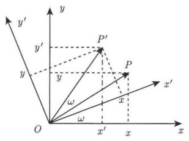

# 第2章 群的线性表示理论

群的线性表示理论是群论能在物理和其他领域得到广泛应用的基础。本章首先引入群的线性表示的定义，介绍等价表示和不可约表示的概念；然后，通过几个基本定理，掌握群的不等价不可约表示的重要性质，并就若干个典型例子，说明如何寻找有限群所有不等价不可约表示和计算可约表示的约化方法，介绍群论方法在物理中应用的基本步骤；最后，引入幂等元的概念来研究有限群群空间的不可约基。

## 2.1 群的线性表示

### 2.1.1 线性表示的定义

从群论观点看，两个同构的群，群的性质完全相同。由于矩阵群比较容易研究，如能找到一个矩阵群和给定群同构，那么研究清楚此矩阵群的性质，也就完全掌握了给定群的性质。如果矩阵群只是同态于给定群，那么矩阵群只反映给定群的部分性质，但对研究给定群的性质也有帮助。与给定群同构或同态的矩阵群称为该群的**线性表示**.

定义 2.1　若行列式不为零的 $m\times m$ 矩阵集合构成的群 $D(G)$ 与给定群 G 同构或同态，则 $D(G)$ 称为群 G 的一个 $m$ 维线性表示，简称表示 (representation). 在 $D(G)$ 中，与 G 中元素 $R$ 对应的矩阵 $D(R)$，称为元素 $R$ 在表示 $D(G)$ 中的表示矩阵，$D(R)$ 的矩阵迹 $\chi(R)=\operatorname{Tr}D(R)$ 称为元素 $R$ 在表示 $D(G)$ 中的特征标 (character).

规定表示矩阵的行列式不为零，是为了排除表示矩阵与零矩阵直和的平庸情况。在此规定下，恒元的表示矩阵是单位矩阵，$D(E)=1$，互逆元素的表示矩阵互为逆矩阵，$D(R^{-1})=D(R)^{-1}$. 若 $D(G)$ 与群 G 同构，则 $D(G)$ 称为群 G 的真实 (faithful) 表示，若同态，则称为非真实表示。非真实表示描写了群 G 关于同态对应核的商群的性质。

让群中所有元素都对应 1，$D(R)=1$，得到的表示称为恒等表示，也称平庸表示。任何群都有恒等表示。矩阵群本身是自己的一个表示，称为自身表示。表示矩阵都是实矩阵的表示称为实表示。表示矩阵都是幺正矩阵的表示称为幺正表示。表示矩阵都是实正交矩阵的表示称为实正交表示。如不作特殊说明，本书只讨论群的有限维表示。文献 (Ma and Gu, 2004) 第四章第 25 题举例说明了无穷维幺正表示的研究方法。

### 2.1.2 群代数和有限群的正则表示

先引入群函数和群代数的概念。所谓函数关系就是自变量和因变量之间的一种确定的对应关系。过去我们接触的函数，自变量往往是坐标等连续变量，它在称为定义域的连续区域内连续变化。但是作为函数的自变量，并不一定是连续变量。例如，以群元素作为自变量也可以建立适当的函数关系。

如果对于群 G 的每一个元素 $R$，都有一个确定的数 $F(R)$ (实数或复数) 与之对应，这样的以群元素作为自变量的函数称为**群函数**，常记为 $F(G)$. 对有限群，群函数只有 $g$ 个取值，因此有限群线性无关的群函数数目等于群的阶数 $g$. 作为群的函数，还可以是矢量函数，矩阵函数等。

群 G 的每一个线性表示 $D(G)$ 都是群 G 的一个矩阵函数。表示矩阵的每一个矩阵元素 $D_{\mu\nu}(R)$ 是群 G 的一个群函数。特征标 $\chi(R)$ 也是一个群函数，但由于共轭元素的特征标相同：

$$
D(SRS^{-1})=D(S)D(R)D(S)^{-1},\quad \chi(SRS^{-1})=\chi(R).
\tag{2.1}
$$

特征标 $\chi(R)$ 实际上是类函数。

在群的定义中，没有研究过群元素的加法运算。现在引入群元素加法的概念。所谓 $R+S$ 就是把两元素加在一起，不要问它们加起来等于什么，只是从原则上规定群元素加法必须满足加法的一些基本公理，也就是加法的交换律和群元素与数相乘的线性性质：

$$
\begin{aligned}
c_1R+c_2S&=c_2S+c_1R, & c_1R+c_2R&=(c_1+c_2)R,\\
c_3(c_1R+c_2S)&=c_3c_1R+c_3c_2S.
\end{aligned}
\tag{2.2}
$$

把有限群的群元素看成线性无关的，以群元素 $R$ 作为基，它们的所有复线性组合构成一个线性空间 $\mathcal{L}$，称为群空间。群空间的维数就是群的阶数 $g$. 群元素的任何线性组合都是群空间的一个矢量。例如，

$$
X=\sum_{R\in G}RF_1(R),\quad Y=\sum_{S\in G}SF_2(S).
\tag{2.3}
$$

群空间的矢量也要满足线性空间矢量的一般性质，如数和矢量相乘的线性性质，两矢量相加减时，它们的对应分量相加减等。群空间矢量基的选择也不是唯一的。以群元素作为基称为自然基。在自然基中，群空间矢量的分量 $F_1(R)$ 是一个群函数，因此群空间的矢量和群函数之间有一一对应的关系。把矢量的分量排成 $g\times1$ 列矩阵，称为在取自然基时群空间矢量的列矩阵形式。在群空间中，任取 $g$ 个线性无关的矢量 $e_S$ 作为群空间新的基，则矢量的列矩阵形式 $\phi_S$ 要按一定的规则作线性组合。

$$
\begin{aligned}
e_S&=\sum_{R\in G}RM_{RS}, & \det M&\neq 0,\\
X&=\sum_{R\in G}RF_1(R)=\sum_{S\in G}e_S\phi_S,\\
F_1(R)&=\sum_{S\in G}M_{RS}\phi_S, & \phi_S&=\sum_{R\in G}(M^{-1})_{SR}F_1(R).
\end{aligned}
\tag{2.4}
$$

另一方面，在线性空间 $\mathcal{L}$ 中只定义了矢量的加减法和矢量与数的乘法。现在在线性空间再引入矢量乘法的概念。定义矢量乘法满足分配律，而且两矢量相乘还是该线性空间的一个矢量，即线性空间关于乘法是封闭的：

$$
XY\in\mathcal{L},\quad Z(X+Y)=ZX+ZY,\quad \forall X,\,Y,\,Z\in\mathcal{L}.
\tag{2.5}
$$

这样的线性空间称为代数。在群空间中这样定义矢量的乘法：数与数作普通数的乘法，群元素与群元素按群元素的乘积规则相乘，

$$
\begin{aligned}
XY&=\left\{\sum_{R\in G}F_1(R)R\right\}\left\{\sum_{S\in G}F_2(S)S\right\}
=\sum_{R\in G}\sum_{S\in G}\{F_1(R)F_2(S)\}(RS)\\
&=\sum_{T\in G}\left\{\sum_{R\in G}F_1(R)F_2(R^{-1}T)\right\}T
=\sum_{T\in G}\left\{\sum_{S\in G}F_1(TS^{-1})F_2(S)\right\}T.
\end{aligned}
$$

这样的乘法满足式 (2.5)，从而使群空间变成代数，称为**群代数**. 今后我们仍用线性空间的符号 $\mathcal{L}$ 来标记群代数。

群元素左乘或右乘到群代数的矢量上，使矢量按一定规则变成群代数中的另一个矢量。因此，在群代数中群元素既是矢量又是线性算符。把作为算符的 $S$ 左乘到作为矢量基的 $R$ 上，得到群代数中的一个矢量，可以写成矢量基的线性组合，组合系数排列起来构成算符 $S$ 在矢量基 $R$ 中的矩阵形式 $D(S)$：

$$
SR=T=\sum_{P\in G}PD_{PR}(S).
\tag{2.6}
$$

但是，按照群元素的乘积规则，$S$ 左乘到 $R$ 上得到另一个群元素 $T$. 就是说，式 (2.6) 的求和式实际只有一项，矩阵 $D(S)$ 的每一列只有一个矩阵元素不为 0，而为 1：

$$
D_{PR}(S)=\begin{cases}
1, & P=SR,\\
0, & P\neq SR.
\end{cases}
\tag{2.7}
$$

由于重排定理，$D(S)$ 的每一行也只有一个矩阵元素不为零。

因为矩阵 $D(S)$ 是线性算符 $S$ 在群代数自然基中的矩阵形式，式 (2.6) 给出 $D(S)$ 和 $S$ 间的一个一一对应的关系。按惯例，算符乘积定义为两算符的相继作用，矩阵按矩阵乘积规则相乘，则算符的乘积和矩阵的乘积仍按式 (2.6) 一一对应。这种算符与其矩阵形式间的一一对应或一多对应关系，一定在乘积中保持不变。在群论中经常遇到这类问题。这里证明一次，以后再遇到就不再证明。

$$
\begin{aligned}
T(SR)&=\sum_{P\in G}TP\,D_{PR}(S)=\sum_{Q\in G}Q\left\{\sum_{P\in G}D_{QP}(T)D_{PR}(S)\right\},\\
(TS)R&=\sum_{Q\in G}Q\,D_{QR}(TS).
\end{aligned}
$$

由于结合律，两式子的左边相等，因而

$$
D(T)D(S)=D(TS)\longleftrightarrow TS.
$$

证完。根据定理 1.3，此矩阵 $D(S)$ 的集合构成群 $D(G)$，且同构于群 G，称为群 G 的正则 (regular) 表示。正则表示是真实表示。每个有限群都有正则表示，表示的维数等于有限群的阶数 $g$. 由式 (2.7) 知，除恒元外，元素 $S$ 在正则表示中的特征标都为**零**，

$$
\chi(S)=\operatorname{Tr}D(S)=\begin{cases}
g, & S=E,\\
0, & S\neq E.
\end{cases}
\tag{2.8}
$$

过去我们习惯于用自然数标记矩阵的行和列，这不是必要的。其实只要足以区分行 (列) 的任何指标都可以用来标记矩阵的行 (列). 正则表示是一个典型的例子，它用群元素来标记矩阵的行 (列). 元素 $S$ 在正则表示中的矩阵形式由乘法表中第 $S$ 行的乘积元素决定。元素 $S$ 的表示矩阵第 $R$ 列不为零的矩阵元素所在行，就是乘法表 $S$ 行中 $R$ 列的乘积元素标记的行。

在群代数中，作为算符的群元素 $S$，不仅可以从左面作用到矢量上，也可以从右面作用到矢量上。当然，对非阿贝尔群来说，左乘和右乘群元素的结果是不一样的，而且两个算符的乘积，对左乘和右乘群元素来说也是不一样的。例如，先左乘 $S$，再左乘 $T$，其结果是左乘 $TS$，但先右乘 $S$，再右乘 $T$，其结果是右乘 $ST$. 虽然左乘算符的集合和右乘算符的集合，根据不同的乘积规则可以分别构成群，分别记为 G 和 $\tilde{G}$，但如果把它们的相同元素一一对应，则它们的乘积不再按原规则一一对应。只有把 G 中元素 $R$ 和 $\tilde{G}$ 中元素 $R^{-1}$ 一一对应，元素的乘积才按原规则一一对应。 $\tilde{G}$ 称为群 G 的内禀群 (intrinsic group). 为了使右乘算符的矩阵形式的集合也构成原群的线性表示，可以把算符的矩阵形式取转置，也就是下式中按列指标求和：

$$
RS=\sum_{P\in G}\overline{D}_{RP}(S)\,P.
\tag{2.9}
$$

式 (2.9) 给出的群元素 $S$ 和矩阵 $\overline{D}(S)$ 间的一一对应关系，使元素的乘积按同一规则一一对应，

$$
\begin{aligned}
(RS)T&=\sum_{P\in G}\overline{D}_{RP}(S)PT=\sum_{Q\in G}\left\{\sum_{P\in G}\overline{D}_{RP}(S)\overline{D}_{PQ}(T)\right\}Q\\
&=R(ST)=\sum_{Q\in G}\overline{D}_{RQ}(ST)Q,
\end{aligned}
$$

即 $\overline{D}(ST)=\overline{D}(S)\overline{D}(T)$. 由式 (2.9) 可以计算得表示矩阵 $\overline{D}(S)$

$$
\overline{D}_{RP}(S)=\begin{cases}
1, & P=RS,\\
0, & P\neq RS.
\end{cases}
\tag{2.10}
$$

这个矩阵也用群元素来标记行 (列). 元素 $S$ 在此表示中的矩阵形式由乘法表中第 $S$ 列的乘积元素决定。由式 (2.10) 知，除恒元外，元素 $S$ 在此表示中的特征标也都为零，即 $\overline{\chi}(S)$ 也满足式 (2.8).

### 2.1.3 类算符

设群 G 阶数为 $g$，包含 $g_c$ 个类，第 $\alpha$ 个类是

$$
\mathcal{C}_\alpha=\{S_1,\,S_2,\,\ldots,\,S_{n(\alpha)}\}=\{S_k|S_k=TS_jT^{-1},\,T\in G\}.
\tag{2.11}
$$

定义**类算符**

$$
\mathcal{C}_\alpha=\sum_{S_k\in\mathcal{C}_\alpha}S_k.
\tag{2.12}
$$

根据第 1 章习题第 17 题，对类中任一元素 $S_j\in\mathcal{C}_\alpha$，有

$$
\sum_{T\in G}TS_jT^{-1}=\frac{g}{n(\alpha)}\mathcal{C}_\alpha.
\tag{2.13}
$$

对于群中任一元素 $T$，因为 $TS_jT^{-1}$ 不会重复，有

$$
T\mathcal{C}_\alpha T^{-1}=\mathcal{C}_\alpha,\quad T\mathcal{C}_\alpha=\mathcal{C}_\alpha T,\quad T\in G.
\tag{2.14}
$$

即类算符和群中任一元素 $T$ 对易 (见式 (1.30)). 反之，群空间中能与任何群元素对易的矢量 $t$ 一定是类算符的线性组合

$$
t=RtR^{-1}=\frac{1}{g}\sum_{R\in G}RtR^{-1}=\sum_{\alpha}f(\alpha)\mathcal{C}_\alpha.
\tag{2.15}
$$

因此两个类算符的乘积一定是类算符的线性组合，

$$
\mathcal{C}_\alpha\mathcal{C}_\beta=\sum_{\gamma=1}^{g_c}f(\alpha,\beta,\gamma)\mathcal{C}_\gamma,\quad f(\alpha,\beta,\gamma)=f(\beta,\alpha,\gamma).
\tag{2.16}
$$

## 2.2 标量函数的变换算符

标量的概念是与变换相联系的，物理中通常说的标量是对三维空间转动变换来说的。有一些物理量，如质量，温度，电势等，它们在转动变换中保持不变，称为标量。标量用一个数字就可以把它完全描述。标量的空间分布称为标量场。标量场用标量函数 $\psi(x)$ 来描写，它是空间坐标的函数。描写系统状态的坐标可以很多，如 $N$ 个粒子系统需用 $3N$ 个坐标来描写。为书写简单起见，用一个字母 $x$ 描写系统的全部坐标。

当系统（标量场）发生变换（平移，转动等）时，描写系统的标量函数如何变化？这里所谓的变换，可以狭义地理解为系统的平移和转动等空间变换，也可以广义地理解为更一般的变换，如系统内部空间的变换。下面的讨论原则上适用于任何变换，但为确定起见，姑且把它理解为空间转动变换。描写转动通常有两种不同的观点，一种是本书采用的系统转动的观点，另一种是坐标系转动的观点，两种变换互为逆变换。

设经过变换 $R$ 后，在 $x$ 点的场变到 $x'$ 点，则变换后标量场在 $x'$ 点的值应该等于变换前标量场在 $x$ 点的值。因此，变换前后描写系统的标量函数形式必须发生相应的变化，才能使它们在函数值上有上述的联系。用标量函数 $\psi(x)$ 和 $\psi'(x)$ 描写变换前后标量场的分布，则

$$
\begin{aligned}
x &\xrightarrow{R} x' = Rx, \quad x = R^{-1}x', \\
\psi(x) &\xrightarrow{R} \psi'(x') = \psi(x) = \psi(R^{-1}x').
\end{aligned}
\tag{2.17}
$$

由于自变量要取遍定义域的所有数值，符号上采用 $x'$ 或 $x$ 都是一样的。函数 $\psi'$ 描写变换 $R$ 后的标量场。采用 $\psi'$ 的符号，看不清它对变换 $R$ 的依赖。为了明显地表达出新函数形式与变换 $R$ 的关系，引入算符 $P_R$：

$$
P_R\psi \equiv \psi', \quad P_R\psi(x) = \psi'(x) = \psi(R^{-1}x).
\tag{2.18}
$$

$P_R$ 是一个算符，它把变换前的标量函数 $\psi$ 变成新的标量函数 $\psi'$。$\psi$ 和 $P_R\psi$ 是两种不同的函数形式，式（2.18）给出了两个函数在函数值上的联系，同时也给出了变换算符 $P_R$ 对任意函数 $\psi(x)$ 的作用规则：**只要把原来函数 $\psi$ 的自变量 $x$ 换成 $R^{-1}x$，再把它看成 $x$ 的函数，就得到新的函数形式 $P_R\psi$。** $P_R$ 显然是线性算符，

$$
\begin{aligned}
P_R\{a\psi(x) + b\phi(x)\} &= a\psi(R^{-1}x) + b\phi(R^{-1}x) \\
&= aP_R\psi(x) + bP_R\phi(x).
\end{aligned}
\tag{2.19}
$$

$P_R$ 称为标量函数变换算符。式（2.18）可以看成标量函数的定义，所有标量函数都必须满足这一变换规则。

算符 $P_R$ 与变换 $R$ 间有一一对应的关系：

$$
\begin{aligned}
x &\xrightarrow{R} x' = Rx, \\
\psi(x) &\xrightarrow{R} \psi'(x) = P_R\psi(x) = \psi(R^{-1}x).
\end{aligned}
$$

它们的乘积仍按同一规则一一对应：

$$
\begin{aligned}
x' &\xrightarrow{S} x'' = Sx' = (SR)x, \\
P_R\psi(x) = \psi'(x) &\xrightarrow{S} \psi''(x) = P_S\psi'(x) = P_SP_R\psi(x), \\
x &\xrightarrow{SR} x'' = (SR)x, \\
\psi(x) &\xrightarrow{SR} P_{SR}\psi(x) = \psi[(SR)^{-1}x].
\end{aligned}
$$

因为

$$
P_S\psi'(x) = \psi'(S^{-1}x) = P_R\psi(S^{-1}x) = \psi[R^{-1}(S^{-1}x)] = \psi[(SR)^{-1}x],
$$

所以 $P_SP_R = P_{SR}$。如果变换 $R$ 的集合构成群 G，则 $P_R$ 的集合 $P_G$ 构成与 G 同构的群。有时把群 $P_G$ 称为群 G 的线性实现。以后，线性算符群 $P_G$ 和群 G 不再严格区分，都称为对称变换群。

这里值得强调一下初学者很容易犯的一个错误。式（2.18）是两个函数在函数值上的联系，这两个函数是不同的。$P_R$ 作用在 $\psi$ 上变成新函数 $\psi'$，再做 $S$ 变换时，$P_S$ 算符必须作用在这新函数 $\psi'$ 上，而不能作用在老函数 $\psi$ 上，

$$
P_S[P_R\psi(x)] \neq P_S\psi(R^{-1}x) = \psi(S^{-1}R^{-1}x).
\tag{2.20}
$$

下面通过两个例子来说明如何计算标量函数变换算符 $P_R$。第一个例子是在一维空间的系统做平移变换

$$
x \xrightarrow{T(a)} x' = T(a)x = x + a, \qquad x = T(a)^{-1}x' = x' - a,
$$

则平移变换中的标量函数变换算符 $P_{T(a)}$ 为

$$
\begin{aligned}
P_{T(a)}\psi(x) &= \psi[T(a)^{-1}x] = \psi(x - a) \\
&= \sum_{n=0}^{\infty} \frac{(-a)^n}{n!} \frac{\mathrm{d}^n}{\mathrm{d}x^n}\psi(x) = \exp\left\{-a\frac{\mathrm{d}}{\mathrm{d}x}\right\}\psi(x), \\
P_{T(a)} &= \exp\left\{-a\frac{\mathrm{d}}{\mathrm{d}x}\right\} = \exp\left\{(-\mathrm{i}a)\left(-\mathrm{i}\frac{\mathrm{d}}{\mathrm{d}x}\right)\right\} = \exp\left\{(-\mathrm{i}a)\hat{p}_x\right\}.
\end{aligned}
\tag{2.21}
$$

$P_{T(a)}$ 可以表达为沿 $x$ 方向动量算符 $\hat{p}_x$ 的指数函数形式，这里取 $\hbar = 1$。第二个例子是系统在平面上做转动变换。在二维空间建立定坐标系 $K$ 和固定在系统上的动坐标系 $K'$。随着系统绕垂直此平面的 $z$ 轴转动 $\omega$ 角，记为 $R(\omega)$，$K'$ 系从与 $K$ 系重合的位置转到图 2.1 中用 $x'$ 和 $y'$ 标记的直角坐标系位置。系统中在 $P$ 位置的点转到 $P'$ 位置，$P$ 点在 $K$ 系的坐标为 $(x, y)$，$P'$ 点在 $K$ 系的坐标为 $(x', y')$，但在 $K'$ 系的坐标仍是 $(x, y)$。

图 2.1 系统绕 $z$ 轴的转动变换

从图中容易看出，在转动 $R(\omega)$ 作用下，坐标变换关系为

$$
x' = x\cos\omega - y\sin\omega, \quad y' = x\sin\omega + y\cos\omega .
\tag{2.22}
$$

其逆变换是 $R(-\omega)$。关于坐标 $x$ 和 $y$ 的二次齐次多项式有三个独立的函数基，

$$
\psi_1(x,y) = x^2, \quad \psi_2(x,y) = xy, \quad \psi_3(x,y) = y^2 .
$$

构成的三维函数空间，对转动变换 $R(\omega)$ 保持不变，也就是对其算符形式 $P_{R(\omega)}$ 保持不变：

$$
\begin{aligned}
P_{R(\omega)}\psi_1(x,y) &= \psi_1[R^{-1}(x,y)] = (x\cos\omega + y\sin\omega)^2 \\
&= \psi_1(x,y)\cos^2\omega + \psi_2(x,y)\sin(2\omega) + \psi_3(x,y)\sin^2\omega, \\
P_{R(\omega)}\psi_2(x,y) &= \psi_2[R^{-1}(x,y)] = (x\cos\omega + y\sin\omega)(-x\sin\omega + y\cos\omega) \\
&= -\psi_1(x,y)\sin\omega\cos\omega + \psi_2(x,y)\cos(2\omega) + \psi_3(x,y)\sin\omega\cos\omega, \\
P_{R(\omega)}\psi_3(x,y) &= \psi_3[R^{-1}(x,y)] = (-x\sin\omega + y\cos\omega)^2 \\
&= \psi_1(x,y)\sin^2\omega - \psi_2(x,y)\sin(2\omega) + \psi_3(x,y)\cos^2\omega .
\end{aligned}
$$

算符 $P_{R(\omega)}$ 在这个不变函数空间中的作用可用一个三维矩阵来描写：

$$
\begin{aligned}
P_{R(\omega)}\psi_\mu(x,y) &= \psi_\mu[R^{-1}(x,y)] = \sum_\nu \psi_\nu(x,y)D_{\nu\mu}(\omega), \\
D(\omega) &= \begin{pmatrix}
\cos^2\omega & -\sin\omega\cos\omega & \sin^2\omega \\
\sin(2\omega) & \cos(2\omega) & -\sin(2\omega) \\
\sin^2\omega & \sin\omega\cos\omega & \cos^2\omega
\end{pmatrix}.
\end{aligned}
\tag{2.23}
$$

$D(\omega)$ 不是实正交矩阵。读者容易检验，只要把基 $\psi_2(x,y)$ 换成 $\sqrt{2}xy$，$P_R$ 的矩阵形式 $D(\omega)$ 就会变成实正交矩阵。

现在讨论线性算符 $L(x)$ 在变换 $R$ 中的变换规律。线性算符 $L(x)$ 代表系统状态的一种特定变换，波函数描写系统的状态，因而也跟着做相应的变换。设 $L(x)$ 使系统从状态 $A$ 变成状态 $B$，表现在波函数上，$L(x)$ 作用在函数 $\psi_A(x)$ 上得到函数 $\psi_B(x)$：

$$
\psi_B(x) = L(x)\psi_A(x).
$$

在变换 $R$ 后，描述两状态的函数形式发生变化：

$$
\begin{aligned}
\psi_A(x) &\xrightarrow{R} \psi'_A(x') = P_R\psi_A(x'), \\
\psi_B(x) &\xrightarrow{R} \psi'_B(x') = P_R\psi_B(x').
\end{aligned}
$$

联系此两确定状态的算符形式也必须跟着发生变化，以确保它仍是这两特定状态之间的变换算符：

$$
L(x) \xrightarrow{R} L'(x'), \quad \psi'_B(x') = L'(x')\psi'_A(x').
$$

这里的自变量符号 $x'$ 可用任何其他变量符号来代替，也可以用 $x$ 来代替，

$$
L'(x)\{P_R\psi_A(x)\} = P_R\psi_B(x) = P_R\{L(x)\psi_A(x)\}.
$$

因为 $\psi_A(x)$ 是任意函数，所以

$$
L'(x)P_R = P_RL(x), \quad L'(x) = P_RL(x)P_R^{-1}.
\tag{2.24}
$$

这个公式也可以做更直接的理解：在 $L(x)$ 的右面有可能还有波函数，$P_R^{-1}$ 的作用是抵消 $P_R$ 对右面波函数的作用。

$$
P_R[L(x)\psi(x)] = [P_RL(x)P_R^{-1}]\,[P_R\psi(x)] = L'(x)\psi'(x).
$$

在式（2.24）中，$P_R$ 是从左面乘，形式上似乎与线性代数中算符的矩阵形式所做的相似变换 $D'(R) = S^{-1}D(R)S$ 不一样，但实质是一致的，因为在线性代数中矢量分量按 $S^{-1}$ 变换：

$$
\begin{array}{lll}
b = D(R)a, & a' = S^{-1}a, & D'(R) = S^{-1}D(R)S, \\
\psi_B(x) = L(x)\psi_A(x), & \psi'_A(x) = P_R\psi_A(x), & L'(x) = P_RL(x)P_R^{-1}.
\end{array}
\tag{2.25}
$$

量子力学中物理量用线性厄米算符来描写，在变换中按式（2.24）变换。系统哈密顿量 $H(x)$ 也应做此变换

$$
H(x) \xrightarrow{R} P_RH(x)P_R^{-1}.
\tag{2.26}
$$

如果 $R$ 是系统的对称变换，则哈密顿量在变换中保持不变，

$$
H(x) = P_RH(x)P_R^{-1}, \quad [H(x), P_R] = 0,
\tag{2.27}
$$

即对称变换算符 $P_R$ 与哈密顿量 $H(x)$ 可以对易。

设能级 $E$ 是 $m$ 重简并，有 $m$ 个线性无关的本征函数：

$$
H(x)\psi_\mu(x) = E\psi_\mu(x), \quad \mu = 1, 2, \cdots, m,
\tag{2.28}
$$

$\psi_\mu(x)$ 的所有复线性组合构成一个 $m$ 维线性空间，在这个空间中的所有函数都是能量为 $E$ 的本征函数，$\psi_\mu(x)$ 是这个空间的一组函数基。反之，能量为 $E$ 的本征函数都属此空间，都可表为 $\psi_\mu(x)$ 的线性组合。由式（2.27）得

$$
H(x)[P_R\psi_\mu(x)] = P_RH(x)\psi_\mu(x) = E[P_R\psi_\mu(x)].
\tag{2.29}
$$

哈密顿量的本征函数 $\psi_\mu(x)$ 经对称变换 $P_R$ 作用后，仍是哈密顿量同一能级的本征函数，仍属此函数空间，即此 $m$ 维线性空间对 $P_R$ 的作用保持不变，$P_R\psi_\mu(x)$ 可按函数基 $\psi_\nu(x)$ 展开。把组合系数排成矩阵 $D(R)$，它就是对对称变换算符 $P_R$ 在基 $\psi_\mu$ 中的矩阵形式

$$
P_R\psi_\mu(x) = \sum_{\nu=1}^{m} \psi_\nu(x)D_{\nu\mu}(R).
\tag{2.30}
$$

矩阵 $D(R)$ 和算符 $P_R$ 通过式（2.30）建立起一一对应或一多对应的关系。可知它们的乘积也按同一规则对应，因而矩阵 $D(R)$ 的集合构成群 $D(G)$，它同构或同态于对称变换群 $P_G$ 和 G：

$$
D(G) \sim P_G \approx G.
\tag{2.31}
$$

$D(G)$ 是群 G 的一个 $m$ 维线性表示，它描写了哈密顿量本征函数在对称变换中的变换规律。这是物理中应用线性表示理论的一个相当普遍的例子。系统的对称变换群 G 同构于线性算符群 $P_G$，而 $P_G$ 作用在不变函数空间的基上，得到群 G 的线性表示。线性表示描写不变函数空间中函数的变换规律。为了用群论方法研究系统的对称性质，首先要找到对称变换群的全部线性表示。

注意式（2.18）和式（2.30）的区别。式（2.18）两边的函数宗量是不同的，它代表变换前后的两个函数在函数值上的联系，只要是标量函数都应满足式（2.18）的变换规则。而式（2.30）两边的函数宗量是相同的，它代表函数 $P_R\psi_\mu$ 按函数基 $\psi_\nu$ 的展开式，这是函数之间的组合关系。一般标量函数并不满足此关系，只有当 $\psi_\mu$ 架设的函数空间对算符 $P_G$ 不变时，才有式（2.30）成立。

在量子力学中，波函数的内积定义为

$$
\langle \psi(x)|\phi(x)\rangle = \int \psi(x)^*\phi(x)\mathrm{d}x,
$$

对转动、平移等空间变换，由 $x$ 到 $R^{-1}x$ 的雅可比（Jacobi）行列式为 1，则

$$
\langle P_R\psi(x)|P_R\phi(x)\rangle = \int \psi(R^{-1}x)^*\phi(R^{-1}x)\mathrm{d}x = \langle \psi(x)|\phi(x)\rangle.
\tag{2.32}
$$

因此，$P_R$ 算符是幺正算符，在 $P_R$ 变换下厄米算符的厄米性保持不变。如果取函数基 $\psi_\mu$ 是正交归一的，则线性表示 $D(G)$ 就是幺正表示。在实际物理问题中有一个重要的例外，就是洛伦兹（Lorentz）变换算符 $P_\Lambda$ 不是幺正算符。这是因为内积定义式（2.32）中的坐标积分关于洛伦兹变换的雅可比行列式不为 1。此时即使把函数基选成正交归一的，洛伦兹群的线性表示也不是幺正表示。

## 2.3 等价表示和表示的幺正性

### 2.3.1 等价表示

在具体寻找群的所有线性表示之前，先把此问题作适当的简化。表示是一个矩阵群，它所作的线性空间称为表示空间。正则表示的表示空间就是群代数。在给定的不变函数空间中，线性变换群 $P_G$ 作用在基 $\psi_\mu(x)$ 上，得到一个线性表示。这个线性函数空间就是表示空间，$P_R$ 及其矩阵形式 $D(R)$ 描写此空间函数的变换性质。

表示空间中基的选择不是唯一的。当基作线性组合时，

$$
\phi_\mu(x) = \sum_\nu \psi_\nu(x)X_{\nu\mu},
\tag{2.33}
$$

$P_R$ 的矩阵形式做相似变换

$$
\begin{aligned}
P_R\psi_\mu(x) &= \sum_\rho \psi_\rho(x)D_{\rho\mu}(R), \quad P_R\phi_\nu(x) = \sum_\lambda \phi_\lambda(x)\overline{D}_{\lambda\nu}(R), \\
\overline{D}(R) &= X^{-1}D(R)X,
\end{aligned}
\tag{2.34}
$$

从而得到一个新的线性表示 $\overline{D}(G)$。这两个表示的对应表示矩阵 $D(R)$ 和 $\overline{D}(R)$ 是同一个线性变换 $P_R$ 在同一个表示空间中的矩阵形式，只是因为函数基选择的不同，使表现形式有所不同。它们通过同一个相似变换 $X$ 联系起来。这样两个表示称为等价表示。从给定的表示，任选非奇相似变换，就可得到无穷多个内容上没有实质区别的等价表示。

**定义 2.2** 如果群 G 所有元素 $R$ 在两个表示 $D(G)$ 和 $\overline{D}(G)$ 中的表示矩阵存在同一相似变换关系（2.34），这样两个表示称为等价（equivalent）表示，记为 $D(G) \simeq \overline{D}(G)$。两个等价表示维数相等，相似变换矩阵 $X$ 也是同维的非奇矩阵，与群元素无关。等价于同一表示的两表示互相等价。等价表示没有实质性的区别。寻找群 G 所有表示的问题简化为寻找群 G 所有不等价表示的问题。

如何判别两表示是否等价？任意元素在两个等价表示中的特征标相等

$$
\chi(R) = \operatorname{Tr} D(R) = \operatorname{Tr} \overline{D}(R) = \overline{\chi}(R).
\tag{2.35}
$$

以后将证明，对有限群，每个元素在两表示中的特征标对应相等，是两表示等价的充要条件。由于特征标是数，不是矩阵，而且只是类的函数，用特征标是否相等来检验两表示等价会比检验相似变换关系（2.34）要容易得多。

### 2.3.2 表示的幺正性

等价表示没有实质性的区别。但在一系列等价的表示中，选什么样的表示作为代表最为方便呢？下面的定理就是回答这个问题的。

**定理 2.1** 有限群的线性表示等价于幺正表示，而且两个等价的幺正表示一定可以通过幺正的相似变换相联系。

这个定理的证明并不难，就是对有限群的任意一个给定表示，如何找到一个相似变换，把它化为幺正表示，然后，对两个等价的幺正表示，如何找到幺正的相似变换把它们联系起来。定理 2.1 的重点在于指出：有限群的任何表示都存在等价的幺正表示，而且等价的幺正表示之间，都存在幺正的相似变换。这样，今后对有限群，就只需要讨论幺正表示和幺正的相似变换，以简化计算。但是作为把表示幺正化的方法，定理证明所给出的方法并不实用，太繁了。在实际物理问题里，如果算符 $P_R$ 是幺正的，只要选取正交归一的（函数）基，表示就是幺正的。物理中重要的例外就是洛伦兹变换群，它是连续群，$P_R$ 算符不是幺正的。以后会知道，除恒等表示外，洛伦兹变换群不存在有限维幺正表示。

因此，这里省略了定理的证明，只是强调在定理的证明过程中用到了有限群群函数对群元素求平均的概念，而且这平均值对左乘或右乘群元素 $S$ 保持不变：

$$
\overline{F} = \frac{1}{g}\sum_{R\in G}F(R) = \frac{1}{g}\sum_{R\in G}F(SR) = \frac{1}{g}\sum_{R\in G}F(RS).
\tag{2.36}
$$

**要把这个定理推广到连续群，关键是要把对群元素求平均推广成对群元素的积分，这样的积分必须收敛，而且对左乘或右乘群元素 $S$ 保持不变。**

如果原先的表示是实表示，则定理 2.1 的全部证明都可在实数范围内进行。这样，定理 2.1 可改写成下面的推论。

**推论** 有限群实表示等价于实正交表示，两个等价的实正交表示一定可以通过实正交相似变换相联系。

## 2.4 有限群的不等价不可约表示

本节是表示理论中最重要的一节。在本节中，先介绍不可约表示的概念及其基本性质，然后研究有限群不等价不可约表示的重要性质。

### 2.4.1 不可约表示

**定义 2.3** 如果群 G 表示 $D(G)$ 的每一个表示矩阵 $D(R)$ 都能通过同一个相似变换 $X$ 化成同一形式的阶梯矩阵：

$$
X^{-1}D(R)X = \begin{pmatrix}
D^{(1)}(R) & M(R) \\
0 & D^{(2)}(R)
\end{pmatrix},
\tag{2.37}
$$

则此表示称为可约表示，否则称为不可约表示（irreducible）。容易证明，式（2.37）中两个子矩阵 $D^{(1)}(R)$ 和 $D^{(2)}(R)$ 的集合分别构成群 G 的线性表示。元素在可约表示中的特征标等于在子表示中的特征标之和

$$
\chi(R) = \chi^{(1)}(R) + \chi^{(2)}(R).
\tag{2.38}
$$

可约表示的定义表明，可约表示的表示空间存在着非平庸的不变子空间，“非平庸”指此子空间不是零空间或全空间。反之，如果表示空间存在非平庸的不变子空间，则可选择表示空间的基，分别属于此不变子空间及其相补的子空间，在此新基下，每个表示矩阵 $D(R)$ 就取相同形式的阶梯矩阵。因此，表示可约性的一个等价的定义是，在表示空间中存在非平庸不变子空间的表示称为可约表示，否则是不可约表示。

如果 $D(G)$ 的表示空间存在两个互补的不变子空间，可在两个子空间中分别取一组基，构成整个表示空间的一组完备基，在这组基下，$D(R)$ 都取同一形式的方块矩阵

$$
X^{-1}D(R)X = \begin{pmatrix}
D^{(1)}(R) & 0 \\
0 & D^{(2)}(R)
\end{pmatrix} = D^{(1)}(R) \oplus D^{(2)}(R).
\tag{2.39}
$$

这表示称为完全可约表示，表示的这种形式称为已约（reduced）表示。有时，表示空间虽存在非平庸的不变子空间，但不管如何选择，与它相补的子空间都不是不变的。这样的表示仍是可约表示，但称为不能完全约化的可约表示。在实际物理问题中遇到的不能完全约化的可约表示的典型例子是平移群的如下表示。一维空间平移变换 $T(a)$ 的集合构成一阶平移群 $T$：

$$
x \xrightarrow{T(a)} x' = x + a, \quad T(a)T(b) = T(a+b).
$$

平移群是阿贝尔连续群，存在如下二维不能完全约化的可约表示：

$$
D(a)=\begin{pmatrix}1&a\\0&1\end{pmatrix},\quad D(a)D(b)=D(a+b).
\tag{2.40}
$$

对有限群，表示 $D(G)$ 等价于幺正表示。如果表示空间存在非平庸的不变子空间，则幺正表示 $D(G)$ 的每一个表示矩阵 $D(R)$ 都可通过同一个幺正相似变换 $X$，化为相同形式的幺正的阶梯矩阵 $\overline{D}(R)$，如式 (2.37) 所示。例如，对幺正算符 $P_R$，它在表示空间的矩阵形式是 $D(R)$，若基是正交归一的，则 $D(R)$ 是幺正的。若选表示空间的一组新的正交归一基，它们分属于此不变子空间及其补空间，则相似变换是幺正的，变换后的阶梯矩阵 $\overline{D}(R)$ 也是幺正的。既然 $\overline{D}(R)$ 是幺正的，它的列矩阵是互相正交归一的，$D^{(1)}(R)$ 就是幺正矩阵。同时，$\overline{D}(R)$ 和 $D^{(1)}(R)$ 的行矩阵也分别是正交归一的，因而 $M(R)$ 只能是零矩阵。这就是说，**有限群的可约表示一定是完全可约的。**

对有限群，表示 $D(G)$ 的性质完全由两个子表示的性质表达出来。反过来说，把若干个不可约表示直和起来，就构成一个已完全约化的可约表示。这样的可约表示没有给出任何新的性质：它的表示空间是若干个不可约表示的表示空间的直和，空间中的矢量可唯一地分解为分属各子空间的矢量之和，分别按各不可约表示变换。因此，寻找群所有不等价表示的问题进一步简化为寻找群的所有不等价不可约表示的问题。

**群论的基本任务就是如何判别表示的等价性和不可约性，找出给定群的所有不等价不可约表示，以及如何把可约表示约化为不可约表示的直和。**

### 2.4.2 舒尔定理

舒尔（Schur）定理是群表示理论中最基本的定理，它适用于所有的群，揭示出群的不等价不可约表示的基本特征。

**定理 2.2（舒尔定理二）**　设 $D^{(1)}(G)$ 和 $D^{(2)}(G)$ 是群 G 的两个不等价不可约表示，维数分别为 $m_1$ 和 $m_2$，$X$ 是一个 $m_1\times m_2$ 矩阵，如果对每一个元素 $R$ 都满足

$$
D^{(1)}(R)X=XD^{(2)}(R),\quad \sum_\rho D^{(1)}_{\nu\rho}(R)X_{\rho\mu}=\sum_\rho X_{\nu\rho}D^{(2)}_{\rho\mu}(R),
\tag{2.41}
$$

则 $X=0$。

**证明**　不可约表示的表示空间不存在非平庸的不变子空间。如果在表示空间中找到低于表示维数的不变子空间，它必是零空间。下面对不同情况证明 $X$ 矩阵的列（或行）矩阵构成的空间是零空间。

(1) $m_1>m_2$。把 $X$ 矩阵各列看成列矩阵，有 $m_2$ 个列矩阵，$(X_{\cdot\mu})_\lambda=X_{\lambda\mu}$，而式 (2.41) 可看成 $D^{(1)}(R)$ 作用在这些列矩阵上，得到列矩阵的线性组合：

$$
D^{(1)}(R)X_{\cdot\mu}=\sum_\rho X_{\cdot\rho}D^{(2)}(R)_{\rho\mu},
\tag{2.42}
$$

即 $m_2$ 个列矩阵 $X_{\cdot\mu}$ 架设了关于 $D^{(1)}(G)$ 不变的子空间，维数不高于 $m_2$，因而它必为零空间。

(2) $m_1=m_2$。若 $\det X\neq 0$，则存在逆矩阵 $X^{-1}$，式 (2.41) 表明两表示等价，与假设矛盾。若 $\det X=0$，则 $X$ 的列矩阵线性相关，它只能架设起维数低于 $m_1$ 的子空间。而式 (2.41) 又说明这子空间对 $D^{(1)}(G)$ 保持不变，因而只能是零空间。

(3) $m_1<m_2$。把式 (2.41) 取转置，$D^{(2)}(R)^TX^T=X^TD^{(1)}(R)^T$。用反证法。如果 $X^T\neq 0$，则上述证明表明 $D^{(2)}(R)^T$ 作用的空间存在不变子空间，取此子空间及其补子空间的基作为新的基，把 $D^{(2)}(R)^T$ 化为

$$
Y^{-1}D^{(2)}(R)^TY=\begin{pmatrix}D_1(R)&M(R)\\0&D_2(R)\end{pmatrix},
$$

此式取转置，说明 $D^{(2)}(G)$ 的表示空间存在不变子空间，与假设矛盾。证完。

**推论 1（舒尔定理一）**　与不可约表示 $D(G)$ 的所有表示矩阵 $D(R)$ 对易的矩阵必为常数矩阵，即若 $D(R)X=XD(R)$，则 $X=\lambda 1$，$\lambda$ 为常数。

**证明**　取 $X$ 的任一征值 $\lambda$，令 $Y=X-\lambda 1$，则 $\det Y=0$，且 $D(R)Y=YD(R)$，按定理 2.2 情况 (2) 的证明方法，可得 $Y=0$，即 $X=\lambda 1$。证完。

有限群的可约表示一定是完全可约的，因而可找到非常数矩阵与所有表示矩阵对易，故有下面推论。

**推论 2**　有限群表示不可约的充要条件是不可能找到非常数矩阵与所有表示矩阵对易。

### 2.4.3 正交关系

群 G 表示 $D(G)$ 的每一个表示矩阵元素 $D_{\mu\nu}(R)$ 都是群 G 的一个群函数，把群函数 $D_{\mu\nu}(G)$ 排列成 $g\times 1$ 列矩阵，对应群空间中以群元素为基的一个矢量。这里讨论有限群群空间中这些矢量间的正交关系。群空间两函数 $F_1(G)$ 和 $F_2(G)$ 的内积，即群空间两矢量的点乘定义为

$$
\sum_{R\in G}F_1(R)^*F_2(R),
$$

内积为零就是两矢量正交，同一矢量的点乘称为矢量模的平方。 **定理 2.3**　有限群 G 的不等价不可约幺正表示 $D^i(G)$ 和 $D^j(G)$ 的矩阵元素，作为群空间矢量，满足正交关系：

$$
\sum_{R\in G}D^i_{\mu\rho}(R)^*D^j_{\nu\lambda}(R)=\frac{g}{m_j}\delta_{ij}\delta_{\mu\nu}\delta_{\rho\lambda},
\tag{2.43}
$$

其中，$g$ 是群 G 的阶，$m_j$ 是表示 $D^j$ 的维数，当 $i=j$ 时，$D^i(R)=D^j(R)$。

**证明**　取 $m_i\times m_j$ 矩阵 $Y(\mu\nu)$，它只有第 $\mu$ 行第 $\nu$ 列元素不为零，

$$
Y(\mu\nu)_{\rho\lambda}=\delta_{\mu\rho}\delta_{\nu\lambda}.
$$

再定义 $m_i\times m_j$ 矩阵 $X(\mu\nu)$：

$$
X(\mu\nu)=\sum_{R\in G}D^i(R)^{-1}Y(\mu\nu)D^j(R),
$$

$$
X(\mu\nu)_{\rho\lambda}=\sum_{R\in G}D^i_{\mu\rho}(R)^*D^j_{\nu\lambda}(R).
\tag{2.44}
$$

$X(\mu\nu)_{\rho\lambda}$ 正好等于式 (2.43) 的左边。另一方面，$X(\mu\nu)$ 满足

$$
X(\mu\nu)D^j(S)=\sum_{R\in G}D^i(S)D^i(RS)^{-1}Y(\mu\nu)D^j(RS)=D^i(S)X(\mu\nu).
$$

这里用到群函数关于群元素求和对右乘群元素保持不变的性质。

当 $i\neq j$ 时，由定理 2.2，$X(\mu\nu)=0$。当 $i=j$ 时，由定理 2.2 的推论 1，$X(\mu\nu)_{\rho\lambda}=C(\mu\nu)\delta_{\rho\lambda}$，$C(\mu\nu)$ 是依赖于 $Y(\mu\nu)$ 的常数。代入式 (2.44)，两边取 $i=j$，$\rho=\lambda$，并对 $\lambda$ 求和，

$$
m_jC(\mu\nu)=\sum_{R\in G}\sum_\lambda D^j_{\lambda\mu}(R^{-1})D^j_{\nu\lambda}(R)=\sum_{R\in G}D^j_{\nu\mu}(RR^{-1})=g\delta_{\mu\nu}.
$$

由此得式 (2.43)。证完。

定理 2.3 指出，有限群 G 不等价不可约幺正表示的矩阵元素，作为群空间的矢量互相正交。表示做相似变换时，矩阵元素作线性组合。因此，这里的幺正性条件可以去掉，只要群 G 的两表示是不等价不可约的，它们的矩阵元素对应的矢量就是互相正交的。定理 2.3 还指出，有限群 G 同一不可约幺正表示的 $m_j^2$ 个矩阵元素作为群空间的矢量也互相正交，且它们的模平方都等于 $g/m_j$。这后一个性质必须限制不可约表示是幺正的，否则相似变换引起的矩阵元素间的线性组合会破坏对应群空间矢量的正交性。要把这一定理推广到无限群去，关键要解决群函数无穷求和的问题。正交的矢量必线性无关，有限群群空间最多有 $g$ 个线性无关的矢量。现在群 G 每个不等价不可约表示提供 $m_j^2$ 个线性无关的矢量，这就限制了有限群不等价不可约表示的个数。

**推论 1**　有限群不等价不可约表示维数平方和不大于群的阶数，即

$$
\sum_j m_j^2\leqslant g.
\tag{2.45}
$$

在式 (2.43) 中取 $\mu=\rho$，$\nu=\lambda$，并对 $\mu$ 和 $\nu$ 求和，得

$$
\sum_{R\in G}\chi^i(R)^*\chi^j(R)=g\delta_{ij}.
\tag{2.46}
$$

**推论 2**　有限群不等价不可约表示的特征标，作为群空间的矢量互相正交。

同类元素的特征标相同。特征标实际是类的函数。类似群空间，可以建立类空间，不等价不可约表示的特征标提供了类空间线性无关的矢量。设群 G 有 $g_c$ 个类，第 $\alpha$ 个类 $C_\alpha$ 包含 $n(\alpha)$ 个元素。如果 $R\in C_\alpha$，则 $\chi^j(R)$ 可记为 $\chi^j_\alpha$。将不可约表示的特征标 $\chi^j_\alpha$ 乘上因子 $[n(\alpha)/g]^{1/2}$，看成类空间的矢量，式 (2.46) 说明这些矢量是正交归一的：

$$
\sum_{\alpha=1}^{g_c}[n(\alpha)/g]^{1/2}\chi^{i*}_\alpha[n(\alpha)/g]^{1/2}\chi^j_\alpha=\frac{1}{g}\sum_{\alpha=1}^{g_c}n(\alpha)\chi^{i*}_\alpha\chi^j_\alpha=\delta_{ij}.
\tag{2.47}
$$

**推论 3**　有限群不等价不可约表示的个数不能大于群的类数，即

$$
\sum_j 1\leqslant g_c.
\tag{2.48}
$$

设 $D(G)$ 是群 G 的一个可约表示，它可以约化为若干个不可约表示 $D^j(G)$ 的直和：

$$
X^{-1}D(R)X=\bigoplus_j a_jD^j(R),\quad \chi(R)=\sum_j a_j\chi^j(R),
\tag{2.49}
$$

其中，$\chi(R)$ 是元素 $R$ 在表示 $D(G)$ 中的特征标。$a_j$ 称为不可约表示 $D^j(G)$ 在表示 $D(G)$ 中的重数。式 (2.49) 两边乘 $\chi^i(R)^*/g$ 并对 $R$ 求和，得

$$
a_i=\frac{1}{g}\sum_{R\in G}\chi^i(R)^*\chi(R).
\tag{2.50}
$$

如果找到了群 G 所有不等价不可约表示，由表示 $D(G)$ 的特征标就可以完全确定在表示 $D(G)$ 中各不可约表示 $D^j(G)$ 的重数 $a_j$。如果两个表示约化时各不可约表示的重数 $a_j$ 对应相等，则两表示等价。由式 (2.46) 和式 (2.49) 有

$$
\sum_{R\in G}|\chi(R)|^2=g\sum_j a_j^2\geqslant g.
\tag{2.51}
$$

当式 (2.49) 中的表示 $D(G)$ 是不可约表示 $D^i(G)$ 时，得 $a_j=\delta_{ij}$，此时式 (2.51) 变成等号。

**推论 4**　有限群两表示等价的充要条件是每个元素在两表示中的特征标对应相等。

**推论 5**　有限群表示为不可约表示的充要条件是

$$
\sum_{R\in G}|\chi(R)|^2=g.
\tag{2.52}
$$

### 2.4.4 表示的完备性

定理 2.3 的推论 1 和推论 3 只给出有限群不等价不可约表示个数和维数的一个上限，现在来证明那里出现的不等号实际是等号。证明中用到每个有限群都有正则表示。根据正则表示的特征标 (2.8) 可以计算在正则表示约化中各不可约表示的重数，

$$
a_j=\frac{1}{g}\sum_{R\in G}\chi^j(R)^*\chi(R)=\chi^j(E)^*=m_j,
\tag{2.53}
$$

**即在正则表示的约化中各不可约表示出现的次数等于该表示的维数：**

$$
X^{-1}D(R)X=\bigoplus_j m_jD^j(R).
\tag{2.54}
$$

取 $R$ 为恒元，并把式 (2.54) 取迹，得

$$
g=\chi(E)=\sum_j m_j^2.
\tag{2.55}
$$

**定理 2.4**　有限群不等价不可约表示维数平方和等于群的阶数。

**推论 1**　有限群不等价不可约幺正表示的矩阵元素 $D^j_{\mu\nu}(G)$，作为群空间的矢量，构成群空间的正交完备基。任何群函数 $F(G)$ 都可按它们展开：

$$
\begin{aligned}
F(R)&=\sum_{j\mu\nu}C^j_{\mu\nu}D^j_{\mu\nu}(R),\\
C^j_{\mu\nu}(R)&=\frac{m_j}{g}\sum_{R\in G}D^j_{\mu\nu}(R)^*F(R).
\end{aligned}
\tag{2.56}
$$

类函数是一种特殊的群函数，对应同类元素它有相同的函数值。表示的特征标就是类函数。把任何类函数先按 $D^j_{\mu\nu}(G)$ 展开：

$$
\begin{aligned}
F(R)&=F(SRS^{-1})=\frac{1}{g}\sum_{S\in G}F(SRS^{-1})\\
&=\sum_{j\mu\nu}\frac{C^j_{\mu\nu}}{g}\sum_{S\in G}\sum_{\rho\lambda}D^j_{\mu\rho}(S)D^j_{\rho\lambda}(R)D^j_{\nu\lambda}(S)^*\\
&=\sum_j\left(\frac{1}{m_j}\sum_\mu C^j_{\mu\mu}\right)\chi^j(R).
\end{aligned}
$$

既然任何类函数都可以按不等价不可约表示的特征标展开，可见这些特征标构成类空间的完备基。

**推论 2**　有限群不等价不可约表示的特征标 $\chi^j(G)$ 构成类空间的正交完备基，任何类函数都可按它们展开：

$$
\begin{aligned}
F(R)&=F(SRS^{-1})=\sum_j C_j\chi^j(R),\\
C_j&=\frac{1}{g}\sum_{R\in G}\chi^j(R)^*F(R).
\end{aligned}
\tag{2.57}
$$

**推论 3**　有限群不等价不可约表示的个数等于群的类数，

$$
\sum_j 1=g_c.
\tag{2.58}
$$

把群空间的正交基 $D^j_{\mu\nu}(G)$ 和类空间的正交基 $\chi^j_\alpha$ 归一化，就可得正交归一基，并用矩阵形式表出：

$$
U_{R,j\mu\nu}\equiv\left(\frac{m_j}{g}\right)^{1/2}D^j_{\mu\nu}(R),\quad
V_{\alpha,j}\equiv\left[\frac{n(\alpha)}{g}\right]^{1/2}\chi^j_\alpha.
\tag{2.59}
$$

虽然行列指标比较复杂，但根据它们可能的取值范围可知，$U$ 是 $g\times g$ 矩阵，$V$ 是 $g_c\times g_c$ 矩阵，而且等式 (2.43) 和式 (2.47) 正说明它们的列矩阵互相正交归一，即它们都是幺正矩阵。写出它们的行矩阵正交归一的关系式

$$
\begin{aligned}
&\sum_{j\mu\nu}\left(\frac{m_j}{g}\right)^{1/2}D^j_{\mu\nu}(R)\left(\frac{m_j}{g}\right)^{1/2}D^j_{\mu\nu}(S)^*\\
&\quad=\frac{1}{g}\sum_{j\mu\nu}m(j)D^j_{\mu\nu}(R)D^j_{\mu\nu}(S)^*=\delta_{RS},\\
&\sum_j\left[\frac{n(\alpha)}{g}\right]^{1/2}\chi^j_\alpha\left[\frac{n(\beta)}{g}\right]^{1/2}\chi^{j*}_\beta
=\frac{n(\alpha)}{g}\sum_j\chi^j_\alpha\chi^{j*}_\beta=\delta_{\alpha\beta}.
\end{aligned}
\tag{2.60}
$$

这两个公式是群空间的正交基 $D^j_{\mu\nu}(G)$ 和类空间的正交基 $\chi^j_\alpha$ 完备性的数学表述。希望读者熟悉这种指标比较复杂的基的正交性和完备性的数学表述。这类表述在理论物理中经常遇到。

### 2.4.5 有限群不可约表示的特征标表

群论的主要任务就是对于物理中常见的对称变换群，寻找它们的所有不等价不可约表示，并研究可约表示的约化方法。对有限群，首先要找它们的所有不等价不可约表示的特征标，把特征标列成表，称为有限群的特征标表。然后再选择适当的表象，找出不可约表示的表示矩阵。既然群元素都可以表为生成元的乘积，找出生成元的表示矩阵也就够了。表象的选择以使用方便为准，常用的选择原则是使尽可能多生成元的表示矩阵是对角化的。这样的表示常称为不可约表示的标准形式。对一个非阿贝尔群，至少在真实表示中，生成元表示矩阵不可能都是对角化的。

一个有限群 G 的所有不等价不可约表示中，既有真实表示，也有非真实表示。非真实表示同构于群 G 的商群，而商群的阶数比群 G 的阶数要低，因而它的不等价不可约表示比较好找。掌握阶数较低群的所有不等价不可约表示，有利于研究阶数较高群的不可约表示。因此找出有限群的所有不变子群及其商群是分析一个有限群的重要步骤。

**有限群不可约表示的特征标必须满足四个等式，式 (2.55) 和式 (2.58) 限制该群不等价不可约表示的个数和维数，式 (2.47) 和式 (2.60) 分别描写特征标表中各行和各列之间的正交归一性。它们对计算有限群不可约表示的特征标起重要作用。但是它们只是必要条件，不是充分条件。在填写给定群的特征标表时还应注意分析该群本身的结构特点。**

容易证明，将一不可约表示的所有表示矩阵都取其复共轭矩阵，它们的集合也构成原群的不可约表示，称为原表示的复共轭表示。互为复共轭的表示，它们的特征标互为复共轭。如果互为复共轭的两不可约表示互相等价，则称为自共轭表示。对有限群，自共轭表示的充要条件是特征标必为实数。群 G 的两个不可约表示直乘仍是它的一个表示，特别是当中有一个表示是一维表示时，这样的直乘表示仍是不可约的。用这些方法有助于根据已有不可约表示寻找新的不可约表示。

应该指出，寻找物理中常见对称群的所有不等价不可约表示和计算直乘表示的约化问题，都已经解决，而且都可以在有关书中查到，物理工作者的主要任务是把它们应用到具体物理问题中去。实际问题是多种多样的，要能灵活运用数学家的计算结果，理解数学家计算的基本思想也是十分重要的。下面就一些比较简单的群，介绍不可约表示特征标表和表示矩阵的一些计算方法，希望让读者对群表示理论建立起一些直观的概念。

$N$ 阶循环群 $C_N$ 的标准形式是

$$
C_N=\{E,R,R^2,\cdots,R^{N-1}\},\quad R^N=E.
\tag{2.61}
$$

循环群是阿贝尔群，群的阶数等于类数，因而循环群 $C_N$ 的不可约表示都是一维的，共有 $N$ 个不等价的一维表示。表示矩阵必须满足群元素的乘积关系，$D^j(R)^N=D^j(E)=1$，解得

$$
D^j(R)=\exp\{-\mathrm{i}2\pi j/N\},\quad 0\leqslant j\leqslant (N-1).
\tag{2.62}
$$

对更复杂的点群，在点群特征标表中，各类通常用类中一个代表元素表出。类中包含的元素数目超过 1 时，元素数目作为系数写在元素符号的前面。通常用符号 $\mathrm{C}_N$ 描写循环群，而用符号 $C_N$ 描写它的生成元。在写元素符号时，绕 $z$ 轴方向的转动用不带撇的符号，绕其他方向的高次转动用带一撇的符号，绕 $x$ 方向的二次转动用带一撇的符号，绕其他方向的二次转动用带两撇的符号。

$D_2$ 群和四阶反演群 $V_4$ 同构，乘法表由表 1.4 给出，其中恒元和另一元素的集合都构成不变子群，按它们商群的表示可算出特征标表，列于表 2.1。请注意 $D_2$ 群和 $C_4$ 群特征标表的不同，虽然它们都满足特征标的四个必要条件。

**表 2.1　$D_2$ 群的特征标表**

| $D_2$ | $E$ | $C_2$ | $C_2'$ | $C_2''$ |
|---|---|---|---|---|
| $A_1$ | 1 | 1 | 1 | 1 |
| $A_2$ | 1 | 1 | $-1$ | $-1$ |
| $B_1$ | 1 | $-1$ | 1 | $-1$ |
| $B_2$ | 1 | $-1$ | $-1$ | 1 |

$D_3$ 群是最简单的非阿贝尔群，包含六个元素，恒元 $E$ 构成一类，两个三次转动 $T$ 和 $T^2$ 构成一类，三个二次转动 $S_1$，$S_2$ 和 $S_3$ 构成一类，共三个类，都是自逆类，乘法表如表 1.5 所示。三次转动的类表为 $2C_3$，二次转动的类表为 $3C_2'$。因为 $1^2+1^2+2^2=6$，所以 $D_3$ 群有两个一维和一个二维不等价不可约表示。不变子群 $\{E,T,T^2\}$ 的商群同构于 $C_2$ 群，由此得 $D_3$ 群的两个一维不等价表示，记为 $D^A$ 和 $D^B$。二维不可约表示记为 $D^E$，它的特征标可用多种方法计算。$D_3$ 群的特征标表见表 2.2。由式 (2.60) 可算出 $\chi^E(C_2')=0$，再由式 (2.47) 算得 $\chi^E(C_3)=-1$。$\chi^E(C_2')$ 等于零也可由下面分析得到：如果 $\chi^E(C_2')$ 不等于零，则 $D^B\otimes D^E$ 就是与 $D^E$ 不等价的二维不可约表示，与上面结论矛盾。把 $D_3$ 群元素看成二维空间的转动或反演，按照式 (2.22)，用坐标变换的方法写出的元素变换矩阵，就得到 $D_3$ 群的一组二维不可约表示，其中只有一个生成元 $S_1$ 的表示矩阵是对角化的：

$$
\begin{aligned}
E&=\begin{pmatrix}1&0\\0&1\end{pmatrix},&
T&=\frac{1}{2}\begin{pmatrix}-1&-\sqrt{3}\\\sqrt{3}&-1\end{pmatrix},&
T^2&=\frac{1}{2}\begin{pmatrix}-1&\sqrt{3}\\-\sqrt{3}&-1\end{pmatrix},\\
S_1&=\begin{pmatrix}1&0\\0&-1\end{pmatrix},&
S_2&=\frac{1}{2}\begin{pmatrix}-1&\sqrt{3}\\\sqrt{3}&1\end{pmatrix},&
S_3&=\frac{1}{2}\begin{pmatrix}-1&-\sqrt{3}\\-\sqrt{3}&1\end{pmatrix}.
\end{aligned}
\tag{2.63}
$$

**表 2.2　$D_3$ 群的特征标表**

| $D_3$ | $E$ | $2C_3$ | $3C_2'$ |
|---|---|---|---|
| $A$ | 1 | 1 | 1 |
| $B$ | 1 | 1 | $-1$ |
| $E$ | 2 | $-1$ | 0 |

$C_{2n+1}$ 群和 $C_{2n+2}$ 群各有 $2n$ 个非自逆类，也各有 $2n$ 个不等价不可约的非自共轭表示。$D_2$ 群和 $D_3$ 群所有类都是自逆类，所有不可约表示都是实表示。一般说来（习题第 8 题），有限群包含的自逆类的个数等于它的不等价不可约的自共轭表示的个数。

### 2.4.6 自共轭表示和实表示

表示矩阵都是实矩阵的表示称为实表示。既然等价表示的本质是一样的，可以把实表示的定义扩充，等价于实表示的表示也称为实表示。实表示当然是自共轭表示。自共轭表示虽然与其复共轭表示等价，但不一定存在相似变换使所有表示矩阵都变成实矩阵，因而不一定是实表示。非自共轭表示很容易区别。定理 2.5 给出判别自共轭表示是不是实表示的方法，证明从略。

**定理 2.5**　有限群幺正的不可约自共轭表示与其复共轭表示间的相似变换矩阵，对实表示是对称的，对非实表示是反对称的。

## 2.5 分导表示、诱导表示及其应用

### 2.5.1 分导表示和诱导表示

设群 $G$ 的阶为 $g$，它的类 $C_\alpha$ 中包含 $n(\alpha)$ 个元素，它的不可约表示记为 $D^j(G)$，维数为 $m_j$，类 $C_\alpha$ 中元素 $S$ 在此表示的特征标记为 $\chi^j(S)$ 或 $\chi^j_\alpha$。又设 $H=\{T_1=E,T_2,\cdots,T_h\}$ 是群 $G$ 的子群，阶为 $h$，指数为 $n=g/h$，左陪集记为 $R_rH$，$2\leqslant r\leqslant n$。补上 $R_1=E$，则群 $G$ 任意元素可表为 $R_rT_t$。虽然 $R_r$ 的选取不是唯一的，但假定 $R_r$ 已经选定了。子群 $H$ 的类 $\bar{C}_\beta$ 中包含 $\bar{n}(\beta)$ 个元素，$H$ 的不可约表示记为 $\bar{D}^k(H)$，维数为 $\bar{m}_k$，类 $\bar{C}_\beta$ 中元素 $T_t$ 在此表示的特征标记为 $\bar{\chi}^k(T_t)$ 或 $\bar{\chi}^k_\beta$。

把群 $G$ 不可约表示 $D^j(G)$ 中与子群 $H$ 元素有关的表示矩阵 $D^j(T_t)$ 挑出来，构成子群 $H$ 的一个表示，称为群 $G$ 的不可约表示 $D^j(G)$ 关于子群 $H$ 的分导（subduced）表示，记为 $D^j(H)$。分导表示一般是可约表示，可按子群的不可约表示 $\bar{D}^k(H)$ 分解：

$$
X^{-1}D^j(T_t)X=\bigoplus_k a_{jk}\bar{D}^k(T_t),\quad m_j=\sum_k a_{jk}\bar{m}_k,
$$

$$
a_{jk}=\frac{1}{h}\sum_{T_t\in H}\chi^j(T_t)^*\bar{\chi}^k(T_t)=\frac{1}{h}\sum_\beta \bar{n}(\beta)\left(\chi^j_\beta\right)^*\bar{\chi}^k_\beta.
\tag{2.64}
$$

仍采用上面的符号。设 $\bar{D}^k(H)$ 表示空间的基为 $\psi_\mu$，

$$
T_t\psi_\mu=\sum_\nu \psi_\nu \bar{D}^k_{\nu\mu}(T_t).
$$

定义 $\psi_{r\mu}=R_r\psi_\mu$，其中 $\psi_{1\mu}=\psi_\mu$。由 $n\bar{m}_k$ 个基 $\psi_{r\mu}$ 架设的空间对群 $G$ 保持不变，对应群 $G$ 的一个 $n\bar{m}_k$ 维表示 $\Delta^k(G)$。表示矩阵可以用下面的方法计算。对群 $G$ 任意元素 $S$，逐个取 $r$，计算 $SR_r=R_uT_t$，其中 $u$ 和 $t$ 完全由 $S$ 和 $r$ 决定。

$$
S\psi_{r\mu}=SR_r\psi_\mu=R_uT_t\psi_\mu=\sum_\nu \psi_{u\nu}\bar{D}^k_{\nu\mu}(T_t)\equiv \sum_\nu \psi_{u\nu}\Delta^k_{u\nu,r\mu}(S),
$$

得

$$
\Delta^k_{u\nu,r\mu}(S)=\bar{D}^k_{\nu\mu}(T_t),\quad \chi^k(S)=\operatorname{Tr}\Delta^k(S).
\tag{2.65}
$$

这表示 $\Delta^k(G)$ 称为子群 $H$ 的不可约表示 $\bar{D}^k(H)$ 关于群 $G$ 的诱导表示。诱导（induced）表示一般是可约表示，可按群 $G$ 的不可约表示 $D^j(G)$ 分解：

$$
\begin{aligned}
Y^{-1}\Delta^k(S)Y&=\bigoplus_j b_{jk}D^j(S),\quad (g/h)\bar{m}_k=\sum_j b_{jk}m_j\\
b_{jk}&=\frac{1}{g}\sum_{S\in G}\chi^j(S)^*\chi^k(S)=\frac{1}{g}\sum_\alpha n(\alpha)\left(\chi^j_\alpha\right)^*\chi^k_\alpha,
\end{aligned}
\tag{2.66}
$$

其中，属类 $C_\alpha$ 的元素 $S$ 在表示 $\Delta^k(G)$ 中的特征标为 $\chi^k(S)=\chi^k_\alpha$。

**定理 2.6（费罗贝尼乌斯（Frobenius）定理）**　有限群 $G$ 不可约表示 $D^j(G)$ 关于子群 $H$ 的分导表示中包含子群 $H$ 不可约表示 $\bar{D}^k(H)$ 的重数 $a_{jk}$，等于子群 $H$ 不可约表示 $\bar{D}^k(H)$ 关于原群 $G$ 的诱导表示中包含群 $G$ 不可约表示 $D^j(G)$ 的重数 $b_{jk}$，$a_{jk}=b_{jk}$。

### 2.5.2 D(2n+1) 群的不可约表示

$D_{2n+1}$ 群包含一个 $2n+1$ 次轴，称为主轴，生成元记为 $C_{2n+1}$。$C_{2n+1}$ 生成的循环子群 $C_{2n+1}$ 是 $D_{2n+1}$ 群的一个指数为 2 的不变子群。垂直主轴的平面内均匀分布着 $2n+1$ 个等价的二次轴，构成不变子群 $C_{2n+1}$ 的陪集，代表元素记为 $C_2'$。$D_{2n+1}$ 群的生成元可取为 $C_{2n+1}$ 和 $C_2'$。$D_{2n+1}$ 群包含 $g=4n+2$ 个元素，$g_c=n+2$ 个自逆类（见式 (1.33)），由式 (2.55) 和式 (2.58) 知，$D_{2n+1}$ 群有两个一维和 $n$ 个二维不等价不可约表示，所有不可约表示都是自共轭表示。

$D_{2n+1}$ 群的两个一维不等价表示是不变子群 $C_{2n+1}$ 的商群表示：$D^A$ 是恒等表示，所有元素都对应 1；$D^B$ 称为反对称表示，$D^B(C_{2n+1})=1$，$D^B(C_2')=-1$。不变子群 $C_{2n+1}$ 是阿贝尔群，有 $2n+1$ 个不等价的一维表示，基分别记为 $\psi^j$，

$$
C_{2n+1}\psi^j=\mathrm{e}^{-\mathrm{i}2\pi j/(2n+1)}\psi^j,\quad 0\leqslant j\leqslant 2n.
$$

研究这些表示关于 $D_{2n+1}$ 群的诱导表示。扩充表示空间，定义另一组基 $\phi^j=C_2'\psi^j$。利用公式 $C_{2n+1}C_2'=C_2'C_{2n+1}^{-1}$，有

$$
C_2'\psi^j=\phi^j,\quad C_2'\phi^j=\psi^j,\quad C_{2n+1}\phi^j=\mathrm{e}^{\mathrm{i}2\pi j/(2n+1)}\phi^j.
$$

由此得 $D_{2n+1}$ 群的二维表示，记为 $D^{E_j}$：

$$
\begin{gathered}
D^{E_j}(C_{2n+1})=\begin{pmatrix}\mathrm{e}^{-\mathrm{i}2\pi j/(2n+1)}&0\\0&\mathrm{e}^{\mathrm{i}2\pi j/(2n+1)}\end{pmatrix},\quad D^{E_j}(C_2')=\begin{pmatrix}0&1\\1&0\end{pmatrix},\\
\chi^j(C_{2n+1}^m)=2\cos[2jm\pi/(2n+1)],\quad \chi^j(C_2')=0.
\end{gathered}
\tag{2.67}
$$

很明显，其中有些表示是等价的，有些表示是可约的。

$$
\begin{gathered}
\sigma_1^{-1}D^{E_{2n+1-j}}(R)\sigma_1=D^{E_j}(R),\quad \sigma_1=\begin{pmatrix}0&1\\1&0\end{pmatrix},\\
X^{-1}D^{E_0}(R)X=\begin{pmatrix}D^A(R)&0\\0&D^B(R)\end{pmatrix},\quad X=\frac{1}{2}\begin{pmatrix}1&-\mathrm{i}\\1&\mathrm{i}\end{pmatrix}.
\end{gathered}
\tag{2.68}
$$

就是说，只有 $n$ 个表示 $D^{E_j}$，$1\leqslant j\leqslant n$ 是 $D_{2n+1}$ 群的二维不等价不可约表示。这些二维表示可通过相似变换 $X$ 表为另一种常用形式

$$
\begin{gathered}
\bar{D}^{E_j}(C_{2n+1})=\begin{pmatrix}\cos\left(\dfrac{2j\pi}{2n+1}\right)&-\sin\left(\dfrac{2j\pi}{2n+1}\right)\\[8pt]\sin\left(\dfrac{2j\pi}{2n+1}\right)&\cos\left(\dfrac{2j\pi}{2n+1}\right)\end{pmatrix},\quad \bar{D}^{E_j}(C_2')=\begin{pmatrix}1&0\\0&-1\end{pmatrix}.
\end{gathered}
\tag{2.69}
$$

对 $D_3$ 群，式 (2.69) 和式 (2.63) 相符。

### 2.5.3 D2n 群的不可约表示

$D_{2n}$ 群包含一个 $2n$ 次轴，称为主轴，生成元记为 $C_{2n}$，$C_{2n}$ 生成的循环子群 $C_{2n}$ 是 $D_{2n}$ 群的一个指数为 2 的不变子群。$C_{2n}^2$ 生成的循环子群 $C_n$ 是 $D_{2n}$ 群的一个指数为 4 的不变子群，商群同构于 $D_2$ 群。垂直主轴的平面内均匀分布有 $2n$ 个二次轴，分成两组，分别互相等价，构成两个类，代表元素为 $C_2'$ 和 $C_2''=C_{2n}C_2'$。$D_{2n}$ 群的生成元可取为 $C_{2n}$ 和 $C_2'$。$D_{2n}$ 群的阶 $g=4n$，类数 $g_c=n+3$，所有的类都是自逆类（见式 (1.34)）。由式 (2.55) 和式 (2.58) 知，$D_{2n}$ 群有四个一维和 $n-1$ 个二维不等价不可约表示，所有不可约表示都是自共轭表示。 $D_{2n}$ 群的四个一维不等价表示是不变子群 $C_n$ 的商群表示：

$$
\begin{gathered}
D^{A_1}(C_{2n})=D^{A_2}(C_{2n})=1,\quad D^{A_1}(C_2')=-D^{A_2}(C_2')=1,\\
D^{B_1}(C_{2n})=D^{B_2}(C_{2n})=-1,\quad D^{B_1}(C_2')=-D^{B_2}(C_2')=1.
\end{gathered}
\tag{2.70}
$$

不变子群 $C_{2n}$ 是阿贝尔群，有 $2n$ 个不等价的一维表示，基分别记为 $\psi^j$，

$$
C_{2n}\psi^j=\mathrm{e}^{-\mathrm{i}j\pi/n}\psi^j,\quad 0\leqslant j\leqslant 2n-1.
$$

研究这些表示关于 $D_{2n}$ 群的诱导表示。扩充表示空间，定义另一组基 $\phi^j=C_2'\psi^j$。利用公式 $C_{2n}C_2'=C_2'C_{2n}^{-1}$，有

$$
C_2'\psi^j=\phi^j,\quad C_2'\phi^j=\psi^j,\quad C_{2n}\phi^j=\mathrm{e}^{\mathrm{i}j\pi/n}\phi^j.
$$

由此得 $D_{2n}$ 群的二维表示，记为 $D^{E_j}$：

$$
\begin{gathered}
D^{E_j}(C_{2n})=\begin{pmatrix}\mathrm{e}^{-\mathrm{i}j\pi/n}&0\\0&\mathrm{e}^{\mathrm{i}j\pi/n}\end{pmatrix},\quad D^{E_j}(C_2')=\begin{pmatrix}0&1\\1&0\end{pmatrix},\\
\chi^j(C_{2n}^m)=2\cos(jm\pi/n),\quad \chi^j(C_2')=\chi^j(C_2'')=0.
\end{gathered}
\tag{2.71}
$$

其中，有些表示是等价的，有些表示是可约的。

$$
\begin{gathered}
\sigma_1^{-1}D^{E_{2n-j}}\sigma_1=D^{E_j},\quad \sigma_1=\begin{pmatrix}0&1\\1&0\end{pmatrix},\quad X=\frac{1}{2}\begin{pmatrix}1&-\mathrm{i}\\1&\mathrm{i}\end{pmatrix},\\
X^{-1}D^{E_0}X=\begin{pmatrix}D^{A_1}&0\\0&D^{A_2}\end{pmatrix},\quad X^{-1}D^{E_n}X=\begin{pmatrix}D^{B_1}&0\\0&D^{B_2}\end{pmatrix}.
\end{gathered}
\tag{2.72}
$$

就是说，只有 $n-1$ 个表示 $D^{E_j}$，$1\leqslant j\leqslant n-1$，是 $D_{2n}$ 群的二维不等价不可约表示。这些二维表示可通过相似变换 $X$ 表为另一种常用形式：

$$
\bar{D}^{E_j}(C_{2n})=\begin{pmatrix}\cos(j\pi/n)&-\sin(j\pi/n)\\\sin(j\pi/n)&\cos(j\pi/n)\end{pmatrix},\quad \bar{D}^{E_j}(C_2')=\begin{pmatrix}1&0\\0&-1\end{pmatrix}.
\tag{2.73}
$$

## 2.6 物理应用

在对各种具体的群进行深入研究之前，应该强调一下群论方法在物理中的应用问题，使今后的学习更有目的性。

### 2.6.1 定态波函数按对称群表示分类

对给定的量子系统，首先要根据系统的哈密顿量，确定系统的对称变换群 $G$。然后，通过群论方法，找到对称群的所有不等价不可约表示，包括特征标表和在选定的表象中确定表示矩阵的标准形式。这是群论本身研究的课题，也是本书以后各章节主要讲解的问题。假定系统对称群的所有不等价不可约表示及其标准形式已经选定。接下来要研究如何用对称群的不可约表示对定态波函数进行分类。

设系统哈密顿量与时间无关，能级 $E$ 是 $m$ 重简并，本征函数是标量函数

$$
H(x)\psi_\rho(x)=E\psi_\rho(x),\quad 1\leqslant \rho\leqslant m.
\tag{2.74}
$$

本征函数的集合架设对称群 $G$ 的一个 $m$ 维不变函数空间 $\mathcal{L}$，对称变换算符 $P_R$ 作用在函数基上，仍是此空间的一个函数，可以表成函数基的线性组合：

$$
P_R\psi_\rho(x)=\psi_\rho(R^{-1}x)=\sum_\lambda \psi_\lambda(x)D_{\lambda\rho}(R).
\tag{2.75}
$$

组合系数排列成 $m$ 维方矩阵 $D(R)$，它的集合是对称群 $G$ 的一个 $m$ 维表示，描写本征函数在对称变换 $R$ 中的变换规律，称为能级 $E$ 对应的表示。

在函数空间 $\mathcal{L}$ 中，函数基的选择有任意性。量子力学中用一组互相对易的完备力学量来共同确定这组函数基。这是确定函数基的一种办法。现在讨论群论方法确定函数基的原则。

对于任意选定的函数基 $\psi_\rho(x)$，由式 (2.75) 计算出相应的表示 $D(G)$ 及其特征标 $\chi(R)$。在多数物理问题中，$P_R$ 算符是幺正的，只要选择正交归一的函数基 $\psi_\rho(x)$，$D(G)$ 就是幺正表示。一般说来，这表示是可约的，形式也不“标准”。因此先用特征标方法将它约化为标准不可约表示的直和：

$$
X^{-1}D(R)X=\bigoplus_j a_jD^j(R),
\tag{2.76}
$$

$$
\chi(R)=\sum_j a_j\chi^j(R),\quad a_j=\frac{1}{g}\sum_{R\in G}\chi^j(R)^*\chi(R).
\tag{2.77}
$$

$a_j$ 是不可约表示 $D^j(G)$ 在表示 $D(G)$ 中的重数，可由式 (2.77) 算出。因此式 (2.76) 的右边是已知的，$X$ 矩阵就可以计算出来。

在具体计算 $X$ 矩阵时，只要让生成元满足式 (2.76)，其他元素也一定满足此式。作为标准的不可约表示形式，常使尽可能多的生成元所对应的表示矩阵是对角化的。当然，只要群 $G$ 不是阿贝尔的，至少对真实表示，总有一些生成元的表示矩阵是不对角化的。就表示矩阵 $D^j(R)$ 对角化的生成元（记为 $A$）而言，式 (2.76) 正是把矩阵 $D(A)$ 对角化的相似变换关系。计算这些 $D(A)$ 矩阵的本征值和本征矢量，把本征矢量作为列矩阵就排成相似变换矩阵 $X$。本征矢量包含待定参数，$X$ 矩阵要保留这些参数，有待其他生成元代入式 (2.76) 时来确定。在代入非对角化的生成元时，应该把 $X^{-1}$ 移到式 (2.76) 的右面，以避免计算逆矩阵 $X^{-1}$。在所有生成元都满足式 (2.76) 后，$X$ 矩阵还是没有完全确定。因为与式 (2.76) 右边的方块矩阵对易的任何矩阵 $Y$，右乘到 $X$ 矩阵上，都可以作为式 (2.76) 的相似变换矩阵。一般说来，$X$ 还会包含 $\sum_j a_j^2$ 个未定参数。这些未定参数不应该再保留，应该按照使 $X$ 矩阵尽量简单等原则选定这些参数，如使 $X$ 是实正交矩阵等。

由式 (2.76) 可知，$X$ 矩阵的行指标和 $D(R)$ 矩阵的行指标相同，如记为 $\rho$，列指标和等式右面矩阵的列指标相同。等式右面是方块矩阵，先由指标 $j$ 和 $\mu$ 来区分哪个方块（表示）的哪一列，当 $D^j$ 表示的重数大于 1 时，还需一个指标 $r$ 来区分重表示 $D^j$ 中哪一个，即需用三个指标 $j\mu r$ 来共同描写 $X$ 矩阵的列指标。用几个指标作为一个整体，共同描写矩阵的行（或列），而且一个矩阵的行和列指标用不同的方式来描写，这在群论中是常见的事，在式 (2.59) 已经用过。希望读者能够习惯这种描写方法。$X$ 矩阵一方面作为相似变换矩阵，改变算符的矩阵形式，另一方面又作为组合系数，把旧的函数基组合成新的函数基。组合后的新函数基 $\psi^j_{\mu r}$ 需用三个指标标记，在对称变换中，按不可约表示 $D^j$ 变换：

$$
\begin{gathered}
\psi^j_{\mu r}(x)=\sum_\rho \psi_\rho(x)X_{\rho,j\mu r},\\
P_R\psi^j_{\mu r}(x)=\sum_\nu \psi^j_{\nu r}(x)D^j_{\nu\mu}(R).
\end{gathered}
\tag{2.78}
$$

具有这样变换性质的函数基 $\psi^j_{\mu r}(x)$ 称为属不可约表示 $D^j$ $\mu$ 行的函数，这才是按群论方法选定的标准的函数基。用这方法把定态波函数组合成属于对称群确定不可约表示确定行的函数，也就是用对称群表示对定态波函数进行分类。

属不可约表示 $D^j$ $\mu$ 行的函数 $\psi^j_{\mu r}(x)$，它的物理意义当然与具体的群有关，也和表示选取的表象有关。例如，通常选取的不可约表示的标准形式，常使尽可能多的生成元的表示矩阵对角化，式 (2.78) 也就是这些生成元的共同本征方程。用量子力学语言来说，这样选取的函数基就是这些力学量的共同本征函数。当 $a_j>1$ 时，需引入参数 $r$ 以区分 $a_j$ 组属同一不可约表示的函数基 $\psi^j_{\mu r}(x)$。这几组函数基，允许关于 $r$ 做相同的线性组合：

$$
\Phi^j_{\mu s}=\sum_r \psi^j_{\mu r}Y_{rs},
\tag{2.79}
$$

这组合矩阵 $Y$ 需用其他条件来确定，如要求形式简单等。通常认为这种任意性的出现，反映了对系统对称性的发掘还不够，即还可能存在更大的对称变换群。

本小节介绍的组合定态波函数的方法，是群论的基本运算方法，今后会多次见到各种实例，还可能以不同的形式出现。希望读者对此方法给予足够的重视，深刻领会，熟练而灵活地运用。

### 2.6.2 克莱布什－戈登级数和系数

设合成系统由两个子系统组成，子系统有共同的对称变换群 $G$，波函数分别按群 $G$ 不可约表示变换

$$
P_R\psi^j_\mu(x^{(1)})=\sum_\rho \psi^j_\rho(x^{(1)})D^j_{\rho\mu}(R),\quad P_R\phi^k_\nu(x^{(2)})=\sum_\lambda \phi^k_\lambda(x^{(2)})D^k_{\lambda\nu}(R).
\tag{2.80}
$$

合成系统的波函数是它们的乘积，$\Psi^{jk}_{\mu\nu}(x^{(1)},x^{(2)})=\psi^j_\mu(x^{(1)})\phi^k_\nu(x^{(2)})$，按直乘表示变换

$$
\begin{gathered}
P_R\Psi^{jk}_{\mu\nu}(x^{(1)},x^{(2)})=\sum_{\rho\lambda}\Psi^{jk}_{\rho\lambda}(x^{(1)},x^{(2)})\left[D^j(R)\times D^k(R)\right]_{\rho\lambda,\mu\nu},\\
\left[D^j(R)\times D^k(R)\right]_{\rho\lambda,\mu\nu}=D^j_{\rho\mu}(R)D^k_{\lambda\nu}(R).
\end{gathered}
\tag{2.81}
$$

用相似变换 $C^{jk}$ 来约化直乘表示：

$$
\begin{gathered}
\left(C^{jk}\right)^{-1}\left[D^j(R)\times D^k(R)\right]C^{jk}=\bigoplus_J a_J D^J(R),\\
\chi^j(R)\chi^k(R)=\sum_J a_J\chi^J(R).
\end{gathered}
\tag{2.82}
$$

等式右面的级数称为克莱布什（Clebsch）－戈登（Gordan）级数，$C^{jk}$ 矩阵称为克莱布什－戈登矩阵，矩阵元素 $C^{jk}_{\mu\nu,JMr}$ 称为克莱布什－戈登系数，其中行指标与直乘矩阵的行指标相同，取 $\mu\nu$；列指标与约化后的直和表示的列指标相同，取 $JMr$。只在表示 $D^J(G)$ 的重数 $a_J$ 大于 1 时，才需要引入这附加的指标 $r$，以区分这 $a_J$ 个表示 $D^J(G)$。这些克莱布什－戈登系数把合成系统的波函数 $\Psi^{jk}_{\mu\nu}(x^{(1)},x^{(2)})$ 组合成属于不可约表示的波函数

$$
\begin{gathered}
\Phi^J_{Mr}(x^{(1)},x^{(2)})=\sum_{\mu\nu}\Psi^{jk}_{\mu\nu}(x^{(1)},x^{(2)})C^{jk}_{\mu\nu,JMr},\\
P_R\Phi^J_{Mr}(x^{(1)},x^{(2)})=\sum_{M'}\Phi^J_{M'r}(x^{(1)},x^{(2)})D^J_{M'M}(R).
\end{gathered}
\tag{2.83}
$$

对给定的群，克莱布什－戈登系数与选用的不可约表示标准形式有关。对有限群，表示是幺正的，克莱布什－戈登矩阵 $C^{jk}$ 也是幺正的，而且常常可以选择其中包含的未定参数，使它是实正交的。物理中常见的对称群的克莱布什－戈登系数都有专门的书籍列表给出。通常克莱布什－戈登系数有几种列举方法。除列表法外，类似式 (2.83) 那样的展开式也是常用的列举方式。展开式方法避免了许多等于零的系数，也比较好用，但篇幅较大。只有少数群，如三维转动群，克莱布什－戈登系数存在解析公式。

### 2.6.3 维格纳－埃伽定理

下面的定理可以说是群论方法在量子力学中得到广泛应用的基础，它也解释了为什么要把定态波函数组合成属于对称群确定不可约表示确定行的函数。

**定理 2.7（维格纳（Wigner）－埃伽（Eckart）定理）**　属幺正线性变换群 $P_G$ 的两个不等价不可约表示的函数互相正交，属同一不可约幺正表示不同行的函数也互相正交，属同一不可约幺正表示同一行的函数的内积与行数无关。

**证明**　设函数基 $\psi^j_\mu$ 和 $\phi^k_\nu$ 分属群 $P_G$ 不可约幺正表示 $D^j$ $\mu$ 行和 $D^k$ $\nu$ 行

$$
P_R\psi^j_\mu(x)=\sum_\rho \psi^j_\rho(x)D^j_{\rho\mu}(R),\quad P_R\phi^k_\nu(x)=\sum_\lambda \phi^k_\lambda(x)D^k_{\lambda\nu}(R).
$$

令

$$
\langle\phi^k_\nu(x)|\psi^j_\mu(x)\rangle=X^{kj}_{\nu\mu},
\tag{2.84}
$$

$$
\begin{aligned}
\langle\phi^k_\nu(x)|P_R\psi^j_\mu(x)\rangle&=\sum_\rho \langle\phi^k_\nu(x)|\psi^j_\rho(x)\rangle D^j_{\rho\mu}(R)=\sum_\rho X^{kj}_{\nu\rho}D^j_{\rho\mu}(R)\\
&=\langle P_R^{-1}\phi^k_\nu(x)|\psi^j_\mu(x)\rangle=\sum_\lambda D^k_{\lambda\nu}(R^{-1})^*\langle\phi^k_\lambda(x)|\psi^j_\mu(x)\rangle\\
&=\sum_\lambda D^k_{\nu\lambda}(R)X^{kj}_{\lambda\mu}.
\end{aligned}
$$

由舒尔定理知

$$
X^{kj}_{\nu\mu}=
\begin{cases}
0, & k\neq j,\\
\delta_{\nu\mu}\langle k\|j\rangle, & k=j.
\end{cases}
$$

$$
\langle\phi^k_\nu(x)|\psi^j_\mu(x)\rangle=\delta_{kj}\delta_{\nu\mu}\langle k\|j\rangle,
\tag{2.85}
$$

其中，$\langle k\|j\rangle$ 是常数，它与下标 $\mu$ 无关，称为约化矩阵元。证完。

属幺正线性变换群 $P_G$ 的两个不等价不可约幺正表示的函数都互相正交，因而这里的表示幺正性并不重要。但在得出属同一不可约幺正表示不同行的函数互相正交时，表示的幺正性就十分重要。

量子力学中，物理观测量的计算多数归结为矩阵元的计算，当把定态波函数组合成属于对称变换群确定不可约表示确定行的函数后，维格纳－埃伽定理使 $m_km_j$ 个矩阵元 $\langle\phi^k_\nu(x)|\psi^j_\mu(x)\rangle$ 的计算简化为一个矩阵元的计算问题。在实际问题里，定态波函数很难严格求解，波函数的具体形式经常并不知道，因而连一个矩阵元都不会计算。但是仅仅根据系统对称性质的分析，就能知道什么样状态之间的矩阵元为零（选择定则），也可以把约化矩阵元看成参数，通过消去参数，掌握不同矩阵元（观测量）之间的相对关系。这就是常说的，通过系统对称性的研究，掌握系统某些精确的与细节无关的重要性质，而且可与实验比较。当力学量算符在对称变换中的变换性质已知时，维格纳-埃伽定理还可简化力学量矩阵元的计算。设一组力学量算符 $L_\rho^k(x)$ 在对称变换 $P_R$ 作用下按下式变换

$$
P_R L_\rho^k(x) P_R^{-1} = \sum_\lambda L_\lambda^k(x) D_{\lambda\rho}^k(R).
\tag{2.86}
$$

这组算符常称不可约张量算符，则

$$
P_R L_\rho^k(x) \psi_\mu^j(x) = \sum_{\lambda\tau} L_\lambda^k(x)\psi_\tau^j(x)\left[D^k(R)\times D^j(R)\right]_{\lambda\tau,\rho\mu}.
\tag{2.87}
$$

既然函数 $L_\rho^k(x)\psi_\mu^j(x)$ 按直乘表示变换，可用克莱布什-戈登系数把它们组合成属不可约表示 $D^J$ $M$ 行的函数 $F_{Mr}^J(x)$,

$$
\begin{aligned}
F_{Mr}^J(x) &= \sum_{\rho\mu} L_\rho^k(x)\psi_\mu^j(x) C_{\rho\mu,JMr}^{kj},\\
P_R F_{Mr}^J(x) &= \sum_{M'} F_{M'r}^J(x) D_{M'M}^J(R),\\
L_\rho^k(x)\psi_\mu^j(x) &= \sum_{JMr} F_{Mr}^J(x)\left[(C^{kj})^{-1}\right]_{JMr,\rho\mu}.
\end{aligned}
\tag{2.88}
$$

力学量 $L_\rho^k(x)$ 在定态波函数中的 $m_{j'}m_k m_j$ 个矩阵元的计算，简化为有限几个约化矩阵元的计算：

$$
\begin{aligned}
\langle \phi_\nu^{j'}(x)|L_\rho^k(x)|\psi_\mu^j(x)\rangle &= \sum_{JMr}\langle\phi_\nu^{j'}(x)|F_{Mr}^J(x)\rangle \left[(C^{kj})^{-1}\right]_{JMr,\rho\mu}\\
&= \sum_r \langle \phi^{j'}||L^k||\psi^j\rangle_r \left[(C^{kj})^{-1}\right]_{j'\nu r,\rho\mu}.
\end{aligned}
\tag{2.89}
$$

与对称变换有关的信息通过已知的克莱布什-戈登系数表现出来。约化矩阵元的个数等于不可约表示 $D^{j'}$ 在直乘表示 $D^k\times D^j$ 的约化中出现的次数。

### 2.6.4 正则简并和偶然简并

设能级 $E$ 是 $m$ 重简并的，对应对称变换群 G 的表示 $D(G)$. 若此表示是群 G 的不可约表示，则此简并称为正则（normal）简并；若是可约表示，则称为偶然（accidental）简并。

现在引入微扰相互作用 $H_1(x)$，设它和原始哈密顿量 $H_0(x)$ 有相同的对称性，称为对称微扰，即在对称变换中两个哈密顿量都保持不变：

$$
[P_R, H_0(x)] = 0,\quad [P_R, H_1(x)] = 0.
\tag{2.90}
$$

首先，用上法把 $H_0(x)$ 的本征波函数组合成属于对称变换群 G 确定不可约表示确定行的函数 $\psi_\mu^j(x)$:

$$
P_R\psi_\mu^j(x) = \sum_\nu \psi_\nu^j(x) D_{\nu\mu}^j(R).
$$

在 $P_R$ 的作用下，$H_1\psi_\mu^j(x)$ 具有相同的变换性质

$$
P_R\left[H_1(x)\psi_\mu^j(x)\right] = H_1(x)P_R\psi_\mu^j(x) = \sum_\nu \left[H_1(x)\psi_\nu^j(x)\right] D_{\nu\mu}^j(R).
\tag{2.91}
$$

这一性质称为“对称微扰不改变波函数的变换性质”。

从量子力学知，能量一级修正由 $H_1$ 在 $H_0$ 本征函数中的矩阵元决定。对正则简并，有

$$
\langle \psi_\nu^j(x)|H_1(x)|\psi_\mu^j(x)\rangle = \delta_{\nu\mu}\left(\Delta E^j\right).
\tag{2.92}
$$

能量修正 $\Delta E^j$ 与 $\mu$ 无关，能级发生平移但不分裂，即对称微扰不能解除正则简并。事实上，这是一个非微扰的结论，正则简并的能级在对称微扰的作用下不会分裂。这一结论可作如下理解：让总哈密顿量随参数 $\lambda$ 连续变化，$H = H_0 + \lambda H_1$. 当 $\lambda$ 由 0 到 1 连续变化时，H 的本征函数也由 $\psi_\mu^j$ 出发连续变化，所有的相关量都只能做连续变化，不能做不连续的跳跃。由于在连续变化过程中对称性始终保持，波函数必定属于群 G 的一定表示。定理 2.7 指出：属不等价不可约表示的波函数是互相正交的，因而波函数不能突然跳跃到与原波函数正交的函数中去，波函数所属表示不会变化。就是说，在参数 $\lambda$ 连续变化过程中，哈密顿量本征函数所属的不可约表示不变，能级的简并度也不变。由于哈密顿量和对称变换算符 $P_R$ 对易，属同一不可约表示的哈密顿量本征函数，它们的本征值必定相同，因而正则简并的能级不会分裂。

对偶然简并，先假定能级对应的可约表示中包含的各不可约表示互不等价。属同一不可约表示各行的函数，能级移动相同，能级不会分裂，但属两个不等价不可约表示的函数，能级移动一般不相等，于是能级分裂了。在对称微扰下，偶然简并的能级可以分裂，但最多分裂到正则简并，而且用对称群不可约表示标记的原始波函数是好的零级波函数。若偶然简并对应的表示包含重表示，则属这些相重不可约表示的函数的任意组合仍属同一个不可约表示，如式（2.79）所示。确定这些组波函数的组合，群论就无能为力了。此时 $H_1$ 在这些组波函数间的矩阵未必对角化。尽管如此，定理 2.7 说明，可按计算方便，任意选取确定的 $\mu$，计算这 $a_j \times a_j$ 矩阵

$$
\langle \psi_{\mu r}^j(x)|H_1(x)\psi_{\mu s}^j(x)\rangle = \left(\Delta E^j\right)_{rs},
\tag{2.93}
$$

其中，$r$ 和 $s$ 取 1 至表示重数 $a_j$. 把此矩阵对角化，就得到好的零级波函数和能量的一级修正。与不用对称性选取零级波函数的一般方法相比较，群论方法使 $(a_j m_j)^2$ 个矩阵元的计算问题，简化为 $a_j^2$ 个矩阵元的计算问题，还是大大减少了工作量。

通常认为，如果群 G 包括了系统哈密顿量 H 的全部对称变换，能级只能是正则简并。偶然简并与系统尚未发现的对称性有关。四川大学的邹鹏程教授和他的学生撰文（邹和黄，1995）证明了这一结论。如果 $H_1$ 的对称群 $G'$ 是 $H_0$ 对称群 G 的子群，$G'$ 就是 $H_0$ 和 $H_1$ 的共同对称群。用 $G'$ 代替 G，前面的讨论仍然适用，在微扰 $H_1$ 的作用下，能级最多分裂到关于 $G'$ 的正则简并。要注意的是，即使 $H_0$ 的能级关于 G 是正则简并的，关于 $G'$ 仍可能是偶然简并。

## 2.7 有限群群代数的不可约基

### 2.7.1 D_3 群的不可约基

有限群的群代数 $\mathcal{L}$ 对左乘和右乘群元素都保持不变。以前常取群元素为基，称为自然基。在自然基中，对左乘和右乘群元素，群代数分别对应两组等价的正则表示，如式（2.6）和式（2.9）所示。舒尔定理指出：有限群的不等价不可约表示的矩阵元素也构成群代数中一组正交且完备的矢量（定理 2.4 推论 1），它们也可取作群代数中的新基：

$$
\phi_{\mu\nu}^j = \frac{m_j}{g}\sum_{R\in G} D_{\mu\nu}^j(R)^* R,
\tag{2.94}
$$

其中 $m_j$ 是有限群 G 不可约表示 $D^j(G)$ 的维数，$g$ 是群 G 的阶数，选择归一化系数是为了以后方便。利用不可约表示矩阵元素的正交关系（2.43），可以直接证明（习题第 13 题），这组基 $\phi_{\mu\nu}^j$ 在左乘和右乘群元素时按不可约表示 $D^j(G)$ 变化，

$$
S\phi_{\mu\nu}^j = \sum_\rho \phi_{\rho\nu}^j D_{\rho\mu}^j(S),\quad \phi_{\mu\nu}^j S = \sum_\rho D_{\nu\rho}^j(S)\phi_{\mu\rho}^j.
\tag{2.95}
$$

也就是说，新的基 $\phi_{\mu\nu}^j$ 把正则表示完全约化了。新基还满足“传递关系”

$$
\phi_{\mu\rho}^i \phi_{\tau\nu}^j = \delta_{ij}\delta_{\rho\tau}\phi_{\mu\nu}^j.
\tag{2.96}
$$

由传递关系可以把不可约表示的表示矩阵用基统一地表达出来。事实上，用 $\phi_{\nu\lambda}^j$ 左乘式（2.95）的左式得

$$
\phi_{\nu\lambda}^j S\phi_{\mu\nu}^j = D_{\lambda\mu}^j(S)\phi_{\nu\nu}^j.
\tag{2.97}
$$

满足式（2.95）和式（2.96）的基 $\phi_{\mu\nu}^j$ 称为群代数的不可约基。

设哈密顿量 $H(x)$ 的能级 $E$ 是 $m$ 重简并的，本征函数记为 $\psi_\rho(x)$. 按群论方法，需要把这函数基 $\psi_\rho(x)$ 组合成属于对称群 G 不可约表示的基。 2.6 节已经详细讨论了这种组合的计算方法。但是，如果对称群 G 的不可约基 $\phi_{\mu\nu}^j$ 已经知道，把其中的群元素 $R$ 换成函数变换算符 $P_R$，作为投影算符作用在函数基上，只要 $\phi_{\mu\nu}^j\psi_\rho(x)$ 不为零，$\phi_{\mu\nu}^j\psi_\rho(x)$ 就是属不可约表示的函数基，从而简化了计算。

$$
P_S\left[\phi_{\mu\nu}^j\psi_\rho(x)\right] = \sum_\tau \left[\phi_{\tau\nu}^j\psi_\rho(x)\right]D_{\tau\mu}^j(S).
\tag{2.98}
$$

D₃ 群包含六个元素，三个类，乘法表由表 1.5 给出，特征标表由表 2.2 给出。表示 A 是恒等表示，所有元素都对应数 1. 表示 B 是反对称表示，元素 E，T 和 T² 对应数 1，其余元素对应数 -1. 二维表示 $D^E$ 的标准形式由式（2.63）给出。因为 D₃ 群所有不等价不可约表示都已经知道，所以不可约基就可以直接由式（2.94）计算出来：

$$
\begin{aligned}
\phi^A &= (E + T + T^2 + S_1 + S_2 + S_3)/6,\\
\phi^B &= (E + T + T^2 - S_1 - S_2 - S_3)/6,\\
\phi_{11}^E &= (2E - T - T^2 + 2S_1 - S_2 - S_3)/6,\\
\phi_{22}^E &= (2E - T - T^2 - 2S_1 + S_2 + S_3)/6,\\
\phi_{12}^E &= (-T + T^2 + S_2 - S_3)/(2\sqrt{3}),\\
\phi_{21}^E &= (T - T^2 + S_2 - S_3)/(2\sqrt{3}).
\end{aligned}
\tag{2.99}
$$

### 2.7.2 O 群和 T 群的不可约基

O 群有 24 个元素，五个自逆类，由 $1^2+1^2+2^2+3^2+3^2=24$ 知，它有两个一维，一个二维和两个三维不等价不可约表示，都是自共轭表示。 O 群有两个不变子群，子群 T 的指数为 2，商群与 C₂ 群同构，它给出了 O 群两个一维表示。表示 $D^A$ 是恒等表示，所有元素都对应 1. $D^B$ 是反对称表示，子群 T 元素对应 1，陪集元素对应 -1. 另一个不变子群由恒元和三个绕坐标轴轴向转动 π 角元素构成，记为 D₂，指数为 6. 因为商群没有 6 阶元素，它同构于 D₃ 群。 D₂ 群也是子群 T 的不变子群。根据 O≈S₄，容易建立商群和 D₃ 的具体同构关系，并给出 O 群二维表示 $D^E$ 的表示矩阵：

$$
\begin{aligned}
D_2 &= \{E, T_x^2, T_y^2, T_z^2\} &&\Longleftrightarrow\quad D^E(E) = \begin{pmatrix} 1 & 0\\ 0 & 1\end{pmatrix},\\
R_1D_2 &= \{R_1, R_2, R_3, R_4\} &&\Longleftrightarrow\quad D^E(T) = \frac{1}{2}\begin{pmatrix} -1 & -\sqrt{3}\\ \sqrt{3} & -1\end{pmatrix},\\
R_1^2D_2 &= \{R_1^2, R_2^2, R_3^2, R_4^2\} &&\Longleftrightarrow\quad D^E(T^2) = \frac{1}{2}\begin{pmatrix} -1 & \sqrt{3}\\ -\sqrt{3} & -1\end{pmatrix},\\
S_1D_2 &= \{S_1, S_2, T_z, T_z^3\} &&\Longleftrightarrow\quad D^E(S_1) = \begin{pmatrix} 1 & 0\\ 0 & -1\end{pmatrix},\\
S_5D_2 &= \{S_5, S_6, T_y, T_y^3\} &&\Longleftrightarrow\quad D^E(S_2) = \frac{1}{2}\begin{pmatrix} -1 & \sqrt{3}\\ \sqrt{3} & 1\end{pmatrix},\\
S_3D_2 &= \{S_3, S_4, T_x, T_x^3\} &&\Longleftrightarrow\quad D^E(S_3) = \frac{1}{2}\begin{pmatrix} -1 & -\sqrt{3}\\ -\sqrt{3} & 1\end{pmatrix},
\end{aligned}
\tag{2.100}
$$

其中，用到 $R_1S_1 \leftrightarrow (3\ 2\ 1)(2\ 4) = (1\ 3\ 2\ 4) \leftrightarrow T_y^3$，对应乘积 $TS_1 = S_2$. O 群的三维不可约表示 $D^{T_1}$ 的表示矩阵可用类似式（2.22）的方法，即计算坐标变换矩阵的方法定出，

$$
D^{T_1}(T_z) = \begin{pmatrix} 0 & -1 & 0\\ 1 & 0 & 0\\ 0 & 0 & 1\end{pmatrix},\qquad D^{T_1}(R_1) = \begin{pmatrix} 0 & 0 & 1\\ 1 & 0 & 0\\ 0 & 1 & 0\end{pmatrix}.
\tag{2.101}
$$

再由元素的乘积关系、共轭关系和幂次关系计算其他元素的表示矩阵：

$$
\begin{aligned}
S_5 &= R_1T_z, & T_x &= S_5T_zS_5, & T_y &= T_zT_xT_z^3, & S_1 &= R_1S_5R_1^2,\\
S_3 &= T_zS_5T_z^3, & S_6 &= T_zS_3T_z^3, & S_4 &= T_zS_6T_z^3, & S_2 &= T_zS_1T_z^3,\\
R_2^2 &= T_zR_1T_z^3, & R_3 &= T_zR_2^2T_z^3, & R_4^2 &= T_zR_3T_z^3.
\end{aligned}
$$

另一个三维不可约表示 $D^{T_2}$ 是 $D^{T_1}$ 和 $D^B$ 的直乘。由此可算出 O 群特征标表，列于表 2.3，并由公式（2.94）可以计算出 O 群群代数的不可约基。

表 2.3 O 群的特征标表

| O | $E$ | $3C_4^2$ | $8C_3'$ | $6C_4$ | $6C_2''$ |
|:---:|:---:|:---:|:---:|:---:|:---:|
| $A$ | 1 | 1 | 1 | 1 | 1 |
| $B$ | 1 | 1 | 1 | −1 | −1 |
| $E$ | 2 | 2 | −1 | 0 | 0 |
| $T_1$ | 3 | −1 | 0 | 1 | −1 |
| $T_2$ | 3 | −1 | 0 | −1 | 1 |

T 群是 O 群的子群，有 12 个元素，四个类，其中两个是自逆类，由 $1^2+1^2+1^2+3^2=12$ 知，T 群有三个一维和一个三维不等价不可约表示。 T 群有不变子群 D₂，它的指数为 3，商群同构于 C₃ 群。商群给出了 T 群三个不等价的一维表示，其中两个表示是非自共轭表示。三维不可约表示 $D^T$ 可由 O 群不可约表示 $D^{T_1}(O)$ 的分导表示得到。 T 群特征标表列于表 2.4，并由公式（2.94）可以计算出 T 群群代数的不可约基。

表 2.4 T 群的特征标表

| T | $E$ | $3C_2$ | $4C_3'$ | $4C_3^{\prime 2}$ |
|:---:|:---:|:---:|:---:|:---:|
| $A$ | 1 | 1 | 1 | 1 |
| $E$ | 1 | 1 | $\omega$ | $\omega^2$ |
| $E'$ | 1 | 1 | $\omega^2$ | $\omega$ |
| $T$ | 3 | −1 | 0 | 0 |

注：$\omega = \mathrm{e}^{-\mathrm{i}2\pi/3}$

## 习 题 2

1. 设 G 是一个非阿贝尔群，$D(G)$ 是群 G 的一个不可约真实表示，元素 $R$ 的表示矩阵为 $D(R)$. 现让群 G 元素 $R$ 分别与下列矩阵对应，问此矩阵的集合是否构成群 G 的表示？若是表示，是否真实表示？(1) $D(R)^\dagger$; (2) $D(R)^T$; (3) $D(R^{-1})$; (4) $D(R)^*$; (5) $D(R^{-1})^\dagger$; (6) $\det D(R)$; (7) $\operatorname{Tr} D(R)$. 例如，第（1）小题，设 $R \leftrightarrow D(R)^\dagger$，问 $D(R)^\dagger$ 的集合 $D(G)^\dagger$ 是否构成群 G 的表示？

2. 证明有限群任何一维表示的表示矩阵模为 1.

3. 证明无限的阿贝尔群的有限维不可约表示都是一维的。

4. 试计算正四面体固有对称群 T 的所有类算符及其乘积系数 $f(\alpha,\beta,\gamma)$（见式（2.16））。

5. 证明有限群两个等价的不可约幺正表示之间的相似变换矩阵，如果限制其行列式为 1，必为幺正矩阵。

6. 证明除恒等表示外，有限群任一不可约表示的特征标对群元素求和为零。

7. 设有限群 G 的类 $C_\alpha$ 包含 $n(\alpha)$ 个元素，对应的类算符是 $C_\alpha$（见式（2.12）），$D^j(G)$ 是群 G 的不可约表示，维数为 $m_j$，类 $C_\alpha$ 在此表示中的特征标为 $\chi_\alpha^j$. 试证明类算符在此不可约表示中的表示矩阵是常数矩阵：$D^j(C_\alpha) = w\mathbf{1}$，并计算此常数 $w$.

8. 证明有限群包含的非自逆类个数等于不等价不可约的非自共轭表示的个数，因此自逆类的个数等于不等价不可约的自共轭表示的个数。

9. 若有限群 G 等于两子群的直乘，$G = H_1 \otimes H_2$，证明群 G 的不等价不可约表示都可表为两子群不等价不可约表示的直乘。

10. 计算 T 群三维不可约表示 $D^T$ 直自乘约化的相似变换矩阵 $X$:

$$
X^{-1}\left\{D^T(R)\times D^T(R)\right\}X = \sum_j a_j D^j(R).
$$

11. 试计算第 1 章习题第 19 题给出的群的特征标表。

12. 设 D₃ 群元素是在二维空间中的坐标变换

$$
\begin{pmatrix} x'\\ y'\end{pmatrix} = R\begin{pmatrix} x\\ y\end{pmatrix},\quad R\in D_3,
$$

取生成元 $T$ 和 $S_1$ 它们的变换矩阵正是它们在二维表示 $D^E(D_3)$ 中的表示矩阵

$$
T = D^E(T) = \frac{1}{2}\begin{pmatrix} -1 & -\sqrt{3}\\ \sqrt{3} & -1\end{pmatrix},\quad S_1 = D^E(S_1) = \begin{pmatrix} 1 & 0\\ 0 & -1\end{pmatrix}.
$$

已知下列函数基架设的四维函数空间对 D₃ 群保持不变：

$$
\psi_1(x,y) = x^3,\quad \psi_2(x,y) = x^2y,\quad \psi_3(x,y) = xy^2,\quad \psi_4(x,y) = y^3,
$$

试计算 D₃ 群在此空间关于这组函数基的线性表示，即计算 D₃ 群生成元在此表示中的表示矩阵。然后，把此表示约化为 D₃ 群不可约表示的直和，把此函数基组合为分属各不等价不可约表示的函数基。

13. 利用不可约表示矩阵元素的正交关系（2.43），证明式（2.95）和式（2.96）。

14. 计算 T 群群代数的不可约基。

15. 计算 O 群群代数的不可约基。
