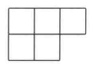
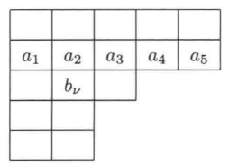
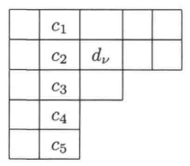

# 第 3 章 置换群的不等价不可约表示

本章用幂等元和杨算符方法计算置换群的不等价不可约表示。

## 3.1 原始幂等元和杨算符

如果一个有限群的不等价不可约表示已经找到，则可以通过式（2.94）计算有限群群代数的不可约基。现在讨论一个相反的问题：对一些比较复杂的有限群，如置换群 $S_n$，能不能通过群代数的不可约基，反过来计算它的不等价不可约表示？为此，先引入群代数中的一些新概念。

### 3.1.1 理想和幂等元

在有限群群代数 $\mathcal{L}$ 中，对左乘群元素保持不变的子空间称为左理想（left ideal），在左理想中选定适当的基后，由左乘群元素就可以计算出左理想所对应的表示。如果左理想对应的表示是不可约表示，则称最小左理想（minimal）。同样对右乘群元素保持不变的子空间称为右理想，如果右理想对应的表示是不可约表示，则称最小右理想。

如果两个左理想对应的表示等价，称为等价的左理想。对等价的左理想，可以适当选择基，使对应表示相同。把此两左理想的基一一对应起来，这种对应关系对左乘群元素就保持不变。反之，如果两左理想的矢量间存在对左乘群元素保持不变的一一对应关系，则此两左理想等价。同样可以定义等价的右理想。

式（2.95）指出，对于固定的 $j$ 和 $\nu$，$m_j$ 个基 $\phi_{\mu\nu}^j$ 架设最小左理想，记为 $\mathcal{L}_\nu^j = \mathcal{L}\phi_{\mu\nu}^j$，对应不可约表示 $D^j(G)$. $m_j$ 个最小左理想 $\mathcal{L}_\nu^j$ 互相等价。对于固定的 $j$ 和 $\mu$，$m_j$ 个基 $\phi_{\mu\nu}^j$ 架设最小右理想，记为 $\mathcal{R}_\mu^j = \phi_{\mu\nu}^j\mathcal{L}$，也对应不可约表示 $D^j(G)$. $m_j$ 个最小右理想 $\mathcal{R}_\mu^j$ 互相等价。

群代数 $\mathcal{L}$ 中的投影算符 $e^2 = e \in \mathcal{L}$ 称为幂等元（idempotent）。满足下式的 $n$ 个矢量 $e_a$ 称为互相正交的幂等元：

$$
e_a e_b = \delta_{ab}e_a.
\tag{3.1}
$$

对给定的幂等元 $e_a$，所有 $re_a$ 的集合构成左理想，$\mathcal{L}_a = \mathcal{L}e_a$，称为由 $e_a$ 生成的左理想。设 $t \in \mathcal{L}_a$，则 $t = re_a$，有

$$
te_a = re_a^2 = re_a = t.
\tag{3.2}
$$

满足 $te_a=0$ 的所有 $t\in\mathcal{L}$ 的集合也构成左理想 $\mathcal{L}'_a$，它是和 $\mathcal{L}_a$ 互补的左理想，$\mathcal{L}_a\oplus\mathcal{L}'_a=\mathcal{L}$. $\mathcal{L}'_a$ 的幂等元是 $E-e_a$. 由幂等元 $e_a$ 同样也可以生成右理想 $\mathcal{R}_a=e_a\mathcal{L}$. 由于正交性，由 $n$ 个互相正交的幂等元 $e_a$ 生成的 $n$ 个左（或右）理想相加是直和的关系，因为它们不存在公共矢量。

$$
\mathcal{L}\sum_{a=1}^{n}e_a=\bigoplus_{a=1}^{n}\mathcal{L}_a,\qquad
\left(\sum_{a=1}^{n}e_a\right)\mathcal{L}=\bigoplus_{a=1}^{n}\mathcal{R}_a.
\tag{3.3}
$$

事实上，由群代数中的任一矢量 $z\in\mathcal{L}$，所有 $rz$ 的集合也构成左理想 $\mathcal{L}_z=\mathcal{L}z$，满足 $tz=0$ 的所有 $t\in\mathcal{L}$ 的集合也构成左理想 $\mathcal{L}'_z$，但这两个左理想可能会有公共矢量，而且它们之和也不一定充满整个群代数 $\mathcal{L}$. 举一个极端的例子。在置换群的群代数中，设 $P_a$ 是相邻客体的对换，则

$$
z=(E+P_1)P_2(E-P_1)\neq 0,\quad z^2=0.
\tag{3.4}
$$

因此 $\mathcal{L}_z\subset\mathcal{L}'_z$，而且 $\mathcal{L}$ 中存在不属于 $\mathcal{L}'_z$ 的矢量，如恒元。

生成最小左理想 $\mathcal{L}_a=\mathcal{L}e_a$ 的幂等元称为原始幂等元 (primitive)，生成的左理想等价的两幂等元称为等价的幂等元。由不可约基很容易找到一组互相正交的幂等元。事实上，

$$
\begin{aligned}
e^j_\nu&=\phi^j_{\nu\nu}=\frac{m_j}{g}\sum_{R\in G}D^j_{\nu\nu}(R)^*R, & e^i_\mu e^j_\nu&=\delta_{ij}\delta_{\mu\nu}e^j_\nu,\\
e^j&=\sum_{\nu=1}^{m_j}e^j_\nu=\frac{m_j}{g}\sum_{R\in G}\chi^j(R)^*R, & e^i e^j&=\delta_{ij}e^j.
\end{aligned}
\tag{3.5}
$$

由原始幂等元 $e^j_\nu$ 生成的左理想的基就是固定 $j$ 和 $\nu$ 的 $m_j$ 个不可约基 $\phi^j_{\mu\nu}$，因而就是 $\mathcal{L}^j_\nu$. 由 $e^j_\nu$ 生成的右理想的基就是固定 $j$ 和 $\nu$ 的 $m_j$ 个不可约基 $\phi^j_{\nu\mu}$，因而就是 $\mathcal{R}^j_\nu$. 显然，$\mathcal{L}^j_\nu$ 和 $\mathcal{R}^j_\nu$ 并不相同，但它们对应的不可约表示是相同的。

如果由同一个幂等元生成的左理想和右理想相同，这理想称为双边理想 (two-side ideal). 不存在更小的非零子双边理想的双边理想，称为简单双边理想 (simple). 由幂等元 $e^j$ 生成的左理想包含固定 $j$ 的全部 $m_j^2$ 个基 $\phi^j_{\mu\nu}$. 由幂等元 $e^j$ 生成的右理想也包含这 $m_j^2$ 个基 $\phi^j_{\mu\nu}$. 因此，由幂等元 $e^j$ 生成的左理想和右理想是相同的。

$$
\mathcal{L}^j=\mathcal{L}e^j=\bigoplus_{\nu=1}^{m_j}\mathcal{L}^j_\nu=\bigoplus_{\nu=1}^{m_j}\mathcal{R}^j_\nu=e^j\mathcal{L}.
\tag{3.6}
$$

事实上，从任何一个基 $\phi^j_{\mu\nu}$ 出发，左乘群代数 $\mathcal{L}$，就包含固定 $j$ 和 $\nu$ 的 $m_j$ 个基 $\phi^j_{\mu\nu}$，再右乘群代数，就会包含固定 $j$ 的全部 $m_j^2$ 个基 $\phi^j_{\mu\nu}$. $\mathcal{L}^j$ 是群代数 $\mathcal{L}$ 的简单双边理想，它是所有对应不可约表示 $D^j(G)$ 的左理想之和，也是所有对应不可约表示 $D^j(G)$ 的右理想之和。因为 $m_j=\chi^j(E)$，由特征标满足的完备关系 (2.60)，容易证明所有 $e^j$ 之和是恒元：

$$
\sum_{j=1}^{g_c}e^j=\sum_{R\in G}\left[\frac{1}{g}\sum_{j=1}^{g_c}\chi^j(R)^*\chi^j(E)\right]R=E.
\tag{3.7}
$$

### 3.1.2 原始幂等元的性质

希望通过置换群群代数的原始幂等元，计算置换群群代数的不可约基，从而计算置换群的不等价不可约表示，因此需要能判别幂等元是不是原始的，两个原始幂等元是不是等价的，以及原始幂等元作为投影算符的完备性问题。下面两个定理就是要解决这些问题。

**定理 3.1** 设 $e_1$ 和 $e_2$ 是生成两个最小左理想 $\mathcal{L}_1$ 和 $\mathcal{L}_2$ 的原始幂等元，则此两原始幂等元等价的充要条件是至少存在一个群元素 $S$，满足

$$
e_1Se_2\neq 0,\quad \exists S\in\mathcal{L}.
\tag{3.8}
$$

**证明** 充分性。若式 (3.8) 成立，它就提供由左理想 $\mathcal{L}_1$ 到左理想 $\mathcal{L}_2$ 的一个映射，即由左理想 $\mathcal{L}_1$ 的矢量到左理想 $\mathcal{L}_2$ 的矢量间的一个对应关系：

$$
x_1\in\mathcal{L}_1\quad\longrightarrow\quad x_2=x_1e_1Se_2\in\mathcal{L}_2.
\tag{3.9}
$$

这对应关系显然对左乘群元素保持不变，因为

$$
Rx_1\in\mathcal{L}_1\quad\longrightarrow\quad Rx_2=Rx_1e_1Se_2\in\mathcal{L}_2.
\tag{3.10}
$$

只要证明两左理想的矢量间的这种对应关系是一一对应关系 (双射，bijective)，则此两左理想等价。证明中主要用到两左理想都是最小左理想。

先证满射 (surjective)，就是由 $x_1$ 映射过来的 $x_2$ 充满 $\mathcal{L}_2$. 设所有这样的 $x_2$ 集合构成 $\mathcal{L}_2$ 的一个子空间 $\mathcal{L}_3$，式 (3.10) 指出，它对左乘群元素保持不变，它是子左理想。因为 $x_1=e_1\in\mathcal{L}_1$ 时，$x_2=e_1Se_2\neq 0$，所以它不是零空间，由 $\mathcal{L}_2$ 是最小左理想知，$\mathcal{L}_3=\mathcal{L}_2$.

其次证只要 $x_1\neq 0$，必有 $x_2\neq 0$. 否则所有对应 $x_2=0$ 的那些 $x_1$ 的集合构成 $\mathcal{L}_1$ 的一个子空间 $\mathcal{L}_4$. $\mathcal{L}_4$ 对左乘群元素保持不变，是 $\mathcal{L}_1$ 的一个子左理想。又因它没有包含 $e_1$，它未充满 $\mathcal{L}_1$，所以只能是零空间。

最后证单射 (injective)，就是不同的 $x_1$ 映射过来的 $x_2$ 必不相同。若 $\mathcal{L}_1$ 中的 $x_1$ 和 $x_1'$ 都映射到 $\mathcal{L}_2$ 中同一个矢量 $x_2$，则 $x_1-x_1'$ 映射到零矢量，矛盾。充分性证完。必要性。设两左理想等价，$\mathcal{L}_1$ 中的幂等元 $e_1$ 对应 $\mathcal{L}_2$ 中矢量 $b=be_2\neq 0$，则 $e_1e_1=e_1$ 在 $\mathcal{L}_2$ 中对应矢量 $e_1b=e_1be_2=b\neq 0$. 因此至少有一个群元素 $S$ 满足式 (3.8). 证完。

**推论** 幂等元 $e_a=e_a^2$ 是原始幂等元的充要条件是对 $\mathcal{L}$ 中任一矢量 $t$ 都有下式成立：

$$
e_ate_a=\lambda_te_a,\quad \forall t\in\mathcal{L},
\tag{3.11}
$$

其中，$\lambda_t$ 是依赖于 $t$ 的常数，可以为零。

**证明** 用反证法证充分性。设式 (3.11) 成立，而 $e_a$ 不是原始的，即 $e_a$ 对应的表示是可约表示，设为 $D^a(G)=D^{(1)}(G)\oplus D^{(2)}(G)$，即由 $e_a$ 生成的左理想可分为两个左理想的直和，$\mathcal{L}_a=\mathcal{L}_1\oplus\mathcal{L}_2$，$\mathcal{L}_a$ 中任一矢量 $t=te_a$ 都可唯一地分解为分属两个子左理想的矢量之和，$t=t_1+t_2$，$t_1\in\mathcal{L}_1$，$t_2\in\mathcal{L}_2$. $e_a$ 也可作此分解：

$$
e_a=e_a^2=e_1+e_2,\quad e_1e_a=e_1\in\mathcal{L}_1,\quad e_2e_a=e_2\in\mathcal{L}_2.
$$

由此立刻得到 $e_1e_2=e_2e_1=0$，$e_1^2=e_1$，$e_2^2=e_2$，即 $e_a$ 能分解为两个互相正交的幂等元之和。因此

$$
e_1=e_ae_1e_a=\lambda e_a,\quad e_1=e_1^2=e_1(\lambda e_a)=\lambda e_1.
$$

解得 $\lambda=0$，即 $e_1=0$，$e_a=e_2$，或 $\lambda=1$，即 $e_a=e_1$，因此 $e_a$ 不能再分解。

再证必要性。已知 $e_a$ 是原始幂等元，$e_a^2=e_a$. 若 $e_ate_a=0$，则式 (3.11) 已经成立。若 $e_ate_a\neq 0$，则它提供 $e_a$ 生成的左理想 $\mathcal{L}_a$ 的一个自映射。映射前后两组基 $x_\mu$ 和 $x'_\mu=x_\mu e_ate_a$，在左乘群元素中得到的不可约表示是相同的。设 $x'_\mu=\sum_\nu x_\nu M_{\nu\mu}$，则 $M^{-1}D(R)M=D(R)$，由舒尔定理，$M$ 是常数矩阵，$M=\lambda_t\mathbf{1}$，即 $x'_\mu=\lambda_t x_\mu$. 证完。

这推论的条件还可以放宽。如果 $e_a$ 满足条件

$$
e_ate_a=\lambda_te_a,\quad e_ae_a=\lambda_Ee_a\neq 0,
\tag{3.12}
$$

则 $e_a$ 和原始幂等元成比例，即 $e_b=e_a/\lambda_E$ 是原始幂等元。

**定理 3.2** 设 $e_a$，$1\leqslant a\leqslant n$，是 $n$ 个互相正交的幂等元，$e_ae_b=\delta_{ab}e_a$，则由 $e_a$ 生成的 $n$ 个左理想 $\mathcal{L}e_a$ 之直和等于群代数 $\mathcal{L}$ 的充要条件是 $n$ 个 $e_a$ 之和等于恒元：

$$
\mathcal{L}=\bigoplus_{a=1}^{n}\mathcal{L}e_a\iff E=\sum_{a=1}^{n}e_a.
\tag{3.13}
$$

**证明** 充分性。若 $E$ 等于 $e_a$ 之和，$\mathcal{L}$ 中任一矢量 $t$ 都可用下法唯一地分解为分属各 $\mathcal{L}e_a$ 的矢量之和：

$$
t=tE=\sum_{a=1}^{n}te_a,\quad te_a\in\mathcal{L}e_a.
$$

因此 $\mathcal{L}$ 是 $\mathcal{L}e_a$ 的直和。

必要性。若 $\mathcal{L}$ 是 $\mathcal{L}e_a$ 的直和，则恒元 $E$ 可唯一地分解为分属各 $\mathcal{L}e_a$ 的矢量之和，属 $\mathcal{L}e_a$ 的矢量为 $Ee_a=e_a$. 证完。

### 3.1.3 杨图、杨表和杨算符

先定义杨图、杨表和杨算符，再证明杨算符就是置换群的原始幂等元。

1. 杨图

有限群的不等价不可约表示个数等于类数。置换群 $S_n$ 的类由 $n$ 的配分数描写，因而置换群的不等价不可约表示也可用配分数来描写，尽管用同一配分数描写的类和不可约表示并没有什么联系。为区别起见，描写不可约表示的配分数用符号 $[\lambda]$ 来标记。

任取一组配分数 $[\lambda]=[\lambda_1,\lambda_2,\cdots,\lambda_m]$，

$$
\lambda_1\geqslant\lambda_2\geqslant\cdots\geqslant\lambda_m>0,\quad \sum_{j=1}^{m}\lambda_j=n,
\tag{3.14}
$$

画包含 $n$ 格的方格图，分成 $m$ 行，左边对齐，第一行含 $\lambda_1$ 格，第二行含 $\lambda_2$ 格，以此类推，这样的方格图称为**杨图** (Young pattern 或 Young diagram). 在杨图中，上面行的格数不少于下面行的格数，左面列的格数不少于右面列的格数。杨图的行数 $m$ 不会大于总格数 $n$. 有时为了强调这一规则，称它为正则杨图，其实我们不讨论不满足此规则的杨图。 **定义杨图的大小**. 对两杨图 $[\lambda]$ 和 $[\lambda']$，由第一行开始逐行比较它们的格数，第一次出现格数不相同时，格数大的杨图大于格数小的杨图，即

$$
\text{杨图 }[\lambda]>\text{杨图 }[\lambda'],\quad \text{若 }\lambda_j=\lambda'_j,\ \text{和 }\lambda_k>\lambda'_k,\quad 1\leqslant j<k.
\tag{3.15}
$$

希望读者都能学会根据配分数 $[\lambda]$ 画出杨图和根据杨图读出配分数。例如，配分数为 $[3,2]$ 时，杨图为

以后不再区分杨图和配分数，常说杨图 $[\lambda]$. 此外，对给定的 $n$ 要能列出全部不同杨图。关键是要按杨图大小排列杨图，切忌想到一个写一个，以免遗漏。首先让 $\lambda_1$ 由 $n$ 开始自大而小排列，然后，在固定 $\lambda_1$ 的条件下，让 $\lambda_2$ 自大而小排列，但最大不超过 $\lambda_1$ 和 $n-\lambda_1$，再在固定 $\lambda_1$ 和 $\lambda_2$ 的条件下，让 $\lambda_3$ 自大而小排列，但最大不超过$\lambda_2$ 和 $n-\lambda_1-\lambda_2$，以此类推。例如，$n=7$ 时有 15 组配分数，它们作如下排列：

| | | | |
|---|---|---|---|
| [7], | [6, 1], | [5, 2], | [5, 1, 1], |
| [4, 3], | [4, 2, 1], | [4, 1, 1, 1], | [3, 3, 1], |
| [3, 2, 2], | [3, 2, 1, 1], | [3, 1, 1, 1, 1], | [2, 2, 2, 1], |
| [2, 2, 1, 1, 1], | [2, 1, 1, 1, 1, 1], | [1, 1, 1, 1, 1, 1, 1]. | |

2. 杨表

对于给定的杨图 $[\lambda]$，把由 1 到 $n$ 这 $n$ 个自然数分别填入杨图的 $n$ 格中，就得到一个**杨表** (Young tableau). $n$ 格的杨图有 $n!$ 个不同的杨表。如果在杨表的每一行中，左面的填数小于右面的填数，在每一列中，上面的填数小于下面的填数，则此杨表称为**正则** (standard) **杨表**. 这种数字填充法称为正则填充法。数学上可以证明，对于给定的杨图 $[\lambda]$，不同的正则杨表数 $d_{[\lambda]}$ 可以用**钩形规则** (hook rule) 来计算。对杨图的第 $j$ 行第 $k$ 列格子定义**钩形数** $h_{jk}$，它等于该格所在行左面的格子数，加上该格所在列下面的格子数，再加 1. 把每格的钩形数 $h_{jk}$ 填入杨图，构成的杨表称为钩形数杨表，记为 $Y_h^{[\lambda]}$. 例如，杨图 $[3,2,1,1]$ 的钩形数杨表 $Y_h^{[\lambda]}$ 为

$$
\begin{array}{|c|c|c|}
\hline 6&3&1\\ \hline
4&1&\\ \hline
2&&\\ \hline
1&&\\ \hline
\end{array}
$$

而 $d_{[\lambda]}$ 等于 $n!$ 被所有钩形数 $h_{jk}$ 除，

$$
d_{[\lambda]}(S_n)=\frac{n!}{\prod_{jk}h_{jk}}=\frac{n!}{Y_h^{[\lambda]}}.
\tag{3.16}
$$

例如，

$$
d_{[3,2,1,1]}(S_7)=\frac{7!}{6\times4\times3\times2}=35.
$$

所有 $n$ 格杨图的正则杨表数的平方和正好等于 $n!$:

$$
\sum_{[\lambda]}\left[d_{[\lambda]}(S_n)\right]^2=n!.
\tag{3.17}
$$

证明可参看文献 (Boerner, 1963) 第 IV 章 § 6.

对同一杨图，定义两正则杨表的大小。自第一行开始自左至右比较两杨表的填数，如果都相同，再比较第二行，第三行等，第一次发现填数不同时，填数大的正则杨表大于填数小的正则杨表。这种填数的比较，相当于把第二行填数补在第一行的右边，把第三行的填数再补在右边，依此类推，构成一个含 $n$ 个数字的 $(n+1)$ 进位数，然后比较这数的大小，因此文献中把这正则杨表的大小次序称为字典次序 (dictionary order). 按照正则杨表自小至大排列，就能把给定杨图的所有正则杨表准确无误地全部列出来。例如，杨图 $[3,2]$ 的全部正则杨表自小至大排列如下：

$$
\begin{array}{|c|c|c|}\hline 1&2&3\\ \hline 4&5&\\ \hline\end{array},\quad
\begin{array}{|c|c|c|}\hline 1&2&4\\ \hline 3&5&\\ \hline\end{array},\quad
\begin{array}{|c|c|c|}\hline 1&2&5\\ \hline 3&4&\\ \hline\end{array},\quad
\begin{array}{|c|c|c|}\hline 1&3&4\\ \hline 2&5&\\ \hline\end{array},\quad
\begin{array}{|c|c|c|}\hline 1&3&5\\ \hline 2&4&\\ \hline\end{array}.
$$

用公式 (3.16) 计算也得 5:

$$
d_{[3,2]}=\frac{5!}{
\begin{array}{|c|c|c|}
\hline 4&3&1\\ \hline
2&1&\\ \hline
\end{array}
}=5.
$$

3. 杨算符

对于给定的杨表，同行客体的置换称为该杨表的**横向置换**. 第 $j$ 行横向置换 $P_j$ 共有 $\lambda_j!$ 个。横向置换的乘积还是横向置换 $P=\prod_jP_j$，所有横向置换之和称为该杨表的**横算符** $\mathcal{P}$:

$$
\mathcal{P}=\sum P=\sum\prod_jP_j=\prod_j\left[\sum P_j\right].
\tag{3.18}
$$

对于给定的杨表，同列数字间的置换称为该杨表的**纵向置换**. 若杨图第 $k$ 列有 $\tau_k$ 格，则第 $k$ 列纵向置换 $Q_k$ 共有 $\tau_k!$ 个。纵向置换的乘积还是纵向置换 $Q=\prod_kQ_k$，所有纵向置换 $Q$ 乘其置换宇称 $\delta(Q)$ 后相加，称为该杨表的**纵算符** $\mathcal{Q}$:

$$
\mathcal{Q}=\sum\delta(Q)Q=\sum\prod_k\delta(Q_k)Q_k=\prod_k\left[\sum\delta(Q_k)Q_k\right].
\tag{3.19}
$$

对于给定的杨表，横算符和纵算符的乘积称为该杨表的**杨算符** $\mathcal{Y}$:

$$
\mathcal{Y}=\mathcal{P}\mathcal{Q}.
\tag{3.20}
$$

正则杨表对应的杨算符称为正则杨算符。

因为只有在杨图给定，杨表给定的条件下，才能具体写出杨算符 $\mathcal{Y}$，所以通常把对应这个杨算符 $\mathcal{Y}$ 的杨图和杨表，就称为杨图 $\mathcal{Y}$ 和杨表 $\mathcal{Y}$. 如果单独说 $\mathcal{Y}$，则指杨算符本身。请注意不要混淆。

在具体写出给定杨表的横算符时，通常先把每一行的所有横向置换加起来，然后把不同行的横向置换之和乘起来。同理，在具体写出给定杨表的纵算符时，先把每一列的所有纵向置换，乘上各自的置换宇称后相加，然后把不同列的纵向置换之代数和乘起来。对于只有一格的行 (或列)，横 (纵) 向置换只有恒元，在相乘时可以略去。最后再把乘积的每一项都化成没有公共客体的轮换乘积。注意，**不要忽略乘积的交叉项**. 下面例子是根据杨表写出杨算符的标准方法。设有杨表

$$
\begin{array}{|c|c|c|}
\hline 1&2&3\\ \hline
4&5&\\ \hline
\end{array}
$$

$$
\begin{aligned}
\mathcal{Y}={}&\{E+(1\ 2)+(1\ 3)+(2\ 3)+(1\ 2\ 3)+(3\ 2\ 1)\}\\
&\times\{E+(4\ 5)\}\{E-(1\ 4)\}\{E-(2\ 5)\}\\
={}&\{E+(1\ 2)+(1\ 3)+(2\ 3)+(1\ 2\ 3)+(3\ 2\ 1)\}\\
&+\{E+(1\ 2)+(1\ 3)+(2\ 3)+(1\ 2\ 3)+(3\ 2\ 1)\}(4\ 5)\\
&-(1\ 4)-(2\ 1\ 4)-(3\ 1\ 4)-(2\ 3)(1\ 4)-(2\ 3\ 1\ 4)-(3\ 2\ 1\ 4)\\
&-(5\ 4\ 1)-(2\ 1\ 5\ 4)-(3\ 1\ 5\ 4)-(2\ 3)(5\ 4\ 1)-(2\ 3\ 1\ 5\ 4)-(3\ 2\ 1\ 5\ 4)\\
&-(2\ 5)-(1\ 2\ 5)-(1\ 3)(2\ 5)-(3\ 2\ 5)-(3\ 1\ 2\ 5)-(1\ 3\ 2\ 5)\\
&-(2\ 4\ 5)-(1\ 2\ 4\ 5)-(1\ 3)(2\ 4\ 5)-(3\ 2\ 4\ 5)-(3\ 1\ 2\ 4\ 5)-(1\ 3\ 2\ 4\ 5)\\
&+(1\ 4)(2\ 5)+(1\ 4\ 2\ 5)+(3\ 1\ 4)(2\ 5)+(3\ 2\ 5)(1\ 4)+(3\ 1\ 4\ 2\ 5)\\
&+(1\ 4\ 3\ 2\ 5)\\
&+(4\ 1\ 5\ 2)+(4\ 2)(1\ 5)+(4\ 3\ 1\ 5\ 2)+(3\ 2\ 4\ 1\ 5)+(4\ 2)(3\ 1\ 5)\\
&+(4\ 3\ 2)(1\ 5).
\end{aligned}
$$

由置换群共轭元素的性质 (1.35) 知，若置换 $S$ 把杨表 $\mathcal{Y}$ 变成杨表 $\mathcal{Y}'$，则相应的杨算符满足共轭关系 $\mathcal{Y}'=S\mathcal{Y}S^{-1}$，横向置换，纵向置换，横算符和纵算符都满足相同的共轭关系。由两个给定的杨表，这样的置换变换 $S$ 是很容易确定的。只要按相同的次序，把杨表 $\mathcal{Y}$ 的填数列在 $S$ 的第一行，把杨表 $\mathcal{Y}'$ 的填数列在 $S$ 的第二行，就唯一确定了这置换变换 $S$. 例如，

$$
\text{杨表 }\mathcal{Y}=
\begin{array}{|c|c|c|}
\hline 1&3&5\\ \hline
2&4&\\ \hline
\end{array}
,\qquad
\text{杨表 }\mathcal{Y}'=
\begin{array}{|c|c|c|}
\hline 1&2&3\\ \hline
4&5&\\ \hline
\end{array}
,
$$

$$
S=\begin{pmatrix}1&3&5&2&4\\1&2&3&4&5\end{pmatrix},
\tag{3.21}
$$

$$
S\mathcal{Y}S^{-1}=\mathcal{Y}',\quad S\mathcal{P}S^{-1}=\mathcal{P}',\quad S\mathcal{Q}S^{-1}=\mathcal{Q}',
$$

$$
SPS^{-1}=P',\quad SQS^{-1}=Q'.
$$

根据杨算符的定义式 (3.20)，也可直接从杨算符的展开式看到，杨算符是置换群元素的代数和，是置换群群代数的矢量，

$$
\mathcal{Y}=\sum_{R\in S_n}F(R)R,
\tag{3.22}
$$

其中，$F(R)$ 只能取 1，$-1$ 和 0. 横向置换 $P$ 和恒元 $E$ 的系数为 1，纵向置换 $Q$ 和 $PQ$ 的系数为 $Q$ 的置换宇称 $\delta(Q)$，

$$
F(E)=F(P)=\delta(Q)F(Q)=\delta(Q)F(PQ)=1.
\tag{3.23}
$$

这些系数不为零的置换群元素称为属于杨表 $\mathcal{Y}$ 的元素，也称属于杨算符 $\mathcal{Y}$ 的元素，而系数为零的其他元素则称为不属于杨表 $\mathcal{Y}$ 或不属于杨算符 $\mathcal{Y}$ 的元素。但是任意给出一个置换变换 $R$，如何判别它是否属于杨表 $\mathcal{Y}$ 或杨算符 $\mathcal{Y}$ 呢? 下面 3.1.4 节和 3.1.5 节会提供一些简单的判据。

### 3.1.4 杨算符的基本对称性质

对给定的杨表，在按式 (3.18) 写出横算符 $\mathcal{P}$ 时，所有横向置换都已加起来，因而根据群的重排定理，它对左乘或右乘横向置换保持不变。同理，纵算符 $\mathcal{Q}$ 对左乘或右乘纵向置换，除产生一个置换宇称的因子外，也保持不变：

$$
\mathcal{P}P=P\mathcal{P}=\mathcal{P},\quad \mathcal{Q}Q=Q\mathcal{Q}=\delta(Q)\mathcal{Q},
\tag{3.24}
$$

而杨算符 $\mathcal{Y}$ 只能对左乘横向置换保持不变，对右乘纵向置换产生一个置换宇称的因子：

$$
P\mathcal{Y}=\delta(Q)\mathcal{Y}Q=\delta(Q)P\mathcal{Y}Q=\mathcal{Y}.
\tag{3.25}
$$

这是杨算符最基本的对称性质。除 $F(E)=1$ 外，杨算符展开式系数的关系式 (3.23)，可以直接从此对称性质推得。设 $\mathcal{Y}$ 有展开式 (3.22)，左乘 $P^{-1}$ 或右乘 $Q^{-1}$，得

$$
\begin{aligned}
P^{-1}\mathcal{Y}&=\sum_{R\in S_n}F(R)P^{-1}R=\sum_{S\in S_n}F(PS)S\\
&=\mathcal{Y}=\sum_{S\in S_n}F(S)S,\\
\mathcal{Y}Q^{-1}&=\sum_{R\in S_n}F(R)RQ^{-1}=\sum_{S\in S_n}F(SQ)S\\
&=\delta(Q)\mathcal{Y}=\sum_{S\in S_n}\delta(Q)F(S)S,
\end{aligned}
$$

故

$$
F(S)=F(PS)=\delta(Q)F(SQ)=\delta(Q)F(PSQ).
\tag{3.26}
$$

取 $S=E$，并添上条件 $F(E)=1$，就得到式 (3.23). 福克（Fock）发现杨算符还有另一个重要对称性质，称为福克条件。设杨表 $\mathcal{Y}$ 中第 $j$ 行和第 $j'$ 行分别有 $\lambda$ 和 $\lambda'$ 格，$\lambda \geqslant \lambda'$，填入这两行的数分别记为 $a_\mu$ 和 $b_\nu$，则

$$
\left\{ E + \sum_{\mu=1}^{\lambda} (a_\mu \ b_\nu) \right\} \mathcal{Y} = 0.
\tag{3.27}
$$

设杨表 $\mathcal{Y}$ 中第 $k$ 列和第 $k'$ 列分别有 $\tau$ 和 $\tau'$ 格，$\tau \geqslant \tau'$，填入这两列的数分别记为 $c_\mu$ 和 $d_\nu$，则

$$
\mathcal{Y} \left\{ E - \sum_{\mu=1}^{\tau} (c_\mu \ d_\nu) \right\} = 0.
\tag{3.28}
$$

下面举个例子说明式中数字的填充位置。

**证明**　两个福克条件的证明方法是类似的，下面以式（3.27）为例来证明。用 $\left(\sum P_j\right)$ 和 $\left(\sum P_{j'}\right)$ 分别表第 $j$ 行和第 $j'$ 行所有横向置换之和，而 $\mathcal{P}'$ 表不含此两行数字的所有横向置换之和，则

$$
\mathcal{Y} = \mathcal{P}\mathcal{Q} = \left(\sum P_j\right)\left(\sum P_{j'}\right)\mathcal{P}'\mathcal{Q}.
$$

$\left(\sum P_j\right)$ 共含 $\lambda!$ 项，它是填在第 $j$ 行的数字的所有置换变换之和，称为这些数字的全对称算符。将它右乘到 $\left\{E + \sum_\mu (a_\mu \ b_\nu)\right\}$ 上，得 $(\lambda+1)!$ 项。容易看出这 $(\lambda+1)!$ 项中没有重复元素，因而它是 $\lambda+1$ 个数字的所有置换变换之和，是 $\lambda+1$ 个数字的全对称算符。这 $\lambda+1$ 个数字，除排在第 $j$ 行的数字外，还添上数字 $b_\nu$. 把这全对称算符记为 $\left[\sum P_j(b_\nu)\right]$. 当把 $\left(\sum P_{j'}\right)$ 中的每一项 $P_{j'}$ 从这对称算符的右面移到左面去时，根据式（1.36），其效果只是把对称算符中的 $b_\nu$ 换成第 $j'$ 行的另一个数字 $b_\rho$，$b_\rho$ 也可能和 $b_\nu$ 相同：

$$
\left[\sum P_j(b_\nu)\right] P_{j'} = P_{j'} \left[\sum P_j(b_\rho)\right].
\tag{3.29}
$$

对称算符 $\left[\sum P_j(b_\rho)\right]$ 可以与 $\mathcal{P}'$ 对易，且容易证明它与 $\mathcal{Q}$ 相乘得零。事实上，由于 $\lambda \geqslant \lambda'$，在第 $j$ 行必存在处于与 $b_\rho$ 同一列的数字 $a_\rho$. 对换 $(a_\rho \ b_\rho)$ 与对称算符 $\left[\sum P_j(b_\rho)\right]$ 相乘保持后者不变，但与 $\mathcal{Q}$ 相乘则改变 $\mathcal{Q}$ 的符号：

$$
\left[\sum P_j(b_\rho)\right]\mathcal{Q} = \left[\sum P_j(b_\rho)\right](a_\rho \ b_\rho)\mathcal{Q} = -\left[\sum P_j(b_\rho)\right]\mathcal{Q} = 0.
\tag{3.30}
$$

证完。

福克条件中并不要求 $j < j'$，但当 $j < j'$ 时必有 $\lambda \geqslant \lambda'$. 反之，当 $j > j'$ 时还是有可能 $\lambda = \lambda'$. 例如，上面左图中，若把 $b_\nu$ 取在第一行，福克条件（3.27）仍是成立的。对式（3.28）情况也类似。

从福克条件（3.27）的证明中看到，从杨算符 $\mathcal{Y}$ 的左面看，杨算符对第 $j$ 行的 $\lambda$ 个客体是全对称的，现在从左面乘上因子 $\left\{E + \sum_\mu (a_\mu \ b_\nu)\right\}$，等于强迫 $b_\nu$ 和第 $j$ 行客体，共 $\lambda+1$ 个客体全对称化，福克条件（3.27）指出这样做会得零。福克条件（3.28）则指出，从杨算符 $\mathcal{Y}$ 的右面，强迫 $d_\nu$ 和第 $k$ 列客体，共 $\tau+1$ 个客体全反对称化，这样做也会得零。

### 3.1.5 置换群群代数的原始幂等元

讨论杨算符乘积的性质。注意由杨算符的乘积 $\mathcal{Y}'\mathcal{Y} = 0$，不能推出 $\mathcal{Y}\mathcal{Y}' = 0$. 只有当两式都成立时，才称两杨算符正交。式（3.30）已提供判断两杨算符相乘为零的一个方法。

**定理 3.3**　若 $T_0$ 同时是杨算符 $\mathcal{Y} = \mathcal{P}\mathcal{Q}$ 的横向对换和杨算符 $\mathcal{Y}' = \mathcal{P}'\mathcal{Q}'$ 的纵向对换，则

$$
\mathcal{Y}'\mathcal{Y} = 0, \quad \mathcal{Q}'\mathcal{P} = 0.
\tag{3.31}
$$

**证明**　$\mathcal{Q}'\mathcal{P} = \mathcal{Q}'T_0\mathcal{P} = -\mathcal{Q}'\mathcal{P} = 0$. 证完。

这里和以后，加下标零以强调 $T_0$ 是对换。如果存在一对数 $a$ 和 $b$，它们在杨表 $\mathcal{Y}$ 中填在同一行，而在杨表 $\mathcal{Y}'$ 中填在同一列，则 $(a \ b)$ 就是定理所需要的 $T_0$，因而式（3.31）成立。这是定理 3.3 的另一种表述。下面的推论，关键在于要找出这样的一对数。

**推论 1**　若杨图 $\mathcal{Y}'$ 小于杨图 $\mathcal{Y}$，则杨算符 $\mathcal{Y}'$ 左乘杨算符 $\mathcal{Y}$ 得零：

$$
\mathcal{Y}'\mathcal{Y} = 0, \quad \text{杨图 } \mathcal{Y}' \text{ 小于杨图 } \mathcal{Y}.
\tag{3.32}
$$

**证明**　设杨图 $\mathcal{Y}'$ 和杨图 $\mathcal{Y}$ 的配分数分别为 $[\lambda']$ 和 $[\lambda]$，当 $j < k$ 时 $\lambda'_j = \lambda_j$，但 $\lambda'_k < \lambda_k$. 在填入杨表 $\mathcal{Y}$ 的前 $k-1$ 行的数字中，如能找到一对数 $a$ 和 $b$，它们在杨表 $\mathcal{Y}$ 中填在同一行，而在杨表 $\mathcal{Y}'$ 中填在同一列，则根据定理 3.3，式（3.32）成立。反之，如果这样的数不存在，即凡填在杨表 $\mathcal{Y}$ 前 $k-1$ 行中每一行的数字，在杨表 $\mathcal{Y}'$ 中都不填在同一列，于是可以通过杨表 $\mathcal{Y}'$ 的纵向置换，把它们变到杨表 $\mathcal{Y}'$ 的相同行来。换言之，存在杨表 $\mathcal{Y}'$ 的纵向置换 $Q'$，经过它的变换，杨表 $\mathcal{Y}'$ 变成杨表 $\mathcal{Y}''$，而在杨表 $\mathcal{Y}''$ 和杨表 $\mathcal{Y}$ 的前 $k-1$ 行，各对应行包含的数字都相同。注意

$$
\mathcal{Y}'' = Q'\mathcal{Y}'Q'^{-1} = \delta(Q')Q'\mathcal{Y}', \quad \mathcal{Y}' = \delta(Q')Q'^{-1}\mathcal{Y}''.
$$

现在填入杨表 $\mathcal{Y}$ 的第 $k$ 行的数字，都填在杨表 $\mathcal{Y}''$ 的第 $k$ 行或更下面的行，既然 $\lambda'_k < \lambda_k$，至少有一对数字 $a$ 和 $b$，在杨表 $\mathcal{Y}$ 中填在第 $k$ 行，而在杨表 $\mathcal{Y}''$ 中填在同一列，从而 $\mathcal{Y}''\mathcal{Y} = 0$，即 $\mathcal{Y}'\mathcal{Y} = 0$. 证完。

**推论 2**　对同一个杨图，若正则杨表 $\mathcal{Y}'$ 大于正则杨表 $\mathcal{Y}$，则杨算符 $\mathcal{Y}'$ 左乘杨算符 $\mathcal{Y}$ 得零：

$$
\mathcal{Y}'\mathcal{Y} = 0, \quad \text{正则杨表 } \mathcal{Y}' \text{ 大于正则杨表 } \mathcal{Y}.
\tag{3.33}
$$

**证明**　从第一行开始，自左至右逐个比较杨表 $\mathcal{Y}$ 和杨表 $\mathcal{Y}'$ 中的对应填数，如果都一样，再接着比较第二行、第三行，设第一对不相同的数出现在第 $j$ 行第 $k$ 列，在杨表 $\mathcal{Y}'$ 中填的数是 $a$，在杨表 $\mathcal{Y}$ 中是 $b$，且 $a > b$. 查看数 $b$ 在杨表 $\mathcal{Y}'$ 中填在哪里。由于杨表 $\mathcal{Y}'$ 是正则杨表，$b$ 只能填在 $a$ 的左下方，即行数比 $j$ 大，列数比 $k$ 小的地方，设为第 $i$ 列，$i < k$. 在两个杨表中，填在第 $j$ 行第 $i$ 列的数都是相同的，设为 $c$，则一对数 $b$ 和 $c$，在杨表 $\mathcal{Y}'$ 中填在同一列，在杨表 $\mathcal{Y}$ 中填在同一行，根据定理 3.3，式（3.33）成立。证完。

**推论 3**　对同一杨图，设填在杨表 $\mathcal{Y}'$ 同一列的数字在杨表 $\mathcal{Y}$ 中都不填在同一行，则把杨表 $\mathcal{Y}$ 变成杨表 $\mathcal{Y}'$ 的置换 $R$ 必属于杨表 $\mathcal{Y}$，也属于杨表 $\mathcal{Y}'$.

**证明**　先做点说明。所谓 $R$ 属于杨表 $\mathcal{Y}$，是指 $R$ 能表为杨表 $\mathcal{Y}$ 的横向置换 $P$ 和纵向置换 $Q$ 的乘积，$R = PQ$. 如果凡填在杨表 $\mathcal{Y}'$ 同一列的数字，都不填在杨表 $\mathcal{Y}$ 的同一行，那么凡填在杨表 $\mathcal{Y}$ 同一行的数字，也都不填在杨表 $\mathcal{Y}'$ 的同一列。

既然填入杨表 $\mathcal{Y}'$ 同一列的数字在杨表 $\mathcal{Y}$ 中都不填在同一行，则必可找到杨表 $\mathcal{Y}$ 的一个横向置换 $P$，它把杨表 $\mathcal{Y}$ 变成杨表 $\mathcal{Y}''$，使杨表 $\mathcal{Y}''$ 和杨表 $\mathcal{Y}'$ 每一对应列包含的数字相同。因此可通过杨表 $\mathcal{Y}''$ 的纵向置换 $Q''$ 把杨表 $\mathcal{Y}''$ 变成杨表 $\mathcal{Y}'$. 但杨表 $\mathcal{Y}''$ 的纵向置换 $Q''$ 可由杨表 $\mathcal{Y}$ 的纵向置换 $Q$ 经变换 $P$ 得到，$Q'' = PQP^{-1}$. 归结起来，杨表 $\mathcal{Y}'$ 可由杨表 $\mathcal{Y}$ 经两次变换 $P$ 和 $Q''$ 得到，$R = Q''P = PQ$. 又有 $R = RRR^{-1} = (RPR^{-1})(RQR^{-1})$. 证完。

从证明过程可以知道推论 3 的逆定理也成立。如果杨表 $\mathcal{Y}$ 经过 $R$ 变换得到杨表 $\mathcal{Y}'$，而 $R$ 属于杨表 $\mathcal{Y}$，$R = PQ = (PQP^{-1})P$，则填在杨表 $\mathcal{Y}'$ 同一列的数字在杨表 $\mathcal{Y}$ 中都不填在同一行。推论 3 的逆否定理是，如果 $R$ 不属于杨表 $\mathcal{Y}$，杨表 $\mathcal{Y}$ 经 $R$ 变换得杨表 $\mathcal{Y}'$，则至少有一对数字 $a$ 和 $b$，它们填在杨表 $\mathcal{Y}$ 的同一行，而填在杨表 $\mathcal{Y}'$ 中的同一列，即 $\mathcal{Y}'\mathcal{Y} = 0$. 但 $\mathcal{Y}' = R\mathcal{Y}R^{-1}$，则

$$
0 = R^{-1}\mathcal{Y}'\mathcal{Y} = \mathcal{Y}R^{-1}\mathcal{Y}, \quad R \text{ 不属于 } \mathcal{Y}.
\tag{3.34}
$$

这是不属于杨表 $\mathcal{Y}$ 的置换的一个重要性质。推论 4 给出更方便的判别条件。

**推论 4**　置换群元素 $R$ 不属于杨表 $\mathcal{Y}$ 的充要条件是 $R$ 可表成

$$
R = P_0 R Q_0,
\tag{3.35}
$$

其中，$P_0$ 和 $Q_0$ 分别是杨表 $\mathcal{Y}$ 的某一个横向对换和纵向对换。

**证明**　若 $R = P_0RQ_0$，则由式（3.26），得

$$
F(R) = F(P_0RQ_0) = -F(R) = 0,
$$

即 $R$ 不属于杨表 $\mathcal{Y}$. 反之，若 $R$ 不属于杨表 $\mathcal{Y}$，经 $R$ 变换后，杨表 $\mathcal{Y}$ 变成杨表 $\mathcal{Y}'$，则由推论 3 的逆否定理知，至少存在一个属于杨表 $\mathcal{Y}$ 的横向对换 $P_0$，它同时是杨表 $\mathcal{Y}'$ 的纵向对换 $Q'_0$，而 $Q'_0$ 可由 $\mathcal{Y}$ 的纵向对换 $Q_0$ 经 $R$ 变换得到，$P_0 = Q'_0 = RQ_0R^{-1}$，由此立刻推得式（3.35）。证完。

现在来证明杨算符 $\mathcal{Y}$ 与置换群原始幂等元成比例，并讨论它们产生的左理想的等价性。

**定理 3.4**　如果置换群群代数的矢量 $\mathcal{X}$ 满足

$$
P\mathcal{X} = \delta(Q)\mathcal{X}Q = \mathcal{X},
\tag{3.36}
$$

其中，$P$ 和 $Q$ 是杨算符 $\mathcal{Y}$ 的任意横向置换和纵向置换，则 $\mathcal{X}$ 与杨算符 $\mathcal{Y}$ 只差常系数 $\lambda$：

$$
\mathcal{X} = \lambda\mathcal{Y}.
\tag{3.37}
$$

**证明**　设

$$
\mathcal{X} = \sum_{R\in S_n} F_1(R)R.
$$

根据式（3.36），模仿式（3.26）的证明，得

$$
F_1(S) = F_1(PS) = \delta(Q)F_1(SQ) = \delta(Q)F_1(PSQ).
$$

取 $S = E$，并令 $F_1(E)=\lambda$，得

$$
\lambda = F_1(E) = F_1(P) = \delta(Q)F_1(Q) = \delta(Q)F_1(PQ).
$$

对于不属于杨算符 $\mathcal{Y}$ 的置换 $R$，由定理 3.3 的推论 4 得

$$
F_1(R) = F_1(P_0RQ_0) = -F_1(R) = 0.
$$

与式（3.26）比较，得式（3.37）。证完。

由杨算符 $\mathcal{Y}$ 的对称性质（3.25）立刻得到下面推论。

**推论 1**　设 $t$ 是置换群群代数的任意矢量，则

$$
\mathcal{Y}t\mathcal{Y} = \lambda_t\mathcal{Y},
\tag{3.38}
$$

其中，$\lambda_t$ 是依赖于 $t$ 的数，可以为零。 **推论 2**　杨算符 $\mathcal{Y}$ 的平方不为零：

$$
\mathcal{Y}\mathcal{Y} = \lambda\mathcal{Y} \neq 0.
\tag{3.39}
$$

**证明**　前一个等式是已知的，这里要证明 $\lambda$ 不等于零，并计算 $\lambda$.

由杨算符 $\mathcal{Y}$ 产生的右理想，$\mathcal{R}_{\mathcal{Y}} = \mathcal{Y}\mathcal{L}$，至少包含杨算符本身，因而它的维数 $f \neq 0$. 取置换群群代数 $\mathcal{L}$ 的一组基 $x_\mu$，其中前 $f$ 个基属于右理想 $\mathcal{R}_{\mathcal{Y}}$，也是此右理想的一组基，而后面 $n!-f$ 个基则不属于此右理想。注意此右理想 $\mathcal{R}_{\mathcal{Y}}$ 是由杨算符 $\mathcal{Y}$ 生成的，右理想中的任何矢量，包括基在内，都可看成杨算符 $\mathcal{Y}$ 和群代数中另一矢量的乘积：

$$
x_\mu = \mathcal{Y}y_\mu, \quad 1 \leqslant \mu \leqslant f.
\tag{3.40}
$$

从两个角度来计算乘积 $\mathcal{Y}x_\mu$. 一方面，把它看成杨算符 $\mathcal{Y}$ 左乘到基 $x_\mu$ 上，得到基的线性组合，组合系数是杨算符 $\mathcal{Y}$ 在这组基中的矩阵形式，

$$
\mathcal{Y}x_\mu = \sum_{\nu=1}^{n!} x_\nu \overline{D}_{\nu\mu}(\mathcal{Y}).
\tag{3.41}
$$

$\overline{D}(\mathcal{Y})$ 也就是杨算符 $\mathcal{Y}$ 在群代数中的表示矩阵，这表示等价于正则表示，因而只有恒元才有非零矩阵迹：

$$
\operatorname{Tr}\overline{D}(\mathcal{Y}) = \operatorname{Tr}\overline{D}(E) = n!.
$$

另一方面，把 $\mathcal{Y}x_\mu$ 看成 $x_\mu$ 右乘到杨算符 $\mathcal{Y}$ 上，得到右理想 $\mathcal{R}_{\mathcal{Y}}$ 中的一个矢量，可以表为此右理想的基的线性组合。也就是说，式（3.41）的求和指标 $\nu$ 只在 1 到 $f$ 之间取值：

$$
\overline{D}_{\nu\mu}(\mathcal{Y}) = 0, \quad \nu > f.
$$

在 $\mu \leqslant f$ 时，根据式（3.40）和式（3.39），得

$$
\mathcal{Y}x_\mu = \mathcal{Y}\mathcal{Y}y_\mu = \lambda\mathcal{Y}y_\mu = \lambda x_\mu, \quad \mu \leqslant f.
$$

可见当 $\mu \leqslant f$ 时 $\overline{D}_{\nu\mu}(\mathcal{Y}) = \delta_{\nu\mu}\lambda$，即 $\overline{D}(\mathcal{Y})$ 取如下形式：

$$
\overline{D}(\mathcal{Y}) = \begin{pmatrix} \lambda\mathbf{1} & M \\ 0 & 0 \end{pmatrix}, \quad \operatorname{Tr}\overline{D}(\mathcal{Y}) = f\lambda.
$$

把两个方法计算的矩阵迹做比较，由于 $f \neq 0$，得

$$
\lambda = n!/f \neq 0.
\tag{3.42}
$$

证完。由式（3.12）得推论 3. **推论 3**　$a = (f/n!)\mathcal{Y}$ 是置换群的原始幂等元。

**推论 4**　对同一杨图，设填在杨表 $\mathcal{Y}'$ 同一列的数字在杨表 $\mathcal{Y}$ 中都不填在同一行，则相应杨算符乘积 $\mathcal{Y}'\mathcal{Y} \neq 0$.

**证明**　在定理给出的条件下，根据定理 3.3 推论 3，把杨表 $\mathcal{Y}$ 变成杨表 $\mathcal{Y}'$ 的置换 $R$ 可表为杨表 $\mathcal{Y}$ 的横向置换 $P$ 和纵向置换 $Q$ 的乘积，因此

$$
\mathcal{Y}'\mathcal{Y} = R\mathcal{Y}Q^{-1}P^{-1}\mathcal{Y} = \delta(Q)R\mathcal{Y}\mathcal{Y} = \delta(Q)\lambda R\mathcal{Y} \neq 0,
\tag{3.43}
$$

其中，$\lambda$ 由 $\mathcal{Y}^2 = \lambda\mathcal{Y}$ 定出。

**推论 5**　由杨算符 $\mathcal{Y}$ 和 $\mathcal{Y}'$ 生成的最小左理想等价的充要条件是它们对应的杨图相同。

**证明**　如果杨图 $\mathcal{Y}$ 和 $\mathcal{Y}'$ 相同，则必存在置换 $R$，把杨表 $\mathcal{Y}$ 变成杨表 $\mathcal{Y}'$，使

$$
\mathcal{Y}' = R\mathcal{Y}R^{-1}, \quad \mathcal{Y}'R\mathcal{Y} = R\mathcal{Y}\mathcal{Y} \neq 0.
$$

反之，如果杨图 $\mathcal{Y}$ 和 $\mathcal{Y}'$ 不相同，则不失普遍性，可设杨图 $\mathcal{Y}$ 大于杨图 $\mathcal{Y}'$. 对任何置换 $R$，设 $R\mathcal{Y} = \mathcal{Y}''R$，则杨图 $\mathcal{Y}''$ 和杨图 $\mathcal{Y}$ 相同，它仍大于杨图 $\mathcal{Y}'$，由定理 3.3 的推论 1，$\mathcal{Y}'R\mathcal{Y} = \mathcal{Y}'\mathcal{Y}''R = 0$. 证完。

因此，置换群的不等价不可约表示可以用杨图 $[\lambda]$ 来标记。置换群 $S_n$ 不等价不可约表示的数目等于 $n$ 的不同配分数的数目，也就是置换群的类数。反过来，又根据定理 3.1，得到推论 6.

**推论 6**　对应不同杨图的杨算符 $\mathcal{Y}$ 和 $\mathcal{Y}'$ 互相正交，$\mathcal{Y}'\mathcal{Y} = \mathcal{Y}\mathcal{Y}' = 0$.

对应不同杨图的杨算符是互相正交的，但对应同一杨图不同正则杨表的杨算符不一定正交，而且确实能找到正则杨算符乘积不为零的例子。这种例子只有在 $n \geqslant 5$ 的置换群 $S_n$ 中才出现。在 $n = 5$ 时，有两个杨图，$[3, 2]$ 和 $[2, 2, 1]$，它们的正则杨算符不完全正交。以杨图 $[3, 2]$ 为例来说明。杨图 $[3, 2]$ 有五个不同的正则杨表，按它们的大小，自小而大排列如下：

杨表 $\mathcal{Y}_1$

| 1 | 2 | 3 |
| :---: | :---: | :---: |
| 4 | 5 | |

杨表 $\mathcal{Y}_2$

| 1 | 2 | 4 |
| :---: | :---: | :---: |
| 3 | 5 | |

杨表 $\mathcal{Y}_3$

| 1 | 2 | 5 |
| :---: | :---: | :---: |
| 3 | 4 | |

杨表 $\mathcal{Y}_4$

| 1 | 3 | 4 |
| :---: | :---: | :---: |
| 2 | 5 | |

杨表 $\mathcal{Y}_5$

| 1 | 3 | 5 |
| :---: | :---: | :---: |
| 2 | 4 | |

当 $\mu > \nu$ 时，$\mathcal{Y}_\mu\mathcal{Y}_\nu = 0$. 当 $\mu < \nu$ 时，要逐对检查，看有没有这样的情况，就是填在杨表 $\mathcal{Y}_\nu$ 同一行的数字，都不填在杨表 $\mathcal{Y}_\mu$ 的同一列。如发生这样的情况，就说明它们的乘积不等于零。检查结果，只有一对杨算符乘积不为零，

$$
\mathcal{Y}_1\mathcal{Y}_5 \neq 0.
\tag{3.44}
$$

把杨表 $\mathcal{Y}_5$ 变成杨表 $\mathcal{Y}_1$ 的置换是 $R_{15}$，

$$
\begin{aligned}
R_{15} &= \begin{pmatrix} 1 & 3 & 5 & 2 & 4 \\ 1 & 2 & 3 & 4 & 5 \end{pmatrix} = (3\ 2\ 4\ 5) = (2\ 4)(4\ 5\ 3) \\
&= (2\ 4)(5\ 3)(3\ 4) = P_5Q_5,
\end{aligned}
\tag{3.45}
$$

$$
P_5 = (2\ 4)(5\ 3), \quad Q_5 = (3\ 4).
$$

先把 $R_{15}$ 化为没有公共客体的轮换乘积，然后用切断轮换的方法把杨表 $\mathcal{Y}_5$ 的横向置换尽量往左移，纵向置换尽量往右移，最后把 $R_{15}$ 分解为杨表 $\mathcal{Y}_5$ 的横向置换 $P_5$ 和纵向置换 $Q_5$ 的乘积。显然，也可把 $R_{15}$ 分解为杨表 $\mathcal{Y}_1$ 的横向置换 $P_1$ 和纵向置换 $Q_1$ 的乘积。上面方法是这类分解的标准方法。

对于给定的杨图，希望把正则杨算符做适当的组合，使它们互相正交。这里的组合指在正则杨算符的左面或右面乘上一个适当的群代数矢量。这里只讨论右乘矢量的方法，左乘矢量的方法是类似的。在上面例子中，可取

$$
\mathcal{Y}'_1 = \mathcal{Y}_1[E - P_5], \quad \mathcal{Y}'_\nu = \mathcal{Y}_\nu, \quad \nu > 1.
\tag{3.46}
$$

因为 $\mathcal{Y}_1P_5 = \mathcal{Y}_1R_{15}Q_5^{-1} = \delta(Q_5)R_{15}\mathcal{Y}_5$，所以当 $\mu < 5$ 时 $\mathcal{Y}'_1\mathcal{Y}_\mu = \mathcal{Y}_1\mathcal{Y}_\mu$. 而 $\mathcal{Y}'_1\mathcal{Y}_5 = \mathcal{Y}_1(E - E)\mathcal{Y}_5 = 0$.

一般说来，对于给定的杨图 $[\lambda]$，如果 $d$ 个正则杨算符 $\mathcal{Y}_\mu$ 不完全正交，希望选取合适的群代数矢量 $y_\mu$ 右乘到杨算符 $\mathcal{Y}_\mu$ 上，使它们满足

$$
e_\mu = \frac{f}{n!}\mathcal{Y}_\mu y_\mu, \quad e_\mu e_\nu = \delta_{\mu\nu}e_\mu,
\tag{3.47}
$$

其中，$f$ 是杨算符 $\mathcal{Y}_\mu$ 产生右理想的维数。既然杨图 $[\lambda]$ 已经选定，为了书写简单，这里省略了标记杨图的指标 $[\lambda]$.

式（3.47）就是要求 $y_\mu$ 满足

$$
\begin{aligned}
&\mathcal{Q}_\mu y_\mu \mathcal{P}_\nu = \delta_{\mu\nu}\mathcal{Q}_\mu\mathcal{P}_\mu, \quad 1 \leqslant \mu \leqslant d, \quad 1 \leqslant \nu \leqslant d, \\
&\mathcal{Y}_\mu y_\mu \mathcal{Y}_\nu = \mathcal{P}_\mu\mathcal{Q}_\mu y_\mu \mathcal{P}_\nu\mathcal{Q}_\nu = \delta_{\mu\nu}\mathcal{Y}_\mu\mathcal{Y}_\mu.
\end{aligned}
\tag{3.48}
$$

定义置换 $R_{\mu\nu}$，它把正则杨表 $\mathcal{Y}_\nu$ 变成正则杨表 $\mathcal{Y}_\mu$

$$
\begin{aligned}
&R_{\mu\rho}R_{\rho\nu} = R_{\mu\nu}, \quad R_{\mu\mu} = E, \\
&R_{\mu\nu}\mathcal{Y}_\nu = \mathcal{Y}_\mu R_{\mu\nu}, \quad R_{\mu\nu}\mathcal{P}_\nu = \mathcal{P}_\mu R_{\mu\nu}, \quad R_{\mu\nu}\mathcal{Q}_\nu = \mathcal{Q}_\mu R_{\mu\nu}.
\end{aligned}
\tag{3.49}
$$

由定理 3.3 的推论 3，当 $\mathcal{Y}_\mu\mathcal{Y}_\nu \neq 0$ 时，$R_{\mu\nu} = P_\nu^{(\mu)}Q_\nu^{(\mu)}$，其中，$P_\nu^{(\mu)}$ 和 $Q_\nu^{(\mu)}$ 分别是杨表 $\mathcal{Y}_\nu$ 的横向置换和纵向置换，用带括号的上指标表明它们与杨表 $\mathcal{Y}_\mu$ 有关。令

$$
P_{\mu\nu} = \begin{cases} P_\nu^{(\mu)}, & \mathcal{Y}_\mu\mathcal{Y}_\nu \neq 0, \\ 0, & \mathcal{Y}_\mu\mathcal{Y}_\nu = 0. \end{cases}
\tag{3.50}
$$

显然，当 $\mathcal{Y}_\mu\mathcal{Y}_\nu \neq 0$ 时，有

$$
\begin{aligned}
&P_{\mu\nu}\mathcal{Q}_\nu = R_{\mu\nu}\mathcal{Q}_\nu \left(Q_\nu^{(\mu)}\right)^{-1} = \mathcal{Q}_\mu P_{\mu\nu}, \\
&\mathcal{P}_\nu P_{\mu\nu} = P_{\mu\nu}\mathcal{P}_\nu = \mathcal{P}_\nu, \\
&\mathcal{Y}_\mu P_{\mu\nu} = R_{\mu\nu}\mathcal{Y}_\nu \left(Q_\nu^{(\mu)}\right)^{-1} = \delta(Q_\nu^{(\mu)})R_{\mu\nu}\mathcal{Y}_\nu.
\end{aligned}
\tag{3.51}
$$

可以用数学归纳法证明，下式定义的 $y_\mu$ 满足式（3.48）：

$$
y_\mu = E - \sum_{\rho=\mu+1}^{d} P_{\mu\rho}y_\rho, \quad y_d = E, \quad \mu \leqslant d.
\tag{3.52}
$$

$y_\mu$ 是按 $\mu$ 自大至小逐个定义的，它是群元素的组合，除恒元项外，其他项都是若干个 $-P_{\nu\rho}$ 的乘积。

**证明**　$\mu$ 等于 $d$ 时式（3.48）显然成立。现设当 $\mu > \tau$ 时式（3.48）成立，要证 $\mu = \tau$ 时式（3.48）也成立。

$$
\begin{aligned}
\mathcal{Q}_\tau y_\tau \mathcal{P}_\nu &= \mathcal{Q}_\tau \mathcal{P}_\nu - \sum_{\rho=\tau+1}^{d} \mathcal{Q}_\tau P_{\tau\rho} y_\rho \mathcal{P}_\nu \\
&= \mathcal{Q}_\tau \mathcal{P}_\nu - \sum_{\rho=\tau+1}^{d} P_{\tau\rho} \mathcal{Q}_\rho y_\rho \mathcal{P}_\nu \\
&= \begin{cases}
0, & \nu < \tau, \\
\mathcal{Q}_\tau \mathcal{P}_\tau, & \nu = \tau, \\
\mathcal{Q}_\tau \mathcal{P}_\nu - P_{\tau\nu}\mathcal{Q}_\nu \mathcal{P}_\nu = 0, & \nu > \tau.
\end{cases}
\end{aligned}
$$

证完。

由式（3.51）不难看出

$$
\mathcal{Y}_\mu y_\mu = \mathcal{Y}_\mu - \sum_{\mathcal{Y}_\mu\mathcal{Y}_\rho \neq 0,\ \rho > \mu} \delta(Q_\rho^{(\mu)})R_{\mu\rho}\mathcal{Y}_\rho y_\rho = \sum_{\rho=\mu}^{d} t_\rho \mathcal{Y}_\rho.
\tag{3.53}
$$

前一求和号是在满足 $\mathcal{Y}_\mu\mathcal{Y}_\rho \neq 0$ 条件下对 $\rho$ 求和。 $t_\rho$ 是群代数的矢量，可为零。

**定理 3.5**　设 $\mathcal{Y}_\mu^{[\lambda]}$ 是对应杨图 $[\lambda]$ 的正则杨算符，则互相正交的原始幂等元

$$
e_\mu^{[\lambda]} = \frac{d_{[\lambda]}}{n!}\mathcal{Y}_\mu^{[\lambda]}y_\mu^{[\lambda]}, \quad 1 \leqslant \mu \leqslant d_{[\lambda]}
\tag{3.54}
$$

是完备的，恒元可按这些原始幂等元分解：

$$
E = \frac{1}{n!}\sum_{[\lambda]} d_{[\lambda]} \sum_{\mu=1}^{d_{[\lambda]}} \mathcal{Y}_\mu^{[\lambda]}y_\mu^{[\lambda]}.
\tag{3.55}
$$

**证明** 对于给定杨图 $[\lambda]$，已经找到 $d_{[\lambda]}$ 个互相正交的原始幂等元 $e_\mu^{[\lambda]}$，如式 (3.54) 所示.由这些原始幂等元生成的不可约表示是 $f_{[\lambda]}$ 维的.因为有限群正则表示约化中，每个不可约表示的重数等于表示的维数，所以

$$
d_{[\lambda]} \le f_{[\lambda]}.
$$

但有限群不等价不可约表示的维数平方和等于群的阶数

$$
\sum_{[\lambda]} f_{[\lambda]}^2 = n!.
$$

与式 (3.17) 比较知

$$
d_{[\lambda]} = f_{[\lambda]}.
$$

因此，找到的这组正交的原始幂等元 $e_\mu^{[\lambda]}$，它们生成的左理想已充满了整个置换群群代数，故有式 (3.55).证完。

## 3.2 杨图方法和置换群不可约表示

### 3.2.1 置换群不可约表示的表示矩阵

每一个杨图对应置换群的一个不可约表示.现在要讨论，对于给定的杨图，如何选择标准基，并在此标准基中如何具体计算置换群元素的表示矩阵和特征标.因为杨图已经选定，下面计算中略去标记杨图的指标 $[\lambda]$.

3.1.5 节已经定义了置换 $R_{\nu\mu}$，它把正则杨表 $\mathcal{Y}_\mu$ 变成正则杨表 $\mathcal{Y}_\nu$.置换 $R_{\nu\mu}$ 满足式 (3.49).由这些置换和正则杨算符，可以定义如下 $d^2$ 个基：

$$
\begin{aligned}
b_{\nu\mu} &= e_\nu R_{\nu\mu} e_\mu = (d/n!)^2 \mathcal{Y}_\nu y_\nu R_{\nu\mu}\mathcal{Y}_\mu y_\mu = (d/n!)^2 \mathcal{Y}_\nu y_\nu \mathcal{Y}_\nu R_{\nu\mu} y_\mu \\
&= (d/n!) \mathcal{Y}_\nu R_{\nu\mu} y_\mu = (d/n!) R_{\nu\mu}\mathcal{Y}_\mu y_\mu = R_{\nu\mu} e_\mu.
\end{aligned}
\tag{3.56}
$$

请注意，$R_{\nu\mu}e_\mu$ 会自动产生左面的 $e_\nu$.由式 (3.49) 知，这组基满足不可约基的传递关系 (2.96)：

$$
b_{\nu\rho} b_{\lambda\mu} = \delta_{\rho\lambda} b_{\nu\mu}, \quad b_{\mu\mu} = e_\mu = (d/n!) \mathcal{Y}_\mu y_\mu.
\tag{3.57}
$$

因此这组基就是要找的置换群的不可约基.当 $\mu$ 固定时，$d$ 个基 $b_{\nu\mu}$ 架设左理想 $\mathcal{L}_\mu$，当 $\nu$ 固定时，$d$ 个基 $b_{\nu\mu}$ 架设右理想 $\mathcal{R}_\nu$，在这些基中得到的表示完全相同.在左理想 $\mathcal{L}_1$ 中找置换群元素 $S$ 的表示矩阵 $D(S)$，

$$
S b_{\mu 1} = \sum_{\rho=1}^{d} b_{\rho 1} D_{\rho\mu}(S).
\tag{3.58}
$$

左乘 $b_{1\nu}$，得

$$
D_{\nu\mu}(S)e_1 = b_{1\nu} S b_{\mu 1} = (d/n!)^2 (R_{1\nu}\mathcal{Y}_\nu y_\nu) S (R_{\mu 1}\mathcal{Y}_1 y_1).
\tag{3.59}
$$

注意：$R_{\mu 1}\mathcal{Y}_1 = \mathcal{Y}_\mu R_{\mu 1}$.等式右面的量一定正比于 $e_1$.为了化简此式，把两个杨算符移到一起，以消去一个杨算符.$y_\nu$ 是群元素的组合，组合系数为 $\pm 1$，可以形式上把它写成

$$
y_\nu = \sum_k \delta_k T_k, \quad \delta_k = \pm 1,
\tag{3.60}
$$

其中，$T_k$ 是置换群元素.设 $(T_k)^{-1}$ 把杨表 $\mathcal{Y}_\nu$ 变成杨表 $\mathcal{Y}_{\nu k}$，$S$ 把杨表 $\mathcal{Y}_\mu$ 变成杨表 $\mathcal{Y}_\mu(S)$，则式 (3.59) 化为

$$
D_{\nu\mu}(S)e_1 = \sum_k \delta_k (d/n!)^2 R_{1\nu} T_k \mathcal{Y}_{\nu k} \mathcal{Y}_\mu(S) S R_{\mu 1} y_1.
\tag{3.61}
$$

现在的关键是计算这两个杨算符的乘积.如果存在一对数，它们在杨表 $\mathcal{Y}_\mu(S)$ 中填在同一行，而在杨表 $\mathcal{Y}_{\nu k}$ 中填在同一列，则这两个杨算符乘积为零.如果填在杨表 $\mathcal{Y}_\mu(S)$ 同一行的数，在杨表 $\mathcal{Y}_{\nu k}$ 中都不填在同一列，则把杨表 $\mathcal{Y}_\mu(S)$ 变成杨表 $\mathcal{Y}_{\nu k}$ 的置换 $R$ 可表为杨表 $\mathcal{Y}_\mu(S)$ 的横向置换 $P_\mu(S)$ 和纵向置换 $Q_\mu(S)$ 的乘积，

$$
R = P_\mu(S) Q_\mu(S) = [R Q_\mu(S) R^{-1}] P_\mu(S) = Q_{\nu k} P_\mu(S).
$$

方括号里的置换是杨表 $\mathcal{Y}_{\nu k}$ 的纵向置换 $Q_{\nu k}$，它的逆置换可把杨表 $\mathcal{Y}_{\nu k}$ 变成杨表 $\mathcal{Y}'$，使杨表 $\mathcal{Y}'$ 和杨表 $\mathcal{Y}_\mu(S)$ 每一对应行包含的填数相同.利用式 (3.43)（定理 3.4 推论 4），得

$$
\begin{aligned}
(d/n!) \mathcal{Y}_{\nu k}\mathcal{Y}_\mu(S) S R_{\mu 1} &= (d/n!) \mathcal{Y}_{\nu k} \delta(Q_{\nu k}) Q_{\nu k} P_\mu(S) \mathcal{Y}_\mu(S) S R_{\mu 1} \\
&= (d/n!) \delta(Q_{\nu k}) Q_{\nu k} P_\mu(S) \mathcal{Y}_\mu(S) \mathcal{Y}_\mu(S) S R_{\mu 1} \\
&= \delta(Q_{\nu k}) Q_{\nu k} P_\mu(S) S R_{\mu 1} \mathcal{Y}_1 y_1.
\end{aligned}
$$

代入式 (3.61) 得

$$
D_{\nu\mu}(S)e_1 = \sum_k \delta_k \delta(Q_{\nu k}) (d/n!) [R_{1\nu} T_k Q_{\nu k} P_\mu(S) S R_{\mu 1}] \mathcal{Y}_1 y_1.
\tag{3.62}
$$

现在来研究方括号里的置换.$R_{\mu 1}$ 把杨表 $\mathcal{Y}_1$ 变成杨表 $\mathcal{Y}_\mu$，$S$ 把杨表 $\mathcal{Y}_\mu$ 变成杨表 $\mathcal{Y}_\mu(S)$，$Q_{\nu k}P_\mu(S)$ 把杨表 $\mathcal{Y}_\mu(S)$ 变成杨表 $\mathcal{Y}_{\nu k}$，$T_k$ 把杨表 $\mathcal{Y}_{\nu k}$ 变成杨表 $\mathcal{Y}_\nu$，而 $R_{1\nu}$ 又把杨表 $\mathcal{Y}_\nu$ 变回到杨表 $\mathcal{Y}_1$，这就是说，花括号里的置换是恒元.这是合理的，因为式 (3.61) 右面正比于幂等元 $e_1$.最后，

$$
D_{\nu\mu}(S) = \sum_k \delta_k \delta(Q_{\nu k}),
\tag{3.63}
$$

即在这组标准基 $b_{\nu\mu}$ 中，置换群不可约表示的矩阵元素都是整数，**置换群的不可约表示都是实表示**. 现在，计算置换群不可约表示的矩阵元素的问题，归结为计算因子 $\delta_k\delta(Q_{\nu k})$.$\delta_k$ 是 $y_\nu$ 展开式的系数，是已知的.$\delta(Q_{\nu k})$ 可按下法通过比较杨表 $\mathcal{Y}_{\nu k}$ 和杨表 $\mathcal{Y}_\mu(S)$ 得到.如果存在一对数，它们在杨表 $\mathcal{Y}_\mu(S)$ 中填在同一行，而在杨表 $\mathcal{Y}_{\nu k}$ 中填在同一列，则取 $\delta(Q_{\nu k})$ 为零.如果填在杨表 $\mathcal{Y}_\mu(S)$ 中同一行的数，在杨表 $\mathcal{Y}_{\nu k}$ 中都不填在同一列，则找杨表 $\mathcal{Y}_{\nu k}$ 的纵向置换 $Q_{\nu k}^{-1}$，它把杨表 $\mathcal{Y}_{\nu k}$ 变成杨表 $\mathcal{Y}'$，使杨表 $\mathcal{Y}'$ 和杨表 $\mathcal{Y}_\mu(S)$ 每一对应行包含的填数都相同.$Q_{\nu k}$ 的置换宇称就是 $\delta(Q_{\nu k})$.具体计算可通过列表法进行。

如果要计算元素 $S$ 在表示 $[\lambda]$ 中的表示矩阵，先写出杨图 $[\lambda]$ 对应的正则杨表 $\mathcal{Y}_\nu$ 及其 $y_\nu$，$y_\nu$ 是群元素 $T_k$ 的组合，如式 (3.60) 所示.逐项计算 $T_k^{-1}$ 对正则杨表 $\mathcal{Y}_\nu$ 的作用，得到新杨表 $\mathcal{Y}_{\nu k}$.用新杨表 $\mathcal{Y}_{\nu k}$ 代替式 (3.60) 中的 $T_k$，得到的杨表组合式，按 $\nu$ 增加的次序，填在表中最左面一列.这一列对计算任何群元素的表示矩阵都是一样的.然后，把要计算的元素 $S$ 作用在正则杨表 $\mathcal{Y}_\mu$ 上，得到新杨表 $\mathcal{Y}_\mu(S)$，按 $\mu$ 增加的顺序列于表的最上面一行.表的内容有 $d$ 行和 $d$ 列，第 $\nu$ 行第 $\mu$ 列的数就是表示矩阵元 $D_{\nu\mu}(S)$，它等于 $\sum_k \delta_k\delta(Q_{\nu k})$.通过比较杨表 $\mathcal{Y}_{\nu k}$ 和杨表 $\mathcal{Y}_\mu(S)$ 可以算得 $\delta(Q_{\nu k})$.用 $\delta(Q_{\nu k})$ 代替最左面一列第 $\nu$ 行中的杨表 $\mathcal{Y}_{\nu k}$，得到的组合数就是 $D_{\nu\mu}(S)$，填入表中第 $\nu$ 行第 $\mu$ 列的位置.表中对角元之和就是特征标 $\chi^{[\lambda]}(S)$.

表 3.1 以表示 $[3,2]$ 为例，具体计算了轮换 $S=(1\ 2\ 3\ 4\ 5)$ 的表示矩阵，从这例子中应该可以学会用列表法计算置换群不可约表示矩阵的一般方法.由表中可知

**表 3.1 列表法计算置换群不可约表示的表示矩阵**

| $\sum_k \delta_k$ {杨表 $\mathcal{Y}_{\nu k}$} | 杨表 $\mathcal{Y}_\mu(S)$ | | | | |
|---|---|---|---|---|---|
| | 2 3 4 5 1 | 2 3 5 4 1 | 2 3 1 4 5 | 2 4 5 3 1 | 2 4 1 3 5 |
| 1 2 3&nbsp;&nbsp;−&nbsp;&nbsp;1 4 5 4 5&nbsp;&nbsp;&nbsp;&nbsp;&nbsp;&nbsp;&nbsp;&nbsp;2 3 | −1−0 | 0−1 | 1−0 | 0+1 | 0−0 |
| 1 2 4 3 5 | −1 | 0 | 0 | 0 | 1 |
| 1 2 5 3 4 | 0 | −1 | 0 | 0 | 0 |
| 1 3 4 2 5 | −1 | 0 | 0 | 1 | 0 |
| 1 3 5 2 4 | 0 | −1 | 0 | 1 | 0 |

注：$[\lambda]=[3,2]$，$S=(1\ 2\ 3\ 4\ 5)$，$y_\nu=\sum_k \delta_k T_k$.

$T_k^{-1}$ 作用在杨表 $\mathcal{Y}_\nu$ 上得到杨表 $\mathcal{Y}_{\nu k}$，

$S$ 作用在杨表 $\mathcal{Y}_\mu$ 上得到杨表 $\mathcal{Y}_\mu(S)$

$$
D^{[3,2]}[(1\ 2\ 3\ 4\ 5)] =
\begin{pmatrix}
-1 & -1 & 1 & 1 & 0 \\
-1 & 0 & 0 & 0 & 1 \\
0 & -1 & 0 & 0 & 0 \\
-1 & 0 & 0 & 1 & 0 \\
0 & -1 & 0 & 1 & 0
\end{pmatrix},
$$

同法可得

$$
D^{[3,2]}[(1\ 2)] =
\begin{pmatrix}
1 & 0 & 0 & -1 & -1 \\
0 & 1 & 0 & -1 & 0 \\
0 & 0 & 1 & 0 & -1 \\
0 & 0 & 0 & -1 & 0 \\
0 & 0 & 0 & 0 & -1
\end{pmatrix},
$$

$$
D^{[3,2]}[(5\ 4\ 3\ 2\ 1)] =
\begin{pmatrix}
0 & 0 & -1 & -1 & 1 \\
0 & 0 & -1 & 0 & 0 \\
1 & 0 & -1 & -1 & 0 \\
0 & 0 & -1 & 0 & 1 \\
0 & 1 & -1 & -1 & 1
\end{pmatrix}.
$$

由此很容易计算出每一个类中一个代表元素的表示矩阵

$$
\begin{gathered}
(2\ 3) = (1\ 2\ 3\ 4\ 5)(1\ 2)(5\ 4\ 3\ 2\ 1), \quad (1\ 2\ 3) = (1\ 2)(2\ 3), \\
(3\ 4) = (1\ 2\ 3\ 4\ 5)(2\ 3)(5\ 4\ 3\ 2\ 1), \quad (2\ 3\ 4\ 5) = (1\ 2)(1\ 2\ 3\ 4\ 5), \\
(4\ 5) = (1\ 2\ 3\ 4\ 5)(3\ 4)(5\ 4\ 3\ 2\ 1), \quad (1\ 2)(3\ 4), \quad (1\ 2\ 3)(4\ 5).
\end{gathered}
$$

并算出这表示的特征标表，列于表 3.2.

**表 3.2 置换群 [3,2] 表示的特征标表**

| 类 $(\ell)$ | $(1^5)$ | $(2,1^3)$ | $(2^2,1)$ | $(3,1^2)$ | $(3,2)$ | $(4,1)$ | $(5)$ |
|---|---|---|---|---|---|---|---|
| 特征标 | 5 | 1 | 1 | −1 | 1 | −1 | 0 |

### 3.2.2 计算特征标的等效方法

列表法固然可以计算置换群不可约表示的特征标，但这样计算特征标并不比计算表示矩阵简单.有一种等效的方法，只根据表示 $[\lambda]$ 和类 $(\ell)$ 这两个配分数，就可以很方便地把特征标计算出来。

把描写类的非零配分数 $\ell_j$ 按任意次序排列并顺序编号，把较小的 $\ell_j$ 排在前面会便于计算.排定后，用 $\ell_1$ 个 1，$\ell_2$ 个 2 等，顺序按满足下面条件的所谓正则填充法填入杨图 $[\lambda]$.

(1) 每个数字填完后，已填格子必须构成正则杨图。

(2) 填充同一数字的格子必须相连，且由填该数的最左下方的格子开始，沿向右或向上的方向，可以不回头地一次走遍填以该数的全部格子.这些格子所占行数减 1 的奇偶性称为该数字的填充宇称，奇数为 $-1$，偶数为 1.

如果能按正则填充法把全部数字都填入杨图，称为一次正则填充.在一次正则填充中，**每个数字的填充宇称的乘积称为该次正则填充的填充宇称，最后把各次正则填充的填充宇称相加，即得类 $(\ell)$ 在表示 $[\lambda]$ 中的特征标 $\chi^{[\lambda]}[(\ell)]$**.如果不能按正则填充法把全部数字都填入杨图，则 $\chi^{[\lambda]}[(\ell)]=0$.恒元单独构成类 $(1^n)$，它的正则填充就是正则杨表，因而特征标正是正则杨表的数目，即表示的维数，可用公式 (3.16) 计算，不必列出恒元的正则填充.在表 3.3 中用等效方法重新计算表 3.2 给出的特征标。

**表 3.3 用等效方法计算置换群[3,2]表示的特征标表**

| 类 | $(1^5)$ | $(1^3,2)$ | $(1,2^2)$ | $(1^2,3)$ | $(2,3)$ | $(1,4)$ | $(5)$ |
|---|---|---|---|---|---|---|---|
| 正则填充 | | 1 2 3 4 4 | 1 2 2 3 3 | 1 3 3 2 3 | 1 2 2 1 2 | 1 2 2 2 2 | |
| 填充宇称 | | 1 | 1 | −1 | 1 | −1 | |
| $\chi^{[3,2]}[(\ell)]$ | 5 | 1 | 1 | −1 | 1 | −1 | 0 |

如果把大的 $\ell_j$ 排在前面先填，有时会增加正则填充的次数，但最后填充宇称相加后还是一样的.例如，前例中，类 $(2,2,1)$，把 $\ell_j=2$ 的数先填，会有三次正则填充：

$$
\text{填充宇称} =
\begin{array}{ccc}
\begin{matrix} 1 & 1 & 3 \\ 2 & 2 & \phantom{0} \end{matrix} &
\begin{matrix} 1 & 2 & 2 \\ 1 & 3 & \phantom{0} \end{matrix} &
\begin{matrix} 1 & 2 & 3 \\ 1 & 2 & \phantom{0} \end{matrix} \\[4pt]
1 & +(-1) & +1
\end{array}
= 1.
$$

### 3.2.3 不可约表示的实正交形式

用列表法计算的置换群不可约表示不是实正交的.因它与杨算符密切联系在一起，在某些问题中有它的方便之处.但在另一些问题中可能需要置换群的实正交表示形式.本小节不加证明地给出置换群不可约表示 $[\lambda]$ 的实正交形式的计算方法，和它与用杨算符方法计算得的表示形式间的相似变换矩阵.为简化符号，书写中省略指标 $[\lambda]$.

**定理 3.6** 用杨算符方法计算得的置换群不可约表示 $D^{[\lambda]}$ 可通过上三角相似变换 $X$ 化为实正交表示形式 $\overline{D}^{[\lambda]}$：

$$
D^{[\lambda]}(P_a) X = X \overline{D}^{[\lambda]}(P_a), \quad X_{\nu\mu}=0, \quad \text{当 } \nu > \mu,
\tag{3.64}
$$

其中，行（列）指标由正则杨表 $\mathcal{Y}_\nu^{[\lambda]}$ 自小至大排列，$P_a=(a\ a+1)$ 是相邻客体的对换，$\overline{D}^{[\lambda]}(P_a)$ 是由 $1\times 1$ 和 $2\times 2$ 子矩阵直和构成的实正交矩阵.当 $a$ 和 $(a+1)$ 在正则杨表 $\mathcal{Y}_\nu^{[\lambda]}$ 中填在同一行或同一列时，有 $1\times 1$ 子矩阵：

$$
\overline{D}_{\nu\nu}^{[\lambda]}(P_a) =
\begin{cases}
1, & a \text{ 和 } (a+1) \text{ 填在同一行}, \\
-1, & a \text{ 和 } (a+1) \text{ 填在同一列}.
\end{cases}
\tag{3.65}
$$

当 $a$ 和 $(a+1)$ 在正则杨表 $\mathcal{Y}_\nu^{[\lambda]}$ 中既不填在同一行，也不填在同一列，则交换 $a$ 和 $(a+1)$ 的位置，正则杨表 $\mathcal{Y}_\nu^{[\lambda]}$ 变成正则杨表 $\mathcal{Y}_{\nu_a}^{[\lambda]}$.不失普遍性，设正则杨表 $\mathcal{Y}_\nu^{[\lambda]}$ 小于正则杨表 $\mathcal{Y}_{\nu_a}^{[\lambda]}$，则有 $2\times 2$ 子矩阵：

$$
\begin{pmatrix}
\overline{D}_{\nu\nu}(P_a) & \overline{D}_{\nu\nu_a}(P_a) \\
\overline{D}_{\nu_a\nu}(P_a) & \overline{D}_{\nu_a\nu_a}(P_a)
\end{pmatrix}
= \frac{1}{m}
\begin{pmatrix}
-1 & \sqrt{m^2-1} \\
\sqrt{m^2-1} & 1
\end{pmatrix},
\tag{3.66}
$$

其中 $m$ 是在正则杨表 $\mathcal{Y}_\nu^{[\lambda]}$ 中，自填 $a$ 的格子向左或向下走到填 $(a+1)$ 的格子需走的步数.其实，式 (3.65) 可以看成式 (3.66) 的特殊情况，其中 $m=\mp 1$.

**例 1** $S_3$ 群的 $[2,1]$ 表示。

由式 (3.66) 算得 $S_3$ 群 $[2,1]$ 表示的实正交形式为

$$
\overline{D}^{[2,1]}(P_1) =
\begin{pmatrix}
1 & 0 \\
0 & -1
\end{pmatrix}, \quad
\overline{D}^{[2,1]}(P_2) = \frac{1}{2}
\begin{pmatrix}
-1 & \sqrt{3} \\
\sqrt{3} & 1
\end{pmatrix}.
$$

请读者自行用列表法计算表示矩阵 $D^{[2,1]}(P_a)$，并代入式 (3.64)，其中 $P_a$ 取 $P_2$，$X_{21}=0$，得

$$
\begin{pmatrix}
0 & X_{22} \\
X_{11} & X_{12}
\end{pmatrix}
= \frac{1}{2}
\begin{pmatrix}
-X_{11}+\sqrt{3}X_{12} & \sqrt{3}X_{11}+X_{12} \\
\sqrt{3}X_{22} & X_{22}
\end{pmatrix},
$$

取 $X_{11}=\sqrt{3}$，得 $X_{12}=1$ 和 $X_{22}=2$.

**例 2** $S_5$ 群的 $[3,2]$ 表示的实正交形式。

对杨图 $[3,2]$，正则杨表自 $\mathcal{Y}_1$ 至 $\mathcal{Y}_5$ 排列如下：

$$
\begin{matrix} 1 & 2 & 3 \\ 4 & 5 & \phantom{0} \end{matrix} \qquad
\begin{matrix} 1 & 2 & 4 \\ 3 & 5 & \phantom{0} \end{matrix} \qquad
\begin{matrix} 1 & 2 & 5 \\ 3 & 4 & \phantom{0} \end{matrix} \qquad
\begin{matrix} 1 & 3 & 4 \\ 2 & 5 & \phantom{0} \end{matrix} \qquad
\begin{matrix} 1 & 3 & 5 \\ 2 & 4 & \phantom{0} \end{matrix}
$$

例如，计算 $P_2$ 的实正交表示形式，就需观察 2 和 3 在正则杨表中所填位置.把正则杨表 $\mathcal{Y}_2$ 中填 2 和 3 的格子交换，得正则杨表 $\mathcal{Y}_4$，从填 2 的格子走到填 3 的格子需走两步，即 $m=2$.同样，正则杨表 $\mathcal{Y}_3$ 和 $\mathcal{Y}_5$ 中，填 2 和 3 的格子互相交换，$m=2$. 按此法计算得表示矩阵：

$$
\overline{D}(P_1) =
\begin{pmatrix}
1 & 0 & 0 & 0 & 0 \\
0 & 1 & 0 & 0 & 0 \\
0 & 0 & 1 & 0 & 0 \\
0 & 0 & 0 & -1 & 0 \\
0 & 0 & 0 & 0 & -1
\end{pmatrix}, \quad
\overline{D}(P_2) = \frac{1}{2}
\begin{pmatrix}
2 & 0 & 0 & 0 & 0 \\
0 & -1 & 0 & \sqrt{3} & 0 \\
0 & 0 & -1 & 0 & \sqrt{3} \\
0 & \sqrt{3} & 0 & 1 & 0 \\
0 & 0 & \sqrt{3} & 0 & 1
\end{pmatrix},
$$

$$
\overline{D}(P_3) = \frac{1}{3}
\begin{pmatrix}
-1 & \sqrt{8} & 0 & 0 & 0 \\
\sqrt{8} & 1 & 0 & 0 & 0 \\
0 & 0 & 3 & 0 & 0 \\
0 & 0 & 0 & 3 & 0 \\
0 & 0 & 0 & 0 & -3
\end{pmatrix}, \quad
\overline{D}(P_4) = \frac{1}{2}
\begin{pmatrix}
2 & 0 & 0 & 0 & 0 \\
0 & -1 & \sqrt{3} & 0 & 0 \\
0 & \sqrt{3} & 1 & 0 & 0 \\
0 & 0 & 0 & -1 & \sqrt{3} \\
0 & 0 & 0 & \sqrt{3} & 1
\end{pmatrix}.
$$

## 3.3 置换群不可约表示的内积和外积

### 3.3.1 置换群不可约表示的直乘分解

**置换群不可约表示的直乘通常称为内积，因为置换群不可约表示还有另外一种称为外积的运算，它涉及子群 $S_n\otimes S_m$ 不可约表示关于群 $S_{n+m}$ 的诱导表示.**

置换群不可约表示直乘分解的克莱布什-戈登级数就按特征标分解的方法计算.但因置换群所有不可约表示都是实表示，特征标是实数，这使参加直乘的表示 $[\lambda]$ 和 $[\mu]$ 与约化后的表示 $[\nu]$，在特征标分解的公式中处于平等的地位：

$$
\begin{aligned}
\chi^{[\lambda]}(R)\chi^{[\mu]}(R) &= \sum_{\nu} a_{\lambda\mu\nu}\chi^{[\nu]}(R), \\
a_{\lambda\mu\nu} &= \frac{1}{n!}\sum_{R\in S_n} \chi^{[\lambda]}(R)\chi^{[\mu]}(R)\chi^{[\nu]}(R),
\end{aligned}
\tag{3.67}
$$

从而使 $a_{\lambda\mu\nu}$ 对于三个指标完全对称.这性质可以部分简化置换群克莱布什-戈登级数的计算，部分计算结果可参看有关书籍，如文献（马中骐,2002）第六章第 31 题。

一行的杨图 $[n]$ 只有一种正则杨表，对应杨算符是所有群元素相加，因而对应恒等表示，所有群元素都对应数 1.一列的杨图 $[1^n]$ 也只有一种正则杨表，对应杨算符是所有群元素乘其置换宇称后相加，因而对应反对称表示，群元素的表示矩阵等于元素的置换宇称.把杨图 $[\lambda]$ 取转置，即以杨图对角线作反射，得到的杨图 $[\tilde{\lambda}]$，与杨图 $[\lambda]$ 互称关联（associate）杨图.可以证明，互为关联杨图的两表示维数相等，每个类在这两表示中的特征标只相差类中元素的置换宇称.因此，

$$
[\tilde{\lambda}] \simeq [1^n]\times[\lambda].
\tag{3.68}
$$

这里为书写清楚起见，直接用杨图代替不可约表示.事实上，杨图 $[\lambda]$ 的任一正则填充，取转置后正是关联杨图 $[\tilde{\lambda}]$ 的正则填充.在这一对正则填充中，每一个数的填充位置只是行列交换.设类中元素包含一个长度为 $\ell_j$ 的轮换，在正则填充中有 $\ell_j$ 个相同的数填入杨图.根据正则填充的规则，这些数所占行数和列数之和等于 $\ell_j+1$，它的偶奇性就是长度为 $\ell_j$ 轮换的偶奇性.因此这些数在这一对正则填充中所产生的填充宇称也就相差该轮换的置换宇称.这就是式 (3.68).结合 $a_{\lambda\mu\nu}$ 的对称性质，可得关于置换群不可约表示直乘分解的若干一般规则：

$$
\begin{aligned}
[\lambda] &= [n]\times[\lambda], & [\tilde{\lambda}] &= [1^n]\times[\lambda], \\
[\tilde{\lambda}]\times[\mu] &\simeq [\lambda]\times[\tilde{\mu}], & [\lambda]\times[\mu] &\simeq [\tilde{\lambda}]\times[\tilde{\mu}], \\
[\lambda]\times[\lambda] &= [n]\oplus\cdots, & [\lambda]\times[\tilde{\lambda}] &= [1^n]\oplus\cdots.
\end{aligned}
\tag{3.69}
$$

在 $[\lambda]\times[\mu]$ 的分解中出现恒等表示的充要条件是 $[\lambda]\simeq[\mu]$，出现反对称表示的充要条件是 $[\lambda]\simeq[\tilde{\mu}]$，而且在此条件下，恒等表示或反对称表示只出现一次.利用这些规则，$S_3$ 群不可约表示直乘分解的克莱布什-戈登级数为

$$
\begin{aligned}
[3]\times[3] &\simeq [1^3]\times[1^3]\simeq[3], & [3]\times[1^3] &\simeq[1^3], \\
[3]\times[2,1] &\simeq [1^3]\times[2,1]\simeq[2,1], \\
[2,1]\times[2,1] &\simeq [3]\oplus[1^3]\oplus[2,1].
\end{aligned}
\tag{3.70}
$$

### 3.3.2 置换群不可约表示的外积

在 $n+m$ 个客体的置换群 $S_{n+m}$ 中，前 $n$ 个客体置换群记为 $S_n$，后 $m$ 个客体置换群记为 $S_m$.这两个置换群涉及的客体不同，因而分属两个子群的元素乘积可以对易，两子群的公共元素只有恒元.两子群的直乘 $S_n\otimes S_m$ 是 $S_{n+m}$ 群的一个子群.子群的指数 $N$ 等于 $n+m$ 个客体中选 $n$ 个客体的组合数，

$$
N = \binom{n+m}{n} = \frac{(n+m)!}{n!m!}.
\tag{3.71}
$$

子群的左陪集记为 $T_\alpha(S_n\otimes S_m)$.置换 $T_\alpha\in S_{n+m}$ 把前 $n$ 个客体移到 $n+m$ 个位置中的 $n$ 个新位置.常把 $T_\alpha$ 选定为

$$
T_\alpha =
\begin{pmatrix}
1 & 2 & \cdots & n & n+1 & n+2 & \cdots & n+m \\
a_1 & a_2 & \cdots & a_n & b_1 & b_2 & \cdots & b_m
\end{pmatrix},
\tag{3.72}
$$

$$
a_j \ne b_k, \quad 1\le a_1<a_2<\cdots<a_n\le n+m,
$$

$$
1\le b_1<b_2<\cdots<b_n\le n+m.
$$

用群代数的观点来讨论。置换群 $S_{n+m}$ 的群代数记为 $\mathcal{L}$，它是 $(n+m)!$ 维的。子群 $S_n \otimes S_m$ 的群代数记为 $\mathcal{L}^{nm}$，它是 $n!m!$ 维的。子群陪集对应的子空间为 $T_\alpha \mathcal{L}^{nm}$，因此有

$$
\mathcal{L} = \bigoplus_{\alpha=1}^{N} T_\alpha \mathcal{L}^{nm}, \qquad T_1 = E. \tag{3.73}
$$

设杨图 $[\lambda]$，$[\mu]$ 和 $[\omega]$ 分别是 $n$ 格，$m$ 格和 $n+m$ 格的。 $\mathcal{L}$ 中的原始幂等元记为 $e^{[\omega]}$，它生成的最小左理想是 $\mathcal{L}^{[\omega]} = \mathcal{L}e^{[\omega]}$，对应的不可约表示 $D^{[\omega]}(S_{n+m}) \equiv [\omega]$ 是 $d_{[\omega]}$ 维的。子群 $S_n \otimes S_m$ 的原始幂等元记为 $e^{[\lambda][\mu]}$，由它生成的关于 $\mathcal{L}^{nm}$ 的最小左理想记为 $\mathcal{L}^{[\lambda][\mu]} = \mathcal{L}^{nm}e^{[\lambda][\mu]}$，对应子群的不可约表示为 $D^{[\lambda]}(S_n) \times D^{[\mu]}(S_m) \equiv D^{[\lambda] \times [\mu]}(S_n \otimes S_m)$，维数是 $d_{[\lambda]}d_{[\mu]}$.

对 $S_{n+m}$ 群的群代数 $\mathcal{L}$ 来说，$e^{[\lambda][\mu]}$ 是幂等元，但不是原始幂等元，$\mathcal{L}^{[\lambda][\mu]}$ 是子代数，但不是左理想。用 $\mathcal{L}$ 左乘幂等元 $e^{[\lambda][\mu]}$，把子代数 $\mathcal{L}^{[\lambda][\mu]}$ 扩充成 $\mathcal{L}$ 的左理想，对应关于群 $S_{n+m}$ 的诱导表示，记为 $D^{[\lambda] \otimes [\mu]}(S_{n+m}) \equiv [\lambda] \otimes [\mu]$,

$$
\mathcal{L}_{\lambda\mu} \equiv \mathcal{L}e^{[\lambda][\mu]} = \bigoplus_{\alpha=1}^{N} T_\alpha \mathcal{L}^{nm} e^{[\lambda][\mu]} = \bigoplus_{\alpha=1}^{N} T_\alpha \mathcal{L}^{[\lambda][\mu]}. \tag{3.74}
$$

求和的每一项 $T_\alpha \mathcal{L}^{[\lambda][\mu]}$ 都是 $d_{[\lambda]}d_{[\mu]}$ 维的，而且不同项不包含公共矢量，因而诱导表示 $[\lambda] \otimes [\mu]$ 的维数为

$$
d_{[\lambda] \otimes [\mu]} = \frac{(n+m)!}{n!m!} d_{[\lambda]} d_{[\mu]}. \tag{3.75}
$$

**子群 $S_n \otimes S_m$ 的不可约表示 $D^{[\lambda] \times [\mu]}(S_n \otimes S_m)$，关于群 $S_{n+m}$ 的诱导表示 $[\lambda] \otimes [\mu]$，称为两表示的外积.** 左理想 $\mathcal{L}_{\lambda\mu}$ 一般不是 $\mathcal{L}$ 的最小左理想，对应的诱导表示 $[\lambda] \otimes [\mu]$ 也一般是置换群 $S_{n+m}$ 的可约表示，可以按置换群 $S_{n+m}$ 的不可约表示 $[\omega]$ 分解：

$$
[\lambda] \otimes [\mu] \simeq \bigoplus_{[\omega]} a_{\lambda\mu}^{\omega} [\omega], \qquad \frac{(n+m)!}{n!m!} d_{[\lambda]} d_{[\mu]} = \sum_{[\omega]} a_{\lambda\mu}^{\omega} d_{[\omega]}. \tag{3.76}
$$

表示的重数可以由特征标公式计算：

$$
a_{\lambda\mu}^{\omega} = \frac{1}{(n+m)!} \sum_{R \in S_{n+m}} \chi^{[\lambda] \otimes [\mu]}(R) \chi^{[\omega]}(R). \tag{3.77}
$$

用群代数的语言，这种约化可以表为

$$
\mathcal{L} e^{[\omega]} t_j e^{[\lambda][\mu]} \subset \mathcal{L}_{\lambda\mu}. \tag{3.78}
$$

换言之，任取 $\mathcal{L}$ 中的矢量 $t_j$，有且只有 $a_{\lambda\mu}^{\omega}$ 个线性无关的矢量 $e^{[\omega]} t_j e^{[\lambda][\mu]}$，它们分别在左理想 $\mathcal{L}_{\lambda\mu}$ 中找出最小左理想，对应表示 $[\omega]$. 虽然特征标方法 (3.77) 可以计算重数 $a_{\lambda\mu}^{\omega}$，但李特尔伍德 (Littlewood)-理查森 (Richardson) 提出一种图形规则，可更方便地利用杨图计算置换群不可约表示外积的约化。计算方法如下。

对表示 $[\lambda] \otimes [\mu]$，任取其中一个杨图，通常取格数较多的杨图，如 $[\lambda]$，作为基础，将另一个杨图 $[\mu]$ 的各行格子分别填以行数，即第 $j$ 行的格子填以数 $j$. 然后，自第一行开始，自上而下逐行把杨图 $[\mu]$ 的格子补到杨图 $[\lambda]$ 上，每补完一行格子，都要求满足如下条件：

(1) 每行补完后的图是正则杨图；

(2) 填相同数的格子不补在同一列；

(3) 自第一行开始，逐行地自右向左读杨图中补上的格子，在读的过程中的每一步，始终保持填数大的格子数目不大于填数小的格子数目。

这样补得的全部可能的杨图 $[\omega]$，就是在表示外积 $[\lambda] \otimes [\mu]$ 中出现的 $S_{n+m}$ 群不可约表示。在满足上述规则的条件下，同一个杨图 $[\omega]$ 出现的次数，就是该表示在约化中的重数 $a_{\lambda\mu}^{\omega}$.

**例 1**　计算表示 $[2,1] \otimes [2,1]$ 的约化。

$$
\begin{array}{|c|c|}
\hline \times & \times \\ \hline
\times & \\ \hline
\end{array}
\otimes
\begin{array}{|c|c|}
\hline 1 & 1 \\ \hline
2 & \\ \hline
\end{array}
$$

将第二个杨图的第一行格子填 1，第二行格子填 2. 先将第一行的格子按上述规则补入第一个杨图

$$
\begin{array}{|c|c|c|c|}
\hline \times & \times & 1 & 1 \\ \hline
\times & & & \\ \hline
\end{array}
\qquad
\begin{array}{|c|c|c|}
\hline \times & \times & 1 \\ \hline
\times & 1 & \\ \hline
\end{array}
\qquad
\begin{array}{|c|c|c|}
\hline \times & \times & 1 \\ \hline
\times & & \\ \hline
1 & & \\ \hline
\end{array}
\qquad
\begin{array}{|c|c|}
\hline \times & \times \\ \hline
\times & 1 \\ \hline
1 & \\ \hline
\end{array}
$$

再将填 2 的格子补上。按照第三条规则，这格子不能补在第一行，对第四个图，它也不能补在第二行。允许的图有

$$
\begin{gathered}
\begin{array}{|c|c|}
\hline \times & \times \\ \hline
\times & \\ \hline
\end{array}
\otimes
\begin{array}{|c|c|}
\hline 1 & 1 \\ \hline
2 & \\ \hline
\end{array}
\simeq
\begin{array}{|c|c|c|c|}
\hline \times & \times & 1 & 1 \\ \hline
\times & 2 & & \\ \hline
\end{array}
\oplus
\begin{array}{|c|c|c|c|}
\hline \times & \times & 1 & 1 \\ \hline
\times & & & \\ \hline
2 & & & \\ \hline
\end{array}
\oplus
\begin{array}{|c|c|c|}
\hline \times & \times & 1 \\ \hline
\times & 1 & 2 \\ \hline
\end{array} \\
\oplus
\begin{array}{|c|c|c|}
\hline \times & \times & 1 \\ \hline
\times & 1 & \\ \hline
2 & & \\ \hline
\end{array}
\oplus
\begin{array}{|c|c|c|}
\hline \times & \times & 1 \\ \hline
\times & 2 & \\ \hline
1 & & \\ \hline
\end{array}
\oplus
\begin{array}{|c|c|c|}
\hline \times & \times & 1 \\ \hline
\times & & \\ \hline
1 & & \\ \hline
2 & & \\ \hline
\end{array}
\oplus
\begin{array}{|c|c|}
\hline \times & \times \\ \hline
\times & 1 \\ \hline
1 & 2 \\ \hline
\end{array}
\oplus
\begin{array}{|c|c|}
\hline \times & \times \\ \hline
\times & 1 \\ \hline
1 & \\ \hline
2 & \\ \hline
\end{array}
\end{gathered}
$$

经检验，等式两边表示的维数确实是相等的：

$$
20 \times 2 \times 2 = 80 = 9 + 10 + 5 + 2 \times 16 + 10 + 5 + 9.
$$

### 3.3.3 S(n+m) 群的分导表示

讨论一个相关联的问题： $S_{n+m}$ 群的不可约表示 $[\omega]$ 关于子群 $S_n \otimes S_m$ 的分导表示，按子群不可约表示 $[\lambda] \times [\mu]$ 约化的问题：

$$
D^{[\omega]}(S_n \otimes S_m) \simeq \bigoplus b_{\lambda\mu}^{\omega} D^{[\lambda] \times [\mu]}(S_n \otimes S_m), \qquad d_{[\omega]} = \sum b_{\lambda\mu}^{\omega} d_{[\lambda]} d_{[\mu]}. \tag{3.79}
$$

按照特征标公式，

$$
b_{\lambda\mu}^{\omega} = \frac{1}{n!m!} \sum_{P \in S_n \otimes S_m} \chi^{[\lambda][\mu]}(P)\chi^{[\omega]}(P). \tag{3.80}
$$

费罗贝尼乌斯定理 (定理 2.6) 指出： $b_{\lambda\mu}^{\omega} = a_{\lambda\mu}^{\omega}$. 用群代数的语言，$\mathcal{L}e^{[\omega]}$ 是 $\mathcal{L}$ 的最小左理想，但限制子群 $S_n \otimes S_m$ 元素的作用，它可能包含更小的左理想：

$$
\mathcal{L}^{nm} e^{[\lambda][\mu]} t_j' e^{[\omega]} \subset \mathcal{L} e^{[\omega]}. \tag{3.81}
$$

换言之，任取 $\mathcal{L}$ 中的矢量 $t_j'$，同样有且只有 $a_{\lambda\mu}^{\omega}$ 个线性无关的矢量 $e^{[\lambda][\mu]} t_j' e^{[\omega]}$，它们分别在左理想 $\mathcal{L}e^{[\omega]}$ 中算得关于子群 $S_n \otimes S_m$ 的最小左理想，对应表示 $[\lambda] \times [\mu]$. 用李特尔伍德-理查森规则也可计算这分导表示的约化。

## 习 题 3

1. 写出对应下列杨表的杨算符

$$
\text{(1)}\quad
\begin{array}{|c|c|c|}
\hline 1 & 2 & 3 \\ \hline
4 & & \\ \hline
\end{array};\qquad
\text{(2)}\quad
\begin{array}{|c|c|}
\hline 1 & 2 \\ \hline
3 & 4 \\ \hline
\end{array};\qquad
\text{(3)}\quad
\begin{array}{|c|c|c|c|}
\hline 1 & 2 & 3 & 4 \\ \hline
5 & & & \\ \hline
\end{array}.
$$

2. 具体写出 $S_4$ 群恒元按正则杨算符的展开式。

3. 下列两正则杨算符乘积 $\mathcal{Y}_1 \mathcal{Y}_2$ 不为零，$R$ 把正则杨表 $\mathcal{Y}_2$ 变成正则杨表 $\mathcal{Y}_1$，试把 $R$ 表成属杨表 $\mathcal{Y}_2$ 的横向置换 $P_2$ 和纵向置换 $Q_2$ 的乘积 $P_2 Q_2$，再表成属杨表 $\mathcal{Y}_1$ 的横向置换 $P_1$ 和纵向置换 $Q_1$ 的乘积 $P_1 Q_1$.

$$
\mathcal{Y}_1 =
\begin{array}{|c|c|c|c|}
\hline 1 & 2 & 3 & 4 \\ \hline
5 & 6 & 7 & \\ \hline
8 & 9 & & \\ \hline
\end{array}
,\qquad
\mathcal{Y}_2 =
\begin{array}{|c|c|c|c|}
\hline 1 & 2 & 4 & 7 \\ \hline
3 & 5 & 9 & \\ \hline
6 & 8 & & \\ \hline
\end{array}
.
$$

4. 用列表法计算 $S_5$ 群生成元 $(1\ 2)$ 和 $(1\ 2\ 3\ 4\ 5)$ 在不可约表示 $[2,2,1]$ 中的表示矩阵。

5. 用等效方法计算 $S_5$ 群各类在所有不等价不可约表示中的特征标。

6. 用等效方法计算 $S_6$ 群各类在下列不可约表示中的特征标

(1) 表示 $[3,2,1]$；(2) 表示 $[3,3]$；(3) 表示 $[2,2,2]$.

7. 对用杨算符算得的 $S_3$ 群不可约表示 $[2,1]$，试计算它的自乘表示分解的克莱布希-戈登系数。

8. 采用杨算符方法计算 $S_4$ 群不可约表示 $[3,1]$ 的全部 9 个不可约基，用列表法计算在此不可约基中相邻客体对换 $P_1$，$P_2$ 和 $P_3$ 的表示矩阵。

9. 具体写出 $S_4$ 群相邻客体对换 $P_a$ 在不可约表示 $[3,1]$ 的实正交表示矩阵形式，计算此表示与上题中用列表法算得的矩阵形式之间的相似变换矩阵，并把上题的不可约基转换成 9 个正交基 $\phi_{\nu\mu}$.

10. 分别写出 $S_6$ 群相邻客体对换 $P_a$ 在不可约表示 $[3,3]$ 和 $[2,2,2]$ 中的实正交表示矩阵形式。因为下式两边的表示是等价的

$$
[2,2,2] \simeq [1^6] \times [3,3],
$$

试计算它们间的相似变换矩阵 $X$.

11. 用李特尔伍德 – 理查森规则计算下列置换群表示外积的约化：

(1) $[3,2,1] \otimes [3]$；(2) $[3,2] \otimes [2,1]$；(3) $[2,1] \otimes [4,2^3]$.

12. 用李特尔伍德–理查森规则计算，$S_6$ 群下列不可约表示关于子群 $S_3 \otimes S_3$ 的分导表示，按子群不可约表示的约化：

(1) $[4,2]$；(2) $[2,2,1,1]$；(3) $[3,3]$.
