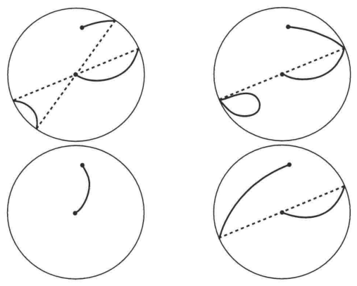
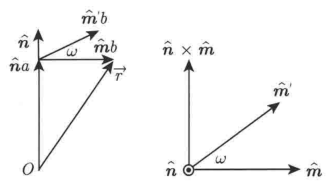
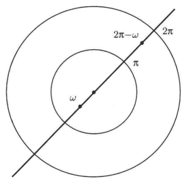
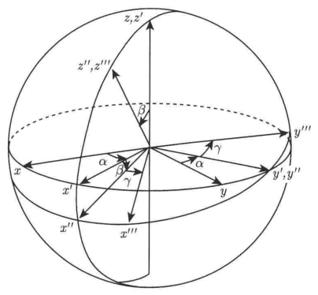
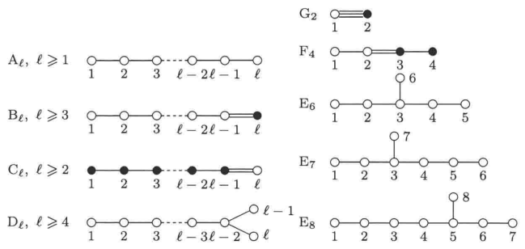

# 第4章　三维转动群和李代数基本知识

球对称是物理学中最常见的对称性，无论在经典力学中还是在量子力学中，中心力场 (球对称系统) 问题总是最基本的研究课题。这不仅是因为中心力场问题容易处理，而且很多真实物理系统都有近似的球对称性质。在球对称的系统里空间各向同性，系统绕通过原点的任何轴的任何转动都保持不变，因而系统的对称变换群是三维空间转动群 SO(3). SO(3) 群是最简单的非阿贝尔李群。对 SO(3) 群的深入研究会给李群的一般研究提供很多启示。总之，三维空间转动群的研究在物理上和数学上都有重要意义。本章将通过 SO(3) 群介绍李代数的基本知识。

## 4.1 三维空间转动变换群

描述转动变换，存在两种不同的观点，一种是系统转动的观点，另一种是坐标系转动的观点。本书按照多数文献的习惯，采用系统转动的观点。在群论中矢量这一术语用得比较广泛，为区别起见，本章对这三维空间的矢量，专门用带箭头的符号来标记，除矢量基外的单位矢量则用带小尖角的黑体符号标记。

在三维空间建立直角坐标系 $K$，用原点 $O$ 到空间任意点 $P$ 的位置矢量 $\vec{r}$ 来描写 $P$ 点的位置。坐标轴向的单位矢量记为 $\vec{e}_a$，$a = 1, 2, 3$，则

$$
\vec{r} = \sum_{a=1}^{3} \vec{e}_a x_a. \tag{4.1}
$$

三个坐标 $x_a$ 作为一个整体，与 $\vec{r}$ 一一对应，描写 $P$ 点的位置。这里坐标记为 $x_a$，而不记为 $x$，$y$ 和 $z$，是为了写求和式的方便。

空间转动变换保持原点不变，保持两点间距离不变，保持手征性不变。设转动 $R$ 把 $P$ 点转到 $P'$ 点，变换前后的坐标可用 $R$ 矩阵联系起来：

$$
\vec{r}' = \sum_{a=1}^{3} \vec{e}_a x'_a,
$$

$$
\begin{pmatrix}
x'_1 \\
x'_2 \\
x'_3
\end{pmatrix}
=
\begin{pmatrix}
R_{11} & R_{12} & R_{13} \\
R_{21} & R_{22} & R_{23} \\
R_{31} & R_{32} & R_{33}
\end{pmatrix}
\begin{pmatrix}
x_1 \\
x_2 \\
x_3
\end{pmatrix}
= R
\begin{pmatrix}
x_1 \\
x_2 \\
x_3
\end{pmatrix}.
\tag{4.2}
$$

坐标间的齐次变换保证原点位置不变，而距离不变性要求 $R$ 是实正交矩阵

$$
\underline{x}'^{\mathrm{T}} \underline{x}' = \underline{x}^{\mathrm{T}} R^{\mathrm{T}} R \underline{x} = \underline{x}^{\mathrm{T}} \underline{x}, \qquad R^{\mathrm{T}} R = 1. \tag{4.3}
$$

建立固定在系统上的坐标系 $K'$，单位矢量为 $\vec{e}'_a$，则 $\vec{r}$ 在动坐标系 $K'$ 中的分量仍是 $x_a$:

$$
\vec{r} = \sum_{a=1}^{3} \vec{e}_a x'_a = \sum_{b=1}^{3} \vec{e}'_b x_a. \tag{4.4}
$$

把式 (4.2) 代入式 (4.4)，得单位矢量的变换关系

$$
\vec{e}'_b = \sum_{a=1}^{3} \vec{e}_a R_{ab}. \tag{4.5}
$$

坐标系的手征性是用单位矢量的混合积来确定的，右手坐标系单位矢量的混合积为 1，即

$$
\vec{e}_1 \cdot (\vec{e}_2 \times \vec{e}_3) = 1. \tag{4.6}
$$

左手坐标系则为 $-1$. 转动变换保持系统的手征性不变，就是要求固定在系统上的坐标系，它的单位矢量的混合积变换前后都是 1，即

$$
\vec{e}'_1 \cdot (\vec{e}'_2 \times \vec{e}'_3) = \det R = 1. \tag{4.7}
$$

因此行列式是 1 的实正交矩阵 $R$ 描写三维空间转动变换，所有三维空间转动变换都可以用行列式是 1 的实正交矩阵 $R$ 来描写。行列式为 $-1$ 的实正交矩阵要改变系统的手征性，这说明此变换中包含了空间反演 $\sigma$，是所谓的非固有转动。事实上，实正交矩阵的行列式只能取不连续的 1 或 $-1$，分别对应固有转动和非固有转动。非固有转动元素是固有转动元素和空间反演 $\sigma$ 的乘积，描写转动变换后再做空间反演变换。行列式为 1 的矩阵常称为幺模矩阵。

三维幺模实正交矩阵 $R(\hat{n}, \omega)$，描写绕三维空间 $\hat{n}$ 方向转动 $\omega$ 角的变换，按照矩阵的乘积规则，它的集合构成群，称为三维转动群，记为 SO(3) 群，其中 O 代表实正交矩阵，S 代表幺模。三维转动群是空间各向同性系统的对称变换群。如果再把空间反演变换 $\sigma$ 也包括进来，所有三维实正交矩阵的集合构成三维实正交矩阵群，记为 O(3) 群。

研究几个特殊的转动。图 2.1 已经研究过绕 $x_3$ 轴转动 $\omega$ 角的变换矩阵

$$
R(\vec{e}_3, \omega) =
\begin{pmatrix}
\cos\omega & -\sin\omega & 0 \\
\sin\omega & \cos\omega & 0 \\
0 & 0 & 1
\end{pmatrix}. \tag{4.8}
$$

利用物理中常用的泡利 (Pauli) 矩阵可把转动矩阵写成矩阵的指数函数形式。

$$
\begin{gathered}
\sigma_1 = \begin{pmatrix} 0 & 1 \\ 1 & 0 \end{pmatrix}, \quad
\sigma_2 = \begin{pmatrix} 0 & -\mathrm{i} \\ \mathrm{i} & 0 \end{pmatrix}, \quad
\sigma_3 = \begin{pmatrix} 1 & 0 \\ 0 & -1 \end{pmatrix}, \\
\sigma_a \sigma_b = \delta_{ab} \mathbf{1} + \mathrm{i} \sum_{c=1}^{3} \epsilon_{abc} \sigma_c, \quad \text{即}\ \ \sigma_a^2 = \mathbf{1}, \quad \sigma_1 \sigma_2 = \mathrm{i}\sigma_3\ \ \text{等}, \\
\mathrm{Tr}\ \sigma_a = 0, \quad \mathrm{Tr}\ (\sigma_a \sigma_b) = 2\delta_{ab}.
\end{gathered}
\tag{4.9}
$$

矩阵的指数函数用它的级数展开来定义

$$
\begin{aligned}
\exp\{-\mathrm{i}\omega\sigma_2\} &= \sum_{n} \frac{1}{n!} (-\mathrm{i}\omega\sigma_2)^n \\
&= \mathbf{1}\left(1 - \frac{1}{2!}\omega^2 + \frac{1}{4!}\omega^4 - \cdots\right) - \mathrm{i}\sigma_2\left(\omega - \frac{1}{3!}\omega^3 + \frac{1}{5!}\omega^5 - \cdots\right) \\
&= \mathbf{1}\cos\omega - \mathrm{i}\sigma_2\sin\omega =
\begin{pmatrix}
\cos\omega & -\sin\omega \\
\sin\omega & \cos\omega
\end{pmatrix}.
\end{aligned}
$$

把 $\sigma_2$ 换成 $T_3$ 矩阵，就可得 $R(\vec{e}_3, \omega)$ 矩阵的指数形式

$$
R(\vec{e}_3, \omega) = \exp\{-\mathrm{i}\omega T_3\} =
\begin{pmatrix}
\cos\omega & -\sin\omega & 0 \\
\sin\omega & \cos\omega & 0 \\
0 & 0 & 1
\end{pmatrix}, \qquad
T_3 = \begin{pmatrix}
0 & -\mathrm{i} & 0 \\
\mathrm{i} & 0 & 0 \\
0 & 0 & 0
\end{pmatrix}.
$$

根据三个轴的循环对称性，可知绕其他两轴的转动变换矩阵为

$$
R(\vec{e}_1, \omega) = \exp\{-\mathrm{i}\omega T_1\} =
\begin{pmatrix}
1 & 0 & 0 \\
0 & \cos\omega & -\sin\omega \\
0 & \sin\omega & \cos\omega
\end{pmatrix}, \qquad
T_1 = \begin{pmatrix}
0 & 0 & 0 \\
0 & 0 & -\mathrm{i} \\
0 & \mathrm{i} & 0
\end{pmatrix},
$$

$$
R(\vec{e}_2, \omega) = \exp\{-\mathrm{i}\omega T_2\} =
\begin{pmatrix}
\cos\omega & 0 & \sin\omega \\
0 & 1 & 0 \\
-\sin\omega & 0 & \cos\omega
\end{pmatrix}, \qquad
T_2 = \begin{pmatrix}
0 & 0 & \mathrm{i} \\
0 & 0 & 0 \\
-\mathrm{i} & 0 & 0
\end{pmatrix}.
$$

$T_a$ 矩阵的矩阵元素满足

$$
(T_a)_{bc} = -\mathrm{i}\epsilon_{abc}. \tag{4.10}
$$

再引入一个特殊的转动 $S(\varphi, \theta)$，它把 $x_3$ 轴上的点转到 $\hat{n}(\theta, \varphi)$ 方向，其中 $\theta$ 和$\varphi$ 角是 $\hat{n}$ 方向的极角和方位角

$$
\begin{gathered}
S(\varphi, \theta) = R(\vec{e}_3, \varphi)R(\vec{e}_2, \theta) =
\begin{pmatrix}
\cos\varphi\cos\theta & -\sin\varphi & \cos\varphi\sin\theta \\
\sin\varphi\cos\theta & \cos\varphi & \sin\varphi\sin\theta \\
-\sin\theta & 0 & \cos\theta
\end{pmatrix}, \\
S(\varphi, \theta)
\begin{pmatrix}
0 \\
0 \\
1
\end{pmatrix}
=
\begin{pmatrix}
\cos\varphi\sin\theta \\
\sin\varphi\sin\theta \\
\cos\theta
\end{pmatrix}
=
\begin{pmatrix}
n_1 \\
n_2 \\
n_3
\end{pmatrix}.
\end{gathered}
\tag{4.11}
$$

不难验证

$$
\begin{gathered}
S T_3 S^{-1} = n_1 T_1 + n_2 T_2 + n_3 T_3 = \hat{n} \cdot \vec{T}, \\
\vec{T} = \vec{e}_1 T_1 + \vec{e}_2 T_2 + \vec{e}_3 T_3.
\end{gathered}
\tag{4.12}
$$

绕 $\hat{n}$ 方向转动 $\omega$ 角的变换 $R(\hat{n}, \omega)$，可以表为三个转动的乘积，先把 $\hat{n}$ 方向转到 $x_3$ 方向，再绕 $x_3$ 方向转动 $\omega$ 角，最后把 $x_3$ 方向转回到 $\hat{n}$ 方向。这三个转动的乘积可以写成指数形式

$$
\begin{aligned}
R(\hat{n}, \omega) &= S(\varphi, \theta) R(\vec{e}_3, \omega) S(\varphi, \theta)^{-1} = \exp\{-\mathrm{i}\omega S T_3 S^{-1}\} \\
&= \exp\{-\mathrm{i}\omega \hat{n} \cdot \vec{T}\} = \exp\left\{-\mathrm{i}\sum_{a=1}^{3} \omega_a T_a\right\},
\end{aligned}
\tag{4.13}
$$

三个 $\omega_a$ 看成矢量 $\vec{\omega}$ 的直角坐标，而 $\omega$，$\theta$ 和 $\varphi$ 是它的球坐标，它们描写了 SO(3) 群的任意元素，即绕 $\hat{n}$ 方向转动 $\omega$ 角的变换。

$$
\omega_1 = \omega n_1 = \omega\sin\theta\cos\varphi,
$$

$$
\omega_2 = \omega n_2 = \omega\sin\theta\sin\varphi, \tag{4.14}
$$

$$
\omega_3 = \omega n_3 = \omega\cos\theta.
$$

因为绕相反方向的转动变换有如下联系：

$$
R(\hat{n}, \omega) = R(-\hat{n}, 2\pi - \omega), \qquad R(\hat{n}, \pi) = R(-\hat{n}, \pi), \tag{4.15}
$$

**所以参数 $\vec{\omega}$ 在半径为 $\pi$ 的球体内连续变化，在球面上直径两端的点代表同一个转动.**

**式 (4.13) 还说明，三维转动群中转动相同角度的元素互相共轭，三维转动群的类用转动角度 $\omega$ 来描写，$0 \leqslant \omega \leqslant \pi$. 对任意转动变换矩阵 $R(\hat{n}, \omega)$，它的本征值为 1 的本征矢量沿转动轴 $\hat{n}$ 方向，由它的矩阵迹 $(1 + 2\cos\omega)$ 可定出转动角 $\omega$.**

## 4.2 李群的基本概念

三维转动群是最简单的非阿贝尔李群。本节通过三维转动群的研究和推广，可以初步理解李群的一般性质。

### 4.2.1 李群的组合函数

三维空间转动群 SO(3) 的元素 $R(\hat n,\omega)$ 可用三个实参数来描写，这三个实参数在半径为 $\pi$ 的球体内连续变化，在球面上直径两端的点代表同一个元素。这是最简单的一个非阿贝尔李群。

李群是一种连续群，它的每一个元素都可以用一组独立实参数来描写，这组参数在欧氏空间的一定区域内连续变化。尽可能缩减参数的变化区域，使在测度不为零的区域内，群元素和参数值间有一一对应的关系。**参数的变化区域称为群空间，独立实参数数目 $g$，也就是群空间的维数，称为连续群的阶**。所谓测度不为零的区域，可以简单地理解为维数等于群空间维数的区域。例如，三维转动群的群空间取作半径为 $\pi$ 的球体，保证了球体内群元素和参数值间有一一对应关系。但作为群空间的边界，外球面是二维空间，测度为零。外球面上直径两端的点，即两组不同的参数值，对应同一个群元素。因为群空间上的点，即一组独立实参数，完全描写了群元素，所以经常直接把群空间的点也称为群元素。

设元素 $R\in G$，参数为 $(r_1,r_2,\cdots,r_g)$，简写为 $R(r_1,r_2,\cdots,r_g)=R(r)$。对于群元素的乘积，$R(r)S(s)=T(t)$，$g$ 个参数 $t_A$ 是 $2g$ 个变量 $r_B$ 和 $s_D$ 的函数

$$
t_A=f_A(r_1,\cdots,r_g;\ s_1,\cdots,s_g)=f_A(r;s).
\tag{4.16}
$$

$g$ 个函数 $f_A(r;s)$ 称为连续群的组合函数，它完全描写了连续群群元素的乘积规则。**如果组合函数是解析函数，则此连续群称为李群**。由于函数连续可微，微积分的整套工具可以用来深入研究李群，使李群成为至今研究最深入最成功的无限群。

作为群的组合函数，$f_A(r;s)$ 必须满足如下条件。

(1) 封闭性。组合函数的定义域是 (群空间) × (群空间)，而值域是群空间。至少在测度不为零的区域内，要求 $f_A(r;s)$ 是单值解析函数。

(2) 结合律。

$$
f_A[r;f(s;t)]=f_A[f(r;s);t].
$$

(3) 恒元的参数为 $e_A$，它包含在群空间内，

$$
f_A(e;r)=f_A(r;e)=r_A.
$$

通常为方便起见，取 $e_A=0$。

(4) $R$ 逆元的参数记为 $\bar r_A$

$$
f_A(\bar r;r)=f_A(r;\bar r)=e_A.
$$

实际上，即使很简单的李群，组合函数的形式也往往相当复杂。组合函数主要用于理论分析，很少用来进行实际计算。

群的许多概念在李群中同样适用，如阿贝尔群、子群、陪集、共轭元素、类、不变子群、群的同构和同态、商群、线性表示、等价表示、不可约表示、自共轭表示、特征标等概念也都是李群的基本概念。李群线性表示的每一个矩阵元素和特征标，在群空间测度不为零的区域内，都是群参数的单值解析函数。

### 4.2.2 李群的局域性质

在群空间中，在群元素 $R$ 的点的邻域 (adjacent) 中，各点对应的元素称为 $R$ 的邻近元素。邻域在数学中有严格的定义。为避免抽象的数学，这里可以简单地把邻域理解为无限邻近的小区域。因为常把恒元的参数选为零，恒元邻近的元素，参数是无穷小量，称为无穷小元素。**应该强调：无穷小量是一个极限过程。不能把无穷小元素就看成是一个参数很小的元素。无穷小元素是与群元素的微分运算相联系的**。李群的无穷小元素描写李群的局域 (local) 性质。无穷小元素与任意元素 $R$ 的乘积，是 $R$ 的邻近元素。反之，$R$ 的邻近元素和 $R^{-1}$ 相乘，得无穷小元素。粗略地说，把无穷多个无穷小元素相继乘到群元素 $R$ 上，在群空间表现为由元素 $R$ 出发的一条连续曲线。如果在群空间中代表元素 $R$ 的点和代表恒元的点，可以通过一条完全在群空间内的连续曲线相连接，则 $R$ 可表为无穷多个无穷小元素的乘积。用数学的语言说，元素 $R$ 的性质可通过微分方程来描写。无穷小元素在李群中起着十分重要的作用。

无穷小元素 $A(\alpha)$ 与 $B(\beta)$ 相乘，仍是无穷小元素。恒元参数为零，$\alpha_D$ 和 $\beta_D$ 都是无穷小量，将乘积元素 $AB$ 的参数按 $\alpha$ 和 $\beta$ 作泰勒 (Taylor) 展开，略去二级无穷小量，并注意 $e_D=0$，$AE=A$ 和 $EB=B$，得

$$
\begin{aligned}
f_D(\alpha;\beta) &= f_D(0;0)+\sum_{k=1}^{g}\left(\alpha_k\left.\frac{\partial f_D(\alpha;0)}{\partial\alpha_k}\right|_{\alpha=0}+\beta_k\left.\frac{\partial f_D(0;\beta)}{\partial\beta_k}\right|_{\beta=0}\right)\\
&=\alpha_D+\beta_D.
\end{aligned}
\tag{4.17}
$$

可见，无穷小元素相乘，参数相加。互逆的无穷小元素的参数互为相反数。记 $A^{-1}$ 的参数为 $\bar\alpha_D$，则

$$
\bar\alpha_D=-\alpha_D.
\tag{4.18}
$$

无穷小元素乘积满足交换律，并不意味着群中所有元素乘积都满足交换律。在理论力学中学过，无穷小转动乘积次序可以交换，但有限转动乘积次序不能交换，即三维转动群不是阿贝尔群。

### 4.2.3 生成元和微量算符

无穷小元素在李群中处于特殊重要的地位。现在来研究无穷小元素在变换算符群 $P_G$ 和线性表示 $D(G)$ 中的性质。

$P_R$ 是元素 $R$ 对应的标量函数变换算符

$$
P_R\psi(x)=\psi(R^{-1}x),
$$

其中，$x$ 代表系统所有自由度的坐标。取 $R$ 为无穷小元素 $A(\alpha)$，将上式按参数 $\alpha_D$ 展开，取到一级无穷小量

$$
\begin{aligned}
P_A\psi(x)&=\psi(x)+\sum_{a,D}\bar\alpha_D\left.\frac{\partial(A^{-1}x)_a}{\partial\bar\alpha_D}\right|_{\bar\alpha=0}\left.\frac{\partial\psi(A^{-1}x)}{\partial(A^{-1}x)_a}\right|_{\bar\alpha=0}\\
&=\psi(x)-\mathrm{i}\sum_{D=1}^{g}\alpha_D\left(-\mathrm{i}\sum_a\left.\frac{\partial(Ax)_a}{\partial\alpha_D}\right|_{\alpha=0}\frac{\partial}{\partial x_a}\right)\psi(x).
\end{aligned}
$$

引入 $g$ 个微量微分算符 $I_D^{(0)}$，

$$
\begin{aligned}
I_D^{(0)}&=-\mathrm{i}\sum_a\left.\frac{\partial(Ax)_a}{\partial\alpha_D}\right|_{\alpha=0}\frac{\partial}{\partial x_a},\\
P_A\psi(x)&=\psi(x)-\mathrm{i}\sum_{D=1}^{g}\alpha_D I_D^{(0)}\psi(x).
\end{aligned}
\tag{4.19}
$$

**李群中无穷多个无穷小元素对标量函数的作用可以用 $g$ 个微量微分算符 $I_D^{(0)}$ 完全描写**。只要参数是独立的，$I_D^{(0)}$ 就是线性无关的。若变换算符 $P_R$ 是幺正算符，则微量微分算符是厄米算符。这正是在式 (4.19) 中引入 $-\mathrm{i}$ 的目的。

在三维空间，如果 $x$ 代表系统质心的坐标，而系统其他内部坐标没有标出，或者系统本身就是一个质点，$x$ 是质点的坐标，则由式 (4.10) 得

$$
(Ax)_a=\sum_b\left\{\delta_{ab}-\mathrm{i}\sum_d\alpha_d(T_d)_{ab}\right\}x_b=x_a-\sum_{bd}\alpha_d\epsilon_{dab}x_b.
$$

代入式 (4.19)，算得三维转动群的微量微分算符正是量子力学中的轨道角动量算符，其中取了自然单位，$\hbar=c=1$，

$$
I_d^{(0)}=-\mathrm{i}\sum_{ab}\epsilon_{dba}x_b\frac{\partial}{\partial x_a}=L_d.
\tag{4.20}
$$

设 $m$ 个函数基 $\psi_\mu(x)$ 架设对于 $P_G$ 不变的函数空间，对应群 G 的表示 $D(G)$，

$$
P_R\psi_\mu(x)=\sum_\nu\psi_\nu(x)D_{\nu\mu}(R).
$$

把无穷小元素的表示矩阵 $D(A)$ 按无穷小参数展开，略去高级无穷小量，得

$$
D(A)=1-\mathrm{i}\sum_{B=1}^{g}\alpha_B I_B,\qquad I_B=\mathrm{i}\left.\frac{\partial D(A)}{\partial\alpha_B}\right|_{\alpha=0}.
\tag{4.21}
$$

$g$ 个矩阵 $I_B$ 称为李群表示 $D(G)$ 的生成元，它是微量微分算符在表示空间的矩阵形式。$g$ 个生成元完全描写了无穷多个无穷小元素在表示 $D(G)$ 中的性质。**如果 $D(G)$ 是李群 G 的真实表示，则 $g$ 个生成元线性无关**。由于规定参数取实数，幺正表示的生成元是厄米矩阵。通常把微量微分算符和生成元都统称为微量算符，或统称为生成元。

### 4.2.4 李群的整体性质

研究李群的整体 (global) 性质，就是研究李群群空间的拓扑性质。为避免抽象的数学，这里采用物理上习惯的语言来解释李群的整体性质。

首先，讨论群空间的连通性。如果群中任意两元素，它们在群空间的对应点，都可通过一条完全包含在群空间内的连续曲线连接起来，则此群空间称为连通的，这样的李群称为简单 (simply) 李群。SO(3) 群就是简单李群。反之，如果群空间分成不相连接的若干片，则此李群称为混合 (mixed) 李群。因为实正交矩阵的行列式可取 $\pm1$，它们互相不能连续变化，所以三维实正交矩阵群 O(3) 是混合李群。前面说过，粗略地说，对简单李群，群元素都可表为无穷多个无穷小元素的乘积，而对混合李群，除无穷小元素外，还必须在群空间的每一个连续片给出一个特殊元素 (包括恒元)，群元素表为这些特殊元素和无穷多个无穷小元素的乘积。在 O(3) 群的情况，常取空间反演 $\sigma$ 作为非固有转动元素的代表，由恒元，空间反演和无穷小元素的乘积，就可表出 O(3) 群的任意元素。对线性表示来说，将来会知道，由生成元就可以计算出简单李群任意元素 $R$ 的表示矩阵 $D(R)$，但对混合李群 O(3)，则还需要知道空间反演元素的表示矩阵 $D(\sigma)$。

下面证明混合李群的群空间中，包含恒元的那个连续片对应元素的集合构成混合李群的不变子李群，其他连续片对应元素的集合构成这不变子群的陪集。设 $R$ 和 $S$ 都属于恒元 $E$ 所在的那个连续片，即它们在群空间中的对应点，都可以用一条完全包含在群空间内的连续曲线与恒元的对应点相连，则它们的乘积也可以由恒元在群空间内连续地变过来，逆元 $R^{-1}$ 也可以由恒元在群空间内连续地变过来，即它们都属于此子集。根据假设恒元已属于此子集，因此此子集构成子群。进一步，设 $T$ 是群中任意元素，则 $TRT^{-1}$ 可以由恒元 $TET^{-1}=E$ 在群空间内连续地变过来，它在群空间中的对应点可以用一条完全包含在群空间内的连续曲线与恒元的对应点相连，因而此子群是不变子群。在群空间其他连续片各取一个代表元素，属于每一个连续片的元素都可由相应代表元素出发在群空间内连续变化得到，因而属于同一个陪集。证完。混合李群的性质完全由此简单李群 (不变子李群) 和每一连续片 (陪集) 中一个代表元素的性质决定。今后将重点讨论简单李群的性质。

其次，讨论简单李群群空间的连通度。在简单李群的群空间中，元素 $R$ 的点可与恒元的对应点通过许多连线相连接。有些连线可以在群空间内互相连续变化，有些则不能。这样，这些连线就分成若干组，属同一组的连线可以在群空间内互相连续变化，而不同组的连线则不能。**这些连线的组数称为群空间的连通度**。李群的性质与群空间的连通度有密切关系。

先来举一个简单的例子。实数的集合，用数的加法定义元素的“乘积”，这集合构成群，简称为加法群。此群元素本身就是实数 (参数)，它在实数轴上连续变化，实数轴就是群空间，原点 (数零) 对应恒元。在群空间中代表元素的点与代表恒元的点间所有连线都可在群空间内连续变化，因而加法群的群空间是单连通的。它是一阶阿贝尔简单李群，不可约表示都是一维的。加法群有无穷多个一维不等价不可约表示，用复数 $\tau$ 标记

$$
D^\tau(\alpha)=\exp(-\mathrm{i}\tau\alpha),\quad \tau\text{ 是复数},\quad \alpha\text{ 是实数}.
\tag{4.22}
$$

式 (4.22) 指数上引入 $-\mathrm{i}$ 只是为了以后方便。

再看绕 $x_3$ 轴转动任意角 $\omega$ 的变换 $R(\vec e_3,\omega)$ 集合，两变换乘积对应参数 $\omega$ 相加，转动 $2\pi$ 角的变换等于恒等变换

$$
R(\vec e_3,\omega_1)R(\vec e_3,\omega_2)=R(\vec e_3,\omega_1+\omega_2),\quad R(\vec e_3,\omega+2\pi)=R(\vec e_3,\omega).
\tag{4.23}
$$

此集合构成李群，称为二维幺模实正交矩阵群，记为 SO(2) 群。它是一阶阿贝尔李群，群参数 $\omega$ 在实数轴上 $\pm\pi$ 之间变化，$\pm\pi$ 对应同一个元素。群空间边界上的这一性质，决定了 SO(2) 群群空间的连通度，对群的性质产生很大的影响。很明显，群空间中对应群元素 $R(\vec e_3,\omega)$ 的点和对应恒元的点 (原点) 可以直接相连，也可以通过包含边界上 $\pm\pi$ 间若干次跳跃的连线相连。设从 $\pi$ 到 $-\pi$ 的跳跃称为正跳跃，从 $-\pi$ 到 $\pi$ 的跳跃称为负跳跃。对包含两次不同类型跳跃的连线，这两次跳跃可以在群空间内通过连续变化而消去。所包含的正跳跃次数减去负跳跃次数称为该连线的跳跃次数。当连线在群空间内连续变化时，它的跳跃次数不会改变。这样，由原点到 $\omega$ 的连线分成无穷多组，每组用跳跃次数来标记，不同组的连线不能在群空间内互相连续变化，SO(2) 群的群空间是无穷多度连通的。

把 SO(2) 群的元素和加法群的元素建立如下 $1:\infty$ 的对应关系：

$$
R(\vec e_3,\omega)\leftrightarrow\omega+2n\pi,\quad n\text{ 是任意整数}.
\tag{4.24}
$$

这种对应关系对元素乘积保持不变，因而 SO(2) 群和加法群同态。SO(2) 群的不等价不可约表示也可表为式 (4.22) 的形式，但因式 (4.23)，$\tau$ 只能取整数 $m$：

$$
D^m(\vec e_3,\omega)=\exp(-\mathrm{i}m\omega),\quad m\text{ 是整数}.
\tag{4.25}
$$

当 $m$ 不是整数时，表示矩阵和群元素之间变成多一对应的关系，按照线性表示的定义，这已不是 SO(2) 群的表示，有时称为多值表示。

数学中已经证明，当简单李群 G 的群空间是 $n$ 度连通时，它一定同态于另一个群空间是单连通的简单李群，同态对应关系是 $1:n$。这单连通的简单李群称为李群 G 的**覆盖群**。覆盖群的真实表示就是群 G 的 $n$ 值表示。加法群是 SO(2) 群的覆盖群。

现在回到三维转动群来。三维转动群的群空间是半径为 $\pi$ 的球体，在球面上直径两端的点代表同一个元素，从而群空间内的连线就可以包含直径两端的跳跃。跳跃前后的两点始终保持在同一直径的两端，位置上是相关联的。它们不能独立地变化位置，只能成对地在球面上移动，因而此跳跃无法通过在群空间的连续移动而消去。如果连线包含两次跳跃，则可把跳跃点反向移到一起，包含在两次跳跃间的连线，是沿一个封闭的环形路径转一圈 (图 4.1)。连续的环形路径是可以在群空间内连续地收缩到一点而消去的，而在直径两端的来回跳跃等于不跳，因此两次跳跃可以通过在群空间内的连续变化而消去。

对 SO(3) 群，从原点到群空间任一点的连线可以分成两组，一组包含直径两端的偶数次跳跃，另一组包含奇数次跳跃，属同一组的连线可以在群空间内做连续变化而重合，但分属两组的连线则不能。就是说，SO(3) 群的群空间是双连通的。以后会证明，SO(3) 群的覆盖群是二维幺模幺正矩阵的集合构成的群 SU(2)。SU(2) 群的真实表示是 SO(3) 群的双值表示，它是自旋能够存在的数学基础。

最后，讨论群空间的紧致性。在欧氏空间，包含边界的闭区域是紧致的，不包含边界的开区域 (包括无穷区域) 是非紧致的。**群空间是紧致的李群称为紧致李群**。三维转动群是紧致李群。物理中常见的非紧致李群，有洛伦兹群和平移群。对洛伦兹群，可选惯性系间的相对速度作为一个参数。按狭义相对论，相对速度只能趋近光速，不能等于光速，因而洛伦兹群的群空间是开区域，洛伦兹群是非紧致李群。在第 2 章已多次提到，要把有限群表示理论的主要结论推广到李群来，关键是要解决群函数对群元素求平均的问题。李群的群元素是用一组连续实参数来描写的，一个自然的想法就是把对群元素的求和改成对群参数的积分。可以证明，对紧致李群，可以适当定义对群参数的积分，使积分收敛，而且对左乘和右乘群元素保持不变，从而可以把有限群表示理论的主要结论推广到紧致李群中来。但对非紧致李群这样的积分不存在，有限群的有些结论就不能推广。

## 4.3 三维转动群的覆盖群

本节将证明三维转动群的覆盖群是二维幺模幺正矩阵群，并讨论它们群上的积分。

### 4.3.1 二维幺模幺正矩阵群

二维幺模幺正矩阵的集合，按照普通的矩阵乘积，满足群的四个条件，因而构成群，记为 SU(2) 群。对于群中任意元素 $u$，它的矩阵元素满足

$$
\begin{aligned}
u&=\begin{pmatrix}a&b\\c&d\end{pmatrix}\in\mathrm{SU}(2),\\
aa^*+cc^*&=bb^*+dd^*=ad-bc=1,\quad ab^*+cd^*=0.
\end{aligned}
$$

容易解得 $a=d^*$，$c=-b^*$ 和 $|c|^2+|d|^2=1$。因此任意元素 $u$ 只包含三个独立实参数。为方便起见，用实矢量 $\vec\omega$ 的球坐标 $\omega$，$\theta$ 和 $\varphi$ 表出这三个独立实参数：

$$
\begin{aligned}
a&=d^*=\cos(\omega/2)-\mathrm{i}\sin(\omega/2)\cos\theta,\\
c&=-b^*=\sin(\omega/2)\sin\theta\sin\varphi-\mathrm{i}\sin(\omega/2)\sin\theta\cos\varphi,\\
u(\hat n,\omega)&=\mathbf{1}\cos(\omega/2)-\mathrm{i}(\vec\sigma\cdot\hat n)\sin(\omega/2).
\end{aligned}
\tag{4.26}
$$

其中，$\sigma_a$ 是三个泡利矩阵，已在式 (4.9) 作了介绍。这里引进的矢量 $\vec\sigma=\sum_a\vec e_a\sigma_a$，它的分量是矩阵。只要不颠倒乘积次序，它满足所有矢量代数的公式，如矢量的点乘和叉乘，还有

$$
\begin{aligned}
\vec\sigma\cdot\hat n&=\sum_{a=1}^{3}\sigma_a n_a=\begin{pmatrix}n_3&n_1-\mathrm{i}n_2\\n_1+\mathrm{i}n_2&-n_3\end{pmatrix},\\
(\vec\sigma\times\vec U)\cdot\vec V&=\vec\sigma\cdot(\vec U\times\vec V)=\sum_{abc}\epsilon_{abc}\sigma_a U_b V_c,\\
(\vec\sigma\cdot\vec a)(\vec\sigma\cdot\vec b)&=\mathbf{1}(\vec a\cdot\vec b)+\mathrm{i}\vec\sigma\cdot(\vec a\times\vec b).
\end{aligned}
\tag{4.27}
$$

最后一个公式可用两边取迹，或乘 $\sigma_a$ 后再取迹的办法证明，证明中用到式 (4.9)。由式 (4.26) 和式 (4.27) 又可证明

$$
\begin{aligned}
u(\hat n,\omega_1)u(\hat n,\omega_2)&=u(\hat n,\omega_1+\omega_2),\\
u(\hat n,4\pi)&=1,\quad u(\hat n,2\pi)=-1,\\
u(\hat n,\omega)&=u(-\hat n,4\pi-\omega)=-u(-\hat n,2\pi-\omega).
\end{aligned}
\tag{4.28}
$$

可见 $\vec\omega$ 的变化范围是半径为 $2\pi$ 的球体，在球体内的点和 SU(2) 群的元素 $u$ 间有一一对应的关系，在外球面上的点都对应同一个元素 $-1$。这就是取参数 $\vec\omega$ 时 SU(2) 群的群空间。首先，SU(2) 群的群空间是连通的，群中任一元素 $u$ 都可以由恒元出发在群空间内连续变化得到，因而 SU(2) 群是简单李群。其次，由于外球面上的点代表同一个元素，群空间的连线在到达外球面时可在此球面上任意跳跃，而不是只限于在直径两端的跳跃。跳跃前后两点都可独立地在球面上自由移动，从而可把此两点连续地移到一起，消去此跳跃。因此 SU(2) 群的群空间是单连通的。也可用另一方法来理解。正因为外球面上的点是同一个元素，球面上的跳跃也可以用球面上的一根连续曲线相连接，使跳跃可以在群空间内的连续变化而消去。再次，SU(2) 群的群空间是欧氏空间的一个闭区域，因而 SU(2) 群是一个紧致李群。最后，利用式 (4.27) 不难证明 (习题第 3 题)，相同 $\omega$ 的元素互相共轭，构成一类。

### 4.3.2 覆盖群

泡利矩阵的实线性组合仍是无迹厄米矩阵。反之，任何二维无迹厄米矩阵 $X$ 只包含三个独立实参数，都可展开为泡利矩阵的实线性组合。现取组合系数为三维空间给定点 $P$ 的三个直角坐标，

$$
\begin{aligned}
X&=\sum_{a=1}^{3}\sigma_a x_a=\vec\sigma\cdot\vec r=\begin{pmatrix}x_3&x_1-\mathrm{i}x_2\\x_1+\mathrm{i}x_2&-x_3\end{pmatrix},\\
x_a&=\frac{1}{2}\operatorname{Tr}(X\sigma_a),\quad\det X=-\sum_{a=1}^{3}x_a^2.
\end{aligned}
\tag{4.29}
$$

因此无迹厄米矩阵 $X$ 和 $P$ 点的位置矢量 $\vec r$ 间有一一对应关系。任取二维幺模幺正矩阵 $u(\hat{n},\omega)\in \mathrm{SU}(2)$，有

$$
u(\hat{n},\omega)Xu(\hat{n},\omega)^{-1}=X'.
$$

$X'$ 仍是一个无迹厄米矩阵，且有相同的行列式，因而 $X'$ 对应空间另一点 $P'$ 的坐标矢量 $\vec{r}'$，

$$
u(\hat{n},\omega)(\vec{\sigma}\cdot\vec{r})u(\hat{n},\omega)^{-1}=\vec{\sigma}\cdot\vec{r}',\quad x'_{a}=\sum_{b}R_{ab}x_{b}.
\tag{4.30}
$$

现在来具体计算 $R$ 矩阵的形式。把 $\vec{r}$ 分解为平行和垂直 $\hat{n}$ 方向的分量

$$
\vec{r}=\hat{n}a+\hat{m}b,\quad \hat{n}\cdot\hat{m}=0,\quad (\vec{\sigma}\cdot\vec{r})=\vec{\sigma}\cdot\hat{n}a+\vec{\sigma}\cdot\hat{m}b.
$$

利用式 (4.26) 和式 (4.27)，直接计算可得

$$
\begin{aligned}
&u(\hat{n},\omega)(\vec{\sigma}\cdot\hat{n})=(\vec{\sigma}\cdot\hat{n})u(\hat{n},\omega),\\
&(\vec{\sigma}\cdot\hat{n})(\vec{\sigma}\cdot\hat{m})=-(\vec{\sigma}\cdot\hat{m})(\vec{\sigma}\cdot\hat{n})=\mathrm{i}\vec{\sigma}\cdot(\hat{n}\times\hat{m}),\\
&(\vec{\sigma}\cdot\hat{n})(\vec{\sigma}\cdot\hat{m})(\vec{\sigma}\cdot\hat{n})=\mathrm{i}\{\vec{\sigma}\cdot(\hat{n}\times\hat{m})\}(\vec{\sigma}\cdot\hat{n})\\
&\qquad\qquad\qquad\qquad=-\vec{\sigma}\cdot\{(\hat{n}\times\hat{m})\times\hat{n}\}=-\vec{\sigma}\cdot\hat{m}.
\end{aligned}
$$

$$
\begin{aligned}
&\left\{1\cos\left(\frac{\omega}{2}\right)-\mathrm{i}(\vec{\sigma}\cdot\hat{n})\sin\left(\frac{\omega}{2}\right)\right\}(\vec{\sigma}\cdot\hat{m})\left\{1\cos\left(\frac{\omega}{2}\right)+\mathrm{i}(\vec{\sigma}\cdot\hat{n})\sin\left(\frac{\omega}{2}\right)\right\}\\
={}&(\vec{\sigma}\cdot\hat{m})\left\{\cos\left(\frac{\omega}{2}\right)\right\}^{2}-\frac{\mathrm{i}}{2}\sin\omega\{(\vec{\sigma}\cdot\hat{n})(\vec{\sigma}\cdot\hat{m})-(\vec{\sigma}\cdot\hat{m})(\vec{\sigma}\cdot\hat{n})\}\\
&+(\vec{\sigma}\cdot\hat{n})(\vec{\sigma}\cdot\hat{m})(\vec{\sigma}\cdot\hat{n})\left\{\sin\left(\frac{\omega}{2}\right)\right\}^{2}\\
={}&\vec{\sigma}\cdot\{\hat{m}\cos\omega+(\hat{n}\times\hat{m})\sin\omega\}.
\end{aligned}
$$

代入式 (4.30) 左边，得 $\vec{\sigma}\cdot\vec{r}'$，

$$
\vec{r}'=\hat{n}a+\hat{m}b\cos\omega+(\hat{n}\times\hat{m})b\sin\omega=R(\hat{n},\omega)\vec{r}.
$$

从图 4.2 容易看出，位置矢量 $\vec{r}$ 经转动 $R(\hat{n},\omega)$ 后，正好变成矢量 $\vec{r}'$。因此 $\mathrm{SU}(2)$ 群的任一元素 $u(\hat{n},\omega)$ 都对应 $\mathrm{SO}(3)$ 群一个确定元素 $R(\hat{n},\omega)$，

$$
u(\hat{n},\omega)\sigma_{b}u(\hat{n},\omega)^{-1}=\sum_{a=1}^{3}\sigma_{a}R(\hat{n},\omega)_{ab}.
\tag{4.31}
$$

反之，对于 $\mathrm{SO}(3)$ 群任一元素 $R$，它把坐标矢量 $\vec{r}$ 变成 $\vec{r}'$，并把 $X$ 变成 $X'$。既然 $X$ 和 $X'$ 都是无迹厄米矩阵，且有相同的行列式，它们必可以通过幺模幺正相似变换 $u\in \mathrm{SU}(2)$ 联系起来（见式 (4.30)）。设

$$
u_{1}Xu_{1}^{-1}=u_{2}Xu_{2}^{-1}=X',
$$

图 4.2 矢量 $\vec{r}$ 绕 $\hat{n}$ 方向转动 $\omega$ 角的变换

得 $u_{2}^{-1}u_{1}$ 可与任何 $X$ 矩阵对易，故它必是常数矩阵，$u_{1}=\lambda u_{2}$。由于幺模条件，$\lambda=\pm 1$。它给出 $\mathrm{SO}(3)$ 群一个元素 $R$ 和 $\mathrm{SU}(2)$ 群一对元素 $\pm u$ 间的一一对应关系 (4.31)。容易证明这对应关系对群元素乘积保持不变：

$$
u_{1}\sigma_{a}u_{1}^{-1}=\sum_{b}\sigma_{b}(R_{1})_{ba},\quad u_{2}\sigma_{b}u_{2}^{-1}=\sum_{d}\sigma_{d}(R_{2})_{db},
$$

$$
u_{2}u_{1}\sigma_{a}u_{1}^{-1}u_{2}^{-1}=\sum_{b}u_{2}\sigma_{b}u_{2}^{-1}(R_{1})_{ba}=\sum_{d}\sigma_{d}\sum_{b}\{(R_{2})_{db}(R_{1})_{ba}\}.
$$

因此，$\mathrm{SO}(3)$ 群和 $\mathrm{SU}(2)$ 群同态，

$$
\mathrm{SO}(3)\sim \mathrm{SU}(2).
\tag{4.32}
$$

现在，$\mathrm{SO}(3)$ 群和 $\mathrm{SU}(2)$ 群都用参数 $\vec{\omega}$ 描写，$\mathrm{SO}(3)$ 群的群空间是半径为 $\pi$ 的球体，$\mathrm{SU}(2)$ 群的群空间是半径为 $2\pi$ 的球体。事实上，在半径为 $\pi$ 的球体内，$\mathrm{SO}(3)$ 群和 $\mathrm{SU}(2)$ 群的元素一一对应。对 $\mathrm{SU}(2)$ 群来说，还有半径从 $\pi$ 到 $2\pi$ 的环所对应的元素，它们通过 $u(\hat{n},\omega)=-u(-\hat{n},2\pi-\omega)$，等于半径为 $\pi$ 的球体中相应元素的负值，这一对 $\pm u$ 矩阵对应 $\mathrm{SO}(3)$ 群同一个元素（图 4.3）。$\mathrm{SO}(3)$ 群的群空间是双连

图 4.3 在群空间中 $\mathrm{SU}(2)$ 群和 $\mathrm{SO}(3)$ 群元素的对应关系通的，**$\mathrm{SU}(2)$ 群的群空间是单连通的，$\mathrm{SU}(2)$ 群正是 $\mathrm{SO}(3)$ 群的覆盖群。$\mathrm{SO}(3)$ 群的真实表示，称为单值表示，是 $\mathrm{SU}(2)$ 群的非真实表示。$\mathrm{SU}(2)$ 群的真实表示，严格说不是 $\mathrm{SO}(3)$ 群的表示，称为 $\mathrm{SO}(3)$ 群的双值表示.** 在物理上双值表示与自旋的存在密切相关。只要找出 $\mathrm{SU}(2)$ 群的全部不等价不可约表示，也就找出了 $\mathrm{SO}(3)$ 群的全部不等价不可约单值表示和双值表示。

既然 $\mathrm{SO}(3)$ 群和 $\mathrm{SU}(2)$ 群的元素已经通过式 (4.31) 建立起一一对应的同态关系，文献中常把 $\mathrm{SU}(2)$ 群的元素 $u(\hat{n},\omega)$，也称为绕 $\hat{n}$ 方向转动 $\omega$ 角的变换，而且常说：“旋量转动 $4\pi$ 角才恢复原状”。

### 4.3.3 群上的积分

为了把有限群表示理论的主要结论推广到李群中来，关键的问题是要解决好群函数对群元素求平均的问题。李群的群函数实际上是李群参数的函数，定义域是李群的群空间。有限群中群函数对群元素取平均值，推广到李群，变成了群函数对群元素的积分，也就是对群参数的带权积分

$$
\frac{1}{g}\sum_{R\in G}F(R)\longrightarrow \int \mathrm{d}R\,F(R)=\int (\mathrm{d}r)\,W(R)F(R).
\tag{4.33}
$$

一般来说，式 (4.33) 中应该引入权函数 $W(R)$，因为即使开始不引入，做参数的积分变换后，雅可比行列式就变成新的权函数。在群空间测度不为零的区域内，要求群函数是群参数的单值、连续、可微和可积函数。作为平均值，若 $F(R)\geqslant 0$，但不恒等于 0，要求

$$
\int \mathrm{d}R\,F(R)=\int \mathrm{d}r\,W(R)F(R)>0.
\tag{4.34}
$$

可以把权函数 $W(R)$ 理解为在群空间中元素 $R$ 的点的邻域 $(\mathrm{d}r)$ 体积内，元素的相对密度，要求 $W(R)$ 单值、可积、不小于零和不发散，在群空间任何一个测度不为零的区域内不恒等于零。通常要求权函数在整个群空间积分是归一化的：

$$
\frac{1}{g}\sum_{R\in G}1=1\longrightarrow \int \mathrm{d}R=\int (\mathrm{d}r)\,W(R)=1.
\tag{4.35}
$$

群函数在群空间中对群参数的这种积分称为群上的积分。群上的积分运算显然是线性运算

$$
\int \mathrm{d}R\,[aF_{1}(R)+bF_{2}(R)]=a\int \mathrm{d}R\,F_{1}(R)+b\int \mathrm{d}R\,F_{2}(R).
\tag{4.36}
$$

希望选择权函数 $W(R)$，使群上的积分对左乘和右乘群元素都保持不变

$$
\int \mathrm{d}R\,F(R)=\int \mathrm{d}R\,F(SR)=\int \mathrm{d}R\,F(RS).
\tag{4.37}
$$

设 $T=SR$，上面条件就变成

$$
\begin{aligned}
\int (\mathrm{d}t)W(T)F(T)&=\int \mathrm{d}T\,F(T)=\int \mathrm{d}R\,F(R)\\
&=\int \mathrm{d}R\,F(SR)=\int \mathrm{d}R\,F(T)=\int (\mathrm{d}r)W(R)F(T).
\end{aligned}
$$

就是说，$(\mathrm{d}r)W(R)$ 不依赖于群元素 $R$。以恒元邻近的权函数作为标准，取为常数 $W_{0}$，小体积元为 $(\mathrm{d}\alpha)$，

$$
(\mathrm{d}r)\,W(R)=(\mathrm{d}t)\,W(T)=(\mathrm{d}\alpha)\,W_{0}.
\tag{4.38}
$$

把式 (4.38) 看成积分变量替换，权函数就是变换的雅可比行列式。权函数有限，就是要求群中各元素的邻域内，元素的相对密度有限。设 $R$ 固定，把 $R$ 邻近的元素记为 $R'$，参数为 $r'_{B}$，恒元邻近元素记为 $A$，参数 $\alpha_{B}$，$R'=AR$ 或 $A=R'R^{-1}$，分别写出雅可比行列式

$$
W_{0}=W(R)\left|\det\left\{\frac{\partial f_{D}(\alpha;r)}{\partial \alpha_{B}}\right\}\right|_{\alpha=0},
\tag{4.39}
$$

$$
W(R)=W_{0}\left|\det\left\{\frac{\partial f_{D}(r';\bar{r})}{\partial r'_{B}}\right\}\right|_{r'=r}.
\tag{4.40}
$$

通过这两式中的任一个，可把 $W(R)$ 用 $W_{0}$ 表出，再用归一化条件式 (4.35) 定出 $W_{0}$。4.3.4 节将根据式 (4.39)，以 $\vec{\omega}$ 为参数计算 $\mathrm{SU}(2)$ 群群上积分的积分元，结果为

$$
\int \mathrm{d}u\,F(u)=\frac{1}{4\pi^{2}}\int_{-\pi}^{\pi}\mathrm{d}\varphi\int_{0}^{\pi}\sin\theta\,\mathrm{d}\theta\int_{0}^{2\pi}\sin^{2}(\omega/2)F(\vec{\omega})\,\mathrm{d}\omega.
\tag{4.41}
$$

$\mathrm{SO}(3)$ 群的参数 $\omega$ 变化范围缩小一半，因而

$$
\int \mathrm{d}R\,F(R)=\frac{1}{2\pi^{2}}\int_{-\pi}^{\pi}\mathrm{d}\varphi\int_{0}^{\pi}\sin\theta\,\mathrm{d}\theta\int_{0}^{\pi}\sin^{2}(\omega/2)F(\vec{\omega})\,\mathrm{d}\omega.
\tag{4.42}
$$

对类函数积分时，可把 $\theta$ 和 $\varphi$ 先积分掉，即取 $\int \sin\theta\,\mathrm{d}\theta\,\mathrm{d}\varphi=4\pi$。

对紧致李群，如 $\mathrm{SU}(2)$ 群（或 $\mathrm{SO}(3)$ 群），有限群中群函数对群元素求和的公式推广为群上的积分式 (4.41)，有限群表示理论中的许多结论就可以推广到紧致李群中来。这些结论主要归纳如下。

(1) 线性表示等价于幺正表示，两等价的幺正表示可通过幺正的相似变换相联系。

(2) 实表示等价于实正交表示，两等价的实正交表示可通过实正交的相似变换相联系。

(3) 可约表示一定是完全可约的。不可约表示的充要条件是找不到非常数矩阵与所有表示矩阵对易。

(4) 不等价不可约幺正表示的矩阵元和特征标满足正交关系

$$
\begin{aligned}
\int \mathrm{d}R\,D^{i}_{\mu\rho}(R)^{*}D^{j}_{\nu\lambda}(R)&=\frac{1}{m_{j}}\delta_{ij}\delta_{\mu\nu}\delta_{\rho\lambda},\\
\int \mathrm{d}R\,\chi^{i}(R)^{*}\chi^{j}(R)&=\delta_{ij}.
\end{aligned}
\tag{4.43}
$$

对 $\mathrm{SU}(2)$ 群，不等价不可约表示特征标的正交关系表为

$$
\frac{1}{\pi}\int_{0}^{2\pi}\mathrm{d}\omega\,\sin^{2}(\omega/2)\,\chi^{i}(\omega)^{*}\chi^{j}(\omega)=\delta_{ij}.
\tag{4.44}
$$

任何表示都可按不可约表示展开

$$
X^{-1}D(R)X=\bigoplus_{j}a_{j}D^{j}(R),\quad \chi(R)=\sum_{j}a_{j}\chi^{j}(R),
$$

$$
a_{j}=\int \mathrm{d}R\,\chi^{j}(R)^{*}\chi(R).
\tag{4.45}
$$

对特征标的积分可以化为类上的积分，如对 $\mathrm{SU}(2)$ 群

$$
a_{j}=\frac{1}{\pi}\int_{0}^{2\pi}\mathrm{d}\omega\,\sin^{2}(\omega/2)\chi^{j}(\omega)^{*}\chi(\omega).
\tag{4.46}
$$

(5) 表示等价的充要条件是每个元素在两表示中的特征标对应相等，不可约表示的充要条件是特征标满足

$$
\int \mathrm{d}R\,|\chi(R)|^{2}=1.
\tag{4.47}
$$

(6) 设 $P_{G}$ 是与群 $G$ 同构的标量函数变换算符群，则把任意函数投影到属不可约表示 $D^{j}\mu$ 行函数的投影算符和幂等元是

$$
\begin{aligned}
\phi^{j}_{\mu\nu}&=m_{j}\int \mathrm{d}R\,D^{j}_{\mu\nu}(R)^{*}P_{R},\\
e^{j}_{\mu}&=\phi^{j}_{\mu\mu},\quad e^{j}=\sum_{\mu}e^{j}_{\mu},\quad \sum_{j}e^{j}=1\ (\text{恒等变换})\\
e^{j}_{\mu}e^{i}_{\nu}&=\delta_{ij}\delta_{\mu\nu}e^{j}_{\mu},\quad e^{j}e^{i}=\delta_{ij}e^{j}.
\end{aligned}
\tag{4.48}
$$

(7) 自共轭的不可约幺正表示与其复共轭表示的幺正相似变换矩阵只能是对称或反对称的。这相似变换矩阵对实表示是对称的，对自共轭而非实表示是反对称的。

### 4.3.4 SU(2) 群群上的积分

$\mathrm{SU}(2)$ 群是紧致李群，现在来计算它的群上积分的权函数 $W(R)$：

$$
\mathrm{d}u=W(\hat{n},\omega)\mathrm{d}\omega_{1}\mathrm{d}\omega_{2}\mathrm{d}\omega_{3}=W(\hat{n},\omega)\omega^{2}\sin\theta\,\mathrm{d}\omega\,\mathrm{d}\theta\,\mathrm{d}\varphi.
\tag{4.49}
$$

由于空间不同方向是平等的，权函数 $W(\hat{n},\omega)$ 应该与转轴方向 $\hat{n}$ 无关。可以用不同方法来论证这一结论。相同 $\omega$ 的元素 $u(\hat{n},\omega)$ 是互相共轭的，它们及其邻近元素可通过同一个幺正相似变换联系起来，因此群空间中，互相共轭的两元素所在点的邻域中，元素的相对密度应该相等。另一方法是，互相共轭的两元素，参数 $\vec{\omega}$ 间只相差一个转动变换，按式 (4.39) 做参数积分变换，它们的雅可比行列式就是转动变换矩阵的行列式，等于 1。

现在权函数 $W$ 只是 $\omega$ 的函数，在式 (4.39) 中，以 $u(\vec{e}_{3},\omega)$ 代替 $R$，以 $u(A)$ 代替 $A$。因为求导后要取 $\alpha_{j}=0$，乘积只需取到 $\alpha_{j}$ 的一级小量。

$$
\begin{aligned}
u(\vec{e}_{3},\omega)&=1\cos(\omega/2)-\mathrm{i}\sigma_{3}\sin(\omega/2),\\
u(A)&=1-\mathrm{i}(\sigma_{1}\alpha_{1}+\sigma_{2}\alpha_{2}+\sigma_{3}\alpha_{3})/2,\\
u(A)u(\vec{e}_{3},\omega)&=1\cos(\omega'/2)-\mathrm{i}(\vec{\sigma}\cdot\hat{n}')\sin(\omega'/2)\\
&=1\{\cos(\omega/2)-\alpha_{3}\sin(\omega/2)/2\}\\
&\quad-\mathrm{i}\sigma_{1}\{\alpha_{1}\cos(\omega/2)+\alpha_{2}\sin(\omega/2)\}/2\\
&\quad-\mathrm{i}\sigma_{2}\{\alpha_{2}\cos(\omega/2)-\alpha_{1}\sin(\omega/2)\}/2\\
&\quad-\mathrm{i}\sigma_{3}\{\alpha_{3}\cos(\omega/2)+2\sin(\omega/2)\}/2.
\end{aligned}
$$

乘积元素的参数为

$$
\begin{aligned}
\cos(\omega'/2)&=\cos(\omega/2)-\alpha_{3}\sin(\omega/2)/2=\cos\{(\omega+\alpha_{3})/2\},\\
\sin(\omega'/2)&=\sin\{(\omega+\alpha_{3})/2\}=\sin(\omega/2)+\alpha_{3}\cos(\omega/2)/2,\\
\omega'n'_{1}&=\omega\{\sin(\omega/2)\}^{-1}\{\alpha_{1}\cos(\omega/2)+\alpha_{2}\sin(\omega/2)\}/2,\\
\omega'n'_{2}&=\omega\{\sin(\omega/2)\}^{-1}\{\alpha_{2}\cos(\omega/2)-\alpha_{1}\sin(\omega/2)\}/2,\\
\omega'n'_{3}&=\omega'\{\sin(\omega'/2)\}^{-1}\{\alpha_{3}\cos(\omega/2)+2\sin(\omega/2)\}/2=\omega'=\omega+\alpha_{3}.
\end{aligned}
$$

计算中要注意，当后面的括号内没有零级量时，前面的 $\omega'$ 可用 $\omega$ 代替，但当后面括号内有零级量时，前面的 $\omega'$ 也必须取到一级量。代入式 (4.39) 得

$$
\begin{aligned}
\frac{W_{0}}{W(\omega)}&=\left|\det\left\{\frac{\partial(\omega'n'_{a})}{\partial \alpha_{b}}\right\}\right|_{\alpha=0}
=\begin{vmatrix}
(\omega/2)\cot(\omega/2) & \omega/2 & 0\\
-\omega/2 & (\omega/2)\cot(\omega/2) & 0\\
0 & 0 & 1
\end{vmatrix}\\
&=\omega^{2}\{4\sin^{2}(\omega/2)\}^{-1},\\
W(\omega)&=W_{0}4\omega^{-2}\sin^{2}(\omega/2).
\end{aligned}
$$

归一化条件为

$$
1=4W_{0}\int_{0}^{2\pi}\sin^{2}(\omega/2)\mathrm{d}\omega\int_{0}^{\pi}\sin\theta\,\mathrm{d}\theta\int_{-\pi}^{\pi}\mathrm{d}\varphi=16\pi^{2}W_{0}.
$$

最后得到

$$
W(\omega)=\frac{\sin^{2}(\omega/2)}{4\pi^{2}\omega^{2}}.
\tag{4.50}
$$

采用参数 $\omega$，$\theta$ 和 $\varphi$ 时，群上的积分为式 (4.42)。

## 4.4 SU(2) 群的不等价不可约表示

本节计算 $\mathrm{SU}(2)$ 群、$\mathrm{SO}(3)$ 群和 $\mathrm{O}(3)$ 群的不等价不可约表示。

### 4.4.1 欧拉角

用参数 $\vec{\omega}$ 描写 $\mathrm{SO}(3)$ 群的任意元素 $R(\hat{n},\omega)$，几何意义清楚，它代表绕 $\hat{n}$ 方向转动 $\omega$ 角的变换。更重要的是，在群空间恒元的邻域内，参数与群元素有一一对应的关系，因而这组参数适合做理论研究。但这组参数在实际计算中不太方便。例如，由 $R$ 的矩阵形式确定这组参数比较麻烦；知道了固定在系统上的动坐标系 $K'$ 关于定坐标系 $K$ 的相对位置，要确定相对转动的参数也相当困难。在计算 $\mathrm{SO}(3)$ 群不等价不可约表示时，最好能把群中任意元素表成三个绕坐标轴向转动的乘积，使任意元素表示矩阵的计算简化为绕坐标轴向转动元素表示矩阵的计算。欧拉（Euler）角正好具有这些优点，但欧拉角在恒元的邻域内，参数和群元素有多一对应关系，不便于理论研究。两组参数各有优缺点，需根据情况选取。由 $\mathrm{SO}(3)$ 群元素定出欧拉角的方法有普遍意义，可以推广。例如，推广到洛伦兹群和 $\mathrm{SU}(3)$ 群等。

对任意给定的幺模实正交矩阵 $R$，可把 $R$ 的第三列矩阵元素看成一个单位矢量 $\hat{m}$ 的分量，$R$ 作用在 $\vec{e}_{3}$ 上就得到此单位矢量 $\hat{m}$

$$
(R\vec{e}_{3})_{a}=R_{a3}\equiv \hat{m}_{a}=m_{a},
$$

$$
m_{1}=\sin\theta\cos\varphi,\quad m_{2}=\sin\theta\sin\varphi,\quad m_{3}=\cos\theta.
\tag{4.51}
$$

$\theta$ 和 $\varphi$ 是 $\hat{m}$ 的极角和方位角。虽然很多文献把这里的 $\hat{m}$ 也记为 $\hat{n}$，但这方向与 $R$ 的转动轴方向 $\hat{n}$ 完全是两回事，不要混淆。

在式 (4.11) 引入了一个有用的转动元素 $S(\varphi,\theta)=R(\vec{e}_{3},\varphi)R(\vec{e}_{2},\theta)$，它把 $\vec{e}_{3}$ 转到空间给定的方向 $\hat{m}(\theta,\varphi)$，即 $S^{-1}R$ 保持 $x_{3}$ 轴不变，记为 $R(\vec{e}_{3},\gamma)$。取 $\theta=\beta$ 和 $\varphi=\alpha$，得

$$
R=S(\alpha,\beta)R(\vec{e}_{3},\gamma)=R(\vec{e}_{3},\alpha)R(\vec{e}_{2},\beta)R(\vec{e}_{3},\gamma)\equiv R(\alpha,\beta,\gamma).
\tag{4.52}
$$

具体乘出来，得

$$
R(\alpha,\beta,\gamma)=\begin{pmatrix}
c_{\alpha}c_{\beta}c_{\gamma}-s_{\alpha}s_{\gamma} & -c_{\alpha}c_{\beta}s_{\gamma}-s_{\alpha}c_{\gamma} & c_{\alpha}s_{\beta}\\
s_{\alpha}c_{\beta}c_{\gamma}+c_{\alpha}s_{\gamma} & -s_{\alpha}c_{\beta}s_{\gamma}+c_{\alpha}c_{\gamma} & s_{\alpha}s_{\beta}\\
-s_{\beta}c_{\gamma} & s_{\beta}s_{\gamma} & c_{\beta}
\end{pmatrix},
\tag{4.53}
$$

其中，$c_{\alpha}=\cos\alpha$，$s_{\alpha}=\sin\alpha$，以此类推。元素 $R$ 的这组参数 $(\alpha,\beta,\gamma)$ 称为欧拉角，它们的变化范围是

$$
-\pi\leqslant\alpha\leqslant\pi,\quad 0\leqslant\beta\leqslant\pi,\quad -\pi\leqslant\gamma\leqslant\pi.
\tag{4.54}
$$

由式 (4.53)，把 $R$ 矩阵第三列看成单位矢量，它的极角是 $\beta$，方位角是 $\alpha$，把 $R$ 矩阵第三行看成单位矢量，它的极角是 $\beta$，方位角是 $\pi-\gamma$。

$$
R(\alpha,\beta,\gamma)\vec{e}_{3}=\hat{m}(\beta,\alpha),\quad R(\alpha,\beta,\gamma)^{-1}\vec{e}_{3}=\hat{m}(\beta,\pi-\gamma).
\tag{4.55}
$$

式 (4.55) 给出了三个欧拉角的明显几何意义。设 $R$ 把坐标系由 $K$ 位置转到 $K'$ 位置，则 $K'$ 系的第三轴在 $K$ 系的极角是 $\beta$，方位角是 $\alpha$，而 $K$ 系的第三轴在 $K'$ 系的极角是 $\beta$，方位角是 $\pi-\gamma$。这是计算转动变换 $R$ 的欧拉角的两种常用方法：根据 $R$ 矩阵的第三列和第三行矩阵元素计算欧拉角，也可以根据 $K'$ 系和 $K$ 系的相对位置来计算欧拉角。

注意，在 $\beta=0$ 时，$R(\alpha,0,\gamma)$ 是绕 $\vec{e}_{3}$ 轴转动 $\alpha+\gamma$ 角的变换，$\alpha$ 角和 $\gamma$ 角中只有一个是独立的。在恒元邻近发生欧拉角参数和群元素的多一对应关系，是欧拉角参数的缺点。在 $\beta=\pi$ 邻近也有类似的多一对应关系。

式 (4.52) 把三维空间任意转动 $R$ 分解为绕定坐标系 $K$ 的坐标轴向的三次转动的乘积。如果把转动轴改为绕动坐标系 $K'$ 的坐标轴方向，乘积次序正好倒过来：

$$
\begin{aligned}
R(\alpha,\beta,\gamma)&=R(\vec{e}_{3},\alpha)R(\vec{e}_{2},\beta)R(\vec{e}_{3},\gamma)\\
&=\left\{[R(\vec{e}_{3},\alpha)R(\vec{e}_{2},\beta)]R(\vec{e}_{3},\gamma)[R(\vec{e}_{3},\alpha)R(\vec{e}_{2},\beta)]^{-1}\right\}\\
&\quad\times\left\{R(\vec{e}_{3},\alpha)R(\vec{e}_{2},\beta)R(\vec{e}_{3},\alpha)^{-1}\right\}R(\vec{e}_{3},\alpha).
\end{aligned}
\tag{4.56}
$$

$R(\alpha,\beta,\gamma)$ 表为：先绕 $x_{3}$ 轴转动 $\alpha$ 角，再绕新的 $x'_{2}$ 轴转动 $\beta$ 角，最后再绕更新的 $x''_{3}$ 轴转动 $\gamma$ 角。如图 4.4 所示。希望读者能理解这两种乘积的联系和区别。图 4.4 摘自文献 (Edmonds,1957)。

图 4.4  SO(3) 群元素表为三次转动的乘积

设 $R$ 转动把 $K$ 系转到 $K'$ 系。作单位球面，$K'$ 系的第一和第三两轴分别与球面相交于 $Q$ 和 $P$ 两点，这两点也描写了群元素 $R$：$P$ 点位置决定了欧拉角 $\alpha$ 和 $\beta$，$Q$ 点位置决定了欧拉角 $\gamma$。描写 $R$ 邻近元素的对应点 $P'$ 和 $Q'$，分别在 $P$ 点邻近面积元 $\sin\beta \mathrm{d}\beta \mathrm{d}\alpha$ 内和在 $Q$ 点邻近的大圆弧 $\mathrm{d}\gamma$ 上。当左乘或右乘群元素时，描写 $R$ 元素的 $P$ 点和 $Q$ 点在球面上移动，描写 $R$ 邻近元素的点还在邻近的面积元和大圆弧上，跟着 $P$ 和 $Q$ 点一起移动。这些面积元的面积和大圆弧的弧长在移动中是不变的，因而群元素的相对密度也是不变的。采用欧拉角作为参数时，群上积分的积分元与面积元的面积和大圆弧的弧长成比例：

$$
\int F(R)\mathrm{d}R=\frac{1}{8\pi^2}\int_{-\pi}^{\pi}\mathrm{d}\alpha\int_{0}^{\pi}\sin\beta \mathrm{d}\beta\int_{-\pi}^{\pi}F(\alpha,\beta,\gamma)\mathrm{d}\gamma.
\tag{4.57}
$$

前面系数是由归一化条件定出来的：

$$
\int \mathrm{d}R=\frac{1}{8\pi^2}\int_{-\pi}^{\pi}\mathrm{d}\alpha\int_{0}^{\pi}\sin\beta \mathrm{d}\beta\int_{-\pi}^{\pi}\mathrm{d}\gamma=1.
\tag{4.58}
$$

SU(2) 群也可以类似地定义欧拉角，群上积分的积分元也类似，只是 $\gamma$ 角的变化范围扩大了一倍：

$$
u(\alpha,\beta,\gamma)=u(\overrightarrow{e_3},\alpha)u(\overrightarrow{e_2},\beta)u(\overrightarrow{e_3},\gamma),
\tag{4.59}
$$

$$
\begin{aligned}
\int F(u)\mathrm{d}u&=\frac{1}{16\pi^2}\int_{-\pi}^{\pi}\mathrm{d}\alpha\int_{0}^{\pi}\sin\beta \mathrm{d}\beta\int_{-2\pi}^{2\pi}F(\alpha,\beta,\gamma)\mathrm{d}\gamma,\\
\int \mathrm{d}u&=\frac{1}{16\pi^2}\int_{-\pi}^{\pi}\mathrm{d}\alpha\int_{0}^{\pi}\sin\beta \mathrm{d}\beta\int_{-2\pi}^{2\pi}\mathrm{d}\gamma=1.
\end{aligned}
\tag{4.60}
$$

采用欧拉角作为参数时，SO(3) 群积分的权函数公式 (4.58) 也可直接由式 (4.39) 计算，但由于在恒元邻近参数的多值性，计算中必须保留到二级小量。

### 4.4.2  SU(2) 群的线性表示

找一个线性变换群 G 表示的基本方法就是寻找变换群的不变函数空间。适当选取函数基 $\psi^j_\mu$，用标量函数变换算符 $P_R$ 作用上去，得到函数基的线性组合：

$$
P_R\psi^j_\mu(x)=\psi^j_\mu(R^{-1}x)=\sum_\nu \psi^j_\nu(x)D^j_{\nu\mu}(R).
$$

组合系数排列成方阵 $D^j(R)$，构成群 G 的一个表示。如果不变函数空间不存在非平庸的不变子空间，则此表示是不可约的。

把 SU(2) 群的元素 $u$ 看成是二维复空间的幺正变换：

$$
\begin{pmatrix}\xi'\\ \eta'\end{pmatrix}=u\begin{pmatrix}\xi\\ \eta\end{pmatrix},\qquad
\begin{pmatrix}\xi''\\ \eta''\end{pmatrix}=u^{-1}\begin{pmatrix}\xi\\ \eta\end{pmatrix}.
\tag{4.61}
$$

由 $\xi$ 和 $\eta$ 的 $n$ 次齐次函数构成的 $n+1$ 维函数空间，是 SU(2) 群的不变函数空间，函数基为 $\xi^m\eta^{n-m}$，$m=0,1,\cdots,n$。为了计算结果的物理意义清楚，也为了表示的幺正性，重新规定函数基的系数和函数基的指标：

$$
\begin{aligned}
\psi^j_\mu(\xi,\eta)&=\frac{(-1)^{j-\mu}}{\sqrt{(j+\mu)!(j-\mu)!}}\xi^{j-\mu}\eta^{j+\mu},\\
j&=n/2=0,\ 1/2,\ 1,\ 3/2,\ \cdots,\\
\mu&=j-m=j,\ j-1,\ \cdots,\ -(j-1),\ -j.
\end{aligned}
\tag{4.62}
$$

现在把标量函数变换算符 $P_u$ 作用到函数基 $\psi^j_\mu(\xi,\eta)$ 上，由

$$
P_u\psi^j_\mu(\xi,\eta)=\psi^j_\mu(\xi'',\eta'')=\sum_\nu \psi^j_\nu(\xi,\eta)D^j_{\nu\mu}(u),
\tag{4.63}
$$

计算表示矩阵 $D^j_{\nu\mu}(u)$。因为 $u^{-1}=1\cos(\omega/2)+i\sin(\omega/2)(\vec{\sigma}\cdot\hat{n})$，

$$
u^{-1}=\begin{pmatrix}
\cos(\omega/2)+in_3\sin(\omega/2) & \sin(\omega/2)(n_2+in_1)\\
\sin(\omega/2)(-n_2+in_1) & \cos(\omega/2)-in_3\sin(\omega/2)
\end{pmatrix},
$$

所以当 $\hat{n}=\vec{e}_3$ 时，有 $\xi''=\xi\exp(i\omega/2)$ 和 $\eta''=\eta\exp(-i\omega/2)$，得

$$
\begin{aligned}
P_u\psi^j_\mu(\xi,\eta)&=\frac{(-1)^{j-\mu}}{\sqrt{(j+\mu)!(j-\mu)!}}\left[\xi \mathrm{e}^{i\omega/2}\right]^{j-\mu}\left[\eta \mathrm{e}^{-i\omega/2}\right]^{j+\mu}=\psi^j_\mu(\xi,\eta)\mathrm{e}^{-i\mu\omega},\\
D^j_{\nu\mu}(\vec{e}_3,\omega)&=\delta_{\nu\mu}\mathrm{e}^{-i\mu\omega}.
\end{aligned}
\tag{4.64}
$$

当 $\hat{n}=\vec{e}_2$ 时，有 $\xi''=\xi\cos(\omega/2)+\eta\sin(\omega/2)$ 和 $\eta''=-\xi\sin(\omega/2)+\eta\cos(\omega/2)$，得

$$
\begin{aligned}
P_u\psi^j_\mu(\xi,\eta)&=\frac{(-1)^{j-\mu}}{\sqrt{(j+\mu)!(j-\mu)!}}\left[\xi\cos(\omega/2)+\eta\sin(\omega/2)\right]^{j-\mu}\\
&\quad\times\left[-\xi\sin(\omega/2)+\eta\cos(\omega/2)\right]^{j+\mu}\\
&=(-1)^{j-\mu}\sum_{n=0}^{j-\mu}\frac{\sqrt{(j-\mu)!}\left[\xi\cos(\omega/2)\right]^{j-\mu-n}\left[\eta\sin(\omega/2)\right]^n}{(j-\mu-n)!n!}\\
&\quad\times\sum_{m=0}^{j+\mu}\frac{\sqrt{(j+\mu)!}\left[-\xi\sin(\omega/2)\right]^{j+\mu-m}\left[\eta\cos(\omega/2)\right]^m}{(j+\mu-m)!m!}.
\end{aligned}
$$

求和指标 $n$ 和 $m$ 是整数，要求它们的取值不会使分母变成无穷大。为了把等式右边表成 $\psi^j_\nu$ 的线性组合，要把求和指标 $n$ 和 $m$ 替换成 $n$ 和 $\nu$，使 $\xi$ 的指数 $2j-n-m$ 变成 $j-\nu$，$\eta$ 的指数 $n+m$ 变成 $j+\nu$，即 $\nu=n+m-j$，

$$
\begin{aligned}
P_u\psi^j_\mu(\xi,\eta)&=\sum_{\nu=-j}^{j}\frac{(-1)^{j-\nu}\xi^{j-\nu}\eta^{j+\nu}}{[(j+\nu)!(j-\nu)!]^{1/2}}\\
&\quad\times\sum_n \frac{(-1)^n[(j+\nu)!(j-\nu)!(j+\mu)!(j-\mu)!]^{1/2}}{(j+\nu-n)!(j-\mu-n)!n!(n-\nu+\mu)!}\\
&\quad\times\left[\cos(\omega/2)\right]^{2j+\nu-\mu-2n}\left[\sin(\omega/2)\right]^{2n-\nu+\mu}.
\end{aligned}
$$

因此

$$
\begin{aligned}
d^j_{\nu\mu}(\omega)&\equiv D^j_{\nu\mu}(\vec{e}_2,\omega)\\
&=\sum_n \frac{(-1)^n[(j+\nu)!(j-\nu)!(j+\mu)!(j-\mu)!]^{1/2}}{(j+\nu-n)!(j-\mu-n)!n!(n-\nu+\mu)!}\\
&\quad\times\left[\cos(\omega/2)\right]^{2j+\nu-\mu-2n}\left[\sin(\omega/2)\right]^{2n-\nu+\mu}
\end{aligned}
\tag{4.65}
$$

$$
n\ \text{取}\quad \max\begin{pmatrix}0\\ \nu-\mu\end{pmatrix},\ \cdots,\ \min\begin{pmatrix}j+\nu\\ j-\mu\end{pmatrix},
$$

$$
D^j_{\nu\mu}(\alpha,\beta,\gamma)=\left[D^j(\vec{e}_3,\alpha)D^j(\vec{e}_2,\beta)D^j(\vec{e}_3,\gamma)\right]_{\nu\mu}=\mathrm{e}^{-i\nu\alpha}d^j_{\nu\mu}(\beta)\mathrm{e}^{-i\mu\gamma}.
\tag{4.66}
$$

这就是在此不变函数空间中 SU(2) 群的表示 $D^j$，其中绕 $x_3$ 轴转动元素对应的表示矩阵是对角化的，绕 $x_2$ 轴转动元素对应的表示矩阵是实矩阵。按习惯，这矩阵的行（列）指标按 $j,\ j-1,\ \cdots,\ -(j-1),\ -j$ 的次序排列。

进一步来研究 $d^j$ 矩阵的对称性质。式 (4.65) 右面，在指标 $\nu$ 和 $-\mu$ 对换时明显保持不变，在 $\omega$ 改号时产生因子 $(-1)^{\mu-\nu}$，在指标 $\nu$ 和 $\mu$ 对换时，再做求和指标替换 $n=n'-\nu+\mu$，也产生因子 $(-1)^{\mu-\nu}$。当 $\omega=\pi$ 时，$\cos(\omega/2)=0$，$n=j+\nu=j-\mu$。当 $\omega=2\pi$ 时，$\sin(\omega/2)=0$，$n=\nu-\mu=0$。$d^j$ 矩阵的这些重要性质列于下式：

$$
\begin{aligned}
d^j_{\nu\mu}(\omega)&=d^j_{-\mu-\nu}(\omega)=(-1)^{\mu-\nu}d^j_{\nu\mu}(-\omega)=(-1)^{\mu-\nu}d^j_{\mu\nu}(\omega)\\
&=d^j_{\mu\nu}(-\omega)=(-1)^{\mu-\nu}d^j_{-\nu-\mu}(\omega),\\
d^j_{\nu\mu}(\pi)&=(-1)^{j-\mu}\delta_{\nu(-\mu)},\qquad d^j_{\nu\mu}(2\pi)=(-1)^{2j}\delta_{\nu\mu},\\
d^j_{\nu\mu}(\pi-\omega)&=(-1)^{j-\mu}d^j_{-\nu\mu}(\omega)=(-1)^{j+\nu}d^j_{\nu-\mu}(\omega).
\end{aligned}
\tag{4.67}
$$

由式 (4.65) 直接计算得

$$
\begin{aligned}
d^j_{\mu j}(\beta)&=d^j_{-j-\mu}(\beta)=(-1)^{j-\mu}d^j_{j\mu}(\beta)=(-1)^{j-\mu}d^j_{-\mu-j}(\beta)\\
&=\left[\frac{(2j)!}{(j+\mu)!(j-\mu)!}\right]^{1/2}\left[\cos(\omega/2)\right]^{j+\mu}\left[\sin(\omega/2)\right]^{j-\mu},\\
d^\ell_{00}(\beta)&=\sum_{n=0}^{\ell}(-1)^n\left[\frac{\ell!\left[\cos(\omega/2)\right]^{\ell-n}\left[\sin(\omega/2)\right]^n}{n!(\ell-n)!}\right]^2.
\end{aligned}
\tag{4.68}
$$

现在来分析 SU(2) 群表示 $D^j$ 的性质。

（1）$D^j$ 是 $2j+1$ 维表示，$j=0,\ 1/2,\ 1,\ 3/2,\ \cdots$。$D^0=1$ 是恒等表示，$D^{1/2}(u)=u$ 是 SU(2) 群的自身表示。

（2）$j$ 为整数时，$D^j$ 是 SO(3) 群的单值表示，SU(2) 群的非真实表示，$j$ 为半奇数时，$D^j$ 是 SO(3) 群的双值表示，SU(2) 群的真实表示。

（3）$d^j$ 是实正交矩阵，$D^j$ 是幺正表示。

（4）由于绕 $x_3$ 轴转动元素的表示矩阵是对角的，由此容易算得转角为 $\omega$ 的类在表示 $D^j$ 中的特征标

$$
\chi^j(\omega)=\sum_{\mu=-j}^{j}\mathrm{e}^{-i\mu\omega}=\sum_{\mu=-j}^{j}\mathrm{e}^{i\mu\omega}=\frac{\sin\{(j+1/2)\omega\}}{\sin(\omega/2)}.
\tag{4.69}
$$

它满足不等价不可约表示特征标的正交关系式 (4.44)。因此，不同 $j$ 的表示 $D^j$ 都是 SU(2) 群的不等价不可约表示。下面证明，它包括了 SU(2) 群的所有有限维不等价不可约表示。

　　**证明**　用反证法。设另有特征标为 $\chi(\omega)$ 的不可约表示，它与所有 $D^j$ 表示不等价，则

$$
\begin{aligned}
0&=\frac{1}{\pi}\int_0^{2\pi}\mathrm{d}\omega\ \sin^2(\omega/2)\chi^j(\omega)^*\chi(\omega)\\
&=\frac{1}{\pi}\int_0^{2\pi}\mathrm{d}\omega\ \sin[(j+1/2)\omega][\chi(\omega)\sin(\omega/2)].
\end{aligned}
$$

由傅里叶（Fourier）级数理论知，在区间 $[0,\ 2\pi]$ 内，$\sin[(j+1/2)\omega]$ 构成完备函数系，其中 $j$ 取非负半整数。因此与它们都正交的非零函数 $\{\chi(\omega)\sin(\omega/2)\}$ 是不存在的。证完。

参数用欧拉角表达时，SU(2) 群不等价不可约表示矩阵元素的正交关系为

$$
\begin{aligned}
&\frac{1}{16\pi^2}\int_{-\pi}^{\pi}\mathrm{d}\alpha\int_0^{\pi}\mathrm{d}\beta\ \sin\beta\int_{-2\pi}^{2\pi}\mathrm{d}\gamma\ D^i_{\mu\rho}(\alpha,\beta,\gamma)^*D^j_{\nu\lambda}(\alpha,\beta,\gamma)\\
&=\frac{\delta_{\mu\nu}\delta_{\rho\lambda}}{2}\int_0^{\pi}\mathrm{d}\beta\ \sin\beta d^i_{\mu\nu}(\beta)d^j_{\mu\nu}(\beta)=\frac{1}{2j+1}\delta_{ij}\delta_{\mu\nu}\delta_{\rho\lambda}.
\end{aligned}
\tag{4.70}
$$

（5）把表示矩阵按参数展开，取到参数的一级项，得到生成元的表式。按式 (4.13)，绕 $x_1$ 轴的转动可用绕 $x_2$ 和 $x_3$ 轴的转动表出：

$$
\begin{gathered}
D^j_{\nu\mu}(\vec{e}_3,\omega)=\delta_{\nu\mu}\left[1-i\mu\omega\right],\\
d^j_{\nu\mu}(\omega)=\delta_{\nu\mu}+\frac{\omega}{2}\left[\delta_{\nu(\mu-1)}\Gamma^j_\mu-\delta_{\nu(\mu+1)}\Gamma^j_\nu\right],\\
D^j_{\nu\mu}(\vec{e}_1,\omega)=\left[D^j(\vec{e}_3,-\pi/2)d^j(\omega)D^j(\vec{e}_3,\pi/2)\right]_{\nu\mu}\\
=\delta_{\nu\mu}+\frac{\omega}{2}\left[-i\delta_{\nu(\mu-1)}\Gamma^j_\mu-i\delta_{\nu(\mu+1)}\Gamma^j_\nu\right],\\
\Gamma^j_\nu=\Gamma^j_{-\nu+1}=[(j+\nu)(j-\nu+1)]^{1/2},\\
\left(I^j_+\right)_{\nu\mu}=\left(I^j_1+iI^j_2\right)_{\nu\mu}=\delta_{\nu(\mu+1)}\Gamma^j_\nu=\delta_{(\nu-1)\mu}\Gamma^j_{-\mu},\\
\left(I^j_-\right)_{\nu\mu}=\left(I^j_1-iI^j_2\right)_{\nu\mu}=\delta_{\nu(\mu-1)}\Gamma^j_{-\nu}=\delta_{(\nu+1)\mu}\Gamma^j_\mu,\\
\left(I^j_3\right)_{\nu\mu}=\mu\delta_{\nu\mu}.
\end{gathered}
\tag{4.71}
$$

$I_\pm$ 在物理中称为升降算符。比较生成元可知，$D^1$ 表示等价于 SO(3) 群的自身表示：

$$
\begin{gathered}
M^{-1}T_aM=I^1_a,\quad a=1,\ 2,\ 3,\qquad M=\frac{1}{\sqrt{2}}\begin{pmatrix}-1&0&1\\ -i&0&-i\\ 0&\sqrt{2}&0\end{pmatrix},\\
M^{-1}R(\alpha,\beta,\gamma)M=D^1(\alpha,\beta,\gamma),
\end{gathered}
\tag{4.72}
$$

其中 $T_a$ 由式 (4.10) 给出。$D^j$ 的表示空间包含 $2j+1$ 个状态基 $\psi^j_\mu$，升（降）算符 $I^j_+$（$I^j_-$）的矩阵元为

$$
\begin{gathered}
I^j_-\psi^j_{j-n}=\Gamma^j_{j-n}\psi^j_{j-n-1},\qquad I^j_+\psi^j_{j-n-1}=\Gamma^j_{j-n}\psi^j_{j-n},\\
\Gamma^j_{j-n}=\sqrt{(2j-n)(n+1)}.
\end{gathered}
\tag{4.73}
$$

（6）由于 $D^j$ 的特征标是实数，$D^j$ 是自共轭表示。在复共轭表示中，绕 $x_3$ 轴转动的角度 $\alpha$ 和 $\gamma$ 改了符号，而绕 $x_2$ 轴转动的角度 $\beta$ 不变，可见联系 $D^j$ 和 $D^{j*}$ 的相似变换正好是绕 $x_2$ 轴转动 $\pi$ 角的变换：

$$
\begin{gathered}
d^j(\pi)^{-1}D^j(\vec{e}_3,\alpha)d^j(\pi)=D^j(\vec{e}_3,-\alpha)=D^j(\vec{e}_3,\alpha)^*,\\
d^j(\pi)^{-1}d^j(\beta)d^j(\pi)=d^j(\beta)=d^j(\beta)^*,\\
d^j(\pi)^{-1}D^j(\alpha,\beta,\gamma)d^j(\pi)=D^j(\alpha,\beta,\gamma)^*.
\end{gathered}
\tag{4.74}
$$

由式 (4.67) 知，当 $j=\ell$ 是整数时，$d^\ell(\pi)$ 是对称矩阵，因而 $D^\ell$ 是实表示，而当 $j$ 是半奇数时，$d^j(\pi)$ 是反对称矩阵，$D^j$ 是自共轭而非实表示。换言之，SO(3) 群的**单值表示是实表示，双值表示是自共轭而非实表示**。

### 4.4.3  O(3) 群的不等价不可约表示

O(3) 群是混合李群，群空间按群元素的行列式是 1 还是 $-1$，分成两片。行列式是 1 的那片，相应元素是固有转动，记为 $R$，它们构成 SO(3) 群，是 O(3) 群的不变子群。行列式是 $-1$ 的那片，相应元素是非固有转动，记为 $R'=\sigma R$，$\sigma$ 是空间反演，它们构成 SO(3) 群的陪集。有了 SO(3) 群的表示，只要再知道 $\sigma$ 元素的表示矩阵，就知道 O(3) 群的表示。这里仅限于讨论 O(3) 群的单值表示，$\ell$ 取非负整数。

因为 $\sigma$ 可与任何转动元素对易，所以它在不可约表示中的表示矩阵必是常数矩阵。又由于 $\sigma^2=E$，这常数只能取 $\pm1$。事实上，设 SO(3) 群的不可约表示 $D^\ell$ 表示空间的基为 $\psi^\ell_m$，取 $\phi^{\ell\pm}_m\sim\psi^\ell_m\pm\sigma\psi^\ell_m$，得 $\sigma\phi^{\ell\pm}_m=\pm\phi^{\ell\pm}_m$。以 $\phi^{\ell\pm}_m$ 为基得到 O(3) 群的两个不等价不可约表示 $D^{\ell+}$ 和 $D^{\ell-}$，表示矩阵为

$$
D^{\ell\pm}(R)=D^\ell(R),\quad D^{\ell\pm}(\sigma)=\pm1,\quad D^{\ell\pm}(\sigma R)=\pm D^\ell(R).
\tag{4.75}
$$

这是找混合李群不等价不可约表示的一般方法。

### 4.4.4  球函数和球谐多项式

下面讨论 SO(3) 群不可约表示的简单物理应用。球对称系统的对称变换群是 SO(3) 群，系统哈密顿量在转动变换中保持不变

$$
P_RH(x)P_R^{-1}=H(x).
$$

设能级 $E$ 是 $n$ 重简并，有 $n$ 个线性无关的本征函数 $\psi_\mu(x)$：

$$
H(x)\psi_\mu(x)=E\psi_\mu(x).
$$

经转动变换，$P_R\psi_\mu(x)$ 仍是同一能级的本征函数

$$
H(x)\left[P_R\psi_\mu(x)\right]=P_RH(x)\psi_\mu(x)=EP_R\psi_\mu(x),
$$

因而它必可按此函数基 $\psi_\mu(x)$ 展开，组合系数构成表示 $D[\mathrm{SO}(3)]$：

$$
P_R\psi_\mu(x)=\psi_\mu(R^{-1}x)=\sum_\nu \psi_\nu(x)D_{\nu\mu}(R).
\tag{4.76}
$$

此表示一般是可约表示，把它按 SO(3) 群的不可约表示约化，它的生成元 $I_a$ 也同时约化，它的特征标 $\chi(\omega)$ 则做级数展开：

$$
\begin{aligned}
X^{-1}D(R)X&=\bigoplus_\ell a_\ell D^\ell(R),\\
X^{-1}I_aX&=\bigoplus_\ell a_\ell I^\ell_a,\quad \chi(R)=\sum_\ell a_\ell\chi^\ell(R).
\end{aligned}
\tag{4.77}
$$

因为转动 $2\pi$ 角后，系统恢复原状，所以展开式中只能出现 SO(3) 群单值表示 $D^\ell$，$\ell$ 是非负整数。$a_\ell$ 可用特征标积分来计算：

$$
\begin{aligned}
a_\ell&=\frac{2}{\pi}\int_0^{\pi}\mathrm{d}\omega\ \sin^2(\omega/2)\chi^\ell(\omega)\chi(\omega)\\
&=\frac{2}{\pi}\int_0^{\pi}\mathrm{d}\omega\ \sin(\omega/2)\sin\{(\ell+1/2)\omega\}\chi(\omega).
\end{aligned}
\tag{4.78}
$$

把 $a_\ell$ 代入生成元的相似变换式 (4.77)，先取 $a=3$，再取 $a=\pm$，可基本确定相似变换矩阵 $X$，余下的未定参数应适当选定。$X$ 矩阵的行指标为 $\mu$，列指标为 $\ell m r$。当 $a_\ell>1$ 时才需引入 $r$ 来区分重表示。用 $X$ 矩阵组合波函数，可得属确定不可约表示 $D^\ell$ $m$ 行的定态波函数：

$$
\begin{aligned}
\psi^\ell_{mr}(x)&=\sum_\mu \psi_\mu(x)X_{\mu,\ell mr},\\
P_R\psi^\ell_{mr}(x)&=\psi^\ell_{mr}(R^{-1}x)=\sum_{m'}\psi^\ell_{m'r}(x)D^\ell_{m'm}(R).
\end{aligned}
\tag{4.79}
$$

这就是说，如果系统各向同性，对称变换群是 SO(3) 群，则定态波函数可组合成属 SO(3) 群不可约表示确定行的函数 $\psi^\ell_{mr}(x)$。现在讨论这函数的物理意义。这里的坐标 $x$ 可做两种理解。一种理解是把 $x$ 理解为若干粒子坐标的集合，为确定起见，如 $x$ 代表两个粒子的坐标 $x^{(1)}$ 和 $x^{(2)}$，则 $P_R$ 让两个粒子同时作转动变换 $R$，$P_R=P^{(1)}_RP^{(2)}_R$，它的微量微分算符是两粒子轨道角动量算符之和，即系统的总轨道角动量算符 $L_a$。另一种理解认为系统像一个质点，$P_R$ 的微量微分算符就是系统的总轨道角动量算符。式 (4.79) 说明，$P_R$ 在函数基 $\psi^\ell_{mr}(x)$ 中的矩阵形式是 $D^\ell$，它的生成元是 $I^\ell_a$。由式 (4.71) 得

$$
\begin{aligned}
L_3\psi^\ell_{mr}(x)&=m\psi^\ell_{mr}(x),\\
L_\pm\psi^\ell_{mr}(x)&=\Gamma^\ell_{\mp m}\psi^\ell_{(m\pm1)r}(x),\\
L^2\psi^\ell_{mr}(x)&=\ell(\ell+1)\psi^\ell_{mr}(x),
\end{aligned}
\tag{4.80}
$$

其中

$$
L^2\equiv\sum_{a=1}^{3}(L_a)^2=L^2_3+(L_+L_-+L_-L_+)/2.
\tag{4.81}
$$

在量子力学中，$\ell$ 称为角动量量子数，$m$ 称为磁量子数。属三维转动群不可约表示 $D^\ell$ 表示空间的函数是轨道角动量平方 $L^2$ 的本征函数，本征值为 $\ell(\ell+1)$。属不可约表示 $D^\ell$ $m$ 行的函数，是轨道角动量平方 $L^2$ 和轨道角动量沿 $x_3$ 轴投影 $L_3$ 的共同本征函数，本征值分别为 $\ell(\ell+1)$ 和 $m$。$L^2$ 和 $L_3$ 的共同本征函数 $\psi^\ell_{mr}(x)$ 在转动变换中的变换规律是由表示 $D^\ell$ 来描写的。在这组函数基 $\psi^\ell_{mr}(x)$ 中，$L_+$ 是升算符，它把函数基 $\psi^\ell_{mr}(x)$ 的磁量子数 $m$ 增加 1，$L_-$ 是降算符，它把函数基的磁量子数减少 1。

对各向同性系统的能量本征函数，在不同的方法中有不同的理解，但最后结果是相同的。在量子力学中，它是一套完备力学量 $H$，$L^2$ 和 $L_3$ 的共同本征函数。在数理方法中，它是用分离变量法计算得到的本征函数。在群论中，它是属三维转动群不可约表示确定行的函数。

现在用群论方法研究一个在中心力场中运动的单粒子系统，对称变换群是 SO(3) 群，定态波函数可组合成属 SO(3) 群不可约表示确定行的函数 $\psi^\ell_m(x)$，其中 $x$ 代表单粒子在三维空间的坐标。若取球坐标，$x=(r,\ \theta,\ \varphi)$，在 $x_3$ 轴上的点为 $x_0=(r,\ 0,\ 0)$，转动 $T=R(\varphi,\ \theta,\ \gamma)$ 把点 $x_0$ 转到 $x$ 位置，$x=Tx_0$。在转动变换中 $\psi^\ell_m(x)$ 按式 (4.79) 变换：

$$
\begin{aligned}
\psi^\ell_m(x)&=\psi^\ell_m(Tx_0)=P_{T^{-1}}\psi^\ell_m(x_0)=\sum_{m'}\psi^\ell_{m'}(x_0)D^\ell_{mm'}(T)^*\\
&=\sum_{m'}\psi^\ell_{m'}(x_0)\mathrm{e}^{im\varphi}d^\ell_{mm'}(\theta)\mathrm{e}^{im'\gamma}.
\end{aligned}
\tag{4.82}
$$

既然等式左面与 $\gamma$ 角无关，等式右面也必须不依赖于 $\gamma$ 角。现在右面的求和式中，除 $m'=0$ 的项外，都以指数方式依赖于 $\gamma$ 角，而且这些指数函数是互相线性无关的，因而这些项的系数只能为零。

$$
\psi^\ell_{m'}(x_0)=0,\quad \text{当}\ m'\ne0.
$$

对 $m'=0$ 的项，提出归一化系数，令

$$
\psi^\ell_m(x_0)=\delta_{m0}\left(\frac{2\ell+1}{4\pi}\right)^{1/2}\phi_\ell(r),
$$

其中，$\phi_\ell(r)$ 仅是矢径长 $r$ 的函数，函数形式依赖于 $\ell$。代入式 (4.82)，得

$$
\psi^\ell_m(x)=\phi_\ell(r)\left[\left(\frac{2\ell+1}{4\pi}\right)^{1/2}D^\ell_{m0}(\varphi,\theta,0)^*\right]=\phi_\ell(r)Y^\ell_m(\theta,\varphi).
\tag{4.83}
$$

即属 SO(3) 群不可约表示 $D^\ell$ $m$ 行的单粒子波函数 $\psi^\ell_m(x)$ 必可分解为径向函数 $\phi_\ell(r)$ 和角度函数 $Y^\ell_m(\theta,\varphi)$ 的乘积。因为径向函数在转动变换中保持不变，在变换中相当于一个常系数，所以这角度函数也是属不可约表示 $D^\ell$ $m$ 行的函数，是 $L^2$ 和 $L_3$ 的共同本征函数，量子力学中称为球函数：

$$
Y^\ell_m(\theta,\varphi)=\left(\frac{2\ell+1}{4\pi}\right)^{1/2}\mathrm{e}^{\mathrm{i}m\varphi}d^\ell_{m0}(\theta).
\tag{4.84}
$$

由式 (4.70) 知，球函数对角度积分是正交归一的：

$$
\begin{aligned}
&\int_{-\pi}^{\pi}\mathrm{d}\varphi\int_0^{\pi}\mathrm{d}\theta\,\sin\theta\,Y^{\ell}_{m}(\theta,\varphi)^*Y^{\ell'}_{m'}(\theta,\varphi)\\
=&\frac{[(2\ell+1)(2\ell'+1)]^{1/2}}{4\pi}\int_{-\pi}^{\pi}\mathrm{d}\varphi\int_0^{\pi}\mathrm{d}\theta\,\sin\theta\,D^{\ell}_{m0}(\varphi,\theta,0)^*D^{\ell'}_{m'0}(\varphi,\theta,0)\\
=&\delta_{\ell\ell'}\delta_{mm'}.
\end{aligned}
\tag{4.85}
$$

由 $d^\ell$ 函数的对称性质式 (4.67) 得

$$
Y^\ell_m(\theta,\varphi)^*=\left(\frac{2\ell+1}{4\pi}\right)^{1/2}\mathrm{e}^{-\mathrm{i}m\varphi}d^\ell_{m0}(\theta)=(-1)^mY^\ell_{-m}(\theta,\varphi).
\tag{4.86}
$$

定义勒让德 (Legendre) 函数

$$
P_\ell(\cos\theta)=\left(\frac{4\pi}{2\ell+1}\right)^{1/2}Y^\ell_0(\theta,0)=d^\ell_{00}(\theta).
\tag{4.87}
$$

它满足正交性质

$$
\int_0^{\pi}\mathrm{d}\theta\,\sin\theta\,P_\ell(\cos\theta)P_{\ell'}(\cos\theta)=\frac{2\delta_{\ell\ell'}}{2\ell+1}.
\tag{4.88}
$$

在空间反演中，$x\to-x$，$\theta\to\pi-\theta$，和 $\varphi\to\pi+\varphi$，

$$
Y^\ell_m(\pi-\theta,\pi+\varphi)=\left(\frac{2\ell+1}{4\pi}\right)^{1/2}\mathrm{e}^{-\mathrm{i}m(\pi+\varphi)}d^\ell_{m0}(\pi-\theta)=(-1)^\ell Y^\ell_m(\theta,\varphi).
\tag{4.89}
$$

球函数有确定的宇称 $(-1)^\ell$。这是系统具有空间反演不变性的结果。

球函数有两个重要数学性质值得注意。一是球函数可用已知的雅可比 (Jacobi) 多项式表出。令 $\cos\theta=x$，$r=\ell-n$，

$$
\begin{aligned}
d^\ell_{m0}(\theta)&=\sum_{n=m}^{\ell}\frac{(-1)^n\ell!\sqrt{(\ell+m)!(\ell-m)!}}{(\ell+m-n)!(\ell-n)!n!(n-m)!}\cos^{2\ell+m-2n}(\theta/2)\sin^{2n-m}(\theta/2)\\
&=\frac{(-\sin\theta)^m}{2^\ell\ell!}\sqrt{(\ell+m)!(\ell-m)!}\sum_{r=0}^{\ell-m}\frac{\ell!\ell!(x-1)^{\ell-r-m}(1+x)^r}{(r+m)!r!(\ell-r)!(\ell-r-m)!}.
\end{aligned}
$$

由文献 (Gradshteyn and Ryzhik, 2007) 公式 8.960 得雅可比多项式

$$
P_n^{(\alpha,\beta)}(x)=2^{-n}\sum_{r=0}^{n}\binom{n+\alpha}{r}\binom{n+\beta}{n-r}(x-1)^{n-r}(1+x)^r.
$$

取 $\alpha=\beta=m$ 和 $n=\ell-m$，得

$$
\begin{aligned}
d^\ell_{m0}(\theta)&=\sqrt{\frac{4\pi}{2\ell+1}}\mathrm{e}^{-\mathrm{i}m\varphi}Y^\ell_m(\theta,\varphi)\\
&=\frac{(-\sin\theta)^m\sqrt{(\ell+m)!(\ell-m)!}}{2^m\ell!}P^{(m,m)}_{\ell-m}(\cos\theta).
\end{aligned}
\tag{4.90}
$$

二是球函数 $Y^\ell_m(\theta,\varphi)$ 乘上 $r^\ell$ 称为球谐多项式 $\mathcal{Y}^\ell_m(\mathbf{r})$。由式 (4.68) 得

$$
\begin{aligned}
\mathcal{Y}^\ell_\ell(\mathbf{r})&=\sqrt{\frac{2\ell+1}{4\pi}}r^\ell\mathrm{e}^{\mathrm{i}\ell\varphi}d^\ell_{\ell 0}(\theta)\\
&=\sqrt{\frac{2\ell+1}{4\pi}}r^\ell\mathrm{e}^{\mathrm{i}\ell\varphi}\cdot(-1)^\ell\frac{\sqrt{(2\ell)!}}{2^\ell\ell!}[\sin(\theta)]^\ell\\
&=\frac{(-1)^\ell}{2^\ell\ell!}\sqrt{\frac{(2\ell+1)!}{4\pi}}(x_1+\mathrm{i}x_2)^\ell,
\end{aligned}
\tag{4.91}
$$

$$
\nabla^2\mathcal{Y}^\ell_\ell(\mathbf{r})=\sum_{a=1}^{3}\left[\frac{\partial^2}{\partial x_a}\right]\mathcal{Y}^\ell_\ell(\mathbf{r})=0.
$$

$\mathcal{Y}^\ell_\ell(\mathbf{r})$ 是直角坐标 $x_1$，$x_2$ 和 $x_3$ 的 $\ell$ 次齐次多项式，且满足拉普拉斯方程，而其他球谐多项式 $\mathcal{Y}^\ell_m(\mathbf{r})$ 都由 $\mathcal{Y}^\ell_\ell(\mathbf{r})$ 通过转动变换得到，因此都是直角坐标 $x_1$，$x_2$ 和 $x_3$ 的 $\ell$ 次齐次多项式，都满足拉普拉斯方程。用降算符 $T_-$ 作用，可计算 $\mathcal{Y}^\ell_m(\mathbf{r})$ 的第一项，再用拉普拉斯方程计算后面的项，最后用数学归纳法验证 (见习题第 9 题)：

$$
\begin{aligned}
\mathcal{Y}^\ell_m(\mathbf{r})&=\frac{(-1)^m}{2^m}\sqrt{\frac{(2\ell+1)(\ell+m)!(\ell-m)!}{4\pi}}(x_1+\mathrm{i}x_2)^m\\
&\quad\times\left[\sum_{s=0}^{[(\ell-m)/2]}\frac{(-1)^s z^{\ell-m-2s}(x_1^2+x_2^2)^s}{4^s s!(m+s)!(\ell-m-2s)!}\right],\quad 0\leqslant m\leqslant\ell.
\end{aligned}
\tag{4.92}
$$

## 4.5 李氏定理

有了对 SU(2) 群和 SO(3) 群的不等价不可约表示及其生成元的系统认识，可以更一般地研究李群理论的三个基本定理，这些定理确立了生成元在李群理论中的重要地位。

### 4.5.1 李氏第一定理

李氏第一定理要解决无穷小元素如何决定简单李群的性质。设表示 $D(G)$ 是存在的，$I_A$ 是它的生成元，如何由 $I_A$ 把表示矩阵 $D(R)$ 具体计算出来呢？

**定理 4.1**　简单李群的线性表示完全由它的生成元决定。

**证明**　设 $RS=T$，$t_A=f_A(r;s)$。右乘 $S^{-1}$，$R=TS^{-1}$。在表示 $D(G)$ 中，$D(R)=D(T)D(S^{-1})$。固定 $S$，两边对参数 $r_B$ 求导：

$$
\frac{\partial D(R)}{\partial r_B}=\frac{\partial D(T)}{\partial r_B}D(S^{-1})=\sum_A\frac{\partial D(T)}{\partial t_A}\frac{\partial f_A(r;s)}{\partial r_B}D(S^{-1}),
$$

然后取 $S^{-1}=R$，$T=E$，由生成元的定义式 (4.21) 得

$$
\frac{\partial D(R)}{\partial r_B}=-\mathrm{i}\left[\sum_A I_AS_{AB}(r)\right]D(R)
\tag{4.93}
$$

$$
S_{AB}(r)\equiv\left.\frac{\partial f_A(r;s)}{\partial r_B}\right|_{s=\bar r}.
\tag{4.94}
$$

对于给定的李群和选定的群参数，$S(r)$ 是一个确定的矩阵函数，与具体的线性表示无关。比较式 (4.40)，这矩阵 $S(r)$ 的行列式就是群元素积分变换的雅可比行列式，因而 $S(r)$ 是非奇矩阵，存在逆矩阵 $\bar S(r)$：

$$
\sum_D\bar S_{AD}(r)S_{DB}(r)=\delta_{AB}.
\tag{4.95}
$$

若式 (4.94) 微商后 $R$ 取恒元，则得

$$
S_{AB}(E)=\delta_{AB}.
\tag{4.96}
$$

式 (4.93) 回到式 (4.21)。

设表示 $D(G)$ 是 $m$ 维的，式 (4.93) 是关于 $m^2$ 个函数 $D_{\mu\nu}(R)$ 的 $m^2$ 个一阶联立偏微分方程，有 $m^2$ 个边界条件：

$$
\left.D(R)\right|_{R=E}=\mathbf{1}.
\tag{4.97}
$$

因为解是存在的，与积分路径无关，所以可选取特殊的路径，使路径的每一段都只有一个参数在变化，于是方程是一阶常微分方程，容易求解。例如，先只让 $r_1$ 变化，其余 $r_B$ 都等于零，由方程 (4.93) 和边界条件式 (4.97) 可解得 $D(r_1,0,\cdots,0)$。再以此为边界条件，取 $r_1$ 固定，$r_2$ 变化，其余 $r_B=0$，由方程 (4.93) 解得 $D(r_1,r_2,0,\cdots,0)$。以此类推，可算得 $D(R)$。证完。这一定理从数学上严格描述了无穷小元素是如何决定李群的局域性质的，也就是前面所说的“无穷多个无穷小元素乘积”的数学描述。在上面求解过程的每一步，都是求解矩阵的一阶常微分方程，解可表为生成元线性组合的矩阵指数函数，因而最后 $D(R)$ 可表为生成元各种线性组合的矩阵指数函数之乘积。

用李氏第一定理研究单参数李群特别方便。例如，SO(2) 群是一阶阿贝尔紧致李群，取转动角 $\omega$ 作为参数，

$$
f(\omega_1,\omega_2)=\omega_1+\omega_2,\quad S(\omega_1)=\left.\frac{\partial f(\omega_1,\omega_2)}{\partial\omega_1}\right|_{\omega_2=-\omega_1}=1.
$$

设表示 $D(\hat n,\omega)$ 的生成元是 $I$，方程 (4.93) 为

$$
\frac{\partial D(\hat n,\omega)}{\partial\omega}=-\mathrm{i}ID(\hat n,\omega),\quad D(\hat n,0)=1,
$$

解得

$$
D(\hat n,\omega)=\exp(-\mathrm{i}I\omega).
\tag{4.98}
$$

把 $I$ 对角化，$D(\hat n,\omega)$ 也是对角矩阵，它是一维表示的直和，是可约表示。由单值性条件 $D(\omega+2\pi)=D(\omega)$，定出 $I$ 的本征值是整数。阿贝尔群的不可约表示都是一维表示，SO(2) 群的不可约表示用整数 $m$ 标记

$$
D^m(\hat n,\omega)=\exp(-\mathrm{i}m\omega).
$$

这就是式 (4.25)。

数学上证明了指数映照定理：对紧致的简单李群，每个群元素 $R$ 都分属于只含一个实参数的子李群。习题第 10 题证明，对一阶子李群，可以适当选择参数，使元素乘积时参数相加。因此，$D(R)$ 就可表为这个子李群生成元的矩阵指数函数。例如，SO(3) 群的任意元素都是绕空间某方向 $\hat n$ 的转动变换，属绕 $\hat n$ 方向转动群 SO(2)，就是属 SO(3) 群的一个一阶子李群。元素 $R(\hat n,\omega)$ 在自身表示中的矩阵指数函数形式，由式 (4.13) 给出，因而给出元素所属一阶子李群在自身表示中的生成元是 $\hat n\cdot\vec T$，它的微量微分算符是轨道角动量在 $\hat n$ 方向的分量 $\hat n\cdot\vec L$。微量微分算符在表示 $D(\hat n,\omega)$ 中的生成元是 $I=\hat n\cdot\vec I=\sum_a I_an_a$，代入式 (4.98) 就得到 SO(3) 群中绕 $\hat n$ 方向转动元素的表示矩阵

$$
D(\hat n,\omega)=\exp\left(-\mathrm{i}\sum_{a=1}^{3}I_an_a\omega\right)=\exp\left(-\mathrm{i}\sum_{a=1}^{3}I_a\omega_a\right).
\tag{4.99}
$$

对维数不高的表示，采取一定的技巧，可以用此式直接计算表示矩阵 (见习题第 2 题)。但对一般的表示，真正要从上式算出表示矩阵，不是一件容易的事。反过来说，如果表示矩阵 $D^j(\hat n,\omega)$ 已经知道，式 (4.99) 就是给出了矩阵指数函数展开式的一个计算公式。这在一般李群不可约表示矩阵的具体计算中十分有用。

此外，读者应该理解，对实际的李群，组合函数 $f_A(r;s)$ 的具体形式很复杂，即使对最简单的非阿贝尔紧致李群 SO(3)，没有人去写出这组合函数的具体形式来，也没有人去计算 $S_{AB}(r)$ 函数。不是说绝对写不出来，而是说没有必要去写，因为李氏第一定理的重点在于理论研究，而不是做实际计算。那么，李氏第一定理究竟要解决什么问题呢？李氏第一定理指出：**简单李群的生成元决定了李群任意元素的表示矩阵，原来必须由表示矩阵来判定的表示性质，现在只用生成元就能判定**。这些性质列举如下。

**推论 1**　若简单李群两个表示的所有生成元间都存在同一相似变换关系

$$
\bar I_A=X^{-1}I_AX,
$$

则此两表示等价。

**推论 2**　简单李群的表示不可约的充要条件是表示空间不存在对所有生成元不变的非平庸的子空间。

**推论 3**　设 $I^{(1)}_A$ 和 $I^{(2)}_A$ 是简单李群两个不等价不可约表示的生成元，表示的维数分别为 $m_1$ 和 $m_2$，若存在 $m_1\times m_2$ 矩阵 $X$，对所有生成元都满足

$$
I^{(1)}_A X=XI^{(2)}_A,
$$

则 $X=0$。

**推论 4**　与简单李群不可约表示的所有生成元都对易的矩阵必为常数矩阵。

这些性质的证明都是根据方程 (4.93)，在给定边界条件 (4.97) 下，解是唯一的。对混合李群，还要选群空间每一连通片的一个代表元素，要求它的表示矩阵和生成元一起满足上述条件，这些推论才能成立。

### 4.5.2 李氏第二定理

李氏第二定理要解决的问题是，什么样的一组矩阵才可以作为简单李群的生成元，由它们可以唯一地解得表示矩阵 $D(R)$，$D(R)$ 应该满足与群元素 $R$ 相同的乘积规则，而且表示的生成元就是原来的这组矩阵。由于无穷小元素只描写李群的局域性质，对于群空间是多连通的李群 G，它与其覆盖群有相同的无穷小元素。用满足一定条件的一组矩阵作为生成元，解得的线性表示可能是覆盖群的真实表示，是群 G 的多值表示。

**定理 4.2**　李群线性表示的生成元满足共同的对易关系

$$
I_AI_B-I_BI_A=\mathrm{i}\sum_D C_{AB}{}^D I_D,
\tag{4.100}
$$

$$
C_{AB}{}^D=\left.\left[\frac{\partial S_{DB}(r)}{r_A}-\frac{\partial S_{DA}(r)}{r_B}\right]\right|_{r=0}.
\tag{4.101}
$$

反之，满足此对易关系的 $g$ 个矩阵，可以作为李群表示的一组生成元，确定简单李群的一个单值或多值表示。对于给定的李群和选定的实参数，$C_{AB}{}^D$ 是一组确定的实数，称为李群的结构常数，它们与具体的线性表示无关。

对定理 4.2，这里不做证明，只做一些提示。根据微分方程理论，在给定的边界条件 (4.97) 下，沿任意两条可通过在群空间内连续变形达到重合的路径，由方程 (4.93) 得到相同解 $D(R)$ 的充要条件是

$$
\frac{\partial^2 D(R)}{\partial r_A\partial r_B}=\frac{\partial^2 D(R)}{\partial r_B\partial r_A}.
\tag{4.102}
$$

而式 (4.100) 和式 (4.101) 是式 (4.102) 的直接结果。因为生成元是微量微分算符在表示空间中的矩阵形式，所以微量微分算符也满足相同的对易关系：

$$
\left[I_A^{(0)},I_B^{(0)}\right]=\mathrm{i}\sum_D C_{AB}{}^D I_D^{(0)}.
\tag{4.103}
$$

对于给定的李群和选定的参数，李群的结构常数通常不是根据式 (4.101) 来计算的，而是选择李群的一个已知的真实表示，如自身表示，找出生成元的具体形式，计算它们的对易关系，从而确定结构常数。SO(3) 群的微量微分算符是轨道角动量算符，它们满足角动量算符典型的对易关系：

$$
\begin{aligned}
[L_a,L_b]&=\mathrm{i}\sum_d\epsilon_{abd}L_d,\quad C_{ab}{}^d=\epsilon_{abd},\\
[L_3,L_\pm]&=\pm L_\pm,\qquad [L_+,L_-]=2L_3.
\end{aligned}
\tag{4.104}
$$

SO(3) 群和 SU(2) 群的结构常数 $C_{ab}{}^d$ 是完全反对称张量 $\epsilon_{abd}$，它们的任何表示生成元，如由式 (4.10) 和式 (4.71) 所给出的生成元，都必须满足此对易关系。在量子力学中把这对易关系就称为角动量算符的对易关系，并在 $I_3$ 和 $I^2=\sum_a I_a^2$ 对角化的表象里，计算出生成元的矩阵形式 (4.71)，称为角动量算符的矩阵形式。

### 4.5.3 李氏第三定理

李氏第三定理解决作为李群的结构常数应该满足的充要条件。

**定理 4.3**　李群的结构常数满足条件：

$$
\begin{gathered}
C_{AB}{}^D=-C_{BA}{}^D,\\
\sum_P\left\{C_{AB}{}^P C_{PD}{}^Q+C_{BD}{}^P C_{PA}{}^Q+C_{DA}{}^P C_{PB}{}^Q\right\}=0.
\end{gathered}
\tag{4.105}
$$

反之，对满足此条件的一组实常数，一定存在相应的李群，以这组常数作为结构常数。这里只对定理 4.3 做一些说明。式 (4.105) 中第一式是显然的，第二式可把式 (4.100) 代入雅可比恒等式计算得到。

$$
\begin{aligned}
0&=(I_AI_B-I_BI_A)I_D-I_D(I_AI_B-I_BI_A)+(I_BI_D-I_DI_B)I_A\\
&\quad-I_A(I_BI_D-I_DI_B)+(I_DI_A-I_AI_D)I_B-I_B(I_DI_A-I_AI_D)\\
&=[[I_A,I_B],I_D]+[[I_B,I_D],I_A]+[[I_D,I_A],I_B]\\
&=-\sum_P\left\{C_{AB}{}^P C_{PD}{}^Q+C_{BD}{}^P C_{PA}{}^Q+C_{DA}{}^P C_{PB}{}^Q\right\}I_Q.
\end{aligned}
$$

根据定理 4.3，可以由结构常数对李群进行分类。结构常数相同的李群有相同的局域性质，称为局域同构。**局域同构的李群整体上不一定同构**。有两个典型的反例。SU(2) 群和 SO(3) 群有相同的结构常数，它们局域同构，但整体上是同态关系。二维幺正矩阵群 U(2) 包含子群 SU(2)，群元素中常数矩阵的集合也构成子群 U(1)，这两个子群有两个公共元素 $\pm1$，因而它们不是直乘关系。U(2) 群和 SU(2)⊗U(1) 群只是局域同构，不是同构关系。

### 4.5.4 李群的伴随表示

设 $RSR^{-1}=T$，$T$ 的参数是 $S$ 和 $R$ 的参数的函数，

$$
t_A=\psi_A(s_1,s_2,\cdots;r_1,r_2,\cdots)\equiv\psi_A(s;r).
$$

$\psi_A(s;r)$ 也是 $2g$ 个变量的实函数。对真实表示 $D(G)$，$D(R)D(S)D(R)^{-1}=D(T)$。等式两边对参数 $s_A$ 求导数，然后取 $s_A=0$，得

$$
D(R)\left.\frac{\partial D(S)}{\partial s_A}D(R)^{-1}\right|_{s=0}=\sum_B\left.\frac{\partial D(T)}{\partial t_B}\right|_{t=0}\left.\frac{\partial\psi_B(s;r)}{\partial s_A}\right|_{s=0},
$$

$$
D(R)I_AD(R)^{-1}=\sum_B I_BD^{\mathrm{ad}}_{BA}(R),\quad D^{\mathrm{ad}}_{BA}(R)=\left.\frac{\partial\psi_B(s;r)}{\partial s_A}\right|_{s=0}.
\tag{4.106}
$$

式 (4.106) 给出群元素 $R$ 和矩阵 $D^{\mathrm{ad}}(R)$ 的一个一一对应或多一对应的关系，这对应关系对群元素乘积保持不变，因而 $D^{\mathrm{ad}}(R)$ 是李群的一个表示，称为伴随 (adjoint) 表示。伴随表示的维数等于李群的阶数，它是所有李群都有的一个重要表示。式 (4.106) 类似群元素的共轭变换 $RSR^{-1}=T$，因而可以说：伴随表示描写了生成元在共轭变换中的变换性质。

计算李群伴随表示的生成元。把式 (4.106) 中的 $R$ 取为无穷小元素，并用生成元的定义 (4.21) 代入，

$$
\begin{aligned}
D(R)&=\mathbf{1}-\mathrm{i}\sum_A r_AI_A,\quad D(R)^{-1}=\mathbf{1}+\mathrm{i}\sum_B r_BI_B,\\
D^{\mathrm{ad}}_{BA}(R)&=\delta_{BA}-\mathrm{i}\sum_D r_D\left(I_D^{\mathrm{ad}}\right)_{BA},\\
\mathrm{i}\sum_B C_{DA}{}^B I_B&=[I_D,I_A]=\sum_B I_B\left(I_D^{\mathrm{ad}}\right)_{BA}.
\end{aligned}
$$

比较可知，伴随表示的生成元与李群的结构常数直接相关

$$
\left(I_D^{\mathrm{ad}}\right)_{BA}=\mathrm{i}\,C_{DA}{}^B.
\tag{4.107}
$$

利用李氏第三定理，容易证明 (习题第 12 题) 这组矩阵确实满足对易关系式 (4.100)。

通常伴随表示既不是由式 (4.106) 通过微商来计算，也不是由式 (4.107) 的生成元，通过解微分方程 (4.93) 来计算，而是把已知的表示生成元和式 (4.107) 比较，确定哪个表示是李群的伴随表示。式 (4.104) 已经给出了 SO(3) 群和 SU(2) 群的结构常数，代入式 (4.107)，并和式 (4.10) 比较，可知 SO(3) 群和 SU(2) 群的伴随表示就是 SO(3) 群的自身表示。代入式 (4.106)，对不可约表示 $D^j(R)$ 或标量函数变换算符 $P_R$，有

$$
D^j(R)I_a^jD^j(R)^{-1}=\sum_b I_b^jR_{ba},\quad P_RL_aP_R^{-1}=\sum_b L_bR_{ba}.
\tag{4.108}
$$

特别是当 $a=3$，$R_{b3}$ 正是作为矩阵第三列的单位矢量 $\hat m$ 的 $b$ 分量，因而式中给出了轨道角动量算符在任意 $\hat m$ 方向分量的表达式

$$
\vec L\cdot\hat m=P_RL_3P_R^{-1},\quad R\hat e_3=\hat m.
\tag{4.109}
$$

因为绕 $x_3$ 轴转动 $\gamma$ 角的变换 $P_R(\vec e_3,\gamma)$ 可与 $L_3$ 对易，所以式中右面与转动 $R(\alpha,\beta,\gamma)$ 中的 $\gamma$ 角无关，常取 $\gamma=0$。如果 $\psi^\ell_m(x)$ 是属于 SO(3) 群不可约表示 $D^\ell$ $m$ 行的函数，它是 $L_3$ 的本征函数，则 $P_R\psi^\ell_m(x)$ 就是 $\vec L\cdot\hat m$ 的本征函数。这就是 $P_R\psi^\ell_m(x)$ 的物理意义：

$$
\begin{aligned}
L^2\left[P_R\psi^\ell_m(x)\right]&=\ell(\ell+1)\left[P_R\psi^\ell_m(x)\right],\quad R=R(\varphi,\theta,\gamma),\\
\left(\vec L\cdot\hat m\right)\left[P_R\psi^\ell_m(x)\right]&=m\left[P_R\psi^\ell_m(x)\right],\quad R\hat e_3=\hat m(\theta,\varphi).
\end{aligned}
\tag{4.110}
$$

### 4.5.5 李代数

在表示矩阵按生成元的展开式 (4.21) 中引入了系数 $-\mathrm{i}$，使幺正表示的生成元是厄米矩阵，其代价是在生成元的对易关系式 (4.100) 中出现系数 $\mathrm{i}$。在数学文献中，通常取 $-iI_A$ 作为生成元，则式 (4.100) 中的系数是实数：

$$
\left[(-iI_A),(-iI_B)\right]=\sum_D C_{AB}{}^{D}(-iI_D). \tag{4.111}
$$

在李群的真实表示中，$(-iI_A)$ 是线性无关的。以 $(-iI_A)$ 为基，它们的所有实线性组合构成实线性空间。定义此实线性空间矢量的乘积为对易关系式 (4.111)，称为李乘积。此实线性空间对李乘积是封闭的，构成实代数，称为实李代数。紧致李群的实李代数称为紧致实李代数。生成元的所有复线性组合构成的线性空间关于李乘积当然也是封闭的，构成的代数称为复李代数，简称李代数。复李代数称为相应的实李代数的复化，实李代数称为复李代数的实形。不同的实李代数的复化可能相同。一个典型的例子是 SO(4) 和洛伦兹群，它们的区别就是第四轴的实数性条件不同，前者是实数，后者是纯虚数。因为李群的参数规定取实数，所以这两个群的实李代数不同，但复李代数是相同的。正因为它们的实李代数不同，前者是紧致李群，存在有限维幺正表示，后者是非紧致李群，除恒等表示外只有无限维幺正表示。

设李群 G 有子群 H，它们的李代数分别记为 $\mathcal{L}_G$ 和 $\mathcal{L}_H\subset\mathcal{L}_G$。若对任意的 $X\in\mathcal{L}_G$，$Y\in\mathcal{L}_H$，必有 $[X,Y]\in\mathcal{L}_H$，则称 $\mathcal{L}_H$ 是 $\mathcal{L}_G$ 的理想。零和全体是李代数的两个平庸的理想。李代数存在非平庸理想是李群存在非平庸不变子群的充要条件。如果理想中的任意矢量乘积可以对易，即矢量的李乘积为零，则称阿贝尔理想。

不存在非平庸不变子群的李群称为单纯李群，不存在非平庸理想的李代数称为单纯李代数。不存在阿贝尔不变子群的李群称为半单李群，除零空间外不存在阿贝尔理想的李代数称为半单李代数。一阶李群没有非平庸子群，因而必为单纯李群，但它是阿贝尔李群，不是半单李群。一维李代数是阿贝尔的单纯李代数，但不是半单李代数。高于一阶的单纯李群都是半单李群，高于一维的单纯李代数都是半单李代数。

从伴随表示的定义式 (4.106) 就可知道，李群是单纯李群，即李代数是单纯李代数的充要条件是，李群的伴随表示是不可约表示。SU(2) 群和 SO(3) 群的伴随表示是不可约表示，因而它们都是单纯李群，也是半单的，但 SO(2) 群和 U(1) 群是一阶阿贝尔单纯李群，但不是半单的。

## 4.6 半单李代数的正则形式

### 4.6.1 基林型和嘉当判据

对于给定的李群，当参数选定以后，结构常数也就完全确定了。但如果重新选择参数 $\bar{\alpha}_j$，为了保持表示矩阵不变，$\sum_j \alpha_j I_j = \sum_j \bar{\alpha}_j \bar{I}_j$，生成元和结构常数就要跟着变化：

$$
\begin{aligned}
\bar{\alpha}_A &= \sum_B \alpha_B (X^{-1})_{BA}, \quad \bar{I}_A = \sum_D X_{AD} I_D, \\
\bar{C}_{AB}{}^{D} &= \sum_{PQS} X_{AP} X_{BQ} C_{PQ}{}^{S} (X^{-1})_{SD}.
\end{aligned}
\tag{4.112}
$$

李氏第三定理指出：根据结构常数的性质可以对李代数进行分类。但是对于给定的李群和李代数，由于参数的不同选择，生成元和结构常数都按式 (4.112) 发生相应的组合，可见不是结构常数的全部性质都反映李代数的本质。必须首先把结构常数中反映李代数本质的量提炼出来，才能用来对李代数进行分类。基林型就是结构常数中反映李代数本质的量。

由结构常数 $C_{AB}{}^{D}$ 定义基林型 $g_{AB}$：

$$
g_{AB}=\sum_{PQ} C_{AP}{}^{Q} C_{BQ}{}^{P}=-\operatorname{Tr}\left(I_A^{\mathrm{ad}} I_B^{\mathrm{ad}}\right). \tag{4.113}
$$

$g_{AB}$ 关于下标对称，在参数变换 (4.112) 中，它按对称张量变换：

$$
g'_{AB}=\sum_{A'B'} X_{AA'}X_{BB'}g_{A'B'}, \quad g'=XgX^{T}. \tag{4.114}
$$

若把它看成度规张量，可以定义含三个下标的协变结构常数 $C_{ABD}$，由李氏第三定理容易证明三个下标是完全反对称的（习题第 16 题）：

$$
C_{ABD}=\sum_P C_{AB}{}^{P} g_{PD}=-C_{BAD}=-C_{ADB}. \tag{4.115}
$$

**定理 4.4（嘉当判据）**　半单李代数的充要条件是

$$
\det g \neq 0, \tag{4.116}
$$

紧致半单实李代数的充要条件是基林型是负定的。

这里只对此定理做适当解释。对实李代数，基林型是实对称矩阵。由式 (4.114) 知，通过李群实参数的重新选择，实对称矩阵 $g_{AB}$ 可通过实正交相似变换对角化，再通过对角的实标度变换，可把对角元化为 $\pm 1$ 或 0。但参数的选择不能改变基林型零本征值的数目，实参数的选择不能改变基林型非零本征值的符号。嘉当判据指出：半单李代数的基林型没有零本征值，紧致半单李代数的基林型的本征值全是负的。因此，对半单李代数，基林型 $g_{AB}$ 存在对称的逆矩阵，记为 $g^{AB}$。$g_{AB}$ 和 $g^{AB}$ 相当于度规张量，可以用来升降指标。对紧致的半单实李代数，可以通过实参数的选择，把基林型化为 $g_{AB}=-\tau\delta_{AB}$，$g^{AB}=-\tau^{-1}\delta_{AB}$，$\tau>0$。在此选择下，结构常数对三个指标完全反对称：

$$
C_{AB}{}^{D}=-C_{BA}{}^{D}=\sum_P C_{ABP} g^{PD}=-\tau^{-1}C_{ABD}=-C_{AD}{}^{B}. \tag{4.117}
$$

但对一般的半单实李代数，可能要通过复化后基林型才能化成这种形式。

物理上见到的紧致半单实李代数，都已经选好实参数，使基林型是负常数矩阵，结构常数对三个指标是完全反对称的。代回式 (4.107) 知：在此条件下，伴随表示是实正交表示。正如习题第 17 题中让读者证明的，对紧致李群，在此条件下的生成元平方和可与每一生成元对易，称为二阶卡西米尔算子，它在不可约表示中取常数矩阵，

$$
\sum_A I_A^\lambda I_A^\lambda = C_2(\lambda) 1, \tag{4.118}
$$

其中，$I_A^\lambda$ 是不可约表示 $D^\lambda$ 的生成元，$C_2(\lambda)$ 称为在此表示中的二阶卡西米尔不变量。SO(3) 群的二阶卡西米尔算子就是轨道角动量平方算符，卡西米尔不变量 $C_2(\lambda)$ 为 $\ell(\ell+1)$（见式 (4.80)）。

### 4.6.2 半单李代数的分类

本小节介绍半单李代数理论的一些重要结论。根据嘉当判据，半单李代数的基林型是非奇的。因此可通过实参数的适当选择，使半单实李代数的基林型成为对角矩阵，对角元为 $\pm1$。在这些有相同复李代数的半单实李代数中，有一个实李代数的基林型是 $g_{jk}=-\delta_{jk}$，它是紧致的实李代数。其他的实李代数则不是紧致的，因为它们参数的复数性条件和紧致实李代数不同。研究清楚紧致半单实李代数的不可约表示，只需把若干实参数改成纯虚数，就可以得到其他非紧致半单实李代数的不可约表示。洛伦兹群的线性表示就是用这方法来研究的。

紧致的半单实李代数可以定义群上的积分，因此有限群的性质可以推广到紧致半单实李代数中来。既然紧致半单实李代数的伴随表示是实正交表示，它就可以通过实正交相似变换，分解为不可约的实正交表示的直和，即紧致半单实李代数可以分解为高于一维的紧致单纯实李代数的直和。改变若干参数的实数性条件，同样可以证明任何半单李代数可以分解为若干高于一维的单纯李代数的直和。下面只研究高于一维的紧致单纯实李代数的性质，而且就简称为李代数。

李代数中能互相对易的最多生成元的数目 $\ell$，称为李代数 $\mathcal{L}$ 的秩（rank），也是对应李群的秩。这些互相对易的生成元记为 $H_j$，它们的线性组合构成李代数 $\mathcal{L}$ 的一个子李代数（不是理想!），称为嘉当子代数 $\mathcal{H}$：

$$
[H_j,H_k]=0,\quad H_j\in\mathcal{H},\quad 1\leqslant j\leqslant \ell.
$$

李代数 $\mathcal{L}$ 中余下的 $(g-\ell)$ 个生成元 $E_\alpha$ 都是 $\ell$ 个 $H_j$ 的共同本征矢量，

$$
[H_j,E_\alpha]=\alpha_j E_\alpha.
$$

本征值 $\alpha$ 是 $\ell$ 维实欧氏空间的非零矢量，称为根矢量，简称根。根矢量两两成对，互差负号。除正负成对的根外，根矢量互不平行。根矢量满足关系

$$
\Gamma(\alpha/\beta)\equiv d_\beta^{-1}\alpha\cdot\beta=q-p,\quad d_\beta=\frac{\beta\cdot\beta}{2} \tag{4.119}
$$

其中 $p$ 和 $q$ 是非负整数，由根链的端值决定，即 $\alpha+n\beta$ 是根，$-q\leqslant n\leqslant p$，而 $\alpha+(p+1)\beta$ 和 $\alpha-(q+1)\beta$ 不是根。

当 $H_j$ 的次序排定后，第一个非零分量大于零的根称为正根，否则称为负根，对应正根 $\alpha$ 的生成元 $E_\alpha$ 称为升算符，$E_{-\alpha}$ 称为降算符。因为 $H_j$ 互相对易，也称对应零根的生成元。这样一组生成元 $H_j$ 和 $E_\alpha$ 称为嘉当-韦尔基，它们满足正则对易关系

$$
\begin{aligned}
&[H_j,H_k]=0,\quad [H_j,E_\alpha]=\alpha_j E_\alpha,\\
&[E_\alpha,E_\beta]=
\begin{cases}
N_{\alpha,\beta}E_{\alpha+\beta}, & \alpha+\beta\ \text{是根},\\
\sum_j \alpha_j H_j, & \beta=-\alpha,\\
0, & \text{其他},
\end{cases}
\end{aligned}
\tag{4.120}
$$

$$
N_{\alpha,\beta}=-N_{\beta,\alpha}=\sqrt{p(q+1)\beta^2/2}.
$$

不能表达成其他正根的非负整数线性组合的正根称为素根（simple）。因此素根之差不是根，素根线性无关，$\ell$ 秩李代数只有 $\ell$ 个素根，每个正根都可表达成素根的非负整数线性组合。式 (4.119) 对根有很强的限制，它要求素根的夹角只能是 $5\pi/6$，$3\pi/4$，$2\pi/3$ 和 $\pi/2$，对应素根长度平方之比为 1:3，1:2，1:1 和没有限制。经过简单的代数运算可以证明，每一个单纯李代数的素根最多只有两种长度，较长的素根用白圈表示，较短的素根用黑圈表示。长度平方之比为 $1:n$ 的两个圈用 $n$ 线（单线，双线和三线）相连。互相正交的素根，长度比没有限制，对应的两个圈不用线相连。通常让生成元乘一个公共常数，使长根长度平方为 2，而基林型是负的常数矩阵。与嘉当子代数有关的基林型为

$$
g_{jk}=\sum_{PQ} C_{jP}{}^{Q} C_{kQ}{}^{P}=\sum_\alpha C_{j\alpha}{}^{\alpha} C_{k\alpha}{}^{\alpha}=-\sum_{\alpha\in\Delta}\alpha_j\alpha_k=-c\delta_{jk}. \tag{4.121}
$$

其中，$\Delta$ 是单纯李代数全部根矢量的集合。这样，所有高于一维的紧致单纯实李代数可以用所谓邓金（Dynkin）图来分类，如图 4.5 所示。 

四种构成系列的李代数称为典型（classical）李代数，其他五个李代数称为例外（exceptional）李代数。下面将研究典型李代数所对应的李群，它们分别是 $\mathrm{A}_\ell$ 李代数对应 SU($\ell+1$) 群，$\mathrm{B}_\ell$ 李代数对应 SO($2\ell+1$) 群，$\mathrm{D}_\ell$ 李代数对应 SO($2\ell$) 群，$\mathrm{C}_\ell$ 李代数对应 USp($2\ell$) 群。

(1) $\mathrm{A}_\ell$ 李代数。所有 $N\times N$ 幺模幺正矩阵 $u$ 的集合

$$
u^\dagger u=1,\quad \det u=1, \tag{4.122}
$$

按照矩阵乘积规则，满足群的四个条件，因而构成群，称为 SU(N) 群。U 代表幺正，S 代表幺模，即矩阵行列式为 1。一个 $N$ 维复矩阵包含 $2N^2$ 个实参数。幺正矩阵的列矩阵互相正交归一，归一化条件给出 $N$ 个实条件，正交条件给出 $N(N-1)/2$ 个复条件，相当 $N(N-1)$ 个实条件，行列式为 1 又给出一个实条件。因此描写 SU(N) 群元素的独立实参数数目为 $g=2N^2-N-N(N-1)-1=N^2-1$。SU(N) 群是紧致简单李群。

讨论 SU(N) 群的无穷小元素 $u\in\mathrm{SU}(N)$，

$$
\begin{aligned}
u &= 1-\mathrm{i}\sum_{a=1}^{N-1}\sum_{b=a+1}^{N}\left[\omega_{ab}^{(1)}T_{ab}^{(1)}+\omega_{ab}^{(2)}T_{ab}^{(2)}\right]-\mathrm{i}\sum_{a=2}^{N}\omega_a^{(3)}T_a^{(3)},\\
\left(T_{ab}^{(1)}\right)_{cd} &= \left(T_{ba}^{(1)}\right)_{cd}=\left(T_{ab}^{(1)}\right)_{dc}=\frac{1}{2}\left(\delta_{ac}\delta_{bd}+\delta_{bc}\delta_{ad}\right),\\
\left(T_{ab}^{(2)}\right)_{cd} &= -\left(T_{ba}^{(2)}\right)_{cd}=-\left(T_{ab}^{(2)}\right)_{dc}=\frac{-\mathrm{i}}{2}\left(\delta_{ac}\delta_{bd}-\delta_{bc}\delta_{ad}\right),\\
\left(T_a^{(3)}\right)_{cd} &=
\begin{cases}
\delta_{cd}\{2a(a-1)\}^{-1/2}, & c<a,\\
-\delta_{cd}\{(a-1)/(2a)\}^{1/2}, & c=a,\\
0, & c>a.
\end{cases}
\end{aligned}
\tag{4.123}
$$

三类生成元正是三个 $\sigma_a/2$ 矩阵的推广，满足归一化条件 $\operatorname{Tr}(T_A T_B)=\delta_{AB}/2$。互相对易的生成元 $T_a^{(3)}$ 构成嘉当子代数，共有 $N-1=\ell$ 个，

$$
H_j=\sqrt{2}T_{N-j+1}^{(3)},\quad 1\leqslant j\leqslant N-1=\ell. \tag{4.124}
$$

余下的生成元都是 $H_j$ 的共同本征矢量

$$
\begin{aligned}
E_{\pm\alpha_{ab}} &= T_{ab}^{(1)}\pm\mathrm{i}T_{ab}^{(2)},\quad [H_j,E_{\pm\alpha_{ab}}]=\pm(\alpha_{ab})_j E_{\alpha_{ab}},\quad a<b,\\
(\alpha_{ab})_j &= \sqrt{2}\left(T_{N-j+1}^{(3)}\right)_{aa}-\sqrt{2}\left(T_{N-j+1}^{(3)}\right)_{bb}=(H_j)_{aa}-(H_j)_{bb}.
\end{aligned}
\tag{4.125}
$$

素根是 $r_\mu=\alpha_{\mu(\mu+1)}$，$1\leqslant\mu\leqslant\ell$，它们满足内积关系

$$
r_\mu\cdot r_\nu=2\delta_{\mu\nu}-\delta_{\mu(\nu-1)}-\delta_{\mu(\nu+1)}. \tag{4.126}
$$

素根长度平方为 2，相邻素根夹角为 $2\pi/3$，因而 SU($\ell+1$) 群的李代数是 $\mathrm{A}_\ell$ 李代数。

(2) $\mathrm{B}_\ell$ 和 $\mathrm{D}_\ell$ 李代数。所有 $N\times N$ 实正交矩阵 $R$ 的集合

$$
R^{T}R=1,\quad R^{*}=R, \tag{4.127}
$$

按照矩阵乘积规则，满足群的四个条件，因而构成群，称为 $N$ 维实正交矩阵群，记为 O(N) 群。由式 (4.127) 得 $\det R=\pm1$。O(N) 群是混合李群。O(N) 群中行列式为 1 的元素集合构成不变子群，记为 SO(N) 群。S 代表幺模，O 代表实正交。一个 $N$ 维实矩阵，包含 $N^2$ 个实参数。实正交矩阵的列矩阵互相正交归一，给出 $N(N+1)/2$ 个实条件。因此 SO(N) 群元素的独立实参数数目为 $g=N^2-N(N+1)/2=N(N-1)/2$。SO(N) 群是紧致简单李群。SO(N) 群是 SU(N) 群的子李群，取参数 $\omega_{ab}^{(1)}=\omega_a^{(3)}=0$。但为了符合 SO(3) 群的推广，常取

$$
\begin{aligned}
&\omega_{ab}=\omega_{ab}^{(2)}/2,\quad T_{ab}=2T_{ab}^{(2)},\\
&\operatorname{Tr}(T_{ab}T_{cd})=2\left(\delta_{ac}\delta_{bd}-\delta_{ad}\delta_{bc}\right),\\
&[T_{ab},T_{cd}]=-\mathrm{i}\left\{\delta_{bc}T_{ad}+\delta_{ad}T_{bc}-\delta_{bd}T_{ac}-\delta_{ac}T_{bd}\right\}.
\end{aligned}
\tag{4.128}
$$

对 SO($2\ell$) 群和 SO($2\ell+1$) 群，有 $\ell$ 个互相对易的生成元，把它们取作嘉当子代数的基

$$
H_j=T_{(2j-1)(2j)},\quad 1\leqslant j\leqslant\ell. \tag{4.129}
$$

余下的生成元要组合成 $H_j$ 的共同本征矢量，即 $[H_j,E_\alpha]=\alpha_j E_\alpha$。对 SO($2\ell$) 群有

$$
\begin{aligned}
E_{ab}^{(1)} &= \frac{1}{2}\left[T_{(2a)(2b-1)}-\mathrm{i}T_{(2a-1)(2b-1)}-\mathrm{i}T_{(2a)(2b)}-T_{(2a-1)(2b)}\right],\\
E_{ab}^{(2)} &= \frac{1}{2}\left[T_{(2a)(2b-1)}+\mathrm{i}T_{(2a-1)(2b-1)}+\mathrm{i}T_{(2a)(2b)}-T_{(2a-1)(2b)}\right],\\
E_{ab}^{(3)} &= \frac{1}{2}\left[T_{(2a)(2b-1)}-\mathrm{i}T_{(2a-1)(2b-1)}+\mathrm{i}T_{(2a)(2b)}+T_{(2a-1)(2b)}\right],\\
E_{ab}^{(4)} &= \frac{1}{2}\left[T_{(2a)(2b-1)}+\mathrm{i}T_{(2a-1)(2b-1)}-\mathrm{i}T_{(2a)(2b)}+T_{(2a-1)(2b)}\right],
\end{aligned}
\tag{4.130}
$$

其中 $a<b$，分别对应根矢量：$\{e_a-e_b\}_j$，$\{-e_a+e_b\}_j$，$\{e_a+e_b\}_j$ 和 $\{-e_a-e_b\}_j$，而 $\{e_a\}_j=\delta_{aj}$。对 SO($2\ell+1$) 群还要补充两组生成元：

$$
\begin{aligned}
E_a^{(5)} &= \sqrt{\frac{1}{2}}\left[T_{(2a)(2\ell+1)}-\mathrm{i}T_{(2a-1)(2\ell+1)}\right],\\
E_a^{(6)} &= \sqrt{\frac{1}{2}}\left[T_{(2a)(2\ell+1)}+\mathrm{i}T_{(2a-1)(2\ell+1)}\right],
\end{aligned}
\tag{4.131}
$$

对应的根矢量为 $\{e_a\}_j$ 和 $-\{e_a\}_j$。由正根中选出 $\ell$ 个素根。对 SO($2\ell$) 群有

$$
r_\mu=e_\mu-e_{\mu+1},\quad r_\ell=e_{\ell-1}+e_\ell,\quad 1\leqslant\mu\leqslant\ell-1. \tag{4.132}
$$

素根长度平方之半为 $d_\mu=1$。相邻素根夹角为 $2\pi/3$，但 $r_\ell$ 只与 $r_{\ell-2}$ 的夹角是 $2\pi/3$，与其他素根都垂直。可见 SO($2\ell$) 群的李代数是 $\mathrm{D}_\ell$。

对 SO($2\ell+1$) 群，素根为

$$
r_\mu=e_\mu-e_{\mu+1},\quad r_\ell=e_\ell,\quad 1\leqslant\mu\leqslant\ell-1. \tag{4.133}
$$

素根长度平方之半，除 $d_\ell=1/2$ 外，其余 $d_\mu=1$。相邻素根夹角为 $2\pi/3$，但 $r_\ell$ 与 $r_{\ell-1}$ 的夹角是 $3\pi/4$。可见 SO($2\ell+1$) 群的李代数是 $\mathrm{B}_\ell$。

(3) $\mathrm{C}_\ell$ 李代数。在 $2\ell$ 维空间，矢量指标 $a$ 按下列次序取 $j$ 或 $\bar{j}$，$1\leqslant j\leqslant\ell$，

$$
a=1,\ \bar{1},\ 2,\ \bar{2},\ \cdots,\ \ell,\ \bar{\ell}. \tag{4.134}
$$

引入 $2\ell$ 维反对称矩阵 $J$，

$$
J_{ab}=
\begin{cases}
1, & a=j,\quad b=\bar{j},\\
-1, & a=\bar{j},\quad b=j,\\
0, & \text{其他},
\end{cases}
\tag{4.135}
$$

$$
J=\mathbf{1}_\ell\times(\mathrm{i}\sigma_2)=-J^{-1}=-J^{T},\quad \det J=1.
$$

作为实正交矩阵的推广，把实正交矩阵定义中的单位矩阵 1 换成反对称矩阵 $J$，

$$
R^{T}JR=J,\quad R^{*}=R, \tag{4.136}
$$

称为实辛矩阵。实辛矩阵的乘积仍是实辛矩阵。矩阵乘积满足结合律。恒元满足式 (4.136)，也是实辛矩阵。实辛矩阵 $R$ 的逆矩阵和转置也是实辛矩阵

$$
\begin{aligned}
&R^{-1}=-JR^{T}J,\quad RJR^{T}=J,\\
&\left(R^{-1}\right)^{T}JR^{-1}=(-JRJ)JR^{-1}=J.
\end{aligned}
\tag{4.137}
$$

所有 $(2\ell)\times(2\ell)$ 实辛矩阵 $R$ 的集合，按照矩阵乘积构成群，称为实辛群（real symplectic group），记为 Sp($2\ell,R$)。实辛矩阵的行列式为 1，实辛群是简单李群。实辛群中元素 $R$ 是对角矩阵时，由定义式 (4.136) 得

$$
R=\operatorname{diag}\left\{e^{\omega_1},\ e^{-\omega_1},\ e^{\omega_2},\ e^{-\omega_2},\ \cdots,\ e^{\omega_\ell},\ e^{-\omega_\ell}\right\},
$$

其中，参数 $\omega_j$ 可取任意大的实数。因此实辛群不是紧致李群。把式 (4.135) 中实矩阵条件改为幺正矩阵条件：

$$
u^{T}Ju=J,\quad u^\dagger u=1, \tag{4.138}
$$

称为酉辛矩阵。所有 $(2\ell)\times(2\ell)$ 酉辛矩阵 $u$ 的集合，按照矩阵乘积构成群，称为酉（unitary）辛群，记为 USp($2\ell$)。由式 (4.138) 得 $u=-Ju^{*}J$，可见酉辛群自身表示是自共轭表示。酉辛矩阵的行列式为 1。酉辛群中元素 $u$ 是对角矩阵时，由定义式 (4.138) 得

$$
u=\operatorname{diag}\left\{e^{-\mathrm{i}\varphi_1},\ e^{\mathrm{i}\varphi_1},\ e^{-\mathrm{i}\varphi_2},\ e^{\mathrm{i}\varphi_2},\ \cdots,\ e^{-\mathrm{i}\varphi_\ell},\ e^{\mathrm{i}\varphi_\ell}\right\}.
$$

参数 $\varphi_j$ 有限，$-\pi\leqslant\varphi_j\leqslant\pi$。因此酉辛群是紧致简单李群。

讨论酉辛群的无穷小元素 $u\in\mathrm{USp}(2\ell)$，

$$
u=1-\mathrm{i}\beta Y,\quad Y^{T}=JYJ,\quad Y^\dagger=Y. \tag{4.139}
$$

$2\ell$ 维的厄米矩阵 $Y$ 包含 $4\ell^2$ 个实参数。$Y^{T}=JYJ$ 写成分量形式为 $Y_{kj}=-Y_{\bar{j}\bar{k}}$，$Y_{\bar{k}j}=Y_{j\bar{k}}$。给出的实约束条件个数是 $\ell^2+\ell(\ell-1)=\ell(2\ell-1)$。这样，酉辛群群元素的独立实参数数目为 $g=4\ell^2-\ell(2\ell-1)=\ell(2\ell+1)$。酉辛群 USp($2\ell$) 自身表示的生成元可利用 SU($\ell$) 群自身表示的生成元 $T_{jk}^{(1)}$，$T_{jk}^{(2)}$ 和泡利矩阵 $\sigma_d$ 来表出。按照式 (4.139) 的要求，有

$$
\begin{aligned}
&T_{jk}^{(2)}\times\mathbf{1}_2,\quad T_{jk}^{(1)}\times\sigma_d,\quad T_{jj}^{(1)}\times\sigma_d/\sqrt{2},\\
&1\leqslant d\leqslant 3,\quad 1\leqslant j<k\leqslant\ell.
\end{aligned}
\tag{4.140}
$$

这些生成元满足归一化条件 $\operatorname{Tr}(T_A T_B)=\delta_{AB}$，它保证了结构常数关于三个指标完全反对称，也保证了基林型是负常数矩阵，即酉辛群的实李代数是紧致的。实辛群Sp$(2\ell,R)$ 自身表示的生成元是纯虚矩阵，因而只要把式 (4.140) 中的 $\sigma_1$ 和 $\sigma_3$ 矩阵乘 $\mathrm{i}$，变成纯虚的 $\tau_1 = \mathrm{i}\sigma_1$ 和 $\tau_3 = \mathrm{i}\sigma_3$ 矩阵，就得到实辛群 Sp$(2\ell,R)$ 自身表示的生成元。由于部分生成元添了 $\mathrm{i}$，实辛群是非紧致李群。

酉辛群 USp$(2\ell)$ 自身表示生成元式 (4.140) 中的对角矩阵构成酉辛群李代数中的嘉当子代数

$$
H_j = T_{jj}^{(1)} \times \sigma_3/\sqrt{2}, \quad 1 \leqslant j \leqslant \ell .
\tag{4.141}
$$

余下的生成元要组合成 $H_j$ 的共同本征矢量，即 $[H_j,\ E_\alpha] = \alpha_j E_\alpha$，

$$
\begin{aligned}
E_{jk}^{(1)} &= \left\{T_{jk}^{(1)} \times \sigma_3 + \mathrm{i}T_{jk}^{(2)} \times 1_2\right\}/\sqrt{2},\\
E_{jk}^{(2)} &= \left\{T_{jk}^{(1)} \times \sigma_3 - \mathrm{i}T_{jk}^{(2)} \times 1_2\right\}/\sqrt{2},\\
E_{jk}^{(3)} &= T_{jk}^{(1)} \times (\sigma_1 + \mathrm{i}\sigma_2)/\sqrt{2}, \qquad j<k,\\
E_{jk}^{(4)} &= T_{jk}^{(1)} \times (\sigma_1 - \mathrm{i}\sigma_2)/\sqrt{2},\\
E_j^{(5)} &= T_{jj}^{(1)} \times (\sigma_1 + \mathrm{i}\sigma_2)/2,\\
E_j^{(6)} &= T_{jj}^{(1)} \times (\sigma_1 - \mathrm{i}\sigma_2)/2,
\end{aligned}
\tag{4.142}
$$

对应的根矢量分别为 $\sqrt{1/2}(e_j - e_k)$，$-\sqrt{1/2}(e_j - e_k)$，$\sqrt{1/2}(e_j + e_k)$，$-\sqrt{1/2}(e_j + e_k)$，$\sqrt{2}e_j$ 和 $-\sqrt{2}e_j$。从中选出素根：

$$
r_\mu = \sqrt{1/2}\,(e_\mu - e_{\mu+1}), \quad 1 \leqslant \mu \leqslant \ell - 1, \qquad r_\ell = \sqrt{2}e_\ell .
\tag{4.143}
$$

前 $\ell-1$ 个素根长度平方之半是 $d_\mu = 1/2$，最后一个素根 $d_\ell = 1$。相邻素根夹角为 $2\pi/3$，但 $r_\ell$ 与 $r_{\ell-1}$ 的夹角是 $3\pi/4$。可见 USp$(2\ell)$ 群的李代数是 $C_\ell$。

## 4.7 张量场和旋量场

### 4.7.1 矢量场和张量场

数学中的标量、矢量和张量的概念是相对特定的线性变换来定义的。在物理中，如无特别说明，标量、矢量和张量通常都是根据它们在三维空间转动变换或洛伦兹 (Lorentz) 变换中的变换性质来定义的。在第 2 章讨论过标量和标量场的概念，本章一开始又讨论了矢量的概念，现在把标量和矢量的概念推广，根据物理量在三维空间转动变换中的变换性质来定义张量和旋量。这些概念很容易推广到关于 SU$(N)$ 群的张量和关于 SO$(N)$ 群的张量与旋量。

先复习一下矢量和矢量场的概念。设三维空间的任意点 $P$ 的位置矢量为 $\vec{r} = \sum_a \vec{e}_a x_a$，$\vec{e}_a$ 是空间固定坐标系 $K$ 中的矢量基，$x_a$ 是直角坐标。在三维空间转动变换 $R$ 中，$P$ 点转到 $P'$ 点，位置矢量变为 $\vec{r}'$，它在空间固定的矢量基 $\vec{e}_a$ 中的分量变成 $x'_a$，

$$
\vec{r} = \sum_a \vec{e}_a x_a \xrightarrow{R} \vec{r}' = \sum_a \vec{e}_a x'_a, \qquad x_a \xrightarrow{R} x'_a = \sum_{b=1}^{3} R_{ab}x_b .
\tag{4.144}
$$

建立固定在系统上，跟着系统一起转动的坐标系 $K'$，$K'$ 系中的矢量基 $\vec{e}'_a$ 与位置矢量一起转动。若 $\vec{r}'$ 按 $\vec{e}'_a$ 分解，则分量仍是原来的坐标 $x_a$。由此可推出矢量基 $\vec{e}'_a$ 按下式变换：

$$
\vec{r}' = \sum_a \vec{e}_a x'_a = \sum_b \vec{e}'_b x_b, \qquad \vec{e}'_a = \sum_{b=1}^{3} \vec{e}_b R_{ba} .
\tag{4.145}
$$

在三维空间转动变换 $R$ 中保持不变的量称为标量，在转动变换中与位置矢量做同样变换的量称为矢量：

$$
\begin{aligned}
\psi &\xrightarrow{R} \psi' = \psi,\\
\vec{V} = \sum_a \vec{e}_a V_a &\xrightarrow{R} \vec{V}' = \sum_a \vec{e}_a V'_a = \sum_b \vec{e}'_b V_b,\\
V'_a &= \sum_{b=1}^{3} R_{ab}V_b .
\end{aligned}
\tag{4.146}
$$

矢量有三个分量，作为一个整体共同描写系统的状态。矢量分量的变换规则式(4.146)可用算符 $Q_R$ 表出：

$$
V'_a \equiv (Q_RV)_a = \sum_{b=1}^{3} R_{ab}V_b .
\tag{4.147}
$$

对矢量来说，$Q_R$ 就是 $R$ 矩阵。对标量，$Q_R$ 等于 1。

标量的空间分布称为标量场，描写标量场的函数称为标量函数。所谓标量在空间转动变换中保持不变是指，转动后在 $P'$ 点的标量值等于转动前在 $P$ 点的标量值，因而描写标量场的函数在转动中必须做相应的变化。标量函数的变化用标量函数变换算符 $P_R$ 来描写：

$$
\psi'(x) \equiv P_R\psi(x) = \psi(R^{-1}x) .
\tag{4.148}
$$

矢量的空间分布称为矢量场，描写矢量场的函数称为矢量函数，在固定的基 $\vec{e}_a$ 中，矢量函数包括三个分量函数，它们作为一个整体，共同描写矢量场。在空间转动变换中，一方面转动前在 $P$ 点的矢量转到 $P'$ 点，另一方面矢量的方向也由于转动而发生变化。表现在矢量函数上，新矢量函数在 $P'$ 点的分量，与原矢量函数在 $P$ 点的分量按式 (4.147) 发生组合，

$$
V'(Rx)_a = \sum_{b=1}^{3} R_{ab}V(x)_b .
$$

与标量场情况类似，光一个撇不足以说明它是由转动 $R$ 引起的矢量函数的变化。为此，引入矢量函数变换算符 $O_R$：

$$
[O_RV(Rx)]_a = \sum_{b=1}^{3} R_{ab}V(x)_b .
$$

把坐标变量重新记为 $x$，则

$$
[O_RV(x)]_a = \sum_{b=1}^{3} R_{ab}V(R^{-1}x)_b, \quad O_RV(x) = RV(R^{-1}x) .
\tag{4.149}
$$

请与以前对矢量变换的习惯表达方式做比较

$$
\begin{aligned}
\vec{V}(x) \xrightarrow{R} O_R\vec{V}(x) &= \sum_{a=1}^{3} \vec{e}_a [O_RV(x)]_a = \sum_{a=1}^{3} \vec{e}_a \sum_{b=1}^{3} R_{ab}V(R^{-1}x)_b\\
&= \sum_{b=1}^{3} \vec{e}'_b V(R^{-1}x)_b .
\end{aligned}
\tag{4.150}
$$

可见，$O_R$ 算符的作用分成两部分，一部分是把变换后 $P'$ 点的场和变换前在 $P$ 点的场联系起来，用算符 $P_R$ 来标记，另一部分是描写矢量方向的转动，即矢量分量的组合，用算符 $Q_R$ 来标记。这两部分作用是独立的，作用次序可以交换，

$$
\begin{aligned}
O_R &= Q_RP_R = P_RQ_R,\\
P_RV(x)_a &= V(R^{-1}x)_a, \quad [Q_RV(x)]_a = \sum_{b=1}^{3} R_{ab}V(x)_b .
\end{aligned}
\tag{4.151}
$$

初学的读者在矢量基问题上经常会发生混淆。现在有两个坐标系。一个是定坐标系 $K$，坐标轴向的单位矢量 $\vec{e}_a$ 是固定不变的。单位矢量 $\vec{e}_a$ 只有一个分量不为零，$(\vec{e}_a)_b = \delta_{ab}$。另一个是随系统（矢量场）一起转动的坐标系 $K'$，它的坐标轴向单位矢量 $\vec{e}'_a$ 是随系统一起转动的，转动前 $\vec{e}'_a$ 和 $\vec{e}_a$ 重合，在转动 $R$ 中它和一般矢量一样变换。

$$
\begin{aligned}
(\vec{e}_a)_d \xrightarrow{R} (\vec{e}'_a)_d &= (Q_R\vec{e}_a)_d = \sum_{b=1}^{3} R_{db}(\vec{e}_a)_b\\
&= R_{da} = \sum_{b=1}^{3} (\vec{e}'_b)_d R_{ba} .
\end{aligned}
\tag{4.152}
$$

这里，被 $Q_R$ 作用的 $\vec{e}_a$ 不应看成固定的矢量基，而是变动的矢量基，它在变换前与定矢量基重合。如果把矢量场 $\vec{V}(x)$ 按此动矢量基展开，则转动中矢量方向的变化由矢量基承担，作为系数的分量不再按式 (4.147) 组合，只像标量函数一样，把变换后在 $P'$ 点的值和变换前在 $P$ 点的值联系起来。

$$
O_R\vec{V}(x) = \sum_a \{Q_R\vec{e}_a\}\{P_RV(x)_a\} = \sum_a \left\{\sum_b \vec{e}_b R_{ba}\right\}V(R^{-1}x)_a .
$$

矢量场按 $K$ 系还是 $K'$ 系的单位矢量展开，分量的符号在文献中通常不加区分，而转动前两坐标系的矢量基又是重合的，使读者很容易混淆。如上所述，这两种分量在转动变换中的变换规则是不同的。本书为了避免混淆，把两种分量在符号上予以区分，在 $K$ 系的分量用黑体表出，在 $K'$ 系的分量用细体表出。以后对张量也做类似处理。

$$
\begin{aligned}
[O_RV(\boldsymbol{x})]_a &= \sum_b R_{ab}V(R^{-1}x)_b,\\
[O_RV(\boldsymbol{x})]_a &= [P_RV(\boldsymbol{x})]_a = V(R^{-1}x)_a .
\end{aligned}
\tag{4.153}
$$

把位置矢量 $\vec{r}$ 的分布看成一个矢量场，这是一个很特殊的矢量场，因为从原点到空间各点的矢径，在转动前后都是一样的。实际上，式 (4.144) 指出，位置矢量 $\vec{r}$ 描写 $P$ 点的位置，经转动变换 $R$ 它转到 $\vec{r}'$，恰好与转动前 $P'$ 点的位置矢量一致。用数学语言来说，设 $\vec{V}(x) = \vec{r}$，即 $V(x)_a = x_a$，$V(R^{-1}x)_b = \sum_d (R^{-1})_{bd}x_d$，得

$$
[O_RV(\boldsymbol{x})]_a = \sum_b R_{ab}V(R^{-1}x)_b = \sum_{bd} R_{ab}(R^{-1})_{bd}x_d = x_a = V(\boldsymbol{x})_a .
$$

即

$$
O_R\vec{r} = \vec{r}, \quad [Q_R\vec{r}]_a = \sum_b R_{ab}[\vec{r}]_b .
\tag{4.154}
$$

重复 2.2 节的讨论可知，$O_R$ 和 $Q_R$ 算符与 $P_R$ 算符一样，也是线性么正算符。作用在场上的物理量算符 $L(x)$，在转动变换 $R$ 中，按下式变换：

$$
L(x) \xrightarrow{R} O_RL(x)O_R^{-1} .
\tag{4.155}
$$

现在来讨论张量和张量场。设系统状态需用 $n$ 个指标，$3^n$ 个分量，作为一个整体来共同描写，在转动变换 $R$ 中，每一个指标都按矢量指标的变换规则 (4.154) 变换：

$$
\begin{aligned}
\boldsymbol{T}_{a_1a_2\cdots a_n} &\xrightarrow{R} (O_R\boldsymbol{T})_{a_1a_2\cdots a_n} = (Q_R\boldsymbol{T})_{a_1a_2\cdots a_n}\\
&= \sum_{b_1b_2\cdots b_n} R_{a_1b_1}\cdots R_{a_nb_n}\boldsymbol{T}_{b_1b_2\cdots b_n},\\
Q_R &= R \times R \times \cdots \times R .
\end{aligned}
\tag{4.156}
$$

按此规则变换的量称为 $n$ 阶张量。张量的空间分布称为张量场。张量场用空间坐标的 $3^n$ 个函数作为一个整体来共同描写，在转动变换 $R$ 中按下式变换：

$$
\begin{aligned}
\boldsymbol{T}(x)_{a_1a_2\cdots a_n} &\xrightarrow{R} [O_R\boldsymbol{T}(x)]_{a_1a_2\cdots a_n}\\
&= \sum_{b_1b_2\cdots b_n} R_{a_1b_1}R_{a_2b_2}\cdots R_{a_nb_n}\boldsymbol{T}(R^{-1}x)_{b_1b_2\cdots b_n},\\
O_R &= Q_RP_R, \quad [P_R\boldsymbol{T}(x)]_{a_1a_2\cdots a_n} = \boldsymbol{T}(R^{-1}x)_{a_1a_2\cdots a_n},\\
[Q_R\boldsymbol{T}(x)]_{a_1a_2\cdots a_n} &= \sum_{b_1b_2\cdots b_n} R_{a_1b_1}R_{a_2b_2}\cdots R_{a_nb_n}\boldsymbol{T}(x)_{b_1b_2\cdots b_n}.
\end{aligned}
\tag{4.157}
$$

标量是零阶张量，矢量是一阶张量。

### 4.7.2 旋量场

设系统状态需用 $2s+1$ 个分量作为一个整体来共同描写，在转动变换 $R$ 中，按下述规律变换：

$$
\begin{aligned}
\Psi_\sigma^{(s)} &\xrightarrow{R} (O_R\Psi^{(s)})_\sigma = (Q_R\Psi^{(s)})_\sigma = \sum_\lambda D_{\sigma\lambda}^s(R)\Psi_\lambda^{(s)},\\
Q_R &= D^s(R).
\end{aligned}
\tag{4.158}
$$

按此规则变换的量称为 $s$ 阶旋量。旋量的空间分布称为旋量场。旋量场用空间坐标的 $2s+1$ 个函数作为一个整体来共同描写，在转动变换 $R$ 中按下式变换：

$$
\begin{aligned}
\Psi^{(s)}(x)_\sigma &\xrightarrow{R} [O_R\Psi^{(s)}(x)]_\sigma = \sum_\lambda D_{\sigma\lambda}^s(R)\Psi^{(s)}(R^{-1}x)_\lambda,\\
O_R &= Q_RP_R, \quad [P_R\Psi^{(s)}(x)]_\sigma = \Psi^{(s)}(R^{-1}x)_\sigma,\\
[Q_R\Psi^{(s)}(x)]_\sigma &= \sum_\lambda D_{\sigma\lambda}^s(R)\Psi^{(s)}(x)_\lambda .
\end{aligned}
\tag{4.159}
$$

$O_R$ 称为旋量函数变换算符。习惯上，旋量用 $2s+1$ 行的列矩阵来描写，只有在专门强调分量时才注上分量指标。用得最多的旋量是 $s = 1/2$ 阶旋量，称为基本旋量，简称旋量，而且经常省略上标 1/2。基本旋量有两个分量，用 2 行的列矩阵描写。

旋量基 $e^{(s)}(\rho)$ 是一类特殊的旋量，共有 $2s+1$ 个旋量基，它们分别都只有一个分量不为零：

$$
e^{(s)}(\rho)_\sigma = \delta_{\rho\sigma},
$$

其中，上指标 $(s)$ 是旋量的阶，括号内的 $\rho$ 是旋量基的序指标，括号外的下标是旋量的分量指标。在转动 $R$ 中，

$$
\begin{aligned}
e^{(s)}(\rho)_\sigma \xrightarrow{R} [O_Re^{(s)}(\rho)]_\sigma &= [Q_Re^{(s)}(\rho)]_\sigma = \sum_{\lambda=-s}^{s} D_{\sigma\lambda}^s(R)e^{(s)}(\rho)_\lambda\\
&= D_{\sigma\rho}^s(R) = \sum_{\lambda=-s}^{s} e^{(s)}(\lambda)_\sigma D_{\lambda\rho}^s(R),
\end{aligned}
$$

$$
Q_Re^{(s)}(\rho) = \sum_{\lambda=-s}^{s} e^{(s)}(\lambda)D_{\lambda\rho}^s(R), \quad P_Re^{(s)}(\rho) = e^{(s)}(\rho) .
\tag{4.160}
$$

旋量基与空间坐标 $x$ 无关，因而在 $P_R$ 作用下保持不变。

当把旋量场按旋量基分解时，在转动变换中，旋量的变换由旋量基承担，而旋量分量是坐标 $x$ 的函数，其变换和标量函数一样，它把变换后在 $P'$ 点的旋量和变换前在 $P$ 点的旋量联系起来：

$$
\begin{aligned}
\Psi^{(s)}(x) &= \sum_{\rho=-s}^{s} e^{(s)}(\rho)\psi_\rho(x),\\
O_R\Psi^{(s)}(x) &= \sum_{\rho=-s}^{s} \{Q_Re^{(s)}(\rho)\}\{P_R\psi(x)\}_\rho\\
&= \sum_\lambda e^{(s)}(\lambda)\left\{\sum_\rho D_{\lambda\rho}^s(R)\psi(R^{-1}x)_\rho\right\}.
\end{aligned}
\tag{4.161}
$$

标量场是零阶旋量场。因为转动群自身表示和 $D^1$ 表示等价

$$
M^{-1}RM = D^1(R), \quad M = \frac{1}{\sqrt{2}}
\begin{pmatrix}
-1 & 0 & 1\\
-\mathrm{i} & 0 & -\mathrm{i}\\
0 & \sqrt{2} & 0
\end{pmatrix},
$$

所以矢量场可以通过 $M$ 矩阵组合成一阶旋量场

$$
\begin{aligned}
\vec{V}(x) &= \sum_{a=1}^{3} \vec{e}_a V(x)_a = \sum_{\rho=-1}^{1} e^{(1)}(\rho)V^{(1)}(x)_\rho,\\
e^{(1)}(\rho) &= \sum_{a=1}^{3} \vec{e}_a M_{a\rho}, \quad V^{(1)}(x)_\rho = \sum_{a=1}^{3} (M^{-1})_{\rho a}V(x)_a .
\end{aligned}
\tag{4.162}
$$

### 4.7.3 总角动量算符及其本征函数

旋量函数的变换算符由两部分构成 $O_R = Q_RP_R$。对无穷小变换，把 $P_R$，$Q_R$ 和 $O_R$ 的微量算符分别记为 $L_a$，$S_a$ 和 $J_a$，

$$
\begin{aligned}
P_A &= \mathbf{1} - \mathrm{i}\sum_{a=1}^{3}\alpha_aL_a,\\
Q_A &= \mathbf{1} - \mathrm{i}\sum_{a=1}^{3}\alpha_aS_a,\\
O_A &= \mathbf{1} - \mathrm{i}\sum_{a=1}^{3}\alpha_a(L_a + S_a) = \mathbf{1} - \mathrm{i}\sum_{a=1}^{3}\alpha_aJ_a,
\end{aligned}
\tag{4.163}
$$

其中，$L_a$ 是轨道角动量算符，$S_a$ 是表示 $D^s$ 的生成元，它们的和记为 $J_a = L_a + S_a$，它们都满足典型的角动量对易关系。设系统状态需用旋量波函数来描写，系统哈密顿量 $H(x)$ 各向同性，则 SO(3) 群是系统的对称变换群，

$$
O_RH(x)O_R^{-1} = H(x) .
\tag{4.164}
$$

能量为 $E$ 的本征函数集合构成转动变换的不变函数空间。就是说，在转动变换中，波函数按旋量函数的变换规则 (4.159) 变换后，一定可以写成此空间函数基的线性组合，

$$
O_R\psi_\rho(x) = D^s(R)\psi_\rho(R^{-1}x) = \sum_{\rho'} \psi_{\rho'}(x)D_{\rho'\rho}(R) .
\tag{4.165}
$$

组合系数排成矩阵，它们的集合构成转动群的一个表示 $D$。用群论方法把此表示约化为不可约表示直和，同时本征函数也组合成属不可约表示确定行的函数 $\Psi_{\mu r}^j(x)$，

$$
\begin{aligned}
X^{-1}D(R)X &= \sum_j a_jD^j(R), \quad \Psi_{\mu r}^j(x) = \sum_\rho \psi_\rho(x)X_{\rho,j\mu r},\\
O_R\Psi_{\mu r}^j(x) &= D^s(R)\Psi_{\mu r}^j(R^{-1}x) = \sum_\nu \Psi_{\nu r}^j(x)D_{\nu\mu}^j(R) .
\end{aligned}
\tag{4.166}
$$

把式 (4.166) 写成生成元的关系，得

$$
\begin{aligned}
J_3\Psi_{\mu r}^j(x) &= \mu\Psi_{\mu r}^j(x),\\
J_\pm\Psi_{\mu,r}^j(x) &= \Gamma_{\mp\mu}^j\Psi_{(\mu\pm1)r}^j(x),\\
J^2\Psi_{\mu r}^j(x) &= j(j+1)\Psi_{\mu r}^j(x),\\
J^2 &= J_1^2 + J_2^2 + J_3^2, \quad J_\pm = J_1 \pm \mathrm{i}J_2 .
\end{aligned}
\tag{4.167}
$$

属不可约表示确定行的旋量函数 $\Psi_{\mu r}^j(x)$ 是 $J_3$ 和 $J^2$ 的共同本征函数，而不再是轨道角动量 $L_3$ 和 $L^2$ 的共同本征函数。球对称系统应该有角动量守恒，但对用旋量波函数描写的系统，守恒的不是轨道角动量，而是轨道角动量 $L_a$ 和另一个量 $S_a$ 之和。这个 $S_a$ 与旋量有关，满足角动量典型的对易关系，它应该是实验中已测到的自旋角动量的数学描述。因此，$S_a$ 称为自旋角动量算符，$J_a$ 称为总角动量算符。

由式 (4.160) 可知，旋量基 $e^{(s)}(\rho)$ 是总角动量算符和自旋角动量算符的共同本征函数，

$$
\begin{aligned}
J_3e^{(s)}(\rho) &= S_3e^{(s)}(\rho) = \rho e^{(s)}(\rho),\\
J_\pm e^{(s)}(\rho) &= S_\pm e^{(s)}(\rho) = \Gamma_{\mp\rho}^s e^{(s)}(\rho\pm1),\\
J^2e^{(s)}(\rho) &= S^2e^{(s)}(\rho) = s(s+1)e^{(s)}(\rho),\\
S^2 &= S_1^2 + S_2^2 + S_3^2, \quad S_\pm = S_1 \pm \mathrm{i}S_2 .
\end{aligned}
\tag{4.168}
$$

## 习 题 4

1\. 用数学归纳法证明辅助公式

$$
\begin{aligned}
\mathrm{e}^\alpha\beta\mathrm{e}^{-\alpha} &= \beta + \frac{1}{1!}[\alpha,\ \beta] + \frac{1}{2!}[\alpha,\ [\alpha,\ \beta]] + \cdots\\
&= \sum_{n=0}^{\infty} \frac{1}{n!}[\alpha,\ [\alpha,\ \cdots[\alpha,\ \beta]\cdots]],
\end{aligned}
$$

其中，$\alpha$ 和 $\beta$ 是同维矩阵。再利用此辅助公式证明

$$
u(\hat{n},\omega)\sigma_a u(\hat{n},\omega)^{-1} = \sum_{b=1}^{3} \sigma_b R_{ba}(\hat{n},\omega),
$$

其中，

$$
u(\hat{n},\omega) = \exp\left(-\mathrm{i}\omega\vec{\sigma}\cdot\hat{n}/2\right), \quad R(\hat{n},\omega) = \exp\left(-\mathrm{i}\omega\hat{n}\cdot\vec{T}\right).
$$

$T_1$，$T_2$ 和 $T_3$ 由式 (4.10) 给出。进一步根据 $u(\hat{n},\omega)$ 和 $R(\hat{n},\omega)$ 的这一对应关系，证明 SO(3) $\sim$ SU(2)。

2\. 把上式的 $R(\hat{n},\omega) = \exp\left(-\mathrm{i}\omega\hat{n}\cdot\vec{T}\right)$ 展开成有限项矩阵之和。

提示：$T_a^3 = T_a$。

3\. 证明在 SU(2) 群中，相同 $\omega$ 的元素 $u(\hat{n},\omega)$ 互相共轭，构成一类。

4\. 利用 SO(3) 群和 SU(2) 群的同态关系，验算 O 群元素的乘积公式： $T_zR_1 = S_3$，$T_zT_x = R_1$ 和 $R_1R_2 = R_3^2$。

5\. 分别计算下列转动变换矩阵 $R$ 的欧拉角：

$$
(1)\quad R(\alpha,\beta,\gamma) = \frac{1}{4}
\begin{pmatrix}
-\sqrt{3}-2 & \sqrt{3}-2 & -\sqrt{2}\\
\sqrt{3}-2 & -\sqrt{3}-2 & \sqrt{2}\\
-\sqrt{2} & \sqrt{2} & 2\sqrt{3}
\end{pmatrix};
$$

$$
(2)\quad R(\alpha,\beta,\gamma) = \frac{1}{8}
\begin{pmatrix}
\sqrt{6}+2\sqrt{3} & 3\sqrt{2}-2 & 2\sqrt{6}\\
\sqrt{2}-6 & \sqrt{6}+2\sqrt{3} & 2\sqrt{2}\\
-2\sqrt{2} & -2\sqrt{6} & 4\sqrt{2}
\end{pmatrix};
$$

$$
(3)\quad R(\alpha,\beta,\gamma) = \frac{1}{2}
\begin{pmatrix}
\sqrt{3} & 1 & 0\\
1 & -\sqrt{3} & 0\\
0 & 0 & -2
\end{pmatrix}.
$$

6\. 分别计算下列转动变换 $R(\hat{n},\omega)$ 的欧拉角

(1) $R[(\vec{e}_1\sin\theta + \vec{e}_3\cos\theta),\pi]$； (2) $R[(\vec{e}_1 + \vec{e}_2 + \vec{e}_3)/\sqrt{3},2\pi/3]$；

(3) $R[(\vec{e}_1\sin\theta + \vec{e}_2\cos\theta),\pi]$。

7\. 试用 SU(2) 群的表示矩阵 $D^j(\vec{e}_3,\omega)$ 和 $d^j(\omega)$ 表出绕 $\hat{n}$ 方向转动 $\omega$ 角元素的表示矩阵 $D^j(\hat{n},\omega)$。

提示：参看式 (4.13)。

8\. 把 SO(3) 群的不可约表示 $D^3$ 关于子群 $\mathrm{D}_3$ 的分导表示，按子群不可约表示约化，找出约化的相似变换矩阵。

9\. 试用数学归纳法证明球谐多项式 $\mathcal{Y}_m^\ell(r)$ 的一般表达式 (4.92)，并计算 $\ell = 0, 1, 2$ 和 $0 \leqslant m \leqslant \ell$ 的球谐多项式展开式。

10\. 对任何一阶李群，组合函数为 $f(r, s)$，试选择新参数 $r'$，使新的组合函数为相加关系，$f'(r', s') = r' + s'$. 沿 $x_3$ 方向相对速度为 $v$ 的两惯性系间的洛伦兹变换 $A(v)$ 取如下形式，它的集合构成一阶李群

$$
A(v) = \begin{pmatrix}
1 & 0 & 0 & 0 \\
0 & 1 & 0 & 0 \\
0 & 0 & \gamma & -\mathrm{i}\gamma v/c \\
0 & 0 & \mathrm{i}\gamma v/c & \gamma
\end{pmatrix}, \qquad
\gamma = \left(1 - v^2/c^2\right)^{-1/2}, \qquad
f(v_1, v_2) = \frac{v_1 + v_2}{1 + v_1v_2/c^2}.
$$

请选择新参数，使新的组合函数为相加关系。

11\. 设总角动量算符 $J_a$ 是 SU(2) 群的微量算符，满足共同的对易关系 (4.104)，$|j, m\rangle$ 是 $J_3$ 和 $J^2 = J_1^2 + J_2^2 + J_3^2$ 的共同本征函数，$J^2$ 的本征值是特定常数，$m$ 是 $J_3$ 的本征值，$j$ 是 $m$ 的最大值。试计算由有限个本征函数 $|j, m\rangle$ 架设的对 SU(2) 群不变的函数空间中，$j$ 和 $m$ 的可能取值和 $J_a$ 的非零矩阵元。

12\. 试证明式 (4.107) 给出的李代数伴随表示生成元满足对易关系式 (4.100).

13\. 试由球函数 $Y_m^\ell(\hat{n})$ ($\ell$ 固定) 线性组合出轨道角动量沿 $\vec{m} = (\vec{e}_1 - \vec{e}_2)/\sqrt{2}$ 方向的本征值为 $m$ 的本征函数。

14\. 设函数 $\psi_m^\ell(x)$ 是属于 SO(3) 群不可约表示 $D^\ell\ m$ 行的函数，试由 $\psi_m^\ell(x)^*$ 线性组合出轨道角动量沿 $\vec{e}_2$ 方向的本征值为 $m$ 的本征函数。

提示：先利用式 (4.74).

15\. 试计算 $\left\{d^\ell(\theta)\left(I_3^\ell\right)^2 d^\ell(\theta)^{-1}\right\}_{mm}$，其中 $d^\ell(\theta)$ 是转动群的表示矩阵，$I_3^\ell$ 是该表示的第三个生成元。

提示：利用伴随表示的性质。

16\. 试证明式 (4.115) 定义的协变结构常数 $C_{ABD}$ 对三个下标完全反对称。

17\. 对紧致半单李群，选择实参数使结构常数对三个指标完全反对称，证明生成元平方和 $\sum_A I_A^2$ 可以和所有生成元对易，因而在不可约表示 $D^\lambda$ 中取常数矩阵。此算符常称卡西米尔算子 $C_2(\lambda)\mathbf{1} = \sum_A I_A^\lambda I_A^\lambda$.

18\. 对阶数为 $g$ 的李群 G，定义 $g$ 维矩阵 $T_{AB}(\lambda) = \mathrm{Tr}\left(I_A^\lambda I_B^\lambda\right)$，其中 $I_A^\lambda$ 是群 G 不可约表示 $D^\lambda$ 的生成元，证明 $T$ 矩阵能和李群伴随表示所有生成元对易。对紧致单纯李群，伴随表示是不可约表示（见式 (4.106) 和 4.5.4 节），因此 $T$ 是常数矩阵，$T_{AB}(\lambda) = T_2(\lambda)\delta_{AB}$. 试由 $T_2(\lambda)$ 计算卡西米尔算子 $C_2(\lambda)$.
