# 第5章 单纯李代数的不可约表示

群论的主要任务就是研究物理系统对称变换群的线性表示。对李群和李代数的研究，重点也是计算单纯李代数的不等价不可约表示，就是计算不可约表示空间的状态基和生成元的表示矩阵，以及不可约表示的直乘分解问题。作为物理应用，表示空间函数基的计算也十分重要，数学上表现为张量空间的约化，物理上称为波函数的结构。本章还要介绍 SO(N) 群的旋量表示和洛伦兹群线性表示的性质。本章所说“单纯李代数”都指高于一阶的单纯李代数。

## 5.1 李代数不可约表示的性质

### 5.1.1 表示和权

单纯李代数有紧致实形，紧致实李代数的线性表示等价于幺正表示。本章只讨论紧致实李代数 $\mathcal{L}$ 的不可约幺正表示，而且就简单地称为李代数的不可约表示。在此不可约表示中，生成元的嘉当-外尔基（见式 (4.120)）的表示矩阵 $D(H_j)$ 和 $D(E_\alpha)$ 满足

$$
D(H_j)^\dagger = D(H_j), \quad D(E_\alpha)^\dagger = D(E_{-\alpha}).
\tag{5.1}
$$

嘉当子代数的生成元 $H_j$ 是互相对易的厄米算符。通常取这 $\ell$ 个厄米算符 $H_j$ 的共同的正交归一的本征矢量作为表示空间的基。在这组基中，$D(H_j)$ 取对角形式，对角元是实数。为了与嘉当-外尔基相区别，今后把表示空间的基称为状态基，或简称为态，记为 $|\boldsymbol{m}\rangle$,

$$
H_j |\boldsymbol{m}\rangle = m_j |\boldsymbol{m}\rangle.
\tag{5.2}
$$

$\ell$ 个本征值排列成 $\ell$ 维空间的矢量 $\boldsymbol{m}$，称为这个态的权矢量，简称权，有时权矢量也用排列起来的分量 $(m_1, \cdots, m_\ell)$ 描写。这 $\ell$ 维空间称为权空间。权空间和根空间维数是相同的。在一个不可约表示中，若有 $n$ 个线性无关的态对应一个共同的权，则此权称为重权，$n$ 称为权的重数。当 $n = 1$ 时，此权称为单权。以生成元为状态基得到的表示就是伴随表示，因而在伴随表示中，权矢量和根矢量是重合的。

除恒等表示外，单纯李代数 $\mathcal{L}$ 的不可约表示都是真实表示，生成元及其线性组合的表示矩阵都不是零矩阵，因此权矢量必张开 $\ell$ 维空间，即至少存在 $\ell$ 个线性无关的权矢量。由正则对易关系式 (4.120) 知

$$
[D(H_j), D(E_\alpha)] = \alpha_j D(E_\alpha), \quad [D(E_\alpha), D(E_{-\alpha})] = D(H_\alpha),
\tag{5.3}
$$

其中，$H_\alpha = \boldsymbol{\alpha}\cdot\boldsymbol{H}$. 由此得

$$
\mathrm{Tr}\, D(E_\alpha) = 0, \quad \mathrm{Tr}\, D(H_\alpha) = 0, \quad \mathrm{Tr}\, D(H_j) = 0.
\tag{5.4}
$$

后式表明，在不可约表示中，所有态的权矢量之和为零，

$$
\sum \boldsymbol{m} = 0.
\tag{5.5}
$$

这里的求和，要包括对重权的所有态求和。

在选定的分量排列次序下，若两权之差 $(\boldsymbol{m} - \boldsymbol{m}')$ 的第一个不为零分量为正值，则称权 $\boldsymbol{m}$ 高于权 $\boldsymbol{m}'$. 设 $\alpha$ 是正根，由式 (5.3) 得

$$
\begin{aligned}
H_j \left(E_{\pm\alpha} |\boldsymbol{m}\rangle\right) &= [H_j, E_{\pm\alpha}]|\boldsymbol{m}\rangle + E_{\pm\alpha} H_j |\boldsymbol{m}\rangle\\
&= (m_j \pm \alpha_j)\left(E_{\pm\alpha}|\boldsymbol{m}\rangle\right).
\end{aligned}
\tag{5.6}
$$

可见 $E_\alpha$ 的作用，使态 $|\boldsymbol{m}\rangle$ 的权 $\boldsymbol{m}$ 升高一个正根 $\alpha$，而 $E_{-\alpha}$ 的作用，使权降低正根 $\alpha$. 因此，$E_\alpha$ 称为升权算符，简称升算符，$E_{-\alpha}$ 称为降权算符，简称降算符。在有限维表示中必有一个状态基 $|\boldsymbol{M}\rangle$，对应的权 $\boldsymbol{M}$ 高于所有其他态的权，这样的权 $\boldsymbol{M}$ 称为该表示的最高权，$|\boldsymbol{M}\rangle$ 称为最高权态。任何升权算符作用在最高权态上得零：

$$
E_\alpha |\boldsymbol{M}\rangle = 0, \quad \alpha\ \text{是任何正根}, \quad \boldsymbol{M}\ \text{是最高权}.
\tag{5.7}
$$

这是最高权态的充要条件，也是计算最高权态的主要方法。下面定理显示最高权在李代数表示理论中的重要地位。

**定理 5.1**  单纯李代数 $\mathcal{L}$ 不可约表示的最高权是单权，两不可约表示等价的充要条件是它们的最高权相等。

证明不困难，供读者自己去思考。既然单纯李代数的不等价不可约表示可以用最高权 $\boldsymbol{M}$ 来描写，单纯李代数 $\mathcal{L}$ 的不可约表示也常称为**最高权表示**. 本章只计算最高权表示生成元的表示矩阵。如果在特殊情况下，必须计算群元素的表示矩阵，式 (4.99) 提供了计算的一个原则方法。虽然计算很繁，但是是可以计算的。

### 5.1.2 权链和外尔反射

和根矢量满足的限制 (4.119) 类似，权矢量也要满足下面限制。

**定理 5.2**  在单纯李代数 $\mathcal{L}$ 不可约表示的表示空间中，任一权 $\boldsymbol{m}$ 和根 $\alpha$ 满足

$$
\frac{2\boldsymbol{m}\cdot\boldsymbol{\alpha}}{|\boldsymbol{\alpha}|^2} \equiv \Gamma(\boldsymbol{m}/\boldsymbol{\alpha}) = q - p,
\tag{5.8}
$$

其中，$p$ 和 $q$ 是非负整数，由权链的端值决定，即 $\boldsymbol{m} + n\boldsymbol{\alpha}$ 是权，$-q \leqslant n \leqslant p$，而 $\boldsymbol{m} + (p+1)\boldsymbol{\alpha}$ 和 $\boldsymbol{m} - (q+1)\boldsymbol{\alpha}$ 不是权。进一步，$\boldsymbol{m} - \Gamma(\boldsymbol{m}/\boldsymbol{\alpha})\boldsymbol{\alpha}$ 也是一个重数与 $\boldsymbol{m}$ 相同的权，称为等价权。

和式 (4.119) 相比，主要差别在于根矢量没有重根，权矢量会有重权。证明方法与量子力学中的矩阵力学方法有些类似，这里从略。在 $\ell$ 维权空间，等价的两个权 $\boldsymbol{m}$ 和 $\boldsymbol{m}' = \boldsymbol{m} - \Gamma(\boldsymbol{m}/\boldsymbol{\alpha})\boldsymbol{\alpha}$，互相是关于通过原点垂直根 $\boldsymbol{\alpha}$ 的平面的反射，如图 5.1 所示，称为外尔反射。外尔反射的乘积定义为相继作两次反射，外尔反射的所有乘积的集合构成群，称为外尔群 $W$. 通过各种外尔反射联系起来的所 有等价权的数目称为此权的外尔轨道长度（size of orbit）。

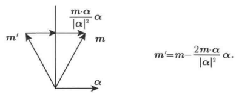

**定理 5.3（邓金定理）**  权 $\boldsymbol{M}$ 可以作为单纯李代数 $\mathcal{L}$ 的一个有限维不可约表示最高权的充要条件是，对单纯李代数的所有素根 $r_\mu$，权 $\boldsymbol{M}$ 满足

$$
\Gamma(\boldsymbol{M}/r_\mu) = \text{非负整数}.
\tag{5.9}
$$

如果 $\boldsymbol{M}$ 是一个不可约表示的最高权，则由最高权的定义 (5.7) 和定理 5.2，就得到式 (5.9). 反之，邓金证明了，若 $\boldsymbol{M}$ 满足式 (5.9)，则以它作为最高权（单权!），就可以得到单纯李代数的一个有限维不可约表示：用一系列降算符作用在最高权态上，得到的线性无关的状态基的数目一定是有限的，对应李代数的一个有限维不可约表示。这是计算单纯李代数不可约表示的基本方法，见 5.2 节。第 4 章习题第 11 题就给出计算 SU(2) 群不可约表示的一个例子。

满足式 (5.9) 的权 $\boldsymbol{M}$ 称为主权（dominant weight）。单纯李代数任一不可约表示的最高权一定是主权，但在一个给定的不可约表示中可能有若干个权是主权，它们在这个不可约表示中不一定是最高权，也不一定是单权，但每个主权都可以是某一个不可约表示的最高权。例如，在 SU(2) 群不可约表示中，等于非负整数的权都是主权。在李代数的一个不可约表示中，每个权都和一个主权等价。因此不可约表示的维数等于该表示所包含的各主权的重数及其外尔轨道长度的乘积之和。

### 5.1.3 最高权表示

对于给定的单纯李代数最高权 $\boldsymbol{M}$ 给出了该不可约表示的全部性质。下面只列出一些重要数学结果，仅供参阅。

单纯李代数 $\mathcal{L}$ 对应的紧致李群 G 中，存在由嘉当子代数产生的阿贝尔子李群 H，H 的元素 $R$ 可用 $\ell$ 个参数 $\boldsymbol{\varphi} \equiv (\varphi_1, \varphi_2, \cdots, \varphi_\ell)$ 来描写：

$$
R = \exp\left\{-\mathrm{i}\sum_{j=1}^{\ell}\varphi_j H_j\right\} \in \mathrm{H}.
\tag{5.10}
$$

群 G 中每一个元素都与 H 中某一个元素共轭，因而参数 $\boldsymbol{\varphi}$ 可以用来描写群 G 的类。在不可约表示 $M$ 中，类 $\boldsymbol{\varphi}$ 的特征标为

$$
\chi(M, \boldsymbol{\varphi}) = \mathrm{Tr}\,\exp\left\{-\mathrm{i}\sum_{j=1}^{\ell}\varphi_j D(H_j)\right\} = \sum_{m} b(m)\exp\left\{-\mathrm{i}\sum_{j=1}^{\ell}\varphi_j m_j\right\},
$$

其中，$b(m)$ 是权 $m$ 的重数，式中对 $m$ 的求和实质上就是对不可约表示所有状态求和。为了计算特征标，外尔引入环链（girdle）$\xi(\boldsymbol{K}, \boldsymbol{\varphi})$ 的概念。设 $S$ 是外尔群 $W$ 的任意元素，用反射宇称 $\delta_S$ 描写 $S$ 中包含外尔反射次数的偶奇性，偶数次反射 $\delta_S = 1$，否则为 $-1$. 环链 $\xi$ 定义为

$$
\xi(\boldsymbol{K}, \boldsymbol{\varphi}) = \sum_{S\in W}\delta_S\exp\left\{-\mathrm{i}\sum_{j=1}^{\ell}(SK)_j\varphi_j\right\},
\tag{5.11}
$$

其中，$\boldsymbol{K} = \boldsymbol{M} + \boldsymbol{\rho}$，$\boldsymbol{\rho}$ 是单纯李代数 $\mathcal{L}$ 中全部正根和的一半。类 $\boldsymbol{\varphi}$ 在表示 $M$ 中的特征标为

$$
\chi(M, \boldsymbol{\varphi}) = \frac{\xi(\boldsymbol{K}, \boldsymbol{\varphi})}{\xi(\boldsymbol{\rho}, \boldsymbol{\varphi})}.
\tag{5.12}
$$

$\xi(\boldsymbol{\rho}, \boldsymbol{\varphi})$ 与具体表示无关，它的模平方是紧致李群类上积分的密度函数。因此两不等价不可约表示的特征标正交归一性表为

$$
\int \xi(\boldsymbol{K}, \boldsymbol{\varphi})^*\xi(\boldsymbol{K}', \boldsymbol{\varphi})(\mathrm{d}\varphi) = \delta_{KK'}.
\tag{5.13}
$$

当 $\boldsymbol{\varphi}$ 趋于零时，$\chi(M, 0)$ 是不定式，它趋于不可约表示 $M$ 的维数 $d(M)$，计算得

$$
d(M) = \prod_{\alpha\in\Delta_+}\left\{1 + \frac{\boldsymbol{M}\cdot\boldsymbol{\alpha}}{\boldsymbol{\rho}\cdot\boldsymbol{\alpha}}\right\},
\tag{5.14}
$$

其中，$\Delta_+$ 是单纯李代数全部正根的集合。有了不可约表示的特征标和紧致李群类上积分的密度函数，原则上可以计算不可约表示直乘约化的克莱布希-戈登级数，但实际运算是很困难的，常用主权图方法计算（见 5.3 节）。

### 5.1.4 基本主权

在 $\ell$ 秩李代数 $\mathcal{L}$ 中，下述 $\ell$ 个主权 $\boldsymbol{w}_\mu$ 称为基本（fundamental）主权：

$$
\Gamma(\boldsymbol{w}_\mu/r_\nu) = d_\nu^{-1}\boldsymbol{w}_\mu\cdot r_\nu = \delta_{\mu\nu}, \quad d_\nu = r_\nu\cdot r_\nu/2.
\tag{5.15}
$$

根据定理 5.2 和定理 5.3，任何主权都可表为基本主权的非负整数线性组合，任何权都可表为基本主权的整数线性组合：

$$
\begin{aligned}
\boldsymbol{M} &= \sum_{\mu=1}^{\ell} M_\mu \boldsymbol{w}_\mu, \quad M_\mu = \Gamma(\boldsymbol{M}/r_\mu) = \text{非负整数},\\
\boldsymbol{m} &= \sum_{\mu=1}^{\ell} m_\mu \boldsymbol{w}_\mu, \quad m_\mu = \Gamma(\boldsymbol{m}/r_\mu) = \text{整数}.
\end{aligned}
\tag{5.16}
$$

邓金图是单纯李代数的几何描述，与邓金图等价的嘉当矩阵 $A_{\nu\mu}$ 是单纯李代数的代数描述：

$$
A_{\nu\mu} = \Gamma(r_\mu/r_\nu) = \frac{2r_\nu\cdot r_\mu}{r_\nu\cdot r_\nu} = d_\nu^{-1}(r_\nu\cdot r_\mu).
\tag{5.17}
$$

对于给定的单纯李代数，当确定了素根的编号后，由邓金图很容易写出嘉当矩阵，反之亦然。嘉当矩阵的对角元是 2. 当素根 $r_\mu$ 和 $r_\nu$ 正交时，在邓金图中它们不相连接，则 $A_{\mu\nu} = 0$. 当素根 $r_\mu$ 和 $r_\nu$ 不正交时，在邓金图中它们用单线、双线或三线相连接，设素根 $r_\mu$ 长度小于或等于素根 $r_\nu$ 的长度，则 $A_{\nu\mu} = -1$，而按照连线数目，$A_{\mu\nu}$ 分别等于 $-1$，$-2$ 或 $-3$.

素根可以按基本主权展开，展开系数正是嘉当矩阵元：

$$
r_\mu = \sum_{\nu=1}^{\ell} w_\nu A_{\nu\mu}, \quad w_\nu = \sum_{\mu=1}^{\ell} r_\mu (A^{-1})_{\mu\nu}.
\tag{5.18}
$$

正是因为在基本主权为基的表象里，素根的分量都是整数，才保证权分量也都是整数，而且等价权的关系式变得更简单：经过关于素根 $r_\mu$ 的外尔反射后，权 $\boldsymbol{m}$ 变成等价权 $\boldsymbol{m}'$,

$$
\boldsymbol{m}' \xrightarrow{r_\mu} \boldsymbol{m} - m_\mu r_\mu.
\tag{5.19}
$$

采用基本主权为基的优点是所有权和根的分量都是整数，缺点是这样基不一定正交归一。但采用了嘉当矩阵 $A_{\nu\mu}$ 和符号 $d_\nu = (r_\nu\cdot r_\nu)/2$，可简化素根和基本主权的内积表达式：

$$
(r_\nu\cdot r_\mu) = d_\nu A_{\nu\mu}, \quad (r_\nu\cdot \boldsymbol{w}_\mu) = d_\nu\delta_{\nu\mu}, \quad (\boldsymbol{w}_\nu\cdot \boldsymbol{w}_\mu) = d_\nu (A^{-1})_{\nu\mu}.
\tag{5.20}
$$

文献中常把 $d_\nu A_{\nu\mu}$ 称为**对称化嘉当矩阵**. **今后如无特别说明，在权空间和根空间都采用基本主权为基**，仅在讨论平面权图时才采用原来的正交基。以基本主权作为最高权的不可约表示称为基本（basic）表示。

### 5.1.5 卡西米尔不变量和伴随表示

在单纯李代数 $\mathcal{L}$ 的紧致实形里，选择群参数，使结构常数关于三个指标完全反对称，则生成元的平方和就可与任一生成元对易（第 4 章习题第 17 题）。这样的生成元平方和称为单纯李代数的二阶卡西米尔（Casimir）算子，记为 $C_2$. 按舒尔定理，它在不可约表示 $M$ 中为常数矩阵，此常数称为二阶卡西米尔不变量，记为 $C_2(M)$. 采用生成元的嘉当-外尔基，

$$
C_2 = \sum_A I_A I_A = \sum_{j=1}^{\ell} H_j H_j + \sum_{\alpha\in\Delta_+}\{E_\alpha E_{-\alpha} + E_{-\alpha}E_\alpha\}.
\tag{5.21}
$$

把 $C_2$ 作用在最高权态 $|\boldsymbol{M}\rangle$ 上，根据式 (5.2)、式 (5.7) 和式 (4.120)，有

$$
\begin{aligned}
C_2 |\boldsymbol{M}\rangle &= M^2|\boldsymbol{M}\rangle + \sum_{\alpha\in\Delta_+}[E_\alpha, E_{-\alpha}]\,|\boldsymbol{M}\rangle\\
&= \left\{M^2 + \boldsymbol{M}\cdot\sum_{\alpha\in\Delta_+}\boldsymbol{\alpha}\right\}|\boldsymbol{M}\rangle.
\end{aligned}
$$

下面将证明单纯李代数 $\mathcal{L}$ 所有正根之和 $2\boldsymbol{\rho}$ 等于基本主权之和的两倍，

$$
2\boldsymbol{\rho} = \sum_{\alpha\in\Delta_+}\boldsymbol{\alpha} = 2\sum_{\mu=1}^{\ell}\boldsymbol{w}_\mu.
\tag{5.22}
$$

因此，二阶卡西米尔不变量 $C_2(M)$ 可表为

$$
C_2(M) = \boldsymbol{M}\cdot(\boldsymbol{M} + 2\boldsymbol{\rho}) = \sum_{\mu,\nu=1}^{\ell} M_\mu d_\mu (A^{-1})_{\mu\nu}(M_\nu + 2).
\tag{5.23}
$$

要证明式 (5.22)，就是要检验正根之和 $2\boldsymbol{\rho}$ 与每个素根 $r_\mu$ 的点乘是否都等于 $2d_\mu$. 把所有正根都按关于素根 $r_\mu$ 的根链分组：

$$
(\boldsymbol{\alpha} - q r_\mu), \cdots, (\boldsymbol{\alpha} - r_\mu), \ \boldsymbol{\alpha}, \ (\boldsymbol{\alpha} + r_\mu), \cdots, (\boldsymbol{\alpha} + p r_\mu).
$$

根链中根矢量之和为

$$
(p+q+1)\boldsymbol{\alpha} + \frac{1}{2}[p(p+1) - q(q+1)]r_\mu = (p+q+1)\left[\boldsymbol{\alpha} + \frac{1}{2}(p-q)r_\mu\right].
$$

当 $\boldsymbol{\alpha} = r_\mu$ 时，$p = q = 0$，$r_\mu$ 平方等于 $2d_\mu$. 其他情况，由于定理 5.2，此式与 $r_\mu$ 的点乘为零。证完。

设 $D^M(I_A)$ 是不可约表示 $M$ 的生成元，构造 $g$ 维矩阵 $T(M)$，$T_{AB}(M) = \mathrm{Tr}\,[D^M(I_A)D^M(I_B)]$. 习题 4 第 18 题证明了 $T(M)$ 与伴随表示每一个生成元$D^{\mathrm{ad}}(I_D)$ 对易。对单纯李群，伴随表示是不可约表示，因而 $T(M)$ 是常数矩阵，常数记为 $T_2(M)$，$T_{AB}(M) = \delta_{AB}T_2(M)$. 因为

$$
g\,T_2(M) = \sum_A T_{AA}(M) = \mathrm{Tr}\left\{\sum_A D^M(I_A)D^M(I_A)\right\} = d(M)C_2(M),
$$

对伴随表示，最高权 $\boldsymbol{M}$ 就是最大根 $\boldsymbol{\omega}$，$d(\boldsymbol{\omega}) = g$，由式 (5.23) 就可以计算李代数的基林型：

$$
g_{AB} = -\mathrm{Tr}\left[D^{\mathrm{ad}}(I_A)D^{\mathrm{ad}}(I_B)\right] = -\delta_{AB}T_2(\boldsymbol{\omega}) = -\delta_{AB}C_2(\boldsymbol{\omega}).
\tag{5.24}
$$

### 5.1.6 谢瓦莱基

在李代数 $\mathcal{L}$ 的嘉当-外尔基中，$E_{\alpha+\beta}$ 可表为 $E_\alpha$ 和 $E_\beta$ 的对易关系。因此在计算生成元的表示矩阵时，只需计算与素根相联系的生成元的表示矩阵，由它们的对易关系可以得到其他所有生成元的表示矩阵。为使形式更加对称，谢瓦莱（Chevalley）引入 $3\ell$ 个新基 $E_\mu$，$F_\mu$ 和 $H_\mu$，称为谢瓦莱基：

$$
\begin{aligned}
E_\mu &= d_\mu^{-1/2}E_{r_\mu}, \quad F_\mu = d_\mu^{-1/2}E_{-r_\mu},\\
H_\mu &= d_\mu^{-1}\sum_{j=1}^{\ell}(r_\mu)_j H_j \equiv d_\mu^{-1}r_\mu\cdot\boldsymbol{H}.
\end{aligned}
\tag{5.25}
$$

由正则对易关系式 (4.120) 推得谢瓦莱基满足的对易关系是

$$
\begin{aligned}
\left[H_\nu, H_\mu\right] &= 0, & \left[H_\nu, E_\mu\right] &= A_{\nu\mu}E_\mu,\\
\left[H_\nu, F_\mu\right] &= -A_{\nu\mu}F_\mu, & \left[E_\nu, F_\mu\right] &= \delta_{\nu\mu}H_\mu,
\end{aligned}
\tag{5.26}
$$

其中，$A_{\nu\mu} = (r_\mu)_\nu$ 是嘉当矩阵。因为 $A_{\mu\mu} = 2$，三个有相同下标 $\mu$ 的生成元，正好满足 $\mathrm{A}_1$ 子李代数（对应李群 SU(2)）生成元的对易关系。取 SU(2) 群生成元为 $E = I_+ = I_1 + \mathrm{i}I_2$，$F = I_- = I_1 - \mathrm{i}I_2$ 和 $H = 2I_3$,

$$
\begin{aligned}
\left[H, E\right] &= 2E, & \left[H, F\right] &= -2F, & \left[E, F\right] &= H,\\
\left[H_\mu, E_\mu\right] &= 2E_\mu, & \left[H_\mu, F_\mu\right] &= -2F_\mu, & \left[E_\mu, F_\mu\right] &= H_\mu.
\end{aligned}
\tag{5.27}
$$

因此，有相同下标 $\mu$ 的三个生成元 $H_\mu$，$E_\mu$ 和 $F_\mu$ 构成李代数 $\mathcal{L}$ 的一个 $\mathrm{A}_1$ 子李代数，记为 $\mathcal{A}_\mu$. 在李代数不可约表示的表示空间里，属于子李代数 $\mathcal{A}_\mu$ 的不可约表示的状态集合，架设一个 $\mathcal{A}_\mu$ 多重态。因为表示空间存在重权，这些 $\mathcal{A}_\mu$ 多重态就会以复杂的方式纠缠在一起。计算单纯李代数 $\mathcal{L}$ 的不可约表示，就是要以适当的方式规定表示空间重权对应的正交归一的状态基，理清这些 $\mathcal{A}_\mu$ 多重态中的每一个状态是这些正交归一状态基的怎样的线性组合。

## 5.2 盖尔范德方法及其推广

本节介绍如何选定单纯李代数 $\mathcal{L}$ 最高权表示的正交归一状态基和计算生成元谢瓦莱基在这组状态基中的表示矩阵。

### 5.2.1 方块权图方法

单纯李代数 $\mathcal{L}$ 生成元谢瓦莱基满足对易关系 (5.26)，其中，有相同下标 $\mu$ 的三个生成元 $H_\mu$，$E_\mu$ 和 $F_\mu$ 架设 $A_1$ 子李代数，记为 $\mathcal{A}_\mu$. 对李代数 $\mathcal{L}$ 的幺正最高权表示 $M$，选取正交归一的状态基，它们都是 $H_\mu$ 的共同本征状态，记为 $|m\rangle$. 因此 $H_\mu$ 的表示矩阵是对角化的，$E_\mu$ 和 $F_\mu$ 的表示矩阵互为转置。由式 (5.6) 知，降算符 $F_\mu$ 对状态基的作用，使权 $m$ 减少一个素根 $r_\mu$，升算符 $E_\mu$ 的作用则增加一个素根：

$$
H_\mu |m\rangle = m_\mu |m\rangle, \quad F_\mu |m\rangle \propto |m - r_\mu\rangle. \tag{5.28}
$$

在基本主权 $w_\nu$ 为基的表象里，权 $m$ 和素根 $r_\mu$ 的分量都是整数。正如式 (5.18) 所指出的，当在邓金图中素根 $r_\mu$ 和 $r_\nu$ 有线相连接时，若素根 $r_\mu$ 长度小于或等于素根 $r_\nu$ 的长度，则在素根 $r_\mu$ 的展开式中除包含 $2w_\mu$ 外，还包含 $-w_\nu$ 的项，若素根 $r_\mu$ 长度平方等于素根 $r_\nu$ 长度平方的两倍或三倍，则 $-w_\nu$ 变成 $-2w_\nu$ 或 $-3w_\nu$. 当在邓金图中素根 $r_\mu$ 和 $r_\nu$ 不相连接时，则在素根 $r_\mu$ 展开式中不包含 $w_\nu$ 的项。

子李代数 $\mathcal{A}_\mu$ 对应 SU(2) 群，它的生成元在不可约表示中的矩阵形式已由式 (4.73) 给出。这不可约表示的状态基集合称为 $\mathcal{A}_\mu$ 多重态。在李代数 $\mathcal{L}$ 不可约表示的表示空间中，对每一个满足下式的状态基 $|m\rangle$：

$$
m_\mu > 0, \quad E_\mu |m\rangle = 0, \tag{5.29}
$$

都存在一个包括 $(m_\mu + 1)$ 个状态基的 $\mathcal{A}_\mu$ 多重态 $|m - nr_\mu\rangle$：

$$
\begin{aligned}
& |m - nr_\mu\rangle, \quad 0 \leqslant n \leqslant m_\mu, \quad (F_\mu)^{m_\mu+1} |m\rangle = 0, \\
& F_\mu |m - nr_\mu\rangle = \sqrt{(m_\mu - n)(n+1)} \, |m - (n+1)r_\mu\rangle.
\end{aligned}
\tag{5.30}
$$

如果式 (5.30) 中给出的权 $m - nr_\mu$ 都是单权，这些状态基就可选为表示空间的正交归一的状态基，式 (5.30) 已经给出降算符 $F_\mu$ 的相关矩阵元。一般来说，这些权中会出现重权，使得不同的 $\mathcal{A}_\mu$ 多重态以复杂的方式纠缠在一起。计算李代数 $\mathcal{L}$ 的最高权表示，就是要适当选定正交归一的状态基，并把每一组 $\mathcal{A}_\mu$ 多重态用这组正交归一的状态基表达出来。在式 (5.28) 的规定下，生成元的表示矩阵满足的关系式 (5.26) 就简化为

$$
E_\mu F_\nu = F_\nu E_\mu + \delta_{\mu\nu} H_\mu. \tag{5.31}
$$

式 (5.30) 也可以从式 (5.31) 推演出来。

在单纯李代数 $\mathcal{L}$ 的最高权表示中，任何权为 $m$ 的态都可由最高权态通过多次降算符的作用得到。作用的降算符次数加 1 称为该权及其状态基的级数 (level). 最高权态的级数为 1，权为 $m$ 状态基的级数 $L(M,m)$ 为

$$
M - m = \sum_{\mu=1}^{\ell} C_\mu r_\mu, \quad L(M,m) = 1 + \sum_{\mu=1}^{\ell} C_\mu. \tag{5.32}
$$

对每个 $\mathcal{A}_\mu$ 多重态，各状态基 $|m - nr_\mu\rangle$ 的级数，从 $|m\rangle$ 开始逐个增加。

从最高权态开始，逐个寻找满足条件 (5.29) 的状态基，构造对应的 $\mathcal{A}_\mu$ 多重态。在 $\mathcal{A}_\mu$ 多重态中，如果又有状态基满足条件 (5.29)，如 $m_\nu > 0$，且升算符 $E_\nu$ 作用在此状态基上得零，则由它又产生新的 $\mathcal{A}_\nu$ 多重态。最高权是单权，与最高权等价的权是单权，与最高权态同属一个 $\mathcal{A}_\mu$ 多重态的各状态基的权也是单权。由最高权态 $|M\rangle$ 出发，通过若干个 $\mathcal{A}_\mu$ 多重态到达某一个权为 $m$ 的状态基，称为权 $m$ 的一条路径。只有一条路径的权一定是单权，有 $n$ 条不同路径的权就可能是重权。可以先假定它是 $n$ 重权，然后用式 (5.31) 逐个计算生成元的表示矩阵元。如果有矩阵元为零，就表明该权的重数比预计的要低。

通过式 (5.19) 相联系的权是等价权，等价权的重数相同。互相等价的权中有且只有一个权是主权。显然主权的级数最低。用上面方法确定了主权的重数，也就确定了与主权等价的所有权的重数。

让每一个正交归一的状态基对应一个填以权分量的方块。权分量中如有负分量，用上面带一横线的数字标记。如单权 $m = -2w_1 + w_2$ 的状态基对应 $\boxed{\overline{2}, 1}$. 若是重权，如第二个状态基对应 $\boxed{(\overline{2},1)_2}$.

把对应每一个状态基的方块按级数排列，级数自上而下逐渐增加，每一行方块的状态基级数相同。最高权 $M$ 是单权，最高权态的方块排在第一行，第一行只有代表最高权态的一个方块。状态基的级数为 2 的方块排在第二行，状态基的级数为 3 的方块排在第三行，依此类推。这样构成的图称为方块权图。只有相邻行的方块，它们对应的状态基才可能只相差一个素根，才可能通过某一个降算符 $F_\mu$ 相联系，也可以说通过升算符 $E_\mu$ 相联系。在方块权图中由不同降算符相联系的方块用不同的线连接起来，旁边标以相应降算符的矩阵元。例如，由降算符 $F_1$ 相联系的方块用单线连接，由降算符 $F_2$ 相联系的方块用双线连接等。

按照定理 5.3，随着状态基的级数越来越大，最后会到达一个级数最大的状态基，对应权 $N$，任何降算符作用在此状态基 $|N\rangle$ 上都得零。权 $N$ 称为最低权。最低权一定是单权，而且所有分量一定都非正，但是所有分量都非正的权不一定是表示 $M$ 的最低权。最低权取负值就是另一个表示的最高权，这表示正是原表示的复共轭表示：$(D^M)^* \approx D^{-N}$，简写为 $M^* \approx -N$. 事实上，幺正表示矩阵按实参数展开，生成元是厄米矩阵，

$$
\begin{aligned}
D(R)^* &= \mathbf{1} - \mathrm{i}\sum_A \omega_A D(I_A)' = \mathbf{1} - \mathrm{i}\sum_A \omega_A \{-D(I_A)^*\}, \\
D(I_A)' &= -D(I_A)^* = -D(I_A)^T.
\end{aligned}
$$

生成元组合成谢瓦莱基，在复共轭表示中的表示矩阵为

$$
D(H_\mu)' = -D(H_\mu), \quad D(E_\mu)' = -D(F_\mu), \quad D(F_\mu)' = -D(E_\mu).
$$

取复共轭表示 $M^*$ 的状态基为

$$
|M^*, -m\rangle = (-1)^{L(M,m)} |M, m\rangle^*, \tag{5.33}
$$

则

$$
\begin{aligned}
D^{M^*}_{-m,-m}(H_\mu) &= -D^M_{m,m}(H_\mu), \\
D^{M^*}_{-m+r_\mu,-m}(E_\mu) &= D^M_{m-r_\mu,m}(F_\mu), \\
D^{M^*}_{-m-r_\mu,-m}(F_\mu) &= D^M_{m+r_\mu,m}(E_\mu).
\end{aligned}
\tag{5.34}
$$

可见互为复共轭的两表示，它们的方块权图互为倒置，对应的状态基的权互差负号。若最低权正好等于最高权的负值，$N = -M$，则此表示是自共轭表示。自共轭表示的方块权图上下对称，成纺锤形：每个级数的方块个数随级数增加而增加，达到最大值后再减少，上下对称。经验表明，不是自共轭表示的方块权图也呈纺锤形，但方块及其连线上下不完全对称。

### 5.2.2 盖尔范德基

根据 5.2.1 节的讨论，单纯李代数 $\mathcal{L}$ 最高权表示的计算问题已经十分清晰，就是要寻找满足式 (5.29) 的状态基，按条件 (5.30) 构造 $\mathcal{A}_\mu$ 多重态。难点就在于如何从互相纠缠在一起的多重态中选定对应重权的正交归一状态基。选定了状态基，就可根据式 (5.31) 计算生成元的表示矩阵。

对 SU($N$) 群，即 $A_{N-1}$ 李代数，盖尔范德选定了最高权表示 $M$ 的正交归一状态基 (Gel'fand et al, 1963)，文献中常称为盖尔范德基。盖尔范德基用 $N(N+1)/2$ 个参数 $\omega_{ab}$ 描写，$1 \leqslant a \leqslant b \leqslant N$. 参数 $\omega_{ab}$ 满足条件：

$$
\omega_{ab} \geqslant \omega_{a(b-1)} \geqslant \omega_{(a+1)b}, \tag{5.35}
$$

并排列成一个倒置的三角形：

$$
|\omega_{ab}\rangle = \left| \begin{matrix}
\omega_{1N} & \omega_{2N} & \cdots & \omega_{(N-1)N} & \omega_{NN} \\
 & \omega_{1(N-1)} & \cdots & \omega_{(N-1)(N-1)} & \\
 & & \ddots & & \\
 & & \omega_{12} & \omega_{22} & \\
 & & \omega_{11} & & \\
\end{matrix} \right\rangle . \tag{5.36}
$$

最高权 $M$ 的分量 $M_\mu$ 和权 $m$ 的分量 $m_\mu$ 由下面公式计算：

$$
\begin{aligned}
&M_\mu = \omega_{\mu N} - \omega_{(\mu+1)N}, \quad m_\mu = 2\Omega_\mu - \Omega_{\mu+1} - \Omega_{\mu-1}, \\
&\Omega_0 = 0, \quad \Omega_b = \sum_{a=1}^{b} \omega_{ab}, \quad 1 \leqslant b \leqslant N, \quad 1 \leqslant \mu \leqslant N-1.
\end{aligned}
\tag{5.37}
$$

既然权 $m$ 只与各行参数之和 $\Omega_b$ 有关，在满足条件 (5.35) 和保持所有 $\Omega_b$ 不变的条件下，参数 $\omega_{ab}$ 可能的不同取值就给出了权 $m$ 的重数。升算符 $E_\mu$ 对盖尔范德基的作用得到若干盖尔范德基的线性组合，每一个盖尔范德基分别把原盖尔范德基 $\mu$ 行的一个参数 $\omega_{a\mu}$，在满足式 (5.35) 的条件下增加 1，此时权 $m$ 就增加素根 $r_\mu$. 降算符 $F_\mu$ 的作用正相反，使 $\mu$ 行的一个参数 $\omega_{a\mu}$ 减少 1. 降算符和升算符的表示矩阵互为转置。盖尔范德算出了升算符表示矩阵元的解析表达式：

$$
E_\mu |\omega_{ab}\rangle = \sum_{\nu=1}^{\mu} A_{\nu\mu}(\omega_{ab}) \, |\omega_{ab} + \delta_{a\nu}\delta_{b\mu}\rangle, \tag{5.38}
$$

$$
\begin{aligned}
A_{\nu\mu}(\omega_{ab}) ={}& \left\{ -\prod_{\tau=1}^{\mu-1} \left( \omega_{\tau(\mu-1)} - \omega_{\nu\mu} - \tau + \nu - 1 \right) \right\}^{1/2} \\
&\times \left\{ \frac{\displaystyle\prod_{\rho=1}^{\mu+1} \left( \omega_{\rho(\mu+1)} - \omega_{\nu\mu} - \rho + \nu \right)}{\displaystyle\prod_{\substack{\lambda \neq \nu \\ \lambda=1}}^{\mu} \left( \omega_{\lambda\mu} - \omega_{\nu\mu} - \lambda + \nu \right)\left( \omega_{\lambda\mu} - \omega_{\nu\mu} - \lambda + \nu - 1 \right)} \right\}^{1/2}.
\end{aligned}
$$

当参数 $\omega_{ab}$ 满足

$$
\omega_{a(b-1)} = \omega_{ab}, \quad 1 \leqslant a < b \leqslant N \tag{5.39}
$$

时，按照条件 (5.35)，所有参数都不能再升，即此状态基在任何升算符作用下都得零，因此它描写最高权态。同理，参数满足 $\omega_{(a+1)b} = \omega_{a(b-1)}$ 的态是最低权态，最低权 $N$ 的分量为 $N_\mu = \omega_{(N-\mu+1)N} - \omega_{(N-\mu)N} = -M_{N-\mu}$.

下面对盖尔范德方法做一些评注。

第一，盖尔范德并没有公布式 (5.38) 的证明过程，即没有明显证明式 (5.38) 满足条件 (5.31). 盖尔范德方法的重点在于：他选定了 SU($N$) 群最高权表示 $M$ 正交归一的状态基，并提供了各重权的重数。就生成元表示矩阵元的解析表达式 (5.38) 而言，固然可以按它编写程序进行计算，但物理上常用的 SU($N$) 群最高权表示维数并不高，通过式 (5.31) 也可以直接计算。

第二，SU($N$) 群的元素 $u$ 是 $N$ 维复空间的一个幺正变换。如果限制在前 $n$ 维子空间做幺正变换，就得到子群 SU($n$). 这些子群构成 SU($N$) 群的一个子群链，相应地，也存在一个子李代数链。这些子李代数当然不是理想。

$$
\begin{aligned}
&\mathrm{SU}(N) \supset \mathrm{SU}(N-1) \supset \cdots \supset \mathrm{SU}(3) \supset \mathrm{SU}(2), \\
&A_\ell \supset A_{\ell-1} \supset \cdots \supset A_2 \supset A_1, \quad \ell = N - 1.
\end{aligned}
\tag{5.40}
$$

从 $A_\ell$ 李代数的邓金图中逐个切掉最后一个素根，正好就是子李代数链中各子李代数的邓金图。子李代数链的最后一个子李代数 $A_1$ 就是我们符号中的 $\mathcal{A}_1$.

盖尔范德基的选择原则如下：SU($N$) 群最高权表示关于子群链 (5.40) 中每一个子群的分导表示都取已约形式，即分导表示取子群最高权表示的直和形式。所有 $n \leqslant b \leqslant N$ 的参数 $\omega_{ab}$ 都给定的那些盖尔范德基，架设子群 SU($n$) ($n \geqslant 2$) 的一个最高权表示空间，表示的最高权是 $M^{(n)}$：

$$
\left( M^{(n)} \right)_\mu = \omega_{\mu n} - \omega_{(\mu+1)n}, \quad 1 \leqslant \mu \leqslant n - 1. \tag{5.41}
$$

按此原则，每一个盖尔范德基都分属一个 $\mathcal{A}_1$ 多重态，多重态的最高权为 $M_1^{(2)} = \omega_{12} - \omega_{22}$，因此 $F_1$ 的表示矩阵元直接由式 (5.30) 给出。既然 $F_\mu$ 作用得到的状态基只涉及 $\mu$ 行有一个参数 $\omega_{a\mu}$ 减少 1，当 $\mu > 1$ 时，这些状态基分属子群链 (5.40) 中子群 SU($\mu$) 的不等价最高权表示，而属于所有其他子群 SU($n$)，$n \neq \mu$ 的同一个最高权表示。

第三，盖尔范德方法本质上就是子李代数链递推的方法。把 $A_{\ell-1}$ 最高权表示的状态基集合称为 $A_{\ell-1}$ 多重态，由于盖尔范德基的选择原则和 $A_\ell \supset A_{\ell-1} \oplus A_\ell$，$A_\ell$ 最高权表示空间中完整地包含着若干个 $A_{\ell-1}$ 多重态，而在 $F_\ell$ 的作用下，把属不同 $A_{\ell-1}$ 多重态的盖尔范德基联系起来，构成 $A_\ell$ 多重态。如果已经掌握了由 $A_{\ell-1}$ 多重态的最高权态计算此多重态的状态基和生成元表示矩阵元的方法，则 $A_\ell$ 最高权表示的计算就归结为 $A_\ell$ 多重态的计算，后者由式 (5.29) 至式 (5.31) 给出。这就是所谓“子李代数链递推方法”：由 $\mathcal{A}_1$ 多重态计算 $\mathcal{A}_2$ 最高权表示，再由 $\mathcal{A}_2$ 多重态计算 $\mathcal{A}_3$ 最高权表示，依此类推。

$\mathcal{A}_\ell$ 最高权态同时是 $\mathcal{A}_{\ell-1}$ 多重态的最高权态和 $\mathcal{A}_\ell$ 多重态的最高权态，这里的多重态包括单态。随着盖尔范德基级数的增加，从 $\mathcal{A}_\ell$ 最高权态开始计算各盖尔范德基。如有盖尔范德基满足条件

$$
\omega_{a(b-1)} = \omega_{ab}, \quad 1 \leqslant a < b \leqslant \ell, \tag{5.42}
$$

它就是 $\mathcal{A}_{\ell-1}$ 多重态的最高权态，按照盖尔范德方法计算此多重态的状态基和生成元表示矩阵元。显然在 $\mathcal{A}_{\ell-1}$ 多重态中，最高权级数最小，在计算中最先出现。在$A_{\ell-1}$ 多重态中寻找有正 $m_\ell$ 分量的盖尔范德基，如它在 $E_\ell$ 作用下为零，它就是 $\mathcal{A}_\ell$ 多重态的最高权态（见式 (5.29)）。用降算符 $F_\ell$ 作用在 $\mathcal{A}_\ell$ 多重态的每一个盖尔范德基上，得到若干个盖尔范德基的线性组合，如果得到的盖尔范德基不满足 $A_{\ell-1}$ 多重态的最高权态条件 (5.42)，则它一定属于前面已经计算过的 $A_{\ell-1}$ 多重态。盖尔范德基的组合系数由式 (5.31) 计算。

第四，如果 $A_{\ell-1}$ 多重态事先已经计算好，$A_\ell$ 最高权表示的计算就归结到 $\mathcal{A}_\ell$ 多重态的计算。 $A_{\ell-1}$ 多重态中完整地包含着若干个 $A_{\ell-2}$ 多重态，而 $F_\ell$ 和子李代数 $\mathcal{A}_{\ell-2}$ 的所有生成元都对易，$F_\ell$ 的作用不影响 $A_{\ell-2}$ 多重态。 $A_{\ell-2}$ 多重态中的状态基有相同的 $m_\ell$ 分量，它们在 $F_\ell$ 作用下的规则完全相同。这就称为平行法则。式 (5.38) 中给出的系数 $A_{\nu\ell}$ 只与满足 $b = \ell$，$\ell \pm 1$ 的 $\omega_{ab}$ 有关，就是平行法则的证明。在 $A_{\ell-1}$ 多重态中只要找 $A_{\ell-2}$ 多重态的最高权态，判断它们是不是 $\mathcal{A}_\ell$ 多重态的最高权态，并计算 $F_\ell$ 作用的展开式，在 $A_{\ell-2}$ 多重态中的其他盖尔范德基的展开式是一样的。平行法则可以减少 $\mathcal{A}_\ell$ 多重态的计算工作量。

最后，盖尔范德方法涉及的所有公式都只与参数 $\omega_{ab}$ 之差有关，把盖尔范德基中所有参数 $\omega_{ab}$ 同时增加（或减少）一个整数，仍描写 SU($N$) 群同一个不可约表示的同一个状态基。对 SU($N$) 群，常取 $\omega_{NN} = 0$. 但在推广盖尔范德方法时，$\omega_{NN}$ 会取其他整数。

### 5.2.3 A_2 李代数的最高权表示

按照盖尔范德方法，为了计算李代数 $A_\ell$ 的最高权表示，最好首先把 $A_{\ell-1}$ 多重态计算清楚，并列举出来。每一个盖尔范德基都分属一个 $\mathcal{A}_1$ 多重态，而式 (5.30) 已经给出了 $F_1$ 的表示矩阵元。作为“方块权图方法”和“子李代数链递推方法”的例子，本小节计算和列举各 $\mathcal{A}_2$ 多重态的状态基和生成元表示矩阵元。 $\mathcal{A}_2$ 李代数对应 SU(3) 群，在物理中有广泛的应用。 $\mathcal{A}_2$ 李代数最高权表示 $M$ 的盖尔范德基表为

$$
|\omega_{ab}\rangle = \left| \begin{matrix}
\omega_{13} & \omega_{23} & \omega_{33} \\
 & \omega_{12} & \omega_{22} \\
 & & \omega_{11}
\end{matrix} \right\rangle_{m_2}^{L}, \quad
\begin{aligned}
M_1 &= \omega_{13} - \omega_{23}, \\
M_2 &= \omega_{23} - \omega_{33}.
\end{aligned}
\tag{5.43}
$$

这里加了两个指标。右上角的指标 $L$ 是状态基的级数（见式 (5.32)），在任何降算符 $F_\mu$ 的作用下级数 $L$ 都增加 1. 有了这指标便于和方块权图比较。右下角标出权分量 $m_2$，负分量用上带横线的数字标记：$\overline{n} = -n$. 降算符 $F_1$ 的作用使 $m_2$ 增加 1，降算符 $F_2$ 的作用使 $m_2$ 减少 2. 对 $\mathcal{A}_2$ 李代数来说，这指标显然是重复的，但它有助于判断是否有新的 $\mathcal{A}_2$ 多重态出现。式 (5.43) 中参数满足 $\omega_{12} = \omega_{11}$ 的状态基是 $\mathcal{A}_1$ 多重态的最高权态，最高权为 $\omega_{12} - \omega_{22}$，降算符 $F_1$ 的矩阵元直接由式 (5.30) 给出。参数 $m_2 > 0$ 的状态基，如果不属于已经计算过的 $\mathcal{A}_2$ 多重态（见条件 (5.29)），则它是新 $\mathcal{A}_2$ 多重态的最高权态，$F_2$ 矩阵元由式 (5.31) 计算。 1) 基本表示的状态基和生成元非零矩阵元。

基本表示 $M = (1,0)$ 最高权态是 $\mathcal{A}_1$ 二重态的最高权态：

$$
F_1 \, |(1,0)\rangle = |(\overline{1},1)\rangle, \quad
F_1 \left| \begin{matrix} 1 & 0 & 0 \\ & 1 & 0 \\ & & 1 \end{matrix} \right\rangle_{\!0}^{1}
= \left| \begin{matrix} 1 & 0 & 0 \\ & 1 & 0 \\ & & 0 \end{matrix} \right\rangle_{\!1}^{2}.
$$

得到的状态基满足条件 (5.29)，是 $\mathcal{A}_2$ 二重态的最高权态：

$$
F_2 \, |(\overline{1},1)\rangle = |(0,\overline{1})\rangle, \quad
F_2 \left| \begin{matrix} 1 & 0 & 0 \\ & 1 & 0 \\ & & 0 \end{matrix} \right\rangle_{\!1}^{2}
= \left| \begin{matrix} 1 & 0 & 0 \\ & 0 & 0 \\ & & 0 \end{matrix} \right\rangle_{\!\overline{1}}^{3}.
$$

产生的状态基属 $\mathcal{A}_1$ 单态，它是表示 $(1,0)$ 的最低权态，最低权为 $(0,\overline{1})$. 最低权取负号后得复共轭表示的最高权 $(0,1)$. 基本表示 $(1,0)$ 和 $(0,1)$ 常用数字 3 和 $3^*$ 标记，方块权图如图 5.2 所示。

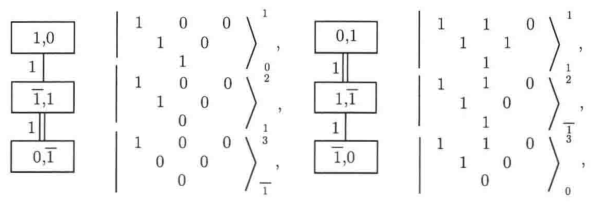

2) 伴随表示的状态基和生成元非零矩阵元。

伴随表示的最高权为 $M = (1,1)$，表示的最高权态同时是 $\mathcal{A}_1$ 二重态的最高权态和 $\mathcal{A}_2$ 二重态的最高权态：

$$
F_1 \, |(1,1)\rangle = |(\overline{1},2)\rangle, \quad
F_1 \left| \begin{matrix} 2 & 1 & 0 \\ & 2 & 1 \\ & & 2 \end{matrix} \right\rangle_{\!1}^{1}
= \left| \begin{matrix} 2 & 1 & 0 \\ & 2 & 1 \\ & & 1 \end{matrix} \right\rangle_{\!2}^{2},
$$

$$
F_2 \, |(1,1)\rangle = |(2,\overline{1})\rangle, \quad
F_2 \left| \begin{matrix} 2 & 1 & 0 \\ & 2 & 1 \\ & & 2 \end{matrix} \right\rangle_{\!1}^{1}
= \left| \begin{matrix} 2 & 1 & 0 \\ & 2 & 0 \\ & & 2 \end{matrix} \right\rangle_{\!\overline{1}}^{2}.
$$

权为 $(2,\overline{1})$ 的状态基是 $\mathcal{A}_1$ 三重态的最高权态：

$$
F_1 \, |(2,\overline{1})\rangle = \sqrt{2} \, |(0,0)_1\rangle, \quad
F_1 \left| \begin{matrix} 2 & 1 & 0 \\ & 2 & 0 \\ & & 2 \end{matrix} \right\rangle_{\!\overline{1}}^{2}
= \sqrt{2} \left| \begin{matrix} 2 & 1 & 0 \\ & 2 & 0 \\ & & 1 \end{matrix} \right\rangle_{\!0}^{3},
$$

$$
F_1 \, |(0,0)_1\rangle = \sqrt{2} \, |(\overline{2},1)\rangle, \quad
F_1 \left| \begin{matrix} 2 & 1 & 0 \\ & 2 & 0 \\ & & 1 \end{matrix} \right\rangle_{\!0}^{3}
= \sqrt{2} \left| \begin{matrix} 2 & 1 & 0 \\ & 2 & 0 \\ & & 0 \end{matrix} \right\rangle_{\!1}^{4}.
$$

权为 $(\overline{1},2)$ 的状态基满足条件 (5.29)，是 $\mathcal{A}_2$ 三重态的最高权态。 $F_2$ 作用在态 $|(\overline{1},2)\rangle$ 上得到两个状态基的组合，权都是 $(0,0)$，用下标区分，

$$
F_2 \, |(\overline{1},2)\rangle = a_1 \, |(0,0)_1\rangle + a_2 \, |(0,0)_2\rangle,
$$

$$
F_2 \left| \begin{matrix} 2 & 1 & 0 \\ & 2 & 1 \\ & & 1 \end{matrix} \right\rangle_{\!2}^{2}
= a_1 \left| \begin{matrix} 2 & 1 & 0 \\ & 2 & 1 \\ & & 0 \end{matrix} \right\rangle_{\!2}^{3}
+ a_2 \left| \begin{matrix} 2 & 1 & 0 \\ & 1 & 1 \\ & & 1 \end{matrix} \right\rangle_{\!0}^{3}.
$$

前者属已经计算过的 $\mathcal{A}_1$ 三重态，后者是新的 $\mathcal{A}_1$ 单态，选择它的相因子，使 $a_2$ 为正实数。由式 (5.31) 得

$$
\begin{aligned}
E_1 F_2 \, |(\overline{1},2)\rangle &= \sqrt{2} a_1 \, |(2,\overline{1})\rangle \\
&= F_2 E_1 \, |(\overline{1},2)\rangle = F_2 \, |(1,1)\rangle = |(2,\overline{1})\rangle, \\
E_2 F_2 \, |(\overline{1},2)\rangle &= (a_1^2 + a_2^2) \, |(\overline{1},2)\rangle \\
&= (F_2 E_2 + H_2) \, |(\overline{1},2)\rangle = 2 \, |(\overline{1},2)\rangle.
\end{aligned}
$$

计算得系数为 $a_1 = \sqrt{1/2}$，$a_2 = \sqrt{2 - 1/2} = \sqrt{3/2}$. 再用 $F_2$ 作用，就得到 $\mathcal{A}_2$ 三重态的第三个态，选择它的相因子使系数 $a_3$ 为正实数：

$$
F_2 \, |(0,0)_1\rangle = a_3 \, |(1,\overline{2})\rangle, \quad
F_2 \left| \begin{matrix} 2 & 1 & 0 \\ & 2 & 0 \\ & & 1 \end{matrix} \right\rangle_{\!0}^{3}
= a_3 \left| \begin{matrix} 2 & 1 & 0 \\ & 1 & 0 \\ & & 1 \end{matrix} \right\rangle_{\!\overline{2}}^{4},
$$

$$
F_2 \, |(0,0)_2\rangle = a_4 \, |(1,\overline{2})\rangle, \quad
F_2 \left| \begin{matrix} 2 & 1 & 0 \\ & 1 & 1 \\ & & 1 \end{matrix} \right\rangle_{\!0}^{3}
= a_4 \left| \begin{matrix} 2 & 1 & 0 \\ & 1 & 1 \\ & & 0 \end{matrix} \right\rangle_{\!\overline{2}}^{4}.
$$

系数由式 (5.31) 计算：

$$
\begin{aligned}
E_2 F_2 \, |(0,0)_1\rangle &= a_3^2 \, |(0,0)_1\rangle + a_3 a_4 \, |(0,0)_2\rangle \\
&= (F_2 E_2 + H_2) \, |(0,0)_1\rangle = \frac{1}{2} \, |(0,0)_1\rangle + \frac{\sqrt{3}}{2} \, |(0,0)_2\rangle.
\end{aligned}
$$

计算得 $a_3 = \sqrt{1/2}$，$a_4 = \sqrt{3/2}$. 类似这里三重态系数的计算经常会遇到，以后将略去计算过程，直接写出结果。

用公式 (5.38) 计算 $E_2$ 对状态基 $|1,\overline{2}\rangle$ 的作用，也与上式符合：

$$
E_2 \left| \begin{matrix} 2 & 1 & 0 \\ & 1 & 0 \\ & & 1 \end{matrix} \right\rangle
= A_{12} \left| \begin{matrix} 2 & 1 & 0 \\ & 2 & 0 \\ & & 1 \end{matrix} \right\rangle
+ A_{22} \left| \begin{matrix} 2 & 1 & 0 \\ & 1 & 1 \\ & & 1 \end{matrix} \right\rangle,
$$

$$
A_{12} = \left\{ \frac{-(-1)(1)(-1)(-3)}{(-2)(-3)} \right\}^{1/2} = \sqrt{1/2},
$$

$$
A_{22} = \left\{ \frac{-(1)(3)(1)(-1)}{(2)(1)} \right\}^{1/2} = \sqrt{3/2}.
$$

最后，状态基 $|(1,\bar{2})\rangle$ 和 $|(\bar{2},1)\rangle$ 分别是 $\mathrm{A}_1$ 二重态和 $\mathrm{A}_2$ 二重态的最高权态：

$$
F_1 |(1,\bar{2})\rangle = |(\bar{1},\bar{1})\rangle, \quad
F_1 \left. \begin{array}{ccc}
2 & 1 & 0 \\
 & 1 & 0 \\
 & & 1
\end{array} \right\rangle^{4}_{\bar{2}}
= \left. \begin{array}{ccc}
2 & 1 & 0 \\
 & 1 & 0 \\
 & & 0
\end{array} \right\rangle^{5}_{\bar{1}},
$$

$$
F_2 |(\bar{2},1)\rangle = |(\bar{1},\bar{1})\rangle, \quad
F_2 \left. \begin{array}{ccc}
2 & 1 & 0 \\
 & 2 & 0 \\
 & & 0
\end{array} \right\rangle^{4}_{1}
= \left. \begin{array}{ccc}
2 & 1 & 0 \\
 & 1 & 0 \\
 & & 0
\end{array} \right\rangle^{5}_{\bar{1}}.
$$

伴随表示 $M=(1,1)$ 共包含 8 个状态基，是自共轭表示，常用数字 8 标记。伴随表示的方块权图如图 5.3 所示。

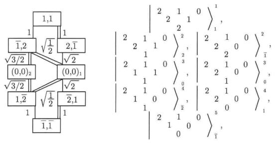

图 5.3　$\mathrm{A}_2$ 李代数伴随表示 $(1,1)$ 的方块权图和盖尔范德基

下面列出李代数 $\mathrm{A}_2$ 另外几个最高权表示的方块权图、生成元非零矩阵元和盖尔范德基，计算过程请读者自行补齐。

3) 表示 $(2,0)$ 和 $(0,2)$ 的状态基和生成元非零矩阵元。

表示 $(2,0)$ 和 $(0,2)$ 互为复共轭表示，各包含 6 个状态基，常用数字 6 和 $6^*$ 标记，方块权图和盖尔范德基如图 5.4 所示。

4) 表示 $(3,0)$ 和 $(0,3)$ 的状态基和生成元非零矩阵元。

表示 $(3,0)$ 和 $(0,3)$ 互为复共轭表示，各包含 10 个状态基，常用数字 10 和 $10^*$ 标记，方块权图和盖尔范德基如图 5.5 所示。

5) 表示 $(2,1)$ 和 $(1,2)$ 的状态基和生成元非零矩阵元。

表示 $(2,1)$ 和 $(1,2)$ 互为复共轭表示，各包含 15 个状态基，常用数字 15 和 $15^*$ 标记，方块权图和盖尔范德基如图 5.6 所示。 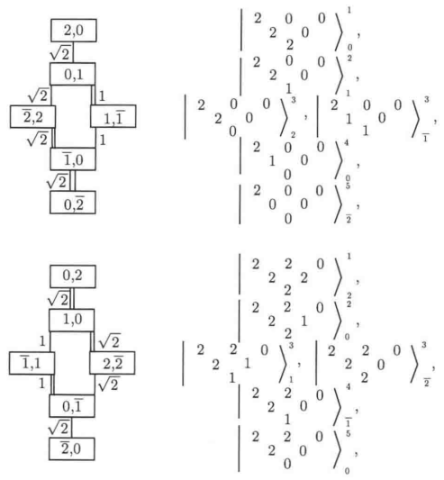

图 5.4 $\mathrm{A}_2$ 李代数表示 $(2,0)$ 和 $(0,2)$ 的方块权图和盖尔范德基

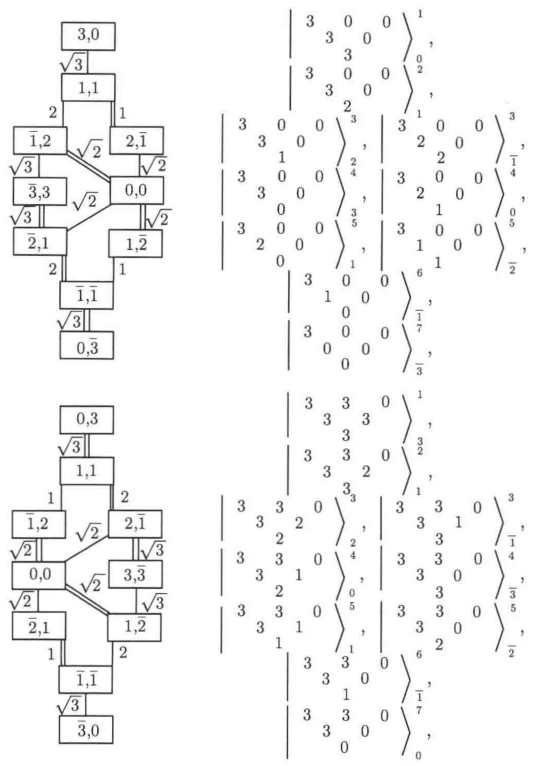

图 5.5 $\mathrm{A}_2$ 李代数表示 $(3,0)$ 和 $(0,3)$ 的方块权图和盖尔范德基

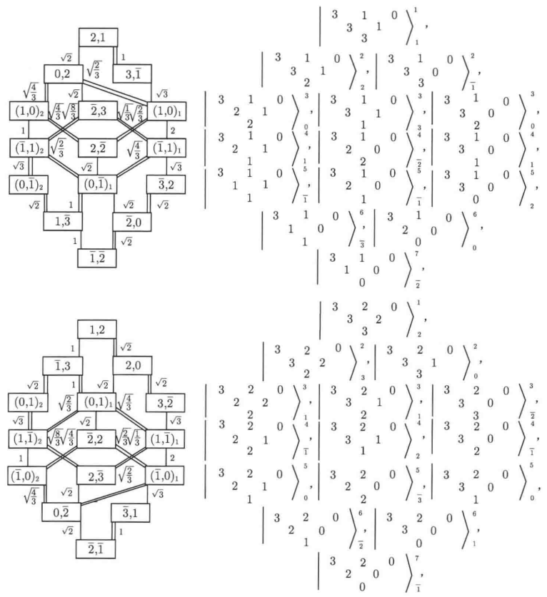

图 5.6 $\mathrm{A}_2$ 李代数表示 $(2,1)$ 和 $(1,2)$ 的方块权图和盖尔范德基

### 5.2.4 推广的盖尔范德方法

从单纯李代数的邓金图（图 4.5）看，除 $\mathrm{F}_4$ 李代数外，所有单纯李代数的邓金图切掉最后一个素根 $r_\ell$，都是 $\mathrm{A}_{\ell-1}$ 李代数的邓金图。因此和 $\mathrm{A}_\ell$ 李代数一样，李代数 $\mathcal{L}$ 的最高权表示空间也由若干个 $\mathrm{A}_{\ell-1}$ 多重态构成，$F_\ell$ 的作用把属不同 $\mathrm{A}_{\ell-1}$ 多重态的状态基联系起来，构成 $\mathrm{A}_\ell$ 多重态，生成元表示矩阵元由式 (5.31) 来计算，这就是推广的盖尔范德方法。当然由于素根 $r_\ell$ 和 $\mathrm{A}_{\ell-1}$ 李代数邓金图的衔接方法不同，对不同的李代数 $\mathcal{L}$，推广方法略有不同。下面就典型李代数来说明推广的盖尔范德方法。李代数 $\mathrm{F}_4$ 的邓金图要切掉两个素根才是 $\mathrm{A}_2$ 李代数的邓金图，推广会麻烦一些，但没有原则性困难。

选取表象，使李代数 $\mathcal{L}$ 的最高权表示 $M$，关于子李代数 $\mathrm{A}_{\ell-1}$ 的分导表示取已约形式，表示的正交归一基用子李代数 $\mathrm{A}_{\ell-1}$ 的盖尔范德基描写，

$$
|\omega_{ab}\rangle^{L}_{m_\ell} = \left| \begin{matrix}
\omega_{1\ell} & \omega_{2\ell} & \cdots & \omega_{(\ell-1)\ell} & \omega_{\ell\ell} \\
 & \omega_{1(\ell-1)} & \cdots & \omega_{(\ell-1)(\ell-1)} & \\
 & & \ddots & & \\
 & & \omega_{12} & \omega_{22} & \\
 & & \omega_{11} & &
\end{matrix} \right\rangle^{L}_{m_\ell} . \tag{5.44}
$$

它同时也是生成元 $H_\ell$ 的本征状态，本征值 $m_\ell$ 标于右下角。上标 $L$ 是状态基在李代数 $\mathcal{L}$ 最高权表示中的级数。这里参数 $\omega_{\ell\ell}$ 不一定为零。

$\mathcal{L}$ 最高权表示 $M$ 最高权态的盖尔范德基参数为

$$
\begin{aligned}
&\omega_{\ell\ell} = m_\ell = M_\ell, \quad \omega_{\mu\ell} = \omega_{(\mu+1)\ell} + M_\mu, \quad \omega_{a(b-1)} = \omega_{ab}, \\
&L = 1, \quad 1 \leqslant \mu \leqslant \ell-1, \quad 1 \leqslant a < b \leqslant \ell.
\end{aligned}
\tag{5.45}
$$

参数 $\omega_{ab}$ 满足条件 (5.42)，因而它是 $\mathrm{A}_{\ell-1}$ 多重态（包括单态）的最高权态，最高权 $M'$ 的分量为

$$
M'_\mu = \omega_{\mu\ell} - \omega_{(\mu+1)\ell}, \quad 1 \leqslant \mu \leqslant \ell-1. \tag{5.46}
$$

如果参数 $m_\ell > 0$，它也是 $\mathrm{A}_\ell$ 多重态的最高权态。由 $\mathrm{A}_{\ell-1}$ 多重态的最高权态，按照盖尔范德方法和公式 (5.38) 计算在多重态中的状态基和子李代数 $\mathrm{A}_{\ell-1}$ 生成元的表示矩阵。在计算中，**每一个降算符的作用都使级数 $L$ 增加 1**，而某个降算符作用会使下标 $m_\ell$ 增加：对 $\mathrm{B}_\ell$ 李代数，$F_{\ell-1}$ 作用使 $m_\ell$ 增加 2；对 $\mathrm{C}_\ell$ 李代数，$F_{\ell-1}$ 作用使 $m_\ell$ 增加 1；对 $\mathrm{D}_\ell$ 李代数，$F_{\ell-2}$ 作用使 $m_\ell$ 增加 1. 在计算 $\mathcal{L}$ 最高权表示 $M$ 时，最好事先把有关的 $\mathrm{A}_{\ell-1}$ 多重态都计算好，以类似 5.2.3 节的方式列举出来。上标 $L$ 和下标 $m_\ell$ 会有修改，但不难计算。

在 $\mathrm{A}_{\ell-1}$ 多重态中找 $m_\ell > 0$ 的盖尔范德基，如果它在 $E_\ell$ 作用下得零，它就是 $\mathrm{A}_\ell$ 多重态的最高权态（见式 (5.29)）。从最高权态开始计算属此 $\mathrm{A}_\ell$ 多重态中的盖尔范德基和 $F_\ell$ 表示矩阵元。 $F_\ell$ 作用在属此多重态的盖尔范德基上得到若干个盖尔范德基之和，其中每一个盖尔范德基与作用前的盖尔范德基相比：① $m_\ell$ 减少 2，$L$ 增加 1；② 对 $\mathrm{B}_\ell$ 李代数，$\Omega_\ell = \sum_a \omega_{a\ell}$ 减少 1，对 $\mathrm{C}_\ell$ 李代数，$\Omega_\ell$ 减少 2，对 $\mathrm{D}_\ell$ 李代数，$\Omega_\ell$ 减少 2，$\Omega_{\ell-1}$ 减少 1，其他 $\omega_{ab}$ 保持不变。这里的“$\Omega_\ell$ 减少 1”指的是有一个 $\omega_{a\ell}$ 减少 1，“$\Omega_\ell$ 减少 2”指的是有一个 $\omega_{a\ell}$ 减少 2 或有两个 $\omega_{a\ell}$ 各减少 1.

由 $\mathcal{L}$ 最高权态开始，随着状态基级数的增加，寻找 $\mathrm{A}_{\ell-1}$ 多重态的最高权态，并用盖尔范德方法计算多重态包含的所有盖尔范德基和子李代数 $\mathrm{A}_{\ell-1}$ 生成元的表示矩阵元。然后，在 $\mathrm{A}_{\ell-1}$ 多重态中找有正 $m_\ell$ 分量的盖尔范德基，只要它没有包括在前面计算过的 $\mathrm{A}_\ell$ 多重态中，就说明它在 $E_\ell$ 作用下得零，它就是新的 $\mathrm{A}_\ell$ 多重态的最高权态。要注意找互相相关的盖尔范德基。所谓互相相关的盖尔范德基，就是除第一行的参数 $\omega_{a\ell}$ 外，其他参数都相同的状态基，包括 $\omega_{ab}$、$L$ 和 $m_\ell$. 不同的 $\mathrm{A}_\ell$ 多重态中包含的互相相关的盖尔范德基，在 $F_\ell$ 作用下的展开系数也有关联，要放在一起计算。 $F_\ell$ 作用在 $\mathrm{A}_\ell$ 多重态的状态基上，得到的盖尔范德基，或者属于已经计算过的 $\mathrm{A}_{\ell-1}$ 多重态，或者是新的 $\mathrm{A}_{\ell-1}$ 多重态的最高权态。状态基展开式的系数就是 $F_\ell$ 的表示矩阵元，由式 (5.31) 计算。

按照平行法则，在每个 $\mathrm{A}_{\ell-1}$ 多重态中，对 $\mathrm{B}_\ell$ 或 $\mathrm{C}_\ell$ 李代数，只需要看 $\mathrm{A}_{\ell-2}$ 多重态的最高权态是不是有正 $m_\ell$ 分量，对 $\mathrm{D}_\ell$ 李代数，只需要看 $\mathrm{A}_{\ell-3}$ 多重态的最高权态是不是有正 $m_\ell$ 分量。如有正 $m_\ell$ 分量的最高权态，而且它不属于已经计算过的 $\mathrm{A}_\ell$ 多重态，它就是 $\mathrm{A}_\ell$ 多重态的最高权态。用 $F_\ell$ 作用，计算属此 $\mathrm{A}_\ell$ 多重态中的盖尔范德基和 $F_\ell$ 表示矩阵元，而 $\mathrm{A}_{\ell-2}$ 或 $\mathrm{A}_{\ell-3}$ 多重态中其他盖尔范德基，在 $F_\ell$ 作用下的展开式是相同的。

随着盖尔范德基级数的增加，交叉计算 $\mathrm{A}_{\ell-1}$ 多重态和 $\mathrm{A}_\ell$ 多重态，就得到 $\mathcal{L}$ 最高权表示 $M$ 的全部状态基和生成元的表示矩阵元。李代数 $\mathcal{L}$ 最高权表示空间中，盖尔范德基是否唯一地描写正交归一状态基？关键是在 $F_\ell$ 作用下得到的新 $\mathrm{A}_{\ell-1}$ 多重态的最高权态是不是唯一的。计算发现，**在 $\mathrm{B}_\ell$ 李代数的某些情况下，$F_\ell$ 作用得到的新 $\mathrm{A}_{\ell-1}$ 多重态的最高权态可能有两个线性无关的态**，使同一盖尔范德基描写两个正交归一的状态，需要另加指标加以区分。 5.2.6 节所举 $\mathrm{B}_3$ 李代数最高权表示的例子中就有这类 2 重态出现，在 5.5.2 节将解释它产生的原因。产生的 2 重态并没有使计算增加原则性的困难。

下面以 $\mathrm{C}_3$ 和 $\mathrm{B}_3$ 李代数为例，用推广的盖尔范德方法计算不可约表示的正交归一状态基和生成元表示矩阵。当表示维数较高时，计算会变得很繁，但计算原则很简单。希望读者能通过例子学会使用推广的盖尔范德方法。初学者可以先避开 $\mathrm{C}_3$ 李代数表示 $(1,1,0)$ 的例子。

### 5.2.5 C_3 李代数的最高权表示

$\mathrm{C}_3$ 李代数的邓金图和盖尔范德基如下。

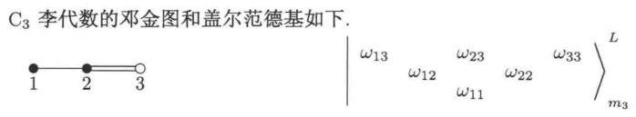

**所有降算符的作用都使 $L$ 增加 1，降算符 $F_2$ 的作用使 $m_3$ 增加 1，降算符 $F_3$ 的作用使 $m_3$ 减少 2 和 $\Omega_3 = \sum_a \omega_{a3}$ 减少 2**. 表示 $M$ 最高权态的参数由式 (5.45) 给出。由最高权态开始，随着盖尔范德基级数的增加，交叉计算 $\mathrm{A}_2$ 多重态和 $\mathrm{A}_3$ 多重态，就得到 $\mathrm{C}_3$ 李代数最高权表示 $M$ 的状态基和生成元表示矩阵元。 $\mathrm{C}_3$ 李代数表示的盖尔范德基还有一个特殊的性质：$\mathrm{A}_2$ 多重态的最高权态都满足 $\omega_{33} = m_3$. 本小节涉及的 $\mathrm{A}_2$ 多重态都已列举在 5.2.3 节中，指标 $L$ 和 $m_3$ 要作相应改变。

**例 1**　$\mathrm{C}_3$ 李代数基本表示 $(1,0,0)$.

最高权态也是 $\mathrm{A}_2$ 多重态的最高权态，对应表示 $(1,0)$，此 $\mathrm{A}_2$ 多重态包含 3 个状态基（图 5.2）：

$$
\left. \begin{array}{ccc}
1 & 0 & 0 \\
 & 1 & 0 \\
 & & 1
\end{array} \right\rangle^{1}_{0}, \quad
\left. \begin{array}{ccc}
1 & 0 & 0 \\
 & 1 & 0 \\
 & & 0
\end{array} \right\rangle^{2}_{0}, \quad
\left. \begin{array}{ccc}
1 & 0 & 0 \\
 & 0 & 0 \\
 & & 0
\end{array} \right\rangle^{3}_{1}.
$$

第 3 个状态基有 $m_3 = 1$，它是 $\mathrm{A}_3$ 2 重态的最高权态，

$$
F_3 \left. \begin{array}{ccc}
1 & 0 & 0 \\
 & 0 & 0 \\
 & & 0
\end{array} \right\rangle^{3}_{1}
= \left. \begin{array}{ccc}
0 & 0 & \bar{1} \\
 & 0 & 0 \\
 & & 0
\end{array} \right\rangle^{4}_{\bar{1}}.
$$

得到的状态基是 $\mathrm{A}_2$ 多重态的最高权态，对应表示 $(0,1)$. 此 $\mathrm{A}_2$ 多重态包含 3 个状态基（图 5.2）：

$$
\left. \begin{array}{ccc}
0 & 0 & \bar{1} \\
 & 0 & 0 \\
 & & 0
\end{array} \right\rangle^{4}_{\bar{1}}, \quad
\left. \begin{array}{ccc}
0 & 0 & \bar{1} \\
 & 0 & \bar{1} \\
 & & 0
\end{array} \right\rangle^{5}_{0}, \quad
\left. \begin{array}{ccc}
0 & 0 & \bar{1} \\
 & 0 & \bar{1} \\
 & & \bar{1}
\end{array} \right\rangle^{6}_{0}.
$$

最后一个状态基权为 $(\bar{1},0,0)$，它是 $\mathrm{C}_3$ 李代数表示 $(1,0,0)$ 的最低权态，说明此表示是自共轭表示。事实上，**$\mathrm{C}_\ell$ 李代数的所有最高权表示都是自共轭表示**. $\mathrm{C}_3$ 李代数基本表示 $(1,0,0)$ 包含 6 个状态基，组成 2 个 $\mathrm{A}_2$ 多重态，分别对应表示 $(1,0)$ 和 $(0,1)$.

**例 2**　$\mathrm{C}_3$ 李代数基本表示 $(0,1,0)$.

最高权态也是 $\mathrm{A}_2$ 多重态的最高权态，对应表示 $(0,1)$. 此 $\mathrm{A}_2$ 多重态包含 3 个状态基（图 5.2）：

$$
\left. \begin{array}{ccc}
1 & 1 & 0 \\
 & 1 & 1 \\
 & & 1
\end{array} \right\rangle^{1}_{0}, \quad
\left. \begin{array}{ccc}
1 & 1 & 0 \\
 & 1 & 0 \\
 & & 1
\end{array} \right\rangle^{2}_{1}, \quad
\left. \begin{array}{ccc}
1 & 1 & 0 \\
 & 1 & 0 \\
 & & 0
\end{array} \right\rangle^{3}_{1}.
$$

后两个状态基构成 $\mathrm{A}_1$ 2 重态，它们都是 $\mathrm{A}_3$ 2 重态的最高权态。 $F_3$ 作用在前一状态基上得

$$
F_3 \left. \begin{array}{ccc}
1 & 1 & 0 \\
 & 1 & 0 \\
 & & 1
\end{array} \right\rangle^{2}_{1}
= \left. \begin{array}{ccc}
1 & 0 & \bar{1} \\
 & 1 & 0 \\
 & & 1
\end{array} \right\rangle^{3}_{\bar{1}}.
$$

得到的状态基是 $\mathrm{A}_2$ 多重态的最高权态，对应表示 $(1,1)$. 此 $\mathrm{A}_2$ 多重态包含 8 个状态基（图 5.3）：

$$
\begin{gathered}
\left. \begin{array}{ccc} 1 & 0 & \bar{1} \\ & 1 & 0 \\ & & 1 \end{array} \right\rangle^{3}_{\bar{1}}, \quad
\left. \begin{array}{ccc} 1 & 0 & \bar{1} \\ & 1 & 0 \\ & & 0 \end{array} \right\rangle^{4}_{\bar{1}}, \quad
\left. \begin{array}{ccc} 1 & 0 & \bar{1} \\ & 1 & \bar{1} \\ & & 1 \end{array} \right\rangle^{4}_{0}, \quad
\left. \begin{array}{ccc} 1 & 0 & \bar{1} \\ & 1 & \bar{1} \\ & & 0 \end{array} \right\rangle^{5}_{0}, \\
\left. \begin{array}{ccc} 1 & 0 & \bar{1} \\ & 0 & 0 \\ & & 0 \end{array} \right\rangle^{5}_{0}, \quad
\left. \begin{array}{ccc} 1 & 0 & \bar{1} \\ & 1 & \bar{1} \\ & & \bar{1} \end{array} \right\rangle^{6}_{0}, \quad
\left. \begin{array}{ccc} 1 & 0 & \bar{1} \\ & 0 & \bar{1} \\ & & 0 \end{array} \right\rangle^{6}_{1}, \quad
\left. \begin{array}{ccc} 1 & 0 & \bar{1} \\ & 0 & \bar{1} \\ & & \bar{1} \end{array} \right\rangle^{7}_{1}.
\end{gathered}
$$

按照平行法则，有

$$
F_3 \left. \begin{array}{ccc}
1 & 1 & 0 \\
 & 1 & 0 \\
 & & 0
\end{array} \right\rangle^{3}_{1}
= \left. \begin{array}{ccc}
1 & 0 & \bar{1} \\
 & 1 & 0 \\
 & & 0
\end{array} \right\rangle^{4}_{\bar{1}}.
$$

对应表示 $(1,1)$ 的 $\mathrm{A}_2$ 8 重态最后 2 个状态基构成 $\mathrm{A}_1$ 2 重态，它们都是 $\mathrm{A}_3$ 2 重态的最高权态。 $F_3$ 作用在前一状态基上得

$$
F_3 \left. \begin{array}{ccc}
1 & 0 & \bar{1} \\
 & 0 & \bar{1} \\
 & & 0
\end{array} \right\rangle^{6}_{1}
= \left. \begin{array}{ccc}
0 & \bar{1} & \bar{1} \\
 & 0 & \bar{1} \\
 & & 0
\end{array} \right\rangle^{7}_{\bar{1}}.
$$

得到的状态基是 $\mathrm{A}_2$ 多重态的最高权态，对应表示 $(1,0)$. 此 $\mathrm{A}_2$ 多重态包含 3 个状态基（图 5.2）：

$$
\left. \begin{array}{ccc}
0 & \bar{1} & \bar{1} \\
 & 0 & \bar{1} \\
 & & 0
\end{array} \right\rangle^{7}_{\bar{1}}, \quad
\left. \begin{array}{ccc}
0 & \bar{1} & \bar{1} \\
 & 0 & \bar{1} \\
 & & \bar{1}
\end{array} \right\rangle^{8}_{\bar{1}}, \quad
\left. \begin{array}{ccc}
0 & \bar{1} & \bar{1} \\
 & \bar{1} & \bar{1} \\
 & & \bar{1}
\end{array} \right\rangle^{9}_{0}.
$$

按照平行法则，有

$$
F_3 \left. \begin{array}{ccc}
1 & 0 & \bar{1} \\
 & 0 & \bar{1} \\
 & & \bar{1}
\end{array} \right\rangle^{7}_{1}
= \left. \begin{array}{ccc}
0 & \bar{1} & \bar{1} \\
 & 0 & \bar{1} \\
 & & \bar{1}
\end{array} \right\rangle^{8}_{\bar{1}}.
$$

$\mathrm{C}_3$ 李代数基本表示 $(0,1,0)$ 包含 14 个状态基，组成 3 个 $\mathrm{A}_2$ 多重态，分别对应表示 $(0,1)$、$(1,1)$ 和 $(1,0)$.

**例 3**　$\mathrm{C}_3$ 李代数基本表示 $(0,0,1)$.

$\mathrm{C}_3$ 李代数基本表示 $(0,0,1)$ 包含 14 个状态基，组成 4 个 $\mathrm{A}_2$ 多重态，分别对应表示 $(0,0)$、$(0,2)$、$(2,0)$ 和 $(0,0)$，最高权态分别为

$$
\left. \begin{array}{ccc}
1 & 1 & 1 \\
 & 1 & 1 \\
 & & 1
\end{array} \right\rangle^{1}_{1}, \quad
\left. \begin{array}{ccc}
1 & 1 & \bar{1} \\
 & 1 & 1 \\
 & & 1
\end{array} \right\rangle^{2}_{\bar{1}}, \quad
\left. \begin{array}{ccc}
1 & \bar{1} & \bar{1} \\
 & 1 & \bar{1} \\
 & & 1
\end{array} \right\rangle^{5}_{\bar{1}}, \quad
\left. \begin{array}{ccc}
\bar{1} & \bar{1} & \bar{1} \\
 & \bar{1} & \bar{1} \\
 & & \bar{1}
\end{array} \right\rangle^{10}_{\bar{1}}.
$$

具体计算见习题第 5 题。

**例 4**　$\mathrm{C}_3$ 李代数最高权表示 $(1,1,0)$.

最高权态也是子李代数 $\mathrm{A}_2$ 多重态的最高权态，对应表示 $(1,1)$，此多重态包含 8 个状态基（图 5.3）：

$$
\begin{gathered}
\left. \begin{array}{ccc} 2 & 1 & 0 \\ & 2 & 1 \\ & & 2 \end{array} \right\rangle^{1}_{0}, \quad
\left. \begin{array}{ccc} 2 & 1 & 0 \\ & 2 & 1 \\ & & 1 \end{array} \right\rangle^{2}_{0}, \quad
\left. \begin{array}{ccc} 2 & 1 & 0 \\ & 2 & 0 \\ & & 2 \end{array} \right\rangle^{2}_{1}, \quad
\left. \begin{array}{ccc} 2 & 1 & 0 \\ & 2 & 0 \\ & & 1 \end{array} \right\rangle^{3}_{1}, \\
\left. \begin{array}{ccc} 2 & 1 & 0 \\ & 1 & 1 \\ & & 1 \end{array} \right\rangle^{3}_{1}, \quad
\left. \begin{array}{ccc} 2 & 1 & 0 \\ & 2 & 0 \\ & & 0 \end{array} \right\rangle^{4}_{1}, \quad
\left. \begin{array}{ccc} 2 & 1 & 0 \\ & 1 & 0 \\ & & 1 \end{array} \right\rangle^{4}_{2}, \quad
\left. \begin{array}{ccc} 2 & 1 & 0 \\ & 1 & 0 \\ & & 0 \end{array} \right\rangle^{5}_{2}.
\end{gathered}
$$

后 6 个状态基都有正 $m_3$ 分量，都是 $\mathrm{A}_3$ 多重态的最高权态，它们分别构成 $\mathrm{A}_1$ 3 重态、单态和 2 重态。 $F_3$ 作用在第 3 个状态基上得 $\mathrm{A}_3$ 2 重态：

$$
F_3 \left. \begin{array}{ccc}
2 & 1 & 0 \\
 & 2 & 0 \\
 & & 2
\end{array} \right\rangle^{2}_{1}
= \left. \begin{array}{ccc}
2 & 0 & \bar{1} \\
 & 2 & 0 \\
 & & 2
\end{array} \right\rangle^{3}_{\bar{1}}.
$$

得到的状态基是 $A_2$ 多重态的最高权态，对应表示 $(2,1)$，有 15 个状态基（图 5.6）：

$$
\begin{gathered}
\left|\begin{array}{ccc}2&0&\bar{1}\\&2&0\\&&2\end{array}\right\rangle_{\bar{1}}^{3},\quad
\left|\begin{array}{ccc}2&0&\bar{1}\\&2&0\\&&1\end{array}\right\rangle_{\bar{1}}^{4},\quad
\left|\begin{array}{ccc}2&0&\bar{1}\\&2&\bar{1}\\&&2\end{array}\right\rangle_{0}^{4},\quad
\left|\begin{array}{ccc}2&0&\bar{1}\\&2&0\\&&0\end{array}\right\rangle_{\bar{1}}^{5},\\
\left|\begin{array}{ccc}2&0&\bar{1}\\&1&0\\&&1\end{array}\right\rangle_{0}^{5},\quad
\left|\begin{array}{ccc}2&0&\bar{1}\\&2&\bar{1}\\&&1\end{array}\right\rangle_{0}^{5},\quad
\left|\begin{array}{ccc}2&0&\bar{1}\\&1&\bar{1}\\&&1\end{array}\right\rangle_{\bar{1}}^{6},\quad
\left|\begin{array}{ccc}2&0&\bar{1}\\&1&0\\&&0\end{array}\right\rangle_{0}^{6},\\
\left|\begin{array}{ccc}2&0&\bar{1}\\&2&\bar{1}\\&&0\end{array}\right\rangle_{0}^{6},\quad
\left|\begin{array}{ccc}2&0&\bar{1}\\&1&\bar{1}\\&&0\end{array}\right\rangle_{1}^{7},\quad
\left|\begin{array}{ccc}2&0&\bar{1}\\&0&0\\&&0\end{array}\right\rangle_{0}^{7},\quad
\left|\begin{array}{ccc}2&0&\bar{1}\\&2&\bar{1}\\&&\bar{1}\end{array}\right\rangle_{0}^{7},\\
\left|\begin{array}{ccc}2&0&\bar{1}\\&1&\bar{1}\\&&\bar{1}\end{array}\right\rangle_{1}^{8},\quad
\left|\begin{array}{ccc}2&0&\bar{1}\\&0&\bar{1}\\&&0\end{array}\right\rangle_{2}^{8},\quad
\left|\begin{array}{ccc}2&0&\bar{1}\\&0&\bar{1}\\&&2\end{array}\right\rangle_{2}^{9}.
\end{gathered}
$$

由平行法则，有

$$
F_3\left|\begin{array}{ccc}2&1&0\\&2&0\\&&1\end{array}\right\rangle_{1}^{3}=\left|\begin{array}{ccc}2&0&\bar{1}\\&2&0\\&&1\end{array}\right\rangle_{\bar{1}}^{4},
$$

$$
F_3\left|\begin{array}{ccc}2&1&0\\&2&0\\&&0\end{array}\right\rangle_{1}^{4}=\left|\begin{array}{ccc}2&0&\bar{1}\\&2&0\\&&0\end{array}\right\rangle_{\bar{1}}^{5},
$$

得到的状态基都属于 $A_2$ 表示 $(2,1)$. $F_3$ 作用在 $A_2$ 8 重态的第 5 个状态基上也得到 $\mathcal{A}_3$ 2 重态：

$$
F_3\left|\begin{array}{ccc}2&1&0\\&1&1\\&&1\end{array}\right\rangle_{1}^{3}=\left|\begin{array}{ccc}1&1&\bar{1}\\&1&1\\&&1\end{array}\right\rangle_{\bar{1}}^{4}.
$$

得到的状态基是 $A_2$ 6 重态的最高权态，对应表示 $(0,2)$（图 5.4）：

$$
\begin{gathered}
\left|\begin{array}{ccc}1&1&\bar{1}\\&1&1\\&&1\end{array}\right\rangle_{\bar{1}}^{4},\quad
\left|\begin{array}{ccc}1&1&\bar{1}\\&1&0\\&&1\end{array}\right\rangle_{0}^{5},\quad
\left|\begin{array}{ccc}1&1&\bar{1}\\&1&0\\&&0\end{array}\right\rangle_{0}^{6},\\
\left|\begin{array}{ccc}1&1&\bar{1}\\&1&\bar{1}\\&&1\end{array}\right\rangle_{1}^{6},\quad
\left|\begin{array}{ccc}1&1&\bar{1}\\&1&\bar{1}\\&&0\end{array}\right\rangle_{1}^{7},\quad
\left|\begin{array}{ccc}1&1&\bar{1}\\&1&\bar{1}\\&&\bar{1}\end{array}\right\rangle_{1}^{8}.
\end{gathered}
$$

$F_3$ 作用在 $A_2$ 8 重态的第 7 个状态基上得 $\mathcal{A}_3$ 3 重态：

$$
F_3\left|\begin{array}{ccc}2&1&0\\&1&0\\&&1\end{array}\right\rangle_{2}^{4}=a_1\left|\begin{array}{ccc}2&0&\bar{1}\\&1&0\\&&1\end{array}\right\rangle_{0}^{5}+a_2\left|\begin{array}{ccc}1&1&\bar{1}\\&1&0\\&&1\end{array}\right\rangle_{0}^{5}+a_3\left|\begin{array}{ccc}1&0&0\\&1&0\\&&1\end{array}\right\rangle_{0}^{5}.
$$

第一项属 $A_2$ 15 重态，第二项属 $A_2$ 6 重态，第三项是新的 $A_2$ 多重态的最高权态，对应表示 $(1,0)$. 选择第三项的位相使 $a_3$ 是正实数。按式 (5.31)，用 $E_2F_3=F_3E_2$ 作用后得

$$
\begin{aligned}
E_2F_3\left|\begin{array}{ccc}2&1&0\\&1&0\\&&1\end{array}\right\rangle_{2}^{4}
&=a_1\sqrt{\frac{4}{3}}\left|\begin{array}{ccc}2&0&\bar{1}\\&2&0\\&&1\end{array}\right\rangle_{\bar{1}}^{5}
+a_2\sqrt{2}\left|\begin{array}{ccc}1&1&\bar{1}\\&1&1\\&&1\end{array}\right\rangle_{\bar{1}}^{5}\\
&=F_3E_2\left|\begin{array}{ccc}2&1&0\\&1&0\\&&1\end{array}\right\rangle_{2}^{4}\\
&=\sqrt{\frac{1}{2}}F_3\left|\begin{array}{ccc}2&1&0\\&2&0\\&&1\end{array}\right\rangle_{1}^{3}
+\sqrt{\frac{3}{2}}F_3\left|\begin{array}{ccc}2&1&0\\&1&1\\&&1\end{array}\right\rangle_{1}^{3}\\
&=\sqrt{\frac{1}{2}}\left|\begin{array}{ccc}2&0&\bar{1}\\&2&0\\&&1\end{array}\right\rangle_{\bar{1}}^{4}
+\sqrt{\frac{3}{2}}\left|\begin{array}{ccc}1&1&\bar{1}\\&1&1\\&&1\end{array}\right\rangle_{\bar{1}}^{4}.
\end{aligned}
$$

算得 $a_1=\sqrt{3/8}$，$a_2=\sqrt{3/4}$，$a_3=\sqrt{2-3/8-3/4}=\sqrt{7/8}$. 新的 $A_2$ 多重态对应表示 $(1,0)$，有 3 个状态基（图 5.2）：

$$
\left|\begin{array}{ccc}1&0&0\\&1&0\\&&1\end{array}\right\rangle_{0}^{5},\quad
\left|\begin{array}{ccc}1&0&0\\&1&0\\&&0\end{array}\right\rangle_{0}^{6},\quad
\left|\begin{array}{ccc}1&0&0\\&0&0\\&&0\end{array}\right\rangle_{1}^{7}.
$$

再由式 (5.31)，计算 $\mathcal{A}_3$ 3 重态的第 3 个状态基：

$$
F_3\left|\begin{array}{ccc}2&0&\bar{1}\\&1&0\\&&1\end{array}\right\rangle_{0}^{5}=\sqrt{\frac{3}{8}}\left|\begin{array}{ccc}1&0&\bar{2}\\&1&0\\&&1\end{array}\right\rangle_{\bar{2}}^{6},
$$

$$
F_3\left|\begin{array}{ccc}1&1&\bar{1}\\&1&0\\&&1\end{array}\right\rangle_{0}^{5}=\sqrt{\frac{3}{4}}\left|\begin{array}{ccc}1&0&\bar{2}\\&1&0\\&&1\end{array}\right\rangle_{\bar{2}}^{6},
$$

$$
F_3\left|\begin{array}{ccc}1&0&0\\&1&0\\&&1\end{array}\right\rangle_{0}^{5}=\sqrt{\frac{7}{8}}\left|\begin{array}{ccc}1&0&\bar{2}\\&1&0\\&&1\end{array}\right\rangle_{\bar{2}}^{6}.
$$

得到的状态基是 $A_2$ $15^{*}$ 重态的最高权态，对应表示 $(1,2)$，包含的状态基有（图 5.6）

$$
\begin{gathered}
\left|\begin{array}{ccc}1&0&\bar{2}\\&1&0\\&&1\end{array}\right\rangle_{\bar{2}}^{6},\quad
\left|\begin{array}{ccc}1&0&\bar{2}\\&1&0\\&&0\end{array}\right\rangle_{\bar{2}}^{7},\quad
\left|\begin{array}{ccc}1&0&\bar{2}\\&1&\bar{1}\\&&1\end{array}\right\rangle_{\bar{1}}^{7},\quad
\left|\begin{array}{ccc}1&0&\bar{2}\\&0&0\\&&0\end{array}\right\rangle_{\bar{1}}^{8},\\
\left|\begin{array}{ccc}1&0&\bar{2}\\&1&\bar{1}\\&&0\end{array}\right\rangle_{\bar{1}}^{8},\quad
\left|\begin{array}{ccc}1&0&\bar{2}\\&1&\bar{2}\\&&1\end{array}\right\rangle_{0}^{8},\quad
\left|\begin{array}{ccc}1&0&\bar{2}\\&0&\bar{1}\\&&0\end{array}\right\rangle_{0}^{9},\quad
\left|\begin{array}{ccc}1&0&\bar{2}\\&1&\bar{1}\\&&\bar{1}\end{array}\right\rangle_{\bar{1}}^{9},\\
\left|\begin{array}{ccc}1&0&\bar{2}\\&1&\bar{2}\\&&0\end{array}\right\rangle_{0}^{9},\quad
\left|\begin{array}{ccc}1&0&\bar{2}\\&0&\bar{1}\\&&\bar{1}\end{array}\right\rangle_{0}^{10},\quad
\left|\begin{array}{ccc}1&0&\bar{2}\\&1&\bar{2}\\&&\bar{1}\end{array}\right\rangle_{0}^{10},\quad
\left|\begin{array}{ccc}1&0&\bar{2}\\&0&\bar{2}\\&&0\end{array}\right\rangle_{1}^{10},\\
\left|\begin{array}{ccc}1&0&\bar{2}\\&1&\bar{2}\\&&\bar{2}\end{array}\right\rangle_{0}^{11},\quad
\left|\begin{array}{ccc}1&0&\bar{2}\\&0&\bar{2}\\&&\bar{1}\end{array}\right\rangle_{1}^{11},\quad
\left|\begin{array}{ccc}1&0&\bar{2}\\&0&\bar{2}\\&&\bar{2}\end{array}\right\rangle_{1}^{12}.
\end{gathered}
\tag{5.47}
$$

由于平行法则，由 $A_2$ 8 重态（表示 $(1,1)$）的第 8 个状态基得到

$$
\begin{aligned}
F_3\left|\begin{array}{ccc}2&1&0\\&1&0\\&&0\end{array}\right\rangle_{2}^{5}
&=\sqrt{\frac{3}{8}}\left|\begin{array}{ccc}2&0&\bar{1}\\&1&0\\&&0\end{array}\right\rangle_{0}^{6}
+\sqrt{\frac{3}{4}}\left|\begin{array}{ccc}1&1&\bar{1}\\&1&0\\&&0\end{array}\right\rangle_{0}^{6}\\
&\quad+\sqrt{\frac{7}{8}}\left|\begin{array}{ccc}1&0&0\\&1&0\\&&0\end{array}\right\rangle_{0}^{6},
\end{aligned}
$$

$$
F_3\left|\begin{array}{ccc}2&0&\bar{1}\\&1&0\\&&0\end{array}\right\rangle_{0}^{6}=\sqrt{\frac{3}{8}}\left|\begin{array}{ccc}1&0&\bar{2}\\&1&0\\&&0\end{array}\right\rangle_{\bar{2}}^{7},
$$

$$
F_3\left|\begin{array}{ccc}1&1&\bar{1}\\&1&0\\&&0\end{array}\right\rangle_{0}^{6}=\sqrt{\frac{3}{4}}\left|\begin{array}{ccc}1&0&\bar{2}\\&1&0\\&&0\end{array}\right\rangle_{\bar{2}}^{7},
$$

$$
F_3\left|\begin{array}{ccc}1&0&0\\&1&0\\&&0\end{array}\right\rangle_{0}^{6}=\sqrt{\frac{7}{8}}\left|\begin{array}{ccc}1&0&\bar{2}\\&1&0\\&&0\end{array}\right\rangle_{\bar{2}}^{7}.
$$

现在检查 $A_2$ 15 重态（表示 $(2,1)$）。 15 重态包含 6 个 $\mathcal{A}_3$ 多重态的最高权态，分别构成 $\mathcal{A}_1$ 3 重态（第 7，10 和 13 态）、单态（第 11 态）和 2 重态（第 14 和 15 态）。 $A_2$ 15 重态的第 7 个态和 $A_2$ $6^{*}$ 重态（表示 $(0,2)$）的第 4 个态互相关联，用 $F_3$ 作用得

$$
F_3\left|\begin{array}{ccc}2&0&\bar{1}\\&1&\bar{1}\\&&1\end{array}\right\rangle_{1}^{6}=b_1\left|\begin{array}{ccc}1&0&\bar{2}\\&1&\bar{1}\\&&1\end{array}\right\rangle_{\bar{1}}^{7}+b_2\left|\begin{array}{ccc}1&\bar{1}&\bar{1}\\&1&\bar{1}\\&&1\end{array}\right\rangle_{\bar{1}}^{7},
$$

$$
F_3\left|\begin{array}{ccc}1&1&\bar{1}\\&1&1\\&&1\end{array}\right\rangle_{1}^{6}=b_3\left|\begin{array}{ccc}1&0&\bar{2}\\&1&\bar{1}\\&&1\end{array}\right\rangle_{\bar{1}}^{7}+b_4\left|\begin{array}{ccc}1&\bar{1}&\bar{1}\\&1&\bar{1}\\&&1\end{array}\right\rangle_{\bar{1}}^{7},
$$

前一状态基属 $A_2$ $15^{*}$ 重态（表示 $(1,2)$）。后一状态基是新的 $A_2$ 多重态的最高权态，选择它的相因子使 $b_2$ 是正实数。由式 (5.31)，用 $E_2F_3=F_3E_2$ 和 $E_3F_3=F_3E_3+H_3$ 作用，得

$$
\begin{aligned}
E_2F_3\left|\begin{array}{ccc}2&0&\bar{1}\\&1&\bar{1}\\&&1\end{array}\right\rangle_{1}^{6}
&=b_1\sqrt{2}\left|\begin{array}{ccc}1&0&\bar{2}\\&1&0\\&&1\end{array}\right\rangle_{\bar{2}}^{6}\\
&=F_3\left[\sqrt{\frac{2}{3}}\left|\begin{array}{ccc}2&0&\bar{1}\\&2&\bar{1}\\&&1\end{array}\right\rangle_{0}^{5}
+\sqrt{\frac{4}{3}}\left|\begin{array}{ccc}2&0&\bar{1}\\&1&0\\&&1\end{array}\right\rangle_{0}^{6}\right]\\
&=\sqrt{\frac{1}{2}}\left|\begin{array}{ccc}1&0&\bar{2}\\&1&0\\&&1\end{array}\right\rangle_{\bar{2}}^{6},
\end{aligned}
$$

$$
\begin{aligned}
E_2F_3\left|\begin{array}{ccc}1&1&\bar{1}\\&1&1\\&&1\end{array}\right\rangle_{1}^{6}
&=b_3\sqrt{2}\left|\begin{array}{ccc}1&0&\bar{2}\\&1&0\\&&1\end{array}\right\rangle_{\bar{2}}^{6}\\
&=F_3\sqrt{2}\left|\begin{array}{ccc}1&1&\bar{1}\\&1&0\\&&1\end{array}\right\rangle_{0}^{5}
=\sqrt{\frac{3}{2}}\left|\begin{array}{ccc}1&0&\bar{2}\\&1&0\\&&1\end{array}\right\rangle_{\bar{2}}^{6},
\end{aligned}
$$

$$
\begin{aligned}
E_3F_3\left|\begin{array}{ccc}2&0&\bar{1}\\&1&\bar{1}\\&&1\end{array}\right\rangle_{1}^{6}
&=(b_1^2+b_2^2)\left|\begin{array}{ccc}2&0&\bar{1}\\&1&\bar{1}\\&&1\end{array}\right\rangle_{1}^{6}\\
&\quad+(b_1b_3+b_2b_4)\left|\begin{array}{ccc}1&1&\bar{1}\\&1&1\\&&1\end{array}\right\rangle_{1}^{6}\\
&=(F_3E_3+H_3)\left|\begin{array}{ccc}2&0&\bar{1}\\&1&\bar{1}\\&&1\end{array}\right\rangle_{1}^{6}
=\left|\begin{array}{ccc}2&0&\bar{1}\\&1&\bar{1}\\&&1\end{array}\right\rangle_{1}^{6}.
\end{aligned}
$$

从前两式算得 $b_1=1/2$，$b_3=\sqrt{3}/2$，再从后式算得 $b_2=\sqrt{3}/2$，$b_4=-1/2$. 新 $A_2$ 多重态对应表示 $(2,0)$，包含 6 个状态基（图 5.4）：

$$
\begin{gathered}
\left|\begin{array}{ccc}1&\bar{1}&\bar{1}\\&1&\bar{1}\\&&1\end{array}\right\rangle_{\bar{1}}^{7},\quad
\left|\begin{array}{ccc}1&\bar{1}&\bar{1}\\&1&\bar{1}\\&&0\end{array}\right\rangle_{\bar{1}}^{8},\quad
\left|\begin{array}{ccc}1&\bar{1}&\bar{1}\\&1&\bar{1}\\&&\bar{1}\end{array}\right\rangle_{\bar{1}}^{9},\\
\left|\begin{array}{ccc}1&\bar{1}&\bar{1}\\&0&\bar{1}\\&&0\end{array}\right\rangle_{0}^{9},\quad
\left|\begin{array}{ccc}1&\bar{1}&\bar{1}\\&0&\bar{1}\\&&\bar{1}\end{array}\right\rangle_{0}^{10},\quad
\left|\begin{array}{ccc}1&\bar{1}&\bar{1}\\&\bar{1}&\bar{1}\\&&\bar{1}\end{array}\right\rangle_{1}^{11}.
\end{gathered}
\tag{5.48}
$$

按平行法则有

$$
F_3\left|\begin{array}{ccc}2&0&\bar{1}\\&1&\bar{1}\\&&0\end{array}\right\rangle_{1}^{7}=\frac{1}{2}\left|\begin{array}{ccc}1&0&\bar{2}\\&1&\bar{1}\\&&0\end{array}\right\rangle_{\bar{1}}^{8}+\frac{\sqrt{3}}{2}\left|\begin{array}{ccc}1&\bar{1}&\bar{1}\\&1&\bar{1}\\&&0\end{array}\right\rangle_{\bar{1}}^{8},
$$

$$
F_3\left|\begin{array}{ccc}1&1&\bar{1}\\&1&\bar{1}\\&&0\end{array}\right\rangle_{1}^{7}=\frac{\sqrt{3}}{2}\left|\begin{array}{ccc}1&0&\bar{2}\\&1&\bar{1}\\&&0\end{array}\right\rangle_{\bar{1}}^{8}-\frac{1}{2}\left|\begin{array}{ccc}1&\bar{1}&\bar{1}\\&1&\bar{1}\\&&0\end{array}\right\rangle_{\bar{1}}^{8},
$$

$$
F_3\left|\begin{array}{ccc}2&0&\bar{1}\\&1&\bar{1}\\&&\bar{1}\end{array}\right\rangle_{1}^{8}=\frac{1}{2}\left|\begin{array}{ccc}1&0&\bar{2}\\&1&\bar{1}\\&&\bar{1}\end{array}\right\rangle_{\bar{1}}^{9}+\frac{\sqrt{3}}{2}\left|\begin{array}{ccc}1&\bar{1}&\bar{1}\\&1&\bar{1}\\&&\bar{1}\end{array}\right\rangle_{\bar{1}}^{9},
$$

$$
F_3\left|\begin{array}{ccc}1&1&\bar{1}\\&1&\bar{1}\\&&\bar{1}\end{array}\right\rangle_{1}^{8}=\frac{\sqrt{3}}{2}\left|\begin{array}{ccc}1&0&\bar{2}\\&1&\bar{1}\\&&\bar{1}\end{array}\right\rangle_{\bar{1}}^{9}-\frac{1}{2}\left|\begin{array}{ccc}1&\bar{1}&\bar{1}\\&1&\bar{1}\\&&\bar{1}\end{array}\right\rangle_{\bar{1}}^{9}.
$$

$A_2$ 15 重态（表示 $(2,1)$）的第 11 个状态基和 $A_2$ 3 重态（表示 $(1,0)$）的第 3 个状态基互相关联，用 $F_3$ 作用得

$$
F_3\left|\begin{array}{ccc}2&0&\bar{1}\\&0&0\\&&0\end{array}\right\rangle_{1}^{7}=c_1\left|\begin{array}{ccc}1&0&\bar{2}\\&0&0\\&&0\end{array}\right\rangle_{\bar{1}}^{8}+c_2\left|\begin{array}{ccc}0&0&\bar{1}\\&0&0\\&&0\end{array}\right\rangle_{\bar{1}}^{8},
$$

$$
F_3\left|\begin{array}{ccc}1&0&0\\&0&0\\&&0\end{array}\right\rangle_{1}^{7}=c_3\left|\begin{array}{ccc}1&0&\bar{2}\\&0&0\\&&0\end{array}\right\rangle_{\bar{1}}^{8}+c_4\left|\begin{array}{ccc}0&0&\bar{1}\\&0&0\\&&0\end{array}\right\rangle_{\bar{1}}^{8},
$$

前一状态基属 $A_2$ $15^{*}$ 重态（表示 $(1,2)$）。后一状态基是新的 $A_2$ 多重态的最高权态，选择它的相因子使 $c_2$ 是正实数。由式 (5.31)，用 $E_2F_3=F_3E_2$ 和 $E_3F_3=F_3E_3+H_3$ 作用，得

$$
\begin{aligned}
E_2F_3\left|\begin{array}{ccc}2&0&\bar{1}\\&0&0\\&&0\end{array}\right\rangle_{1}^{7}
&=c_1\sqrt{2}\left|\begin{array}{ccc}1&0&\bar{2}\\&1&0\\&&0\end{array}\right\rangle_{\bar{2}}^{7}\\
&=F_3\sqrt{3}\left|\begin{array}{ccc}2&0&\bar{1}\\&1&0\\&&0\end{array}\right\rangle_{0}^{6}
=\sqrt{\frac{9}{8}}\left|\begin{array}{ccc}1&0&\bar{2}\\&1&0\\&&0\end{array}\right\rangle_{\bar{2}}^{7},
\end{aligned}
$$

$$
\begin{aligned}
E_2F_3\left|\begin{array}{ccc}1&0&0\\&0&0\\&&0\end{array}\right\rangle_{1}^{7}
&=c_3\sqrt{2}\left|\begin{array}{ccc}1&0&\bar{2}\\&1&0\\&&0\end{array}\right\rangle_{\bar{2}}^{7}\\
&=F_3\left|\begin{array}{ccc}1&0&0\\&1&0\\&&0\end{array}\right\rangle_{0}^{6}
=\sqrt{\frac{7}{8}}\left|\begin{array}{ccc}1&0&\bar{2}\\&1&0\\&&0\end{array}\right\rangle_{\bar{2}}^{7},
\end{aligned}
$$

$$
\begin{aligned}
E_3F_3\left|\begin{array}{ccc}2&0&\bar{1}\\&0&0\\&&0\end{array}\right\rangle_{1}^{7}
&=(c_1^2+c_2^2)\left|\begin{array}{ccc}2&0&\bar{1}\\&0&0\\&&0\end{array}\right\rangle_{1}^{7}\\
&\quad+(c_1c_3+c_2c_4)\left|\begin{array}{ccc}1&0&0\\&0&0\\&&0\end{array}\right\rangle_{1}^{7}\\
&=(F_3E_3+H_3)\left|\begin{array}{ccc}2&0&\bar{1}\\&0&0\\&&0\end{array}\right\rangle_{1}^{7}
=\left|\begin{array}{ccc}2&0&\bar{1}\\&1&\bar{1}\\&&1\end{array}\right\rangle_{1}^{6}.
\end{aligned}
$$

从前两式算得 $c_1=3/4$，$c_3=\sqrt{7}/4$，再从后式算得 $c_2=\sqrt{7}/4$，$c_4=-3/4$. 新 $A_2$ 多重态，对应表示 $(0,1)$，包含 3 个状态基（图 5.2）：

$$
\begin{gathered}
\left|\begin{array}{ccc}0&0&\bar{1}\\&0&0\\&&0\end{array}\right\rangle_{\bar{1}}^{8},\quad
\left|\begin{array}{ccc}0&0&\bar{1}\\&0&\bar{1}\\&&0\end{array}\right\rangle_{0}^{9},\quad
\left|\begin{array}{ccc}0&0&\bar{1}\\&0&\bar{1}\\&&\bar{1}\end{array}\right\rangle_{0}^{10}.
\end{gathered}
\tag{5.49}
$$

$A_2$ 15 重态（表示 $(2,1)$）的第 14 个状态基是 $\mathcal{A}_3$ 3 重态的最高权态，用 $F_3$ 作用得

$$
F_3\left|\begin{array}{ccc}2&0&\bar{1}\\&0&\bar{1}\\&&0\end{array}\right\rangle_{2}^{8}=d_1\left|\begin{array}{ccc}1&\bar{1}&\bar{1}\\&0&\bar{1}\\&&0\end{array}\right\rangle_{0}^{9}+d_2\left|\begin{array}{ccc}1&0&\bar{2}\\&0&\bar{1}\\&&0\end{array}\right\rangle_{0}^{9}+d_3\left|\begin{array}{ccc}0&0&\bar{1}\\&0&\bar{1}\\&&0\end{array}\right\rangle_{0}^{9}.
$$

由式 (5.31)，根据 $E_2F_3=F_3E_2$，得

$$
\begin{aligned}
E_2F_3\left|\begin{array}{ccc}2&0&\bar{1}\\&0&\bar{1}\\&&0\end{array}\right\rangle_{2}^{8}
&=d_1\left|\begin{array}{ccc}1&\bar{1}&\bar{1}\\&1&\bar{1}\\&&0\end{array}\right\rangle_{\bar{1}}^{8}
+d_2\sqrt{\frac{2}{3}}\left|\begin{array}{ccc}1&0&\bar{2}\\&1&\bar{1}\\&&0\end{array}\right\rangle_{\bar{1}}^{8}\\
&\quad+d_2\sqrt{3}\left|\begin{array}{ccc}1&0&\bar{2}\\&0&0\\&&0\end{array}\right\rangle_{\bar{1}}^{8}
+d_3\left|\begin{array}{ccc}0&0&\bar{1}\\&0&0\\&&0\end{array}\right\rangle_{\bar{1}}^{8}\\
&=F_3\left[\left|\begin{array}{ccc}2&0&\bar{1}\\&1&\bar{1}\\&&0\end{array}\right\rangle_{1}^{7}
+\sqrt{2}\left|\begin{array}{ccc}2&0&\bar{1}\\&0&0\\&&0\end{array}\right\rangle_{1}^{7}\right]\\
&=\frac{\sqrt{3}}{2}\left|\begin{array}{ccc}1&1&\bar{1}\\&1&\bar{1}\\&&1\end{array}\right\rangle_{\bar{1}}^{8}
+\frac{1}{2}\left|\begin{array}{ccc}1&0&\bar{2}\\&1&\bar{1}\\&&1\end{array}\right\rangle_{\bar{1}}^{8}\\
&\quad+\sqrt{\frac{9}{8}}\left|\begin{array}{ccc}1&0&\bar{2}\\&0&0\\&&0\end{array}\right\rangle_{\bar{1}}^{8}
+\sqrt{\frac{7}{8}}\left|\begin{array}{ccc}0&0&\bar{1}\\&0&0\\&&0\end{array}\right\rangle_{\bar{1}}^{8}.
\end{aligned}
$$

算得 $d_1=\sqrt{3}/2$，$d_2=\sqrt{3/8}$，$d_3=\sqrt{7/8}$. 再用 $F_3$ 作用得

$$
F_3\left|\begin{array}{ccc}1&\bar{1}&\bar{1}\\&0&\bar{1}\\&&0\end{array}\right\rangle_{0}^{9}=\frac{\sqrt{3}}{2}\left|\begin{array}{ccc}0&\bar{1}&\bar{2}\\&0&\bar{1}\\&&0\end{array}\right\rangle_{\bar{2}}^{10},
$$

$$
F_3\left|\begin{array}{ccc}1&0&\bar{2}\\&0&\bar{1}\\&&0\end{array}\right\rangle_{0}^{9}=\sqrt{\frac{3}{8}}\left|\begin{array}{ccc}0&\bar{1}&\bar{2}\\&0&\bar{1}\\&&0\end{array}\right\rangle_{\bar{2}}^{10},
$$

$$
F_3\left|\begin{array}{ccc}0&0&\bar{1}\\&0&\bar{1}\\&&0\end{array}\right\rangle_{0}^{9}=\sqrt{\frac{7}{8}}\left|\begin{array}{ccc}0&\bar{1}&\bar{2}\\&0&\bar{1}\\&&0\end{array}\right\rangle_{\bar{2}}^{10}.
$$

得到的状态基是 $A_2$ 多重态的最高权态，对应表示 $(1,1)$，包含的状态基为（图 5.3）

$$
\begin{gathered}
\left|\begin{array}{ccc}0&\bar{1}&\bar{2}\\&0&\bar{1}\\&&0\end{array}\right\rangle_{\bar{2}}^{10},\quad
\left|\begin{array}{ccc}0&\bar{1}&\bar{2}\\&0&\bar{1}\\&&\bar{1}\end{array}\right\rangle_{\bar{2}}^{11},\quad
\left|\begin{array}{ccc}0&\bar{1}&\bar{2}\\&0&\bar{2}\\&&0\end{array}\right\rangle_{\bar{1}}^{11},\quad
\left|\begin{array}{ccc}0&\bar{1}&\bar{2}\\&0&\bar{2}\\&&\bar{1}\end{array}\right\rangle_{\bar{1}}^{12},\\
\left|\begin{array}{ccc}0&\bar{1}&\bar{2}\\&\bar{1}&\bar{1}\\&&\bar{1}\end{array}\right\rangle_{\bar{1}}^{12},\quad
\left|\begin{array}{ccc}0&\bar{1}&\bar{2}\\&0&\bar{2}\\&&\bar{2}\end{array}\right\rangle_{\bar{1}}^{13},\quad
\left|\begin{array}{ccc}0&\bar{1}&\bar{2}\\&\bar{1}&\bar{2}\\&&\bar{1}\end{array}\right\rangle_{0}^{13},\quad
\left|\begin{array}{ccc}0&\bar{1}&\bar{2}\\&\bar{1}&\bar{2}\\&&\bar{2}\end{array}\right\rangle_{0}^{14}.
\end{gathered}
\tag{5.50}
$$

由平行法则得

$$
F_3\left|\begin{array}{ccc}2&0&\bar{1}\\&0&\bar{1}\\&&\bar{1}\end{array}\right\rangle_{2}^{9}=\frac{\sqrt{3}}{2}\left|\begin{array}{ccc}1&\bar{1}&\bar{1}\\&0&\bar{1}\\&&\bar{1}\end{array}\right\rangle_{0}^{10}+\sqrt{\frac{3}{8}}\left|\begin{array}{ccc}1&0&\bar{2}\\&0&\bar{1}\\&&\bar{1}\end{array}\right\rangle_{0}^{10}+\sqrt{\frac{7}{8}}\left|\begin{array}{ccc}0&0&\bar{1}\\&0&\bar{1}\\&&\bar{1}\end{array}\right\rangle_{0}^{10},
$$

$$
F_3\left|\begin{array}{ccc}1&\bar{1}&\bar{1}\\&0&\bar{1}\\&&\bar{1}\end{array}\right\rangle_{0}^{10}=\frac{\sqrt{3}}{2}\left|\begin{array}{ccc}0&\bar{1}&\bar{2}\\&0&\bar{1}\\&&\bar{1}\end{array}\right\rangle_{\bar{2}}^{11},
$$

$$
F_3\left|\begin{array}{ccc}1&0&\bar{2}\\&0&\bar{1}\\&&\bar{1}\end{array}\right\rangle_{0}^{10}=\sqrt{\frac{3}{8}}\left|\begin{array}{ccc}0&\bar{1}&\bar{2}\\&0&\bar{1}\\&&\bar{1}\end{array}\right\rangle_{\bar{2}}^{11},
$$

$$
F_3\left|\begin{array}{ccc}0&0&\bar{1}\\&0&\bar{1}\\&&\bar{1}\end{array}\right\rangle_{0}^{10}=\sqrt{\frac{7}{8}}\left|\begin{array}{ccc}0&\bar{1}&\bar{2}\\&0&\bar{1}\\&&\bar{1}\end{array}\right\rangle_{\bar{2}}^{11}.
$$

$A_2$ $15^{*}$ 重态（表示 $(1,2)$）的第 12，14，15 个状态基构成 $\mathcal{A}_1$ 3 重态，它们都是 $\mathcal{A}_3$ 2 重态的最高权态，在 $F_3$ 作用下得到的状态基属 $A_2$ 8 重态（表示 $(1,1)$）。按平行法则有

$$
F_3\left|\begin{array}{ccc}1&0&\bar{2}\\&0&\bar{2}\\&&0\end{array}\right\rangle_{1}^{10}=\left|\begin{array}{ccc}0&\bar{1}&\bar{2}\\&0&\bar{2}\\&&0\end{array}\right\rangle_{\bar{1}}^{11},
$$

$$
F_3\left|\begin{array}{ccc}1&0&\bar{2}\\&0&\bar{2}\\&&\bar{1}\end{array}\right\rangle_{1}^{11}=\left|\begin{array}{ccc}0&\bar{1}&\bar{2}\\&0&\bar{2}\\&&\bar{1}\end{array}\right\rangle_{\bar{1}}^{12},
$$

$$
F_3\left|\begin{array}{ccc}1&0&\bar{2}\\&0&\bar{2}\\&&\bar{2}\end{array}\right\rangle_{1}^{12}=\left|\begin{array}{ccc}0&\bar{1}&\bar{2}\\&0&\bar{2}\\&&\bar{2}\end{array}\right\rangle_{\bar{1}}^{13},
$$

$A_2$ 6 重态（表示 $(2,0)$）的第 6 个状态基是 $\mathcal{A}_3$ 2 重态的最高权态，在 $F_3$ 作用下得到的状态基属 $A_2$ 8 重态（表示 $(1,1)$）：

$$
F_3\left|\begin{array}{ccc}1&\bar{1}&\bar{1}\\&\bar{1}&\bar{1}\\&&\bar{1}\end{array}\right\rangle_{1}^{11}=\left|\begin{array}{ccc}0&\bar{1}&\bar{2}\\&\bar{1}&\bar{1}\\&&\bar{1}\end{array}\right\rangle_{\bar{1}}^{12}.
$$

李代数 $C_3$ 最高权表示 $(1,1,0)$ 包含 64 个状态基，构成 8 个 $A_2$ 多重态，分别对应表示 $(1,1), (2,1), (0,2), (1,0), (1,2), (2,0), (0,1)$ 和 $(1,1)$.

### 5.2.6 B_3 李代数的最高权表示

对 $B_\ell$ 李代数，在降算符 $F_\ell$ 作用下产生的子李代数 $\mathcal{A}_{\ell-1}$ 多重态的最高权态，有可能出现 2 重态。下面以 $B_3$ 李代数的最高权表示 $M=(0,2,2)$ 为例，说明这 2 重的 $\mathcal{A}_{\ell-1}$ 多重态是如何产生的，到 5.5 节再来解释 2 重态产生的原因。因为这是表示 2079 维的，这里只能画出方块权图中与产生 2 重态有关系的一部分，如图 5.7 所示。 $B_3$ 李代数的邓金图和盖尔范德基如下。

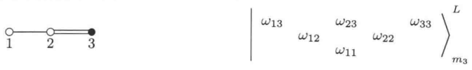

所有降算符的作用都使 $L$ 增加 1，降算符 $F_2$ 的作用使 $m_3$ 增加 2，降算符 $F_3$ 的作用使 $m_3$ 减少 2 和有一个参数 $\omega_{a3}$ 减少 1.

按照推广的盖尔范德方法，得到

$$
F_2\left|\left(0,2,2\right)\right\rangle=\sqrt{2}\left|\left(1,0,4\right)\right\rangle,\qquad
F_2\left|\begin{array}{ccc}4&4&2\\&4&4\\&&4\end{array}\right\rangle_{2}^{1}=\sqrt{2}\left|\begin{array}{ccc}4&4&2\\&4&3\\&&4\end{array}\right\rangle_{4}^{2},
$$

$$
\begin{gathered}
F_3\,|(0,2,2)\rangle=\sqrt{2}\,|(0,3,0)\rangle, \qquad
F_3\left|\begin{array}{ccc} 4 & 4 & 2 \\ & 4 & 4 \\ & & 4 \end{array}\right\rangle^{1}_{2}
=\sqrt{2}\left|\begin{array}{ccc} 4 & 4 & 1 \\ & 4 & 4 \\ & & 4 \end{array}\right\rangle^{2}_{0}, \\
F_3\,|(0,3,0)\rangle=\sqrt{2}\,|(0,4,\bar{2})\rangle, \qquad
F_3\left|\begin{array}{ccc} 4 & 4 & 1 \\ & 4 & 4 \\ & & 4 \end{array}\right\rangle^{2}_{0}
=\sqrt{2}\left|\begin{array}{ccc} 4 & 4 & 0 \\ & 4 & 4 \\ & & 4 \end{array}\right\rangle^{3}_{\bar{2}}, \\
F_2\,|(0,3,0)\rangle=\sqrt{3}\,|(1,1,2)_1\rangle, \qquad
F_2\left|\begin{array}{ccc} 4 & 4 & 1 \\ & 4 & 4 \\ & & 4 \end{array}\right\rangle^{2}_{0}
=\sqrt{3}\left|\begin{array}{ccc} 4 & 4 & 1 \\ & 4 & 3 \\ & & 4 \end{array}\right\rangle^{3}_{2}, \\
F_2\,|(0,4,\bar{2})\rangle=2\,|(1,2,0)_1\rangle, \qquad
F_2\left|\begin{array}{ccc} 4 & 4 & 0 \\ & 4 & 4 \\ & & 4 \end{array}\right\rangle^{3}_{\bar{2}}
=2\left|\begin{array}{ccc} 4 & 4 & 0 \\ & 4 & 3 \\ & & 4 \end{array}\right\rangle^{4}_{0},
\end{gathered}
$$

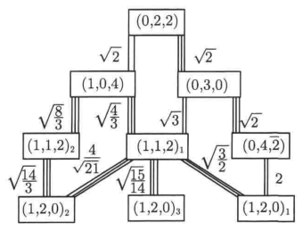

状态基 $|(1,0,4)\rangle$ 是 $\mathcal{A}_3$ 四重态的最高权态，在 $F_3$ 作用下得

$$
\begin{gathered}
F_3\,|(1,0,4)\rangle=a_1\,|(1,1,2)_1\rangle+a_2\,|(1,1,2)_2\rangle, \\
F_3\left|\begin{array}{ccc} 4 & 4 & 2 \\ & 4 & 3 \\ & & 4 \end{array}\right\rangle^{2}_{4}
=a_1\left|\begin{array}{ccc} 4 & 4 & 1 \\ & 4 & 3 \\ & & 4 \end{array}\right\rangle^{3}_{2}
+a_2\left|\begin{array}{ccc} 4 & 3 & 2 \\ & 4 & 3 \\ & & 4 \end{array}\right\rangle^{3}_{2},
\end{gathered}
$$

由式 (5.31) 算得 $a_1=\sqrt{2}\times\sqrt{2}/\sqrt{3}=\sqrt{4/3}$, $a_2=\sqrt{4-4/3}=\sqrt{8/3}$. 再用 $F_3$ 作用得

$$
F_3\,|(1,1,2)_2\rangle=b_1\,|(1,2,0)_2\rangle, \qquad
F_3\left|\begin{array}{ccc} 4 & 3 & 2 \\ & 4 & 3 \\ & & 4 \end{array}\right\rangle^{3}_{2}
=b_1\left|\begin{array}{ccc} 4 & 3 & 1 \\ & 4 & 3 \\ & & 4 \end{array}\right\rangle^{4}_{0},
$$

$$
F_3\,|(1,1,2)_1\rangle=b_2\,|(1,2,0)_1\rangle+b_3\,|(1,2,0)_2\rangle+\cdots,
$$

$$
F_3\left|\begin{array}{ccc} 4 & 4 & 1 \\ & 4 & 3 \\ & & 4 \end{array}\right\rangle^{3}_{2}
=b_2\left|\begin{array}{ccc} 4 & 4 & 0 \\ & 4 & 3 \\ & & 4 \end{array}\right\rangle^{4}_{0}
+b_3\left|\begin{array}{ccc} 4 & 3 & 1 \\ & 4 & 3 \\ & & 4 \end{array}\right\rangle^{4}_{0}+\cdots.
$$

由式 (5.31) 算得 $b_1=\sqrt{8/3+2}=\sqrt{14/3}$, $b_2=\sqrt{3}\times\sqrt{2}/2=\sqrt{3/2}$, $b_3=\sqrt{4/3}\times\sqrt{8/3}/\sqrt{14/3}=4/\sqrt{21}$，以及

$$
(a_1^2+2)-(b_2^2+b_3^2)=\frac{10}{3}-\frac{3}{2}-\frac{16}{21}=\frac{15}{14}.
$$

因此必须引入另一个权为 $(1,2,0)$ 的 $\mathrm{A}_2$ 多重态的最高权态：

$$
F_3\,|(1,1,2)_1\rangle=\sqrt{\frac{3}{2}}\,|(1,2,0)_1\rangle+\frac{4}{\sqrt{21}}\,|(1,2,0)_2\rangle+\sqrt{\frac{15}{14}}\,|(1,2,0)_3\rangle,
$$

$$
\begin{gathered}
F_3\left|\begin{array}{ccc} 4 & 4 & 1 \\ & 4 & 3 \\ & & 4 \end{array}\right\rangle^{3}_{2} \\
=\sqrt{\frac{3}{2}}\left|\begin{array}{ccc} 4 & 4 & 0 \\ & 4 & 3 \\ & & 4 \end{array}\right\rangle^{4}_{0}
+\frac{4}{\sqrt{21}}\left|\begin{array}{ccc} 4 & 3 & 1 \\ & 4 & 3 \\ & & 4 \end{array}\right\rangle^{4}_{0}
+\sqrt{\frac{15}{14}}\left|\begin{array}{ccc} 4 & 3 & 1 \\ & 4 & 3 \\ & & 4 \end{array}\right\rangle^{4}_{0}.
\end{gathered}
$$

### 5.2.7 平面权图

对二秩李代数，权只有两个分量，可以把不可约表示所包含的权及其重数在一个平面直角坐标系中直观地画出来，这就是**平面权图**. 在平面权图中，常选直角坐标系的正交归一的坐标矢量 $e_a$ 作为矢量基。单纯李代数 $\mathcal{L}$ 中，秩为 2 的李代数只有三种，$\mathrm{A}_2$，$\mathrm{B}_2\approx\mathrm{C}_2$ 和 $\mathrm{G}_2$ 李代数。 $\mathrm{B}_2$ 和 $\mathrm{C}_2$ 是局域同构的，但因分属两个不同系列，所取素根和基本主权略有不同。

$\mathrm{A}_2$ 李代数对应 SU(3) 群，自身表示生成元取为（见式 (4.123) 至式 (4.125)）

$$
H_1=\sqrt{2}T_3^{(3)}=\sqrt{2}T_8=6^{-1/2}\mathrm{diag}\{1,\,1,\,-2\},
$$

$$
H_2=\sqrt{2}T_2^{(3)}=\sqrt{2}T_3=2^{-1/2}\mathrm{diag}\{1,\,-1,\,0\},
$$

$$
E_{\boldsymbol{r}_1}=T_{12}^{(1)}+\mathrm{i}T_{12}^{(2)}=T_1+\mathrm{i}T_2=
\begin{pmatrix}
0 & 1 & 0 \\
0 & 0 & 0 \\
0 & 0 & 0
\end{pmatrix},
$$

$$
E_{\boldsymbol{r}_2}=T_{23}^{(1)}+\mathrm{i}T_{23}^{(2)}=T_6+\mathrm{i}T_7=
\begin{pmatrix}
0 & 0 & 0 \\
0 & 0 & 1 \\
0 & 0 & 0
\end{pmatrix}.
\tag{5.51}
$$

按照公式 $[H_\mu,\,E_{\boldsymbol{r}_\nu}]=(\boldsymbol{r}_\nu)_\mu E_{\boldsymbol{r}_\nu}$ 计算得

$$
\boldsymbol{r}_1=\sqrt{2}\,\boldsymbol{e}_2, \quad
\boldsymbol{r}_2=\sqrt{\frac{3}{2}}\,\boldsymbol{e}_1-\frac{1}{\sqrt{2}}\,\boldsymbol{e}_2,
$$

$$
\boldsymbol{w}_1=\frac{1}{3}(2\boldsymbol{r}_1+\boldsymbol{r}_2)=\frac{1}{\sqrt{6}}\,\boldsymbol{e}_1+\frac{1}{\sqrt{2}}\,\boldsymbol{e}_2,
\tag{5.52}
$$

$$
\boldsymbol{w}_2=\frac{1}{3}(\boldsymbol{r}_1+2\boldsymbol{r}_2)=\sqrt{\frac{2}{3}}\,\boldsymbol{e}_1.
$$

按物理上的习惯，对 SU(3) 群的平面权图，取 $e_1$ 沿纵轴方向，$e_2$ 沿横轴方向。若干不可约表示的平面权图如图 5.8 所示。 **互为复共轭的表示，平面权图互为对原点反演**. 表示 $M=(M,0)$ 的平面权图是倒置的正三角形，所有权的重数都为 1. 它的复共轭表示是 $M=(0,M)$. 其他表示的平面权图是六边形，外边界的权的重数为 1，从外边界向原点每走一格，权的重数增加 1，直到图形缩成正三角形后，重数不再增加。

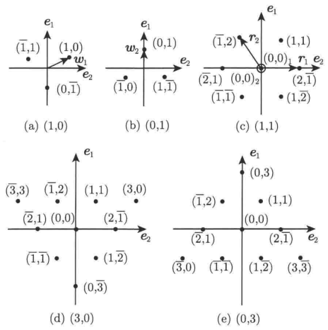

$\mathrm{B}_2$ 李代数对应 SO(5) 群，自身表示生成元取为（见式 (4.129) 至式 (4.132)）

$$
H_1=T_{12}, \qquad\qquad H_2=T_{34},
$$

$$
E_{\boldsymbol{r}_1}=\frac{1}{2}\{T_{23}-\mathrm{i}T_{13}-\mathrm{i}T_{24}-T_{14}\}, \quad
E_{\boldsymbol{r}_2}=\sqrt{\frac{1}{2}}\{T_{45}-\mathrm{i}T_{35}\}.
$$

素根和基本主权是

$$
\boldsymbol{r}_1=\boldsymbol{e}_1-\boldsymbol{e}_2, \qquad \boldsymbol{r}_2=\boldsymbol{e}_2,
$$

$$
\boldsymbol{w}_1=\boldsymbol{r}_1+\boldsymbol{r}_2=\boldsymbol{e}_1, \quad
\boldsymbol{w}_2=\frac{1}{2}\boldsymbol{r}_1+\boldsymbol{r}_2=\frac{1}{2}(\boldsymbol{e}_1+\boldsymbol{e}_2).
\tag{5.53}
$$

SO(5) 群基本表示 $(1,0)$，$(0,1)$ 和伴随表示 $(0,2)$ 的平面权图如图 5.9 所示。

$\mathrm{C}_2$ 李代数对应 USp(4) 群，素根和基本主权是（见式 (4.141) 至式 (4.143)）

$$
\boldsymbol{r}_1=\sqrt{1/2}(\boldsymbol{e}_1-\boldsymbol{e}_2), \qquad
\boldsymbol{r}_2=\sqrt{2}\boldsymbol{e}_2,
$$

$$
\boldsymbol{w}_1=\boldsymbol{r}_1+\frac{1}{2}\boldsymbol{r}_2=\frac{1}{\sqrt{2}}\boldsymbol{e}_1, \quad
\boldsymbol{w}_2=\boldsymbol{r}_1+\boldsymbol{r}_2=\frac{1}{\sqrt{2}}(\boldsymbol{e}_1+\boldsymbol{e}_2).
\tag{5.54}
$$

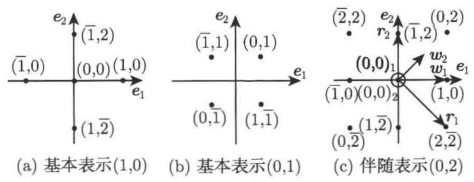

$\mathrm{G}_2$ 李代数的素根和基本主权是

$$
\boldsymbol{r}_1=\sqrt{2}\,\boldsymbol{e}_2, \qquad
\boldsymbol{r}_2=\frac{1}{\sqrt{6}}\boldsymbol{e}_1-\frac{1}{\sqrt{2}}\boldsymbol{e}_2,
$$

$$
\boldsymbol{w}_1=2\boldsymbol{r}_1+3\boldsymbol{r}_2=\sqrt{\frac{3}{2}}\boldsymbol{e}_1+\frac{1}{\sqrt{2}}\boldsymbol{e}_2, \quad
\boldsymbol{w}_2=\boldsymbol{r}_1+2\boldsymbol{r}_2=\sqrt{\frac{2}{3}}\boldsymbol{e}_1.
\tag{5.55}
$$

$\mathrm{G}_2$ 李代数的若干表示的平面权图如图 5.10 所示。

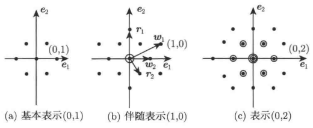

## 5.3 直乘表示的约化

单纯李代数两个不可约表示的直乘一般是可约表示，可分解为若干个不可约表示的直和。这直和称为克莱布什-戈登级数，而约化这可约表示的相似变换矩阵的矩阵元素称为克莱布什-戈登系数。本节将引入主权图方法来计算单纯李代数的克莱布什-戈登级数和克莱布什-戈登系数。

### 5.3.1 克莱布什 － 戈登系数

在单纯李代数的紧致实形 $\mathcal{L}$ 里，可取不可约表示为幺正表示，通过幺正的相似变换 $C^{M^{(1)}M^{(2)}}$ 把两不可约表示的直乘 $D^{M^{(1)}}\times D^{M^{(2)}}$ 约化：

$$
\left(C^{M^{(1)}M^{(2)}}\right)^{-1}\left(D^{M^{(1)}}\times D^{M^{(2)}}\right)C^{M^{(1)}M^{(2)}}
=\bigoplus_{M}a_M D^{M}.
\tag{5.56}
$$

$a_M$ 是表示 $M$ 在直乘表示约化中的**重数**. 设 $d(M^{(i)})$ 是表示 $M^{(i)}$ 的维数，$i=1,2$，则 $C^{M^{(1)}M^{(2)}}$ 是 $d(M^{(1)})d(M^{(2)})$ 维矩阵，行指标为 $m^{(1)},m^{(2)}$，列指标为 $M,(r),m$，其中，$r$ 用来区分约化中的重表示。每个子空间的状态基在生成元作用下满足

$$
H_\mu\,|\boldsymbol{M}^{(i)},\,\boldsymbol{m}^{(i)}\rangle=\boldsymbol{m}_\mu^{(i)}\,|\boldsymbol{M}^{(i)},\,\boldsymbol{m}^{(i)}\rangle,
$$

$$
E_\mu\,|\boldsymbol{M}^{(i)},\,\boldsymbol{m}^{(i)}\rangle=\sum|\boldsymbol{M}^{(i)},\,\boldsymbol{m}^{(i)}+\boldsymbol{r}_\mu\rangle\,D^{M^{(i)}}_{(m^{(i)}+r_\mu)m^{(i)}}(E_\mu),
\tag{5.57}
$$

$$
F_\mu\,|\boldsymbol{M}^{(i)},\,\boldsymbol{m}^{(i)}\rangle=\sum|\boldsymbol{M}^{(i)},\,\boldsymbol{m}^{(i)}-\boldsymbol{r}_\mu\rangle\,D^{M^{(i)}}_{(m^{(i)}-r_\mu)m^{(i)}}(F_\mu),
$$

式中对重权态求和。直乘表示空间的状态基是参加乘积的两表示空间的状态基的直乘。通常把标记表示的符号 $M^{(1)}$ 和 $M^{(2)}$ 省略：

$$
|\boldsymbol{M}^{(1)},\,\boldsymbol{m}^{(1)}\rangle|\boldsymbol{M}^{(2)},\,\boldsymbol{m}^{(2)}\rangle=|\boldsymbol{m}^{(1)}\rangle|\boldsymbol{m}^{(2)}\rangle.
\tag{5.58}
$$

这是一组互相正交归一的状态基。约化后的状态基表为

$$
||\boldsymbol{M},(r),\boldsymbol{m}\rangle=\sum_{m^{(1)},m^{(2)}}|\boldsymbol{m}^{(1)}\rangle|\boldsymbol{m}^{(2)}\rangle\,C^{M^{(1)}M^{(2)}}_{m^{(1)},m^{(2)};M,(r),m}.
\tag{5.59}
$$

这是另一组互相正交归一的状态基。 **式 (5.59) 是单纯李代数克莱布什 － 戈登系数的最常用的表达方法**. 生成元 $I_A$ 可取谢瓦莱基。当 $I_A$ 取 $H_\mu$ 时，由式 (5.57) 得

$$
\left(\boldsymbol{m}^{(1)}+\boldsymbol{m}^{(2)}\right)C^{M^{(1)}M^{(2)}}_{m^{(1)},m^{(2)};M,(r),m}=C^{M^{(1)}M^{(2)}}_{m^{(1)},m^{(2)};M,(r),m}\,\boldsymbol{m},
$$

$$
C^{M^{(1)}M^{(2)}}_{m^{(1)},m^{(2)};M,(r),m}=0, \quad \text{当}\ \boldsymbol{m}\neq\boldsymbol{m}^{(1)}+\boldsymbol{m}^{(2)},
\tag{5.60}
$$

即组合前后权矢量相加，$\boldsymbol{m}=\boldsymbol{m}^{(1)}+\boldsymbol{m}^{(2)}$. 对 SU(2) 群，这就是磁量子数的相加关系，但对单纯李代数，还要注意可能有重权。当权满足相加关系时，不为零的克莱布什-戈登系数可能不止一个。当 $I_A$ 取 $E_\mu$ 或 $F_\mu$ 时，由式 (5.57) 得

$$
\begin{aligned}
&\sum_{\boldsymbol{m}^{(1)\prime}=\boldsymbol{m}^{(1)}\pm\boldsymbol{r}_j} D^{M^{(1)}}(I_A)_{m^{(1)}m^{(1)\prime}}\,C^{M^{(1)}M^{(2)}}_{m^{(1)\prime},m^{(2)};M,(r),m} \\
&+\sum_{\boldsymbol{m}^{(2)\prime}=\boldsymbol{m}^{(2)}\pm\boldsymbol{r}_j} D^{M^{(2)}}(I_A)_{m^{(2)}m^{(2)\prime}}\,C^{M^{(1)}M^{(2)}}_{m^{(1)},m^{(2)\prime};M,(r),m} \\
&=\sum_{\boldsymbol{m}^{\prime}=\boldsymbol{m}\pm\boldsymbol{r}_j} C^{M^{(1)}M^{(2)}}_{m^{(1)},m^{(2)};M,(r),m^{\prime}}\,D^{M}(I_A)_{m^{\prime}m},
\end{aligned}
\tag{5.61}
$$

其中，$E_\mu$ 对应上面符号，$F_\mu$ 对应下面符号。对 SU(2) 群，$E_\mu$ 取 $T_+$，$F_\mu$ 取 $I_-$，$H_\mu$ 取 $2I_3$，因此在符号上需要作相应变动：

$$
J=\boldsymbol{M}/2, \quad j=\boldsymbol{M}^{(1)}/2, \quad k=\boldsymbol{M}^{(2)}/2, \quad \mu=\boldsymbol{m}^{(1)}/2, \quad \nu=\boldsymbol{m}^{(2)}/2.
\tag{5.62}
$$

应用公式 (4.73)，式 (5.61) 简化为

$$
\Gamma^{j}_{\pm\mu}C^{jk}_{(\mu\mp1)\nu JM}+\Gamma^{k}_{\pm\nu}C^{jk}_{\mu(\nu\mp1)JM}=C^{jk}_{\mu\nu J(M\pm1)}\Gamma^{J}_{\mp M}.
\tag{5.63}
$$

由此式可以计算出 SU(2) 群克莱布什-戈登系数的解析形式。但这些系数现在已可由现成的软件来计算，如采用 Mathematica 软件时，

$$
C^{jk}_{\mu\nu,J(\mu+\nu)}=\mathrm{ClebschGordan}[\{j,\mu\},\{k,\nu\},\{J,\mu+\nu\}].
$$

### 5.3.2 克莱布什 － 戈登级数

设 $\boldsymbol{M}$ 出现在单纯李代数 $\mathcal{L}$ 两不可约表示 $M^{(1)}$ 和 $M^{(2)}$ 直乘分解的克莱布什-戈登级数中，它的最高权态展开式为

$$
||\boldsymbol{M},(r),\boldsymbol{M}\rangle=\sum_{m^{(1)}}|\boldsymbol{m}^{(1)}\rangle|\boldsymbol{M}-\boldsymbol{m}^{(1)}\rangle\,C^{(r)}_{m^{(1)}}.
\tag{5.64}
$$

这是式 (5.59) 的特殊情况。为了书写简单，这里简化了克莱布什-戈登系数的符号。现在先来证明，展开式 (5.64) 中一定包含 $\boldsymbol{m}^{(1)}$ 等于表示最高权 $\boldsymbol{M}^{(1)}$ 的项。任取展开式中的一项，设 $\boldsymbol{m}^{(1)}\neq\boldsymbol{M}^{(1)}$，则必存在某升算符 $E_\mu$ 作用在态 $|\boldsymbol{m}^{(1)}\rangle$ 上不为零，即

$$
E_\mu\,|\boldsymbol{m}^{(1)}\rangle=a\,|\boldsymbol{m}^{(1)}+\boldsymbol{r}_\mu\rangle+\cdots\neq0.
$$

省略的是重权的态。因为 $E_\mu$ 作用在态 $||\boldsymbol{M},(r),\boldsymbol{M}\rangle$ 上得零，所以式 (5.64) 的求和式中必须包含另一项 $|\boldsymbol{m}^{(1)}+\boldsymbol{r}_\mu\rangle|\boldsymbol{M}-\boldsymbol{m}^{(1)}-\boldsymbol{r}_\mu\rangle\,C^{(r)}_{\boldsymbol{m}^{(1)}+\boldsymbol{r}_\mu}$，其中

$$
E_\mu\,|\boldsymbol{M}-\boldsymbol{m}^{(1)}-\boldsymbol{r}_\mu\rangle=b\,|\boldsymbol{M}-\boldsymbol{m}^{(1)}\rangle+\cdots\neq0,
$$

且满足

$$
a\,C^{(r)}_{\boldsymbol{m}^{(1)}}+b\,C^{(r)}_{\boldsymbol{m}^{(1)}+\boldsymbol{r}_\mu}=0.
$$

这权 $\boldsymbol{m}^{(1)}$ 的递升过程要一直继续下去，直到 $\boldsymbol{m}^{(1)}$ 等于该表示的最高权 $\boldsymbol{M}^{(1)}$. 证完。这结论说明权 $\boldsymbol{M}-\boldsymbol{M}^{(1)}=\boldsymbol{m}^{(2)}$ 必定在表示 $M^{(2)}$ 中出现。同理在式 (5.64) 的展开式中也一定包含 $\boldsymbol{m}^{(2)}=\boldsymbol{M}^{(2)}$ 的项。于是有

$$
\boldsymbol{M}=\boldsymbol{M}^{(1)}+\boldsymbol{m}^{(2)}=\boldsymbol{m}^{(1)}+\boldsymbol{M}^{(2)}.
\tag{5.65}
$$

这是在克莱布什-戈登级数中出现的不可约表示最高权 $\boldsymbol{M}$ 必须满足的条件。对 SU(2) 群，条件 (5.65) 简化成 $J=j+\nu\geqslant0$ 或 $J=\mu+k\geqslant0$. 若 $j\geqslant k$，则 $J=j+k-n$，$0\leqslant n\leqslant 2k$. 一般有

$$
J=j+k,\ j+k-1,\ \cdots,\ |j-k|.
\tag{5.66}
$$

在量子力学中这规则称为角动量的矢量相加规则。因为在 $j$，$k$ 和 $J$ 三个数值中，任何一个不大于另两个之和，不小于另两个之差，就像三角形的三条边长满足的关系，因而这规则也称为三角形规则，记为 $\Delta(j,k,J)$. 当然这里三个指标都只能取整数或半奇数。

在两表示 $M^{(1)}$ 和 $M^{(2)}$ 的直乘空间中，最高权是单权，状态基是 $|\boldsymbol{M}^{(1)}\rangle|\boldsymbol{M}^{(2)}\rangle$. 因此，在克莱布什-戈登级数中一定出现一个重数为 1 的表示 $\boldsymbol{M}_1$，它的权等于乘积表示最高权之和：

$$
\boldsymbol{M}_1=\boldsymbol{M}^{(1)}+\boldsymbol{M}^{(2)}, \quad
||\boldsymbol{M}_1,\boldsymbol{M}_1\rangle=|\boldsymbol{M}^{(1)}\rangle|\boldsymbol{M}^{(2)}\rangle.
\tag{5.67}
$$

### 5.3.3 主权图方法

研究单纯李代数 $\mathcal{L}$ 两不可约表示直乘分解问题包括三个互相关联的内容。一是确定克莱布什-戈登级数，用主权图方法计算级数中出现哪些表示和它们的重数。二是根据最高权态在升算符作用下为零的条件，计算这些表示最高权态的展开式。三是由最高权态的展开式出发，用降算符作用，计算其他状态基的展开式，也就是计算克莱布什-戈登系数。

首先，在 $M^{(2)}$ 表示空间中寻找所有满足下面条件的 $\boldsymbol{m}^{(2)}$，它与 $\boldsymbol{M}^{(1)}$ 相加会得到主权，记为 $\boldsymbol{M}$. 换句话说，就是寻找主权 $\boldsymbol{M}=\boldsymbol{m}^{(2)}+\boldsymbol{M}^{(1)}$. 这些 $\boldsymbol{M}$ 就是有可能在克莱布什-戈登级数中出现的表示的最高权，满足

$$
\boldsymbol{M}_1-\boldsymbol{M}=\sum_{\mu=1}^{\ell}c_\mu\,\boldsymbol{r}_\mu.
\tag{5.68}
$$

按和式 $\sum c_\mu$ 自小至大的次序，给这些可能的最高权 $\boldsymbol{M}$ 分别规定一个序号。第一个表示 $\boldsymbol{M}_1$ 及其最高权态，已由式 (5.67) 给出。

用下面方法计算克莱布什-戈登级数 (5.56) 中出现的各最高权表示 $\boldsymbol{M}$ 的重数 $a_M$. 先在直乘空间数出权为 $\boldsymbol{M}$ 的正交归一状态基 $|\boldsymbol{m}^{(1)}\rangle|\boldsymbol{M}-\boldsymbol{m}^{(1)}\rangle$ 的个数，记为 $b_M$. 显然，$a_{M_1}=b_{M_1}=1$. 由表示 $\boldsymbol{M}_1$ 的最高权态 (5.67) 出发，通过方块权图方法或（推广的）盖尔范德方法，计算表示 $\boldsymbol{M}_1$ 中包含的上述各主权 $\boldsymbol{M}$ 的重数，记为 $c^{(1)}_{M}$，这重数也可在有关书（Brenner et al., 1985）中查到。序号为 2 的表示 $\boldsymbol{M}_2$ 在克莱布什-戈登级数中的重数 $a_{M_2}$ 等于主权 $\boldsymbol{M}_2$ 在直乘空间的重数 $b_{M_2}$ 和在 $\boldsymbol{M}_1$ 表示空间的重数 $c^{(1)}_{M_2}$ 之差。若差数为零，就把表示 $\boldsymbol{M}_2$ 从克莱布什-戈登级数中去掉，排在级数后面表示的序数各减少一，继续计算。算出 $a_{M_2}$ 后，就用方块权图等方法计算表示 $\boldsymbol{M}_2$ 中包含的各主权 $\boldsymbol{M}$ 的重数，记为 $c^{(2)}_{M}$，然后计算 $a_{M_3}=b_{M_3}-c^{(1)}_{M_3}-a_{M_2}c^{(2)}_{M_3}$. 一般有

$$
a_{M_n}=b_{M_n}-\sum_{i=1}^{n-1}a_{M_i}c^{(i)}_{M_n}.
\tag{5.69}
$$

把各主权在直乘空间和在约化后各表示空间中的重数排列成表，称为**直乘表示约化的主权图**.

主权图具体画法如下。把在克莱布什-戈登级数中出现的每一个表示 $\boldsymbol{M}_n$，按序数 $n$ 排列，各占一列，列出该表示的重数 $a_{M_n}$ 和表示包含的各主权 $\boldsymbol{M}$. 在表示中这些主权的重数 $c^{(n)}_{M}$ 以指数形式标在主权 $\boldsymbol{M}$ 的右上角，$a_{M_n}$ 和 $c^{(n)}_{M}$ 为 1 时省略。最左面一列列出在表示直乘空间中各主权的重数 $b_M$ 及其外尔轨道长度 (O.S.). 它们的乘积之和就是直乘空间的维数 $d(M^{(1)})d(M^{(2)})$，表在第一列的最下面。对每一个表示 $\boldsymbol{M}_n$，各主权的重数与外尔轨道长度乘积之和就是该表示的维数，也列在该表示所在列的最下面，以检验计算得的克莱布什-戈登级数的正确性。

第二，对在克莱布什-戈登级数中出现的表示，把它的最高权态 $||\boldsymbol{M}_n,\boldsymbol{M}_n\rangle$ 按表示直乘空间有相同权的状态基展开（见式 (5.59)）。根据最高权态的定义式 (5.7)，要求所有升算符 $E_\mu$ 作用在展开式上得零。用这些条件计算展开式系数间的关系，最后用归一化条件确定系数。对简单情况也可根据属不等价不可约表示状态基的**正交条件**来计算。

如果表示的重数 $a_M$ 大于 1，计算得到的表示最高权态 $||\boldsymbol{M}_n,\boldsymbol{M}_n\rangle$ 之间允许作线性组合。即使重数为 1，最高权态的相因子还可以自由选择。通常使最高权态展开式中 $\boldsymbol{m}^{(1)}=\boldsymbol{M}^{(1)}$ 的项（至少是其中的一项）系数为正实数。当 $M^{(1)}=M^{(2)}$ 时，可以通过最高权态的适当组合，使克莱布什-戈登系数对 $|\boldsymbol{m}^{(1)}\rangle$ 和 $|\boldsymbol{m}^{(2)}\rangle$ 的交换对称或反对称，对应表示 $M$ 分别称为对称表示或反对称表示。

第三，有了最高权态的展开式，就可通过降算符的作用，计算这表示其他状态基的展开式。因为前面的计算错误会直接影响后面的计算，所以计算过程中每一计算结果都要作检验。对每一个状态基的展开式 (5.59)，应该检查等式各项权之和 $\boldsymbol{m}^{(1)}+\boldsymbol{m}^{(2)}$ 是否都等于 $\boldsymbol{m}$，检查此展开式是否归一，与已得到的相同权的展开式是否正交，检查在克莱布什-戈登级数中各表示维数之和是否等于直乘表示的维数 $d(M^{(1)})d(M^{(2)})$. 当 $M^{(1)}=M^{(2)}$ 时，还要检查克莱布什-戈登级数中对称表示维数之和是否等于 $d(M^{(1)})[d(M^{(1)})+1]/2$，反对称表示维数之和是否等于 $d(M^{(1)})[d(M^{(1)})-1]/2$.

SU(2) 群的克莱布什-戈登级数的计算是主权图方法最简单的例子。 SU(2) 群的不可约表示中所有非负权都是主权，而且都是单权。采用参数替换式 (5.62)，在不可约表示 $D^J$ 中各主权 $J-n$ 都是单权：$c^{(J)}_{J-n}=1$，$0\leqslant n\leqslant J$. 对直乘表示 $D^j\times D^k$，不失普遍性假定 $j\geqslant k$，在表示直乘空间中，式 (5.66) 给出的各主权 $J=j+k-n$ 的重数很容易数出来：$b_J=n+1$. 由式 (5.69) 递推算出所有重数 $a_J=1$，即 SU(2) 群直乘表示 $D^j\times D^k$ 的克莱布什-戈登级数由式 (5.66) 给出，每一个表示的重数都为 1.

再用主权图方法计算 SU(3) 群 ($\mathrm{A}_2$ 李代数) 的两个基本表示直乘分解的克莱布什-戈登级数和系数：$(1,0)\times(0,1)$. 由图 5.2 可知，在直乘表示空间只有两个主权，$(1,1)$ 和 $(0,0)$. 由平面权图 5.8 数出它们的外尔轨道长度分别是 6 和 1. 主权 $(1,1)$ 是直乘表示空间的最高权，重数为 1. 主权为 $(0,0)$ 在直乘表示空间的状态基有三个，$b_{(00)}=3$.

$$
|(1,0),(1,0)\rangle|(0,1),(\bar{1},0)\rangle, \quad |(1,0),(\bar{1},1)\rangle|(0,1),(1,\bar{1})\rangle,
$$

$$
|(1,0),(0,\bar{1})\rangle|(0,1),(0,1)\rangle.
$$

因为在表示 $(1,1)$ 中主权 $(0,0)$ 是二重权，所以在克莱布希-戈登级数中表示 $(0,0)$ 的重数是 $3-2=1$. 这样，计算得 SU(3) 群两个基本表示直乘分解的主权图如图 5.11 所示。方框里的填数是主权，方框右上角的数字是该主权的重数，重数为 1 时省略。最下面一行是表示直乘分解的克莱布希-戈登级数。

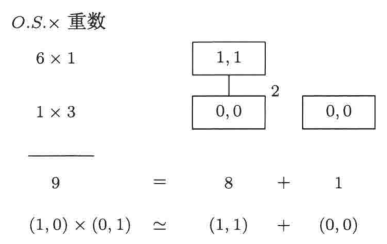

$$
9 = 8 + 1
$$

$$
(1,0)\times(0,1) \simeq (1,1) + (0,0)
$$

图 5.11 SU(3) 群直乘表示 $(1,0)\times(0,1)$ 分解的主权图

表示 $(1,1)$ 的最高权态展开式为

$$
\|(1,1),(1,1)\rangle = |(1,0),(1,0)\rangle|(0,1),(0,1)\rangle.
$$

可由方块权图（图 5.3）计算其他状态的展开式。

$$
\begin{aligned}
\|(1,1),(\bar{1},2)\rangle &= F_1\,\|(1,1),(1,1)\rangle = |(1,0),(\bar{1},1)\rangle|(0,1),(0,1)\rangle, \\
\|(1,1),(2,\bar{1})\rangle &= F_2\,\|(1,1),(1,1)\rangle = |(1,0),(1,0)\rangle|(0,1),(1,\bar{1})\rangle, \\
\|(1,1),(0,0)_1\rangle &= \sqrt{1/2}F_1\,\|(1,1),(2,\bar{1})\rangle \\
&= \sqrt{1/2}\left\{|(1,0),(1,0)\rangle|(0,1),(\bar{1},0)\rangle + |(1,0),(\bar{1},1)\rangle|(0,1),(1,\bar{1})\rangle\right\}, \\
\|(1,1),(0,0)_2\rangle &= \sqrt{2/3}\left\{F_2\|(1,1),(\bar{1},2)\rangle - \sqrt{1/2}\|(1,1),(0,0)_1\rangle\right\} \\
&= \sqrt{2/3}\left\{|(1,0),(\bar{1},1)\rangle|(0,1),(1,\bar{1})\rangle + |(1,0),(0,\bar{1})\rangle|(0,1),(0,1)\rangle\right\} \\
&\quad -\sqrt{1/6}\left\{|(1,0),(1,0)\rangle|(0,1),(\bar{1},0)\rangle + |(1,0),(\bar{1},1)\rangle|(0,1),(1,\bar{1})\rangle\right\} \\
&= \sqrt{1/6}\left\{-|(1,0),(1,0)\rangle|(0,1),(\bar{1},0)\rangle + |(1,0),(\bar{1},1)\rangle|(0,1),(1,\bar{1})\rangle \right. \\
&\quad \left. +\, 2|(1,0),(0,\bar{1})\rangle|(0,1),(0,1)\rangle\right\},
\end{aligned}
$$

$$
\begin{aligned}
\|(1,1),(\bar{2},1)\rangle &= \sqrt{1/2}F_1\,\|(1,1),(0,0)_1\rangle = |(1,0),(\bar{1},1)\rangle|(0,1),(\bar{1},0)\rangle, \\
\|(1,1),(1,\bar{2})\rangle &= \sqrt{2}\,F_2\,\|(1,1),(0,0)_1\rangle = |(1,0),(0,\bar{1})\rangle|(0,1),(1,\bar{1})\rangle, \\
\|(1,1),(\bar{1},\bar{1})\rangle &= F_1\,\|(1,1),(1,\bar{2})\rangle = |(1,0),(0,\bar{1})\rangle|(0,1),(\bar{1},0)\rangle.
\end{aligned}
$$

表示 $(0,0)$ 是一维表示，状态展开式可根据条件 (5.7) 计算。

$$
\begin{aligned}
\|(0,0),(0,0)\rangle &= c_1|(1,0),(1,0)\rangle|(0,1),(\bar{1},0)\rangle \\
&\quad + c_2|(1,0),(\bar{1},1)\rangle|(0,1),(1,\bar{1})\rangle + c_3|(1,0),(0,\bar{1})\rangle|(0,1),(0,1)\rangle.
\end{aligned}
$$

要求在升算符作用下得零，有

$$
\begin{aligned}
E_1\|(0,0),(0,0)\rangle &= c_1|(1,0),(1,0)\rangle|(0,1),(1,\bar{1})\rangle \\
&\quad + c_2|(1,0),(1,0)\rangle|(0,1),(1,\bar{1})\rangle = 0, \\
E_2\|(0,0),(0,0)\rangle &= c_2|(1,0),(\bar{1},1)\rangle|(0,1),(0,1)\rangle \\
&\quad + c_3|(1,0),(\bar{1},1)\rangle|(0,1),(0,1)\rangle = 0.
\end{aligned}
$$

解得 $c_1=-c_2=c_3=\sqrt{1/3}$. 注意，三个权为 $(0,0)$ 的状态基都互相正交。

最后再算 SU(3) 群两个伴随表示 $(1,1)$ 直乘分解的克莱布希-戈登级数和系数。这在粒子物理中非常有用。

按照图 5.3，在直乘表示空间出现的主权有 $(2,2)$，$(3,0)$，$(0,3)$，$(1,1)$ 和 $(0,0)$，它们的重数分别是 1，2，2，6 和 10，如表 5.1 所示。因为参加直乘的两个表示是相同的，表中列举的独立状态基，省略因 $|\boldsymbol{m}^{(1)}\rangle$ 和 $|\boldsymbol{m}^{(2)}\rangle$ 交换得到的状态基。这些主权的外尔轨道长度分别是 6，3，3，6 和 1.

表 5.1　SU(3) 群直乘表示 $(1,1)\times(1,1)$ 的表示空间中各主权的状态基

| 主权 | 重数 | 独立状态基 |
| --- | --- | --- |
| $(2,2)$ | 1 | $\vert(1,1)\rangle\vert(1,1)\rangle$ |
| $(3,0)$ | 2 | $\vert(1,1)\rangle\vert(2,\bar{1})\rangle$ |
| $(0,3)$ | 2 | $\vert(1,1)\rangle\vert(\bar{1},2)\rangle$ |
| $(1,1)$ | 6 | $\vert(1,1)\rangle\vert(0,0)_1\rangle$, $\vert(1,1)\rangle\vert(0,0)_2\rangle$, $\vert(\bar{1},2)\rangle\vert(2,\bar{1})\rangle$ |
| $(0,0)$ | 10 | $\vert(1,1)\rangle\vert(\bar{1},\bar{1})\rangle$, $\vert(2,\bar{1})\rangle\vert(\bar{2},1)\rangle$, $\vert(\bar{1},2)\rangle\vert(1,\bar{2})\rangle$, $\vert(0,0)_a\rangle\vert(0,0)_b\rangle$, $a,b=1,2$ |

除 $(2,2)$ 外，以其他主权作为最高权的不可约表示，它们的方块权图都已列出在图 5.3 和图 5.5. 表示 $(3,0)$ 包含主权 $(3,0)$，$(1,1)$ 和 $(0,0)$，重数都是 1，表示 $(0,3)$ 包含主权 $(0,3)$，$(1,1)$ 和 $(0,0)$，重数都是 1，表示 $(1,1)$ 包含重数为 1 的主权 $(1,1)$ 和重数为 2 的主权 $(0,0)$，表示 $(0,0)$ 只包含一个重数为 1 的主权 $(0,0)$. 对表示 $(2,2)$，根据各主权所对应的盖尔范德基，可以数出它们的重数：

$$
(2,2) \longrightarrow \left. \begin{array}{ccc} 4 & 2 & 0 \\ & 4 & 2 \\ & & 4 \end{array} \right\rangle, \quad
(3,0) \longrightarrow \left. \begin{array}{ccc} 4 & 2 & 0 \\ & 4 & 2 \\ & & 3 \end{array} \right\rangle,
$$

$$
(0,3) \longrightarrow \left. \begin{array}{ccc} 4 & 2 & 0 \\ & 4 & 1 \\ & & 4 \end{array} \right\rangle, \quad
(1,1) \longrightarrow \left. \begin{array}{ccc} 4 & 2 & 0 \\ & 4 & 1 \\ & & 3 \end{array} \right\rangle, \quad
\left. \begin{array}{ccc} 4 & 2 & 0 \\ & 3 & 2 \\ & & 3 \end{array} \right\rangle,
$$

$$
(0,0) \longrightarrow \left. \begin{array}{ccc} 4 & 2 & 0 \\ & 4 & 0 \\ & & 2 \end{array} \right\rangle, \quad
\left. \begin{array}{ccc} 4 & 2 & 0 \\ & 3 & 1 \\ & & 2 \end{array} \right\rangle, \quad
\left. \begin{array}{ccc} 4 & 2 & 0 \\ & 2 & 2 \\ & & 2 \end{array} \right\rangle.
$$

因此，主权 $(2,2)$，$(3,0)$ 和 $(0,3)$ 的重数都是 1，主权 $(1,1)$ 的重数是 2，主权 $(0,0)$ 的重数是 3. 由此计算得 SU(3) 群两个伴随表示直乘分解的主权图（图 5.12）。在表示 $(1,1)$ 所在列最上面的数字 2 标记在克莱布希-戈登级数中表示 $(1,1)$ 的重数。最下面一行是表示直乘分解的克莱布希-戈登级数，下标 $S$ 和 $A$ 分别标记对称表示和反对称表示。

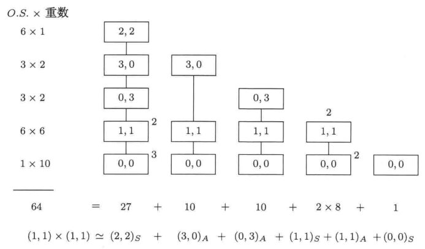

$$
64 = 27 + 10 + 10 + 2\times 8 + 1
$$

$$
(1,1)\times(1,1) \simeq (2,2)_S + (3,0)_A + (0,3)_A + (1,1)_S + (1,1)_A + (0,0)_S
$$

图 5.12 SU(3) 群直乘表示 $(1,1)\times(1,1)$ 分解的主权图

下面计算各表示的最高权态展开式。由式 (5.67) 得表示 $(2,2)$ 最高权态

$$
\|(2,2),(2,2)\rangle = |(1,1)\rangle|(1,1)\rangle.
$$

因此 $(2,2)$ 是对称表示。在降算符的作用下得

$$
\|(2,2),(0,3)\rangle = \frac{1}{\sqrt{2}}F_1\,\|(2,2),(2,2)\rangle = \frac{1}{\sqrt{2}}\left\{|1,1\rangle\,|\bar{1},2\rangle + |\bar{1},2\rangle\,|1,1\rangle\right\},
$$

$$
\|(2,2),(3,0)\rangle = \frac{1}{\sqrt{2}}F_2\,\|(2,2),(2,2)\rangle = \frac{1}{\sqrt{2}}\left\{|1,1\rangle\,|2,\bar{1}\rangle + |2,\bar{1}\rangle\,|1,1\rangle\right\}.
$$

表示 $(0,3)$ 和 $(3,0)$ 的最高权态必须和上面相同权的状态基正交，得

$$
\|(0,3),(0,3)\rangle = \frac{1}{\sqrt{2}}\left\{|1,1\rangle\,|\bar{1},2\rangle - |\bar{1},2\rangle\,|1,1\rangle\right\},
$$

$$
\|(3,0),(3,0)\rangle = \frac{1}{\sqrt{2}}\left\{|1,1\rangle\,|2,\bar{1}\rangle - |2,\bar{1}\rangle\,|1,1\rangle\right\}.
$$

因此 $(3,0)$ 和 $(0,3)$ 是反对称表示。在乘积表示空间权为 $(1,1)$ 的态出现 6 次。由在 $E_1$ 作用下为零的条件，得到四个状态组合：

$$
\begin{aligned}
&|1,1\rangle\,|(0,0)_2\rangle, \quad |1,1\rangle\,|(0,0)_1\rangle - \sqrt{2}\,|\bar{1},2\rangle\,|2,\bar{1}\rangle, \\
&|(0,0)_2\rangle\,|1,1\rangle, \quad |(0,0)_1\rangle\,|1,1\rangle - \sqrt{2}\,|2,\bar{1}\rangle\,|\bar{1},2\rangle.
\end{aligned}
$$

进一步要求在 $E_2$ 作用下为零，得到两个独立状态基：

$$
\begin{aligned}
&-|1,1\rangle|(0,0)_2\rangle + \sqrt{3}|1,1\rangle|(0,0)_1\rangle - \sqrt{6}|\bar{1},2\rangle|2,\bar{1}\rangle + 2|(0,0)_2\rangle|1,1\rangle, \\
&2|1,1\rangle|(0,0)_2\rangle - \sqrt{6}|2,\bar{1}\rangle|\bar{1},2\rangle + \sqrt{3}|(0,0)_1\rangle|1,1\rangle - |(0,0)_2\rangle|1,1\rangle.
\end{aligned}
$$

这正符合在克莱布希-戈登级数中表示 $(1,1)$ 的重数为 2. 把这两个状态基组合成对称和反对称的形式，归一化后得到对称表示 $(1,1)_S$ 和反对称表示 $(1,1)_A$ 的最高权态展开式：

$$
\begin{aligned}
\|(1,1),(1,1)\rangle_S &= \sqrt{1/20}\ \left\{\sqrt{3}\,|1,1\rangle\,|(0,0)_1\rangle + |1,1\rangle\,|(0,0)_2\rangle\right. \\
&\quad -\sqrt{6}\,|\bar{1},2\rangle\,|2,\bar{1}\rangle - \sqrt{6}\,|2,\bar{1}\rangle|\bar{1},2\rangle \\
&\quad \left. +\,|(0,0)_2\rangle\,|1,1\rangle + \sqrt{3}\,|(0,0)_1\rangle\,|1,1\rangle\right\}, \\
\|(1,1),(1,1)\rangle_A &= \sqrt{1/12}\ \left\{\,|1,1\rangle\,|(0,0)_1\rangle - \sqrt{3}\,|1,1\rangle\,|(0,0)_2\rangle\right. \\
&\quad -\sqrt{2}\,|\bar{1},2\rangle\,|2,\bar{1}\rangle + \sqrt{2}\,|2,\bar{1}\rangle\,|\bar{1},2\rangle \\
&\quad \left. +\,\sqrt{3}\,|(0,0)_2\rangle\,|1,1\rangle - |(0,0)_1\rangle\,|1,1\rangle\right\}.
\end{aligned}
$$

容易计算，恒等表示 $(0,0)$ 是对称表示，它的状态展开式为

$$
\begin{aligned}
\|(0,0),(0,0)\rangle &= \sqrt{1/8}\ \left\{\,|1,1\rangle\,|\bar{1},\bar{1}\rangle - |\bar{1},2\rangle\,|1,\bar{2}\rangle - |2,\bar{1}\rangle\,|\bar{2},1\rangle\right. \\
&\quad +\,|(0,0)_1\rangle\,|(0,0)_1\rangle + |(0,0)_2\rangle\,|(0,0)_2\rangle \\
&\quad \left. -\,|\bar{2},1\rangle\,|2,\bar{1}\rangle - |1,\bar{2}\rangle\,|\bar{1},2\rangle + |\bar{1},\bar{1}\rangle\,|1,1\rangle\right\}.
\end{aligned}
$$

## 5.4 SU(N) 群张量表示的约化

方块权图方法和推广的盖尔范德方法可以计算单纯李代数不可约表示的状态基和生成元在这组状态基里的表示矩阵，但对状态基的波函数形式没有提供具体信息。本节研究 SU(N) 群张量空间的约化，用杨算符方法确定它的不可约张量子空间，计算这些张量子空间中的独立和完备的张量基，并与方块权图方法结合起来，把这些不可约张量基正交归一化，具体给出 SU(N) 群不可约表示状态基的波函数。

### 5.4.1 SU(N) 群张量空间的对称性

SU(N) 群是紧致的单纯李群，群元素是 $N\times N$ 幺模幺正矩阵，矩阵作用的空间是 $N$ 维复空间，这空间的矢量有 $N$ 个复分量，在 $u\in\mathrm{SU}(N)$ 变换中按下式变换

$$
V_a \xrightarrow{u} V'_a \equiv (O_u V)_a = \sum_{b=1}^{N} u_{ab}V_b . \tag{5.70}
$$

SU(N) 群的 $n$ 阶张量 $T_{a_1,\cdots,a_n}$ 有 $n$ 个指标，$N^n$ 个分量，在 SU(N) 变换中，每个指标都像矢量指标一样变换

$$
T_{a_1\cdots a_n} \xrightarrow{u} (O_u T)_{a_1\cdots a_n} = \sum_{b_1\cdots b_n} u_{a_1b_1}\cdots u_{a_nb_n}T_{b_1\cdots b_n} . \tag{5.71}
$$

$n$ 阶张量的集合构成 $N^n$ 维张量空间 $T$，它是一个线性空间，满足线性空间矢量相加和矢量与数相乘的一般规则。张量空间的张量经 SU(N) 变换 $u$ 的作用，仍属于此张量空间。因此张量空间 $T$ 关于 SU(N) 群的变换是不变的。在 SU(N) 变换式 (5.71) 中，张量的每一个指标都平等地按 $u$ 矩阵元素来组合。这些 $u$ 矩阵是以矩阵元素的形式出现在式 (5.71) 中的，它们的乘积次序可以交换，从而使张量指标间的对称性质在 SU(N) 变换中保持不变。但是，除全对称张量和全反对称张量的意义已十分明确外，具有混合对称性的张量的意义就不很明确。例如，对三阶张量，让前两个指标对称，再让后两个指标反对称，此时前两个指标的对称性质已被破坏了。

张量指标之间的对称性质由张量指标间的置换变换 $R$ 来描写。张量 $T$ 经置换 $R$ 的作用变成新张量 $RT\equiv T_R$，它的分量与原张量的分量间存在一定的联系，这联系必须满足置换群元素的乘积规则。由于任何置换都可表为若干对换的乘积，而对换是自逆的，张量在对换作用下的变换规则比较容易定义。设对换 $(j\ k)$ 作用在张量 $T$ 上，得到新张量 $T'$，定义

$$
[(j\ k)T]_{a_1\cdots a_j\cdots a_k\cdots a_n} = T'_{a_1\cdots a_j\cdots a_k\cdots a_n} = T_{a_1\cdots a_k\cdots a_j\cdots a_n} . \tag{5.72}
$$

置换对张量的作用按对张量相继做对换运算来定义。例如，

$$
R = \begin{pmatrix} 1 & 2 & 3 \\ 2 & 3 & 1 \end{pmatrix} = \begin{pmatrix} 3 & 1 & 2 \\ 1 & 2 & 3 \end{pmatrix} = (1\ 2\ 3) = (1\ 2)(2\ 3),
$$

$$
[(2\ 3)T]_{a_1a_2a_3} = T'_{a_1a_2a_3} = T_{a_1a_3a_2},
$$

$$
(RT)_{a_1a_2a_3} = [(1\ 2)T']_{a_1a_2a_3} = T'_{a_2a_1a_3} = T_{a_2a_3a_1} \neq T_{a_3a_1a_2}.
$$

一般说来，设

$$
R = \begin{pmatrix} 1 & 2 & \cdots & n \\ r_1 & r_2 & \cdots & r_n \end{pmatrix} = \begin{pmatrix} \bar{r}_1 & \bar{r}_2 & \cdots & \bar{r}_n \\ 1 & 2 & \cdots & n \end{pmatrix}, \tag{5.73}
$$

$$
(RT)_{a_1\cdots a_n} \equiv (T_R)_{a_1\cdots a_n} = T_{a_{r_1}\cdots a_{r_n}} \neq T_{a_{\bar{r}_1}\cdots a_{\bar{r}_n}} .
$$

为了满足群的性质，$R$ 对 $T$ 作用，并不是把第 $j$ 个指标 $a_j$ 移到第 $r_j$ 位置，而是把第 $r_j$ 个指标 $a_{r_j}$ 移到第 $j$ 位置。 $n$ 阶张量经过置换 $R$ 的作用，仍是一个 $n$ 阶张量，因而 $n$ 阶张量空间 $T$ 对置换群 $\mathrm{S}_n$ 也是不变的。

一个二阶张量分解为对称张量和反对称张量之和的方法是大家熟知的：

$$
T_{ab} = \frac{1}{2}\{T_{ab}+T_{ba}\} + \frac{1}{2}\{T_{ab}-T_{ba}\}.
$$

用置换算符的作用来重新理解这一分解过程，

$$
\begin{aligned}
T_{ab} &= \frac{1}{2}\{E+(1\ 2)\}T_{ab} + \frac{1}{2}\{E-(1\ 2)\}T_{ab} \\
&= \frac{1}{2}\left\{\mathcal{Y}^{[2]}+\mathcal{Y}^{[1,1]}\right\}T_{ab} = ET_{ab}. \tag{5.74}
\end{aligned}
$$

恒元 $E$ 分解为杨算符的组合。杨算符是投影算符，它们把任意二阶张量分别投影成对称张量和反对称张量。这样的方法很容易推广到任意阶张量。利用置换群恒元按杨算符的展开式，可把 $n$ 阶张量分解为用杨算符投影得到的有确定对称性的张量之和：

$$
T_{a_1\cdots a_n} = ET_{a_1\cdots a_n} = \frac{1}{n!}\sum_{[\lambda]} d_{[\lambda]}\sum_{\mu} \mathcal{Y}^{[\lambda]}_{\mu} y^{[\lambda]}_{\mu} T_{a_1\cdots a_n} . \tag{5.75}
$$

例如，一个三阶张量可做如下分解：

$$
T_{abc} = \frac{1}{6}\mathcal{Y}^{[3]}T_{abc} + \frac{1}{3}\mathcal{Y}^{[2,1]}_1 T_{abc} + \frac{1}{3}\mathcal{Y}^{[2,1]}_2 T_{abc} + \frac{1}{6}\mathcal{Y}^{[1,1,1]}T_{abc} . \tag{5.76}
$$

三阶张量 $T_{abc}$ 分解为四个张量之和，第一项是完全对称张量，第四项是完全反对称张量，中间两项的张量具有新的对称性质，称为混合对称张量。这样，$n$ 阶张量空间 $\mathcal{T}$ 就可以用杨算符方法分解为若干个张量子空间之和。由于杨算符的正交性，这些张量子空间 $\mathcal{T}^{[\lambda]}_\mu$ 没有公共矢量，是直和的关系：

$$
\mathcal{T} = E\mathcal{T} = \frac{1}{n!}\bigoplus_{[\lambda]} d_{[\lambda]}\bigoplus_{\mu} \mathcal{Y}^{[\lambda]}_{\mu}y^{[\lambda]}_{\mu}\mathcal{T} = \bigoplus_{[\lambda]}\bigoplus_{\mu} \mathcal{T}^{[\lambda]}_{\mu} . \tag{5.77}
$$

下面证明张量子空间 $\mathcal{T}^{[\lambda]}_\mu$ 等于杨算符 $\mathcal{Y}^{[\lambda]}_\mu$ 对张量空间 $\mathcal{T}$ 的投影：

$$
\mathcal{T}^{[\lambda]}_{\mu} = \frac{d_{[\lambda]}}{n!}\,\mathcal{Y}^{[\lambda]}_{\mu}y^{[\lambda]}_{\mu}\mathcal{T} = \mathcal{Y}^{[\lambda]}_{\mu}y^{[\lambda]}_{\mu}\mathcal{T} = \mathcal{Y}^{[\lambda]}_{\mu}\mathcal{T} . \tag{5.78}
$$

显然，作为线性空间，前面的常系数 $d_{[\lambda]}/n!$ 是不重要的。要证明式 (5.78) 后一等式，就是要证明两个空间互为子空间。因为 $R\mathcal{T}\subset\mathcal{T}$，有

$$
\mathcal{Y}^{[\lambda]}_{\mu}\left\{y^{[\lambda]}_{\mu}\mathcal{T}\right\} \subset \mathcal{Y}^{[\lambda]}_{\mu}\mathcal{T},
$$

$$
\mathcal{Y}^{[\lambda]}_{\mu}\mathcal{T} = \mathcal{Y}^{[\lambda]}_{\mu}y^{[\lambda]}_{\mu}\left\{\frac{d_{[\lambda]}}{n!}\mathcal{Y}^{[\lambda]}_{\mu}\mathcal{T}\right\} \subset \mathcal{Y}^{[\lambda]}_{\mu}y^{[\lambda]}_{\mu}\mathcal{T}.
$$

证完。同样方法可证

$$
R\mathcal{T} = \mathcal{T}, \quad R\in \mathrm{S}_n . \tag{5.79}
$$

**定理 5.4（外尔互反性 Weyl reciprocity）**　张量分量指标间的置换变换 $R$ 和张量的 SU(N) 变换 $O_u$ 作用次序可以交换。

**证明**　证明的关键在于，作为矩阵元素，在式 (5.71) 中 $u_{ab}$ 的乘积次序是可以交换的，即

$$
\begin{aligned}
(O_u RT)_{a_1\cdots a_n} &= (O_u T_R)_{a_1\cdots a_n} = \sum_{b_1\cdots b_n} u_{a_1b_1}\cdots u_{a_nb_n}(T_R)_{b_1\cdots b_n} \\
&= \sum_{b_1\cdots b_n} u_{a_{r_1}b_{r_1}}\cdots u_{a_{r_n}b_{r_n}}T_{b_{r_1}\cdots b_{r_n}} = (O_u T)_{a_{r_1}\cdots a_{r_n}} \\
&= (RO_u T)_{a_1\cdots a_n} .
\end{aligned}
$$

证完。

既然杨算符是置换变换的线性组合，杨算符的投影也可以和张量的 SU(N) 变换交换次序，因而属于张量子空间 $\mathcal{T}^{[\lambda]}_\mu$ 的张量经 SU(N) 变换后仍属此子空间：

$$
O_u\left\{\mathcal{Y}^{[\lambda]}_{\mu}\mathcal{T}\right\} = \mathcal{Y}^{[\lambda]}_{\mu}\left\{O_u\mathcal{T}\right\} \subset \mathcal{Y}^{[\lambda]}_{\mu}\mathcal{T} = \mathcal{T}^{[\lambda]}_{\mu} . \tag{5.80}
$$

这就证明了这些张量子空间 $\mathcal{T}^{[\lambda]}_\mu$ 对 SU(N) 变换保持不变。

由于式 (5.79)，在杨算符右面乘置换 $R$，不会改变张量子空间 $\mathcal{Y}^{[\lambda]}_{\mu}\mathcal{T}$，但在杨算符左面乘置换，一般会使张量子空间做整体的变换：

$$
\mathcal{Y}^{[\lambda]}_{\mu}R\mathcal{T} = \mathcal{T}^{[\lambda]}_{\mu}, \quad R_{\nu\mu}\mathcal{T}^{[\lambda]}_{\mu} = R_{\nu\mu}\mathcal{Y}^{[\lambda]}_{\mu}\mathcal{T} = \mathcal{Y}^{[\lambda]}_{\nu}R_{\nu\mu}\mathcal{T} = \mathcal{T}^{[\lambda]}_{\nu} , \tag{5.81}
$$

其中，$R_{\nu\mu}$ 是把正则杨表 $\mathcal{Y}^{[\lambda]}_\mu$ 变成正则杨表 $\mathcal{Y}^{[\lambda]}_\nu$ 的置换。式 (5.81) 指出，左乘置换 $R_{\nu\mu}$ 把不同张量子空间的张量联系起来。

### 5.4.2 张量子空间 T^[\lambda]_μ 的张量基

研究张量子空间 $\mathcal{T}^{[\lambda]}_\mu$ 的独立且完备的张量基，就是为了计算属 SU(N) 群不可约表示的状态波函数。先复习一下矢量基的概念。矢量基是一类特殊的矢量，它只有一个分量不为 0，而等于 1. 任何矢量可按矢量基展开

$$
(\Theta_d)_a = \delta_{da}, \quad V = \sum_{d=1}^{N}\Theta_d V_d, \quad (V)_a = \sum_{d=1}^{N}(\Theta_d)_a V_d = V_a,
$$

$$
O_u(\Theta_d)_a = \sum_{b=1}^{N}u_{ab}(\Theta_d)_b = u_{ad} = \sum_{b=1}^{N}(\Theta_b)_a u_{bd},
$$

$$
O_u V = \sum_{d=1}^{N}[O_u\Theta_d]V_d = \sum_{b=1}^{N}\Theta_b\left[\sum_{d=1}^{N}u_{bd}V_d\right].
$$

在 SU(N) 变换中，矢量的变换由矢量基 $\Theta_d$ 来承担，而系数 $V_d$ 在变换中相当一个标量。张量基是矢量基的直乘，它是只有一个分量不为 0（等于 1）的张量，任何张量可按张量基展开：

$$
\begin{aligned}
(\Theta_{d_1\cdots d_n})_{a_1\cdots a_n} &= \delta_{d_1a_1}\delta_{d_2a_2}\cdots\delta_{d_na_n} \\
&= (\Theta_{d_1})_{a_1}(\Theta_{d_2})_{a_2}\cdots(\Theta_{d_n})_{a_n}, \tag{5.82}
\end{aligned}
$$

$$
T_{a_1\cdots a_n} = \sum_{d_1\cdots d_n}(\Theta_{d_1\cdots d_n})_{a_1\cdots a_n}T_{d_1\cdots d_n} = T_{a_1\cdots a_n}.
$$

请注意 $\boldsymbol{T}_{a_1\cdots a_n}$ 和 $T_{a_1\cdots a_n}$ 在意义上和变化规律上的不同。

作为一个张量，在 SU(N) 变换 $O_u$ 和置换变换 $R$ 中张量基服从张量的变换规律式 (5.71) 和式 (5.73)：

$$
\begin{aligned}
(O_u\Theta_{d_1\cdots d_n})_{a_1\cdots a_n} &= \sum_{b_1\cdots b_n} u_{a_1b_1}\cdots u_{a_nb_n}(\Theta_{d_1\cdots d_n})_{b_1\cdots b_n} \\
&= u_{a_1d_1}\cdots u_{a_nd_n} = \sum_{b_1\cdots b_n}(\Theta_{b_1\cdots b_n})_{a_1\cdots a_n}u_{b_1d_1}\cdots u_{b_nd_n}, \\
(R\Theta_{d_1\cdots d_n})_{a_1\cdots a_n} &= (\Theta_{d_1\cdots d_n})_{a_{r_1}\cdots a_{r_n}} = \delta_{d_1a_{r_1}}\delta_{d_2a_{r_2}}\cdots\delta_{d_na_{r_n}} \\
&= \delta_{d_{\bar{r}_1}a_1}\delta_{d_{\bar{r}_2}a_2}\cdots\delta_{d_{\bar{r}_n}a_n} = (\Theta_{d_{\bar{r}_1}\cdots d_{\bar{r}_n}})_{a_1\cdots a_n}.
\end{aligned}
$$

即

$$
O_u\Theta_{d_1\cdots d_n} = \sum_{b_1\cdots b_n}\Theta_{b_1\cdots b_n}u_{b_1d_1}\cdots u_{b_nd_n}. \tag{5.83}
$$

$$
R\Theta_{d_1\cdots d_n} = \Theta_{d_{\bar{r}_1}\cdots d_{\bar{r}_n}} \neq \Theta_{d_{r_1}\cdots d_{r_n}}. \tag{5.84}
$$

虽然表现形式有所不同，式 (5.83) 和式 (5.71) 是统一的，式 (5.84) 和式 (5.73) 是统一的。特别强调：经置换 $R$，张量基 $\Theta_{d_1\cdots d_n}$ 变成了另一个张量基 $\Theta_{d_{\bar{r}_1}\cdots d_{\bar{r}_n}}$，其中第 $j$ 指标 $d_j$ 移到了第 $r_j$ 位置，而第 $\bar{r}_j$ 指标 $d_{\bar{r}_j}$ 移到了第 $j$ 位置。这样的变换才满足群的性质。例如，$R=(1\ 2\ 3)=(1\ 2)(2\ 3)$，

$$
(2\ 3)\Theta_{a_1a_2a_3}=\Theta_{a_1a_3a_2},\qquad R\Theta_{a_1a_2a_3}=(1\ 2)\Theta_{a_1a_3a_2}=\Theta_{a_3a_1a_2}\ne\Theta_{a_2a_3a_1}.
$$

$\Theta_{a_1\cdots a_n}$ 是张量空间 $T$ 的张量基，用杨算符投影后，$\gamma^{[\lambda]}_\mu\Theta_{a_1\cdots a_n}$ 是张量子空间 $T^{[\lambda]}_\mu$ 的张量基。当然，由于子空间 $T^{[\lambda]}_\mu$ 的维数比 $T$ 小，张量基 $\gamma^{[\lambda]}_\mu\Theta_{a_1\cdots a_n}$ 中，有些会线性相关或等于零。对给定的张量子空间 $T^{[\lambda]}_\mu$，要找出哪些张量基是线性无关的，构成张量子空间 $T^{[\lambda]}_\mu$ 的完备基。

第一，讨论杨算符对张量基的投影如何计算和描写。杨算符可表为横算符和纵算符的乘积。横算符 $\mathcal{P}$ 是杨表各行数字（客体）的全对称算符的乘积，纵算符 $\mathcal{Q}$ 是杨表各列数字（客体）的全反对称算符的乘积。在计算杨算符对张量基的作用时，不要把杨算符完全展开，而是把各个全对称算符和全反对称算符逐个作用到张量基上，把张量基的有关指标全对称化或全反对称化。例如，对应杨表为 $\begin{array}{|c|c|c|}\hline 1&2&4\\\hline 3&5\\\hline\end{array}$ 的杨算符 $\gamma$ 作用在 SU(3) 群五阶张量的张量基 $\Theta_{11233}$ 上，得

$$
\begin{aligned}
\gamma\Theta_{11233}&=[E+(1\ 2)+(1\ 4)+(2\ 4)+(1\ 2\ 4)+(2\ 1\ 4)][E+(3\ 5)]\\
&\quad\times[E-(1\ 3)][E-(2\ 5)]\Theta_{11233}\\
&=[E+(3\ 5)][E+(1\ 2)+(1\ 4)+(2\ 4)+(1\ 2\ 4)+(2\ 1\ 4)]\\
&\quad\times[\Theta_{11233}-\Theta_{13231}-\Theta_{21133}+\Theta_{23131}]\\
&=2[\Theta_{11233}+\Theta_{31213}+\Theta_{13213}]+2[\Theta_{11332}+\Theta_{31312}+\Theta_{13312}]\\
&\quad-2[\Theta_{13231}+\Theta_{31231}+\Theta_{33211}]-2[\Theta_{13132}+\Theta_{31132}+\Theta_{33112}]\\
&\quad-[\Theta_{21133}+\Theta_{12133}+\Theta_{13123}+\Theta_{31123}+\Theta_{23113}+\Theta_{32113}]\\
&\quad-[\Theta_{21331}+\Theta_{12331}+\Theta_{13321}+\Theta_{31321}+\Theta_{23311}+\Theta_{32311}]\\
&\quad+4[\Theta_{23131}+\Theta_{32131}+\Theta_{33121}].
\end{aligned}
\tag{5.85}
$$

第二，这样的展开式一般都很长，为了简化符号，也为了便于分析此展开式的性质，采用一个符号来描写式（5.85）的张量基展开式。对张量 $\gamma^{[\lambda]}_\mu\Theta_{a_1\cdots a_n}$，把数 $a_1\cdots a_n$ 按照杨表 $\gamma^{[\lambda]}_\mu$ 的填数次序填入杨图 $\gamma^{[\lambda]}_\mu$ 中，就是说，在杨表 $\gamma^{[\lambda]}_\mu$ 中填 $j$ 的格子中填上 $a_j$。用这样得到的杨表来描写张量 $\gamma^{[\lambda]}_\mu\Theta_{a_1\cdots a_n}$，称为张量杨表。例如，式（5.85）的张量用张量杨表 $\begin{array}{|c|c|c|}\hline 1&1&3\\\hline 2&3\\\hline\end{array}$ 描写。又如，对正则杨表 $\gamma^{[\lambda]}_\mu$：

$$
\text{杨表}\ \gamma^{[\lambda]}_\mu=\begin{array}{|c|c|c|}
\hline 1 & 2 & 6 \\
\hline 3 & 5 & 7 \\
\hline 4 & & \\
\hline \\
\end{array},
$$

张量 $\gamma^{[\lambda]}_\mu\Theta_{a_1\cdots a_7}$ 用如下张量杨表描写：

$$
\gamma^{[\lambda]}_\mu\Theta_{a_1\cdots a_7}=\begin{array}{|c|c|c|}
\hline a_1 & a_2 & a_6 \\
\hline a_3 & a_5 & a_7 \\
\hline a_4 & & \\
\hline \\
\end{array}.
$$

张量杨表描写在给定张量子空间中的一个张量，它是若干张量基 $\Theta_{a_1\cdots a_n}$ 的线性组合。对于给定的杨图，在不同的张量子空间 $T^{[\lambda]}_\mu=\gamma^{[\lambda]}_\mu T$ 中，同一个张量杨表描写不同的张量。例如，SU(3) 群的三阶张量子空间 $\gamma^{[2,1]}_1 T$ 和 $\gamma^{[2,1]}_2 T$ 中，设

$$
\text{杨表}\ \gamma^{[2,1]}_1=\begin{array}{|c|c|}
\hline 1 & 2 \\
\hline 3 & \\
\hline \\
\end{array},\qquad
\text{杨表}\ \gamma^{[2,1]}_2=\begin{array}{|c|c|}
\hline 1 & 3 \\
\hline 2 & \\
\hline \\
\end{array},
$$

同一张量杨表 $\begin{array}{|c|c|}\hline 1&2\\\hline 3\\\hline\end{array}$ 描写不同的张量。

$$
\gamma^{[2,1]}_1\Theta_{123}=\begin{array}{|c|c|}
\hline 1 & 2 \\
\hline 3 & \\
\hline \\
\end{array}=\Theta_{123}-\Theta_{321}+\Theta_{213}-\Theta_{231}\in\gamma^{[2,1]}_1 T,
$$

$$
\gamma^{[2,1]}_2\Theta_{132}=\begin{array}{|c|c|}
\hline 1 & 2 \\
\hline 3 & \\
\hline \\
\end{array}=\Theta_{132}-\Theta_{312}+\Theta_{231}-\Theta_{213}\in\gamma^{[2,1]}_2 T.
$$

它们可以通过置换 $(2\ 3)$ 联系起来

$$
(2\ 3)\gamma^{[2,1]}_1\Theta_{123}=\gamma^{[2,1]}_2(2\ 3)\Theta_{123}=\gamma^{[2,1]}_2\Theta_{132}.
\tag{5.86}
$$

式（5.86）只是式（5.81）的一个具体例子。请不要把张量杨表和第 3 章中的杨表发生混淆。

第三，由杨算符的对称性质（3.24）和福克条件（3.28），

$$
\gamma^{[\lambda]}_\mu Q=\delta(Q)\gamma^{[\lambda]}_\mu,\qquad
\gamma^{[\lambda]}_\mu\left\{E-\sum_{\mu}(c_\mu\ d_\nu)\right\}=0,
$$

可以分别得到同一张量子空间 $T^{[\lambda]}_\mu$ 中张量杨表间的两个重要关系式。设 $c$ 和 $d$ 填在杨表 $\gamma^{[\lambda]}_\mu$ 的同一列，则 $Q_0=(c\ d)$ 是杨表 $\gamma^{[\lambda]}_\mu$ 的纵向对换，它右乘到杨算符 $\gamma^{[\lambda]}_\mu$ 上产生负号，而左乘到张量基上使张量杨表中填入那两个格子的数字对换。

$$
\gamma^{[\lambda]}_\mu\Theta_{a_1\cdots a_c\cdots a_d\cdots a_n}=-\gamma^{[\lambda]}_\mu Q_0\Theta_{a_1\cdots a_n}=-\gamma^{[\lambda]}_\mu\Theta_{a_1\cdots a_d\cdots a_c\cdots a_n},
$$

$$
\begin{array}{|c|c|c|}
\hline & & \\
\hline c & & \\
\hline & \\
\hline d & \\
\hline & \\
\hline \\
\end{array}
=
-\,
\begin{array}{|c|c|c|}
\hline & & \\
\hline d & & \\
\hline & \\
\hline c & \\
\hline & \\
\hline \\
\end{array}.
\tag{5.87}
$$

因此，张量杨表对填在同一列的数字交换是反对称的，同一列有重复数字的张量杨表必为零，张量杨表的行数不能大于 $N$。福克条件也给出同一张量子空间 $T^{[\lambda]}_\mu$ 中张量杨表间一定的关系式。例如，

$$
\begin{array}{|c|c|c|}
\hline c_1 & d & \\
\hline c_2 & & \\
\hline & \\
\hline & \\
\hline c_\tau & \\
\hline \\
\end{array}
=
\begin{array}{|c|c|c|}
\hline d & c_1 & \\
\hline c_2 & & \\
\hline & \\
\hline & \\
\hline c_\tau & \\
\hline \\
\end{array}
+
\begin{array}{|c|c|c|}
\hline c_1 & c_2 & \\
\hline d & & \\
\hline & \\
\hline & \\
\hline c_\tau & \\
\hline \\
\end{array}
+\cdots+
\begin{array}{|c|c|c|}
\hline c_1 & c_\tau & \\
\hline c_2 & & \\
\hline & \\
\hline & \\
\hline d & \\
\hline \\
\end{array}.
\tag{5.88}
$$

由左乘置换元素得到的杨算符对称性质，不会给出同一张量子空间中张量杨表间的关系式。

最后，研究在一个张量子空间 $T^{[\lambda]}_\mu$ 中，哪些张量杨表是线性无关的，且构成张量子空间的一组完备基。先举一个简单的例子。讨论 SU(3) 群的张量子空间 $T^{[2,1]}_1$，张量杨表一般形式为

$$
\begin{aligned}
\begin{array}{|c|c|}
\hline a & b \\
\hline c & \\
\hline \\
\end{array}
&=\gamma^{[2,1]}_1\Theta_{abc}=\{E-(1\ 3)+(1\ 2)-(2\ 1)(1\ 3)\}\Theta_{abc}\\
&=\Theta_{abc}-\Theta_{cba}+\Theta_{bac}-\Theta_{bca}.
\end{aligned}
\tag{5.89}
$$

由于式（5.87），当 $a,b$ 和 $c$ 都相等时，张量杨表显然为零。有一对数相等的张量杨表有

$$
\begin{aligned}
\gamma^{[2,1]}_1\Theta_{112}&=\begin{array}{|c|c|}\hline 1&1\\\hline 2&\\\hline\end{array}
=-\begin{array}{|c|c|}\hline 2&1\\\hline 1&\\\hline\end{array}
=2\Theta_{112}-\Theta_{211}-\Theta_{121},\\
\gamma^{[2,1]}_1\Theta_{113}&=\begin{array}{|c|c|}\hline 1&1\\\hline 3&\\\hline\end{array}
=-\begin{array}{|c|c|}\hline 3&1\\\hline 1&\\\hline\end{array}
=2\Theta_{113}-\Theta_{311}-\Theta_{131},\\
\gamma^{[2,1]}_1\Theta_{122}&=\begin{array}{|c|c|}\hline 1&2\\\hline 2&\\\hline\end{array}
=-\begin{array}{|c|c|}\hline 2&2\\\hline 1&\\\hline\end{array}
=\Theta_{122}+\Theta_{212}-2\Theta_{221},\\
\gamma^{[2,1]}_1\Theta_{133}&=\begin{array}{|c|c|}\hline 1&3\\\hline 3&\\\hline\end{array}
=-\begin{array}{|c|c|}\hline 3&3\\\hline 1&\\\hline\end{array}
=\Theta_{133}+\Theta_{313}-2\Theta_{331},\\
\gamma^{[2,1]}_1\Theta_{233}&=\begin{array}{|c|c|}\hline 2&3\\\hline 3&\\\hline\end{array}
=-\begin{array}{|c|c|}\hline 3&3\\\hline 2&\\\hline\end{array}
=\Theta_{233}+\Theta_{323}-2\Theta_{332},\\
\gamma^{[2,1]}_1\Theta_{223}&=\begin{array}{|c|c|}\hline 2&2\\\hline 3&\\\hline\end{array}
=-\begin{array}{|c|c|}\hline 3&2\\\hline 2&\\\hline\end{array}
=2\Theta_{223}-\Theta_{322}-\Theta_{232}.
\end{aligned}
$$

三个指标取值都不同的张量杨表有

$$
\begin{aligned}
\gamma^{[2,1]}_1\Theta_{123}&=\begin{array}{|c|c|}\hline 1&2\\\hline 3&\\\hline\end{array}
=-\begin{array}{|c|c|}\hline 3&2\\\hline 1&\\\hline\end{array}
=\Theta_{123}-\Theta_{321}+\Theta_{213}-\Theta_{231},\\
\gamma^{[2,1]}_1\Theta_{132}&=\begin{array}{|c|c|}\hline 1&3\\\hline 2&\\\hline\end{array}
=-\begin{array}{|c|c|}\hline 2&3\\\hline 1&\\\hline\end{array}
=\Theta_{132}-\Theta_{231}+\Theta_{312}-\Theta_{321},
\end{aligned}
$$

$$
\begin{array}{|c|c|}\hline 2&1\\\hline 3&\\\hline\end{array}
=-\begin{array}{|c|c|}\hline 3&1\\\hline 2&\\\hline\end{array}
=\begin{array}{|c|c|}\hline 1&2\\\hline 3&\\\hline\end{array}
+\begin{array}{|c|c|}\hline 2&3\\\hline 1&\\\hline\end{array}
=\begin{array}{|c|c|}\hline 1&2\\\hline 3&\\\hline\end{array}
-\begin{array}{|c|c|}\hline 1&3\\\hline 2&\\\hline\end{array}.
$$

因此，张量子空间 $T^{[2,1]}_1$ 是八维的，有 8 个线性无关的张量杨表。这些线性无关的张量杨表有一个共同的特点，就是在张量杨表的每一行中，填在左面的数不大于填在右面的数，每一列中填在上面的数小于填在下面的数，这样的张量杨表称为正则张量杨表。

**定理 5.5**　正则张量杨表构成张量子空间 $T^{[\lambda]}_\mu$ 中的一组完备基。

**证明**　对于任意给出的张量基 $\Theta_{b_1\cdots b_n}$，总可以通过某置换 $S$，使分量指标按自小至大顺序排列：

$$
\gamma^{[\lambda]}_\mu\Theta_{b_1\cdots b_n}=\gamma^{[\lambda]}_\mu S\Theta_{a_1\cdots a_n},\qquad a_1\le a_2\le\cdots\le a_n.
\tag{5.90}
$$

在置换群中，类似完备基（3.56）的证明，由正则杨算符 $\gamma^{[\lambda]}_\mu$ 生成的右理想中，$\gamma^{[\lambda]}_\mu R_{\mu\nu}$ 是一组完备基，所有 $\gamma^{[\lambda]}_\mu S$ 都可表为这组基的线性组合。因此，张量子空间 $T^{[\lambda]}_\mu$ 的任何张量杨表都可表为下面张量杨表的线性组合：

$$
\gamma^{[\lambda]}_\mu R_{\mu\nu}\Theta_{a_1\cdots a_n},\qquad a_1\le a_2\le\cdots\le a_n.
\tag{5.91}
$$

由式（5.87），同一列有相同填数的张量杨表必定为零。在式（5.91）给出的不为零的张量杨表中，如果 $n$ 个 $a_j$ 中有一个取值不同，它们显然是线性无关的，即使 $a_j$ 的取值都相同，由于 $\gamma^{[\lambda]}_\mu R_{\mu\nu}$ 是线性无关的，它们仍是线性无关的。因此，式（5.91）给出的不为零的张量杨表构成张量子空间 $T^{[\lambda]}_\mu$ 的完备基。现在要证明它们是正则张量杨表。

$R_{\mu\nu}$ 是把正则杨表 $\gamma^{[\lambda]}_\nu$ 变成正则杨表 $\gamma^{[\lambda]}_\mu$ 的置换，

$$
\gamma^{[\lambda]}_\mu R_{\mu\nu}\Theta_{a_1\cdots a_n}=R_{\mu\nu}\left\{\gamma^{[\lambda]}_\nu\Theta_{a_1\cdots a_n}\right\}.
\tag{5.92}
$$

花括号中的张量不属于张量子空间 $T^{[\lambda]}_\mu$，而属于另一个张量子空间 $T^{[\lambda]}_\nu$。既然 $a_1\le a_2\le\cdots\le a_n$，而且 $\gamma^{[\lambda]}_\nu$ 是正则杨表，根据写张量杨表的规则，花括号中的张量在张量子空间 $T^{[\lambda]}_\nu$ 中的张量杨表，在每一行左面的数不大于右面的数，在每一列上面的数不大于下面的数，由于它不为零，同一列的填数不会相同，因而花括号中的张量是正则张量杨表。

式（5.92）就是式（5.81）的张量基形式。式（5.86）是式（5.92）的特殊情况，在那里花括号中的正则张量杨表，正好和左面的正则张量杨表相同。定理 5.5 就是要证明这结论是普遍成立的：式（5.92）中用 $R_{\mu\nu}$ 联系起来两个张量，在不同的张量子空间中对应相同的张量杨表，因而都是正则张量杨表。设

$$
R_{\mu\nu}=\begin{pmatrix} s_1 & s_2 & \cdots & s_n \\ 1 & 2 & \cdots & n \end{pmatrix},\qquad
R_{\mu\nu}\Theta_{a_1\cdots a_n}=\Theta_{b_1\cdots b_n},\quad b_j=a_{s_j}.
$$

对于杨图中的任意一格，设在杨表 $\gamma^{[\lambda]}_\mu$ 中填 $j$，则在杨表 $\gamma^{[\lambda]}_\nu$ 中填 $s_j$。对这同一个格子，在张量杨表 $\gamma^{[\lambda]}_\nu\Theta_{a_1\cdots a_n}$ 中填 $a_{s_j}$，在张量杨表 $\gamma^{[\lambda]}_\mu R_{\mu\nu}\Theta_{a_1\cdots a_n}$ 中填 $b_j=a_{s_j}$。两个张量杨表填数相同。证完。

### 5.4.3 SU(N) 群生成元的谢瓦莱基

一般说来，正则张量杨表不一定正交归一。根据物理上的需要，要把这组用正则张量杨表表达的完备基和盖尔范德基联系起来。式（5.25）给出了单纯李群和单纯李代数的谢瓦莱基的定义。具体到 SU(N) 群，按照式（4.124），SU(N) 群的素根表为

$$
\begin{aligned}
(\boldsymbol{r}_\mu)_j&=(H_j)_\mu-(H_j)_{\mu+1}=\sqrt{2}\left[\left(T^{(3)}_{N-j+1}\right)_\mu-\left(T^{(3)}_{N-j+1}\right)_{\mu+1}\right]\\
&=\sqrt{\frac{\mu+1}{\mu}}\delta_{\mu(N-j)}-\sqrt{\frac{\mu-1}{\mu}}\delta_{\mu(N-j+1)}.
\end{aligned}
$$

由于素根长度之半 $d_\mu=1$，在自身表示中的谢瓦莱基为

$$
\begin{aligned}
H_\mu&=\sum_{j=1}^{\ell}(\boldsymbol{r}_\mu)_j H_j=\sqrt{\frac{2(\mu+1)}{\mu}}T^{(3)}_{\mu+1}-\sqrt{\frac{2(\mu-1)}{\mu}}T^{(3)}_\mu\\
&=T^{(1)}_{\mu\mu}-T^{(1)}_{(\mu+1)(\mu+1)},\qquad\left(T^{(1)}_{\mu\mu}\right)_{\nu\rho}=\delta_{\nu\mu}\delta_{\rho\mu},\\
E_\mu&=F^\dagger_\mu=E_{\alpha_{\mu(\mu+1)}}=T^{(1)}_{\mu(\mu+1)}+\mathrm{i}T^{(2)}_{\mu(\mu+1)}.
\end{aligned}
\tag{5.93}
$$

就是说，$H_\mu$，$E_\mu$ 和 $F_\mu$ 在自身表示中的矩阵形式，只有在 $\mu$ 和 $\mu+1$ 行列的一个二维子矩阵不为零，这子矩阵正是 SU(2) 群自身表示的相应生成元矩阵，因而 $H_\mu$，$E_\mu$ 和 $F_\mu$ 满足 SU(2) 群生成元的对易关系式（式（5.27））。它们对矢量基的作用，不为零的有

$$
\begin{aligned}
H_\mu\Theta_\mu&=\Theta_\mu, & H_\mu\Theta_{\mu+1}&=-\Theta_{\mu+1},\\
E_\mu\Theta_{\mu+1}&=\Theta_\mu, & F_\mu\Theta_\mu&=\Theta_{\mu+1}.
\end{aligned}
\tag{5.94}
$$

在 SU(N) 变换中，张量的每一个指标就像矢量指标一样变换。生成元对张量基的作用，是对每个指标作用后相加。因此，正则张量杨表正是 $H_\mu$ 的共同本征状态，本征值就是权分量 $m_\mu$，它等于正则张量杨表中填 $\mu$ 的格子数减去填 $\mu+1$ 的格子数。两个只是填数的排列次序不同的正则张量杨表有相同的权，对应重权。$E_\mu$ 对正则张量杨表的作用得到一系列对应重权的张量杨表之和，这些张量杨表分别把原来正则张量杨表中一个填 $\mu+1$ 的格子填数换成 $\mu$。$F_\mu$ 的作用则是把填 $\mu$ 的格子填数换成 $\mu+1$。这些张量杨表可能不是正则的，需用式（5.87）和式（5.88）化为正则张量杨表的组合。例如，对 SU(3) 群表示 $[2,1]$ 的张量杨表，有

$$
\begin{aligned}
H_1\begin{array}{|c|c|}\hline 1&1\\\hline 3&\\\hline\end{array}
&=2\begin{array}{|c|c|}\hline 1&1\\\hline 3&\\\hline\end{array},
&
H_2\begin{array}{|c|c|}\hline 1&1\\\hline 3&\\\hline\end{array}
&=-\begin{array}{|c|c|}\hline 1&1\\\hline 3&\\\hline\end{array},\\
E_2\begin{array}{|c|c|}\hline 1&1\\\hline 3&\\\hline\end{array}
&=\begin{array}{|c|c|}\hline 1&1\\\hline 2&\\\hline\end{array},
&
E_1\begin{array}{|c|c|}\hline 1&1\\\hline 3&\\\hline\end{array}
&=F_2\begin{array}{|c|c|}\hline 1&1\\\hline 3&\\\hline\end{array}=0,\\
F_1\begin{array}{|c|c|}\hline 1&1\\\hline 3&\\\hline\end{array}
&=\begin{array}{|c|c|}\hline 1&2\\\hline 3&\\\hline\end{array}
+\begin{array}{|c|c|}\hline 2&1\\\hline 3&\\\hline\end{array}
=2\begin{array}{|c|c|}\hline 1&2\\\hline 3&\\\hline\end{array}
+\begin{array}{|c|c|}\hline 2&3\\\hline 1&\\\hline\end{array}\\
&=2\begin{array}{|c|c|}\hline 1&2\\\hline 3&\\\hline\end{array}
-\begin{array}{|c|c|}\hline 1&3\\\hline 2&\\\hline\end{array}.
\end{aligned}
\tag{5.95}
$$

### 5.4.4 SU(N) 群的不可约表示

**定理 5.6**　用正则杨算符 $\gamma^{[\lambda]}_\mu$ 投影得到的 SU(N) 群张量子空间 $T^{[\lambda]}_\mu=\gamma^{[\lambda]}_\mu T$ 对应 SU(N) 群的不可约表示，表示的最高权 $M$ 为

$$
M=\sum_{\nu=1}^{N-1}w_\nu M_\nu,\qquad M_\nu=\lambda_\nu-\lambda_{\nu+1},
\tag{5.96}
$$

其中，$\lambda_\nu$ 是杨图 $[\lambda]$ 第 $\nu$ 行的格数，$w_\nu$ 是基本主权。有不同杨图 $[\lambda]$ 的张量子空间 $T^{[\lambda]}_\mu$ 不等价。有相同杨图 $[\lambda]$ 而不同 $\mu$ 的张量子空间 $T^{[\lambda]}_\mu$ 等价，而且这些张量子空间 $T^{[\lambda]}_\mu$ 的相同正则张量杨表又构成置换群 $S_n$ 不可约表示 $[\lambda]$ 的完备基。杨图行数大于 $N$ 的张量子空间 $T^{[\lambda]}_\mu$ 是空集。

**证明**　在张量子空间 $T^{[\lambda]}_\mu$ 中存在这样一个正则张量杨表，它的每一格的填数等于格子所在的行数。既然升算符 $E_\nu$ 对正则张量杨表的作用，得到的每一项分别把一个填 $\nu+1$ 的格子填数变成 $\nu$，而由于 $\lambda_{\nu+1}\le\lambda_\nu$，这格子所在列上面必有填 $\nu$ 的格子，故得到的张量杨表为零。因此，这正则张量杨表对应最高权态，对应的最高权 $M$ 由式（5.96）给出。

现在证明张量子空间 $T^{[\lambda]}_\mu$ 中其他正则张量杨表都不是最高权态，即至少能找到一个升算符对它的作用不为零。不失普遍性，设此正则张量杨表的前 $\nu-1$ 行的格子都填以行数，第 $\nu$ 行至少有一格填数不为 $\nu$，设为 $\tau>\nu$。因为处在此格所在列上面的格子填数分别等于行数，所以此列没有填 $\tau-1$ 的格子，这正则张量杨表在 $E_\tau$ 作用下不为零。

既然在张量子空间 $T^{[\lambda]}_\mu$ 中只有一个正则张量杨表描写最高权态，这不变子空间对应以最高权 $M$ 标记的不可约表示。有不同杨图 $[\lambda]$ 的张量子空间 $T^{[\lambda]}_\mu$ 对应的表示最高权不同，因而不等价。有相同杨图 $[\lambda]$ 而不同 $\mu$ 的张量子空间 $T^{[\lambda]}_\mu$ 对应的表示最高权相同，因而等价。由于式（5.96），这不可约表示既可用最高权 $M$ 描写，也可用杨图 $[\lambda]$ 描写。杨图行数大于 $N$ 的张量子空间 $T^{[\lambda]}_\mu$ 包含的所有正则张量杨表都是零，因而是零空间。

这些等价的张量子空间 $T^{[\lambda]}_\mu$ 中的相同正则张量杨表，由于式（5.92），构成置换群 $S_n$ 不可约表示 $[\lambda]$ 的完备基，对应置换群 $S_n$ 的不可约表示 $[\lambda]$。证完。

**推论 1**　用 $N$ 行杨图 $[\lambda]$ 描写的 SU(N) 群不可约表示等价于用小于 $N$ 行的杨图 $[\omega]$ 描写的表示，其中，$\omega_\mu=\lambda_\mu-\lambda_N$。

事实上，在正则张量杨表中，包含 $N$ 行的列填数只有一种，就是从 1 填至 $N$。这些列的存在不影响张量子空间中包含的正则张量杨表数目和张量基在 SU(N) 群变换中的变换规则。因此，SU(N) 群的不可约表示可以用行数小于 $N$ 的杨图描写。

对应最低权态的正则张量杨表，每一列各格的填数自下至上为 $N$，$N-1$，$N-2$，$\cdots$，因而降算符作用在此张量杨表上得零。这样的正则张量杨表中，填 $N$ 的格子数是 $\lambda_1$，填 $N-1$ 的格子数是 $\lambda_2$，依此类推，填 $\nu$ 的格子数是 $\lambda_{N-\nu+1}$，因此表示最低权 $N$ 为

$$
N=\sum_{\nu=1}^{N-1}w_\nu N_\nu,\qquad N_\nu=\lambda_{N-\nu+1}-\lambda_{N-\nu}=-M_{N-\nu}.
\tag{5.97}
$$

不可约表示 $M$ 的复共轭表示的最高权是 $-N$，对应杨图 $[\lambda']$，其中，$\lambda'_{N-1}=-N_{N-1}=\lambda_1-\lambda_2$，$\lambda'_{N-2}=\lambda'_{N-1}-N_{N-2}=\lambda_1-\lambda_3$，依此类推，$\lambda'_\nu=\lambda_1-\lambda_{N-\nu+1}$。就是说，把杨图 $[\lambda']$ 倒转过来底朝上，和杨图 $[\lambda]$ 拼起来，正好是一个 $\lambda_1\times N$ 的长方形。

**推论 2**　设 SU(N) 群两互为复共轭的不可约表示杨图分别为 $[\lambda]$ 和 $[\lambda']$，最高权分别为 $M$ 和 $M'$，则 $\lambda'_\mu=\lambda_1-\lambda_{N-\mu+1}$ 和 $M'_\mu=M_{N-\mu}$。

定理 5.6 给出了 SU(N) 群不可约表示最高权态的正则张量杨表，它与最高权态的盖尔范德基对应。因此，由最高权态出发，配合方块权图方法和盖尔范德方法，用降算符作用，可以算得 SU(N) 群不可约表示的正交归一状态基，也就是波函数的张量形式。这里状态基的归一化以最高权态为标准，定义张量基 $\Theta_{a_1\cdots a_n}$ 是正交归一的。下面通过 SU(3) 群的具体例子来解释这方法。

SU(3) 群两个基本表示 $(1,0)$ 和 $(0,1)$ 的方块权图和盖尔范德基由图 5.2 给出。类似式（5.95），计算盖尔范德基对应的正则张量杨表，也就是波函数张量形式。

$$
\begin{aligned}
|(1,0),(1,0)\rangle
&=\left|\begin{matrix}1&0&0\\&1&0\\&&1\end{matrix}\right\rangle^{\!1}_{\substack{1\\2}}
=\boxed{1},\\[6pt]
|(1,0),(\bar{1},1)\rangle
&=\left|\begin{matrix}1&0&0\\&1&0\\&&0\end{matrix}\right\rangle^{\!1}_{\substack{\bar{1}\\3}}
=F_1|(1,0),(1,0)\rangle=\boxed{2},\\[6pt]
|(1,0),(0,\bar{1})\rangle
&=\left|\begin{matrix}1&0&0\\&0&0\\&&0\end{matrix}\right\rangle^{\!1}_{\,0}
=F_2|(1,0),(\bar{1},1)\rangle=\boxed{3}.
\end{aligned}
$$

$$
\begin{aligned}
|(0,1),(0,1)\rangle
&=\left|\begin{matrix}1&1&0\\&1&1\\&&1\end{matrix}\right\rangle^{\!1}_{\substack{0\\2}}
=\begin{array}{|c|}\hline 1\\\hline 2\\\hline\end{array},\\[6pt]
|(0,1),(1,\bar{1})\rangle
&=\left|\begin{matrix}1&1&0\\&1&0\\&&1\end{matrix}\right\rangle^{\!1}_{\substack{1\\3}}
=F_2|(0,1),(0,1)\rangle=\begin{array}{|c|}\hline 1\\\hline 3\\\hline\end{array},\\[6pt]
|(0,1),(1,\bar{1})\rangle
&=\left|\begin{matrix}1&1&0\\&1&0\\&&0\end{matrix}\right\rangle^{\!1}_{\,1}
=F_1|(0,1),(1,\bar{1})\rangle=\begin{array}{|c|}\hline 2\\\hline 3\\\hline\end{array}.
\end{aligned}
$$

SU(3) 群三阶混合对称张量表示的杨图是 $[\lambda]=[2,1]$，最高权是 $M=(1,1)$，它是 SU(3) 群的伴随表示。伴随表示是 8 维表示，方块权图和盖尔范德基如图 5.3 所示，三阶混合对称张量的正则张量杨表不是正交归一的。若取杨算符 $\gamma^{[2,1]}_1$，有

$$
\text{杨表}\,\gamma^{[2,1]}_1:\quad
\begin{array}{|c|c|}
\hline 1 & 2 \\
\hline 3 & \\
\hline \\
\end{array},
$$

$$
\begin{array}{|c|c|}\hline 1&1\\\hline 2&\\\hline\end{array}
=2\Theta_{112}-\Theta_{211}-\Theta_{121},
$$

$$
\begin{array}{|c|c|}\hline 1&2\\\hline 3&\\\hline\end{array}
=\Theta_{123}-\Theta_{321}+\Theta_{213}-\Theta_{231},
$$

它们的模平方分别是 6 和 4。计算中特别要注意重权态的计算，式（5.95）给出了降算符对正则张量杨表作用的例子。

$$
\begin{aligned}
|(1,1),(1,1)\rangle
&=\left|\begin{matrix}2&1&0\\&2&1\\&&2\end{matrix}\right\rangle^{\!1}_{\substack{1\\2}}
=\begin{array}{|c|c|}
\hline 1 & 1 \\
\hline 2 & \\
\hline \\
\end{array},\\[6pt]
|(1,1),(\bar{1},2)\rangle
&=\left|\begin{matrix}2&1&0\\&2&1\\&&1\end{matrix}\right\rangle^{\!1}_{\,\bar{1}}
=F_1|(1,1),(1,1)\rangle=\begin{array}{|c|c|}
\hline 1 & 2 \\
\hline 2 & \\
\hline \\
\end{array},
\end{aligned}
$$

$$
|(1,1),(2,\overline{1})\rangle=\left.\begin{array}{ccc}2&1&0\\2&&0\\&2&\end{array}\right\}_{2}^{2}=F_{2}|(1,1),(\overline{1},1)\rangle=\begin{array}{|c|c|}\hline 1&1\\\hline 3&\\\hline\end{array},
$$

$$
|(1,1),(0,0)_{1}\rangle=\left.\begin{array}{ccc}2&1&0\\2&&0\\&1&\end{array}\right\}_{0}^{3}=\sqrt{\frac{1}{2}}F_{1}|(1,1),(2,\overline{1})\rangle
$$

$$
=\sqrt{2}\begin{array}{|c|c|}\hline 1&2\\\hline 3&\\\hline\end{array}-\sqrt{\frac{1}{2}}\begin{array}{|c|c|}\hline 1&3\\\hline 2&\\\hline\end{array},
$$

$$
|(1,1),(\overline{2},1)\rangle=\left.\begin{array}{ccc}2&1&0\\2&&0\\&0&\end{array}\right\}_{\overline{2}}^{4}=\sqrt{\frac{1}{2}}F_{1}|(1,1),(0,0)_{1}\rangle=\begin{array}{|c|c|}\hline 2&2\\\hline 3&\\\hline\end{array},
$$

$$
|(1,1),(0,0)_{2}\rangle=\left.\begin{array}{ccc}2&1&0\\1&&1\\&1&\end{array}\right\}_{\overline{2}}^{4}=\sqrt{\frac{2}{3}}\left\{F_{1}|(1,1),(\overline{1},2)\rangle-\sqrt{\frac{1}{2}}|(1,1),(0,0)_{1}\rangle\right\}
$$

$$
=\sqrt{\frac{2}{3}}\left\{F_{2}\begin{array}{|c|c|}\hline 1&2\\\hline 2&\\\hline\end{array}-\begin{array}{|c|c|}\hline 1&2\\\hline 3&\\\hline\end{array}+\frac{1}{2}\begin{array}{|c|c|}\hline 1&3\\\hline 2&\\\hline\end{array}\right\}=\sqrt{\frac{3}{2}}\begin{array}{|c|c|}\hline 1&3\\\hline 2&\\\hline\end{array},
$$

$$
|(1,1),(1,\overline{2})\rangle=\left.\begin{array}{ccc}2&1&0\\1&&0\\&1&\end{array}\right\}_{1}^{4}=\sqrt{\frac{2}{3}}F_{2}|(1,1),(0,0)_{2}\rangle=\begin{array}{|c|c|}\hline 1&3\\\hline 3&\\\hline\end{array},
$$

$$
|(1,1),(\overline{1},\overline{1})\rangle=\left.\begin{array}{ccc}2&1&0\\1&&0\\&0&\end{array}\right\}_{\overline{1}}^{5}=F_{1}|(1,1),(1,\overline{2})\rangle=\begin{array}{|c|c|}\hline 2&3\\\hline 3&\\\hline\end{array}.
$$

把张量杨表展开成张量基之和，就可以看出它们确实是正交归一的，特别是两个对应重权的状态基，模平方都是 6，而且互相正交：

$$
\begin{aligned}|(1,1),(0,0)_{1}\rangle=&\sqrt{2}\left\{\Theta_{123}-\Theta_{321}+\Theta_{213}-\Theta_{231}\right\}\\&-\sqrt{\frac{1}{2}}\left\{\Theta_{132}-\Theta_{231}+\Theta_{312}-\Theta_{321}\right\}\\=&\sqrt{\frac{1}{2}}\left\{2\Theta_{123}-\Theta_{321}+2\Theta_{213}-\Theta_{231}-\Theta_{132}-\Theta_{312}\right\},\end{aligned}
$$

$$
|(1,1),(0,0)_{2}\rangle=\sqrt{\frac{3}{2}}\left\{\Theta_{132}-\Theta_{231}+\Theta_{312}-\Theta_{321}\right\}.
$$

### 5.4.5 SU(N) 群不可约表示的维数

用杨图 $[\lambda]$ 标记的 SU($N$) 群不可约表示的维数等于张量子空间 $\mathcal{T}_{\mu}^{[\lambda]}$ 中包含的正则张量杨表个数。这里提供一个计算 SU($N$) 群不可约表示 $[\lambda]$ 维数的更方便的方法，称为钩形（hook）规则。希望读者在阅读本小节前，先复习一下 3.1.3 节介绍的计算置换群 $\mathrm{S}_{n}$ 不可约表示 $[\lambda]$ 维数的钩形规则。对杨图的每一格，定义钩形数 $h_{ij}$ 和容度 $m_{ij}$。第 $i$ 行第 $j$ 列格子的钩形数 $h_{ij}$ 等于在第 $i$ 行该格右面的格子数加上在第 $j$ 列该格下面的格子数，再加 1。第 $i$ 行第 $j$ 列格子的容度 $m_{ij}$ 等于该格所在列数减去所在行数，$m_{ij}=j-i$。按照钩形规则，用杨图 $[\lambda]$ 标记的 SU($N$) 群不可约表示维数表成一个分数：

$$
d_{[\lambda]}(\mathrm{SU}(N))=\prod_{ij}\frac{N+m_{ij}}{h_{ij}}=\frac{Y_{A}^{[\lambda]}}{Y_{h}^{[\lambda]}}.\tag{5.98}
$$

分母的表 $Y_{h}^{[\lambda]}$ 是在杨图 $[\lambda]$ 各格填以该格的钩形数 $h_{ij}$，分母是表中所填数的乘积。分子的表 $Y_{A}^{[\lambda]}$ 是在杨图 $[\lambda]$ 各格填以 $N$ 和该格容度 $m_{ij}$ 之和，$N+j-i$，分子是表中所填数的乘积。

一行的杨图描写完全对称张量，维数为

$$
d_{[n]}(\mathrm{SU}(N))=\prod_{j=1}^{n}\frac{N+j-1}{j}=\frac{(N+n-1)!}{n!(N-1)!}=\binom{N+n-1}{n}.\tag{5.99}
$$

$N=2$ 时有 $d_{[n]}(\mathrm{SU}(2))=n+1$。

计算 SU($N$) 群两行杨图 $[\mu,\nu]$ 对应表示的维数：

$$
\begin{aligned}d_{[\mu,\nu]}(\mathrm{SU}(N))&=\frac{\begin{array}{|c|c|c|c|c|c|c|}\hline N&N+1&\cdots&N+\nu-1&N+\nu&\cdots&N+\mu-1\\\hline N-1&N&\cdots&N+\nu-2&&&\\\hline\end{array}}{\begin{array}{|c|c|c|c|c|c|c|}\hline \mu+1&\mu&\cdots&\mu-\nu+2&\mu-\nu&\cdots&1\\\hline \nu&\nu-1&\cdots&1&&&\\\hline\end{array}}\\&=\frac{(N+\mu-1)!(N+\nu-2)!(\mu-\nu+1)}{(N-1)!(N-2)!(\mu+1)!\nu!}.\end{aligned}\tag{5.100}
$$

$N=3$ 时有 $d_{[\mu,\nu]}(\mathrm{SU}(3))=(\mu+2)(\nu+1)(\mu-\nu+1)/2$。如

$$
d_{[1]}(\mathrm{SU}(3))=d_{[1,1]}(\mathrm{SU}(3))=3,\quad d_{[2,1]}(\mathrm{SU}(3))=8,
$$

$$
d_{[3]}(\mathrm{SU}(3))=d_{[3,3]}(\mathrm{SU}(3))=10,\quad d_{[4,2]}(\mathrm{SU}(3))=27.
$$

### 5.4.6 n 个电子系统的反对称波函数

电子是费米子，自旋为 1/2，自旋波函数用 SU(2) 群的基本旋量来描写，旋量基记为 $\chi_{\sigma}$：

$$
\chi_{1}=\left(\begin{array}{c}1\\0\end{array}\right),\quad \chi_{2}=\left(\begin{array}{c}0\\1\end{array}\right).\tag{5.101}
$$

$n$ 个电子系统的自旋波函数是 $n$ 个基本旋量基的直乘及其组合，

$$
\Theta_{\sigma_{1},\cdots,\sigma_{n}}=\chi_{\sigma_{1}}(1)\chi_{\sigma_{2}}(2)\cdots\chi_{\sigma_{n}}(n),\tag{5.102}
$$

其中，乘积次序不能颠倒，$\chi_{\sigma_{a}}(a)$ 是第 $a$ 个电子的旋量基。按照物理上的习惯，这里省略直乘符号。$\Theta_{\sigma_{1},\cdots,\sigma_{n}}$ 就是 SU(2) 群 $n$ 阶张量空间 $\mathcal{T}$ 的张量基。用杨算符投影后得到的张量子空间 $\mathcal{Y}_{\mu}^{[n-m,m]}\mathcal{T}$ 对应 SU(2) 群的不可约表示 $[n-m,m]\simeq[n-2m]$，即表示 $D^{j}(\mathrm{SU}(2))$，$j=n/2-m$，函数基是对应杨图 $[n-m,m]$ 的正则张量杨表。

用物理的语言讲，$W\in\mathcal{Y}_{\mu}^{[n-m,m]}\mathcal{T}$ 描写 $n$ 个电子系统的自旋波函数，总自旋为 $S=n/2-m$。$W$ 取正则张量杨表时，$2S_{z}$ 等于正则张量杨表中填 1 的格子数减去填 2 的格子数。例如，在子空间 $\mathcal{Y}_{1}^{[n-m,m]}\mathcal{T}$ 中最高权态 $\mathcal{Y}_{1}^{[n-m,m]}Z_{1}$ 对应总自旋 $S=S_{z}=n/2-m$，其中杨表 $\mathcal{Y}_{1}^{[n-m,m]}$ 为

$$
\begin{array}{|c|c|c|c|c|c|c|}\hline 1&2&\cdots&m&m+1&\cdots&n-m\\\hline n-m+1&n-m+2&\cdots&n&&&\\\hline\end{array},
$$

$$
Z_{1}=\chi_{1}(1)\chi_{1}(2)\cdots\chi_{1}(n-m)\chi_{2}(n-m+1)\cdots\chi_{2}(n-1)\chi_{2}(n).\tag{5.103}
$$

在置换群 $\mathrm{S}_{n}$ 元素 $R$ 作用下，$R\mathcal{Y}_{1}^{[n-m,m]}Z_{1}$ 架设置换群 $\mathrm{S}_{n}$ 的不可约表示空间，对应表示仍用杨图 $[n-m,m]$ 标记，函数基是 $R_{\mu 1}\mathcal{Y}_{1}^{[n-m,m]}Z_{1}$，其中 $R_{\mu 1}\in\mathrm{S}_{n}$ 是把正则杨表 $\mathcal{Y}_{1}^{[n-m,m]}$ 变成正则杨表 $\mathcal{Y}_{\mu}^{[n-m,m]}$ 的置换变换。

$n$ 个电子系统的总波函数由空间波函数和自旋波函数的乘积及其组合构成。由于电子是费米子，总波函数必须关于每对电子交换反对称。本小节以有确定总自旋的 $n$ 个电子系统在一维谐振子势场作用下定态波函数的计算为例，来解释 $n$ 个电子系统反对称波函数的计算方法。这方法很容易推广到任何有确定自旋的多粒子系统波函数的计算，包括全对称波函数的计算。例如，计算在一维波导管内有无限强接触相互作用的费米子系统精确解 (Guan et al., 2009)。

在一维谐振子势场中运动的单电子哈密顿方程是

$$
\left[-\frac{\hbar^{2}}{2M}\frac{d^{2}}{dx^{2}}+\frac{M\omega^{2}x^{2}}{2}\right]u_{r}(x)=E_{r}u_{r}(x),
$$

其中 $M$ 是电子质量。第 $r$ 个激发态的定态波函数 $u_{r}(x)$ 是

$$
u_{r}(x)=\left(\frac{\alpha}{2^{r}r!\sqrt{\pi}}\right)^{1/2}H_{r}(\alpha x)e^{-\alpha^{2}x^{2}/2},\quad \alpha=\sqrt{\frac{M\omega}{\hbar}},\tag{5.104}
$$

能量为 $E_{r}=(r+1/2)\hbar\omega$，其中 $H_{r}(x)$ 是 $r$ 阶厄米多项式 (Gradshteyn et al., 2007)。

$n$ 个电子系统在一维谐振子势场中运动的哈密顿方程是

$$
\sum_{a=1}^{n}\left[-\frac{\hbar^{2}}{2M}\frac{\partial^{2}}{\partial x_{a}^{2}}+\frac{M\omega^{2}x_{a}^{2}}{2}\right]\Psi(x_{1}\cdots x_{n})=E\Psi(x_{1}\cdots x_{n}).\tag{5.105}
$$

设总自旋为 $S=S_{z}=n/2-m$，则自旋波函数必定是 $R_{\mu 1}\mathcal{Y}_{1}^{[n-m,m]}Z_{1}$ 的线性组合，对应置换群 $\mathrm{S}_{n}$ 表示 $[n-m,m]$。为了构成全反对称波函数，空间波函数必须属于 $\mathrm{S}_{n}$ 群的表示 $[2^{m},1^{n-2m}]$，而且满足方程 (5.105)。设 $\psi(x_{1}\cdots x_{t})$ 描写 $t$ 个电子分别处于由基态至第 $t-1$ 个激发态的全反对称波函数，它表为波函数乘积的行列式，

$$
\begin{aligned}\phi(x_{1}\cdots x_{t})&=\frac{1}{\sqrt{t!}}\det\{u_{i}(x_{j})\}_{j=1,2,\cdots,t}^{i=0,1,\cdots,(t-1)}\\&=\frac{1}{\sqrt{t!}}\begin{vmatrix}u_{0}(x_{1})&u_{1}(x_{1})&\cdots&u_{t-1}(x_{1})\\u_{0}(x_{2})&u_{1}(x_{2})&\cdots&u_{t-1}(x_{2})\\\cdots&\cdots&&\cdots\\u_{0}(x_{t})&u_{1}(x_{t})&\cdots&u_{t-1}(x_{t})\end{vmatrix},\end{aligned}\tag{5.106}
$$

对应能量

$$
E=\sum_{r=0}^{t-1}\left(r+\frac{1}{2}\right)\hbar\omega=\frac{t^{2}}{2}\hbar\omega.\tag{5.107}
$$

设 $\mathrm{H}=\mathrm{S}_{n-m}\times\mathrm{S}_{m}$ 是关于前 $n-m$ 个电子的置换群和关于后 $m$ 个电子的置换群的直乘。$\mathrm{H}$ 是置换群 $\mathrm{S}_{n}$ 的子群，指数 $\kappa$ 等于 $n$ 个客体中取 $m$ 个客体的组合数，左陪集表为 $P_{\alpha}\mathrm{H}$，$P_{1}$ 为恒元，

$$
\begin{aligned}P_{\alpha}&=\left(\begin{array}{ccccccc}1&2&\cdots&n-m&n-m+1&n-m+2&\cdots&n\\a_{1}&a_{2}&\cdots&a_{n-m}&b_{1}&b_{2}&\cdots&b_{m}\end{array}\right),\\&\qquad\qquad\begin{array}{l}1\leqslant a_{1}<a_{2}<\cdots<a_{n-m}\leqslant n,\\a_{i}\neq b_{j},\\1\leqslant b_{1}<b_{2}\cdots<b_{m}\leqslant n.\end{array}\end{aligned}\tag{5.108}
$$

置换群 $\mathrm{S}_{n}$ 完全反对称表示的杨算符 $\mathcal{Y}^{[1^{n}]}$ 为

$$
\mathcal{Y}^{[1^{n}]}=\sum_{R\in\mathrm{S}_{n}}\delta(R)R=\sum_{\alpha=1}^{\kappa}\delta(P_{\alpha})P_{\alpha}\sum_{T\in\mathrm{H}}\delta(T)T.\tag{5.109}
$$

波函数用 $\mathcal{Y}^{[1^{n}]}$ 投影，如果不为零，就对电子交换完全反对称。

自旋波函数 $\mathcal{Y}_{1}^{[n-m,m]}Z_{1}$ 在子群 $\mathrm{H}$ 的变换中保持不变，且总自旋为 $S=S_{z}=n/2-m$。空间波函数 $\psi^{n-m,m}(x)$：

$$
\psi^{n-m,m}(x)=\phi(x_{1}\cdots x_{n-m})\phi(x_{n-m+1}\cdots x_{n}),\tag{5.110}
$$

属于群 $\mathrm{H}$ 的完全反对称表示 $[1^{n-m}]\times[1^{m}]$。因此，对 $T\in\mathrm{H}$，有

$$
T\left[\psi^{n-m,m}(x)\mathcal{Y}_{1}^{[n-m,m]}Z_{1}\right]=\delta(T)\left[\psi^{n-m,m}(x)\mathcal{Y}_{1}^{[n-m,m]}Z_{1}\right].
$$

乘积波函数用 $\mathcal{Y}^{[1^{n}]}$ 投影，就是 $n$ 个电子系统在一维谐振子势场作用下的完全反对称定态波函数：

$$
\Psi(x_{1}\cdots x_{n})=\frac{1}{n!(n-m)!}\mathcal{Y}^{[1^{n}]}\left[\psi^{n-m,m}(x)\mathcal{Y}_{1}^{[n-m,m]}Z_{1}\right]
$$

$$
=\sum_{\alpha=1}^{\kappa}\delta(P_{\alpha})P_{\alpha}\left[\psi^{n-m,m}(x)\mathcal{Y}_{1}^{[n-m,m]}Z_{1}\right],\tag{5.111}
$$

总自旋为 $S=S_{z}=n/2-m$，能量为

$$
E=\left[\frac{(n-m)^{2}}{2}+\frac{m^{2}}{2}\right]\hbar\omega.\tag{5.112}
$$

顺便指出，子群 $\mathrm{H}$ 的完全反对称表示 $[1^{n-m}]\times[1^{m}]$ 关于群 $\mathrm{S}_{n}$ 的诱导表示约化后，有且只有一个表示 $[2^{m},1^{n-2m}]$。在直乘表示 $[2^{m},1^{n-2m}]\times[n-m,m]$ 约化后，有且只有一个完全反对称表示 $[1^{n}]$。在这个意义上说，解 (5.111) 是唯一的。

### 5.4.7 张量的外积

本小节用张量外积的概念讨论 SU($N$) 群两个不可约表示的直乘分解问题，也就是计算 SU($N$) 群的克莱布什-戈登级数。

设 $\mathcal{T}^{(n)}$，$\mathcal{T}^{(m)}$ 和 $\mathcal{T}$ 分别是 SU($N$) 群的 $n$ 阶、$m$ 阶和 $n+m$ 阶张量空间，把张量 $T_{a_{1}\cdots a_{n}}^{(n)}\in\mathcal{T}^{(n)}$ 和 $T_{b_{1}\cdots b_{m}}^{(m)}\in\mathcal{T}^{(m)}$ 并在一起是 SU($N$) 群的一个 $n+m$ 阶张量，称为两张量的外积，$T_{a_{1}\cdots a_{n}}^{(n)}T_{b_{1}\cdots b_{m}}^{(m)}\in\mathcal{T}^{(n)}\mathcal{T}^{(m)}$。用两个杨算符 $\mathcal{Y}^{[\lambda]}$ 和 $\mathcal{Y}^{[\mu]}$ 投影，得

$$
\mathcal{Y}^{[\lambda]}\mathcal{T}^{(n)}\mathcal{Y}^{[\mu]}\mathcal{T}^{(m)}\equiv\mathcal{T}^{[\lambda][\mu]}\subset\mathcal{T}^{(n)}\mathcal{T}^{(m)}\subset\mathcal{T},\tag{5.113}
$$

其中，杨图 $[\lambda]$ 和 $[\mu]$ 分别是 $n$ 和 $m$ 格的，行数都不大于 $N$。这里为符号简洁起见略去正则杨算符的序指标。投影后的张量子空间的直积 $\mathcal{T}^{[\lambda][\mu]}$ 仍对 SU($N$) 变换保持不变，对应的表示是 SU($N$) 群两不可约表示的直乘 $[\lambda]\times[\mu]$，它一般是 SU($N$) 群的可约表示，维数是 $d_{[\lambda]}(\mathrm{SU}(N))d_{[\mu]}(\mathrm{SU}(N))$。

用杨算符 $\mathcal{Y}^{[\omega]}$ 对直乘张量空间 $\mathcal{T}^{(n)}\mathcal{T}^{(m)}$ 投影，得到对应 SU($N$) 群不可约表示 $[\omega]$ 的张量子空间 $\mathcal{T}^{[\omega]}$，其中，杨图 $[\omega]$ 的格数为 $n+m$，且行数不大于 $N$，

$$
\mathcal{Y}^{[\omega]}\mathcal{T}^{(n)}\mathcal{T}^{(m)}\equiv\mathcal{T}^{[\omega]}\subset\mathcal{T}^{(n)}\mathcal{T}^{(m)}\subset\mathcal{T}.\tag{5.114}
$$

若

$$
\mathcal{Y}^{[\lambda]}\mathcal{Y}^{[\mu]}t_{\alpha}\mathcal{Y}^{[\omega]}\neq 0,\tag{5.115}
$$

其中，$t_{\alpha}$ 是置换群 $\mathrm{S}_{n+m}$ 群代数中的矢量，则在张量子空间 $\mathcal{T}^{[\lambda][\mu]}$ 中，包含有对应表示 $[\omega]$ 的张量子空间，

$$
\mathcal{Y}^{[\lambda]}\mathcal{Y}^{[\mu]}\left\{t_{\alpha}\mathcal{Y}^{[\omega]}\mathcal{T}^{(n)}\mathcal{T}^{(m)}\right\}\subset\mathcal{Y}^{[\lambda]}\mathcal{Y}^{[\mu]}\mathcal{T}^{(n)}\mathcal{T}^{(m)}=\mathcal{T}^{[\lambda][\mu]}.\tag{5.116}
$$

一方面，最左面的杨算符 $\mathcal{Y}^{[\lambda]}\mathcal{Y}^{[\mu]}$ 决定了投影后的张量属张量子空间 $\mathcal{T}^{[\lambda][\mu]}$，因为花括号中的量总属于整个张量空间 $\mathcal{T}^{(n)}\mathcal{T}^{(m)}$。另一方面，由于外尔互反性，最右面的杨算符 $\mathcal{Y}^{[\omega]}$ 决定了张量子空间中张量在 SU($N$) 变换中的变化规律，即对应 SU($N$) 群的表示 $[\omega]$。在杨算符 $\mathcal{Y}^{[\omega]}$ 的左面乘了置换的线性组合，只是使这子空间 $\mathcal{Y}^{[\omega]}\mathcal{T}^{(n)}\mathcal{T}^{(m)}=\mathcal{T}^{[\omega]}$ 发生了整体的变动。式 (5.116) 表明，只要式 (5.115) 不为零，在 SU($N$) 群不可约表示直乘 $[\lambda]\times[\mu]$ 的约化中，就包含表示 $[\omega]$。按照 3.3.2 节的讨论，在直乘表示约化中出现的表示及其重数可由李特尔伍德-理查森规则计算：

$$
[\lambda]\times[\mu]\simeq\bigoplus_{[\omega]}a_{\lambda\mu}^{\omega}[\omega].\tag{5.117}
$$

与 3.3.2 节中介绍的计算置换群表示外积约化的李特尔伍德-理查森规则比较，不同在于这里涉及的表示是 SU($N$) 群的表示，不是置换群的表示。由此引导出计算公式有两点不同。一是表示约化的维数公式（请与式 (3.76) 比较）为

$$
d_{[\lambda]}(\mathrm{SU}(N))d_{[\mu]}(\mathrm{SU}(N))=\sum_{[\omega]}a_{\lambda\mu}^{\omega}d_{[\omega]}(\mathrm{SU}(N)).\tag{5.118}
$$

二是按李特尔伍德-理查森规则计算出的杨图 $[\omega]$，若它的行数大于 $N$，对应零空间，应把它从克莱布什-戈登级数中删去。例如，SU(3) 群两表示 $[2,1]$ 的直乘分解，与 3.3.2 节的例 1 相比，删去了两个行数大于 3 的杨图：

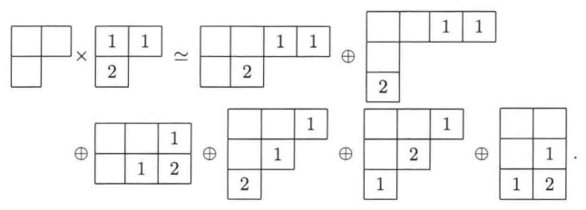

它们的维数公式是

$$
8\times 8=27+10+10^{*}+2\times 8+1.\tag{5.119}
$$

这里，加星号的数 $10^{*}$，说明表示 $[3,3]$ 是表示 $[3,0]$ 的复共轭表示。

一个重要的特例是 $N$ 阶完全反对称张量表示 $[1^{N}]$ 描写恒等表示，它与任意表示 $[\lambda]$ 的直乘仍是表示 $[\lambda]$。按李特尔伍德-理查森规则计算克莱布什-戈登级数时，只有一个表示的杨图行数不大于 $N$，它就是把两个杨图简单地粘起来：

$$
[1^{N}]\times[\lambda]\simeq[\lambda'],\quad \lambda_{j}'=\lambda_{j}+1.\tag{5.120}
$$

即杨图 $[\lambda']$ 比起原杨图 $[\lambda]$ 来，左面多了一列 $N$ 行的格子。按照定理 5.6 的推论 1，表示 $[\lambda']$ 等价于表示 $[\lambda]$。

### 5.4.8 协变张量和逆变张量

SU($N$) 群的自身表示与其复共轭表示不等价。按自身表示变换的矢量称为协变矢量，按自身表示直乘变换的张量称为协变张量。按自身表示的复共轭表示变换的矢量称为逆变矢量，按这复共轭表示直乘变换的张量称为逆变张量。在 SU($N$) 变换中逆变张量按下式变换：

$$
\begin{aligned}(O_{u}T)^{a_{1}\cdots a_{m}}&=\sum_{b_{1}\cdots b_{m}}T^{b_{1}\cdots b_{m}}(u^{-1})_{b_{1}a_{1}}\cdots(u^{-1})_{b_{m}a_{m}}\\&=\sum_{b_{1}\cdots b_{m}}u_{a_{1}b_{1}}^{*}\cdots u_{a_{m}b_{m}}^{*}T^{b_{1}\cdots b_{m}}.\end{aligned}\tag{5.121}
$$

逆变张量的基记为 $\Theta^{b_{1}\cdots b_{m}}$，有

$$
\begin{aligned}O_{u}\Theta^{b_{1}\cdots b_{m}}&=\sum_{d_{1}\cdots d_{m}}(u^{-1})_{b_{1}d_{1}}\cdots(u^{-1})_{b_{m}d_{m}}\Theta^{d_{1}\cdots d_{m}}\\&=\sum_{d_{1}\cdots d_{m}}\Theta^{d_{1}\cdots d_{m}}u_{d_{1}b_{1}}^{*}\cdots u_{d_{m}b_{m}}^{*}.\end{aligned}\tag{5.122}
$$

逆变张量空间记为 $\mathcal{T}^{*}$，用杨算符 $\mathcal{Y}^{[\tau]}$ 投影，得不可约张量子空间 $\mathcal{Y}^{[\tau]}\mathcal{T}^{*}=\mathcal{T}^{[\tau]*}$，对应表示用带星号的杨图 $[\tau]^{*}$ 标记，子空间的张量基用带星号的正则张量杨表标记。表示 $[\tau]^{*}$ 是表示 $[\tau]$ 的复共轭表示，它们的杨图关系已由定理 5.6 的推论 2 给出。例如，完全反对称逆变张量表示 $[1^{m}]^{*}$ 等价于完全反对称协变张量表示 $[1^{N-m}]$：

$$
[1^{m}]^{*}\simeq[1^{N-m}].\tag{5.123}
$$

事实上，表示 $[1^{m}]^{*}$ 的张量基记为 $\mathcal{Y}^{[1^{m}]}\Theta^{b_{1}\cdots b_{m}}$，用乘 $N$ 阶完全反对称张量 $\epsilon_{a_{1}\cdots a_{N}}$ 的方法，定义新基 $\Phi_{a_{1}\cdots a_{N-m}}$：

$$
\Phi_{a_{1}\cdots a_{N-m}}=\frac{1}{m!}\sum_{b_{1}\cdots b_{m}}\epsilon_{a_{1}\cdots a_{N-m}b_{1}\cdots b_{m}}\mathcal{Y}^{[1^{m}]}\Theta^{b_{1}\cdots b_{m}}.\tag{5.124}
$$

基 $\Phi_{a_{1}\cdots a_{N-m}}$ 的指标也是完全反对称的，而且两组基的个数是相同的：

$$
\binom{N}{N-m}=\binom{N}{m}.
$$

因此基的组合 (5.124) 就是 $[1^{m}]^{*}$ 表示空间完备基的一种重新选择，对应的 SU($N$) 群表示与 $[1^{m}]^{*}$ 等价。利用 $\epsilon_{a_{1}\cdots a_{N}}$ 的性质，容易证明新基 $\Phi_{a_{1}\cdots a_{N-m}}$ 又是 SU($N$) 变换的 $N-m$ 阶完全反对称协变张量基，它们架设的空间对应表示 $[1^{N-m}]$。因此证得式 (5.123)。

$$
\begin{aligned}(O_{u}\Phi)_{a_{1}\cdots a_{N-m}}&=\frac{1}{m!}\sum_{b_{1}\cdots b_{m}}\epsilon_{a_{1}\cdots a_{N-m}b_{1}\cdots b_{m}}\left(\mathcal{Y}^{[1^{m}]}O_{u}\Theta\right)^{b_{1}\cdots b_{m}}\\&=\frac{1}{m!}\sum_{b_{1}\cdots b_{m}}\sum_{d_{1}\cdots d_{N-m}}\sum_{c_{1}\cdots c_{N-m}}\epsilon_{d_{1}\cdots d_{N-m}b_{1}\cdots b_{m}}\left(u_{c_{1}d_{1}}^{*}u_{c_{1}a_{1}}\right)\cdots\\&\quad\times\left(u_{c_{N-m}d_{N-m}}^{*}u_{c_{N-m}a_{N-m}}\right)\sum_{t_{1}\cdots t_{m}}\mathcal{Y}^{[1^{m}]}\Theta^{t_{1}\cdots t_{m}}u_{t_{1}b_{1}}\cdots u_{t_{m}b_{m}}\\&=\frac{1}{m!}\sum_{c_{1}\cdots c_{N-m}}\sum_{t_{1}\cdots t_{m}}\mathcal{Y}^{[1^{m}]}\Theta^{t_{1}\cdots t_{m}}u_{c_{1}a_{1}}\cdots u_{c_{N-m}a_{N-m}}\\&\quad\times\left\{\sum_{d_{1}\cdots d_{N-m}}\sum_{b_{1}\cdots b_{m}}u_{c_{1}d_{1}}^{*}\cdots u_{c_{N-m}d_{N-m}}^{*}u_{t_{1}b_{1}}^{*}\cdots u_{t_{m}b_{m}}^{*}\epsilon_{d_{1}\cdots d_{N-m}b_{1}\cdots b_{m}}\right\}\\&=\frac{1}{m!}\sum_{c_{1}\cdots c_{N-m}}\sum_{t_{1}\cdots t_{m}}\epsilon_{c_{1}\cdots c_{N-m}t_{1}\cdots t_{m}}\mathcal{Y}^{[1^{m}]}\Theta^{t_{1}\cdots t_{m}}u_{c_{1}a_{1}}\cdots u_{c_{N-m}a_{N-m}}\\&=\sum_{c_{1}\cdots c_{N-m}}\Phi_{c_{1}\cdots c_{N-m}}u_{c_{1}a_{1}}\cdots u_{c_{N-m}a_{N-m}}.\end{aligned}\tag{5.125}
$$

5.4.4 节中计算得的表示 $(0,1)$ 的正则张量杨表换成逆变张量基是

$$
\begin{array}{|c|}\hline 1\\\hline 2\\\hline\end{array}=[3]^{*},\quad \begin{array}{|c|}\hline 1\\\hline 3\\\hline\end{array}=-[2]^{*},\quad \begin{array}{|c|}\hline 2\\\hline 3\\\hline\end{array}=[1]^{*}.\tag{5.126}
$$

进一步，有 $n$ 个协变指标和 $m$ 个逆变指标，在 SU($N$) 变换中按下面规律变换的量称为 $(n,m)$ 阶混合张量，

$$
\begin{aligned}(O_{u}T)_{a_{1}\cdots a_{n}}^{b_{1}\cdots b_{m}}&=\sum_{(a')(b')}u_{a_{1}a_{1}'}\cdots u_{a_{n}a_{n}'}T_{a_{1}'\cdots a_{n}'}^{b_{1}'\cdots b_{m}'}(u^{-1})_{b_{1}'b_{1}}\cdots(u^{-1})_{b_{m}'b_{m}}\\&=\sum_{(a')(b')}u_{a_{1}a_{1}'}\cdots u_{a_{n}a_{n}'}u_{b_{1}b_{1}'}^{*}\cdots u_{b_{m}b_{m}'}^{*}T_{a_{1}'\cdots a_{n}'}^{b_{1}'\cdots b_{m}'}.\end{aligned}\tag{5.127}
$$

一个协变张量和一个逆变张量的直积就是一个混合张量的典型例子。可用两个杨算符 $\mathcal{Y}_{\mu}^{[\lambda]}$ 和 $\mathcal{Y}_{\nu}^{[\mu]}$ 分别对协变张量部分和逆变张量部分投影，把混合张量空间分解为混合张量子空间，对应 SU($N$) 群两表示的直积，$[\lambda]\times[\mu]^{*}$。这样的张量子空间是否还存在对 SU($N$) 变换不变的更小的子空间呢？

混合张量的一对协变和逆变指标取相同值并求和，这对指标在 SU($N$) 变换中保持不变：

$$
\begin{aligned}\sum_{c=1}^{N}(O_{u}T)_{ca_{1}\cdots}^{cb_{1}\cdots}&=\sum_{cdd'}u_{cd}u_{cd'}^{*}\sum_{(a')(b')}u_{a_{1}a_{1}'}\cdots u_{b_{1}b_{1}'}^{*}\cdots T_{da_{1}'\cdots}^{d'b_{1}'\cdots}\\&=\sum_{(a')(b')}u_{a_{1}a_{1}'}\cdots u_{b_{1}b_{1}'}^{*}\cdots\left(\sum_{d}T_{da_{1}'\cdots}^{db_{1}'\cdots}\right)\end{aligned}\tag{5.128}
$$

这样的张量称为原来张量的迹张量。一对协变和逆变指标取迹的运算称为张量指标的收缩， $(n,m)$ 阶张量的一对指标收缩后，它的变换性质等同于 $(n-1,m-1)$ 阶张量。迹张量的集合构成一个对 $\mathrm{SU}(N)$ 变换不变的张量子空间，这对指标无迹的张量构成的无迹张量子空间，也对 $\mathrm{SU}(N)$ 变换保持不变。

有一个典型的关于 $\mathrm{SU}(N)$ 变换不变的 $(1,1)$ 阶混合张量 $D$, 它的分量等于克罗内克 (Kronecker) $\delta$ 函数。

$$
D_a^{\ b} = \delta_a^{\ b} = \begin{cases} 1, & a = b, \\ 0, & a \neq b, \end{cases}
\tag{5.129}
$$

$$
(O_U D)_a^{\ b} = \sum_{a'b'} u_{aa'} u^*_{bb'} D_{a'}^{\ b'} = \sum_{a'b'} u_{aa'} u^*_{bb'} \delta_{a'}^{\ b'} = \delta_a^{\ b} = D_a^{\ b}.
$$

$(1,1)$ 阶混合张量 $D$ 构成一维张量空间，对应恒等表示。不变张量 $D$ 在混合张量空间的分解中起着重要作用。例如，

$$
T_a^{\ b} = \left\{ T_a^{\ b} - D_a^{\ b} \left( \frac{1}{N} \sum_c T_c^{\ c} \right) \right\} + D_a^{\ b} \left( \frac{1}{N} \sum_c T_c^{\ c} \right).
\tag{5.130}
$$

第一项是 $(1,1)$ 阶无迹混合张量，而第二项括号里的量是迹张量，它是零阶张量 (标量), 原来的张量性质由 $D$ 承担。用 $\mathrm{SU}(N)$ 群表示直乘分解的语言，有

$$
[1] \times [1]^* \simeq [1] \times [1^{N-1}] \simeq [2, 1^{N-2}] \oplus [1^N].
\tag{5.131}
$$

这符合李特尔伍德-理查森规则。

在混合张量空间中分解出无迹张量子空间的问题，原则上是一个简单的代数问题，但实际计算起来可能很繁琐。例如，从 $(2,1)$ 阶混合张量 $T_{ab}^{\ \ d}$ 中分解出无迹张量 $\Phi_{ab}^{\ \ d}$ 就相当繁琐，

$$
\Phi_{ab}^{\ \ d} = T_{ab}^{\ \ d} + D_a^{\ d} \sum_{p=1}^N \left\{ c_1 T_{bp}^{\ \ p} + c_2 T_{pb}^{\ \ p} \right\} + D_b^{\ d} \sum_{p=1}^N \left\{ c_3 T_{ap}^{\ \ p} + c_4 T_{pa}^{\ \ p} \right\}.
$$

则根据无迹条件 $\sum\limits_a \Phi_{ab}^{\ \ a} = 0$ 和 $\sum\limits_b \Phi_{ab}^{\ \ b} = 0$, 得

$$
1 + N c_2 + c_4 = 0, \qquad N c_1 + c_3 = 0,
$$

$$
1 + c_1 + N c_3 = 0, \qquad c_2 + N c_4 = 0.
$$

解得

$$
c_2 = c_3 = -N/(N^2 - 1), \qquad c_1 = c_4 = 1/(N^2 - 1),
$$

$$
\Phi_{ab}^{\ \ d} = T_{ab}^{\ \ d} + \frac{1}{N^2 - 1} \left\{ D_a^{\ d} \sum_{p=1}^N \left( T_{bp}^{\ \ p} - N T_{pb}^{\ \ p} \right) + D_b^{\ d} \sum_{p=1}^N \left( T_{pa}^{\ \ p} - N T_{ap}^{\ \ p} \right) \right\}.
$$

尽管计算比较繁琐，但原则上混合张量空间可以分解为一系列无迹张量子空间的直和，这些无迹张量的指标成对地减少。在实际物理问题中并不做这样的分解，而是直接定义混合张量是无迹的。

用两个杨算符 $\mathscr{Y}_\rho^{[\lambda]}$ 和 $\mathscr{Y}_\tau^{[\mu]}$ 对无迹混合张量投影，得到的表示用杨图标记为 $[\lambda]\backslash[\tau]^*$. 现在来证明，用杨图 $[\lambda]\backslash[\tau]^*$ 标记的无迹混合张量空间为非零空间的充要条件是杨图 $[\lambda]$ 和 $[\tau]^*$ 的第一列格数之和不大于 $N$, 也就是要证明在此条件下，不同的正则张量杨表数目大于无迹条件的数目。

设杨图 $[\lambda]$ 和杨图 $[\tau]^*$ 的第一列格数分别为 $n$ 和 $m$. 在此张量子空间中任取一对正则张量杨表，设它们的第一列格子中有 $\ell$ 对填数相重。变动这 $\ell$ 对填数相同的格子的填数值，固定所有其他格子的填数，得到互不相同的张量杨表的对数为

$$
\left( \begin{array}{c} N - (n + m - 2\ell) \\ \ell \end{array} \right).
$$

由于张量是无迹的，这些张量杨表间存在着无迹条件。固定 $\ell - 1$ 对相重的填数，余下的一对对数取迹，得到一个无迹条件。无迹条件数目等于这 $\ell - 1$ 对相重数所有可能的不同取值数目，即无迹条件数为

$$
\left( \begin{array}{c} N - (n + m - 2\ell) \\ \ell - 1 \end{array} \right).
$$

张量子空间为非零空间的充要条件是无迹条件的数目小于不相同的正则张量杨表对数，即

$$
\ell \leqslant \frac{1}{2} \{ N - (n + m - 2\ell) \}, \quad n + m \leqslant N.
\tag{5.132}
$$

证完。

用杨图 $[\lambda]\backslash[\tau]^*$ 标记的表示是不可约表示，它不再存在对 $\mathrm{SU}(N)$ 变换不变的更小的非零张量子空间。例如， $(1,1)$ 阶无迹混合张量空间对应不可约表示 $[1]\backslash[1]^*$. 比较式 (5.131) 知

$$
[1]\backslash[1]^* \simeq [2, 1^{N-2}].
\tag{5.133}
$$

这就是 $\mathrm{SU}(N)$ 群的伴随表示。采用类似式 (5.125) 的方法，可以把式 (5.133) 推广。对 $m$ 行的杨图 $[\tau]$, $m \leqslant N$, 有

$$
[\lambda]\backslash[\tau]^* \simeq [\lambda']\backslash[\tau']^*, \qquad
\left\{ \begin{array}{l} \tau_j' = \tau_j - 1, \quad 1 \leqslant j \leqslant m, \\ \lambda_k' = \lambda_k + 1, \quad 1 \leqslant k \leqslant N - m. \end{array} \right.
\tag{5.134}
$$

多次运用式 (5.134), 可以把无迹混合张量表示 $[\lambda]\backslash[\tau]^*$ 化为用一个杨图标记的不可约协变张量表示或不可约逆变张量表示，而且可以重新得到定理 5.6 的推论 2. 例如，对 $\mathrm{SU}(5)$ 群，有

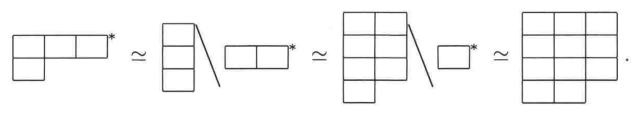

## 5.5 SO(N) 群的不可约表示

$\mathrm{SO}(N)$ 群有两类表示。张量表示是 $\mathrm{SO}(N)$ 群的单值表示，旋量表示是 $\mathrm{SO}(N)$ 群的双值表示。

### 5.5.1 SO(N) 群的张量

与 $\mathrm{SU}(N)$ 群的张量和张量基的概念类似， $\mathrm{SO}(N)$ 群的 $n$ 阶张量 $T_{a_1 \cdots a_n}$ 有 $n$ 个指标， $N^n$ 个分量，在 $\mathrm{SO}(N)$ 变换 $R$ 中按下式变换：

$$
T_{a_1 \cdots a_n} \xrightarrow{R} (O_R T)_{a_1 \cdots a_n} = \sum_{b_1 \cdots b_n} R_{a_1 b_1} \cdots R_{a_n b_n} T_{b_1 \cdots b_n}.
\tag{5.135}
$$

张量基 $\Theta_{d_1 \cdots d_n}$ 是一组特殊的张量，每个张量基都只有一个分量不为 0, 而等于 1. 任何张量可按张量基展开：

$$
(\Theta_{d_1 \cdots d_n})_{a_1 \cdots a_n} = \delta_{d_1 a_1} \delta_{d_2 a_2} \cdots \delta_{d_n a_n} = (\Theta_{d_1})_{a_1} \cdots (\Theta_{d_n})_{a_n}.
\tag{5.136}
$$

$$
T_{a_1 \cdots a_n} = \sum_{d_1 \cdots d_n} T_{d_1 \cdots d_n} (\Theta_{d_1 \cdots d_n})_{a_1 \cdots a_n} = T_{a_1 \cdots a_n}.
\tag{5.137}
$$

在 $\mathrm{SO}(N)$ 变换中张量基做如下变换：

$$
O_R \Theta_{d_1 \cdots d_n} = \sum_{b_1 \cdots b_n} \Theta_{b_1 \cdots b_n} R_{b_1 d_1} \cdots R_{a_n d_n}.
\tag{5.138}
$$

在置换变换中，张量和张量基也按式 (5.73) 和式 (5.84) 变换。 $\mathrm{SO}(N)$ 群的 $n$ 阶张量的集合构成 $N^n$ 维张量空间，它是一个线性空间，并对 $\mathrm{SO}(N)$ 变换和张量指标间的置换变换保持不变。对 $\mathrm{SO}(N)$ 群张量，外尔互反性也同样成立，即置换变换和 $\mathrm{SO}(N)$ 变换的次序可以交换，因而张量空间也可以用杨算符投影的方法，分解为对 $\mathrm{SO}(N)$ 变换不变的张量子空间的直和。

与 $\mathrm{SU}(N)$ 变换不同之处在于，现在的变换矩阵 $R \in \mathrm{SO}(N)$ 是实正交矩阵，这使 $\mathrm{SO}(N)$ 群张量具有若干新的性质。

(1) 在 $\mathrm{SO}(N)$ 变换中，张量分量的实部和虚部都独立地按照式 (5.135) 做变换，分别都是 $\mathrm{SO}(N)$ 群的张量，因而对 $\mathrm{SO}(N)$ 群可以只研究实张量。

(2) 由于 $R$ 是实矩阵， $\mathrm{SO}(N)$ 群的协变张量和逆变张量完全相同。以前在两类张量指标之间的取迹运算 (收缩), 现在在同类张量指标间进行。因此，为了找对 $\mathrm{SO}(N)$ 变换不变的子空间，先要把张量空间分解为一系列无迹张量子空间的直和，然后才用杨算符投影的方法分解这些无迹张量子空间。

(3) 设 $\mathcal{T}$ 是 $\mathrm{SO}(N)$ 群的 $n$ 阶无迹张量空间，用杨算符投影后得到的无迹张量子空间是 $\mathscr{Y}_\mu^{[\lambda]} \mathcal{T} = \mathcal{T}_\mu^{[\lambda]}$. 如果杨图 $[\lambda]$ 前两列格数之和大于 $N$, 由于无迹条件数目大于独立张量分量的数目，无迹张量子空间 $\mathcal{T}_\mu^{[\lambda]}$ 是空集 (参看式 (5.132) 的证明).

(4) 当杨图第一列格数 $\tau$ 虽小于 $N$ 但大于 $N/2$ 时，类似式 (5.123), 可以证明表示等价于行数为 $N - \tau$ 杨图的表示：

$$
[\lambda'] \simeq [\lambda], \quad \lambda_j' = \begin{cases} \lambda_j, & j \leqslant N - \tau, \\ 0, & j > N - \tau, \end{cases} \quad N/2 < \tau < N.
\tag{5.139}
$$

对 $\mathrm{SO}(N)$ 群，这样两个杨图称为对偶杨图。为了简化符号，以完全反对称张量为例来解释对偶张量基。设 $[\lambda] = [1^\tau]$ 是一列的杨图，张量基 $\mathscr{Y}^{[1^\tau]} \Theta_{a_1 \cdots a_\tau}$ 的对偶张量基定义为

$$
{}^* \left[ \mathscr{Y}^{[1^\tau]} \Theta \right]_{a_1 \cdots a_{N-\tau}} = \frac{1}{\tau!} \sum_{a_{N-\tau+1} \cdots a_N} \epsilon_{a_1 \cdots a_{N-\tau} a_{N-\tau+1} \cdots a_N} \mathscr{Y}^{[1^\tau]} \Theta_{a_N \cdots a_{N-\tau+1}}.
\tag{5.140}
$$

逆变换有

$$
\begin{aligned}
& \frac{1}{(N - \tau)!} \sum_{a_{\tau+1} \cdots a_N} \epsilon_{b_1 \cdots b_\tau a_{\tau+1} \cdots a_N} {}^* \left[ \mathscr{Y}^{[1^\tau]} \Theta \right]_{a_N \cdots a_{\tau+1}} \\
& = \frac{1}{\tau! (N - \tau)!} \sum_{a_1 \cdots a_N} \epsilon_{b_1 \cdots b_\tau a_{\tau+1} \cdots a_N} \epsilon_{a_N \cdots a_{\tau+1} a_1 \cdots a_\tau} \mathscr{Y}^{[1^\tau]} \Theta_{a_1 \cdots a_\tau} \\
& = (-1)^{N(N-1)/2} \mathscr{Y}^{[1^\tau]} \Theta_{b_1 \cdots b_\tau}.
\end{aligned}
\tag{5.141}
$$

式中，两个 $N$ 阶完全反对称张量相乘时，先把第二个完全反对称张量的指标逆序排列，产生因子 $(-1)^{N(N-1)/2}$, 然后指标求和，消去前面的分母，并产生 $N - \tau$ 个 $\delta$ 函数的乘积之和，得到最后结果。实际上，把因反对称指标求和产生的重复项与 $\tau!$ 消去后，式 (5.140) 的求和中只包含一项不为零。除符号外，两组张量基只是排列次序上的不同，对应简单相似变换，因而对应的表示是等价的。另一方面，由式 (5.140) 给出的新基是按照反对称表示 $[1^{N-\tau}]$ 变换的，因此 $[1^\tau] \simeq [1^{N-\tau}]$. 由于无迹条件，这等价关系可以推广到任意 $\tau$ 行杨图 $[\lambda]$ 的情况，即式 (5.139).

(5) 当 $N$ 是偶数时，若杨图 $[\lambda]$ 的行数等于 $\ell = N/2$, 则杨图 $[\lambda]$ 与其对偶杨图完全相同，称为自对偶杨图。为了使张量基在取两次对偶后恢复原状，在对偶关系式 (5.140) 中引入因子 $(-i)^\ell$, 以消去式 (5.141) 中的因子 $(-1)^{N(N-1)/2} = (-1)^\ell$:

$$
\begin{aligned}
{}^* \left[ \mathscr{Y}^{[\lambda]} \Theta \right]_{a_1 \cdots a_\ell b \cdots} &= \frac{(-i)^\ell}{\ell!} \sum_{a_{\ell+1} \cdots a_{2\ell}} \epsilon_{a_1 \cdots a_\ell a_{\ell+1} \cdots a_{2\ell}} \mathscr{Y}^{[\lambda]} \Theta_{a_{2\ell} \cdots a_{\ell+1} b \cdots}, \\
\mathscr{Y}^{[\lambda]} \Theta_{a_1 \cdots a_\ell b \cdots} &= \frac{(-i)^\ell}{\ell!} \sum_{a_{\ell+1} \cdots a_{2\ell}} \epsilon_{a_1 \cdots a_\ell a_{\ell+1} \cdots a_{2\ell}} {}^* \left[ \mathscr{Y}^{[\lambda]} \Theta \right]_{a_{2\ell} \cdots a_{\ell+1} b \cdots}.
\end{aligned}
\tag{5.142}
$$

式中张量杨表，指标 $a_j$ 填在第一列。把两组基相加或相减，得

$$
\Psi_{a_1 \cdots a_\ell b \cdots}^{\pm} = \frac{1}{2} \left\{ \mathscr{Y}^{[\lambda]} \Theta_{a_1 \cdots a_\ell b \cdots} \pm {}^* \left[ \mathscr{Y}^{[\lambda]} \Theta \right]_{a_1 \cdots a_\ell b \cdots} \right\}.
\tag{5.143}
$$

$\Psi_{a_1 \cdots a_\ell b \cdots}^{+}$ 在对偶运算中保持不变，称为自对偶张量基， $\Psi_{a_1 \cdots a_\ell b \cdots}^{-}$ 在对偶运算中只改变符号，称为反对偶张量基。例如，

$$
\Psi_{1 \cdots \ell}^{\pm} = \frac{1}{2} \left\{ \mathscr{Y}^{[1^\ell]} \Theta_{1 \cdots \ell} \pm (-i)^\ell \mathscr{Y}^{[1^\ell]} \Theta_{(2\ell) \cdots (\ell+1)} \right\}.
\tag{5.144}
$$

为了给读者一个直观的概念，下面取 $N = 4$ ($\ell = 2$), 把对偶和反对偶张量基具体写出来：

$$
\begin{aligned}
\Psi_{12}^{\pm} = \pm \Psi_{34}^{\pm} &= \frac{1}{2} \left\{ \mathscr{Y}^{[1,1]} \Theta_{12} \pm \mathscr{Y}^{[1,1]} \Theta_{34} \right\}, \\
\Psi_{13}^{\pm} = \pm \Psi_{42}^{\pm} &= \frac{1}{2} \left\{ \mathscr{Y}^{[1,1]} \Theta_{13} \pm \mathscr{Y}^{[1,1]} \Theta_{42} \right\}, \\
\Psi_{14}^{\pm} = \pm \Psi_{23}^{\pm} &= \frac{1}{2} \left\{ \mathscr{Y}^{[1,1]} \Theta_{14} \pm \mathscr{Y}^{[1,1]} \Theta_{23} \right\}.
\end{aligned}
\tag{5.145}
$$

张量的自对偶性质在 $\mathrm{SO}(N)$ 变换中保持不变。因此，当 $N = 2\ell$ 和杨图 $[\lambda]$ 行数为 $\ell$ 时， $[\lambda]$ 是自对偶杨图，无迹张量空间 $\mathscr{Y}^{[\lambda]} \mathcal{T}$ 分解为两个维数相同的不变张量子空间的直和，分别对应 $\mathrm{SO}(N)$ 群两个不等价的不可约表示，记为 $[(S)\lambda]$ 和 $[(A)\lambda]$. 两个张量子空间分别称为自对偶和反自对偶张量子空间。注意，杨算符对张量基的组合，式 (5.140) 的对偶张量基的组合，都是实组合，式 (5.143) 引入的对偶张量基的组合，当 $N$ 能被 4 除尽时也是实组合，唯有当 $N = 4m + 2$ 时，式 (5.143) 引入的对偶张量基的组合是复组合。

总之，首先把 $\mathrm{SO}(N)$ 群的 $n$ 阶张量空间，分解为一系列无迹张量子空间的直和。然后对无迹张量空间用杨算符投影，得到张量指标有确定对称性的无迹张量子空间，对应的表示用杨图标记。当杨图前两列格数之和大于 $N$ 时，这子空间是零空间。当杨图行数小于 $N/2$ 时，这表示是不可约实表示。当杨图行数小于 $N$ 但大于 $N/2$ 时，这表示等价于对偶杨图标记的表示 [见式 (5.139)]. 对 $\mathrm{SO}(2\ell)$ 群，当杨图 $[\lambda]$ 行数等于 $\ell$ 时，这张量空间又分解为自对偶和反自对偶两个张量子空间的直和，分别对应自对偶表示 $[(S)\lambda]$ 和反自对偶表示 $[(A)\lambda]$. 当 $N = 4m + 2$ 时， $[(S)\lambda]$ 和 $[(A)\lambda]$ 是互为复共轭的不等价不可约表示。当 $N = 4m$ 时， $[(S)\lambda]$ 和 $[(A)\lambda]$ 是两个互不等价的不可约实表示。所有张量表示都是 $\mathrm{SO}(N)$ 群的单值表示。关于表示的等价性和不可约性的结论将在 5.5.2 和 5.5.3 节证明。

计算 $\mathrm{SO}(N)$ 群的不可约张量基有三个困难。一是这样的正则张量杨表不是谢瓦莱基 $H_\mu$ 的共同本征张量。二是张量基的无迹化虽不是原则性的困难，但是计算很麻烦，而且不好写成统一的形式。三是用杨算符对无迹张量基投影后得到的正则张量杨表不一定线性无关。解决的方法是重新定义一组正交归一的矢量基，称为球谐基，它们是谢瓦莱基 $H_\mu$ 的共同本征张量，而且用降算符作用在最高权态的方法，可以计算出互相正交归一的无迹状态基。

根据 4.6.2 节的讨论知， $\mathrm{SO}(N)$ 群自身表示中的生成元取为 $T_{ab}$, 满足对易关系：

$$
(T_{ab})_{cd} = -\mathrm{i} \{ \delta_{ac} \delta_{bd} - \delta_{ad} \delta_{bc} \},
\tag{5.146}
$$

$$
[T_{ab}, T_{cd}] = -\mathrm{i} \{ \delta_{bc} T_{ad} + \delta_{ad} T_{bc} - \delta_{bd} T_{ac} - \delta_{ac} T_{bd} \}.
$$

嘉当子代数的基 $H_j$ 为

$$
H_j = T_{(2j-1)(2j)}, \quad 1 \leqslant j \leqslant \ell.
\tag{5.147}
$$

下面将分别就 $N$ 为奇数和偶数两种情况来讨论。

### 5.5.2 SO(2ℓ+1) 群生成元的谢瓦莱基

$\mathrm{SO}(2\ell + 1)$ 群对应 $\mathrm{B}_\ell$ 李代数，素根为

$$
\boldsymbol{r}_\mu = \boldsymbol{e}_\mu - \boldsymbol{e}_{\mu+1}, \quad 1 \leqslant \mu < \ell, \quad \boldsymbol{r}_\ell = \boldsymbol{e}_\ell.
\tag{5.148}
$$

$\boldsymbol{r}_\ell$ 是短根， $d_\ell = 1/2$, 其他素根 $\boldsymbol{r}_\mu$ 是长根， $d_\mu = 1$. 按照谢瓦莱基的定义式 (5.25), $\mathrm{SO}(2\ell + 1)$ 群自身表示生成元的谢瓦莱基为

$$
\begin{aligned}
H_\mu &= T_{(2\mu-1)(2\mu)} - T_{(2\mu+1)(2\mu+2)}, \quad H_\ell = 2T_{(2\ell-1)(2\ell)}, \\
E_\mu &= F_\mu^\dagger = \frac{1}{2} \left\{ T_{(2\mu)(2\mu+1)} - \mathrm{i} T_{(2\mu-1)(2\mu+1)} - \mathrm{i} T_{(2\mu)(2\mu+2)} - T_{(2\mu-1)(2\mu+2)} \right\}, \\
E_\ell &= F_\ell^\dagger = T_{(2\ell)(2\ell+1)} - \mathrm{i} T_{(2\ell-1)(2\ell+1)},
\end{aligned}
\tag{5.149}
$$

其中， $1 \leqslant \mu \leqslant \ell - 1$. 矢量基 $\Theta_a$ 不是 $H_\mu$ 的共同本征矢量。把 4.4.4 节 $\mathrm{SO}(3)$ 群的球谐多项式推广，引入 $\mathrm{SO}(2\ell + 1)$ 群的球谐基 $\Phi_\alpha$, $1 \leqslant \alpha \leqslant 2\ell + 1$,

$$
\Phi_\alpha = \begin{cases}
(-1)^{\ell-\alpha+1} \sqrt{1/2} \left( \Theta_{2\alpha-1} + \mathrm{i} \Theta_{2\alpha} \right), & 1 \leqslant \alpha \leqslant \ell, \\
\Theta_{2\ell+1}, & \alpha = \ell + 1, \\
\sqrt{1/2} \left( \Theta_{4\ell-2\alpha+3} - \mathrm{i} \Theta_{4\ell-2\alpha+4} \right), & \ell + 2 \leqslant \alpha \leqslant 2\ell + 1.
\end{cases}
\tag{5.150}
$$

在球谐基 $\Phi_\alpha$ 中谢瓦莱基的非零矩阵元为

$$
\begin{array}{ll}
H_\mu \Phi_\mu = \Phi_\mu, & H_\mu \Phi_{\mu+1} = -\Phi_{\mu+1} \\
H_\mu \Phi_{2\ell-\mu+1} = \Phi_{2\ell-\mu+1}, & H_\mu \Phi_{2\ell-\mu+2} = -\Phi_{2\ell-\mu+2}, \\
H_\ell \Phi_\ell = 2\Phi_\ell, & H_\ell \Phi_{\ell+2} = -2\Phi_{\ell+2}, \\
E_\mu \Phi_{\mu+1} = \Phi_\mu, & E_\mu \Phi_{2\ell-\mu+2} = \Phi_{2\ell-\mu+1}, \\
E_\ell \Phi_{\ell+1} = \sqrt{2} \Phi_\ell, & E_\ell \Phi_{\ell+2} = \sqrt{2} \Phi_{\ell+1}, \\
F_\mu \Phi_\mu = \Phi_{\mu+1}, & F_\mu \Phi_{2\ell-\mu+1} = \Phi_{2\ell-\mu+2}, \\
F_\ell \Phi_\ell = \sqrt{2} \Phi_{\ell+1}, & F_\ell \Phi_{\ell+1} = \sqrt{2} \Phi_{\ell+2},
\end{array}
\tag{5.151}
$$

其中， $1 \leqslant \mu \leqslant \ell - 1$. 为了直观，明显写出 $H_\mu$ 在球谐基中的矩阵形式

$$
H_\mu = \operatorname{diag}\{ \underbrace{0, \cdots, 0}_{\mu-1}, 1, -1, \underbrace{0, \cdots, 0}_{2\ell-2\mu-1}, 1, -1, \underbrace{0, \cdots, 0}_{\mu-1} \},
$$

$$
H_\ell = \operatorname{diag}\{ \underbrace{0, \cdots, 0}_{\ell-1}, 2, 0, -2, \underbrace{0, \cdots, 0}_{\ell-1} \}.
$$

球谐基 $\Phi_\alpha$ 的直乘得到 $n$ 阶张量的球谐基 $\Phi_{\alpha_1 \cdots \alpha_n} = \Phi_{\alpha_1} \cdots \Phi_{\alpha_n}$. 采用球谐基后， $\mathrm{SO}(2\ell + 1)$ 群的张量杨表又变成 $H_\mu$ 的共同本征状态，本征值就是权分量 $m_\mu$, 它等于正则张量杨表中填 $\mu$ 和填 $2\ell - \mu + 1$ 的格数之和，减去填 $\mu + 1$ 和填 $2\ell - \mu + 2$ 的格数之和。当 $\mu = \ell$ 时，本征值 $m_\ell$ 等于正则张量杨表中填 $\ell$ 的格数减去填 $\ell + 2$ 的格数，再乘 2. $E_\mu$ 对正则张量杨表的作用得到若干张量杨表之和，其中每一个都是由原来的正则张量杨表，把其中一个填数 $\mu + 1$ 换成 $\mu$, 或把一个填数 $2\ell - \mu + 2$ 换成 $2\ell - \mu + 1$. $E_\ell$ 对正则张量杨表的作用则把其中一个填数 $\ell + 1$ 换成 $\ell$, 或把一个填数 $\ell + 2$ 换成 $\ell + 1$, 并再乘 $\sqrt{2}$. $F_\mu$ 和 $F_\ell$ 对正则张量杨表的作用正好做相反的替换。这样得到的张量杨表，有些可能不是正则的，它们可通过式 (5.87) 和式 (5.88) 化为正则张量杨表的线性组合。根据在升算符 $E_\nu$ 作用下得零的要求，表示 $[\lambda]$ **最高权态**对应的正则张量杨表 $\mathscr{Y}_\rho^{[\lambda]} \Phi_{\alpha_1 \cdots \alpha_n}$, 所有格子都填以该格子所在行数。根据球谐基的具体形式，这样的正则张量杨表不包含 $\alpha > \ell$ 的球谐基 $\Phi_\alpha$, 因而是无迹的。例如， $\Theta_1 \Theta_1$ 是有迹的，但 $\Phi_1 \Phi_1$ 是无迹的。与 $\mathrm{SU}(N)$ 群的证明一样，可证在用杨图 $[\lambda]$ 标记的无迹张量子空间中，只有这一个正则张量杨表在所有升算符作用下为零，可见这张量子空间对应不可约表示。由式 (5.151), $\mathrm{SO}(2\ell + 1)$ 群杨图 $[\lambda]$ 和最高权 $M$ 的关系为

$$
M_\mu = \lambda_\mu - \lambda_{\mu+1}, \quad 1 \leqslant \mu < \ell, \quad M_\ell = 2\lambda_\ell.
\tag{5.152}
$$

$\mathrm{SO}(2\ell + 1)$ 群表示 $[\lambda]$ 中的其他正交归一的状态基可按照方块权图和推广的盖尔范德方法，由最高权态用降算符作用得到。升算符或降算符的作用只是使状态基在不可约张量子空间内变化。由于最高权态是无迹的，由最高权态降下来的所有状态基也一定是无迹的，而且是正交归一的。式 (5.152) 指出，对于行数不大于 $\ell$ 的杨图，不同杨图描写不等价的不可约表示。 $\mathrm{SO}(2\ell + 1)$ 群张量表示最高权的特点是最后一个分量 $M_\ell$ 是偶数。以后会看到， $M_\ell$ 为奇数的表示是双值表示，称为旋量表示。

现在再来解释图 5.7 所显示的现象，就是为什么对 $\mathrm{B}_\ell$ 李代数，在 $F_\ell$ 作用下得到新的子李代数 $\mathrm{A}_{\ell-1}$ 多重态的最高权态会出现 2 重态。理由如下。式 (5.151) 指出， $F_\ell$ 作用在态 $\Phi_\ell$ 和 $\Phi_{\ell+1}$ 上分别得到态 $\Phi_{\ell+1}$ 和 $\Phi_{\ell+2}$, $\Phi_{\ell+1}$ 和 $\Phi_{\ell+2}$ 都在子李代数 $\mathrm{A}_{\ell-1}$ 的升算符作用下得零，因此都可以构成 $\mathrm{A}_{\ell-1}$ 的最高权态。这里还是用图 5.7 的例子，计算 $\mathrm{B}_3$ 李代数最高权表示 $M = (0,2,2)$ (杨图 $[3,3,1]$) 中，子李代数 $\mathrm{A}_2$ 新最高权表示 $M' = (1,2)$ (杨图 $[3,2]$) 的最高权态为什么会有 2 重态。换言之，具体计算 $\mathrm{B}_3$ 李代数最高权表示 $(0,2,2)$ 中权为 $(1,2,0)$ 的状态基，发现此权重数为 3, 其中后两个状态基是子李代数 $\mathrm{A}_2$ 多重态的最高权态。因为状态基是无迹张量，表达成正则张量杨表时形式比较复杂。

$$
|(0,2,2)\rangle = \begin{array}{|c|c|c|} \hline 1 & 1 & 1 \\ \hline 2 & 2 & 2 \\ \hline 3 &  \\  \end{array},
$$

$$
|(1,0,4)\rangle = \sqrt{\frac{1}{2}} F_2 |(0,2,2)\rangle = \sqrt{2}\; \begin{array}{|c|c|c|} \hline 1 & 1 & 1 \\ \hline 2 & 2 & 3 \\ \hline 3 &  \\  \end{array},
$$

$$
|(0,3,0)\rangle = \sqrt{\frac{1}{2}} F_3 |(0,2,2)\rangle = \begin{array}{|c|c|c|} \hline 1 & 1 & 1 \\ \hline 2 & 2 & 2 \\ \hline 4 &  \\  \end{array},
$$

$$
|(0,4,\bar{2})\rangle = \sqrt{\frac{1}{2}} F_3 |(0,3,0)\rangle = \begin{array}{|c|c|c|} \hline 1 & 1 & 1 \\ \hline 2 & 2 & 2 \\ \hline 5 &  \\  \end{array},
$$

$$
|(1,1,2)_1\rangle = \sqrt{\frac{1}{3}} F_2 |(0,3,0)\rangle = \sqrt{3}\; \begin{array}{|c|c|c|} \hline 1 & 1 & 1 \\ \hline 2 & 2 & 3 \\ \hline 4 &  \\  \end{array} - \sqrt{\frac{1}{3}}\; \begin{array}{|c|c|c|} \hline 1 & 1 & 1 \\ \hline 2 & 2 & 4 \\ \hline 3 &  \\  \end{array},
$$

$$
|(1,1,2)_2\rangle = \sqrt{\frac{3}{8}} \left\{ F_3 |(1,0,4)\rangle - \sqrt{\frac{4}{3}} |(1,1,2)_1\rangle \right\}
$$

$$
= \sqrt{\frac{3}{4}} F_3 \begin{array}{|c|c|c|} \hline 1 & 1 & 1 \\ \hline 2 & 2 & 3 \\ \hline 3 &  \\  \end{array} - \sqrt{\frac{3}{2}} \begin{array}{|c|c|c|} \hline 1 & 1 & 1 \\ \hline 2 & 2 & 3 \\ \hline 4 &  \\  \end{array} + \sqrt{\frac{1}{6}} \begin{array}{|c|c|c|} \hline 1 & 1 & 1 \\ \hline 2 & 2 & 4 \\ \hline 3 &  \\  \end{array}
$$

$$
= \sqrt{\frac{8}{3}} \begin{array}{|c|c|c|} \hline 1 & 1 & 1 \\ \hline 2 & 2 & 4 \\ \hline 3 &  \\  \end{array},
$$

$$
|(1,2,0)_1\rangle = \frac{1}{2} F_2 |(0,4,\bar{2})\rangle = \frac{1}{2} \begin{array}{|c|c|c|} \hline 1 & 1 & 1 \\ \hline 2 & 2 & 2 \\ \hline 6 &  \\  \end{array} + \frac{3}{2} \begin{array}{|c|c|c|} \hline 1 & 1 & 1 \\ \hline 2 & 2 & 3 \\ \hline 5 &  \\  \end{array} - \frac{1}{2} \begin{array}{|c|c|c|} \hline 1 & 1 & 1 \\ \hline 2 & 2 & 5 \\ \hline 3 &  \\  \end{array},
$$

$$
|(1,2,0)_2\rangle=\sqrt{\frac{3}{14}}F_3|(1,1,2)_2\rangle=\sqrt{\frac{8}{7}}\left\{\begin{array}{c}\begin{array}{|c|c|c|}\hline 1&1&1\\\hline 2&2&4\\\hline\end{array}\\\begin{array}{|c|}\hline 4\\\hline\end{array}\end{array}+\begin{array}{c}\begin{array}{|c|c|c|}\hline 1&1&1\\\hline 2&2&5\\\hline\end{array}\\\begin{array}{|c|}\hline 3\\\hline\end{array}\end{array}\right\},
$$

$$
\begin{aligned}
|(1,2,0)_3\rangle&=\sqrt{\frac{14}{15}}\left\{F_3|(1,1,2)_1\rangle-\sqrt{\frac{3}{2}}|(1,2,0)_1\rangle-\sqrt{\frac{16}{21}}|(1,2,0)_2\rangle\right\}\\
&=\frac{4}{\sqrt{35}}\begin{array}{c}\begin{array}{|c|c|c|}\hline 1&1&1\\\hline 2&2&4\\\hline\end{array}\\\begin{array}{|c|}\hline 4\\\hline\end{array}\end{array}+\frac{1}{2}\sqrt{\frac{7}{5}}\begin{array}{c}\begin{array}{|c|c|c|}\hline 1&1&1\\\hline 2&2&3\\\hline\end{array}\\\begin{array}{|c|}\hline 5\\\hline\end{array}\end{array}\\
&\quad-\frac{13}{2\sqrt{35}}\begin{array}{c}\begin{array}{|c|c|c|}\hline 1&1&1\\\hline 2&2&5\\\hline\end{array}\\\begin{array}{|c|}\hline 3\\\hline\end{array}\end{array}-\frac{1}{2}\sqrt{\frac{7}{5}}\begin{array}{c}\begin{array}{|c|c|c|}\hline 1&1&1\\\hline 2&2&2\\\hline\end{array}\\\begin{array}{|c|}\hline 6\\\hline\end{array}\end{array}.
\end{aligned}
$$

### 5.5.3 SO(2ℓ) 群生成元的谢瓦莱基

SO(2ℓ) 群对应李代数 $D_\ell$，素根为

$$
\boldsymbol{r}_\mu=\boldsymbol{e}_\mu-\boldsymbol{e}_{\mu+1},\quad 1\leqslant\mu<\ell,\quad \boldsymbol{r}_\ell=\boldsymbol{e}_{\ell-1}+\boldsymbol{e}_\ell.
\tag{5.153}
$$

全部素根长度相同，$d_\mu=1$. 按照谢瓦莱基的定义式 (5.25)，SO(2ℓ) 群自身表示生成元的谢瓦莱基，当 $1\leqslant\mu<\ell$ 时与 SO(2ℓ+1) 群相同，仍由式 (5.149) 给出，但当 $\mu=\ell$ 时，有

$$
H_\ell=T_{(2\ell-3)(2\ell-2)}+T_{(2\ell-1)(2\ell)},
$$

$$
E_\ell=F_\ell^\dagger=\frac{1}{2}\left\{T_{(2\ell-2)(2\ell-1)}-\mathrm{i}T_{(2\ell-3)(2\ell-1)}+\mathrm{i}T_{(2\ell-2)(2\ell)}+T_{(2\ell-3)(2\ell)}\right\}.
\tag{5.154}
$$

原来的正则张量杨表也不是谢瓦莱基 $H_\nu$ 的共同本征张量。定义 SO(2ℓ) 群的球谐基 $\Phi_\alpha$：

$$
\Phi_\alpha=\begin{cases}(-1)^{\ell-\alpha}\sqrt{1/2}\left(\Theta_{2\alpha-1}+\mathrm{i}\Theta_{2\alpha}\right), & 1\leqslant\alpha\leqslant\ell,\\[4pt]\sqrt{1/2}\left(\Theta_{4\ell-2\alpha+1}-\mathrm{i}\Theta_{4\ell-2\alpha+2}\right), & \ell+1\leqslant\alpha\leqslant 2\ell.\end{cases}
\tag{5.155}
$$

在球谐基 $\Phi_\alpha$ 中谢瓦莱基的非零矩阵元为

$$
\begin{aligned}
H_\mu\Phi_\mu&=\Phi_\mu, & H_\mu\Phi_{\mu+1}&=-\Phi_{\mu+1},\\
H_\mu\Phi_{2\ell-\mu}&=\Phi_{2\ell-\mu}, & H_\mu\Phi_{2\ell-\mu+1}&=-\Phi_{2\ell-\mu+1},\\
H_\ell\Phi_{\ell-1}&=\Phi_{\ell-1}, & H_\ell\Phi_\ell&=\Phi_\ell,\\
H_\ell\Phi_{\ell+1}&=-\Phi_{\ell+1}, & H_\ell\Phi_{\ell+2}&=-\Phi_{\ell+2},\\
E_\mu\Phi_{\mu+1}&=\Phi_\mu, & E_\mu\Phi_{2\ell-\mu+1}&=\Phi_{2\ell-\mu},\\
E_\ell\Phi_{\ell+1}&=\Phi_{\ell-1}, & E_\ell\Phi_{\ell+2}&=\Phi_\ell,\\
F_\mu\Phi_\mu&=\Phi_{\mu+1}, & F_\mu\Phi_{2\ell-\mu}&=\Phi_{2\ell-\mu+1},\\
F_\ell\Phi_{\ell-1}&=\Phi_{\ell+1}, & F_\ell\Phi_\ell&=\Phi_{\ell+2},
\end{aligned}
\tag{5.156}
$$

其中，$1\leqslant\mu\leqslant\ell-1$. 为了直观，明显写出 $H_\nu$ 在球谐基中的矩阵形式：

$$
H_\mu=\operatorname{diag}\{\underbrace{0,\cdots,0}_{\mu-1},1,-1,\underbrace{0,\cdots,0}_{2\ell-2\mu-2},1,-1,\underbrace{0,\cdots,0}_{\mu-1}\},
$$

$$
H_\ell=\operatorname{diag}\{\underbrace{0,\cdots,0}_{\ell-2},1,1,-1,-1,\underbrace{0,\cdots,0}_{\ell-2}\}.
$$

$n$ 阶张量的张量基 $\Phi_{\alpha_1\cdots\alpha_n}$ 是 $\Phi_\alpha$ 的直乘 $\Phi_{\alpha_1}\cdots\Phi_{\alpha_n}$. 采用球谐基后，SO(2ℓ) 群的张量杨表又变成 $H_\mu$ 的共同本征状态，本征值是权分量 $m_\mu$，它等于正则张量杨表中填 $\mu$ 和填 $2\ell-\mu$ 的格数之和，减去填 $\mu+1$ 和填 $2\ell-\mu+1$ 的格数之和。当 $\mu=\ell$ 时，本征值 $m_\ell$ 等于正则张量杨表中填 $\ell-1$ 和填 $\ell$ 的格数之和，减去填 $\ell+1$ 和填 $\ell+2$ 的格数之和。 $E_\mu$ 对正则张量杨表的作用得到若干张量杨表之和，其中每一个都是由原来的正则张量杨表，把其中一个填数 $\mu+1$ 换成 $\mu$，或把一个填数 $2\ell-\mu+1$ 换成 $2\ell-\mu$. $E_\ell$ 对正则张量杨表的作用则把其中一个填数 $\ell+1$ 换成 $\ell-1$，或把一个填数 $\ell+2$ 换成 $\ell$. $F_\mu$ 和 $F_\ell$ 对正则张量杨表的作用正好做相反的替换。这样得到的张量杨表，有些可能不是正则的，它们可通过式 (5.87) 和 (5.88) 化为正则张量杨表的线性组合。根据在升算符 $E_\nu$ 作用下得零的要求，表示 $[\lambda]$ 最高权态对应的正则张量杨表 $\gamma_\rho^{[\lambda]}\Phi_{\alpha_1\cdots\alpha_n}$ 仍是各行格子填以所在行数，但当杨图行数等于 $\ell$ 时，第 $\ell$ 行的格子都填 $\ell$ 的正则张量杨表对应自对偶表示 $[(S)\lambda]$，都填 $\ell+1$ 的正则张量杨表对应反自对偶表示 $[(A)\lambda]$. 第 $\ell$ 行部分格子填 $\ell$，其余格子填 $\ell+1$ 的正则张量杨表是有迹张量。

由式 (5.156) 可以确认这些对应最高权态的正则张量杨表在每一个升算符 $E_\nu$ 作用下都得零，而且由于不同时包含因子 $\Phi_\alpha$ 和 $\Phi_{2\ell-\alpha+1}$，它们确是无迹张量。可证在用杨图 $[\lambda]$ 标记的无迹张量子空间中，只有这一个正则张量杨表在所有升算符作用下为零，可见这张量子空间对应不可约表示。 SO(2ℓ) 群杨图 $[\lambda]$ 和最高权 $M$ 的关系为

$$
\begin{aligned}
M_\mu&=\lambda_\mu-\lambda_{\mu+1}, &\text{当 }& 1\leqslant\mu<\ell-1,\\
M_{\ell-1}&=M_\ell=\lambda_{\ell-1}, &\text{当 }& \lambda_\ell=0,\\
M_{\ell-1}&=\lambda_{\ell-1}-\lambda_\ell,\ M_\ell=\lambda_{\ell-1}+\lambda_\ell, &\text{对 }& [(S)\lambda]\text{ 表示},\\
M_{\ell-1}&=\lambda_{\ell-1}+\lambda_\ell,\ M_\ell=\lambda_{\ell-1}-\lambda_\ell, &\text{对 }& [(A)\lambda]\text{ 表示}.
\end{aligned}
\tag{5.157}
$$

这里给出的自对偶表示 $[(S)\lambda]$ 和反自对偶表示 $[(A)\lambda]$ 的定义与式 (5.143) 的定义是一致的。

SO(2ℓ) 群表示 $[\lambda]$ 中的其他正交归一的状态基可按照方块权图方法和推广的盖尔范德方法，由最高权态用降算符作用得到，这样算得的状态基一定是无迹的，而且是正交归一的。 SO(2ℓ) 群张量表示最高权的特点是最后两个分量之和 $M_{\ell-1}+M_\ell$ 是偶数。以后会看到，$M_{\ell-1}+M_\ell$ 为奇数的表示是双值表示，称为旋量表示。

### 5.5.4 SO(N) 群不可约张量表示的维数

这里推广 SU(N) 群和置换群的钩形规则，利用杨图计算 SO(N) 群不可约张量表示 [λ] 的维数，其中杨图 [λ] 行数不大于 N/2. 在钩形规则中，表示的维数表为一个分数，分子和分母分别是给定杨图 [λ] 的一定表中所有填数的乘积。分母的表 $Y_h^{[\lambda]}$ 还是在杨图 [λ] 各格填以该格的钩形数 $h_{ij}$. 若 [λ] 是一列的杨图，则因为没有取迹的问题，SO(N) 群张量表示和 SU(N) 群张量表示维数一样。对其他情况，SO(N) 群张量表示的钩形规则中，作为分子的表的计算要比 SU(N) 群和置换群的钩形规则更复杂。当杨图 [λ] 行数等于 N/2 时，由于 SO(N) 群张量表示分解为自对偶和反自对偶两个表示的直和，表示维数还要再除以 2.

$$
d_{[\lambda]}(\mathrm{SO}(N))=\begin{cases}\dfrac{Y_T^{[\lambda]}}{Y_h^{[\lambda]}}, & [\lambda]\text{ 的行数小于 }N/2,\\[10pt]\dfrac{Y_T^{[\lambda]}}{2Y_h^{[\lambda]}}, & [\lambda]\text{ 的行数等于 }N/2.\end{cases}
\tag{5.158}
$$

为了说清楚分子表 $Y_T^{[\lambda]}$ 的填数方法，先定义杨图 [λ] 的钩形路径 (i, j)，它是一条钩形通道，由杨图 [λ] 第 i 行最右面格子处进入杨图，向左走到第 i 行第 j 列处向下转弯，在第 j 列最下面格子处离开杨图。而逆钩形路径 $(\overline{i,j})$ 与钩形路径 (i, j) 形状相同，只是走向相反。两条钩形路径在杨图中经过的格子数就是第 i 行第 j 列格子的钩形数 $h_{ij}$. 对列数大于 1 的杨图 [λ]，按下面规则相继定义一系列的表 $Y_{T_a}^{[\lambda]}$，这些表 $Y_{T_a}^{[\lambda]}$ 中对应格子填数之和，构成分子表 $Y_T^{[\lambda]}$ 相应格子的填数。

(1) 表 $Y_{T_0}^{[\lambda]}$ 是在杨图 [λ] 各格填以 N 和容度 $m_{ij}=j-i$ 之和，即第 i 行第 j 列格子填以 $N+j-i$.

(2) 设 $[\lambda^{(1)}]=[\lambda]$. 由 $[\lambda^{(1)}]$ 开始，相继定义一系列杨图 $[\lambda^{(a)}]$，其中 $[\lambda^{(a)}]$ 是由 $[\lambda^{(a-1)}]$ 移去第一行和第一列得到。这过程一直进行到最后一个杨图 $[\lambda^{(a)}]$ 只有 1 行或只有 2 列为止。

(3) 当 $a>0$ 时，根据 (2) $[\lambda^{(a)}]$ 的列数当然大于 1，设杨图 $[\lambda^{(a)}]$ 含 r 行，则按下法定义表 $Y_{T_a}^{[\lambda]}$. 在杨图 [λ] 前 $a-1$ 行和前 $a-1$ 列都填以零，余下部分构成杨图 $[\lambda^{(a)}]$. 在杨图 $[\lambda^{(a)}]$ 中的钩形路径 (1, 1) 前 r 格，逐格填以 $(\lambda_1^{(a)}-1)$, $(\lambda_2^{(a)}-1)$, $\cdots$, $(\lambda_r^{(a)}-1)$，在杨图 $[\lambda^{(a)}]$ 每个逆钩形路径 $(\overline{i,1})$，$1\leqslant i\leqslant r$，前 $(\lambda_i^{(a)}-1)$ 格填以 $-1$. 如果几个 $-1$ 填在同一格，则填数相加。其余格子都填零。在杨图 $[\lambda^{(a)}]$ 中所有填数之和为零。

下面举些例子来说明维数公式 (5.158) 的用法。

例 1 SO(N) 群一行杨图 [n] 对应张量表示的维数。

$$
d_{[n]}(\mathrm{SO}(N))=\frac{\begin{array}{|c|c|c|c|}\hline N&N+1&\cdots&N+n-1\\\hline\end{array}+\begin{array}{|c|c|c|c|}\hline -1&\cdots&-1&n-1\\\hline\end{array}}{\begin{array}{|c|c|c|c|}\hline n&n-1&\cdots&1\\\hline\end{array}}
$$

$$
=\begin{array}{|c|c|c|c|c|}\hline N-1&N&\cdots&N+n-3&N+2n-2\\\hline\end{array}\Big/n!
$$

$$
=\frac{(N+n-3)!(N+2n-2)}{(N-2)!n!}.
$$

由此公式得 $d_{[n]}(\mathrm{SO}(3))=2n+1$，$d_{[n]}(\mathrm{SO}(4))=(n+1)^2$，$d_{[n]}(\mathrm{SO}(5))=(n+1)\times(n+2)(2n+3)/6$.

例 2　SO(N) 群两行杨图 [n, m] 对应张量表示的维数。

$$
Y_T^{[n,m]}=\begin{array}{l}
\begin{array}{|c|c|c|c|c|c|c|c|}\hline N&N+1&\cdots&N+m-2&N+m-1&\cdots&N+n-2&N+n-1\\\hline\end{array}\\
\begin{array}{|c|c|c|c|c|}\hline N-1&N&\cdots&N+m-3&N+m-2\\\hline\end{array}
\end{array}
$$

$$
+\begin{array}{l}
\begin{array}{|c|c|c|c|c|c|c|c|}\hline -1&-1&\cdots&-1&-1&\cdots&-1&m-1&n-1\\\hline\end{array}\\
\begin{array}{|c|c|c|c|}\hline -2&-1&\cdots&-1\\\hline\end{array}
\end{array}
$$

$$
+\begin{array}{l}
\begin{array}{|c|c|c|c|c|c|}\hline &&&&&\\\hline\end{array}\\
\begin{array}{|c|c|c|c|c|}\hline &-1&\cdots&-1&m-2\\\hline\end{array}
\end{array}
$$

$$
=\begin{array}{l}
\begin{array}{|c|c|c|c|c|c|c|c|}\hline N-1&\cdots&N+m-3&N+m-2&\cdots&N+n-4&N+n+m-3&N+2n-2\\\hline\end{array}\\
\begin{array}{|c|c|c|c|}\hline N-3&\cdots&N+m-5&N+2m-4\\\hline\end{array}
\end{array}
$$

$$
Y_h^{[n,m]}=\begin{array}{l}
\begin{array}{|c|c|c|c|c|c|}\hline n+1&\cdots&n-m+2&n-m&\cdots&1\\\hline\end{array}\\
\begin{array}{|c|c|c|}\hline m&\cdots&1\\\hline\end{array}
\end{array},
$$

$$
\begin{aligned}
d_{[n,m]}(\mathrm{SO}(N))&=\frac{(n-m+1)(N+n-4)!(N+m-5)!}{(n+1)!m!(N-2)!(N-4)!}\\
&\quad\times(N+n+m-3)(N+2n-2)(N+2m-4).
\end{aligned}
$$

按此公式和式 (5.158) 得 $d_{[n,m]}(\mathrm{SO}(4))=(n-m+1)(n+m+1)$，$d_{[n,m]}(\mathrm{SO}(5))=(n-m+1)(n+m+2)(2n+3)(2m+1)/6$.

例 3　SO(7) 群的张量表示 [3, 3, 3] 的维数。

$$
Y_T^{[3,3,3]}=\begin{array}{|c|c|c|}\hline 7&8&9\\\hline 6&7&8\\\hline 5&6&7\\\hline\end{array}+\begin{array}{|c|c|c|}\hline 2&2&2\\\hline -2&&\\\hline -3&-1&\\\hline\end{array}+\begin{array}{|c|c|c|}\hline &&\\\hline &1&1\\\hline &-2&\\\hline\end{array}=\begin{array}{|c|c|c|}\hline 9&10&11\\\hline 4&8&9\\\hline 2&3&7\\\hline\end{array},
$$

$$
d_{[3,3,3]}(\mathrm{SO}(7))=\frac{\begin{array}{|c|c|c|}\hline 9&10&11\\\hline 4&8&9\\\hline 2&3&7\\\hline\end{array}}{\begin{array}{|c|c|c|}\hline 5&4&3\\\hline 4&3&2\\\hline 3&2&1\\\hline\end{array}}=11\times 9\times 7\times 2=1386.
$$

### 5.5.5 Γ 矩阵群

狄拉克 (Dirac) 引入了满足反对易关系的 4 个 $\gamma_a$ 矩阵，找到了描写自旋为 1/2 粒子的相对论波动方程。用群论的语言说，狄拉克找到了洛伦兹群的旋量表示。 $\gamma_a$ 矩阵是泡利矩阵的推广，再进一步推广，就可以用来研究 SO(N) 群的旋量表示。 $\gamma_a$ 矩阵乘积的集合构成 Γ 矩阵群，它的群代数称为克利福德 (Clifford) 代数。用群论方法研究 Γ 矩阵群，是有限群表示理论应用的一个典型例子。

对于 $N>1$，定义 N 个矩阵 $\gamma_a$，它们满足反对易关系：

$$
\{\gamma_a,\gamma_b\}=\gamma_a\gamma_b+\gamma_b\gamma_a=2\delta_{ab}\boldsymbol{1},\quad a,\,b\leqslant N.
\tag{5.159}
$$

这关系指出，下标不相同的 $\gamma_a$ 矩阵互相反对易，$\gamma_a$ 矩阵的自乘等于单位矩阵。因此 $\gamma_a$ 矩阵乘积的逆矩阵等于它们逆序相乘。所有 $\gamma_a$ 矩阵乘积的集合 $\Gamma_N$，按照矩阵乘积规则，满足群的四个条件，因而构成群，称为 $\Gamma_N$ 矩阵群。在 $\gamma_a$ 矩阵乘积中，相同下标的 $\gamma_a$ 矩阵，可以通过反对易关系 (5.159)，移到一起并消去，因此 $\Gamma_N$ 矩阵群是有限群，而且群元素以互差负号的方式成对出现。在每一对元素中，取一个元素作为代表，这样构成的集合记为 $\Gamma_N'$. 由于这集合不满足元素乘积的封闭性，它不是群，它包含元素数目等于 $\Gamma_N$ 群阶数 $g^{(N)}$ 的一半。

除反对易关系 (5.159) 外，还没有定义 $\gamma_a$ 矩阵的具体形式。既然 $\gamma_a$ 矩阵的乘积集合构成有限群 $\Gamma_N$，可以选取 $\Gamma_N$ 群的一个真实的不可约么正表示作为 $\gamma_a$ 矩阵自身形式的定义。因此 $\gamma_a$ 矩阵既是么正矩阵，又是厄米矩阵，

$$
\gamma_a^\dagger=\gamma_a^{-1}=\gamma_a.
\tag{5.160}
$$

这里强调真实表示就是要求 $\gamma_a$ 矩阵满足反对易关系 (5.159). N 个 $\gamma_a$ 矩阵顺序相乘，记为 $\gamma_\chi^{(N)}$，

$$
\gamma_\chi^{(N)}=\gamma_1\gamma_2\cdots\gamma_N,\quad \left(\gamma_\chi^{(N)}\right)^2=(-1)^{N(N-1)/2}\,\boldsymbol{1}.
\tag{5.161}
$$

当 N 是奇数时，$\gamma_\chi^{(N)}$ 可与每个 $\gamma_a$ 矩阵对易，由舒尔定理，它是常数矩阵：

$$
\gamma_\chi^{(N)}=\begin{cases}\pm\boldsymbol{1}, & N=4m+1,\\ \pm\mathrm{i}\boldsymbol{1}, & N=4m-1.\end{cases}
\tag{5.162}
$$

这样，当 $N=4m+1$ 时，$\gamma_\chi^{(N)}$ 不是一个新元素，因为 $\boldsymbol{1}=\gamma_1^2$，$-\boldsymbol{1}=\gamma_1\gamma_2\gamma_1\gamma_2$. $\gamma_\chi^{(N)}$ 等于 $\boldsymbol{1}$ 和等于 $-\boldsymbol{1}$ 的两个矩阵群明显是同构的，如可取如下元素对应关系：

$$
\gamma_a\leftrightarrow\gamma_a',\quad a<N,\quad \gamma_N\leftrightarrow-\gamma_N'.
$$

进一步，对于给定的 $\gamma_\chi^{(4m+1)}$，矩阵 $\gamma_{4m+1}$ 可以表达成其余 $\gamma_a$ 矩阵的乘积。于是 $\Gamma_{4m+1}$ 群和 $\Gamma_{4m}$ 群同构，因为它们的所有元素都可表达成 $4m$ 个 $\gamma_a$ 矩阵的乘积。当 $N=4m-1$ 时，$\gamma_\chi^{(N)}$ 是一个新元素，在不可约的真实表示中，它等于恒元 $\boldsymbol{1}$ 和常数 $\mathrm{i}$ 或 $-\mathrm{i}$ 的乘积，而不同正负号的两个矩阵群是互相同构的。如果把 $\mathrm{i}$ 作为一个群元素引入，则 $\Gamma_{4m-1}$ 群的元素都可表成 $\Gamma_{4m-2}$ 群的元素及与其元素 $\mathrm{i}$ 的乘积，即

$$
\Gamma_{4m+1}\approx\Gamma_{4m},\quad \Gamma_{4m-1}\approx\{\Gamma_{4m-2},\ \mathrm{i}\Gamma_{4m-2}\}
\tag{5.163}
$$

下面研究 N 是偶数的情况，只在适当地方解释 N 是奇数时的区别。

首先，计算 $\Gamma_{2\ell}$ 矩阵群的元素数目 $g^{(2\ell)}$. 设 $S_n$ 是 n 个不同下标的 $\gamma_a$ 矩阵的乘积，这样的元素数目为

$$
2\binom{2\ell}{n}=2\,\frac{(2\ell)!}{n!(2\ell-n)!}.
$$

前面的因子 2 来自每一种乘积都有正负成对的两个元素。 n 的取值范围由零至 $2\ell$，零个 $\gamma_a$ 矩阵乘积就是恒元，$2\ell$ 个 $\gamma_a$ 矩阵乘积就是 $\gamma_\chi^{(2\ell)}$，因而 $\Gamma_{2\ell}$ 矩阵群的阶为

$$
g^{(2\ell)}=2\sum_{n=0}^{2\ell}\binom{2\ell}{n}=2(1+1)^{2\ell}=2^{2\ell+1}.
\tag{5.164}
$$

第二，根据元素自身表示的特征标来确定 $\gamma_a$ 矩阵的维数 $d^{(2\ell)}$. 除 $\pm 1$ 外，$\Gamma_{2\ell}$ 矩阵群中任一元素 $S_n$，都能找到另一个元素与它反对易。事实上，当 n 是偶数时，参与 $S_n$ 乘积的每一个 $\gamma_a$ 矩阵都与 $S_n$ 反对易，当 n 是奇数时，必定存在不参与 $S_n$ 乘积的 $\gamma_a$ 矩阵，它与 $S_n$ 反对易。现设 $\gamma_a$ 矩阵与 $S_n$ 矩阵反对易，则

$$
\operatorname{Tr} S_n=\operatorname{Tr}\left(\gamma_a^2 S_n\right)=-\operatorname{Tr}\left(\gamma_a S_n\gamma_a\right)=-\operatorname{Tr} S_n=0.
$$

因此 $\Gamma_{2\ell}$ 矩阵群中元素 S 在自身表示中的特征标为

$$
\chi(S)=\begin{cases}\pm d^{(2\ell)}, & S=\pm 1,\\ 0, & S\neq\pm 1.\end{cases}
\tag{5.165}
$$

由于自身表示是不可约表示，

$$
2\left(d^{(2\ell)}\right)^2=\sum_{S\in\Gamma_{2\ell}}|\chi(S)|^2=g^{(2\ell)}=2^{2\ell+1},\quad d^{(2\ell)}=2^\ell.
\tag{5.166}
$$

要说明 $\Gamma_N$ 矩阵群这样的不可约真实表示确实存在，最简单的方法就是选取具体表象，把 $\gamma_a$ 矩阵明显写出来。一个常用的表象是把 $\gamma_a$ 矩阵写成 $\ell$ 个泡利矩阵 $\sigma_a$ 或二维单位矩阵 $\boldsymbol{1}$ 的乘积，

$$
\begin{aligned}
\gamma_{2n-1}&=\underbrace{\boldsymbol{1}\times\cdots\times\boldsymbol{1}}_{n-1}\times\sigma_1\times\underbrace{\sigma_3\times\cdots\times\sigma_3}_{\ell-n},\\
\gamma_{2n}&=\underbrace{\boldsymbol{1}\times\cdots\times\boldsymbol{1}}_{n-1}\times\sigma_2\times\underbrace{\sigma_3\times\cdots\times\sigma_3}_{\ell-n},\qquad 1\leqslant n\leqslant\ell.
\end{aligned}
\tag{5.167}
$$

显然这组 $\gamma_a$ 矩阵满足反对易关系 (5.159)，它们的乘积集合构成 $\Gamma_{2\ell}$ 矩阵群的不可约么正真实表示，维数是 $d^{(2\ell)}=2^\ell$. 这组 $\gamma_a$ 矩阵，以及与此等价的任一组 $\gamma_a$ 矩阵，都常称为不可约 $\gamma_a$ 矩阵。

**定理 5.7 (等价定理)**　N 为偶数时，满足反对易关系式 (5.159) 的 $d^{(2\ell)}$ 维 $\gamma_a$ 矩阵必等价：

$$
\bar{\gamma}_a=X^{-1}\gamma_a X,\quad 1\leqslant a\leqslant N=2\ell.
\tag{5.168}
$$

**证明**　由 $\gamma_a$ 矩阵满足反对易关系 (5.159)，可导出特征标满足式 (5.165)，因而它们构成的 $\Gamma_{2\ell}$ 矩阵群表示互相等价。证完。

**推论**　两组 $d^{(2\ell)}$ 维不可约 $\gamma_a$ 矩阵间的相似变换矩阵，精确到一个常系数，是唯一的。

**证明**　设另有相似变换 Y，满足 $\bar{\gamma}_a=Y^{-1}\gamma_a Y$. 与式 (5.168) 比较知，$YX^{-1}$ 可与每一 $\gamma_a$ 矩阵对易，因而是常数矩阵，$Y=cX$. 证完。如果限制相似变换矩阵的行列式为 1，则此常系数只能取 $d^{(2\ell)}$ 个数：

$$
\exp\{-\mathrm{i}2n\pi/d^{(2\ell)}\},\quad 0\leqslant n<d^{(2\ell)}.
\tag{5.169}
$$

第三，$\gamma_\chi^{(2\ell)}$ 矩阵可与每一 $\gamma_a$ 矩阵反对易，如果再乘一个适当的系数，可使它也变成自逆的，从而与其他 $\gamma_a$ 矩阵处于平等地位。引入 $\gamma_f^{(2\ell)}$ 矩阵：

$$
\gamma_f^{(2\ell)}=(-\mathrm{i})^\ell\gamma_\chi^{(2\ell)}=(-\mathrm{i})^\ell\gamma_1\gamma_2\cdots\gamma_{2\ell}=\underbrace{\sigma_3\times\cdots\times\sigma_3}_{\ell}.
\tag{5.170}
$$

最后的表达式是在式 (5.167) 表象中写出的。在此表象中，$\gamma_f^{(2\ell)}$ 矩阵是对角化的，对角元只能取 $\pm 1$，但 1 和 $-1$ 混杂排列，没有完全分开。如果把这 $\gamma_f^{(2\ell)}$ 矩阵定义为 $\Gamma_{2\ell+1}$ 矩阵群中的 $\gamma_{2\ell+1}$ 矩阵，连同式 (5.167)，就给出了 $\Gamma_{2\ell+1}$ 矩阵群的自身表示。

第四，集合 $\Gamma_{2\ell}'$ 中的矩阵都是线性无关的。用反证法。设对 $S\in\Gamma_{2\ell}'$，存在线性关系 $\sum_S C(S)S=0$. 乘 $S^{-1}/d^{(2\ell)}$ 后取迹，得 $C(S)=0$，即所有系数为零。证完。

既然集合 $\Gamma_{2\ell}'$ 包含了 $2^{2\ell}$ 个线性无关的 $d^{(2\ell)}=2^\ell$ 维矩阵，因而它们构成完备基，任何 $d^{(2\ell)}$ 维矩阵 M 都可按 $S\in\Gamma_{2\ell}'$ 展开：

$$
M=\sum_{S\in\Gamma_{2\ell}'}C(S)S,\quad C(S)=\frac{1}{d^{(2\ell)}}\operatorname{Tr}\left(S^{-1}M\right).
\tag{5.171}
$$

第五，由式 (5.159)，$\pm S$ 两个元素构成一类，$\boldsymbol{1}$ 和 $-\boldsymbol{1}$ 分别构成一类，$\Gamma_{2\ell}$ 矩阵群有 $2^{2\ell}+1$ 个类，因而有 $2^{2\ell}+1$ 个不等价不可约表示。既然有一个真实不可约表示是 $d^{(2\ell)}=2^\ell$ 维的，其他 $2^{2\ell}$ 个不可约表示都只能是一维表示。这些一维表示很容易构造。让 n 个 $\gamma_a$ 矩阵对应 1，其余 $2\ell-n$ 个 $\gamma_b$ 矩阵对应 $-1$，就得到一个一维表示。这不同取法的 n 个 $\gamma_a$ 矩阵对应表示不等价。 n 的取值范围由零至 $2\ell$. 这样的一维不等价表示的个数正好是 $2^{2\ell}$. 一维表示一定是非真实表示，因为它们的乘积是对易的，元素 $-\boldsymbol{1}=\gamma_1\gamma_2\gamma_1\gamma_2$ 的表示矩阵是 1.

最后指出，$\gamma_a$ 矩阵是无迹厄米兼么正矩阵，故本征值只能取 $\pm 1$，且两种本征值数目相等，于是当 $N>2$ 时 $\det\gamma_a=1$.

作为定理 5.7 的一个应用，讨论电荷共轭变换矩阵。对 $N=2\ell$ 个不可约 $\gamma_a$ 矩阵，定义

$$
\bar{\gamma}_a=-(\gamma_a)^{\mathrm{T}}.
\tag{5.172}
$$

其中，上标 T 表矩阵取转置，显然 $\bar{\gamma}_a$ 也满足反对易关系 (5.159)，则 $\bar{\gamma}_a$ 和 $\gamma_a$ 等价，它们可通过么模幺正相似变换 $C^{(2\ell)}$ 相联系，

$$
\left(C^{(2\ell)}\right)^{-1}\gamma_aC^{(2\ell)}=-(\gamma_a)^{\mathrm{T}},
\tag{5.173}
$$

$$
\left(C^{(2\ell)}\right)^{-1}\gamma_f^{(2\ell)}C^{(2\ell)}=(-\mathrm{i})^\ell(\gamma_1)^{\mathrm{T}}(\gamma_2)^{\mathrm{T}}\cdots(\gamma_{2\ell})^{\mathrm{T}}=(-1)^\ell\left(\gamma_f^{(2\ell)}\right)^{\mathrm{T}}.
\tag{5.174}
$$

式 (5.173) 取转置，有

$$
\begin{aligned}
\gamma_a&=-\left(C^{(2\ell)}\right)^{\mathrm{T}}\gamma_a^{\mathrm{T}}\left[\left(C^{(2\ell)}\right)^{-1}\right]^{\mathrm{T}}\\
&=\left[\left(C^{(2\ell)}\right)^{\mathrm{T}}\left(C^{(2\ell)}\right)^{-1}\right]\gamma_a\left[\left(C^{(2\ell)}\right)^{\mathrm{T}}\left(C^{(2\ell)}\right)^{-1}\right]^{-1},
\end{aligned}
$$

即 $\left(C^{(2\ell)}\right)^{\mathrm{T}}\left(C^{(2\ell)}\right)^{-1}=\lambda^{(2\ell)}\boldsymbol{1}$，$\left(C^{(2\ell)}\right)^{\mathrm{T}}=\lambda^{(2\ell)}C^{(2\ell)}$，因而

$$
C^{(2\ell)}=\lambda^{(2\ell)}\left(C^{(2\ell)}\right)^{\mathrm{T}}=\left(\lambda^{(2\ell)}\right)^2C^{(2\ell)},\quad \lambda^{(2\ell)}=\pm 1.
$$

为了确定此参数 $\lambda^{(2\ell)}$，取 n 个不同的 $\gamma_a$ 矩阵的乘积 $S_n$，得

$$
\left(S_nC^{(2\ell)}\right)^{\mathrm{T}}=\lambda^{(2\ell)}C^{(2\ell)}(S_n)^{\mathrm{T}}=\lambda^{(2\ell)}(-1)^{n(n+1)/2}\left(S_nC^{(2\ell)}\right).
\tag{5.175}
$$

$S_nC^{(2\ell)}$ 是对称或反对称矩阵。由于集合 $\Gamma_{2\ell}'$ 中的矩阵构成 $d^{(2\ell)}$ 维矩阵的完备基，这些元素乘 $C^{(2\ell)}$ 后仍是完备基。因为这样的矩阵 $S_nC^{(2\ell)}$ 的个数是 $2\ell$ 个数中取 n 个数的组合数，随 n 增加，它先增加后减少。根据对称矩阵必须多于反对称矩阵的条件，在 $n=\ell=N/2$ 时 $S_nC^{(2\ell)}$ 必须是对称矩阵，即

$$
\left(C^{(2\ell)}\right)^{\mathrm{T}}=(-1)^{\ell(\ell+1)/2}C^{(2\ell)}.
\tag{5.176}
$$

去掉式 (5.172) 中的负号，相似变换 $C^{(2\ell)}$ 改成 $B^{(2\ell)}$

$$
B^{(2\ell)}=\gamma_f^{(2\ell)}C^{(2\ell)},\quad \left(B^{(2\ell)}\right)^{\mathrm{T}}=(-1)^{\ell(\ell-1)}B^{(2\ell)}.
\tag{5.177}
$$

在相对论量子力学中， $C^{(2\ell)}$ 和电荷共轭变换相联系，称为电荷共轭变换矩阵，而 $B^{(2\ell)}$ 与时空反演变换相联系：

$$
\left(C^{(2\ell)}\right)^{-1}\gamma_a C^{(2\ell)} = -(\gamma_a)^T, \quad \left(B^{(2\ell)}\right)^{-1}\gamma_a B^{(2\ell)} = (\gamma_a)^T,
\tag{5.178}
$$

在式 (5.167) 给出的表象中，

$$
C^{(4m)} = \underbrace{(\sigma_1 \times \sigma_2) \times \cdots \times (\sigma_1 \times \sigma_2)}_{m}, \quad C^{(4m+2)} = \sigma_2 \times C^{(4m)}.
\tag{5.179}
$$

现在讨论 $N = 2\ell + 1$ 为奇数的情况。式 (5.170) 定义的 $\gamma_{2\ell+1}$ 矩阵，加上 $\Gamma_{2\ell}$ 矩阵群中的 $2\ell$ 个 $\gamma_a$ 矩阵，它们一起满足反对易关系式 (5.159)，可以作为 $\Gamma_{2\ell+1}$ 矩阵群的 $2\ell+1$ 个 $\gamma_a$ 矩阵的定义：

$$
\gamma_{2\ell+1} = \gamma_f^{(2\ell)} = (-\mathrm{i})^\ell \gamma_\chi^{(2\ell)}, \quad \gamma_\chi^{(2\ell+1)} = \gamma_1 \cdots \gamma_{2\ell+1} = (\mathrm{i})^\ell 1.
\tag{5.180}
$$

按照这一定义， $\gamma_\chi^{(2\ell+1)}$ 矩阵的符号已经选定，而且 $\Gamma_{2\ell+1}$ 与 $\Gamma_{2\ell}$ 矩阵群的矩阵维数相同，

$$
d^{(2\ell+1)} = d^{(2\ell)} = 2^\ell,
\tag{5.181}
$$

由于式 (5.163), $\Gamma_{4m-1}$ 群与 $\Gamma_{4m-2}$ 群相比，元素增加一倍，类数增加一倍，因而不等价不可约表示个数也增加一倍。因为式 (5.162) 是元素乘积规则的一部分，改变式 (5.162) 的符号就是改变元素 "$\mathrm{i}$" 表示矩阵的符号。这表示矩阵是常数矩阵，改变符号就得到不等价的不可约表示。 $\Gamma_{4m+1}$ 群与 $\Gamma_{4m}$ 群是同构的，改变式 (5.162) 的符号就是改变元素 "$1$" 表示矩阵的符号，作为表示这是不允许的。

当 $N$ 是奇数时，在等价定理 5.7 的条件中，除条件 (5.159)，还应加上 $\gamma_\chi^{(4m\pm1)}$ 和 $\bar{\gamma}_\chi^{(4m\pm1)}$ 相等的条件，否则相似变换式 (5.168) 就不成立。在按式 (5.178) 定义 $C^{(N)}$ 矩阵时，必须先检验 $\gamma_\chi^{(2\ell+1)}$ 和 $\bar{\gamma}_\chi^{(2\ell+1)}$ 是否相等。按式 (5.172):

$$
\begin{aligned}
\bar{\gamma}_\chi^{(2\ell+1)} &= \bar{\gamma}_1 \cdots \bar{\gamma}_{2\ell+1} = -\{\gamma_{2\ell+1} \cdots \gamma_1\}^T \\
&= (-1)^{\ell+1}\left\{\gamma_\chi^{(2\ell+1)}\right\}^T = (-1)^{\ell+1}\gamma_\chi^{(2\ell+1)}.
\end{aligned}
\tag{5.182}
$$

可见满足式 (5.178) 的 $C^{(4m-1)}$ 是存在的，而 $C^{(4m+1)}$ 不存在，同理，满足式 (5.178) 的 $B^{(4m-1)}$ 不存在，而 $B^{(4m+1)}$ 是存在的。

$$
\begin{aligned}
C^{(4m-1)} &= C^{(4m-2)}, \quad \left(C^{(4m-1)}\right)^T = (-1)^m C^{(4m-1)}, \\
B^{(4m+1)} &= B^{(4m)}, \quad \left(B^{(4m+1)}\right)^T = (-1)^m B^{(4m+1)}.
\end{aligned}
\tag{5.183}
$$

### 5.5.6 SO(N) 群基本旋量表示及其不可约性

作为定理 5.7 的另一个应用，研究 SO(N) 群的旋量表示。对满足式 (5.159) 的 $N$ 个不可约幺正 $\gamma_a$ 矩阵，定义

$$
\bar{\gamma}_a = \sum_{b=1}^N R_{ab}\gamma_b, \quad R \in SO(N).
\tag{5.184}
$$

由于 $R$ 是行列式为 1 的实正交矩阵，$\bar{\gamma}_a$ 满足

$$
\begin{aligned}
\bar{\gamma}_a\bar{\gamma}_b + \bar{\gamma}_b\bar{\gamma}_a &= \sum_{cd} R_{ac}R_{bd}\{\gamma_c\gamma_d + \gamma_d\gamma_c\} = 2\sum_c R_{ac}R_{bc}1 = 2\delta_{ab}1, \\
\bar{\gamma}_1\bar{\gamma}_2\cdots\bar{\gamma}_N &= \sum_{a_1\cdots a_N} R_{1a_1}\cdots R_{Na_N}\gamma_{a_1}\gamma_{a_2}\cdots\gamma_{a_N}.
\end{aligned}
$$

在第二式的求和中，当 $j \neq k$ 时，$a_j = a_k$ 的项没有贡献：

$$
\sum_{a_j a_k} R_{ja_j}R_{ka_k}\gamma_{a_j}\gamma_{a_k}\delta_{a_j a_k} = 0.
$$

于是，

$$
\begin{aligned}
\bar{\gamma}_1\bar{\gamma}_2\cdots\bar{\gamma}_N &= \sum_{a_1\cdots a_N} R_{1a_1}\cdots R_{Na_N}\epsilon_{a_1\cdots a_N}\gamma_1\gamma_2\cdots\gamma_N \\
&= (\det R)\,\gamma_1\gamma_2\cdots\gamma_N = \gamma_1\gamma_2\cdots\gamma_N.
\end{aligned}
$$

根据定理 5.7, $\bar{\gamma}_a$ 和 $\gamma_a$ 可通过幺模幺正相似变换相联系。这相似变换依赖于 $R$，记为 $D(R)$, $D(R)^\dagger D(R) = 1$, $\det D(R) = 1$,

$$
D(R)^{-1}\gamma_a D(R) = \sum_{b=1}^N R_{ab}\gamma_b.
\tag{5.185}
$$

$D(R)$ 矩阵还允许相差常系数

$$
\exp\left(-\mathrm{i}2n\pi/d^{(N)}\right), \quad 0 \leqslant n < d^{(N)}.
\tag{5.186}
$$

满足式 (5.185) 的 $D(R)$ 矩阵的集合，按照矩阵乘积规则，满足群的四个条件，构成群 $G'_N$. SO(N) 群元素 $R$，通过相似变换关系 (5.185)，与幺模幺正矩阵 $D(R)$ 有 $1:d^{(N)}$ 的对应关系，而且这种对应关系对元素乘积保持不变，因而 SO(N) 群与 $G'_N$ 同态。既然 SO(N) 群的群空间是双连通的，它与覆盖群的同态关系应该是 $1:2$ 的对应关系，可见 $G'_N$ 群一定是混合李群，群空间是不连通的。群空间中包含恒元的那一连续片构成它的不变子群 $G_N$. $G_N$ 群是简单李群，它才是 SO(N) 群的覆盖群。因此要找出一个不连续的条件，把 $G_N$ 群从 $G'_N$ 群中区分出来。找这条件的最好办法就是利用 $G_N$ 群的连通性，也就是利用 $G_N$ 群的无穷小元素及其生成元。设 $R$ 是无穷小元素， $R$ 和 $D(R)$ 矩阵可按无穷小参数 $\omega_{ab}$ 展开：

$$
\begin{aligned}
R_{ab} &= \delta_{ab} - \mathrm{i}\sum_{c<d}\omega_{cd}(T_{cd})_{ab} = \delta_{ab} - \omega_{ab}, \\
D(R) &= 1 - \mathrm{i}\sum_{c<d}\omega_{cd}S_{cd},
\end{aligned}
\tag{5.187}
$$

其中， $T_{cd}$ 是 SO(N) 群自身表示的生成元（式 (5.146)）。 $S_{cd}$ 是幺正表示 $D(R)$ 的生成元，是厄米矩阵。代入式 (5.185) 得

$$
\begin{aligned}
-\mathrm{i}\sum_{c<d}\omega_{cd}[\gamma_a, S_{cd}] &= -\sum_d \omega_{ad}\gamma_d \\
&= -\sum_{d>a}\omega_{ad}\gamma_d + \sum_{d<a}\omega_{da}\gamma_d = -\sum_{c<d}\omega_{cd}\{\delta_{ac}\gamma_d - \delta_{ad}\gamma_c\},
\end{aligned}
$$

即 $S_{cd}$ 满足

$$
[\gamma_a, S_{cd}] = -\mathrm{i}\{\delta_{ac}\gamma_d - \delta_{ad}\gamma_c\}.
\tag{5.188}
$$

按照式 (5.171) 把 $S_{cd}$ 展开成 $S_n$ 的线性组合。 $S_n$ 是 $n$ 个不同的 $\gamma_a$ 矩阵的乘积，只有 $S_2$ 才能满足式 (5.188)，然后做简单运算，可解得厄米矩阵 $S_{ab}$:

$$
S_{ab} = \frac{1}{4\mathrm{i}}(\gamma_a\gamma_b - \gamma_b\gamma_a).
\tag{5.189}
$$

为了书写的符号统一，定义

$$
C = \begin{cases}
B^{(N)}, & N = 4m+1, \\
C^{(N)}, & N \neq 4m+1,
\end{cases}
\tag{5.190}
$$

则 $C^{-1}S_{ab}C = -(S_{ab})^T = -S_{ab}^*$,

$$
C^{-1}D(R)C = \{D(R^{-1})\}^T = D(R)^*.
\tag{5.191}
$$

不连续的条件式 (5.191) 限制了 $D(R)$ 矩阵前的可乘因子（见式 (5.186)），从而使 SO(N) 群元素 $R$，通过式 (5.185) 和式 (5.191)，与 $\pm D(R)$ 两个幺模幺正矩阵有一二对应的关系，且这对应关系对元素乘积保持不变，即 $G_N$ 群是 SO(N) 群的覆盖群：

$$
SO(N) \sim G_N.
\tag{5.192}
$$

$G_N$ 记为 $D^{[s]}(SO(N))$，称为 SO(N) 群的基本旋量表示，$S_{ab}$ 称为自旋角动量算符。显然，当 $N = 3$ 时，$G_3$ 群就是 SU(2) 群。 SO(N) 群的不可约张量表示是 SO(N) 群的单值表示，是 $G_N$ 群的非真实表示。 $G_N$ 群的真实表示是 SO(N) 群的双值表示，称为旋量表示。研究基本旋量表示的不可约性，就是找能与所有生成元 $S_{ab}$ 对易的非常数矩阵。既然 $\gamma_a$ 矩阵的乘积 $S_n$ 构成 $d^{(N)}$ 维矩阵的完备基，逐个检验 $S_n$，就能发现，除常数矩阵外，只有 $\gamma_\chi^{(N)}$ 矩阵才能与所有 $S_{ab}$ 对易。当 $N = 2\ell+1$ 是奇数时，$\gamma_\chi^{(2\ell+1)}$ 是常数矩阵，因而 $D^{[s]}(\mathrm{SO}(2\ell+1))$ 是不可约表示。由式 (5.191) 和式 (5.183) 知，奇数 $N$ 的基本旋量表示是自共轭表示，当 $N = 8k \pm 1$ 时基本旋量表示是实表示。当 $N = 2\ell$ 是偶数时，$\gamma_\chi^{(2\ell)}$ 不是常数矩阵，$D^{[s]}(\mathrm{SO}(2\ell))$ 是可约表示。由于所选用的表象式 (5.167)，$\gamma_f^{(2\ell)}$ 表为 $\ell$ 个 $\sigma_3$ 矩阵的乘积，它是对角矩阵，对角元为 $\pm 1$. 可通过简单相似变换 $X$ 把相同本征值排在一起：

$$
\begin{aligned}
X^{-1}\gamma_f^{(2\ell)}X &= \sigma_3 \times 1, \\
X^{-1}D^{[s]}(R)X &= \begin{pmatrix}
D^{[+s]}(R) & 0 \\
0 & D^{[-s]}(R)
\end{pmatrix}.
\end{aligned}
\tag{5.193}
$$

因此， $D^{[s]}(\mathrm{SO}(2\ell))$ 约化为两个不可约表示的直和。用反证法证明这两个子不可约表示 $D^{[\pm s]}(R)$ 是不等价的。设存在相似变换 $Y = 1 \oplus Z$，满足 $Z^{-1}D^{[-s]}(R)Z = D^{[s]}(R)$，于是所有 $(XY)^{-1}S_{ab}XY$ 可与 $\sigma_1 \times 1$ 对易，但它们的乘积却不能与之对易：

$$
2^\ell (XY)^{-1}\left(S_{12}S_{34}\cdots S_{(2\ell-1)(2\ell)}\right)XY = Y^{-1}\left[X^{-1}\gamma_f^{(2\ell)}X\right]Y = \sigma_3 \times 1.
$$

显然矛盾。证完。这两个旋量表示 $D^{[\pm s]}$ 常称为不可约基本旋量表示。

引入投影算符 $P_\pm = \left(1 \pm \gamma_f^{(2\ell)}\right)/2$,

$$
X^{-1}P_+X = \begin{pmatrix} 1 & 0 \\ 0 & 0 \end{pmatrix}, \quad X^{-1}P_-X = \begin{pmatrix} 0 & 0 \\ 0 & 1 \end{pmatrix},
\tag{5.194}
$$

有

$$
\begin{aligned}
X^{-1}P_+D^{[s]}(R)X &= X^{-1}D^{[s]}(R)P_+X = \begin{pmatrix} D^{[+s]}(R) & 0 \\ 0 & 0 \end{pmatrix}, \\
X^{-1}P_-D^{[s]}(R)X &= X^{-1}D^{[s]}(R)P_-X = \begin{pmatrix} 0 & 0 \\ 0 & D^{[-s]}(R) \end{pmatrix}.
\end{aligned}
\tag{5.195}
$$

根据式 (5.174)、式 (5.176) 和式 (5.191)，得

$$
C^{-1}D^{[s]}(R)P_\pm C = \begin{cases}
D^{[s]}(R)^*P_\pm, & N = 4m, \\
D^{[s]}(R)^*P_\mp, & N = 4m+2.
\end{cases}
\tag{5.196}
$$

当 $N = 4m+2$ 时，$D^{[\pm s]}(R)$ 互为复共轭表示，当 $N = 4m$ 时，$D^{[\pm s]}(R)$ 是自共轭表示，当 $N = 8k$ 时，$D^{[\pm s]}(R)$ 是实表示。 SO(N) 群不可约基本旋量表示的维数为

$$
d_{[s]}[\mathrm{SO}(2\ell+1)] = 2^\ell, \quad d_{[\pm s]}[\mathrm{SO}(2\ell)] = 2^{\ell-1}.
\tag{5.197}
$$

### 5.5.7 SO(N) 群的基本旋量

有 $d^{(N)}$ 个分量，在 SO(N) 变换中按下述规律变换的量 $\Psi_\mu$，称为 SO(N) 群的基本旋量，简称旋量。

$$
(O_R\Psi)_\mu = \sum_\nu D_{\mu\nu}^{[s]}(R)\Psi_\nu, \quad O_R\Psi = D^{[s]}(R)\Psi.
\tag{5.198}
$$

由于所选用的表象 (5.167)，当 $N = 2\ell$ 或 $2\ell+1$ 时，$\gamma_a$ 矩阵表为 $\ell$ 个 $\sigma$ 矩阵或二维单位矩阵的直乘，SO(N) 群基本旋量 $\Psi$ 的基 $W$ 最好也表为 $\ell$ 个二维旋量 $\chi(\alpha)$ 的直乘，但物理上常省略直乘符号，

$$
\begin{aligned}
W(\alpha_1,\alpha_2,\cdots,\alpha_\ell) &= \chi_{\alpha_1}(1)\chi_{\alpha_2}(2)\cdots\chi_{\alpha_\ell}(\ell), \\
\chi_1 &= \begin{pmatrix} 1 \\ 0 \end{pmatrix}, \quad \chi_2 = \begin{pmatrix} 0 \\ 1 \end{pmatrix}.
\end{aligned}
\tag{5.199}
$$

$\chi_{\alpha_a}(a)$ 的乘积次序不能颠倒。当 $N = 2\ell$ 时，$P_+$ 投影得到的子空间是 $D^{[+s]}$ 的表示空间，旋量基包含偶数个 $\chi_2$ 因子，而 $P_-$ 投影得到的子空间是 $D^{[-s]}$ 的表示空间，旋量基包含奇数个 $\chi_2$ 因子。

在生成元的谢瓦莱基式 (5.149) 和式 (5.154) 中，把 $T_{ab}$ 换成 $S_{ab}$，就得到自旋角动量的谢瓦莱基 $H_\mu(S)$, $E_\mu(S)$ 和 $F_\mu(S)$. 经过直接计算，有

$$
\begin{aligned}
H_\mu(S) &= \underbrace{1\times\cdots\times1}_{\mu-1}\times\frac{1}{2}\{\sigma_3\times1 - 1\times\sigma_3\}\times\underbrace{1\times\cdots\times1}_{\ell-\mu-1}, \\
E_\mu(S) &= F_\mu(S)^\dagger = \underbrace{1\times\cdots\times1}_{\mu-1}\times\{\sigma_+\times\sigma_-\}\times\underbrace{1\times\cdots\times1}_{\ell-\mu-1},
\end{aligned}
$$

$$
\begin{aligned}
H_\ell(S) &= \begin{cases}
\underbrace{1\times\cdots\times1}_{\ell-2}\times\frac{1}{2}\{\sigma_3\times1 + 1\times\sigma_3\}, & \mathrm{SO}(2\ell), \\[8pt]
\underbrace{1\times\cdots\times1}_{\ell-1}\times\sigma_3, & \mathrm{SO}(2\ell+1),
\end{cases} \\[8pt]
E_\ell(S) &= F_\ell(S)^\dagger = \begin{cases}
-\underbrace{1\times\cdots\times1}_{\ell-2}\times\{\sigma_+\times\sigma_+\}, & \mathrm{SO}(2\ell), \\[8pt]
\underbrace{\sigma_3\times\cdots\times\sigma_3}_{\ell-1}\times\sigma_+, & \mathrm{SO}(2\ell+1),
\end{cases}
\end{aligned}
\tag{5.200}
$$

其中， $1 \leqslant \mu < \ell$. 各不可约基本旋量表示的最高权态及其最高权 $\boldsymbol{M}$ 分别为

$$
\begin{aligned}
D^{[s]}(\mathrm{SO}(2\ell+1)), &\quad \chi_1(1)\cdots\chi_1(\ell-1)\chi_1(\ell), &\quad \boldsymbol{M} = (\underbrace{0,\cdots,0}_{\ell-1},1), \\
D^{[+s]}(\mathrm{SO}(2\ell)), &\quad \chi_1(1)\cdots\chi_1(\ell-1)\chi_1(\ell), &\quad \boldsymbol{M} = (\underbrace{0,\cdots,0}_{\ell-2},0,1),
\end{aligned}
$$

$$
D^{[-s]}(\mathrm{SO}(2\ell)), \quad \chi_1(1)\cdots\chi_1(\ell-1)\chi_2(\ell), \quad \boldsymbol{M} = (\underbrace{0,\cdots,0}_{\ell-2},1,0).
\tag{5.201}
$$

表示中的其他正交归一状态基可用降算符 $F_\nu(S)$ 作用得到。

因为旋量表示是幺正的，

$$
\begin{aligned}
O_R\Psi &= D^{[s]}(R)\Psi^\dagger, \quad O_R\Psi^\dagger = \Psi^\dagger D^{[s]}(R)^{-1}, \\[4pt]
O_R\left(\Psi^\dagger\gamma_{a_1}\cdots\gamma_{a_n}\Psi\right) &= \Psi^\dagger D^{[s]}(R)^{-1}\gamma_{a_1}\cdots\gamma_{a_n}D^{[s]}(R)\Psi \\
&= \sum_{b_1\cdots b_n} R_{a_1 b_1}\cdots R_{a_n b_n}\Psi^\dagger\gamma_{b_1}\cdots\gamma_{b_n}\Psi.
\end{aligned}
\tag{5.202}
$$

所以由旋量乘积构成 SO(N) 群的 $n$ 阶反对称张量，对应杨图 $[1^n]$. $n$ 显然不大于 $N$，否则必有重复的 $\gamma$ 矩阵，它们可以移到一起并消去，不构成新的张量。当 $N = 2\ell+1$ 是奇数时，由于 $\gamma_f^{(2\ell+1)}$ 是常数矩阵，$n$ 个 $\gamma$ 矩阵的乘积可以化为 $N-n$ 个 $\gamma$ 矩阵的乘积，有

$$
[s]^* \times [s] \simeq [s] \times [s] \simeq [0] \oplus [1] \oplus [1^2] \oplus \cdots \oplus [1^\ell].
\tag{5.203}
$$

当 $N = 2\ell$ 是偶数时，应用投影算符 $P_\pm$ 的性质：

$$
\begin{aligned}
&P_+P_- = P_-P_+ = 0, \quad P_\pm P_\pm = P_\pm, \quad \gamma_f^{(2\ell)}P_\pm = \pm P_\pm, \\
&P_\mp\gamma_{a_1}\cdots\gamma_{a_{2n}}P_\pm = 0, \quad P_\pm\gamma_{a_1}\cdots\gamma_{a_{2n+1}}P_\pm = 0.
\end{aligned}
\tag{5.204}
$$

虽然 $\gamma_f^{(2\ell)}$ 矩阵不是常数矩阵，但它乘在 $P_\pm$ 上只相当一个正负号。对 $\ell$ 个 $\gamma$ 矩阵的乘积，比较式 (5.144) 知，它们分别对应自对偶和反自对偶组合，

$$
\begin{aligned}
\gamma_1\gamma_2\cdots\gamma_\ell &= \mathrm{i}^\ell\gamma_f^{(2\ell)}\gamma_{2\ell}\gamma_{2\ell-1}\cdots\gamma_{\ell+1} = (-\mathrm{i})^\ell\gamma_{2\ell}\gamma_{2\ell-1}\cdots\gamma_{\ell+1}\gamma_f^{(2\ell)}, \\
\gamma_1\gamma_2\cdots\gamma_\ell P_\pm &= \frac{1}{2}\left\{\gamma_1\gamma_2\cdots\gamma_\ell \pm (-\mathrm{i})^\ell\gamma_{2\ell}\gamma_{2\ell-1}\cdots\gamma_{\ell+1}\right\}P_\pm.
\end{aligned}
\tag{5.205}
$$

因此，当 $N = 4m$ 时，$[\pm s]^* \simeq [\pm s]$,

$$
\begin{aligned}
[\pm s]^* \times [\pm s] &\simeq [0] \oplus [1^2] \oplus [1^4] \oplus \cdots \oplus \begin{cases} [(S)1^{2m}], \\ [(A)1^{2m}], \end{cases} \\[8pt]
[\mp s]^* \times [\pm s] &\simeq [1] \oplus [1^3] \oplus [1^5] \oplus \cdots \oplus [1^{2m-1}].
\end{aligned}
\tag{5.206}
$$

而当 $N = 4m+2$ 时，$[\pm s]^* \simeq [\mp s]$,

$$
\begin{aligned}
[\pm s]^* \times [\pm s] &\simeq [0] \oplus [1^2] \oplus [1^4] \oplus \cdots \oplus [1^{2m}], \\[8pt]
[\mp s]^* \times [\pm s] &\simeq [1] \oplus [1^3] \oplus [1^5] \oplus \cdots \oplus \begin{cases} [(S)1^{2m+1}], \\ [(A)1^{2m+1}]. \end{cases}
\end{aligned}
\tag{5.207}
$$

分解式中最后一个表示的最高权也是直乘空间中状态的最高权。

### 5.5.8 SO(N) 群无迹旋量张量表示的维数

设旋量带有张量指标 $\Psi_{a_1\cdots a_n}$，它在 SO(N) 变换中按下式变换：

$$
(O_R\Psi)_{a_1\cdots a_n} = \sum_{b_1\cdots b_n} R_{a_1 b_1}\cdots R_{a_n b_n} D^{[s]}(R)\Psi_{b_1\cdots b_n}.
\tag{5.208}
$$

这样的量称为旋量张量。旋量张量空间是可约的，存在对 SO(N) 群的不变的子空间。旋量张量的张量部分，用去迹和杨算符投影的办法，选出以行数不大于 $N/2$ 的杨图 $[\lambda]$ 标记的无迹张量空间。这样的旋量张量空间对应的表示是旋量表示 $[s]$ 和 张量表示 $[\lambda]$ 的直乘。它一般还是可约表示。由于式 (5.197)，表示空间存在第二类迹旋量张量空间，构成关于 SO(N) 变换的不变子空间。

$$
\begin{aligned}
\Phi_{a_1\cdots a_{i-1} a_i a_{i+1}\cdots a_n} &= \sum_{b=1}^N \gamma_b \Psi_{a_1\cdots a_{i-1} b a_{i+1}\cdots a_n}, \\[6pt]
(O_R\Phi)_{a_1\cdots a_{i-1} a_i a_{i+1}\cdots a_n} &= \sum_{b_1\cdots b_n b'} R_{a_1 b_1}\cdots R_{a_n b_n}\left[\sum_b \gamma_b R_{bb'}\right] \\
&\quad \times D^{[s]}(R)\Psi_{b_1\cdots b_{i-1} b' b_{i+1}\cdots b_n} \\
&= \sum_{b_1\cdots b_n} R_{a_1 b_1}\cdots R_{a_n b_n} D^{[s]}(R)\left[\sum_{b'} \gamma_{b'}\Psi_{b_1\cdots b_{i-1} b' b_{i+1}\cdots b_n}\right] \\
&= \sum_{b_1\cdots b_n} R_{a_1 b_1}\cdots R_{a_n b_n} D^{[s]}(R)\Phi_{b_1\cdots b_{i-1} b_i b_{i+1}\cdots b_n}.
\end{aligned}
$$

因此存在旋量张量的第二类无迹条件：

$$
\sum_{b=1}^N \gamma_b \Psi_{a_1\cdots a_{i-1} b a_{i+1}\cdots a_n} = 0.
\tag{5.209}
$$

旋量张量可以按照两类无迹条件，分解为无迹旋量张量和迹旋量张量之和，分别对 SO(N) 变换保持不变。从表示角度看，直乘表示 $[s]\times[\lambda]$ 可分解为不可约表示的直和。直乘表示空间中状态的最高权 $\boldsymbol{M}$ 等于基本旋量表示和无迹张量表示最高权之和，对应旋量张量的所有张量指标满足两类无迹条件，对应的最高权表示用如下带 $s$ 标记的杨图描写，它们的最高权 $\boldsymbol{M}$ 为

$$
\begin{aligned}
D^{[s(\lambda)]}(\mathrm{SO}(2\ell+1)) &\equiv [s(\lambda)], \\
\boldsymbol{M} &= [(\lambda_1 - \lambda_2),(\lambda_2 - \lambda_3),\cdots,(\lambda_{\ell-1} - \lambda_\ell),(2\lambda_\ell + 1)], \\[6pt]
D^{[+s(\lambda)]}(\mathrm{SO}(2\ell)) &\equiv [+s(\lambda)], \\
\boldsymbol{M} &= [(\lambda_1 - \lambda_2),(\lambda_2 - \lambda_3),\cdots,(\lambda_{\ell-1} - \lambda_\ell),(\lambda_{\ell-1} + \lambda_\ell + 1)], \\[6pt]
D^{[-s(\lambda)]}(\mathrm{SO}(2\ell)) &\equiv [-s(\lambda)], \\
\boldsymbol{M} &= [(\lambda_1 - \lambda_2),(\lambda_2 - \lambda_3),\cdots,(\lambda_{\ell-1} - \lambda_\ell + 1),(\lambda_{\ell-1} + \lambda_\ell)].
\end{aligned}
\tag{5.210}
$$

有

$$
\begin{aligned}
\mathrm{SO}(2\ell+1)\ \text{群}: &\quad [s]\times[\lambda] \simeq [s(\lambda)]\oplus\cdots, \\
\mathrm{SO}(2\ell+1)\ \text{群}: &\quad [\pm s]\times[\lambda] \simeq [\pm s(\lambda)]\oplus\cdots, \quad \lambda_\ell = 0, \\
&\quad [+s]\times[(S)\lambda] \simeq [+s(\lambda)]\oplus\cdots, \\
&\quad [-s]\times[(A)\lambda] \simeq [-s(\lambda)]\oplus\cdots, \\
&\quad [+s]\times[(A)\lambda] \simeq [-s(\lambda')]\oplus\cdots, \\
&\quad [-s]\times[(S)\lambda] \simeq [+s(\lambda')]\oplus\cdots,
\end{aligned}
\tag{5.211}
$$

其中， $[\lambda'] = [\lambda_1,\lambda_2,\cdots,\lambda_{\ell-1},\lambda_\ell - 1]$.

现在进一步推广钩形规则，利用杨图来计算 SO(N) 群无迹旋量张量表示 $[s(\lambda)]$ 和 $[\pm s(\lambda)]$ 的维数，其中杨图 $[\lambda]$ 行数不大于 $N/2$，杨图行数大于 $N/2$ 的无迹旋量张量表示空间是零空间。在这推广的钩形规则中，表示维数表为不可约基本旋量表示的维数和一个分数的乘积，这分数的分子和分母分别表为该杨图 $[\lambda]$ 的一定表中所有填数的乘积：

$$
\begin{aligned}
d_{[s(\lambda)]}[\mathrm{SO}(2\ell+1)] &= d_{[s]}[\mathrm{SO}(2\ell+1)]\,\frac{Y_s^{[\lambda]}}{Y_h^{[\lambda]}}, \\
d_{[\pm s(\lambda)]}[\mathrm{SO}(2\ell)] &= d_{[\pm s]}[\mathrm{SO}(2\ell)]\,\frac{Y_s^{[\lambda]}}{Y_h^{[\lambda]}}, \\
d_{[s]}[\mathrm{SO}(2\ell+1)] &= 2^\ell, \quad d_{[\pm s]}[\mathrm{SO}(2\ell)] = 2^{\ell-1}.
\end{aligned}
\tag{5.212}
$$

分母的表 $Y_h^{[\lambda]}$ 还是在杨图 $[\lambda]$ 各格填以该格的钩形数 $h_{ij}$. 为了说清楚分子表 $Y_s^{[\lambda]}$ 的填数方法，仍沿用以前关于钩形路径和逆钩形路径的定义（见 5.5.4 节）。对行数大于 1 的杨图 $[\lambda]$，按下面规则相继定义一系列的表 $Y_{S_a}^{[\lambda]}$，这些表 $Y_{S_a}^{[\lambda]}$ 中对应格子填数之和，构成分子表 $Y_s^{[\lambda]}$ 相应格子的填数。表 $Y_{S_a}^{[\lambda]}$ 由下面规则定义：

(1) 表 $Y_{S_0}^{[\lambda]}$ 是在杨图 $[\lambda]$ 各格填以 $N-1$ 和容度 $m_{ij} = j - i$ 之和，即第 $i$ 行第 $j$ 列格子填以 $N - 1 + j - i$. 对一行的杨图 $[\lambda]$，分子表 $Y_s^{[\lambda]}$ 等于 $Y_{S_0}^{[\lambda]}$.

(2) 设 $[\lambda^{(1)}] = [\lambda]$. 由 $[\lambda^{(1)}]$ 开始，相继定义一系列杨图 $[\lambda^{(a)}]$，其中 $[\lambda^{(a)}]$ 是由 $[\lambda^{(a-1)}]$ 移去第一行和第一列得到。这过程一直进行到最后一个杨图 $[\lambda^{(a)}]$ 只有 1 列或只有 2 行为止。

(3) 当 $a > 0$ 时，根据 (2) $[\lambda^{(a)}]$ 的行数当然大于 1，设杨图 $[\lambda^{(a)}]$ 含 $r$ 行，则按下法定义表 $Y_{S_a}^{[\lambda]}$. 在杨图 $[\lambda]$ 前 $a-1$ 行和前 $a-1$ 列都填以零，余下部分构成杨图 $[\lambda^{(a)}]$. 在杨图 $[\lambda^{(a)}]$ 中的钩形路径 $(1,1)$ 前 $r-1$ 格，逐格填以 $\lambda_2^{(a)},\lambda_3^{(a)},\cdots,\lambda_r^{(a)}$，在杨图 $[\lambda^{(a)}]$ 每个逆钩形路径 $(i,1)$, $2\leqslant i \leqslant r$，前 $\lambda_i^{(a)}$ 格填以 $-1$. 如果几个 $-1$ 填在同一格，则填数相加。其余格子都填零。在杨图 $[\lambda^{(a)}]$ 中所有填数之和为零。下面举些例子来说明维数公式 (5.212) 的用法。

**例 1** SO(2ℓ+1) 群一行杨图 [s(n)] 对应无迹旋张量表示的维数。

$$
d_{[s(n)]}(\mathrm{SO}(2\ell+1)) = d_{[s]}(\mathrm{SO}(2\ell+1)) \frac{\begin{array}{|c|c|c|c|} \hline N-1 & N & \cdots & N+n-2 \\ \hline \end{array}}{\begin{array}{|c|c|c|c|} \hline n & n-1 & \cdots & 1 \\ \hline \end{array}} \tag{5.213}
$$

$$
= 2^\ell \binom{N+n-2}{n}.
$$

对 SO(2ℓ) 群， $d_{[s]}(\mathrm{SO}(2\ell+1))$ 改成 $d_{[\pm s]}(\mathrm{SO}(2\ell)) = 2^{\ell-1}$. 式 (5.214) 也相同。

**例 2** SO(2ℓ+1) 群一列杨图 [s(1ⁿ)] 对应无迹旋张量表示的维数。

$$
Y_S^{[1^n]} =
\begin{array}{|c|} \hline N-1 \\ \hline N-2 \\ \hline \vdots \\ \hline N-n+1 \\ \hline N-n \\ \hline \end{array}
+
\begin{array}{|c|} \hline 1 \\ \hline 1 \\ \hline \vdots \\ \hline 1 \\ \hline -n+1 \\ \hline \end{array}
=
\begin{array}{|c|} \hline N \\ \hline N-1 \\ \hline \vdots \\ \hline N-n+2 \\ \hline N-2n+1 \\ \hline \end{array},
$$

$$
d_{[s(1^n)]}(\mathrm{SO}(2\ell+1)) = 2^\ell \frac{N!(N-2n+1)}{n!(N-n+1)}. \tag{5.214}
$$

**例 3** SO(8) 群的表示 [+s(3,3,3)] 的维数。

$$
Y_S^{[3,3,3]} =
\begin{array}{|c|c|c|} \hline 7 & 8 & 9 \\ \hline 6 & 7 & 8 \\ \hline 5 & 6 & 7 \\ \hline \end{array}
+
\begin{array}{|c|c|c|} \hline 3 & 3 & \\ \hline -1 & -1 & \\ \hline -2 & -1 & -1 \\ \hline \end{array}
+
\begin{array}{|c|c|c|} \hline & & \\ \hline & & 2 \\ \hline & -1 & -1 \\ \hline \end{array},
$$

$$
d_{[+s(3,3,3)]}(\mathrm{SO}(8)) =
\left\{
d_{[+s]}[\mathrm{SO}(8)] \frac{\begin{array}{|c|c|c|} \hline 7 & 11 & 12 \\ \hline 5 & 6 & 10 \\ \hline 3 & 4 & 5 \\ \hline \end{array}}{\begin{array}{|c|c|c|} \hline 5 & 4 & 3 \\ \hline 4 & 3 & 2 \\ \hline 3 & 2 & 1 \\ \hline \end{array}}
\right\}
$$

$$
= 2^3 \times 11 \times 7 \times 5^2 = 15400.
$$

## 5.6 SO(4) 群和洛伦兹群

洛伦兹群是物理学中一个十分重要的对称变换群，它是一个非紧致李群。 SO(4) 群是紧致李群，而且与洛伦兹群很"接近", 它们只是在参数的实数性条件上有所不同。本节介绍通过 SO(4) 群的不等价不可约表示，计算洛伦兹群的不等价不可约表示的方法。这方法对研究非紧致李群的不等价不可约表示有普遍意义，因而它在数学中也很重要。

### 5.6.1 SO(4) 群不可约表示及其生成元

从邓金图可以看到， SO(4) 群的李代数 D₂ 可分解为 A₁⊕A₁, 因而 SO(4) 群与两个 SU(2) 群直乘有同态关系。经过适当组合， SO(4) 群自身表示生成元可以化为两个 SU(2) 群直乘的生成元。利用此关系，可以把 SO(4) 群的群元素明显地表为两个 SU(2) 群元素的直乘，从而给出两个群间的一比二同态关系。根据这对应关系，重新选择群参数，由 SU(2) 群的不可约表示，找出 SO(4) 群的所有不等价不可约表示解析形式。

式 (4.128) 给出了 SO(4) 群自身表示的六个生成元 $T_{ab}$. 作适当组合得

$$
T_1^{(\pm)} = \frac{1}{2}(T_{23} \pm T_{14}) = \frac{1}{2}
\begin{pmatrix}
0 & 0 & 0 & \mp \mathrm{i} \\
0 & 0 & -\mathrm{i} & 0 \\
0 & \mathrm{i} & 0 & 0 \\
\pm \mathrm{i} & 0 & 0 & 0
\end{pmatrix}, \tag{5.215}
$$

及其 1, 2, 3 循环。式 (5.215) 可表成二维矩阵的直乘形式：

$$
T_1^{(+)} = \frac{1}{2}\sigma_2 \times \sigma_1, \quad
T_2^{(+)} = \frac{-1}{2}\sigma_2 \times \sigma_3, \quad
T_3^{(+)} = \frac{1}{2}\mathbf{1}_2 \times \sigma_2,
$$

$$
T_1^{(-)} = \frac{-1}{2}\sigma_1 \times \sigma_2, \quad
T_2^{(-)} = \frac{-1}{2}\sigma_2 \times \mathbf{1}_2, \quad
T_3^{(-)} = \frac{1}{2}\sigma_3 \times \sigma_2.
$$

它们分成两组生成元，分别满足 SU(2) 群生成元的对易关系：

$$
\left[T_a^{(\pm)}, T_b^{(\pm)}\right] = \mathrm{i}\sum_{c=1}^{3}\epsilon_{abc}T_c^{(\pm)}, \quad
\left[T_a^{(+)}, T_b^{(-)}\right] = 0. \tag{5.216}
$$

作相似变换 $N$ 后，这分解可看得更清楚。

$$
N^{-1}T_a^{(+)}N = (\sigma_a/2) \times \mathbf{1}_2, \quad
N^{-1}T_a^{(-)}N = \mathbf{1}_2 \times (\sigma_a/2),
$$

$$
N = \frac{1}{\sqrt{2}}
\begin{pmatrix}
-1 & 0 & 0 & 1 \\
-\mathrm{i} & 0 & 0 & -\mathrm{i} \\
0 & 1 & 1 & 0 \\
0 & \mathrm{i} & -\mathrm{i} & 0
\end{pmatrix}. \tag{5.217}
$$

请注意式 (5.155) 是式 (5.217) 的推广。由此， SO(4) 群任意元素 $R$ 可表为

$$
R = \exp\left(-\mathrm{i}\sum_{a<b}^{4}\omega_{ab}T_{ab}\right)
$$

$$
= \exp\left\{-\mathrm{i}\sum_{a=1}^{3}\left(\omega_a^{(+)}T_a^{(+)} + \omega_a^{(-)}T_a^{(-)}\right)\right\}
$$

$$
= \exp\left\{-\mathrm{i}\omega^{(+)}\hat{n}^{(+)}\cdot\vec{T}^{(+)}\right\}
\exp\left\{-\mathrm{i}\omega^{(-)}\hat{n}^{(-)}\cdot\vec{T}^{(-)}\right\}
$$

$$
= N\left\{u(\hat{n}^{(+)}, \omega^{(+)}) \times u(\hat{n}^{(-)}, -\omega^{(-)})\right\}N^{-1}. \tag{5.218}
$$

$$
\begin{aligned}
\omega_1^{(\pm)} &= \omega_{23} \pm \omega_{14} = \omega^{(\pm)}n_1^{(\pm)}, \\
\omega_2^{(\pm)} &= \omega_{31} \pm \omega_{24} = \omega^{(\pm)}n_2^{(\pm)}, \quad
\omega^{(\pm)} = \left\{\sum_{a=1}^{3}\left(\omega_a^{(\pm)}\right)^2\right\}^{1/2} \\
\omega_3^{(\pm)} &= \omega_{12} \pm \omega_{34} = \omega^{(\pm)}n_3^{(\pm)},
\end{aligned} \tag{5.219}
$$

这样， $R$ 矩阵明显地表达成两个二维幺模幺正矩阵 $u$ 的直乘。两个 $u$ 矩阵同时改变符号时， $R$ 矩阵保持不变。因此，式 (5.218) 给出 SO(4) 群元素和两个 SU(2) 直乘的群元素间一二对应关系，而且这种对应关系对群元素乘积保持不变，故有

$$
\mathrm{SO}(4) \sim \mathrm{SU}(2) \otimes \mathrm{SU}(2)'. \tag{5.220}
$$

可以就选这两个 SU(2) 群的参数作为 SO(4) 群的群参数。为了在测度不为零的区域内，使群空间的参数与群元素有一一对应的关系， SO(4) 群的群空间是两个 SU(2) 群空间的直乘，但其中一个 SU(2)′ 群的群空间缩小一半，即规定 SO(4) 群的群参数的变化区域如下：

$$
\begin{aligned}
0 \leqslant \omega^{(+)} \leqslant 2\pi, \quad 0 \leqslant \omega^{(-)} \leqslant \pi, \\
0 \leqslant \theta^{(\pm)} \leqslant \pi, \quad -\pi \leqslant \varphi^{(\pm)} \leqslant \pi,
\end{aligned} \tag{5.221}
$$

其中， $\theta^{(\pm)}$ 和 $\varphi^{(\pm)}$ 是 $\hat{n}^{(\pm)}$ 方向的极角和方位角。由于一个 SU(2)′ 群的群空间缩小了一半，就类似于 SO(3) 群的群空间，在群空间的边界上直径两端的点对应同一个群元素，这决定了 SO(4) 群的群空间是双连通的。双连通性反映了 $R$ 矩阵在两个 $u$ 矩阵同时改号时保持不变：

$$
\begin{aligned}
&R(\hat{n}^{(+)}, \omega^{(+)}; \hat{n}^{(-)}, \omega^{(-)}) = R(-\hat{n}^{(+)}, (2\pi-\omega^{(+)}); -\hat{n}^{(-)}, (2\pi-\omega^{(-)})), \\
&R(\hat{n}^{(+)}, \omega^{(+)}; \hat{n}^{(-)}, \pi) = R(-\hat{n}^{(+)}, (2\pi-\omega^{(+)}); -\hat{n}^{(-)}, \pi).
\end{aligned} \tag{5.222}
$$

SO(4) 群的覆盖群是 SU(2)⊗SU(2)′ 群。选择这组参数后， SO(4) 群的群上积分的密度函数为

$$
\begin{aligned}
\mathrm{d}R &= \frac{1}{8\pi^4}\sin^2\left(\omega^{(+)}/2\right)\sin^2\left(\omega^{(-)}/2\right)\sin\theta^{(+)}\sin\theta^{(-)} \\
&\quad \times \mathrm{d}\omega^{(+)}\mathrm{d}\omega^{(-)}\mathrm{d}\theta^{(+)}\mathrm{d}\theta^{(-)}\mathrm{d}\varphi^{(+)}\mathrm{d}\varphi^{(-)}.
\end{aligned} \tag{5.223}
$$

SO(4) 群的不等价不可约表示都可表成两个 SU(2) 群不等价不可约表示的直乘，记为 $D^{jk}$:

$$
D^{jk}(\mathrm{SO}(4)) = D^j(\mathrm{SU}(2)) \times D^k(\mathrm{SU}(2)'),
$$

$$
D^{jk}\left(\hat{n}^{(+)}, \omega^{(+)}; \hat{n}^{(-)}, \omega^{(-)}\right)
= D^j\left(\hat{n}^{(+)}, \omega^{(+)}\right) \times D^k\left(\hat{n}^{(-)}, \omega^{(-)}\right). \tag{5.224}
$$

$D^{jk}$ 是 $(2j+1)(2k+1)$ 维的，它的行 (列) 指标用两个字母 $(\mu\nu)$ 共同标记，它的生成元 $I_{ab}^{jk}$ 可由 SU(2) 群相应表示生成元 $I_c^j$ 表出：

$$
\begin{aligned}
I_a^{jk(+)} &= I_a^j \times \mathbf{1}_{2k+1}, & I_a^{jk(-)} &= \mathbf{1}_{2j+1} \times I_a^k, \\
I_{ab}^{jk} &= \sum_{c=1}^{3}\epsilon_{abc}\left(I_c^{jk(+)} + I_c^{jk(-)}\right), & I_{a4}^{jk} &= I_a^{jk(+)} - I_a^{jk(-)}.
\end{aligned} \tag{5.225}
$$

$D^{jk}$ 表示的直乘分解，可以借用 SU(2) 群表示的性质来计算：

$$
D^{j_1k_1}(R) \times D^{j_2k_2}(R) \simeq \bigoplus_{J=|j_1-j_2|}^{j_1+j_2} \bigoplus_{K=|k_1-k_2|}^{k_1+k_2} D^{JK}(R). \tag{5.226}
$$

事实上， $I_a^{jk(\pm)}$ 与谢瓦莱基有直接的联系：

$$
\begin{aligned}
H_1 &= 2I_3^{jk(-)}, & H_2 &= 2I_3^{jk(+)}, \\
E_1 &= I_1^{jk(-)} + \mathrm{i}I_2^{jk(-)}, & E_2 &= I_1^{jk(+)} + \mathrm{i}I_2^{jk(+)}.
\end{aligned} \tag{5.227}
$$

因此 $D^{jk}$ 表示对应的最高权为 $M = (2k, 2j)$, 相应的杨图标记为

$$
\begin{aligned}
&\text{当 } j = k, & D^{jj} &\simeq [2j, 0], \\
&\text{当 } j-k \text{ 是正整数}, & D^{jk} &\simeq [(S)(j+k), (j-k)] \text{ 是自对偶表示}, \\
&\text{当 } k-j \text{ 是正整数}, & D^{jk} &\simeq [(A)(j+k), (k-j)] \text{ 是反自对偶表示}, \\
&\text{当 } j-k-1/2 \text{ 是正整数}, & D^{jk} &\simeq [+s(j+k-1/2, j-k-1/2)], \\
&\text{当 } k-j-1/2 \text{ 是正整数}, & D^{jk} &\simeq [-s(j+k-1/2, k-j-1/2)].
\end{aligned} \tag{5.228}
$$

采用式 (5.167) 的 $\gamma_a$ 矩阵形式， SO(4) 群的基本旋量表示生成元为

$$
\begin{aligned}
S_{23} &= (\sigma_2 \times \sigma_2)/2, & S_{14} &= -(\sigma_1 \times \sigma_1)/2, \\
S_{31} &= -(\sigma_1 \times \sigma_2)/2, & S_{24} &= -(\sigma_2 \times \sigma_1)/2, \\
S_{12} &= (\sigma_3 \times \mathbf{1})/2, & S_{34} &= (\mathbf{1} \times \sigma_3)/2.
\end{aligned} \tag{5.229}
$$

经过类似式 (5.215) 的组合后，它们化成两组互相对易的生成元，分别满足 SU(2) 群生成元的对易关系，再经过相似变换 $X$,

$$
X =
\begin{pmatrix}
1 & 0 & 0 & 0 \\
0 & 0 & 1 & 0 \\
0 & 0 & 0 & 1 \\
0 & -1 & 0 & 0
\end{pmatrix}.
$$

可把 $S_a^{\pm}$ 分别化成基本旋量表示 $D^{\frac{1}{2}0}$ 和 $D^{0\frac{1}{2}}$ 的生成元：

$$
S_a^{\pm} = X^{-1}P_{\pm}X \times \sigma_a/2, \quad
X^{-1}P_+X = \begin{pmatrix} 1 & 0 \\ 0 & 0 \end{pmatrix}, \quad
X^{-1}P_-X = \begin{pmatrix} 0 & 0 \\ 0 & 1 \end{pmatrix}. \tag{5.230}
$$

即 SO(4) 群的旋量表示等价于 $D^{\frac{1}{2}0} \oplus D^{0\frac{1}{2}}$. SO(4) 群的恒等表示是 $D^{00}$, 自身表示等价于 $D^{\frac{1}{2}\frac{1}{2}}$.

### 5.6.2 洛伦兹群的性质

四维时空两个惯性系间的坐标变换称为洛伦兹变换。对洛伦兹变换，物理中通常采取坐标系变换的观点，但为了本书前后统一起见，我们仍采用系统变换的观点，两者互差逆变换。物理中对四维时空有两种常用的坐标及其度规。一种是取虚坐标 $x_4 = \mathrm{i}ct$ 和欧几里得度规 $\eta$ (单位矩阵), 其中 $t$ 是时间， $c$ 是光速，而洛伦兹变换矩阵 $A$ 是四维正交矩阵，

$$
A^T A = AA^T = 1. \tag{5.231}
$$

$A$ 矩阵元素满足如下实数性条件：

$$
A_{ab} \text{ 和 } A_{44} \text{ 是实数}, \quad A_{a4} \text{ 和 } A_{4a} \text{ 是虚数}, \quad a \text{ 和 } b = 1, 2, 3. \tag{5.232}
$$

这实数性条件在 $A$ 矩阵乘积中保持不变。所有这样的正交矩阵 $A$ 的集合，按矩阵乘积规则，满足群的四个条件，构成群，称为齐次洛伦兹群，记为 $L_h$. 另一种是取实坐标和闵可夫斯基度规 $\eta$, $x_0 = ct$, 行 (列) 指标按 0, 1, 2, 3 排列，洛伦兹变换矩阵 $A$ 是实的赝正交矩阵，

$$
A^T \eta A = \eta, \quad \eta = \operatorname{diag}\{1, -1, -1, -1\} \tag{5.233}
$$

所有这样的实赝正交矩阵 $A$ 的集合，按矩阵乘积规则，满足群的四个条件，构成群 O(3, 1), 它当然与 $L_h$ 群同构，因为两类洛伦兹变换矩阵可通过相似变换 $M$ 相联系，

$$
M^{-1}AM = A, \quad
M = \begin{pmatrix}
0 & 0 & 0 & -\mathrm{i} \\
1 & 0 & 0 & 0 \\
0 & 1 & 0 & 0 \\
0 & 0 & 1 & 0
\end{pmatrix}, \quad
M^{-1} = \begin{pmatrix}
0 & 1 & 0 & 0 \\
0 & 0 & 1 & 0 \\
0 & 0 & 0 & 1 \\
\mathrm{i} & 0 & 0 & 0
\end{pmatrix}. \tag{5.234}
$$

一个典型的例子是沿第三轴方向相对速度为 $v$ 的洛伦兹变换：

$$
A = \begin{pmatrix}
1 & 0 & 0 & 0 \\
0 & 1 & 0 & 0 \\
0 & 0 & \cosh\omega & -\mathrm{i}\sinh\omega \\
0 & 0 & \mathrm{i}\sinh\omega & \cosh\omega
\end{pmatrix}, \quad
\mathcal{A} = \begin{pmatrix}
\cosh\omega & 0 & 0 & \sinh\omega \\
0 & 1 & 0 & 0 \\
0 & 0 & 1 & 0 \\
\sinh\omega & 0 & 0 & \cosh\omega
\end{pmatrix}, \tag{5.235}
$$

其中， $v = c\tanh\omega$. 本书采用虚坐标 $x_4 = \mathrm{i}ct$ 和欧几里得度规。

由正交条件 (5.231) 得两个不连续条件：

$$
\det A = \pm 1, \quad A_{44}^2 = 1 + \sum_{a=1}^{3}|A_{a4}|^2 \geqslant 1. \tag{5.236}
$$

它们把 $L_h$ 群的群空间分成不相连接的四片，包含恒元的那片满足

$$
\det A = 1, \quad A_{44} \geqslant 1. \tag{5.237}
$$

满足此条件的元素集合构成简单李群，称为固有 (proper) 洛伦兹群，记为 $L_p = L_{+}^{\uparrow}$. 由于 $A_{44}$ 的绝对值没有上限， $L_p$ 群的群空间是欧氏空间的一个开区域， $L_p$ 群是非紧致李群。在 $L_p$ 群的三个陪集中各选一个对角矩阵作为代表元素，即空间反演变换 $\sigma$, 时间反演变换 $\tau$ 和全反演变换 $\rho$:

$$
\begin{aligned}
\sigma &= \operatorname{diag}\{-1, -1, -1, 1\}, \\
\tau &= \operatorname{diag}\{1, 1, 1, -1\}, \\
\rho &= \operatorname{diag}\{-1, -1, -1, -1\}.
\end{aligned} \tag{5.238}
$$

这三个元素，加上恒元，构成四阶反演群 $V_4$. 齐次洛伦兹群的四个连续片分别用如下符号标记： $L_{-}^{\uparrow} = \sigma L_p$, $L_{-}^{\downarrow} = \tau L_p$ 和 $L_{+}^{\downarrow} = \rho L_p$, 其中箭头代表时间轴取向，即 $A_{44}$ 的符号，下标标记行列式的符号。 $L_p$ 和 $L_{-}^{\uparrow}$ 合在一起，构成正时洛伦兹群，也称完全 (full) 洛伦兹群，记为 $L_f$.

### 5.6.3 固有洛伦兹群的群参数和不可约表示

讨论 $L_p$ 群自身表示的生成元。设 $A$ 是无穷小元素， $A = 1 - \mathrm{i}\alpha X$,

$$
\begin{aligned}
1 &= A^T A = 1 - \mathrm{i}\alpha\left(X + X^T\right), \quad X^T = -X, \\
1 &= \det A = 1 - \mathrm{i}\alpha \operatorname{Tr} X, \quad \operatorname{Tr} X = 0.
\end{aligned}
$$

因此 $X$ 是无迹反对称矩阵，可以按照 SO(4) 群自身表示生成元展开，

$$
A = 1 - \mathrm{i}\sum_{a<b}^{3}\omega_{ab}T_{ab} - \mathrm{i}\sum_{a=1}^{3}\omega_{a4}T_{a4}
$$

$$
= 1 - \mathrm{i}\sum_{a=1}^{3}\left(\omega_a^{(+)}T_a^{(+)} + \omega_a^{(-)}T_a^{(-)}\right). \tag{5.239}
$$

由于实数性条件式 (5.232),

$$
\begin{aligned}
&\omega_1^{(\pm)} = \omega_{23} \pm \omega_{14}, \quad \omega_2^{(\pm)} = \omega_{31} \pm \omega_{24}, \quad \omega_3^{(\pm)} = \omega_{12} \pm \omega_{34}, \\
&\omega_{ab} \text{ 是实数}, \quad \omega_{a4} \text{ 是虚数}, \quad \omega_a^{(+)} = \left(\omega_a^{(-)}\right)^{*}.
\end{aligned} \tag{5.240}
$$

固有洛伦兹群的群参数是复矢量 $\vec{\omega}^{(+)}$ 的三个实分量和三个虚分量。如果允许采用虚参数，则除参数的实数性条件不一样外， SO(4) 群和 $L_p$ 群自身表示生成元相同，结构常数相同，两群在对应不可约表示中的生成元也相同。这就是说，两群的不等价不可约表示是一一对应的。 $L_p$ 群的有限维不等价不可约表示都可表为 $D^{jk}(L_p)$, 生成元为

$$
\begin{aligned}
I_{ab}^{jk} &= \sum_{c=1}^{3}\epsilon_{abc}\left\{I_c^{jk(+)} + I_c^{jk(-)}\right\}, \quad I_{a4}^{jk} = I_a^{jk(+)} - I_a^{jk(-)}, \\
I_a^{jk(+)} &= I_a^j \times \mathbf{1}_{2k+1}, \quad I_a^{jk(-)} = \mathbf{1}_{2j+1} \times I_a^k,
\end{aligned} \tag{5.241}
$$

其中， $a$, $b$ 和 $c$ 都取 1, 2, 3, $I_a^j$ 和 $I_a^k$ 是 SU(2) 群相应表示的生成元。由此，表示的维数、表示的单值性和表示直乘的约化公式，对 SO(4) 群和 $L_p$ 群都一样。但因参数实数性条件不同，两群的整体性质很不一样， $L_p$ 群有限维不可约表示 $D^{jk}$, 除恒等表示外，都不是幺正表示。 $L_p$ 群可以有无限维幺正表示，本书不做讨论。

SO(3) 群常采用两组群参数。一组群参数是 $\vec{\omega}$, 在恒元附近这组群参数和群元素有一一对应关系，因此理论研究比较方便。 $L_p$ 群的群参数 $\vec{\omega}^{(+)}$ 是这组群参数的推广。另一组群参数是欧拉角，优点是 SO(3) 群任一元素可以表为三个绕坐标轴方向转动的乘积，缺点是在恒元附近参数和群元素有多一对应关系。现在要推广欧拉角参数，把任意固有洛伦兹变换表成六个转动变换和惯性系的变换的乘积。

与 $T_{ab}$ 相联系的变换显然是转动变换，属于子群 SO(3), 但现在写成四维矩阵。例如，绕 $z$ 轴的转动表为

$$
R(\vec{e}_3, \varphi) = \begin{pmatrix}
\cos\varphi & -\sin\varphi & 0 & 0 \\
\sin\varphi & \cos\varphi & 0 & 0 \\
0 & 0 & 1 & 0 \\
0 & 0 & 0 & 1
\end{pmatrix}. \tag{5.242}
$$

与 $T_{a4}$ 相联系的变换，参数是纯虚数 $\omega_{a4}$. 例如，相对速度沿 $z$ 轴方向的惯性系变换，参数为 $\omega_{34} = \mathrm{i}\omega$, 变换矩阵 $A(\vec{e}_3, \mathrm{i}\omega) = \exp\{-\mathrm{i}(\mathrm{i}\omega)T_{34}\}$ 正是式 (5.235) 给出的矩阵 $\mathcal{A}$. 注意我们采用系统变换的观点，与坐标系变换的观点相差逆变换。现在讨论计算洛伦兹群的新参数的方法。对于任意给定的固有洛伦兹变换 $A$, $\det A = 1$, $A_{44} \geqslant 1$. 令 $A_{44} = \cosh\omega$, 定出 $\omega$ 值。从 $A_{a4}$ 中提出因子 $-\mathrm{i}\sinh\omega$, 余下的部分看成三维空间单位矢量 $\hat{n}(\theta, \varphi)$,

$$
\begin{aligned}
&A_{44} = \cosh\omega, & \mathrm{i}A_{14}/\sinh\omega &= \sin\theta\cos\varphi, \\
&\mathrm{i}A_{24}/\sinh\omega = \sin\theta\sin\varphi, & \mathrm{i}A_{34}/\sinh\omega &= \cos\theta.
\end{aligned} \tag{5.243}
$$

由此定出 $\theta$ 和 $\varphi$ 值。令

$$
A(\varphi, \theta, \omega, 0, 0, 0) = R(\vec{e}_3, \varphi)R(\vec{e}_2, \theta)A(\vec{e}_3, \mathrm{i}\omega). \tag{5.244}
$$

有

$$
A(\varphi, \theta, \omega, 0, 0, 0)\begin{pmatrix} 0 \\ 0 \\ 0 \\ 1 \end{pmatrix} = \begin{pmatrix} A_{14} \\ A_{24} \\ A_{34} \\ A_{44} \end{pmatrix},
$$

则 $A(\varphi, \theta, \omega, 0, 0, 0)^{-1}A$ 是个纯粹的转动，记为 $R(\alpha, \beta, \gamma)$. 由此可确定三个参数 $\alpha$, $\beta$, $\gamma$. 把这六个参数标在元素 $A$ 上，得

$$
A = A(\varphi, \theta, \omega, \alpha, \beta, \gamma) = R(\varphi, \theta, 0)A(\vec{e}_3, \mathrm{i}\omega)R(\alpha, \beta, \gamma). \tag{5.245}
$$

这六个参数的取值范围是

$$
\begin{aligned}
0 \leqslant \omega < \infty, \quad 0 \leqslant \theta \leqslant \pi, \quad 0 \leqslant \beta \leqslant \pi, \\
-\pi \leqslant \varphi \leqslant \pi, \quad -\pi \leqslant \alpha \leqslant \pi, \quad -\pi \leqslant \gamma \leqslant \pi.
\end{aligned} \tag{5.246}
$$

这分解的几何意义是十分清楚的。设 $K$ 是惯性坐标系， $K'$ 是固定在系统上的惯性坐标系， $A$ 把 $K'$ 系由与 $K$ 系重合的位置变换到现在位置，则 $A$ 是 $K'$ 系相对 $K$ 系的洛伦兹变换。设 $K'$ 系相对 $K$ 系沿 $\hat{n}$ 方向以速度 $v$ 运动。 $A$ 的分解式 (5.245) 表明， $R(\varphi, \theta, 0)$ 把 $K$ 系的 $x_3$ 轴转到 $\hat{n}$ 方向， $R(0, \beta, \gamma)^{-1}$ 把 $K'$ 系的 $x_3'$ 轴转到 $\hat{n}$ 方向，这样两个新的惯性系的第三轴互相平行，都沿 $\hat{n}$ 方向， $R(\vec{e}_3, \alpha)$ 使上述两系的第一轴和第二轴也分别互相平行，最后，洛伦兹变换 $A(\vec{e}_3, \mathrm{i}\omega)$ 把这两个惯性系联系起来。

根据式 (5.240) 和式 (5.241) 可以具体写出洛伦兹变换 $A(\varphi, \theta, \omega, \alpha, \beta, \gamma)$ 在表示 $D^{jk}(L_p)$ 中的表示矩阵。对转动变换 $R(\alpha, \beta, \gamma)$ 和沿 $x_3$ 方向的洛伦兹变换 $A(\vec{e}_3, \mathrm{i}\omega)$ 有

$$
\begin{aligned}
D^{jk}(\alpha, \beta, \gamma) &= D^j(\alpha, \beta, \gamma) \times D^k(\alpha, \beta, \gamma), \\
D^{jk}(\vec{e}_3, \mathrm{i}\omega) &= \exp(\omega I_3^j) \times \exp(-\omega I_3^k),
\end{aligned} \tag{5.247}
$$

其中，$I_3^j$ 和 $I_3^k$ 是对角矩阵。合起来，写成矩阵元素形式为

$$
\begin{aligned}
D_{\mu\nu,\mu'\nu'}^{jk}(\varphi,\theta,\omega,\alpha,\beta,\gamma) ={}& \sum_{\rho\tau} \mathrm{e}^{-\mathrm{i}(\mu+\nu)\varphi} d_{\mu\rho}^{j}(\theta) d_{\nu\tau}^{k}(\theta) \mathrm{e}^{(\rho-\tau)\omega} \\
& \times \mathrm{e}^{-\mathrm{i}(\rho+\tau)\alpha} d_{\rho\mu'}^{j}(\beta) d_{\tau\nu'}^{k}(\beta) \mathrm{e}^{-\mathrm{i}(\mu'+\nu')\gamma}.
\end{aligned}
\tag{5.248}
$$

### 5.6.4 固有洛伦兹群的覆盖群

式 (5.218) 指出：SO(4) 群的自身表示通过相似变换 $N$ 化为两个 SU(2) 群元素的直乘，也就是化为表示 $D^{\frac{1}{2}\frac{1}{2}}$ 的形式。固有洛伦兹群 $L_p$ 和 SO(4) 群有相同的生成元，只是参数的实数性条件不同（见式 (5.232)）。因为

$$
\begin{aligned}
u(\vec{e}_a,\omega) &= \mathrm{e}^{-\mathrm{i}\omega\sigma_a/2}, \quad u(\vec{e}_3,\mathrm{i}\omega) = \mathrm{e}^{\omega\sigma_3/2}, \\
D^{1/2}(\alpha,\beta,\gamma) &= u(\alpha,\beta,\gamma) = \mathrm{e}^{-\mathrm{i}\alpha\sigma_3/2} \mathrm{e}^{-\mathrm{i}\beta\sigma_2/2} \mathrm{e}^{-\mathrm{i}\gamma\sigma_3/2},
\end{aligned}
\tag{5.249}
$$

所以由式 (5.218)、式 (5.245) 和式 (5.247) 可以计算出在相似变换 $N$ 中转动变换 $R(\alpha,\beta,\gamma)$ 和沿 $x_3$ 方向的洛伦兹变换 $A(\vec{e}_3,\mathrm{i}\omega)$ 的变换规律，从而

$$
\begin{aligned}
A &= A(\varphi,\theta,\omega,\alpha,\beta,\gamma) \\
&= N \{u(\varphi,\theta,0) \times u(\varphi,\theta,0)\} \{\exp(\omega\sigma_3/2) \times \exp(-\omega\sigma_3/2)\} \\
&\quad \times \{u(\alpha,\beta,\gamma) \times u(\alpha,\beta,\gamma)\} N^{-1} \\
&= N \{M \times (\sigma_2 M^* \sigma_2)\} N^{-1},
\end{aligned}
\tag{5.250}
$$

$$
M = u(\varphi,\theta,0) \exp(\omega\sigma_3/2) u(\alpha,\beta,\gamma) \in \mathrm{SL}(2,C).
\tag{5.251}
$$

$M$ 的行列式为 1，因而属于二维幺模复矩阵群 SL(2,C)。设群 SL(2,C) 有两个不同元素 $M$ 和 $M'$，通过式 (5.250) 对应 $L_p$ 群同一个元素 $A$，则

$$
1 = N^{-1}(AA^{-1})N = M M'^{-1} \times \sigma_2 (M M'^{-1})^* \sigma_2, \quad M M'^{-1} = \mathrm{e}^{\mathrm{i}\phi}.
$$

由于矩阵 $M$ 和 $M'$ 的行列式是 1，得 $M' = \pm M$。因此每个 $A \in L_p$ 元素通过式 (5.250) 对应 $\pm M \in \mathrm{SL}(2,C)$ 两个元素，而且这种对应关系对元素乘积保持不变，即 SL(2,C) 群是固有洛伦兹群 $L_p$ 的覆盖群：

$$
L_p \sim \mathrm{SL}(2,C).
\tag{5.252}
$$

这里还需要证明 SL(2,C) 群的每一对矩阵 $\pm M$ 都能通过式 (5.250) 对应固有洛伦兹群的矩阵 $A$。

若 $M$ 的两个本征值不相等，则它可通过幺模相似变换 $Y$ 对角化。由于 $M$ 的行列式为 1，对角元互为倒数，

$$
Y^{-1}MY = \begin{pmatrix} \mathrm{e}^{-\mathrm{i}\tau} & 0 \\ 0 & \mathrm{e}^{\mathrm{i}\tau} \end{pmatrix} = \exp\left\{-\mathrm{i}\begin{pmatrix} \tau & 0 \\ 0 & -\tau \end{pmatrix}\right\}.
\tag{5.253}
$$

选择 $Y$ 使 $\tau$ 的虚部大于零。当 $M$ 的两个本征值相等时，本征值只能是 $\pm 1$。既然把 $\pm M$ 代入式 (5.250) 右边的结果是相同的，可取本征值都为 1。这样的 $M$ 矩阵可通过幺模相似变换 $Y$ 化为阶梯矩阵：

$$
Y^{-1}MY = \begin{pmatrix} 1 & a \\ 0 & 1 \end{pmatrix} = \exp\left\{\begin{pmatrix} 0 & a \\ 0 & 0 \end{pmatrix}\right\}.
\tag{5.254}
$$

当 $a = 0$ 时 $M$ 是单位矩阵。当 $a \neq 0$ 时，可选择 $Y$ 使 $a = -2$。

因此，略去可能的负号后，$M$ 一般地可表为 $\exp(-\mathrm{i}B)$ 形式，$B$ 是无迹复矩阵，可按泡利矩阵展开，展开系数是复数，

$$
M = \exp\left(-\mathrm{i}\vec{\Omega}\cdot\vec{\sigma}/2\right).
\tag{5.255}
$$

代入式 (5.250)，得

$$
\begin{aligned}
& N\left\{\exp\left(-\mathrm{i}\vec{\Omega}\cdot\vec{\sigma}/2\right) \times \exp\left(-\mathrm{i}\vec{\Omega}^*\cdot\vec{\sigma}/2\right)\right\} N^{-1} \\
&\quad = \exp\left(-\mathrm{i}\vec{\Omega}\cdot\vec{T}^{(+)}\right) \exp\left(-\mathrm{i}\vec{\Omega}^*\cdot\vec{T}^{(-)}\right) \\
&\quad = \exp\left\{-\mathrm{i}\sum_{a=1}^{3}\left(\vec{\Omega}_a\vec{T}_a^{(+)} + \vec{\Omega}_a^*\vec{T}_a^{(-)}\right)\right\} \\
&\quad = \exp\left\{-\mathrm{i}\sum_{a<b}\omega_{ab}T_{ab} - \mathrm{i}\sum_{a=1}^{3}\omega_{a4}T_{a4}\right\} = A,
\end{aligned}
\tag{5.256}
$$

其中，$\omega_{ab} = \sum_c \epsilon_{abc}(\Omega_c + \Omega_c^*)/2$ 是实数，$\omega_{a4} = (\Omega_a - \Omega_a^*)/2$ 是纯虚数，$A$ 满足洛伦兹变换矩阵的实数性条件 (5.232)。对无穷小元素，式 (5.256) 回到式 (5.239)。$A$ 显然是正交矩阵。因此，$A \in L_p$。证完。

式 (5.250) 和式 (5.256) 提供了两组参数 $(\varphi,\theta,\omega,\alpha,\beta,\gamma)$ 和 $\vec{\Omega}$ 之间的互换方法。参数 $\vec{\Omega}$，主要供理论研究用，实际计算不太方便。选用这组参数时，$A$ 在表示 $D^{jk}$ 中的表示矩阵是

$$
D^{jk}(A) = \exp\left\{-\mathrm{i}\sum_{a=1}^{3}\Omega_a I_a^j\right\} \times \exp\left\{-\mathrm{i}\sum_{a=1}^{3}\Omega_a^* I_a^k\right\}.
\tag{5.257}
$$

### 5.6.5 固有洛伦兹群的类

由于 $L_p$ 群和 SL(2,C) 群同态，可以通过 SL(2,C) 群的类来研究 $L_p$ 群的类。当 SL(2,C) 群的任意元素 $M$ 的两个本征值不相等时，由式 (5.253)，$M$ 共轭于对角矩阵，其中 $\tau$ 的虚部为正。$\tau$ 增加 $\pi$ 对应 $M$ 改符号。用 $\tau$ 描写 $M$ 矩阵所属的类，也描写了 $L_p$ 群对应元素所属的类。代表元素的参数由式 (5.255) 定出：$\Omega_3 = 2\tau$ 和

$$
\omega_{12} = \varphi = \tau + \tau^*, \quad \omega_{34} = \mathrm{i}\omega = \tau - \tau^*, \quad \text{其余参数为零}
\tag{5.258}
$$

$L_p$ 群的类中代表元素为 $A(\varphi,0,\omega,0,0,0)$，

$$
A = \begin{pmatrix}
\cos\varphi & -\sin\varphi & 0 & 0 \\
\sin\varphi & \cos\varphi & 0 & 0 \\
0 & 0 & \cosh\omega & -\mathrm{i}\sinh\omega \\
0 & 0 & \mathrm{i}\sinh\omega & \cosh\omega
\end{pmatrix}, \qquad
\begin{aligned}
-\pi \leqslant \varphi \leqslant \pi, \\
0 \leqslant \omega < \infty.
\end{aligned}
\tag{5.259}
$$

当 $M \in \mathrm{SL}(2,C)$ 的两个本征值相等时，本征值只能是 $\pm 1$。若 $M$ 是对角矩阵，$M = \pm 1$，在 SL(2,C) 群构成两类，对应 $L_p$ 群中一个类，即恒元构成的类，这类已经包含在式 (5.259) 中，即 $\varphi = \omega = 0$。若 $M$ 不是对角矩阵，在 SL(2,C) 群也构成两类，对应 $L_p$ 群中一个类，代表元素由式 (5.254) 给出。因为

$$
\begin{aligned}
& u(-\pi,\pi/4,0) \begin{pmatrix} \sqrt{2}+1 & 0 \\ 0 & \sqrt{2}-1 \end{pmatrix} u(\pi,3\pi/4,0) = \begin{pmatrix} 1 & -2 \\ 0 & 1 \end{pmatrix} \\
&\quad = \exp\left\{\begin{pmatrix} 0 & -2 \\ 0 & 0 \end{pmatrix}\right\} = \exp\{-\sigma_1 - \mathrm{i}\sigma_2\} = \exp\left\{-\mathrm{i}\sum_{a=1}^{3}\Omega_a\sigma_a/2\right\},
\end{aligned}
$$

得代表元素的参数为 $A(-\pi,\pi/4,\omega,\pi,3\pi/4,0)$，其中 $\cosh\omega = 3$，或记为 $\Omega_1 = -2\mathrm{i}$，$\Omega_2 = 2$，$\Omega_3 = 0$，

$$
A = \begin{pmatrix}
1 & 0 & 2 & 2\mathrm{i} \\
0 & 1 & 0 & 0 \\
-2 & 0 & -1 & -2\mathrm{i} \\
-2\mathrm{i} & 0 & -2\mathrm{i} & 3
\end{pmatrix} = \mathrm{e}^{-\mathrm{i}2T_{31} - 2T_{14}}.
\tag{5.260}
$$

这固有洛伦兹变换矩阵 $A$ 的四个本征值都是 1，但只有两个线性无关的本征矢量，可通过相似变换 $Z$ 化成若尔当（Jordan）标准型

$$
Z = \begin{pmatrix}
0 & 0 & 2 & -1 \\
1 & 0 & 0 & 0 \\
0 & -4 & 0 & 1 \\
0 & -4\mathrm{i} & 0 & 0
\end{pmatrix}, \qquad
Z^{-1}AZ = \begin{pmatrix}
1 & 0 & 0 & 0 \\
0 & 1 & 1 & 0 \\
0 & 0 & 1 & 1 \\
0 & 0 & 0 & 1
\end{pmatrix}.
\tag{5.261}
$$

### 5.6.6 狄拉克旋量表示

对于四个满足反对易关系的 $\gamma_\mu$ 矩阵，引入

$$
\bar{\gamma}_\mu = \sum_{\nu=1}^{4} A_{\mu\nu}\gamma_\nu.
$$

这里为区别起见，指标 $\mu$ 取 1 至 4，而指标 $a$ 取 1 至 3。由于洛伦兹变换矩阵 $A$ 是正交矩阵，$\bar{\gamma}_\mu$ 也满足反对易关系。因此由 $\gamma$ 矩阵的等价定理知，存在幺模相似变换 $D(A)$，

$$
D(A)^{-1}\gamma_\mu D(A) = \sum_{\nu=1}^{4} A_{\mu\nu}\gamma_\nu, \quad \det D(A) = 1.
\tag{5.262}
$$

$D(A)$ 的集合构成 $L_h$ 群的多值表示，生成元为

$$
I_{\mu\nu} = \frac{-\mathrm{i}}{4} (\gamma_\mu\gamma_\nu - \gamma_\nu\gamma_\mu).
\tag{5.263}
$$

引入电荷共轭变换矩阵 $C$：

$$
C^{-1}\gamma_\mu C = -\gamma_\mu^{T}, \quad C^\dagger C = 1, \quad C^{T} = -C, \quad \det C = 1.
\tag{5.264}
$$

有

$$
C^{-1}I_{\mu\nu}C = -I_{\mu\nu}^{T}.
$$

对 $L_p$ 群，用下面条件选择表示矩阵 $D(A)$，

$$
C^{-1}D(A)C = \{D(A^{-1})\}^{T}, \quad A \in L_p.
\tag{5.265}
$$

得到 $L_p$ 群的双值的基本旋量表示。注意，式 (5.265) 的右面不再能表为 $D(A)^*$。对 $L_h$ 群，通常用下式来规定群空间各连续片的代表元素：

$$
C^{-1}D(A)C = \frac{A_{44}}{|A_{44}|} \{D(A^{-1})\}^{T}, \quad A \in L_h.
\tag{5.266}
$$

解得

$$
D(\sigma) = \pm\mathrm{i}\gamma_4, \quad D(\tau) = \pm\gamma_4\gamma_5, \quad D(\rho) = \pm\mathrm{i}\gamma_5.
\tag{5.267}
$$

从而使矩阵集合 $D(A)$ 与 $L_h$ 群有二一对应的同态关系，称为狄拉克旋量表示。狄拉克旋量表示是 $L_h$ 群的覆盖群。对 $L_p$ 群而言，狄拉克旋量表示约化为两个二维不等价的不可约表示，都是覆盖群 SL(2,C) 群的真实表示。

狄拉克旋量表示不是幺正表示。下面计算表示矩阵的共轭矩阵的性质。将式 (5.262) 两边取共轭，

$$
\begin{aligned}
D(A)^\dagger\gamma_a D(A^{-1})^\dagger &= \sum_{b=1}^{3} A_{ab}\gamma_b - A_{a4}\gamma_4, \\
D(A)^\dagger\gamma_4 D(A^{-1})^\dagger &= -\sum_{b=1}^{3} A_{4b}\gamma_b + A_{44}\gamma_4.
\end{aligned}
$$

为把上式写成统一的形式，做 $\gamma_4$ 相似变换，

$$
\{\gamma_4 D(A)^\dagger \gamma_4\} \gamma_\mu \{\gamma_4 D(A)^\dagger \gamma_4\}^{-1} = \sum_{\nu=1}^{4} A_{\mu\nu}\gamma_\nu.
$$

由 $\gamma$ 矩阵的等价定理知

$$
\gamma_4 D(A)^\dagger \gamma_4 = c D(A)^{-1}.
$$

用式 (5.267) 代入，不难确定此常数，

$$
\gamma_4 D(A)^\dagger \gamma_4 = \frac{A_{44}}{|A_{44}|} D(A)^{-1}.
\tag{5.268}
$$

这就是量子场论中，用旋量场构造洛伦兹变换的不变量时，必须插入一个 $\gamma_4$ 矩阵的原因，

$$
\bar{\psi}\psi = \psi^\dagger\gamma_4\psi.
\tag{5.269}
$$

## 5.7 辛群的不可约表示

近年来辛几何和辛算法在物理上得到广泛应用，这些方法都与辛群及其李代数 $C_\ell$ 相联系。本节用杨算符方法研究辛群不可约表示状态基的波函数。

### 5.7.1 酉辛群生成元的谢瓦莱基

4.6 节已经讨论过 USp(2$\ell$) 群的生成元及其对易关系。在自身表示中 USp(2$\ell$) 群的生成元已由式 (4.140) 给出，嘉当子代数的生成元是

$$
H_j = T_{jj}^{(1)} \times \sigma_3/\sqrt{2}, \quad 1 \leqslant j \leqslant \ell,
\tag{5.270}
$$

素根和基本主权为

$$
\begin{aligned}
r_\mu &= \sqrt{1/2}(e_\mu - e_{\mu+1}), \quad 1 \leqslant \mu \leqslant \ell - 1, \quad r_\ell = \sqrt{2}e_\ell, \\
w_\mu &= \sqrt{1/2}\sum_{\nu=1}^{\mu} e_\nu, \quad 1 \leqslant \mu \leqslant \ell.
\end{aligned}
\tag{5.271}
$$

素根对应的生成元为

$$
\begin{aligned}
E_{\pm r_\mu} &= \{T_{\mu(\mu+1)}^{(1)} \times \sigma_3 \pm \mathrm{i}T_{\mu(\mu+1)}^{(2)} \times 1_2\}/\sqrt{2}, \quad 1 \leqslant \mu < \ell, \\
E_{\pm r_\ell} &= T_{\mu\mu}^{(1)} \times (\sigma_1 \pm \mathrm{i}\sigma_2)/2, \quad (T_{\mu\mu}^{(1)})_{\rho\mu} = \delta_{\mu\rho}\delta_{\mu\lambda}.
\end{aligned}
\tag{5.272}
$$

前 $\ell-1$ 个素根是较短根，$d_\mu = 1/2$，第 $\ell$ 个素根是较长根，$d_\ell = 1$，因而对应李代数是 $C_\ell$。

把酉辛群元素 $u \in \mathrm{USp}(2\ell)$ 看成 $2\ell$ 维复空间中的坐标变换矩阵，则 USp(2$\ell$) 群的 $n$ 阶张量和张量基按下式变换：

$$
\begin{aligned}
T_{a_1\cdots a_n} &\xrightarrow{u} (O_u T)_{a_1\cdots a_n} = \sum_{b_1\cdots b_n} u_{a_1 b_1}\cdots u_{a_n b_n} T_{b_1\cdots b_n}, \\
\Theta_{a_1\cdots a_n} &\xrightarrow{u} O_u \Theta_{a_1\cdots a_n} = \sum_{b_1\cdots b_n} \Theta_{b_1\cdots b_n} u_{b_1 a_1}\cdots u_{b_n a_n}.
\end{aligned}
\tag{5.273}
$$

外尔互反性对 USp(2$\ell$) 群的张量同样成立，张量空间可以用杨算符约化。同时，与 SO($N$) 变换类似，对 USp(2$\ell$) 变换也有两个不变张量，一个是二阶反对称张量 $J_{ab}$，另一个是 $2\ell$ 阶完全反对称张量 $\epsilon_{a_1\cdots a_{2\ell}}$。先讨论二阶反对称不变张量 $J_{ab}$。

$$
(O_u J)_{ab} = \sum_{cd} u_{ac} u_{bd} J_{cd} = (u J u^{T})_{ab} = J_{ab}.
\tag{5.274}
$$

它使张量 $\sum_{a_r a_s} J_{a_r a_s} T_{a_1\cdots a_{r-1} a_r a_{r+1}\cdots a_{s-1} a_s a_{s+1}\cdots a_n}$ 在 USp(2$\ell$) 变换中就像没有指标 $a_r$ 和 $a_s$ 一样：

$$
\begin{aligned}
&\sum_{a_r a_s} (O_u J_{a_r a_s} T)_{a_1\cdots a_{r-1} a_r a_{r+1}\cdots a_{s-1} a_s a_{s+1}\cdots a_n} \\
&\quad = \sum_{a_r a_s b_1\cdots b_n} J_{a_r a_s} u_{a_1 b_1}\cdots u_{a_n b_n} T_{b_1\cdots b_n} \\
&\quad = \sum_{b_1\cdots b_n} u_{a_1 b_1}\cdots u_{a_{r-1} b_{r-1}} u_{a_{r+1} b_{r+1}}\cdots u_{a_{s-1} b_{s-1}} u_{a_{s+1} b_{s+1}}\cdots u_{a_n b_n} \\
&\qquad \times \left(J_{b_r b_s} T_{b_1\cdots b_{r-1} b_r b_{r+1}\cdots b_{s-1} b_s b_{s+1}\cdots}\right).
\end{aligned}
\tag{5.275}
$$

**这是关于酉辛群张量指标的收缩，或称取迹，只是现在的收缩是在反对称指标间进行。** 要把酉辛群张量空间约化，首先要把张量空间分解为一系列无迹张量子空间的直和，其中无迹条件为

$$
\sum_{ab} J_{ab} T_{\cdots a\cdots b\cdots} = 0.
\tag{5.276}
$$

分解后得到的无迹张量子空间 $\mathcal{T}$，再用杨算符 $y_\mu^{[\lambda]}$ 投影，得到用杨图 $[\lambda]$ 标记的对 USp(2$\ell$) 群不变的无迹张量子空间 $y_\mu^{[\lambda]}\mathcal{T} = T_\mu^{[\lambda]}$，对应的表示也用杨图 $[\lambda]$ 标记，以后会证明它是不可约的。张量子空间 $T_\mu^{[\lambda]}$ 的基是满足无迹条件的正则张量杨表及其线性组合。可以证明，对 USp(2$\ell$) 群，用行数大于 $\ell$ 的杨图标记的无迹张量子空间是零空间。证明方法是比较独立张量数目是不是小于取迹条件数。因为证明过程与杨图后面列的指标无关，所以为简明起见，可以就一列的杨图来证明。

设一列的杨图有 $n$ 格，在正则张量杨表中每格填充的指标是反对称的，因而互不相同。设有 $m$ 对指标成对地取 $j$ 和 $\bar{j}$ 值，这些成对的指标需要加无迹条件。把不成对的 $n-2m$ 个指标固定起来，计算这样的张量数目和无迹条件数。线性无关的张量数目等于成对指标的所有可能取值数，它等于在 $\ell-(n-2m)$ 个数中取 $m$ 个数的组合数。而无迹条件是把 $m-1$ 对数固定，一对数取遍，因而无迹条件个数等于在 $\ell-(n-2m)$ 个数中取 $m-1$ 个数的组合数。因为在 $p$ 个数中取 $q$ 个数的组合数，在 $q=p/2$ 时达最大值，所以要求张量量子空间非空的条件是 $m$ 不大于 $\ell-(n-2m)$ 的一半，即

$$
m \leqslant [\ell - (n-2m)]/2, \quad \text{得} \quad n \leqslant \ell.
\tag{5.277}
$$

证完。

再讨论 $2\ell$ 阶完全反对称张量 $\epsilon_{a_1\cdots a_{2\ell}}$，它关于 USp(2$\ell$) 变换不变是因为 $u$ 的行列式为 1。类似 SU($N$) 群情况，它可以从协变张量基诱导出逆变张量基。但 USp(2$\ell$) 群的自身表示是自共轭表示，没有必要再研究逆变张量，因而这完全反对称张量对研究 USp(2$\ell$) 群表示的作用不大。这里不再讨论。

为了研究用杨图 $[\lambda]$ 标记的表示的性质，先根据式 (5.25)，在酉辛群自身表示中计算生成元的谢瓦莱基：

$$
\begin{aligned}
E_\mu &= F_\mu^\dagger = T_{\mu(\mu+1)}^{(1)} \times \sigma_3 + \mathrm{i}T_{\mu(\mu+1)}^{(2)} \times 1_2, \\
E_\ell &= F_\ell^\dagger = T_{\ell\ell}^{(1)} \times (\sigma_1 + \mathrm{i}\sigma_2)/2, \\
H_\mu &= \left\{T_{\mu\mu}^{(1)} - T_{(\mu+1)(\mu+1)}^{(1)}\right\} \times \sigma_3, \quad H_\ell = T_{\ell\ell}^{(1)} \times \sigma_3.
\end{aligned}
\tag{5.278}
$$

其中，$1 \leqslant \mu \leqslant (\ell-1)$。矢量基 $\Theta_a$ 是 $H_\nu$ 的共同本征矢量，但在升降算符的作用下它们的排列次序使用起来不方便，重新排列后引进新的矢量基 $\Phi_\alpha$，

$$
\Phi_\mu = \Theta_\mu, \quad \Phi_{\ell+\mu} = \Theta_{\overline{\ell-\mu+1}}, \quad 1 \leqslant \mu \leqslant \ell.
\tag{5.279}
$$

原来基 $\Theta_\mu$ 的排列次序（式 (4.134)）改成如下排列次序：

$$
1, \quad 2, \quad \cdots, \quad \ell, \quad \bar{\ell}, \quad \overline{\ell-1}, \quad \cdots, \quad \bar{2}, \quad \bar{1}.
$$

谢瓦莱基对新矢量基的非零作用为

$$
\begin{aligned}
H_\mu\Phi_\mu &= \Phi_\mu, & H_\mu\Phi_{\mu+1} &= -\Phi_{\mu+1}, \\
H_\mu\Phi_{2\ell-\mu} &= \Phi_{2\ell-\mu}, & H_\mu\Phi_{2\ell-\mu+1} &= -\Phi_{2\ell-\mu+1}, \\
H_\ell\Phi_\ell &= \Phi_\ell, & H_\ell\Phi_{\ell+1} &= -\Phi_{\ell+1}, \\
E_\mu\Phi_{\mu+1} &= \Phi_\mu, & E_\mu\Phi_{2\ell-\mu+1} &= -\Phi_{2\ell-\mu}, \\
F_\mu\Phi_\mu &= \Phi_{\mu+1}, & F_\mu\Phi_{2\ell-\mu} &= -\Phi_{2\ell-\mu+1}, \\
E_\ell\Phi_{\ell+1} &= \Phi_\ell, & F_\ell\Phi_\ell &= \Phi_{\ell+1},
\end{aligned}
\tag{5.280}
$$

其中，$1 \leqslant \mu \leqslant \ell-1$。

张量基 $\Phi_{\alpha_1\cdots\alpha_n}$ 是矢量基 $\Phi_\alpha$ 的直乘，生成元对张量基的作用等于对每个矢量基分别作用后相加，得到若干张量基的线性组合。张量杨表是杨算符对张量基 $\Phi_{\alpha_1\cdots\alpha_n}$ 的投影。由于外尔互反性，生成元可以直接作用在张量基上，然后再用杨算符投影，得到若干张量杨表的线性组合。正则张量杨表是 $H_\nu$ 的共同本征张量，$H_\mu$ 的本征值是正则张量杨表中填 $\mu$ 和填 $2\ell-\mu$ 的格数之和，减去填 $\mu+1$ 和填 $2\ell-\mu+1$ 的格数之和，$H_\ell$ 的本征值是正则张量杨表中填 $\ell$ 的格数减去填 $\ell+1$ 的格数。$E_\mu$ 对正则张量杨表的作用得到若干张量杨表的代数和，其中每一个都是由原来的正则张量杨表，把其中一个填数 $\mu+1$ 换成 $\mu$，或把一个填数 $2\ell-\mu+1$ 换成 $2\ell-\mu$，在最后一替换得到的张量杨表前要加负号。$F_\mu$ 对正则张量杨表的作用正好做相反的替换。这样得到的张量杨表，有些可能不是正则的，它们可通过式 (5.87) 和式 (5.88) 化为正则张量杨表的线性组合。

与 SU($N$) 群和 SO($N$) 群正交归一的不可约张量基的计算方法类似，对给定的张量子空间 $T_\mu^{[\lambda]}$，关键要计算最高权态的正则张量杨表，它必须在升算符 $E_\mu$ 作用下为零，而且是无迹的。然后把降算符作用在作为最高权态的正则张量杨表上，就得到其他状态基关于正则张量杨表的展开式，它们自然是无迹的和正交归一的。

设杨图 $[\lambda]$ 的行数不大于 $\ell$，$[\lambda] = [\lambda_1,\lambda_2,\cdots,\lambda_\ell]$。在张量子空间 $T_\mu^{[\lambda]}$ 中最高权态对应的正则张量杨表，它的每一格都填以该格所在的行数，显然任一升算符 $E_\mu$ 对它的作用都为零。这正则张量杨表不同时包含填数为 $\mu$ 和 $2\ell-\mu+1$ 的格子，即不包含乘积 $\Theta_\mu\Theta_{\bar{\mu}}$，因而是无迹的。和 SU($N$) 群的情况类似，容易证明，对其他正则张量杨表，至少能找到一个升算符作用不为零。因此这子空间对应 USp(2$\ell$) 群的不可约表示，不可约表示的最高权 $M$ 为

$$
M_\mu = \lambda_\mu - \lambda_{\mu+1}, \quad M_\ell = \lambda_\ell, \quad 1 \leqslant \mu < \ell.
\tag{5.281}
$$

这就得到了 USp(2$\ell$) 群的全部有限维的不等价不可约表示，它们都是自共轭表示。可结合方块权图方法和推广的盖尔范德方法，从最高权态出发，用降算符作用，计算盖尔范德基对应的正则张量杨表的展开式。

以 USp(6) 群（$C_3$ 李代数）的二阶无迹反对称张量表示为例来计算各状态基的张量杨表形式，此表示最高权为 $M = (0,1,0)$，杨图为 $[1,1,0]$（见图 5.13）。用新基 $\Phi_\mu$ 表出的正则张量杨表为

$$
\begin{array}{|c|}
\hline
a \\
\hline
b \\
\hline \\
\end{array}
= y^{[1,1,0]}\Phi_{ab} = \Phi_{ab} - \Phi_{ba}, \quad a < b.
$$

由正则张量杨表构成的迹张量为

$$
\begin{aligned}
&\begin{array}{|c|} \hline 1 \\ \hline 6 \end{array}
+ \begin{array}{|c|} \hline 2 \\ \hline 5 \end{array}
+ \begin{array}{|c|} \hline 3 \\ \hline 4 \end{array}
= \sum_{ab} \Theta_a J_{ab} \Theta_b \\
&= \Theta_1\Theta_{\bar{1}} - \Theta_{\bar{1}}\Theta_1 + \Theta_2\Theta_{\bar{2}} - \Theta_{\bar{2}}\Theta_2 + \Theta_3\Theta_{\bar{3}} - \Theta_{\bar{3}}\Theta_3.
\end{aligned}
$$

重权对应的状态基确实是无迹的和正交的：

$$
\left|(0,0,0)_1\right\rangle =
\left|\begin{matrix} 1 & 0 & \bar{1} \\ & 1 & \bar{1} \\ & & 0 \end{matrix}\right\rangle_{0}^{5}
= \sqrt{1/2}\left\{
\begin{array}{|c|} \hline 1 \\ \hline 6 \end{array}
- \begin{array}{|c|} \hline 2 \\ \hline 5 \end{array}
\right\}
$$

$$
= \sqrt{1/2}\{\Theta_1\Theta_{\bar{1}} - \Theta_{\bar{1}}\Theta_1 - \Theta_2\Theta_{\bar{2}} + \Theta_{\bar{2}}\Theta_2\},
$$

$$
\left|(0,0,0)_2\right\rangle =
\left|\begin{matrix} 1 & 0 & \bar{1} \\ & 0 & 0 \\ & & 0 \end{matrix}\right\rangle_{0}^{5}
= \sqrt{1/6}\left\{
-\begin{array}{|c|} \hline 1 \\ \hline 6 \end{array}
- \begin{array}{|c|} \hline 2 \\ \hline 5 \end{array}
+ 2\begin{array}{|c|} \hline 3 \\ \hline 4 \end{array}
\right\}
$$

$$
= \sqrt{1/6}\{-\Theta_1\Theta_{\bar{1}} + \Theta_{\bar{1}}\Theta_1 - \Theta_2\Theta_{\bar{2}} + \Theta_{\bar{2}}\Theta_2 + 2\Theta_3\Theta_{\bar{3}} - 2\Theta_{\bar{3}}\Theta_3\}.
$$

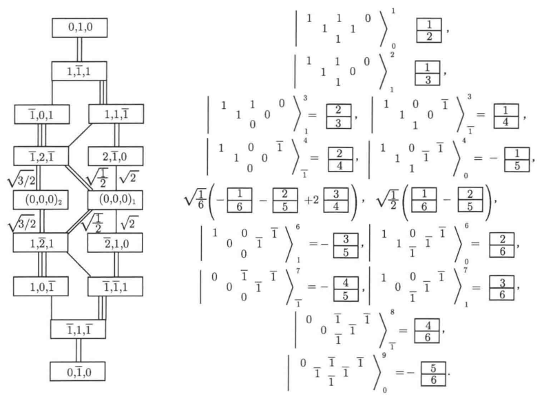

图 5.13　USp(6) 群表示 (0,1,0) 的方块图和正则张量杨表

### 5.7.2 辛群不可约表示的维数

USp(2ℓ) 群表示 [λ] 的维数 $d_{[\lambda]}(\mathrm{USp}(2\ell))$, 可用下面的钩形规则来计算。这规则在一定程度上与计算 $\mathrm{SO}(N)$ 群旋量表示维数的规则类似。实辛群 $\mathrm{Sp}(2\ell,R)$ 和酉辛群 $\mathrm{USp}(2\ell)$ 的不可约表示维数是对应相同的。在这钩形规则中，表示维数表为一个分数，分子和分母分别为该杨图 [λ] 的一定表中所有填数的乘积：

$$
d_{[\lambda]}[\mathrm{USp}(2\ell)] = \frac{Y_{Sp}^{[\lambda]}}{Y_h^{[\lambda]}}. \tag{5.282}
$$

仍沿用以前关于钩形路径和逆钩形路径的定义。分母的表 $Y_h^{[\lambda]}$ 是在杨图 [λ] 各格填以该格的钩形数 $h_{ij}$. 对行数大于 1 的杨图 [λ], 按下面规则相继定义一系列的表 $Y_{Sp_a}^{[\lambda]}$, 这些表 $Y_{Sp_a}^{[\lambda]}$ 中对应格子填数之和，构成分子表 $Y_{Sp}^{[\lambda]}$ 相应格子的填数。表 $Y_{Sp_a}^{[\lambda]}$ 由下面规则定义。

(1) 表 $Y_{Sp_0}^{[\lambda]}$ 是在杨图 [λ] 各格填以 $2\ell$ 和容度 $m_{ij} = j - i$ 之和，即第 $i$ 行第 $j$ 列格子填以 $2\ell + j - i$. 对一行的杨图 [λ], 分子表 $Y_{Sp}^{[\lambda]}$ 等于 $Y_{Sp_0}^{[\lambda]}$.

(2) 设 $[\lambda^{(1)}] = [\lambda]$. 由 $[\lambda^{(1)}]$ 开始，相继定义一系列杨图 $[\lambda^{(a)}]$, 其中 $[\lambda^{(a)}]$ 是由 $[\lambda^{(a-1)}]$ 移去第一行和第一列得到。这过程一直进行到最后一个杨图 $[\lambda^{(a)}]$ 只有 1 列或只有 2 行为止。

(3) 当 $a > 0$ 时，根据 (2) $[\lambda^{(a)}]$ 的行数当然大于 1, 设杨图 $[\lambda^{(a)}]$ 含 $r$ 行，则按下法定义表 $Y_{Sp_a}^{[\lambda]}$. 在杨图 [λ] 前 $a-1$ 行和前 $a-1$ 列都填以零，余下部分构成杨图 $[\lambda^{(a)}]$. 在杨图 $[\lambda^{(a)}]$ 中的钩形路径 $(1, 1)$ 前 $r-1$ 格，逐格填以 $\lambda_2^{(a)}$, $\lambda_3^{(a)}$, $\cdots$, $\lambda_r^{(a)}$, 在杨图 $[\lambda^{(a)}]$ 每个逆钩形路径 $(i, 1)$, $2 \leqslant i \leqslant r$, 前 $\lambda_i^{(a)}$ 格填以 $-1$. 如果几个 $-1$ 填在同一格，则填数相加。其余格子都填零。在杨图 $[\lambda^{(a)}]$ 中所有填数之和为零。

下面举些例子来说明维数公式 (5.282) 的用法。

**例 1**　对只有一行杨图 $[n]$ 的表示空间，不存在无迹条件。 $\mathrm{USp}(2\ell)$ 群一行杨图 $[n]$ 对应表示的维数为

$$
d_{[n]}[\mathrm{USp}(2\ell)] = d_{[n]}[\mathrm{SU}(2\ell)] = \binom{2\ell+n-1}{n}. \tag{5.283}
$$

**例 2**　$\mathrm{USp}(2\ell)$ 群一列杨图 $[1^n]$ 对应表示的维数为

$$
Y_{Sp}^{[1^n]} =
\begin{array}{|c|} \hline 2\ell \\ \hline 2\ell-1 \\ \hline \vdots \\ \hline 2\ell-n+2 \\ \hline 2\ell-n+1 \\ \hline \end{array}
+
\begin{array}{|c|} \hline 1 \\ \hline 1 \\ \hline \vdots \\ \hline 1 \\ \hline -n+1 \\ \hline \end{array}
=
\begin{array}{|c|} \hline 2\ell+1 \\ \hline 2\ell \\ \hline \vdots \\ \hline 2\ell-n+3 \\ \hline 2\ell-2n+2 \\ \hline \end{array}.
$$

$$
d_{[1^n]}[\mathrm{USp}(2\ell)] = \frac{(2\ell+1)!(2\ell-2n+2)}{n!(2\ell-n+2)!}. \tag{5.284}
$$

**例 3**　$\mathrm{USp}(2\ell)$ 群两行杨图 $[n,m]$ 对应表示的维数为

$$
Y_{Sp}^{[n,m]} =
\begin{array}{|c|c|c|c|c|c|c|}
\hline
2\ell & \cdots & 2\ell+m-1 & 2\ell+m & \cdots & 2\ell+n-2 & 2\ell+n-1 \\ \hline
2\ell-1 & \cdots & 2\ell+m-2 & & & & \\ \hline
\end{array}
$$

$$
+ \begin{array}{|c|c|c|c|c|c|}
\hline
0 & \cdots & 0 & \cdots & 0 & m \\ \hline
-1 & \cdots & -1 & & & \\ \hline
\end{array}
$$

$$
=
\begin{array}{|c|c|c|c|c|c|}
\hline
2\ell & \cdots & 2\ell+m-1 & \cdots & 2\ell+n-2 & 2\ell+n+m-1 \\ \hline
2\ell-2 & \cdots & 2\ell+m-3 & & & \\ \hline
\end{array},
$$

$$
Y_h^{[n,m]} =
\begin{array}{|c|c|c|c|c|c|}
\hline
n+1 & \cdots & n-m+2 & n-m & \cdots & 1 \\ \hline
m & \cdots & 1 & & & \\ \hline
\end{array},
$$

$$
d_{[n,m]}[\mathrm{USp}(2\ell)] = \frac{(n-m+1)(2\ell+n+m-1)(2\ell+n-2)!(2\ell+m-3)!}{(n+1)!m!(2\ell-1)!(2\ell-3)!}. \tag{5.285}
$$

对 $\mathrm{USp}(4)$ 群和 $\mathrm{USp}(6)$ 群有

$$
d_{[n,m]}[\mathrm{USp}(4)] = (n-m+1)(n+m+3)(n+2)(m+1)/6,
$$

$$
\begin{aligned}
d_{[n,m]}[\mathrm{USp}(6)] &= (n-m+1)(n+m+5)(n+4)(n+3)(n+2) \\
&\quad \times (m+3)(m+2)(m+1)/720.
\end{aligned} \tag{5.286}
$$

**例 4**　$\mathrm{USp}(6)$ 群的表示 $[3,3,3]$ 的维数为

$$
Y_{Sp}^{[3,3,3]} =
\begin{array}{|c|c|c|} \hline 6 & 7 & 8 \\ \hline 5 & 6 & 7 \\ \hline 4 & 5 & 6 \\ \hline \end{array}
+
\begin{array}{|c|c|c|} \hline & 3 & 3 \\ \hline -1 & -1 & \\ \hline -2 & -1 & -1 \\ \hline \end{array}
+
\begin{array}{|c|c|c|} \hline & & \\ \hline & & 2 \\ \hline & -1 & -1 \\ \hline \end{array}
=
\begin{array}{|c|c|c|} \hline 6 & 10 & 11 \\ \hline 4 & 5 & 9 \\ \hline 2 & 3 & 4 \\ \hline \end{array},
$$

$$
d_{[3,3,3]}[\mathrm{USp}(6)] =
\frac{\begin{array}{|c|c|c|} \hline 6 & 10 & 11 \\ \hline 4 & 5 & 9 \\ \hline 2 & 3 & 4 \\ \hline \end{array}}{\begin{array}{|c|c|c|} \hline 5 & 4 & 3 \\ \hline 4 & 3 & 2 \\ \hline 3 & 2 & 1 \\ \hline \end{array}}
= 11 \times 5 \times 3 \times 2 = 330.
$$

## 习 题 5

1. 证明由单纯李代数的根 $\alpha$ 和 $\beta$ 组成的根链长度 $p+q+1$ 不大于 4, 其中 $\alpha+n\beta$ 是根， $-q \leqslant n \leqslant p$, 而 $\alpha+(p+1)\beta$ 和 $\alpha-(q+1)\beta$ 不是根。

2. 利用式 (5.23) 分别计算 $\mathrm{SO}(N)$ 群如下各最高权表示 $M = \sum\limits_{\mu=1}^{\ell} M_\mu w_\mu$ 的二阶卡西米尔不变量 $C_2(M)$:

(1) $N = 2\ell+1$ 和 $M = \sum\limits_{\mu=1}^{\ell-1}(\lambda_\mu - \lambda_{\mu+1})w_\mu + 2\lambda_\ell w_\ell$;

(2) $N = 2\ell+1$ 和 $M = \lambda_1 w_1 + w_\ell$;

(3) $N = 2\ell$ 和 $M = \sum\limits_{\mu=1}^{\ell-1}(\lambda_\mu - \lambda_{\mu+1})w_\mu + (\lambda_{\ell-1} + \lambda_\ell)w_\ell$;

(4) $N = 2\ell$ 和 $M = \lambda_1 w_1 + w_\ell$.

3. 画出 $\mathrm{SU}(3)$ 群的不可约表示 $[4]$ 的方块权图和平面权图，并计算表示空间包含的盖尔范德基和生成元非零表示矩阵元。

4. 画出 $\mathrm{SU}(3)$ 群的不可约表示 $[3,1]$ 的方块权图和平面权图，并计算表示空间包含的盖尔范德基、生成元非零表示矩阵元和正则张量杨表。

5. 计算 $C_3$ 李代数基本表示 $(0,0,1)$ 的表示空间包含的盖尔范德基和生成元非零表示矩阵元。

6. 画出 $C_2$ 李代数伴随表示 $(2,0)$ 的方块权图和平面权图，并计算表示空间包含的盖尔范德基和生成元非零表示矩阵元。

7. 计算 $B_3$ 李代数的三个基本表示 $(1,0,0)$, $(0,1,0)$ 和 $(0,0,1)$ 包含的盖尔范德基和生成元非零表示矩阵元。

8. 计算 $G_2$ 李代数的两个基本表示 $(1,0)$ 和 $(0,1)$ 包含的盖尔范德基和生成元非零表示矩阵元。

9. 计算 $\mathrm{SU}(3)$ 群直乘表示 $[2] \times [1]$ 分解的克莱布什－戈登级数和克莱布什－戈登系数。

10. 计算 $C_2$ 李代数直乘表示 $(1,0) \times (1,0)$ 分解的克莱布什-戈登级数和克莱布什-戈登系数。

11. 计算 $C_2$ 李代数直乘表示 $(0,1) \times (0,1)$ 分解的克莱布什-戈登级数和克莱布什-戈登系数。

12. 计算 $C_3$ 李代数直乘表示 $(0,2,0) \times (1,0,0)$ 分解的克莱布什-戈登级数，其中各有关表示维数、外尔轨道长度 (O.S.) 和包含各主权重的数列于下表：

| 表示 | 维数 | O.S. | (1,0,0) | (0,0,1) | (1,1,0) | (3,0,0) | (0,1,1) | (2,0,1) | (1,2,0) |
|---|---|---|---|---|---|---|---|---|---|
| (1,0,0) | 6 | 6 | 1 | | | | | | |
| (0,0,1) | 14 | 8 | 1 | 1 | | | | | |
| (1,1,0) | 64 | 24 | 4 | 2 | 1 | | | | |
| (3,0,0) | 56 | 6 | 3 | 1 | 1 | 1 | | | |
| (0,1,1) | 126 | 24 | 5 | 3 | 2 | 0 | 1 | | |
| (2,0,1) | 216 | 24 | 7 | 6 | 3 | 1 | 1 | 1 | |
| (1,2,0) | 350 | 24 | 11 | 7 | 5 | 2 | 2 | 1 | 1 |

13. 计算 $G_2$ 李代数直乘表示 $(1,0) \times (1,0)$ 和 $(1,0) \times (0,1)$ 分解的克莱布什-戈登级数和级数中出现的各表示最高权态的展开式，其中各有关表示维数、外尔轨道长度 (O.S.) 和包含各主权重的数列于下表。

| 表示 | 维数 | O.S. | (0,0) | (0,1) | (1,0) | (0,2) | (1,1) | (0,3) | (2,0) |
|---|---|---|---|---|---|---|---|---|---|
| (0,0) | 1 | 1 | 1 | | | | | | |
| (0,1) | 7 | 6 | 1 | 1 | | | | | |
| (1,0) | 14 | 6 | 2 | 1 | 1 | | | | |
| (0,2) | 27 | 6 | 3 | 2 | 1 | 1 | | | |
| (1,1) | 64 | 12 | 4 | 4 | 2 | 2 | 1 | | |
| (0,3) | 77 | 6 | 5 | 4 | 3 | 2 | 1 | 1 | |
| (2,0) | 77 | 6 | 5 | 3 | 3 | 2 | 1 | 1 | 1 |

14. 计算 $F_4$ 李代数直乘表示 $(0,0,0,1) \times (0,0,0,1)$ 分解的克莱布什-戈登级数和级数中出现的各表示最高权态的展开式，其中各有关表示维数、外尔轨道长度 (O.S.) 和包含各主权重的数列于下表。

| 表示 | 维数 | O.S. | (0,0,0,0) | (0,0,0,1) | (1,0,0,0) | (0,0,1,0) | (0,0,0,2) |
|---|---|---|---|---|---|---|---|
| (0,0,0,0) | 1 | 1 | 1 | | | | |
| (0,0,0,1) | 26 | 24 | 2 | 1 | | | |
| (1,0,0,0) | 52 | 24 | 4 | 1 | 1 | | |
| (0,0,1,0) | 273 | 96 | 9 | 5 | 2 | 1 | |
| (0,0,0,2) | 324 | 24 | 12 | 5 | 3 | 1 | 1 |

15. 计算 $\mathrm{SU}(3)$ 群和 $\mathrm{SU}(6)$ 群用下列杨图标记的不可约表示的维数： $[3]$, $[2,1]$, $[3,3]$, $[4,2]$, $[5,1]$.

16. 对 $\mathrm{SU}(3)$ 群和 $\mathrm{SU}(6)$ 群，分别计算下列表示直乘分解的克莱布什-戈登级数，并用维数公式检验： ① $[2,1] \times [3,0]$; ② $[3,0] \times [3,0]$; ③ $[3,0] \times [3,3]$; ④ $[4,2] \times [2,1]$.

17. 把下面 $\mathrm{SU}(6)$ 群的无迹混合张量表示变换成协变张量表示，并计算这些表示的维数： ① $[3,2,1]^*$; ② $[3,2,1]\backslash[3,3]^*$; ③ $[4,3,1]\backslash[3,2]^*$.

18. 按下列步骤证明

$$
\sum_{A=1}^{N^2-1} (T_A)_{ac}(T_A)_{bd} = \frac{1}{2}\delta_a^d \delta_b^c - \frac{1}{2N}\delta_a^c \delta_b^d.
$$

其中， $(T_A)_{ac}$ 是 $\mathrm{SU}(N)$ 群自身表示的生成元。

(1) $\mathrm{SU}(N)$ 群不变的 (2 2) 阶混合张量 $T_{ab}^{cd}$ 只能是 $\delta_a^c \delta_b^d$ 和 $\delta_a^d \delta_b^c$ 的线性组合。

(2) 定义 $\mathrm{SU}(N)$ 群 (2 2) 阶混合张量

$$
T_{ab}^{cd} \equiv \sum_{A=1}^{N^2-1} (T_A)_{ac}(T_A)_{bd}.
$$

证明它在 $\mathrm{SU}(N)$ 变换中保持不变。

(3) 把 $T_{ab}^{cd}$ 按 $\delta$ 函数展开，确定组合系数，最后证明上式。

19. 计算下列杨图标记的 $\mathrm{SO}(6)$ 群不可约表示的维数：
(1) $[4,2]$; (2) $[3,2]$; (3) $[4,4]$; (4) $[3,1,1]$; (5) $[3,3,1]$.

20. 计算下列杨图标记的 $\mathrm{SO}(6)$ 群不可约旋量表示的维数：
(1) $[+s(4,2)]$; (2) $[+s(3,2)]$; (3) $[+s(4,4)]$; (4) $[+s(3,1,1)]$; (5) $[+s(3,3,1)]$.

21. 结合方块权图方法，用二阶旋量 $\chi(\alpha)$ 的直乘形式，分别表出 $\mathrm{SO}(7)$ 群和 $\mathrm{SO}(8)$ 群基本旋量表示空间包含的各正交归一的状态基 $W(\alpha_1, \alpha_2, \cdots)$ (见式 (5.199)), 并指出它们的权 $\boldsymbol{m}$.

22. 讨论 $\mathrm{SO}(4)$ 群的类并计算它们在不可约表示 $D^{jk}$ 中的特征标。

23. 计算下面固有洛伦兹变换 $A$ 的六个参数

$$
A(\varphi, \theta, \omega, \alpha, \beta, \gamma) =
\begin{pmatrix}
1 & 0 & 0 & 0 \\
0 & \sqrt{3}/2 & (\cosh\omega)/2 & -\mathrm{i}(\sinh\omega)/2 \\
0 & -1/2 & \sqrt{3}(\cosh\omega)/2 & -\mathrm{i}\sqrt{3}(\sinh\omega)/2 \\
0 & 0 & \mathrm{i}\sinh\omega & \cosh\omega
\end{pmatrix}.
$$

24. 用钩形规则计算 $\mathrm{USp}(6)$ 群和 $\mathrm{USp}(8)$ 群用下列杨图标记的不可约表示维数： $[3]$, $[1^3]$, $[3,3,2]$, $[3,2,1]$, $[4,3,2,1]$.

25. 用钩形规则计算 $\mathrm{USp}(2\ell)$ 群， $\ell \geqslant 3$, 用三行杨图 $[n,m,p]$ 标记的不可约表示维数。
