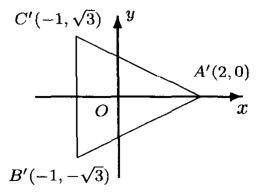
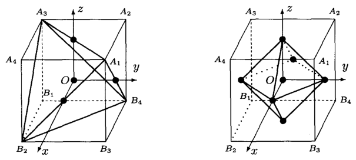
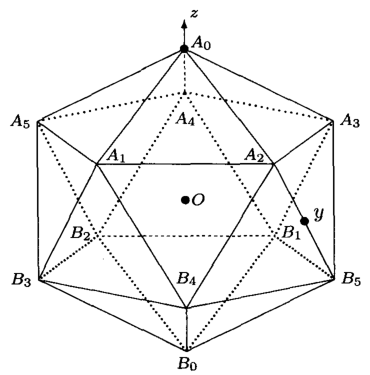

# 第二章 群的基本概念

群论是研究系统对称性质的有力工具。在这一章里，我们首先从系统对称性质的研究中，概括出群的基本概念，通过一些简单的和物理中常见的群的例子，使读者对群有较具体的认识；然后，引入群的各种子集的概念，群的同构与同态的概念，群的直接乘积的概念。对有限群来说，群的全部性质都体现在群的乘法表中。我们将介绍填写群乘法表的方法和如何由群的乘法表来分析有限群性质。

## 2.1 对 称

对称是一个人们十分熟悉的用语。世界处在既对称又不严格对称的矛盾统一之中。房屋布局的对称给人一种舒服的感觉，但过分的严格对称又给人死板的感觉。科学理论的和谐美，其中很大程度上表现为对称的美。在现代科学研究中，对称性的研究起着越来越重要的作用。

我们常说，斜三角形很不对称，等腰三角形比较对称，正三角形对称多了，圆比它们都更对称。但是，对称性的高低究竟是如何描写的呢？

对称的概念是和变换密切联系在一起的，所谓系统的对称性就是指它对某种变换保持不变的性质。保持系统不变的变换越多，系统的对称性就越高。只有恒等变换，也就是不变的变换，才保持斜三角形不变。等腰三角形只对底边的垂直平分面反射保持不变，而正三角形对三边的垂直平分面反射都保持不变，还对通过中心垂直三角形所在平面的轴转动 $\pm2\pi/3$ 角的变换保持不变。圆对任一直径的垂直平分面的反射都保持不变，也对通过圆心垂直圆所在平面的轴转动任何角度的变换保持不变。因为保持圆不变的变换最多，所以它的对称性最高。

量子系统的物理特征由系统的哈密顿量（Hamiltonian）决定，量子系统的对称性则由保持系统哈密顿量不变的变换集合来描写。例如，$N$ 个粒子构成的孤立系统的哈密顿量为

$$
H=-\frac{\hbar^{2}}{2}\sum_{j=1}^{N}m_j^{-1}\nabla_j^{2}+\sum_{i<j}U(|r_i-r_j|)
$$

其中，$r_j$ 和 $m_j$ 是第 $j$ 个粒子的坐标矢量和质量，$\nabla_j^{2}$ 是关于 $r_j$ 的拉普拉斯（Laplace）算符，$U$ 是两个粒子间的二体相互作用势，它只是粒子距离的函数。拉普拉斯算符是对坐标分量的二阶微商之和，它对系统平移、转动和反演都保持不变。作用势只依赖于粒子间的相对坐标绝对值，它也对这些变换保持不变。若粒子是全同粒子，哈密顿量还对粒子间的任意置换保持不变。这个量子系统的对称性质就用系统对这些变换的不变性来描述。

保持系统不变的变换称为系统的对称变换，对称变换的集合描写系统的全部对称性质。根据系统的对称性质，通过群论方法研究，可以直接得到系统许多精确的、与细节无关的重要性质。我们还没有学习群论方法，还无法用群论方法对系统的复杂对称性质进行研究，但为了使读者对群论方法有一个直观的了解，下面举一个简单例子说明群论方法的基本思路。

研究一个具有空间反演对称性的量子系统。系统哈密顿量对空间反演变换保持不变，因而哈密顿量的本征函数 $\psi$ 通过空间反演，仍是哈密顿量同一本征值的本征函数。用 $P$ 代表在空间反演下波函数的变换算符

$$
P\psi(r_1,r_2,\cdots)=\psi(-r_1,-r_2,\cdots)
$$

则对哈密顿量来说，$\psi$ 和 $P\psi$ 有相同的本征值，而且由于哈密顿量是线性算符，$\psi$ 和 $P\psi$ 的任何线性组合仍有相同的本征值。取如下组合

$$
\begin{aligned}
\phi_S &\sim \psi+P\psi, & \phi_A &\sim \psi-P\psi\\
P\phi_S &= \phi_S, & P\phi_A &= -\phi_A
\end{aligned}
\tag{2.1}
$$

在空间反演中按式（2.1）变换的波函数 $\phi_S$ 和 $\phi_A$ 分别称为具有偶宇称和奇宇称的波函数。我们看到，不管系统的具体性质如何，只要系统具有空间反演对称性，它的定态波函数（即哈密顿量本征函数）总可组合成具有确定宇称状态的函数。这就是说，宇称是该系统的守恒量，可以用宇称来对该系统的定态波函数进行分类。进一步，作为一级近似，电偶极跃迁的概率与电偶极算符在初末态间的矩阵元模平方成比例，这个矩阵元表达成初末态波函数和电偶极算符的乘积关于坐标的积分。因为电偶极算符与坐标算符成比例，是坐标的奇函数，它在空间反演中改符号，所以当初末态宇称相同时，这个矩阵元的被积函数是坐标的奇函数，它的空间积分为零，也就是说，在宇称状态相同的初末态间电偶极跃迁概率的一级近似为零。这一性质在量子力学中称为电偶极跃迁选择定则。

这一简单例子说明，尽管系统哈密顿量可能很复杂，薛定谔方程难以精确求解，但从研究系统的对称性质着手，可以得到系统某些精确的与细节无关的重要性质（例如，根据对称性，可确定系统的守恒量），可对系统的定态波函数进行分类，并可得出精确的跃迁选择定则。

## 2.2 群及其乘法表

保持系统不变的变换称为系统的对称变换，系统的对称性质由对称变换的集合来描写。我们先来研究系统对称变换集合的一般性质。按照物理中的惯例，两个变换的乘积定义为相继做两次变换。显然，两个对称变换的乘积仍是系统的对称变换，三个对称变换的乘积满足结合律。不变的变换，即恒等变换也是一个对称变换，它与任何一个对称变换的乘积仍是该对称变换。系统对称变换的逆变换也是系统的一个对称变换。上述性质是系统对称变换集合的共同的性质，与具体系统的具体对称性质无关。把对称变换集合的这些共同性质归纳出来，得到群（group）的定义。

**定义** 在规定了元素的“乘积”法则后，元素的集合 $G$ 如果满足下面四个条件，则称为群。

（1）集合对乘积的封闭性。集合中任意两元素的乘积仍属此集合

$$
RS \in G , \qquad \forall R\ \text{和}\ S \in G . \tag{2.2}
$$

（2）乘积满足结合律。

$$
R(ST) = (RS)T , \qquad \forall R,\ S\ \text{和}\ T \in G . \tag{2.3}
$$

（3）集合中存在恒元 $E$，用它左乘集合中的任意元素，保持该元素不变，即

$$
E \in G , \qquad ER = R , \qquad \forall R \in G . \tag{2.4}
$$

（4）任何元素 $R$ 的逆 $R^{-1}$ 存在于集合中，满足

$$
\forall R \in G , \qquad \exists\, R^{-1} \in G , \qquad \text{使}\ R^{-1}R = E . \tag{2.5}
$$

作为数学中群的定义，群的元素可以是任何客体，元素的乘积也可任意规定。一旦确定了元素的集合和元素的乘积规则，满足上述四个条件的集合就称为群。系统对称变换的集合，关于变换的乘积，满足群的四个条件因而构成群，称为系统的对称变换群。在物理中常见的群大多是线性变换群、线性算符群或矩阵群。如果没有特别说明，当元素是线性变换或线性算符时，元素的乘积都定义为相继做两次变换；当元素是矩阵时，元素的乘积则取通常的矩阵乘积。

在群的定义中，群元素是什么客体并不重要，重要的是它们的乘积规则，也就是它们以什么方式构成群。如果两个群，它们的元素之间可用某种适当给定的方式一一对应起来，而且元素的乘积仍以此同一方式一一对应，那么，从群论观点看，这两个群完全相同，虽然它们描述的对象可以完全不同。文献中常称这种对应关系对元素乘积保持不变。具有这种对应关系的两个群称为同构（isomorphism）。

**定义** 若群 $G'$ 和 $G$ 的所有元素间都按某种规则存在一一对应关系，它们的乘积也按同一规则一一对应，则称两群同构。用符号表示，若 $R$ 和 $S \in G$，$R'$ 和 $S' \in G'$，$R' \longleftrightarrow R$，$S' \longleftrightarrow S$，必有 $R'S' \longleftrightarrow RS$，则 $G' \approx G$，其中符号“$\longleftrightarrow$”代表一一对应，“$\approx$”代表同构。互相构的群，它们群的性质完全相同。研究清楚一个群的性质，也就了解了所有与它同构的群的性质。在群同构的定义里，元素之间的对应规则没有什么限制。但如果选择的规则不适当，使元素的乘积不再按此规则一一对应，并不等于说，这两个群就不同构。只要对某一种对应规则，两个群符合群同构的定义，它们就是同构的。

从群的定义出发，可以证明，恒元和逆元也满足

$$
RE = R , \qquad RR^{-1} = E \tag{2.6}
$$

第二个式子表明元素与其逆元是相互的。由此易证群中恒元是唯一的，即若还存在元素 $E'$，满足 $E'R = R$，则 $E' = E$。群中任一元素的逆元是唯一的，即若 $SR = E$，则 $S = R^{-1}$。于是，恒元的逆元是恒元，和 $(RS)^{-1} = S^{-1}R^{-1}$。作为逻辑练习，习题第 1 题让读者证明这些结论。证明中除了群的定义外，不能用以前熟悉的任何运算规则，因为它们不一定适合群元素的运算。下面我们认为这些结论已经证明，可以应用了。

一般说来，群元素乘积不能对易，$RS \neq SR$。元素乘积都可以对易的群称为阿贝尔（Abel）群。若群中至少有一对元素的乘积不能对易，就称为非阿贝尔群。元素数目有限的群称为有限群，元素的数目 $g$ 称为有限群的阶（order）。元素数目无限的群称为无限群，如果无限群的元素可用一组连续变化的参数描写，则称为连续群。

把群的子集，即群中部分元素的集合 $\mathcal{R} = \{R_1,\ R_2,\ \cdots,\ R_m\}$，看作一个整体，称为复元素。作为集合，复元素不考虑所包含元素的排列次序，且重复的元素只取一次。两复元素相等，即 $\mathcal{R} = \mathcal{S}$ 的充要条件是它们包含的元素相同，即 $\mathcal{R} \subset \mathcal{S}$ 和 $\mathcal{S} \subset \mathcal{R}$。普通元素和复元素相乘仍是复元素。$T\mathcal{R}$ 是由元素 $TR_j$ 的集合构成的复元素，而 $\mathcal{R}T$ 则由元素 $R_jT$ 的集合构成。设 $\mathcal{S} = \{S_1,\ S_2,\ \cdots,\ S_n\}$，两复元素的乘积 $\mathcal{R}\mathcal{S}$ 是所有形如 $R_jS_k$ 的元素集合构成的复元素。上面出现的元素乘积，如 $TR_j$，$R_jT$ 和 $R_jS_k$，均按群元素的乘积规则相乘。复元素的乘积满足结合律。如果复元素的集合，按照复元素的乘积规则，符合群的四个条件，也可构成群。

**定理一（重排定理）** 设 $T$ 是群 $G = \{E,\ R,\ S,\ \cdots\}$ 中的任一确定元素，则下面三个集合与原群 $G$ 相同

$$
TG = \{T,\ TR,\ TS,\ \cdots\} ,
$$
$$
GT = \{T,\ RT,\ ST,\ \cdots\} ,
$$
$$
G^{-1} = \{E,\ R^{-1},\ S^{-1},\ \cdots\}
$$

用复元素符号表达为

$$
TG = GT = G^{-1} = G \tag{2.7}
$$

**证明** 以 $TG = G$ 为例证明。集合 $TG$ 的所有元素都是群 $G$ 的元素，故$TG \subset G$。反之，群 $G$ 的任意元素 $R$ 都可表成 $R = T(T^{-1}R)$，而 $(T^{-1}R)$ 是群 $G$ 的元素，故 $R$ 属于 $TG$，$G \subset TG$。证完。

对于有限群，群元素数目有限，我们有可能把元素的乘积全部排列出来，构成一个表，称为群的乘法表（multiplication table），简称群表。为了确定起见，对于 $RS = T$，今后我们称 $R$ 为左乘元素，$S$ 为右乘元素，而 $T$ 为乘积元素。乘法表由下述建立：在表的最左一列，把全部群元素列出来，作为左乘元素，在表的最上面一行，也把全部群元素列出来，作为右乘元素，元素的排列次序可以任意选定，常让左乘元素和右乘元素的排列次序相同，恒元排在第一位。表的内容有 $g \times g$ 格，每一格填入它所在行最左面一列的元素 $R$（左乘元素）和它所在列最上面一行的元素 $S$（右乘元素）的乘积 $RS$。如果恒元排在表中第一个位置，因它与任何元素相乘还是该元素，故乘法表内容中第一行和右乘元素相同，第一列和左乘元素相同。由重排定理，乘法表乘积元素中每一行（或列）都不会有重复元素。乘法表完全描写了有限群的性质。

对两个阶数相同的有限群，当把群元素分别按一定次序列在乘法表上时，实际上已给出了它们元素之间的一种一一对应关系。如果在此对应下，它们的乘法表完全相同，则此两群同构。当然，如果由于群元素排列次序选得不适当，本来同构的群也可能看起来似乎有不同的乘法表。当阶数确定后，重排定理大大限制了互相不同构的有限群数目。例如，以后我们将证明，阶数为相同素数的有限群都同构。

我们先来看二阶群和三阶群的乘法表。当把第一列和第一行按左乘元素和右乘元素填完后，重排定理已完全确定了表中剩余位置的填充，如表 2.1 和表 2.2 所示。

**表 2.1 二阶群的乘法表**

| | $e$ | $\sigma$ |
|---|---|---|
| $e$ | $e$ | $\sigma$ |
| $\sigma$ | $\sigma$ | $e$ |

**表 2.2 三阶群的乘法表**

| | $e$ | $\omega$ | $\omega'$ |
|---|---|---|---|
| $e$ | $e$ | $\omega$ | $\omega'$ |
| $\omega$ | $\omega$ | $\omega'$ | $e$ |
| $\omega'$ | $\omega'$ | $e$ | $\omega$ |

在二阶群中，可让 $e$ 代表恒等变换，$\sigma$ 代表空间反演变换，则此群正是对空间反演不变的系统的对称变换群，常记作 $\mathrm{V}_2$。也可让 $e$ 代表数 1，$\sigma$ 代表数 $-1$，按普通的数乘积，它们也构成二阶群，记作 $\mathrm{C}_2$。这两群是同构的，$\mathrm{V}_2 \approx \mathrm{C}_2$，从群论观点看它们完全相同。三阶群中，可设 $e = 1$，$\omega = \exp(-\mathrm{i}2\pi/3)$ 和 $\omega' = \exp(\mathrm{i}2\pi/3)$，按复数的乘积，它们构成三阶群，记作 $\mathrm{C}_3$。

这两个例子有一个共同的特点，就是群中所有元素都可由其中一个元素的幂次来表达。二阶群中，$e = \sigma^2$；三阶群中，$\omega' = \omega^2$，$e = \omega^3$。推而广之，由一个元素 $R$ 及其幂次构成的有限群称为由 $R$ 生成的循环群，记作 $\mathrm{C}_n$，$n$ 是循环群的阶，$R$ 称为循环群的生成元。$n$ 阶循环群的一般形式是

$$
C_n = \{E,\ R,\ R^2,\ \cdots,\ R^{n-1}\} , \qquad R^n = E , \qquad R^{-1} = R^{n-1} \tag{2.8}
$$

循环群的一个典型例子是由绕空间固定轴转动 $2\pi/N$ 角的变换 $R$ 生成的群。在晶体理论中，如果 $R$ 是晶体的对称变换，则此轴就称为晶体的 $N$ 次固有转动轴，简称 $N$ 次轴，转动 $R$ 称为 $N$ 次转动。为了区分 $R$ 和 $R^{-1}$，需要规定轴的正向，按右手螺旋法则绕轴的正向旋转 $2\pi/N$ 角的转动称为 $R$。对二次轴不必规定轴的方向，因为 $R = R^{-1}$。循环群中元素乘积可以对易，因而循环群是阿贝尔群。循环群生成元的选择不是唯一的，例如三阶循环群中 $\omega$ 和 $\omega'$ 都可作生成元。循环群的乘法表有共同的特点，当表中元素按生成元的幂次排列时，表的每一行都可由前一行向左移动一格得到，而最左面的元素移到最右面去。

既然有限群的元素数目是有限的，那么有限群任一元素的自乘，当幂次足够高时必然会有重复。由群中恒元唯一性知，有限群任一元素的自乘若干次后必可得到恒元。若 $R^n = E$，$n$ 是 $R$ 自乘得到恒元的最低幂次，则 $n$ 称为元素 $R$ 的阶，$R$ 生成的循环群称为 $R$ 的周期。恒元，也只有恒元的阶为 1。同一有限群中不同元素的阶可以不同，不同元素的周期也可有重复或重合。请注意不要混淆群的阶和元素的阶这两个不同的概念，只有循环群生成元的阶才等于该群的阶。

有限群中任一元素 $R$ 的周期构成群中一个子集。若此子集尚未充满整个群，则在子集外再任取群中一元素 $S$，由 $R$ 和 $S$ 所有可能的乘积构成一个更大的子集。若它还没有充满整个群，则再取第三个、第四个元素加入上述乘积，最后总能充满整个群，即群中所有元素都可表为若干个元素的乘积。适当选择这些元素，使有限群中所有元素都可表为尽可能少的若干个元素的乘积，这些元素称为有限群的生成元，有限群生成元的数目称为有限群的秩。由于取生成元数目尽量少，生成元不能表成其他生成元的乘积。

现在来研究四阶群的乘法表。如果群中有一个元素的阶数为 4，则此群是四阶循环群 $\mathrm{C}_4$，它的乘法表如表 2.3 所示。容易检验，四阶群中元素的阶不能为 3，否则它的周期构成三阶循环群，而在乘法表中第四个元素所在行（和列）必定会出现重复元素。余下的情况是，除恒元外所有元素的阶数都是 2，这样的四阶群乘法表如表 2.4 所示。设 $\sigma$，$\tau$ 和 $\rho$ 分别是空间反演、时间反演和时空全反演，则此群称为四阶反演群 $\mathrm{V}_4$。对于给定的四阶群，如何判断它与哪个群同构呢？如果四阶群中有阶数大于 2 的元素，它就与 $\mathrm{C}_4$ 群同构；反之，如果在四阶群中阶数等于 2 的元素多于一个，它就与 $\mathrm{V}_4$ 群同构。

**表 2.3 四阶循环群 $\mathrm{C}_4$ 的乘法表**

| | $E$ | $R$ | $S$ | $T$ |
|---|---|---|---|---|
| $E$ | $E$ | $R$ | $S$ | $T$ |
| $R$ | $R$ | $S$ | $T$ | $E$ |
| $S$ | $S$ | $T$ | $E$ | $R$ |
| $T$ | $T$ | $E$ | $R$ | $S$ |

**表 2.4 四阶反演群 $\mathrm{V}_4$ 的乘法表**

| | $e$ | $\sigma$ | $\tau$ | $\rho$ |
|---|---|---|---|---|
| $e$ | $e$ | $\sigma$ | $\tau$ | $\rho$ |
| $\sigma$ | $\sigma$ | $e$ | $\rho$ | $\tau$ |
| $\tau$ | $\tau$ | $\rho$ | $e$ | $\sigma$ |
| $\rho$ | $\rho$ | $\tau$ | $\sigma$ | $e$ | 最简单的非阿贝尔群是正三角形对称群 $\mathrm{D}_3$，它由六个元素组成：过三角形中心 $O$ 垂直三角形所在平面的轴是三次轴，以向上方向为轴的正向，转动 $\pm 2\pi/3$ 角的元素分别记作 $D$ 和 $F$，恒等变换为 $E$，若三角形三个顶点分别记作 $A$，$B$ 和 $C$，则三个轴 $OA$，$OB$ 和 $OC$ 都是二次轴，相应转动 $\pi$ 角的元素分别也记作 $A$，$B$ 和 $C$。三角形顶点和对称变换元素用相同的符号标记，一般不会引起混淆。这些转动是保持三角形在平面上的位置不变的全部变换，因而它们构成正三角形的对称变换群。恒元的阶为 1，三次转动元素 $D$ 和 $F$ 的阶为 3，二次转动元素 $A$，$B$ 和 $C$ 的阶为 2。

建立群表的方法有很多，下面结合 $\mathrm{D}_3$ 群，介绍两种典型的方法。在平面上建立平面直角坐标系 $OXY$，画正三角形 $\Delta A'B'C'$，中心在原点，$A'$ 点在正 $x$ 轴上，三顶点的坐标（见图 2.1）分别为：$A'(2,0)$，$B'(-1,-\sqrt{3})$ 和 $C'(-1,\sqrt{3})$。把同样大小的正三角形 $\Delta ABC$ 放在平面上，$A$ 和 $A'$ 重合，$B$ 和 $B'$ 重合，$C$ 和 $C'$ 重合。现在固定坐标平面，用上述六种变换来变动 $\Delta ABC$，使三个顶点 $A$，$B$ 和 $C$ 分别以不同方式与 $A'$，$B'$ 和 $C'$ 点重合。六种对称变换的结果列于表 2.5。现在可利用表 2.5 来计算两变换的乘积。例如，计算变换乘积 $DA$，点 $A$ 在变换 $A$ 中保持不变，再经变换 $D$ 变到点 $C'$，点 $B$ 经变换 $A$ 变到点 $C'$，然后把它看作新的 $C$ 点，经变换 $D$ 变到点 $B'$。两点已经完全确定了三角形变换后的位置，$C$ 点经变换 $DA$ 只能变到点 $A'$。初学时不妨仍用上法计算作为检验，即点 $C$ 经变换 $A$ 变到点 $B'$，然后把它看作新的 $B$ 点，经变换 $D$ 变到点 $A'$。既然 $A$，$B$ 和 $C$ 三点经变换 $DA$ 分别变到 $C'$，$B'$ 和 $A'$ 点，从表中查出它与变换 $B$ 的结果相同，可见 $DA = B$。同理可计算其他元素的乘积。以后为方便起见，在与表 2.5 类似的表中把撇都省略掉。

学会了计算群元素乘积的方法，就可以来填写 $\mathrm{D}_3$ 群的乘法表。因 $\mathrm{D}_3$ 群含六个元素，乘法表中有 36 个位置要填写。事实上，我们不必用上法计算 36 次，因为许多乘积可用更简单的方法算出来。在表 2.6 中先把第一行和第一列填好，它们代表恒元和群元素的乘积。因为三次固有转动轴的三个元素 $E$，$D$ 和 $F$ 构成三阶循环群，它们的乘法表已由表 2.2 给出，可以先填好。二次转动轴的元素 $A$，$B$ 和 $C$ 的阶为 2，它们的平方是恒元 $E$，这样在后三行对角线位置都填入 $E$。再根据刚才的计算，$DA = B$，把 $B$ 填入第二行第四列，第二行的剩余两格可以根据每行和每列元素不重复的原则（重排定理），分别填以 $C$ 和 $A$，这一原则也决定了第三行后面三格的填充。再根据 $A$，$B$ 和 $C$ 是二阶元素，在 $DA = B$ 两边，用 $A$ 右乘，然后再用 $B$ 左乘，算得 $D = BA$ 和 $BD = A$，从而把 $D$ 和 $A$ 分别填入第五行的第四和第二列。余下的格子都可根据重排定理，由左向右逐列填过去。这样，我们只用到 $\mathrm{D}_3$ 群群元素的阶数和公式 $DA = B$，就完成了乘法表的填写。由乘法表可知，$\mathrm{D}_3$ 群的秩为 2，两个生成元可取 $D$ 和 $A$，则 $F = D^2$，$E = D^3$，$B = DA$ 和 $C = AD$。一般说来，对阶数为 $g$ 的群，只需要知道群元素的阶数分布和若干对元素的乘积规则，就可以算出全部 $g \times g$ 个乘积公式来。

**表 2.5 正三角形的对称变换**

| | $E$ | $D$ | $F$ | $A$ | $B$ | $C$ |
|---|---|---|---|---|---|---|
| $A$ | $A'$ | $C'$ | $B'$ | $A'$ | $C'$ | $B'$ |
| $B$ | $B'$ | $A'$ | $C'$ | $C'$ | $B'$ | $A'$ |
| $C$ | $C'$ | $B'$ | $A'$ | $B'$ | $A'$ | $C'$ |

**表 2.6 正三角形对称群 $\mathrm{D}_3$ 的乘法表**

| | $E$ | $D$ | $F$ | $A$ | $B$ | $C$ |
|---|---|---|---|---|---|---|
| $E$ | $E$ | $D$ | $F$ | $A$ | $B$ | $C$ |
| $D$ | $D$ | $F$ | $E$ | $B$ | $C$ | $A$ |
| $F$ | $F$ | $E$ | $D$ | $C$ | $A$ | $B$ |
| $A$ | $A$ | $C$ | $B$ | $E$ | $F$ | $D$ |
| $B$ | $B$ | $A$ | $C$ | $D$ | $E$ | $F$ |
| $C$ | $C$ | $B$ | $A$ | $F$ | $D$ | $E$ |

对六阶群，若有一个元素的阶为 6，则此群为循环群 $\mathrm{C}_6$。由重排定理，六阶群不能含有阶数为 4 或 5 的元素。又如习题第 4 题让读者证明的，除恒元外六阶群元素的阶数不能都是 2。若六阶群中有两个元素阶数为 3，记作 $D$ 和 $F = D^2$，其余元素记作 $A$，$B$ 和 $C$，则 $A^2$，$B^2$ 和 $C^2$ 都不能等于 $D$ 或 $F$，否则它是六阶元素。由重排定理，$D$ 和 $F$ 左乘到元素 $A$，$B$ 和 $C$ 上只能取值在 $A$，$B$ 或 $C$ 之中，于是 $A^2 = B^2 = C^2 = E$。又从上面讨论中看到，一旦 $DA$ 确定下来，整个乘法表就完全确定了，而由重排定理 $DA$ 只能等于 $B$ 或 $C$，由此只能构成两种乘法表。作为一个抽象群，$B$ 和 $C$ 的地位是完全平等的，只要把 $B$ 和 $C$ 的名字换一下，两种情况的乘法表就完全相同。换名字相当于给出两群元素间一种一一对应的规则，因而这两种乘法表对应的群是同构的。于是，准确到同构，六阶群只有两种：循环群 $\mathrm{C}_6$ 和正三角形对称群 $\mathrm{D}_3$。对于给定的六阶群，如何判断它与哪个群同构呢？如果六阶群中阶数等于 2 的元素多于一个，它就与 $\mathrm{D}_3$ 群同构；反之，如果群中存在阶数大于 3 的元素（自乘三次还未出现恒元），则它就与 $\mathrm{C}_6$ 群同构。

现在我们介绍建立群乘法表的另一种典型方法。把正三角形的变换看成平面上点的坐标变换，变换前的坐标记作 $(x,\ y)$，变换后的坐标记作 $(x',\ y')$，它们都用列矩阵表出，而变换元素表为 $2 \times 2$ 矩阵

$$
\begin{pmatrix} x' \\ y' \end{pmatrix} = \begin{pmatrix} a & b \\ c & d \end{pmatrix} \begin{pmatrix} x \\ y \end{pmatrix} \tag{2.9}
$$

对每一个变换，把变换前后三角形顶点的坐标代入式（2.9），就可定出群元素对应的矩阵形式。注意，$A'$ 点的坐标有一个分量为零，计算中要尽量多利用。例如，变换 $D$ 把 $A$ 点变到 $C'$ 点，把 $B$ 点变到 $A'$ 点，于是有等式

$$
\begin{pmatrix} -1 \\ \sqrt{3} \end{pmatrix} = \begin{pmatrix} a & b \\ c & d \end{pmatrix} \begin{pmatrix} 2 \\ 0 \end{pmatrix} , \qquad \begin{pmatrix} 2 \\ 0 \end{pmatrix} = \begin{pmatrix} a & b \\ c & d \end{pmatrix} \begin{pmatrix} -1 \\ -\sqrt{3} \end{pmatrix}
$$

由前式不难解得 $a = -1/2$ 和 $c = \sqrt{3}/2$，代入后式得 $b = -\sqrt{3}/2$ 和 $d = -1/2$。用同样方法可得六个群元素的矩阵形式如下

$$
E = \begin{pmatrix} 1 & 0 \\ 0 & 1 \end{pmatrix} , \qquad D = \frac{1}{2}\begin{pmatrix} -1 & -\sqrt{3} \\ \sqrt{3} & -1 \end{pmatrix} , \qquad F = \frac{1}{2}\begin{pmatrix} -1 & \sqrt{3} \\ -\sqrt{3} & -1 \end{pmatrix} ,
$$
$$
A = \begin{pmatrix} 1 & 0 \\ 0 & -1 \end{pmatrix} , \qquad B = \frac{1}{2}\begin{pmatrix} -1 & \sqrt{3} \\ \sqrt{3} & 1 \end{pmatrix} , \qquad C = \frac{1}{2}\begin{pmatrix} -1 & -\sqrt{3} \\ -\sqrt{3} & 1 \end{pmatrix} \tag{2.10}
$$

由这六个矩阵的乘积同样可以得到乘法表 2.6。从另一角度说，这六个矩阵的集合，按照矩阵乘积构成群，式（2.10）给出了 $\mathrm{D}_3$ 群元素和六个矩阵间的一个一一对应关系，乘法表也相同，因而这六个矩阵构成的群和 $\mathrm{D}_3$ 群同构。

应用上面的方法可以研究正 $N$ 边形对称群 $\mathrm{D}_N$。把正 $N$ 边形放在 $xy$ 平面上，中心和原点重合，一个顶点在 $x$ 轴上。保持正 $N$ 边形不变的变换有两类。$z$ 轴是 $N$ 次固有转动轴，绕 $z$ 轴转动 $2\pi/N$ 角的变换记作 $T$，则有 $N$ 个对称变换 $T$，$T^2$，$\cdots$，$T^{N-1}$ 和 $T^N = E$。在 $xy$ 平面上，当 $N$ 是偶数时，两相对顶点的联线和两对边中点的联线都是二次固有转动轴，当 $N$ 是奇数时，顶点和对边中点的联线都是二次固有转动轴，绕它们转动 $\pi$ 角的变换都保持正 $N$ 边形不变。这样的二次转动轴共有 $N$ 个，它们与 $x$ 轴的夹角分别为 $j\pi/N$ 角，对应的对称变换记作 $S_j$，$0 \leqslant j \leqslant (N-1)$。$\mathrm{D}_N$ 群由此 $2N$ 个元素 $T^m$ 和 $S_j$ 构成。与正三角形对称群 $\mathrm{D}_3$ 的符号相比，$T$ 就是 $D$，而 $S_0$，$S_1$ 和 $S_2$ 分别是 $A$，$B$ 和 $C$。

研究 $\mathrm{D}_N$ 群元素的乘积规则。$T$ 的周期是 $N$ 阶循环群，现在关键是要计算 $TS_j$ 等于什么。既然这些变换都不移动原点，那么，再有两点就完全确定了平面图形的位置。设与 $S_j$ 相应的二次轴上有点 $A$，它在变换 $S_j$ 中保持不变，而在变换 $T$ 中逆时针转动了 $2\pi/N$ 角，设转到 $B$ 点。相应地，原先的 $B$ 点，经 $S_j$ 变到与二次轴对称的位置，再经 $T$ 变换，恰好转到 $A$ 点。可见 $TS_j$ 是绕 $\angle AOB$ 的角平分线转动 $\pi$ 角的变换，因为此角平分线与原二次轴夹角为 $\pi/N$，所以

$$
TS_j = S_{j+1} , \qquad j\ \mathrm{mod}\ N \tag{2.11}
$$

$j\ \mathrm{mod}\ N$ 是一种常用的数学符号，它把取值相差 $N$ 的两个 $j$ 看作是相同的，即 $S_{j+N} = S_j$。式（2.11）是 $\mathrm{D}_3$ 群中公式 $DA = B$ 的推广。注意到 $S_j$ 的阶是 2，由式（2.11）可推得群中所有元素的乘积规则

$$
T^N = S_j^2 = E , \qquad T^m S_j = S_{m+j} , \qquad j\ \text{和}\ m\ \mathrm{mod}\ N
$$
$$
T^m = S_{m+j}S_j = S_j S_{j-m} , \qquad S_j T^m = S_{j-m} , \tag{2.12}
$$

式（2.12）是给出有限群元素乘积规则的另一种方法，当群的阶数较高时，这个方法比乘法表更方便，但阶数较低时采用乘法表更直观。可取 $\mathrm{D}_N$ 群的生成元为 $T$ 和 $S_0$，而 $S_m = T^m S_0$。

## 2.3 群的各种子集

### 一、子群

群 $G$ 的子集 $H$，如果按照原来的元素乘积规则，也满足群的四个条件，则称为群 $G$ 的子群（subgroup）。注意，乘积规则是群的最重要的性质，如果给子集元素重新定义新的乘积规则，那它就与原群脱离了关系，即使此子集构成群，也不能称为原群的子群。

既然子集元素满足原群的元素乘积规则，结合律是显然满足的。如果子集对元素乘积封闭，则它必定包含子集中任一元素的周期，对有限群来说，元素 $R$ 的周期包含了恒元和逆元 $R^{-1}$，因此在判别有限群的子集是否构成子群时，检验子集是否满足封闭性就够了。当然对无限群，判定子群还必须检验恒元和逆元是否在子集中。不含恒元的子集肯定不是子群，这是否定子集为子群的最简单的判据。

任何群都有两个平庸的子群，恒元和整个群，但通常更关心非平庸子群。任一元素的周期构成子群，称为循环子群（cyclic subgroup）。循环子群和阶数相同的循环群同构，通常就记作 $\mathrm{C}_n$，必要时用撇来加以区分。寻找有限群的子群的最好方法就是先列出它的全部循环子群，然后把若干循环子群并起来，看它们是否满足封闭性。正三角形对称群 $\mathrm{D}_3$ 只包含循环子群，它们是 $\{E,\ A\}$，$\{E,\ B\}$，$\{E,\ C\}$ 和 $\{E,\ D,\ F\}$。$\mathrm{V}_4$ 群包含三个循环子群 $\{e,\ \sigma\}$，$\{e,\ \tau\}$ 和 $\{e,\ \rho\}$。$\mathrm{C}_6$ 群包含两个循环子群 $\{E,\ R^3\}$ 和 $\{E,\ R^2,\ R^4\}$。正六边形对称群 $\mathrm{D}_6$ 除包含绕 $z$ 轴转动的循环子群 $\mathrm{C}_2$，$\mathrm{C}_3$，$\mathrm{C}_6$ 和六个二次轴对应的六个循环子群 $\mathrm{C}_2$ 外，还包含三个 $\mathrm{D}_2$ 和两个 $\mathrm{D}_3$ 子群，它们的差别仅在二次轴的取向不同

$$
\mathrm{D}_2 = \{E,\ R^3,\ S_0,\ S_3\} , \qquad \mathrm{D}_2' = \{E,\ R^3,\ S_1,\ S_4\} , \qquad \mathrm{D}_2'' = \{E,\ R^3,\ S_2,\ S_5\}
$$
$$
\mathrm{D}_3 = \{E,\ R^2,\ R^4,\ S_0,\ S_2,\ S_4\} , \qquad \mathrm{D}_3' = \{E,\ R^2,\ R^4,\ S_1,\ S_3,\ S_5\} \tag{2.13}
$$

### 二、陪集和不变子群

设群 $G$ 阶为 $g$，有子群 $H$，阶为 $h$

$$
H = \{S_1,\ S_2,\ S_3,\ \cdots,\ S_h\} , \qquad S_1 = E
$$

任取群 $G$ 中不属于子群 $H$ 的元素 $R_j$，把它左乘或右乘到子群 $H$ 上，得到群 $G$ 的两个子集

$$
\begin{aligned}
R_j H &= \{R_j,\ R_j S_2,\ R_j S_3,\ \cdots,\ R_j S_h\}, \quad R_j \in G, \quad R_j \notin H\\
H R_j &= \{R_j,\ S_2 R_j,\ S_3 R_j,\ \cdots,\ S_h R_j\},
\end{aligned}
\tag{2.14}
$$

$R_j H$ 称为子群 $H$ 的左陪集 (left coset)，$H R_j$ 称为右陪集 (right coset).

陪集和子群没有公共元素。以左陪集为例，用反证法证明。设 $R_j S_\mu = S_\nu$，用 $S_\mu^{-1}$ 右乘，得 $R_j = S_\nu S_\mu^{-1} \in H$，与假设矛盾。因此陪集不包含恒元，陪集一定不是群 $G$ 的子群。

陪集中没有重复元素，因而陪集也包含 $h$ 个不同的元素。以左陪集为例，若 $R_j S_\mu = R_j S_\nu$，用 $R_j^{-1}$ 左乘后必有 $S_\mu = S_\nu$.

若 $H$ 和 $R_j H$ 的并还没有充满整个群 $G$，则再选 $G$ 中不属于 $H$ 和 $R_j H$ 的元素 $R_k$ 构造新的左陪集 $R_k H$. 同理可证，$R_k H$ 也包含 $h$ 个不同的元素，它们都不属于 $H$ 和 $R_j H$. 事实上，两个有公共元素的左陪集必全同，因为若 $R_j S_\mu = R_k S_\nu$，则

$$
R_k = R_j \left( S_\mu S_\nu^{-1} \right), \qquad
R_k H = R_j \left( S_\mu S_\nu^{-1} \right) H = R_j H
$$

后式用到了重排定理。用上法继续做下去，群 $G$ 一定可分解为子群 $H$ 和若干个左陪集 $R_j H$ 之并，这些子集间都没有公共元素，每个子集包含 $h$ 个不同元素。因此，群 $G$ 的阶数 $g$ 一定是子群 $H$ 阶数 $h$ 的整数倍

$$
G = H \cup R_2 H \cup R_3 H \cup \cdots \cup R_d H, \qquad g = d h
\tag{2.15}
$$

$d$ 称为子群 $H$ 的指数 (index)，它等于子群的左陪集数加 1. 正因为这一性质，阶数为素数的群没有非平庸子群，群中除恒元外元素的阶都是该素数，因而此群一定是循环群。

群 $G$ 中两元素 $R$ 和 $T$ 属同一左陪集的充要条件是 $R^{-1}T \in H$. 因为如果此条件成立，则 $T = R S_\mu$，而 $R = R E$，它们同属左陪集 $RH$；反之，若 $T \in RH$，则 $T = R S_\mu$，$R^{-1}T = S_\mu \in H$.

上述性质同样适用于右陪集。群 $G$ 一定可分解为子群 $H$ 和 $(d-1)$ 个右陪集 $H R_j$ 之并，这些子集间都没有公共元素，每个子集包含 $h$ 个不同元素，两个有公共元素的右陪集必全同，群 $G$ 中两元素 $R$ 和 $T$ 属同一右陪集的充要条件是 $T R^{-1} \in H$.

用群 $G$ 中子群 $H$ 外一个元素 $R_j$，左乘和右乘子群 $H$，得到的左陪集 $R_j H$ 和右陪集 $H R_j$ 不一定相同。若子群 $H$ 的所有左陪集都与对应的右陪集相等

$$
R_j H = H R_j, \qquad \text{即} \quad R_j S_\mu = S_\nu R_j
\tag{2.16}
$$

则此子群称为不变子群 (invariant subgroup)，或称正规子群 (normal subgroup). 注意，此定义并不要求不变子群的元素和群 $G$ 中所有其他元素对易。当然，阿贝尔群的所有子群都是不变子群。指数为 2 的子群必为不变子群，因为它只有一个陪集，左右陪集只能相等。

不变子群 $H$ 及其所有陪集，作为复元素的集合，按复元素的乘积，满足群的四个条件，构成群，称为群 $G$ 关于不变子群 $H$ 的商群 (quotient group)，记作 $G/H$. 商群的恒元是子群 $H$，阶数是子群的指数。在证明上述复元素的集合满足群的四个条件过程中，用到了不变子群的定义式 (2.16)

$$
\begin{aligned}
R_j H R_k H &= R_j R_k H H = (R_j R_k) H,\\
H R_j H &= R_j H H = R_j H,\\
R_j^{-1} H R_j H &= R_j^{-1} R_j H H = H
\end{aligned}
$$

因此不能由一般子群及其陪集定义商群。

从群的乘法表上很容易找到子群的陪集。事实上，乘法表里与子群元素有关的各列中，每一行的元素分别构成子群或左陪集，而与子群元素有关的各行中，每一列的元素分别构成子群或右陪集。例如，从表 2.6 读出，$D_3$ 群的子群 $\{E,\ A\}$ 有两个左陪集：$\{D,\ B\}$ 和 $\{F,\ C\}$，右陪集也有两个：$\{D,\ C\}$ 和 $\{F,\ B\}$. 左右陪集不对应相等，因而此子群不是不变子群。另一子群 $\{E,\ D,\ F\}$ 的指数为 2，它是不变子群，陪集是 $\{A,\ B,\ C\}$.

### 三、共轭元素和类

对群 $G$ 中任意元素 $S$，元素 $R' = S R S^{-1}$ 和 $R$ 称为互相共轭 (conjugate) 的元素。共轭是相互的。与同一元素共轭的元素也相互共轭：

$$
R' = S R S^{-1}, \qquad R'' = T R T^{-1} = \left( T S^{-1} \right) R' \left( T S^{-1} \right)^{-1}
$$

所有互相共轭的元素的集合称为类 (class)，记作

$$
C_\alpha = \{R_1,\ R_2,\ \cdots,\ R_{n(\alpha)}\} = \{R_k \mid R_k = S R_j S^{-1},\ S \in G\}
\tag{2.17}
$$

$n(\alpha)$ 是类 $C_\alpha$ 中所包含的元素数目，$g_c$ 是群 $G$ 包含的类数。对任意给定的群 $G$ 元素 $S \in G$，当 $R_j$ 取遍类中所有元素时，$S R_j S^{-1}$ 不会有重复元素，故有

$$
S C_\alpha S^{-1} = C_\alpha
\tag{2.18}
$$

反之，对固定的 $R_j$，让 $S$ 取遍群 $G$ 中所有元素，$S R_j S^{-1}$ 会有重复的元素，而且可证 $S R_j S^{-1}$ 等于类中每一个元素 $R_k$ 的重复次数 $m(\alpha)$ 都相同（见习题 13），可见类 $C_\alpha$ 中包含的元素数目 $n(\alpha) = g/m(\alpha)$ 是群 $G$ 阶数的因子，而此时式 (2.17) 的后一等式是在复元素的意义上成立。

显然，恒元本身自成一类。阿贝尔群每个元素自成一类。两个类不会有公共元素，因而除恒元外，类不是子群。类 $C_\alpha$ 中元素 $R_j$ 的逆元 $R_j^{-1}$ 也必定互相共轭

$$
R_i = S R_j S^{-1}, \qquad R_i^{-1} = S R_j^{-1} S^{-1}
$$

逆元 $R_j^{-1}$ 的集合也构成类，记作 $C_\alpha^{-1}$. $C_\alpha$ 和 $C_\alpha^{-1}$ 称为相逆 (reciprocal) 类，它们包含的元素数目 $n(\alpha)$ 相同。若元素与其逆元互相共轭，则 $C_\alpha$ 与其相逆类 $C_\alpha^{-1}$ 重合，这样的类称为自逆 (self reciprocal) 类。

互相共轭的元素存在某种共同的性质，这就是互相共轭元素的集合称为类的原因。例如，若 $R^n = E$，则 $(S R S^{-1})^n = S R^n S^{-1} = E$，同类元素的阶必相同。但阶数相同的元素不一定属于同一类。尽管如此，在寻找类时，我们只需在阶数相同的元素中去判别它们是否共轭。对有限群，通常利用乘法表来判断两元素是否共轭。 $TS$ 和 $ST$ 是共轭的，因为 $(ST) = S(TS)S^{-1}$. 反之，互相共轭的元素一定可表达成某两元素的不同次序的乘积，因为若 $R' = S(RS^{-1})$，则 $R = (RS^{-1})S$. 如果乘法表中取左乘元素和右乘元素的排列次序相同，则在乘法表中关于对角线对称的两元素互相共轭，互相共轭的元素也一定会在乘法表关于对角线对称的某位置出现。

又例如，设群 $G$ 是某系统（例如晶体）的对称变换群，对称变换都是绕通过空间一固定点 $O$ 的轴的转动变换。设 $\hat{n}$ 方向是系统的 $N$ 次固有转动轴，元素 $R$ 是绕该方向转动 $2\pi/N$ 角的变换（这里和以后，按照物理中常用的符号，用加尖角的方法来强调 $\hat{n}$ 是单位矢量）。又设 $S \in G$ 把 $\hat{n}$ 方向转到 $\hat{m}$ 方向。讨论元素乘积 $S R S^{-1}$ 的性质。 $S^{-1}$ 变换先把 $\hat{m}$ 方向转到 $\hat{n}$ 方向，然后 $R$ 变换把系统绕 $\hat{n}$ 方向转动 $2\pi/N$ 角，最后 $S$ 变换又把 $\hat{n}$ 方向转回到 $\hat{m}$ 方向。这样，转动 $S R S^{-1}$ 保持 $\hat{m}$ 方向不变，它就是绕 $\hat{m}$ 方向转动 $2\pi/N$ 角的变换。因此，$\hat{m}$ 方向也是系统的 $N$ 次固有转动轴，绕此两方向转动相同角度的变换互相共轭。一般说来，若两个同次轴的正方向可以通过对称群中的元素联系起来，则此两转动轴称为等价轴。等价轴一定是同次轴。不同次的转动轴不可能通过对称群中的元素联系起来。若一个 $N$ 次轴的正反两个方向可以通过对称群中的元素联系起来，即正反两个方向的 $N$ 次轴互相等价，则此轴称为双向轴，或非极性轴。二次轴没有极性的概念。转动不同角度的元素一定不共轭。绕等价轴转动相同角度的变换，包括绕双向轴转动正负相同角度的变换，互相共轭。当两个固有转动轴次数不相同时，绕此两轴转动的元素，即使转动角度相同，也一定不共轭。

由不变子群的定义式 (2.16) 知，不变子群必须包含子群中每个元素的共轭元素，即不变子群是由群 $G$ 中若干个完整的类组成。寻找群的类和不变子群是分析有限群性质的关键步骤。对有限群，首先根据乘法表确定每个元素的阶数，在阶数相同元素中判断它们是否共轭，从而找出所有的类，然后把若干类并起来，判断此子集是否构成子群。若它是子群，则它也是不变子群。判断的方法，首先检查此子集是否满足子群的必要条件：子群包含恒元，子群的元素数目是群阶数的约数，子群完整地包含每一元素的周期。只有在这些条件都满足后，才进一步利用乘法表检验子集的封闭性是否满足。

由 $R$ 生成的循环群 $C_N$ 是阿贝尔群，它的每个元素都自成一类，$C_N$ 群的类数 $g_c$ 等于群的阶数 $N$. 除恒元是自逆类外，只有当 $N$ 是偶数时，$R^{N/2}$ 是自逆类，其他类都不是自逆类。当 $N$ 是素数时，$C_N$ 群不存在非平庸的不变子群。若 $N$ 可分解因子，$N = nm$，则由 $R^n$ 和 $R^m$ 分别生成的循环子群 $C_m$ 和 $C_n$ 都是不变子群。

$D_3$ 群中，$D$ 和 $F$ 的阶数是 3，$A$，$B$ 和 $C$ 的阶数是 2，从乘法表中看到，这些阶数相同的元素都互相共轭。因此 $D_3$ 群有三个类，恒元 $E$ 构成一类，三次转动 $D$ 和 $F$ 构成一类，二次转动 $A$，$B$ 和 $C$ 构成一类，这三个类都是自逆类。事实上，$D_3$ 群中，二次转动使三次轴成为双向轴，三次转动使三个二次轴互相等价，从而构成上述三类。

推广到 $D_N$ 群，它包含一个称为主轴的 $N$ 次轴和垂直平面均匀分布的 $N$ 个二次轴，$N$ 次轴的生成元记作 $T$，$N$ 个二次轴生成元分别记作 $S_j$，乘法规则已由式 (2.12) 给出。二次转动使 $N$ 次轴成为双向轴。 $N$ 是奇数时，$N$ 次转动使所有二次轴互相等价；$N$ 是偶数时，$N$ 次转动使二次轴分成两组，分别互相等价。因此，$D_{2n+1}$ 群包含 $n+2$ 个自逆类

$$
\{E\}, \qquad \{T^m,\ T^{-m}\}, \qquad \{S_0,\ S_1,\ \cdots,\ S_{2n+1}\}, \qquad 1 \leqslant m \leqslant n
\tag{2.19}
$$

$D_{2n+1}$ 群包含的不变子群，除了由 $T$ 生成的循环子群 $C_{2n+1}$ 外，还有 $C_{2n+1}$ 群可能包含的一些不变子群。 $D_{2n}$ 群包含 $n+3$ 个自逆类

$$
\begin{aligned}
&\{E\}, \qquad \{T^m,\ T^{-m}\}, \qquad \{T^n\}, \qquad 1 \leqslant m \leqslant n-1,\\
&\{S_0,\ S_2,\ \cdots,\ S_{2n-2}\}, \qquad \{S_1,\ S_3,\ \cdots,\ S_{2n-1}\}
\end{aligned}
\tag{2.20}
$$

作为正 $N$ 边形的对称变换，后两个类包含的元素，几何意义是不同的。它们都是系统的二次转动，但 $S_{2m}$ 是关于相对顶点连线的转动，而 $S_{2m+1}$ 是关于对边中点连线的转动。 $D_{2n}$ 群包含的不变子群，除了由 $T$ 生成的循环子群 $C_{2n}$ 及其可能包含的一些不变子群外，还有两个不变子群

$$
\begin{aligned}
D_n &= \{E,\ T^2,\ T^4,\ \cdots,\ T^{2n-2},\ S_0,\ S_2,\ \cdots,\ S_{2n-2}\},\\
D'_n &= \{E,\ T^2,\ T^4,\ \cdots,\ T^{2n-2},\ S_1,\ S_3,\ \cdots,\ S_{2n-1}\}
\end{aligned}
$$

例如，$D_5$ 群只包含一个非平庸的不变子群

$$
C_5 = \{E,\ T,\ T^2,\ T^3,\ T^4\}
$$

$D_6$ 群包含五个非平庸不变子群

$$
\begin{aligned}
C_2 &= \{E,\ T^3\}, \qquad C_3 = \{E,\ T^2,\ T^4\}, \qquad C_6 = \{E,\ T,\ T^2,\ T^3,\ T^4,\ T^5\},\\
D_3 &= \{E,\ T^2,\ T^4,\ S_0,\ S_2,\ S_4\}, \qquad D'_3 = \{E,\ T^2,\ T^4,\ S_1,\ S_3,\ S_5\}
\end{aligned}
$$

## 2.4 群的同态关系

我们已经介绍过群的同构关系。两个同构的群，元素之间存在一一对应的关系，而且这种对应关系对元素乘积保持不变。尽管这两个群可以有完全不同的物理或几何背景，但从群论观点看，它们的性质完全相同，一个群完全描写了另一个群。如果这种对应关系不是一一对应，而是一多对应，而且对应关系仍对群元素乘积保持不变，那么，这两个群不再是"全等"关系，而变成类似"相似"关系，称为同态 (homomorphism) 关系。本节我们将研究群的同态关系是如何建立起来的，群的哪些性质在同态关系中保留了下来，哪些性质被掩盖了。

**定义** 若群 $G'$ 和 $G$ 的所有元素间都按某种规则存在一多对应关系，即 $G$ 中任一元素都唯一地对应 $G'$ 中一个确定的元素，$G'$ 中任一元素至少对应 $G$ 中一个元素，也可以对应 $G$ 中若干个元素，而且群元素的乘积也按同一规则一多对应，则称两群同态。用符号表示，若 $R$ 和 $S \in G$，$R'$ 和 $S' \in G'$，$R' \leftarrow R$，$S' \leftarrow S$，必有 $R'S' \leftarrow RS$，则 $G' \sim G$，其中符号 "$\leftarrow$" 代表一多对应，"$\sim$" 代表同态，写在左面的群 $G'$ 的元素一多对应于写在右面的群 $G$ 的元素。

两个群元素间的对应关系不是唯一的。只要在两个群元素间存在一种一多对应关系，而且这种对应关系对群元素乘积保持不变，这两个群就同态。若 $G' \sim G$，则群 $G'$ 只反映了群 $G$ 的部分性质，下面定理将精确地告诉我们群 $G'$ 反映了群 $G$ 的哪部分性质。

**定理二** 若 $G' \sim G$，则与 $G'$ 恒元相对应的 $G$ 中元素的集合 $H$ 构成群 $G$ 的不变子群，与 $G'$ 其他每一个元素相对应的 $G$ 中元素的集合构成 $H$ 的陪集，群 $G'$ 与群 $G$ 关于 $H$ 的商群同构，$G' \approx G/H$，$H$ 称为同态对应的核。

**证明** 证明过程主要用到与群 $G$ 元素对应的 $G'$ 元素是唯一确定的。先证明与 $G'$ 恒元 $E'$ 相对应的 $G$ 中元素的集合 $H$ 构成群 $G$ 的子群，再证明它是不变子群，最后，证明与 $G'$ 其他元素 $R'$ 相对应的 $G$ 中元素的集合构成 $H$ 的陪集 $RH$. 由此，$G'$ 与商群 $G/H$ 同构是显然的。

设所有与 $G'$ 中恒元 $E'$ 对应的 $G$ 中元素构成子集 $H$，$H = \{S_1,\ S_2,\ \cdots,\ S_h\}$. 由于 $G' \sim G$，$S_\mu S_\nu$ 仍对应 $E'$，故属于子集 $H$，即子集 $H$ 对元素乘积封闭。将 $G$ 中恒元 $E$ 对应 $G'$ 中的元素记作 $T'$，则 $E S_\mu$ 对应 $T'E' = T'$，但 $E S_\mu = S_\mu$ 对应 $E'$. 因为 $G$ 中元素对应的 $G'$ 中元素是唯一的，所以 $T' = E'$，即恒元 $E$ 属于子集 $H$. 将 $G$ 中任意元素 $R$ 及其逆元 $R^{-1}$ 对应的 $G'$ 中元素分别记作 $R'$ 和 $P'$，则 $R^{-1}R = E$ 既对应 $P'R'$ 又对应 $E'$，由唯一性知，$P' = R'^{-1}$. $G$ 中互逆的元素对应 $G'$ 中的元素也互逆，因而 $S_\mu$ 的逆元 $S_\mu^{-1}$ 也对应 $G'$ 中恒元 $E'$，也属于 $H$. 子集 $H$ 满足群的四个条件，故是 $G$ 的子群。又因为 $R S_\mu R^{-1}$ 对应 $G'$ 中元素 $R'E'R'^{-1} = E'$，所以 $H$ 是 $G$ 的不变子群。 $H$ 陪集 $RH$ 的元素都对应 $G'$ 中元素 $R'E' = R'$. 反之，将与 $G'$ 中 $R'$ 对应的 $G$ 中任意元素记作 $R_\mu$，则因 $R'^{-1}R' = E'$，$R^{-1}R_\mu$ 对应 $G'$ 中的恒元，故 $R^{-1}R_\mu \in H$，即 $R$ 和 $R_\mu$ 同属陪集 $RH$. 这样，我们证明了商群 $G/H$ 的每一个复元素 $H$ 或 $RH$ 分别与 $G'$ 中元素 $E'$ 或 $R'$ 存在一一对应关系，它们的乘积也以同一规则一一对应，因此 $G/H \approx G'$. 证完。

定理二说明，当 $G' \sim G$ 时，$G'$ 反映了 $G$ 中商群 $G/H$ 的性质，但同态对应的核 $H$ 内部元素的差别没有被反映出来。

今后我们会经常遇到如下命题：一个集合 $G'$ 的元素与已知群 $G$ 的元素间有一一对应或一多对应关系，而且这对应关系对元素乘积保持不变，要证明集合 $G'$ 构成群，且与已知群 $G$ 同构或同态。下面的定理给出了此命题。

**定理三** 设 $G$ 是一已知群，$G'$ 是一个定义了乘积规则又对此乘积规则封闭的集合，若群 $G$ 中任一元素 $R$ 都按某种规则唯一地对应集合 $G'$ 中一个确定元素 $R'$，$G'$ 中任一元素 $R'$ 至少对应 $G$ 中一个元素 $R$，而且这种一一对应或一多对应的关系对元素乘积保持不变，则集合 $G'$ 构成群，且与已知群 $G$ 同构或同态。

**证明** 此定理只需证明集合 $G'$ 构成群，然后由定义可知它同构或同态于群 $G$. 证明方法仍是用与群 $G$ 元素对应的 $G'$ 元素的唯一性。下面按一多对应情况来证明，一一对应情况的证明是完全一样的。

集合 $G'$ 对元素乘积的封闭性已由定理的假设条件给出。设 $R' \leftarrow R$，$S' \leftarrow S$ 和 $T' \leftarrow T$，则 $R'S' \leftarrow RS$，$S'T' \leftarrow ST$，且 $(R'S')T' \leftarrow (RS)T$，$R'(S'T') \leftarrow R(ST)$，由 $(RS)T = R(ST)$ 得 $(R'S')T' = R'(S'T')$，集合 $G'$ 的元素乘积满足结合律。同理，由 $E' \leftarrow E$，$R' \leftarrow R$ 和 $E'R' \leftarrow ER = R$ 得 $E'R' = R'$，集合 $G'$ 包含恒元 $E'$. 又设 $P' \leftarrow R^{-1}$，$P'R' \leftarrow R^{-1}R = E$，则 $P'R' = E'$，$P'$ 是 $R'$ 的逆元，存在于集合 $G'$ 中。证完。

## 2.5 正多面体的固有对称变换群

三维空间的纯粹转动称为固有转动，它保持坐标系手征性不变，即右手坐标系经变换仍是右手坐标系。如果转动后再做空间反演，它改变坐标系的手征性，把右手坐标系变成左手坐标系，称为非固有转动。两类转动都保持坐标系原点不变，保持空间任意点到原点的距离不变。由固有转动的集合构成的有限群称为固有点群，前面讨论的 $C_N$ 群和 $D_N$ 群都是固有点群，由两类转动的集合构成的有限群称为非固有点群，简称点群。

正多面体是三维空间具有较大对称性的几何图形，把它的中心放在坐标原点，它的对称变换就都保持原点不变，对称变换群是点群，称为正多面体的点群，其中包含的固有转动变换集合也构成群，称为正多面体的固有点群。本节先研究正四面体(tetrahedron)、正八面体 (octahedron) 和立方体 (cube) 的固有点群，再一般讨论存在哪些正多面体，最后研究正十二面体 (dodecahedron) 和正二十面体 (icosahedron) 的固有点群，下节再讨论正多面体的非固有点群。

### 一、正四面体、正八面体和立方体

正四面体、正八面体和立方体有密切关系。如图 2.2 建立直角坐标系，原点在立方体的中心，坐标轴指向三个面的中心，在 $xy$ 平面上方的四个顶点，按逆时针取向，顺序记作 $A_1$，$A_2$，$A_3$ 和 $A_4$，其中 $A_1$ 在第一卦限。在 $xy$ 平面下方的四个顶点分别记作 $B_j$，对原点对称的两顶点有相同的下标。立方体六个侧面的中心及其连线和面构成正八面体，而正八面体八个侧面的中心及其连线和面也构成立方体。立方体和正八面体的这种关系互称为共轭图形，它们有着完全相同的对称变换群。立方体和正八面体的固有点群记作 O. 立方体中不相邻的顶点 $A_1$，$A_3$，$B_2$ 和 $B_4$ 及其连线和面构成正四面体。正四面体是自共轭图形。正四面体的对称变换都是立方体的对称变换，反之则不然。正四面体的固有点群记作 T，它是立方体固有点群 O 的子群。

从图 2.2 可以看出，三个坐标轴是立方体的四次固有转动轴，但对正四面体来说，它们只是二次轴。用 $T_\mu$，$\mu = x,\ y,\ z$，表示绕三个坐标轴正向转动 $\pi/2$ 角的变换，$T_\mu^2$ 才属于 T 群。立方体四根对角线方向是三次固有转动轴，分别以指向正四面体顶点方向为正向，绕这些轴转动 $2\pi/3$ 角的变换分别记作 $R_j$. 用坐标轴单位矢量表出它们的方向如下

$$
\begin{array}{lll}
R_1: & \text{由 } B_1 \text{ 指向 } A_1, & (e_x + e_y + e_z)/\sqrt{3}\\
R_2: & \text{由 } A_2 \text{ 指向 } B_2, & (e_x - e_y - e_z)/\sqrt{3}\\
R_3: & \text{由 } B_3 \text{ 指向 } A_3, & (-e_x - e_y + e_z)/\sqrt{3}\\
R_4: & \text{由 } A_4 \text{ 指向 } B_4, & (-e_x + e_y - e_z)/\sqrt{3}
\end{array}
\tag{2.21}
$$

它们及其逆元 $R_j^2$，$1 \leqslant j \leqslant 4$，都同时属于 T 群和 O 群。此外，联结立方体相对棱中点的连线是立方体的六个二次固有转动轴，绕这些轴转动 $\pi$ 角的变换记作 $S_k$，$1 \leqslant k \leqslant 6$. 它们的具体取向如下

$$
\begin{array}{ll}
S_1: & (e_x + e_y)/\sqrt{2}, \qquad S_2: \quad (e_x - e_y)/\sqrt{2}\\
S_3: & (e_y + e_z)/\sqrt{2}, \qquad S_4: \quad (e_y - e_z)/\sqrt{2}\\
S_5: & (e_x + e_z)/\sqrt{2}, \qquad S_6: \quad (e_x - e_z)/\sqrt{2}
\end{array}
\tag{2.22}
$$

它们不属于 T 群，只属于 O 群。

先研究正四面体及其固有点群 T 的性质。 T 群包含三个互相垂直的二次轴和四个对称分布的三次轴，共 12 个元素。设正四面体的棱长为 1，外接圆半径记作 $R$，内切圆半径记作 $r$，相邻的三次轴和二次轴的夹角记作 $\theta$，两相邻三次轴正向间的夹角为 $2\theta$，则有

$$
R = \sqrt{3/8}, \qquad r = \sqrt{1/24}, \qquad \cos\theta = \sqrt{1/3}, \qquad \cos(2\theta) = -1/3, \qquad \theta = 54.73^\circ
\tag{2.23}
$$

因为三次转动把三个二次轴联系起来，而二次转动把三次轴正向两两联系起来，所以 T 群包含的三个二次轴互相等价，四个三次轴也互相等价，但三次轴不是双向轴。由于绕等价轴旋转相同角度的变换互相共轭，T 群包含四个类：恒元构成一类，三个二次转动 $T_\mu^2$ 构成一类，绕三次轴正向转动 $2\pi/3$ 角的四个变换 $R_j$ 构成一类，它们的逆元 $R_j^2$ 构成另一类。前两个类是自逆类，后两个类互为相逆类。各类元素数目分别是 1，3，4 和 4. 因为子群阶数必须是原群阶数的约数，所以 T 群只有一个不变子群 $D_2$，它由前两个类合成，商群是三阶循环群，$T/D_2 \approx C_3$.

再研究立方体及其固有点群 O 的性质。 O 群包含三个互相垂直的四次轴，四个三次轴，和六个二次轴，共有 24 个元素。四个三次轴围绕四次轴对称分布，与四次轴的夹角为 $\theta$，由式 (2.23) 给出，每个二次轴都平分相邻的四次轴，与四次轴夹角为 $\pi/4$，也平分相邻的三次轴，与三次轴夹角为 $\pi/2 - \theta$. 设立方体的棱长为 1，外接圆半径 $R$ 和内切圆半径 $r$ 为

$$
R = \sqrt{3}/2, \qquad r = 1/2
\tag{2.24}
$$

由于四次轴的存在，所有四次轴和三次轴分别是等价的和双向的，所有二次轴是等价的。 O 群包含五个类：恒元构成一类，八个三次转动 $R_j^{\pm 1}$ 构成一类，四次轴中三个转动 $\pi$ 角的元素 $T_\mu^2$ 构成一类，六个转动 $\pm\pi/2$ 角的元素 $T_\mu^{\pm 1}$ 构成一类，六个二次转动 $S_k$ 构成一类。所有类都是自逆类。 T 群是 O 群的指数为 2 的不变子群，商群同构于 $V_2$ 群。 T 群的不变子群 $D_2$ 也是 O 群的不变子群，两个陪集 $R_1 D_2$ 和 $R_1^2 D_2$ 属于子群 T，另三个陪集 $T_x D_2$，$T_y D_2$ 和 $T_z D_2$ 不属于子群 T. 作为复元素，后三个陪集的平方都等于不变子群 $D_2$，因为它们分别包含 $T_x^2$，$T_y^2$ 和 $T_z^2$. 这就是说，商群 $O/D_2$ 同构于 $D_3$ 群。

### 二、T 群和 O 群的乘法表

在 2.2 节我们曾用表 2.5 填写 $D_3$ 群乘法表 2.6，这个方法可以推广。对阶数较高的有限群，填乘法表的工作量会比较大，这时由于群乘法表扩充的办法，可以减轻工作量。方法的主要精神如下：找群 $G$ 的一个尽可能大的子群 $H$，它不一定是不变子群。设它的阶数为 $h$，指数为 $d$，群元素记作 $S_\mu$，乘法表已经知道。把群 $G$ 元素分解为子群及其陪集之并

$$
G = H \cup R_2H \cup \cdots \cup R_dH = H \cup HR_2 \cup \cdots \cup HR_d
$$

$R_j$ 可以随意选择，根据经验，选所有 $R_j$ 是同一元素的幂，可以简化计算。为符号统一起见，令 $R_1 = E$ 和 $R_1H = HR_1 = H$。一旦 $R_j$ 选定了，通过类似表 2.5，计算所有左陪集元素 $R_jS_\mu = X_{j\mu}$。等式两边取逆元，就得右陪集元素 $S_\nu R_k = Y_{\nu k}$。凡是不属于子群 $H$ 的元素都既可表为左陪集的元素 $X_{j\mu}$，也可表为右陪集的元素 $Y_{\nu k}$，即 $Y_{\nu k}$ 也可表为 $R_j'S_\mu$ 的形式，由此算得 $R_jS_\nu R_k$。把这些乘积结果排列成陪集表。根据子群 $H$ 的乘法表及其陪集表，就可以简单地计算出群 $G$ 任何两元素的乘积。例如，要计算元素的乘积 $XY$，根据陪集表把 $X$ 表成 $R_jS_\mu$，把 $Y$ 表成 $S_\nu R_k$，从 $H$ 乘法表中查出 $S_\mu S_\nu$，就可在陪集表中查出 $XY = R_j(S_\mu S_\nu)R_k$ 的结果。

如果群 $G$ 的阶数不太大，则可用如下方法列出群 $G$ 的乘法表：把群 $G$ 乘法表分成 $d^2$ 个小方块，子群 $H$ 的乘法表列在第一行第一列的小方块位置。把子群 $H$ 乘法表中元素 $S_\mu$ 逐次换成 $R_jS_\mu R_k$，顺序排列在 $G$ 乘法表的第 $j$ 行第 $k$ 列的小方块位置。这样就填完了群 $G$ 的乘法表。

用此方法计算 T 群的乘法表。根据 T 群每个元素的几何意义，从图 2.2 中找出四个顶点经此变换分别移动到什么新位置。先确定 $A_1$ 点的新位置，再确定棱 $A_1A_3$ 的新位置，最后，沿 $A_1$ 到 $A_3$ 方向，左侧是 $B_2$，右侧是 $B_4$。计算结果列于表 2.7。两元素的乘积就是相继做两次变换，看经此变换顶点 $A_1$ 和 $A_3$ 变到什么位置，再与表 2.7 比较，定出乘积元素。

表 2.7　正四面体的固有对称变换

| | $E$ | $T_x^2$ | $T_y^2$ | $T_z^2$ | $R_1$ | $R_1^2$ | $R_2$ | $R_2^2$ | $R_3$ | $R_3^2$ | $R_4$ | $R_4^2$ |
|---|---|---|---|---|---|---|---|---|---|---|---|---|
| $A_1$ | $A_1$ | $B_2$ | $B_4$ | $A_3$ | $A_1$ | $A_1$ | $A_3$ | $B_4$ | $B_4$ | $B_2$ | $B_2$ | $A_3$ |
| $A_3$ | $A_3$ | $B_4$ | $B_2$ | $A_1$ | $B_2$ | $B_4$ | $B_4$ | $A_1$ | $A_3$ | $A_3$ | $A_1$ | $B_2$ |
| $B_2$ | $B_2$ | $A_1$ | $A_3$ | $B_4$ | $B_4$ | $A_3$ | $B_2$ | $B_2$ | $A_1$ | $B_4$ | $A_3$ | $A_1$ |
| $B_4$ | $B_4$ | $A_3$ | $A_1$ | $B_2$ | $A_3$ | $B_2$ | $A_1$ | $A_3$ | $B_2$ | $A_1$ | $B_4$ | $B_4$ |

取 T 群的不变子群 $H = \mathrm{D}_2$，它包含四个元素 $E$，$T_x^2$，$T_y^2$ 和 $T_z^2$。$\mathrm{D}_2$ 群同构于 $\mathrm{V}_4$ 群，乘法表如表 2.3 右图所示。选陪集代表元素为 $R_1$ 和 $R_1^2$，由表 2.7 很容易算得 $\mathrm{D}_2$ 群的两个左陪集，填入陪集表的前两行。把这些关系式两边取逆元，就得到 $\mathrm{D}_2$ 群的两个右陪集，填入陪集表的三和四行。再在这些等式左边乘 $R_1$ 或 $R_1^2$，填入陪集表的后四行。例如，由等式 $R_1T_x^2 = R_3$ 和 $R_1^2T_x^2 = R_4^2$ 等，取逆元得 $T_x^2R_1^2 = R_3^2$ 和 $T_x^2R_1 = R_4$ 等，再由陪集表中的前四行计算后四行（见表 2.8）

$$
\begin{aligned}
R_1(T_x^2R_1) &= R_1(R_4) = R_1(R_1T_z^2) = R_2^2, & R_1^2(T_x^2R_1) &= R_1^2(R_1T_z^2) = T_z^2,\\
R_1(T_x^2R_1^2) &= R_1(R_3^2) = R_1(R_1^2T_y^2) = T_y^2, & R_1^2(T_x^2R_1^2) &= R_1^2(R_1^2T_y^2) = R_2
\end{aligned}
$$

表 2.8　T 群关于子群 $\mathrm{D}_2$ 的陪集表

| 左乘 | $E$ | $T_x^2$ | $T_y^2$ | $T_z^2$ | 右乘 |
|---|---|---|---|---|---|
| $R_1$ | $R_1$ | $R_3$ | $R_2$ | $R_4$ | |
| $R_1^2$ | $R_1^2$ | $R_4^2$ | $R_3^2$ | $R_2^2$ | |
| | $R_1$ | $R_4$ | $R_3$ | $R_2$ | $R_1$ |
| | $R_1^2$ | $R_3^2$ | $R_2^2$ | $R_4^2$ | $R_1^2$ |
| $R_1$ | $R_1^2$ | $R_2^2$ | $R_4^2$ | $R_3^2$ | $R_1$ |
| $R_1$ | $E$ | $T_y^2$ | $T_z^2$ | $T_x^2$ | $R_1^2$ |
| $R_1^2$ | $E$ | $T_z^2$ | $T_x^2$ | $T_y^2$ | $R_1$ |
| $R_1^2$ | $R_1$ | $R_2$ | $R_4$ | $R_3$ | $R_1^2$ |

把群 T 乘法表分成三行三列共九个小方块。子群 $\mathrm{D}_2$ 乘法表列在群 T 乘法表左上角的第一行第一列。把陪集表中第一行和第二行的元素分别替换子群乘法表中的元素，填在群 T 乘法表第一列的第二和第三小方块。把陪集表中第三行和第四行的元素分别替换子群乘法表中的元素，填在群 T 乘法表第一行的第二和第三小方块。把陪集表中第五行和第六行的元素分别替换子群乘法表中的元素，填在群 T 乘法表第二行的第二和第三小方块。把陪集表中第七行和第八行的元素分别替换子群乘法表中的元素，填在群 T 乘法表第三行的第二和第三小方块。这样就完成了群 T 的乘法表（见表 2.9）。

表 2.9　正四面体固有对称群 T 的乘法表

| | $E$ | $T_x^2$ | $T_y^2$ | $T_z^2$ | $R_1$ | $R_4$ | $R_3$ | $R_2$ | $R_1^2$ | $R_3^2$ | $R_2^2$ | $R_4^2$ |
|---|---|---|---|---|---|---|---|---|---|---|---|---|
| $E$ | $E$ | $T_x^2$ | $T_y^2$ | $T_z^2$ | $R_1$ | $R_4$ | $R_3$ | $R_2$ | $R_1^2$ | $R_3^2$ | $R_2^2$ | $R_4^2$ |
| $T_x^2$ | $T_x^2$ | $E$ | $T_z^2$ | $T_y^2$ | $R_4$ | $R_1$ | $R_2$ | $R_3$ | $R_3^2$ | $R_1^2$ | $R_4^2$ | $R_2^2$ |
| $T_y^2$ | $T_y^2$ | $T_z^2$ | $E$ | $T_x^2$ | $R_3$ | $R_2$ | $R_1$ | $R_4$ | $R_2^2$ | $R_4^2$ | $R_1^2$ | $R_3^2$ |
| $T_z^2$ | $T_z^2$ | $T_y^2$ | $T_x^2$ | $E$ | $R_2$ | $R_3$ | $R_4$ | $R_1$ | $R_4^2$ | $R_2^2$ | $R_3^2$ | $R_1^2$ |
| $R_1$ | $R_1$ | $R_3$ | $R_2$ | $R_4$ | $R_1^2$ | $R_2^2$ | $R_4^2$ | $R_3^2$ | $E$ | $T_y^2$ | $T_z^2$ | $T_x^2$ |
| $R_3$ | $R_3$ | $R_1$ | $R_4$ | $R_2$ | $R_2^2$ | $R_1^2$ | $R_3^2$ | $R_4^2$ | $T_y^2$ | $E$ | $T_x^2$ | $T_z^2$ |
| $R_2$ | $R_2$ | $R_4$ | $R_1$ | $R_3$ | $R_4^2$ | $R_3^2$ | $R_1^2$ | $R_2^2$ | $T_z^2$ | $T_x^2$ | $E$ | $T_y^2$ |
| $R_4$ | $R_4$ | $R_2$ | $R_3$ | $R_1$ | $R_3^2$ | $R_4^2$ | $R_2^2$ | $R_1^2$ | $T_x^2$ | $T_z^2$ | $T_y^2$ | $E$ |
| $R_1^2$ | $R_1^2$ | $R_4^2$ | $R_3^2$ | $R_2^2$ | $E$ | $T_z^2$ | $T_x^2$ | $T_y^2$ | $R_1$ | $R_2$ | $R_4$ | $R_3$ |
| $R_4^2$ | $R_4^2$ | $R_1^2$ | $R_2^2$ | $R_3^2$ | $T_z^2$ | $E$ | $T_y^2$ | $T_x^2$ | $R_2$ | $R_1$ | $R_3$ | $R_4$ |
| $R_3^2$ | $R_3^2$ | $R_2^2$ | $R_1^2$ | $R_4^2$ | $T_x^2$ | $T_y^2$ | $E$ | $T_z^2$ | $R_4$ | $R_3$ | $R_1$ | $R_2$ |
| $R_2^2$ | $R_2^2$ | $R_3^2$ | $R_4^2$ | $R_1^2$ | $T_y^2$ | $T_x^2$ | $T_z^2$ | $E$ | $R_3$ | $R_4$ | $R_2$ | $R_1$ |

如果选循环子群 $\mathrm{C}_3 = \{E, R_1, R_1^2\}$ 作为子群 $H$，由于子群指数为 4，T 群的乘法表被分成 16 块。另一方面，在计算陪集元素时，要充分利用子群 $\mathrm{D}_2$ 元素的乘积关系以简化计算。作为练习，习题第 14 题请读者以此法重新填写 T 群的乘法表。

现在来计算 O 群的乘法表。T 群是 O 群的指数为 2 的不变子群。陪集中的代表元素可随意选取，但选取二次转动如 $S_1$ 会比较方便。扩充表 2.7，根据每一个陪集元素的几何意义，在图 2.2 上找出经此变换后 $A_1$ 和 $A_3$ 点的新位置，列在表 2.10 中，对陪集代表元素 $S_1$ 则需要列出所有八个顶点的新位置，以便计算 O 群关于子群 T 的陪集表 2.11。具体说，先把 $S_1$ 左乘到子群元素上，算得表 2.11 的第一行，再把此乘积关系两边取逆元，得到表 2.11 的第二行，最后把右陪集元素表为 $S_1$ 和子群元素的乘积，得到表 2.11 的第三行。有了表 2.9 和 2.11 就可以计算 O 群任何两个元素的乘积。例如，计算 $T_xS_3$。在表 2.11 中查出 $T_x = S_1R_3$ 和 $S_3 = R_4^2S_1$，再由表 2.9 查出 $R_3R_4^2 = T_z^2$，根据表 2.11 查得 $T_xS_3 = S_1T_z^2S_1 = T_z^2$。

表 2.10　立方体的部分固有对称变换

| | $T_x$ | $T_x^3$ | $T_y$ | $T_y^3$ | $T_z$ | $T_z^3$ | $S_1$ | $S_2$ | $S_3$ | $S_4$ | $S_5$ | $S_6$ |
|---|---|---|---|---|---|---|---|---|---|---|---|---|
| $A_1$ | $A_4$ | $B_3$ | $B_3$ | $A_2$ | $A_2$ | $A_4$ | $B_3$ | $B_1$ | $A_2$ | $B_1$ | $A_4$ | $B_1$ |
| $A_3$ | $B_1$ | $A_2$ | $A_4$ | $B_1$ | $A_4$ | $A_2$ | $B_1$ | $B_3$ | $B_3$ | $A_4$ | $B_3$ | $A_2$ |

| | $A_1$ | $A_2$ | $A_3$ | $A_4$ | $B_1$ | $B_2$ | $B_3$ | $B_4$ |
|---|---|---|---|---|---|---|---|---|
| $S_1$ | $B_3$ | $B_2$ | $B_1$ | $B_4$ | $A_3$ | $A_2$ | $A_1$ | $A_4$ |

表 2.11　O 群关于子群 T 的陪集表

| 左乘 | $E$ | $T_x^2$ | $T_y^2$ | $T_z^2$ | $R_1$ | $R_4$ | $R_3$ | $R_2$ | $R_1^2$ | $R_3^2$ | $R_2^2$ | $R_4^2$ | 右乘 |
|---|---|---|---|---|---|---|---|---|---|---|---|---|---|
| $S_1$ | $S_1$ | $T_z$ | $T_z^3$ | $S_2$ | $T_x^3$ | $S_3$ | $T_x$ | $S_4$ | $T_y$ | $T_y^3$ | $S_5$ | $S_6$ | |
| | $S_1$ | $T_z^3$ | $T_z$ | $S_2$ | $T_y^3$ | $S_6$ | $T_y$ | $S_5$ | $T_x$ | $T_x^3$ | $S_4$ | $S_3$ | $S_1$ |
| $S_1$ | $E$ | $T_y^2$ | $T_x^2$ | $T_z^2$ | $R_3^2$ | $R_4^2$ | $R_1^2$ | $R_2^2$ | $R_3$ | $R_1$ | $R_2$ | $R_4$ | $S_1$ |

### ＊三、正多面体

正 $N$ 面体的侧面是 $N$ 个全等的正多边形，设为正 $n$ 边形。侧面的边界是棱，每条棱联结两个顶点，又为两个侧面所共有。设正 $N$ 面体包含 $L$ 条棱和 $V$ 个顶点，每个顶点有 $m$ 条棱相会，即每个顶点为 $m$ 条棱所共有，也为 $m$ 个侧面所共有。根据这些简单的几何联系可写出上述参数间的关系式

$$
nN = 2L = mV
\tag{2.25}
$$

当侧面是正三角形时，$n = 3$，由于三角形内角是 $\pi/3$，$m$ 个三角形交会要构成立体图形，$m$ 只能等于 3，4 或 5，分别对应正四面体（$m = 3$），正八面体（$m = 4$）和正二十面体（$m = 5$）。同理，当侧面是正方形或正五边形时，$n = 4$ 或 5，$m$ 只能等于 3，分别对应正六面体（立方体）和正十二面体。侧面的正多边形的边数超过 5 时，由于内角太大，无法构成立体图形。可能的正多面体只有这五种，它们的参数列于表 2.12。表 2.12　正多面体的参数

| 侧面数 $N$ | 4 | 6 | 8 | 12 | 20 |
|---|---|---|---|---|---|
| 顶点数 $V$ | 4 | 8 | 6 | 20 | 12 |
| 侧面多边形边数 $n$ | 3 | 4 | 3 | 5 | 3 |
| 交于每顶点棱数 $m$ | 3 | 3 | 4 | 3 | 5 |
| 总棱数 $L$ | 6 | 12 | 12 | 30 | 30 |
| 固有点群 | T | O | O | I | I |
| 固有点群阶数 $2L$ | 12 | 24 | 24 | 60 | 60 |

把正多面体各个侧面的中心作为顶点联结起来构成的图形也是正多面体，称为原正多面体的对偶正多面体。图形的对偶关系是相互的。两对偶正多面体的面数 $N$ 和顶点数 $V$ 对换，侧面边数 $n$ 和在每个顶点交会的棱数 $m$ 对换，总棱数 $L$ 保持不变。正八面体的对偶图形是正六面体，正二十面体的对偶图形是正十二面体，正四面体与自己成对偶，是自对偶图形。显然互相成对偶的正多面体有相同的对称变换群。正四面体的固有点群为 T，立方体和正八面体的固有点群为 O，正十二面体和正二十面体的固有点群记作 I。把正多面体中心放在坐标原点。正多面体的位置可由一条棱的位置来确定，每个对称变换可由这条棱在变换后的新位置来描写。经过对称变换，这条棱可置于 $L$ 条棱中的任一条位置，再考虑棱的两种取向，因此正 $N$ 面体的固有点群包含 $2L$ 个元素。I 群的阶数为 60。

### ＊四、正十二面体、正二十面体和点群 I

正十二面体和正二十面体有相同的固有对称变换群 I。把正二十面体中心 O 和原点重合（见图 2.3），一对顶点 $A_0$ 和 $B_0$ 置于 $z$ 轴上，$A_0$ 在正 $z$ 向，与 $A_0$ 相邻的五个顶点，按正 $z$ 轴的右手螺旋方向，顺序记作 $A_j$，$1 \leqslant j \leqslant 5$，$A_1$ 在 $xz$ 平面内的偏正 $x$ 方向。在 $xy$ 平面下方的六个顶点分别记作 $B_j$，$0 \leqslant j \leqslant 5$，对原点对称的两顶点有相同的下标。

由 $B_j$ 指向 $A_j$ 的六个轴都是正二十面体的五次转动轴，绕它们转动 $2\pi/5$ 角的变换分别记作 $T_j$，$0 \leqslant j \leqslant 5$。除一个五次轴沿正 $z$ 轴方向外，其余五个五次轴正向的极角都是 $\theta_1$，方位角分别为 $\varphi_j^{(1)}$。两个相对侧面中心的联线都是三次轴，都以偏正 $z$ 方向为正向，绕它们转动 $2\pi/3$ 角的变换分别记作 $R_j$，$1 \leqslant j \leqslant 10$。前五个三次轴（$1 \leqslant j \leqslant 5$）正向的极角都是 $\theta_2$，后五个三次轴（$6 \leqslant j \leqslant 10$）正向的极角都是 $\theta_3$，方位角分别为 $\varphi_j^{(2)}$。例如，$R_1$ 的转轴是由 $O$ 点指向 $\triangle A_0A_1A_2$ 的中心，而 $R_6$ 的转轴是由 $O$ 点指向 $\triangle A_1B_4A_2$ 的中心。两个相对棱中点的联线都是二次轴，绕它们转动 $\pi$ 角的变换分别记作 $S_j$，$1 \leqslant j \leqslant 15$，前五个二次轴（$1 \leqslant j \leqslant 5$）的极角都是 $\theta_4$，方位角分别为 $\varphi_j^{(1)}$，次五个二次轴（$6 \leqslant j \leqslant 10$）的极角都是 $\theta_5$，方位角分别为 $\varphi_j^{(2)}$，最后五个二次轴（$11 \leqslant j \leqslant 15$）在 $xy$ 平面，极角为 $\pi$，方位角分别为 $\varphi_j^{(3)}$。例如，$S_1$ 的转轴由 $O$ 点指向 $A_0A_1$ 的中点，$S_6$ 的转轴由 $O$ 点指向 $A_1A_2$ 的中点，而 $S_{11}$ 的转轴由 $O$ 点指向 $A_1B_4$ 的中点。$S_{12}$ 的转轴是 $y$ 轴。上述这些角度列于下式

$$
\begin{gathered}
\tan\theta_1 = 2, \qquad \tan\theta_2 = 3-\sqrt{5}, \qquad \tan\theta_3 = 3+\sqrt{5}\\
\tan\theta_4 = (\sqrt{5}-1)/2, \qquad \tan\theta_5 = (\sqrt{5}+1)/2, \qquad \theta_1 = 2\theta_4 \approx 63.43^\circ\\
\theta_2 \approx 37.38^\circ, \qquad \theta_3 \approx 79.19^\circ, \qquad \theta_5 \approx 58.28^\circ\\
\varphi_j^{(1)} = 2(j-1)\pi/5, \qquad \varphi_j^{(2)} = (2j-1)\pi/5, \qquad \varphi_j^{(3)} = (4j-3)\pi/10
\end{gathered}
\tag{2.26}
$$

设正二十面体的棱长为 1，外接圆半径 $R$ 和内切圆半径 $r$ 分别为

$$
R = \left(\frac{5+\sqrt{5}}{8}\right)^{1/2} = 0.9511, \qquad r = \frac{3+\sqrt{5}}{4\sqrt{3}} = 0.7558
\tag{2.27}
$$

正二十面体具有很高的对称性。五次转动使所有五次轴和所有三次轴分别互相等价，且都为双向轴，所有二次轴也互相等价。因此，I 群包含五个类：恒元构成一类，15 个二次轴转动元素 $S_j$ 构成一类，绕 10 个三次轴转动 $\pm 2\pi/3$ 角的元素 $R_j^{\pm1}$ 构成一类，绕 6 个五次轴转动 $\pm 2\pi/5$ 角的元素 $T_j^{\pm1}$ 构成一类，转动 $\pm 4\pi/5$ 角的元素 $T_j^{\pm2}$ 构成另一类。五个类都是自逆类，它们包含的元素数目分别为 1，15，20，12 和 12。I 群没有非平庸的不变子群。

I 群有一个明显的子群 $\mathrm{D}_5$，它由沿 $z$ 轴的五次轴转动和处于 $xy$ 平面的五个二次轴转动元素组成。$\mathrm{D}_5$ 群有 10 个元素，指数为 6，陪集的代表元素无法表成一个元素的幂，使它的陪集表不易计算。由图 2.3 看到，I 群有互相垂直的二次轴，在三个互相垂直的二次轴的对称位置有三次轴，它们构成子群 T。T 群有 12 个元素，指数为 5，陪集代表元素可以选 $T_0$ 的幂次，从而简化陪集表的计算。由图 2.3 可知，$S_{12}$ 是绕 $y$ 轴的转动，$S_1$ 和 $S_8$ 的转轴都在 $xz$ 平面，稍偏离 $z$ 和 $x$ 轴。这三个转动轴互相垂直，把它们看作坐标轴，就可以找出所需要的四个三次轴，从而构成子群 T。I 群部分元素和 T 群元素的具体对应关系如下

$$
R_6^{\pm1} \leftrightarrow R_1^{\pm1}, \qquad R_2^{\mp1} \leftrightarrow R_2^{\pm1}, \qquad R_4^{\pm1} \leftrightarrow R_3^{\pm1}, \qquad R_{10}^{\mp1} \leftrightarrow R_4^{\pm1}
$$

$$
S_8 \leftrightarrow T_x^2, \qquad S_{12} \leftrightarrow T_y^2, \qquad S_1 \leftrightarrow T_z^2
\tag{2.28}
$$

根据这一对应关系，把 T 群乘法表 2.8 做替换后，就得到 I 群的子群 T 的乘法表 2.13。

表 2.13　I 群的子群 T 的乘法表

| | $E$ | $S_8$ | $S_{12}$ | $S_1$ | $R_6$ | $R_{10}^2$ | $R_4$ | $R_2^2$ | $R_6^2$ | $R_4^2$ | $R_2$ | $R_{10}$ |
|---|---|---|---|---|---|---|---|---|---|---|---|---|
| $E$ | $E$ | $S_8$ | $S_{12}$ | $S_1$ | $R_6$ | $R_{10}^2$ | $R_4$ | $R_2^2$ | $R_6^2$ | $R_4^2$ | $R_2$ | $R_{10}$ |
| $S_8$ | $S_8$ | $E$ | $S_1$ | $S_{12}$ | $R_{10}^2$ | $R_6$ | $R_2^2$ | $R_4$ | $R_4^2$ | $R_6^2$ | $R_{10}$ | $R_2$ |
| $S_{12}$ | $S_{12}$ | $S_1$ | $E$ | $S_8$ | $R_4$ | $R_2^2$ | $R_6$ | $R_{10}^2$ | $R_2$ | $R_{10}$ | $R_6^2$ | $R_4^2$ |
| $S_1$ | $S_1$ | $S_{12}$ | $S_8$ | $E$ | $R_2^2$ | $R_4$ | $R_{10}^2$ | $R_6$ | $R_{10}$ | $R_2$ | $R_4^2$ | $R_6^2$ |
| $R_6$ | $R_6$ | $R_4$ | $R_2^2$ | $R_{10}^2$ | $R_6^2$ | $R_2$ | $R_{10}$ | $R_4^2$ | $E$ | $S_{12}$ | $S_1$ | $S_8$ |
| $R_4$ | $R_4$ | $R_6$ | $R_{10}^2$ | $R_2^2$ | $R_2$ | $R_6^2$ | $R_4^2$ | $R_{10}$ | $S_{12}$ | $E$ | $S_8$ | $S_1$ |
| $R_2^2$ | $R_2^2$ | $R_{10}^2$ | $R_6$ | $R_4$ | $R_{10}$ | $R_4^2$ | $R_6^2$ | $R_2$ | $S_1$ | $S_8$ | $E$ | $S_{12}$ |
| $R_{10}^2$ | $R_{10}^2$ | $R_2^2$ | $R_4$ | $R_6$ | $R_4^2$ | $R_{10}$ | $R_2$ | $R_6^2$ | $S_8$ | $S_1$ | $S_{12}$ | $E$ |
| $R_6^2$ | $R_6^2$ | $R_{10}$ | $R_4^2$ | $R_2$ | $E$ | $S_1$ | $S_8$ | $S_{12}$ | $R_6$ | $R_2^2$ | $R_{10}^2$ | $R_4$ |
| $R_{10}$ | $R_{10}$ | $R_6^2$ | $R_2$ | $R_4^2$ | $S_1$ | $E$ | $S_{12}$ | $S_8$ | $R_2^2$ | $R_6$ | $R_4$ | $R_{10}^2$ |
| $R_4^2$ | $R_4^2$ | $R_2$ | $R_6^2$ | $R_{10}$ | $S_8$ | $S_{12}$ | $E$ | $S_1$ | $R_{10}^2$ | $R_4$ | $R_6$ | $R_2^2$ |
| $R_2$ | $R_2$ | $R_4^2$ | $R_{10}$ | $R_6^2$ | $S_{12}$ | $S_8$ | $S_1$ | $E$ | $R_4$ | $R_{10}^2$ | $R_2^2$ | $R_6$ |

表 2.14　正二十面体的固有对称变换

| | $A_0$ | $A_1$ | | $A_0$ | $A_1$ | | $A_0$ | $A_1$ | | $A_0$ | $A_1$ |
|---|---|---|---|---|---|---|---|---|---|---|---|
| $E$ | $A_0$ | $A_1$ | $S_4$ | $A_4$ | $B_1$ | $S_8$ | $B_1$ | $B_0$ | $S_{12}$ | $B_0$ | $B_1$ |
| $S_1$ | $A_1$ | $A_0$ | $S_5$ | $A_5$ | $A_4$ | $S_9$ | $B_2$ | $B_1$ | $S_{13}$ | $B_0$ | $B_3$ |
| $S_2$ | $A_2$ | $A_3$ | $S_6$ | $B_4$ | $A_2$ | $S_{10}$ | $B_3$ | $A_5$ | $S_{14}$ | $B_0$ | $B_5$ |
| $S_3$ | $A_3$ | $B_1$ | $S_7$ | $B_5$ | $B_1$ | $S_{11}$ | $B_0$ | $B_4$ | $S_{15}$ | $B_0$ | $B_2$ |
| $T_1$ | $A_5$ | $A_1$ | $T_2$ | $A_1$ | $B_4$ | $T_3$ | $A_2$ | $B_4$ | $T_4$ | $A_3$ | $A_2$ |
| $T_1^2$ | $B_3$ | $A_1$ | $T_2^2$ | $B_4$ | $B_5$ | $T_3^2$ | $B_5$ | $B_0$ | $T_4^2$ | $B_1$ | $B_5$ |
| $T_1^3$ | $B_4$ | $A_1$ | $T_2^3$ | $B_5$ | $A_3$ | $T_3^3$ | $B_1$ | $B_2$ | $T_4^3$ | $B_2$ | $B_0$ |
| $T_1^4$ | $A_2$ | $A_1$ | $T_2^4$ | $A_3$ | $A_0$ | $T_3^4$ | $A_4$ | $A_5$ | $T_4^4$ | $A_5$ | $B_3$ |
| $T_5$ | $A_4$ | $A_0$ | $R_2$ | $A_2$ | $B_5$ | $R_5$ | $A_5$ | $A_0$ | $R_8$ | $B_5$ | $B_4$ |
| $T_5^2$ | $B_2$ | $A_4$ | $R_2^2$ | $A_3$ | $A_4$ | $R_5^2$ | $A_1$ | $A_5$ | $R_8^2$ | $B_2$ | $B_3$ |
| $T_5^3$ | $B_3$ | $B_2$ | $R_3$ | $A_3$ | $B_5$ | $R_6$ | $B_3$ | $B_4$ | $R_9$ | $B_1$ | $A_3$ |
| $T_5^4$ | $A_1$ | $B_3$ | $R_3^2$ | $A_4$ | $B_2$ | $R_6^2$ | $B_5$ | $A_2$ | $R_9^2$ | $B_3$ | $B_0$ |
| $R_1$ | $A_1$ | $A_2$ | $R_4$ | $A_4$ | $A_3$ | $R_7$ | $B_4$ | $B_0$ | $R_{10}$ | $B_2$ | $A_5$ |
| $R_1^2$ | $A_2$ | $A_0$ | $R_4^2$ | $A_5$ | $B_2$ | $R_7^2$ | $B_1$ | $A_4$ | $R_{10}^2$ | $B_4$ | $B_3$ | **续表**

| | $A_0$ | $A_1$ | $A_2$ | $A_3$ | $A_4$ | $A_5$ | $B_0$ | $B_1$ | $B_2$ | $B_3$ | $B_4$ | $B_5$ |
|---|---|---|---|---|---|---|---|---|---|---|---|---|
| $T_0$ | $A_0$ | $A_2$ | $A_3$ | $A_4$ | $A_5$ | $A_1$ | $B_0$ | $B_2$ | $B_3$ | $B_4$ | $B_5$ | $B_1$ |
| $T_0^2$ | $A_0$ | $A_3$ | $A_4$ | $A_5$ | $A_1$ | $A_2$ | $B_0$ | $B_3$ | $B_4$ | $B_5$ | $B_1$ | $B_2$ |
| $T_0^3$ | $A_0$ | $A_4$ | $A_5$ | $A_1$ | $A_2$ | $A_3$ | $B_0$ | $B_4$ | $B_5$ | $B_1$ | $B_2$ | $B_3$ |
| $T_0^4$ | $A_0$ | $A_5$ | $A_1$ | $A_2$ | $A_3$ | $A_4$ | $B_0$ | $B_5$ | $B_1$ | $B_2$ | $B_3$ | $B_4$ |

表 2.15　I 群关于子群 T 的陪集表

| 左乘 | $E$ | $S_8$ | $S_{12}$ | $S_1$ | $R_6$ | $R_{10}^2$ | $R_4$ | $R_2^2$ | $R_6^2$ | $R_4^2$ | $R_2$ | $R_{10}$ | 右乘 |
|---|---|---|---|---|---|---|---|---|---|---|---|---|---|
| $T_0$ | $T_0$ | $T_4^3$ | $S_{15}$ | $R_1^2$ | $T_2^2$ | $R_8$ | $S_5$ | $T_3^4$ | $R_9$ | $T_5^4$ | $S_3$ | $T_1^2$ | |
| $T_0^2$ | $T_0^2$ | $R_9^2$ | $S_{13}$ | $T_2^4$ | $S_7$ | $T_4^2$ | $R_5^2$ | $T_1$ | $T_5^2$ | $T_3$ | $R_3^2$ | $S_6$ | |
| $T_0^3$ | $T_0^3$ | $R_7$ | $S_{11}$ | $T_5$ | $T_3^3$ | $S_9$ | $T_1^4$ | $R_1$ | $S_{10}$ | $R_3$ | $T_4^4$ | $T_2^3$ | |
| $T_0^4$ | $T_0^4$ | $T_3^2$ | $S_{14}$ | $R_5$ | $R_8^2$ | $T_5^3$ | $T_4$ | $S_2$ | $T_1^3$ | $S_4$ | $T_2$ | $R_7^2$ | |
| | $T_0$ | $T_3^3$ | $S_{14}$ | $R_5^2$ | $T_1^2$ | $R_7$ | $S_4$ | $T_2^4$ | $R_8$ | $T_4^4$ | $S_2$ | $T_5^2$ | $T_0$ |
| | $T_0^2$ | $R_7^2$ | $S_{11}$ | $T_5^4$ | $S_{10}$ | $T_2^2$ | $R_3^2$ | $T_4$ | $T_3^2$ | $T_1$ | $R_1^2$ | $S_9$ | $T_0^2$ |
| | $T_0^3$ | $R_9$ | $S_{13}$ | $T_2$ | $T_5^3$ | $S_6$ | $T_3^4$ | $R_3$ | $S_7$ | $R_5$ | $T_1^4$ | $T_4^3$ | $T_0^3$ |
| | $T_0^4$ | $T_4^2$ | $S_{15}$ | $R_1$ | $R_9^2$ | $T_1^3$ | $T_5$ | $S_3$ | $T_2^3$ | $S_5$ | $T_3$ | $R_8^2$ | $T_0^4$ |
| $T_0$ | $T_0^2$ | $R_8^2$ | $S_{12}$ | $T_1^4$ | $S_6$ | $T_3^2$ | $R_4^2$ | $T_5$ | $T_4^2$ | $T_2$ | $R_2^2$ | $S_{10}$ | $T_0$ |
| $T_0$ | $T_0^3$ | $R_{10}$ | $S_{14}$ | $T_3$ | $T_1^3$ | $S_7$ | $T_4^4$ | $R_4$ | $S_8$ | $R_1$ | $T_2^4$ | $T_5^3$ | $T_0^2$ |
| $T_0$ | $T_0^4$ | $T_5^2$ | $S_{11}$ | $R_2$ | $R_{10}^2$ | $T_2^3$ | $T_1$ | $S_4$ | $T_3^3$ | $S_1$ | $T_4$ | $R_9^2$ | $T_0^3$ |
| $T_0$ | $E$ | $S_9$ | $S_{13}$ | $S_2$ | $R_7$ | $R_6^2$ | $R_5$ | $R_3^2$ | $R_7^2$ | $R_5^2$ | $R_3$ | $R_6$ | $T_0^4$ |
| $T_0^2$ | $T_0^3$ | $R_6$ | $S_{15}$ | $T_4$ | $T_2^3$ | $S_8$ | $T_5^4$ | $R_5$ | $S_9$ | $R_2$ | $T_3^4$ | $T_1^3$ | $T_0$ |
| $T_0^2$ | $T_0^4$ | $T_1^2$ | $S_{12}$ | $R_3$ | $R_6^2$ | $T_3^3$ | $T_2$ | $S_5$ | $T_4^3$ | $S_2$ | $T_5$ | $R_{10}^2$ | $T_0^2$ |
| $T_0^2$ | $E$ | $S_{10}$ | $S_{14}$ | $S_3$ | $R_8$ | $R_7^2$ | $R_1$ | $R_4^2$ | $R_8^2$ | $R_1^2$ | $R_4$ | $R_7$ | $T_0^3$ |
| $T_0^2$ | $T_0$ | $T_5^3$ | $S_{11}$ | $R_2^2$ | $T_3^2$ | $R_9$ | $S_1$ | $T_4^4$ | $R_{10}$ | $T_1^4$ | $S_4$ | $T_2^2$ | $T_0^4$ |
| $T_0^3$ | $T_0^4$ | $T_2^2$ | $S_{13}$ | $R_4$ | $R_7^2$ | $T_4^3$ | $T_3$ | $S_1$ | $T_5^3$ | $S_3$ | $T_1$ | $R_6^2$ | $T_0$ |
| $T_0^3$ | $E$ | $S_6$ | $S_{15}$ | $S_4$ | $R_9$ | $R_8^2$ | $R_2$ | $R_5^2$ | $R_9^2$ | $R_2^2$ | $R_5$ | $R_8$ | $T_0^2$ |
| $T_0^3$ | $T_0$ | $T_1^3$ | $S_{12}$ | $R_3^2$ | $T_4^2$ | $R_{10}$ | $S_2$ | $T_5^4$ | $R_6$ | $T_2^4$ | $S_5$ | $T_3^2$ | $T_0^3$ |
| $T_0^3$ | $T_0^2$ | $R_{10}^2$ | $S_{14}$ | $T_3^4$ | $S_8$ | $T_5^2$ | $R_1^2$ | $T_2$ | $T_1^2$ | $T_4$ | $R_4^2$ | $S_7$ | $T_0^4$ |
| $T_0^4$ | $E$ | $S_7$ | $S_{11}$ | $S_5$ | $R_{10}$ | $R_9^2$ | $R_3$ | $R_1^2$ | $R_{10}^2$ | $R_3^2$ | $R_1$ | $R_9$ | $T_0$ |
| $T_0^4$ | $T_0$ | $T_2^3$ | $S_{13}$ | $R_4^2$ | $T_5^2$ | $R_6$ | $S_3$ | $T_1^4$ | $R_7$ | $T_3^4$ | $S_1$ | $T_4^2$ | $T_0^2$ |
| $T_0^4$ | $T_0^2$ | $R_6^2$ | $S_{15}$ | $T_4^4$ | $S_9$ | $T_1^2$ | $R_2^2$ | $T_3$ | $T_2^2$ | $T_5$ | $R_5^2$ | $S_8$ | $T_0^3$ |
| $T_0^4$ | $T_0^3$ | $R_8$ | $S_{12}$ | $T_1$ | $T_4^3$ | $S_{10}$ | $T_2^4$ | $R_2$ | $S_6$ | $R_4$ | $T_5^4$ | $T_3^3$ | $T_0^4$ |

用四个五次转动 $T_0^m$，$1 \leqslant m \leqslant 4$，作为陪集的代表元素。根据 I 群每个元素的几何意义，从图 2.3 确定两点 $A_0$ 和 $A_1$ 经此变换后的新位置，列于表 2.14。对陪集的代表元素 $T_0^m$，则需要列出正二十面体所有 12 个顶点位置变化的相对关系，以便计算 I 群关于子群 T 的陪集表 2.15。由子群 T 的乘法表 2.13 及其陪集表 2.15，可以计算 I 群任何两个元素的乘积。例如，计算 $S_{10}T_3^3$。根据陪集表 2.15 把 $S_{10}$ 表成左陪集的元素，$S_{10} = T_0^3R_6^2$，$T_3^3$ 表成右陪集的元素，$T_3^3 = S_8T_0$，由乘法表 2.13 查出$R_6^2S_8 = R_{10}$，最后由陪集表 2.15 查得 $S_{10}T_3^3 = T_0^3R_{10}T_0 = R_6^2$。

## 2.6 群的直接乘积和非固有点群

### 一、群的直接乘积

**定义**　设群 $H_1$ 和 $H_2$ 是群 $G$ 的两个子群

$$
H_1 = \{R_1, R_2, \cdots, R_{h_1}\}, \qquad H_2 = \{S_1, S_2, \cdots, S_{h_2}\}
\tag{2.29}
$$

满足：

（1）除恒元 $R_1 = S_1 = E$ 外，子群 $H_1$ 和 $H_2$ 无公共元素；

（2）分属两子群的元素乘积可以对易，即若 $R_j \in H_1$，$S_\mu \in H_2$，则 $R_jS_\mu = S_\mu R_j$；

（3）群 $G$ 是所有形如 $R_jS_\mu$ 的元素构成的集合。

则群 $G$ 称为群 $H_1$ 和 $H_2$ 的直接乘积，简称直乘，记作 $G = H_1 \otimes H_2$。群 $H_1$ 和群 $H_2$ 都是群 $G$ 的不变子群。

集合 $\{R_jS_\mu\}$ 中不会有重复元素。因为若有 $R_jS_\mu = R_kS_\nu$，则 $R_k^{-1}R_j = S_\nu S_\mu^{-1}$，它们分属两个子群，故只能等于公共的恒元 $E$，即 $R_j = R_k$ 和 $S_\mu = S_\nu$。因此，直乘群 $G$ 的阶等于两子群的阶数乘积，$g = h_1h_2$。

在实际问题中，我们经常遇到的情况是，由式（2.29）给出的两个群 $H_1$ 和 $H_2$ 分别作用于两个不同的对象上，因而分属两群的元素乘积可以对易

$$
R_jS_\mu = S_\mu R_j
\tag{2.30}
$$

设两群的恒元分别为 $R_1$ 和 $S_1$。重新定义两个同构的群 $H_1S_1$ 和 $R_1H_2$。补上的恒元不影响两群元素的乘积规则，但使两群有了公共的恒元 $R_1S_1$。定义集合

$$
G = \{R_jS_\mu \mid R_j \in H_1, S_\mu \in H_2\}
\tag{2.31}
$$

在原来的元素乘积定义下，由于式（2.30），集合 $G$ 显然满足群的四个条件，因而构成群，称为群 $H_1$ 和 $H_2$ 的直接乘积。

### 二、非固有点群

我们先来一般性地研究非固有点群 $G$。既然是非固有点群，它必定包含非固有转动元素，同时它也一定包含若干固有转动元素，因为至少恒元是固有转动元素。非固有转动变换可看成固有转动变换和空间反演 $\sigma$ 的乘积，而 $\sigma$ 可与任何转动变换对易，且平方为恒元。因此，两个非固有转动元素的乘积是固有转动元素，非固有转动元素和固有转动元素的乘积则是非固有转动元素，当然两个固有转动元素的乘积仍是固有转动元素。群 $G$ 包含的所有固有转动元素的集合 $H$，因为满足乘积封闭性，构成群 $G$ 的子群。既然两个非固有转动元素的乘积是固有转动元素，$G$ 中所有非固有转动元素只能属于子群 $H$ 的同一个陪集，因而子群 $H$ 的指数为 2，它是群 $G$ 的不变子群。这一性质将帮助我们由固有点群扩充而建立所有的非固有点群。

非固有点群分为两类。第一类非固有点群包含空间反演变换 $\sigma$，称为 $I$ 型非固有点群，第二类非固有点群不包含 $\sigma$，称为 $P$ 型非固有点群。

$I$ 型非固有点群 $G$ 中，$H$ 的陪集可表为 $\sigma H$，因而群 $G$ 是固有转动元素构成的子群 $H$ 和二阶反演群 $\mathrm{V}_2$ 的直乘

$$
G = H \otimes \mathrm{V}_2 , \qquad \mathrm{V}_2 = \{ E, \sigma \}
\tag{2.32}
$$

按照晶体理论中常用的熊夫利（Schoenflies）符号，我们已知的固有点群所对应的 $I$ 型非固有点群分别记作

$$
\begin{array}{ll}
\mathrm{C}_i \approx \mathrm{C}_1 \otimes \mathrm{V}_2 , & \mathrm{C}_{(2n)h} \approx \mathrm{C}_{2n} \otimes \mathrm{V}_2 \\[4pt]
\mathrm{C}_{(2n+1)i} \approx \mathrm{C}_{(2n+1)} \otimes \mathrm{V}_2 , & \mathrm{D}_{(2n)h} \approx \mathrm{D}_{2n} \otimes \mathrm{V}_2 \\[4pt]
\mathrm{D}_{(2n+1)d} \approx \mathrm{D}_{(2n+1)} \otimes \mathrm{V}_2 , & \mathrm{T}_h \approx \mathrm{T} \otimes \mathrm{V}_2 \\[4pt]
\mathrm{O}_h \approx \mathrm{O} \otimes \mathrm{V}_2 , & \mathrm{I}_h \approx \mathrm{I} \otimes \mathrm{V}_2
\end{array}
\tag{2.33}
$$

其中，下标的意义将在本节末做解释。

$P$ 型非固有点群 $G$ 不包含空间反演变换 $\sigma$. 设 $G$ 中固有转动元素记作 $R_k$，非固有转动元素记作 $S_j$，则 $\sigma S_j$ 是固有转动变换，但与原来的固有转动元素 $R_k$ 不重复。因为如若 $\sigma S_j = R_k$，则 $\sigma = R_k S_j^{-1} \in G$，与假设矛盾。这样，由 $\sigma S_j$ 和 $R_k$ 的集合构成新的固有点群 $G'$，并与原非固有点群 $G$ 同构，而原来的固有转动元素集合构成的子群 $H$ 仍是群 $G'$ 的指数为 2 的不变子群。

现在我们遇到的是相反的问题：怎样由固有点群构造 $P$ 型非固有点群？设固有点群 $G'$ 含有指数为 2 的不变子群，保持子群元素不变，把陪集元素都乘以 $\sigma$，就构成 $P$ 型非固有点群 $G$. 群 $G$ 和群 $G'$ 同构，它们包含共同的指数为 2 的不变子群。

在我们已知的固有点群中，挑出那些包含指数为 2 不变子群的固有点群，构造出的 $P$ 型非固有点群及其不变子群为

$$
\begin{array}{llll}
\mathrm{S}_{4n} \approx \mathrm{C}_{4n} , & \text{子群}\ \mathrm{C}_{2n} , & \mathrm{C}_{(2n+1)h} \approx \mathrm{C}_{4n+2} , & \text{子群}\ \mathrm{C}_{2n+1} \\[4pt]
\mathrm{C}_s \approx \mathrm{C}_2 , & \text{子群}\ \mathrm{C}_1 , & \mathrm{C}_{Nv} \approx \mathrm{D}_N , & \text{子群}\ \mathrm{C}_N \\[4pt]
\mathrm{D}_{(2n)d} \approx \mathrm{D}_{4n} , & \text{子群}\ \mathrm{D}_{2n} , & \mathrm{D}_{(2n+1)h} \approx \mathrm{D}_{4n+2} , & \text{子群}\ \mathrm{D}_{2n+1} \\[4pt]
\mathrm{T}_d \approx \mathrm{O} , & \text{子群}\ \mathrm{T} & &
\end{array}
\tag{2.34}
$$

最后，我们介绍一下熊夫利符号体系中下标的含义。除了 $\mathrm{T}$ 群外，把固有点群中一个次数最高的固有转动轴指向 $z$ 轴正向，称为主轴。对 $\mathrm{T}$ 群则把一个二次轴指向 $z$ 轴。绕 $z$ 轴转动 $\pi$ 角后再做空间反演，就是对 $xy$ 平面的反射。如果一个固有点群包含有绕 $z$ 轴转动 $\pi$ 角的元素，则构成的 $I$ 型非固有点群包含对 $xy$ 平面的反射变换。如果一个固有点群含有指数为 2 的不变子群，而陪集里包含有绕 $z$ 轴转动 $\pi$ 角的元素，则构成的 $P$ 型非固有点群也包含对 $xy$ 平面的反射变换。只要非固有点群中包含有对 $xy$ 平面的反射变换，一律以下标 $h$（horizontal）标记。 $\mathrm{C}_2$ 群对应的 $P$ 型非固有点群虽然包含这样的反射变换，但记作 $\mathrm{C}_s$，这是唯一的例外。在非固有点群不包含对 $xy$ 平面反射变换的条件下，如果它包含的在 $xy$ 平面的二次转动轴既有固有的也有非固有的，则用下标 $d$ 标记；如果它包含的在 $xy$ 平面的二次转动轴都是非固有的，则用下标 $v$ 标记；如果它不包含在 $xy$ 平面的二次转动轴，则记作 $\mathrm{S}_{4n}$（非固有 $4n$ 次轴）或 $\mathrm{C}_i$ 和 $\mathrm{C}_{(2n+1)i}$（包含 $\sigma$）。注意，在 $xy$ 平面的非固有二次转动，就是对包含 $z$ 轴的平面（铅垂平面）的反射变换，下标 $v$ 就是“铅垂”的英文缩写（vertical）。在用下标 $d$ 标记的非固有点群中，这样的铅垂平面的位置，正好平分在 $xy$ 平面内两相邻固有二次转动轴的夹角。事实上，如果系统对某铅垂平面的反射保持不变，而此铅垂平面和 $xy$ 平面的交线又是系统的固有二次转动轴，则 $xy$ 平面就变成对称平面，该非固有点群就该用下标 $h$ 标记。对正二十面体，可以取 $z$ 轴沿一个二次轴方向，从而 $\mathrm{I}$ 群的 $I$ 型非固有点群记作 $\mathrm{I}_h$.

## 习 题

1. 设 $E$ 是群 $G$ 的恒元，$R$ 和 $S$ 是群 $G$ 中的任意元素，$R^{-1}$ 和 $S^{-1}$ 分别是 $R$ 和 $S$ 的逆元，证明 (1) $RR^{-1} = E$; (2) $RE = R$; (3) 若 $TR = R$，则 $T = E$; (4) 若 $TR = E$，则 $T = R^{-1}$; (5) $(RS)$ 的逆元为 $S^{-1}R^{-1}$.

2. 证明以乘法作为“乘积”的所有正实数构成的群和以“加法”作为乘积的所有实数构成的群同构。

3. 设 $H_1$ 和 $H_2$ 是群 $G$ 的两个子群，证明 $H_1$ 和 $H_2$ 的公共元素的集合也构成群 $G$ 的子群。

4. 证明当群 $G$ 的阶数为 5，6 或 7 时，除恒元外，不可能所有元素的阶数都是 2.

5. 证明除了恒元外，每个元素的阶都是 2 的群一定是阿贝尔群。

6. 设群 $G$ 的阶数 $g = 2n$，$n$ 是大于 2 的素数，准确到同构，证明群 $G$ 只有两种：循环群 $\mathrm{C}_{2n}$ 和正 $n$ 边形对称群 $\mathrm{D}_n$.

7. 量子力学中常用的泡利（Pauli）矩阵 $\sigma_a$ 定义如下

$$
\sigma_1 = \begin{pmatrix} 0 & 1 \\ 1 & 0 \end{pmatrix} , \qquad
\sigma_2 = \begin{pmatrix} 0 & -i \\ i & 0 \end{pmatrix} , \qquad
\sigma_3 = \begin{pmatrix} 1 & 0 \\ 0 & -1 \end{pmatrix}
$$

$$
\sigma_a \sigma_b = \delta_{ab} \mathbf{1} + i \sum_{d=1}^{3} \epsilon_{abd} \sigma_d , \qquad \text{如}\ \ \sigma_a^2 = \mathbf{1} , \qquad \sigma_1 \sigma_2 = i\sigma_3
$$

其中，$\epsilon_{abd}$ 是三阶完全反对称张量。证明由 $\sigma_1$ 和 $\sigma_2$ 的所有可能乘积和幂次的集合构成群，列出此群的乘法表，指出此群的阶数，各元素的阶数，群所包含的类和不变子群，不变子群的商群与什么群同构。建立同构关系，证明此群和正方形固有对称群 $\mathrm{D}_4$ 同构。

8. 证明由 $i\sigma_1$ 和 $i\sigma_2$ 的所有可能乘积和幂次的集合构成群，列出此群的乘法表，指出此群的阶数，各元素的阶数，群包含的各类和不变子群，不变子群的商群与什么群同构。说明此群与 $\mathrm{D}_4$ 群不同构。

9. 准确到同构，证明八阶群 $G$ 只有五种：循环群 $\mathrm{C}_8$，正方形固有对称群 $\mathrm{D}_4$，四元数群 $\mathrm{Q}_8$（见第 8 题），和 $I$ 型非固有点群 $\mathrm{C}_{4h} = \mathrm{C}_4 \otimes \mathrm{V}_2$ 与 $\mathrm{D}_{2h} = \mathrm{D}_2 \otimes \mathrm{V}_2$.

10. 准确到同构，证明九阶群 $G$ 只有两种：循环群 $\mathrm{C}_9$ 和直乘群 $\mathrm{C}_3 \otimes \mathrm{C}_3$.

11. 举例说明群 $G$ 的不变子群的不变子群不一定是群 $G$ 的不变子群。反之，证明若群 $G$ 的不变子群完整地属于子群 $H$，则它也是子群 $H$ 的不变子群。

12. 证明群 $G$ 两个类作为复元素的乘积，必由若干个整类构成，即作为乘积的集合，包含集合中每个元素的共轭元素。

13. 设有限群 $G$ 的阶数为 $g$，$\mathrm{C}_\alpha$ 是群 $G$ 中的一个类，含 $n(\alpha)$ 个元素，$S_j$ 和 $S_k$ 是类 $\mathrm{C}_\alpha$ 中任意两个元素（可以相同），证明 $G$ 中满足条件 $S_j = P S_k P^{-1}$ 的元素 $P$ 的数目等于 $m(\alpha) = g/n(\alpha)$.

14. 试以 $\mathrm{T}$ 群的子群 $\mathrm{C}_3 = \{E, R_1, R_1^2\}$ 为基础，将 $\mathrm{C}_3$ 群的乘法表扩充，计算 $\mathrm{T}$ 群的乘法表，并与表 2.9 做比较。

15. 群 $G$ 由 12 个元素组成，它的乘法表如下：

|  | $E$ | $A$ | $B$ | $C$ | $D$ | $F$ | $I$ | $J$ | $K$ | $L$ | $M$ | $N$ |
|---|---|---|---|---|---|---|---|---|---|---|---|---|
| $E$ | E | A | B | C | D | F | I | J | K | L | M | N |
| $A$ | A | E | F | I | J | B | C | D | M | N | K | L |
| $B$ | B | F | A | K | L | E | M | N | I | J | C | D |
| $C$ | C | I | L | A | K | N | E | M | J | F | D | B |
| $D$ | D | J | K | L | A | M | N | E | F | I | B | C |
| $F$ | F | B | E | M | N | A | K | L | C | D | I | J |
| $I$ | I | C | N | E | M | L | A | K | D | B | J | F |
| $J$ | J | D | M | N | E | K | L | A | B | C | F | I |
| $K$ | K | M | J | F | I | D | B | C | N | E | L | A |
| $L$ | L | N | I | J | F | C | D | B | E | M | A | K |
| $M$ | M | K | D | B | C | J | F | I | L | A | N | E |
| $N$ | N | L | C | D | B | I | J | F | A | K | E | M |

(1) 找出群 $G$ 各元素的逆元；(2) 指出哪些元素可与群中任一元素乘积对易；(3) 列出各元素的周期和阶；(4) 找出群 $G$ 各类包含的元素；(5) 找出群 $G$ 包含哪些不变子群，列出它们的陪集，并指出它们的商群与什么群同构；(6) 判断群 $G$ 是否与正四面体对称群 $\mathrm{T}$ 或与正六边形对称群 $\mathrm{D}_6$ 同构。
