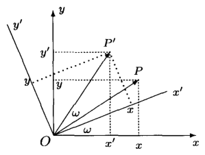

# 第三章 群的线性表示理论

群的线性表示理论是群论能在物理和其他领域得到广泛应用的基础。我们首先引入群线性表示的定义，介绍等价表示和不可约表示的概念。然后，通过几个基本定理，掌握群的不等价不可约表示的重要性质。最后，就若干个典型例子，说明寻找有限群所有不等价不可约表示的一般方法，可约表示的约化方法和群论方法在物理中应用的基本步骤。

## 3.1 群的线性表示

### 一、线性表示的定义

从群论观点看，两个同构的群，群的性质相同。由于矩阵群比较容易研究，如能找到一个矩阵群和给定群同构，那么，研究清楚此矩阵群的性质，也就完全掌握了给定群的性质。如果矩阵群只是与给定群同态，那么，矩阵群只反映给定群的部分性质，但对研究给定群的性质也有作用。与给定群同构或同态的矩阵群称为给定群的线性表示。

**定义**  若行列式不为零的 $m \times m$ 矩阵集合构成的群 $D(G)$ 与给定群 $G$ 同构或同态，则 $D(G)$ 称为群 $G$ 的一个 $m$ 维线性表示，简称表示（representation）。在 $D(G)$ 中，与 $G$ 中元素 $R$ 对应的矩阵 $D(R)$，称为元素 $R$ 在表示 $D(G)$ 中的表示矩阵，$D(R)$ 的矩阵迹 $\chi(R) = \mathrm{Tr}\ D(R)$ 称为元素 $R$ 在表示 $D(G)$ 中的特征标（character）。

规定表示矩阵的行列式不为零，是为了排除表示矩阵与零矩阵直和的平庸情况。在此规定下，恒元的表示矩阵是单位矩阵，$D(E) = 1$，互逆元素的表示矩阵互为逆矩阵，$D(R^{-1}) = D(R)^{-1}$. 若 $D(G)$ 与群 $G$ 同构，则 $D(G)$ 称为群 $G$ 的真实（faithful）表示，若同态，则称非真实表示。非真实表示描写了群 $G$ 关于同态对应核的商群的性质。

让群中所有元素都对应 1，$D(R) = 1$，得到的表示称为恒等表示，也称平庸表示。任何群都有恒等表示。矩阵群本身是自己的一个表示，称为自身表示。表示矩阵都是么正矩阵的表示称为么正表示。表示矩阵都是实正交矩阵的表示称为实正交表示。如不做特殊说明，本书只讨论群的有限维表示。文献 [64] 第四章第 24 题举例说明了无穷维么正表示的研究方法。

### 二、群代数和有限群的正则表示

这里讨论任何有限群都有的一个重要的真实线性表示，称为正则表示。为此，我们先引入群函数和群代数的概念。

所谓函数关系就是自变量和因变量之间的一种确定的对应关系。过去我们接触的函数，自变量往往是坐标等连续变量，它在称为定义域的连续区域内连续变化。但是作为函数的自变量，并不一定要是连续变量，例如说，以群元素作为自变量也可以建立适当的函数关系。

如果对于群 $G$ 的每一个元素 $R$，都有一个确定的数 $F(R)$（实数或复数）与之对应，这样的以群元素作为自变量的函数称为群函数，常记作 $F(G)$. 群函数还可以是矢量函数，矩阵函数等。对有限群，群函数只有 $g$ 个取值，因此有限群线性无关的群函数数目等于群的阶数 $g$.

群 $G$ 的每一个线性表示 $D(G)$ 都是群 $G$ 的一个矩阵函数。表示矩阵的每一个矩阵元素 $D_{\mu\nu}(R)$ 是群 $G$ 的一个群函数。特征标 $\chi(R)$ 也是一个群函数，但由于共轭元素的特征标相同

$$
D(SRS^{-1}) = D(S) D(R) D(S)^{-1} , \qquad \chi(SRS^{-1}) = \chi(R)
\tag{3.1}
$$

特征标 $\chi(R)$ 实际上是类的函数。

在第一章中我们已复习过线性空间的概念。线性空间的基可以是线性无关的任何客体。基的所有实线性组合构成一个实线性空间，所有复线性组合构成复线性空间，简称线性空间。在群的定义中，我们没有定义过群元素加法的概念。现在引入群元素的加法。所谓 $R + S$ 就是把两元素加在一起，不要问它们加起来等于什么，只是从原则上规定群元素加法必须满足加法的一些基本公理，也就是加法的交换律和群元素与数相乘的线性性质

$$
\begin{aligned}
& c_1 R + c_2 S = c_2 S + c_1 R , \qquad c_1 R + c_2 R = (c_1 + c_2) R , \\
& c_3 (c_1 R + c_2 S) = c_3 c_1 R + c_3 c_2 S
\end{aligned}
\tag{3.2}
$$

现在我们可以取有限群群元素 $R$ 作为基，它们的所有复线性组合构成一个线性空间，称为群空间。群空间的维数就是群的阶数 $g$. 群元素的任何线性组合都是群空间的一个矢量，例如

$$
X = \sum_{R \in G} F_1(R) R , \qquad Y = \sum_{S \in G} F_2(S) S
\tag{3.3}
$$

群空间的矢量也要满足线性空间矢量的一般性质，如数和矢量相乘的线性性质，两矢量相加减时，它们的对应分量相加减等。群空间矢量基的选择也不是唯一的。以群元素作为基称为自然基。当基选定后，群空间的矢量和 $g \times 1$ 列矩阵有一一对应的关系。当基发生变化，矢量的列矩阵也按一定的规则做线性组合。在自然基中，每一个矢量的分量 $F(R)$ 又是一个群函数。群空间的矢量和群函数之间也有一一对应的关系。另一方面，在线性空间 $\mathcal{L}$ 中只定义了矢量的加减法和矢量与数的乘法，没有定义矢量间的乘法。如果在线性空间再引入矢量的乘法，要求线性空间关于乘法是封闭的，而且乘法满足分配律，即对线性空间 $\mathcal{L}$ 中的任何矢量 $X, Y$ 和 $Z$，满足

$$
XY \in \mathcal{L} , \qquad Z(X + Y) = ZX + ZY
\tag{3.4}
$$

这样的线性空间称为代数。现在我们在群空间中这样定义矢量的乘法：数与数做普通数的乘法，群元素与群元素按群元素的乘积规则相乘

$$
\begin{aligned}
XY &= \left\{ \sum_{R \in G} F_1(R) R \right\} \left\{ \sum_{S \in G} F_2(S) S \right\}
= \sum_{R \in G} \sum_{S \in G} \{ F_1(R) F_2(S) \} (RS) \\
&= \sum_{T \in G} \left\{ \sum_{R \in G} F_1(R) F_2(R^{-1}T) \right\} T
= \sum_{T \in G} \left\{ \sum_{S \in G} F_1(TS^{-1}) F_2(S) \right\} T
\end{aligned}
\tag{3.5}
$$

这样的乘法满足分配律，而且群空间关于此乘法是封闭的，从而使群空间变成代数，称为群代数。今后我们仍用线性空间的符号 $\mathcal{L}$ 来标记群代数。

在群代数中，群元素左乘或右乘到群代数的矢量上，使矢量按一定规则变成群代数中的另一个矢量。因此，在群代数中群元素既是矢量又是线性算符。例如，把作为算符的 $S$ 左乘到作为矢量基的 $R$ 上，得到群代数中的一个矢量，可以写成矢量基的线性组合，组合系数排列起来构成算符 $S$ 在矢量基 $R$ 中的矩阵形式 $D(S)$

$$
SR = T = \sum_{P \in G} P\ D_{PR}(S)
\tag{3.6}
$$

但是，按照群元素的乘积规则，$S$ 左乘到 $R$ 上得到另一个群元素 $T$. 就是说，式 (3.6)的求和式实际只有一项，矩阵 $D(S)$ 的每一列只有一个矩阵元素不为 0，而为 1

$$
D_{PR}(S) = \left\{
\begin{array}{ll}
1 , & \text{当}\ P = SR \\
0 , & \text{当}\ P \neq SR
\end{array}
\right.
\tag{3.7}
$$

由于重排定理，$D(S)$ 的每一行也只有一个矩阵元素不为零。

因为矩阵 $D(S)$ 是线性算符 $S$ 在群代数自然基中的矩阵形式，式 (3.6)给出 $D(S)$ 和 $S$ 间的一个一一对应的关系。按惯例，算符乘积定义为两算符的相继作用，矩阵按矩阵乘积规则相乘，则算符的乘积和矩阵的乘积仍按式 (3.6)一一对应。这种算符与其矩阵形式一一对应或一多对应的关系在乘积中保持不变的性质，在群论中经常遇到，这里我们证明一次，以后再遇到就不再证明。

$$
T(SR) = \sum_{P \in G} TP\ D_{PR}(S) = \sum_{Q \in G} Q \left\{ \sum_{P \in G} D_{QP}(T) D_{PR}(S) \right\} ,
$$

$$
(TS)R = \sum_{Q \in G} Q\ D_{QR}(TS)
$$

由于结合律，两式子的左边相等，因而

$$
D(T)D(S) = D(TS) \longleftrightarrow TS
$$

根据第二章定理三，矩阵 $D(S)$ 的集合构成群 $D(G)$，且同构于群 $G$，称为群 $G$ 的正则表示。正则表示是真实表示。每个有限群都有正则表示。正则表示的维数等于有限群的阶数 $g$. 由式 (3.7)知，除了恒元外，元素 $S$ 在正则表示中的特征标都为零

$$
\chi(S) = \mathrm{Tr}\ D(S) = \left\{
\begin{array}{ll}
g , & \text{当}\ S = E \\
0 , & \text{当}\ S \neq E
\end{array}
\right.
\tag{3.8}
$$

过去我们习惯于用自然数标记矩阵的行和列，这不是必要的。其实只要足以区分行（列）的任何指标都可以用来标记矩阵的行（列）。正则表示是一个典型的例子，它用群元素来标记矩阵的行（列）。知道了群的乘法表，群的正则表示很容易写出来。元素 $S$ 在正则表示中的矩阵形式由乘法表中第 $S$ 行的乘积元素决定，表示矩阵第 $R$ 列不为零的矩阵元素所在行，就是乘法表 $S$ 行中 $R$ 列的乘积元素标记的行。因此看着乘法表就能立刻写出每个元素的正则表示矩阵。例如，正三角形对称群 $\mathrm{D}_3$ 生成元 $D$ 和 $A$ 在正则表示中的表示矩阵如下，其中行（列）用群元素 $E, D, F, A, B$ 和 $C$ 的次序标记

$$
D(D) = \begin{pmatrix}
0 & 0 & 1 & 0 & 0 & 0 \\
1 & 0 & 0 & 0 & 0 & 0 \\
0 & 1 & 0 & 0 & 0 & 0 \\
0 & 0 & 0 & 0 & 0 & 1 \\
0 & 0 & 0 & 1 & 0 & 0 \\
0 & 0 & 0 & 0 & 1 & 0
\end{pmatrix} , \qquad
D(A) = \begin{pmatrix}
0 & 0 & 0 & 1 & 0 & 0 \\
0 & 0 & 0 & 0 & 0 & 1 \\
0 & 0 & 0 & 0 & 1 & 0 \\
1 & 0 & 0 & 0 & 0 & 0 \\
0 & 0 & 1 & 0 & 0 & 0 \\
0 & 1 & 0 & 0 & 0 & 0
\end{pmatrix}
\tag{3.9}
$$

在群代数中，作为算符的群元素 $S$，不仅可以从左面作用到矢量上，还可以从右面作用到矢量上。当然，对非阿贝尔群来说，左乘和右乘群元素的结果是不一样的，而且两个算符的乘积，对左乘和右乘群元素来说也是不一样的。例如，先左乘 $S$，再左乘 $T$，其结果是左乘 $TS$，但先右乘 $S$，再右乘 $T$，其结果是右乘 $ST$. 虽然左乘算符的集合和右乘算符的集合，根据不同的乘积规则可以分别构成群，分别记作 $G$ 和 $\tilde{G}$，但如果把它们的相同元素一一对应，则它们的乘积不再按原规则一一对应。只有把 $G$ 中元素 $R$ 和 $\tilde{G}$ 中元素 $R^{-1}$ 一一对应，元素的乘积仍按原规则一一对应。 $\tilde{G}$ 称为群 $G$ 的内禀群（intrinsic group）。为了使右乘算符的矩阵形式的集合也构成原群的线性表示，可以把算符的矩阵形式取转置，也就是按列指标求和

$$
RS = \sum_{P \in G} \overline{D}_{RP}(S)\ P
\tag{3.10}
$$

式 (3.10)给出的群元素 $S$ 和矩阵 $\overline{D}(S)$ 间的一一对应关系，才能使元素乘积按同一规则一一对应

$$
\begin{aligned}
(RS)T &= \sum_{P \in G} \overline{D}_{RP}(S) PT = \sum_{Q \in G} \left\{ \sum_{P \in G} \overline{D}_{RP}(S) \overline{D}_{PQ}(T) \right\} Q \\
&= R(ST) = \sum_{Q \in G} \overline{D}_{ST}(ST) Q
\end{aligned}
$$

即 $\overline{D}(ST) = \overline{D}(S)\overline{D}(T)$. 由式 (3.10)可以计算得表示矩阵 $\overline{D}(S)$

$$
\overline{D}_{RP}(S) = \left\{
\begin{array}{ll}
1 , & \text{当}\ P = RS \\
0 , & \text{当}\ P \neq RS
\end{array}
\right.
\tag{3.11}
$$

这个矩阵也用群元素来标记行（列）。元素 $S$ 在此表示中的矩阵形式由乘法表中第 $S$ 列的乘积元素决定。表示矩阵第 $R$ 行不为零的矩阵元素所在列，就是乘法表 $S$ 列中 $R$ 行的乘积元素所标记的列。例如，生成元 $D$ 和 $A$ 在此表示中的表示矩阵为

$$
\overline{D}(D) = \begin{pmatrix}
0 & 1 & 0 & 0 & 0 & 0 \\
0 & 0 & 1 & 0 & 0 & 0 \\
1 & 0 & 0 & 0 & 0 & 0 \\
0 & 0 & 0 & 0 & 0 & 1 \\
0 & 0 & 0 & 1 & 0 & 0 \\
0 & 0 & 0 & 0 & 1 & 0
\end{pmatrix} , \qquad
\overline{D}(A) = \begin{pmatrix}
0 & 0 & 0 & 1 & 0 & 0 \\
0 & 0 & 0 & 0 & 1 & 0 \\
0 & 0 & 0 & 0 & 0 & 1 \\
1 & 0 & 0 & 0 & 0 & 0 \\
0 & 1 & 0 & 0 & 0 & 0 \\
0 & 0 & 1 & 0 & 0 & 0
\end{pmatrix}
\tag{3.12}
$$

## 3.2 标量函数的变换算符

标量的概念是与变换相联系的，物理中通常说的标量是对三维空间转动变换来说的。有一些物理量，例如质量，温度，电势等，它们在转动变换中保持不变，称为标量。标量用一个数字就可以把它完全描述。标量的空间分布称为标量场。标量场用标量函数 $\psi(x)$ 来描写，它是空间坐标的函数。

当系统（标量场）发生变换（平移，转动等）时，描写系统的标量函数如何变化？这里所谓的变换，可以狭义地理解为系统的平移和转动等空间变换，也可以广义地理解为更一般的变换，例如系统内部空间的变换。为确定起见，我们姑且把它理解为转动变换。描写转动通常有两种不同的观点，一种是本书采用的系统转动的观点，另一种是坐标系转动的观点，两种变换互为逆变换。

描写系统状态的坐标可以很多，例如 $N$ 个粒子系统需用 $3N$ 个坐标来描写。为书写简单起见，用一个字母 $x$ 描写系统的全部坐标。设经过变换 $R$ 后，在 $x$ 点的场变到 $x'$ 点，则变换后标量场在 $x'$ 点的值应该等于变换前标量场在 $x$ 点的值。因此，变换前后描写系统的标量函数形式必须发生相应的变化，才能使它们在函数值上有上述的联系。用标量函数 $\psi(x)$ 和 $\psi'(x)$ 描写变换前后标量场的分布，则

$$
\begin{aligned}
x &\xrightarrow{R} x' = Rx , \qquad x = R^{-1}x'\\
\psi(x) &\xrightarrow{R} \psi'(x') = \psi(x)
\end{aligned}
\tag{3.13}
$$

用 $\psi'$ 描写变换 $R$ 后的标量场，从符号上看不清它对变换 $R$ 的依赖。为了明显地表达出新函数形式与变换 $R$ 的关系，引入算符 $P_R$

$$
P_R\psi \equiv \psi' , \qquad P_R\psi(x') = \psi'(x')
\tag{3.14}
$$

$P_R$ 是一个算符，它把变换前的标量函数 $\psi$ 变成新的标量函数 $\psi'$。由式 (3.13) 得

$$
P_R\psi(x') = \psi(x) = \psi(R^{-1}x')
$$

由于自变量要取遍定义域的所有数值，符号上用 $x'$ 或 $x$ 都是一样的，故有

$$
P_R\psi(x) = \psi(R^{-1}x)
\tag{3.15}
$$

$\psi$ 和 $P_R\psi$ 是两种不同的函数形式，式 (3.15) 给出了两个函数在函数值上的联系，同时也给出了变换算符 $P_R$ 对任意函数 $\psi(x)$ 的作用规则：只要把原来函数 $\psi$ 的自变量 $x$ 换成 $R^{-1}x$，再把它看成 $x$ 的函数，就得到新的函数形式 $P_R\psi$。$P_R$ 显然是线性算符

$$
\begin{aligned}
P_R\{a\psi(x)+b\phi(x)\} &= a\psi(R^{-1}x)+b\phi(R^{-1}x)\\
&= aP_R\psi(x)+bP_R\phi(x)
\end{aligned}
\tag{3.16}
$$

式 (3.15) 是标量函数的特征，所有标量函数都必须满足这一变换规则。

　　算符 $P_R$ 与变换 $R$ 间有一一对应的关系

$$
x \xrightarrow{R} x' = Rx
$$

$$
\psi(x) \xrightarrow{R} \psi'(x') = P_R\psi(x') = \psi(x)
$$

它们的乘积仍按同一规则一一对应

$$
x' \xrightarrow{S} x'' = Sx' = (SR)x
$$

$$
\psi'(x') \xrightarrow{S} \psi''(x'') = P_SP_R\psi(x'') = P_S\psi'(x'') = \psi'(x') = \psi(x)
$$

$$
\psi(x) \xrightarrow{SR} P_{SR}\psi(x'') = \psi\left[(SR)^{-1}x''\right] = \psi(x)
$$

因此 $P_SP_R = P_{SR}$。如果变换 $R$ 的集合构成群 $G$，则 $P_R$ 的集合 $P_G$ 构成与 $G$ 同构的群。有时把群 $P_G$ 称为群 $G$ 的线性实现。以后，线性算符群 $P_G$ 和群 $G$ 不再严格区分，都称为对称变换群。这里值得强调一下初学者很容易犯的一个错误。式 (3.15) 是两个函数在函数值上的联系，这两个函数是不同的。$P_R$ 作用在 $\psi$ 上变成新函数 $\psi'$，再做 $S$ 变换时，$P_S$ 算符必须作用在 $\psi'$ 上

$$
P_S\left[P_R\psi(x)\right] = P_S\psi'(x) = \psi'(S^{-1}x) = P_R\psi(S^{-1}x) = \psi(R^{-1}S^{-1}x)
$$

$P_S$ 算符不是作用在 $\psi$ 上

$$
P_S\left[P_R\psi(x)\right] \neq P_S\psi(R^{-1}x) = \psi(S^{-1}R^{-1}x)
$$

　　下面通过两个例子来说明如何计算 $P_R$ 算符对标量函数的作用。第一个例子是系统在一维空间的平移变换

$$
x \xrightarrow{T(a)} x' = T(a)x = x+a , \qquad x = T(a)^{-1}x' = x'-a
$$

则相应的标量函数平移算符 $P_{T(a)}$ 为

$$
P_{T(a)}\psi(x) = \psi\left[T(a)^{-1}x\right] = \psi(x-a) = \sum_{n=0}^{\infty}\frac{(-a)^n}{n!}\frac{d^n}{dx^n}\psi(x) = \exp\left\{-a\frac{d}{dx}\right\}\psi(x)
$$

$P_{T(a)}$ 可以表达为对 $x$ 微商的指数函数形式。

　　第二个例子是系统在平面上做转动变换。建立固定在空间的平面坐标系 $K$ 和固定在系统上的平面坐标系 $K'$。随着系统绕 $z$ 轴转动 $\omega$ 角，$K'$ 系从与 $K$ 系重合的位置转到图 3.1 中用 $x'$ 和 $y'$ 标记的直角坐标系位置。系统上的点从 $P$ 位置转到 $P'$ 位置，$P$ 点在 $K$ 系的坐标为 $(x,y)$，$P'$ 点在 $K$ 系的坐标为 $(x',y')$，但在 $K'$ 系坐标仍是 $(x,y)$。

　　从图中容易看出，在转动 $R(\omega)$ 作用下，坐标变换关系为

$$
x' = x\cos\omega - y\sin\omega , \qquad y' = x\sin\omega + y\cos\omega
\tag{3.17}
$$

其逆变换是把 $\omega$ 换成 $-\omega$。关于坐标 $x$ 和 $y$ 的二次齐次多项式构成的函数空间是三维空间，有三个独立的函数基

$$
\psi_1(x,y) = x^2 , \qquad \psi_2(x,y) = xy , \qquad \psi_3(x,y) = y^2
$$

系统转动 $R(\omega)$ 对应标量函数变换算符 $P_{R(\omega)}$。这个函数空间对 $P_{R(\omega)}$ 保持不变

$$
\begin{aligned}
P_{R(\omega)}\psi_1(x,y) &= \psi_1\left[R^{-1}(x,y)\right] = (x\cos\omega + y\sin\omega)^2\\
&= \psi_1(x,y)\cos^2\omega + \psi_2(x,y)\sin(2\omega) + \psi_3(x,y)\sin^2\omega ,
\end{aligned}
$$

$$
\begin{aligned}
P_{R(\omega)}\psi_2(x,y) &= \psi_2\left[R^{-1}(x,y)\right] = (x\cos\omega + y\sin\omega)(-x\sin\omega + y\cos\omega)\\
&= -\psi_1(x,y)\sin\omega\cos\omega + \psi_2(x,y)\cos(2\omega) + \psi_3(x,y)\sin\omega\cos\omega ,
\end{aligned}
$$

$$
\begin{aligned}
P_{R(\omega)}\psi_3(x,y) &= \psi_3\left[R^{-1}(x,y)\right] = (-x\sin\omega + y\cos\omega)^2\\
&= \psi_1(x,y)\sin^2\omega - \psi_2(x,y)\sin(2\omega) + \psi_3(x,y)\cos^2\omega
\end{aligned}
$$

即算符 $P_{R(\omega)}$ 在它的这个不变函数空间中可用一个三维矩阵来描写

$$
P_{R(\omega)}\psi_\mu(x,y) = \psi_\mu\left[R^{-1}(x,y)\right] = \sum_{\nu}\psi_\nu(x,y)D_{\nu\mu}[R(\omega)] ,
$$

$$
D[R(\omega)] =
\begin{pmatrix}
\cos^2\omega & -\sin\omega\cos\omega & \sin^2\omega\\
\sin(2\omega) & \cos(2\omega) & -\sin(2\omega)\\
\sin^2\omega & \sin\omega\cos\omega & \cos^2\omega
\end{pmatrix}
\tag{3.18}
$$

　　现在讨论线性算符 $L(x)$ 在变换 $R$ 中的变换规律。线性算符 $L(x)$ 代表系统状态的一种特定变换，通过描写系统状态的波函数的变换表现出来。设此变换使系统从状态 $A$ 变成状态 $B$，表现在波函数上，$L(x)$ 作用在函数 $\psi_A(x)$ 上得到函数 $\psi_B(x)$，即

$$
\psi_B(x) = L(x)\psi_A(x)
$$

在变换 $R$ 后，描述两状态的函数形式发生变化

$$
\psi_A(x) \xrightarrow{R} \psi_A'(x') = P_R\psi_A(x')
$$

$$
\psi_B(x) \xrightarrow{R} \psi_B'(x') = P_R\psi_B(x')
$$

联系此两确定状态的算符形式也必须跟着发生变化，以确保它仍是这两特定状态之间的变换算符

$$
L(x) \xrightarrow{R} L'(x') , \qquad \psi_B'(x') = L'(x')\psi_A'(x')
$$

这里的变量符号 $x'$ 可用任何其他变量符号来代替，也可以用 $x$ 来代替

$$
L'(x)\left\{P_R\psi_A(x)\right\} = P_R\psi_B(x) = P_R\left\{L(x)\psi_A(x)\right\}
$$

因为 $\psi_A(x)$ 是任意函数，所以

$$
L'(x) = P_RL(x)P_R^{-1}
\tag{3.19}
$$

这个公式也可以做更直接的理解。$L(x)$ 作用在波函数 $\psi(x)$ 上得到新的波函数 $L(x)\psi(x)$，$P_R$ 对这个新波函数的作用为

$$
P_R\left[L(x)\psi(x)\right] = \left[P_RL(x)P_R^{-1}\right]\left[P_R\psi(x)\right] = L'(x)\psi'(x)
$$

在 $L(x)$ 的右面有可能还有波函数，$P_R^{-1}$ 的作用是抵消 $P_R$ 对右面波函数的作用。

　　在式 (3.19) 中，$P_R$ 是从左面乘，形式上似乎与线性代数中算符的矩阵形式所做的相似变换 $D'(R) = S^{-1}D(R)S$ 不一样，但实质是一致的，因为在线性代数中矢量分量按 $S^{-1}$ 变换

$$
\underline{b} = D(R)\underline{a} , \qquad \underline{a}' = S^{-1}\underline{a} , \qquad D'(R) = S^{-1}D(R)S
$$

$$
\psi_B(x) = L(x)\psi_A(x) , \qquad \psi_A'(x) = P_R\psi_A(x) , \qquad L'(x) = P_RL(x)P_R^{-1}
$$

　　量子力学中物理量用线性厄米算符来描写，在变换中按式 (3.19) 变换。系统哈密顿量 $H(x)$ 也应做此变换

$$
H(x) \xrightarrow{R} P_RH(x)P_R^{-1}
\tag{3.20}
$$

如果 $R$ 是系统的对称变换，则哈密顿量在变换中保持不变

$$
H(x) = P_RH(x)P_R^{-1} , \qquad [H(x),\,P_R] = 0
\tag{3.21}
$$

即对称变换算符 $P_R$ 与哈密顿量 $H(x)$ 可以对易。

　　设能级 $E$ 是 $m$ 重简并，有 $m$ 个线性无关的本征函数

$$
H(x)\psi_\mu(x) = E\psi_\mu(x) , \qquad \mu = 1,\ 2,\ \cdots,\ m
\tag{3.22}
$$

$\psi_\mu(x)$ 的所有复线性组合构成一个 $m$ 维线性空间，在这个空间中的所有函数都是能量为 $E$ 的本征函数，$\psi_\mu(x)$ 是这个空间的一组函数基。由式 (3.21) 得

$$
H(x)\left[P_R\psi_\mu(x)\right] = P_RH(x)\psi_\mu(x) = E\left[P_R\psi_\mu(x)\right]
\tag{3.23}
$$

哈密顿量的本征函数 $\psi_\mu(x)$ 经 $P_R$ 作用后，仍是哈密顿量同一能级的本征函数，仍属此函数空间，即此 $m$ 维线性空间对 $P_R$ 的作用保持不变，$P_R\psi_\mu(x)$ 可按函数基 $\psi_\nu(x)$ 展开。把组合系数排成矩阵 $D(R)$，它就是对称变换算符 $P_R$ 在基 $\psi_\mu$ 中的矩阵形式

$$
P_R\psi_\mu(x) = \sum_{\nu=1}^{m}\psi_\nu(x)D_{\nu\mu}(R)
\tag{3.24}
$$

矩阵 $D(R)$ 和算符 $P_R$ 通过式 (3.24) 建立起一一对应或多一对应的关系。重复式 (3.8) 的证明，可知它们的乘积也按同一规则对应，因而矩阵 $D(R)$ 的集合构成群 $D(G)$，它同构或同态于对称变换群 $P_G$ 和 $G$

$$
D(G) \sim P_G \approx G
\tag{3.25}
$$

$D(G)$ 是群 $G$ 的一个 $m$ 维线性表示，它描写了哈密顿量本征函数在对称变换中的变换规律。这是物理中应用线性表示理论的一个相当普遍的例子。系统的对称变换群 $G$ 同构于线性算符群 $P_G$，而 $P_G$ 作用在不变函数空间的基上，得到群 $G$ 的线性表示。线性表示描写不变函数空间中函数的变换规律。为了用群论方法研究系统的对称性质，首先要找到对称变换群的全部线性表示。

　　注意式 (3.15) 和 (3.24) 的区别。式 (3.15) 两边的函数宗量是不同的，它代表变换前后的两个函数在函数值上的联系，只要是标量函数都应满足式 (3.15) 的变换规则。而式 (3.24) 两边的函数宗量是相同的，它代表函数 $P_R\psi_\mu$ 按函数基 $\psi_\nu$ 的展开式，这是函数之间的组合关系。一般标量函数并不满足此关系，只有当 $\psi_\mu$ 架设的函数空间对算符 $P_G$ 不变时，才有式 (3.24) 成立。

　　在量子力学中，波函数的内积定义为

$$
\langle\psi(x)|\phi(x)\rangle = \int \psi(x)^{*}\phi(x)\,\mathrm{d}x
\tag{3.26}
$$

对转动，平移等空间变换，由 $x$ 到 $R^{-1}x$ 的雅可比 (Jacobi) 行列式为 1，则

$$
\langle P_R\psi(x)|P_R\phi(x)\rangle = \int \psi(R^{-1}x)^{*}\phi(R^{-1}x)\,\mathrm{d}x = \langle\psi(x)|\phi(x)\rangle
\tag{3.27}
$$

因此，$P_R$ 算符是幺正算符，在 $P_R$ 变换下厄米算符的厄米性保持不变。如果取函数基 $\psi_\mu$ 是正交归一的，则线性表示 $D(G)$ 就是幺正表示。在实际物理问题中有一个重要的例外，就是洛伦兹 (Lorentz) 变换算符 $P_\Lambda$ 不是幺正算符。这是因为内积定义式 (3.26) 中的坐标积分关于洛伦兹变换的雅可比行列式不为 1。此时即使把函数基选成正交归一的，洛伦兹群的线性表示也不是幺正表示。

## 3.3 等价表示和表示的幺正性

### 一、等价表示

　　在具体寻找群的所有线性表示之前，先要把此问题做适当的简化。表示是一个矩阵群，它所作的线性空间称为表示空间。在给定的不变函数空间中，线性变换群 $P_G$ 作用在基 $\psi_\mu(x)$ 上，得到一个线性表示。这个线性函数空间就是表示空间。正则表示的表示空间就是群代数。对 $m$ 维方矩阵构成的矩阵群，群元素描写 $m$ 维空间的线性变换，而这 $m$ 维空间就是矩阵群自身表示的表示空间。

　　表示空间中基的选择不是唯一的。当基做线性组合时，

$$
\phi_\mu = \sum_\nu \psi_\nu X_{\nu\mu}
\tag{3.28}
$$

$P_R$ 的矩阵形式做相似变换

$$
P_R\psi_\mu = \sum_\rho \psi_\rho D_{\rho\mu}(R) , \qquad P_R\phi_\nu = \sum_\lambda \phi_\lambda \overline{D}_{\lambda\nu}(R) ,
$$

$$
\overline{D}(R) = X^{-1}D(R)X
\tag{3.29}
$$

从而得到一个新的线性表示 $\overline{D}(G)$。这两个表示的对应表示矩阵 $D(R)$ 和 $\overline{D}(R)$，是同一个线性变换 $P_R$ 在同一个表示空间中的矩阵形式，只是因为函数基选择的不同，使表现形式有所不同，它们通过同一个相似变换 $X$ 联系起来。这样两个表示称为等价表示。从给定的表示，任选非奇相似变换，就可得到无穷多个内容上没有实质区别的等价表示。

　　**定义**　如果群 $G$ 所有元素 $R$ 在两个表示 $D(G)$ 和 $\overline{D}(G)$ 中的表示矩阵存在同一相似变换关系 (3.29)，这样两个表示称为等价 (equivalent) 表示，记作 $D(G) \simeq \overline{D}(G)$。

两个等价表示维数相等，相似变换矩阵 $X$ 也是同维非奇矩阵，与群元素无关。等价于同一表示的两表示互相等价。等价表示没有实质上的区别。寻找群 $G$ 所有表示的问题简化为寻找群 $G$ 所有不等价的表示问题。

　　如何来判别两表示是否等价？任意元素在两个等价表示中的特征标相等

$$
\chi(R) = \mathrm{Tr}\,D(R) = \mathrm{Tr}\,\overline{D}(R) = \overline{\chi}(R)
\tag{3.30}
$$

以后将证明，对有限群，每个元素在两表示中的特征标对应相等，是两表示等价的充要条件。由于特征标是类的函数，为了检验两表示的等价性，只需要在每个类中选一个元素，检验它们在两表示中的特征标是否相等。

### 二、表示的幺正性

　　等价表示没有实质上的区别。但在一系列等价的表示中，选什么样的表示作为代表最为方便呢？下面的定理告诉我们，对有限群可以选幺正表示作为代表。

　　**定理一**　有限群的线性表示等价于幺正表示，而且两个等价的幺正表示一定可以通过幺正的相似变换相联系。

这个定理的证明见附录 3。证明过程是对有限群的任意一个给定表示，具体找出相似变换，把它化为幺正表示，然后，对两个等价的幺正表示，具体找出幺正的相似变换把它们联系起来。但是作为一种计算方法，这方法太繁了，不实用。在实际物理问题里，对有限群和大部分无限群，算符 $P_R$ 是幺正的，只要选取正交归一的（函数）基，表示就是幺正的。物理中重要的例外就是洛伦兹变换群，它是无限群，以后会知道，除恒等表示外，它根本不存在有限维幺正表示。定理一的重点在于告诉我们，有限群的任何表示都存在等价的幺正表示，而且等价的幺正表示之间，都存在幺正的相似变换。这样，今后对有限群，我们只需要讨论幺正表示和幺正的相似变换，以简化计算。在定理的证明过程中用到了有限群群函数对群元素求平均的概念，而且这平均值对左乘或右乘群元素 $S$ 保持不变

$$
\overline{F} = \frac{1}{g}\sum_{R\in G}F(R) = \frac{1}{g}\sum_{R\in G}F(SR) = \frac{1}{g}\sum_{R\in G}F(RS)
\tag{3.31}
$$

对无限群，求和变成无穷级数，它不一定收敛。要把这个定理推广到无限群，关键要把这个对群元素求和的式子推广，例如定义一个适当的对群元素的积分，并要证明这样的积分存在，而且对左乘或右乘群元素 $S$ 保持不变。

　　如果原先的表示是实矩阵构成的表示，则定理一的全部证明都可在实数范围内进行。这样，定理一可改写成下面的推论。

　　**推论**　有限群实表示等价于实正交表示，两个等价的实正交表示一定可以通过实正交相似变换相联系。

## 3.4 有限群的不等价不可约表示

　　本节是表示理论中最重要的一节。在这一节中，我们先介绍不可约表示的概念及其基本性质，然后研究有限群不等价不可约表示的重要性质。

### 一、不可约表示

　　**定义**　如果群 $G$ 表示 $D(G)$ 的每一个表示矩阵 $D(R)$ 都能通过同一个相似变换 $X$ 化成同一形式的阶梯矩阵

$$
X^{-1}D(R)X =
\begin{pmatrix}
D^{(1)}(R) & M(R)\\
0 & D^{(2)}(R)
\end{pmatrix}
\tag{3.32}
$$

则此表示称为可约表示，否则称为不可约表示 (irreducible)。容易证明，式 (3.32) 中两个子矩阵 $D^{(1)}(R)$ 和 $D^{(2)}(R)$ 的集合分别构成群 $G$ 的线性表示。元素在可约表示中的特征标等于在子表示中的特征标之和

$$
\chi(R) = \chi^{(1)}(R) + \chi^{(2)}(R)
\tag{3.33}
$$

　　可约表示的定义表明，可约表示的表示空间存在着非平庸的不变子空间。反之，如果表示空间关于表示 $D(G)$ 存在非平庸的不变子空间，则可选择表示空间的基，分别属于此不变子空间及其相补的子空间，在此新基下，每个表示矩阵 $D(R)$ 就取相同形式的阶梯矩阵。因此，表示可约性的一个等价的定义是，在表示空间中存在非平庸不变子空间的表示称为可约表示，否则是不可约表示。

　　如果 $D(G)$ 的表示空间存在两个互补的不变子空间，可在两个子空间中分别取一组基，构成整个表示空间的一组完备基，在这组基下，$D(R)$ 都取同一形式的方块矩阵

$$
X^{-1}D(R)X =
\begin{pmatrix}
D^{(1)}(R) & 0\\
0 & D^{(2)}(R)
\end{pmatrix}
= D^{(1)}(R)\oplus D^{(2)}(R)
\tag{3.34}
$$

这表示称为完全可约表示，表示的这种形式称为已约 (reduced) 表示。有时，表示空间虽存在非平庸的不变子空间，但不管如何选择，它的相补子空间都不是不变的。这样的表示仍是可约表示，但称为不能完全约化的可约表示。在实际物理问题中遇到的不能完全约化的可约表示的典型例子是平移群的如下表示。一维空间平移变换 $T(a)$ 的集合构成一维平移群 $T$

$$
x \xrightarrow{T(a)} x' = x+a , \qquad T(a)T(b) = T(a+b)
$$

它是无限阿贝尔群，存在如下二维不能完全约化的可约表示

$$
D(a) =
\begin{pmatrix}
1 & a\\
0 & 1
\end{pmatrix}
, \qquad D(a)D(b) = D(a+b)
\tag{3.35}
$$

　　对有限群，表示 $D(G)$ 可取为幺正表示。如果它的表示空间存在非平庸的不变子空间，则表示 $D(G)$ 的每一个表示矩阵 $D(R)$ 都可通过同一个幺正相似变换 $X$，化为如式 (3.32) 那样的相同形式的幺正的阶梯矩阵 $\overline{D}(R)$。例如，$D(R)$ 是 $P_R$ 算符在表示空间的矩阵形式，$P_R$ 是幺正算符，基是正交归一的，则 $D(R)$ 是幺正的。若选表示空间的一组新的正交归一基，它们分属于此不变子空间及其补空间，则相似变换是幺正的，变换后的阶梯矩阵 $\overline{D}(R)$ 也是幺正的。既然 $\overline{D}(R)$ 是幺正的，它的列矩阵是互相正交归一的（见附录 1），$D^{(1)}(R)$ 就是幺正矩阵。同时，$\overline{D}(R)$ 和 $D^{(1)}(R)$ 的行矩阵也分别是正交归一的，因而 $M(R)$ 只能是零矩阵。这就是说，有限群的可约表示一定是完全可约的。

　　表示 $D(G)$ 的性质完全由两个子表示的性质表达出来。反过来说，把若干个不可约表示直和起来，就构成一个已完全约化的可约表示。这样的可约表示没有给出任何新的性质：它的表示空间是若干个不可约表示的表示空间的直和，空间中的矢量可唯一地分解为分属各子空间的矢量之和，分别按各不可约表示变换。因此，寻找群所有不等价表示的问题进一步简化为寻找群的所有不等价不可约表示的问题。

　　群论的基本任务就是如何判别表示的等价性和不可约性，找出给定群的所有不等价不可约表示，以及如何把可约表示约化为不可约表示的直和。

### 二、舒尔定理

　　舒尔 (Schur) 定理是群表示理论中最基本的定理，它适用于所有的群，揭示出群的不等价不可约表示的基本特征。

　　**定理二（舒尔定理二）**　设 $D^{(1)}(G)$ 和 $D^{(2)}(G)$ 是群 $G$ 的两个不等价不可约表示，维数分别为 $m_1$ 和 $m_2$，$X$ 是一个 $m_1\times m_2$ 矩阵，如果对每一个元素 $R$ 都满足

$$
D^{(1)}(R)X = XD^{(2)}(R) , \qquad \sum_\rho D^{(1)}_{\nu\rho}(R)X_{\rho\mu} = \sum_\rho X_{\nu\rho}D^{(2)}_{\rho\mu}(R)
\tag{3.36}
$$

则 $X = 0$。

**证明**　不可约表示的表示空间不存在非平庸的不变子空间。如果在表示空间中找到低于表示维数的不变子空间，它必是零空间。下面对不同情况证明 X 矩阵的列（或行）矩阵构成的空间是零空间。

（1）$m_1 > m_2$。把 X 矩阵各列看成列矩阵，有 $m_2$ 个列矩阵，$(X_{\cdot\mu})_\lambda = X_{\lambda\mu}$，而式 (3.36) 可看成 $D^{(1)}(R)$ 作用在这些列矩阵上，得到列矩阵的线性组合

$$
D^{(1)}(R)X_{\cdot\mu} = \sum_\rho X_{\cdot\rho} D^{(2)}(R)_{\rho\mu}
\tag{3.37}
$$

即 $m_2$ 个列矩阵 $X_{\cdot\mu}$ 架设了关于 $D^{(1)}(G)$ 不变的子空间，维数不高于 $m_2$，因而它必为零空间。

（2）$m_1 = m_2$。若 $\det X \neq 0$，则存在逆矩阵 $X^{-1}$，式 (3.36) 表明两表示等价，与假设矛盾。若 $\det X = 0$，则 X 的列矩阵线性相关，它只能架设起维数低于 $m_1$ 的子空间。而式 (3.36) 又说明这子空间对 $D^{(1)}(G)$ 保持不变，因而只能是零空间。

（3）$m_1 < m_2$。把式 (3.36) 取转置，$D^{(2)}(R)^T X^T = X^T D^{(1)}(R)^T$。用反证法。如果 $X^T \neq 0$，则情况（1）的证明表明 $D^{(2)}(R)^T$ 作用的空间存在不变子空间，取此子空间及其相补子空间的基作为新的基，把 $D^{(2)}(R)^T$ 化为

$$
Y^{-1}D^{(2)}(R)^T Y = \begin{pmatrix} D_1(R) & M(R) \\ 0 & D_2(R) \end{pmatrix}
$$

上式取转置，说明 $D^{(2)}(G)$ 的表示空间存在不变子空间，与假设矛盾。证完。

**推论一（舒尔定理一）**　与不可约表示 $D(G)$ 的所有表示矩阵 $D(R)$ 对易的矩阵必为常数矩阵，即若 $D(R)X = XD(R)$，则 $X = \lambda 1$，$\lambda$ 为常数。

**证明**　取 X 的任一本征值 $\lambda$，令 $Y = X - \lambda 1$，则 $\det Y = 0$，且 $D(R)Y = YD(R)$，按定理二情况（2）的证明方法，可得 $Y = 0$，即 $X = \lambda 1$。证完。

有限群的可约表示一定是完全可约的，因而可找到非常数矩阵与所有表示矩阵对易，故有下面推论。

**推论二**　有限群表示不可约的充要条件是不可能找到非常数矩阵与所有表示矩阵对易。

### 三、正交关系

群 G 表示 $D(G)$ 的每一个表示矩阵元 $D_{\mu\nu}(R)$ 都是群 G 的一个群函数，把群函数 $D_{\mu\nu}(G)$ 排列成 $g \times 1$ 列矩阵，对应群空间中以群元素为基的一个矢量。这里讨论有限群群空间中这些矢量间的正交关系。群空间两函数 $F_1(G)$ 和 $F_2(G)$ 的内积，即群空间两矢量的点乘定义为

$$
\sum_{R \in G} F_1(R)^* F_2(R)
$$

内积为零就是两矢量正交，同一矢量的点乘称为矢量模的平方。

**定理三**　有限群 G 的不等价不可约么正表示 $D^i(G)$ 和 $D^j(G)$ 的矩阵元素，作为群空间矢量，满足正交关系

$$
\sum_{R \in G} D^i_{\mu\rho}(R)^* D^j_{\nu\lambda}(R) = \frac{g}{m_j}\delta_{ij}\delta_{\mu\nu}\delta_{\rho\lambda}
\tag{3.38}
$$

其中，$g$ 是群 G 的阶，$m_j$ 是表示 $D^j$ 的维数，当 $i = j$ 时，$D^i(R) = D^j(R)$。

**证明**　取 $m_i \times m_j$ 矩阵 $Y(\mu\nu)$，它只有第 $\mu$ 行第 $\nu$ 列元素不为零

$$
Y(\mu\nu)_{\rho\lambda} = \delta_{\mu\rho}\delta_{\nu\lambda}
$$

再定义 $m_i \times m_j$ 矩阵 $X(\mu\nu)$

$$
X(\mu\nu) = \sum_{R \in G} D^i(R)^{-1}Y(\mu\nu)D^j(R)
$$

$$
X(\mu\nu)_{\rho\lambda} = \sum_{R \in G}\sum_{\tau\sigma} D^i_{\rho\tau}(R)^{-1}Y(\mu\nu)_{\tau\sigma}D^j_{\sigma\lambda}(R) = \sum_{R \in G} D^i_{\mu\rho}(R)^* D^j_{\nu\lambda}(R)
\tag{3.39}
$$

$X(\mu\nu)_{\rho\lambda}$ 正等于式 (3.38) 的左边。另一方面，$X(\mu\nu)$ 满足

$$
X(\mu\nu)D^j(S) = \sum_{R \in G} D^i(S)D^i(RS)^{-1}Y(\mu\nu)D^j(RS) = D^i(S)X(\mu\nu)
$$

这里用到群函数关于群元素求和和对右乘群元素保持不变的性质。

当 $i \neq j$ 时，由定理二，$X(\mu\nu) = 0$。当 $i = j$ 时，由定理二推论一，$X(\mu\nu)_{\rho\lambda} = C(\mu\nu)\delta_{\rho\lambda}$，$C(\mu\nu)$ 是依赖于 $Y(\mu\nu)$ 的常数。代入式 (3.39)，两边取 $i = j$，$\rho = \lambda$，并对 $\lambda$ 求和

$$
m_j C(\mu\nu) = \sum_{R \in G}\sum_\lambda D^j_{\lambda\mu}(R^{-1})D^j_{\nu\lambda}(R) = \sum_{R \in G} D^j_{\nu\mu}(RR^{-1}) = g\delta_{\mu\nu}
$$

由此得式 (3.38)。证完。

定理三指出，有限群 G 不等价不可约么正表示的矩阵元素，作为群空间的矢量互相正交。表示做相似变换，矩阵元素做线性组合。因此，可以去掉么正性的条件，只要群 G 的两表示是不等价不可约的，它们的矩阵元素就是互相正交的。定理三还指出，有限群 G 同一不可约么正表示的 $m_j^2$ 个矩阵元素作为群空间的矢量也互相正交，且它们的模平方都等于 $g/m_j$。后一个性质必须限制不可约表示是么正的，否则相似变换引起的矩阵元素的线性组合会破坏对应群空间矢量的正交性。要把这一定理推广到无限群去，关键要解决群函数无穷求和的问题。

正交的矢量必线性无关，有限群群空间最多有 $g$ 个线性无关的矢量。现在群 G 每个不等价不可约表示提供 $m_j^2$ 个线性无关的矢量，这就限制了有限群不等价不可约表示的个数。

**推论一**　有限群不等价不可约表示维数平方和不大于群的阶数，即

$$
\sum_j m_j^2 \leqslant g
\tag{3.40}
$$

在式 (3.38) 中取 $\mu = \rho$，$\nu = \lambda$，并对 $\mu$ 和 $\nu$ 求和，得

$$
\sum_{R \in G} \chi^i(R)^*\chi^j(R) = g\delta_{ij}
\tag{3.41}
$$

**推论二**　有限群不等价不可约表示的特征标，作为群空间的矢量互相正交。

同类元素的特征标相同。特征标实际是类的函数。类似群空间，可以建立类空间，不等价不可约表示的特征标提供了类空间线性无关的矢量。设群 G 有 $g_c$ 个类，第 $\alpha$ 个类 $C_\alpha$ 包含 $n(\alpha)$ 个元素。如果 $R \in C_\alpha$，则 $\chi^j(R)$ 可记作 $\chi^j_\alpha$。将不可约表示的特征标 $\chi^j_\alpha$ 乘上因子 $[n(\alpha)/g]^{1/2}$，看作类空间的矢量，式 (3.41) 说明这些矢量是正交归一的

$$
\sum_{\alpha=1}^{g_c} [n(\alpha)/g]^{1/2}\chi^{i*}_\alpha [n(\alpha)/g]^{1/2}\chi^j_\alpha = \frac{1}{g}\sum_{\alpha=1}^{g_c} n(\alpha)\chi^{i*}_\alpha \chi^j_\alpha = \delta_{ij}
\tag{3.42}
$$

**推论三**　有限群不等价不可约表示的个数不能大于群的类数，即

$$
\sum_j 1 \leqslant g_c
\tag{3.43}
$$

设 $D(G)$ 是群 G 的一个可约表示，它可以约化为若干个不可约表示 $D^j(G)$ 的直和

$$
X^{-1}D(R)X = \bigoplus_j a_j D^j(R) \ , \qquad \chi(R) = \sum_j a_j \chi^j(R)
\tag{3.44}
$$

其中，$\chi(R)$ 是元素 R 在表示 $D(G)$ 中的特征标。$a_j$ 称为不可约表示 $D^j(G)$ 在表示 $D(G)$ 中的重数。式 (3.44) 两边乘 $\chi^i(R)^*/g$ 并对 R 求和，得

$$
a_i = \frac{1}{g}\sum_{R \in G} \chi^i(R)^*\chi(R)
\tag{3.45}
$$

如果找到了群 G 所有不等价不可约表示，由表示 $D(G)$ 的特征标就可以完全确定在表示 $D(G)$ 中各不可约表示 $D^j(G)$ 的重数 $a_j$。如果两个表示约化时各不可约表示的重数 $a_j$ 对应相等，则两表示等价。由式 (3.41) 和 (3.44) 有

$$
\sum_{R \in G} |\chi(R)|^2 = g\sum_j a_j^2 \geqslant g
\tag{3.46}
$$

当式 (3.44) 中的表示 $D(G)$ 是不可约表示 $D^i(G)$ 时，得 $a_j = \delta_{ij}$，此时式 (3.46) 变成等号。

**推论四**　有限群两表示等价的充要条件是每个元素在两表示中的特征标对应相等。

**推论五**　有限群表示为不可约表示的充要条件是

$$
\sum_{R \in G} |\chi(R)|^2 = g
\tag{3.47}
$$

### 四、表示的完备性

定理三的推论一和推论三只给出有限群不等价不可约表示个数和维数的一个上限，现在来证明那里出现的不等号实际是等号。证明中利用每个有限群都有的一个特殊的表示，即正则表示。利用正则表示的特征标计算在正则表示中各不可约表示的重数

$$
a_j = \frac{1}{g}\sum_{R \in G} \chi^j(R)^*\chi(R) = \chi^j(E)^* = m_j
\tag{3.48}
$$

即在正则表示的约化中各不可约表示出现的次数等于该表示的维数

$$
X^{-1}D(R)X = \bigoplus_j m_j D^j(R)
\tag{3.49}
$$

取恒元的特征标

$$
g = \chi(E) = \sum_j m_j^2
\tag{3.50}
$$

**定理四**　有限群不等价不可约表示维数平方和等于群的阶数。

**推论一**　有限群不等价不可约么正表示的矩阵元素 $D^j_{\mu\nu}(G)$，作为群空间的矢量，构成群空间的正交完备基。任何群函数 $F(G)$ 都可按它展开

$$
\begin{aligned}
F(R) &= \sum_{j\mu\nu} C^j_{\mu\nu}D^j_{\mu\nu}(R)\\
C^j_{\mu\nu}(R) &= \frac{m_j}{g}\sum_{R \in G} D^j_{\mu\nu}(R)^*F(R)
\end{aligned}
\tag{3.51}
$$

类函数是一种特殊的群函数，对应同类元素它有相同的函数值。表示的特征标就是类函数。把任何类函数先按 $D^j_{\mu\nu}(G)$ 展开

$$
\begin{aligned}
F(R) &= F(SRS^{-1}) = \frac{1}{g}\sum_{S \in G} F(SRS^{-1})\\
&= \sum_{j\mu\nu} \frac{C^j_{\mu\nu}}{g} \sum_{S \in G}\sum_{\rho\lambda} D^j_{\mu\rho}(S)D^j_{\rho\lambda}(R)D^j_{\nu\lambda}(S)^*\\
&= \sum_j \left(\frac{1}{m_j}\sum_\mu C^j_{\mu\mu}\right)\chi^j(R)
\end{aligned}
$$

既然任何类函数都可以按不等价不可约表示的特征标展开，可见它们构成类空间的完备基。

**推论二**　有限群不等价不可约表示的特征标 $\chi^j(G)$ 构成类空间的正交完备基，任何类函数都可按它们展开

$$
\begin{aligned}
F(R) &= F(SRS^{-1}) = \sum_j C_j\chi^j(R)\\
C_j &= \frac{1}{g}\sum_{R \in G}\chi^j(R)^*F(R)
\end{aligned}
\tag{3.52}
$$

**推论三**　有限群不等价不可约表示的个数等于群的类数，即

$$
\sum_j 1 = g_c
\tag{3.53}
$$

把群空间的正交基 $D^j_{\mu\nu}(G)$ 和类空间的正交基 $\chi^j_\alpha$ 归一化，就可得正交归一基，并用矩阵形式表出

$$
U_{R,j\mu\nu} \equiv \left(\frac{m_j}{g}\right)^{1/2}D^j_{\mu\nu}(R) \ , \qquad V_{\alpha,j} \equiv \left[\frac{n(\alpha)}{g}\right]^{1/2}\chi^j_\alpha
\tag{3.54}
$$

虽然行列指标比较复杂，但根据它们可能的取值范围可知，$U$ 是 $g \times g$ 矩阵，$V$ 是 $g_c \times g_c$ 矩阵，而且等式 (3.38) 和 (3.42) 正说明它们的列矩阵互相正交归一，即它们都是么正矩阵。写出它们的行矩阵正交归一的关系式

$$
\sum_{j\mu\nu}\left(\frac{m_j}{g}\right)^{1/2} D^j_{\mu\nu}(R)\left(\frac{m_j}{g}\right)^{1/2}D^j_{\mu\nu}(S)^* = \frac{1}{g}\sum_{j\mu\nu} m(j)D^j_{\mu\nu}(R)D^j_{\mu\nu}(S)^* = \delta_{RS}
$$

$$
\sum_j \left[\frac{n(\alpha)}{g}\right]^{1/2}\chi^j_\alpha \left[\frac{n(\beta)}{g}\right]^{1/2}\chi^{j*}_\beta = \frac{n(\alpha)}{g}\sum_j \chi^j_\alpha\chi^{j*}_\beta = \delta_{\alpha\beta}
\tag{3.55}
$$

这两个公式是群空间的正交基 $D^j_{\mu\nu}(G)$ 和类空间的正交基 $\chi^j_\alpha$ 完备性的数学描述。希望读者熟悉这种指标比较复杂的基的正交性和完备性的数学描述。这类描述在理论物理中经常遇到。

### 五、有限群不可约表示的特征标表

群论的主要任务就是对于各种典型的群，特别是物理中常见的对称变换群，寻找它们的所有不等价不可约表示，研究可约表示的约化方法。对有限群，首先要找它们的所有不等价不可约表示的特征标，把特征标列成表，称为有限群的特征标表。然后再找不可约表示的表示矩阵。既然群元素都可以表为生成元的乘积，找出生成元的表示矩阵也就够了。选择适当的表象，使表示矩阵用起来最方便。这样的表示称为不可约表示的标准形式。这里所谓的“最方便”当然与所研究的物理问题有关，通常希望尽可能多的生成元表示矩阵是对角化的。对一个非阿贝尔群，至少在真实表示中，生成元表示矩阵不可能都是对角化的。

一个有限群 G 的所有不等价不可约表示中，既有真实表示，也有非真实表示。非真实表示同构于群 G 的商群，而商群的阶数比群 G 的阶数要低，因而它的不等价不可约表示比较好找。掌握阶数较低群的所有不等价不可约表示有利于研究较复杂群的不可约表示。有限群的一维表示基本上都可以通过找商群不可约表示的方法得到，因而找出有限群的所有不变子群及其商群是分析一个有限群的重要步骤。

有限群不可约表示的特征标必须满足四个等式，式 (3.50) 和 (3.53) 限制该群不等价不可约表示的个数和维数，式 (3.42) 和 (3.55) 分别描写特征标表的各行和各列之间特征标的正交归一的性。它们对计算有限群不可约表示的特征标起重要作用，但是它们只是必要条件，不是充分条件。在填写给定群的特征标表时还应注意分析该群本身的特点。

容易证明（见习题第 1 题），将一表示的所有表示矩阵都取其复共轭矩阵，它们的集合也构成原群的表示，称为原表示的复共轭表示。互为复共轭的表示，它们的特征标互为复共轭。如果互为复共轭的两表示互相等价，则称为自共轭表示。自共轭表示的特征标必为实数。群 G 的两个不可约表示直乘仍是它的一个表示，特别是当其中有一个表示是一维表示时，这样的直乘表示仍是不可约的。用这些方法有助于根据已有不可约表示寻找新的不可约表示。

应该指出，寻找物理中常见对称群的所有不等价不可约表示和计算直乘表示的约化，原则上是数学家的任务。事实上，常见群不可约表示的特征标表，表示矩阵的标准形式和不可约表示的直乘表示分解都可以在有关书中查到，物理工作者的主要任务是把它们应用到具体物理问题中去。但是实际问题是多种多样的，要能灵活运用数学家的计算结果，理解数学家计算的基本思想也是十分重要的。下面我们就一些比较简单的群，介绍不可约表示特征标表和表示矩阵的一些计算方法，希望让读者对群表示理论建立起一些直观的概念。

$N$ 阶循环群 $C_N$ 的标准形式是

$$
C_N = \{E,\ R,\ R^2,\ \cdots,\ R^{N-1}\}, \qquad R^N = E
\tag{3.56}
$$

循环群是阿贝尔群，群的阶数等于类数，因而循环群 $C_N$ 的不可约表示都是一维的，共有 $N$ 个不等价的一维表示。表示矩阵必须满足群元素的乘积关系，$D^j(R)^N = D^j(E) = 1$，解得

$$
D^j(R) = \exp\{-\mathrm{i}2\pi j/N\}, \qquad 0 \leqslant j \leqslant (N-1)
\tag{3.57}
$$

低阶循环群经常作为有限群的商群出现，值得特别注意。$C_2$ 群只有两个不等价不可约表示，恒等表示记作 $D^A$，另一表示称为反对称表示，记作 $D^B$。特征标表见表 3.1。$C_3$ 群有三个不等价不可约表示，恒等表示记作 $D^A$，其他两表示互为复共轭表示，记作 $D^E$ 和 $D^{E'}$。特征标表见表 3.2。

表 3.1　$C_2$ 群的特征标表

| | $E$ | $R$ |
|---|---|---|
| $A$ | 1 | 1 |
| $B$ | 1 | $-1$ |

表 3.2　$C_3$ 群的特征标表

| | $E$ | $R$ | $R^2$ |
|---|---|---|---|
| $A$ | 1 | 1 | 1 |
| $E$ | 1 | $\omega$ | $\omega^*$ |
| $E'$ | 1 | $\omega^*$ | $\omega$ |

注：$\omega = \exp\{-\mathrm{i}2\pi/3\}$

表 3.3　$C_4$ 群的特征标表

| | $E$ | $R$ | $R^2$ | $R^3$ |
|---|---|---|---|---|
| $A$ | 1 | 1 | 1 | 1 |
| $B$ | 1 | $-1$ | 1 | $-1$ |
| $E$ | 1 | $-\mathrm{i}$ | $-1$ | $\mathrm{i}$ |
| $E'$ | 1 | $\mathrm{i}$ | $-1$ | $-\mathrm{i}$ |

$C_4$ 群中，元素 $E$ 和 $R^2$ 构成不变子群 $C_2$，表示 $D^A$ 和 $D^B$ 是商群 $C_4/C_2$ 的表示。表示 $D^B$ 和表示 $D^E$ 的直乘就是表示 $D^{E'}$。$C_6$ 群可表为两子群的直乘，$C_6 = C_2 \otimes C_3$，其中 $E$ 和 $R^3$ 构成子群 $C_2$，$E$，$R^2$ 和 $R^4$ 构成子群 $C_3$。$C_6$ 群的不可约表示可表为两子群不可约表示的直乘。$C_2$ 群的表示记作 $D^A(C_2)$ 和 $D^B(C_2)$，$C_3$ 群的表示记作 $D^A(C_3)$，$D^E(C_3)$ 和 $D^{E'}(C_3)$，$C_6$ 群的元素 $R_\mu$ 表为两子群元素的乘积，$R_\mu = S_j T_k$，则有

$$
\begin{aligned}
D^A(R_\mu) &= D^A(S_j)D^A(T_k), & D^B(R_\mu) &= D^B(S_j)D^A(T_k),\\
D^{E_1}(R_\mu) &= D^B(S_j)D^E(T_k), & D^{E'_1}(R_\mu) &= D^B(S_j)D^{E'}(T_k),\\
D^{E_2}(R_\mu) &= D^A(S_j)D^{E'}(T_k), & D^{E'_2}(R_\mu) &= D^A(S_j)D^E(T_k)
\end{aligned}
\tag{3.58}
$$

表 3.4　$C_5$ 群的特征标表

| | $E$ | $R$ | $R^2$ | $R^3$ | $R^4$ |
|---|---|---|---|---|---|
| $A$ | 1 | 1 | 1 | 1 | 1 |
| $E_1$ | 1 | $\eta$ | $\eta^2$ | $\eta^3$ | $\eta^4$ |
| $E'_1$ | 1 | $\eta^4$ | $\eta^3$ | $\eta^2$ | $\eta$ |
| $E_2$ | 1 | $\eta^2$ | $\eta^4$ | $\eta$ | $\eta^3$ |
| $E'_2$ | 1 | $\eta^3$ | $\eta$ | $\eta^4$ | $\eta^2$ |

注：$\eta = \exp\{-\mathrm{i}2\pi/5\}$

表 3.5　$C_6$ 群的特征标表

| | $E$ | $R$ | $R^2$ | $R^3$ | $R^4$ | $R^5$ |
|---|---|---|---|---|---|---|
| $A$ | 1 | 1 | 1 | 1 | 1 | 1 |
| $B$ | 1 | $-1$ | 1 | $-1$ | 1 | $-1$ |
| $E_1$ | 1 | $-\omega^*$ | $\omega$ | $-1$ | $\omega^*$ | $-\omega$ |
| $E'_1$ | 1 | $-\omega$ | $\omega^*$ | $-1$ | $\omega$ | $-\omega^*$ |
| $E_2$ | 1 | $\omega$ | $\omega^*$ | 1 | $\omega$ | $\omega^*$ |
| $E'_2$ | 1 | $\omega^*$ | $\omega$ | 1 | $\omega^*$ | $\omega$ |

注：$\omega = \exp\{-\mathrm{i}2\pi/3\}$

对更复杂的点群，在点群特征标表中，各类通常用类中一个代表元素表出。类中包含的元素数目超过 1 时，元素数目作为系数写在元素符号的前面。在晶体理论中，用符号 $\mathrm{C}_N$ 描写循环群，而用符号 $C_N$ 描写它的生成元。在写元素符号时，绕 $z$ 轴方向的转动用不带撇的符号，绕其他方向的高次轴转动用带一撇的符号，绕 $x$ 方向的二次轴转动用带一撇的符号，绕其他方向的二次轴转动用带两撇的符号。

$D_2$ 群包含四个元素，除恒元外，其他元素是绕三个互相垂直的二次轴的转动变换，它们都是二阶元素，因而可把 $D_2$ 群的三个二次轴转动分别和四阶反演群 $V_4$ 的三个反演变换对应，显然这两个群同构，乘法表由表 2.3 的右图给出。$D_2$ 群和 $V_4$ 群的特征标表列于表 3.6。请注意表 3.6 和 3.3 的区别。它们都描写四阶群不可约表示的特征标，都满足特征标的四个必要条件，但由于群不同构，它们的特征标表是不同的。

$D_3$ 群是最简单的非阿贝尔群，包含有六个元素，恒元 $E$，两个三次轴转动 $D$ 和 $F$，三个二次轴转动 $A$，$B$ 和 $C$，分别构成三类，都是自逆类，乘法表如表 2.5 所示。用晶体理论的符号，三次轴转动 $D$ 表为 $C_3$，二次轴转动 $A$ 表为 $C_2'$。因为 $1^2+1^2+2^2=6$，所以 $D_3$ 群有两个一维表示 $D^A$，$D^B$ 和一个二维不可约表示 $D^E$。不变子群 $\{E, D, F\}$ 的商群同构于 $C_2$ 群，由此得 $D_3$ 群的两个一维表示。二维表示的特征标可用多种方法计算。由式 (3.55) 可算出 $\chi^E(C_2') = 0$，再由式 (3.42) 算得 $\chi^E(C_3) = -1$。$\chi^E(C_2')$ 等于零也可由下面分析得到：如果 $\chi^E(C_2')$ 不等于零，则 $D^B \times D^E$ 就是与 $D^E$ 不等价的二维不可约表示，与上面结论矛盾。还有可用坐标变换的方法写出元素的变换矩阵，如式 (2.10) 所示。这就是 $D_3$ 群的一组二维不可约表示，在这表示中，一个生成元 $A$ 的表示矩阵是对角矩阵，另一个不是。取矩阵迹就得特征标（见表 3.7）。

表 3.6　$D_2$ 群的特征标表

| $D_2$ | $E$ | $C_2$ | $C_2'$ | $C_2''$ |
|---|---|---|---|---|
| $A_1$ | 1 | 1 | 1 | 1 |
| $A_2$ | 1 | 1 | $-1$ | $-1$ |
| $B_1$ | 1 | $-1$ | $-1$ | 1 |
| $B_2$ | 1 | $-1$ | 1 | $-1$ |

表 3.7　$D_3$ 群的特征标表

| $D_3$ | $E$ | $2C_3$ | $3C_2'$ |
|---|---|---|---|
| $A$ | 1 | 1 | 1 |
| $B$ | 1 | 1 | $-1$ |
| $E$ | 2 | $-1$ | 0 |

$C_{2n+1}$ 群和 $C_{2n+2}$ 群各有 $2n$ 个非自逆类，也各有 $2n$ 个不等价不可约的非自共轭表示。$D_2$ 群和 $D_3$ 群所有类都是自逆类，所有不可约表示都是实表示。一般说来（习题第 8 题证明），有限群包含的非自逆类个数等于它的不等价不可约的非自共轭表示的个数。

### 六、T 群的特征标表

T 群有 12 个元素，四个类，其中两个是自逆类，由 $1^2+1^2+1^2+3^2=12$ 知它有三个一维和一个三维不等价不可约表示。由恒元和三个二次轴转动元素构成 T 群的一个不变子群 $D_2$，它的指数为 3，商群同构于 $C_3$ 群。商群给出了 T 群三个不等价的一维表示，其中两个表示是非自共轭表示。因为只有一个三维不等价的不可约表示 $D^T$，所以三次轴转动的类在表示 $D^T$ 中的特征标为零，这也符合条件 (3.55)。再根据特征标的正交性 (3.42) 定出余下的特征标值。T 群的特征标表列于表 3.8。

表 3.8　T群的特征标表

| T | $E$ | $3C_2$ | $4C_3'$ | $4C_3''$ |
|---|---|---|---|---|
| $A$ | 1 | 1 | 1 | 1 |
| $E$ | 1 | 1 | $\omega$ | $\omega^2$ |
| $E'$ | 1 | 1 | $\omega^2$ | $\omega$ |
| $T$ | 3 | $-1$ | 0 | 0 |

注：$\omega = \mathrm{e}^{-\mathrm{i}2\pi/3}$

T 群的三维不可约表示的表示矩阵可用计算坐标变换矩阵的方法 [类似式 (2.9)] 定出。因为绕 $z$ 轴转动 $\pi$ 角的变换 $T_z^2$ 使 $x$ 和 $y$ 轴反向，三次轴转动 $R_1$ 使 $x, y$ 和 $z$ 轴轮换，所以在表示 $D^T$ 中这两个生成元的表示矩阵为

$$
D^T(T_z^2) = \begin{pmatrix} -1 & 0 & 0 \\ 0 & -1 & 0 \\ 0 & 0 & 1 \end{pmatrix}, \qquad
D^T(R_1) = \begin{pmatrix} 0 & 0 & 1 \\ 1 & 0 & 0 \\ 0 & 1 & 0 \end{pmatrix}
\tag{3.59}
$$

有时取表象使 $R_1$ 的表示矩阵对角化。作为练习，请读者计算在那个表象中的表示矩阵，以及两种表象间的相似变换。

### 七、O 群的特征标表

O 群有 24 个元素，五个自逆类，由 $1^2+1^2+2^2+3^2+3^2=24$ 知它有两个一维，一个二维和两个三维不等价不可约的自共轭表示。O 群有两个不变子群，子群 T 的指数为 2，商群与 $C_2$ 群同构，它给出了 O 群两个一维表示 $D^A$ 和 $D^B$。另一个不变子群 $D_2$，指数为 6，商群同构于 $D_3$ 群，它给出 O 群二维表示 $D^E$ 的特征标和表示矩阵 [见表 3.9 和习题第 10 题，请读者自行计算和检验，注意利用式 (2.10)]

$$
D^E(T_z) = \begin{pmatrix} 1 & 0 \\ 0 & -1 \end{pmatrix}, \qquad
D^E(R_1) = \frac{1}{2} \begin{pmatrix} -1 & -\sqrt{3} \\ \sqrt{3} & -1 \end{pmatrix}
\tag{3.60}
$$

表 3.9　O群的特征标表

| O | $E$ | $3C_4^2$ | $8C_3'$ | $6C_4$ | $6C_2''$ |
|---|---|---|---|---|---|
| $A$ | 1 | 1 | 1 | 1 | 1 |
| $B$ | 1 | 1 | 1 | $-1$ | $-1$ |
| $E$ | 2 | 2 | $-1$ | 0 | 0 |
| $T_1$ | 3 | $-1$ | 0 | 1 | $-1$ |
| $T_2$ | 3 | $-1$ | 0 | $-1$ | 1 |

O 群的一个三维不可约表示 $D^{T_1}$ 的表示矩阵可用计算坐标变换矩阵的方法 [见式 (3.59)] 定出。因为绕 $z$ 轴转动 $\pi/2$ 角的变换 $T_z$ 把 $x$ 轴转到 $y$ 轴方向，$y$ 轴转到负 $x$ 轴方向，三次轴转动 $R_1$ 已在前而讨论过，所以在这三维表示中有

$$
D^{T_1}(T_z) = \begin{pmatrix} 0 & -1 & 0 \\ 1 & 0 & 0 \\ 0 & 0 & 1 \end{pmatrix}, \qquad
D^{T_1}(R_1) = \begin{pmatrix} 0 & 0 & 1 \\ 1 & 0 & 0 \\ 0 & 1 & 0 \end{pmatrix}
\tag{3.61}
$$

三维表示和反对称表示 $D^B$ 相乘，就得到另一个三维不等价不可约表示 $D^{T_2}$

$$
D^{T_2}(T_z) = \begin{pmatrix} 0 & 1 & 0 \\ -1 & 0 & 0 \\ 0 & 0 & -1 \end{pmatrix}, \qquad
D^{T_2}(R_1) = \begin{pmatrix} 0 & 0 & 1 \\ 1 & 0 & 0 \\ 0 & 1 & 0 \end{pmatrix}
\tag{3.62}
$$

在这个表象中，三维表示的两个生成元都不是对角化的，而 $T_z^2$ 的表示矩阵是对角化的。在计算可约表示约化问题中，除了生成元外，常同时考虑 $T_z^2$ 表示矩阵的约化，以方便计算。与 T 群一样，有时也采用 $R_1$ 的表示矩阵对角化的表象。两种表象间的相似变换与 T 群情况相同，现在还需要再计算生成元 $T_z$ 的表示矩阵。

**\* 八、自共轭表示和实表示**

我们说过，表示矩阵都是实矩阵的表示称为实表示。既然等价表示的本质是一样的，我们可以把实表示的定义扩充，等价于实表示的表示也称为实表示。实表示当然是自共轭表示。自共轭表示虽然与其复共轭表示等价，但不一定存在相似变换使所有表示矩阵都变成实矩阵，因而不一定是实表示。下面的定理给出判别自共轭表示是不是实表示的方法。非自共轭表示很容易区别，就是此表示中至少有一个元素的特征标不是实数，而是复数。

**定理五**　有限群么正的不可约自共轭表示与其复共轭表示间的相似变换矩阵只能是对称或反对称的，这个相似变换矩阵对实表示是对称的，而对非实表示是反对称的。

**证明**　对有限群么正的不可约自共轭表示，存在么正的相似变换 $X$，使

$$
X^{-1} D(R) X = D(R)^*
\tag{3.63}
$$

上式取复共轭

$$
D(R) = X^T D(R)^* X^* = (X^T X^{-1})\, D(R)\, (X X^*)
$$

由舒尔定理知，$X^T X^{-1} = \tau 1$，$X^T = \tau X$，$X = \tau X^T = \tau^2 X$，即 $\tau = \pm 1$，$X$ 矩阵必是对称或反对称矩阵。现在要证明，实表示的充要条件是 $X$ 为对称矩阵，$\tau=1$。先设法把 $\tau$ 和特征标联系起来，以证明等价的表示有相同的 $\tau$。

$$
\begin{aligned}
\sum_{R\in G}\chi(R^2) &= \sum_{\mu\nu}\sum_{R\in G}\{D_{\mu\nu}(R)^*\}^* D_{\nu\mu}(R)\\
&= \sum_{\mu\nu}\sum_{R\in G}\{X^{-1}D(R)X\}_{\mu\nu} D_{\nu\mu}(R)\\
&= \sum_{\mu\nu\rho\lambda}\tau\sum_{R\in G} X_{\mu\rho} D_{\rho\lambda}(R)^* (X^{-1})_{\nu\lambda} D_{\nu\mu}(R)\\
&= \frac{g\tau}{m}\sum_{\mu\nu} X_{\mu\nu} (X^{-1})_{\nu\mu} = g\tau
\end{aligned}
$$

如果 $D(G)$ 是非自共轭表示，由正交定理，上式第一行就等于零。

既然等价的表示有相同的 $\tau$，当 $D(G)$ 是实表示时，可取 $D(R)$ 是实矩阵，故 $\tau=1$。反之，如果 $X$ 是对称的幺正矩阵，$X^*=X^{-1}$，若能证明 $X$ 能表成另一个对称的幺正矩阵 $Y$ 的平方，$X=Y^2$，则代入式 (3.63)，可知 $D(R)$ 通过相似变换 $Y$ 变成实矩阵

$$
Y^{-1}D(R)Y = YD(R)^*Y^{-1} = (Y^{-1}D(R)Y)^*
$$

任取 $X$ 的本征值 $\lambda$ 和本征列矩阵 $\underline{a}$，$X\underline{a}=\lambda\underline{a}$，$\lambda^*=\lambda^{-1}$。取复共轭

$$
X^{-1}\underline{a}^* = \lambda^{-1}\underline{a}^*, \qquad X\underline{a}^* = \lambda\underline{a}^*
$$

即 $\underline{a}$ 的实部和虚部分别都是 $X$ 同一本征值的本征列矩阵。因此，$X$ 的本征列矩阵都可取成实的，$X$ 可通过实正交相似变换 $M$ 对角化。又因对角元模为 1，它可分解为另一模为 1 的复数的平方，故有

$$
M^{-1}XM = \Gamma^2, \qquad Y = M\Gamma M^{-1}, \qquad Y^{-1} = M\Gamma^* M^{-1} = Y^*
$$

$Y$ 是对称幺正矩阵，且 $Y^2=X$。证完。

**推论**　有限群不可约表示特征标满足

$$
\frac{1}{g}\sum_{R\in G}\chi(R^2) =
\begin{cases}
\ 1, & \text{实表示}\\
-1, & \text{自共轭而非实表示}\\
\ 0, & \text{非自共轭表示．}
\end{cases}
\tag{3.64}
$$

## \*3.5 分导表示和诱导表示

### 一、分导表示和诱导表示

设群 $G$ 的阶为 $g$，它的类 $C_\alpha$ 中包含 $n(\alpha)$ 个元素，它的不可约表示记作 $D^j(G)$，维数为 $m_j$，类 $C_\alpha$ 中元素 $S$ 在此表示的特征标为 $\chi^j(S)$ 或 $\chi^j_\alpha$。又设 $H=\{T_1=$

$E,T_2,\cdots,T_h\}$ 是群 $G$ 的子群，阶为 $h$，指数为 $n=g/h$，左陪集记作 $R_r H$，$2\leqslant r\leqslant n$。补上 $R_1=E$，则群 $G$ 任意元素可表为 $R_rT_t$。虽然 $R_r$ 的选取不是唯一的，但我们假定 $R_r$ 已经选定了。子群 $H$ 的类 $\bar C_\beta$ 中包含 $\bar n(\beta)$ 个元素，$H$ 的不可约表示记作 $\bar D^k(H)$，维数为 $\bar m_k$，类 $\bar C_\beta$ 中元素 $T_t$ 在此表示的特征标为 $\bar\chi^k(T_t)$ 或 $\bar\chi^k_\beta$。

把群 $G$ 不可约表示 $D^j(G)$ 中与子群 $H$ 元素有关的表示矩阵 $D^j(T_t)$ 挑出来，构成子群 $H$ 的一个表示，称为群 $G$ 表示 $D^j(G)$ 关于子群 $H$ 的分导表示，记作 $D^j(H)$。分导表示一般是可约表示，可按子群的不可约表示 $\bar D^k(H)$ 分解

$$
\begin{aligned}
X^{-1}D^j(T_t)X &= \bigoplus_k a_{jk}\bar D^k(T_t), \qquad m_j=\sum_k a_{jk}\bar m_k\\
a_{jk} &= \frac{1}{h}\sum_{T_t\in H}\bar\chi^k(T_t)^*\chi^j(T_t)
= \frac{1}{h}\sum_\beta \bar n(\beta)(\bar\chi^k_\beta)^*\chi^j_\beta
\end{aligned}
\tag{3.65}
$$

仍采用上面的符号。设 $\bar D^k(H)$ 表示空间的基为 $\psi_\mu$

$$
P_{T_t}\psi_\mu = \sum_\nu \psi_\nu \bar D^k_{\nu\mu}(T_t)
$$

定义 $\psi_{r\mu}=P_{R_r}\psi_\mu$，其中 $\psi_{1\mu}=\psi_\mu$。由 $n\bar m_k$ 个基 $\psi_{r\mu}$ 架设的空间对群 $G$ 保持不变，对应群 $G$ 的一个 $n\bar m_k$ 维表示 $\Delta^k(G)$。表示矩阵可以用下面的方法计算。对群 $G$ 任意元素 $S$，逐个取 $r$，计算 $SR_r$。$SR_r$ 必可表为 $R_uT_t$ 形式，其中 $u$ 和 $t$ 完全由 $S$ 和 $r$ 决定。由于

$$
P_S\psi_{r\mu} = P_{SR_r}\psi_\mu = P_{R_u}P_{T_t}\psi_\mu = \sum_\nu \psi_{u\nu}\bar D^k_{\nu\mu}(T_t)
$$

得

$$
\Delta^k_{u\nu,r\mu}(S) = \bar D^k_{\nu\mu}(T_t), \qquad \chi^k(S)=\mathrm{Tr}\,\Delta^k(S)
\tag{3.66}
$$

这表示 $\Delta^k(G)$ 称为子群 $H$ 表示 $d^k(H)$ 关于群 $G$ 的诱导表示。诱导表示一般是可约表示，可按群 $G$ 的不可约表示 $D^j(G)$ 分解

$$
\begin{aligned}
Y^{-1}\Delta^k(S)Y &= \bigoplus_j b_{jk}D^j(S), \qquad (g/h)m_k=\sum_j b_{jk}m_j\\
b_{jk} &= \frac{1}{g}\sum_{S\in G}\chi^j(S)^*\chi^k(S)
= \frac{1}{g}\sum_\alpha n(\alpha)(\chi^j_\alpha)^*\chi^k_\alpha
\end{aligned}
\tag{3.67}
$$

其中，设元素 $S$ 属类 $C_\alpha$，在表示 $\Delta^k(G)$ 中的特征标为 $\chi^k(S)=\chi^k_\alpha$。与 $S$ 共轭的元素，即类 $C_\alpha$ 中包含的元素，可能有些在子群 $H$ 中，有些不在子群中。在子群中的元素构成子群 $H$ 的若干个完整的类 $\bar C_\beta$。这样的类 $\bar C_\beta$ 可能有几个，也可能零个。后者说明与 $S$ 共轭的元素都不属于子群 $H$。群 $G$ 中不同的类 $C_\alpha$ 所对应的子群 $H$ 的类 $\bar C_\beta$ 不会重复。由式 (3.66) 知，只有当 $r=u$ 时，即 $SR_r=R_rT_t$ 时才会出现表示矩阵 $\Delta^k(S)$ 的对角元，从而对特征标 $\chi^k(S)=\chi^k_\alpha$ 有贡献，就是说，只有当类 $C_\alpha$ 中包含属于群 $H$ 的元素时才会有不等于零的特征标 $\chi^k(S)$。设满足 $R_r^{-1}SR_r\in\bar C_\beta$ 的不相同的 $R_r$ 个数为 $K_\beta$，则 $\chi^k_\alpha=\sum_\beta K_\beta\bar\chi^k_\beta$。

根据第二章第 13 题，群 $G$ 中满足 $SR=RT_t$ 的元素 $R$ 的数目为 $m(\alpha)=g/n(\alpha)$，这样的元素 $R$ 一般可表为 $R_rT_x$ 的形式，故有 $R_r^{-1}SR_r=T_xT_tT_x^{-1}\in\bar C_\beta$。另一方面，在子群 $H$ 中满足 $T_yT_tT_y^{-1}=T_t$ 的元素 $T_y$ 的数目为 $\bar m(\beta)=h/\bar n(\beta)$。若 $R_rT_x$ 满足 $S(R_rT_x)=(R_rT_x)T_t$，则 $R_rT_xT_y$ 也满足此式，但并不产生对 $K_\beta$ 新的贡献，因为 $R_r^{-1}SR_r=T_xT_yT_tT_y^{-1}T_x^{-1}=T_xT_tT_x^{-1}$。因此

$$
K_\beta = \frac{m(\alpha)}{\bar m(\beta)} = \frac{g\bar n(\beta)}{h n(\alpha)}, \qquad
\chi^k_\alpha = \frac{g}{h n(\alpha)}\sum_\beta \bar n(\beta)\bar\chi^k_\beta
\tag{3.68}
$$

由式 (3.68) 很容易证明式 (3.65) 和 (3.67) 中的两个重数 $a_{jk}$ 和 $b_{jk}$ 相等

$$
b_{jk} = \frac{1}{g}\sum_\alpha n(\alpha)(\chi^j_\alpha)^*\chi^k_\alpha
= \frac{1}{h}\sum_\beta \bar n(\beta)(\chi^j_\beta)^*\bar\chi^k_\beta = a_{jk}
\tag{3.69}
$$

计算中用到群 $G$ 的类 $C_\alpha$ 包含子群 $H$ 若干个完整的类 $\bar C_\beta$，$\chi^j_\alpha=\chi^j_\beta$，而且不同的类 $C_\alpha$ 所包含的子群 $H$ 的类 $\bar C_\beta$ 不会重复。类 $C_\alpha$ 中包含的不属于子群的元素对 $\chi^k_\alpha$ 没有贡献。这样，上式中对类 $\alpha$ 求和也就等价于对子群的所有类 $\bar C_\beta$ 求和。式 (3.69) 称为费罗宾尼斯 (Frobenius) 定理。

### 二、D(2n+1) 群的不可约表示

$\mathrm{D}_{2n+1}$ 群包含一个 $2n+1$ 次轴，称为主轴，生成元记作 $C_{2n+1}$，垂直主轴的平面内均匀分布着 $2n+1$ 个等价的二次轴，代表元素记作 $C_2'$。因此 $\mathrm{D}_{2n+1}$ 群包含 $g=4n+2$ 个元素，$g_c=n+2$ 个自逆类 [见式 (2.19)]，由式 (3.50) 和 (3.53) 知，$\mathrm{D}_{2n+1}$ 群有两个一维和 $n$ 个二维不等价不可约表示，所有不可约表示都是自共轭表示，特征标都是实数。$\mathrm{D}_{2n+1}$ 群的生成元可取为 $C_{2n+1}$ 和 $C_2'$。

$\mathrm{D}_{2n+1}$ 群有一个指数为 2 的不变子群 $C_{2n+1}$，陪集由所有垂直主轴的二次轴转动组成，商群是二阶群，它给出 $\mathrm{D}_{2n+1}$ 群的两个一维不等价表示，分别记作 $D^A$ 和 $D^B$

$$
D^A(C_{2n+1})=D^B(C_{2n+1})=D^A(C_2')=1, \qquad D^B(C_2')=-1
\tag{3.70}
$$

不变子群 $C_{2n+1}$ 是阿贝尔群，有 $2n+1$ 个不等价的一维表示，基分别记作 $\psi^j$，$0\leqslant j\leqslant 2n$，满足

$$
C_{2n+1}\psi^j = \mathrm{e}^{-\mathrm{i}2j\pi/(2n+1)}\psi^j
$$

研究这些表示关于 $\mathrm{D}_{2n+1}$ 群的诱导表示。扩充表示空间，定义另一组基 $\phi^j=C_2'\psi^j$。利用公式 $C_{2n+1}C_2'=C_2'C_{2n+1}^{-1}$，有

$$
C_2'\psi^j=\phi^j, \qquad C_2'\phi^j=\psi^j, \qquad
C_{2n+1}\phi^j=\mathrm{e}^{\mathrm{i}2j\pi/(2n+1)}\phi^j
$$

由此得 $\mathrm{D}_{2n+1}$ 群的二维表示，记作 $D^{E_j}$

$$
\begin{aligned}
D^{E_j}(C_{2n+1}) &= \begin{pmatrix} \mathrm{e}^{-\mathrm{i}2j\pi/(2n+1)} & 0 \\ 0 & \mathrm{e}^{\mathrm{i}2j\pi/(2n+1)} \end{pmatrix}, \qquad
D^{E_j}(C_2') = \begin{pmatrix} 0 & 1 \\ 1 & 0 \end{pmatrix},\\
\chi^j(C_{2n+1}^m) &= 2\cos[2jm\pi/(2n+1)], \qquad \chi^j(C_2')=0
\end{aligned}
\tag{3.71}
$$

很明显，其中有些表示是等价的，有些表示是可约的

$$
\begin{aligned}
\sigma_1^{-1}D^{E_{2n+1-j}}(R)\sigma_1 &= D^{E_j}(R),\\
X^{-1}D^{E_0}(R)X &= \begin{pmatrix} D^A(R) & 0 \\ 0 & D^B(R) \end{pmatrix}, \qquad
X = \frac{1}{2}\begin{pmatrix} 1 & -\mathrm{i} \\ 1 & \mathrm{i} \end{pmatrix}
\end{aligned}
\tag{3.72}
$$

其中，$\sigma_1$ 是泡利矩阵。就是说，只有 $n$ 个表示 $D^{E_j}$，$1\leqslant j\leqslant n$ 是 $\mathrm{D}_{2n+1}$ 群的二维不等价不可约表示。这些二维表示可通过相似变换 $X$ 表为另一种常用形式

$$
\begin{aligned}
\bar D^{E_j}(C_{2n+1}) &=
\begin{pmatrix}
\cos\left(\dfrac{2j\pi}{2n+1}\right) & -\sin\left(\dfrac{2j\pi}{2n+1}\right)\\[10pt]
\sin\left(\dfrac{2j\pi}{2n+1}\right) & \cos\left(\dfrac{2j\pi}{2n+1}\right)
\end{pmatrix}, \qquad
\bar D^{E_j}(C_2') = \begin{pmatrix} 1 & 0 \\ 0 & -1 \end{pmatrix}
\end{aligned}
\tag{3.73}
$$

$\mathrm{D}_3$ 群的特征标表已列于表 3.7。$\mathrm{D}_5$ 和 $\mathrm{D}_7$ 群的特征标表列于表 3.10 和表 3.11。

表 3.10　$\mathrm{D}_5$ 群的特征标表

| $\mathrm{D}_5$ | $E$ | $2C_5$ | $2C_5^2$ | $5C_2'$ |
|---|---|---|---|---|
| $A$ | 1 | 1 | 1 | 1 |
| $B$ | 1 | 1 | 1 | $-1$ |
| $E_1$ | 2 | $p$ | $-p^{-1}$ | 0 |
| $E_2$ | 2 | $-p^{-1}$ | $p$ | 0 |

注：$p=2\cos(2\pi/5)=(\sqrt{5}-1)/2$，
$p^{-1}=-2\cos(4\pi/5)=(\sqrt{5}+1)/2$

表 3.11　$\mathrm{D}_7$ 群的特征标表

| $\mathrm{D}_7$ | $E$ | $2C_7$ | $2C_7^2$ | $2C_7^3$ | $7C_2'$ |
|---|---|---|---|---|---|
| $A$ | 1 | 1 | 1 | 1 | 1 |
| $B$ | 1 | 1 | 1 | 1 | $-1$ |
| $E_1$ | 2 | $q_1$ | $q_2$ | $q_3$ | 0 |
| $E_2$ | 2 | $q_2$ | $q_3$ | $q_1$ | 0 |
| $E_3$ | 2 | $q_3$ | $q_1$ | $q_2$ | 0 |

注：$\lambda=\mathrm{e}^{-\mathrm{i}2\pi/7}$，$q_1=\lambda+\lambda^6$，
$q_2=\lambda^2+\lambda^5$，$q_3=\lambda^3+\lambda^4$

\1D_2n\2

$\mathrm{D}_{2n}$ 群包含一个 $2n$ 次轴，称为主轴，生成元记作 $C_{2n}$，垂直主轴的平面内均匀分布有 $2n$ 个二次轴，分成两组，分别互相等价，构成两个类，代表元素为 $C_2'$ 和$C_2''=C_{2n}C_2'=C_2'C_{2n}^{-1}$。因此 $\mathrm{D}_{2n}$ 群的阶 $g=4n$，类数 $g_c=n+3$，所有的类都是自逆类 [见式 (2.20)]。由式 (3.50) 和 (3.53) 知，$\mathrm{D}_{2n}$ 群有四个一维和 $n-1$ 个二维不等价不可约表示，所有不可约表示都是自共轭表示，特征标都是实数。$\mathrm{D}_{2n}$ 群的生成元可取为 $C_{2n}$ 和 $C_2'$。

$\mathrm{D}_{2n}$ 群有三个指数为 2 的不变子群，它们的商群表示给出了 $\mathrm{D}_{2n}$ 群四个不等价的一维表示。一个不变子群是由绕主轴转动元素构成的 $C_{2n}$ 群，陪集由所有垂直主轴的二次轴转动组成，商群是二阶群，给出 $\mathrm{D}_{2n}$ 群的两个一维不等价不可约表示记作 $D^{A_1}$ 和 $D^{A_2}$

$$
D^{A_1}(C_{2n})=D^{A_2}(C_{2n})=D^{A_1}(C_2')=1, \qquad D^{A_2}(C_2')=-1
\tag{3.74}
$$

另两个是由绕主轴转动 $C_{2n}$ 的偶次幂，加上垂直主轴平面中的一组二次轴转动（类 $C_2'$ 或类 $C_2''$）组成的 $\mathrm{D}_n$ 群。$C_{2n}$ 的奇次幂和另一组二次轴转动构成陪集，由它们商群的反对称表示得到 $\mathrm{D}_{2n}$ 群的另两个不等价的一维表示，分别记作 $D^{B_1}$ 和 $D^{B_2}$

$$
D^{B_1}(C_{2n})=D^{B_2}(C_{2n})=D^{B_2}(C_2')=-1, \qquad D^{B_1}(C_2')=1
\tag{3.75}
$$

不变子群 $C_{2n}$ 是阿贝尔群，有 $2n$ 个不等价的一维表示，基分别记作 $\psi^j$，$0\leqslant j\leqslant 2n-1$，满足

$$
C_{2n}\psi^j=\mathrm{e}^{-\mathrm{i}j\pi/n}\psi^j
$$

研究这些表示关于 $\mathrm{D}_{2n}$ 群的诱导表示。扩充表示空间，定义另一组基 $\phi^j=C_2'\psi^j$。利用公式 $C_{2n}C_2'=C_2'C_{2n}^{-1}$，有

$$
C_2'\psi^j=\phi^j, \qquad C_2'\phi^j=\psi^j, \qquad
C_{2n}\phi^j=\mathrm{e}^{\mathrm{i}j\pi/n}\phi^j
$$

由此得 $\mathrm{D}_{2n}$ 群的二维表示，记作 $D^{E_j}$

$$
\begin{aligned}
D^{E_j}(C_{2n+1}) &= \begin{pmatrix} \mathrm{e}^{-\mathrm{i}j\pi/n} & 0 \\ 0 & \mathrm{e}^{\mathrm{i}j\pi/n} \end{pmatrix}, \qquad
D^{E_j}(C_2') = \begin{pmatrix} 0 & 1 \\ 1 & 0 \end{pmatrix},\\
\chi^j(C_{2n}^m) &= 2\cos(jm\pi/n), \qquad \chi^j(C_2')=\chi^j(C_2'')=0
\end{aligned}
\tag{3.76}
$$

其中，有些表示是等价的，有些表示是可约的

$$
\begin{aligned}
\sigma_1^{-1}D^{E_{2n-j}}\sigma_1 &= D^{E_j}, \qquad
X = \frac{1}{2}\begin{pmatrix} 1 & -\mathrm{i} \\ 1 & \mathrm{i} \end{pmatrix},\\
X^{-1}D^{E_0}X &= \begin{pmatrix} D^{A_1} & 0 \\ 0 & D^{A_2} \end{pmatrix}, \qquad
X^{-1}D^{E_n}X = \begin{pmatrix} D^{B_1} & 0 \\ 0 & D^{B_2} \end{pmatrix}
\end{aligned}
\tag{3.77}
$$

就是说，只有 $n-1$ 个表示 $D^{E_j}$，$1\leqslant j\leqslant n-1$ 是 $\mathrm{D}_{2n}$ 群的二维不等价不可约表示。这些二维表示可通过相似变换 $X$ 表为另一种常用形式

$$
\bar D^{E_j}(C_{2n+1}) =
\begin{pmatrix}
\cos\left(j\pi/n\right) & -\sin\left(j\pi/n\right)\\
\sin\left(j\pi/n\right) & \cos\left(j\pi/n\right)
\end{pmatrix}, \qquad
\bar D^{E_j}(C_2') = \begin{pmatrix} 1 & 0 \\ 0 & -1 \end{pmatrix}
\tag{3.78}
$$

$\mathrm{D}_2$ 群的特征标表已列于表 3.6。$\mathrm{D}_4$ 和 $\mathrm{D}_6$ 群的特征标表列于表 3.12 和表 3.13。

表 3.12　$\mathrm{D}_4$ 群的特征标表

| $\mathrm{D}_4$ | $E$ | $2C_4$ | $C_4^2$ | $2C_2'$ | $2C_2''$ |
|---|---|---|---|---|---|
| $A_1$ | 1 | 1 | 1 | 1 | 1 |
| $A_2$ | 1 | 1 | 1 | $-1$ | $-1$ |
| $B_1$ | 1 | $-1$ | 1 | 1 | $-1$ |
| $B_2$ | 1 | $-1$ | 1 | $-1$ | 1 |
| $E_1$ | 2 | 0 | $-2$ | 0 | 0 |

表 3.13　$\mathrm{D}_6$ 群的特征标表

| $\mathrm{D}_6$ | $E$ | $2C_6$ | $2C_6^2$ | $C_6^3$ | $3C_2'$ | $3C_2''$ |
|---|---|---|---|---|---|---|
| $A_1$ | 1 | 1 | 1 | 1 | 1 | 1 |
| $A_2$ | 1 | 1 | 1 | 1 | $-1$ | $-1$ |
| $B_1$ | 1 | $-1$ | 1 | $-1$ | 1 | $-1$ |
| $B_2$ | 1 | $-1$ | 1 | $-1$ | $-1$ | 1 |
| $E_1$ | 2 | 1 | $-1$ | $-2$ | 0 | 0 |
| $E_2$ | 2 | $-1$ | $-1$ | 2 | 0 | 0 |

对 $\mathrm{D}_{4n+2}$ 群，绕主轴转动 $\pi$ 角的元素 $C_{4n+2}^{2n+1}$ 不属于子群 $\mathrm{D}_{2n+1}$，它可以和群中所有元素对易。因此，$\mathrm{D}_{4n+2}$ 群分解为两个子群的直乘

$$
\mathrm{D}_{4n+2} = \mathrm{D}_{2n+1}\otimes \mathrm{C}_2, \qquad
\mathrm{C}_2=\{E, C_{4n+2}^{2n+1}\}
\tag{3.79}
$$

$\mathrm{D}_{4n+2}$ 群不等价不可约表示可以由两子群 $\mathrm{D}_{2n+1}$ 和 $\mathrm{C}_2$ 的不等价不可约表示直乘得到。结果当然与上面是一致的。

**\* 四、I 群的特征标表**

I 群有 60 个元素，五个自逆类，由 $1^2+3^2+3^2+4^2+5^2=60$ 知它有一个一维，两个三维，一个四维和一个五维不等价不可约的自共轭表示。I 群没有不变子群，这给填写 I 群的特征标表增加了难度。

在建立 I 群乘法表时，我们详细讨论过 I 群包含 $\mathrm{D}_5$ 子群和 T 子群，一个典型的 $\mathrm{D}_5$ 子群由 $z$ 轴方向的五次轴和 $xy$ 平面的五个二次轴构成，一个典型的 T 子群由四个三次轴和三个二次轴构成 [见式 (2.28)]。先讨论两个三维不可约表示，它们关于 $\mathrm{D}_5$ 子群的分导表示都不可能是三个一维表示的直和，否则由表 3.10，光是类 $C_5$ 的特征标平方就要超过 60：$12\times|\chi(C_5)|^2=12\times9=108$，不符合不可约表示的条件 (3.47)。为了这两个三维表示的特征标与一维表示特征标正交 [见式 (3.41)]，它们关于 $\mathrm{D}_5$ 子群的分导表示只能分别是 $D^B$ 和 $D^{E_1}$ 或 $D^{E_2}$ 的直和。同理，它们关于 T 子群的分导表示只能是不可约表示 $D^T$

$$
\begin{aligned}
D^{T_1} &\xrightarrow{\ \mathrm{D}_5\ } D^B\oplus D^{E_1}, \qquad
D^{T_1} \xrightarrow{\ \mathrm{T}\ } D^T\\
D^{T_2} &\xrightarrow{\ \mathrm{D}_5\ } D^B\oplus D^{E_2}, \qquad
D^{T_2} \xrightarrow{\ \mathrm{T}\ } D^T
\end{aligned}
\tag{3.80}
$$

由此定出三维不可约表示的特征标，列于表 3.14. 再讨论两个高维不可约表示。同理，它们关于 T 子群的分导表示必须包含三维表示 $D^T$，而且不能包含多于一个恒等表示 $D^A$. 既然表示是自共轭的，分导表示的分解是唯一的

$$
D^G \xrightarrow{T} D^T \oplus D^A, \qquad D^H \xrightarrow{T} D^T \oplus D^E \oplus D^{E'}
\tag{3.81}
$$

由此定出了类 $C_2'$ 和类 $C_3''$ 在表示 $D^G$ 和 $D^H$ 中的特征标。与前面相同的理由，这两个表示关于 $D_5$ 子群的分导表示必须包含 $D^{E_1} \oplus D^{E_2}$，而类 $C_2'$ 在两表示中的特征标限制了分导表示的分解方式，得

$$
D^G \xrightarrow{D_5} D^{E_1} \oplus D^{E_2}, \qquad D^H \xrightarrow{D_5} D^A \oplus D^{E_1} \oplus D^{E_2}
\tag{3.82}
$$

I 群的特征标表见表 3.14. 容易检验特征标满足式 (3.42) 和 (3.55). I 群的生成元在不可约表示中的表示矩阵见附录 6.

表 3.14 I群的特征标表

| I | $E$ | $12C_5$ | $12C_5^2$ | $20C_3'$ | $15C_2'$ |
|---|---|---|---|---|---|
| $A$ | 1 | 1 | 1 | 1 | 1 |
| $T_1$ | 3 | $p^{-1}$ | $-p$ | 0 | $-1$ |
| $T_2$ | 3 | $-p$ | $p^{-1}$ | 0 | $-1$ |
| $G$ | 4 | $-1$ | $-1$ | 1 | 0 |
| $H$ | 5 | 0 | 0 | $-1$ | 1 |

注：$p = 2\cos(2\pi/5) = (\sqrt{5}-1)/2,\quad p^{-1} = -2\cos(4\pi/5) = (\sqrt{5}+1)/2$

## 3.6 物理应用

我们已经系统地介绍了有限群的表示理论，研究了点群的特征标表。物理中常见的无限群大多是连续群，只要能适当地解决群函数对群元素的无限求和问题，有限群表示理论中的大部分结论，都可以推广。下一章讨论的转动群就是一个典型的例子。也有些群，例如洛伦兹群，这样的求和问题无法解决，此时需用其他方法来处理。事实上，群论研究的主要对象就是寻找各种典型的群的所有不等价不可约表示，研究可约表示的约化。在对各种具体的群进行深入研究之前，我们想强调一下群论方法在物理中的应用问题，使我们今后的学习更有目的性。

### 一、定态波函数按对称群表示分类

在第二章一开始，我们曾以具有空间反演不变性的系统为例，说明系统的对称性可以用来对定态波函数进行分类，从而简化跃迁矩阵元等的计算。现在我们已经学习了群表示基本理论，有条件把这一问题做较深入的探讨。对给定的量子系统，首先要根据系统的哈密顿量，确定系统的对称变换群 $G$. 然后，通过群论方法，找到对称群的所有不等价不可约表示，包括特征标表和在选定的表象中表示矩阵的标准形式。这是群论本身研究的课题，也是本书以后各章节主要讲解的问题。假定系统对称群的所有不等价不可约表示已经找到，它们的表示矩阵标准形式也已选定。接下来我们要研究如何用对称群的不可约表示对定态波函数进行分类。

设系统哈密顿量与时间无关，能级 $E$ 是 $m$ 重简并，本征函数是标量函数

$$
H\psi_\rho(x) = E\psi_\rho(x), \qquad 1 \leqslant \rho \leqslant m
\tag{3.83}
$$

本征函数的集合架设对称群 $G$ 的一个 $m$ 维不变函数空间 $\mathcal{L}$，对称变换算符 $P_R$ 作用在函数基上，仍是此空间的一个函数，可以表成函数基的线性组合

$$
P_R\psi_\rho(x) = \psi_\rho(R^{-1}x) = \sum_\lambda \psi_\lambda(x)D_{\lambda\rho}(R)
\tag{3.84}
$$

组合系数排列成 $m$ 维方矩阵 $D(R)$，它的集合是对称群 $G$ 的一个 $m$ 维表示，描写本征函数在对称变换 $R$ 中的变换规律，称为能级 $E$ 对应的表示。给出了表示 $D(R)$，它的特征标 $\chi(R)$ 也已知道。

在函数空间 $\mathcal{L}$ 中，函数基的选择有任意性。量子力学中用一组互相对易的完备力学量来共同确定这组函数基。这是确定函数基的一种办法。现在我们讨论群论方法确定函数基的原则。

对于任意选定的函数基 $\psi_\rho(x)$，可以计算出相应的表示 $D(G)$ 及其特征标 $\chi(R)$. 在多数物理问题中，$P_R$ 算符是幺正的，只要选择函数基 $\psi_\rho(x)$ 是正交归一的，$D(G)$ 就是幺正表示。一般说来，这表示是可约的，形式也不"标准". 我们先用特征标方法将它约化为标准不可约表示的直和

$$
X^{-1}D(R)X = \bigoplus_j a_j D^j(R)
\tag{3.85}
$$

$$
\chi(R) = \sum_j a_j \chi^j(R), \qquad a_j = \frac{1}{g}\sum_{R\in G}\chi^j(R)^*\chi(R)
\tag{3.86}
$$

$a_j$ 是不可约表示 $D^j(G)$ 在表示 $D(G)$ 中的重数，可由式 (3.86) 算出。因此式 (3.85) 的右边是已知的，$X$ 矩阵原则上可以计算出来。注意，作为相似变换关系，式 (3.85) 并没有完全确定 $X$ 矩阵。与式 (3.85) 右边的方块矩阵对易的任何矩阵 $Y$，右乘到 $X$ 矩阵上，都可以作为式 (3.85) 的相似变换矩阵。一般说来，$X$ 包含有 $\sum_j a_j^2$ 个未定参数。通常选取这些参数，使 $X$ 矩阵尽量简单，例如使 $X$ 是实正交矩阵等。

在具体计算 $X$ 矩阵时，只要让生成元满足式 (3.85)，其他元素也一定满足此式。作为标准的不可约表示形式，常使尽可能多的生成元所对应的表示矩阵是对角化的。当然，只要群 $G$ 不是阿贝尔的，至少对真实表示，生成元的表示矩阵不能都对角化。就表示矩阵 $D^j(R)$ 对角化的生成元（记作 $A$）而言，式 (3.85) 正是把矩阵 $D(A)$ 对角化的相似变换关系。计算这些 $D(A)$ 矩阵的本征值和本征矢量就可以基本确定相似变换 $X$. 这里说的"基本"，指 $X$ 矩阵还会包含待定参数，这些参数有待把其他生成元代入式 (3.85) 来计算。有时为了计算方便，也可以多取几个元素代入式 (3.85) 做计算。为了避免计算逆矩阵 $X^{-1}$，计算中可把 $X^{-1}$ 移到等式右面。正如前面所说，即使在所有生成元都满足式 (3.85) 后，$X$ 矩阵还会包含 $\sum_j a_j^2$ 个未定参数，应该选定这些参数使 $X$ 矩阵尽量简单。

由式 (3.85) 可知，$X$ 矩阵的行指标和 $D(R)$ 的矩阵指标相同，例如记作 $\rho$，列指标和等式右面的矩阵指标相同。等式右面是方块矩阵，先由指标 $j$ 和 $\mu$ 来区分哪个方块（表示）的哪一行，当 $D^j$ 表示的重数大于 1 时，还需一个指标 $r$ 来区分重表示 $D^j$ 中哪一个，即需用三个指标 $j\mu r$ 来共同描写 $X$ 矩阵的列指标。用几个指标作为一个整体，共同描写矩阵的行（或列），而且一个矩阵的行和列指标用不同的方式来描写，这在群论中是常见的事。在式 (3.54) 我们已经用过。希望读者能够习惯这种描写方法。

在线性代数中我们已经熟悉（见 1.3 节）这类变换：$X$ 矩阵一方面作为相似变换矩阵，改变算符的矩阵形式，另一方面又作为组合系数，把旧的函数基组合成新的函数基。组合后的新函数基 $\Psi^j_{\mu r}$ 需用三个指标标记，在对称变换中，按不可约表示 $D^j$ 变换

$$
\Psi^j_{\mu r}(x) = \sum_\rho \psi_\rho(x)X_{\rho,j\mu r}, \qquad \psi_\rho(x) = \sum_{j\mu r}\Psi^j_{\mu r}(x)\left(X^{-1}\right)_{j\mu r,\rho}
\tag{3.87}
$$

$$
P_R\Psi^j_{\mu r}(x) = \sum_\nu \Psi^j_{\nu r}(x)D^j_{\nu\mu}(R)
\tag{3.88}
$$

具有这样变换性质的函数基 $\Psi^j_{\mu r}(x)$ 称为属不可约表示 $D^j$ $\mu$ 行的函数，这才是按群论方法选定的标准的函数基。用这方法把定态波函数组合成属于对称群确定不可约表示确定行的函数，也就是用对称群表示对定态波函数进行分类。

属不可约表示 $D^j$ $\mu$ 行的函数 $\Psi^j_{\mu r}(x)$，它的物理意义当然与具体的群有关，也和表示选取的表象有关。例如，通常选取的不可约表示的标准形式，常使尽可能多的生成元的表示矩阵对角化，式 (3.88) 也就是这些生成元的共同本征方程。用量子力学语言来说，这样选取的函数基就是这些力学量的共同本征函数。当 $a_j > 1$ 时，需引入参数 $r$ 以区分 $a_j$ 组属同一不可约表示的函数基 $\Psi^j_{\mu r}(x)$. 这几组函数基，允许关于 $r$ 做相同的线性组合

$$
\Phi^j_{\mu s} = \sum_r \Psi^j_{\mu r}Y_{rs}
\tag{3.89}
$$

这组合矩阵 $Y$ 需用其他条件来确定，例如要求形式简单等。通常认为这种任意性的出现，反映了对系统对称性的发掘还不够，即还可能存在更大的对称变换群。

本小节介绍的组合定态波函数的方法，是群论的基本运算方法，今后会多次见到各种实例，还可能以不同的形式出现。希望读者对此方法给予足够的重视，深刻领会，熟练而灵活地运用。

### 二、克莱布施-戈登级数和系数

在第一章讨论两矩阵直乘时曾指出，直乘表示与合成系统波函数的变换性质有关。研究两不可约表示直乘表示的约化，是计算可约表示约化问题中特别重要的一类问题。设合成系统由两个子系统组成，子系统有共同的对称变换群 $G$，波函数分别按群 $G$ 不可约表示变换

$$
P_R\psi^j_\mu(1) = \sum_\rho \psi^j_\rho(1)D^j_{\rho\mu}(R), \qquad P_R\phi^k_\nu(2) = \sum_\lambda \phi^k_\lambda(2)D^k_{\lambda\nu}(R)
\tag{3.90}
$$

合成系统的波函数是它们的乘积，$\psi^{jk}_{\mu\nu}(1,2) = \psi^j_\mu(1)\phi^k_\nu(2)$，按直乘表示变换

$$
\begin{aligned}
P_R\psi^{jk}_{\mu\nu}(1,2) &= \sum_{\rho\lambda} \psi^{jk}_{\rho\lambda}(1,2)\left[D^j(R)\times D^k(R)\right]_{\rho\lambda,\mu\nu}, \\
\left[D^j(R)\times D^k(R)\right]_{\rho\lambda,\mu\nu} &= D^j_{\rho\mu}(R)D^k_{\lambda\nu}(R)
\end{aligned}
\tag{3.91}
$$

用相似变换 $C^{jk}$ 来约化直乘表示

$$
\begin{aligned}
\left(C^{jk}\right)^{-1}\left[D^j(R)\times D^k(R)\right]C^{jk} &= \bigoplus_J a_J D^J(R), \\
\chi^j(R)\chi^k(R) &= \sum_J a_J \chi^J(R)
\end{aligned}
\tag{3.92}
$$

等式左面的级数称为克莱布施 (Clebsch)-戈登 (Gordan) 级数，$C^{jk}$ 矩阵称为克莱布施-戈登矩阵，矩阵元素 $C^{jk}_{\mu\nu,JMr}$ 称为克莱布施-戈登系数，其中行指标与直乘矩阵的行（列）指标相同，取 $\mu\nu$；列指标与约化后的直和表示的行（列）指标相同，取 $JMr$. 在表示 $D^J(G)$ 的重数 $a_J$ 大于 1 时，需要引入附加的指标 $r$ 来区分这 $a_J$ 个表示 $D^J(G)$. 这些克莱布施-戈登系数把合成系统的波函数 $\psi^{jk}_{\mu\nu}(1,2)$ 组合成属于不可约表示的波函数

$$
\begin{aligned}
\Phi^J_{Mr}(1,2) &= \sum_{\mu\nu}\psi^{jk}_{\mu\nu}(1,2)C^{jk}_{\mu\nu,JMr} \\
P_R\Phi^J_{Mr}(1,2) &= \sum_{M'}\Phi^J_{M'r}(1,2)D^J_{M'M}(R)
\end{aligned}
\tag{3.93}
$$

对给定的群，克莱布施-戈登系数与选用的不可约表示标准形式有关。对有限群，表示是幺正的，克莱布施-戈登矩阵 $C^{jk}$ 也是幺正的，而且常常可以选择其中包含的未定参数，使它是实正交的。物理中常见的对称群的克莱布施-戈登系数都有专门的书籍列表给出。通常克莱布施-戈登系数有几种列举方法。除了列表法外，常用类似式 (3.93) 那样的展开式列出。展开式方法避免了许多等于零的系数，也比较好用，但篇幅较大。只有少数群，如下一章的三维转动群，克莱布施-戈登系数存在解析公式。附录 4 列出若干点群的克莱布施-戈登系数。

### 三、维格纳-埃伽定理

下面的定理可以说是群论方法在量子力学中得到广泛应用的基础，它也解释了为什么要把定态波函数组合成属于对称群确定不可约表示确定行的函数。

**定理六（维格纳 (Wigner)-埃伽 (Eckart) 定理）** 属幺正线性变换群 $P_G$ 的两不等价不可约表示的函数互相正交，属同一不可约幺正表示不同行的函数也互相正交，属同一不可约幺正表示同一行的函数间的内积与行数无关。

**证明** 设函数基 $\psi^j_\mu$ 和 $\phi^k_\nu$ 分属群 $P_G$ 不可约幺正表示 $D^j$ $\mu$ 行和 $D^k$ $\nu$ 行

$$
P_R\psi^j_\mu(x) = \sum_\rho \psi^j_\rho(x)D^j_{\rho\mu}(R), \qquad P_R\phi^k_\nu(x) = \sum_\lambda \phi^k_\lambda(x)D^k_{\lambda\nu}(R)
$$

令

$$
\left\langle\phi^k_\nu(x)|\psi^j_\mu(x)\right\rangle = X^{kj}_{\nu\mu}
$$

$$
\begin{aligned}
\left\langle\phi^k_\nu(x)|P_R\psi^j_\mu(x)\right\rangle &= \sum_\rho \left\langle\phi^k_\nu(x)|\psi^j_\rho(x)\right\rangle D^j_{\rho\mu}(R) = \sum_\rho X^{kj}_{\nu\rho}D^j_{\rho\mu}(R) \\
&= \left\langle P_R^{-1}\phi^k_\nu(x)|\psi^j_\mu(x)\right\rangle = \sum_\lambda D^k_{\lambda\nu}(R^{-1})^*\left\langle\phi^k_\lambda(x)|\psi^j_\mu(x)\right\rangle = \sum_\lambda D^k_{\nu\lambda}(R)X^{kj}_{\lambda\mu}
\end{aligned}
\tag{3.94}
$$

由舒尔定理知

$$
X^{kj}_{\nu\mu} = \begin{cases} 0, & \text{当 } k \neq j \\ \delta_{\nu\mu}\langle k||j\rangle, & \text{当 } k = j \end{cases}
$$

$$
\left\langle\phi^k_\nu(x)|\psi^j_\mu(x)\right\rangle = \delta_{kj}\delta_{\nu\mu}\langle k||j\rangle
\tag{3.95}
$$

其中，$\langle k||j\rangle$ 是常数，它与下标 $\mu$ 无关，称为约化矩阵元。证完。

属幺正线性变换群 $P_G$ 的两不等价不可约幺正表示的函数都互相正交，因而这里的表示幺正性并不重要。但在得出属同一不可约幺正表示不同行的函数互相正交时，表示的幺正性就十分重要。

量子力学中，物理观测量的计算多数归结为矩阵元的计算，当把定态波函数组合成属于对称变换群确定不可约表示确定行的函数后，维格纳-埃伽定理使 $m_k m_j$ 个矩阵元 $\left\langle\phi^k_\nu(x)|\psi^j_\mu(x)\right\rangle$ 的计算简化为一个矩阵元的计算问题。在实际问题里，定态波函数很难严格求解，波函数的具体形式经常并不知道，因而连一个矩阵元都不会计算。但是仅仅根据系统对称性质的分析，我们已能知道什么样状态之间的矩阵元为零（选择定则），也可以把约化矩阵元看作参数，通过消去参数，掌握不同矩阵元（观测量）之间的相对关系。这就是常说的，通过系统对称性的研究，掌握系统某些精确的与细节无关的重要性质。这些问题今后还会通过具体例子加以说明。

当力学量算符在对称变换中的变换性质已知时，维格纳-埃伽定理还可简化力学量矩阵元的计算。设一组力学量算符 $L^k_\rho(x)$ 在对称变换 $P_R$ 作用下按下式变换

$$
P_R L^k_\rho(x)P_R^{-1} = \sum_\lambda L^k_\lambda(x)D^k_{\lambda\rho}(R)
\tag{3.96}
$$

这组算符常称不可约张量算符，则

$$
P_R L^k_\rho(x)\psi^j_\mu(x) = \sum_{\lambda\tau} L^k_\lambda(x)\psi^j_\tau(x)\left[D^k(R)\times D^j(R)\right]_{\lambda\tau,\rho\mu}
\tag{3.97}
$$

既然函数 $L^k_\rho(x)\psi^j_\mu(x)$ 按直乘表示变换，可用克莱布施-戈登系数把它们组合成属不可约表示 $D^J$ $M$ 行的函数 $F^J_{Mr}(x)$

$$
\begin{aligned}
F^J_{Mr}(x) &= \sum_{\rho\mu} L^k_\rho(x)\psi^j_\mu(x)C^{kj}_{\rho\mu,JMr} \\
P_R F^J_{Mr}(x) &= \sum_{M'} F^J_{M'r}(x)D^J_{M'M}(R) \\
L^k_\rho(x)\psi^j_\mu(x) &= \sum_{JMr} F^J_{Mr}(x)\left[\left(C^{kj}\right)^{-1}\right]_{JMr,\rho\mu}
\end{aligned}
\tag{3.98}
$$

力学量 $L^k_\rho(x)$ 在定态波函数中的 $m_{j'}m_k m_j$ 个矩阵元的计算，简化为有限几个约化矩阵元的计算

$$
\begin{aligned}
\left\langle\phi^{j'}_\nu(x)|L^k_\rho(x)|\psi^j_\mu(x)\right\rangle &= \sum_{JMr}\left\langle\phi^{j'}_\nu(x)|F^J_{Mr}(x)\right\rangle\left[\left(C^{kj}\right)^{-1}\right]_{JMr,\rho\mu} \\
&= \sum_r \left\langle\phi^{j'}||L^k||\psi^j\right\rangle_r \left[\left(C^{kj}\right)^{-1}\right]_{j'\nu r,\rho\mu}
\end{aligned}
\tag{3.99}
$$

而把与对称变换有关的信息通过已知的克莱布施-戈登系数表现出来。约化矩阵元的个数等于不可约表示 $D^{j'}$ 在直乘表示 $D^k \times D^j$ 的约化中出现的次数。

### 四、正则简并和偶然简并

设能级 $E$ 是 $m$ 重简并的，对应对称变换群 $G$ 的表示 $D(G)$. 若此表示是群 $G$ 的不可约表示，则此简并称为正则 (normal) 简并；若是可约表示，则称为偶然 (accidental) 简并。

现在引入微扰相互作用 $H_1(x)$，设它和原始哈密顿量 $H_0(x)$ 有相同的对称性，称为对称微扰，即在对称变换中两个哈密顿量都保持不变

$$
[P_R, H_0(x)] = 0, \qquad [P_R, H_1(x)] = 0
\tag{3.100}
$$

首先，用上法把 $H_0(x)$ 的本征波函数组合成属于对称变换群 $G$ 确定不可约表示确定行的函数 $\psi^j_\mu(x)$

$$
P_R\psi^j_\mu(x) = \sum_\nu \psi^j_\nu(x)D^j_{\nu\mu}(R)
$$

在 $P_R$ 的作用下，$H_1\psi^j_\mu(x)$ 具有相同的变换性质

$$
P_R\left[H_1(x)\psi^j_\mu(x)\right] = H_1(x)P_R\psi^j_\mu(x) = \sum_\nu \left[H_1(x)\psi^j_\nu(x)\right]D^j_{\nu\mu}(R)
\tag{3.101}
$$

这一性质称为对称微扰不改变波函数的变换性质。

从量子力学知，能量一级修正由 $H_1$ 在 $H_0$ 本征函数中的矩阵元决定。对正则简并，有

$$
\left\langle\psi^j_\nu(x)|H_1(x)|\psi^j_\mu(x)\right\rangle = \delta_{\nu\mu}\left(\Delta E^j\right)
\tag{3.102}
$$

能量修正 $\Delta E^j$ 与 $\mu$ 无关，能级发生平移但不分裂，即对称微扰不能解除正则简并。事实上，这是一个非微扰的结论，对称性保证了正则简并的能级不会分裂。这一结论可做如下理解：让总哈密顿量随参数 $\lambda$ 连续变化，$H = H_0 + \lambda H_1$. 当 $\lambda$ 由 0 到 1 连续变化时，$H$ 的本征函数也由 $\psi^j_\mu$ 出发连续变化，所有的相关量都只能做连续变化，不能做不连续的跳跃。由于在连续变化过程中对称性始终保持，波函数必定属于群 $G$ 的一定表示。定理六告诉我们，属不等价不可约表示的波函数是互相正交的，因而波函数不能突然跳跃到与原波函数正交的函数中去，波函数所属表示就无变化。也就是说，在参数 $\lambda$ 连续变化过程中，哈密顿量本征函数所属的不可约表示不变，能级的简并度也不变。由于哈密顿量和对称变换算符 $P_R$ 对易，属同一不可约表示的哈密顿量本征函数，它们的本征值必定相同，因而正则简并的能级不会分裂。

对偶然简并，先假定能级对应的可约表示中包含的各不可约表示互不等价。属同一不可约表示各行的函数，能级移动相同，能级不会分裂，但属两个不等价不可约表示的函数，能级移动一般也不相等，于是能级分裂了。在对称微扰下，偶然简并的能级可以分裂，但最多分裂到正则简并，而且用对称群不可约表示标记的原始波函数是好的零级波函数。若偶然简并对应的表示包含重表示，则属这些相重不可约表示的函数的任意组合仍属同一个不可约表示，如式 (3.89) 所示。确定这些组波函数的组合，群论就无能为力了。此时 $H_1$ 在这些组波函数间的矩阵未必对角化。尽管如此，定理六告诉我们，可按计算方便，任意选取确定的 $\mu$，计算 $a_j \times a_j$ 矩阵

$$
\left\langle\psi^j_{\mu r}(x)|H_1(x)|\psi^j_{\mu s}(x)\right\rangle = \left(\Delta E^j\right)_{rs}
\tag{3.103}
$$

其中，$r$ 和 $s$ 取 1 至表示重数 $a_j$. 把此矩阵对角化，就得到好的零级波函数和能量的一级修正。与不用对称性选取零级波函数的一般方法相比较，群论方法使 $(a_j m_j)^2$ 个矩阵元的计算问题，简化为 $a_j^2$ 个矩阵元的计算问题，还是大大减少了工作量。通常认为，如果群 $G$ 包括了系统哈密顿量 $H$ 的全部对称变换，能级只能是正则简并。偶然简并与系统尚未发现的对称性有关。四川大学的邹鹏程教授和他的学生撰文 [96] 证明了这一结论。

如果 $H_1$ 的对称群 $G'$ 是 $H_0$ 对称群 $G$ 的子群，$G'$ 就是 $H_0$ 和 $H_1$ 的共同对称群。用 $G'$ 代替 $G$，前面的讨论仍然适用，在微扰 $H_1$ 的作用下，能级最多分裂到关于 $G'$ 的正则简并。要注意的是，即使 $H_0$ 的能级关于 $G$ 是正则简并的，关于 $G'$ 仍可能是偶然简并。

### 五、一个物理应用的实例

我们举一个量子力学的简单例子，说明群论方法在量子力学中应用的一般步骤。讨论一个有方形势阱的二维量子力学系统，哈密顿方程（$\hbar = 2m = 1$）为

$$
\begin{gathered}
H\psi = -\frac{\mathrm{d}^2\psi}{\mathrm{d}x^2} - \frac{\mathrm{d}^2\psi}{\mathrm{d}y^2} + V\psi = E\psi, \\
V(x,y) = \begin{cases} 0, & \text{当 } |x|<\pi,\ |y|<\pi \\ \infty, & \text{其他} \end{cases}
\end{gathered}
\tag{3.104}
$$

第一步，研究系统的对称变换群。二维方形势阱显然具有 $D_4$ 群对称性。 $D_4$ 群特征标表已列在表 3.12. 两个生成元取绕 $z$ 轴转动 $\pi/2$ 角的变换 $C_4$ 和绕 $x$ 轴转动 $\pi$ 角的变换 $C_2'$. 为简化符号，把它们分别记作 $T$ 和 $S$. 根据式 (3.78)，它们在二维表示 $D^E$ 中的矩阵元为

$$
D^E(T) = \begin{pmatrix} 0 & -1 \\ 1 & 0 \end{pmatrix}, \qquad D^E(S) = \begin{pmatrix} 1 & 0 \\ 0 & -1 \end{pmatrix}
\tag{3.105}
$$

这矩阵就是生成元在二维空间的坐标变换矩阵

$$
\begin{pmatrix} x' \\ y' \end{pmatrix} = R\begin{pmatrix} x \\ y \end{pmatrix}, \qquad R = D^E(R)
$$

第二步，按对称群表示对定态波函数进行分类。用分离变量法求解哈密顿方程，设

$$
\psi(x,y) = X(x)Y(y)
$$

则在方形区域内及其边界上

$$
\begin{gathered}
X'' + E_1 X = 0, \qquad Y'' + E_2 Y = 0, \qquad |x| \leqslant \pi, \qquad |y| \leqslant \pi, \\
X(\pm\pi) = Y(\pm\pi) = 0, \qquad E = E_1 + E_2
\end{gathered}
$$

解得

$$
X(x)=\begin{cases}
\sin(mx)\,, & E_1=m^2\\
\cos[(2m+1)x/2]\,, & E_1=(2m+1)^2/4
\end{cases}
$$

$$
Y(y)=\begin{cases}
\sin(ny)\,, & E_2=n^2\\
\cos[(2n+1)y/2]\,, & E_2=(2n+1)^2/4
\end{cases}
$$

其中，$m$ 和 $n$ 均为正整数或零。共有五种类型的能级，它们的本征函数如下（$m\neq n$）：

(1) $E=(2m+1)^2/2$，$\psi=\cos[(2m+1)x/2]\cos[(2m+1)y/2]$.

(2) $E=2m^2$，$\psi=\sin(mx)\sin(my)$.

(3) $E=m^2+n^2$，$\psi_1=\sin(mx)\sin(ny)$，$\psi_2=\sin(nx)\sin(my)$.

(4) $E=(2m+1)^2/4+(2n+1)^2/4$，

$$
\psi_1=\cos[(2m+1)x/2]\cos[(2n+1)y/2]\,,
$$

$$
\psi_2=\cos[(2n+1)x/2]\cos[(2m+1)y/2]\,.
$$

(5) $E=m^2+(2n+1)^2/4$，

$$
\psi_1=\sin(mx)\cos[(2n+1)y/2]\,,\qquad \psi_2=\cos[(2n+1)x/2]\sin(my)\,.
$$

前两种情况能级不简并，后三种情况能级二重简并。现在用式（3.84）来确定各能级对应的表示。用生成元作用，计算出表示矩阵和特征标后，与表 3.12 比较，确定相应的表示及其约化。在计算中请注意在式（3.84）中，$P_R$ 的作用，先把 $\psi(x)$ 中的变量 $x$ 变成 $R^{-1}x$，然后把它看成 $x$ 的函数，才得到新的函数 $P_R\psi(x)$，这里的 $x$ 代表两个变量 $x$ 和 $y$，$R^{-1}$ 取式（3.105）的逆变换

$$
D^E(T^{-1})=\begin{pmatrix}0&1\\-1&0\end{pmatrix},\qquad
D^E(S^{-1})=\begin{pmatrix}1&0\\0&-1\end{pmatrix}
\tag{3.106}
$$

其次，要注意式（3.84）右边是对表示矩阵行指标求和，当 $P_R$ 作用在 $\psi_\mu$ 上，算出的是表示矩阵的第 $\mu$ 列矩阵元素，而不是第 $\mu$ 行矩阵元素。有了这两条，下面的计算就十分容易。具体计算方法同式（3.18）的计算。希望读者在阅读下面部分时，一定要同时在纸上做计算，只有这样才能真正理解。

(1) $P_T\psi=P_S\psi=\psi$，$D(T)=D(S)=1$，因而对应恒等表示 $D^{A_1}$.

(2) $P_T\psi=P_S\psi=-\psi$，$D(T)=D(S)=-1$，因而对应 $D^{B_2}$ 表示。

(3) $P_T\psi_1=-\psi_2$，$P_T\psi_2=-\psi_1$，$P_S\psi_1=-\psi_1$，$P_S\psi_2=-\psi_2$，因而

$$
D(T)=\begin{pmatrix}0&-1\\-1&0\end{pmatrix},\qquad
D(S)=\begin{pmatrix}-1&0\\0&-1\end{pmatrix},
$$

$$
\chi(T)=0\,,\qquad \chi(S)=-2
$$

由式（3.86）计算得，此能级对应表示 $D^{A_2}\oplus D^{B_2}$. $D(S)$ 是常数矩阵，通过计算 $D(T)$ 的本征矢量，把 $D(T)$ 对角化

$$
X^{-1}D(T)X=\begin{pmatrix}1&0\\0&-1\end{pmatrix},\qquad
X^{-1}D(S)X=\begin{pmatrix}-1&0\\0&-1\end{pmatrix},
$$

$$
X=\frac{1}{\sqrt{2}}\begin{pmatrix}1&1\\-1&1\end{pmatrix},\qquad
\Phi_1=(\psi_1-\psi_2)/\sqrt{2}\,,
$$

$$
\Phi_2=(\psi_1+\psi_2)/\sqrt{2}
$$

$\Phi_1$ 属表示 $D^{A_2}$，$\Phi_2$ 属表示 $D^{B_2}$.

(4) $P_T\psi_1=\psi_2$，$P_T\psi_2=\psi_1$，$P_S\psi_1=\psi_1$，$P_S\psi_2=\psi_2$，因而

$$
D(T)=\begin{pmatrix}0&1\\1&0\end{pmatrix},\qquad
D(S)=\begin{pmatrix}1&0\\0&1\end{pmatrix},
$$

$$
\chi(T)=0\,,\qquad \chi(S)=2
$$

类似的计算得，此能级对应表示 $D^{A_1}\oplus D^{B_1}$

$$
\Phi_1=(\psi_1+\psi_2)/\sqrt{2}\,,\qquad \Phi_2=(\psi_1-\psi_2)/\sqrt{2}
$$

$\Phi_1$ 属表示 $D^{A_1}$，$\Phi_2$ 属表示 $D^{B_1}$.

(5) $P_T\psi_1=\psi_2$，$P_T\psi_2=-\psi_1$，$P_S\psi_1=\psi_1$，$P_S\psi_2=-\psi_2$，因而

$$
D(T)=\begin{pmatrix}0&-1\\1&0\end{pmatrix},\qquad
D(S)=\begin{pmatrix}1&0\\0&-1\end{pmatrix},
$$

$$
\chi(T)=0\,,\qquad \chi(S)=0
$$

这正是不可约表示 $D^E$.

在五类能级中，情况（1）和（2）没有简并，可算是正则简并的特殊情况。情况（3）和（4）是偶然简并，情况（5）是正则简并。对于某些特殊的能级，还可能有更大的偶然简并。例如，情况（3）中，$m=1$，$n=8$ 和 $m=4$，$n=7$，它们的能量都是 $E=65$. 又如，情况（3）中的 $m=1$ 和 $n=7$，与情况（2）中的 $m=5$，能量都是 $E=50$. 这类能级简并度更高，但能级对应的表示，正是上述两种情况对应的表示的直和。分析起来没有新的困难。

最后，我们讨论在对称微扰哈密顿量 $H_1=\varepsilon x^2y^2$ 作用下能级的移动和分裂。 $D_4$ 群是 $H_0$ 和 $H_1$ 的共同对称变换群。因此，在 $H_1$ 的作用下，正则简并的能级只能发生能级移动，不能发生能级分裂。以情况（5）为例，直接计算可知

$$
\langle\psi_1|H_1|\psi_1\rangle=\langle\psi_2|H_1|\psi_2\rangle
=\varepsilon\left\{\frac{\pi^3}{3}-\frac{\pi}{2m^2}\right\}\left\{\frac{\pi^3}{3}-\frac{2\pi}{(2n+1)^2}\right\}
$$

$$
\langle\psi_1|H_1|\psi_2\rangle=\langle\psi_2|H_1|\psi_1\rangle=0
$$

从群论角度看，由于定态波函数已经按对称变换群的不可约表示进行分类，在对称微扰作用下能级不会分裂。因此，上式四个矩阵元中，对角矩阵元相等，非对角矩阵元为零。需要计算的只有一个矩阵元。

对情况（3）和（4），对称微扰使偶然简并能级分裂。如果我们已经用群论方法，按对称变换群的不可约表示来选择定态波函数 $\Phi_\mu$，那么 $H_1$ 在此波函数中的矩阵是对角化的。而在任意选取的波函数 $\psi_\mu$ 中，$H_1$ 的矩阵一般就不是对角化的。量子力学中，使 $H_1$ 对角化的波函数 $\Phi_\mu$ 称为好的零级波函数。以情况（3）为例，计算表明

$$
\langle\Phi_1|H_1|\Phi_1\rangle
=\varepsilon\left\{\frac{\pi^3}{3}-\frac{\pi}{2m^2}\right\}\left\{\frac{\pi^3}{3}-\frac{\pi}{2n^2}\right\}
$$

$$
-\varepsilon(-1)^{m-n}\left\{\frac{2\pi}{(m-n)^2}-\frac{2\pi}{(m+n)^2}\right\}^2
$$

$$
\langle\Phi_2|H_1|\Phi_2\rangle
=\varepsilon\left\{\frac{\pi^3}{3}-\frac{\pi}{2m^2}\right\}\left\{\frac{\pi^3}{3}-\frac{\pi}{2n^2}\right\}
$$

$$
+\varepsilon(-1)^{m-n}\left\{\frac{2\pi}{(m-n)^2}-\frac{2\pi}{(m+n)^2}\right\}^2
$$

$$
\langle\Phi_1|H_1|\Phi_2\rangle=\langle\Phi_2|H_1|\Phi_1\rangle=0
$$

反过来说，选择对称变换群的适当的不变函数空间，可以用来找群的不等价不可约表示。下一章找三维空间转动群的不等价不可约表示，就是采用这种方法。

## \*3.7 有限群群代数的不约基

除了平庸的 $C_1$ 群外，有限群的正则表示都是可约表示，在它的约化中，每个不可约表示的重数等于表示的维数，因此把正则表示约化，是计算有限群不等价不可约表示的一种方法。把正则表示约化得到的群元素的组合，称为有限群群代数的不约基。系统哈密顿量各简并能级的函数空间是对称群的不变空间。把不可约基作用到哈密顿量本征函数上，能把本征函数投影成属对称群不可约表示的函数基，这就解决了按群论方法选择哈密顿量本征函数基的计算问题。在有的物理问题中这是非常有用的方法，例如分子振动能谱的研究中常用这方法计算属不可约表示的函数基。本节研究约化正则表示的方法及其在物理问题中的应用。

### 一、有限群正则表示的约化

有限群 $G$ 的群代数中，群元素既可以作为矢量，又可以作为线性算符，而且这线性算符可以从左面或右面作用在矢量上，让矢量发生特定的变化。在 3.1 节中已经讨论过，如果群代数中取自然基，左乘群元素得到正则表示（3.7），右乘群元素，在算符的矩阵形式取转置的条件下，得到与正则表示等价的表示（3.11）。正则表示可以约化为不可约表示的直和，而且有限群每一个不可约表示 $D^j$ 在正则表示约化中的重数等于该表示的维数 $m_j$

$$
X^{-1}D(R)X=\bigoplus_j m_j D^j(R)\,,
$$

$$
\varphi^j_{\mu r}=\sum_{R\in G} R\,X_{R,j\mu r}\,,\qquad
S\varphi^j_{\mu r}=\sum_\nu \varphi^j_{\nu r}D^j_{\nu\mu}(S)
\tag{3.107}
$$

$r$ 区分这 $m_j$ 组属群 $G$ 同一个不可约表示 $D^j$ 同一行 $\mu$ 的矢量基。因为左乘群元素和右乘群元素的运算是独立进行的，所以右乘群元素不会改变矢量基在左乘群元素作用下的性质，即 $\varphi^j_{\mu r}S$ 仍属不可约表示 $D^j$ 的 $\mu$ 行。这样，$m_j$ 个矢量基 $\varphi^j_{\mu r}$ 架设对右乘群元素不变的子空间，对应群 $G$ 的一个 $m_j$ 维表示 $\bar{D}^j$

$$
\varphi^j_{\mu r}S=\sum_t \bar{D}^j_{rt}(S)\varphi^j_{\mu t}
$$

这样的 $m_j$ 维表示 $\bar{D}^j$ 空间有 $m_j$ 个，用指标 $\mu$ 区分。既然在群代数中，右乘群元素得到的表示与正则表示等价，约化后每个不可约表示的重数仍是表示的维数 $m_j$，可见这表示 $\bar{D}^j$ 和不可约表示 $D^j$ 等价。把矢量基做适当组合，可使两表示相同。这不算证明，第六章会对这结论做出严格的证明。因此，在有限群 $G$ 的群代数中可以选择一组矢量基 $\varphi^j_{\mu r}$，称为不可约基，满足

$$
S\varphi^j_{\mu r}=\sum_\nu \varphi^j_{\nu r}D^j_{\nu\mu}(S)\,,\qquad
\varphi^j_{\mu r}S=\sum_t D^j_{rt}(S)\varphi^j_{\mu t}
\tag{3.108}
$$

本来在把正则表示约化时，属同一不可约表示的若干组基的选择有任意性，它们的任意非奇线性组合都可作为不可约基。现在式（3.108）对不可约基的选择提出了合理的条件。当表示矩阵的标准形式选定以后，不可约基之间通过变换式（3.108）密切地联系起来，属同一个不可约表示的所有基 $\varphi^j_{\mu r}$，除了允许乘一个只依赖于指标 $j$ 的公共因子外，不再有其他的任意性。式（3.108）是计算不可约基的基本方程式，其中元素 $S$ 该取群 $G$ 的所有元素，但实际取生成元就够了。有时为了计算方便可多取若干个元素。

设哈密顿量 $H(x)$ 的能级 $E$ 是 $m$ 重简并的，本征函数记作 $\psi_\rho(x)$. 按群论方法，需要把这函数基 $\psi_\rho(x)$ 组合成属于对称群 $G$ 不可约表示的基。上一节已经详细讨论了这种组合的计算方法。但是，如果对称群 $G$ 的不可约基 $\varphi^j_{\mu r}$ 已经知道，把其中的群元素 $R$ 换成函数变换算符 $P_R$，作为投影算符作用在函数基上，$\varphi^j_{\mu r}\psi_\rho(x)$ 就是属不可约表示的函数基。事实上，只要 $\varphi^j_{\mu r}\psi_\rho(x)$ 不为零，由式（3.108）就有

$$
P_S\left[\varphi^j_{\mu r}\psi_\rho(x)\right]=\sum_\nu \left[\varphi^j_{\nu r}\psi_\rho(x)\right]D^j_{\nu\mu}(S)
\tag{3.109}
$$

### 二、D_3 群群代数的不可约基

群代数的不可约基当然可用上一节介绍的相似变换方法来计算，但本节要介绍投影算符的方法，用 $D_3$ 群作为例子，然后推广。 $D_3$ 群是最简单的非阿贝尔群，在不少物理问题中经常采用 $D_3$ 群作为例子，因而 $D_3$ 群群代数的不可约基是很有用的。

$D_3$ 群包含六个元素，三个类，乘法表由表 2.6 给出。 $D_3$ 群有两个一维和一个二维不等价不可约表示，特征标表由表 3.7 给出。生成元取 $A$ 和 $D$，二维表示 $D^E$ 的标准形式由式（2.10）给出

$$
D^E(A)=\begin{pmatrix}1&0\\0&-1\end{pmatrix},\qquad
D^E(D)=\frac{1}{2}\begin{pmatrix}-1&-\sqrt{3}\\\sqrt{3}&-1\end{pmatrix}
$$

在此形式中，生成元 $A$ 的表示矩阵是对角化的。因此，$D_3$ 群群代数的不可约基 $\varphi^j_{\mu r}$ 是左乘和右乘 $A$ 的共同本征矢量

$$
A\varphi^A=\varphi^A A=\varphi^A\,,\qquad
A\varphi^B=\varphi^B A=-\varphi^B\,,
$$

$$
A\varphi^E_{1r}=\varphi^E_{1r}\,,\qquad \varphi^E_{\mu1}A=\varphi^E_{\mu1}\,,\qquad
A\varphi^E_{2r}=-\varphi^E_{2r}\,,\qquad \varphi^E_{\mu2}A=-\varphi^E_{\mu2}
\tag{3.110}
$$

因为 $A$ 的阶数为 $a=2$，所以本征值只能是 $\mathrm{e}^{-\mathrm{i}2\pi/a}=-1$ 的幂次。通常用这幂次来标记不可约基的下标。现在这幂次取 0，1，$\bmod 2$，就是说，逢 2 的倍数可以去掉。在这种标记下，$D_3$ 群群代数的不可约基 $\varphi^j_{\mu\nu}$ 改记为 $\varphi^j_{\rho\lambda}$

$$
\varphi^A\ \longrightarrow\ \varphi^A_{00}\,,\qquad
\varphi^B\ \longrightarrow\ \varphi^B_{11}\,,
$$

$$
\begin{aligned}
\varphi^E_{11}&\ \longrightarrow\ \varphi^E_{00}\,, &
\varphi^E_{12}&\ \longrightarrow\ \varphi^E_{01}\,, \\
\varphi^E_{21}&\ \longrightarrow\ \varphi^E_{10}\,, &
\varphi^E_{22}&\ \longrightarrow\ \varphi^E_{11}
\end{aligned}
\tag{3.111}
$$

现在我们要根据 $A$ 的本征值把群代数的矢量进行分类。本小节先做常规计算，下一小节再介绍普遍的投影算符方法。

对群代数的自然基，左乘和右乘群元素分别得到两个等价的正则表示，$D_3$ 群的这两个正则表示 $D(R)$ 和 $\bar{D}(R)$ 已由式（3.9）和（3.12）给出。对生成元 $A$，$D(A)$ 和 $\bar{D}(A)$ 都是三个 $\sigma_1$ 矩阵的直和，只是子矩阵涉及的行（列），对 $D(A)$ 是（1,4），（2,6）和（3,5），对 $\bar{D}(A)$ 是（1,4），（2,5）和（3,6）。因此，左乘 $A$ 的本征值为 $(-1)^\rho$ 的本征矢量为

$$
AF^{(1)}_\rho=(-1)^\rho F^{(1)}_\rho\,,\qquad
F^{(1)}_\rho=(aE+bD+cF)+(-1)^\rho(aA+cB+bC)
$$

右乘 $A$ 的本征值为 $(-1)^\lambda$ 的本征矢量为

$$
F^{(2)}_\lambda A=(-1)^\lambda F^{(2)}_\lambda\,,\qquad
F^{(2)}_\lambda=(a'E+b'D+c'F)+(-1)^\lambda(a'A+b'B+c'C)
$$

合并起来，得左乘和右乘 $A$ 的共同本征矢量 $\Phi_{\rho\lambda}$ 为

$$
A\Phi_{\rho\lambda}=(-1)^\rho\Phi_{\rho\lambda}\,,\qquad
\Phi_{\rho\lambda}A=(-1)^\lambda\Phi_{\rho\lambda}\,,
$$

$$
\Phi_{\rho\rho}=(aE+bD+bF)+(-1)^\rho(aA+bB+bC)\,,
$$

$$
\Phi_{\rho(\rho+1)}=\frac{1}{2}\left[D-F-(-1)^\rho B+(-1)^\rho C\right]
\tag{3.112}
$$

为了把 $\Phi_{\rho\lambda}$ 组合成属确定不可约表示的矢量基 $\varphi^j_{\rho\lambda}$，大致有两种方法。第一种方法适合于比较简单的群，而第二种方法更普遍一些。

由于 $D_3$ 群比较简单，可用第一种方法。从式（3.111）可知，下标为（0 1）和（1 0）的不可约基是唯一的，因而精确到系数，这基可由式（3.112）确定下来。由于式（3.108），这些基是互相关联的，我们先定出其中的一个

$$
\varphi^E_{10}=\Phi_{10}=\frac{1}{2}(D-F+B-C)
\tag{3.113}
$$

代入式（3.108），应用 $D^E(D)$ 的具体形式，得

$$
D\varphi^E_{10}=-\frac{\sqrt{3}}{2}\varphi^E_{00}-\frac{1}{2}\varphi^E_{10}
$$

利用乘法表算得

$$
\begin{aligned}
\varphi^E_{00}&=-\frac{2}{\sqrt{3}}\left\{D\varphi^E_{10}+\frac{1}{2}\varphi^E_{10}\right\}\\[2mm]
&=-\frac{1}{2\sqrt{3}}\left\{2(F-E+C-A)+(D-F+B-C)\right\}\\[2mm]
&=\frac{1}{2\sqrt{3}}\left\{2E-D-F+2A-B-C\right\}
\end{aligned}
\tag{3.114}
$$

再代入式（3.108），得

$$
\varphi^E_{00}D=-\frac{1}{2}\varphi^E_{00}+\frac{\sqrt{3}}{2}\varphi^E_{01}\,,\qquad
\varphi^E_{10}D=-\frac{1}{2}\varphi^E_{10}+\frac{\sqrt{3}}{2}\varphi^E_{11}
$$

利用乘法表算得

$$
\begin{aligned}
\varphi^E_{01}&=\frac{2}{\sqrt{3}}\left\{\varphi^E_{00}D+\frac{1}{2}\varphi^E_{00}\right\}\\[2mm]
&=\frac{1}{6}\left\{2(2D-F-E+2C-A-B)+(2E-D-F+2A-B-C)\right\}\\[2mm]
&=\frac{1}{2}\left\{D-F-B+C\right\}
\end{aligned}
$$

$$
\begin{aligned}
\varphi^E_{11}&=\frac{2}{\sqrt{3}}\left\{\varphi^E_{10}D+\frac{1}{2}\varphi^E_{10}\right\}\\[2mm]
&=\frac{1}{2\sqrt{3}}\left\{2(F-E+A-B)+(D-F+B-C)\right\}\\[2mm]
&=\frac{1}{2}\left\{-2E+D+F+2A-B-C\right\}
\end{aligned}
\tag{3.115}
$$

最后，由正交归一性算得 $\varphi^A_{00}$ 和 $\varphi^B_{11}$ 在表达式（3.112）中的系数为 $a=b=1/\sqrt{6}$，则得

$$
\begin{aligned}
\varphi^A_{00}&=\frac{1}{\sqrt{6}}\left\{E+D+F+A+B+C\right\}\\
\varphi^B_{11}&=\frac{1}{\sqrt{6}}\left\{E+D+F-A-B-C\right\}
\end{aligned}
\tag{3.116}
$$

如果 $\Phi_{\rho\lambda}$ 的下标没有不简并的情况，就必须采用第二种方法。例如，式（3.112）算得的 $\Phi_{00}$ 有两个线性无关的矢量，它们分属不可约表示 $D^A$ 和 $D^E$，需要找一个算符把它们区分开来。对 $D_3$ 群，可选择二次轴转动元素之和 $W=A+B+C$，它在三个不可约表示 $D^A$，$D^B$ 和 $D^E$ 中的表示矩阵都是常数矩阵，常数分别取 3，$-3$ 和 0. 现在把 $W$ 作用在两个线性无关的矢量 $\Phi_{\rho\rho}$ 上。由式（3.112）和乘法表得

$$
\Phi^{(1)}_{\rho\rho}=E+(-1)^\rho A\,,\qquad
\Phi^{(2)}_{\rho\rho}=(D+F)+(-1)^\rho(B+C)
$$

$$
W\Phi^{(1)}_{\rho\rho}=(A+B+C)+(-1)^\rho(E+D+F)
=(-1)^\rho\Phi^{(1)}_{\rho\rho}+(-1)^\rho\Phi^{(2)}_{\rho\rho}
$$

$$
W\Phi^{(2)}_{\rho\rho}=2(A+B+C)+(-1)^\rho 2(E+D+F)
=2(-1)^\rho\Phi^{(1)}_{\rho\rho}+2(-1)^\rho\Phi^{(2)}_{\rho\rho}
\tag{3.117}
$$

就是说，$W$ 关于这两个基的矩阵形式为

$$
(-1)^\rho\begin{pmatrix}1&2\\1&2\end{pmatrix}
$$

本征值为 $3(-1)^\rho$ 和 0，相应的本征矢量为

$$
\Phi^{(1)}_{\rho\rho}+\Phi^{(2)}_{\rho\rho}\,,\qquad
2\Phi^{(1)}_{\rho\rho}-\Phi^{(2)}_{\rho\rho}
$$

归一化后，得

$$
\begin{aligned}
\varphi^A_{00}&=\frac{1}{\sqrt{6}}\left\{\Phi^{(1)}_{00}+\Phi^{(2)}_{00}\right\}
=\frac{1}{\sqrt{6}}\left\{E+D+F+A+B+C\right\}\\
\varphi^B_{11}&=\frac{1}{\sqrt{6}}\left\{\Phi^{(1)}_{00}-\Phi^{(2)}_{00}\right\}
=\frac{1}{\sqrt{6}}\left\{E+D+F-A-B-C\right\}\\
\varphi^E_{00}&=\frac{1}{2\sqrt{3}}\left\{2\Phi^{(1)}_{00}-\Phi^{(2)}_{00}\right\}
=\frac{1}{2\sqrt{3}}\left\{2E-D-F+2A-B-C\right\}\\
\varphi^E_{11}&\sim 2\Phi^{(1)}_{11}-\Phi^{(2)}_{11}
=2E-D-F-2A+B+C
\end{aligned}
\tag{3.118}
$$

由于式（3.108），$\varphi^E_{11}$ 和 $\varphi^E_{00}$ 有关联，$\varphi^E_{11}$ 的系数待定。类似式（3.114）的计算，由式（3.108）得

$$
D\varphi^E_{00}=-\frac{1}{2}\varphi^E_{00}+\frac{\sqrt{3}}{2}\varphi^E_{10}
$$

利用乘法表算得

$$
\begin{aligned}
\varphi^E_{10}&=\frac{2}{\sqrt{3}}\left\{D\varphi^E_{00}+\frac{1}{2}\varphi^E_{10}\right\}\\[2mm]
&=\frac{1}{6}\left\{2(2D-F-E+2B-C-A)+(2E-D-F+2A-B-C)\right\}\\[2mm]
&=\frac{1}{2}\left\{D-F+B-C\right\}
\end{aligned}
\tag{3.119}
$$

再用式（3.115）计算 $\varphi^E_{01}$ 和 $\varphi^E_{11}$.

从 $D_3$ 群群代数不可约基的计算中，可以归纳出有限群 $G$ 群代数不可约基的一般计算方法。首先，在群 $G$ 中选择一个（或几个）生成元，用 $A$ 来代表，让它在不可约表示中的表示矩阵取对角形式。设 $A$ 的阶数为 $a$，则表示矩阵的对角元只能取 $\eta=\mathrm{e}^{-\mathrm{i}2\pi/a}$ 的幂次 $\rho\bmod a$. 对已知的点群，这幂次已足够区分每一个不可约表示的行（列），可用来作为群代数中不可约基 $\varphi^j_{\rho\lambda}$ 的下标。对更复杂的有限群，如置换群，需要专门的方法处理。

其次，也是最重要的一步，在 $G$ 的群代数中，找出左乘 $A$ 和右乘 $A$ 共同的本征矢量 $\phi^{(r)}_{\rho\lambda}$

$$
A\phi^{(r)}_{\rho\lambda}=\eta^\rho\,,\qquad
\phi^{(r)}_{\rho\lambda}A=\eta^\lambda\phi^{(r)}_{\rho\lambda}\,,\qquad
r=1,2,\cdots
\tag{3.120}
$$

对阶数较低的群，如 $D_3$ 群，我们采用把 $A$ 在正则表示中的表示矩阵对角化的方法计算。对较复杂的群，就需要用下一小节介绍的投影算符方法。

第三，在 $G$ 的群代数中，$A$ 的各本征值的本征矢量 $\phi^{(r)}_{\rho\lambda}$ 经常都是简并的，需要把这些本征矢量区分开来，分属到各不等价不可约表示中去。把类 $C_\alpha$ 中元素之和 $W_\alpha$ 称为类算符。它在不可约表示中的表示矩阵 $D^j(W_\alpha)$ 定义为类中元素表示矩阵之和。由舒尔定理可以证明（见习题第 7 题），$W_\alpha$ 在不可约表示 $D^j$ 中的表示矩阵是常数矩阵

$$
D^j(W_\alpha)=\sum_{S\in C_\alpha}D^j(S)=\frac{n(\alpha)\chi^j_\alpha}{m_j}\,\mathbf{1}
\tag{3.121}
$$

其中，$n(\alpha)$ 是类 $C_\alpha$ 中包含元素数目，$\chi^j_\alpha$ 是类 $C_\alpha$ 在表示 $D^j$ 中的特征标，$m_j$ 是表示 $D^j$ 的维数。选择一个（或几个）类 $C_\alpha$ 的类算符 $W_\alpha$，要求它在各不可约表示中的取值不一样，对已知的点群，这是可以做到的。对给定的 $\rho$ 和 $\lambda$，计算算符 $W_\alpha$ 在 $\phi^{(r)}_{\rho\lambda}$ 中的矩阵形式，对角化这矩阵，计算得的新基就正比于群代数的不可约基。简言之，群代数的不可约基就是 $A$ 和 $W_\alpha$ 的共同本征矢量。

最后，群代数不可约基 $\varphi^j_{\rho\lambda}$ 是作为 $A$ 和 $W_\alpha$ 的共同本征矢量计算出来的，它们都允许乘一个任意常数。如果群 $G$ 的不等价不可约表示的标准形式已经知道，则根据式（3.108），就可以确定新基的可乘常数。对每一个不可约表示 $D^j$，不可约基中有一个公共因子是未定的，可以按照实际问题的方便选定。即对每一个 $j$ 选定一个基$\phi_{\rho\lambda}^j$ 的系数，通常要求 $\phi_{\rho\lambda}^j$ 归一化，系数尽量简单等。如果群 $G$ 的不等价不可约表示的标准形式还不知道，可以对每一个给定的 $j$ 值，任取一个 $\lambda$ 值，按照归一化的条件，选定 $m_j$ 个 $\phi_{\rho\lambda}^j$ 的系数，并通过式 (3.108) 计算其他生成元 $B$ 在表示 $D^j$ 中的表示矩阵 $D^j(B)$. 这种规定属于表象的选择。当然，系数的选择应该照顾到表示矩阵 $D^j(B)$ 的形式尽量简单。

### 三、投影算符

式 (3.107) 用 $X$ 矩阵把群元素组合成新基 $\phi_{\mu r}^j$，它的逆变换把新基组合成群元素

$$
R = \sum_{k\nu r} \phi_{\nu r}^k \left(X^{-1}\right)_{k\nu r, R}
\tag{3.122}
$$

$R$ 包含属各不等价不可约表示各行的基。我们希望找一个投影算符 $P_\mu^j$，把 $R$ 中属确定不可约表示 $D^j$ 确定行 $\mu$ 的基找出来，即

$$
P_\mu^j P_\nu^k = \delta_{jk}\delta_{\mu\nu} P_\mu^j, \qquad P_\mu^j R = \sum_r \phi_{\mu r}^j \left(X^{-1}\right)_{j\mu r, R}
\tag{3.123}
$$

**定理七** 对有限群 $G$，满足式 (3.123) 的投影算符取如下形式

$$
P_\mu^j = \frac{m_j}{g} \sum_{S \in G} D_{\mu\mu}^j(S)^* S
\tag{3.124}
$$

其中，$m_j$ 是表示 $D^j$ 的维数，$g$ 是群 $G$ 的阶数。这是作用在群代数中的投影算符形式，如果作用在一般标量函数空间，元素 $S$ 换成算符 $P_S$.

**证明** 利用正交关系式 (3.38)，直接计算就可证明式 (3.124) 满足式 (3.123)

$$
\begin{aligned}
P_\mu^j P_\nu^k &= \frac{m_j m_k}{g^2} \sum_{R \in G} \sum_{S \in G} D_{\mu\mu}^j(S)^* D_{\nu\nu}^k(R)^* SR \\
&= \frac{m_j m_k}{g^2} \sum_{T \in G} \sum_{S \in G} D_{\mu\mu}^j(S)^* \sum_\rho D_{\rho\nu}^k(S) D_{\rho\nu}^k(T)^* T \\
&= \delta_{jk}\delta_{\mu\nu} \frac{m_j}{g} \sum_{T \in G} D_{\mu\mu}^j(T)^* T = \delta_{jk}\delta_{\mu\nu} P_\mu^j \\
P_\mu^j R &= \frac{m_j}{g} \sum_{S \in G} D_{\mu\mu}^j(S)^* \sum_{k\nu r} S \phi_{\nu r}^k \left(X^{-1}\right)_{k\nu r, R} \\
&= \frac{m_j}{g} \sum_{k\nu r\rho} \sum_{S \in G} D_{\mu\mu}^j(S)^* D_{\rho\nu}^k(S) \phi_{\rho r}^k \left(X^{-1}\right)_{k\nu r, R} \\
&= \sum_r \phi_{\mu r}^j \left(X^{-1}\right)_{j\mu r, R}
\end{aligned}
$$

证完。做几点说明。首先，把投影算符相加，可得关于确定不可约表示的投影算符

$$
\begin{aligned}
P^j &= \sum_\mu P_\mu^j = \frac{m_j}{g} \sum_{S \in G} \chi^j(S)^* S, \\
P^j P^k &= \delta_{jk} P^j, \qquad \sum_j P^j = \sum_{j\mu} P_\mu^j = E
\end{aligned}
\tag{3.125}
$$

其次，式 (3.123) 右边系数 $\left(X^{-1}\right)_{j\mu r, R}$ 是依赖于行指标 $\mu$ 的，因而 $P_\mu^j R$ 并不构成 $D^j$ 表示的一组标准基

$$
S\left(P_\mu^j R\right) \neq \sum_\nu \left(P_\nu^j R\right) D_{\nu\mu}^j(S)
$$

把 $P_\mu^j$ 稍微变化，才能满足上述性质

$$
\begin{aligned}
Q_{\mu\rho}^j &= \frac{m_j}{g} \sum_{S \in G} D_{\mu\rho}^j(S)^* S, \qquad Q_{\mu\rho}^j R = \sum_r \phi_{\mu r}^j \left(X^{-1}\right)_{j\rho r, R}, \\
S\left(Q_{\mu\rho}^j R\right) &= \sum_\nu \left(Q_{\nu\rho}^j R\right) D_{\nu\mu}^j(S)
\end{aligned}
\tag{3.126}
$$

但此时 $Q_{\mu\rho}^j$ 不再是投影算符，它不满足 (3.123) 的第一式。

最后，我们的任务是要计算群代数中左乘 $A$ 和右乘 $A$ 共同的本征矢量 $\varPhi_{\rho\lambda}^{(r)}$，其中 $A$ 在群 $G$ 不可约表示中的表示矩阵是对角矩阵。设 $A$ 的阶为 $a$，$A$ 的幂次构成循环子群 $H$. $H$ 是 $a$ 阶阿贝尔群，有 $a$ 个不等价的一维表示 $D^\rho(A) = \eta^\rho$，$\eta = \mathrm{e}^{-\mathrm{i}2\pi/a}$，$\rho =$ 整数 $\bmod a$. 采用子群 $H$ 的投影算符 $P^\rho$ 从左面和右面对群元素 $R$ 投影，就可以得到本征矢量 $\varPhi_{\rho\lambda}^{(r)}$

$$
P^\rho = \frac{1}{a} \sum_{t=0}^{a-1} D^\rho(A^t)^* A^t = \frac{1}{a} \sum_{t=0}^{a-1} \eta^{-\rho t} A^t, \qquad \varPhi_{\rho\lambda}^{(r)} = P^\rho R P^\lambda
\tag{3.127}
$$

先选 $R$ 为恒元 $E$，算得第一组本征矢量 $\varPhi_{\rho\lambda}^{(1)}$，它是群元素的线性组合。在不参与这组合的元素中再任选元素 $S$，计算第二组本征矢量 $\varPhi_{\rho\lambda}^{(2)}$. 以此类推，直到所有群元素都出现在这些本征矢量 $\varPhi_{\rho\lambda}^{(r)}$ 中为止。注意，在组合 $\varPhi_{\rho\lambda}^{(r)} = P^\rho R P^\lambda$ 中如果出现元素 $S$，则 $S$ 一定正比于 $A^\rho R A^t$. 用 $S$ 代替式 (3.127) 中的 $R$，算出来的 $P^\rho S P^\lambda$ 最多只能与 $\varPhi_{\rho\lambda}^{(r)}$ 相差一个系数。

### 四、T 群群代数的不可约基

用投影算符方法计算 T 群群空间的不可约基。 2.5 节中介绍过 T 群的基本性质：T 群是正四面体的固有对称变换群，包含 12 个元素，四个类，乘法表由表 2.9 给出，特征标表由表 3.8 给出。生成元取沿 $z$ 轴的二次轴转动 $T_z^2$ 和沿 $(e_1+e_2+e_3)/\sqrt{3}$ 方向的三次轴转动 $R_1$. T 群有一个不变子群 $D_2$，它由恒元和三个沿坐标轴方向的二次轴转动构成，商群同构于 $C_3$ 群。商群的表示给出 T 群三个不等价的一维表示。 T 群还有一个三维不可约表示 $D^T$，表示矩阵由式 (3.59) 给出，其中生成元 $T_z^2$ 是对角化的。

因为 $T_z^2$ 的阶数为 2，它的本征值不足以区分三维表示的行 (列)，所以改变表象，就是做相似变换 $X$ 使 $\overline{D}(R_1) = X^{-1}D(R_1)X$ 对角化

$$
X = \frac{1}{\sqrt{3}}
\begin{pmatrix}
1 & \omega^2 & \omega \\
1 & \omega & \omega^2 \\
1 & 1 & 1
\end{pmatrix},
\qquad
X^{-1} = \frac{1}{\sqrt{3}}
\begin{pmatrix}
1 & 1 & 1 \\
\omega & \omega^2 & 1 \\
\omega^2 & \omega & 1
\end{pmatrix}
$$

$$
\overline{D}^T(R_1) =
\begin{pmatrix}
1 & 0 & 0 \\
0 & \omega & 0 \\
0 & 0 & \omega^2
\end{pmatrix},
\qquad
\overline{D}^T(T_z^2) = \frac{1}{3}
\begin{pmatrix}
-1 & 2 & 2 \\
2 & -1 & 2 \\
2 & 2 & -1
\end{pmatrix}
\tag{3.128}
$$

其中，$\omega = \mathrm{e}^{-\mathrm{i}2\pi/3}$.

$R_1$ 是三阶元素，本征值是 $\omega^\rho$，$\rho = 0, 1, 2 \bmod 3$. 用这幂次 $\rho$ 来标记不可约表示的行 (列) 指标，群代数的不可约基为 $\phi_{00}^A$，$\phi_{11}^E$，$\phi_{22}^{E'}$ 和 $\phi_{\rho\lambda}^T$，其中表示 $D^T$ 的行 (列) 指标排列为 0, 1, 2. 先用投影算符 $P^\rho$ 计算左乘和右乘 $R_1$ 的共同本征函数 $\varPhi_{\rho\lambda}^{(r)}$

$$
R_1 \varPhi_{\rho\lambda}^{(r)} = \omega^\rho \varPhi_{\rho\lambda}^{(r)}, \qquad \varPhi_{\rho\lambda}^{(r)} R_1 = \omega^\lambda \varPhi_{\rho\lambda}^{(r)}
$$

$$
P^\rho = \left\{E + \omega^{-\rho}R_1 + \omega^\rho R_1^2\right\}/3, \qquad \varPhi_{\rho\lambda}^{(r)} = 9P^\rho R P^\lambda
$$

其中，因子 9 是为了使公式简洁。取 $R$ 为恒元 $E$，得

$$
\begin{aligned}
\varPhi_{\rho\lambda}^{(1)} &= 9P^\rho E P^\lambda = \left(1 + \omega^{\lambda-\rho} + \omega^{\rho-\lambda}\right)\left\{E + R_1\omega^{-\rho} + R_1^2\omega^{\rho}\right\} \\
&= 3\delta_{\rho\lambda}\left\{E + R_1\omega^{-\rho} + R_1^2\omega^{\rho}\right\}
\end{aligned}
\tag{3.129}
$$

再选 $R$ 为元素 $T_z^2$，应用 T 群的乘法表 2.9，得

$$
\begin{aligned}
\varPhi_{\rho\lambda}^{(2)} &= 9P^\rho T_z^2 P^\lambda = T_z^2 + \omega^{-\lambda}T_z^2 R_1 + \omega^\lambda T_z^2 R_1^2 \\
&\quad + \omega^{-\rho+\lambda}R_1 T_z^2 R_1^2 + \omega^{-\rho}R_1 T_z^2 + \omega^{-\rho-\lambda}R_1 T_z^2 R_1 \\
&\quad + \omega^{\rho-\lambda}R_1^2 T_z^2 R_1 + \omega^{\rho+\lambda}R_1^2 T_z^2 R_1^2 + \omega^\rho R_1^2 T_z^2 \\
&= \left\{T_z^2 + \omega^{-\lambda}R_2 + \omega^\lambda R_4^2\right\} + \omega^{\lambda-\rho}\left\{T_x^2 + \omega^{-\lambda}R_4 + \omega^\lambda R_3^2\right\} \\
&\quad + \omega^{\rho-\lambda}\left\{T_y^2 + \omega^{-\lambda}R_3 + \omega^\lambda R_2^2\right\}
\end{aligned}
\tag{3.130}
$$

在这两组函数基展开式中已出现群 T 的全部元素，再把投影算符作用在其他群元素上，不会产生独立的新函数。

其次，选择类算符 $W = R_1 + R_2 + R_3 + R_4$，根据特征标表 3.8，$W$ 在不可约表示 $A$，$E$，$E'$ 和 $T$ 中分别取值为 $4$，$4\omega$，$4\omega^2$ 和 $0$. 现在对确定的下标 $\rho$ 和 $\lambda$，计算 $W$

在波函数 $\varPhi_{\rho\lambda}^{(r)}$ 中的矩阵形式和本征矢量。由于函数基的完备性，计算中我们只需要列出 $E$ 和 $T_z^2$ 的项就够了

$$
\begin{aligned}
W \varPhi_{\rho\rho}^{(1)} &= 3\omega^\rho\left\{E + T_z^2\right\} + \cdots = \omega^\rho\left\{\varPhi_{\rho\rho}^{(1)} + 3\varPhi_{\rho\rho}^{(2)}\right\}, \\
W \varPhi_{\rho\lambda}^{(2)} &= \left\{E + T_z^2\right\}\omega^\lambda\left\{1 + \omega^{\lambda-\rho} + \omega^{\rho-\lambda}\right\} + \cdots \\
&= \delta_{\rho\lambda}\omega^\rho\left\{\varPhi_{\rho\rho}^{(1)} + 3\varPhi_{\rho\rho}^{(2)}\right\}
\end{aligned}
$$

当 $\rho = \lambda$ 时，$W$ 在此函数基中的矩阵形式为

$$
\omega^\rho
\begin{pmatrix}
1 & 1 \\
3 & 3
\end{pmatrix}
$$

本征值为 $4\omega^\rho$ 和 0，对应的本征矢量的转置分别为 $(1,3)$ 和 $(1,-1)$，由此组合出分属表示 $A$，$E$，$E'$ 和 $T$ 的本征函数

$$
\begin{aligned}
\phi^A &= c_A\left\{\varPhi_{00}^{(1)} + 3\varPhi_{00}^{(2)}\right\} = 3c_A\left\{E + T_x^2 + T_y^2 + T_z^2\right. \\
&\quad \left. + R_1 + R_4 + R_3 + R_2 + R_1^2 + R_3^2 + R_2^2 + R_4^2\right\}, \\
\phi^E &= c_E\left\{\varPhi_{11}^{(1)} + 3\varPhi_{11}^{(2)}\right\} = 3c_E\left\{E + T_x^2 + T_y^2 + T_z^2\right. \\
&\quad \left. + \omega^2\left(R_1 + R_4 + R_3 + R_2\right) + \omega\left(R_1^2 + R_3^2 + R_2^2 + R_4^2\right)\right\}, \\
\phi^{E'} &= c_{E'}\left\{\varPhi_{22}^{(1)} + 3\varPhi_{22}^{(2)}\right\} = 3c_{E'}\left\{E + T_x^2 + T_y^2 + T_z^2\right. \\
&\quad \left. + \omega\left(R_1 + R_4 + R_3 + R_2\right) + \omega^2\left(R_1^2 + R_3^2 + R_2^2 + R_4^2\right)\right\}, \\
\phi_{00}^T &= c_{00}\left\{\varPhi_{00}^{(1)} - \varPhi_{00}^{(2)}\right\} = c_{00}\left\{3E - T_x^2 - T_y^2 - T_z^2\right. \\
&\quad \left. + 3R_1 - R_4 - R_3 - R_2 + 3R_1^2 - R_3^2 - R_2^2 - R_4^2\right\}, \\
\phi_{11}^T &= c_{11}\left\{\varPhi_{11}^{(1)} - \varPhi_{11}^{(2)}\right\} = c_{11}\left\{3E - T_x^2 - T_y^2 - T_z^2\right. \\
&\quad \left. + \omega^2\left(3R_1 - R_4 - R_3 - R_2\right) + \omega\left(3R_1^2 - R_3^2 - R_2^2 - R_4^2\right)\right\}, \\
\phi_{22}^T &= c_{22}\left\{\varPhi_{22}^{(1)} - \varPhi_{22}^{(2)}\right\} = c_{22}\left\{3E - T_x^2 - T_y^2 - T_z^2\right. \\
&\quad \left. + \omega\left(3R_1 - R_4 - R_3 - R_2\right) + \omega^2\left(3R_1^2 - R_3^2 - R_2^2 - R_4^2\right)\right\}
\end{aligned}
\tag{3.131}
$$

当 $\rho \neq \lambda$ 时，分别只有一个基 $\varPhi_{\rho\lambda}^{(2)}$，它们都属于表示 $T$

$$
\begin{aligned}
\phi_{10}^T &= c_{10}\left\{T_z^2 + R_2 + R_4^2 + \omega^2\left(T_x^2 + R_4 + R_3^2\right) + \omega\left(T_y^2 + R_3 + R_2^2\right)\right\}, \\
\phi_{20}^T &= c_{20}\left\{T_z^2 + R_2 + R_4^2 + \omega\left(T_x^2 + R_4 + R_3^2\right) + \omega^2\left(T_y^2 + R_3 + R_2^2\right)\right\}, \\
\phi_{01}^T &= c_{01}\left\{T_z^2 + \omega^2 R_2 + \omega R_4^2 + \omega T_x^2 + R_4 + \omega^2 R_3^2 + \omega^2 T_y^2 + \omega R_3 + R_2^2\right\}, \\
\phi_{21}^T &= c_{21}\left\{T_z^2 + \omega^2 R_2 + \omega R_4^2 + \omega^2 T_x^2 + \omega R_4 + R_3^2 + \omega T_y^2 + R_3 + \omega^2 R_2^2\right\}, \\
\phi_{02}^T &= c_{02}\left\{T_z^2 + \omega R_2 + \omega^2 R_4^2 + \omega^2 T_x^2 + R_4 + \omega R_3^2 + \omega T_y^2 + \omega^2 R_3 + R_2^2\right\}, \\
\phi_{12}^T &= c_{12}\left\{T_z^2 + \omega R_2 + \omega^2 R_4^2 + \omega T_x^2 + \omega^2 R_4 + R_3^2 + \omega^2 T_y^2 + R_3 + \omega R_2^2\right\}
\end{aligned}
\tag{3.132}
$$

所有这些基都是作为本征矢量引入的，前面可乘一任意常数。对一维表示，这常数就是归一化因子，可取 $c_A = c_E = c_{E'} = \sqrt{1/108}$. 但对三维表示 $D^T$，9 个 $\phi_{\rho\lambda}^T$ 是互相关联的，只有一个系数可用归一化条件来定出，如取 $c_{00} = 1/6$，其他系数需用下面公式计算

$$
T_z^2 \phi_{\rho\lambda}^T = \sum_\mu \phi_{\mu\lambda}^T \overline{D}_{\mu\rho}^T(T_z^2), \qquad \phi_{\rho\lambda}^T T_z^2 = \sum_\nu \overline{D}_{\lambda\nu}^T(T_z^2)\phi_{\rho\nu}^T
\tag{3.133}
$$

由于基是完备的，计算中只需列出 $E$，$T_x^2$，$T_y^2$ 和 $T_z^2$ 的项。由

$$
T_z^2\phi_{00}^T = \left\{-E - T_x^2 - T_y^2 + 3T_z^2 + \cdots\right\}/6 = \left\{-\phi_{00}^T + 2\phi_{10}^T + 2\phi_{20}^T\right\}/3
$$

定出 $c_{10} = c_{20} = 1/3$. 再由

$$
\begin{aligned}
\phi_{00}^T T_z^2 &= \left\{-E - T_x^2 - T_y^2 + 3T_z^2 + \cdots\right\}/6 = \left\{-\phi_{00}^T + 2\phi_{01}^T + 2\phi_{02}^T\right\}/3, \\
\phi_{10}^T T_z^2 &= \left\{E + \omega T_x^2 + \omega^2 T_y^2 + \cdots\right\}/3 = \left\{-\phi_{10}^T + 2\phi_{11}^T + 2\phi_{12}^T\right\}/3, \\
\phi_{20}^T T_z^2 &= \left\{E + \omega^2 T_x^2 + \omega T_y^2 + \cdots\right\}/3 = \left\{-\phi_{20}^T + 2\phi_{21}^T + 2\phi_{22}^T\right\}/3
\end{aligned}
$$

定出 $c_{01} = c_{02} = c_{12} = c_{21} = 1/3$ 和 $c_{11} = c_{22} = 1/6$. 对三维不可约表示，如果取式 (3.59) 的表象 $D^T(R)$，则不可约基 $\phi_{\rho\lambda}^T$ 需做逆相似变换 $X^{-1}$

$$
\psi_{\mu\nu}^T = \sum_{\rho\lambda} X_{\nu\lambda}\phi_{\rho\lambda}^T \left(X^{-1}\right)_{\rho\mu} = \sum_{\rho\lambda} X_{\mu\rho}^* \phi_{\rho\lambda}^T \left(X^{-1}\right)_{\lambda\nu}^*
\tag{3.134}
$$

实际计算时可分两步来组合，最后结果是

$$
\begin{aligned}
\psi_{00}^T &= \left\{E + T_x^2 - T_y^2 - T_z^2\right\}/2, & \psi_{01}^T &= \left\{R_1^2 - R_2^2 + R_3^2 - R_4^2\right\}/2, \\
\psi_{10}^T &= \left\{R_1 - R_2 + R_3 - R_4\right\}/2, & \psi_{11}^T &= \left\{E - T_x^2 + T_y^2 - T_z^2\right\}/2, \\
\psi_{20}^T &= \left\{R_1^2 - R_2^2 - R_3^2 + R_4^2\right\}/2, & \psi_{21}^T &= \left\{R_1 + R_2 - R_3 - R_4\right\}/2, \\
\psi_{02}^T &= \left\{R_1 - R_2 - R_3 + R_4\right\}/2, \\
\psi_{12}^T &= \left\{R_1^2 + R_2^2 - R_3^2 - R_4^2\right\}/2, \\
\psi_{22}^T &= \left\{E - T_x^2 - T_y^2 + T_z^2\right\}/2
\end{aligned}
\tag{3.135}
$$

关于 O 群和 I 群群空间的不可约基请参看附录 5 和附录 6.

## 习 题

1. 设 $G$ 是一个非阿贝尔群，$D(G)$ 是群 $G$ 的一个不可约真实表示，元素 $R$ 的表示矩阵为 $D(R)$. 现让群 $G$ 元素 $R$ 分别与下列矩阵对应，问此矩阵的集合是否构成群 $G$ 的表示？若是表示，是否真实表示？ (1) $D(R)^\dagger$；(2) $D(R)^T$；(3) $D(R^{-1})$；(4) $D(R)^*$；(5) $D(R^{-1})^\dagger$；(6) $\det D(R)$；(7) $\mathrm{Tr}\,D(R)$. 例如，第一小题，设 $R \longleftrightarrow D(R)^\dagger$，问 $D(R)^\dagger$ 的集合 $D(G)^\dagger$ 是否构成群 $G$ 的表示？

2. 证明有限群任何一维表示的表示矩阵模为 1.

3. 证明阿贝尔群 (包括无限群) 的不可约表示都是一维的。

4. 证明有限群两个等价的不可约么正表示之间的相似变换矩阵，如果限制其行列式为 1，必为么正矩阵。

5. 证明除恒等表示外，有限群任一不可约表示的特征标对群元素求和为零。

6. 有限群群代数中，右乘群元素产生的表示 $\overline{D}(G)$[见式 (3.11)] 与正则表示等价。试具体计算 $D_3$ 群群代数中，左乘和右乘群元素产生的这两个表示间的相似变换矩阵。能不能把此方法推广，对一般的有限群，计算这样两个表示间的相似变换矩阵？

7. 设有限群 $G$ 的类 $C_\alpha$ 包含 $n(\alpha)$ 个元素，在群代数中这些元素之和记作 $W$. 设 $D^j(G)$ 是群 $G$ 的不可约表示，维数为 $m_j$，类 $C_\alpha$ 的特征标为 $\chi_\alpha^j$. 试证明 $W$ 在此不可约表示中的表示矩阵是常数矩阵，并计算此常数。

8. 证明有限群包含的非自逆类数目等于不等价不可约的非自共轭表示的数目，因此自逆类的数目等于不等价不可约的自共轭表示的数目。

9. 若有限群 $G$ 等于两子群的直乘，$G = H_1 \otimes H_2$，证明群 $G$ 的不等价不可约表示都可表为两子群不等价不可约表示的直乘。

10. O 群有个不变子群 $D_2$，它由恒元和绕坐标轴转动 $\pi$ 角的变换构成。具体建立它的商群和 $D_3$ 群的同构关系，并由此计算 O 群二维不可约表示的特征标和生成元的表示矩阵。

11. 试用分导表示的方法，计算立方体固有对称群 O 的特征标表。

12. 计算 T 群三维不可约表示 $D^T$ 自直乘约化的相似变换矩阵 $X$

$$
X^{-1}\left\{D^T(R) \times D^T(R)\right\}X = \sum_j a_j D^j(R).
$$

13. 根据 I 群的特征标表 3.14，计算下列直乘表示约化的克莱布施 - 戈登级数：(1) $D^H \times D^H$；(2) $D^G \times D^H$；(3) $D^G \times D^G$；(4) $D^{T_1} \times D^{T_1}$；(5) $D^{T_1} \times D^{T_2}$；(6) $D^{T_1} \times D^H$；(7) $D^{T_1} \times D^G$.

14. 试计算第二章习题 15 给出的群的特征标表。

15. 分别计算 I 群各不可约表示关于子群 $C_5$，$D_5$ 和 T 的分导表示，按子群不可约表示约化的克莱布施 - 戈登级数。

16. 计算 I 型非固有点群 $I_h$ 正则表示关于子群 $C_{5i}$，$D_{5d}$ 和 $T_h$ 的分导表示，按子群不可约表示约化的克莱布施 - 戈登级数。

17. 设 $D_3$ 群元素是在二维空间中的坐标变换

$$
\begin{pmatrix}
x' \\
y'
\end{pmatrix}
= R
\begin{pmatrix}
x \\
y
\end{pmatrix},
\qquad
R \in D_3
$$

取生成元 $D$ 和 $A$，它们的变换矩阵正是它们在二维表示 $D^E(D_3)$ 中的表示矩阵

$$
D = D^E(D) = \frac{1}{2}
\begin{pmatrix}
-1 & -\sqrt{3} \\
\sqrt{3} & -1
\end{pmatrix},
\qquad
A = D^E(A) =
\begin{pmatrix}
1 & 0 \\
0 & -1
\end{pmatrix}
$$

已知下列函数基架设的四维函数空间对 $D_3$ 群保持不变

$$
\psi_1(x,y) = x^3, \qquad \psi_2(x,y) = x^2 y, \qquad \psi_3(x,y) = x y^2, \qquad \psi_4(x,y) = y^3
$$

试计算 $D_3$ 群在此空间关于这组函数基的线性表示，即计算 $D_3$ 群生成元在此表示中的表示矩阵。然后，把此表示约化为 $D_3$ 群不可约表示的直和，把此函数基组合为分属各不等价不可约表示的函数基。
