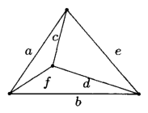
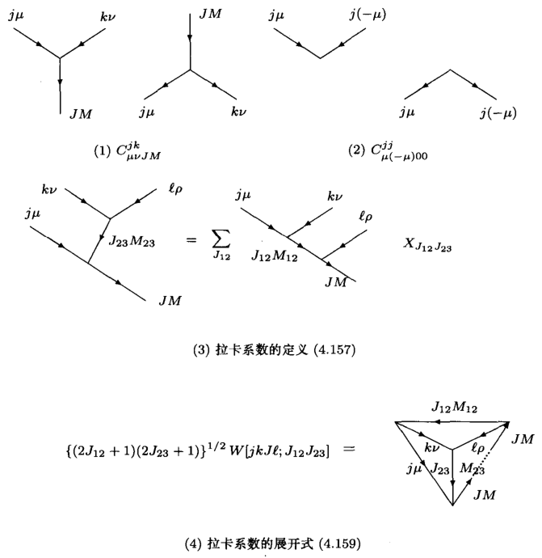
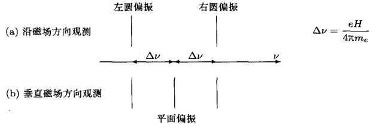

# 第四章 三维转动群

球对称是物理学中最常见的对称性，无论在经典力学中还是在量子力学中，中心力场（球对称系统）问题总是最基本的研究课题。这不仅是因为中心力场问题容易处理，而且很多真实物理系统都有近似的球对称性质。在球对称的系统里空间各向同性，系统绕通过原点的任何轴的任何转动都保持不变，因而系统的对称变换群是三维空间转动群。它是无限群，群中元素可用一组实参数来描写，实参数在一定区域内连续变化，且涉及的这些连续参数的函数都是解析函数。因此转动群是连续群，而且是连续群中可以用微积分方法深入研究的一类群，称为李群。三维空间转动群是最简单的李群。对转动群的深入研究会给李群的一般研究提供很多启示。总之，三维空间转动群的研究在物理上和数学上都有重要意义。

在这一章里，我们将结合转动群介绍李群的基本知识，通过转动群和二维幺正矩阵群的同态关系，讲解覆盖群和多值表示的概念，在二维幺正矩阵群的不变函数空间中找出三维转动群的所有单值和双值不等价不可约表示，计算三维转动群不可约表示的直乘分解及其克莱布施－戈登系数，从变换的角度引进张量和旋量的概念，最后举一些群论方法在物理中应用的实例。

## 4.1 三维空间转动变换

描述转动变换，存在两种不同的观点，一种是系统转动的观点，另一种是坐标系转动的观点。采用不同的观点，虽然给出的物理结果是一致的，但公式表达方式有所不同，不能混淆。本书按照多数文献的习惯，采用系统转动的观点。在群论中矢量这一术语用得比较广泛，有线性空间的矢量，群空间的矢量等。本章研究的矢量是我们在其中生活的三维空间的矢量，为区别起见，对这三空间的矢量，我们专门用带箭头的符号来标记，除矢量基外的单位矢量则用带小尖角的符号标记。

在三维空间建立直角坐标系 $K$，用原点 $O$ 到空间任意点 $P$ 的位置矢量 $\vec{r}$ 来描写 $P$ 点的位置。坐标轴向的单位矢量记作 $\vec{e}_a$，$a=1, 2, 3$，则

$$
\vec{r}=\sum_{a=1}^{3}\vec{e}_a x_a \tag{4.1}
$$

三个坐标 $x_a$ 作为一个整体，与 $\vec{r}$ 一一对应。这里坐标记作 $x_a$，而不记作 $x$，$y$ 和 $z$，是为了写求和式的方便。空间转动变换保持原点不变，保持两点间距离不变，保持手征性不变。设转动 $R$ 把 $P$ 点转到 $P'$ 点，变换前后的坐标可用 $R$ 矩阵联系起来

$$
\vec{r}'=\sum_{a=1}^{3}\vec{e}_a x'_a
$$

$$
\left(\begin{array}{c}
x'_1\\
x'_2\\
x'_3
\end{array}\right)
=\left(\begin{array}{ccc}
R_{11} & R_{12} & R_{13}\\
R_{21} & R_{22} & R_{23}\\
R_{31} & R_{32} & R_{33}
\end{array}\right)
\left(\begin{array}{c}
x_1\\
x_2\\
x_3
\end{array}\right)
=R\left(\begin{array}{c}
x_1\\
x_2\\
x_3
\end{array}\right)
\tag{4.2}
$$

坐标间的齐次变换保证原点位置不变，而距离不变性要求 $R$ 是实正交矩阵

$$
\underline{x}'^{T}\underline{x}'=\underline{x}^{T}R^{T}R\,\underline{x}=\underline{x}^{T}\underline{x},\qquad R^{T}R=1
\tag{4.3}
$$

建立固定在系统上的坐标系 $K'$，单位矢量为 $\vec{e}'_a$，则 $\vec{r}'$ 在动坐标系 $K'$ 中的分量保持不变

$$
\vec{r}'=\sum_{a=1}^{3}\vec{e}_a x'_a=\sum_{b=1}^{3}\vec{e}'_b x_b
\tag{4.4}
$$

把式 (4.2) 代入式 (4.4)，得单位矢量的变换关系

$$
\vec{e}'_b=\sum_{a=1}^{3}\vec{e}_a R_{ab}
\tag{4.5}
$$

在线性代数里，当基用 $R$ 矩阵组合时，矢量的列矩阵用 $R^{-1}$ 矩阵组合。这里的列矩阵仍用 $R$ 矩阵组合，是因为式 (4.4) 中带撇的分量与不带撇的矢量基相乘，与线性代数中的表式正好相反。

坐标系的手征性是用单位矢量的混合积来确定的，右手坐标系单位矢量的混合积为 1，即

$$
\vec{e}_1\cdot(\vec{e}_2\times\vec{e}_3)=1
\tag{4.6}
$$

左手坐标系则为 $-1$。转动变换保持系统的手征性不变，就是要求固定在系统上的坐标系，它的单位矢量的混合积变换前后都是 1，即

$$
\vec{e}'_1\cdot(\vec{e}'_2\times\vec{e}'_3)=\det R=1
\tag{4.7}
$$

因此行列式是 1 的实正交矩阵 $R$ 描写三维空间转动变换，所有三维空间转动变换都可以用行列式是 1 的实正交矩阵 $R$ 来描写。而行列式为 $-1$ 的实正交矩阵要改变系统的手征性，这说明此变换中包含了空间反演 $\sigma$，是所谓的非固有转动。事实上，实正交矩阵的行列式只能取不连续的 1 或 $-1$，分别对应固有转动和非固有转动。非固有转动元素是固有转动元素和空间反演 $\sigma$ 的乘积，描写转动变换后再做空间反演变换。行列式为 1 的矩阵常称为幺模矩阵。

三维幺模实正交矩阵 $R(\vec{n},\omega)$，描写绕三维空间 $\vec{n}$ 方向转动 $\omega$ 角的变换，按照矩阵的乘积规则，它的集合构成群，称为三维转动群，记作 SO(3) 群，其中 O 代表实正交矩阵，S 代表幺模。三维转动群是空间各向同性系统的对称变换群。如果再把空间反演变换 $\sigma$ 也包括进来，所有三维实正交矩阵的集合构成三维实正交矩阵群，记作 O(3) 群。

研究几个特殊的转动。图 3.1 已经研究过绕 $x_3$ 轴转动 $\omega$ 角的变换矩阵

$$
x'_1=x_1\cos\omega-x_2\sin\omega,\qquad x'_2=x_1\sin\omega+x_2\cos\omega,\qquad x'_3=x_3
$$

即

$$
R(\vec{e}_3,\omega)=\begin{pmatrix}
\cos\omega & -\sin\omega & 0\\
\sin\omega & \cos\omega & 0\\
0 & 0 & 1
\end{pmatrix}
\tag{4.8}
$$

利用物理中常用的泡利（Pauli）矩阵可把转动矩阵写成矩阵的指数函数形式

$$
\sigma_1=\begin{pmatrix}0&1\\1&0\end{pmatrix},\qquad
\sigma_2=\begin{pmatrix}0&-\mathrm{i}\\\mathrm{i}&0\end{pmatrix},\qquad
\sigma_3=\begin{pmatrix}1&0\\0&-1\end{pmatrix},
$$

$$
\sigma_a\sigma_b=\delta_{ab}\mathbf{1}+\mathrm{i}\sum_{c=1}^{3}\epsilon_{abc}\sigma_c,\qquad \text{即}\ \ \sigma_a^2=\mathbf{1},\quad \sigma_1\sigma_2=\mathrm{i}\sigma_3\ \ \text{等},
$$

$$
\operatorname{Tr}\sigma_a=0,\qquad \operatorname{Tr}(\sigma_a\sigma_b)=2\delta_{ab}
\tag{4.9}
$$

矩阵的指数函数用它的级数展开来定义

$$
\begin{aligned}
\exp\{-\mathrm{i}\omega\sigma_2\}&=\sum_n\frac{1}{n!}\omega^n(-\mathrm{i}\sigma_2)^n\\
&=\mathbf{1}\left(1-\frac{1}{2!}\omega^2+\frac{1}{4!}\omega^4-\cdots\right)-\mathrm{i}\sigma_2\left(\omega-\frac{1}{3!}\omega^3+\frac{1}{5!}\omega^5-\cdots\right)\\
&=\mathbf{1}\cos\omega-\mathrm{i}\sigma_2\sin\omega=\begin{pmatrix}\cos\omega&-\sin\omega\\ \sin\omega&\cos\omega\end{pmatrix}
\end{aligned}
\tag{4.10}
$$

把 $\sigma_2$ 换成 $T_3$ 矩阵，就可得 $R(\vec{e}_3,\omega)$ 矩阵的指数形式

$$
R(\vec{e}_3,\omega)=\exp\{-\mathrm{i}\omega T_3\}=\begin{pmatrix}
\cos\omega & -\sin\omega & 0\\
\sin\omega & \cos\omega & 0\\
0 & 0 & 1
\end{pmatrix},\qquad
T_3=\begin{pmatrix}
0 & -\mathrm{i} & 0\\
\mathrm{i} & 0 & 0\\
0 & 0 & 0
\end{pmatrix}
\tag{4.11}
$$

根据三个轴的循环对称性可知绕其他两轴的转动变换矩阵为

$$
R(\vec{e}_1,\omega)=\exp\{-\mathrm{i}\omega T_1\}=\begin{pmatrix}
1 & 0 & 0\\
0 & \cos\omega & -\sin\omega\\
0 & \sin\omega & \cos\omega
\end{pmatrix},
$$

$$
R(\vec{e}_2,\omega)=\exp\{-\mathrm{i}\omega T_2\}=\begin{pmatrix}
\cos\omega & 0 & \sin\omega\\
0 & 1 & 0\\
-\sin\omega & 0 & \cos\omega
\end{pmatrix},
\tag{4.12}
$$

$$
T_1=\begin{pmatrix}0&0&0\\0&0&-\mathrm{i}\\0&\mathrm{i}&0\end{pmatrix},\qquad
T_2=\begin{pmatrix}0&0&\mathrm{i}\\0&0&0\\-\mathrm{i}&0&0\end{pmatrix}
$$

$T$ 矩阵的矩阵元素满足

$$
(T_a)_{bc}=-\mathrm{i}\epsilon_{abc}
\tag{4.13}
$$

再引入一个特殊的转动 $S(\varphi,\theta)$，它把 $x_3$ 轴上的点转到 $\hat{n}(\theta,\varphi)$ 方向，其中 $\theta$ 和 $\varphi$ 角是 $\hat{n}$ 方向的极角和方位角

$$
S(\varphi,\theta)=R(\vec{e}_3,\varphi)R(\vec{e}_2,\theta)=\begin{pmatrix}
\cos\varphi\cos\theta & -\sin\varphi & \cos\varphi\sin\theta\\
\sin\varphi\cos\theta & \cos\varphi & \sin\varphi\sin\theta\\
-\sin\theta & 0 & \cos\theta
\end{pmatrix},
$$

$$
S(\varphi,\theta)\begin{pmatrix}0\\0\\1\end{pmatrix}=\begin{pmatrix}\cos\varphi\sin\theta\\ \sin\varphi\sin\theta\\ \cos\theta\end{pmatrix}=\begin{pmatrix}n_1\\n_2\\n_3\end{pmatrix}
\tag{4.14}
$$

不难验证（见第一章习题第 3 题）

$$
ST_3S^{-1}=n_1T_1+n_2T_2+n_3T_3=\hat{n}\cdot\vec{T},
$$

$$
\vec{T}=\vec{e}_1T_1+\vec{e}_2T_2+\vec{e}_3T_3
\tag{4.15}
$$

绕 $\hat{n}$ 方向转动 $\omega$ 角的变换 $R(\hat{n},\omega)$，可以表为三个转动的乘积，先把 $\hat{n}$ 方向转到 $x_3$ 方向，再绕 $x_3$ 方向转动 $\omega$ 角，最后把 $x_3$ 方向转回到 $\hat{n}$ 方向。这三个转动的乘积可以写成指数形式

$$
\begin{aligned}
R(\hat{n},\omega)&=S(\varphi,\theta)R(\vec{e}_3,\omega)S(\varphi,\theta)^{-1}=\exp\{-\mathrm{i}\omega ST_3S^{-1}\}\\
&=\exp\{-\mathrm{i}\omega\hat{n}\cdot\vec{T}\}=\exp\left\{-\mathrm{i}\sum_{a=1}^{3}\omega_aT_a\right\}
\end{aligned}
\tag{4.16}
$$

$$
\omega_1=\omega n_1=\omega\sin\theta\cos\varphi,
$$

$$
\omega_2=\omega n_2=\omega\sin\theta\sin\varphi,
$$

$$
\omega_3=\omega n_3=\omega\cos\theta
\tag{4.17}
$$

可以把三个 $\omega_a$ 看作矢量 $\vec{\omega}$ 的直角坐标，而 $\omega$，$\theta$ 和 $\varphi$ 是它的球坐标，它们描写了 SO(3) 群的任意元素，即绕 $\hat{n}$ 方向转动 $\omega$ 角的变换。因为绕相反方向的转动变换有如下联系

$$
R(\hat{n},\omega)=R(-\hat{n},2\pi-\omega)\,,\qquad R(\hat{n},\pi)=R(-\hat{n},\pi)
\tag{4.18}
$$

所以参数 $\vec{\omega}$ 在半径为 $\pi$ 的球体内连续变化，在球面上直径两端的点代表同一个转动。

式 (4.16) 还说明，三维转动群中转动相同角度的元素互相共轭，三维转动群的类用转动角度 $\omega$ 来描写。给出任意转动变换矩阵 $R(\hat{n},\omega)$，由它的矩阵迹 $(1+2\cos\omega)$ 定出转动角 $\omega$，它的本征值为 1 的本征矢量沿转动轴 $\hat{n}$ 方向。

## 4.2 李群的基本概念

三维转动群是最简单的李群。本节介绍李群的一些基本概念，会有助于进一步理解三维转动群的性质，也为今后研究李群的一般性质打好基础。

### 一、李群的组合函数

三维空间转动群 SO(3) 的元素 $R(\hat{n},\omega)$ 可用三个实参数来描写，这三个参数在半径为 $\pi$ 的球体内连续变化，在球面上直径两端的点代表同一个元素。这是最简单的一个李群。

李群是一种连续群，它的每一个元素都可以用一组独立实参数来描写，这组参数在欧氏空间的一定区域内连续变化。要求在参数的变化区域内，至少在测度不为零的区域内，群元素和参数值有一一对应的关系。独立实参数数目称为连续群的阶，参数的变化区域称为群空间，群空间的维数就是连续群的阶数 $g$。所谓测度不为零的区域，可以简单地理解为维数和群空间维数相同的区域。边界就是测度为零的区域。其实不难用限制群空间范围的办法，来实现在测度不为零的区域内群元素和参数值的一一对应关系。例如，三维转动群的群空间取作半径为 $\pi$ 的球体，保证了球体内群元素和参数值的一一对应关系，但在测度为零的外球面上，直径两端的点，即两组不同的参数值，对应同一个群元素。因为在群空间测度不为零区域内的点和群元素有一一对应关系，所以也可以等价地把群空间的点直接叫成群元素。

设元素 $R\in G$，参数为 $(r_1,r_2,\cdots,r_g)$，简写为 $R(r_1,r_2,\cdots,r_g)=R(r)$。对于群元素的乘积，$R(r)S(s)=T(t)$，$g$ 个参数 $t_j$ 是 $2g$ 个变量 $r_i$ 和 $s_k$ 的函数

$$
t_j=f_j(r_1,\cdots,r_g; s_1,\cdots,s_g)=f_j(r;s)
\tag{4.19}
$$

$g$ 个函数 $f_j(r;s)$ 称为连续群的组合函数，它完全描写了群元素的乘积规则。如果组合函数是解析函数，则此连续群称为李群。由于函数连续可微，微积分的整套工具可以用来深入研究李群，使李群成为至今研究最深入最成功的无限群。

作为群的组合函数，$f_j(r;s)$ 必须满足如下条件：

（1）封闭性。组合函数的定义域是（群空间）×（群空间），而值域是群空间。至少在测度不为零的区域内，要求 $f_j(r;s)$ 是单值解析函数。

（2）结合律。

$$
f_j[r;f(s;t)]=f_j[f(r;s);t]\ .
$$

（3）恒元的参数为 $e_j$，它包含在群空间内

$$
f_j(e;r)=f_j(r;e)=r_j
$$

通常为方便起见，取 $e_j=0$。

（4）$R$ 逆元的参数记作 $\bar{r}_j$

$$
f_j(\bar{r};r)=f_j(r;\bar{r})=e_j\ .
$$

实际上，即使很简单的李群，组合函数的形式也往往相当复杂。组合函数主要用于理论分析，很少用来进行具体计算。

群的许多概念在李群中同样适用，例如阿贝尔群，子群，陪集，共轭元素，类，不变子群，群的同构和同态，商群，线性表示，等价表示，不可约表示，自共轭表示，特征标等概念也都是李群的基本概念。李群线性表示的每一个矩阵元素和特征标，在群空间测度不为零的区域内，都是群参数的单值解析函数。

### 二、李群的局域性质

在群空间中邻近的点对应的元素称为邻近的元素。因为常把恒元的参数选为零，恒元邻近的元素，参数是无穷小量，称为无穷小元素。不要把无穷小元素看成是一个参数很小的元素。无穷小量是一个极限过程。无穷小元素与群元素的微分运算相联系。李群无穷小元素的性质决定了李群的局域（local）性质。无穷小元素与任意元素 $R$ 的乘积，是 $R$ 的邻近元素，参数在元素 $R$ 参数的邻域（adjacent）中。反之，$R$ 的邻近元素和 $R^{-1}$ 相乘，得无穷小元素。粗略地说，把无穷多个无穷小元素相继乘到群元素 $R$ 上，在群空间表现为由元素 $R$ 的对应点出发的一条连续曲线。如果在群空间中代表元素 $R$ 的点和代表恒元的点，可以通过一条完全在群空间内的连续曲线相连结，则 $R$ 可表为无穷多个无穷小元素的乘积。数学上，元素 $R$ 的性质可通过一个微分方程来描写。这说明无穷小元素在李群中起着十分重要的作用。

无穷小元素 $A(\alpha)$ 与 $B(\beta)$ 相乘，仍是无穷小元素。恒元参数为零，$\alpha_j$ 和 $\beta_j$ 都是无穷小量，将乘积元素 $AB$ 的参数按 $\alpha$ 和 $\beta$ 做泰勒（Taylor）展开，略去二级无穷小量，并注意 $e_j=0$，$AE=A$ 和 $EB=B$，得

$$
\begin{aligned}
f_j(\alpha;\beta)&=f_j(0;0)+\sum_{k=1}^{g}\left(\alpha_k\left.\frac{\partial f_k(\alpha;0)}{\partial\alpha_k}\right|_{\alpha=0}+\beta_k\left.\frac{\partial f_k(0;\beta)}{\partial\beta_k}\right|_{\beta=0}\right)\\
&=\alpha_j+\beta_j
\end{aligned}
\tag{4.20}
$$

可见，无穷小元素相乘，参数相加。互逆的无穷小元素的参数互为相反数。记 $A^{-1}$ 的参数为 $\bar{\alpha}_j$，则

$$
\bar{\alpha}_j=-\alpha_j
\tag{4.21}
$$

无穷小元素乘积满足交换律，并不意味着群中所有元素乘积都满足交换律。在理论力学中学过，无穷小转动乘积次序可以交换，但有限转动乘积次序不能交换，即三维转动群不是阿贝尔群。

### 三、生成元和微量算符

无穷小元素在李群中处于特殊重要的地位。现在来研究无穷小元素在变换算符群 $P_G$ 和线性表示 $D(G)$ 中的性质。

$P_R$ 是元素 $R$ 对应的标量函数变换算符

$$
P_R\psi(x)=\psi(R^{-1}x)
$$

其中，$x$ 代表系统所有自由度的坐标。取 $R$ 为无穷小元素 $A(\alpha)$，将上式按参数 $\alpha_j$ 展开，取到一级无穷小量

$$
\begin{aligned}
P_A\psi(x)&=\psi(x)+\sum_{aj}\bar{\alpha}_j\left.\frac{\partial(A^{-1}x)_a}{\partial\bar{\alpha}_j}\right|_{\bar{\alpha}=0}\left.\frac{\partial\psi(A^{-1}x)}{\partial(A^{-1}x)_a}\right|_{\bar{\alpha}=0}\\
&=\psi(x)-\mathrm{i}\sum_{j=1}^{g}\alpha_j\left(-\mathrm{i}\sum_{a}\left.\frac{\partial(Ax)_a}{\partial\alpha_j}\right|_{\alpha=0}\frac{\partial}{\partial x_a}\right)\psi(x)
\end{aligned}
$$

引入 $g$ 个微量微分算符 $I_j^{(0)}$，它们线性无关

$$
I_j^{(0)}=-\mathrm{i}\sum_a\left.\frac{\partial(Ax)_a}{\partial\alpha_j}\right|_{\alpha=0}\frac{\partial}{\partial x_a},
$$

$$
P_A\psi(x)=\psi(x)-\mathrm{i}\sum_{j=1}^{g}\alpha_j I_j^{(0)}\psi(x)
\tag{4.22}
$$

李群中无穷多个无穷小元素对标量函数的作用可以用 $g$ 个微量微分算符 $I_j^{(0)}$ 完全描写。在三维空间，如果 $x$ 代表系统质心的坐标，而系统其他内部坐标没有标出，或者系统本身就是一个质点，$x$ 是质点的坐标，则由式 (4.13) 得

$$
(Ax)_a=\sum_b\left\{\delta_{ab}-\mathrm{i}\sum_d\alpha_d(T_d)_{ab}\right\}x_b=x_a-\sum_{bd}\alpha_d\epsilon_{dab}x_b
$$

代入式 (4.22)，算得三维转动群的微量微分算符正是量子力学中的轨道角动量算符

$$
I_d^{(0)}=-\mathrm{i}\sum_{ab}\epsilon_{dba}x_b\frac{\partial}{\partial x_a}=L_d
\tag{4.23}
$$

这里取了自然单位，$\hbar=c=1$。

设 $m$ 个函数基 $\psi_\mu(x)$ 架设对于 $P_G$ 不变的函数空间，对应群 $G$ 的表示 $D(G)$

$$
P_R\psi_\mu(x)=\sum_\nu\psi_\nu(x)D_{\nu\mu}(R)
$$

对无穷小元素，把表示矩阵 $D(A)$ 按无穷小参数展开，略去高级无穷小量。得

$$
D(A)=1-\mathrm{i}\sum_{j=1}^{g}\alpha_j I_j\,,\qquad I_j=\mathrm{i}\left.\frac{\partial D(A)}{\partial\alpha_j}\right|_{\alpha=0}
\tag{4.24}
$$

$g$ 个矩阵 $I_j$ 称为李群表示 $D(G)$ 的生成元，它是微量微分算符在表示空间的矩阵形式。$g$ 个生成元完全描写了无穷多个无穷小元素在表示 $D(G)$ 中的性质。如果 $D(G)$ 是李群 $G$ 的真实表示，则 $g$ 个生成元线性无关。由于规定参数取实数，幺正表示的生成元是厄米矩阵。若变换算符 $P_R$ 是幺正算符，微量微分算符是厄米算符。这正是在式 (4.22) 和 (4.24) 中引入 $-\mathrm{i}$ 的目的。通常把微量微分算符和生成元都统称为微量算符，或统称为生成元。

设 $RSR^{-1}=T$，$T$ 的参数是 $S$ 和 $R$ 参数的函数

$$
t_j=\psi_j(s_1,s_2,\cdots;r_1,r_2,\cdots)\equiv\psi_j(s;r)
\tag{4.25}
$$

$\psi_j(s;r)$ 也是 $2g$ 个变量的实函数。对真实表示 $D(G)$，$D(R)D(S)D(R)^{-1}=D(T)$。等式两边对参数 $s_j$ 求导数，然后取 $s_j=0$，得

$$
D(R)\left.\frac{\partial D(S)}{\partial s_j}D(R)^{-1}\right|_{s=0}=\sum_k\left.\frac{\partial D(T)}{\partial t_k}\right|_{t=0}\left.\frac{\partial\psi_k(s;r)}{\partial s_j}\right|_{s=0},
$$

$$
D(R)I_jD(R)^{-1}=\sum_k I_kD_{kj}^{\mathrm{ad}}(R)\,,\qquad D_{kj}^{\mathrm{ad}}(R)=\left.\frac{\partial\psi_k(s;r)}{\partial s_j}\right|_{s=0}
\tag{4.26}
$$

式 (4.26) 给出群元素 $R$ 和矩阵 $D^{\mathrm{ad}}(R)$ 的一个一一对应或多一对应的关系，这对应关系对群元素乘积保持不变，因而 $D^{\mathrm{ad}}(R)$ 是李群的一个表示，称为伴随（adjoint）表示。伴随表示的维数等于李群的阶数，它是所有李群都有的一个重要表示。把式 (4.26) 写成标量函数变换算符 $P_R$ 的形式

$$
P_RI_j^{(0)}P_R^{-1}=\sum_k I_k^{(0)}D_{kj}^{\mathrm{ad}}(R)
\tag{4.27}
$$

微量算符的这一变换关系类似群元素的共轭变换 $RSR^{-1}=T$，常称为微量算符的共轭变换，伴随表示描写了微量算符在共轭变换中的变换性质。

### 四、李群的整体性质

研究李群的整体（global）性质，就是研究李群群空间的拓扑性质。我们将用物理上习惯的语言来解释李群的整体性质。

首先，讨论群空间的连通性。如果群中任意两元素，它们在群空间的对应点，可以通过一条完全包含在群空间内的连线连结起来，则此群空间称为连通的，这样的连续群称为简单连续（simply continuous）群。SO(3) 群就是简单连续群。反之，如果群空间分成不相连结的若干片，则此连续群称为混合连续（mixed continuous）群。因为实正交矩阵的行列式可取 $\pm1$，它们互相不能连续变化，所以三维实正交矩阵群 O(3) 是混合连续群。前面说过，粗略地说，对简单李群，群元素都可表为无穷多个无穷小元素的乘积，而对混合李群，除了无穷小元素外，还必须在群空间的每一个连续片给出一个特殊元素（包括恒元），它们的乘积才能表出任意元素。在 O(3) 群的情况，常取空间反演 $\sigma$ 作为非固有转动元素的代表，由恒元，空间反演和无穷小元素的乘积，就可表出 O(3) 群的任意元素。对线性表示来说，我们将来可以看到，由生成元就可以计算出简单李群的任意元素 $R$ 的表示矩阵 $D(R)$，但对混合李群 O(3)，则还需要知道空间反演元素的表示矩阵 $D(\sigma)$。

另一方面，下面证明混合李群的群空间中，包含恒元的那个连续片对应元素的集合构成混合李群的不变子群，其他连续片对应元素的集合构成这不变子群的陪集。设 $R$ 和 $S$ 都属于恒元 $E$ 所在的那个连续片，即它们在群空间中的对应点，都可以用一条完全包含在群空间内的连续曲线与恒元的对应点相连，则它们的乘积也可以由恒元在群空间内连续地变过来，逆元 $R^{-1}$ 也可以由恒元在群内连续地变过来，即它们都属于此子集。根据假设恒元已属于此子集，因此此子集构成子群。进一步，设 $T$ 是群中任意元素，则 $TRT^{-1}$ 可以由恒元 $TET^{-1}=E$ 在群内连续地变过来，它在群空间中的对应点可以用一条完全包含在群空间内的连续曲线与恒元的对应点相连，因而此子群是不变子群。在群空间其他连续片各取一个代表元素，属每一个连续片的元素都可由相应代表元素出发在群空间内连续变化得到，因而属于同一个陪集。证完。混合李群的性质完全由此简单李群（不变子群），和每一连续片（陪集）中一个代表元素的性质决定。今后我们将重点讨论简单李群的性质。

其次，讨论简单李群群空间的连通度。在简单李群的群空间中，元素 $R$ 的点可与恒元的对应点通过许多连线相连结。有些连线可以在群空间内互相连续变化，有些则不能。这样，这些连线就分成若干组，属同一组的连线可以互相在群空间内连续变化，而不同组的连线则不能。这些连线的组数称为群空间的连通度。李群的性质会与群空间的连通度有密切关系。

我们先来举一个简单的例子。实数的集合，用数的加法定义元素的“乘积”，这集合构成群，简称为加法群。此群元素本身就是实数（参数），它在实数轴上连续变化，实数轴就是群空间，原点对应恒元（数零）。在群空间中代表元素的点与代表恒元的点间所有连线都可在群空间内连续变化，因而加法群的群空间是单连通的。它是一阶阿贝尔简单李群，只有一维不可约表示。加法群有无穷多个一维不等价不可约表示，用复数 $\tau$ 标记

$$
D^{\tau}(\alpha)=\exp(-i\tau\alpha),\qquad \tau\ \text{是复数},\qquad \alpha\ \text{是实数} \tag{4.28}
$$

式（4.28）指数上引入 $-i$ 只是为了以后方便。

再看绕 $x_3$ 轴转动任意角 $\omega$ 的变换 $R(\vec{e}_3,\omega)$ 集合，两变换乘积对应参数 $\omega$ 相加，转动 $2\pi$ 角的变换等于恒等变换

$$
R(\vec{e}_3,\omega_1)R(\vec{e}_3,\omega_2)=R(\vec{e}_3,\omega_1+\omega_2),\qquad R(\vec{e}_3,\omega+2\pi)=R(\vec{e}_3,\omega) \tag{4.29}
$$

此集合构成李群，称为二维幺模实正交矩阵群，记作 SO(2) 群。它是一阶阿贝尔李群，群参数 $\omega$ 在实数轴上 $\pm\pi$ 之间变化，$\pm\pi$ 对应同一个元素。群空间边界上的这一性质，决定了 SO(2) 群群空间的连通度，对群的性质产生很大的影响。很明显，群空间中对应群元素 $R(\vec{e}_3,\omega)$ 的点和对应恒元的点（原点）可以直接相连，也可以通过包含边界上 $\pm\pi$ 间若干次跳跃的连线相连。设从 $\pi$ 到 $-\pi$ 的跳跃称为正跳跃，从 $-\pi$ 到 $\pi$ 的跳跃称为负跳跃。对包含两次不同类跳跃的连线，这两次跳跃可以在群空间内通过连续变化而消去。连线所包含的正跳跃次数减去负跳跃次数称为该连线的跳跃次数。当连线在群空间内连续变化时，它的跳跃次数不会改变。这样，由原点到 $\omega$ 的连线分成无穷多组，每组用跳跃次数来标记，不同组的连线不能在群空间内互相连续变化，SO(2) 群的群空间是无穷多度连通的。

把 SO(2) 群的元素和加法群的元素建立如下 $1:\infty$ 的对应关系

$$
R(\vec{e}_3,\omega)\leftrightarrow \omega+2n\pi,\qquad n\ \text{是任意整数} \tag{4.30}
$$

这种对应关系对元素乘积保持不变，因而 SO(2) 群和加法群同态。SO(2) 群的不等价不可约表示也可表为式（4.28）的形式，但因式（4.29），$\tau$ 只能取整数 $m$

$$
D^{m}(\vec{e}_3,\omega)=\exp(-im\omega),\qquad m\ \text{是整数} \tag{4.31}
$$

当 $m$ 不是整数时，表示矩阵和群元素之间变成多一对应的关系，按照线性表示的定义，这已不是 SO(2) 群的表示，有时称为多值表示。

数学中已经证明，当简单李群 $G$ 的群空间是 $n$ 度连通时，它一定同态于另一个群空间是单连通的简单李群，同态对应关系是 $1:n$。这单连通的简单李群称为李群 $G$ 的覆盖群。覆盖群的真实表示就是群 $G$ 的 $n$ 值表示。加法群是 SO(2) 群的覆盖群。

现在回到三维转动群来。三维转动群的群空间是半径为 $\pi$ 的球体，在球面上直径两端的点代表同一个元素，从而群空间内的连线就可以包含直径两端的跳跃。跳跃前后的两点始终保持在同一直径的两端，位置上是相关联的。它们不能独立地变化位置，只能成对地在球面上移动，因而此跳跃无法通过连续移动而消去。如果连线包含两次跳跃，则可把跳跃点反向移到一起，包含在两次跳跃间的连线，是沿一个封闭的环形路径转一圈。连续的环形路径是可以在群空间内连续地收缩到一点而消去的，而在直径两端的来回跳跃等于不跳，因此两次跳跃可以通过在群空间内的连续变化而消去。对 SO(3) 群，从原点到群空间任一点的连线可以分成两组，一组包含直径两端的偶数次跳跃，另一组包含奇数次跳跃，属同一组的连线可以在群空间内做连续变化而重合，但分属两组的连线则不能。就是说，SO(3) 群的群空间是双连通的。我们将证明，SO(3) 群的覆盖群是二维幺模幺正矩阵的集合构成的群 SU(2)。SU(2) 群的真实表示是 SO(3) 群的双值表示，它是自旋能够存在的数学基础。

最后，讨论群空间的紧致性。在欧氏空间，包含边界的闭区域是紧致的，不包含边界的开区域（包括无穷区域）是非紧致的。群空间是紧致的李群称为紧致李群。三维转动群是紧致李群。物理中常见的非紧致李群，有洛伦兹群和平移群。对洛伦兹群可选惯性系间的相对速度作为一个参数，按狭义相对论，相对速度只能趋近光速，不能等于光速，因而洛伦兹群的群空间是开区域，洛伦兹群是非紧致李群。在第三章我们已多次提到，要把有限群表示理论的主要结论推广到连续群来，关键是要解决群函数对群元素的无限求和问题。连续群的群元素是用一组连续实参数来描写的，一个自然的想法就是把对群元素的求和改成对群参数的积分。可以证明，对紧致李群，可以适当定义对群参数的积分，使积分存在，且满足对左乘或右乘群元素保持不变的性质，从而可以把有限群表示理论的主要结论推广到紧致李群中来。但对非紧致李群这样的积分不存在，有限群的有些结论不能推广。下节我们将讨论三维转动群的覆盖群和群上的积分。

## 4.3 三维转动群的覆盖群

本节将证明三维转动群的覆盖群是二维幺模幺正矩阵群，并讨论它们群上的积分。

### 一、二维幺模幺正矩阵群

二维幺模幺正矩阵的集合，按照普通的矩阵乘积，明显满足群的四个条件，因而构成群，记作 SU(2) 群。对于群中任意元素 $u$，它的矩阵元素满足

$$
u=\begin{pmatrix} a & b \\ c & d \end{pmatrix}\in \mathrm{SU}(2),
$$

$$
aa^*+cc^*=bb^*+dd^*=ad-bc=1,\qquad ab^*+cd^*=0
$$

容易解得 $a=d^*$，$b=-c^*$ 和 $|c|^2+|d|^2=1$。取 $d=h_0+\mathrm{i}h_3$ 和 $c=h_2-\mathrm{i}h_1$，四个实参数 $h_i$ 中只有三个是独立的

$$
u=\begin{pmatrix} h_0-\mathrm{i}h_3 & -h_2-\mathrm{i}h_1 \\ h_2-\mathrm{i}h_1 & h_0+\mathrm{i}h_3 \end{pmatrix},\qquad \sum_{i=0}^{3}h_i^2=1 \tag{4.32}
$$

为了下面讨论的方便，我们用实矢量 $\vec{\omega}$ 的球坐标 $\omega$，$\theta$ 和 $\varphi$ 来代替上面的参数 $h_i$，其中 $\vec{\omega}$ 的长度是 $\omega$，方向沿 $\hat{n}(\theta,\varphi)$，$\theta$ 和 $\varphi$ 是方向 $\hat{n}$ 的极角和方位角

$$
h_0=\cos(\omega/2),\qquad h_1=\sin(\omega/2)\sin\theta\cos\varphi,
$$

$$
h_3=\sin(\omega/2)\cos\theta,\qquad h_2=\sin(\omega/2)\sin\theta\sin\varphi,
$$

$$
u(\hat{n},\omega)=\mathbf{1}\cos(\omega/2)-\mathrm{i}(\vec{\sigma}\cdot\hat{n})\sin(\omega/2) \tag{4.33}
$$

其中，$\sigma_a$ 是三个泡利矩阵，它们是无迹厄米兼幺正矩阵，已在式（4.9）做了介绍。这里引进的矢量 $\vec{\sigma}=\sum_a \vec{e}_a\sigma_a$，它的分量是矩阵。只要不颠倒乘积次序，它满足所有矢量代数的公式，如矢量的点乘和叉乘，还有

$$
\vec{\sigma}\cdot\hat{n}=\sum_{a=1}^{3}\sigma_a n_a=\begin{pmatrix} n_3 & n_1-\mathrm{i}n_2 \\ n_1+\mathrm{i}n_2 & -n_3 \end{pmatrix},
$$

$$
(\vec{\sigma}\times\vec{U})\cdot\vec{V}=\vec{\sigma}\cdot(\vec{U}\times\vec{V})=\sum_{abc}\epsilon_{abc}\sigma_a U_b V_c,
$$

$$
(\vec{\sigma}\cdot\vec{a})(\vec{\sigma}\cdot\vec{b})=\mathbf{1}(\vec{a}\cdot\vec{b})+\mathrm{i}\vec{\sigma}\cdot(\vec{a}\times\vec{b}) \tag{4.34}
$$

最后一个公式可用两边取迹，或乘 $\sigma_a$ 后再取迹的办法证明，证明中用到式（4.9）。由式（4.33）和（4.34）又可证明

$$
u(\hat{n},\omega_1)u(\hat{n},\omega_2)=u(\hat{n},\omega_1+\omega_2),
$$

$$
u(\hat{n},4\pi)=\mathbf{1},\qquad u(\hat{n},2\pi)=-\mathbf{1},
$$

$$
u(\hat{n},\omega)=u(-\hat{n},4\pi-\omega)=-u(-\hat{n},2\pi-\omega) \tag{4.35}
$$

可见 $\vec{\omega}$ 的变化范围是半径为 $2\pi$ 的球体，在球体内的点和 SU(2) 群的元素 $u$ 间有一一对应的关系，在外球面上的点都对应同一个元素 $-\mathbf{1}$。这就是取参数 $\vec{\omega}$ 时 SU(2) 群的群空间。首先，SU(2) 群的群空间是连通的，群中任一元素 $u$ 都可以由恒元出发在群空间内连续变化得到，因而 SU(2) 群是简单李群。其次，这群空间与 SO(3) 群的群空间性质很不相同。由于外球面上的点代表同一个元素，群空间的连线在到达外球面时可在此球面上任意跳跃，而不是只限于在直径两端的跳跃。跳跃前后两点都可独立地在球面上自由移动，从而可把此两点连续地移到一起，消去此跳跃，因而 SU(2) 群的群空间是单连通的。也可用另一方法来理解。正因为外球面上的点是同一个元素，球面上的跳跃也可以看成是球面上的一根连续曲线，因而通过曲线在群空间内的连续变化可以消去跳跃。第三，SU(2) 群的群空间是欧氏空间的一个闭区域，因而 SU(2) 群是一个紧致李群。最后，利用式（4.34）不难证明（见习题第 6 题），相同 $\omega$ 的元素互相共轭，构成一类。

### 二、同态关系

泡利矩阵的实线性组合仍是无迹厄米矩阵。反之，任何二维无迹厄米矩阵 $X$ 只包含三个独立实参数，都可展开为泡利矩阵的实线性组合。现取组合系数为三维空间任意点 $P$ 的三个直角坐标

$$
X=\sum_{a=1}^{3}\sigma_a x_a=\vec{\sigma}\cdot\vec{r}=\begin{pmatrix} x_3 & x_1-\mathrm{i}x_2 \\ x_1+\mathrm{i}x_2 & -x_3 \end{pmatrix},
$$

$$
x_a=\frac{1}{2}\operatorname{Tr}(X\sigma_a),\qquad \det X=-\sum_{a=1}^{3}x_a^2 \tag{4.36}
$$

因此无迹厄米矩阵 $X$ 和 $P$ 点的位置矢量 $\vec{r}$ 间有一一对应关系。

设 $u\in\mathrm{SU}(2)$ 是任意一个二维幺模幺正矩阵，$X$ 经过 $u^{-1}$ 的相似变换仍是一个无迹厄米矩阵，且有相同的行列式

$$
X'=uXu^{-1},\qquad \det X'=\det X \tag{4.37}
$$

$X'$ 对应空间另一点 $P'$ 的坐标矢量 $\vec{r}'$，而且 $\vec{r}'$ 的分量可以表为 $\vec{r}$ 分量的线性齐次函数

$$
x'_a=\sum_{b}R_{ab}x_b \tag{4.38}
$$

由于 $X'$ 和 $X$ 的行列式相同，$R$ 矩阵是实正交矩阵，$R\in\mathrm{O}(3)$。显然当 $u$ 取恒元 $\mathbf{1}$ 时，$R$ 也是恒元。既然 $u$ 可以由恒元在 SU(2) 群的群空间内连续变化得到，对应的 $R$ 也可以由恒元在 O(3) 群的群空间内连续变化得到，因而 $R\in\mathrm{SO}(3)$。反之，对于 SO(3) 群任一元素 $R\in\mathrm{SO}(3)$，它把坐标矢量 $\vec{r}$ 变成 $\vec{r}'$，并把 $X$ 变成 $X'$。既然 $X$ 和 $X'$ 都是无迹厄米矩阵，且有相同的行列式，它们必可以通过幺模幺正相似变换 $u\in\mathrm{SU}(2)$ 联系起来［见式（4.37）］，但这样的 $u$ 矩阵不是唯一的。设

$$
u_1Xu_1^{-1}=u_2Xu_2^{-1}=X'
$$

得 $u_2^{-1}u_1$ 可与任何 $X$ 矩阵对易，故它必是常数矩阵，$u_1=\lambda u_2$。由于幺模条件，$\lambda=\pm1$。把 $X$ 和 $X'$ 的表达式代入式（4.37），由于 $\vec{r}$ 的任意性，得

$$
u\sigma_b u^{-1}=\sum_{a=1}^{3}\sigma_a R_{ab} \tag{4.39}
$$

它给出 SO(3) 群一个元素 $R$ 和 SU(2) 群一对元素 $\pm u$ 间的一二对应关系。容易证明这对应关系对群元素乘积保持不变

$$
u_1\sigma_a u_1^{-1}=\sum_b \sigma_b (R_1)_{ba},\qquad u_2\sigma_b u_2^{-1}=\sum_d \sigma_d (R_2)_{db},
$$

$$
u_2u_1\sigma_a u_1^{-1}u_2^{-1}=\sum_b u_2\sigma_b u_2^{-1}(R_1)_{ba}=\sum_d \sigma_d\sum_b\{(R_2)_{db}(R_1)_{ba}\}
$$

因此，SO(3) 群和 SU(2) 群同态

$$
\mathrm{SO}(3)\sim\mathrm{SU}(2) \tag{4.40}
$$

如果把式（4.33）的 $u(\hat{n},\omega)$ 矩阵代入式（4.39），通过直接计算，算得的 $R$ 矩阵正是绕 $\hat{n}$ 方向转动 $\omega$ 角的元素 $R(\hat{n},\omega)$，

$$
u(\hat{n},\omega)\sigma_b u(\hat{n},\omega)^{-1}=\sum_{a=1}^{3}\sigma_a R(\hat{n},\omega)_{ab} \tag{4.41}
$$

附录 7 给出这关系的一种几何证明方法。

现在，SO(3) 群和 SU(2) 群都用参数 $\vec{\omega}$ 描写，SO(3) 群的群空间半径为 $\pi$，SU(2) 群的群空间半径为 $2\pi$。事实上，在半径为 $\pi$ 的球体内，SO(3) 群和 SU(2) 群的元素一一对应。对 SU(2) 群来说，还有半径从 $\pi$ 到 $2\pi$ 的环所对应的元素，它们通过式（4.35），等于半径为 $\pi$ 的球体中相应元素的负值，这一对 $\pm u$ 矩阵对应 SO(3) 群同一个元素。SO(3) 群的群空间是双连通的，SU(2) 群的群空间是单连通的，SU(2) 群正是 SO(3) 群的覆盖群。SO(3) 群的真实表示，称为单值表示，是 SU(2) 群的非真实表示。SU(2) 群的真实表示，严格说不是 SO(3) 群的表示，称为 SO(3) 群的双值表示，它们在物理上与自旋的存在密切相关。我们只要找出 SU(2) 群的全部不等价不可约表示，也就找出了 SO(3) 群的全部不等价不可约单值表示和双值表示。

既然 SO(3) 群和 SU(2) 群的元素已经通过式（4.41）建立起一二对应的同态关系，今后为了书写方便，常把 SU(2) 群的元素 $u(\hat{n},\omega)$，也称为绕 $\hat{n}$ 方向转动 $\omega$ 角的变换。以后我们会知道，SU(2) 群与旋量有密切关系，文献中常说的“旋量转动 $4\pi$ 角才恢复原状”，就是对 SU(2) 群的所谓转动来说的。

### 三、群上的积分

为了把有限群表示理论的主要结论推广到李群中来，关键的问题是要解决好群函数对群元素的无限求和问题。李群的群函数实际上是李群参数的函数，定义域是李群的群空间。在群空间测度不为零的区域内，要求群函数是群参数的单值、连续、可微和可积函数。有限群中群函数对群元素取平均值，推广到李群，变成了群函数对群元素的积分，也就是对群参数的带权积分

$$
\frac{1}{g}\sum_{R\in G}F(R)\longrightarrow\int \mathrm{d}R\,F(R)=\int(\mathrm{d}r)\,W(R)F(R) \tag{4.42}
$$

一般说来，应该引入权函数 $W(R)$，因为即使开始不引入，做参数的积分变换后，雅可比行列式就变成新的权函数。可以把权函数 $W(R)$ 理解为在群空间中元素 $R$ 的点的邻域，$\mathrm{d}r$ 体积内，元素的相对密度。作为密度函数，要求 $W(R)$ 单值、可积、不小于零和不发散，在群空间任何一个测度不为零的区域内不恒为零，通常要求权函数在整个群空间积分是归一化的

$$
\int \mathrm{d}R\,F(R)=\int \mathrm{d}r\,W(R)F(R)>0,\qquad \text{若 }F(R)\geqslant 0,\ \text{但不恒等于 }0
$$

$$
\frac{1}{g}\sum_{R\in G}1=1\longrightarrow\int \mathrm{d}R=\int(\mathrm{d}r)\,W(R)=1 \tag{4.43}
$$

群函数在群空间中对群参数的这种积分称为群上的积分。群上的积分运算显然是线性运算

$$
\int \mathrm{d}R\,[aF_1(R)+bF_2(R)]=a\int \mathrm{d}R\,F_1(R)+b\int \mathrm{d}R\,F_2(R) \tag{4.44}
$$

希望选择权函数 $W(R)$，使群上的积分对左乘和右乘群元素都保持不变

$$
\int \mathrm{d}R\,F(R)=\int \mathrm{d}R\,F(SR)=\int \mathrm{d}R\,F(RS) \tag{4.45}
$$

设 $T=SR$，上面条件就变成

$$
\int(\mathrm{d}t)\,W(T)F(T)=\int \mathrm{d}T\,F(T)=\int \mathrm{d}R\,F(R)
$$

$$
=\int \mathrm{d}R\,F(SR)=\int \mathrm{d}R\,F(T)=\int(\mathrm{d}r)\,W(R)F(T)
$$

就是说，$(\mathrm{d}r)W(R)$ 不依赖于群元素 $R$。以恒元邻近的权函数作为标准，取为常数 $W_0$，小体积元为 $(\mathrm{d}\alpha)$，

$$
(\mathrm{d}r)\,W(R)=(\mathrm{d}t)\,W(T)=(\mathrm{d}\alpha)\,W_0 \tag{4.46}
$$

把式（4.46）看作积分变量替换，权函数就是变换的雅可比行列式。权函数有限，就是要求群中各元素的邻域内，元素的相对密度有限。设 $R$ 固定，把 $R$ 邻近的元素记作 $R'$，参数为 $r'_j$，恒元邻近元素记作 $A$，参数 $\alpha_j$，$R'=AR$ 或 $A=R'R^{-1}$，分别写出雅可比行列式

$$
W_0=W(R)\left|\det\left\{\frac{\partial f_j(\alpha;r)}{\partial\alpha_k}\right\}\right|_{\alpha=0} \tag{4.47}
$$

$$
W(R)=W_0\left|\det\left\{\frac{\partial f_j(r';\bar{r})}{\partial r'_k}\right\}\right|_{r'=r} \tag{4.48}
$$

通过这两式中的任一个，可把 $W(R)$ 用 $W_0$ 表出，再用归一化条件式（4.43）定出 $W_0$。下一小节将根据式（4.47），以 $\vec{\omega}$ 为参数计算 SU(2) 群群上积分的积分元，结果为

$$
\int \mathrm{d}u\,F(u)=\frac{1}{4\pi^2}\int_{-\pi}^{\pi}\mathrm{d}\varphi\int_{0}^{\pi}\sin\theta\,\mathrm{d}\theta\int_{0}^{2\pi}\sin^2(\omega/2)F(\vec{\omega})\,\mathrm{d}\omega \tag{4.49}
$$

SO(3) 群的参数 $\omega$ 变化范围缩小一半，因而

$$
\int \mathrm{d}R\,F(R)=\frac{1}{2\pi^2}\int_{-\pi}^{\pi}\mathrm{d}\varphi\int_{0}^{\pi}\sin\theta\,\mathrm{d}\theta\int_{0}^{\pi}\sin^2(\omega/2)F(\vec{\omega})\,\mathrm{d}\omega \tag{4.50}
$$

对类函数积分时，可把 $\theta$ 和 $\varphi$ 先积分掉，即取 $\int\sin\theta\,\mathrm{d}\theta\,\mathrm{d}\varphi=4\pi$。

现在，对紧致李群，例如 SU(2) 群和 SO(3) 群，有限群中群函数对群元素求和的公式推广为群上的积分式（4.42），有限群表示理论中的许多结论就可以推广到紧致李群中来。这些结论主要归纳如下：

（1）线性表示等价于幺正表示，两等价的幺正表示可通过幺正的相似变换相联系。

（2）实表示等价于实正交表示，两等价的实正交表示可通过实正交的相似变换相联系。

（3）可约表示一定是完全可约的。不可约表示的充要条件是找不到非常数矩阵与所有表示矩阵对易。

（4）不等价不可约幺正表示的矩阵元和特征标满足正交关系

$$
\int \mathrm{d}R\,D^{i}_{\mu\rho}(R)^{*}D^{j}_{\nu\lambda}(R)=\frac{1}{m_j}\delta_{ij}\delta_{\mu\nu}\delta_{\rho\lambda},
$$

$$
\int \mathrm{d}R\,\chi^{i}(R)^{*}\chi^{j}(R)=\delta_{ij} \tag{4.51}
$$

任何表示都可按不可约表示展开

$$
X^{-1}D(R)X=\bigoplus_{j}a_j D^{j}(R),
$$

$$
\chi(R)=\sum_{j}a_j\chi^{j}(R),
$$

$$
a_j=\int \mathrm{d}R\,\chi^{j}(R)^{*}\chi(R) \tag{4.52}
$$

对特征标的积分可以化为类上的积分，例如对 SU(2) 群

$$
a_j=\frac{1}{\pi}\int_{0}^{2\pi}\mathrm{d}\omega\ \sin^2(\omega/2)\chi^{j}(\omega)^{*}\chi(\omega) \tag{4.53}
$$

（5）表示等价的充要条件是每个元素在两表示中的特征标对应相等，不可约表示的充要条件是特征标满足

$$
\int \mathrm{d}R\,|\chi(R)|^2=1 \tag{4.54}
$$

对 SU(2) 群，不等价不可约表示特征标的正交关系表为

$$
\frac{1}{\pi}\int_{0}^{2\pi}\mathrm{d}\omega\ \sin^2(\omega/2)\chi^{i}(\omega)^{*}\chi^{j}(\omega)=\delta_{ij} \tag{4.55}
$$

当 $i=j$ 时，此式就是不可约表示的充要条件（4.54）。

（6）设 $P_G$ 是与群 $G$ 同构的标量函数变换算符群，则把任意函数投影到属不可约表示 $D^j$ $\mu$ 行函数的投影算符 $P^{j}_{\mu}$ 是

$$
P^{j}_{\mu}=m_j\int \mathrm{d}R\,D^{j}_{\mu\mu}(R)^{*}P_R
$$

$$
P^{j}=\sum_{\mu}P^{j}_{\mu}=m_j\int \mathrm{d}R\,\chi^{j}(R)^{*}P_R
$$

$$
P^{j}_{\mu}P^{i}_{\nu}=\delta_{ij}\delta_{\mu\nu}P^{j}_{\mu},\qquad P^{j}P^{i}=\delta_{ij}P^{j} \tag{4.56}
$$

$$
\sum_{j}P^{j}=\sum_{j\mu}P^{j}_{\mu}=\mathbf{1}\quad(\text{恒等变换})
$$

（7）自共轭的不可约幺正表示与其复共轭表示的幺正相似变换矩阵只能是对称或反对称的。这相似变换矩阵对实表示是对称的，对自共轭而非实表示是反对称的。

### \* 四、SU(2)群群上的积分

SU(2) 群是紧致李群，我们来具体计算它的群上积分的权函数 $W(R)$，

$$
\mathrm{d}u=W(\hat{n},\omega)\mathrm{d}\omega_1\mathrm{d}\omega_2\mathrm{d}\omega_3=W(\hat{n},\omega)\omega^2\sin\theta\,\mathrm{d}\omega\,\mathrm{d}\theta\,\mathrm{d}\varphi \tag{4.57}
$$

计算前先做些简化。由于空间不同方向是平等的，权函数 $W(\hat{n},\omega)$ 应该与转轴方向 $\hat{n}$ 无关。可以用不同方法来论证这一结论。相同 $\omega$ 的元素 $u(\hat{n},\omega)$ 是互相共轭的，它们及其邻近元素可通过同一个幺正相似变换联系起来，因此群空间中，互相共轭的两元素所在点的邻域中，元素的相对密度应该相等。另一方法是，互相共轭的两元素，参数 $\vec{\omega}$ 间只相差一个转动变换，按式（4.46）做参数积分变换，它们的雅可比行列式就是转动变换矩阵的行列式，等于 1。

现在权函数 $W$ 只是 $\omega$ 的函数，在式 (4.47) 中，以 $u(\vec e_3,\omega)$ 代 $R$，以 $u(A)$ 代 $A$. 因为求导后要取 $\alpha_j=0$，乘积只需取到 $\alpha_j$ 的一级小量。

$$
\begin{aligned}
&u(\vec e_3,\omega) = \mathbf{1}\cos(\omega/2) - i\sigma_3\sin(\omega/2)\ ,\\
&u(A) = \mathbf{1} - i(\sigma_1\alpha_1 + \sigma_2\alpha_2 + \sigma_3\alpha_3)/2\ ,\\
&u(A)u(\vec e_3,\omega) = \mathbf{1}\cos(\omega'/2) - i(\vec\sigma\cdot\hat n')\sin(\omega'/2)\\
&\quad = \mathbf{1}\{\cos(\omega/2) - \alpha_3\sin(\omega/2)/2\} - i\sigma_1\{\alpha_1\cos(\omega/2) + \alpha_2\sin(\omega/2)\}/2\\
&\qquad - i\sigma_2\{\alpha_2\cos(\omega/2) - \alpha_1\sin(\omega/2)\}/2 - i\sigma_3\{\alpha_3\cos(\omega/2) + 2\sin(\omega/2)\}/2
\end{aligned}
$$

乘积元素的参数为

$$
\begin{aligned}
&\cos(\omega'/2) = \cos(\omega/2) - \alpha_3\sin(\omega/2)/2 = \cos\{(\omega+\alpha_3)/2\}\ ,\\
&\sin(\omega'/2) = \sin\{(\omega+\alpha_3)/2\} = \sin(\omega/2) + \alpha_3\cos(\omega/2)/2\ ,\\
&\omega'n'_1 = \omega\{\sin(\omega/2)\}^{-1}\{\alpha_1\cos(\omega/2) + \alpha_2\sin(\omega/2)\}/2\ ,\\
&\omega'n'_2 = \omega\{\sin(\omega/2)\}^{-1}\{\alpha_2\cos(\omega/2) - \alpha_1\sin(\omega/2)\}/2\ ,\\
&\omega'n'_3 = \omega'\{\sin(\omega'/2)\}^{-1}\{\alpha_3\cos(\omega/2) + 2\sin(\omega/2)\}/2 = \omega' = \omega + \alpha_3
\end{aligned}
$$

计算中要注意，当后面的括号内没有零级量时，前面的 $\omega'$ 可用 $\omega$ 代替，但当后面括号内有零级量时，前面的 $\omega'$ 也必须取到一级量。代入式 (4.47) 得

$$
\frac{W_0}{W(\omega)} = \left|\det\left\{\frac{\partial(\omega'n'_a)}{\partial\alpha_b}\right\}_{\alpha=0}\right| =
\begin{vmatrix}
(\omega/2)\cot(\omega/2) & \omega/2 & 0\\
-\omega/2 & (\omega/2)\cot(\omega/2) & 0\\
0 & 0 & 1
\end{vmatrix}
$$

$$
= \omega^2\{4\sin^2(\omega/2)\}^{-1}\ ,
$$

$$
W(\omega) = W_04\omega^{-2}\sin^2(\omega/2)
$$

归一化条件为

$$
1 = 4W_0\int_0^{2\pi}\sin^2(\omega/2)d\omega\int_0^{\pi}\sin\theta d\theta\int_{-\pi}^{\pi}d\varphi = 16\pi^2W_0
$$

最后得到

$$
W(\omega) = \frac{\sin^2(\omega/2)}{4\pi^2\omega^2}
\tag{4.58}
$$

采用参数 $\omega$，$\theta$ 和 $\varphi$ 时，群上的积分为式 (4.49).

## 4.4 SU(2) 群的不等价不可约表示

本节研究 SU(2) 群、SO(3) 群和 O(3) 群的不等价不可约表示及其基本性质。

### 一、欧拉角

用参数 $\vec\omega$ 描写 SO(3) 群的任意元素 $R(\hat n,\omega)$，几何意义清楚，它代表绕 $\hat n$ 方向转动 $\omega$ 角的变换。更重要的是，在群空间恒元邻近的区域内，参数与群元素有一一对应的关系，因而这组参数适于做理论研究。但这组参数在实际计算中不太方便，表现在根据 $R$ 矩阵形式定这组参数比较麻烦。知道了固定在系统上的动坐标系 $K'$ 关于定坐标系 $K$ 的相对位置，要确定相对转动的参数也相当困难。在计算 SO(3) 群不等价不可约表示时，最好能把群中任意元素表成三个绕坐标轴向转动的乘积，这样只需要计算绕坐标轴向转动元素的表示矩阵，就不必计算任意元素的表示矩阵。欧拉（Euler）角正好具有这些优点，但欧拉角在恒元邻近一个测度为零的区域，参数和群元素多一对应，不便于理论研究。两组参数各有优缺点，可根据情况选取。

对任意给定的幺模实正交矩阵 $R$，可把 $R$ 的第三列矩阵元素看作一个单位矢量 $\hat n$ 的分量，则 $R$ 作用在 $\vec e_3$ 上把它变到 $\hat n$ 方向

$$
(R\vec e_3)_a = R_{a3} \equiv n_a
$$

这里的 $\hat n$ 方向与 $R$ 的转动轴方向是两回事，不要混淆。设 $\hat n$ 方向的极角为 $\beta$，方位角为 $\alpha$，它们很容易由 $R$ 矩阵的第三列矩阵元素定出。

在式 (4.14) 我们引入了一个有用的转动元素 $S(\varphi,\theta)$，它与 $R$ 有类似的性质，也把 $\vec e_3$ 转到空间给定的方向。取此方向为上述 $\hat n$ 方向，即取 $\theta=\beta$ 和 $\varphi=\alpha$，则 $S^{-1}R$ 保持 $x_3$ 轴不变，是绕 $x_3$ 轴的转动

$$
S(\alpha,\beta)^{-1}R = R(\vec e_3,\gamma),\qquad R = S(\alpha,\beta)R(\vec e_3,\gamma) = R(\vec e_3,\alpha)R(\vec e_2,\beta)R(\vec e_3,\gamma)
\tag{4.59}
$$

$R$ 矩阵表达成绕坐标轴向的三次转动。把式 (4.14) 代入，得

$$
R(\alpha,\beta,\gamma) =
\begin{pmatrix}
c_\alpha c_\beta c_\gamma - s_\alpha s_\gamma & -c_\alpha c_\beta s_\gamma - s_\alpha c_\gamma & c_\alpha s_\beta\\
s_\alpha c_\beta c_\gamma + c_\alpha s_\gamma & -s_\alpha c_\beta s_\gamma + c_\alpha c_\gamma & s_\alpha s_\beta\\
-s_\beta c_\gamma & s_\beta s_\gamma & c_\beta
\end{pmatrix}
\tag{4.60}
$$

其中，$c_\alpha=\cos\alpha$，$s_\alpha=\sin\alpha$，以此类推。元素 $R$ 的这组参数 $(\alpha,\ \beta,\ \gamma)$ 称为欧拉角，它们的变化范围是

$$
-\pi\leqslant\alpha\leqslant\pi,\qquad 0\leqslant\beta\leqslant\pi,\qquad -\pi\leqslant\gamma\leqslant\pi
\tag{4.61}
$$

我们已解释过，$\alpha$ 和 $\beta$ 角可根据 $R$ 矩阵的第三列元素定出，而由式 (4.59) 定 $\gamma$ 角不太方便。但由式 (4.60)，把第三行元素看作单位矢量，它的极角是 $\beta$，方位角是 $\pi-\gamma$. 这提供了由 $R$ 矩阵的矩阵元素计算全部三个欧拉角的简单方法，同时也给出了三个欧拉角的明显几何意义。设 $R$ 把坐标系由 $K$ 位置转到 $K'$ 位置，则由

$$
R(\alpha,\beta,\gamma)\vec e_3 = \hat n(\beta,\alpha),\qquad R(\alpha,\beta,\gamma)^{-1}\vec e_3 = \hat n(\beta,\pi-\gamma)
\tag{4.62}
$$

知，$K'$ 系的第三轴在 $K$ 系的极角是 $\beta$，方位角是 $\alpha$，而 $K$ 系的第三轴在 $K'$ 系的极角是 $\beta$，方位角是 $\pi-\gamma$. 根据 $R$ 矩阵的第三列和第三行矩阵元素计算欧拉角和根据 $K'$ 系和 $K$ 系的相对位置来计算欧拉角，是计算转动变换 $R$ 的欧拉角的两种常用方法。

注意，在 $\beta=0$ 时，$R(\alpha,0,\gamma)$ 是绕 $\vec e_3$ 轴转动 $\alpha+\gamma$ 角的变换，$\alpha$ 角和 $\gamma$ 角中只有一个是独立的。在恒元邻近发生欧拉角参数和群元素的多一对应关系，是欧拉角参数的缺点。在 $\beta=\pi$ 邻近也有类似的多一对应关系。

式 (4.59) 把三维空间任意转动 $R$ 分解为绕定坐标系 $K$ 的坐标轴向的三次转动的乘积。如果把转动轴移到动坐标系 $K'$ 的坐标轴方向，则乘积次序会变化。把式 (4.59) 改写为

$$
\begin{aligned}
R(\alpha,\beta,\gamma) &= R(\vec e_3,\alpha)R(\vec e_2,\beta)R(\vec e_3,\gamma)\\
&= \left\{[R(\vec e_3,\alpha)R(\vec e_2,\beta)]R(\vec e_3,\gamma)[R(\vec e_3,\alpha)R(\vec e_2,\beta)]^{-1}\right\}\\
&\quad \times \left\{R(\vec e_3,\alpha)R(\vec e_2,\beta)R(\vec e_3,\alpha)^{-1}\right\}R(\vec e_3,\alpha)
\end{aligned}
\tag{4.63}
$$

$R$ 变成先绕 $x_3$ 轴转动 $\alpha$ 角，再绕新的 $x'_2$ 轴转动 $\beta$ 角，最后再绕更新的 $x''_3$ 轴转动 $\gamma$ 角。这公式在有的文献上也有出现，希望读者能理解这些公式。

作单位球面，$K'$ 系的第一和第三两轴分别与球面相交于 $Q$ 和 $P$ 两点。 $P$ 点位置决定了欧拉角 $\alpha$ 和 $\beta$，$P$ 点固定后，$Q$ 点在大圆弧上移动，描写了 $K'$ 系中 $x'_1x'_2$ 平面绕 $x'_3$ 轴的转动，也就是决定了 $\gamma$ 角。 $R$ 邻近元素得到的 $K'$ 系的 $x'_3$ 轴与单位球面的交点，在 $P$ 点邻近面积元 $\sin\beta d\beta d\alpha$ 中变，而 $x'_1$ 轴与单位球面的交点，在 $Q$ 点邻近大圆弧 $d\gamma$ 中变。当左乘或右乘群元素时，$P$ 点和 $Q$ 点在球面上移动，$R$ 邻近元素的对应点也跟着 $P$ 和 $Q$ 点移动，上述面积元的面积和大圆弧的弧长是不变的，因而群元素的相对密度也是不变的。采用欧拉角作为参数时，群上积分的积分元与面积元的面积和大圆弧的弧长成比例

$$
\int F(R)dR = \frac{1}{8\pi^2}\int_{-\pi}^{\pi}d\alpha\int_0^{\pi}\sin\beta d\beta\int_{-\pi}^{\pi}F(\alpha,\beta,\gamma)d\gamma
\tag{4.64}
$$

前面系数是由归一化条件定出来的

$$
\int dR = \frac{1}{8\pi^2}\int_{-\pi}^{\pi}d\alpha\int_0^{\pi}\sin\beta d\beta\int_{-\pi}^{\pi}d\gamma = 1
\tag{4.65}
$$

SU(2) 群也可以类似地定义欧拉角，群上积分的积分元也类似，只是 $\gamma$ 角的变化范围扩大了一倍

$$
u(\alpha,\beta,\gamma) = u(\vec e_3,\alpha)u(\vec e_2,\beta)u(\vec e_3,\gamma)
\tag{4.66}
$$

$$
\begin{aligned}
\int F(u)du &= \frac{1}{16\pi^2}\int_{-\pi}^{\pi}d\alpha\int_0^{\pi}\sin\beta d\beta\int_{-2\pi}^{2\pi}F(\alpha,\beta,\gamma)d\gamma\ ,\\
\int du &= \frac{1}{16\pi^2}\int_{-\pi}^{\pi}d\alpha\int_0^{\pi}\sin\beta d\beta\int_{-2\pi}^{2\pi}d\gamma = 1
\end{aligned}
\tag{4.67}
$$

采用欧拉角作为参数时，SO(3) 群积分的权函数式 (4.64) 也可直接由式 (4.47) 计算。见附录 8.

### 二、SU(2) 群的线性表示

找一个线性变换群 $G$ 表示的基本方法就是寻找变换群的不变函数空间，适当选取函数基 $\psi^j_\mu$，用标量函数变换算符 $P_R$ 作用上去，得到函数基的线性组合

$$
P_R\psi^j_\mu(x) = \psi^j_\mu(R^{-1}x) = \sum_\nu\psi^j_\nu(x)D^j_{\nu\mu}(R)
$$

组合系数排列成方阵 $D^j(R)$，构成群 $G$ 的一个表示。如果不变函数空间不存在非平庸的不变子空间，则此表示是不可约的。

把 SU(2) 群的元素 $u$ 看成是二维复空间的幺正变换

$$
\begin{pmatrix}\xi'\\ \eta'\end{pmatrix} = u\begin{pmatrix}\xi\\ \eta\end{pmatrix},\qquad
\begin{pmatrix}\xi''\\ \eta''\end{pmatrix} = u^{-1}\begin{pmatrix}\xi\\ \eta\end{pmatrix}
\tag{4.68}
$$

由 $\xi$ 和 $\eta$ 的 $n$ 次齐次函数构成的 $n+1$ 维函数空间，是 SU(2) 群的不变函数空间，函数基为 $\xi^m\eta^{n-m}$，$m=0,1,\cdots,n$. 为了将来物理意义清楚，也为了表示的幺正性，重新选择描写函数基的指标和函数基的系数

$$
\begin{aligned}
\psi^j_\mu(\xi,\eta) &= \frac{(-1)^{j-\mu}}{\sqrt{(j+\mu)!(j-\mu)!}}\xi^{j-\mu}\eta^{j+\mu}\ ,\\
j &= n/2 = 0,\ 1/2,\ 1,\ 3/2,\ \cdots\ ,\\
\mu &= j-m = j,\ j-1,\ \cdots,\ -(j-1),\ -j
\end{aligned}
\tag{4.69}
$$

现在把标量函数变换算符 $P_u$ 作用到函数基 $\psi^j_\mu(\xi,\eta)$ 上，由

$$
P_u\psi^j_\mu(\xi,\eta) = \psi^j_\mu(\xi'',\eta'') = \sum_\nu\psi^j_\nu(\xi,\eta)D^j_{\nu\mu}(u)
\tag{4.70}
$$

计算表示矩阵 $D^j_{\nu\mu}(u)$. 因为 $u^{-1} = \mathbf{1}\cos(\omega/2) + i\sin(\omega/2)(\vec\sigma\cdot\hat n)$,

$$
u^{-1} =
\begin{pmatrix}
\cos(\omega/2) + in_3\sin(\omega/2) & \sin(\omega/2)(n_2 + in_1)\\
\sin(\omega/2)(-n_2 + in_1) & \cos(\omega/2) - in_3\sin(\omega/2)
\end{pmatrix}
$$

所以当 $\hat n=\vec e_3$ 时，有 $\xi''=\xi\exp(i\omega/2)$ 和 $\eta''=\eta\exp(-i\omega/2)$，得

$$
P_u\psi^j_\mu(\xi,\eta) = \frac{(-1)^{j-\mu}}{\sqrt{(j+\mu)!(j-\mu)!}}\left\{\xi e^{i\omega/2}\right\}^{j-\mu}\left\{\eta e^{-i\omega/2}\right\}^{j+\mu} = \psi^j_\mu(\xi,\eta)e^{-i\mu\omega}\ ,
$$

$$
D^j_{\nu\mu}(\vec e_3,\omega) = \delta_{\nu\mu}e^{-i\mu\omega}
\tag{4.71}
$$

当 $\hat n=\vec e_2$ 时，有 $\xi''=\xi\cos(\omega/2) + \eta\sin(\omega/2)$ 和 $\eta''=-\xi\sin(\omega/2) + \eta\cos(\omega/2)$，得

$$
\begin{aligned}
P_u\psi^j_\mu(\xi,\eta) &= \frac{(-1)^{j-\mu}\{\xi\cos(\omega/2) + \eta\sin(\omega/2)\}^{j-\mu}\{-\xi\sin(\omega/2) + \eta\cos(\omega/2)\}^{j+\mu}}{\sqrt{(j+\mu)!(j-\mu)!}}\\
&= (-1)^{j-\mu}\sum_{n=0}^{j-\mu}\frac{\sqrt{(j-\mu)!}\ \{\xi\cos(\omega/2)\}^{j-\mu-n}\{\eta\sin(\omega/2)\}^n}{(j-\mu-n)!n!}\\
&\quad \times \sum_{m=0}^{j+\mu}\frac{\sqrt{(j+\mu)!}\ \{-\xi\sin(\omega/2)\}^{j+\mu-m}\{\eta\cos(\omega/2)\}^m}{(j+\mu-m)!m!}
\end{aligned}
$$

求和指标 $n$ 和 $m$ 是整数，它们的取值范围由使分母不变成无穷大的条件给出。为了把等式右边表成 $\psi^j_\nu$ 的线性组合，把求和指标 $n$ 和 $m$ 替换成 $n$ 和 $\nu$，要把式中 $\xi$ 的指数 $2j-n-m$ 换成 $j-\nu$，$\eta$ 的指数 $n+m$ 换成 $j+\nu$，即

$$
\nu = n + m - j,\qquad \text{取值为 } j,\ j-1,\ \cdots,\ -j
$$

于是得

$$
\begin{aligned}
P_u\psi^j_\mu(\xi,\eta) &= \sum_{\nu=-j}^{j}\frac{(-1)^{j-\nu}\xi^{j-\nu}\eta^{j+\nu}}{\{(j+\nu)!(j-\nu)!\}^{1/2}}\\
&\quad \times \sum_n\frac{(-1)^n\{(j+\nu)!(j-\nu)!(j+\mu)!(j-\mu)!\}^{1/2}}{(j+\nu-n)!(j-\mu-n)!n!(n-\nu+\mu)!}\\
&\quad \times \{\cos(\omega/2)\}^{2j+\nu-\mu-2n}\{\sin(\omega/2)\}^{2n-\nu+\mu}
\end{aligned}
$$

因此

$$
\begin{aligned}
d^j_{\nu\mu}(\omega) &\equiv D^j_{\nu\mu}(\vec e_2,\omega)\\
&= \sum_n\frac{(-1)^n\{(j+\nu)!(j-\nu)!(j+\mu)!(j-\mu)!\}^{1/2}}{(j+\nu-n)!(j-\mu-n)!n!(n-\nu+\mu)!}\\
&\quad \times \{\cos(\omega/2)\}^{2j+\nu-\mu-2n}\{\sin(\omega/2)\}^{2n-\nu+\mu}
\end{aligned}
\tag{4.72}
$$

$$
n\ \text{取}\ \max\begin{pmatrix}0\\ \nu-\mu\end{pmatrix},\ \cdots,\ \min\begin{pmatrix}j+\nu\\ j-\mu\end{pmatrix}
$$

$$
D^j_{\nu\mu}(\alpha,\beta,\gamma) = \{D^j(\vec e_3,\alpha)D^j(\vec e_2,\beta)D^j(\vec e_3,\gamma)\}_{\nu\mu} = e^{-i\nu\alpha}d^j_{\nu\mu}(\beta)e^{-i\mu\gamma}
\tag{4.73}
$$

这样，我们已得到在此不变函数空间中 SU(2) 群的表示 $D^j$，其中绕 $x_3$ 轴转动元素对应的表示矩阵是对角化的，绕 $x_2$ 轴转动元素对应的表示矩阵是实矩阵。按习惯，这矩阵的行（列）指标按 $j,j-1,\cdots,-(j-1),-j$ 的次序排列。现在来进一步研究 $d^j$ 矩阵的对称性质。式 (4.72) 右面，在指标 $\nu$ 和 $-\mu$ 对换时明显保持不变，在 $\omega$ 改号时产生因子 $(-1)^{\mu-\nu}$，在指标 $\nu$ 和 $\mu$ 对换时，再做求和指标替换 $n=n'-\nu+\mu$，也产生因子 $(-1)^{\mu-\nu}$. 当 $\omega$ 等于 $\pi$ 或 $2\pi$ 时，由于 $\cos(\pi/2)=0$ 或 $\sin(\pi)=0$，求和式只有一项。 $d^j$ 矩阵的这些重要性质列于下式

$$
\begin{aligned}
d^j_{\nu\mu}(\omega) &= d^j_{-\mu-\nu}(\omega) = (-1)^{\mu-\nu}d^j_{\nu\mu}(-\omega) = (-1)^{\mu-\nu}d^j_{\mu\nu}(\omega)\\
&= d^j_{\mu\nu}(-\omega) = (-1)^{\mu-\nu}d^j_{-\nu-\mu}(\omega),\\
d^j_{\nu\mu}(\pi) &= (-1)^{j-\mu}\delta_{\nu,(-\mu)},\qquad d^j_{\nu\mu}(2\pi) = (-1)^{2j}\delta_{\nu\mu},\\
d^j_{\nu\mu}(\pi-\omega) &= (-1)^{j-\mu}d^j_{-\nu\mu}(\omega) = (-1)^{j+\nu}d^j_{\nu-\mu}(\omega)
\end{aligned}
\tag{4.74}
$$

由式 (4.72) 直接计算得

$$
\begin{aligned}
d^j_{\mu j}(\beta) &= d^j_{-j-\mu}(\beta) = (-1)^{j-\mu}d^j_{j\mu}(\beta) = (-1)^{j-\mu}d^j_{-\mu-j}(\beta)\\
&= \left\{\frac{(2j)!}{(j+\mu)!(j-\mu)!}\right\}^{1/2}\{\cos(\omega/2)\}^{j+\mu}\{\sin(\omega/2)\}^{j-\mu}\ ,\\
d^\ell_{00}(\beta) &= \sum_{n=0}^{\ell}(-1)^n\left\{\frac{\ell![\cos(\omega/2)]^{\ell-n}[\sin(\omega/2)]^n}{n!(\ell-n)!}\right\}^2
\end{aligned}
\tag{4.75}
$$

现在来分析 SU(2) 群表示 $D^j$ 的性质：

(1) $D^j$ 是 $2j+1$ 维表示，$j=0,\ 1/2,\ 1,\ 3/2,\ \cdots$. $D^0=1$ 是恒等表示，$D^{1/2}(u)=u$ 是 SU(2) 群的自身表示。

(2) $j$ 为整数时，$D^j$ 是 SO(3) 群的单值表示，SU(2) 群的非真实表示，$j$ 为半奇数时，$D^j$ 是 SO(3) 群的双值表示，SU(2) 群的真实表示。

(3) $d^j$ 是实正交矩阵，$D^j$ 是幺正表示。

(4) 由于绕 $x_3$ 轴转动元素的表示矩阵是对角的，由此容易算得转角为 $\omega$ 的类在表示 $D^j$ 中的特征标

$$
\chi^j(\omega) = \sum_{\mu=-j}^{j}e^{-i\mu\omega} = \sum_{\mu=-j}^{j}e^{i\mu\omega} = \frac{\sin\{(j+1/2)\omega\}}{\sin(\omega/2)}
\tag{4.76}
$$

它满足不等价不可约表示特征标的正交关系式 (4.55). 因此，不同 $j$ 的表示 $D^j$ 都是 SU(2) 群的不等价不可约表示。下面证明，它包括了 SU(2) 群的所有有限维不等价不可约表示。 **证明** 用反证法。设另有特征标为 $\chi(\omega)$ 的不可约表示，它与所有 $D^j$ 表示不等价，则

$$
\begin{aligned}
0 &= \frac{1}{\pi}\int_0^{2\pi}d\omega\ \sin^2(\omega/2)\chi^j(\omega)^*\chi(\omega)\\
&= \frac{1}{\pi}\int_0^{2\pi}d\omega\ \sin\{(j+1/2)\omega\}\{\chi(\omega)\sin(\omega/2)\}
\end{aligned}
$$

由傅里叶（Fourier）级数理论知，在区间 $[0,\ 2\pi]$ 内，$\sin\{(j+1/2)\omega\}$ 构成完备函数系，其中 $j$ 取非负半整数。因此与它们都正交的非零函数 $\{\chi(\omega)\sin(\omega/2)\}$ 是不存在的。证完。

参数用欧拉角表达时，SU(2) 群不等价不可约表示矩阵元素的正交关系为

$$
\begin{aligned}
&\frac{1}{16\pi^2}\int_{-\pi}^{\pi}d\alpha\int_0^{\pi}d\beta\ \sin\beta\int_{-2\pi}^{2\pi}d\gamma\ D^j_{\mu\rho}(\alpha,\beta,\gamma)^*D^{j'}_{\nu\lambda}(\alpha,\beta,\gamma) = \frac{1}{2j+1}\delta_{jj'}\delta_{\mu\nu}\delta_{\rho\lambda}\ ,\\
&\frac{1}{2}\int_0^{\pi}d\beta\ \sin\beta\ d^j_{\mu\nu}(\beta)d^{j'}_{\mu\nu}(\beta) = \frac{1}{2j+1}\delta_{jj'}\ .
\end{aligned}
\tag{4.77}
$$

(5) 把表示矩阵按参数展开，参数的一级项给出生元。在 $d^j(\omega)$ 的展开中，只需取 $\sin(\omega/2)$ 的零次项和一次项。按式 (4.16)，绕 $x_1$ 轴的转动可用绕 $x_2$ 和 $x_3$ 轴的转动表出

$$
D^j_{\nu\mu}(\vec e_3,\omega) = \delta_{\nu\mu}\{1 - i\mu\omega + \cdots\},
$$

$$
d^j_{\nu\mu}(\omega) = \delta_{\nu\mu} + \frac{\omega}{2}\{\delta_{\nu(\mu-1)}\Gamma^j_\mu - \delta_{\nu(\mu+1)}\Gamma^j_\nu\},
$$

$$
\begin{aligned}
D^j_{\nu\mu}(\vec e_1,\omega) &= \{D^j(\vec e_3,-\pi/2)d^j(\omega)D^j(\vec e_3,\pi/2)\}_{\nu\mu}\\
&= \delta_{\nu\mu} + \frac{\omega}{2}\{-i\delta_{\nu(\mu-1)}\Gamma^j_\mu - i\delta_{\nu(\mu+1)}\Gamma^j_\nu\},
\end{aligned}
$$

$$
\Gamma^j_\nu = \Gamma^j_{-\nu+1} = \{(j+\nu)(j-\nu+1)\}^{1/2},
$$

$$
\left(I^j_1\right)_{\nu\mu} = \frac{1}{2}\left[\delta_{\nu(\mu+1)}\Gamma^j_\nu + \delta_{\nu(\mu-1)}\Gamma^j_{-\nu}\right],
$$

$$
\left(I^j_2\right)_{\nu\mu} = -\frac{i}{2}\left[\delta_{\nu(\mu+1)}\Gamma^j_\nu - \delta_{\nu(\mu-1)}\Gamma^j_{-\nu}\right],
$$

$$
\left(I^j_3\right)_{\nu\mu} = \mu\delta_{\nu\mu}
\tag{4.78}
$$

注意，$\delta_{\nu(\mu-1)}\Gamma^j_{-\nu} = \delta_{\nu(\mu-1)}\Gamma^j_\mu$. 比较生成元可知，$D^1$ 表示等价于 SO(3) 群的自身表示（见第一章习题 4）

$$
M^{-1}T_aM = I^1_a,\qquad a = 1,\ 2,\ 3,
$$

$$
M^{-1}R(\alpha,\beta,\gamma)M = D^1(\alpha,\beta,\gamma)\ ,
$$

$$
M = \frac{1}{\sqrt{2}}
\begin{pmatrix}
-1 & 0 & 1\\
-i & 0 & -i\\
0 & \sqrt{2} & 0
\end{pmatrix}
\tag{4.79}
$$

其中，$T_a$ 由式 (4.11) 和 (4.12) 给出。物理中常引入升降算符 $I_\pm$

$$
\begin{aligned}
\left(I^j_+\right)_{\nu\mu} &= \left(I^j_1 + iI^j_2\right)_{\nu\mu} = \delta_{\nu(\mu+1)}\Gamma^j_\nu = \delta_{\nu(\mu+1)}\Gamma^j_{-\mu}\ ,\\
\left(I^j_-\right)_{\nu\mu} &= \left(I^j_1 - iI^j_2\right)_{\nu\mu} = \delta_{\nu(\mu-1)}\Gamma^j_\mu = \delta_{\nu(\mu-1)}\Gamma^j_{-\nu}
\end{aligned}
\tag{4.80}
$$

$D^j$ 的表示空间包含 $2j+1$ 个状态，升（降）算符 $I^j_+(I^j_-)$ 的矩阵元为

$$
\Gamma^j_j = \sqrt{(2j)(1)},\qquad \Gamma^j_{j-1} = \sqrt{(2j-1)(2)},\qquad \Gamma^j_{j-n} = \sqrt{(2j-n)(n+1)}
\tag{4.81}
$$

(6) 由于 $D^j$ 的特征标是实数，$D^j$ 是自共轭表示。在复共轭表示中，绕 $x_3$ 轴转动的角度 $\alpha$ 和 $\gamma$ 改了符号，而绕 $x_2$ 轴转动的角度 $\beta$ 不变，可见联系 $D^j$ 和 $D^{j*}$ 的相似变换正好是绕 $x_2$ 轴转动 $\pi$ 角的变换

$$
\begin{aligned}
d^j(\pi)^{-1}D^j(\vec e_3,\alpha)d^j(\pi) &= D^j(\vec e_3,-\alpha) = D^j(\vec e_3,\alpha)^*\ ,\\
d^j(\pi)^{-1}d^j(\beta)d^j(\pi) &= d^j(\beta) = d^j(\beta)^*\ ,\\
d^j(\pi)^{-1}D^j(\alpha,\beta,\gamma)d^j(\pi) &= D^j(\alpha,\beta,\gamma)^*
\end{aligned}
\tag{4.82}
$$

由式 (4.74) 知，当 $j=\ell$ 是整数时，$d^\ell(\pi)$ 是对称矩阵，因而 $D^\ell$ 是实表示，而当 $j$ 是半奇数时，$d^j(\pi)$ 是反对称矩阵，$D^j$ 是自共轭而非实表示。

附录 9 列出几个特殊的 $d^j$ 矩阵供查用。

### 三、O(3) 群的不等价不可约表示

O(3) 群是混合李群，群空间按群元素的行列式为 1 还是 $-1$，分成两片。行列式为 1 的那片，相应元素是固有转动，记作 $R$，它们构成 SO(3) 群，是 O(3) 群的不变子群。行列式为 $-1$ 的那片，相应元素是非固有转动，记作 $R'=\sigma R$，$\sigma$ 是空间反演，它们构成 SO(3) 群的陪集。有了 SO(3) 群的表示，只要再知道 $\sigma$ 元素的表示矩阵，就知道 O(3) 群的表示。这里我们仅限于讨论 O(3) 群的单值表示，$\ell$ 取非负整数。

因为 $\sigma$ 可与任何转动元素对易，所以它在不可约表示中的表示矩阵必是常数矩阵。又由于 $\sigma^2=E$，这常数只能取 $\pm1$. 事实上，设 SO(3) 群的不可约表示 $D^\ell$ 表示空间的基为 $\psi^\ell_m$，取 $\phi^{\ell\pm}_m\sim\psi^\ell_m\pm\sigma\psi^\ell_m$，得 $\sigma\phi^{\ell\pm}_m=\pm\phi^{\ell\pm}_m$. 以 $\phi^{\ell\pm}_m$ 为基得到 O(3) 群的两个不等价不可约表示 $D^{\ell+}$ 和 $D^{\ell-}$，表示矩阵为

$$
D^{\ell\pm}(R) = D^\ell(R)\ ,\qquad D^{\ell\pm}(\sigma) = \pm1\ ,\qquad D^{\ell\pm}(\sigma R) = \pm D^\ell(R)
\tag{4.83}
$$

这是找混合李群不等价不可约表示的一般方法。

### 四、球函数

下面讨论 SO(3) 群不可约表示的简单物理应用。球对称系统的对称变换群是 SO(3) 群，系统哈密顿量在转动变换中保持不变

$$
H(x)P_R = P_RH(x)
$$

设能级 $E$ 是 $n$ 重简并，有 $n$ 个线性无关的本征函数 $\psi_\mu(x)$

$$
H(x)\psi_\mu(x)=E\psi_\mu(x)
$$

经转动变换，$P_R\psi_\mu(x)$ 仍是同一能级的本征函数

$$
H(x)\{P_R\psi_\mu(x)\}=P_RH(x)\psi_\mu(x)=EP_R\psi_\mu(x)
$$

因而它必可按此函数基 $\psi_\mu(x)$ 展开，组合系数构成表示 $D[\mathrm{SO}(3)]$

$$
P_R\psi_\mu(x)=\psi_\mu(R^{-1}x)=\sum_\nu \psi_\nu(x)D_{\nu\mu}(R)
\tag{4.84}
$$

此表示一般是可约表示，把它按 SO(3) 群的不可约表示约化，它的生成元 $I_a$ 也同时约化，它的特征标 $\chi(\omega)$ 则做级数展开

$$
\begin{aligned}
X^{-1}D(R)X&=\bigoplus_\ell a_\ell D^\ell(R),\\
X^{-1}I_aX&=\bigoplus_\ell a_\ell I_a^\ell,\qquad
\chi(R)=\sum_\ell a_\ell\chi^\ell(R)
\end{aligned}
\tag{4.85}
$$

因为转动 $2\pi$ 角后，系统恢复原状，所以展开式中只能出现 SO(3) 群单值表示 $D^\ell$，$\ell$ 是非负整数。 $a_\ell$ 可用特征标积分来计算

$$
\begin{aligned}
a_\ell&=\frac{2}{\pi}\int_0^\pi \mathrm{d}\omega\,\sin^2(\omega/2)\chi^\ell(\omega)\chi(\omega)\\
&=\frac{2}{\pi}\int_0^\pi \mathrm{d}\omega\,\sin(\omega/2)\sin\{(\ell+1/2)\omega\}\chi(\omega)
\end{aligned}
\tag{4.86}
$$

把 $a_\ell$ 代入生成元的相似变换式 (4.85)，先取下标 $a=3$，再取 $a=\pm$，可基本确定相似变换矩阵 $X$，余下的未定参数可以按方便选定。 $X$ 矩阵的行指标为 $\mu$，列指标为 $\ell m r$. 当 $a_\ell>1$ 时需引入 $r$ 来区分重表示。用 $X$ 矩阵组合波函数，可得属确定不可约表示 $D^\ell$ $m$ 行的定态波函数

$$
\begin{aligned}
\psi_{mr}^\ell(x)&=\sum_\mu \psi_\mu(x)X_{\mu,\ell mr}\\
P_R\psi_{mr}^\ell(x)&=\psi_{mr}^\ell(R^{-1}x)=\sum_{m'}\psi_{m'r}^\ell(x)D_{m'm}^\ell(R)
\end{aligned}
\tag{4.87}
$$

这就是说，如果系统各向同性，对称变换群是 SO(3) 群，则定态波函数可组合成属 SO(3) 群不可约表示确定行的函数 $\psi_{mr}^\ell(x)$. 现在讨论这样函数的物理意义。这里的坐标 $x$ 可做两种理解：一种是把 $x$ 理解为若干粒子坐标的集合，为确定起见，例如 $x$ 代表两个粒子的坐标 $x^{(1)}$ 和 $x^{(2)}$，则 $P_R$ 让两个粒子同时做转动变换 $R$，$P_R=P_R^{(1)}P_R^{(2)}$，它的微量微分算符是两粒子轨道角动量算符之和，即系统的总轨道角动量算符 $L_a$. 另一种认为系统像一个质点，$P_R$ 的微量微分算符就是系统的总轨道角动量算符。式 (4.87) 说明，$P_R$ 在函数基 $\psi_{mr}^\ell(x)$ 中的矩阵形式是 $D^\ell$，它的生成元是 $I_a^\ell$. 由式 (4.78) 和 (4.80) 得

$$
\begin{aligned}
L_3\psi_{mr}^\ell(x)&=m\psi_{mr}^\ell(x),\\
L_\pm\psi_{mr}^\ell(x)&=\Gamma^\ell_{\mp m}\psi_{(m\pm1)r}^\ell(x),\\
L^2\psi_{mr}^\ell(x)&=\ell(\ell+1)\psi_{mr}^\ell(x)
\end{aligned}
\tag{4.88}
$$

其中

$$
\begin{aligned}
L_\pm&=L_1\pm\mathrm{i}L_2,\\
L^2&\equiv\sum_{a=1}^3 (L_a)^2=L_3^2+(L_+L_-+L_-L_+)/2\\
&=(L_3)^2+L_3+L_-L_+=(L_3)^2-L_3+L_+L_-
\end{aligned}
\tag{4.89}
$$

因此，属三维转动群不可约表示 $D^\ell$ $m$ 行的函数，是轨道角动量平方 $L^2$ 和轨道角动量沿 $x_3$ 轴投影 $L_3$ 的共同本征函数，本征值分别为 $\ell(\ell+1)$ 和 $m$. 属不可约表示 $D^\ell$ 表示空间的函数是轨道角动量平方 $L^2$ 的本征函数，本征值为 $\ell(\ell+1)$. 在量子力学中，$\ell$ 称为角动量量子数，$m$ 称为磁量子数。现在我们又进一步看到，$L^2$ 和 $L_3$ 的共同本征函数 $\psi_m^\ell(x)$ 在转动变换中的变换规律是由表示 $D^\ell$ 来描写的。对各向同性系统的能量本征函数，在不同的方法中有不同的理解，虽然最后结果是相同的。在量子力学中，它是一套完备力学量 $H$，$L^2$ 和 $L_3$ 的共同本征函数。在数理方法中，用分离变量法计算得这本征函数。在群论中，它是属三维转动群不可约表示确定行的函数。

在这组函数基 $\psi_{mr}^\ell(x)$ 中，$L_+$ 是升算符，它把函数基 $\psi_{mr}^\ell(x)$ 的磁量子数 $m$ 增加 1，$L_-$ 是降算符，它把函数基的磁量子数减少 1.

现在用群论方法研究一个在中心力场中运动的单粒子系统，对称变换群是 O(3) 群，定态波函数可组合成属 SO(3) 群不可约表示确定行的函数 $\psi_m^\ell(x)$，其中 $x$ 代表单粒子在三维空间的坐标。若取球坐标，$x=(r,\theta,\varphi)$，在 $x_3$ 轴上的点为 $x_0=(r,0,0)$，转动 $T=R(\varphi,\theta,\gamma)$ 把点 $x_0$ 转到 $x$ 位置，$x=Tx_0$. 在转动变换中 $\psi_m^\ell(x)$ 按式 (4.87) 变换

$$
\begin{aligned}
\psi_m^\ell(x)&=\psi_m^\ell(Tx_0)=P_{T^{-1}}\psi_m^\ell(x_0)=\sum_{m'}\psi_{m'}^\ell(x_0)D_{mm'}^\ell(T)^*\\
&=\sum_{m'}\psi_{m'}^\ell(x_0)\mathrm{e}^{\mathrm{i}m\varphi}d_{mm'}^\ell(\theta)\mathrm{e}^{\mathrm{i}m'\gamma}
\end{aligned}
\tag{4.90}
$$

既然等式左面与 $\gamma$ 角无关，等式右面也必须不依赖于 $\gamma$ 角。现在右面的求和式中，除 $m'=0$ 的项外，都以指数方式依赖于 $\gamma$ 角，而且这些指数函数是互相线性无关的，因而这些项的系数只能为零

$$
\psi_{m'}^\ell(x_0)=0,\qquad \text{当 } m'\neq0
$$

对 $m'=0$ 的项，提出归一化系数，令

$$
\psi_m^\ell(x_0)=\delta_{m0}\left(\frac{2\ell+1}{4\pi}\right)^{1/2}\phi_\ell(r)
\tag{4.91}
$$

其中，$\phi_\ell(r)$ 仅是矢径长 $r$ 的函数，当然函数形式依赖于 $\ell$. 代入式 (4.90)，得

$$
\psi_m^\ell(x)=\phi_\ell(r)\left(\frac{2\ell+1}{4\pi}\right)^{1/2}D_{m0}^\ell(\varphi,\theta,0)^*
\tag{4.92}
$$

即属 SO(3) 群不可约表示 $D^\ell$ $m$ 行的单粒子波函数 $\psi_m^\ell(x)$ 必可分解为径向函数 $\phi_\ell(r)$ 和角度函数 $Y_m^\ell(\theta,\varphi)$ 的乘积

$$
Y_m^\ell(\theta,\varphi)\equiv\left(\frac{2\ell+1}{4\pi}\right)^{1/2}D_{m0}^\ell(\varphi,\theta,0)^*=\left(\frac{2\ell+1}{4\pi}\right)^{1/2}\mathrm{e}^{\mathrm{i}m\varphi}d_{m0}^\ell(\theta)
\tag{4.93}
$$

因为径向函数在转动变换中保持不变，在变换中相当于一个常系数，所以这角度函数也是属不可约表示 $D^\ell$ $m$ 行的函数，是 $L^2$ 和 $L_3$ 的共同本征函数，量子力学中称它为球函数。由式 (4.77) 知，球函数对角度积分是正交归一的

$$
\begin{aligned}
&\int_{-\pi}^{\pi}\mathrm{d}\varphi\int_0^\pi\mathrm{d}\theta\,\sin\theta\,Y_m^\ell(\theta,\varphi)^*Y_{m'}^{\ell'}(\theta,\varphi)\\
&\quad=\frac{\{(2\ell+1)(2\ell'+1)\}^{1/2}}{4\pi}\int_{-\pi}^{\pi}\mathrm{d}\varphi\int_0^\pi\mathrm{d}\theta\,\sin\theta\,D_{m0}^\ell(\varphi,\theta,0)^*D_{m'0}^{\ell'}(\varphi,\theta,0)\\
&\quad=\delta_{\ell\ell'}\delta_{mm'}
\end{aligned}
\tag{4.94}
$$

由 $d^\ell$ 函数的对称性质式 (4.74) 得

$$
Y_m^\ell(\theta,\varphi)^*=\left(\frac{2\ell+1}{4\pi}\right)^{1/2}\mathrm{e}^{-\mathrm{i}m\varphi}d_{m0}^\ell(\theta)=(-1)^mY_{-m}^\ell(\theta,\varphi)
\tag{4.95}
$$

定义勒让德 (Legendre) 函数

$$
P_\ell(\cos\theta)=\left(\frac{4\pi}{2\ell+1}\right)^{1/2}Y_0^\ell(\theta,0)=d_{00}^\ell(\theta)
\tag{4.96}
$$

它满足正交性质

$$
\int_0^\pi\mathrm{d}\theta\,\sin\theta P_\ell(\cos\theta)P_{\ell'}(\cos\theta)=\frac{2\delta_{\ell\ell'}}{2\ell+1}
\tag{4.97}
$$

在空间反演中，$x\to-x$，$\theta\to\pi-\theta$，和 $\varphi\to\pi+\varphi$，

$$
\begin{aligned}
Y_m^\ell(\pi-\theta,\pi+\varphi)&=\left(\frac{2\ell+1}{4\pi}\right)^{1/2}\mathrm{e}^{-\mathrm{i}m(\pi+\varphi)}d_{m0}^\ell(\pi-\theta)\\
&=(-1)^\ell Y_m^\ell(\theta,\varphi)
\end{aligned}
\tag{4.98}
$$

球函数有确定的宇称 $(-1)^\ell$. 这是系统具有空间反演不变性的结果。

值得强调的是，球函数 $Y_m^\ell(\theta,\varphi)$ 乘上 $r^\ell$ 后是直角坐标 $x_1$，$x_2$ 和 $x_3$ 的 $\ell$ 次齐次多项式，称为球谐多项式。附录 10 列出用直角坐标表达的若干球谐多项式 ($\ell\leqslant4$) 的具体形式。

## *4.5 李氏定理

我们已经系统地研究了 SU(2) 群和 SO(3) 群的不等价不可约表示及其生成元，现在再回过头来学习作为李群理论的三个基本定理，它确立了生成元在李群理论中的重要地位和生成元的基本性质。

### 一、李氏第一定理

李氏第一定理要解决无穷小元素如何决定简单李群的性质。设表示 $D(G)$ 是存在的，$I_j$ 是它的生成元，如何由 $I_j$ 把表示矩阵 $D(R)$ 具体计算出来呢？

**定理一** 简单李群的线性表示完全由它的生成元决定。

**证明** 设 $RS=T$，$t_j=f_j(r;s)$. 右乘 $S^{-1}$，$R=TS^{-1}$. 在表示 $D(G)$ 中，$D(R)=D(T)D(S^{-1})$. 固定 $S$，两边对参数 $r_k$ 求导

$$
\frac{\partial D(R)}{\partial r_k}=\frac{\partial D(T)}{\partial r_k}D(S^{-1})=\sum_j\frac{\partial D(T)}{\partial t_j}\frac{\partial f_j(r;s)}{\partial r_k}D(S^{-1})
$$

然后取 $S^{-1}=R$，$T=E$，由生成元的定义式 (4.24) 得

$$
\frac{\partial D(R)}{\partial r_k}=-\mathrm{i}\left\{\sum_j I_jS_{jk}(r)\right\}D(R)
\tag{4.99}
$$

$$
S_{jk}(r)\equiv\left.\frac{\partial f_j(r;s)}{\partial r_k}\right|_{s=\bar r}
\tag{4.100}
$$

对于给定的李群和选定的群参数，$S(r)$ 是一个确定的矩阵函数，与具体的线性表示无关。比较式 (4.48)，这矩阵 $S(r)$ 的行列式就是群元素积分变换的雅可比行列式，因而 $S(r)$ 是非奇矩阵，存在逆矩阵 $\bar S$

$$
\sum_\ell \bar S_{j\ell}(r)S_{\ell k}(r)=\delta_{jk}
\tag{4.101}
$$

若式 (4.100) 微商后 $R$ 取恒元，则得

$$
S_{jk}(E)=\delta_{jk}
\tag{4.102}
$$

式 (4.99) 回到式 (4.24).

设表示 $D(G)$ 是 $m$ 维的，式 (4.99) 是关于 $m^2$ 个函数 $D_{\mu\nu}(R)$ 的 $m^2$ 个一阶联立偏微分方程，由 $m^2$ 个边界条件

$$
D(R)|_{R=E}=\mathbf{1}
\tag{4.103}
$$

可以用下面方法解出 $D(R)$. 因为解是存在的，与积分路径无关，所以可选取特殊的路径，使路径的每一段都只有一个参数在变化，于是方程是一阶常微分方程，容易求解。例如，先只让 $r_1$ 变化，其余 $r_j$ 都等于零，由方程 (4.99) 和边界条件式 (4.103) 可解得 $D(r_1,0,\cdots,0)$. 再以此为边界条件，取 $r_1$ 固定，$r_2$ 变化，其余 $r_j=0$，由方程 (4.99) 解得 $D(r_1,r_2,0,\cdots,0)$. 以此类推，可算得 $D(R)$. 证完。

这一定理从数学上严格描述了无穷小元素是如何决定李群的局域性质的，也就是前面所说的“无穷多个无穷小元素乘积”的数学描述。在上面求解过程的每一步，都是求解矩阵的一阶常微分方程，解可表为生成元线性组合的矩阵指数函数，因而最后 $D(R)$ 可表为生成元各种线性组合的矩阵指数函数之乘积。另一方面，数学上证明了指数映照定理 (也参看附录 40)：对紧致的简单李群，每个群元素 $R$ 都分属于只含一个实参数的子李群，$D(R)$ 也就可表为这个子李群生成元的矩阵指数函数。例如，SO(3) 群的任意元素都分别是绕空间给定方向 $\hat n$ 的转动变换，分属绕 $\hat n$ 方向转动群 SO(2)，这是 SO(3) 群的子李群。式 (4.16) 指出这个子李群在自身表示中的生成元是 $\hat n\cdot\vec T$，它的微量微分算符是轨道角动量在 $\hat n$ 方向的分量 $\hat n\cdot\vec L$. 下面例子具体计算它的线性表示。

**例** 绕 $\hat n$ 方向转动群 SO(2) 的线性表示。

SO(2) 群是一阶阿贝尔紧致李群。取转动角 $\omega$ 作为参数

$$
f(\omega_1,\omega_2)=\omega_1+\omega_2,\qquad
S(\omega_1)=\left.\frac{\partial f(\omega_1,\omega_2)}{\partial\omega_1}\right|_{\omega_2=-\omega_1}=1
$$

设表示 $D(\hat n,\omega)$ 的生成元是 $I$，方程 (4.99) 为

$$
\frac{\partial D(\hat n,\omega)}{\partial\omega}=-\mathrm{i}ID(\hat n,\omega),\qquad D(\hat n,0)=\mathbf{1}
$$

解得

$$
D(\hat n,\omega)=\exp(-\mathrm{i}I\omega)
\tag{4.104}
$$

把 $I$ 对角化，$D(\hat n,\omega)$ 也是对角矩阵，它是一维表示的直和，即是可约表示。由单值性条件 $D(\omega+2\pi)=D(\omega)$，定出 $I$ 的本征值是整数。阿贝尔群的不可约表示都是一维表示，SO(2) 群的不可约表示用整数 $m$ 标记

$$
D^m(\hat n,\omega)=\exp(-\mathrm{i}m\omega)
\tag{4.105}
$$

这就是式 (4.31). 如果知道 SO(3) 群中绕三个坐标轴方向转动的生成元 $I_a$，则 $I=\sum_a I_an_a$，代入式 (4.104) 就得到 SO(3) 群中绕 $\hat n$ 方向转动元素的表示矩阵

$$
D(\hat n,\omega)=\exp\Bigl(-\mathrm{i}\sum_a I_an_a\omega\Bigr)=\exp\Bigl(-\mathrm{i}\sum_a I_a\omega_a\Bigr)
\tag{4.106}
$$

对维数不高的表示，采取一定的技巧，是可以用此式直接计算表示矩阵的 (见习题第 2 题). 但对一般的表示，除非生成元是对角化的，否则真正要从上式算出表示矩阵一般形式，是一件很难的事。

此外，读者应该理解，对实际的李群，组合函数 $f_j(r;s)$ 的具体形式很复杂，即使对最简单的非阿贝尔紧致李群 SO(3)，没有人去写出这组合函数的具体形式来，也没有人去计算 $S_{jk}(r)$ 函数。不是说绝对写不出来，而是说没有必要去写，因为李氏第一定理的重点在于理论研究，而不是实际计算。那么，李氏第一定理究竟解决什么问题呢？李氏第一定理告诉我们，简单李群的生成元决定了李群任意元素的表示矩阵，原来必须由表示矩阵来判定的表示性质，现在只用生成元就能判定。这些性质列举如下。

**推论一** 若简单李群两个表示的所有生成元间都存在同一相似变换关系

$$
\bar I_j=X^{-1}I_jX
$$

则此两表示等价。

**推论二** 简单李群的表示不可约的充要条件是表示空间不存在对所有生成元不变的子空间。

**推论三** 设 $I_j^{(1)}$ 和 $I_j^{(2)}$ 是简单李群两个不等价不可约表示的生成元，表示的维数分别为 $m_1$ 和 $m_2$，若存在 $m_1\times m_2$ 矩阵 $X$，对所有生成元都满足

$$
I_j^{(1)}X=XI_j^{(2)}
$$

则 $X=0$.

**推论四** 与简单李群不可约表示的所有生成元都对易的矩阵必为常数矩阵。

这些性质的证明都是根据方程 (4.99)，在给定边界条件式 (4.103) 下，解是唯一的。对混合李群，还要选群空间每一连通片的一个代表元素，要求它的表示矩阵和生成元一起满足上述条件，上述性质才能成立。

### 二、李氏第二定理

李氏第二定理要解决的问题是，什么样的一组矩阵才可以作为简单李群的生成元，由它们可以唯一地解得表示矩阵 $D(R)$，这组表示矩阵应该满足与群元素相同的乘积规则，而且确实以这组矩阵为生成元。由于无穷小元素只描写李群的局域性质，对于群空间是多连通的李群 $G$，它与其覆盖群有相同的无穷小元素。用满足一定条件的一组矩阵作为生成元，解得的线性表示可能是覆盖群的真实表示，是群 $G$ 的多值表示。

**定理二** 李群线性表示的生成元满足共同的对易关系

$$
I_jI_k-I_kI_j=\mathrm{i}\sum_\ell C_{jk}^{\ \ \ell}I_\ell
\tag{4.107}
$$

$$
C_{jk}^{\ \ \ell}=\left\{\frac{\partial S_{\ell k}(r)}{\partial r_j}-\frac{\partial S_{\ell j}(r)}{\partial r_k}\right\}_{r=0}
\tag{4.108}
$$

反之，满足此对易关系的 $g$ 个矩阵，可以作为李群表示的一组生成元，确定简单李群的一个单值或多值表示。

**证明** 对于给定的李群和选定的实参数，$C_{jk}^{\ \ \ell}$ 是一组确定的实数，称为李群的结构常数，它们与具体的线性表示无关。

将式 (4.99) 对 $r_j$ 求导

$$
\frac{\partial^2D(R)}{\partial r_j\partial r_k}
=-\mathrm{i}\sum_\ell I_\ell\frac{\partial S_{\ell k}(r)}{\partial r_j}D(R)
-\sum_{\ell p}I_\ell I_pS_{\ell k}(r)S_{pj}(r)D(R)
$$

交换指标 $j$ 和 $k$ 得

$$
\frac{\partial^2D(R)}{\partial r_k\partial r_j}
=-\mathrm{i}\sum_\ell I_\ell\frac{\partial S_{\ell j}(r)}{\partial r_k}D(R)
-\sum_{\ell p}I_\ell I_pS_{\ell j}(r)S_{pk}(r)D(R)
$$

根据微分方程理论，在给定的边界条件式 (4.103) 下，沿任意两条可通过在群空间内连续变形达到重合的路径，由方程 (4.99) 得到相同解 $D(R)$ 的充要条件是

$$
\frac{\partial^2D(R)}{\partial r_j\partial r_k}=\frac{\partial^2D(R)}{\partial r_k\partial r_j}
\tag{4.109}
$$

因此

$$
\sum_{\ell p}\{I_\ell I_p-I_pI_\ell\}S_{\ell j}(r)S_{pk}(r)
=\mathrm{i}\sum_\ell I_\ell\left\{\frac{\partial S_{\ell k}(r)}{\partial r_j}-\frac{\partial S_{\ell j}(r)}{\partial r_k}\right\}
$$

右乘 $S$ 的逆矩阵 $\bar S$ [见式 (4.101)]，得

$$
I_jI_k-I_kI_j
=\mathrm{i}\sum_\ell I_\ell\left\{\sum_{pq}
\left(\frac{\partial S_{\ell q}(r)}{\partial r_p}-\frac{\partial S_{\ell p}(r)}{\partial r_q}\right)
\bar S_{pj}(r)\bar S_{qk}(r)\right\}
\tag{4.110}
$$

等式左面与 $R$ 无关，等式右面花括号里的量也必须与 $R$ 无关。取 $R=E$，利用式 (4.102)，花括号里的量正是结构常数 $C_{jk}^{\ \ \ell}$. 反过来，如果 $g$ 个矩阵 $I_j$ 满足对易关系式 (4.107)，则式 (4.110) 和 (4.109) 也成立，因而可唯一解得 $D(R)$.

现在再来证明这样解得的 $D(R)$ 满足群元素的乘积规则，即对于 $RS=T$，有 $D(R)D(S)=D(T)$，从而 $D(R)$ 的集合构成群 $G$ 的一个表示，且以这组矩阵 $I_j$ 为生成元。设求解 $D(T)$ 时取如下积分路径，先由 $E$ 积分到 $S$，得矩阵 $D(S)$，再以此为边界条件，由 $S$ 积分到 $T$

$$
\frac{\partial D(T)}{\partial t_\ell}=-\mathrm{i}\sum_j I_jS_{j\ell}(t)D(T),\qquad D(T)|_{T=S}=D(S)
$$

因此

$$
\begin{aligned}
\frac{\partial D(T)}{\partial r_k}&=\sum_\ell\frac{\partial D(T)}{\partial t_\ell}\frac{\partial f_\ell(r;s)}{\partial r_k}\\
&=-\mathrm{i}\sum_j I_j\left\{\sum_\ell S_{j\ell}(t)\frac{\partial f_\ell(r;s)}{\partial r_k}\right\}D(T),
\end{aligned}
$$

$$
\begin{aligned}
\sum_\ell S_{j\ell}(t)\frac{\partial f_\ell(r;s)}{\partial r_k}
&=\sum_\ell\left.\frac{\partial f_j(t;u)}{\partial t_\ell}\right|_{u=\bar t}\frac{\partial f_\ell(r;s)}{\partial r_k}\\
&=\left.\frac{\partial f_j\{f(r;s);u\}}{\partial r_k}\right|_{u=\bar t}
=\left.\frac{\partial f_j\{r;f(s;u)\}}{\partial r_k}\right|_{f(s;u)=\bar r}=S_{jk}(r)
\end{aligned}
$$

另一方面，用 $D(S)$ 右乘式 (4.99) 和 (4.103) 得

$$
\frac{\partial D(R)D(S)}{\partial r_k}=-\mathrm{i}\sum_j I_jS_{jk}(r)D(R)D(S),
$$

$$
D(R)D(S)|_{RS=S}=D(S)
$$

$D(T)$ 和 $D(R)D(S)$ 满足相同的方程和边界条件，因而它们相等。将式 (4.99) 中的 $R$ 取作 $E$，利用式 (4.102) 得

$$
\left.\frac{\partial D(R)}{\partial r_k}\right|_{R=E}=-\mathrm{i}I_k
$$

即以 $I_k$ 为生成元。证完。

因为生成元是微量微分算符在表示空间中的矩阵形式，所以微量微分算符也满足相同的对易关系

$$
\left[I_j^{(0)},I_k^{(0)}\right]=\mathrm{i}\sum_\ell C_{jk}^{\ \ \ell}I_\ell^{(0)}
\tag{4.111}
$$

对于给定的李群和选定的参数，李群的结构常数通常不是根据式 (4.108) 来计算的，而是选择李群的一个已知的真实表示，例如自身表示，找出生成元的具体形式，计算它们的对易关系，从而确定结构常数。SO(3) 群的微量微分算符是轨道角动量算符，它们满足角动量算符典型的对易关系

$$
\begin{aligned}
&[L_a, L_b] = \mathrm{i}\sum_d \epsilon_{abd}L_d\,, \qquad C_{ab}{}^d = \epsilon_{abd}\,,\\
&[L_3, L_\pm] = \pm L_\pm\,, \qquad [L_+, L_-] = 2L_3
\end{aligned}
\tag{4.112}
$$

结构常数 $C_{ab}{}^d$ 就是完全反对称张量 $\epsilon_{abd}$。SO(3) 群和 SU(2) 群任何表示的生成元都必须满足此对易关系。容易检验，式（4.78）给出的生成元确实满足此对易关系。SO(3) 群的自身表示生成元 $T_a$［见式（4.11）和（4.12）］也满足此对易关系。事实上，在量子力学中，就根据此对易关系，在 $I_3$ 和 $I^2 = \sum_a I_a^2$ 对角化的表象里，计算出生成元的矩阵形式（4.78），称为角动量的矩阵形式。附录 11 概略地解释了这种计算方法。第七章介绍的方块权图方法实际是这方法的推广。

### 三、李氏第三定理

作为李群的结构常数应该满足什么条件？由定义式（4.107）看到

$$
C_{jk}{}^\ell = -C_{kj}{}^\ell
\tag{4.113}
$$

此外，生成元还满足雅可比（Jacobi）恒等式

$$
\begin{aligned}
&[[I_j, I_k], I_\ell] + [[I_k, I_\ell], I_j] + [[I_\ell, I_j], I_k]\\
&\quad = I_jI_kI_\ell - I_kI_jI_\ell - I_\ell I_jI_k + I_\ell I_kI_j + I_kI_\ell I_j - I_\ell I_kI_j\\
&\qquad - I_jI_kI_\ell + I_jI_\ell I_k + I_\ell I_jI_k - I_jI_\ell I_k - I_kI_\ell I_j + I_kI_jI_\ell\\
&\quad = 0
\end{aligned}
\tag{4.114}
$$

把式（4.107）代入并整理，由于生成元线性无关，得

$$
\sum_p\left\{C_{jk}{}^pC_{p\ell}{}^q + C_{k\ell}{}^pC_{pj}{}^q + C_{\ell j}{}^pC_{pk}{}^q\right\} = 0
\tag{4.115}
$$

**定理三**　李群的结构常数满足式（4.113）和（4.115），反之，对满足此两式的一组实常数，一定存在相应的李群，以这组常数作为结构常数。

根据定理三，可以由结构常数对李群进行分类。我们将在第七章讨论这一问题。结构常数相同的李群有相同的局域性质，称为局域同构。局域同构的李群整体上不一定同构。有两个典型的反例。SU(2) 群和 SO(3) 群有相同的结构常数，它们局域同构，但整体上是同态关系。二维幺正矩阵群 U(2) 包含子群 SU(2)，群元素的行列式集合也构成子群 U(1)，这两个子群有公共元素 $\pm1$，因而而不是直乘关系。U(2) 群不同构于 SU(2)$\otimes$ U(1) 群，但它们局域同构。

### 四、李群的伴随表示

在式（4.26）中，我们定义了李群的伴随表示

$$
D(R)I_jD(R)^{-1} = \sum_k I_kD_{kj}^{\mathrm{ad}}(R)
\tag{4.116}
$$

它是 $g$ 维表示，描写生成元在共轭变换中的变换性质。现在我们来进一步研究李群伴随表示的性质。

把式（4.116）中的 $R$ 取为无穷小元素，并用生成元的定义式（4.24）代入

$$
D(R) = 1 - \mathrm{i}\sum_\ell \tau_\ell I_\ell\,, \qquad D(R)^{-1} = 1 + \mathrm{i}\sum_\ell \tau_\ell I_\ell\,,
$$

$$
D_{kj}^{\mathrm{ad}}(R) = \delta_{kj} - \mathrm{i}\sum_\ell \tau_\ell(I_\ell^{\mathrm{ad}})_{kj}\,.
$$

$$
\mathrm{i}\sum_k C_{\ell j}{}^k I_k = [I_\ell, I_j] = \sum_k I_k(I_\ell^{\mathrm{ad}})_{kj}
\tag{4.117}
$$

比较可知，$D^{\mathrm{ad}}(R)$ 的生成元与李群的结构常数直接相关

$$
(I_j^{\mathrm{ad}})_{k\ell} = \mathrm{i}C_{j\ell}{}^k
\tag{4.118}
$$

利用李氏第三定理，容易证明这组矩阵确实满足对易关系式（4.107）

$$
\begin{aligned}
[I_j^{\mathrm{ad}}, I_k^{\mathrm{ad}}]_{rs} &= \sum_p\left\{(I_j^{\mathrm{ad}})_{rp}(I_k^{\mathrm{ad}})_{ps} - (I_k^{\mathrm{ad}})_{rp}(I_j^{\mathrm{ad}})_{ps}\right\}\\
&= -\sum_p\left\{C_{jp}{}^rC_{ks}{}^p - C_{kp}{}^rC_{js}{}^p\right\}\\
&= -\sum_p\left\{C_{jp}{}^rC_{ks}{}^p + C_{kp}{}^rC_{sj}{}^p\right\}\\
&= \sum_p C_{sp}{}^rC_{jk}{}^p = \mathrm{i}\sum_p C_{jk}{}^p(I_p^{\mathrm{ad}})_{rs}
\end{aligned}
$$

通常伴随表示既不是由式（4.26）通过微商来计算，也不是由式（4.118）的生成元，通过解微分方程（4.99）来计算，而是把已知的表示生成元和式（4.118）比较，确定哪个表示是伴随表示。式（4.116）和（4.118）是伴随表示的基本性质，伴随表示的许多应用来自这两个式子。

SU(2) 群和 SO(3) 群有共同的结构常数，因而有共同的伴随表示

$$
(I_a^{\mathrm{ad}})_{bd} = \mathrm{i}C_{ad}{}^b = -\mathrm{i}\epsilon_{abd} = (T_a)_{bd}
\tag{4.119}
$$

这个伴随表示就是 SO(3) 群的自身表示。事实上，比较式（4.41）和（4.26），就可知道这结论。由于 SO(3) 群的微量微分算符是轨道角动量算符，把式（4.116）写成标量函数变换算符 $P_R$ 的形式时，有

$$
P_RL_aP_R^{-1} = \sum_{b=1}^{3} L_bR_{ba}
\tag{4.120}
$$

特别是当 $a = 3$，$R = R(\varphi, \theta, 0) = S(\varphi, \theta)$ 时，$R_{b3}$ 正是单位矢量 $\hat{n}(\theta, \varphi)$ 的分量，上式给出了轨道角动量算符在任意 $\hat{n}$ 方向分量的表达式

$$
\vec{L}\cdot\hat{n}(\theta, \varphi) = P_RL_3P_R^{-1}\,, \qquad R = R(\varphi, \theta, 0)
\tag{4.121}
$$

因为绕 $x_3$ 轴转动 $\gamma$ 角的变换可与 $L_3$ 对易，所以上式中的 $R$ 也可取成 $R(\varphi, \theta, \gamma)$，但取 $\gamma = 0$ 较方便。如果 $\psi_m^\ell(x)$ 是属于 SO(3) 群不可约表示 $D^\ell m$ 行的函数，它是 $L_3$ 的本征函数，则 $P_R\psi_m^\ell(x)$ 就是 $\vec{L}\cdot\hat{n}$ 的本征函数，本征值是 $m$，其中 $R = R(\varphi, \theta, \gamma)$。当然它们都是 $L^2$ 的本征函数，本征值是 $\ell(\ell + 1)$。这就是 $P_R\psi_m^\ell(x)$ 的物理意义。

对于给定的李群，当参数选定以后，结构常数也就完全确定了。但如果重新选择参数，那么结构常数就要跟着变化。现在我们来证明，对紧致李群，一定可以选择适当的实参数，使实的结构常数对三个指标完全反对称，于是伴随表示的生成元是纯虚的反对称矩阵，伴随表示是实正交表示。这是紧致李群的特征。

选择李群的另一组参数 $\bar{\alpha}_j$

$$
\bar{\alpha}_j = \sum_p \alpha_p(X^{-1})_{pj}
\tag{4.122}
$$

生成元随参数做相应的组合，以保持表示矩阵不变，$\sum_j \alpha_jI_j = \sum_j \bar{\alpha}_j\bar{I}_j$，

$$
\bar{I}_j = \sum_q X_{jq}I_q
\tag{4.123}
$$

对新的参数，由生成元的对易关系可以确定新的结构常数 $\bar{C}_{jk}{}^\ell$

$$
\begin{aligned}
[\bar{I}_j, \bar{I}_k] &= \sum_{pq} X_{jp}X_{kq}[I_p, I_q]\\
&= \sum_{pq} X_{jp}X_{kq}\left\{\mathrm{i}\sum_s C_{pq}{}^sI_s\right\}\\
&= \mathrm{i}\sum_\ell \left\{\sum_{pqs} X_{jp}X_{kq}C_{pq}{}^s(X^{-1})_{s\ell}\right\}\bar{I}_\ell\,,
\end{aligned}
$$

$$
\bar{C}_{jk}{}^\ell = \sum_{pqs} X_{jp}X_{kq}C_{pq}{}^s(X^{-1})_{s\ell}
\tag{4.124}
$$

我们要找组合矩阵 $X$，使新的结构常数 $\bar{C}_{jk}{}^\ell$ 不仅对 $jk$ 指标反对称，而且对 $k\ell$ 指标也反对称。

为此目的，我们从另一角度考虑问题。在原参数下，伴随表示的生成元是纯虚数，伴随表示是实表示。对紧致李群，实表示可通过实相似变换 $Y^T$ 化为实正交表示，从而把生成元 $I_j^{\mathrm{ad}}$ 化为纯虚的反对称矩阵 $I'_j$

$$
I'_j = (Y^T)^{-1}I_j^{\mathrm{ad}}Y^T\,, \qquad (I'_j)_{\ell k} = -(I'_j)_{k\ell}
$$

$$
(I'_j)_{\ell k} = \sum_{pq}(Y^{-1})_{p\ell}(I_j)_{pq}Y_{qk} = \mathrm{i}\sum_{pq}Y_{kq}C_{jq}{}^p(Y^{-1})_{p\ell} = \mathrm{i}\sum_r (Y^{-1})_{jr}(C')_{rk}{}^\ell
$$

因而新的结构常数 $(C')_{rk}{}^\ell$ 对于三个指标是完全反对称的

$$
(C')_{rk}{}^\ell = \sum_{spq}Y_{rs}Y_{kp}C_{sp}{}^q(Y^{-1})_{q\ell} = -(C')_{kr}{}^\ell = -(C')_{r\ell}{}^k
\tag{4.125}
$$

比较式（4.124）和（4.125）可见，如果取 $X = Y$，则 $\bar{C}_{jk}{}^\ell = (C')_{jk}{}^\ell$。也就是说，对紧致李群，我们可以把实参数做组合 $Y$，使结构常数对三个指标完全反对称。对物理上常用的紧致李群，已经选定参数，使结构常数对三个指标完全反对称。例如，SO(3) 群和 SU(2) 群采用参数 $\vec{\omega}$，结构常数为 $\epsilon_{abc}$。

### 五、李代数

在表示矩阵按生成元展开的式（4.24）中，我们引入了系数 $-\mathrm{i}$，使幺正表示的生成元是厄米矩阵，其代价是在生成元的对易关系式（4.107）中出现系数 $\mathrm{i}$，在数学文献中，通常取 $-\mathrm{i}I_j$ 作为生成元，则

$$
[(-\mathrm{i}I_j), (-\mathrm{i}I_k)] = \sum_\ell C_{jk}{}^\ell(-\mathrm{i}I_\ell)
\tag{4.126}
$$

在李群的真实表示中，$(-\mathrm{i}I_j)$ 是线性无关的，以它们作为基构成的实线性空间，以对易关系式（4.126）作为矢量乘积的定义，则此实线性空间对此矢量乘积是封闭的，构成代数，称为实李代数。紧致李群的实李代数称为紧致实李代数。生成元的所有复线性组合构成的线性空间关于此乘积当然也是封闭的，构成的代数称为复李代数，简称李代数。复李代数称为相应的实李代数的复化，实李代数称为复李代数的实形。不同实李代数的复化可能相同。有两对比较简单的例子：SO(3) 群和 SO(2, 1) 群，SO(4) 和洛伦兹群。在每一对群中，前者是紧致李群，后者是非紧致李群，它们的实李代数不同，但复李代数相同。人们正是利用这一性质寻找 SO(2, 1) 群和洛伦兹群的不等价不可约表示的。我们将在第九章讨论洛伦兹群的不等价不可约表示。它们的幺正不可约表示，前者只有有限维，后者除恒等表示外只有无限维的。在“群论习题精解”$^{[64]}$第四章第 24 题讨论了 SO(2, 1) 群的无限维幺正不可约表示。设李群 $G$ 有子李群 $H$，它们的李代数分别记作 $\mathcal{L}_G$ 和 $\mathcal{L}_H \subset \mathcal{L}_G$。若对任意的 $X \in \mathcal{L}_G$，$Y \in \mathcal{L}_H$，必有 $[X, Y] \in \mathcal{L}_H$，则称 $\mathcal{L}_H$ 是 $\mathcal{L}_G$ 的理想。零和全体是李代数的两个平庸的理想。如果理想中的任意矢量乘积可以对易，则称阿贝尔理想。李代数存在非平庸理想是李群存在非平庸不变子李群的充要条件。附录 12 将简要解释这一结论。

不存在非平庸不变子李群的李群称为单纯李群，不存在非平庸理想的李代数称为单纯李代数。不存在阿贝尔不变子李群的李群称为半单李群，除了零空间外不存在阿贝尔理想的李代数称为半单李代数。一阶李群没有非平庸子李群，因而必为单纯李群，但它是阿贝尔李群，不是半单李群。相应的李代数也是阿贝尔的单纯李代数，不是半单李代数。高于一阶的单纯李群都是半单李群，相应的单纯李代数也是半单李代数。从伴随表示的定义式（4.116）就可知道，李群是单纯李群，即李代数是单纯李代数的充要条件是，李群的伴随表示是不可约表示。SU(2) 群和 SO(3) 群的伴随表示是不可约表示，因而它们都是单纯李群。

对紧致李群，可选参数使结构常数完全反对称，则可证明生成元的平方和可与每一生成元对易

$$
\begin{aligned}
\sum_j [I_jI_j, I_k] &= \sum_j \left\{I_j[I_j, I_k] + [I_j, I_k]I_j\right\}\\
&= \mathrm{i}\sum_{j\ell}\left\{I_jC_{jk}{}^\ell I_\ell + C_{jk}{}^\ell I_\ell I_j\right\} = 0
\end{aligned}
\tag{4.127}
$$

因此它在不可约表示中取常数矩阵，此常数可用来标记李群的不可约表示。由生成元的 $n$ 次齐次多项式构成，可与所有生成元对易的算符称为 $n$ 阶卡西米尔（Casimir）算子，它在不可约表示中所取的常数称为 $n$ 阶卡西米尔不变量。紧致李群生成元的平方和是二阶卡西米尔算子

$$
\sum_j I_j^\lambda I_j^\lambda = C_2(\lambda)\mathbf{1}
\tag{4.128}
$$

其中，$I_j^\lambda$ 是不可约表示 $D^\lambda$ 的生成元，$C_2(\lambda)$ 是在此表示中的二阶卡西米尔不变量。因为二阶卡西米尔算子和不变量最常用，所以常常把二阶两字省略。

为了计算 $C_2(\lambda)$，需要知道每一个生成元的具体形式，对参数较多的李群，这个计算比较复杂。下面介绍计算二阶卡西米尔不变量的另一方法。如果紧致李群又是单纯的，则伴随表示是不可约表示。引入 $g \times g$ 矩阵 $T_{jk} = \mathrm{Tr}(I_j^\lambda I_k^\lambda)$，可以证明它与伴随表示的每个生成元 $I_p^{\mathrm{ad}}$ 都对易

$$
\begin{aligned}
[I_p^{\mathrm{ad}}, T]_{jk} &= \sum_q \left\{(I_p^{\mathrm{ad}})_{jq}\mathrm{Tr}(I_q^\lambda I_k^\lambda) - \mathrm{Tr}(I_j^\lambda I_q^\lambda)(I_p^{\mathrm{ad}})_{qk}\right\}\\
&= \mathrm{i}\sum_q \left\{-C_{pj}{}^q\mathrm{Tr}(I_q^\lambda I_k^\lambda) - C_{pk}{}^q\mathrm{Tr}(I_j^\lambda I_q^\lambda)\right\}
\end{aligned}
$$

$$
= -\mathrm{Tr}\left\{(I_p^\lambda I_j^\lambda - I_j^\lambda I_p^\lambda)I_k^\lambda + I_j^\lambda(I_p^\lambda I_k^\lambda - I_k^\lambda I_p^\lambda)\right\} = 0
$$

因此它是常数矩阵

$$
\mathrm{Tr}(I_j^\lambda I_k^\lambda) = \delta_{jk}T_2(\lambda)
\tag{4.129}
$$

只要知道表示中一个生成元的具体形式，就可算出 $T_2(\lambda)$。式（4.129）中，取 $j = k$，并对 $j$ 求和，正好等于式（4.128）取迹

$$
gT_2(\lambda) = m_\lambda C_2(\lambda)
\tag{4.130}
$$

其中，$m_\lambda$ 是不可约表示 $D^\lambda$ 的维数。这样，可由 $T_2(\lambda)$ 计算出 $C_2(\lambda)$。因为 $T_2(\lambda)$ 和 $C_2(\lambda)$ 只差一个常系数，有时把 $T_2(\lambda)$ 也叫做二阶卡西米尔不变量。

SO(3) 群的二阶卡西米尔算子就是轨道角动量平方算符，卡西米尔不变量 $C_2(\lambda)$ 为 $\ell(\ell + 1)$[见式（4.88）]。若按式（4.130）计算，则得

$$
T_2(j) = \sum_m (I_3^\ell)_{mm}^2 = 2\sum_{m=1}^{\ell} m^2 = \ell(\ell + 1)(2\ell + 1)/3,
\tag{4.131}
$$

$$
C_2(j) = 3T_2(j)/(2\ell + 1) = \ell(\ell + 1)
$$

结果与式（4.88）相同。

## 4.6 克莱布施－戈登系数

### 一、直乘表示的约化

现在来讨论 SU(2) 群［或 SO(3) 群］两不可约表示直乘分解的克莱布施－戈登级数和克莱布施－戈登系数。属 SO(3) 群不可约表示 $D^\ell m$ 行的函数 $\psi_m^\ell(x)$ 是轨道角动量的本征函数。两个子系统合成复合系统，波函数是子系统波函数的乘积。如果子系统处于有确定角动量的状态，则复合系统波函数按 SO(3) 群两不可约表示的直乘表示变化，总角动量的可能取值与直乘表示约化的克莱布施－戈登级数有关，因而 SO(3) 群的克莱布施－戈登系数也称为矢量耦合系数。

设相似变换 $C^{jk}$ 把 SU(2) 群的两不可约表示的直乘表示约化

$$
(C^{jk})^{-1}\left\{D^j(u) \times D^k(u)\right\}C^{jk} = \bigoplus_J a_J D^J(u),
$$

$$
\chi^j(\omega)\chi^k(\omega) = \sum_J a_J\chi^J(\omega)
\tag{4.132}
$$

$a_J$ 可按特征标公式（4.53）计算，也可以把 SU(2) 群不可约表示的特征标值公式（4.76）代入上式直接计算。不失普遍性，假设 $j \ge k$，得

$$
\chi^j(\omega) = \sum_{\mu=-j}^{j}\mathrm{e}^{-\mathrm{i}\mu\omega} = \sum_{\mu=-j}^{j}\mathrm{e}^{\mathrm{i}\mu\omega} = \frac{\mathrm{e}^{\mathrm{i}(j+1)\omega} - \mathrm{e}^{-\mathrm{i}j\omega}}{\mathrm{e}^{\mathrm{i}\omega} - 1}\,,
$$

$$
\chi^j(\omega)\chi^k(\omega) = \sum_{\mu=-k}^{k}\frac{\mathrm{e}^{\mathrm{i}(j+\mu+1)\omega} - \mathrm{e}^{-\mathrm{i}(j+\mu)\omega}}{\mathrm{e}^{\mathrm{i}\omega} - 1} = \sum_{J=j-k}^{j+k}\frac{\mathrm{e}^{\mathrm{i}(J+1)\omega} - \mathrm{e}^{-\mathrm{i}J\omega}}{\mathrm{e}^{\mathrm{i}\omega} - 1} = \sum_{J=j-k}^{j+k}\chi^J(\omega)
\tag{4.133}
$$

当 $j < k$ 时，$j - k$ 换成 $k - j$。一般地有

$$
a_J = \begin{cases}
1, & \text{当 } J = j + k,\, j + k - 1,\, \cdots,\, |j - k| \\[4pt]
0, & \text{其他}
\end{cases}
\tag{4.134}
$$

将式（4.134）代入式（4.132），得到的不可约表示直和就是 SU(2) 群［或 SO(3) 群］的克莱布施－戈登级数。两个角动量为 $j$ 和 $k$ 的子系统耦合成复合系统时，总角动量 $J$ 可取式（4.134）给出的 $2k + 1$（当 $j \ge k$ 时）或 $2j + 1$（当 $j \le k$ 时）个数值，而且每个值都只出现一次。在量子力学中这规则称为角动量的矢量相加规则。因为在 $j$，$k$ 和 $J$ 三个数值中，任何一个不大于另两个之和，不小于另两个之差，就像三角形的三条边满足的关系，因而这规则也称为三角形规则，记作 $\Delta(j, k, J)$。当然这里三个指标都只能取整数或半奇数。

相似变换矩阵 $C^{jk}$ 与 $j$ 和 $k$ 有关，它的行指标用 $\mu\nu$ 标记，列指标用 $JM$ 标记，矩阵元素称为克莱布施－戈登系数，简称 CG 系数。标记这系数的符号在文献中很不统一，但无论哪种记法都必须显示这六个指标。本书采用矩阵元素的形式，记作 $C_{\mu\nu JM}^{jk}$，常见的还有类似狄拉克符号的形式，记作 $\langle jk\mu\nu|jkJM\rangle$，或 $\langle j\mu, k\nu|JM\rangle$。

把式（4.132）写成生成元的形式。注意生成元是由表示矩阵的微商来计算的，因而直乘表示的生成元为

$$
I_a^j \times \mathbf{1}_{2k+1} + \mathbf{1}_{2j+1} \times I_a^k
\tag{4.135}
$$

代入式（4.132）得

$$
\sum_\rho (I_a^j)_{\mu\rho}C_{\rho\nu JM}^{jk} + \sum_\lambda (I_a^k)_{\nu\lambda}C_{\mu\lambda JM}^{jk} = \sum_N C_{\mu\nu JN}^{jk}(I_a^J)_{NM}
\tag{4.136}
$$

取 $a = 3$，因生成元 $I_3$ 是对角矩阵，代入得

$$
(\mu + \nu)C_{\mu\nu JM}^{jk} = MC_{\mu\nu JM}^{jk}
$$

即

$$
C_{\mu\nu JM}^{jk} = 0\,, \qquad \text{当 } M \ne \mu + \nu
\tag{4.137}
$$

这反映了在两角动量作矢量求和时，角动量沿 $x_3$ 轴的分量按标量相加。

用 $I_\pm = I_1 \pm \mathrm{i}I_2$ 代替式（4.136）中的 $I_a$，并以式（4.80）的矩阵形式代入得

$$
\Gamma_{\pm\mu}^j C_{(\mu\pm1)\nu JM}^{jk} + \Gamma_{\pm\nu}^k C_{\mu(\nu\pm1)JM}^{jk} = C_{\mu\nu J(M\pm1)}^{jk}\Gamma_{\mp M}^J
\tag{4.138}
$$

此式包含两个公式，称为 CG 系数的递推关系，由它们可计算 CG 系数。 SU(2) 群是紧致李群，我们只需讨论它的幺正表示和幺正的相似变换，即 $C^{jk}$ 是幺正矩阵。在 3.7 节我们已指出，约化可约表示的相似变换矩阵还有一定的不确定性。具体到 SU(2) 群，虽然克莱布施－戈登级数中没有重表示，有相同 $J$ 的 CG 系数还允许乘一个公共的相因子。我们希望选择此相因子，使 $C^{jk}$ 变成实正交矩阵。做法如下：对 CG 级数中每一个表示 $D^J$，选择相因子使系数 $C_{j(-k)J(j-k)}^{jk}$ 是正实数。在式（4.138）中取下面的符号，并令 $\mu = j$，则等式左面第一项为零，余下两项的系数都是正实数。依次取 $\nu$ 等于 $-k, -k+1, \cdots, k-1$，可证所有 $C_{j\nu J(j+\nu)}^{jk}$ 都是正实数。同理取式（4.138）上面的符号，并令 $\nu = -k$，等式左面第二项为零，可证所有 $C_{\mu(-k)J(\mu-k)}^{jk}$ 也都是正实数。再考虑到递推关系式（4.138）系数都是实数，可知在上述相位规定下，所有 CG 系数都是实数，$C^{jk}$ 矩阵是实正交矩阵

$$
\begin{aligned}
&\sum_{\mu\nu} C_{\mu\nu JM}^{jk}C_{\mu\nu J'M'}^{jk} = \delta_{JJ'}\delta_{MM'},\\
&\sum_{JM} C_{\mu\nu JM}^{jk}C_{\mu'\nu' JM}^{jk} = \delta_{\mu\mu'}\delta_{\nu\nu'}
\end{aligned}
\tag{4.139}
$$

由于式（4.137），上式中的求和指标其实只有一个是独立的，因而可写为

$$
\begin{aligned}
&\sum_\mu C_{\mu(M-\mu)JM}^{jk}C_{\mu(M-\mu)J'M}^{jk} = \delta_{JJ'},\\
&\sum_J C_{\mu(M-\mu)JM}^{jk}C_{\mu'(M-\mu')JM}^{jk} = \delta_{\mu\mu'}
\end{aligned}
\tag{4.140}
$$

### 二、转动群的克莱布施-戈登系数

SU(2) 群的克莱布施－戈登系数主要有两种计算方法。一种是由递推关系式（4.138）计算，另一种直接由相似变换关系式（4.132）通过群上的积分来计算。计算的主要步骤请参看附录 13。计算中用到的组合数求和公式也在那里做了介绍。常用的克莱布施－戈登系数有三种形式，一种是拉卡（Racah）形式，一种是范德瓦登（Van der Waerden）形式，一种是维格纳（Wigner）形式。这些形式互相是等价的，它们可通过求和指标的替换互相变换。这里只给出较对称的范德瓦登形式

$$
\begin{aligned}
C_{\mu(M-\mu)JM}^{jk} = {}&(2J+1)^{1/2}\Delta(j,k,J)\left\{(j+\mu)!(j-\mu)!\right.\\
&\times (k+M-\mu)!(k-M+\mu)!(J+M)!(J-M)!\}^{1/2}\\
&\times \sum_n (-1)^n\left\{(n)!(J-j-M+\mu+n)!(J-k+\mu+n)!\right.\\
&\left.\times (j-\mu-n)!(k+M-\mu-n)!(j+k-J-n)!\right\}^{-1},
\end{aligned}
\tag{4.141}
$$

$$
n \text{ 取 } \max\left\{\begin{matrix} 0 \\ j+M-\mu-J \\ k-\mu-J \end{matrix}\right\}, \cdots, \min\left\{\begin{matrix} j-\mu \\ k+M-\mu \\ j+k-J \end{matrix}\right\}
$$

其中，$|\mu| \leqslant j$，$|M-\mu| \leqslant k$，$|M| \leqslant J$，$|j-k| \leqslant J \leqslant j+k$ 和

$$
\Delta(a,b,c)=\left\{\frac{(a+b-c)!(b+c-a)!(c+a-b)!}{(a+b+c+1)!}\right\}^{1/2}
\tag{4.142}
$$

式中包含的因子 $\Delta(j,k,J)$ 清楚地显示了角动量量子数必须满足的三角形条件。由式 (4.141) 容易推出克莱布施 - 戈登系数的下列对称性质

$$
\begin{aligned}
C^{jk}_{\mu\nu JM} &= C^{kj}_{(-\nu)(-\mu)J(-M)} = (-1)^{j+k-J}\,C^{kj}_{\nu\mu JM}\\
&= (-1)^{j+k-J}\,C^{jk}_{(-\mu)(-\nu)J(-M)}\\
&= (-1)^{k-J-\mu}\left(\frac{2J+1}{2k+1}\right)^{1/2} C^{Jj}_{(-M)\mu k(-\nu)}\\
&= (-1)^{j-J+\nu}\left(\frac{2J+1}{2j+1}\right)^{1/2} C^{kJ}_{\nu(-M)j(-\mu)}
\end{aligned}
\tag{4.143}
$$

其中，$M=\mu+\nu$. 第一个等式是显然的，第二个等式由求和指标替换 $n'=j+k-J-n$ 得到，第四个等式由求和指标替换 $n'=k-J-\mu+n$ 得到，第三和第五个等式可由其他等式推得。

维格纳 (Wigner) 引入更对称的 $3j$ 符号

$$
\left(\begin{matrix} j & k & \ell\\ \mu & \nu & \rho \end{matrix}\right)
= (-1)^{j-k-\rho}(2\ell+1)^{-1/2} C^{jk}_{\mu\nu\ell(-\rho)},
\tag{4.144}
$$

$$
|j-k| \leqslant \ell \leqslant j+k,\qquad \mu+\nu+\rho=0
$$

$3j$ 符号满足如下对称性质和正交关系

$$
\begin{aligned}
(-1)^{j+k+\ell}\left(\begin{matrix} j & k & \ell\\ \mu & \nu & \rho \end{matrix}\right)
&= \left(\begin{matrix} k & j & \ell\\ \nu & \mu & \rho \end{matrix}\right)
= \left(\begin{matrix} j & \ell & k\\ \mu & \rho & \nu \end{matrix}\right)
= \left(\begin{matrix} j & k & \ell\\ -\mu & -\nu & -\rho \end{matrix}\right)
\end{aligned}
\tag{4.145}
$$

$$
\sum_{\ell\rho}(2\ell+1)\left(\begin{matrix} j & k & \ell\\ \mu & \nu & \rho \end{matrix}\right)
\left(\begin{matrix} j & k & \ell\\ \mu' & \nu' & \rho \end{matrix}\right)
= \delta_{\mu\mu'}\,\delta_{\nu\nu'},
\tag{4.146}
$$

$$
\sum_{\mu\nu}\left(\begin{matrix} j & k & \ell\\ \mu & \nu & \rho \end{matrix}\right)
\left(\begin{matrix} j & k & \ell'\\ \mu & \nu & \rho' \end{matrix}\right)
= (2\ell+1)^{-1}\,\delta_{\ell\ell'}\,\delta_{\rho\rho'}
$$

对于任意两列交换，或第二行全部反号，$3j$ 符号只改变一个因子 $(-1)^{j+k+\ell}$.

最后，我们再次强调，克莱布施 - 戈登矩阵是约化直乘表示的相似变换矩阵，克莱布施 - 戈登系数把按直乘表示变化的乘积波函数组合成总角动量的本征函数

$$
\begin{aligned}
P_R\psi^j_\mu(x^{(1)}) &= \sum_\rho \psi^j_\rho(x^{(1)})D^j_{\rho\mu}(R),\\
P_R\psi^k_\nu(x^{(2)}) &= \sum_\lambda \psi^k_\lambda(x^{(2)})D^k_{\lambda\nu}(R),\\
\Psi^J_M(x^{(1)},x^{(2)}) &= \sum_\mu \psi^j_\mu(x^{(1)})\psi^k_{M-\mu}(x^{(2)})C^{jk}_{\mu(M-\mu)JM},\\
\psi^j_\mu(x^{(1)})\psi^k_\nu(x^{(2)}) &= \sum_J \Psi^J_{\mu+\nu}(x^{(1)},x^{(2)})C^{jk}_{\mu\nu J(\mu+\nu)},\\
P_R\Psi^J_M(x^{(1)},x^{(2)}) &= \sum_N \Psi^J_N(x^{(1)},x^{(2)})D^J_{NM}(R)
\end{aligned}
\tag{4.147}
$$

像 SU(2) 群和 SO(3) 群那样，能把克莱布施 - 戈登系数用解析形式表达出来的情况是不多的。即使如此，在实际应用时，用解析表达式来计算克莱布施 - 戈登系数仍嫌太麻烦。近来已有现成的软件通过计算机来计算。对角动量比较小的情况，还是常用列表法，或用展开式 (4.147) 的方法，来表达克莱布施 - 戈登系数。 SU(2) 群的克莱布施 - 戈登系数有专用表。列表时常常利用 CG 系数的对称性质 (4.143) 来减少列表量。附录 13 列出了 $k=1/2$ 和 $k=1$ 和某些特殊 $J$ 值的克莱布施 - 戈登系数。

### \* 三、简单应用

1. 两个粒子系统空间波函数的置换对称性

两个粒子系统总角动量的确定状态为

$$
\Psi^L_M(1,2)=\sum_{m_1m_2}C^{\ell_1\ell_2}_{m_1m_2LM}\psi^{\ell_1}_{m_1}(1)\psi^{\ell_2}_{m_2}(2)
$$

当两个粒子发生置换时，有

$$
\Psi^L_M(2,1)=\sum_{m_1m_2}C^{\ell_1\ell_2}_{m_1m_2LM}\psi^{\ell_1}_{m_1}(2)\psi^{\ell_2}_{m_2}(1)
=\sum_{m_2m_1}(-1)^{L-\ell_1-\ell_2}C^{\ell_2\ell_1}_{m_2m_1LM}\psi^{\ell_2}_{m_2}(1)\psi^{\ell_1}_{m_1}(2)
$$

若 $\ell_1=\ell_2=\ell$，则

$$
\Psi^L_M(2,1)=(-1)^{L-2\ell}\Psi^L_M(1,2)
\tag{4.148}
$$

例如，两个 $P$ 波 ($\ell=1$) 电子构成的系统的空间波函数，总角动量 $L=2$ 和 0 的态对于置换是对称的，$L=1$ 的态是反对称的。

2. 勒让德函数的展开

两个相同 $\ell$ 的球函数可组成在转动中不变的函数 ($L=0$)

$$
\begin{aligned}
\Phi^0_0(\hat{n}_1,\hat{n}_2) &= \sum_m C^{\ell\ell}_{-mm00}Y^\ell_{-m}(\hat{n}_1)Y^\ell_m(\hat{n}_2)\\
&= \sum_m \frac{(-1)^{\ell+m}}{(2\ell+1)^{1/2}}Y^\ell_{-m}(\hat{n}_1)Y^\ell_m(\hat{n}_2)
\end{aligned}
$$

做转动 $R$，把 $\hat{n}_1$ 转到 $x_3$ 轴方向，$\hat{n}_2$ 转到 $x_1x_3$ 平面内的正 $x_1$ 一侧。记 $\hat{n}_1$ 和 $\hat{n}_2$ 的夹角为 $\theta$，则因

$$
Y^\ell_{-m}(\vec{e}_3)=Y^\ell_{-m}(0,0)=\delta_{m0}\left(\frac{2\ell+1}{4\pi}\right)^{1/2},
$$

$$
Y^\ell_0(\theta,0)=\left(\frac{2\ell+1}{4\pi}\right)^{1/2}P_\ell(\cos\theta),
$$

$$
Y^\ell_m(\hat{n}_1)^{*}=(-1)^mY^\ell_{-m}(\hat{n}_1)
$$

故

$$
\Phi^0_0(\hat{n}_1,\hat{n}_2)=\frac{(-1)^\ell(2\ell+1)^{1/2}}{4\pi}P_\ell(\cos\theta),
$$

$$
\begin{aligned}
\mathrm{P}_\ell(\hat{n}_1\cdot\hat{n}_2)=\mathrm{P}_\ell(\cos\theta) &= \frac{4\pi}{2\ell+1}\sum_m(-1)^mY^\ell_{-m}(\hat{n}_1)Y^\ell_m(\hat{n}_2)\\
&= \frac{4\pi}{2\ell+1}\sum_m Y^\ell_m(\hat{n}_1)^{*}Y^\ell_m(\hat{n}_2)
\end{aligned}
\tag{4.149}
$$

量子力学分波法中，根据平面波是达朗贝尔 (d'Alembert) 方程解，把平面波按勒让德函数展开，现在可把这展开式进一步写成球函数的形式

$$
\begin{aligned}
\exp\left(i\vec{k}\cdot\vec{r}\right)=\exp\left(ikr\cos\theta\right) &= \sum_{\ell=0}^{\infty}i^\ell(2\ell+1)\mathrm{j}_\ell(kr)\mathrm{P}_\ell(\cos\theta)\\
&= 4\pi\sum_{\ell=0}^{\infty}i^\ell\mathrm{j}_\ell(kr)\sum_{m=-\ell}^{\ell}Y^\ell_m(\hat{k})^{*}Y^\ell_m(\hat{r})
\end{aligned}
\tag{4.150}
$$

其中，$\mathrm{j}_\ell$ 是球贝塞尔 (Bessel) 函数，$\hat{k}$ 和 $\hat{r}$ 表该方向的单位矢量。

3. 球函数的乘积展开

把式 (4.132) 中的 $D^\ell$ 函数用球函数代入，得

$$
Y^{\ell_1}_{m_1}(\hat{n})Y^{\ell_2}_{m_2}(\hat{n})
= \sum_L \left\{\frac{(2\ell_1+1)(2\ell_2+1)}{4\pi(2L+1)}\right\}^{1/2}
C^{\ell_1\ell_2}_{00L0}C^{\ell_1\ell_2}_{m_1m_2L(m_1+m_2)}Y^L_{m_1+m_2}(\hat{n})
\tag{4.151}
$$

因子 $C^{\ell_1\ell_2}_{00L0}$ 保证了等式两边波函数的字称相等。利用 CG 系数的正交关系式 (4.139) 和球函数的正交关系式 (4.94)，得

$$
C^{\ell_1\ell_2}_{00L0}Y^L_M(\hat{n})
= \left\{\frac{4\pi(2L+1)}{(2\ell_1+1)(2\ell_2+1)}\right\}^{1/2}
\sum_m C^{\ell_1\ell_2}_{m(M-m)LM}Y^{\ell_1}_m(\hat{n})Y^{\ell_2}_{M-m}(\hat{n})
\tag{4.152}
$$

$$
\int Y^L_M(\theta,\varphi)^{*}Y^{\ell_1}_{m_1}(\theta,\varphi)Y^{\ell_2}_{m_2}(\theta,\varphi)\sin\theta\mathrm{d}\theta\mathrm{d}\varphi
= \left\{\frac{(2\ell_1+1)(2\ell_2+1)}{4\pi(2L+1)}\right\}^{1/2}
C^{\ell_1\ell_2}_{00L0}C^{\ell_1\ell_2}_{m_1m_2LM}
\tag{4.153}
$$

### 四、三个角动量状态的叠加问题

三个处于确定角动量状态的系统组合成复合系统，波函数通过适当组合，可以得到有确定总角动量的状态。组合的方法是，先把两个子系统波函数组合，然后再与第三个子系统波函数组合。从群论角度看，这是三个不可约表示直乘分解的问题，在分解中不可约表示的重数有可能高于 1，因而组合方式与组合的次序有关。例如

$$
\begin{aligned}
D^1\times D^1\times D^1 &\simeq \{D^2\oplus D^1\oplus D^0\}\times D^1\\
&\simeq \{D^3\oplus D^2\oplus D^1\}\oplus\{D^2\oplus D^1\oplus D^0\}\oplus D^1\\
&\simeq D^3\oplus 2D^2\oplus 3D^1\oplus D^0
\end{aligned}
$$

属同一个不可约表示的几个函数空间，它们的对应函数基做相同的任意线性组合(即组合方式不依赖于磁量子数) 后，仍属同一个表示。也就是说，有重表示的情况，基的选择有更大不确定性，允许做不依赖于磁量子数 (即表示的行数) 的任意线性组合。

设第一个方式是先把子系统 1 和 2 的角动量组合成角动量 $J_{12}$，然后与第三个子系统角动量组合成总角动量 $J$，第二个方式是先把子系统 2 和 3 的角动量组合成角动量 $J_{23}$，然后第一个子系统角动量与它组合成总角动量 $J$

$$
\begin{aligned}
\Psi^J_M(J_{12}) &= \sum_\rho C^{J_{12}\ell}_{(M-\rho)\rho JM}
\left\{\sum_{\mu\nu}C^{jk}_{\mu\nu J_{12}(M-\rho)}\psi^j_\mu(1)\psi^k_\nu(2)\right\}\psi^\ell_\rho(3),\\
\Psi^J_M(J_{23}) &= \sum_\mu C^{jJ_{23}}_{\mu(M-\mu)JM}\psi^j_\mu(1)
\left\{\sum_{\nu\rho}C^{k\ell}_{\nu\rho J_{23}(M-\mu)}\psi^k_\nu(2)\psi^\ell_\rho(3)\right\}
\end{aligned}
\tag{4.154}
$$

这两组状态间一定可以通过么正变换 $X$ 联系起来，这 $X$ 矩阵除依赖于 $J$，$j$，$k$ 和 $\ell$ 外，还依赖于 $J_{12}$ 和 $J_{23}$，但与磁量子数无关

$$
\Psi^J_M(J_{23})=\sum_{J_{12}}\Psi^J_M(J_{12})X_{J_{12}J_{23}}
\tag{4.155}
$$

通常为了使系数具有更大的对称性，提出一个因子，把 $X$ 矩阵记成拉卡 (Racah) 系数 $W[jk\ell;J_{12}J_{23}]$，或 $6j$ 符号

$$
\begin{aligned}
X_{J_{12}J_{23}} &= \{(2J_{12}+1)(2J_{23}+1)\}^{1/2}W[jk\ell;J_{12}J_{23}]\\
&= (-1)^{j+k+\ell+J}\{(2J_{12}+1)(2J_{23}+1)\}^{1/2}
\left\{\begin{matrix} j & k & J_{12}\\ \ell & J & J_{23} \end{matrix}\right\}
\end{aligned}
\tag{4.156}
$$

把式 (4.154) 代入式 (4.155)，由于函数基的线性无关性，得

$$
\begin{aligned}
C^{jJ_{23}}_{\mu(M-\mu)JM}C^{k\ell}_{\nu\rho J_{23}(M-\mu)}
&= \sum_{J_{12}}C^{J_{12}\ell}_{(M-\rho)\rho JM}C^{jk}_{\mu\nu J_{12}(M-\rho)}\\
&\quad \times\{(2J_{12}+1)(2J_{23}+1)\}^{1/2}W[jk\ell;J_{12}J_{23}]
\end{aligned}
\tag{4.157}
$$

利用 CG 系数的正交关系，可把拉卡系数表成四个 CG 系数的乘积形式

$$
\begin{aligned}
&C^{J_{12}\ell}_{(M-\rho)\rho JM}\{(2J_{12}+1)(2J_{23}+1)\}^{1/2}W[jk\ell;J_{12}J_{23}]\\
&\quad = \sum_{\mu\nu}C^{jJ_{23}}_{\mu(M-\mu)JM}C^{k\ell}_{\nu\rho J_{23}(M-\mu)}C^{jk}_{\mu\nu J_{12}(M-\rho)}
\end{aligned}
\tag{4.158}
$$

$$
\begin{aligned}
&\{(2J_{12}+1)(2J_{23}+1)\}^{1/2}W[jk\ell;J_{12}J_{23}]\delta_{JJ'}\\
&\quad = \sum_{\mu\nu\rho}C^{jJ_{23}}_{\mu(M-\mu)JM}C^{k\ell}_{\nu\rho J_{23}(M-\mu)}C^{J_{12}\ell}_{(M-\rho)\rho J'M}C^{jk}_{\mu\nu J_{12}(M-\rho)}
\end{aligned}
\tag{4.159}
$$

$$
\begin{aligned}
\left\{\begin{matrix} j_1 & j_2 & j_3\\ \ell_1 & \ell_2 & \ell_3 \end{matrix}\right\}
&= \sum_{\text{所有}m\text{和}\mu}(-1)^{\ell_1+\ell_2+\ell_3+m_1+m_2+m_3}\\
&\quad \times\left(\begin{matrix} j_1 & j_2 & j_3\\ \mu_1 & \mu_2 & \mu_3 \end{matrix}\right)
\left(\begin{matrix} j_1 & \ell_2 & \ell_3\\ \mu_1 & m_2 & -m_3 \end{matrix}\right)
\left(\begin{matrix} \ell_1 & j_2 & \ell_3\\ -m_1 & \mu_2 & m_3 \end{matrix}\right)
\left(\begin{matrix} \ell_1 & \ell_2 & j_3\\ m_1 & -m_2 & \mu_3 \end{matrix}\right)
\end{aligned}
\tag{4.160}
$$

显然，拉卡系数和 $6j$ 系数都是实数，因而 $X$ 矩阵是实正交矩阵。拉卡系数满足正交关系

$$
\begin{aligned}
\sum_{J_{12}}(2J_{12}+1)W[jk\ell;J_{12}J_{23}]W[jk\ell;J_{12}J_{23}']
&= \frac{\delta_{J_{23}J'_{23}}}{2J_{23}+1}\\
\sum_{J_{23}}(2J_{23}+1)W[jk\ell;J_{12}J_{23}]W[jk\ell;J'_{12}J_{23}]
&= \frac{\delta_{J_{12}J'_{12}}}{2J_{12}+1}
\end{aligned}
\tag{4.161}
$$

在附录 14，由式 (4.159) 出发，通过适当的求和指标替换，具体计算了 SU(2) 群拉卡系数的解析形式

$$
\begin{aligned}
W[abcd;ef] &= (-1)^{a+b+c+d}\,\Delta(a,b,e)\Delta(d,e,c)\Delta(b,d,f)\Delta(a,f,c)\\
&\quad \times\sum_z(-1)^z(z+1)!\{(z-a-b-e)!(z-c-d-e)!\\
&\quad \times(z-b-d-f)!(z-a-c-f)!(a+b+c+d-z)!\\
&\quad \times(a+d+e+f-z)!(b+c+e+f-z)!\}^{-1}
\end{aligned}
\tag{4.162}
$$

$$
z\ \text{取}\ \ \max\left\{\begin{matrix} a+b+e\\ c+d+e\\ a+c+f\\ b+d+f \end{matrix}\right\},\cdots,\min\left\{\begin{matrix} a+b+c+d\\ a+d+e+f\\ b+c+e+f \end{matrix}\right\}
$$

其中，$a$，$b$，$c$，$d$，$e$ 和 $f$ 必须满足四个三角形条件，如图 4.1 所示。附录 14 中列出了若干拉卡系数的值。

维格纳引入的 $6j$ 符号 [见式 (4.156)] 有更大的对称性。共有 144 个相等的 $6j$ 符号

$$
\begin{aligned}
\left\{\begin{matrix} a & b & e\\ d & c & f \end{matrix}\right\}
&= \left\{\begin{matrix} b & a & e\\ c & d & f \end{matrix}\right\}
= \left\{\begin{matrix} a & e & b\\ d & f & c \end{matrix}\right\}
= \left\{\begin{matrix} d & c & e\\ a & b & f \end{matrix}\right\}\\
&= \left\{\begin{matrix} (a+b-c+d)/2 & (a+b+c-d)/2 & e\\ (a-b+c+d)/2 & (-a+b+c+d)/2 & f \end{matrix}\right\}
\end{aligned}
\tag{4.163}
$$

上面这些公式比较复杂，这里通过图解方法把它们形象地表达出来。用三根交叉于一点的带箭头的线表克莱布施 - 戈登系数。克莱布施 - 戈登矩阵是实正交矩阵，写成矩阵元素时 $C$ 和 $C^{-1}$ 只相差转置，画成图时它们的箭头方向不同。当 $j$(或 $k$，或 $J$) 是恒等表示时，可把相应的线省掉。图中的实线代表相应的磁量子数求和，虚线代表相应的磁量子数相等但不求和。图 4.2 中 (1) 表 CG 系数，(2) 表 $J=0$ 时的 CG 系数，(3) 表拉卡系数的定义式 (4.157)，(4) 表拉卡系数的计算公式 (4.159). 

(1) $C^{jk}_{\mu\nu JM}$　　　　(2) $C^{jj}_{\mu(-\mu)00}$

(3) 拉卡系数的定义 (4.157)

$$
\{(2J_{12}+1)(2J_{23}+1)\}^{1/2}W[jk\ell;J_{12}J_{23}] =
$$

(4) 拉卡系数的展开式 (4.159)

## 4.7 张量和旋量

在第三章我们讨论过标量和标量场的概念，本章一开始我们又讨论了矢量的概念。标量和矢量是根据它们在三维空间转动变换中的变换性质来定义的。在本节，我们将把标量和矢量的概念推广，根据量在三维空间转动变换中的变换性质定义张量和旋量。一般说来，正如附录 15 所指出的，数学中的标量、矢量和张量的概念是相对特定的线性变换来定义的。在第八章和第九章我们将讨论关于 SU(N) 群的张量和 SO(N) 群的张量与旋量。但是在物理中，如无特别说明，张量和旋量通常都是根据它们在三维空间转动变换或洛伦兹 (Lorentz) 变换中的变换性质来确定的。

### 一、矢量场

设三维空间的任意点 $P$ 的位置矢量为 $\vec{r}=\sum_a\vec{e}_ax_a$，$\vec{e}_a$ 是空间固定坐标系 $K$ 中的矢量基，$x_a$ 是坐标。在三维空间转动变换 $R$ 中，$P$ 点转到 $P'$ 点，位置矢量变为 $\vec{r}'$，它在空间固定的矢量基 $\vec{e}_a$ 中的分量变成 $x'_a$，

$$
\begin{aligned}
\vec{r}&=\sum_a\vec{e}_ax_a \xrightarrow{R}\vec{r}'=\sum_a\vec{e}_ax'_a,\\
x_a&\xrightarrow{R}x'_a=\sum_{b=1}^{3}R_{ab}x_b
\end{aligned}
\tag{4.164}
$$

建立固定在系统上，跟着系统一起转动的坐标系 $K'$，$K'$ 系中的矢量基 $\vec{e}'_a$ 与位置矢量一起转动。若 $\vec{r}'$ 按 $\vec{e}'_a$ 分解，则分量仍是原来的坐标 $x_a$. 由此可推出矢量基 $\vec{e}'_a$ 按下式变换

$$
\vec{r}'=\sum_a\vec{e}_ax'_a=\sum_b\vec{e}'_bx_b,\qquad
\vec{e}'_a=\sum_{b=1}^{3}\vec{e}_bR_{ba}
\tag{4.165}
$$

在三维空间转动变换 $R$ 中保持不变的量称为标量，在转动变换中与位置矢量做同样变换的量称为矢量

$$
\begin{aligned}
\psi&\xrightarrow{R}\psi'=\psi,\\
\vec{V}&=\sum_a\vec{e}_aV_a\xrightarrow{R}\vec{V}'=\sum_a\vec{e}_aV'_a=\sum_b\vec{e}'_bV_b,\\
V'_a&=\sum_{b=1}^{3}R_{ab}V_b
\end{aligned}
\tag{4.166}
$$

矢量有三个分量，作为一个整体共同描写系统的状态。矢量分量的变换规则式 (4.166) 可用算符 $Q_R$ 表出

$$
V'_a\equiv(Q_RV)_a=\sum_{b=1}^{3}R_{ab}V_b
\tag{4.167}
$$

对矢量来说，$Q_R$ 就是 $R$ 矩阵；对标量，$Q_R$ 等于 1.

标量的空间分布称为标量场，描写标量场的函数称为标量函数。所谓标量在空间转动变换中保持不变是指，转动后在 $P'$ 点的标量值等于转动前在 $P$ 点的标量值，因而描写标量场的函数必须做相应的变化。标量函数的变化用标量函数变换算符 $P_R$ 来描写

$$
\psi'(x)\equiv P_R\psi(x)=\psi(R^{-1}x)
\tag{4.168}
$$

矢量的空间分布称为矢量场，描写矢量场的函数称为矢量函数，在固定的基 $\vec{e}_a$ 中，矢量函数包括三个分量函数，它们作为一个整体，共同描写矢量场。在空间转动变换中，一方面转动前在 $P$ 点的矢量转到 $P'$ 点，另一方面由于转动矢量的方向也要发生变化。表现在矢量函数上，新矢量函数在 $P'$ 点的分量，与原矢量函数在 $P$ 点的分量按式 (4.167) 发生组合

$$
V'(Rx)_a = \sum_{b=1}^{3} R_{ab}V(x)_b
$$

与标量场情况类似，光一个撇不足以说明它是由转动 $R$ 引起的矢量函数的变化。为此，引入矢量函数变换算符 $O_R$

$$
[O_R V(Rx)]_a = \sum_{b=1}^{3} R_{ab}V(x)_b
$$

把坐标变量重新记作 $x$，则

$$
[O_R V(x)]_a = \sum_{b=1}^{3} R_{ab}V(R^{-1}x)_b \ , \qquad O_R V(x) = RV(R^{-1}x)
\tag{4.169}
$$

请与以前对矢量变换的习惯表达方式做比较

$$
\begin{aligned}
\vec{V}(x) \xrightarrow{R} O_R \vec{V}(x) &= \sum_{a=1}^{3} \vec{e}_a [O_R V(x)]_a = \sum_{a=1}^{3} \vec{e}_a \sum_{b=1}^{3} R_{ab}V(R^{-1}x)_b \\
&= \sum_{b=1}^{3} \vec{e}'_b V(R^{-1}x)_b
\end{aligned}
\tag{4.170}
$$

可见，$O_R$ 算符的作用分成两部分，一个是把变换后 $P'$ 点的场和变换前在 $P$ 点的场联系起来，用算符 $P_R$ 来标记，另一个是描写矢量方向的转动，即矢量分量的组合，用算符 $Q_R$ 来标记。这两部分作用是独立的，作用次序可以交换

$$
\begin{gathered}
O_R = Q_R P_R = P_R Q_R, \\
P_R V(x)_a = V(R^{-1}x)_a \ , \qquad [Q_R V(x)]_a = \sum_{b=1}^{3} R_{ab}V(x)_b
\end{gathered}
\tag{4.171}
$$

初学的读者在矢量基问题上经常会发生混淆。现在有两个坐标系，一个是定坐标系 $K$，坐标轴向的单位矢量 $\vec{e}_a$ 是固定不变的；另一个是随系统（矢量场）一起转动的坐标系 $K'$，它的坐标轴向单位矢量 $\vec{e}'_a$ 是随系统一起转动的，由与 $\vec{e}_a$ 重合的方向转到现在的方向。在转动 $R$ 中它和一般矢量一样变换，但要注意它在转动前和 $\vec{e}_a$ 重合，$\vec{e}_a$ 只有一个分量不为零

$$
\begin{aligned}
(\vec{e}_a)_d \xrightarrow{R} (\vec{e}'_a)_d &= (Q_R \vec{e}_a)_d = \sum_{b=1}^{3} R_{db}(\vec{e}_a)_b \\
&= R_{da} = \sum_{b=1}^{3} (\vec{e}_b)_d R_{ba}
\end{aligned}
\tag{4.172}
$$

这里，被 $Q_R$ 作用的 $\vec{e}_a$ 不应看作固定的矢量基，而是变动的矢量基，它在变换前与定矢量基重合。如果把矢量场 $\vec{V}(x)$ 按此动矢量基展开，则转动中矢量方向的变化由矢量基承担，作为系数的分量不再按式 (4.167) 组合，但仍要像标量一样，把变换后在 $P'$ 点的值和变换前在 $P$ 点的值联系起来

$$
O_R \vec{V}(x) = \sum_a \{Q_R \vec{e}_a\} \{P_R V(x)_a\} = \sum_a \left\{ \sum_b \vec{e}_b R_{ba} \right\} V(R^{-1}x)_a
\tag{4.173}
$$

矢量场按 $K$ 系还是 $K'$ 系的单位矢量展开，分量的符号在文献中通常不加区分，而转动前两坐标系的矢量基又是重合的，使读者很容易混淆。如上所述，这两种分量在转动变换中的变换规则是不同的。本书为了避免混淆，把两种分量在符号上予以区分，在 $K$ 系的分量用粗体表出，在 $K'$ 系的分量用细体表出。以后对张量也做类似处理

$$
[O_R V(x)]_a = \sum_b R_{ab}V(R^{-1}x)_b, \quad [O_R V(x)]_a = [P_R V(x)]_a = V(R^{-1}x)_a
\tag{4.174}
$$

把位置矢量 $\vec{r}$ 的分布看作一个矢量场，这是一个很特殊的矢量场，因为从原点到空间各点的矢径，在转动前后都是一样的。实际上，式 (4.164) 指出，位置矢量 $\vec{r}$ 描写 $P$ 点的位置，经转动变换 $R$ 它转到 $\vec{r}'$，恰好与转动前 $P'$ 点的位置矢量一致。用数学语言来说，设 $\vec{V}(x) = \vec{r}$，即 $V(x)_a = x_a$，$V(R^{-1}x)_b = \sum_d (R^{-1})_{bd} x_d$，得

$$
[O_R V(x)]_a = \sum_b R_{ab}V(R^{-1}x)_b = \sum_{bd} R_{ab}(R^{-1})_{bd} x_d = x_a = V(x)_a
$$

即

$$
O_R \vec{r} = \vec{r} \ , \qquad [Q_R \vec{r}]_a = \sum_b R_{ab}[\vec{r}]_b
\tag{4.175}
$$

重复 3.2 节的讨论可知，$O_R$ 和 $Q_R$ 算符与 $P_R$ 算符一样，也是线性么正算符。对作用在矢量场上的物理量算符 $L(x)$，在转动变换 $R$ 中，按下式变换

$$
L(x) \xrightarrow{R} O_R L(x) O_R^{-1}
\tag{4.176}
$$

### 二、张量场

设系统状态需用 $n$ 个指标，$3^n$ 个分量作为一个整体来共同描写，在转动变换 $R$ 中，每一个指标都按矢量变换规则 (4.174) 发生组合

$$
\begin{aligned}
T_{a_1 a_2 \cdots a_n} \xrightarrow{R} (O_R T)_{a_1 a_2 \cdots a_n} &= (Q_R T)_{a_1 a_2 \cdots a_n} \\
&= \sum_{b_1 b_2 \cdots b_n} R_{a_1 b_1} \cdots R_{a_n b_n} T_{b_1 b_2 \cdots b_n}
\end{aligned}
\tag{4.177}
$$

$$
Q_R = R \times R \times \cdots \times R
$$

按此规则变换的量称为 $n$ 阶张量。张量的空间分布称为张量场。张量场用空间坐标的 $3^n$ 个函数作为一个整体来共同描写，在转动变换 $R$ 中按下式变换

$$
\begin{aligned}
T(x)_{a_1 a_2 \cdots a_n} \xrightarrow{R} [O_R T(x)]_{a_1 a_2 \cdots a_n} &= \sum_{b_1 b_2 \cdots b_n} R_{a_1 b_1} R_{a_2 b_2} \cdots R_{a_n b_n} T(R^{-1}x)_{b_1 b_2 \cdots b_n} , \\
O_R = Q_R P_R, \qquad [P_R T(x)]_{a_1 a_2 \cdots a_n} &= T(R^{-1}x)_{a_1 a_2 \cdots a_n} , \\
[Q_R T(x)]_{a_1 a_2 \cdots a_n} &= \sum_{b_1 b_2 \cdots b_n} R_{a_1 b_1} R_{a_2 b_2} \cdots R_{a_n b_n} T(x)_{b_1 b_2 \cdots b_n}
\end{aligned}
\tag{4.178}
$$

标量是零阶张量，矢量是一阶张量。

### 三、旋量场

设系统状态需用 $2s+1$ 个分量作为一个整体来共同描写，在转动变换 $R$ 中，按下述规律变换

$$
\begin{gathered}
\psi^{(s)}_\sigma \xrightarrow{R} (O_R \psi^{(s)})_\sigma = (Q_R \psi^{(s)})_\sigma = \sum_\lambda D^s_{\sigma\lambda}(R)\psi^{(s)}_\lambda , \\
Q_R = D^s(R)
\end{gathered}
\tag{4.179}
$$

按此规则变换的量称为 $s$ 阶旋量。旋量的空间分布称为旋量场。旋量场用空间坐标的 $2s+1$ 个函数作为一个整体来共同描写，在转动变换 $R$ 中按下式变换

$$
\begin{gathered}
\psi^{(s)}(x)_\sigma \xrightarrow{R} [O_R \psi^{(s)}(x)]_\sigma = \sum_\lambda D^s_{\sigma\lambda}(R)\psi^{(s)}(R^{-1}x)_\lambda , \qquad O_R = Q_R P_R, \\
[P_R \psi^{(s)}(x)]_\sigma = \psi^{(s)}(R^{-1}x)_\sigma \ , \qquad [Q_R \psi^{(s)}(x)]_\sigma = \sum_\lambda D^s_{\sigma\lambda}(R)\psi^{(s)}(x)_\lambda
\end{gathered}
\tag{4.180}
$$

习惯上，旋量用 $(2s+1)\times 1$ 列矩阵来描写，只有在专门强调分量时才注上分量指标。用得最多的旋量是 $s = 1/2$ 阶旋量，称为基本旋量，简称旋量，而且经常省略上标 1/2. 基本旋量有两个分量，用 $2\times 1$ 列矩阵描写。

旋量基 $e^{(s)}(\rho)$ 是一类特殊的旋量，共有 $2s+1$ 个旋量基，它们分别都只有一个分量不为零

$$
e^{(s)}(\rho)_\sigma = \delta_{\rho\sigma}
$$

其中，上指标是旋量的阶，括号内的 $\rho$ 是旋量基的序指标，括号外的下标是旋量的分量指标。在转动 $R$ 中

$$
\begin{aligned}
e^{(s)}(\rho)_\sigma \xrightarrow{R} [O_R e^{(s)}(\rho)]_\sigma &= [Q_R e^{(s)}(\rho)]_\sigma \\
&= \sum_{\lambda=-s}^{s} D^s_{\sigma\lambda}(R)e^{(s)}(\rho)_\lambda = D^s_{\sigma\rho}(R) = \sum_{\lambda=-s}^{s} e^{(s)}(\lambda)_\sigma D^s_{\lambda\rho}(R),
\end{aligned}
$$

$$
O_R e^{(s)}(\rho) = Q_R e^{(s)}(\rho) = \sum_{\lambda=-s}^{s} e^{(s)}(\lambda)D^s_{\lambda\rho}(R), \qquad P_R e^{(s)}(\rho) = e^{(s)}(\rho)
\tag{4.181}
$$

旋量基与空间坐标 $x$ 无关，因而在 $P_R$ 作用下保持不变。

当把旋量场按旋量基分解时，在转动变换中，旋量的变换由旋量基承担，而旋量分量是坐标 $x$ 的函数，其变换和标量函数一样，它把变换后在 $P'$ 点的旋量和变换前在 $P$ 点的旋量联系起来

$$
\begin{aligned}
\psi^{(s)}(x) &= \sum_{\rho=-s}^{s} e^{(s)}(\rho)\psi_\rho(x) \\
O_R \psi^{(s)}(x) &= \sum_{\rho=-s}^{s} \left\{ Q_R e^{(s)}(\rho) \right\} \left\{ P_R \psi(x) \right\}_\rho \\
&= \sum_\lambda e^{(s)}(\lambda) \left\{ \sum_\rho D^s_{\lambda\rho}(R)\psi(R^{-1}x)_\rho \right\}
\end{aligned}
\tag{4.182}
$$

旋量问题中的旋量基和矢量问题中的矢量基很类似。

标量是零阶旋量。因为转动群自身表示和 $D^1$ 表示等价

$$
M^{-1}RM = D^1(R) \ , \qquad M = \frac{1}{\sqrt{2}}
\begin{pmatrix}
-1 & 0 & 1 \\
-\mathrm{i} & 0 & -\mathrm{i} \\
0 & \sqrt{2} & 0
\end{pmatrix}
$$

所以矢量可以通过 $M$ 矩阵组合成一阶旋量

$$
\vec{V}(x) = \sum_{a=1}^{3} \vec{e}_a V(x)_a = \sum_{\rho=-1}^{1} e^{(1)}(\rho)V^{(1)}(x)_\rho
\tag{4.183}
$$

$$
e^{(1)}(\rho) = \sum_{a=1}^{3} \vec{e}_a M_{a\rho} \ , \qquad
\begin{cases}
e^{(1)}(1) = -(\vec{e}_1 + \mathrm{i}\vec{e}_2)/\sqrt{2} \\
e^{(1)}(0) = \vec{e}_3 \\
e^{(1)}(-1) = (\vec{e}_1 - \mathrm{i}\vec{e}_2)/\sqrt{2}
\end{cases}
\tag{4.184}
$$

$$
V^{(1)}(x)_\rho = \sum_{a=1}^{3} (M^{-1})_{\rho a} V(x)_a \ , \qquad
\begin{cases}
V^{(1)}(x)_1 = -[V(x)_1 - \mathrm{i}V(x)_2]/\sqrt{2} \\
V^{(1)}(x)_0 = V(x)_3 \\
V^{(1)}(x)_{-1} = [V(x)_1 + \mathrm{i}V(x)_2]/\sqrt{2}
\end{cases}
\tag{4.185}
$$

### 四、总角动量算符及其本征函数

旋量函数的变换算符由两部分构成 $O_R = Q_R P_R$. 对无穷小变换，把 $O_R$，$Q_R$ 和$P_R$ 的微量算符分别记作 $J_a$，$S_a$ 和 $L_a$

$$
\begin{aligned}
P_A &= 1 - \mathrm{i}\sum_{a=1}^{3} \alpha_a L_a , \\
Q_A &= 1 - \mathrm{i}\sum_{a=1}^{3} \alpha_a S_a , \\
O_A &= 1 - \mathrm{i}\sum_{a=1}^{3} \alpha_a (L_a + S_a) = 1 - \mathrm{i}\sum_{a=1}^{3} \alpha_a J_a
\end{aligned}
\tag{4.186}
$$

其中，$S_a$ 是表示 $D^s$ 的生成元，$L_a$ 是轨道角动量算符，它们的和记作 $J_a$

$$
J_a = L_a + S_a
\tag{4.187}
$$

$J_a$，$S_a$ 和 $L_a$ 都满足典型的角动量对易关系。设系统状态需用旋量波函数来描写，系统哈密顿量 $H(x)$ 各向同性，则 SO(3) 群是系统的对称变换群

$$
O_R H(x) = H(x)O_R
\tag{4.188}
$$

能量为 $E$ 的本征函数集合构成转动变换的不变函数空间。一方面，现在的波函数是旋量函数，在转动变换中要按旋量函数的变换规则 (4.180) 变换。另一方面，它们又构成转动变换的不变函数空间，按旋量函数的规则变换后的函数，一定可以写成此空间函数基的线性组合

$$
O_R \psi_\mu(x) = D^s(R)\psi_\mu(R^{-1}x) = \sum_\nu \psi_\nu(x)D_{\nu\mu}(R)
$$

组合系数排成矩阵，它们的集合构成转动群的一个表示 $D$. 用群论方法把此表示约化成不可约表示直和，同时本征函数也组合成属不可约表示确定行的函数 $\psi^j_\mu(x)$

$$
O_R \psi^j_\mu(x) = D^s(R)\psi^j_\mu(R^{-1}x) = \sum_\nu \psi^j_\nu(x)D^j_{\nu\mu}(R)
\tag{4.189}
$$

把上式写成生成元的关系，得

$$
\begin{gathered}
J_3 \psi^j_\mu(x) = \mu \psi^j_\mu(x) , \\
J_\pm \psi^j_\mu(x) = \Gamma^j_{\mp\mu} \psi^j_{\mu\pm1}(x) , \\
J^2 \psi^j_\mu(x) = j(j+1)\psi^j_\mu(x) , \\
J^2 = J_1^2 + J_2^2 + J_3^2 \ , \qquad J_\pm = J_1 \pm \mathrm{i}J_2
\end{gathered}
\tag{4.190}
$$

属不可约表示确定行的旋量函数 $\psi^j_\mu(x)$ 是 $J_3$ 和 $J^2$ 的共同本征函数，而不再是轨道角动量 $L_3$ 和 $L^2$ 的本征函数。球对称系统应该有角动量守恒，但对用旋量波函数描写的系统，守恒的不是轨道角动量，而是轨道角动量 $L_a$ 和另一个量 $S_a$ 之和。这个 $S_a$ 与旋量有关，满足角动量典型的对易关系，它应该是实验中已测到的自旋角动量的数学描述。因此，$S_a$ 称为自旋角动量算符，$J_a$ 称为总角动量算符。

由式 (4.181) 可知，旋量基 $e^{(s)}(\rho)$ 是总角动量算符和自旋角动量算符的共同本征函数

$$
\begin{gathered}
J_3 e^{(s)}(\rho) = S_3 e^{(s)}(\rho) = \rho e^{(s)}(\rho) , \\
J_\pm e^{(s)}(\rho) = S_\pm e^{(s)}(\rho) = \Gamma^s_{\mp\rho} e^{(s)}(\rho \pm 1) , \\
J^2 e^{(s)}(\rho) = S^2 e^{(s)}(\rho) = s(s+1)e^{(s)}(\rho) , \\
S^2 = S_1^2 + S_2^2 + S_3^2 \ , \qquad S_\pm = S_1 \pm \mathrm{i}S_2
\end{gathered}
\tag{4.191}
$$

### 五、球旋函数

球函数是轨道角动量的本征函数，在 $Q_R$ 作用下保持不变，旋量基是自旋角动量的本征函数，在 $P_R$ 作用下保持不变。它们相当于两个子系统的波函数，整个系统的波函数可写成它们的乘积。把它们用克莱布施 - 戈登系数组合成总角动量的本征函数，称为球旋函数

$$
Y^{j\ell s}_\mu(\hat{n}) = \sum_\rho C^{\ell s}_{(\mu-\rho)\rho j\mu} Y^\ell_{\mu-\rho}(\hat{n}) e^{(s)}(\rho)
\tag{4.192}
$$

球旋函数本身是 $s$ 阶旋量，上式是旋量等式，是 $(2s+1)\times 1$ 矩阵等式。因为在组合中只有磁量子数求和，所以球旋函数还是 $L^2$ 和 $S^2$ 的本征函数

$$
\begin{gathered}
J^2 Y^{j\ell s}_\mu(\hat{n}) = j(j+1)Y^{j\ell s}_\mu(\hat{n}) \ , \qquad J_3 Y^{j\ell s}_\mu(\hat{n}) = \mu Y^{j\ell s}_\mu(\hat{n}) , \\
J_\pm Y^{j\ell s}_\mu(\hat{n}) = \Gamma^j_{\mp\mu} Y^{j\ell s}_{\mu\pm1}(\hat{n}) , \\
L^2 Y^{j\ell s}_\mu(\hat{n}) = \ell(\ell+1)Y^{j\ell s}_\mu(\hat{n}) \ , \qquad S^2 Y^{j\ell s}_\mu(\hat{n}) = s(s+1)Y^{j\ell s}_\mu(\hat{n})
\end{gathered}
\tag{4.193}
$$

对 1/2 阶旋量，$s = 1/2$ 是固定的，不必标出。对确定的 $j$，有两个可能的 $\ell$ 值，$\ell = j \pm 1/2$. 定义物理量 $\kappa$

$$
J^2 = \left( \vec{L} + \vec{S} \right)^2 = L^2 + S^2 + 2\vec{L}\cdot\vec{S}
\tag{4.194}
$$

$$
\kappa = 2\vec{L}\cdot\vec{S} + 1 = \left( J^2 - L^2 - S^2 \right) + 1
\tag{4.195}
$$

它在球旋函数中的本征值（也记作 $\kappa$）是非零整数

$$
\kappa = j(j+1) - \ell(\ell+1) + \frac{1}{4} =
\begin{cases}
j + 1/2 > 0, & \text{当 } \ell = j - 1/2 \\
-j - 1/2 < 0, & \text{当 } \ell = j + 1/2
\end{cases}
\tag{4.196}
$$

一个量子数 $\kappa$ 同时确定了三个量子数 $j = |\kappa| - 1/2$，$\ell = j - \kappa/(2|\kappa|)$ 和 $s = 1/2$. 把具体 CG 系数式 (4.141) 代入式 (4.192)，得自旋为 1/2 的球旋函数是

$$
\Psi_{|\kappa|\mu}(x) =
\begin{pmatrix}
\left( \dfrac{j+\mu}{2j} \right)^{1/2} Y^{j-1/2}_{\mu-1/2}(\hat{n}) \\[8pt]
\left( \dfrac{j-\mu}{2j} \right)^{1/2} Y^{j-1/2}_{\mu+1/2}(\hat{n})
\end{pmatrix} , \qquad
\begin{array}{l}
\kappa = 1, 2, \cdots \\
\ell = j - 1/2 = \kappa - 1
\end{array}
$$

$$
\Psi_{-|\kappa|\mu}(x) =
\begin{pmatrix}
-\left( \dfrac{j-\mu+1}{2j+2} \right)^{1/2} Y^{j+1/2}_{\mu-1/2}(\hat{n}) \\[8pt]
\left( \dfrac{j+\mu+1}{2j+2} \right)^{1/2} Y^{j+1/2}_{\mu+1/2}(\hat{n})
\end{pmatrix} , \qquad
\begin{array}{l}
\kappa = -1, -2, \cdots \\
\ell = j + 1/2 = -\kappa
\end{array}
\tag{4.197}
$$

附录 16 计算了 $J^2$，$J_3$，$S^2$ 和 $\vec{S}\cdot\hat{r}$ 的共同本征函数，从方法上有典型意义。

## 4.8 不可约张量算符及其矩阵元

本节引入不可约张量算符的概念，并通过量子力学中的几个例子，说明群论方法在物理中的应用。

### 一、不可约张量算符

在量子力学中，描写系统的波函数可以是标量、矢量、旋量或张量等，它们在转动变换中按下式变换

$$
\Psi(x) \xrightarrow{R} O_R \Psi(x) = Q_R \Psi(R^{-1}x)
$$

而作用在波函数上的算符，可以是坐标算符 $x_a$，微商算符 $\partial/\partial x_a$，矩阵算符 $\sigma_a$，及其特定的组合，它们在转动变换中做算符变换

$$
L(x) \xrightarrow{R} O_R L(x) O_R^{-1}
$$

如果算符在转动变换中保持不变，则称为标量算符，或称为对称算符。但一般说来，算符形式在转动变换中会发生变化。如果若干个算符构成一个封闭体系，它们经转动变换后，仍可用这些算符的线性组合来表达，则组合系数构成 SO(3) 群的一个表示。适当组合这些算符，可使对应的表示为不可约表示。如果 $2k+1$ 个算符 $L^k_\rho(x)$ 构成封闭体系，在转动变换中按 SO(3) 群的不可约表示 $D^k$ 来组合，则这些算符称为 $k$ 阶不可约张量算符

$$
O_R L^k_\rho(x) O_R^{-1} = \sum_\lambda L^k_\lambda(x) D^k_{\lambda\rho}(R)
\tag{4.198}
$$

零阶不可约张量算符就是标量算符。一阶不可约张量算符也称矢量算符。不可约张量算符中的每一个都独立地描写一定的物理量，只是在转动变换中不同下标的算符存在特定的联系。张量或旋量波函数的各分量，必须合在一起作为一个整体，才完整地描写系统的状态。在这意义上讲，不可约张量算符与张量场或旋量场不同，它更像属不可约表示特定行的函数。

把式 (4.198) 写成生成元的关系式，有

$$
\begin{gathered}
[J_3, L^k_\rho(x)] = \rho L^k_\rho(x) , \\
[J_\pm, L^k_\rho(x)] = \left\{ (k \mp \rho)(k \pm \rho + 1) \right\}^{1/2} L^k_{\rho\pm1}(x) , \\
\sum_{a=1}^{3} [J_a, [J_a, L^k_\rho(x)]] = k(k+1)L^k_\rho(x)
\end{gathered}
\tag{4.199}
$$

此式也可作为 $k$ 阶不可约张量算符的定义。

不可约张量算符是根据算符在转动变换中的变换性质来定义的，与算符本身是坐标算符，微商算符或矩阵算符无关。与电或磁的多极跃迁相联系的球函数算符是一个典型的不可约张量算符

$$
O_R Y^k_\rho(\hat{n}) O_R^{-1} = P_R Y^k_\rho(\hat{n}) P_R^{-1} = \sum_\lambda Y^k_\lambda(\hat{n}) D^k_{\lambda\rho}(R)
\tag{4.200}
$$

当系统用旋量波函数描写时，通常把 $P_R$ 的作用称为轨道空间转动，$Q_R$ 的作用称为自旋空间转动，而 $O_R$ 的作用才称为空间转动。因此多极跃迁算符 $Y^k_\rho(\hat{n})$ 是空间转动和轨道空间转动的 $k$ 阶不可约张量算符，是自旋空间转动的标量算符。

电偶极跃迁算符 $Y^1_\mu$ 是矢量算符，它们实际上是坐标算符的组合

$$
\begin{aligned}
\sqrt{\frac{4\pi}{3}}\, r Y^1_1(\hat{n}) &= -\frac{1}{\sqrt{2}} (x_1 + \mathrm{i}x_2) , \\
\sqrt{\frac{4\pi}{3}}\, r Y^1_0(\hat{n}) &= x_3 , \\
\sqrt{\frac{4\pi}{3}}\, r Y^1_{-1}(\hat{n}) &= \frac{1}{\sqrt{2}} (x_1 - \mathrm{i}x_2) , \\
O_R Y^1_\rho(\hat{n}) O_R^{-1} &= P_R Y^1_\rho(\hat{n}) P_R^{-1} = \sum_\lambda Y^1_\lambda(\hat{n}) D^1_{\lambda\rho}(R) , \\
O_R x_a O_R^{-1} &= P_R x_a P_R^{-1} = \sum_b x_b R_{ba} \ , \qquad Q_R x_a Q_R^{-1} = x_a
\end{aligned}
\tag{4.201}
$$

坐标算符 $x_a$ 是空间转动和轨道空间转动的矢量算符，自旋空间转动的标量算符。把式 (4.201) 写成生成元形式

$$
[J_a, x_b] = [L_a, x_b] = \mathrm{i}\sum_{d=1}^{3} \epsilon_{abd} x_d \ , \qquad [S_a, x_b] = 0
\tag{4.202}
$$

式 (4.202) 给出的对易关系，我们在量子力学中早已熟悉。类似的有

$$
\begin{aligned}
[J_a,p_b] &= [L_a,p_b] = \mathrm{i}\sum_{d=1}^{3}\epsilon_{abd}p_d \,,\qquad [S_a,p_b]=0,\\
[J_a,L_b] &= [L_a,L_b] = \mathrm{i}\sum_{d=1}^{3}\epsilon_{abd}L_d \,,\qquad [S_a,L_b]=0,\\
[J_a,J_b] &= \mathrm{i}\sum_{d=1}^{3}\epsilon_{abd}J_d \,,\\
[J_a,S_b] &= [S_a,S_b] = \mathrm{i}\sum_{d=1}^{3}\epsilon_{abd}S_d \,,\qquad [L_a,S_b]=0
\end{aligned}
\tag{4.203}
$$

$$
\begin{aligned}
O_R p_a O_R^{-1} &= P_R p_a P_R^{-1} = \sum_b p_b R_{ba} \,,\qquad Q_R p_a Q_R^{-1}=p_a,\\
O_R L_a O_R^{-1} &= P_R L_a P_R^{-1} = \sum_b L_b R_{ba} \,,\qquad Q_R L_a Q_R^{-1}=L_a,\\
O_R J_a O_R^{-1} &= \sum_b J_b R_{ba} \,,\\
O_R S_a O_R^{-1} &= Q_R S_a Q_R^{-1} = \sum_b S_b R_{ba} \,,\qquad P_R S_a P_R^{-1}=S_a
\end{aligned}
\tag{4.204}
$$

动量算符 $p_a$ 和轨道角动量算符 $L_a$ 也是空间转动和轨道空间转动的矢量算符，自旋空间转动的标量算符；自旋算符 $S_a$ 是空间转动和自旋空间转动的矢量算符，轨道空间转动的标量算符；总角动量算符 $J_a$ 是空间转动的矢量算符。按照式 (4.121) 的方法，很容易写出这些算符在 $\hat{n}(\theta,\varphi)$ 方向的分量

$$
\begin{aligned}
\hat{n}\cdot\vec{r} &= O_R x_3 O_R^{-1} = P_R x_3 P_R^{-1} \,,\\
\hat{n}\cdot\vec{p} &= O_R p_3 O_R^{-1} = P_R p_3 P_R^{-1} \,,\\
\hat{n}\cdot\vec{L} &= O_R L_3 O_R^{-1} = P_R L_3 P_R^{-1} \,,\qquad R=R(\varphi,\theta,0)\\
\hat{n}\cdot\vec{J} &= O_R J_3 O_R^{-1} \,,\\
\hat{n}\cdot\vec{S} &= O_R S_3 O_R^{-1} = Q_R S_3 Q_R^{-1} \,,
\end{aligned}
\tag{4.205}
$$

### 二、维格纳-埃伽定理

对于球对称系统，能量本征函数可以组合成属不可约表示确定行的函数

$$
\begin{aligned}
O_R\Psi_\mu^j(x) &= \sum_\nu \Psi_\nu^j(x)D_{\nu\mu}^j(R) \,,\\
O_R\Phi_{\mu'}^{j'}(x) &= \sum_{\nu'} \Phi_{\nu'}^{j'}(x)D_{\nu'\mu'}^{j'}(R)
\end{aligned}
$$

可以利用对称性质计算不可约张量算符在这样函数基中的矩阵元。因为

$$
\begin{aligned}
O_R\{L_\rho^k(x)\Psi_\mu^j(x)\} &= \{O_R L_\rho^k(x)O_R^{-1}\}\{O_R\Psi_\mu^j(x)\}\\
&= \sum_{\lambda\nu}\{L_\lambda^k(x)\Psi_\nu^j(x)\}\{D_{\lambda\rho}^k(R)D_{\nu\mu}^j(R)\}
\end{aligned}
$$

$L_\rho^k(x)\Psi_\mu^j(x)$ 按直乘表示变换，可用 CG 系数把它们组合成按不可约表示变换的函数 $F_M^J(x)$

$$
\begin{aligned}
F_M^J(x) &= \sum_\rho L_\rho^k(x)\Psi_{M-\rho}^j(x)C_{\rho(M-\rho)JM}^{kj} \,,\\
L_\rho^k(x)\Psi_\mu^j(x) &= \sum_J F_{\rho+\mu}^J(x)C_{\rho\mu J(\rho+\mu)}^{kj} \,,\\
O_R F_M^J(x) &= \sum_{M'} F_{M'}^J(x)D_{M'M}^J(R)
\end{aligned}
\tag{4.206}
$$

由维格纳 - 埃伽定理

$$
\langle\Phi_{\mu'}^{j'}(x)|F_M^J(x)\rangle=\delta_{j'J}\delta_{\mu'M}\,c
\tag{4.207}
$$

其中，常数 $c$ 与下标 $\mu'$ 和 $M$ 无关，它与 $\Phi$，$L$ 和 $\Psi$ 的具体形式有关，也与指标 $j'$，$k$ 和 $j$ 有关，通常记作 $\langle\Phi^{j'}\|L^k\|\Psi^j\rangle$，称为约化矩阵元。因此

$$
\begin{aligned}
\langle\Phi_{\mu'}^{j'}(x)|L_\rho^k(x)|\Psi_\mu^j(x)\rangle &= \sum_J C_{\rho\mu J(\rho+\mu)}^{kj}\langle\Phi_{\mu'}^{j'}(x)|F_{\rho+\mu}^J(x)\rangle\\
&= C_{\rho\mu j'\mu'}^{kj}\langle\Phi^{j'}\|L^k\|\Psi^j\rangle
\end{aligned}
\tag{4.208}
$$

原来要计算 $(2j'+1)(2k+1)(2j+1)$ 个矩阵元，现在简化为只要计算一个矩阵元，而且可以挑选最合适的下标 $\mu'$，$\rho$ 和 $\mu$ 来计算，用这个矩阵元的计算结果来确定约化矩阵元。换句话说，这么多矩阵元通过转动变换联系起来，维格纳 - 埃伽定理把矩阵元中与转动变换有关的性质分离出来，由克莱布施 - 戈登系数来描述，而与转动变换无关的性质，即与波函数和算符具体形式有关的性质保留在约化矩阵元中。这样维格纳 - 埃伽定理充分发挥了对称性的作用，大大简化了计算工作量。

进一步，在很多情况下，甚至连一个矩阵元也难以计算。此时仍可用维格纳 - 埃伽定理，把约化矩阵元作为参数，根据波函数和算符在转动变换中的变换性质，确定不同矩阵元之间的相对值，特别是确定矩阵元不为零的条件，量子力学中称为选择定则。这些从对称性质直接得到的精确的性质，可以和实验比较，符合与否直接反映该系统是否具有此种对称性质。例如，式 (4.208) 中的 CG 系数在不满足下列条件时一定为零

$$
\begin{aligned}
|\mu'| &= |\rho+\mu| \leqslant j', \qquad |\rho|\leqslant k, \qquad |\mu|\leqslant j,\\
|k-j| &\leqslant j' \leqslant k+j
\end{aligned}
\tag{4.209}
$$

这就是此矩阵元可能不为零的条件，即选择定则。不仅可以根据波函数和算符在空间转动 $O_R$ 中的性质，给出系统的重要性质，在很多情况下，波函数和算符在 $P_R$ 和 $Q_R$ 作用下的变换性质也是清楚的，由这些性质也可以得到系统的许多有用的性质。下面我们举几个量子力学中的实例来说明群论方法在物理中的应用。

### 三、电偶极辐射的选择定则和谱线相对强度

尽管自由原子的内部结构可能相当复杂，但整个系统是各向同性的，转动群是它的对称变换群，能量本征函数可以组合成属转动群表示 $D^J\ M$ 行的函数。用量子力学的语言来说，就是一定可以找到 $H$，$J^2$ 和 $J_3$ 的共同本征函数 $\Psi_M^J(x)$. 在两个有确定角动量状态间的电偶极跃迁，产生电偶极辐射，辐射强度即跃迁概率正比于

$$
\left|\langle\Psi_{M'}^{J'}(x)|x_a|\Psi_M^J(x)\rangle\right|^2
\tag{4.210}
$$

这公式在任何一本量子力学的书中都可以找到。可直观地理解为电偶极矩正比于电荷拉开的距离。我们现在要研究 $x_a$ 算符的转动变换性质。式 (4.201) 指出，$x_a$ 算符是矢量算符，经适当组合后 [见式 (4.201)]，正比于球函数 $Y_\rho^1$

$$
O_R Y_\rho^1 O_R^{-1}=P_R Y_\rho^1 P_R^{-1}=\sum_\lambda Y_\lambda^1 D_{\lambda\rho}^1(R)\,,\qquad Q_R Y_\rho^1 Q_R^{-1}=Y_\rho^1
\tag{4.211}
$$

由量子力学知，电偶极辐射强度与 $\left|\langle\Psi_M^{J'}|Y_\rho^1|\Psi_M^J\rangle\right|^2$ 成正比，$\rho=0$ 的电偶极辐射是沿 $x_3$ 方向偏振的平面偏振光，$\rho=\pm1$ 的辐射是在 $x_1x_2$ 平面内的圆偏振光。如果相应矩阵元为零，则此跃迁被禁戒。反之，矩阵元不为零的条件称为该跃迁的选择定则。

由维格纳 - 埃伽定理得

$$
\langle\Psi_{M'}^{J'}(x)|Y_\rho^1(\hat{n})|\Psi_M^J(x)\rangle=C_{\rho MJ'M'}^{1J}\langle\Psi^{J'}\|Y^1\|\Psi^J\rangle
\tag{4.212}
$$

由 CG 系数不为零的条件，得电偶极跃迁选择定则为

$$
\Delta M=M'-M=\rho=0\quad\text{或}\quad \pm1\,,\qquad |J-1|\leqslant J'\leqslant J+1
\tag{4.213}
$$

$\rho$ 等于 0 或 $\pm1$ 分别与平面偏振光或圆偏振光相对应。因为 $J=0$ 时 $J'$ 只能等于 1，不能等于 0，所以通常把 $J'$ 的选择定则统一地记作

$$
\Delta J=J'-J=\pm1\ \text{或}\ 0\,,\qquad 0\nrightarrow 0
$$

读作“零零跃迁禁戒”。若考虑空间反演，因 $x_a$ 是奇宇称，故初末态宇称必须相反。

如果系统自旋轨道耦合较弱，能量本征函数可以表成有确定轨道角动量和自旋角动量的波函数乘积，量子力学中称为 $L-S$ 耦合

$$
\Psi_M^{JLS}=\sum_\sigma C_{(M-\sigma)\sigma JM}^{LS}\Psi_{M-\sigma}^{L}W_\sigma^S
\tag{4.214}
$$

$\Psi_M^{JLS}$ 是 $J^2$，$J_3$，$L^2$ 和 $S^2$ 的共同本征函数。对这样的情况，还可根据波函数和算符在 $P_R$ 和 $Q_R$ 作用下的变换性质式 (4.211)，得到附加的选择定则

$$
\begin{aligned}
\Delta L &= L'-L=\pm1\ \text{或}\ 0\,,\qquad 0\nrightarrow 0\\
\Delta S &= S'-S=0
\end{aligned}
\tag{4.215}
$$

注意，对 $n$ 个电子的复杂系统，宇称未必等于 $(-1)^L$，因而 $\Delta L=0$ 的跃迁不一定破坏宇称守恒。

辐射相对强度与 CG 系数平方成比例

$$
\begin{aligned}
&|\langle\Psi_{M'+1}^{J'}|Y_1^1|\Psi_M^J\rangle|^2:|\langle\Psi_{M'}^{J'}|Y_0^1|\Psi_M^J\rangle|^2:|\langle\Psi_{M'-1}^{J'}|Y_{-1}^1|\Psi_M^J\rangle|^2\\
&\qquad=\left(C_{1MJ'(M+1)}^{1J}\right)^2:\left(C_{0MJ'M'}^{1J}\right)^2:\left(C_{(-1)MJ'(M-1)}^{1J}\right)^2
\end{aligned}
\tag{4.216}
$$

例如，$J'=J-1$ 时，由式 (4.141)[或式 (A13.22)] 查得此比为

$$
(J-M)(J-M-1):2(J-M)(J+M):(J+M)(J+M-1)
$$

对于给定的 $J'$，$J$ 和 $M$，辐射相对总强度正比于

$$
\sum_{\rho=-1}^{1}\left(C_{\rho MJ'(M+\rho)}^{1J}\right)^2=\frac{2J'+1}{2J+1}\sum_{\rho=-1}^{1}\left(C_{\rho(-M-\rho)J'(-M)}^{1J'}\right)^2=\frac{2J'+1}{2J+1}
$$

它与 $M$ 无关，说明总跃迁概率与角动量矢量的空间取向无关。

### * 四、兰德因子和塞曼效应

斯特恩（Stern）- 盖拉赫（Gerlach）实验发现，狭窄的 S 态氢原子束通过不均匀磁场时发生偏转，在照相底片上出现两条谱线，说明原子具有磁矩。这是发现电子自旋的最早实验，并测得自旋角动量的回转磁比率（geromagnetic ratio）比轨道角动量的回转磁比率大一倍。因此原子的总磁矩算符 $\mathcal{M}_a$ 表为

$$
\mathcal{M}_a=-\frac{e}{2m_e}(L_a+2S_a)=-\frac{e}{2m_e}(J_a+S_a)=-\frac{egJ_a}{2m_e}
\tag{4.217}
$$

因取自然单位，$c=\hbar=1$. 上式中，$m_e$ 是电子质量，$g$ 称为兰德（Landé）因子。在状态 $\Psi_M^J$ 中磁矩第三分量的平均值为

$$
\begin{aligned}
\overline{\mathcal{M}_3} &= \langle\Psi_M^J|\mathcal{M}_3|\Psi_M^J\rangle=-\frac{egM}{2m_e}=-\frac{eM}{2m_e}-\frac{e}{2m_e}\langle\Psi_M^J|S_3|\Psi_M^J\rangle\\
(g-1)M &= \langle\Psi_M^J|S_3|\Psi_M^J\rangle
\end{aligned}
\tag{4.218}
$$

由于 $J_a$ 和 $S_a$ 都是矢量算符，它们在相同状态中的矩阵元成比例

$$
\langle\Psi_M^J|S_a|\Psi_{M'}^J\rangle=A_J\langle\Psi_M^J|J_a|\Psi_{M'}^J\rangle
\tag{4.219}
$$

比例系数 $A_J$ 与磁量子数 $M$ 和 $M'$ 无关。因为 $J_a\Psi_M^J$ 可表为 $\Psi_{M'}^J$ 的线性组合，把它代替式 (4.219) 中的 $\Psi_{M'}^J$，等式仍成立，即

$$
\sum_{a=1}^{3}\langle\Psi_M^J|S_aJ_a|\Psi_M^J\rangle=A_J\sum_{a=1}^{3}\langle\Psi_M^J|J_aJ_a|\Psi_M^J\rangle=A_JJ(J+1)
$$

如果 $\Psi_M^J$ 是通过 $L-S$ 耦合构成的状态 [见式 (4.214)]，则它同时是 $L^2$ 和 $S^2$ 的共同本征函数。因为

$$
\sum_{a=1}^{3}L_a^2=\sum_{a=1}^{3}(J_a-S_a)^2=\sum_{a=1}^{3}J_a^2+\sum_{a=1}^{3}S_a^2-2\sum_{a=1}^{3}S_aJ_a\,,
$$

$$
\sum_{a=1}^{3}\langle\Psi_M^J|S_aJ_a|\Psi_M^J\rangle=\{J(J+1)+S(S+1)-L(L+1)\}/2
$$

得

$$
A_J=\frac{J(J+1)+S(S+1)-L(L+1)}{2J(J+1)}
$$

在式 (4.219) 中取 $a=3$，$M'=M$，与式 (4.218) 比较，得

$$
g=1+A_J=\frac{3J(J+1)+S(S+1)-L(L+1)}{2J(J+1)}
\tag{4.220}
$$

对于单个电子，$S=1/2$，$L=J\pm1/2$，有

$$
g=\begin{cases}
\dfrac{2J+1}{2J}\,, & \text{当}\ L=J-\dfrac{1}{2}\\[10pt]
\dfrac{2J+1}{2(J+1)}\,, & \text{当}\ L=J+\dfrac{1}{2}
\end{cases}
\tag{4.221}
$$

现在把原子置于沿 $x_3$ 轴方向的磁场中，如果磁场足够强，自旋轨道耦合作用可以忽略，波函数用 $\psi_m^LW_\sigma^S$ 来描写，对应能量为

$$
E=E_0+\frac{e}{2m_e}(m+2\sigma)H
\tag{4.222}
$$

$E_0$ 为尚未引入磁场时系统的能量，在磁场中系统能级的改变与 $L$ 和 $S$ 无关。

电偶极跃迁选择定则为

$$
\begin{aligned}
\Delta L &= \pm1\ \text{或}\ 0\,,\qquad 0\nrightarrow 0\,,\\
\Delta m &= \pm1,\,0\,,\qquad \Delta S=0\,,\qquad \Delta\sigma=0
\end{aligned}
\tag{4.223}
$$

因此电偶极辐射的光子能量为

$$
\Delta E=\begin{cases}
\Delta E_0\,, & \text{当}\ \Delta m=0\,,\ \text{沿}\ x_3\ \text{轴偏振的平面偏振光}\\[6pt]
\Delta E_0\mp\dfrac{eH}{2m_e}\,, & \text{当}\ \Delta m=\pm1\,,\ \text{在}\ x_1x_2\ \text{平面内的圆偏振光}
\end{cases}
\tag{4.224}
$$

当沿磁场方向（$x_3$ 轴）观测时，看不见平面偏振光，只能看见等距离地偏离原谱线（$\Delta E_0$）的两条圆偏振光，移向红光方向的是左偏振光（$m-m'=-\Delta m=-1$），移向紫光方向的是右偏振光（$m-m'=1$）。当沿垂直磁场方向观测时，看到三条谱线，两侧的谱线与沿磁场方向观测的谱线相同，中间一条是沿 $x_3$ 方向的平面偏振光。这种在较强磁场中观测到的谱线分裂的现象称为简单塞曼（Zeeman）效应 [见图 4.3].

在弱磁场中，自旋轨道耦合作用不能忽略，波函数用式 (4.214) 给出的 $\Psi_M^{JLS}$ 来描写，在磁场中的能级为

$$
E=E_0+\frac{e}{2m_e}gMH
$$

现在 $\Delta E$ 与 $J$，$L$，$S$ 和 $M$ 都有关，因此观测到的谱线分裂情况与初末态的角动量量子数有关

$$
\Delta E=\Delta E_0+\frac{eH}{2m_e}(gM-g'M')
\tag{4.225}
$$

这种谱线分裂现象称为复杂塞曼效应。

### * 五、自旋轨道耦合引起的能级分裂

自由原子总哈密顿量为

$$
H=H_e+H_{LS}+H_{SS}
$$

其中，$H_e$ 是哈密顿量的主要项，自旋轨道耦合 $H_{LS}$ 可以看成微扰，自旋自旋耦合 $H_{SS}$ 通常可以忽略。

$$
H_e=-\frac{1}{2m_e}\sum_i\nabla_i^2-\sum_i\frac{Ze^2}{r}+\sum_{i<j}\frac{e^2}{r_{ij}}
$$

$$
H_{LS}=\sum_i\xi(r_i)\left(\vec{\ell}_i\cdot\vec{s}_i\right)
$$

$\xi(r_i)$ 在转动变换中保持不变。

$H_e$ 只与空间坐标有关，它是各向同性的，在 $O_R$，$Q_R$ 和 $P_R$ 作用下都保持不变，本征函数可以取有确定 $L^2$，$L_3$，$S^2$ 和 $S_3$ 的波函数 $\psi_m^LW_\sigma^S$，也可以取有确定 $J^2$，$J_3$，$L^2$ 和 $S^2$ 的波函数 $\Psi_M^{JLS}$.

$$
\Psi_M^{JLS}=\sum_\sigma C_{(M-\sigma)\sigma JM}^{LS}\Psi_{M-\sigma}^LW_\sigma^S
\tag{4.226}
$$

而微扰哈密顿量 $H_{LS}$ 只对 $O_R$ 保持不变，在转动变换中的变换性质与 $\vec{L}\cdot\vec{S}$ 相同，因此式 (4.226) 仍是好的零级波函数。尽管 $\psi_m^LW_\sigma^S$ 不是好的零级波函数，但根据算符在转动变换中的变换性质，有

$$
\langle\psi_m^L,W_\sigma^S|H_{LS}|\psi_m^LW_\sigma^S\rangle=\zeta(LS)\langle\psi_m^L,W_\sigma^S|\vec{L}\cdot\vec{S}|\psi_m^LW_\sigma^S\rangle
$$

当用 CG 系数把 $\psi_m^LW_\sigma^S$ 组合成 $\Psi_M^{JLS}$ 时，约化矩阵元 $\zeta(LS)$ 不变。因此能量一级微扰为

$$
\begin{aligned}
E^{(1)} &= \langle\psi_M^{JLS}|H_{LS}|\psi_M^{JLS}\rangle\\
&= \zeta(LS)\langle\psi_M^{JLS}|\vec{L}\cdot\vec{S}|\psi_M^{JLS}\rangle\\
&= \frac{1}{2}\zeta(LS)\{J(J+1)-L(L+1)-S(S+1)\}
\end{aligned}
\tag{4.227}
$$

其中用到式 (4.194).

引入微扰哈密顿量 $H_{LS}$ 后，相同 $L$ 和 $S$ 不同 $J$ 的状态能级发生分裂，而能级的修正对 $J$ 的依赖关系已在式 (4.227) 中明显地显示出来了。例如，$L=1$，$S=3/2$ 的状态，在原子物理中用符号 ${}^4P_J$ 标记，其中总角动量 $J$ 可取 5/2，3/2 和 1/2 三个数值，它们的能级修正分别是

$$
\begin{aligned}
E_{5/2}^{(1)} &= \frac{1}{2}\zeta({}^4P)\left\{\frac{5}{2}\left(\frac{5}{2}+1\right)-1(1+1)-\frac{3}{2}\left(\frac{3}{2}+1\right)\right\}=\frac{3}{2}\zeta({}^4P)\\
E_{3/2}^{(1)} &= \frac{1}{2}\zeta({}^4P)\left\{\frac{3}{2}\left(\frac{3}{2}+1\right)-1(1+1)-\frac{3}{2}\left(\frac{3}{2}+1\right)\right\}=-\zeta({}^4P)\\
E_{1/2}^{(1)} &= \frac{1}{2}\zeta({}^4P)\left\{\frac{1}{2}\left(\frac{1}{2}+1\right)-1(1+1)-\frac{3}{2}\left(\frac{3}{2}+1\right)\right\}=-\frac{5}{2}\zeta({}^4P)
\end{aligned}
$$

$$
E_{5/2}^{(1)}:E_{3/2}^{(1)}:E_{1/2}^{(1)}=3:(-2):(-5)
$$

为了计算 $\zeta(LS)$，还需引入进一步的近似模型。例如，引进哈里特 - 福克（Hartree-Fock）近似，并结合转动对称性质，可得到关于 $\zeta(LS)$ 更多的知识。

## 习 题

1. 用数学归纳法证明辅助公式

$$
\begin{aligned}
\mathrm{e}^{\alpha}\beta\mathrm{e}^{-\alpha} &= \beta+\frac{1}{1!}[\alpha,\beta]+\frac{1}{2!}[\alpha,[\alpha,\beta]]+\cdots\\
&= \sum_{n=0}^{\infty}\frac{1}{n!}[\alpha,[\alpha,\cdots[\alpha,\beta]\cdots]]
\end{aligned}
$$

其中，$\alpha$ 和 $\beta$ 是同维矩阵。再利用此辅助公式证明

$$
u(\hat{n},\omega)\sigma_a u(\hat{n},\omega)^{-1}=\sum_{b=1}^{3}\sigma_b R_{ba}(\hat{n},\omega)
$$

其中

$$
u(\hat{n},\omega)=\exp\left(-\mathrm{i}\omega\vec{\sigma}\cdot\hat{n}/2\right)\,,\qquad R(\hat{n},\omega)=\exp\left(-\mathrm{i}\omega\hat{n}\cdot\vec{T}\right)
$$

$T_1$，$T_2$ 和 $T_3$ 由式 (4.11) 和 (4.12) 给出。进一步根据 $u(\hat{n},\omega)$ 和 $R(\hat{n},\omega)$ 的这一对应关系，证明 SO(3) ∼ SU(2).

2. 把上式的 $R(\hat{n},\omega)=\exp\left(-\mathrm{i}\omega\hat{n}\cdot\vec{T}\right)$ 展开成有限项矩阵之和。

提示：$T_a^3=T_a$.

3. 把 SO(3) 群的不可约表示 $D^3$ 关于子群 D$_3$ 的分导表示，按子群不可约表示约化，找出约化的相似变换矩阵。

4. 计算 SO(3) 群的不可约表示 $D^{18}$ 关于正二十面体固有点群 I 的分导表示按子群 I 不可约表示约化的克莱布施 - 戈登级数。

5. 分别计算 SO(3) 群的不可约表示 $D^1$，$D^2$ 和 $D^3$ 关于正二十面体固有点群 I 的分导表示，按子群 I 不可约表示（见附录 6）约化的相似变换矩阵，并由 I 群的元素在 $D^1$ 表示中的表示矩阵，计算 I 群各二次轴、三次轴和五次轴方向的极角 [即计算式 (2.26) 中的 $\theta_1$ 至 $\theta_5$].

6. 证明在 SU(2) 群中，相同 $\omega$ 的元素 $u(\hat{n},\omega)$ 互相共轭，构成一类。

7. 试由球函数 $Y_m^\ell(\hat{n})$($\ell$ 固定) 线性组合出轨道角动量沿 $\vec{m}=(\vec{\epsilon}_1-\vec{\epsilon}_2)/\sqrt{2}$ 方向的本征值为 $m$ 的本征函数。

8. 设函数 $\psi_m^\ell(x)$ 是属于 SO(3) 群不可约表示 $D^\ell\ m$ 行的函数，试由 $\psi_m^\ell(x)^*$ 线性组合出轨道角动量沿 $\vec{\epsilon}_2$ 方向的本征值为 $m$ 的本征函数。

提示：先利用式 (4.82).

9. 分别计算下列转动变换矩阵 $R$ 的欧拉角

1) $R(\alpha,\beta,\gamma)=\dfrac{1}{4}\begin{pmatrix}-\sqrt{3}-2 & \sqrt{3}-2 & -\sqrt{2}\\ \sqrt{3}-2 & -\sqrt{3}-2 & \sqrt{2}\\ -\sqrt{2} & \sqrt{2} & 2\sqrt{3}\end{pmatrix}$,

2) $R(\alpha,\beta,\gamma)=\dfrac{1}{8}\begin{pmatrix}\sqrt{6}+2\sqrt{3} & 3\sqrt{2}-2 & 2\sqrt{6}\\ \sqrt{2}-6 & \sqrt{6}+2\sqrt{3} & 2\sqrt{2}\\ -2\sqrt{2} & -2\sqrt{6} & 4\sqrt{2}\end{pmatrix}$,

3) $R(\alpha,\beta,\gamma)=\dfrac{1}{2}\begin{pmatrix}\sqrt{3} & 1 & 0\\ 1 & -\sqrt{3} & 0\\ 0 & 0 & -2\end{pmatrix}$.

10. 分别计算下列转动变换 $R(\hat{n},\omega)$ 的欧拉角

(1) $R[(\vec{\epsilon}_1\sin\theta+\vec{\epsilon}_3\cos\theta),\pi]$,　　　(2) $R[(\vec{\epsilon}_1+\vec{\epsilon}_2+\vec{\epsilon}_3)/\sqrt{3},2\pi/3]$,

(3) $R[(\vec{\epsilon}_1\sin\theta+\vec{\epsilon}_2\cos\theta),\pi]$.

11. 试用 SU(2) 群的表示矩阵 $D^j(\vec{\epsilon}_3,\omega)$ 和 $d^j(\omega)$ 表出绕 $\hat{n}$ 方向转动 $\omega$ 元素的表示矩阵 $D^j(\hat{n},\omega)$.

12. 试计算 $\left\{d^{\ell}(\theta)\left(I_{3}^{\ell}\right)^{2} d^{\ell}(\theta)^{-1}\right\}_{mm}$，其中 $d^{\ell}(\theta)$ 是转动群的表示矩阵，$I_{3}^{\ell}$ 是该表示的第三个生成元。

提示：利用伴随表示的性质。

13. 对任何一阶李群，组合函数为 $f(r,s)$，试选择新参数 $r'$，使新的组合函数为相加关系，$f'(r',s') = r' + s'$. 沿 $x_{3}$ 方向相对速度为 $v$ 的两惯性系间的洛伦兹变换 $A(v)$ 取如下形式，它的集合构成一阶李群

$$
A(v)=\begin{pmatrix}
1 & 0 & 0 & 0 \\
0 & 1 & 0 & 0 \\
0 & 0 & \gamma & -\mathrm{i}\gamma v/c \\
0 & 0 & \mathrm{i}\gamma v/c & \gamma
\end{pmatrix},\qquad
\gamma=\left(1-v^{2}/c^{2}\right)^{-1/2},\qquad
f(v_{1},v_{2})=\frac{v_{1}+v_{2}}{1+v_{1}v_{2}/c^{2}}.
$$

请选择新参数，使新的组合函数为相加关系。

14. 试用克莱布施 - 戈登系数计算三个电子系统总自旋角动量本征函数。

15. 利用 SO(3) 群和 SU(2) 群的同态关系，验算 O 群元素的乘积公式：$T_{z}R_{1}=S_{3}$，$T_{z}T_{x}=R_{1}$ 和 $R_{1}R_{2}=R_{3}^{2}$.
