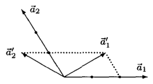
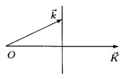

# 第五章  晶体的对称性

晶体对称性的研究是群论方法在物理中应用的一个典型的例子。仅仅根据晶体具有平移不变性，通过系统的群论研究，就可以对晶体进行分类，计算出晶体可能有的 11 种固有点群，32 种点群，7 种晶系，14 种布拉菲 (Bravais) 格子，73 种简单空间群和 230 种空间群。本章将从群论的角度研究晶体的对称变换群及其表示，系统研究晶体的分类。

## 5.1  晶体的对称变换群

晶体的基本特征就是组成晶体的原子在三维空间有周期性的排列，这种周期性的规则排列称为晶格。晶格对三维空间一定的平移变换保持不变

$$
\vec{r}\longrightarrow\vec{r}'=T(\vec{\ell})\vec{r}=\vec{r}+\vec{\ell}
\tag{5.1}
$$

这样的平移矢量 $\vec{\ell}$ 称为晶格矢量。晶格最小的周期单元称为晶格的原胞，它的不共面的三条棱可选为描述晶格的基本矢量，称为晶格基矢 $\vec{a}_{i}$. 如果晶格矢量都可表为晶格基矢的整数线性组合，这样的晶格基矢称为原始的 (primitive). 除非特别声明，我们约定所选取的晶格基矢都是原始的

$$
\vec{\ell}=\vec{a}_{1}\ell_{1}+\vec{a}_{2}\ell_{2}+\vec{a}_{3}\ell_{3}=\sum_{i=1}^{3}\vec{a}_{i}\ell_{i},\qquad \ell_{i}\ \text{是整数}
\tag{5.2}
$$

选定了晶格基矢，晶格矢量可以用三个整数 $\ell_{i}$ 来描写。保持晶体不变的平移变换 $T(\vec{\ell})$ 的集合构成群，称为晶体的平移群，简称平移群，记作 $\mathcal{T}$.

除了平移不变性外，晶体往往还有平移、转动和反演的协同变换的不变性，这些对称变换在晶体理论里称为晶体的对称操作，一般记作 $g(R,\vec{\alpha})$

$$
\vec{r}\longrightarrow\vec{r}'=g(R,\vec{\alpha})\vec{r}=R\vec{r}+\vec{\alpha},\qquad
\vec{\alpha}=\sum_{i=1}^{3}\vec{a}_{i}\alpha_{i}
\tag{5.3}
$$

其中，$R$ 是三维实正交变换，包括固有转动和非固有转动，它保持原点不变，$\alpha_{i}$ 是实常数，描写原点的平移。如果 $\vec{\alpha}=0$，则 $g(R,0)=R$ 是固有或非固有转动变换。当 $R=E$ 时，$\alpha_{i}$ 必须取整数 $\ell_{i}$，$g(E,\vec{\ell})=T(\vec{\ell})$ 是平移变换。对称变换的乘积定义为相继做两次对称变换

$$
g(R,\vec{\alpha})g(R',\vec{\beta})\vec{r}=g(R,\vec{\alpha})\left\{R'\vec{r}+\vec{\beta}\right\}=RR'\vec{r}+\vec{\alpha}+R\vec{\beta}
$$

$$
g(R,\vec{\alpha})g(R',\vec{\beta})=g(RR',\vec{\alpha}+R\vec{\beta})
\tag{5.4}
$$

$$
g(R,\vec{\alpha})^{-1}=g(R^{-1},-R^{-1}\vec{\alpha})
\tag{5.5}
$$

在乘积中，转动部分做通常的转动乘积，但平移部分不是简单相加，它受到转动变换的影响。正因为参加协同变换的平移部分对转动变换的乘积没有影响，所以对于给定的晶体，在它的对称变换 $g(R,\vec{\alpha})$ 中出现的所有实正交变换 $R$ 的集合构成群，称为晶格点群，简称点群，记作 $G$.

晶体对称变换的集合构成晶体对称群，称为空间群，记作 $\mathcal{S}$. 平移群 $\mathcal{T}$ 是空间群 $\mathcal{S}$ 的子群，而且是不变子群，因为平移变换的共轭元素仍是平移变换

$$
g(R,\vec{\alpha})T(\vec{\ell})g(R,\vec{\alpha})^{-1}=g\left(E,\vec{\alpha}+R(\vec{\ell}-R^{-1}\vec{\alpha})\right)=T(R\vec{\ell}),
$$

$$
R\vec{\ell}=\vec{\ell}'
\tag{5.6}
$$

设 $\ell_{i}$ 是 $\alpha_{i}$ 中的整数部分，则

$$
\alpha_{i}=\ell_{i}+t_{i},\qquad 0\leqslant t_{i}<1,
$$

$$
g(R,\vec{\alpha})=T(\vec{\ell})g(R,\vec{t})
\tag{5.7}
$$

可以证明，对于给定的晶体和选定的晶格基矢，在对称变换中，每一个 $R$ 只能对应一个 $\vec{t}$. 用反证法。设 $g(R,\vec{t})$ 和 $g(R,\vec{t}')$ 都是晶体的对称变换，则

$$
g(R,\vec{t})^{-1}g(R,\vec{t}')=T(-R^{-1}\vec{t}+R^{-1}\vec{t}')=T(\vec{\ell}),
$$

$$
\vec{t}'-\vec{t}=R\vec{\ell}=\vec{\ell}'
$$

由于式 (5.7) 对 $\vec{t}$ 的限制，只能 $\vec{t}'=\vec{t}$. 证完。

式 (5.7) 是平移群陪集的一般形式，它给出平移群陪集与点群元素 $R$ 间的一个一一对应关系，平移群和恒元 $E$ 对应，由式 (5.4) 和 (5.5)，这种对应关系对它们的乘积保持不变，因而平移群的商群 $\mathcal{S}/\mathcal{T}$ 同构于点群 $G$

$$
\mathcal{S}/\mathcal{T}\approx G
\tag{5.8}
$$

注意，$R$ 不一定是晶体的对称变换，点群一般也不是空间群的子群。若 $g(R,\vec{t})$ 中的矢量 $\vec{t}=0$，$R$ 才是晶体的对称变换，只有当点群所有元素对应的矢量 $\vec{t}$ 都是零时，点群才是空间群的子群。这样的空间群称为简单空间群 (symmorphic space group). 由于平移不变性的存在，按照式 (5.6)，晶格点群受到很大的限制，对于给定的晶格点群，式 (5.6) 又使晶格基矢的方向和大小受到限制，从而决定晶体的可能晶系和布拉菲格子，决定晶体可能的空间群。这就是晶体的周期性排列决定晶体分类的基本思想。

## 5.2  晶格点群

本节研究平移不变性对点群元素 $R$ 的限制，从而确定晶体可能有的全部晶格点群。

### 一、点群元素 R 的可能形式

先介绍晶体理论中对实正交变换 $R$ 常用的描写方式。以前我们常在正交归一的基 $\vec{e}_{a}$ 中描写实正交变换，在此基中实正交变换的矩阵形式是实正交矩阵。在这一章里，为了与以晶格基矢为基时变换的矩阵形式相区别，这实正交矩阵记作 $\overline{D}(R)$

$$
\vec{e}_{a}\cdot\vec{e}_{b}=\delta_{ab},\qquad
R\vec{e}_{a}=\sum_{b=1}^{3}\vec{e}_{b}\overline{D}_{ba}(R)
\tag{5.9}
$$

在晶体理论中，晶格基矢 $\vec{a}_{i}$ 处于特殊的地位，因为晶格矢量都是晶格基矢的整数线性组合。取晶格基矢作为基会给计算带来很多方便，当然晶格基矢的不正交归一的特性也会造成一些困难，需要设法予以弥补。弥补的方法就是引入倒晶格基矢 $\vec{b}_{i}$. 设

$$
\vec{a}_{i}=\sum_{d=1}^{3}\vec{e}_{d}X_{di},\qquad \det X\neq 0
\tag{5.10}
$$

由于晶格基矢一般不是正交归一的，$X$ 矩阵是实矩阵，但一般不是实正交矩阵。定义倒晶格基矢 $\vec{b}_{i}$

$$
\vec{b}_{i}=\sum_{a=1}^{3}(X^{-1})_{ia}\vec{e}_{a},\qquad
\vec{e}_{a}=\sum_{i=1}^{3}X_{ai}\vec{b}_{i}
\tag{5.11}
$$

则

$$
\vec{b}_{i}\cdot\vec{a}_{j}=\vec{a}_{j}\cdot\vec{b}_{i}=\delta_{ij}
\tag{5.12}
$$

在这一章里，我们很少用正交归一的基 $\vec{e}_{a}$，而用晶格基矢 $\vec{a}_{i}$ 为基。在基 $\vec{a}_{i}$ 中，实正交变换 $R$ 的矩阵形式 $R_{ij}$ 一般不再是实正交矩阵

$$
R\vec{a}_{j}=\sum_{i=1}^{3}\vec{a}_{i}D_{ij}(R),\qquad
D(R)=X^{-1}\overline{D}(R)X
$$

$$
\begin{aligned}
R\vec{b}_{i}&=\sum_{d=1}^{3}(X^{-1})_{id}R\vec{e}_{d}=\sum_{dc}(X^{-1})_{id}\vec{e}_{c}\overline{D}_{cd}(R)\\
&=\sum_{j}\left\{\sum_{dc}(X^{-1})_{id}\left[\overline{D}(R)^{-1}\right]_{dc}X_{cj}\right\}\vec{b}_{j}
=\sum_{j=1}^{3}\left[\overline{D}(R)^{-1}\right]_{ij}\vec{b}_{j}
\end{aligned}
$$

$$
D_{ij}(R)=\vec{b}_{i}\cdot R\vec{a}_{j}=\vec{a}_{j}\cdot R^{-1}\vec{b}_{i}
\tag{5.13}
$$

在晶体理论中常用并矢来代替矩阵形式。所谓并矢可以直观地理解为两个矢量并在一起，两矢量分别称为左矢和右矢。每个矢量都可以独立地做矢量运算。并矢用上面带两个箭头的符号标记。写在并矢左面或右面的矢量运算，分别是和并矢的左矢或右矢进行运算的。并矢与矢量做叉乘运算后仍是并矢，与矢量做点乘运算后变成矢量，并矢与并矢做点乘运算后仍是并矢。实正交变换 $R$ 的并矢为

$$
\vec{\vec{R}}=\sum_{ij}D_{ij}(R)\vec{a}_{i}\vec{b}_{j}=\sum_{ij}\left[D(R)^{-1}\right]_{ij}\vec{b}_{j}\vec{a}_{i}
\tag{5.14}
$$

$$
D_{ij}(R)=\vec{b}_{i}\cdot\vec{\vec{R}}\cdot\vec{a}_{j}=\vec{a}_{j}\cdot\vec{\vec{R}}^{-1}\cdot\vec{b}_{i}
$$

恒等变换的并矢是

$$
\vec{\vec{1}}=\sum_{j}\vec{a}_{j}\vec{b}_{j}=\sum_{j}\vec{b}_{j}\vec{a}_{j}
\tag{5.15}
$$

空间反演 $\sigma$ 的并矢添一负号。容易验算，绕空间 $\hat{n}$ 方向转动 $\omega$ 角的变换 $R(\hat{n},\omega)$ 的并矢形式为

$$
\vec{\vec{R}}(\hat{n},\omega)=\hat{n}\hat{n}+\left(\vec{\vec{1}}-\hat{n}\hat{n}\right)\cos\omega+\left(\vec{\vec{1}}\times\hat{n}\right)\sin\omega
\tag{5.16}
$$

$\hat{n}\hat{n}$ 是沿 $\hat{n}$ 方向的投影算符，$\left(\vec{\vec{1}}-\hat{n}\hat{n}\right)$ 是垂直 $\hat{n}$ 方向的投影算符。

现在讨论平移不变性对点群元素 $R$ 的限制。式 (5.6) 指出，晶格矢量经变换 $R$ 后必须仍是晶格矢量，因而晶格基矢经变换 $R$ 后是晶格基矢的整数线性组合，即 $R$ 的矩阵元素 $D_{ij}(R)$ 全是整数，矩阵迹也是整数。实正交变换在任何基中的矩阵迹都可用转动角度 $\omega$ 表出

$$
\pm(1+2\cos\omega)=\text{整数}
\tag{5.17}
$$

其中，正号对应固有转动，负号对应非固有转动。因为矩阵迹取整数，所以 $\cos\omega$ 是半整数，即等于 0，$\pm1/2$ 和 $\pm1$. 这样，转动角度 $\omega$ 只能取

$$
\omega=2\pi m/N,\qquad N=1,\ 2,\ 3,\ 4\ \text{或}\ 6,\qquad 0\leqslant m<N
\tag{5.18}
$$

这就是说，晶格点群元素只能是固有或非固有的 $N$ 次轴转动，$N$ 等于 1，2，3，4 或 6.

倒晶格基矢的整数线性组合称为倒晶格矢量，记作 $\vec{K}$. 倒晶格矢量和晶格矢量的点乘是整数。由于矢量点乘后变成标量，在实正交变换中保持不变。取 $R$ 为晶格点群的元素

$$
\vec{b}_{i}\cdot R^{-1}\vec{a}_{j}=\left(R\vec{b}_{i}\right)\cdot\vec{a}_{j}=\text{整数}
$$

则 $R\vec{b}_{i}$ 仍是倒晶格矢量，$R$ 在倒晶格基矢中的矩阵元素 $\left[D(R)^{-1}\right]_{ij}$ 也都是整数，或者说

$$
R\vec{K}=\vec{K}'
\tag{5.19}
$$

在晶格空间和倒晶格空间，晶格点群是相同的。

### 二、晶体的固有点群

首先，如果固有点群只包含一个固有转动轴，则它是循环群。这样的固有点群只有五种，按熊夫利 (Schoenflies) 符号记作 $C_{N}$，$N=1,\ 2,\ 3,\ 4$ 和 6. 按点群的国际符号，它们就用数 $N$ 标记。通常把转动轴取为 $x_{3}$ 轴。 $C_{N}$ 群是阿贝尔群，含 $N$ 个元素，有一个生成元 $C_{N}$，它是绕 $x_{3}$ 轴转动 $2\pi/N$ 角的变换，并矢记作 $\vec{\vec{C}}_{N}$. 群中其他元素是它的幂次。 $C_{N}$ 群有 $N$ 个一维不可约表示，生成元的表示矩阵为

$$
D^{m}\left(C_{N}\right)=\exp\left(-\mathrm{i}2\pi m/N\right),\qquad 0\leqslant m<N
$$

其中，$m$ 标记不等价的不可约表示。

其次，我们研究包含两个或两个以上转动轴的点群，先研究转动轴数量上的限制。设固有点群 $G$ 包含 $n_{2}$ 个二次轴，$n_{3}$ 个三次轴，$n_{4}$ 个四次轴和 $n_{6}$ 个六次轴，这些转动轴对应的转动，除恒元外没有公共元素，因而点群 $G$ 包含的元素数目为

$$
g=1+n_{2}+2n_{3}+3n_{4}+5n_{6}
\tag{5.20}
$$

对每个 $N$ 次轴，循环群元素之和的并矢记作 $\left\{\vec{\vec{C}}_{N}\right\}$，显然，它作用在 $\hat{n}$ 上得 $N\hat{n}$，而作用在垂直 $\hat{n}$ 的矢量上得零，因而 $\left\{\vec{\vec{C}}_{N}\right\}$ 正比于 $\hat{n}$ 方向的投影算符

$$
\left\{\vec{\vec{C}}_{N}\right\}=N\hat{n}\hat{n}
$$

在包含 $\hat{n}$ 在内的一组正交归一的矢量基中，容易算得这算符矩阵形式的矩阵迹为 $N$. 扣除恒元的矩阵迹为 3，其余元素之和的矩阵迹为 $N-3$. 这样，点群全部元素之和对应的矩阵，矩阵迹为

$$
3+(2-3)n_{2}+(3-3)n_{3}+(4-3)n_{4}+(6-3)n_{6}=3-n_{2}+n_{4}+3n_{6}
$$

另一方面，根据重排定理，点群全部元素之和作用在任何非零矢量 $\vec{r}$ 上满足

$$
S\left\{\sum_{R\in G}R\vec{r}\right\}=\left\{\sum_{R\in G}R\vec{r}\right\}
$$

即括号内的矢量在点群任意元素 $S$ 作用下保持不变。只要点群 $G$ 包含有两个不同方向的转动轴，这样的矢量只能是零矢量，因而对这样的点群，全部元素之和对应零矩阵

$$
3-n_{2}+n_{4}+3n_{6}=0
\tag{5.21}
$$

这条件限制了点群 $G$ 包含的转动轴数目。

现在我们具体研究包含两个以上转动轴的固有点群。讨论中必须计算绕不同轴转动元素的乘积问题。若按三维转动矩阵相乘，计算太复杂。利用 SO(3) 群和 SU(2) 群同态关系，计算相应 SU(2) 群元素的乘积，计算量就会大大减少。由于 $\pm u$ 对应同一个转动变换，对于 $u$ 矩阵及其乘积的符号不必在意。我们用到的基本公式是

$$
u(\hat{n},\omega)=\mathbf{1}\cos(\omega/2)-\mathrm{i}(\vec{\sigma}\cdot\hat{n})\sin(\omega/2)
$$

$$
\cos(\omega/2)=\frac{1}{2}\mathrm{Tr}\left\{u(\hat{n},\omega)\right\}
\tag{5.22}
$$

$$
(\vec{\sigma}\cdot\hat{n}_{1})(\vec{\sigma}\cdot\hat{n}_{2})=\mathbf{1}(\hat{n}_{1}\cdot\hat{n}_{2})+\mathrm{i}\vec{\sigma}\cdot(\hat{n}_{1}\times\hat{n}_{2})
$$

因为允许的只有二、三、四和六次轴，所以 $\cos(\omega/2)$ 只能取如下允许值

$$
\cos(\omega/2)=0,\quad \pm\frac{1}{2},\quad \pm\frac{1}{\sqrt{2}},\quad \pm\frac{\sqrt{3}}{2},\quad \pm 1
\tag{5.23}
$$

首先，若群 $G$ 不包含高于二次的转动轴，则由式 (5.21) 得 $n_{2}=3$. 二次轴转动对应的 $u$ 矩阵为

$$
u(\hat{n},\pi)=-\mathrm{i}(\vec{\sigma}\cdot\hat{n})
$$

$$
u(\hat{n}_{1},\pi)u(\hat{n}_{2},\pi)=-\mathbf{1}(\hat{n}_{1}\cdot\hat{n}_{2})-\mathrm{i}\vec{\sigma}\cdot(\hat{n}_{1}\times\hat{n}_{2})
\tag{5.24}
$$

既然乘积元素仍是二次轴转动，则

$$
\hat{n}_{1}\cdot\hat{n}_{2}=0,\qquad \hat{n}_{3}=\hat{n}_{1}\times\hat{n}_{2}
$$

三个二次轴互相垂直。这点群正是 $\mathrm{D}_{2}$ 群，它是阿贝尔群，同构于四阶反演群 $\mathrm{V}_{4}$，乘法表见表 2.3，特征标表见表 3.6.

其次，讨论点群只含有一个高于二次的转动轴，设为 $N$ 次轴，称为主轴。通常把主轴方向取为 $x_{3}$ 轴。点群中的其他转动元素只能使主轴反向，因而只能是轴向与主轴垂直的二次轴转动。由式 (5.21) 知，二次轴的数目正好等于高次轴的次数 $N$. 由式 (5.24) 知，相邻两二次轴转动的乘积是 $N$ 次轴转动，因而相邻两二次轴的夹角为 $\pi/N$. 此群正是 $\mathrm{D}_{N}$ 群，$N=3,\ 4$ 和 6. $\mathrm{D}_{N}$ 群包含 $2N$ 个元素，乘积规则见式 (2.12)，特征标表见表 3.7，3.12 和 3.13. $\mathrm{D}_{N}$ 群元素都可表为两个子群元素的乘积：$C_{N}C_{2}'$，其中 $C_{2}'$ 是沿 $x_{1}$ 轴方向的二次轴转动群。 $\mathrm{D}_{N}$ 群的国际符号为 $N2'$.

第三，设 $G$ 包含两个以上三次转动轴，但不含高于三次的转动轴。三次轴转动对应的 $u$ 矩阵为

$$
u(\hat{n},\pm 2\pi/3)=1/2\pm \mathrm{i}(\vec{\sigma}\cdot\hat{n})\sqrt{3}/2
$$

对两个不同轴向的三次轴转动的乘积，乘积元素转角之半的余弦为

$$
\frac{1}{2}\mathrm{Tr}\left\{u(\hat{n}_{1},\pm 2\pi/3)u(\hat{n}_{2},2\pi/3)\right\}=1/4\mp 3(\hat{n}_{1}\cdot\hat{n}_{2})/4
\tag{5.25}
$$

要使这些取值都在式 (5.23) 给出的范围内，允许的解只有 $\hat{n}_{1}\cdot\hat{n}_{2}=\pm1/3$. 由于一个轴反向使矢量点乘改号，不失普遍性，可取

$$
\hat{n}_{1}\cdot\hat{n}_{2}=\cos\theta=-1/3,\qquad \theta=109^{\circ}28'
\tag{5.26}
$$

由三次轴转动的乘积，可得四个对称分布的等价的三次转动轴，$n_{3}=4$. 三次轴是极性轴，相邻三次轴的夹角为 $\theta$. 由式 (5.21) 得 $n_{2}=3$，三个二次轴只能沿两个相邻三次轴的角平分线方向，互相等价。相邻二次轴与三次轴的夹角余弦为 $1/\sqrt{3}$. 事实上

$$
u(\hat{n}_{1},-2\pi/3)u(\hat{n}_{2},2\pi/3)=\mathrm{i}\vec{\sigma}\cdot\left(\sqrt{3}\hat{n}_{1}-\sqrt{3}\hat{n}_{2}+3\hat{n}_{1}\times\hat{n}_{2}\right)/4,
$$

$$
\hat{n}_{1}\cdot\left(\sqrt{3}\hat{n}_{1}-\sqrt{3}\hat{n}_{2}+3\hat{n}_{1}\times\hat{n}_{2}\right)/4=1/\sqrt{3}
$$

通常让三个二次轴沿坐标轴方向，四个三次轴沿如下四个方向

$$
(\vec{e}_{1}\pm\vec{e}_{2}\pm\vec{e}_{3})/\sqrt{3}\qquad\text{和}\qquad(-\vec{e}_{1}\pm\vec{e}_{2}\mp\vec{e}_{3})/\sqrt{3}
$$

这固有点群就是正四面体对称群 $\mathrm{T}$，它的乘法表见表 2.9，特征标表见表 3.8. $\mathrm{T}$ 群元素都可表为三个子群元素的乘积，$C_{3}'C_{2}C_{2}'$. $\mathrm{T}$ 群的国际符号为 $3'22'$.

最后，一般地讨论包含两个以上高于二次转动轴的点群。高次轴次数至少是三，它会使另一个高次轴至少有三个互相等价的轴。点群显然不能包含两个以上六次轴，因为六次轴同时又是三次轴和二次轴，三次轴间的夹角必须是 $109^{\circ}28'$，而若两个二次轴以此为夹角，它们元素乘积的转角就不满足式 (5.23) 的条件。因此剩下的可能点群必须不含六次轴，只能是包含两个以上四次转动轴的点群。四次转动对应的 $u$ 矩阵为

$$
u(\hat{n},\pm\pi/2)=\mathbf{1}/\sqrt{2}\mp\mathrm{i}(\vec{\sigma}\cdot\hat{n})/\sqrt{2},
$$

$$
u(\hat{n},\pi)=-\mathrm{i}(\vec{\sigma}\cdot\hat{n})
$$

对两个不同轴向的四次轴转动的乘积，乘积元素转角之半的余弦为

$$
\mathrm{Tr}\left\{u(\hat{n}_{1},\pm\pi/2)u(\hat{n}_{2},\pi/2)\right\}/2=1/2\mp(\hat{n}_{1}\cdot\hat{n}_{2})/2,
$$

$$
\mathrm{Tr}\left\{u(\hat{n}_{1},\pi)u(\hat{n}_{2},\pi/2)\right\}/2=-(\hat{n}_{1}\cdot\hat{n}_{2})/\sqrt{2}
$$

要使上式的余弦值都满足式 (5.23) 的条件，只有 $\hat{n}_{1}\cdot\hat{n}_{2}=0$，即四次轴互相垂直。由于四次轴的转动，三个四次轴是双向的和互相等价的。两个轴向垂直的四次轴转动的乘积会产生三次轴转动和二次轴转动

$$
u(\hat{n}_{1},\pi/2)u(\hat{n}_{2},\pi/2)=\mathbf{1}/2-\mathrm{i}\vec{\sigma}\cdot(\hat{n}_{1}+\hat{n}_{2}+\hat{n}_{1}\times\hat{n}_{2})/2,
$$

$$
\hat{n}_{1}\cdot(\hat{n}_{1}+\hat{n}_{2}+\hat{n}_{1}\times\hat{n}_{2})/\sqrt{3}=1/\sqrt{3}
$$

三次轴和四次轴的相对位置正好与 $\mathrm{T}$ 群中三次轴和二次轴的相对位置一样。现在四个等价的三次轴都是双向轴。让这三个四次轴沿坐标轴方向，四个三次轴仍与 $\mathrm{T}$ 群中的三次轴一样取向。由

$$
u(\hat{n}_{1},\pi)u(\hat{n}_{2},\pi/2)=-\vec{\sigma}\cdot(\hat{n}_{1}+\hat{n}_{1}\times\hat{n}_{2})/\sqrt{2}
$$

可见这二次轴与 $\hat n_2$ 垂直，但与 $\hat n_1$ 和 $\hat n_1\times\hat n_2$ 都成 $\pi/4$ 角。由四次轴转动，得六个等价的二次轴，分布在各坐标平面上坐标轴的角平分线方向。二次轴都处在相邻的四次轴和相邻的三次轴的角平分线方向。这些转动轴个数满足条件 (5.21). 这固有点群就是立方体对称群 O，它的乘法表见表 2.9 和 2.11，特征标表见表 3.9. O 群元素都可表为三个子群元素的乘积，$C_3'C_4C_2''$. O 群的国际符号为 $3'42''$.

这样，可能的晶格固有点群共有 11 个，它们的结构列于表 5.1. 在晶体理论中，沿 $\bar a_3$ 方向的转动轴用不带撇的符号标记，不沿 $\bar a_3$ 方向的高于二次的转动轴和沿 $\bar a_1$ 方向的二次转动轴，用带一撇的符号标记，沿其他方向的二次转动轴用带两撇的符号标记。

**表 5.1 晶格固有点群的结构**

| 点群 | 阶 | 类数 | 2 次轴数 | 3 次轴数 | 4 次轴数 | 6 次轴数 | 一维 | 二维 | 三维 | 分解为循环点群的乘积 | 生成元 | 指数为 2 的不变子群 |
| --- | --- | --- | --- | --- | --- | --- | --- | --- | --- | --- | --- | --- |
| $C_1$ | 1 | 1 | | | | | 1 | | | $C_1$ | $C_1$ | |
| $C_2$ | 2 | 2 | 1 | | | | 2 | | | $C_2$ | $C_2$ | $C_1$ |
| $C_3$ | 3 | 3 | | 1 | | | 3 | | | $C_3$ | $C_3$ | |
| $C_4$ | 4 | 4 | | | 1 | | 4 | | | $C_4$ | $C_4$ | $C_2$ |
| $C_6$ | 6 | 6 | | | | 1 | 6 | | | $C_6$ | $C_6$ | $C_3$ |
| $D_2$ | 4 | 4 | 3 | | | | 4 | | | $C_2C_2'$ | $C_2,C_2'$ | $C_2$ |
| $D_3$ | 6 | 3 | 3 | 1 | | | 2 | 1 | | $C_3C_2'$ | $C_3,C_2'$ | $C_3$ |
| $D_4$ | 8 | 5 | 4 | | 1 | | 4 | 1 | | $C_4C_2'$ | $C_4,C_2'$ | $C_4,D_2$ |
| $D_6$ | 12 | 6 | 6 | | | 1 | 4 | 2 | | $C_6C_2'$ | $C_6,C_2'$ | $C_6,D_3$ |
| T | 12 | 4 | 3 | 4 | | | 3 | | 1 | $C_3'C_2C_2'$ | $C_3',C_2$ | |
| O | 24 | 5 | 6 | 4 | 3 | | 2 | 1 | 2 | $C_3'C_4C_2''$ | $C_3',C_4$ | T |

### 三、晶体的非固有点群

在 2.6 节，我们已讨论过由固有点群 $G$ 找非固有点群的一般方法。有两种非固有点群。一种是 $I$ 型非固有点群，它等于固有点群 $G$ 和二阶反演群 $C_i$ 的直乘，$C_i$ 包含恒元和空间反演变换 $\sigma$. 晶体共有 11 种 $I$ 型非固有点群，它们的命名规则已在第二章介绍过（见 2.6 节）。

$$
\begin{array}{lll}
C_i\,, & C_{2h}=C_2\otimes C_i & C_{3i}=C_3\otimes C_i\\
C_{4h}=C_4\otimes C_i\,, & C_{6h}=C_6\otimes C_i\,, & D_{2h}=D_2\otimes C_i\\
D_{3d}=D_3\otimes C_i\,, & D_{4h}=D_4\otimes C_i\,, & D_{6h}=D_6\otimes C_i\\
T_h=T\otimes C_i\,, & O_h=O\otimes C_i &
\end{array}
\tag{5.27a}
$$

另一种是 $P$ 型非固有点群。如果固有点群 $G$ 包含指数为 2 的不变子群 $H$，保持子群 $H$ 元素不变，把陪集元素都乘以空间反演 $\sigma$，就得到相应的 $P$ 型非固有点群。表 5.1 已列出晶体固有点群所包含的指数为 2 的不变子群，由此可得晶体的如下 10 种 $P$ 型非固有点群

$$
\begin{array}{llll}
C_s\approx C_2\,, & S_4\approx C_4\,, & C_{3h}\approx C_6\,, & C_{2v}\approx D_2\\
C_{3v}\approx D_3\,, & C_{4v}\approx D_{2d}\approx D_4\,, & C_{6v}\approx D_{3h}\approx D_6\,, & T_d\approx O
\end{array}
\tag{5.27b}
$$

32 种晶格点群的主要性质列于表 5.2.

**表 5.2 晶格点群**

| 点群 | 分解为循环子群的乘积 | 指数为 2 的不变子群 | $P$ 型（不含 $\sigma$）点群 | $P$ 型循环群乘积 | $I$ 型（含 $\sigma$）点群 | $I$ 型循环群乘积 |
| --- | --- | --- | --- | --- | --- | --- |
| $C_1$ | $C_1$ | | | | $C_i$ | $C_i$ |
| $C_2$ | $C_2$ | $C_1$ | $C_s$ | $C_s$ | $C_{2h}$ | $C_iC_2$ |
| $C_3$ | $C_3$ | | | | $C_{3i}$ | $C_{3i}$ |
| $C_4$ | $C_4$ | $C_2$ | $S_4$ | $S_4$ | $C_{4h}$ | $C_iC_4$ |
| $C_6$ | $C_6$ | $C_3$ | $C_{3h}$ | $C_{3h}$ | $C_{6h}$ | $C_iC_6$ |
| $D_2$ | $C_2C_2'$ | $C_2$ | $C_{2v}$ | $C_2C_s'$ | $D_{2h}$ | $C_iC_2C_2'$ |
| $D_3$ | $C_3C_2'$ | $C_3$ | $C_{3v}$ | $C_3C_s'$ | $D_{3d}$ | $C_{3i}C_2'$ |
| $D_4$ | $C_4C_2'$ | $C_4$ | $C_{4v}$ | $C_4C_s'$ | $D_{4h}$ | $C_iC_4C_2'$ |
| | | $D_2$ | $D_{2d}$ | $S_4C_2''$ | | |
| $D_6$ | $C_6C_2'$ | $C_6$ | $C_{6v}$ | $C_6C_s'$ | $D_{6h}$ | $C_iC_6C_2'$ |
| | | $D_3$ | $D_{3h}$ | $C_{3h}C_2'$ | | |
| T | $C_3'C_2C_2'$ | | | | $T_h$ | $C_{3i}'C_2C_2'$ |
| O | $C_3'C_4C_2''$ | T | $T_d$ | $C_3'S_4C_s''$ | $O_h$ | $C_{3i}'C_4C_2''$ |

$P$ 型非固有点群与相应的固有点群同构，因而有相同的特征标表。 $I$ 型非固有点群是相应固有点群和二阶反演群的直乘，不等价不可约表示也是两子群不等价不可约表示的直乘。在晶体理论中，对固有点群和非固有点群，采用的不等价不可约表示的名称略有不同，这里不再列举。

## 5.3 晶系和布拉菲格子

上节研究了平移不变性对晶格点群的限制，现在研究晶格点群对晶格矢量的限制。按晶格点群对晶格矢量的限制情况，把晶体分为 7 种晶系，在每种晶系中，又根据晶格矢量的分布特征，分为若干个布拉菲（Bravais）格子，共有 14 种布拉菲格子。本节先研究简单空间群的情况，即晶格点群是空间群的子群，点群元素是晶体的对称变换，晶体的所有对称变换都可表为平移变换和点群元素的乘积。下节再研究一般空间群的情况。

### 一、晶格矢量应满足的条件

式 (5.6) 和 (5.19) 是晶体平移不变性对晶格点群元素的限制，当晶格点群确定后，它又反过来对晶格矢量和倒晶格矢量做出限制

$$
R\vec l=\vec l'\,,\qquad R\vec K=\vec K'
\tag{5.28}
$$

不同的点群给出的限制一般是不同的，但有些点群给出相似甚至相同的限制，例如空间反演变换 $\sigma$ 在任何表象中都是常数矩阵 $(-1)$，对晶格基矢的选择没有限制，因而非固有点群与对应的固有点群，对晶格基矢的限制是相同的。除了 $N=2$ 外，$C_N$ 群和 $D_N$ 群对晶格基矢的限制类似，T 群和 O 群对晶格基矢的限制相同。根据这些限制条件，把晶体分为 7 种晶系：

(1) 三斜晶系 (triclinic)，对应点群 $C_1$ 和 $C_i$.

(2) 单斜晶系 (monoclinic)，对应点群 $C_2$，$C_s$ 和 $C_{2h}$.

(3) 正交晶系 (orthorhombic)，对应点群 $D_2$，$C_{2v}$ 和 $D_{2h}$.

(4) 三方晶系 (trigonal)，对应点群 $C_3$，$C_{3i}$，$D_3$，$C_{3v}$ 和 $D_{3d}$.

(5) 六方晶系 (hexagonal)，对应点群 $C_6$，$C_{3h}$，$C_{6h}$，$D_6$，$C_{6v}$，$D_{3h}$ 和 $D_{6h}$.

(6) 四方晶系 (tetragonal)，对应点群 $C_4$，$S_4$，$C_{4h}$，$D_4$，$C_{4v}$，$D_{2d}$ 和 $D_{4h}$.

(7) 立方晶系 (cubic)，对应点群 T，$T_h$，O，$T_d$ 和 $O_h$.

在实际计算中发现，有一类三方晶系，点群对晶格基矢的限制和六方晶系相同，归入六方晶系，另一类称为菱方晶系 (rhombohedral).

以前我们选取的晶格基矢 $\bar a_i$ 是原始的，任何晶格矢量都可表为晶格基矢的整数线性组合。现在为了对每一晶系，按照点群对晶格矢量的限制，用统一的方法引入晶格基矢，适当选取非原始的晶格基矢会更方便一些。这里所谓的非原始的晶格基矢指，在基矢方向晶格基矢仍是最短的晶格矢量，它们的任何整数线性组合仍是晶格矢量，但是允许晶格基矢的某些特殊的分数组合 $\vec f$ 也是晶格矢量，晶体对平移 $\vec f$ 的变换也保持不变。规定 $\vec f$ 的三个分量都取小于 1 的正分数或零

$$
\vec f=\bar a_1f_1+\bar a_2f_2+\bar a_3f_3\,,\qquad 0\leqslant f_i<1
\tag{5.29}
$$

相应的平移变换记作 $T(\vec f)\equiv T(f_1,f_2,f_3)$. 根据 $\vec f$ 的可能选择，把一个晶系区分为若干个布拉菲格子。计算表明，这些 $f_i$ 只能取 0 或 1/2. 保持晶体不变的所有平移变换的集合构成晶体的平移群 $T$，而平移晶格基矢整数线性组合的平移变换集合构成平移群的不变子群，记作 $T_\ell$，陪集由平移变换 $T(\vec f)$ 描写。

根据 $T(\vec f)$ 的形式，把平移群分成四种类型：

(1) 原始平移群 P (primitive)

$$
T=T_\ell
\tag{5.30}
$$

菱方晶系的原始平移群专门记作 R.

(2) 体心平移群 I (body-centered)

$$
T=T_\ell\otimes\left\{E,\ T\left(\frac12,\frac12,\frac12\right)\right\}.
\tag{5.31}
$$

(3) 底心平移群 A，B 和 C (base-centered)

$$
\begin{array}{l}
A:\quad T=T_\ell\otimes\left\{E,\ T\left(0,\frac12,\frac12\right)\right\}\\[4pt]
B:\quad T=T_\ell\otimes\left\{E,\ T\left(\frac12,0,\frac12\right)\right\}\\[4pt]
C:\quad T=T_\ell\otimes\left\{E,\ T\left(\frac12,\frac12,0\right)\right\}
\end{array}
\tag{5.32}
$$

显然，如果 A，B 和 C 三个底心平移群中，有两个是晶体的对称变换，则第三个也一定是晶体的对称变换，此时的平移群变成面心平移群 F.

(4) 面心平移群 F (face-centered)

$$
T=T_\ell\otimes\left\{E,\ T\left(0,\frac12,\frac12\right),\ T\left(\frac12,0,\frac12\right),\ T\left(\frac12,\frac12,0\right)\right\}.
\tag{5.33}
$$

这些平移群与晶系结合起来，形成 14 种晶格类型，称为布拉菲格子。这样的平移群和相应的点群结合，形成 73 种简单空间群。将布拉菲格子符号 P，R，I，A，B，C 和 F 冠在点群符号前面，就得到简单空间群的符号。

点群的符号有若干种体系，前面我们介绍的是熊夫利符号，在点群范围内它是较方便和应用最广泛的一种符号。但这种符号没有把点群明显地写成子群或生成元的乘积形式，应用到空间群时就显得不太方便。以后在符号上有多次改进，引入点群国际符号，Mauguin-Hermann 符号和空间群国际符号等，它们的对应关系见表 5.3. 在处理晶体的空间群问题时，我们推荐使用空间群国际符号。在空间群国际符号体系中，直接用数字 $N$ 表固有循环点群，用上面带一横的数字 $\bar N$ 表非固有循环点群，符号 $\bar 1$ 表二阶反演群 $C_i$. 不带撇的数字表此循环点群的转动轴沿 $\bar a_3$ 方向，带一撇的数字表沿其他方向的高次转动轴或沿 $\bar a_1$ 方向的二次转动轴，沿其他方向的二次转动轴用带两撇的数字表示。然后按照点群分解为循环点群乘积的次序来排列这些数字。对每个点群，参加乘积的循环点群数目不超过三个。将这些数字冠以布拉菲格子的符号后，就得到简单空间群的国际符号。对一般空间群，再把不为零的矢量 $\vec t$ 注在数字的下标上。从表 5.3 中看到，有的点群（如 $D_3$ 等）对应两种不同的空间群国际符号。本节后面部分将对此做出解释。

在后面的讨论中，晶格基矢记为 $\bar a_i$，它们的长度记为 $a_i$，用 $\alpha_1$ 表 $\bar a_2$ 和 $\bar a_3$ 的夹角，下标取 1，2，3 循环。由晶格点群对晶格矢量和倒晶格矢量的限制条件 (5.28)，可证如下重要性质。 **表 5.3 晶格点群各种符号的对照**

| 熊氏符号 | 点群国际符号 | MH 符号 | 空间群国际符号 | 熊氏符号 | 点群国际符号 | MH 符号 | 空间群国际符号 |
| --- | --- | --- | --- | --- | --- | --- | --- |
| $C_1$ | 1 | 1 | 1 | $C_{3v}$ | $3m$ | $31m$ | $3\bar 2''$ |
| $C_i$ | $\bar 1$ | $\bar 1$ | $\bar 1$ | $D_{3d}$ | $\bar 3m$ | $\bar 3\frac{2}{m}1$ | $\bar 32'$ |
| $C_2$ | 2 | 2 | 2 | $D_{3d}$ | $\bar 3m$ | $\bar 31\frac{2}{m}$ | $\bar 32''$ |
| $C_s$ | $m$ | $m$ | $\bar 2$ | $D_4$ | 422 | 422 | $42'$ |
| $C_{2h}$ | $2/m$ | $2/m$ | $\pm 2$ | $C_{4v}$ | $4mm$ | $4mm$ | $4\bar 2'$ |
| $C_3$ | 3 | 3 | 3 | $D_{2d}$ | $\bar 42m$ | $\bar 42m$ | $\bar 42'$ |
| $C_{3i}$ | $\bar 3$ | $\bar 3$ | $\bar 3$ | $D_{2d}$ | $\bar 42m$ | $\bar 4m2$ | $\bar 42''$ |
| $C_4$ | 4 | 4 | 4 | $D_{4h}$ | $4/mmm$ | $\frac{4}{m}\frac{2}{m}\frac{2}{m}$ | $\pm 42'$ |
| $S_4$ | $\bar 4$ | $\bar 4$ | $\bar 4$ | $D_6$ | 622 | 622 | $62'$ |
| $C_{4h}$ | $4/m$ | $4/m$ | $\pm 4$ | $C_{6v}$ | $6mm$ | $6mm$ | $6\bar 2'$ |
| $C_6$ | 6 | 6 | 6 | $D_{3h}$ | $\bar 6m2$ | $\bar 62m$ | $\bar 62'$ |
| $C_{3h}$ | $\bar 6$ | $\bar 6$ | $\bar 6$ | $D_{3h}$ | $\bar 6m2$ | $\bar 6m2$ | $\bar 62''$ |
| $C_{6h}$ | $6/m$ | $6/m$ | $\pm 6$ | $D_{6h}$ | $6/mmm$ | $\frac{6}{m}\frac{2}{m}\frac{2}{m}$ | $\pm 62'$ |
| $D_2$ | 222 | 222 | $22'$ | T | 23 | 23 | $3'22'$ |
| $C_{2v}$ | $2mm$ | $2mm$ | $2\bar 2'$ | $T_h$ | $m3$ | $\frac{2}{m}3$ | $\bar 3'22'$ |
| $D_{2h}$ | $mmm$ | $\frac{2}{m}\frac{2}{m}\frac{2}{m}$ | $\pm 22'$ | O | 432 | 432 | $3'42''$ |
| $D_3$ | 32 | 321 | $32'$ | $T_d$ | $\bar 43m$ | $\bar 43m$ | $3'\bar 42''$ |
| $D_3$ | 32 | 312 | $32''$ | $O_h$ | $m3m$ | $\frac{4}{m}3\frac{2}{m}$ | $\bar 3'42''$ |
| $C_{3v}$ | $3m$ | $3m1$ | $3\bar 2'$ | | | | |

**定理一**　除一次轴外，沿晶体的晶格点群任一转动轴方向，必有晶格矢量和倒晶格矢量，在与转动轴垂直的平面内，至少有两个不共线的晶格矢量和有两个不共线的倒晶格矢量。

**证明**　容易检验，除一次轴外，所有循环点群都包含子群 $C_2$，$C_s$ 或 $C_3$. 先设点群包含 $C_2$，任取晶格矢量 $\vec l$，则 $\vec l\pm C_2\vec l$ 也是晶格矢量。 $\vec l+C_2\vec l$ 平行转动轴，$\vec l-C_2\vec l$ 垂直转动轴。在这两个晶格矢量决定的平面外再找一个晶格矢量 $\vec l'$，则 $\vec l'-C_2\vec l'$ 垂直转动轴，且与 $\vec l-C_2\vec l$ 不共线。若点群包含 $C_s$，证法相同。若点群包含 $C_3$，则 $\vec l+C_3\vec l+C_3^2\vec l$ 平行转动轴，$\vec l-C_3\vec l$ 和 $\vec l-C_3^2\vec l$ 垂直转动轴，且不共线。因为在晶格空间和倒晶格空间，晶格点群是相同的，所以对倒晶格矢量的证明方法完全相同。证完。

下面我们对每一种晶系，先规定选择晶格基矢的标准方法，然后讨论作为晶格基矢非整数线性组合 $\vec f$ 的可能性。根据条件式 (5.28)，限制 $f_j$ 的可能选择，定出在这晶系中可能的布拉菲格子和简单空间群。

### 二、三斜晶系

三斜晶系对应点群 $C_1$ (1) 和 $C_i$ ($\bar 1$). 括号里的是国际符号。恒等变换和空间反演变换的矩阵形式是常数矩阵，它们对晶格基矢的选择没有限制。取不在同一平面的三个晶格矢量作为晶格基矢，要求晶格基矢是原始的。晶格基矢的长度和基矢间的夹角都没有限制，平移群是原始的。这样，单斜晶系只有一种 $P$ 型布拉菲格子，两种简单空间群 $P1$ 和 $P\bar 1$.

### 三、单斜晶系

单斜晶系对应点群 $C_2$ (2)，$C_s$ ($\bar 2$) 和 $C_{2h}$ ($\pm 2$). 这些晶格点群含一个二次转动轴。取沿转动轴方向的最短晶格矢量为晶格基矢 $\bar a_3$，在垂直转动轴平面内，取两个不共线的最小晶格矢量为 $\bar a_1$ 和 $\bar a_2$，并要求 $\bar a_1\times\bar a_2$ 沿 $\bar a_3$ 正向。这里所谓平面中的最小晶格矢量指，在此平面内任何晶格矢量都是它们的整数线性组合，并不要求它们是此平面内最短的晶格矢量。按此方法选取的晶格基矢，它们的长度没有限制，夹角限制为

$$
\alpha_1=\alpha_2=\pi/2
\tag{5.34}
$$

在这组晶格基矢中，点群生成元的并矢形式和矩阵形式分别为

$$
\vec{\bar 2}=-\bar a_1\vec b_1-\bar a_2\vec b_2+\bar a_3\vec b_3\,,\qquad
D(C_2)=
\begin{pmatrix}
-1 & 0 & 0\\
0 & -1 & 0\\
0 & 0 & 1
\end{pmatrix}
\tag{5.35}
$$

写变换并矢形式的方法是，并矢中 $\vec b_i$ 的系数，就是在此变换中 $\bar a_i$ 变成的矢量。由并矢写变换矩阵形式时，矩阵第 $i$ 行第 $j$ 列的元素就是并矢中 $\bar a_i\vec b_j$ 的系数。

设有晶格矢量 $\vec f$

$$
\vec f=\bar a_1f_1+\bar a_2f_2+\bar a_3f_3\,,\qquad 0\leqslant f_j<1
\tag{5.36}
$$

讨论 $f_j$ 的可能取值。利用式 (5.35) 计算下式

$$
\vec f+\vec{\bar 2}\cdot\vec f=\bar a_3(2f_3)\,,\qquad
\vec f-\vec{\bar 2}\cdot\vec f=\bar a_1(2f_1)+\bar a_2(2f_2)
$$

由于式 (5.28)，此两式都仍是晶格矢量，因而三个 $f_j$ 都只能分别取 0 或 1/2. 根据我们选择晶格基矢的原则，当 $f_3=0$ 时，必须 $f_1=f_2=0$，反之，当 $f_1=f_2=0$ 时，$f_3=0$. 这样，$\vec f$ 有下面几种类型的解

$$
\begin{array}{ll}
P\text{ 型格子：} & \vec f=0,\\
A\text{ 型格子：} & \vec f=(\bar a_2+\bar a_3)/2,\\
B\text{ 型格子：} & \vec f=(\bar a_1+\bar a_3)/2,\\
I\text{ 型格子：} & \vec f=(\bar a_1+\bar a_2+\bar a_3)/2
\end{array}
\tag{5.37}
$$

因为不能有 $C$ 型格子，所以 $A$ 型和 $B$ 型格子不能同时存在，因而也就不能有 $F$ 型格子。由于 $\bar a_1$ 和 $\bar a_2$ 的地位是平等的，对 $B$ 型格子，可以把 $\bar a_2$ 叫做 $\bar a_1$，而把 $-\bar a_1$ 叫做 $\bar a_2$，则 $B$ 型格子变成了 $A$ 型格子。同样，对 $I$ 型格子，可以把 $\bar a_1+\bar a_2$ 叫做 $\bar a_1$，而 $\bar a_2$ 不变，则 $I$ 型格子变成了 $A$ 型格子。

这样，单斜晶系有两种布拉菲格子 $P$ 型和 $A$ 型，六种简单空间群：$P2$，$P\bar 2$，$P\pm 2$，$A2$，$A\bar 2$ 和 $A\pm 2$.

### 四、正交晶系

正交晶系对应点群 $D_2$ ($22'$)，$C_{2v}$ ($2\bar 2'$) 和 $D_{2h}$ ($\pm 22'$). 这些点群都包含三个互相垂直的二次轴，取沿一个二次固有转动轴方向的最短晶格矢量为 $\bar a_3$，沿另两个垂直的二次转动轴方向的最短晶格矢量分别为 $\bar a_1$ 和 $\bar a_2$，并要求 $\bar a_1\times\bar a_2$ 沿 $\bar a_3$ 正向。三个晶格基矢长度没有限制，但方向互相垂直

$$
\alpha_1=\alpha_2=\alpha_3=\pi/2
\tag{5.38}
$$

在这组晶格基矢中，沿 $\bar a_3$ 方向的二次轴转动元素的并矢形式和矩阵形式仍如式 (5.35) 所示，沿 $\bar a_1$ 方向的二次轴转动元素的并矢形式和矩阵形式为

$$
\vec{\bar 2}'=\bar a_1\vec b_1-\bar a_2\vec b_2-\bar a_3\vec b_3\,,\qquad
D(C_2')=
\begin{pmatrix}
1 & 0 & 0\\
0 & -1 & 0\\
0 & 0 & -1
\end{pmatrix}
\tag{5.39}
$$

与单斜晶系的讨论类似，若式 (5.36) 形式的 $\vec f$ 是晶格矢量，则 $\vec f\pm\vec{\bar R}\cdot\vec f$ 也都是晶格矢量，其中 $\vec{\bar R}$ 可取 $\vec{\bar 2}$，$\vec{\bar 2}'$ 和 $\vec{\bar 2}\cdot\vec{\bar 2}'$. 由此解得三个 $f_j$ 都分别可取 0 或 1/2. 现在除式 (5.37) 给出的类型外，还有

$$
\begin{array}{ll}
C\text{ 型格子：} & \vec f=(\bar a_1+\bar a_2)/2,\\
F\text{ 型格子：} & \vec f=(\bar a_1+\bar a_2)/2\,,\quad (\bar a_1+\bar a_3)/2\ \text{和}\ (\bar a_2+\bar a_3)/2
\end{array}
\tag{5.40}
$$

对点群 $D_2$ 和 $D_{2h}$ 情况，$A$，$B$ 和 $C$ 型格子没有区别，对点群 $C_{2v}$ 情况，$\bar a_3$ 沿固有二次轴方向，而 $\bar a_1$ 和 $\bar a_2$ 沿非固有二次轴方向，$A$ 型格子和 $B$ 型格子虽然仍然相同，$C$ 型格子则与它们不一样，但仍算同一种布拉菲格子。

这样，正交晶系有四种布拉菲格子，$P$，$C$(或 $A$)，$I$ 和 $F$ 型，13 种简单空间群：$P22'$，$P2\bar 2'$，$P\pm 22'$，$C22'$，$C2\bar 2'$，$A2\bar 2'$，$C\pm 22'$，$I22'$，$I2\bar 2'$，$I\pm 22'$，$F22'$，$F2\bar 2'$，$F\pm 22'$.

### 五、三方晶系和六方晶系

三方晶系对应点群 $C_3$ (3)，$C_{3i}$ ($\bar 3$)，$D_3$ ($32'$)，$C_{3v}$ ($3\bar 2'$) 和 $D_{3d}$ ($\bar 32'$). 取沿三次转动轴方向的最短晶格矢量为 $\bar a_3$. 在垂直 $\bar a_3$ 的平面内，对点群 $C_3$ 和 $C_{3i}$ 的情况，取一长度最短的晶格矢量为 $\bar a_1$，对点群 $D_3$，$C_{3v}$ 和 $D_{3d}$ 的情况，取沿等价的固有或非固有二次轴方向的最短晶格矢量为 $\bar a_1$. 取 $\bar a_2=\vec{\bar 3}\cdot\bar a_1$. 因此

$$
a_1=a_2\,,\qquad \alpha_1=\alpha_2=\pi/2\,,\qquad \alpha_3=2\pi/3
\tag{5.41}
$$

在这组晶格基矢中，点群生成元的并矢形式和矩阵形式分别为

$$
\begin{gathered}
\vec{\bar 3}=\bar a_2\vec b_1-(\bar a_1+\bar a_2)\vec b_2+\bar a_3\vec b_3\,,\qquad
\vec{\bar 2}'=\bar a_1\vec b_1-(\bar a_1+\bar a_2)\vec b_2-\bar a_3\vec b_3,\\
D(C_3)=
\begin{pmatrix}
0 & -1 & 0\\
1 & -1 & 0\\
0 & 0 & 1
\end{pmatrix},\qquad
D(C_2')=
\begin{pmatrix}
1 & -1 & 0\\
0 & -1 & 0\\
0 & 0 & -1
\end{pmatrix}
\end{gathered}
\tag{5.42}
$$

设式 (5.36) 形式的 $\vec f$ 是晶格矢量，则

$$
\vec f+\vec{\bar 3}\cdot\vec f+\vec{\bar 3}\cdot\vec{\bar 3}\cdot\vec f=3f_3\bar a_3
$$

也是晶格矢量，解得

$$
f_3=0,\ 1/3\ \text{或}\ 2/3
\tag{5.43}
$$

对点群 $D_3$，$C_{3v}$ 和 $D_{3d}$ 的情况，下面两式也是晶格矢量

$$
\begin{gathered}
\vec f+\vec{\bar 2}'\cdot\vec f=(f_1+f_1-f_2)\bar a_1+(f_2-f_2)\bar a_2=(2f_1-f_2)\bar a_1,\\
\vec f+\left(\vec{\bar 3}\cdot\vec{\bar 2}'\cdot\vec{\bar 3}\cdot\vec{\bar 3}\right)\cdot\vec f=(f_1-f_1)\bar a_1+(f_2-f_1+f_2)\bar a_2=(2f_2-f_1)\bar a_2
\end{gathered}
$$

因此 $2f_1-f_2$ 和 $2f_2-f_1$ 只能分别等于 0 或 1. 它们不能同时为 1，因为 $f_1$ 和 $f_2$ 都小于 1. 由此得三个解

$$
f_1=f_2=0\,,\qquad f_1=2f_2=2/3\,,\qquad 2f_1=f_2=2/3
\tag{5.44}
$$

注意，当 $f_1=f_2=0$ 时，$f_3$ 也只能为零。

对点群 $C_3$ 和 $C_{3i}$ 的情况，虽然没有二次轴，但选取基矢 $\bar a_1$ 的原则仍可用来限制 $\vec f$，使它取式 (5.43) 和 (5.44) 的解。事实上，由于下面矢量是晶格矢量

$$
\vec f-\vec{\bar 3}\cdot\vec f=(f_1+f_2)\bar a_1+(2f_2-f_1)\bar a_2
\tag{5.45}
$$

若 $(f_1+f_2)$ 和 $(2f_2-f_1)$，减去整数部分后不都为零，则得到的晶格矢量长度小于 $a_1$，与选取 $\bar a_1$ 矢量的原则矛盾。若 $f_1+f_2=0$，则得式 (5.44) 的第一个解。若 $f_1+f_2=1$ 和 $2f_2-f_1$ 等于 0 或 1，则得式 (5.44) 的后两个解。有一点不同的是，现在当 $f_3=0$ 时，由于选取基矢 $\bar a_1$ 的原则，$f_1$ 和 $f_2$ 也只能为零。这样，根据式（5.43）和（5.44），三方晶系 $\vec{f}'$ 的可能形式列举如下，其中 $\vec{f}'$ 由 $2\vec{f}$ 除去晶格基矢的整数组合部分后得到

$$
\begin{aligned}
&(1)\ \vec{f}'=0\ ,\quad P\ \text{型格子}\ .\\
&(2)\ \vec{f}'=(2\vec{a}_1+\vec{a}_2)/3\quad \text{和}\quad \vec{f}'=(\vec{a}_1+2\vec{a}_2)/3\ .\\
&(3)\ \vec{f}'=(2\vec{a}_1+\vec{a}_2+\vec{a}_3)/3\quad \text{和}\quad \vec{f}'=(\vec{a}_1+2\vec{a}_2+2\vec{a}_3)/3\ .\\
&(4)\ \vec{f}'=(\vec{a}_1+2\vec{a}_2+\vec{a}_3)/3\quad \text{和}\quad \vec{f}'=(2\vec{a}_1+\vec{a}_2+2\vec{a}_3)/3\ .
\end{aligned}
\tag{5.46}
$$

其中，(2) 给出的 $\vec{f}'$，长度比 $a_1$ 小，对点群 $\mathrm{C}_3$ 和 $\mathrm{C}_{3i}$ 的情况，它不是晶格矢量，对其余情况，可改取晶格基矢 $\vec{a}_1'$ 和 $\vec{a}_2'$（如图 5.1 所示）

$$
\begin{aligned}
\vec{a}_1'&=(2\vec{a}_1+\vec{a}_2)/3\ ,\\
\vec{a}_2'&=(-\vec{a}_1+\vec{a}_2)/3=\vec{\vec{3}}\cdot\vec{a}_1'\ ,\\
\vec{a}_1&=\vec{a}_1'-\vec{a}_2'\ ,\\
\vec{a}_2&=\vec{a}_1'+2\vec{a}_2'
\end{aligned}
\tag{5.47}
$$

则新的晶格基矢是原始的，只是 $\vec{a}_1'$ 不沿二次轴方向，而与二次轴夹 $\pi/6$ 的角。略去新晶格基矢上的撇，现在二次轴转动变换的并矢和矩阵形式为

$$
\vec{\vec{2}}{}^{\prime\prime}=-\vec{a}_2\vec{b}_1-\vec{a}_1\vec{b}_2-\vec{a}_3\vec{b}_3\ ,\qquad
D(C_2'')=
\begin{pmatrix}
0 & -1 & 0\\
-1 & 0 & 0\\
0 & 0 & -1
\end{pmatrix}
\tag{5.48}
$$

(1) 和 (2) 都给出 $P$ 型格子，但对点群 $\mathrm{D}_3$，$\mathrm{C}_{3v}$ 和 $\mathrm{D}_{3d}$ 的情况，$\vec{a}_1$ 是不是沿二次轴方向，对应两种不同的空间群。因为这种格子和六方晶系的 $P$ 型格子相同，合并称为六方晶系 $P$ 型布拉菲格子。这样的六方晶系的 $P$ 型布拉菲格子有 8 种简单空间群：$P3$，$P\bar{3}$，$P32'$，$P32''$，$P3\bar{2}'$，$P3\bar{2}''$，$P\bar{3}2'$ 和 $P\bar{3}2''$。

适当选择晶格基矢，可以证明 (3) 和 (4) 是等价的。因为 $\vec{a}_1+\vec{a}_2$ 是和 $\vec{a}_1$ 长度相同的晶格矢量，而且对点群 $\mathrm{D}_3$，$\mathrm{C}_{3v}$ 和 $\mathrm{D}_{3d}$ 的情况，它也沿着一个二次轴方向。把 $\vec{a}_1+\vec{a}_2$ 选作新的晶格基矢 $\vec{a}_1'$，仍取 $\vec{a}_2'=\vec{\vec{3}}\cdot\vec{a}_1'=-\vec{a}_1$，则 (4) 变成了 (3)。

对 (3)，取新的晶格基矢

$$
\begin{aligned}
\vec{a}_1'&=(2\vec{a}_1+\vec{a}_2+\vec{a}_3)/3=\vec{\vec{3}}\cdot\vec{a}_3'\ , &\vec{a}_3&=\vec{a}_1'+\vec{a}_2'+\vec{a}_3'\ ,\\
\vec{a}_2'&=(-\vec{a}_1+\vec{a}_2+\vec{a}_3)/3=\vec{\vec{3}}\cdot\vec{a}_1'\ , &\vec{a}_1&=\vec{a}_1'-\vec{a}_2'\ ,\\
\vec{a}_3'&=(-\vec{a}_1-2\vec{a}_2+\vec{a}_3)/3=\vec{\vec{3}}\cdot\vec{a}_2'\ , &\vec{a}_2&=\vec{a}_2'-\vec{a}_3'
\end{aligned}
\tag{5.49}
$$

则新的晶格基矢是原始的。略去基矢上的撇，在这组晶格基矢中点群生成元取如下形式

$$
\begin{aligned}
&\vec{\vec{3}}=\vec{a}_2\vec{b}_1+\vec{a}_3\vec{b}_2+\vec{a}_1\vec{b}_3\ ,\qquad
\vec{\vec{2}}{}'=-\vec{a}_2\vec{b}_1-\vec{a}_1\vec{b}_2-\vec{a}_3\vec{b}_3\ ,\\
&D(C_3)=
\begin{pmatrix}
0 & 0 & 1\\
1 & 0 & 0\\
0 & 1 & 0
\end{pmatrix}
\ ,\qquad
D(C_2')=
\begin{pmatrix}
0 & -1 & 0\\
-1 & 0 & 0\\
0 & 0 & -1
\end{pmatrix}
\end{aligned}
\tag{5.50}
$$

这种晶格称为菱方晶系（rhombohedral）$R$ 型布拉菲格子，三个晶格基矢长度相等，夹角相等

$$
a_1=a_2=a_3\ ,\qquad \alpha_1=\alpha_2=\alpha_3
$$

这样的菱方晶系 $R$ 型布拉菲格子有 5 种简单空间群：$R3$，$R\bar{3}$，$R32'$，$R3\bar{2}'$ 和 $R\bar{3}2'$。

六方晶系对应点群 $\mathrm{C}_6\ (6)$，$\mathrm{C}_{3h}\ (\bar{6})$，$\mathrm{C}_{6h}\ (\pm 6)$，$\mathrm{D}_6\ (62')$，$\mathrm{C}_{6v}\ (6\bar{2}')$，$\mathrm{D}_{3h}\ (\bar{6}2')$ 和 $\mathrm{D}_{6h}\ (\pm 62')$。取沿六次转动轴方向的最短晶格矢量为 $\vec{a}_3$。在垂直 $\vec{a}_3$ 平面内，对点群 $\mathrm{C}_6$，$\mathrm{C}_{3h}$ 和 $\mathrm{C}_{6h}$ 的情况，取一长度最短的晶格矢量为 $\vec{a}_1$，对点群 $\mathrm{D}_6$，$\mathrm{C}_{6v}$，$\mathrm{D}_{3h}$ 和 $\mathrm{D}_{6h}$ 的情况，在沿各二次轴方向的晶格矢量中取一长度最短的晶格矢量为 $\vec{a}_1$。取 $\vec{a}_2=\vec{\vec{3}}\cdot\vec{a}_1$。因此晶格基矢满足式（5.41）。注意，对点群 $\mathrm{D}_{3h}$ 的情况，在垂直 $\vec{a}_3$ 平面内有两组二次轴，一组是固有二次轴，另一组是非固有二次轴。$\vec{a}_1$ 是沿固有二次轴还是非固有二次轴方向，对应两种不同的空间群。

在这组晶格基矢中，$\vec{\vec{2}}{}'$ 的形式如式（5.42）所示，而

$$
\vec{\vec{6}}=(\vec{a}_1+\vec{a}_2)\vec{b}_1-\vec{a}_1\vec{b}_2+\vec{a}_3\vec{b}_3\ ,\qquad
D(C_6)=
\begin{pmatrix}
1 & -1 & 0\\
1 & 0 & 0\\
0 & 0 & 1
\end{pmatrix}
\tag{5.51}
$$

设式（5.36）形式的 $\vec{f}$ 是晶格矢量，则下式都是晶格矢量

$$
\begin{aligned}
&\vec{f}+\vec{\vec{2}}\cdot\vec{f}=2f_3\vec{a}_3,\\
&\vec{f}+\vec{\vec{3}}\cdot\vec{f}+\vec{\vec{3}}\cdot\vec{\vec{3}}\cdot\vec{f}=3f_3\vec{a}_3,\\
&\vec{f}-\vec{\vec{6}}\cdot\vec{f}=f_2\vec{a}_1+(f_2-f_1)\vec{a}_2
\end{aligned}
$$

因此 $f_3=0$。对点群 $\mathrm{C}_6$，$\mathrm{C}_{3h}$ 和 $\mathrm{C}_{6h}$ 的情况，要求第三式右面矢量长度不小于 $a_1$，得 $f_1=f_2=0$。对点群 $\mathrm{D}_6$，$\mathrm{C}_{6v}$，$\mathrm{D}_{3h}$ 和 $\mathrm{D}_{6h}$ 的情况，与三方晶系一样可解得式（5.44）。但现在两矢量 $\vec{f}=(2\vec{a}_1+\vec{a}_2)/3$ 和 $\vec{f}'=(\vec{a}_1+2\vec{a}_2)/3$ 都沿一个二次轴方向，且长度比 $a_1$ 短，与选取 $\vec{a}_1$ 的原则矛盾，故也有 $f_1=f_2=0$。

总之，这里又得到六方晶系 $P$ 型布拉菲格子的另外 8 种简单空间群：$P6$，$P\bar{6}$，$P\pm 6$，$P62'$，$P6\bar{2}'$，$P\bar{6}2'$，$P\bar{6}2''$ 和 $P\pm 62'$。

### 六、四方晶系

四方晶系对应点群 $\mathrm{C}_4\ (4)$，$\mathrm{S}_4\ (\bar{4})$，$\mathrm{C}_{4h}\ (\pm 4)$，$\mathrm{D}_4\ (42')$，$\mathrm{C}_{4v}\ (4\bar{2}')$，$\mathrm{D}_{2d}\ (\bar{4}2')$ 和 $\mathrm{D}_{4h}\ (\pm 42')$。取沿四次转动轴方向的最短晶格矢量为 $\vec{a}_3$。在垂直 $\vec{a}_3$ 平面内，对点群 $\mathrm{C}_4$，$\mathrm{S}_4$ 和 $\mathrm{C}_{4h}$ 的情况，取一长度最短的晶格矢量为 $\vec{a}_1$，对点群 $\mathrm{D}_4$，$\mathrm{C}_{4v}$，$\mathrm{D}_{2d}$ 和 $\mathrm{D}_{4h}$ 的情况，在沿各二次轴方向的晶格矢量中取一长度最短的晶格矢量为 $\vec{a}_1$。取 $\vec{a}_2=\vec{\vec{4}}\cdot\vec{a}_1$。因此

$$
a_1=a_2\ ,\qquad \alpha_1=\alpha_2=\alpha_3=\pi/2
\tag{5.52}
$$

注意，对点群 $\mathrm{D}_{2d}$ 的情况，在垂直 $\vec{a}_4$ 平面内有两组二次轴，一组是固有二次轴，另一组是非固有二次轴。$\vec{a}_1$ 是沿固有二次轴还是非固有二次轴方向，对应两种不同的空间群。

在这组晶格基矢中，点群生成元的并矢形式和矩阵形式分别为

$$
\begin{aligned}
&\vec{\vec{4}}=\vec{a}_2\vec{b}_1-\vec{a}_1\vec{b}_2+\vec{a}_3\vec{b}_3\ ,\qquad
D(C_4)=
\begin{pmatrix}
0 & -1 & 0\\
1 & 0 & 0\\
0 & 0 & 1
\end{pmatrix}
\ ,\\
&\vec{\vec{2}}{}'=\vec{a}_1\vec{b}_1-\vec{a}_2\vec{b}_2-\vec{a}_3\vec{b}_3\ ,\qquad
\vec{\vec{2}}{}''=\vec{a}_2\vec{b}_1+\vec{a}_1\vec{b}_2-\vec{a}_3\vec{b}_3\ ,\\
&D(C_2')=
\begin{pmatrix}
1 & 0 & 0\\
0 & -1 & 0\\
0 & 0 & -1
\end{pmatrix}
\ ,\qquad
D(C_2'')=
\begin{pmatrix}
0 & 1 & 0\\
1 & 0 & 0\\
0 & 0 & -1
\end{pmatrix}
\end{aligned}
\tag{5.53}
$$

设式（5.36）形式的 $\vec{f}$ 是晶格矢量，则 $\vec{f}+\vec{\vec{2}}\cdot\vec{f}=2f_3\vec{a}_3$ 也是晶格矢量，解得

$$
f_3=0\quad \text{或}\quad 1/2
\tag{5.54}
$$

对点群 $\mathrm{D}_4$，$\mathrm{C}_{4v}$，$\mathrm{D}_{2d}$ 和 $\mathrm{D}_{4h}$ 的情况，下面各式也是晶格矢量

$$
\begin{aligned}
&\vec{f}+\vec{\vec{2}}{}'\cdot\vec{f}=2f_1\vec{a}_1,\\
&\vec{f}+\left\{\vec{\vec{4}}\cdot\vec{\vec{2}}{}'\cdot\left(\vec{\vec{4}}\right)^3\right\}\cdot\vec{f}=2f_2\vec{a}_2,\\
&\vec{f}+\vec{\vec{2}}{}''\cdot\vec{f}=(f_1+f_2)(\vec{a}_1+\vec{a}_2)
\end{aligned}
$$

因此 $f_1=0$ 或 $1/2$，$f_2=0$ 或 $1/2$，但 $f_1+f_2\ne 1/2$，即

$$
f_1=f_2=0\quad \text{或}\quad 1/2
\tag{5.55}
$$

注意，当 $f_1=f_2=0$ 时，$f_3$ 也只能为零。反之，当 $f_3=0$ 时，$(\vec{a}_1+\vec{a}_2)/2$ 的长度比 $a_1$ 短，且沿一个二次轴方向，与选取 $\vec{a}_1$ 的原则矛盾，故只能 $f_1=f_2=0$。这就是说，只有 $P$ 型和 $I$ 型布拉菲格子。

对点群 $\mathrm{C}_4$，$\mathrm{S}_4$ 和 $\mathrm{C}_{4h}$ 的情况，虽然没有二次轴，但根据选取基矢 $\vec{a}_1$ 的原则，仍可证明式（5.55）成立，只是证明稍复杂。由于下面矢量是晶格矢量

$$
\begin{aligned}
&\vec{f}-\vec{\vec{4}}\cdot\vec{f}=\vec{a}_1(f_1+f_2)+\vec{a}_2(f_2-f_1)\equiv\vec{f}'\ ,\\
&\vec{f}'-\vec{\vec{4}}\cdot\vec{f}'=\vec{a}_1(2f_2)+\vec{a}_2(-2f_1)
\end{aligned}
\tag{5.56}
$$

首先，若 $f_1=f_2$，则由前式得式（5.55），同样有 $P$ 型和 $I$ 型布拉菲格子。下面证明当 $f_1\ne f_2$ 时，在与 $\vec{a}_3$ 垂直的平面内，总能找到比 $\vec{a}_1$ 短的晶格矢量，这与选取 $\vec{a}_1$ 的原则矛盾。若 $f_1$ 或 $f_2$ 中有一个为零，则由（5.56）后式知，另一个必须为 $1/2$，从而使 $\vec{f}'$ 的长度比 $a_1$ 小。若 $f_1+f_2\ge 1$，则

$$
a_1^2\left\{(f_1+f_2-1)^2+(f_2-f_1)^2\right\}=a_1^2\left\{1-2\left(f_1+f_2-f_1^2-f_2^2\right)\right\}<a_1^2
$$

使 $\vec{f}'-\vec{a}_1$ 的长度比 $a_1$ 小。把此法用在 $\vec{f}'$ 上，同理知 $2f_1<1$ 和 $2f_2<1$。于是，即使 $f_1+f_2<1$，也有

$$
|\vec{f}'|^2=a_1^2\left\{(f_1+f_2)^2+(f_2-f_1)^2\right\}=a_1^2\left\{2f_1^2+2f_2^2\right\}<a_1^2
$$

这样，四方晶系有两种布拉菲格子 $P$ 型和 $I$ 型，16 种简单空间群：$P4$，$P\bar{4}$，$P\pm 4$，$P42'$，$P4\bar{2}'$，$P\bar{4}2'$，$P\bar{4}2''$，$P\pm 42'$，$I4$，$I\bar{4}$，$I\pm 4$，$I42'$，$I4\bar{2}'$，$I\bar{4}2'$，$I\bar{4}2''$，$I\pm 42'$。

### 七、立方晶系

立方晶系对应点群 $\mathrm{T}\ (3'22')$，$\mathrm{T}_h\ (\bar{3}'22')$，$\mathrm{O}\ (3'42'')$，$\mathrm{T}_d\ (3'\bar{4}\ \bar{2}'')$ 和 $\mathrm{O}_h\ (\bar{3}42'')$。沿三个互相垂直的二次转动轴（对点群 $\mathrm{T}$ 和 $\mathrm{T}_h$）或四次转动轴（对点群 $\mathrm{O}$，$\mathrm{T}_d$ 和 $\mathrm{O}_h$）方向，取最短的晶格矢量，按右手螺旋方向，选作三个晶格基矢，它们长度相等，且互相垂直

$$
a_1=a_2=a_3\ ,\qquad \alpha_1=\alpha_2=\alpha_3=\pi/2
\tag{5.57}
$$

在这组晶格基矢中，沿 $\vec{a}_3$ 方向的四次转动轴生成元的形式由式（5.53）给出，二次转动轴的生成元为它的平方，由式（5.35）给出，沿 $(\vec{a}_1+\vec{a}_2+\vec{a}_3)$ 方向的三次转动轴生成元由式（5.50）给出，沿 $\vec{a}_1$ 方向和 $(\vec{a}_1+\vec{a}_2)$ 方向的二次转动轴生成元由式（5.53）给出。

设式（5.36）形式的 $\vec{f}$ 是晶格矢量，则因立方晶系沿三个晶格基矢方向都有互相等价的二次轴，故 $f_1$，$f_2$ 和 $f_3$ 分别都只能取 0 或 1/2，且由于三个方向的等价性，$A$，$B$ 和 $C$ 型格子必定合成 $F$ 型格子。因此，立方晶系有三种布拉菲格子 $P$，$I$ 和 $F$，15 种简单空间群：$P3'22'$，$P\bar{3}'22'$，$P3'42''$，$P3'\bar{4}\ \bar{2}''$，$P\bar{3}'42''$，$I3'22'$，$I\bar{3}'22'$，$I3'42''$，$I3'\bar{4}\ \bar{2}''$，$I\bar{3}'42''$，$F3'22'$，$F\bar{3}'22'$，$F3'42''$，$F3'\bar{4}\ \bar{2}''$ 和 $F\bar{3}'42''$。

在附录 17 中列出 7 种晶系，14 种布拉菲格子和 73 种简单空间群，并列出晶格基矢及其与转动轴向的关系。表后面还列出子循环点群生成元在这些晶格基矢中

## 5.4 空间群

本节讨论除简单空间群外的一般空间群，就是晶格点群中至少有一个元素 $R$ 不是晶体的对称变换，而 $g(R,\vec{t})$ 才是晶体的对称变换。我们先要一般地研究变换 $R$ 对 $\vec{t}$ 的限制，坐标系原点的选择对 $\vec{t}$ 的影响，然后介绍空间群的符号和由给定晶格点群诱导出不等价空间群的方法，最后举例说明如何根据晶体空间群的符号，找出该晶体的具体对称性质。

### 一、对称元

晶体的对称变换一般地表为

$$
\begin{aligned}
&g(R,\vec{\alpha})=T(\vec{\ell})g(R,\vec{t})\ ,\qquad \vec{\alpha}=\vec{\ell}+\vec{t}\ ,\\
&\vec{t}=\sum_{j=1}^{3}\vec{a}_j t_j\ ,\qquad 0\le t_j<1
\end{aligned}
\tag{5.58}
$$

对给定的晶体，晶格点群 $G$ 已确定，在选定的坐标系中，群 $G$ 的每一个元素 $R$ 都对应唯一确定的 $\vec{t}$。我们先来研究变换 $R$ 对矢量 $\vec{t}$ 的限制，然后再研究坐标原点的重新选择对 $\vec{t}$ 的影响，由此介绍晶体对称元的概念。

由 $R$ 自乘构成的固有或非固有循环点群共有 10 种。为方便起见，在这一节，我们把固有循环点群生成元记作 $C_N$，非固有循环点群生成元记作 $S_N$，$N$ 取 1，2，3，4 和 6。群元素相加后取并矢，记作 $\left\{\vec{\vec{R}}\right\}$。因为对任何矢量 $\vec{r}$，有

$$
\vec{\vec{R}}\cdot\left\{\vec{\vec{R}}\right\}\cdot\vec{r}=\left\{\vec{\vec{R}}\right\}\cdot\vec{r}
\tag{5.59}
$$

所以矢量 $\left\{\vec{\vec{R}}\right\}\cdot\vec{r}$ 在转动 $R$ 中保持不变。我们知道，$C_N(N\ne 1)$ 只保持转轴 $\hat{n}$ 上的矢量不变，$S_2$ 是平面反射，它保持反射平面上的矢量不变，没有非零矢量能在其他非固有转动 $S_N(N\ne 2)$ 中保持不变。因此，$\left\{\vec{\vec{C}}_N\right\}$ 正比于 $\hat{n}$ 方向的投影算符 $\hat{n}\hat{n}$，$\left\{\vec{\vec{S}}_2\right\}$ 正比于垂直 $\hat{n}$ 方向的投影算符 $\left(\vec{\vec{1}}-\hat{n}\hat{n}\right)$，有

$$
\begin{aligned}
\left\{\vec{\vec{C}}_1\right\}&=\vec{\vec{1}}\ , &\left\{\vec{\vec{C}}_N\right\}&=N\hat{n}\hat{n}\ , &N&\ne 1,\\
\left\{\vec{\vec{S}}_2\right\}&=2\left(\vec{\vec{1}}-\hat{n}\hat{n}\right)\ , &\left\{\vec{\vec{S}}_N\right\}&=0\ , &N&\ne 2
\end{aligned}
\tag{5.60}
$$

显然，除了 $(S_1)^2=(S_3)^6=E$ 外，其他点群生成元都满足 $(C_N)^N=(S_N)^N=E$。

一般地表为 $(R)^{N'}=E$，则

$$
[g(R,\vec{t})]^{N'}=T\left(\left\{\vec{\vec{R}}\right\}\cdot\vec{t}\right)=T(\vec{\ell})
\tag{5.61}
$$

这条件给出了对矢量 $\vec{t}$ 很强的限制

$$
\begin{aligned}
&\vec{t}=0, &&\text{当}\quad R=C_1=E\\
&N\left[\hat{n}\left(\hat{n}\cdot\vec{t}\right)\right]=N\vec{t}_{\parallel}=m\vec{a}_{\parallel}\ , &&\text{当}\quad R=C_N\ ,\quad N\ne 1\\
&2\left[\vec{t}-\hat{n}\left(\hat{n}\cdot\vec{t}\right)\right]=2\vec{t}_{\perp}=m\vec{a}_{\perp}\ , &&\text{当}\quad R=S_2\\
&\vec{t}\ \text{无限制}\ , &&\text{当}\quad R=S_N\ ,\quad N\ne 2
\end{aligned}
\tag{5.62}
$$

其中，$\vec{t}_{\parallel}=\hat{n}(\hat{n}\cdot\vec{t})$ 和 $\vec{t}_{\perp}=\vec{t}-\vec{t}_{\parallel}$ 分别表矢量 $\vec{t}$ 在平行和垂直 $\hat{n}$ 方向的分量。当 $R=C_1$ 时，$\vec{t}$ 只能为零。当 $R=C_N(N\ne 1)$ 时，$\vec{t}_{\parallel}$ 只能等于 $\hat{n}$ 方向最短晶格矢量 $\vec{a}_{\parallel}$ 的 $m/N$ 倍，其中 $m$ 是整数。当 $R=S_2$ 时，$\vec{t}_{\perp}$ 只能沿垂直 $\hat{n}$ 的某晶格矢量方向，长度等于该方向最短晶格矢量 $\vec{a}_{\perp}$ 的半整数倍。下面我们将证明，这些 $\vec{t}$ 矢量受限制的部分才是对称变换 $g(R,\vec{t})$ 的特征部分，它们在坐标原点的平移中保持不变。凡是 $\vec{t}$ 矢量不受限制的部分，都可以通过坐标原点的适当选择而消去。

设 $O$ 点相对 $O'$ 点的矢径是 $\vec{r}_0$，以 $O'$ 为原点时对称变换表为 $g(R,\vec{t})$，若以 $O$ 为原点，则同一对称变换的表达形式会发生变化，记为 $g'$。设以 $O$ 为原点的定坐标系是 $K$，固定在系统上的动坐标系 $K'$，开始与 $K$ 重合，做平移变换 $T(-\vec{r}_0)$ 后，原点移到 $O'$ 点位置。所研究的对称变换在 $K'$ 系中始终用 $g(R,\vec{t})$ 表达，但在 $K$ 系中由 $g(R,\vec{t})$ 变为 $g'$。根据算符的变换公式（3.19），得

$$
g'=T(-\vec{r}_0)g(R,\vec{t})T(\vec{r}_0)=g\left[R,\vec{t}+(R-E)\vec{r}_0\right]
\tag{5.63}
$$

可见，同一变换的算符形式随坐标原点的选择不同而发生变化。若当坐标原点选在 $O'$ 点时，一变换的算符形式是 $g(R,\vec{t})$，则当坐标原点改选在 $O$ 点时，该变换的算符形式变为 $g\left[R,\vec{t}+(R-E)\vec{r}_0\right]$，其中 $\vec{r}_0$ 是 $O$ 点相对 $O'$ 点的矢径。也可用坐标系平移的语言来描述算符的这一变化：坐标原点平移 $\vec{r}_0$，对变换算符形式 $g(R,\vec{t})$ 的影响，是使矢量 $\vec{t}$ 改变 $(R-E)\vec{r}_0$。坐标原点平移 $\vec{r}_0$，就是系统平移 $-\vec{r}_0$，这里涉及变换的两种观点，很容易混淆，希望读者认真想清楚。

现在我们对不同的 $R$，分别讨论如何通过坐标原点的重新选择来简化矢量 $\vec{t}$。当 $R=C_N$，$N\ne 1$ 时，坐标原点平移 $\vec{r}_0$ 引起 $\vec{t}$ 的改变量 $(R-E)\vec{r}_0$ 垂直 $R$ 的转动轴。在此垂直平面内 $C_N$ 的本征值不等于 1，因而方程 $(C_N-E)\vec{r}_0=-\vec{t}_{\perp}$ 有解，可选择 $\vec{r}_0$ 把 $\vec{t}_{\perp}$ 消去。当 $R=S_2$ 时，由坐标原点平移引起 $\vec{t}$ 的改变量平行 $R$ 的转动轴，即垂直 $S_2$ 的反射平面。在转动轴方向方程 $(S_2-E)\vec{r}_0=-2\hat{n}(\hat{n}\cdot\vec{r}_0)=-\vec{t}_{\parallel}$ 有解，可选 $\vec{r}_0=\vec{t}_{\parallel}/2$ 消去 $\vec{t}_{\parallel}$。当 $R=S_N$，$N\ne 2$ 时，由于 $S_N$ 的矩阵本征值不等于 1，方程 $(S_N-E)\vec{r}_0=-\vec{t}$ 有解，可选择 $\vec{r}_0$ 把 $\vec{t}$ 消去。$R=E$ 的情况是平庸的，$\vec{t}$ 不随坐标原点平移发生变化。这就是说，在式（5.62）中，$\vec{t}$ 矢量受限制的部分在坐标原点的平移中保持不变，而不受限制的部分可以通过适当选择坐标原点而消去。注意，如果晶格矢量 $\vec{L}$ 中包含有 $\vec{t}$ 矢量受限制的分量，可以通过减除晶格矢量 $\vec{L}$ 再重新选择坐标原点的方法进一步简化 $\vec{t}$ 矢量。在第五小节将通过例子来说明这点。

在对称变换 $g(R,\vec{t})$ 中保持不变的点称为该变换的对称中心。有对称中心的对称变换称为封闭变换，否则称为开变换。对称中心的坐标 $\vec{r}_0$ 满足

$$
[g(R,\vec{t})-E]\vec{r}_0=(R-E)\vec{r}_0+\vec{t}=0
\tag{5.64}
$$

与式（5.63）比较可知，若以对称中心为坐标原点，则此对称变换的表达形式就是 $R$。因为 $R^{N'}=E$，而恒元的算符形式与坐标原点选择无关，所以封闭变换满足

$$
[g(R,\vec{t})]^{N'}=E
\tag{5.65}
$$

把式（5.61）代入知，封闭变换 $g(R,\vec{t})$ 中的 $\vec{t}$ 矢量满足

$$
\left\{\vec{\vec{R}}\right\}\cdot\vec{t}=0
\tag{5.66}
$$

可见对封闭变换，式（5.62）中的 $m$ 为零，即 $\vec{t}$ 矢量受限制的部分必须为零，而不受限制的部分，恰好是满足条件（5.66）的。反过来说，式（5.62）中 $m$ 不为零的两种情况是开变换。因此，式（5.66）是封闭变换的充要条件，满足条件式（5.66）的变换 $g(R,\vec{t})$ 一定是封闭变换，其中的 $\vec{t}$ 矢量可以通过重新选择坐标原点而消去。

封闭变换 $g(R,\vec{t})$ 都存在对称中心，对称中心位置 $\vec{r}_0$ 由解方程（5.64）得到。当 $R=C_N$，$N\ne 1$ 时，通过对称中心平行 $\hat{n}$ 方向的直线称为对称直线，在此直线上所有点都是对称中心。当 $R=S_2$ 时，通过对称中心垂直 $\hat{n}$ 方向的平面称为对称平面，在此平面上所有点都是对称中心。

只有在式（5.62）中 $m$ 不为零的两类情况是开变换。适当选择坐标原点后，开变换可表为

$$
\begin{aligned}
&g\left(C_N,\vec{t}_{\parallel}\right)\ ,\qquad N\ne 1\ ,\qquad \vec{t}_{\parallel}=\vec{a}_{\parallel}m/N\ne 0\\
&g\left(S_2,\vec{t}_{\perp}\right)\ ,\qquad \vec{t}_{\perp}=\vec{a}_{\perp}/2\ne 0
\end{aligned}
\tag{5.67}
$$

前者是绕 $\hat{n}$ 方向转动 $2\pi/N$ 角后，再沿 $\hat{n}$ 方向平移 $\vec{t}_{\parallel}$ 距离。虽然有滑移，但作为一条直线，这个旋转轴在变换中保持不变，是对称直线，称为螺旋轴。后者是先对垂直 $\hat{n}$ 方向的平面做反射，再在此平面中滑移 $\vec{t}_{\perp}$ 距离。这个平面在变换中保持不变，是对称平面，称为滑移平面。当然螺旋轴和滑移平面上的点都不是对称中心。

设矢量 $\vec{t}$ 垂直和平行转动轴 $\hat{n}$ 方向的分量分别记作 $\vec{t}_{\perp}$ 和 $\vec{t}_{\parallel}$，则螺旋轴和滑移平面的位置确定办法如下。对开变换 $g(C_N,\vec{t})\ (N\ne 1)$，把 $\vec{t}_{\perp}$ 作为 $\vec{t}$ 矢量代入式（5.64），解得 $\vec{r}_0$，通过 $\vec{r}_0$ 点沿 $\hat{n}$ 方向的轴就是螺旋轴，$\vec{t}_{\parallel}$ 就是沿轴向的滑移矢量。对开变换 $g(S_2,\vec{t})$，把 $\vec{t}_{\parallel}$ 作为 $\vec{t}$ 矢量代入式（5.64），解得 $\vec{r}_0$，通过 $\vec{r}_0$ 点垂直 $\hat{n}$ 方向的平面就是滑移平面，$\vec{t}_{\perp}$ 就是在此平面上的滑移矢量。当然，螺旋轴上的滑移矢量 $\vec{t}_{\parallel}$ 和滑移平面上的滑移矢量 $\vec{t}_{\perp}$ 都必须满足式（5.62）给出的限制。

### 二、空间群的符号

对给定的晶体，可以根据它的晶格点群和晶格矢量的分布，确定它所属的晶系和布拉菲格子，并以该晶系和布拉菲格子的标准方法选择晶格基矢和定出可能的 $\vec{f}$ 矢量形式。该晶体的对称变换的一般形式为

$$
g(R,\vec{\alpha})=T(\vec{L})g(R,\vec{t})\ ,\qquad \vec{L}=\vec{\ell}\ \text{或}\ \vec{\ell}+\vec{f}
\tag{5.68}
$$

其中，$\vec{\ell}$ 表晶格基矢 $\vec{a}_i$ 的整数线性组合，而 $\vec{f}$ 则表晶格基矢的分数线性组合，分数值由布拉菲格子决定。

当晶格点群为 $\mathrm{C}_1$ 时，显然 $\vec{t}=0$，此时只有简单空间群。对其他 31 种点群，根据表 5.3，点群元素都可以表为一个，两个或三个循环子群元素的乘积。对一般空间群，每个循环子群生成元都有相应的矢量 $\vec{t}$，把它们补在子群元素上，就得空间群元素的一般形式

$$
T(\vec{L})\left\{g(R,\vec{t})\right\}^{n}
\tag{5.69a}
$$

$$
T(\vec{L})\left\{g(R,\vec{t})\right\}^{n}\left\{g(R_1,\vec{p})\right\}^{n_1}
\tag{5.69b}
$$

$$
T(\vec{L})\left\{g(R,\vec{t})\right\}^{n}\left\{g(R_2,\vec{q})\right\}^{n_2}\left\{g(R_1,\vec{p})\right\}^{n_1}
\tag{5.69c}
$$

其中，$n$，$n_1$ 和 $n_2$ 是整数，$\vec{t}$，$\vec{p}$ 和 $\vec{q}$ 是晶格基矢 $\vec{a}_i$ 的非负分数线性组合，组合系数小于 1

$$
0\le t_j<1\ ,\qquad 0\le p_j<1\ ,\qquad 0\le q_j<1
\tag{5.70}
$$

采用空间群国际符号，在相应的简单空间群符号中，代表三个循环子群的数字右下角，分别注上矢量 $\vec{t}$，$\vec{q}$ 和 $\vec{p}$ 的分量，就得到一般空间群的符号。当这些作为下标的矢量为零时予以省略。这些矢量 $\vec{t}$，$\vec{p}$ 和 $\vec{q}$ 要满足一定的条件。上一小节，详细讨论了点群元素 $R$ 产生的循环群对矢量 $\vec{t}$ 的限制条件（5.62）。这只是一个条件。第二个条件是空间群的性质对这些矢量的限制，就是说，式（5.69）给出的群元素，在相乘以后，移去平移变换 $T(\vec{L})$，这些矢量 $\vec{t}$，$\vec{p}$ 和 $\vec{q}$ 仍必须相同。第三个条件是坐标原点选择的影响。上一小节研究了矢量 $\vec{t}$ 可通过坐标原点的重新选择得到简化。但是作为一个空间群，坐标原点只能作统一的选择，不能对每个元素作不同的选择。对同一个空间群，由于坐标原点选择的不同，会使这些矢量 $\vec{t}$，$\vec{p}$ 和 $\vec{q}$ 看起来不相同。由于原点的不同选择产生的不同的空间群符号称为等价的符号。需要找出所有可能的不等价的空间群符号。为此，应该用统一的方法选择坐标原点，用群的条件限制这些矢量的可能取值，然后检验这些取值等价的可能性，尽可能选取最简单的表达方式。最后得到的不等价的空间群共有 230 种，列于附录 18.

### * 三、确定空间群的方法

首先，我们选取坐标原点，使式 (5.69) 中 $g(R,\vec t)$ 的 $\vec t$ 矢量尽量简单。根据 $R$ 的不同，把空间群分成三种类型。

（1）$A$ 型：$R=S_N$，$N\neq 2$. 此时 $g(R,\vec t)$ 有对称中心，把坐标原点选在这对称中心上，可使 $\vec t=0$. 在保持 $\vec t=0$ 的条件下，按式 (5.63)，坐标原点还允许平移满足下式的 $\vec r_0$

$$
(R-E)\vec r_0=\vec L
\tag{5.71}
$$

$\vec L$ 由式 (5.68) 给出。这种选择可用来简化矢量 $\vec p$ 和 $\vec q$.

属 $A$ 型的空间群，它们的晶格点群有 15 个：$C_i$，$C_{3i}$，$S_4$，$C_{3h}$，$C_{2h}$，$C_{4h}$，$C_{6h}$，$D_{2d}$，$D_{3d}$，$D_{3h}$，$D_{2h}$，$D_{4h}$，$D_{6h}$，$T_h$ 和 $O_h$.

（2）$B$ 型：$R=C_N$，$N\neq 1$. 此时 $g(R,\vec t)$ 有对称直线，把坐标原点选在这对称直线上，可使

$$
\vec t=\vec t_\parallel=\vec a_\parallel m/N\,,\qquad 0\leqslant m<N
$$

其中，$\vec a_\parallel$ 是沿 $R$ 的转轴 $\vec n$ 方向最短晶格矢量。按式 (5.63)，坐标原点还允许平移满足下式的 $\vec r_0$

$$
(R-E)\vec r_0=\vec L+\vec a_\parallel m'/N\,,\qquad 0\leqslant m'<N
\tag{5.72}
$$

其中，含 $m'$ 的项可用来进一步简化 $\vec t$，然后再让 $m'=0$，做坐标原点的新选择式 (5.72)，来简化 $\vec p$ 和 $\vec q$. 读者可能会感到奇怪，式 (5.72) 左面明明与 $R$ 的转动轴垂直，为什么能改变 $\vec t_\parallel$ 呢？原因在于 $\vec L$ 可能有平行转动轴的分量，从而对简化 $\vec t$ 矢量作出贡献。上一节我们曾强调，坐标原点的选择不能改变 $g(C_N,\vec t)$ 中的 $\vec t_\parallel$ 分量，但是若同时考虑平移变换的影响，$\vec t_\parallel$ 分量是有可能改变的。通过本节第五小节的例子，可以帮助读者理解这一问题。

属 $B$ 型的空间群，它们的晶格点群有 15 个：$C_2$，$C_3$，$C_4$，$C_6$，$D_2$，$C_{2v}$，$D_3$，$C_{3v}$，$D_4$，$C_{4v}$，$D_6$，$C_{6v}$，$T$，$O$ 和 $T_d$.

（3）$C$ 型：$R=S_2$，对应的点群只有 $C_s$. 此时 $g(R,\vec t)$ 有对称平面，把坐标原点选在这对称平面上，$\vec t$ 允许取 $0$，$\vec a_1/2$，$\vec a_2/2$ 和 $(\vec a_1+\vec a_2)/2$. 对 $P$ 型格子，可把晶格基矢 $\vec a_1$ 就选在这不为零的 $\vec t$ 方向，则 $\vec t=\vec a_1/2$. 对 $A$ 型格子，$\vec a_2/2$ 可作为晶格矢量 $\vec f=(\vec a_2+\vec a_3)/2$ 的一部分而移去，余下的 $-\vec a_3/2$ 再通过坐标原点的平移来消去。因此，除简单空间群外，$C$ 型空间群只有两种：$P\bar{2}_{\frac{1}{2}00}$ 和 $A\bar{2}_{\frac{1}{2}00}$.

对 $A$ 型和 $B$ 型空间群，需要进一步研究矢量 $\vec p$ 和 $\vec q$ 所受到的限制。它们一方面受到点群元素的限制 [见条件式 (5.62)]，另一方面还要受群元素乘积封闭性引起的限制。观察情况 (5.69b) 对应的点群，发现它们中或者 $R=C_i$，或者 $R_1$ 是二次固有或非固有转动，且转动轴与 $R$ 的转动轴垂直，因而 $R_1R^{-1}=RR_1$，要求 $\vec p$ 满足

$$
g(R_1,\vec p+\vec L)=g(R,\vec t)\,g(R_1,\vec p)\,g(R,\vec t)
\tag{5.73}
$$

在满足式 (5.62) 和 (5.73) 的条件下，按式 (5.71) 或 (5.72) 选择坐标原点，再使 $\vec p$ 尽量简单，从而定出可能的空间群。

对情况 (5.69c)，因为存在三个循环群元素的乘积，限制条件变得更多。计算表明，对此情况，点群元素乘积满足

$$
\begin{aligned}
&R_1R_2^{-1}=R_2R_1\,,\quad R_1R=R^iR_2^jR_1^k\,,\quad R_2R=R^{i'}R_2^{j'}R_1^{k'}\,,\\
&\text{对 }D_{2h},\ D_{4h}\text{ 和 }D_{6h}\text{ 群有 }i=k=i'=j'=1\,,\quad j=k'=0,\\
&\text{对 T, 和 }T_h\text{ 群有 }i=j=i'=j'=k'=1\,,\quad k=0,\\
&\text{对 O, }T_d,\text{ 和 }O_h\text{ 群有 }i=i'=j'=-1\,,\quad j=1\,,\quad k=k'=0
\end{aligned}
\tag{5.74}
$$

由此要求 $\vec p$ 和 $\vec q$ 满足

$$
\begin{aligned}
g(R_1,\vec p+\vec L_1)&=g(R_2,\vec q)\,g(R_1,\vec p)\,g(R_2,\vec q)\,,\\
g(R_1,\vec p+\vec L_2)&=g(R,\vec t)^i\,g(R_2,\vec q)^j\,g(R_1,\vec p)^k\,g(R,\vec t)^{-1}\,,\\
g(R_2,\vec q+\vec L_3)&=g(R,\vec t)^{i'}\,g(R_2,\vec q)^{j'}\,g(R_1,\vec p)^{k'}\,g(R,\vec t)^{-1}
\end{aligned}
\tag{5.75}
$$

同样在满足式 (5.62) 和 (5.75) 的条件下，按式 (5.71) 或 (5.72) 进一步选择坐标原点，使 $\vec p$ 和 $\vec q$ 尽量简单，从而定出可能的空间群。由于篇幅所限，不能把 230 种空间群全部计算一遍。下面只对 (5.69b) 的情况，举两个例子，说明计算方法。

### * 四、A 型空间群举例

设晶体的晶格点群是 $C_{4h}$ 群，它可表为 $C_iC_4$ 的乘积形式，点群的国际符号是 $\pm4$. 晶体属四方晶系，三个晶格基矢互相垂直，$\vec a_3$ 沿四次轴方向，$a_1=a_2$，四次轴生成元并矢形式为

$$
\vec{\bar{4}}=\vec a_2\vec b_1-\vec a_1\vec b_2+\vec a_3\vec b_3
$$

有两种布拉菲格子 $P$ 和 $I$，$P$ 型格子 $\vec f=0$，$I$ 型格子 $\vec f=(\vec a_1+\vec a_2+\vec a_3)/2$.

把坐标原点取在 $g(S_1,\vec t)$ 的对称中心，则 $\vec t=0$，坐标原点还允许平移满足 $(S_1-E)\vec r_0=-2\vec r_0=\vec L$ 的 $\vec r_0$

$$
-\vec r_0=\frac{\vec L}{2}=
\begin{cases}
\vec\ell/2, & P\ \text{型}\\[6pt]
\vec\ell/2\ \text{或}\ (\vec a_1+\vec a_2+\vec a_3)/4, & I\ \text{型}
\end{cases}
$$

由于

$$
\begin{aligned}
(C_4-E)\vec\ell/2&=-(\ell_2+\ell_1)\vec a_1/2+(\ell_1-\ell_2)\vec a_2/2,\\
(C_4-E)(\vec a_1+\vec a_2+\vec a_3)/4&=-\vec a_1/2
\end{aligned}
$$

选择原点可使 $\vec p$ 改变下式的整数倍

$$
(C_4-E)\vec r_0=
\begin{cases}
(\vec a_1-\vec a_2)/2\ \text{ 或 }\ (\vec a_1+\vec a_2)/2, & P\ \text{型}\\[6pt]
(\vec a_1-\vec a_2)/2\,,\ (\vec a_1+\vec a_2)/2\ \text{ 或 }\ \vec a_1/2, & I\ \text{型}
\end{cases}
\tag{5.76}
$$

由式 (5.73)，得

$$
S_1g(C_4,\vec p)S_1=g(C_4,-\vec p)=g(C_4,\vec p+\vec L'),
$$

$$
\vec p=-\frac{\vec L'}{2}=
\begin{cases}
\vec\ell/2, & P\ \text{型}\\[6pt]
\vec\ell/2\ \text{ 或 }\ (\vec a_1+\vec a_2+\vec a_3)/4, & I\ \text{型}
\end{cases}
$$

即对 $P$ 型格子，$\vec p$ 有如下可能取值

$$
\begin{aligned}
&0\,,\qquad \vec a_1/2\,,\qquad (\vec a_1+\vec a_2)/2\,,\qquad (\vec a_1+\vec a_3)/2\\
&\vec a_2/2\,,\qquad \vec a_3/2\,,\qquad (\vec a_2+\vec a_3)/2\,,\qquad (\vec a_1+\vec a_2+\vec a_3)/2
\end{aligned}
$$

经式 (5.76) 简化，$\vec a_1/2$ 和 $\vec a_2/2$ 等价，$(\vec a_1+\vec a_2)/2$ 可以消去。同理，$(\vec a_1+\vec a_3)/2$ 和 $(\vec a_2+\vec a_3)/2$ 等价，$(\vec a_1+\vec a_2+\vec a_3)/2$ 和 $\vec a_3/2$ 等价。因此，只有 $0$，$\vec a_1/2$，$\vec a_3/2$ 和 $(\vec a_2+\vec a_3)/2$ 是独立的。对 $I$ 型格子，$(\vec a_1+\vec a_2+\vec a_3)/2$ 是晶格矢量，通过式 (5.76) 简化，可进一步消去 $\vec a_1/2$ 和 $(\vec a_2+\vec a_3)/2$，另一方面，$\vec p$ 又增加了一种可能取值：$(\vec a_1+\vec a_2+\vec a_3)/4$. 最后得空间群如下

$$
P\pm4\,,\quad P\pm4_{\frac{1}{2}00}\,,\quad P\pm4_{00\frac{1}{2}}\,,\quad P\pm4_{0\frac{1}{2}\frac{1}{2}}\,,\quad I\pm4\,,\quad I\pm4_{\frac{1}{4}\frac{1}{4}\frac{1}{4}}
\tag{5.77}
$$

### * 五、B 型空间群举例

设晶体的晶格点群是 $D_3$ 群，它可表为 $C_3C_2'$ 或 $C_3C_2''$ 的乘积形式，点群的国际符号是 $32'$ 或 $32''$. 晶体属六方晶系的 $P$ 型布拉菲格子或菱方晶系的 $R$ 型布拉菲格子，两种格子的 $\vec f$ 都是零。

（1）对六方晶系的 $P$ 型布拉菲格子，$\vec a_3$ 沿三次轴方向，$\alpha_1=\alpha_2=\pi/2$，$\alpha_3=2\pi/3$，$a_1=a_2$，生成元的并矢形式为

$$
\begin{aligned}
\vec{3}&=\vec a_2\vec b_1-(\vec a_1+\vec a_2)\vec b_2+\vec a_3\vec b_3\,,&\text{点群 }32'\text{ 或 }32''\\
\vec{2'}&=\vec a_1\vec b_1-(\vec a_1+\vec a_2)\vec b_2-\vec a_3\vec b_3\,,&\text{点群 }32'\\
\vec{2''}&=-\vec a_2\vec b_1-\vec a_1\vec b_2-\vec a_3\vec b_3\,,&\text{点群 }32''
\end{aligned}
$$

把坐标原点取在 $g(C_3,\vec t)$ 的对称直线上，则 $\vec t=0$，$\vec a_3/3$ 或 $2\vec a_3/3$. 由于 $P$ 型格子，$\vec t$ 不能再做简化。由式 (5.72)，坐标原点还允许做平移 $\vec r_0$ 来简化 $\vec p$

$$
(C_3-E)\vec r_0=-\vec a_1(r_{01}+r_{02})+\vec a_2(r_{01}-2r_{02})=\vec\ell,
$$

$$
r_{01}=(-2\ell_1+\ell_2)/3\,,\qquad r_{02}=-(\ell_1+\ell_2)/3\,,\qquad r_{03}\ \text{任意}
$$

对点群 $32'$，$\vec p$ 允许做如下的改变

$$
\begin{aligned}
(C_2'-E)\vec r_0&=-\vec a_1r_{02}-\vec a_22r_{02}-\vec a_32r_{03}\\
&=(\vec a_1+2\vec a_2)(\ell_1+\ell_2)/3-\vec a_32r_{03}
\end{aligned}
\tag{5.78}
$$

对点群 $32''$，$\vec p$ 允许做如下的改变

$$
\begin{aligned}
(C_2''-E)\vec r_0&=-(\vec a_1+\vec a_2)(r_{01}+r_{02})-\vec a_32r_{03}\\
&=(\vec a_1+\vec a_2)\ell_1-\vec a_32r_{03}
\end{aligned}
\tag{5.79}
$$

其中，$\ell_1$ 和 $\ell_2$ 是整数，$r_{03}$ 任意。注意，$(\vec a_1+2\vec a_2)$ 与 $C_2'$ 的转动轴垂直，而 $(\vec a_1+\vec a_2)$ 与 $C_2''$ 的转动轴垂直。

对点群 $32'$，由式 (5.62) 得 $p_1=0$ 或 $1/2$，式 (5.73) 要求矢量 $\vec p$ 满足

$$
\begin{aligned}
g(C_2',\vec p+\vec\ell)&=g(C_3,\vec t)g(C_2',\vec p)g(C_3,\vec t)\\
&=g(C_2',\vec t+C_3\vec p+C_3C_2'\vec t)=g(C_2',C_3\vec p)
\end{aligned}
$$

其中，因为 $\vec t$ 沿 $\vec a_3$ 方向，$\vec t+C_3C_2'\vec t=0$. 由此得

$$
\vec\ell=(C_3-E)\vec p=-\vec a_1(p_1+p_2)+\vec a_2(p_1-2p_2)
$$

解得 $p_3$ 任意，

$$
p_1=(-2\ell_1'+\ell_2')/3\,,\qquad p_2=-(\ell_1'+\ell_2')/3
\tag{5.80}
$$

其中，$\ell_1'$ 和 $\ell_2'$ 是整数，因而排除 $p_1=1/2$，得 $p_1=p_2=0$. $p_3$ 可被式 (5.78) 的变换消去。

对点群 $32''$，沿 $C_2''$ 转动轴方向的最小晶格矢量是 $(\vec a_1-\vec a_2)$，式 (5.61) 要求下式是晶格矢量

$$
(E+C_2'')\vec p=(\vec a_1-\vec a_2)(p_1-p_2)
$$

得 $p_1=p_2$. 由式 (5.73)，矢量 $\vec p$ 满足

$$
\begin{aligned}
g(C_2'',\vec p+\vec\ell)&=g(C_3,\vec t)g(C_2'',\vec p)g(C_3,\vec t)\\
&=g(C_2'',\vec t+C_3\vec p+C_3C_2''\vec t)=g(C_2'',C_3\vec p)
\end{aligned}
$$

其中，又因为 $\vec t$ 沿 $\vec a_3$ 方向，$\vec t+C_3C_2''\vec t=0$. 类似点群 $32'$ 情况，同样可解得式 (5.80)，于是又得到 $p_1=p_2=0$，$p_3$ 仍可被式 (5.79) 的变换消去。

因此，当晶格点群是 $D_3$ 群时，六方晶系 $P$ 型布拉菲格子的空间群有

$$
P32'\,,\qquad P3_{00\frac{1}{3}}2'\,,\qquad P3_{00\frac{2}{3}}2'\,,\qquad P32''\,,\qquad P3_{00\frac{1}{3}}2''\,,\qquad P3_{00\frac{2}{3}}2''
\tag{5.81}
$$

（2）对菱方晶系的 $R$ 型布拉菲格子，$\alpha_1=\alpha_2=\alpha_3$，$a_1=a_2=a_3$，生成元的并矢形式为

$$
\vec{3}=\vec a_2\vec b_1+\vec a_3\vec b_2+\vec a_1\vec b_3\,,\qquad
\vec{2'}=-\vec a_2\vec b_1-\vec a_1\vec b_2-\vec a_3\vec b_3
$$

把坐标原点取在 $g(C_3,\vec t)$ 的对称直线上，则

$$
\vec t=\vec t_\parallel=(\vec a_1+\vec a_2+\vec a_3)m/3
$$

其中，$m=0$，$1$ 或 $2$. 由于式 (5.72) 中的 $\vec L=\vec\ell$ 和 $\vec a_\parallel=\vec a_1+\vec a_2+\vec a_3$，由式 (5.72) 知原点还允许做平移 $\vec r_0$，满足

$$
\begin{aligned}
\vec\ell+(\vec a_1+\vec a_2+\vec a_3)m'/3&=(C_3-E)\vec r_0\\
&=\vec a_1(-r_{01}+r_{03})+\vec a_2(r_{01}-r_{02})+\vec a_3(r_{02}-r_{03})
\end{aligned}
$$

等式右面三个晶格基矢的系数之和为零，等式左面相应系数之和也必须为零，于是得 $m'=-\sum_j\ell_j$，可为任何整数，由此可把 $\vec t$ 化为零。在这个例子中，我们看到 $\vec t_\parallel$ 被坐标原点的平移消去了。能消去 $\vec t_\parallel$ 的原因是晶格基矢 $\vec a_j$ 沿三次转动轴的分量等于 $(\vec a_1+\vec a_2+\vec a_3)/3$.

在保持 $\vec t$ 为零的条件下，原点还允许做如下进一步平移

$$
(C_3-E)\vec r_0=\vec a_1(-r_{01}+r_{03})+\vec a_2(r_{01}-r_{02})+\vec a_3(r_{02}-r_{03})=\vec\ell
$$

解得 $r_{03}$ 任意，$r_{01}-r_{03}$ 和 $r_{02}-r_{03}$ 取整数。这种平移允许 $\vec p$ 做如下的改变

$$
\begin{aligned}
(C_2'-E)\vec r_0&=-(\vec a_1+\vec a_2)(r_{01}+r_{02})-2\vec a_3r_{03}\\
&=-(\vec a_1+\vec a_2+\vec a_3)2r_{03}-(\vec a_1+\vec a_2)(r_{01}+r_{02}-2r_{03})
\end{aligned}
\tag{5.82}
$$

前项系数任意，后项系数是整数。

由式 (5.61)，$\vec p$ 满足

$$
(C_2'+E)\vec p=(\vec a_1-\vec a_2)(p_1-p_2)=\vec\ell
$$

得 $p_1=p_2$. 又由式 (5.73)

$$
g(C_2',\vec p+\vec\ell')=C_3g(C_2',\vec p)C_3=g(C_2',C_3\vec p)
$$

得

$$
\vec\ell'=(C_3-E)\vec p=\vec a_1(-p_1+p_3)+\vec a_2(p_1-p_2)+\vec a_3(p_2-p_3)
$$

即 $p_1=p_2=p_3$，正好可被式 (5.82) 的变换消去。因此，当晶格点群是 $D_3$ 群时，菱方晶系 $R$ 型布拉菲格子的只有简单空间群 $R32$.

### 六、空间群的性质

前面我们讨论了对于给定的晶格点群有哪些不同的空间群，但是从实用上讲，对我们更重要的还是如何根据晶体的空间群符号，了解该晶体的对称性质。这一小节就是要通过一个例子来说明这方法。

设晶体的空间群是

$$
I\pm4_{\frac{1}{4}\frac{1}{4}\frac{1}{4}}2'_{\frac{1}{2}00}
$$

则知它属四方晶系 $I$ 型格子，晶格点群是 $D_{4h}$. $\vec a_3$ 沿四次轴方向，$\vec a_1$ 和 $\vec a_2$ 沿两个等价的二次轴方向，$\vec a_2=C_4\vec a_1$. 沿另一对二次轴方向的最短晶格矢量为 $\vec a_1\pm\vec a_2$，长度等于 $\sqrt{2}a_1$. 三个晶格基矢互相垂直

$$
\alpha_1=\alpha_2=\alpha_3=\pi/2\,,\qquad a_1=a_2
$$

晶格基矢不是原始的，可表为晶格基矢非整数线性组合的晶格矢量为

$$
\vec L=\vec\ell+\vec f\,,\qquad \vec f=(\vec a_1+\vec a_2+\vec a_3)/2
$$

空间群生成元的并矢形式为

$$
\vec{\bar C}_4=\vec a_2\vec b_1-\vec a_1\vec b_2+\vec a_3\vec b_3\,,
$$

$$
\vec{\bar C}_2'=\vec a_1\vec b_1-\vec a_2\vec b_2-\vec a_3\vec b_3
$$

空间群元素的一般形式为

$$
T(\vec\ell)T(\vec f)^{n_1}S_1^{n_2}g[C_4,(\vec a_1+\vec a_2+\vec a_3)/4]^m g(C_2',\vec a_1/2)^{n_3}
$$

其中，$S_1$ 是空间反演变换，原点就在空间反演变换的对称中心。 $n_1$，$n_2$ 和 $n_3$ 取 0 或 1，$m$ 取 0，1，2 或 3.

$g(C_4,\vec q)$ 的转动轴平行于 $\vec a_3$ 方向，$\vec q_\parallel=\vec a_3/4$，$\vec q_\perp=(\vec a_1+\vec a_2)/4$. 螺旋轴通过 $\vec r_0$ 点，平行于 $\vec a_3$ 方向，$\vec r_0$ 可由下式解出

$$
(C_4-E)\vec r_0+\vec q_\perp=0\,,\qquad r_{01}+r_{02}=-r_{01}+r_{02}=1/4
$$

解得 $r_{01}=0$，$r_{02}=1/4$，即螺旋轴通过 $\vec a_2/4$ 点，平行 $\vec a_3$ 方向，滑移矢量是 $\vec a_3/4$. $g(C_2',\vec p)$ 的转动轴平行于 $\vec a_1$ 方向，$\vec p=\vec p_\parallel=\vec a_1/2$. 因此螺旋轴通过原点，平行 $\vec a_1$ 方向，滑移矢量是 $\vec a_1/2$.

因为 $S_1g(C_2',\vec a_1/2)=T(\vec a_1)g(S_2',\vec a_1/2)$，$S_2'$ 是沿 $\vec a_1$ 方向的非固有二次轴转动，$\vec p=\vec p_\parallel=\vec a_1/2$，因而通过 $\vec r_0=\vec a_1/4$ 垂直 $\vec a_1$ 的平面是对称平面。

在晶胞中任意点 $\vec r=\vec a_1x_1+\vec a_2x_2+\vec a_3x_3$，经对称变换作用，可得 32 个等价点。其中在 $g[C_4,(\vec a_1+\vec a_2+\vec a_3)/4]^m g(C_2',\vec a_1/2)^{n_3}$ 的作用下得 8 个点

$$
\begin{aligned}
\vec r_1&=\vec a_1x_1+\vec a_2x_2+\vec a_3x_3,\\
\vec r_2&=\vec a_1(-x_2+1/4)+\vec a_2(x_1+1/4)+\vec a_3(x_3+1/4),\\
\vec r_3&=-\vec a_1x_1+\vec a_2(-x_2+1/2)+\vec a_3(x_3+1/2),\\
\vec r_4&=\vec a_1(x_2-1/4)+\vec a_2(-x_1+1/4)+\vec a_3(x_3+3/4),\\
\vec r_5&=\vec a_1(x_1+1/2)-\vec a_2x_2-\vec a_3x_3,\\
\vec r_6&=\vec a_1(x_2+1/4)+\vec a_2(x_1+3/4)+\vec a_3(-x_3+1/4),\\
\vec r_7&=\vec a_1(-x_1+1/2)+\vec a_2(x_2+1/2)+\vec a_3(-x_3+1/2),\\
\vec r_8&=\vec a_1(-x_2-1/4)+\vec a_2(-x_1+3/4)+\vec a_3(-x_3+3/4)
\end{aligned}
$$

再用 $T(\vec f)$ 和 $S_1$ 作用，可得全部 32 个等价点。

## *5.5 空间群的线性表示

本节讨论空间群的不等价不可约表示。平移群 $\mathcal{T}$ 是空间群 $\mathcal{S}$ 的阿贝尔不变子群，只有一维不可约表示。通过选择表象，让空间群不可约表示关于平移群的分导表示是对角化的，然后证明陪集元素的表示矩阵仅依赖于所谓波矢群的不可约表示。本书只讨论大部分情况下的波矢群不可约表示。最后讨论简单空间群不可约表示的函数基。更一般的情况，请读者参考有关专著。

### 一、平移群的不可约表示

实际的晶体是有限的，因此不可能有严格的平移不变性（见文献 [69]）。通常解决的办法是，设想晶体在边界上满足周期性的边界条件，从而恢复平移不变性，而且平移群 $\mathcal{T}$ 成为有限群。为解说方便起见，本节重新假设晶格基矢是原始的，所有晶格矢量都是晶格基矢的整数线性组合。

以三个晶格基矢为边构成的平行六面体是晶格的原胞。设晶体在三个晶格基矢方向的原胞数分别是 $N_1$，$N_2$ 和 $N_3$，这三个 $N_j$ 都是很大的有限数，且无公约数，则沿晶格基矢 $\vec a_j$ 方向的任何平移变换，自乘 $N_j$ 次后是恒元。晶体的任何平移变换自乘 $(N_1N_2N_3)$ 次后也是恒元。因此，平移群是有限的阿贝尔群，它的不等价不可约表示都是一维的幺正表示。当 $N_j$ 趋于无穷大时，有限晶体接近于无限的理想晶体。设 $\vec a_1$，$\vec a_2$ 和 $\vec a_3$ 是晶体的一组原始的晶格基矢，$\vec b_1$，$\vec b_2$ 和 $\vec b_3$ 是相应的倒晶格基矢，$\vec\ell$ 是晶格矢量，$\vec K$ 是倒晶格矢量

$$
\begin{aligned}
\vec\ell&=\vec a_1\ell_1+\vec a_2\ell_2+\vec a_3\ell_3\,,\\
\vec K&=\vec a_1K_1+\vec a_2K_2+\vec a_3K_3
\end{aligned}
\tag{5.83}
$$

$$
\vec K\cdot\vec\ell=\sum_j K_j\ell_j=\text{整数}
\tag{5.84}
$$

其中，$\ell_j$ 和 $K_j$ 都是整数。因此，

$$
(R\vec K)\cdot\vec\ell=\vec K\cdot\left(R^{-1}\vec\ell\right)=\vec K\cdot\vec\ell'=\text{整数}
\tag{5.85}
$$

经过晶格点群元素 $R$ 变换，晶格矢量仍变成晶格矢量，倒晶格矢量也变成倒晶格矢量，晶格点群和倒晶格点群是一样的。

晶格平移群 $\mathcal{T}$ 是沿三个晶格基矢方向平移群的直乘

$$
\mathcal{T}=\mathcal{T}^{(1)}\otimes\mathcal{T}^{(2)}\otimes\mathcal{T}^{(3)}
\tag{5.86}
$$

以沿 $\vec a_1$ 方向的平移群 $\mathcal{T}^{(1)}$ 为例，它是 $N_1$ 阶循环群，有 $N_1$ 个一维不等价不可约表示，用 $k_1=p_1/N_1$ 标记，其中 $p_1$ 是整数，$0\leqslant p_1<N_1$. 平移 $\vec a_1\ell_1$ 的变换在这表示中的表示矩阵为

$$
D^{k_1}(\vec a_1\ell_1)=\exp\left(-\mathrm{i}2\pi p_1\ell_1/N_1\right)=\exp\left(-\mathrm{i}2\pi k_1\ell_1\right)
\tag{5.87}
$$

因此，平移群 $\mathcal{T}$ 有 $(N_1N_2N_3)$ 个一维不等价不可约表示，它们用 $k_1$，$k_2$ 和 $k_3$，或用矢量 $\vec k$ 来标记。 $\mathcal{T}$ 群元素 $T(\vec\ell)$ 在此表示中的表示矩阵是

$$
D^{\vec k}(\vec\ell)=\exp\left(-\mathrm{i}2\pi\sum_{j=1}^{3}k_j\ell_j\right)\,,\qquad 0\leqslant k_j<1
\tag{5.88}
$$

$\vec k$ 是倒晶格空间的矢量

$$
\vec k=\sum_{j=1}^{3}\vec b_jk_j\,,\qquad k_j=p_j/N_j
\tag{5.89}
$$

在上述区域内，$k_j$ 有 $N_j$ 个不同取值。当 $N_j$ 趋于无穷大时，区域内的每一点对应平移群 $\mathcal{T}$ 的一个不等价不可约表示。如果 $k_j$ 变化一个整数，$\vec k$ 矢量变化一个倒晶格矢量，这对式 (5.88) 的表示没有影响。倒晶格空间任意相差倒晶格矢量的两点称为等价点，它们描写同一个不可约表示。

通常把 $\vec k$ 矢量称为波矢，倒晶格空间称为 $\vec k$ 空间或波矢空间。当 $N_j$ 足够大时，$\vec k$ 空间每一点都对应平移群 $T$ 的一个不可约表示。 $\vec k$ 空间相差倒晶格矢量的两点是等价点，对应同一个不可约表示，因而 $\vec k$ 空间也存在着平移不变性。 $\vec k$ 空间的原胞内的点与平移群的不可约表示有一一对应的关系，边界上的点可能互相等价，对应同一个不可约表示。式 (5.88) 给出的 $\vec k$ 矢量变化区域满足原胞的性质，但使用起来不方便，因为区域内的点通过点群元素的变换，可能变到区域外面去。固体物理中引入布里渊区（Brillouin zone）作为波矢空间的原胞。原点和各倒晶格点连线的垂直平分面称为布拉格（Bragg）面。布拉格面与实验上衍射极大现象有关。布里渊区就是由这些布拉格面围成的特定区域。波矢空间内由最靠近原点的布拉格面围成的区域称为第一布里渊区。由第一布里渊区往外到达另一个布拉格面的区域组成第二布里渊区，依此类推。除第一布里渊区外，其他布里渊区并不是一个连通区域，它们由若干个连通区域构成，这些连通区域分别经过平移倒晶格矢量后可以拼成第一布里渊区。因此各布里渊区的体积相等，每个布里渊区内包含的波矢数都等于晶体中的原胞数 $(N_1N_2N_3)$. 在每个布里渊区内部的点经点群元素的变换仍在区域内，边界上的点经变换后仍在边界上。在布里渊区内的点与平移群的不可约表示有一一对应的关系，在布里渊区边界上可能有等价点，即不同点对应同一个不可约表示。

### 二、波矢量和波矢群

设 $D(S)$ 是空间群 $S$ 的一个 $m$ 维不可约么正表示，选取表象，使它关于平移群 $T$ 的分导表示取已约形式

$$
D(E,\vec\ell)=\operatorname{diag}\left\{e^{-i2\pi\vec k_1\cdot\vec\ell},\ e^{-i2\pi\vec k_2\cdot\vec\ell},\ \cdots,\ e^{-i2\pi\vec k_m\cdot\vec\ell}\right\}
\tag{5.90}
$$

注意，这里 $\vec k_\rho$ 的下标不是矢量的分量指标，而是区分这些矢量的指标，不要混淆。暂时并不规定不同下标的 $\vec k_\rho$ 一定不相等，因而 $\rho$ 也起到表示矩阵 $D(S)$ 的行列指标的作用。

平移群是空间群的不变子群，平移变换的共轭变换仍是平移变换

$$
\begin{gathered}
g(R,\vec\alpha)^{-1}g(E,\vec\ell)g(R,\vec\alpha)=g(E,R^{-1}\vec\ell),\\
D(E,\vec\ell)D(R,\vec\alpha)=D(R,\vec\alpha)D(E,R^{-1}\vec\ell)
\end{gathered}
\tag{5.91}
$$

由于式 (5.85)，这共轭变换把对角元指数上的 $\vec k_\rho$ 矢量变成 $R\vec k_\rho$. 因为相似变换不改变矩阵的本征值，所以 $R\vec k_\rho$ 必须等价于式 (5.90) 中的某一个 $\vec k_\tau$，即它们至多相差一个倒晶格矢量

$$
R\vec k_\rho=\vec k_\tau+\vec K
\tag{5.92}
$$

这倒晶格矢量不影响指数值。在第一布里渊区内，可以由晶格点群元素按式 (5.92) 相联系的波矢称为互相共轭的波矢，互相共轭波矢的集合称为波矢星，不相等的互相共轭的波矢数目称为波矢星的支，记作 $q$. 波矢星中各波矢的地位是平等的，它们都可以互相通过点群元素联系起来。

式 (5.91) 表明，表示矩阵 $D(R,\vec\alpha)$ 从左面和右面分别乘两个不同的对角矩阵后要相等。写成矩阵元素形式有

$$
\exp\left\{-i2\pi\vec k_\tau\cdot\vec\ell\right\}D_{\tau\rho}(R,\vec\alpha)=D_{\tau\rho}(R,\vec\alpha)\exp\left\{-i2\pi\left(R\vec k_\rho\right)\cdot\vec\ell\right\}
\tag{5.93}
$$

因此，矩阵元素 $D_{\tau\rho}(R,\vec\alpha)$ 不为零的条件正是式 (5.92). 显然，由于表示 $D(S)$ 是不可约的，对式 (5.90) 的任何两个波矢 $\vec k_\rho$ 和 $\vec k_\tau$ 必须互相共轭，即至少存在一个晶格点群元素 $R$ 满足式 (5.92). 如若不然，则波矢至少分成两组，一组中的波矢与 $\vec k_\rho$ 共轭，另一组中的波矢与 $\vec k_\tau$ 共轭，它们之间则互不共轭，于是空间群所有元素 $g(R,\vec\alpha)$ 在此表示中的表示矩阵，凡涉及不同组的矩阵元素 $D_{\tau\rho}(R,\vec\alpha)$ 都为零，即表示是可约表示。

现在，我们通过简单相似变换（基的重新排列），把式 (5.90) 中相同的对角元排在一起，下标不同的 $\vec k_\mu$ 互不相等

$$
D(E,\vec\ell)=\operatorname{diag}\left\{e^{-i2\pi\vec k_1\cdot\vec\ell},\cdots,e^{-i2\pi\vec k_1\cdot\vec\ell},\cdots,e^{-i2\pi\vec k_q\cdot\vec\ell},\cdots,e^{-i2\pi\vec k_q\cdot\vec\ell}\right\}
$$

其中，共出现 $q$ 个不同的 $\vec k_\mu$，$1\leqslant\mu\leqslant q$. 正因为相似变换不改变矩阵的本征值，所以由式 (5.93)，每个 $\vec k_\mu$ 出现的重数 $d$ 都相同

$$
m=qd
\tag{5.94}
$$

空间群的每一个不可约表示都对应一个确定的波矢星，表示的维数 $m$ 与波矢星的支数 $q$ 满足式 (5.94).

任选一个波矢，例如选 $\vec k_1$，通过点群元素 $R_\mu$ 的作用，$\vec k_1$ 变成了 $\vec k_\mu$

$$
R_\mu\vec k_1=\vec k_\mu\qquad\text{或}\qquad\vec k_\mu+\vec K_\mu
\tag{5.95}
$$

晶格点群中也会存在若干个满足下式的元素 $P$

$$
P\vec k_1=\vec k_1\qquad\text{或}\qquad\vec k_1+\vec K_P
\tag{5.96}
$$

只有当波矢星在布里渊区的边界上时，式 (5.95) 和 (5.96) 中才会出现不为零的倒晶格矢量 $\vec K_\mu$ 和 $\vec K_P$. 这样的 $P$ 称为保持 $\vec k_1$ 不变的变换。点群 $G$ 中保持 $\vec k_1$ 不变的变换集合构成 $G$ 的子群，记作 $H(\vec k_1)$. 它的左陪集 $R_\mu H(\vec k_1)$ 中的任一元素都满足式 (5.95)，反之，满足式 (5.95) 的点群元素都在此左陪集中。在群 $G$ 中子群 $H(\vec k_1)$ 的指数等于波矢星的支 $q$. $R_\mu$ 的选择有一定的任意性，但它的选择并不影响以后的讨论。现在开始，我们认为 $R_\mu$ 已经按式 (5.95) 选定，而且令 $R_1=E$. 这样，点群 $G$ 的元素都可表成 $R_\mu P$ 的形式。与子群 $H(\vec k_1)$ 元素 $P$ 相对应的空间群元素为 $g(P,\vec\alpha)$，所有这些元素集合构成空间群 $S$ 的子群，记作 $S(\vec k_1)$，称为与波矢 $\vec k_1$ 相联系的空间群，简称波矢群。在空间群 $S$ 中，波矢群的指数也等于波矢星的支 $q$. 平移群 $T$ 也是波矢群的不变子群，商群 $S(\vec k_1)/T$ 与 $H(\vec k_1)$ 同构。

### 三、空间群元素的表示矩阵

本小节对给定波矢星研究空间群的不可约表示的一般形式。设空间群不可约么正表示 $D(S)$ 是 $m=qd$ 维的，将空间群任意元素 $g(R,\vec\alpha)$ 在此表示中的表示矩阵 $D(R,\vec\alpha)$，分割成 $q^2$ 个 $d\times d$ 小矩阵 $D_{\mu\nu}(R,\vec\alpha)$，这些小矩阵排列起来，构成 $q\times q$ 方矩阵

$$
D(R,\vec\alpha)=
\begin{pmatrix}
D_{11}(R,\vec\alpha) & D_{12}(R,\vec\alpha) & \cdots & D_{1q}(R,\vec\alpha)\\
D_{21}(R,\vec\alpha) & D_{22}(R,\vec\alpha) & \cdots & D_{2q}(R,\vec\alpha)\\
\cdots & \cdots & \cdots & \cdots\\
D_{q1}(R,\vec\alpha) & D_{q2}(R,\vec\alpha) & \cdots & D_{qq}(R,\vec\alpha)
\end{pmatrix}
\tag{5.97}
$$

下面将证明，$D(R,\vec\alpha)$ 的每一列（行）都只有一个小矩阵不为零，我们要讨论这不为零的小矩阵的位置和性质。首先，已经知道平移变换的表示矩阵是对角矩阵

$$
D_{\mu\nu}(E,\vec\ell)=\mathbf 1_d\delta_{\mu\nu}\exp\left(-i2\pi\vec k_\mu\cdot\vec\ell\right)
\tag{5.98}
$$

其中，$\mathbf 1_d$ 是 $d$ 维单位矩阵。

第二，讨论 $g(R_\mu,\vec t_\mu)$ 的表示矩阵。把式 (5.97) 代入式 (5.93)，得

$$
\exp\left\{-i2\pi\vec k_\nu\cdot\vec\ell\right\}D_{\nu1}(R_\mu,\vec t_\mu)=D_{\nu1}(R_\mu,\vec t_\mu)\exp\left\{-i2\pi\left(R_\mu\vec k_1\right)\cdot\vec\ell\right\}
$$

于是，第一列的小矩阵中只有 $\mu$ 行不为零

$$
D_{\nu1}(R_\mu,\vec t_\mu)=\delta_{\nu\mu}D_{\mu1}(R_\mu,\vec t_\mu)
\tag{5.99}
$$

$D_{\mu1}(R_\mu,\vec t_\mu)$ 是么正矩阵。

到现在为止，我们仅规定了 $D(E,\vec\ell)$ 的具体形式，表示 $D(S)$ 还允许做与 $D(E,\vec\ell)$ 对易的任意相似变换。现选么正相似变换 $X$ 来简化 $D(R_\mu,\vec t_\mu)$

$$
X=\bigoplus_\mu X_\mu\,,\qquad X_\mu=
\begin{cases}
\mathbf 1_d, & \text{当}\ \mu=1\\
D_{\mu1}(R_\mu,\vec t_\mu), & \text{当}\ \mu\neq1
\end{cases}
\tag{5.100}
$$

变换后的表示仍记作 $D$，$D(E,\vec\ell)$ 仍取式 (5.98) 的形式，但

$$
D_{\nu1}(R_\mu,\vec t_\mu)=\mathbf 1_d\delta_{\nu\mu}
\tag{5.101}
$$

由于表示的么正性，第 $\mu$ 行的小矩阵中只有第一列不为零

$$
D_{\mu\nu}(R_\mu,\vec t_\mu)=\mathbf 1_d\delta_{1\nu}
\tag{5.102}
$$

第三，通过类似的讨论，由式 (5.93) 可得 $g(P,\alpha)$ 的表示矩阵满足

$$
\begin{gathered}
D_{\nu1}(P,\vec\alpha)=\delta_{\nu1}D_{11}(P,\vec\alpha),\\
D_{1\nu}(P,\vec\alpha)=\delta_{1\nu}D_{11}(P,\vec\alpha)
\end{gathered}
\tag{5.103}
$$

最后，计算元素 $g(R,\vec t)$ 表示矩阵的第 $\mu$ 列小矩阵 $D_{\rho\mu}(R,\vec t)$，其中 $\mu$ 是任意的，但已选定。把 $R$ 左乘到 $R_\mu$ 上，它仍是点群 $G$ 的元素，设表为 $R_\nu P$，则

$$
RR_\mu=R_\nu P\,,\qquad g(R,\vec t)=g(R_\nu,\vec t_\nu)g(P,\vec\alpha)g(R_\mu,\vec t_\mu)^{-1}
\tag{5.104}
$$

对于给定的空间群 $S$，选定了 $R$ 和 $R_\mu$ 后，$\vec t$，$\vec t_\mu$，$R_\nu$，$\vec t_\nu$，$P$ 和 $\vec\alpha$ 都跟着确定。计算元素 $g(R,\vec t)$ 表示矩阵的 $\nu$ 行 $\mu$ 列元素

$$
D_{\nu\mu}(R,\vec t)=\sum_{\tau\lambda}D_{\nu\tau}(R_\nu,\vec t_\nu)D_{\tau\lambda}(P,\vec\alpha)D_{\mu\lambda}(R_\mu,\vec t_\mu)^*=D_{11}(P,\vec\alpha)
\tag{5.105}
$$

又由表示的么正性得

$$
D_{\rho\mu}(R,\vec t)=\delta_{\rho\nu}D_{11}(P,\vec\alpha)\,,\qquad D_{\nu\rho}(R,\vec t)=\delta_{\rho\mu}D_{11}(P,\vec\alpha)
\tag{5.106}
$$

因此，我们证明了 $D(R,\vec t)$ 矩阵的每一列（行）都只有一个小矩阵不为零，而且这小矩阵可由 $D_{11}(P,\vec\alpha)$ 表出。空间群 $S$ 的一般元素在表示 $D(S)$ 中的表示矩阵，完全由波矢群的不可约表示 $D_{11}(P,\vec\alpha)$ 决定。

### 四、波矢群的不可约表示

我们首先证明，空间群的表示 $D(S)$ 不可约的充要条件是波矢群的表示 $D_{11}(P,\vec\alpha)$ 不可约。如果 $D_{11}$ 表示可约，存在非常数矩阵 $Y$ 与所有的 $D_{11}(P,\vec\alpha)$ 矩阵对易，则 $X=1_q\times Y$ 可与所有的 $D(R,\vec t)$ 和 $D(E,\vec\ell)$ 对易，即表示 $D(S)$ 可约。反之，如果表示 $D(S)$ 可约，则存在非常数矩阵 $X$ 与它的所有表示矩阵对易。因与 $D(E,\vec\ell)$ 对易，$X$ 只能取 $\bigoplus_\mu Y_\mu$ 的形式，其中 $Y_\mu$ 都是 $d$ 维矩阵。又因 $X$ 与 $D(R_\mu,\vec t_\mu)$ 对易，则所有 $Y_\mu$ 相同，且与 $D_{11}(P,\vec\alpha)$ 对易。既然 $Y_\mu$ 不是常数矩阵，表示 $D_{11}(P,\vec\alpha)$ 是可约的。证完。

其次，就两种情况计算表示矩阵 $D_{11}(P,\vec\alpha)$ 的具体形式，一是波矢星在第一布里渊区内，二是波矢星在第一布里渊区边界上，但 $S$ 是简单空间群。

取点群 $H(\vec k_1)$ 的不可约表示 $\Gamma(H)$，可证在上述两种情况下

$$
D_{11}(P,\vec\alpha)=\exp\left(-i2\pi\vec k_1\cdot\vec\alpha\right)\Gamma(P)
\tag{5.107}
$$

构成波矢群 $S(\vec k_1)$ 的不可约表示。对每一个给定的波矢 $\vec k_1$，式 (5.107) 给出的不等价不可约表示个数等于点群 $H(\vec k_1)$ 的类数。

把式 (5.107) 与波矢群元素 $g(P,\vec\alpha)$ 对应起来，对于群元素的乘积

$$
g(P,\vec\alpha)g(P',\vec\alpha')=g(PP',\vec\alpha+P\vec\alpha')
$$

要证明它们的乘积仍按同一规则对应

$$
D_{11}(P,\vec\alpha)D_{11}(P',\vec\alpha')=D_{11}(PP',\vec\alpha+P\vec\alpha')
\tag{5.108}
$$

因为 $\Gamma(P)\Gamma(P')=\Gamma(PP')$，所以问题的关键是等式两边的指数函数部分是否相等。式 (5.108) 左边的指数函数为

$$
\exp\left[-i2\pi\vec k_1\cdot(\vec\alpha+\vec\alpha')\right]
$$

式 (5.108) 右边的指数函数为

$$
\exp\left[-i2\pi\vec k_1\cdot(\vec\alpha+P\vec\alpha')\right]=\exp\left(-i2\pi\vec k_1\cdot\vec\alpha\right)\exp\left[-i2\pi(P^{-1}\vec k_1)\cdot\vec\alpha'\right]
$$

当波矢星在第一布里渊区内时，$P^{-1}\vec k_1=\vec k_1$，式 (5.108) 成立。当 $S$ 是简单空间群时，$\vec\alpha'=\vec\ell$，即使波矢星在第一布里渊区的边界上，$P^{-1}\vec k_1=\vec k_1+\vec K$，这倒晶格矢量 $\vec K$ 也不起作用

$$
\exp\left(-i2\pi\vec K\cdot\vec\ell\right)=1
$$

因而式 (5.108) 依然成立。证完。

对一般空间群 $S$，波矢星又在第一布里渊区边界上的情况，波矢群不可约表示的形式比较复杂。这里不再讨论。可以证明，对给定的波矢星，取其他 $\vec k_\mu$ 代替 $\vec k_1$，得到的表示与上面表示等价。

总之，空间群 $S$ 的不可约表示 $D$ 以波矢星和 $H(\vec k_1)$ 的不可约表示 $\Gamma(H)$ 共同标记，它的维数 $m=qd$，$q$ 是波矢星的支，$d$ 是表示 $\Gamma$ 的维数。在这表示中，平移群元素的表示矩阵是对角化的（如式 (5.98) 所示），陪集元素 $g(R,\vec t)$ 的表示矩阵可表为由 $q^2$ 个 $d$ 维小矩阵排列成的 $q\times q$ 方矩阵（如式 (5.97) 所示），而且每一行和每一列中只有一个小矩阵不为零，不为零的小矩阵通过式 (5.105) 与波矢群的表示 $D_{11}(P,\vec\alpha)$ 相联系，后者由式 (5.107) 给出。

### 五、布洛赫定理

设空间群 $S$ 是晶体的对称变换群，则在晶格场中运动的电子，它的定态波函数属空间群 $S$ 不可约表示。现在我们来讨论这样的波函数的性质。设 $\psi_{1m}(\vec r)$ 是按波矢群 $S(\vec k_1)$ 不可约表示 $D_{11}(P,\vec\alpha)$ 变换的函数基

$$
P_{g(P,\vec\alpha)}\psi_{1m}(\vec r)=\sum_{m'}\psi_{1m'}(\vec r)\left\{D_{11}(P,\vec\alpha)\right\}_{m'm}
\tag{5.109}
$$

对平移变换

$$
P_{g(E,\vec\ell)}\psi_{1m}(\vec r)=\psi_{1m}(\vec r-\vec\ell)=\psi_{1m}(\vec r)\exp\left(-i2\pi\vec k_1\cdot\vec\ell\right)
\tag{5.110}
$$

可见

$$
\psi_{1m}(\vec r)=\exp\left(i2\pi\vec k_1\cdot\vec r\right)u_m(\vec r)\,,\qquad u_m(\vec r-\vec\ell)=u_m(\vec r)
\tag{5.111}
$$

把函数基扩充。令

$$
\begin{aligned}
\psi_{\mu m}(\vec r)&=P_{R_\mu}\psi_{1m}(\vec r)=\psi_{1m}(R_\mu^{-1}\vec r)=\exp\left\{i2\pi\vec k_1\cdot(R_\mu^{-1}\vec r)\right\}u_m(R_\mu^{-1}\vec r)\\
&=\exp\left\{i2\pi\left(R_\mu\vec k_1\right)\cdot\vec r\right\}P_{R_\mu}u_m(\vec r)
\end{aligned}
\tag{5.112}
$$

$$
P_{R_\mu}u_m(\vec r-\vec\ell)=u_m(R_\mu^{-1}\vec r-R_\mu^{-1}\vec\ell)=u_m(R_\mu^{-1}\vec r-\vec\ell')=P_{R_\mu}u_m(\vec r)
$$

我们要证明这组基在空间群变换下，正是按不可约表示 $D(S)$ 变换。

首先，式 (5.112) 的波函数 $\psi_{\mu m}(\vec r)$ 正是按照式 (5.101) 的要求来定义的，它显然满足，从而式 (5.102)、(5.105) 和 (5.106) 也满足。其次，对平移变换

$$
\begin{aligned}
P_{g(E,\vec\ell)}\psi_{\mu m}(\vec r)&=\psi_{\mu m}(\vec r-\vec\ell)=\exp\left\{-i2\pi\left(R_\mu\vec k_1\right)\cdot\vec\ell\right\}\psi_{\mu m}(\vec r)\\
&=\exp\left\{-i2\pi\vec k_\mu\cdot\vec\ell\right\}\psi_{\mu m}(\vec r)
\end{aligned}
\tag{5.113}
$$

可见式 (5.98) 是满足的。如果 $\psi_{1m}(\vec r)$ 是哈密顿量的本征函数，则 $m=qd$ 个函数 $\psi_{\mu m}(\vec r)$ 就是晶体哈密顿量的同一能级的简并化的本征函数。

式 (5.112) 正是固体物理中的布洛赫（Bloch）定理。布洛赫（Bloch）定理（例如见文献 [14] 第 211 页）说，在具有平移不变性 $T$ 的势场 $V(\vec r)$ 中运动的电子的定态波函数 $\psi_{\vec k}(\vec r)$ 满足

$$
\psi_{\vec k}(\vec r)=u_{\vec k}(\vec r)e^{i\vec k\cdot\vec r}\,,\qquad u_{\vec k}(\vec r-\vec\ell)=u_{\vec k}(\vec r)
\tag{5.114}
$$

### 六、晶体中电子的能带

现在我们来讨论晶体中电子能量随波矢 $\vec k$ 的变化。采用自由电子近似，电子近似地在平均场 $V_0$ 中运动，$V_0$ 与 $\vec r$ 无关，势场 $V(\vec r)$ 在平均势场附近涨落，涨落的势场 $V_1(\vec r)=V(\vec r)-V_0$，满足空间群 $S$ 对称性，可以做微扰处理。电子的哈密顿量表为

$$
H(\vec r)=H_0(\vec r)+V_1(\vec r)\,,\qquad H_0(\vec r)=-\frac{\hbar^2}{2m_e}\nabla^2+V_0
\tag{5.115}
$$

其中，$m_e$ 是电子质量。如果能级是正则简并的，则能量的本征函数属空间群确定的不可约表示，波函数由式 (5.112) 给出。不同的 $\mu$ 和 $m$ 对应相同的能量。选 $\mu=1$，并为了简化符号，把固定的下标 $\mu$ 和 $m$ 都省略，把 $\vec k_1$ 记作 $\vec k$. 现在由式 (5.111) 给出的定态波函数是 $\vec k$ 的函数，表示为

$$
\psi(\vec r)=\exp\left(i2\pi\vec k\cdot\vec r\right)u(\vec r)\,,\qquad u(\vec r-\vec\ell)=u(\vec r)
\tag{5.116}
$$

由于后式，波函数 $u$ 部分可按倒晶格矢量 $\vec K_n$ 做傅里叶展开

$$
\begin{aligned}
u(\vec r)&=\sum_n u_n\exp\left(-i2\pi\vec K_n\cdot\vec r\right)\\
\psi(\vec r)&=\sum_n u_n\exp\left\{i2\pi\left(\vec k-\vec K_n\right)\cdot\vec r\right\}
\end{aligned}
\tag{5.117}
$$

其中，$u_n$ 是待定常数。求和式中的每一项，即只有一个 $u_n$ 不为零的波函数，正是哈密顿量 $H_0$ 的本征函数，是零级波函数，分别对应零级能量 $E_n$

$$
E_n=\frac{\hbar}{2m_e}\left(\vec k-\vec K_n\right)^2+V_0
\tag{5.118}
$$

零级能量随波矢 $\vec k-\vec K_n$ 连续变化。如果我们要计算 $n=0$ 的态的能量修正，则 $u_0$ 是主要的。因为 $V_1$ 在波函数中的平均值已经以平均场的形式提出去了，所以能量的一级微扰为零。不同 $\vec k$ 的波函数属于空间群不等价的不可约表示或属于同一个不可约表示（$\vec k$ 属同一个波矢星），在对称微扰作用下，波函数不混合。只有当能级出现新的简并，需要用有简并的微扰方法来处理时，能级才会分裂，能量才会出现明显变化。

当 $\vec k$ 在第一布里渊区中心附近时，能级没有新的简并，能量差 $E_n-E_0$ 比较大，因此其他 $u_n$ 相对 $u_0$ 都很小，能量是随波矢 $\vec k^2$ 连续变化的。但在第一布里渊区的边界上，$\vec k^2$ 和 $\left(\vec k-\vec K_n\right)^2$ 有可能相等，产生新的能级简并。因此在第一布里渊区的边界附近，式 (5.117) 至少有两项大小可以比拟，发生强烈干涉。能量微扰的结果，一个能级抬高，另一个能级降低，形成能隙。这种现象在其他布里渊区的边界上也会发生。这就是晶体中能带形成的基本原理。当然实际问题还要复杂得多，例如不同能带有可能互相重迭，使能隙（禁带）变窄，甚至消失。想要进一步了解这方面的内容，请读者参考固体物理有关书籍。

顺便我们看到，布里渊区边界的条件是

$$
\vec k^2=\left(\vec k-\vec K\right)^2
$$

解得

$$
2\vec k\cdot\vec K=\vec K^2
\tag{5.119}
$$

这正是倒晶格矢量垂直平分面的方程，这垂直平分面在固体物理中称为布拉格（Bragg）面（如图 5.2），各布里渊区正是用布拉格面来分隔的。

## 习 题

1. 在直角坐标系中，写出沿 $x_3$ 方向的六次固有和非固有循环群生成元的并矢形式和矩阵形式。

2. 用直角坐标系的单位矢量表出 $\mathrm{T}_d$ 群和 $\mathrm{O}_h$ 群的各固有和非固有转动轴的方位。

3. 设 $R$ 是绕 $\hat n=(\vec e_1+\vec e_2)/\sqrt2$ 方向转动 $2\pi/3$ 角的变换，试找出 $g(R,\vec t)$ 的对称直线位置，其中 (1) $\vec t=\vec e_3$，(2) $\vec t=\vec e_1+\vec e_3$. 如果它是螺旋轴，请指出沿轴向的滑移矢量，并通过坐标原点的平移，把 $g$ 化为标准形式以检验此结论。

4. 设 $S_2$ 是对 $x_1x_2$ 平面的反射变换，找出 $g(S_2,\vec t)$ 的对称平面位置，其中 (1) $\vec t=\vec e_3$，(2) $\vec t=\vec e_1+\vec e_3$. 如果它是滑移平面，请指出沿平面的滑移矢量，并通过坐标原点的平移，把 $g$ 化为标准形式以检验此结论。

5. 试分析第 52 号 $(\mathrm{D}_{2h}^6)$，第 161 号 $(\mathrm{C}_{3v}^6)$ 和第 199 号 $(\mathrm{T}^5)$ 空间群的对称性质，指出：(1) 一般元素的表达式，(2) 三个晶格基矢的方向和相互间长度的关系，(3) 各生成元的对称直线或对称平面的方位，如有螺旋轴或滑移平面，请指出它们的滑移矢量，(4) 在一个晶胞内找出任意点 $\vec r=\vec a_1x_1+\vec a_2x_2+\vec a_3x_3$ 的等价点位置。

6. 试由点群 $\mathrm{D}_{2d}$ 出发，计算全部 12 种空间群。

7. 试由点群 $\mathrm{D}_2$ 出发，计算全部 9 种空间群。
