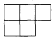
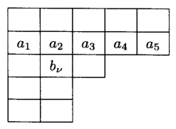
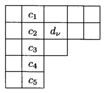

# *第六章 置换群

置换群描写全同粒子体系的置换对称性。在置换群理论中发展起来的一套杨算符方法，在近代物理中得到了广泛的应用。例如，近代物理中广泛使用着张量的概念，而张量指标间的复杂对称性质，必须用杨算符才能给出明确的描写。从数学上说，置换群是一类十分重要的有限群，因为所有有限群都同构于置换群的子群。用杨算符的方法研究置换群的表示理论，本身是一个非常美的理论，只通过几个简单的定理，就可以严格而系统地建立起置换群的整个表示理论，包括计算置换群元素的具体表示矩阵和置换群表示外积的概念。

## 6.1 置换群的一般性质

在这一节，我们首先介绍置换 (permutation)、轮换 (cycle)、对换 (transposition)、偶置换和奇置换等基本概念，然后讨论轮换的乘积公式、置换群的类、生成元和交换子群等置换群的一般性质。

**一、置换**

$n$ 个客体排列次序的变换称为置换。设原来排在第 $j$ 位置的客体，经过置换 $R$ 后排到了第 $r_j$ 位置，用一个 $2 \times n$ 矩阵来描写这一置换 $R$

$$
R=\left(\begin{array}{cccc}
1 & 2 & \cdots & n \\
r_1 & r_2 & \cdots & r_n
\end{array}\right)
\tag{6.1}
$$

对一个给定的置换，式 (6.1) 中各列的排列次序是无关紧要的，重要的是每一列上下两个数字的对应关系，也就是各客体在变换前后所处的位置关系。因此式 (6.1) 中各列次序可以任意交换，例如

$$
R=\left(\begin{array}{ccccc}
1 & 2 & 3 & 4 & 5 \\
3 & 4 & 5 & 2 & 1
\end{array}\right)=\left(\begin{array}{ccccc}
5 & 4 & 1 & 2 & 3 \\
1 & 2 & 3 & 4 & 5
\end{array}\right)
\tag{6.2}
$$

今后，常把以数字标记的客体间的置换，简单地说成数字间的置换。这样的说法通常不会引起混淆。

两个置换的乘积定义为相继做两次置换。例如，乘积 $SR$，先做 $R$ 置换，客体位置按式 (6.1) 做了重新排列，然后客体在此新排列的基础上再做 $S$ 变换。在做 $S$ 变换时，把新排列中第 $j$ 位置的客体移到第 $s_j$ 位置去，而不管这第 $j$ 位置的客体原先在 $R$ 变换之前是排在什么位置。这正是全同粒子体系的实际情况。粒子经过置换以后，只知道目前粒子排在什么位置，而“忘却”了变换前它排在什么位置。按照这一观念，在具体计算两个置换乘积 $SR$ 时，先把 $S$ 的各列排列次序进行交换，使 $S$ 的第一行的排列次序和 $R$ 的第二行次序一样，然后用 $S$ 的第二行代替 $R$ 的第二行，就得到乘积置换 $SR$. 也可以等价地，先把 $R$ 的各列排列次序进行交换，使 $R$ 的第二行的排列次序和 $S$ 的第一行次序一样，然后用 $R$ 的第一行代替 $S$ 的第一行，就得到乘积置换 $SR$. 两种方法的计算结果是完全相同的。例如

$$
S=\left(\begin{array}{ccccc}
1 & 2 & 3 & 4 & 5 \\
3 & 1 & 2 & 4 & 5
\end{array}\right)=\left(\begin{array}{ccccc}
3 & 4 & 5 & 2 & 1 \\
2 & 4 & 5 & 1 & 3
\end{array}\right),
$$

$$
SR=\left(\begin{array}{ccccc}
3 & 4 & 5 & 2 & 1 \\
2 & 4 & 5 & 1 & 3
\end{array}\right)\left(\begin{array}{ccccc}
1 & 2 & 3 & 4 & 5 \\
3 & 4 & 5 & 2 & 1
\end{array}\right)=\left(\begin{array}{ccccc}
1 & 2 & 3 & 4 & 5 \\
2 & 4 & 5 & 1 & 3
\end{array}\right)
\tag{6.3}
$$

或

$$
SR=\left(\begin{array}{ccccc}
1 & 2 & 3 & 4 & 5 \\
3 & 1 & 2 & 4 & 5
\end{array}\right)\left(\begin{array}{ccccc}
5 & 4 & 1 & 2 & 3 \\
1 & 2 & 3 & 4 & 5
\end{array}\right)=\left(\begin{array}{ccccc}
5 & 4 & 1 & 2 & 3 \\
3 & 1 & 2 & 4 & 5
\end{array}\right)
\tag{6.4}
$$

我们看到，式 (6.3) 和 (6.4) 给出的结果，每一列上下的数字关系都是相同的。例如，第 4 位置的客体经变换 $R$ 排到了第 2 位置，再经过 $S$ 变换，从第 2 位置变到第 1 位置，而式 (6.3) 和 (6.4) 给出的结果中，数字 4 下方填的数字都是 1.

置换变换虽用矩阵来描写，但置换的乘积并不服从通常的矩阵乘积规则。作为变换的乘积，两个置换的乘积仍是一个置换，置换乘积满足结合律，但不满足交换律。所有客体位置不变的置换是恒等变换 $E$，它的上下两行数字完全相同

$$
E=\left(\begin{array}{cccc}
1 & 2 & 3 & \cdots & n \\
1 & 2 & 3 & \cdots & n
\end{array}\right)
\tag{6.5}
$$

$E$ 与任何置换 $R$ 相乘仍得 $R$，起恒元的作用。把置换上下两行交换得逆置换，例如

$$
R^{-1}=\left(\begin{array}{cccc}
r_1 & r_2 & \cdots & r_n \\
1 & 2 & \cdots & n
\end{array}\right)
\tag{6.6}
$$

$$
R^{-1}R=\left(\begin{array}{cccc}
r_1 & r_2 & \cdots & r_n \\
1 & 2 & \cdots & n
\end{array}\right)\left(\begin{array}{cccc}
1 & 2 & \cdots & n \\
r_1 & r_2 & \cdots & r_n
\end{array}\right)=E
$$

$n$ 个客体共有 $n!$ 个不同的置换。按照上述置换乘积规则，$n$ 个客体的所有置换的集合满足群的四个条件，构成群，称为 $n$ 个客体置换群，记作 $\mathrm{S}_n$. $\mathrm{S}_n$ 群的阶数为 $g=n!$. 在 $n$ 个客体中任选 $m$ 个客体，这 $m$ 个客体的所有置换变换构成置换群 $\mathrm{S}_m$，它是 $\mathrm{S}_n$ 群的子群。

在文献中对置换及其乘积有不同的定义。例如，有的书把式 (6.1) 给出的置换 $R$ 定义为，第 $j$ 位置的客体“变成”第 $r_j$ 位置的客体，即原来排在第 $r_j$ 位置的客体，经过置换 $R$ 后排到了第 $j$ 位置，这种定义正好与我们的定义差一个逆变换。读者在看一本书时要注意书中采用的定义。

**二、轮换**

轮换是一类特殊的置换。如果在一个置换中，有 $n-\ell$ 个客体保持不变，而余下的 $\ell$ 个客体顺序变换，即第 $a_1$ 位置的客体排到第 $a_2$ 位置，第 $a_2$ 位置的客体排到第 $a_3$ 位置，以此类推，最后第 $a_\ell$ 位置的客体排到第 $a_1$ 位置，形成一个循环，则这样的置换称为轮换，$\ell$ 称为轮换长度。轮换常用一行矩阵来描写

$$
(a_1\ a_2\ \cdots\ a_\ell)=\left(\begin{array}{cccccccc}
a_1 & a_2 & \cdots & a_{\ell-1} & a_\ell & b_1 & \cdots & b_{n-\ell} \\
a_2 & a_3 & \cdots & a_\ell & a_1 & b_1 & \cdots & b_{n-\ell}
\end{array}\right)
\tag{6.7}
$$

在用行矩阵描写轮换时，数字的排列次序不能改变，但允许数字顺序变换

$$
(q\ a\ b\ c\ \cdots\ p)=(a\ b\ c\ \cdots\ p\ q)=(b\ c\ \cdots\ p\ q\ a)
\tag{6.8}
$$

例如

$$
\begin{aligned}
(1\ 2\ 3)=(2\ 3\ 1)=(3\ 1\ 2)&=\left(\begin{array}{ccc}
1 & 2 & 3 \\
2 & 3 & 1
\end{array}\right)\\
\ne (2\ 1\ 3)=(1\ 3\ 2)=(3\ 2\ 1)&=\left(\begin{array}{ccc}
1 & 2 & 3 \\
3 & 1 & 2
\end{array}\right)=(1\ 2\ 3)^{-1}
\end{aligned}
\tag{6.9}
$$

长度为 1 的轮换是恒等变换，长度为 2 的轮换称为对换。显然对换满足

$$
(a\ b)=(b\ a)\,,\qquad (a\ b)(a\ b)=E
\tag{6.10}
$$

推而广之，长度为 $\ell$ 的轮换，它的 $\ell$ 次自乘等于恒元 (见习题第 2 题)，即它的阶数为 $\ell$.

两个没有公共客体的轮换，乘积次序可以交换。对任一给定的置换 $R$，任选一数 $a_1$，设经过置换 $R$，第 $a_1$ 位置的客体变到第 $a_2$ 位置，第 $a_2$ 位置的客体变到第 $a_3$ 位置，以此类推，在此客体链中总会有某客体，例如第 $a_\ell$ 位置的客体变到第 $a_1$ 位置，形成一个循环，则置换 $R$ 包含一个长度为 $\ell$ 的轮换。然后，再在余下的数中任选一数 $b_1$，如上法找出它的客体链，确定 $R$ 中包含的另一个轮换。两轮换没有公共客体，因而乘积次序可以交换。把这做法继续下去，总能穷尽全部 $n$ 个数，从而把置换 $R$ 分解为若干个没有公共客体的轮换乘积。这些轮换的乘积次序可以互相交换。在这意义上说，任何置换都可以唯一地分解为没有公共客体的轮换乘积。在分解中出现的长度为 1 的轮换 (恒元) 可以略去。例如，式 (6.3) 用到的两个置换 $R$ 和 $S$ 可分别分解为

$$
R=(1\ 3\ 5)(2\ 4)=(2\ 4)(1\ 3\ 5)\,,
$$

$$
S=(1\ 3\ 2)(4)(5)=(1\ 3\ 2)
$$

把一置换分解为没有公共客体的轮换乘积时，各轮换长度 $\ell_i$ 的集合，称为该置换的轮换结构。例如，前例中，$R$ 的轮换结构是 (3 2)，$S$ 的轮换结构是 (3,1,1) = $(3,1^2)$. 在表达一个置换的轮换结构时，轮换长度 $\ell_i$ 的排列次序可以任意。相同的轮换长度可用幂次方式给出。一般说来，$n$ 个客体的任一置换 $R$ 的轮换结构可表为

$$
(\ell_1,\ell_2,\cdots)\,,\qquad \sum_i \ell_i = n
\tag{6.11}
$$

把一个正整数 $n$ 分解为若干个正整数 $\ell_i$ 之和，这样的正整数的集合称为 $n$ 的一组配分数 (partition). 置换的轮换结构是由一组配分数来描写的。

既然每一置换都可分解为没有公共客体的轮换乘积，当把两个置换相乘时，我们需要计算两个有公共客体的轮换乘积问题。通常认为，只有把置换乘积化为没有公共客体的轮换乘积时，才算把乘积化到了最简形式。

先讨论只有一个公共客体的轮换乘积的计算方法。例如

$$
\begin{aligned}
(a\ b\ c\ d)(d\ e\ f)&=\left(\begin{array}{cccccc}
a & b & c & e & f & d \\
b & c & d & e & f & a
\end{array}\right)\left(\begin{array}{cccccc}
a & b & c & d & e & f \\
a & b & c & e & f & d
\end{array}\right)\\
&=\left(\begin{array}{cccccc}
a & b & c & d & e & f \\
b & c & d & e & f & a
\end{array}\right)=(a\ b\ c\ d\ e\ f)
\end{aligned}
$$

推而广之

$$
(a\ b\ \cdots\ c\ d)(d\ e\ \cdots\ f)=(a\ b\ \cdots\ c\ d\ e\ \cdots\ f)
\tag{6.12}
$$

这公式可以做如下两种理解。从左面向右面看，式 (6.12) 提供有一个公共客体的两轮换的乘积规则：先按式 (6.8)，在每个轮换内部，把公共客体顺序变到最右面或最左面的位置，然后按式 (6.12) 把两个轮换“接”起来。从右面向左面看，式 (6.12) 提供把一个轮换分解为有一个公共客体的两轮换乘积的规则：在轮换中任一客体的位置，例如 $d$ 处，把轮换“切断”成两个轮换的乘积，并让 $d$ 同时出现在两个轮换中。

按照这样的理解，很容易利用式 (6.12) 计算有任意多个公共客体的轮换乘积问题。其基本思想就是先把轮换切断，使每一对轮换乘积都只包含一个公共客体，从而可用式 (6.12) 接起来。例如，有两个公共客体的轮换乘积可用下法计算

$$
\begin{aligned}
&(a_1\ \cdots\ a_i\ c\ a_{i+1}\ \cdots\ a_j\ d)(d\ b_1\ \cdots\ b_r\ c\ b_{r+1}\ \cdots\ b_s)\\
&\quad=(a_1\ \cdots\ a_i\ c)(c\ a_{i+1}\ \cdots\ a_j\ d)(d\ b_1\ \cdots\ b_r\ c)(c\ b_{r+1}\ \cdots\ b_s)\\
&\quad=(a_1\ \cdots\ a_i\ c)(a_{i+1}\ \cdots\ a_j\ d\ c)(c\ d\ b_1\ \cdots\ b_r)(c\ b_{r+1}\ \cdots\ b_s)\\
&\quad=(a_1\ \cdots\ a_i\ c)(a_{i+1}\ \cdots\ a_j\ d)(d\ c)(c\ d)(d\ b_1\ \cdots\ b_r)(c\ b_{r+1}\ \cdots\ b_s)\\
&\quad=(a_1\ \cdots\ a_i\ c)(a_{i+1}\ \cdots\ a_j\ d)(d\ b_1\ \cdots\ b_r)(c\ b_{r+1}\ \cdots\ b_s)\\
&\quad=(a_1\ \cdots\ a_i\ c\ b_{r+1}\ \cdots\ b_s)(a_{i+1}\ \cdots\ a_j\ d\ b_1\ \cdots\ b_r)
\end{aligned}
$$

**三、置换群的类**

从另一角度来理解两置换乘积的公式 (6.3) 和 (6.4). 式 (6.3) 告诉我们，当把 $S$ 从左面乘到 $R$ 上，其结果是把 $R$ 置换的第二行数字做 $S$ 置换。而式 (6.4) 告诉我们，当把 $R$ 从右面乘到 $S$ 上，其结果是把 $S$ 置换的第一行数字做 $R^{-1}$ 置换。结合起来，把描写 $R$ 置换的两行数字同时做 $S$ 置换，就得到 $R$ 的共轭元素 $SRS^{-1}$. 特别当 $R$ 是一个轮换时

$$
S\,(a\ b\ c\ \cdots\ d)\,S^{-1}=(s_a\ s_b\ s_c\ \cdots\ s_d)
\tag{6.13}
$$

共轭变换不改变轮换的长度，只改变轮换涉及的客体编号。因此，置换群中有相同轮换结构的元素互相共轭，它们的集合构成置换群的类。置换群的类是由置换的轮换结构 (6.11) 来描写的。

式 (6.13) 还可作另一种理解。把式 (6.13) 的 $S^{-1}$ 移到等式右面

$$
S\,(a\ b\ c\ \cdots\ d)=(s_a\ s_b\ s_c\ \cdots\ s_d)\,S
\tag{6.14}
$$

此式说明，当 $S$ 从轮换左面移到轮换右面时，轮换中的客体做 $S$ 置换；反之，当 $S$ 从轮换右面移到轮换左面时，轮换中的客体做 $S^{-1}$ 置换。把轮换换成任意置换，这结论也成立。

置换群 $\mathrm{S}_n$ 的类数等于整数 $n$ 分解为不同配分数 [见式 (6.11)] 的数目。这数目的解析表达式很难写出 (例如参考书 [1] 第一章). 但从另一方面说，这不同配分数的数目又很重要，它与置换群 $\mathrm{S}_n$ 的类数 $g_c(n)$ 直接相关。下面列出若干置换群 $\mathrm{S}_n$ 的类数 $g_c(n)$ 值。对不太大的 $n$ 值，写出所有不同的配分数的方法，将在讲到杨图时再介绍。

$$
\begin{array}{llll}
g_c(1)=1, & g_c(2)=2, & g_c(3)=3, & g_c(4)=5\\
g_c(5)=7, & g_c(6)=11, & g_c(7)=15, & g_c(8)=22\\
g_c(9)=30, & g_c(10)=42, & g_c(20)=627, & g_c(50)=204226\\
g_c(100)=190569292, & g_c(200)=3972999029388 & &
\end{array}
\tag{6.15}
$$

**四、交变子群**

在轮换每一客体处都切断，则长度为 $\ell$ 的轮换分解为 $\ell-1$ 个对换的乘积

$$
(a\ b\ c\ \cdots\ p\ q)=(a\ b)(b\ c)\cdots(p\ q)
$$

当然，这些对换有公共客体，而且这种分解不是唯一的。例如

$$
E=(a\ b)(a\ b)(b\ c)(b\ c)=(a\ b)(a\ c)(a\ b)(b\ c)
$$

同理，任何置换都可以分解为若干个对换的乘积。这种分解虽然不是唯一的，但容易证明，它包含对换个数的偶奇性与分解方式无关。为了证明这一命题，借用范德蒙德 (Vandermonde) 行列式的概念

$$
D(x_1,x_2,\cdots,x_n)=\left|\begin{array}{cccc}
1 & 1 & \cdots & 1\\
x_1 & x_2 & \cdots & x_n\\
x_1^2 & x_2^2 & \cdots & x_n^2\\
\cdots & \cdots & \cdots & \cdots\\
x_1^{n-1} & x_2^{n-1} & \cdots & x_n^{n-1}
\end{array}\right|=\prod_{i>j}(x_i-x_j)
$$

把 $x_j$ 做任何对换，行列式改变符号。但把 $n$ 个 $x_j$ 做置换 $R$，行列式是否改变符号，完全由 $R$ 本身决定，与 $R$ 的分解方式无关。另一方面，对 $R$ 的每一种分解，包含对换的偶奇性又确实决定了行列式是否改号。因此在给定 $R$ 的分解中包含对换个数的偶奇性是完全确定的。

当把置换分解为对换乘积时，对换数目是偶数的置换称为偶置换，对换数目是奇数的置换称为奇置换。长度为奇数的轮换是偶置换，长度为偶数的轮换是奇置换。两个偶置换的乘积或两个奇置换的乘积是偶置换，一个偶置换和一个奇置换的乘积是奇置换。恒元是偶置换。置换群中所有偶置换的集合构成置换群的一个指数为 2 的不变子群，称为交变 (alternating) 子群。奇置换的集合是它的陪集，商群是二阶群。因此，当 $n>1$ 时，置换群 $\mathrm{S}_n$ 都有一个反对称表示，在此表示中，偶置换对应 1，奇置换对应 $-1$. 一个置换 $R$ 在反对称表示中的数值称为它的置换宇称，记作 $\delta(R)$

$$
\delta(R)=\left\{\begin{array}{ll}
1\,, & \text{当 } R \text{ 是偶置换}\\
-1\,, & \text{当 } R \text{ 是奇置换}
\end{array}\right.
\tag{6.16}
$$

**五、置换群的生成元**

相邻客体的对换 $P_a=(a\ a+1)$ 在置换群中起着重要作用。任何置换都可表为对换的乘积，而任何对换又都可表为相邻客体的对换乘积

$$
\begin{aligned}
(a\ d)=(d\ a)&=P_{a-1}P_{a-2}\cdots P_{d+1}P_d P_{d+1}\cdots P_{a-2}P_{a-1}\\
&=P_d P_{d+1}\cdots P_{a-2}P_{a-1}P_{a-2}\cdots P_{d+1}P_d\,,\qquad d<a
\end{aligned}
\tag{6.17}
$$

$P_a$ 满足

$$
\begin{array}{l}
P_a^2=E\,,\\
P_a P_b=P_b P_a\,,\qquad \text{当 } |a-b|\geqslant 2\,,\\
P_a P_{a+1}P_a=(a\ a+2)=P_{a+1}P_a P_{a+1}
\end{array}
\tag{6.18}
$$

引入长度为 $n$ 的轮换 $W$

$$
W=(1\ 2\ \cdots\ n)\,,\qquad W^{-1}=W^{n-1}
\tag{6.19}
$$

则

$$
P_a=W P_{a-1}W^{-1}=W^{a-1}P_1 W^{-a+1}
\tag{6.20}
$$

因此，$W$ 和 $P_1$ 是置换群的生成元，置换群的秩为 2.

## 6.2 群代数的理想和幂等元

为了用杨算符方法研究置换群的不等价不可约表示，我们暂时离开置换群的讨论，介绍有限群的理想和幂等元的概念。实际上，杨算符正是置换群的原始幂等元。

**一、群代数和正则表示**

首先复习有限群群代数的概念。对阶数为 $g$ 的有限群 $G$，以群元素为基构成的 $g$ 维线性空间 $\mathcal{L}$，称为群空间，这组基称为自然基。群空间的矢量是群元素的线性组合。两矢量的乘积，系数部分做普通的复数乘积，群元素部分按照群元素的乘积规则相乘，则 $\mathcal{L}$ 对于此乘积是封闭的，构成群代数。在群代数中，群元素也可看作线性算符，它左乘或右乘到群代数的矢量上，使矢量按给定的规则发生变化。群代数是群元素算符的不变空间，对应群 $G$ 的正则表示。

正则表示是可约的，它包含群 $G$ 各不等价不可约表示的重数等于该表示的维数。这就是说，对于左乘群元素的运算，群代数中存在许多不变子代数，这样的子代数称为群代数的左理想 (left ideal). 子代数 $\mathcal{L}_1\subset\mathcal{L}$ 构成左理想的条件是对任何 $t\in\mathcal{L}$ 和 $x\in\mathcal{L}_1$，有 $tx\in\mathcal{L}_1$. 群代数可以分解为若干个左理想的直和，每个左理想对应群 $G$ 的一个表示。对于右乘群元素的运算，同样可以定义群代数的右理想。

**二、左理想和幂等元**

先从简单例子的讨论开始。设 $\mathcal{L}$ 分解为两个左理想 $\mathcal{L}_1$ 和 $\mathcal{L}_2$ 的直和

$$
\mathcal{L}=\mathcal{L}_1\oplus\mathcal{L}_2
$$

则群代数中任一矢量 $t$ 都可唯一地分解为分属两个左理想的矢量之和

$$
t=t_1+t_2\,,\qquad t\in\mathcal{L}\,,\qquad t_1\in\mathcal{L}_1\,,\qquad t_2\in\mathcal{L}_2
\tag{6.21}
$$

恒元也可做此分解

$$
E=e_1+e_2\,,\qquad e_j\in\mathcal{L}_j
\tag{6.22}
$$

而

$$
t=tE=te_1+te_2
$$

因为左理想对左乘群元素保持不变

$$
te_1\in\mathcal{L}_1\,,\qquad te_2\in\mathcal{L}_2
$$

所以

$$
t_1=te_1\,,\qquad t_2=te_2
\tag{6.23}
$$

其中，$t$ 是群代数中的任意矢量。进一步

$$
\text{若 } t\in\mathcal{L}_1\,,\qquad \text{则 } te_1=t_1=t\,,\qquad te_2=0
\tag{6.24}
$$

由此得

$$
e_1^2=e_1\,,\qquad e_2^2=e_2\,,\qquad e_1e_2=e_2e_1=0
\tag{6.25}
$$

式 (6.23)$\sim$(6.25) 告诉我们，$e_j$ 是一个投影算符，它把左乘在它上面的矢量 $t$ 投影到左理想 $\mathcal{L}_j$ 中。反过来说，把群代数所有矢量都左乘到 $e_j$ 上，就得到左理想 $\mathcal{L}_j$

$$
\mathcal{L}e_j=\mathcal{L}_j
\tag{6.26}
$$

这样的投影算符 $e_j$ 称为幂等元 (idempotent)，这样的左理想 $\mathcal{L}_j$ 称为幂等元 $e_j$ 生成的左理想。

群代数中满足下式的 $n$ 个矢量 $e_j$ 称为正交幂等元

$$
e_i e_j=\delta_{ij}e_j\,,\qquad i,j=1,2,\cdots,n
\tag{6.27}
$$

把群代数 $\mathcal{L}$ 中的任意矢量 $t$ 左乘到确定的幂等元 $e_j$ 上，得到的所有矢量 $te_j$ 的集合，构成由幂等元 $e_j$ 生成的左理想，$\mathcal{L}_j=\mathcal{L}e_j$. 由于式 (6.24)，$n$ 个左理想 $\mathcal{L}_j$ 互相都没有公共矢量，因而它们之和就是它们的直和。

对一个幂等元 $e_1$ 来说，$e_1^2=e_1$，所有 $te_1$ 的集合是左理想 $\mathcal{L}_1$，而满足 $re_1=0$ 的所有 $r$ 的集合也构成左理想 $\mathcal{L}'_1$，这两个左理想没有公共矢量，而且是互补的

$$
\mathcal{L}=\mathcal{L}_1\oplus\mathcal{L}'_1
\tag{6.28}
$$

实际上，$\mathcal{L}'_1$ 是幂等元 $(E-e_1)$ 生成的左理想。对群代数中的一般矢量 $z$ 来说，虽然所有 $tz$ 的集合构成左理想 $\mathcal{L}_z$，满足 $rz=0$ 的所有 $r$ 的集合也构成左理想 $\mathcal{L}'_z$，但这两个左理想可能有公共矢量，而且它们之和也不一定充满整个群代数 $\mathcal{L}$. 举一个极端的例子。设 $P_a$ 是相邻客体的对换，则

$$
z=(E+P_1)P_2(E-P_1)\ne 0\,,\qquad z^2=0
\tag{6.29}
$$

因此 $\mathcal{L}_z\subset\mathcal{L}'_z$，而且 $\mathcal{L}$ 中存在不属于 $\mathcal{L}'_z$ 的矢量，例如恒元。

### 三、原始幂等元

对于给定的幂等元 $e_j$，由式 (6.26) 生成左理想 $\mathcal{L}_j$，在左理想中任找一组线性无关的矢量 $x_\mu$ 为基，它的个数等于左理想的维数 $d$. 用群元素 $R$ 左乘到基上，仍是此左理想中的一个矢量，可表为这组基的线性组合

$$
R x_\mu = \sum_{\nu=1}^{d} x_\nu D_{\nu\mu}(R)
\tag{6.30}
$$

$D(R)$ 是左乘元素 $R$ 在这组基中的矩阵形式，它的集合构成群 $G$ 的一个线性表示，称为左理想 $\mathcal{L}_j$ 对应的表示。如果两个左理想对应的表示等价，则称这两个左理想等价，也称这两个幂等元等价。

在两个等价的左理想中，适当选择基，可得到相同的表示。将这样两组基及其线性组合一一对应起来，则这种对应关系对左乘群元素保持不变。反之，如果两个左理想的矢量间存在对左乘群元素保持不变的一一对应关系，则此两左理想对应的表示相同，两左理想等价。

如果左理想 $\mathcal{L}_j$ 对应可约表示，则此左理想还可用上一小节方法，进一步分解为更小的左理想之和，现在幂等元 $e_j$ 代替式 (6.22) 中的恒元，分解为若干幂等元之和

$$
\begin{aligned}
e_j &= e_a + e_b ,\\
e_a^2 &= e_a , \qquad e_b^2 = e_b , \qquad e_a e_b = e_b e_a = 0 ,\\
e_a e_j &= e_a , \qquad e_b e_j = e_b
\end{aligned}
\tag{6.31}
$$

这种分解继续进行下去，最后可使左理想对应不可约表示。对应不可约表示的左理想称为最小 (minimal) 左理想，相应的幂等元称为原始 (primitive) 幂等元。

我们引进左理想和幂等元的目的，是要研究有限群的不等价不可约表示。因此，我们需要有一个方法来判别幂等元是不是原始的，两个原始幂等元是不是等价的，以及幂等元作为投影算符的完备性问题。下面两个定理就是要解决这些问题。

**定理一** 设 $e_1$ 和 $e_2$ 是生成两个最小左理想 $\mathcal{L}_1$ 和 $\mathcal{L}_2$ 的原始幂等元，则此两最小左理想等价的充要条件是，至少存在一个群元素 $S$，满足

$$
e_1 S e_2 \neq 0
\tag{6.32}
$$

**证明** 充分性。若式 (6.32) 成立，它就提供由左理想 $\mathcal{L}_1$ 到左理想 $\mathcal{L}_2$ 的一个映射，即由左理想 $\mathcal{L}_1$ 的矢量到左理想 $\mathcal{L}_2$ 的矢量间的一个对应关系

$$
x_1 \in \mathcal{L}_1 \quad \longrightarrow \quad x_2 = x_1 e_1 S e_2 \in \mathcal{L}_2
\tag{6.33}
$$

这对应关系显然对左乘群元素保持不变，因为

$$
R x_1 \in \mathcal{L}_1 \quad \longrightarrow \quad R x_2 = R x_1 e_1 S e_2 \in \mathcal{L}_2
\tag{6.34}
$$

只要证明两左理想的矢量间的这种对应关系是一一对应关系 (双射，bijective)，则此两左理想等价。证明中主要用到两左理想都是最小左理想。

先证满射 (surjective)，就是由 $x_1$ 映射过来的 $x_2$ 充满 $\mathcal{L}_2$. 设所有这样的 $x_2$ 集合构成 $\mathcal{L}_2$ 的一个子空间 $\mathcal{L}_3$，式 (6.34) 指出，它对左乘群元素保持不变，它是左理想。因为 $x_1 = e_1 \in \mathcal{L}_1$ 时，$x_2 = e_1 S e_2 \neq 0$，所以它不是零空间，由 $\mathcal{L}_2$ 是最小左理想知，$\mathcal{L}_3 = \mathcal{L}_2$.

其次证只要 $x_1 \neq 0$，必有 $x_2 \neq 0$. 否则所有对应 $x_2 = 0$ 的那些 $x_1$ 的集合构成 $\mathcal{L}_1$ 的一个子空间 $\mathcal{L}_4$. $\mathcal{L}_4$ 对左乘群元素保持不变，是 $\mathcal{L}_1$ 的一个左理想。又因它没有包含 $e_1$，它未充满 $\mathcal{L}_1$，所以只能是零空间。

最后证单射 (injective)，就是不同的 $x_1$ 映射过来的 $x_2$ 必不相同。若 $\mathcal{L}_1$ 中的 $x_1$ 和 $x_1'$ 都映射到 $\mathcal{L}_2$ 中同一个 $x_2$，则 $x_1 - x_1'$ 映射到零矢量，矛盾。充分性证完。

必要性。设两左理想等价，$\mathcal{L}_1$ 中的幂等元 $e_1$ 对应 $\mathcal{L}_2$ 中矢量 $b = b e_2 \neq 0$，则 $e_1 e_1 = e_1$ 在 $\mathcal{L}_2$ 中对应矢量 $e_1 b = e_1 b e_2 = b \neq 0$. 因此至少有一个群元素 $S$ 满足式 (6.32). 证完。

**推论** $e_j$ 是原始幂等元的充要条件是对 $\mathcal{L}$ 中任一矢量 $t$ 都有下式成立

$$
e_j^2 = e_j , \qquad e_j t e_j = \lambda_t e_j
\tag{6.35}
$$

其中，$\lambda_t$ 是依赖于 $t$ 的常数，可以为零。

**证明** 用反证法证充分性。设式 (6.35) 成立，而 $e_j$ 不是原始的，它能分解为两幂等元之和，即式 (6.31) 成立，则

$$
\begin{aligned}
e_a &= e_j e_a e_j = \lambda_a e_j ,\\
e_a &= e_a^2 = e_a (\lambda_a e_j) = \lambda_a e_a
\end{aligned}
$$

故 $e_a = 0$ 或 $\lambda_a = 1$，即 $e_j = e_b$ 或 $e_j = e_a$，$e_j$ 不能再分解。

再证必要性。已知 $e_j$ 是原始幂等元，则 $e_j^2 = e_j$ 成立。若 $e_j t e_j = 0$，则式 (6.35) 已经成立。若 $e_j t e_j \neq 0$，则它提供 $e_j$ 生成的左理想 $\mathcal{L}_j$ 的一个自映射。映射前后两组基 $x_\mu$ 和 $x_\mu' = x_\mu e_j t e_j$，在左乘群元素中得到的表示是相同的。设 $x_\mu' = \sum_\nu x_\nu M_{\nu\mu}$，则 $M^{-1} D(R) M = D(R)$，由舒尔定理，$M$ 是常数矩阵，$x_\mu' = \lambda_t x_\mu$. 证完。

式 (6.35) 可放宽成

$$
e_j t e_j = \lambda_t e_j , \qquad e_j e_j = \lambda_E e_j \neq 0
\tag{6.36}
$$

因为 $e_j' = e_j / \lambda_E$ 满足式 (6.35). 将来我们要证明杨算符满足条件式 (6.36)，因而正比于置换群的原始幂等元，并由此建立置换群的不可约表示，然后用式 (6.32) 来判别其等价性。 **定理二** 由满足式 (6.27) 的 $n$ 个正交的幂等元 $e_j$ 生成的 $n$ 个左理想 $\mathcal{L}_j$ 之直和，等于群代数 $\mathcal{L}$ 的充要条件是

$$
E = \sum_{j=1}^{n} e_j .
\tag{6.37}
$$

**证明** 充分性。若式 (6.37) 成立，$\mathcal{L}$ 中任一矢量 $t$ 都可用下法唯一地分解为分属各 $\mathcal{L}_j$ 的矢量之和

$$
t = tE = \sum_{j=1}^{n} t e_j , \qquad t e_j \in \mathcal{L}_j
$$

因而 $\mathcal{L}$ 是 $\mathcal{L}_j$ 的直和。

必要性。因为 $\mathcal{L}$ 是 $\mathcal{L}_j$ 的直和，所以恒元 $E$ 可唯一地分解为分属各 $\mathcal{L}_j$ 的矢量之和，属 $\mathcal{L}_j$ 的矢量为 $E e_j = e_j$. 证完。

### 四、右理想和双边理想

群代数不仅对左乘群元素保持不变，对右乘群元素也保持不变。如果 $\mathcal{L}$ 的子代数 $\mathcal{R}_j$ 对右乘群元素保持不变，则称右理想。前面关于左理想的定义，定理和各种性质，都很容易推广并适合于右理想。应该注意的是，由左理想的基计算表示的公式 (6.30)，对右理想必须做适当的修改，否则正如 3.1 节所讨论的，会变成内禀群的表示。设 $\mathcal{R}_j = e_j \mathcal{L}$ 是幂等元 $e_j$ 生成的右理想，取 $\mathcal{R}_j$ 的一组基 $x_\mu$，在群元素 $R$ 的右乘作用下，按式 (3.10) 得

$$
x_\mu R = \sum_{\nu} D_{\mu\nu}(R) x_\nu
\tag{6.38}
$$

正因为式 (6.38) 改为按 $D(R)$ 的列指标求和，才使由式 (6.38) 建立起来的群元素 $R$ 和矩阵 $D(R)$ 间的一一或多一对应关系，它们的乘积仍按同一规则对应，从而 $D(R)$ 的集合构成群 $G$ 的线性表示。

一般说来，由同一个幂等元 $e_j$ 生成的左理想 $\mathcal{L}_j$ 和右理想 $\mathcal{R}_j$ 不一定相同。如果它们相同

$$
\mathcal{L} e_j = \mathcal{L}_j , \qquad e_j \mathcal{L} = \mathcal{R}_j , \qquad \mathcal{L}_j = \mathcal{R}_j = \mathcal{I}_j
\tag{6.39}
$$

则 $\mathcal{I}_j$ 称为由幂等元 $e_j$ 生成的双边理想 (two-side ideal)

$$
t e_j \in \mathcal{I}_j , \qquad e_j t \in \mathcal{I}_j
\tag{6.40}
$$

如果双边理想不能再分解为更小的子双边理想的直和，则此双边理想称为单纯 (simple) 的双边理想。

### 五、标准基和不可约表示

把群代数 $\mathcal{L}$ 分解为一系列最小左理想 $\mathcal{L}_\mu^{(j)}$ 的直和，其中等价的左理想标以相同的上标 $(j)$. 把等价的左理想 $\mathcal{L}_\mu^{(j)}$ 先直和起来，记作 $\mathcal{L}^{(j)}$，然后再直和成群代数。恒元也做相应的分解

$$
\begin{aligned}
\mathcal{L} &= \bigoplus_j \mathcal{L}^{(j)} = \bigoplus_{j\mu} \mathcal{L}_\mu^{(j)} , \qquad \mathcal{L}^{(j)} = \bigoplus_\mu \mathcal{L}_\mu^{(j)} ,\\
E &= \sum_j e^{(j)} = \sum_{j\mu} e_\mu^{(j)} , \qquad e^{(j)} = \sum_\mu e_\mu^{(j)}
\end{aligned}
\tag{6.41}
$$

其中

$$
\begin{aligned}
&\mathcal{L}^{(j)} = \mathcal{L} e^{(j)} , \qquad \mathcal{L}_\mu^{(j)} = \mathcal{L} e_\mu^{(j)} ,\\
&e_\mu^{(j)} e_\nu^{(i)} = \delta_{ji} \delta_{\mu\nu} e_\mu^{(j)} , \qquad e_\mu^{(j)} t e_\nu^{(i)} = \delta_{ji} e_\mu^{(j)} t e_\nu^{(j)} , \qquad t \in \mathcal{L}
\end{aligned}
\tag{6.42}
$$

现在我们来证明，满足 (6.41) 和 (6.42) 式的 $\mathcal{L}^{(j)}$ 是单纯的双边理想。

**定理三** 设 $D^j(G)$ 是有限群 $G$ 的 $d_j$ 维不可约表示，$e_\mu^{(j)}$ 是群 $G$ 的群代数 $\mathcal{L}$ 中 $d_j$ 个互相等价的正交原始幂等元，由它们生成的最小左理想 $\mathcal{L}_\mu^{(j)} = \mathcal{L} e_\mu^{(j)}$ 都对应表示 $D^j(G)$，则 $d_j$ 个最小左理想 $\mathcal{L}_\mu^{(j)}$ 的直和 $\mathcal{L}^{(j)}$ 是群代数 $\mathcal{L}$ 中的单纯双边理想，而且由 $e_\mu^{(j)}$ 生成的 $d_j$ 个最小右理想 $\mathcal{R}_\mu^{(j)} = \mathcal{L} e_\mu^{(j)}$ 的直和也是 $\mathcal{L}^{(j)}$

$$
\mathcal{L}^{(j)} = \mathcal{L} e^{(j)} = e^{(j)} \mathcal{L} = \bigoplus_\mu \mathcal{L}_\mu^{(j)} = \bigoplus_\mu \mathcal{R}_\mu^{(j)}
\tag{6.43}
$$

**证明** 首先，证明 $\mathcal{L}^{(j)}$ 也是右理想。设 $t$ 是 $\mathcal{L}$ 中任一矢量，则

$$
e^{(j)} t = e^{(j)} t E = \sum_{\mu i \nu} e_\mu^{(j)} t e_\nu^{(i)} = \sum_\nu \left( \sum_\mu e_\mu^{(j)} t \right) e_\nu^{(j)} \in \mathcal{L}^{(j)}
\tag{6.44}
$$

同样可证 $d_j$ 个最小右理想 $\mathcal{R}_\mu^{(j)}$ 的直和也是左理想，因而等于 $\mathcal{L}^{(j)}$.

其次，用反证法证明双边理想 $\mathcal{L}^{(j)}$ 是单纯的。因为 $\mathcal{L}^{(j)}$ 中包含的所有最小左理想都对应同一个不可约表示，所以若 $\mathcal{I}$ 是 $\mathcal{L}^{(j)}$ 的子双边理想，则它包含的最小左理想都对应此不可约表示。取 $\mathcal{I}$ 的一个最小左理想，幂等元为 $e$，则由定理一，对每一个 $\mu$ 至少存在一个群元素 $R_\mu$，使 $e R_\mu e_\mu^{(j)} \neq 0$. 它既属于双边理想 $\mathcal{I}$，又属于最小左理想 $\mathcal{L}_\mu^{(j)}$. 既然 $\mathcal{I}$ 至少包含 $\mathcal{L}^{(j)}$ 中每一个最小左理想 $\mathcal{L}_\mu^{(j)}$ 中的一个矢量，左乘群代数 $\mathcal{L}$ 后，$\mathcal{I}$ 就包含这些最小左理想全体，即 $\mathcal{I} = \mathcal{L}^{(j)}$. 以后把 $\mathcal{L}^{(j)}$ 记作 $\mathcal{I}^{(j)}$. 证完。

**推论一** 群代数 $\mathcal{L}$ 中所有等价的最小左 (或右) 理想之和是单纯双边理想。群代数关于单纯双边理想的分解是唯一的。

我们讨论幂等元的目的是寻找有限群 $G$ 的所有不等价不可约表示。现在我们来具体研究基的标准选择和不可约表示矩阵的计算方法。这方法将直接帮助我们计算置换群的不等价不可约表示。本小节后面部分只在单纯双边理想 $\mathcal{I}^{(j)}$ 内计算基和不可约表示，为了简化符号，略去所有上标 $(j)$ 和下标 $(j)$.

由定理一，一定存在群元素 $R_\nu$，使下面定义的矢量 $b_{\nu 1}$ 不等于零

$$
b_{\nu 1} = e_\nu R_\nu e_1 \neq 0 , \qquad b_{11} = e_1
\tag{6.45}
$$

其中，已取 $R_1 = E$. 因为 $d$ 个 $b_{\nu 1}$ 分属于不同的右理想 $\mathcal{R}_\nu$，所以它们线性无关。这 $d$ 个线性无关的矢量 $b_{\nu 1}$ 正好组成左理想 $\mathcal{L}_1$ 的一组基，左乘群元素 $T$ 后可以得到 $T$ 在此不可约表示中的表示矩阵 $D(T)$

$$
T b_{\nu 1} = \sum_{\rho=1}^{d} b_{\rho 1} D_{\rho\nu}(T)
\tag{6.46}
$$

同理，存在 $d$ 个元素 $S_\mu$，$S_1 = E$，使

$$
e_1 S_\mu e_\mu \equiv b'_{1\mu} \neq 0
$$

用这组矢量 $b'_{1\mu}$ 把 $\mathcal{L}_1$ 的基 $b_{\nu 1}$ 映射到 $\mathcal{L}_\mu$ 中去，按照定理一的证明，映射得的矢量不为零

$$
b'_{\nu\mu} = b_{\nu 1} b'_{1\mu} \neq 0
$$

由定理一的推论

$$
b'_{\mu\mu} = b_{\mu 1} b'_{1\mu} = e_\mu (R_\mu e_1 S_\mu) e_\mu = \lambda_\mu e_\mu \neq 0
$$

令

$$
b_{1\mu} = b'_{1\mu} / \lambda_\mu , \qquad b_{\nu\mu} = b_{\nu 1} b_{1\mu} \neq 0
\tag{6.47}
$$

则

$$
b_{\mu\mu} = b_{\mu 1} b_{1\mu} = e_\mu
\tag{6.48}
$$

又由定理一的推论，$b_{1\mu} b_{\mu 1} = \tau_\mu e_1$，且

$$
b_{\mu 1} = b_{\mu\mu} b_{\mu 1} = b_{\mu 1} (b_{1\mu} b_{\mu 1}) = \tau_\mu b_{\mu 1}
$$

因此

$$
\tau_\mu = 1 , \qquad b_{1\mu} b_{\mu 1} = e_1 = b_{11}
\tag{6.49}
$$

$$
b_{\nu\rho} b_{\lambda\mu} = \delta_{\rho\lambda} b_{\nu 1} b_{1\rho} b_{\rho 1} b_{1\mu} = \delta_{\rho\lambda} b_{\nu\mu}
\tag{6.50}
$$

满足式 (6.48) 和 (6.50) 的基 $b_{\nu\mu}$ 称为标准基。当 $\mu$ 固定，$d$ 个基 $b_{\nu\mu}$ 属于左理想 $\mathcal{L}_\mu$，当 $\nu$ 固定，$d$ 个基 $b_{\nu\mu}$ 属于右理想 $\mathcal{R}_\nu$. 下面证明，在标准基中，每个左理想和右理想都对应相同的表示。事实上，在式 (6.46) 两边右乘 $b_{1\rho}$，得

$$
T b_{\mu\rho} = \sum_{\nu=1}^{d} b_{\nu\rho} D_{\nu\mu}(T)
\tag{6.51}
$$

可见在标准基中，所有左理想对应的表示相同。再在式 (6.46) 两边左乘 $b_{1\rho}$，得

$$
b_{1\rho} T b_{\mu 1} = e_1 D_{\rho\mu}(T)
\tag{6.52}
$$

如果在右理想 $\mathcal{R}_\nu$ 中的表示是 $\overline{D}(T)$，则由式 (6.38)

$$
b_{\nu\rho} T = \sum_{\lambda=1}^{d} \overline{D}_{\rho\lambda}(T) b_{\nu\lambda}
\tag{6.53}
$$

左乘 $b_{1\nu}$ 和右乘 $b_{\mu 1}$，得

$$
b_{1\rho} T b_{\mu 1} = e_1 \overline{D}_{\rho\mu}(T)
$$

可见 $D_{\rho\mu}(T) = \overline{D}_{\rho\mu}(T)$. 证完。

**推论二** 在群代数 $\mathcal{L}$ 的单纯双边理想 $\mathcal{I}^{(j)}$ 中包含的所有最小左理想 $\mathcal{L}_\mu^{(j)}$ 和最小右理想 $\mathcal{R}_\mu^{(j)}$ 都对应同一个不可约表示 $D^j(G)$.

**推论三** 由群代数 $\mathcal{L}$ 中的一个原始幂等元 $e_j$ 生成的最小左理想 $\mathcal{L} e_j$ 和最小右理想 $e_j \mathcal{L}$ 都对应同一个不可约表示 $D^j(G)$.

## 6.3 杨图、杨表和杨算符

在这一节我们将给出杨算符的定义和讨论它的基本性质，为下一节证明杨算符是置换群的原始幂等元打好基础。

### 一、杨图

有限群的不等价不可约表示个数等于类数。置换群 $S_n$ 的类由 $n$ 的配分数描写，因而置换群的不等价不可约表示也可用配分数来描写。但是由相同配分数描写的类和不可约表示没有什么关系，它们在符号上应该有所区别。置换群的类用配分数 $(\ell)$ 描写，而不可约表示对应的配分数记作 $[\lambda]$. 我们先用 $[\lambda]$ 来定义杨图，以后再证明杨图对应置换群的不可约表示。

任取一组配分数 $[\lambda]$

$$
[\lambda] = [\lambda_1, \lambda_2, \cdots, \lambda_m] , \qquad \lambda_1 \geqslant \lambda_2 \geqslant \cdots \geqslant \lambda_m > 0 , \qquad \sum_{j=1}^{m} \lambda_j = n
\tag{6.54}
$$

画 $n$ 格方格图，分成 $m$ 行，左边对齐，第一行含 $\lambda_1$ 格，第二行含 $\lambda_2$ 格，以此类推，这样的方格图称为杨图 (Young pattern or diagram). 在杨图中，上面行的格数不少于下面行的格数，左面列的格数不少于右面列的格数。杨图的行数 $m$ 不会大于总格数 $n$. 有时为了强调这一规则，称它为正则杨图，其实我们不讨论不满足此规则的杨图。

希望读者都能学会，根据配分数 $[\lambda]$ 画出杨图，根据杨图读出配分数，对给定的 $n$，列出全部不同杨图的方法。前两条比较容易，例如配分数为 $[3,2]$ 时，杨图为



以后不再区分杨图和配分数，常说杨图 $[\lambda]$. 对第三条，最重要的是必须按一定次序来排列这些杨图或配分数，切忌想到一个写一个，这样很容易遗漏。为此，我们定义杨图的大小。对两杨图 $[\lambda]$ 和 $[\lambda']$，由第一行开始逐行比较它们的格数，第一次出现格数不相同时，格数大的杨图大于格数小的杨图。对给定的 $n$，自大而小排列杨图。首先让 $\lambda_1$ 由 $n$ 开始自大而小排列，然后，在固定 $\lambda_1$ 的条件下，让 $\lambda_2$ 自大而小排列，但最大不超过 $\lambda_1$ 和 $n - \lambda_1$，再在固定 $\lambda_1$ 和 $\lambda_2$ 的条件下，让 $\lambda_3$ 自大而小排列，但最大不超过 $\lambda_2$ 和 $n - \lambda_1 - \lambda_2$，以此类推。例如，$n = 7$ 时有 15 组配分数，它们作如下排列

$$
\begin{matrix}
[7], & [6,1], & [5,2], & [5,1,1] \\
[4,3], & [4,2,1], & [4,1,1,1], & [3,3,1] \\
[3,2,2], & [3,2,1,1], & [3,1,1,1,1], & [2,2,2,1] \\
[2,2,1,1,1], & [2,1,1,1,1,1], & [1,1,1,1,1,1,1]
\end{matrix}
\tag{6.55}
$$

### 二、杨表

对于给定的杨图 $[\lambda]$，把由 1 到 $n$ 这 $n$ 个自然数分别填入杨图的 $n$ 格中，就得到一个杨表 (Young tableau). 有的书上把杨表译成杨盘。 $n$ 格的杨图有 $n!$ 个不同的杨表。

如果在杨表的每一行中，左面的填数小于右面的填数，在每一列中，上面的填数小于下面的填数，则此杨表称为正则 (standard) 杨表。这种数字填充法称为正则填充法。数学上可以证明，对于给定的杨图 $[\lambda]$，不同的正则杨表数为

$$
d_{[\lambda]}(S_n) = \frac{n!}{r_1! r_2! \cdots r_m!} \prod_{j<k}^{m} (r_j - r_k)
\tag{6.56}
$$

其中，$r_j = \lambda_j + m - j$. 所有 $n$ 格杨图的正则杨表数的平方和正好等于 $n!$

$$
\sum_{[\lambda]} \left[ d_{[\lambda]}(S_n) \right]^2 = n!
\tag{6.57}
$$

证明可参看参考书 [12] 第 IV 章 § 6. 在用式 (6.56) 计算正则杨表数 $d_{[\lambda]}$ 时，分子分母会消掉不少因子，例如对杨图 $[3,2,1,1]$

$$
d_{[3,2,1,1]}(S_7) = \frac{7!}{6! \times 4! \times 2! \times 1!} 5 \times 4 \times 2 \times 3 \times 2 \times 1 = 35
$$

有一个称为钩形 (hook) 规则的方法，可以更方便地计算 $d_{[\lambda]}$. 对杨图的第 $i$ 行第 $j$ 列格子定义钩形数 $h_{ij}$，它等于一条钩形路径在杨图中经过的格子数，这条路径从杨图第 $i$ 行最右面的格子处进入杨图，向左走到第 $i$ 行第 $j$ 列格子处向下转弯，然后在第 $j$ 列最下面的格子处离开杨图。一个格子的钩形数就等于该格所在行左面的格子数，加上该格所在列下面的格子数，再加 1. 把每格的钩形数 $h_{ij}$ 填入杨图，构成的杨表称为钩形数杨表，记作 $Y_h^{[\lambda]}$. 例如，杨图 $[3,2,1,1]$ 的钩形数杨表 $Y_h^{[\lambda]}$ 为

$$
\begin{array}{ccc}
6 & 3 & 1\\
4 & 1 & \\
2 & & \\
1 & &
\end{array}
$$

而 $d_{[\lambda]}$ 等于 $n!$ 被所有钩形数 $h_{ij}$ 除

$$
d_{[\lambda]}(S_n) = \frac{n!}{Y_h^{[\lambda]}} = \frac{n!}{\prod_{ij} h_{ij}}
\tag{6.58}
$$

例如

$$
d_{[3,2,1,1]}(S_7) = \frac{7!}{6 \times 4 \times 3 \times 2} = 35
$$

式 (6.56) 和 (6.58) 是一致的，因为容易验证，第一行的钩形数乘积正好等于 $r_1! / \prod_{k>1}^{m} (r_1 - r_k)$，以此类推。

下面对同一杨图，定义两正则杨表的大小。自第一行开始自左至右比较两杨表的填数，如果都相同，再比较第二行，第三行等，第一次发现填数不同时，填数大的正则杨表大于填数小的正则杨表。这种填数的比较，相当把第二行填数补在第一行的右边，把第三行的填数再补在右边，依此类推，构成一个含 $n$ 个数字的 $(n+1)$ 进位数，然后比较这数的大小，因此文献中把这正则杨表的大小次序称为字典次序 (dictionary order). 按照正则杨表自小至大排列，就能把给定杨图的所有正则杨表准确无误地全部列出来。例如，杨图 $[3,2]$ 的全部正则杨表自小至大排列如下

$$
\begin{matrix} 1 & 2 & 3 \\ 4 & 5 & \end{matrix} , \quad
\begin{matrix} 1 & 2 & 4 \\ 3 & 5 & \end{matrix} , \quad
\begin{matrix} 1 & 2 & 5 \\ 3 & 4 & \end{matrix} , \quad
\begin{matrix} 1 & 3 & 4 \\ 2 & 5 & \end{matrix} , \quad
\begin{matrix} 1 & 3 & 5 \\ 2 & 4 & \end{matrix}
$$

用公式 (6.58) 计算也得 5

$$
d_{[3,2]}=\frac{5!}{\begin{array}{|c|c|c|}
\hline 4 & 3 & 1 \\ \hline
2 & 1 & \\ \hline
\end{array}}=5
$$

**三、杨算符**

对于给定的杨表，同行数字间的置换称为该杨表的横向置换，记作 $P$，如果横向置换只牵涉到第 $j$ 行数字，则记作 $P_j$，这样的第 $j$ 行横向置换 $P_j$ 共有 $\lambda_j!$ 个。相似地，对于给定的杨表，同列数字间的置换称为该杨表的纵向置换，记作 $Q$，如果纵向置换只牵涉到第 $k$ 列数字，记作 $Q_k$，若第 $k$ 列有 $\tau_k$ 格，则这样的第 $k$ 列纵向置换 $Q_k$ 共有 $\tau_k!$ 个。

对于给定的杨表，所有横向置换之和称为该杨表的横算符，记作 $\mathcal{P}$，所有纵向置换乘其置换宇称后相加，称为该杨表的纵算符，记作 $\mathcal{Q}$，该杨表的杨算符 $\mathcal{Y}$ 定义为 $\mathcal{P}$ 和 $\mathcal{Q}$ 的乘积

$$
\begin{aligned}
P&=\prod_j P_j\ ,\qquad Q=\prod_k Q_k\ ,\qquad \delta(Q)Q=\prod_k \delta(Q_k)Q_k\ ,\\
\mathcal{P}&=\sum P=\sum\prod_j P_j=\prod_j\Big(\sum P_j\Big)\ ,\\
\mathcal{Q}&=\sum \delta(Q)Q=\sum\prod_k \delta(Q_k)Q_k=\prod_k\Big[\sum \delta(Q_k)Q_k\Big]\ ,
\end{aligned}
\tag{6.59}
$$

$$
\mathcal{Y}=\mathcal{P}\mathcal{Q}
\tag{6.60}
$$

正则杨表对应的杨算符称为正则杨算符。

因为只有在杨图给定，杨表给定的条件下，才能具体写出杨算符 $\mathcal{Y}$，所以通常把对应这个杨算符 $\mathcal{Y}$ 的杨图和杨表，就称为杨图 $\mathcal{Y}$ 和杨表 $\mathcal{Y}$. 如果单独说 $\mathcal{Y}$，则指杨算符本身。请注意不要混淆。

在具体写出给定杨表的横算符时，通常先把每一行的所有横向置换加起来，然后把不同行的横向置换之和乘起来。同理，在具体写出给定杨表的纵算符时，先把每一列的所有纵向置换，乘上各自的置换宇称后相加，然后把不同列的纵向置换之代数和乘起来。对于只有一格的行（或列），横（纵）向置换只有恒元，在相乘时可以略去。最后再把乘积的每一项都化成没有公共客体的轮换乘积。注意，不要忽略乘积的交叉项。下面例子是根据杨表写出杨算符的标准方法。设有杨表

$$
\begin{array}{|c|c|c|}
\hline 1 & 2 & 3 \\ \hline
4 & 5 & \\ \hline
\end{array}
$$

$$
\begin{aligned}
\mathcal{Y}=&\ \{E+(1\,2)+(1\,3)+(2\,3)+(1\,2\,3)+(3\,2\,1)\}\\
&\times\{E+(4\,5)\}\{E-(1\,4)\}\{E-(2\,5)\}
\end{aligned}
$$

$$
\begin{aligned}
={}&\{E+(1\,2)+(1\,3)+(2\,3)+(1\,2\,3)+(3\,2\,1)\}\\
&\times\{E+(4\,5)\}\{E-(2\,5)-(1\,4)+(1\,4)(2\,5)\}\\
={}&\{E+(1\,2)+(1\,3)+(2\,3)+(1\,2\,3)+(3\,2\,1)\}\\
&\times\{E-(2\,5)-(1\,4)+(1\,4)(2\,5)+(4\,5)-(4\,5\,2)-(5\,4\,1)+(4\,1\,5\,2)\}\\
={}&\{E-(2\,5)-(1\,4)+(1\,4)(2\,5)+(4\,5)-(4\,5\,2)-(5\,4\,1)+(4\,1\,5\,2)\}\\
&+\{(1\,2)-(1\,2\,5)-(2\,1\,4)+(1\,4\,2\,5)+(1\,2)(4\,5)-(1\,2\,4\,5)-(2\,1\,5\,4)\\
&+(1\,5)(2\,4)\}+\{(1\,3)-(1\,3)(2\,5)-(3\,1\,4)+(3\,1\,4)(2\,5)+(1\,3)(4\,5)\\
&-(1\,3)(4\,5\,2)-(3\,1\,5\,4)+(3\,1\,5\,2\,4)\}+\{(2\,3)-(3\,2\,5)-(2\,3)(1\,4)\\
&+(1\,4)(3\,2\,5)+(2\,3)(4\,5)-(3\,2\,4\,5)-(2\,3)(5\,4\,1)+(3\,2\,4\,1\,5)\}\\
&+\{(1\,2\,3)-(1\,2\,5\,3)-(2\,3\,1\,4)+(1\,4\,2\,5\,3)+(1\,2\,3)(4\,5)-(1\,2\,4\,5\,3)\\
&-(2\,3\,1\,5\,4)+(2\,4)(1\,5\,3)\}+\{(3\,2\,1)-(3\,2\,5\,1)-(3\,2\,1\,4)\\
&+(3\,2\,5\,1\,4)+(3\,2\,1)(4\,5)-(3\,2\,4\,5\,1)-(3\,2\,1\,5\,4)+(1\,5)(3\,2\,4)\}
\end{aligned}
\tag{6.61}
$$

由置换群共轭元素的性质 (6.13) 知，若置换 $S$ 把杨表 $\mathcal{Y}$ 变成杨表 $\mathcal{Y}'$，则相应的杨算符及其横向置换和纵向置换都满足共轭关系 $\mathcal{Y}'=S\mathcal{Y}S^{-1}$，$P'=SPS^{-1}$，$Q'=SQS^{-1}$. 由两个给定的杨表，这样的置换变换 $S$ 是很容易确定的。只要按相同的次序，把杨表 $\mathcal{Y}$ 的填数列在 $S$ 的第一行，把杨表 $\mathcal{Y}'$ 的填数列在 $S$ 的第二行，就唯一确定了这置换变换 $S$. 例如

杨表 $\mathcal{Y}=\begin{array}{|c|c|c|}\hline 1 & 3 & 5\\ \hline 2 & 4 & \\ \hline \end{array}$ $\qquad$ 杨表 $\mathcal{Y}'=\begin{array}{|c|c|c|}\hline 1 & 2 & 3\\ \hline 4 & 5 & \\ \hline \end{array}$

$$
S=\left(\begin{array}{ccccc}
1 & 3 & 5 & 2 & 4 \\
1 & 2 & 3 & 4 & 5
\end{array}\right)
$$

$$
S\mathcal{Y}S^{-1}=\mathcal{Y}'\ ,\qquad S\mathcal{P}S^{-1}=\mathcal{P}'\ ,\qquad S\mathcal{Q}S^{-1}=\mathcal{Q}'
\tag{6.62}
$$

根据杨算符的定义式 (6.60)，也可直接从式 (6.61) 中看到，杨算符是置换群元素的代数和，是置换群群代数的矢量

$$
\mathcal{Y}=\sum_{R\in S_n} F(R)R
\tag{6.63}
$$

其中，$F(R)$ 只能取 1，-1 和 0. 横向置换 $P$ 和恒元 $E$ 的系数为 1，纵向置换 $Q$ 和 $PQ$ 的系数为 $Q$ 的置换宇称 $\delta(Q)$

$$
F(E)=F(P)=\delta(Q)F(Q)=\delta(Q)F(PQ)=1
\tag{6.64}
$$

这些系数不为零的置换群元素称为属于杨表 $\mathcal{Y}$ 的元素，也称属于杨算符 $\mathcal{Y}$ 的元素，而系数为零的其他元素则称为不属于杨表 $\mathcal{Y}$ 或不属于杨算符 $\mathcal{Y}$ 的元素。但是任意给出一个置换变换 $R$，如何判别它是否属于某杨表 $\mathcal{Y}$ 或某杨算符 $\mathcal{Y}$ 呢？下面两小节会提供一些简单的判据。

**四、杨算符的基本对称性质**

对给定的杨表，在按式 (6.59) 写出横算符 $\mathcal{P}$ 时，所有横向置换都已加起来，因而根据群的重排定理，它对左乘或右乘横向置换保持不变。同理，纵算符 $\mathcal{Q}$ 对左乘或右乘纵向置换，除了产生一个置换宇称的因子外，也保持不变

$$
\mathcal{P}P=P\mathcal{P}=\mathcal{P}\ ,\qquad \mathcal{Q}Q=Q\mathcal{Q}=\delta(Q)\mathcal{Q}
\tag{6.65}
$$

而杨算符 $\mathcal{Y}$ 只能对左乘横向置换保持不变，对右乘纵向置换产生一个置换宇称

$$
P\mathcal{Y}=\delta(Q)\mathcal{Y}Q=\delta(Q)P\mathcal{Y}Q=\mathcal{Y}
\tag{6.66}
$$

这是杨算符最基本的对称性质。除了 $F(E)=1$ 外，杨算符展开式系数的关系式 (6.64)，可以直接从此对称性质推得。设 $\mathcal{Y}$ 有展开式 (6.63)，左乘 $P^{-1}$ 或右乘 $Q^{-1}$，得

$$
\begin{aligned}
P^{-1}\mathcal{Y}&=\sum_{R\in S_n} F(R)P^{-1}R=\sum_{S\in S_n} F(PS)S\\
&=\mathcal{Y}=\sum_{S\in S_n} F(S)S\\
\mathcal{Y}Q^{-1}&=\sum_{R\in S_n} F(R)RQ^{-1}=\sum_{S\in S_n} F(SQ)S\\
&=\delta(Q)\mathcal{Y}=\sum_{S\in S_n} \delta(Q)F(S)S
\end{aligned}
$$

故

$$
F(S)=F(PS)=\delta(Q)F(SQ)=\delta(Q)F(PSQ)
\tag{6.67}
$$

取 $S=E$，并添上条件 $F(E)=1$，就得到式 (6.64).

福克 (Fock) 发现杨算符还有另一个重要对称性质，称为福克条件。

设杨表 $\mathcal{Y}$ 中第 $j$ 行和第 $j'$ 行分别有 $\lambda$ 和 $\lambda'$ 格，$\lambda\geqslant\lambda'$，填入这两行的数分别记作 $a_\mu$ 和 $b_\nu$，则

$$
\left\{E+\sum_{\mu=1}^{\lambda}(a_\mu b_\nu)\right\}\mathcal{Y}=0
\tag{6.68}
$$

设杨表 $\mathcal{Y}$ 中第 $k$ 列和第 $k'$ 列分别有 $\tau$ 和 $\tau'$ 格，$\tau\geqslant\tau'$，填入这两列的数分别记作 $c_\mu$ 和 $d_\nu$，则

$$
\mathcal{Y}\left\{E-\sum_{\mu=1}^{\tau}(c_\mu d_\nu)\right\}=0
\tag{6.69}
$$

下面举个例子说明式中数字的填充位置。  $\qquad\qquad$ 

**证明** 两个福克条件的证明方法是类似的，我们以式 (6.68) 为例来证明。用 $\left(\sum P_j\right)$ 和 $\left(\sum P_{j'}\right)$ 分别表第 $j$ 行和第 $j'$ 行所有横向置换之和，而 $\mathcal{P}'$ 表不含此两行数字的所有横向置换之和，则

$$
\mathcal{Y}=\mathcal{P}\mathcal{Q}=\left(\sum P_j\right)\left(\sum P_{j'}\right)\mathcal{P}'\mathcal{Q}
$$

$\left(\sum P_j\right)$ 共含 $\lambda!$ 项，它是填在第 $j$ 行的数字的所有置换变换之和，称为这些数字的全对称算符。将它右乘到 $\left\{E+\sum_\mu (a_\mu b_\nu)\right\}$ 上，得 $(\lambda+1)!$ 项。容易看出这 $(\lambda+1)!$ 项中没有重复元素，因而它是 $\lambda+1$ 个数字的所有置换变换之和，是 $\lambda+1$ 个数字的全对称算符。这 $\lambda+1$ 个数字，除了排在第 $j$ 行的数字外，还添上数字 $b_\nu$. 把这全对称算符记作 $\left[\sum P_j(b_\nu)\right]$. 当把 $\left(\sum P_{j'}\right)$ 中的每一项 $P_{j'}$ 从这对称算符的右面移到左面去时，根据式 (6.14)，其效果只是把对称算符中的 $b_\nu$ 换成第 $j'$ 行的另一个数字 $b_\rho$，$b_\rho$ 也可能和 $b_\nu$ 相同

$$
\left[\sum P_j(b_\nu)\right]P_{j'}=P_{j'}\left[\sum P_j(b_\rho)\right]
\tag{6.70}
$$

这算符可以与 $\mathcal{P}'$ 对易，而容易证明它与 $\mathcal{Q}$ 相乘得零。事实上，由于 $\lambda\geqslant\lambda'$，在第 $j$ 行必存在与 $b_\rho$ 在同一列的数字 $a_\rho$. 对换 $(a_\rho b_\rho)$ 与对称算符 $\left[\sum P_j(b_\rho)\right]$ 相乘保持后者不变，但与 $\mathcal{Q}$ 相乘则改变 $\mathcal{Q}$ 的符号

$$
\left[\sum P_j(b_\rho)\right]\mathcal{Q}=\left[\sum P_j(b_\rho)\right](a_\rho b_\rho)\mathcal{Q}=-\left[\sum P_j(b_\rho)\right]\mathcal{Q}=0
\tag{6.71}
$$

证完。

福克条件中并不要求 $j<j'$，但当 $j<j'$ 时必有 $\lambda\geqslant\lambda'$. 反之，当 $j>j'$ 时还是有可能 $\lambda=\lambda'$. 例如，上图中，若把 $b_\nu$ 取在第一行，福克条件 (6.68) 仍是成立的。对式 (6.69) 情况也类似。

从福克条件 (6.68) 的证明中我们看到，从杨算符 $\mathcal{Y}$ 的左面看，杨算符只对第 $j$ 行的 $\lambda$ 个客体是全对称的，现在从左面乘上因子 $\left\{E+\sum_\mu (a_\mu b_\nu)\right\}$，等于强迫 $b_\nu$ 和第 $j$ 行客体，共 $\lambda+1$ 个客体全对称化，福克条件 (6.68) 指出这样做会得零。福克条件 (6.69) 则指出，从杨算符 $\mathcal{Y}$ 的右面，强迫 $d_\nu$ 和第 $k$ 列客体，共 $\tau+1$ 个客体全反对称化，这样做也会得零。 **五、杨算符的乘积**

如果杨算符 $\mathcal{Y}'$ 和 $\mathcal{Y}$ 相乘得零，即

$$
\mathcal{Y}'\mathcal{Y}=0
\tag{6.72}
$$

并不意味着交换次序后相乘仍得零，即

$$
\mathcal{Y}\mathcal{Y}'=0
\tag{6.73}
$$

只有当两式都成立时，才称两杨算符正交。式 (6.71) 已提供判断两杨算符相乘为零的一个方法。

**定理四**　若 $T_0$ 同时是杨算符 $\mathcal{Y}=\mathcal{P}\mathcal{Q}$ 的横向对换和杨算符 $\mathcal{Y}'=\mathcal{P}'\mathcal{Q}'$ 的纵向对换，则

$$
\mathcal{Y}'\mathcal{Y}=0\ ,\qquad \mathcal{Q}'\mathcal{P}=0\ .
\tag{6.74}
$$

**证明**　$\mathcal{Q}'\mathcal{P}=\mathcal{Q}'T_0\mathcal{P}=-\mathcal{Q}'\mathcal{P}=0$. 证完。

这里和以后，加下标零以强调 $T_0$ 是对换。如果存在一对数 $a$ 和 $b$，它们在杨表 $\mathcal{Y}$ 中填在同一行，而在杨表 $\mathcal{Y}'$ 中填在同一列，则 $(a\ b)$ 就是定理所需要的 $T_0$，因而式 (6.74) 成立。这是定理四的另一种表述。下面的推论，关键在于要找出这样的一对数。

**推论一**　若杨图 $\mathcal{Y}'$ 小于杨图 $\mathcal{Y}$，则杨算符 $\mathcal{Y}'$ 左乘杨算符 $\mathcal{Y}$ 得零

$$
\mathcal{Y}'\mathcal{Y}=0\ ,\qquad \text{当杨图 } \mathcal{Y}' \text{ 小于杨图 } \mathcal{Y}\ .
\tag{6.75}
$$

**证明**　设杨图 $\mathcal{Y}'$ 和杨图 $\mathcal{Y}$ 的配分数分别为 $[\lambda']$ 和 $[\lambda]$，当 $i<j$ 时 $\lambda_i'=\lambda_i$，但 $\lambda_j'<\lambda_j$. 在填入杨表 $\mathcal{Y}$ 的前 $j-1$ 行的数字中，如能找到一对数 $a$ 和 $b$，它们在杨表 $\mathcal{Y}$ 中填在同一行，而在杨表 $\mathcal{Y}'$ 中填在同一列，则根据定理四，式 (6.75) 成立。反之，如果这样的数不存在，则凡填在杨表 $\mathcal{Y}$ 前 $j-1$ 行中每一行的数字，都可以通过杨表 $\mathcal{Y}'$ 的纵向置换，在杨表 $\mathcal{Y}'$ 中，也把它们变到相同行来。换言之，存在杨表 $\mathcal{Y}'$ 的纵向置换 $Q'$，经过它的变换，杨表 $\mathcal{Y}'$ 变成杨表 $\mathcal{Y}''$，而在杨表 $\mathcal{Y}''$ 和杨表 $\mathcal{Y}$ 的前 $j-1$ 行，各对应行包含的数字都相同。注意

$$
\mathcal{Y}''=\mathcal{Q}'\mathcal{Y}'\mathcal{Q}'^{-1}=\delta(\mathcal{Q}')\mathcal{Q}'\mathcal{Y}'\ ,\qquad
\mathcal{Y}'=\delta(\mathcal{Q}')\mathcal{Q}'^{-1}\mathcal{Y}''
$$

现在填入杨表 $\mathcal{Y}$ 的第 $j$ 行的数字，都填在杨表 $\mathcal{Y}''$ 的第 $j$ 行或更下面的行，既然 $\lambda_j'<\lambda_j$，至少有一对数字 $a$ 和 $b$，在杨表 $\mathcal{Y}$ 中填在第 $j$ 行，而在杨表 $\mathcal{Y}''$ 中填在同一列，从而 $\mathcal{Y}''\mathcal{Y}=0$，因而 $\mathcal{Y}'\mathcal{Y}=0$. 证完。

**推论二**　对同一个杨图，若正则杨表 $\mathcal{Y}'$ 大于正则杨表 $\mathcal{Y}$，则杨算符 $\mathcal{Y}'$ 左乘杨算符 $\mathcal{Y}$ 得零

$$
\mathcal{Y}'\mathcal{Y}=0\ ,\qquad \text{当正则杨表 } \mathcal{Y}' \text{ 大于正则杨表 } \mathcal{Y}\ .
\tag{6.76}
$$

**证明**　从第一行开始，自左至右逐个比较杨表 $\mathcal{Y}$ 和杨表 $\mathcal{Y}'$ 中的对应填数，如果都一样，再接着比较第二行，第三行，设第一对不相同的数出现在第 $i$ 行第 $j$ 列，在杨表 $\mathcal{Y}'$ 中填的数是 $a$，在杨表 $\mathcal{Y}$ 中是 $b$，且 $a>b$. 查看数 $b$ 在杨表 $\mathcal{Y}'$ 中填在哪里。由于杨表 $\mathcal{Y}'$ 是正则杨表，$b$ 只能填在 $a$ 的左下方，即行数比 $i$ 大，列数比 $j$ 小，设为第 $k$ 列，$k<j$. 这也说明 $j>1$. 在两个杨表中，填在第 $i$ 行第 $k$ 列的数相同的，设为 $c$，则一对数 $b$ 和 $c$，在杨表 $\mathcal{Y}'$ 中填在同一列，在杨表 $\mathcal{Y}$ 中填在同一行，根据定理四，式 (6.76) 成立。证完。

**推论三**　对同一杨图，设填在杨表 $\mathcal{Y}'$ 同一列的数字在杨表 $\mathcal{Y}$ 中都不填在同一行，则把杨表 $\mathcal{Y}$ 变成杨表 $\mathcal{Y}'$ 的置换 $R$ 必属于杨表 $\mathcal{Y}$，也属于杨表 $\mathcal{Y}'$.

**证明**　先做点说明。所谓 $R$ 属于杨表 $\mathcal{Y}$，是指 $R$ 能表为杨表 $\mathcal{Y}$ 的横向置换 $P$ 和纵向置换 $Q$ 的乘积，$R=PQ$. 如果凡填在杨表 $\mathcal{Y}'$ 同一列的数字，都不填在杨表 $\mathcal{Y}$ 的同一行，那么凡填在杨表 $\mathcal{Y}$ 同一行的数字，也都不填在杨表 $\mathcal{Y}'$ 的同一列。

既然填入杨表 $\mathcal{Y}'$ 同一列的数字在杨表 $\mathcal{Y}$ 中都不填在同一行，则必可找到杨表 $\mathcal{Y}$ 的一个横向置换 $P$，它把杨表 $\mathcal{Y}$ 变成杨表 $\mathcal{Y}''$，使杨表 $\mathcal{Y}''$ 和杨表 $\mathcal{Y}'$ 每一对应列包含的数字相同。因此可通过杨表 $\mathcal{Y}''$ 的纵向置换 $Q''$ 把杨表 $\mathcal{Y}''$ 变成杨表 $\mathcal{Y}'$. 但杨表 $\mathcal{Y}''$ 的纵向置换 $Q''$ 可由杨表 $\mathcal{Y}$ 的纵向置换 $Q$ 经变换 $P$ 得到，$Q''=PQP^{-1}$. 归结起来，杨表 $\mathcal{Y}'$ 可由杨表 $\mathcal{Y}$ 经两次变换 $P$ 和 $Q''$ 得到，$R=Q''P=PQ$. 又有 $R=RRR^{-1}=(RPR^{-1})(RQR^{-1})$. 证完。

从证明过程可以知道推论三的逆定理也成立。如果 $R$ 属于杨表 $\mathcal{Y}$，$R=PQ=(PQP^{-1})P$，杨表 $\mathcal{Y}$ 经过 $R$ 变换得到杨表 $\mathcal{Y}'$，则填在杨表 $\mathcal{Y}'$ 同一列的数字在杨表 $\mathcal{Y}$ 中都不填在同一行。推论三的逆否定理是，如果 $R$ 不属于杨表 $\mathcal{Y}$，杨表 $\mathcal{Y}$ 经 $R$ 变换得杨表 $\mathcal{Y}'$，则至少有一对数字 $a$ 和 $b$，它们填在杨表 $\mathcal{Y}$ 的同一行，而填在杨表 $\mathcal{Y}'$ 中的同一列。因为

$$
\mathcal{Y}'=R\mathcal{Y}R^{-1}
\tag{6.77}
$$

所以

$$
0=R^{-1}\mathcal{Y}'\mathcal{Y}=\mathcal{Y}R^{-1}\mathcal{Y}\ ,\qquad \text{当 } R \text{ 不属于 } \mathcal{Y}
\tag{6.78}
$$

这是不属于杨表 $\mathcal{Y}$ 的置换的一个重要性质。推论四给出更方便的判别条件。

**推论四**　置换群元素 $R$ 不属于杨表 $\mathcal{Y}$ 的充要条件是 $R$ 可表成

$$
R=P_0 R Q_0
\tag{6.79}
$$

其中，$P_0$ 和 $Q_0$ 分别是杨表 $\mathcal{Y}$ 的某一个横向对换和纵向对换。

**证明**　若 $R=P_0 R Q_0$，则由式 (6.67)，得

$$
F(R)=F(P_0 R Q_0)=-F(R)=0
$$

即 $R$ 不属于杨表 $\mathcal{Y}$. 反之，若 $R$ 不属于杨表 $\mathcal{Y}$，经 $R$ 变换后，杨表 $\mathcal{Y}$ 变成杨表 $\mathcal{Y}'$，则由推论三的逆否定理知，至少存在一个属于杨表 $\mathcal{Y}$ 的横向对换 $P_0$，它同时是杨表 $\mathcal{Y}'$ 的纵向对换 $Q_0'=P_0$，而 $Q_0'$ 可由 $\mathcal{Y}$ 的纵向对换 $Q_0$ 经 $R$ 变换得到，$P_0=Q_0'=RQ_0R^{-1}$，由此立刻推得式 (6.79). 证完。

## 6.4 置换群的不可约表示

这一节我们将证明，杨算符与置换群群代数的原始幂等元成比例，由杨算符方法可以构造置换群群代数的标准基，并提供一个简便的方法，计算置换群的不等价不可约表示矩阵。

**一、置换群群代数的原始幂等元**

先回忆一下群代数幂等元的性质。 $e_j$ 是原始幂等元的充要条件是

$$
e_j e_j=e_j\ ,\qquad e_j t e_j=\lambda_t e_j
\tag{6.80}
$$

对与原始幂等元成比例的矢量，前一条件可改为

$$
e_j e_j=\lambda_E e_j\neq 0
\tag{6.81}
$$

两原始幂等元 $e_j$ 和 $e_i$ 等价的充要条件是存在群元素 $S$，使下式成立

$$
e_j S e_i\neq 0
\tag{6.82}
$$

我们要证明杨算符 $\mathcal{Y}$ 与置换群原始幂等元成比例，并讨论它们产生的左理想的等价性。

**定理五**　如果置换群群代数的矢量 $\mathcal{X}$ 满足

$$
P\mathcal{X}=\delta(Q)\mathcal{X}Q=\mathcal{X}
\tag{6.83}
$$

其中，$P$ 和 $Q$ 是杨算符 $\mathcal{Y}$ 的任意横向置换和纵向置换，则 $\mathcal{X}$ 与杨算符 $\mathcal{Y}$ 只差常系数 $\lambda$

$$
\mathcal{X}=\lambda\mathcal{Y}\ .
\tag{6.84}
$$

**证明**　设

$$
\mathcal{X}=\sum_{R\in S_n} F_1(R)R
$$

根据式 (6.83)，模仿式 (6.67) 的证明，得

$$
F_1(S)=F_1(PS)=\delta(Q)F_1(SQ)=\delta(Q)F_1(PSQ)
$$

取 $S=E$，并令 $F_1(E)=\lambda$，得

$$
\lambda=F_1(E)=F_1(P)=\delta(Q)F_1(Q)=\delta(Q)F_1(PQ)
$$

对于不属于杨算符 $\mathcal{Y}$ 的置换 $R$，由定理四的推论四得

$$
F_1(R)=F_1(P_0 R Q_0)=-F_1(R)=0
$$

与式 (6.64) 比较，得式 (6.84). 证完。

由杨算符 $\mathcal{Y}$ 的对称性质 (6.66) 立刻得到下面推论。

**推论一**　设 $t$ 是置换群群代数的任意矢量，则

$$
\mathcal{Y}t\mathcal{Y}=\lambda_t\mathcal{Y}
\tag{6.85}
$$

其中，$\lambda_t$ 是依赖于 $t$ 的数，可以为零。

**推论二**　杨算符 $\mathcal{Y}$ 的平方不为零

$$
\mathcal{Y}\mathcal{Y}=\lambda\mathcal{Y}\neq 0\ .
\tag{6.86}
$$

**证明**　前一个等式是已知的，这里要证明 $\lambda$ 不等于零，并计算 $\lambda$.

由杨算符 $\mathcal{Y}$ 产生的右理想，$\mathcal{R}_{\mathcal{Y}}=\mathcal{Y}\mathcal{L}$，至少包含杨算符本身，因而它的维数 $f\neq 0$. 取置换群群代数 $\mathcal{L}$ 的一组基 $x_\mu$，其中前 $f$ 个基属于右理想 $\mathcal{R}_{\mathcal{Y}}$，也是此右理想的一组基，而后面 $n!-f$ 个基则不属于此右理想。注意此右理想 $\mathcal{R}_{\mathcal{Y}}$ 是由杨算符 $\mathcal{Y}$ 生成的，右理想中的任何矢量，包括基在内，都可看成杨算符 $\mathcal{Y}$ 和群代数中另一矢量的乘积

$$
x_\mu=\mathcal{Y}y_\mu\ ,\qquad 1\leqslant\mu\leqslant f
\tag{6.87}
$$

从两个角度来计算乘积 $\mathcal{Y}x_\mu$. 一方面，把它看成杨算符 $\mathcal{Y}$ 左乘到基 $x_\mu$ 上，得到基的线性组合，组合系数是杨算符 $\mathcal{Y}$ 在这组基中的矩阵形式

$$
\mathcal{Y}x_\mu=\sum_{\nu=1}^{n!} x_\nu \overline{D}_{\nu\mu}(\mathcal{Y})
\tag{6.88}
$$

$\overline{D}(\mathcal{Y})$ 也就是杨算符 $\mathcal{Y}$ 在群代数中的表示矩阵，这表示等价于正则表示，因而只有恒元才有非零矩阵迹

$$
\mathrm{Tr}\overline{D}(\mathcal{Y})=\mathrm{Tr}\overline{D}(E)=n!
$$

另一方面，把 $\mathcal{Y}x_\mu$ 看成 $x_\mu$ 右乘到杨算符 $\mathcal{Y}$ 上，得到右理想 $\mathcal{R}_{\mathcal{Y}}$ 中的一个矢量，可以表为此右理想的基的线性组合。也就是说，式 (6.88) 的求和指标 $\nu$ 只在 1 到 $f$ 之间取值

$$
\overline{D}_{\nu\mu}(\mathcal{Y})=0\ ,\qquad \text{当 } \nu>f
$$

而且在 $\mu \leqslant f$ 时，根据式 (6.87) 和 (6.86)，得

$$
\mathscr{Y}x_{\mu}=\mathscr{Y}\mathscr{Y}y_{\mu}=\lambda\mathscr{Y}y_{\mu}=\lambda x_{\mu},\qquad \mu \leqslant f
$$

可见当 $\mu \leqslant f$ 时 $\bar{D}_{\nu\mu}(\mathscr{Y})=\delta_{\nu\mu}\lambda$，即 $\bar{D}(\mathscr{Y})$ 取如下形式

$$
\bar{D}(\mathscr{Y})=
\begin{pmatrix}
\lambda \mathbf{1} & M\\
0 & 0
\end{pmatrix},
\qquad
\operatorname{Tr}\bar{D}(\mathscr{Y})=f\lambda
$$

把两个方法计算的矩阵迹做比较，由于 $f\neq 0$，得

$$
\lambda=n!/f\neq 0
\tag{6.89}
$$

证完。

**推论三** $a=(f/n!)\mathscr{Y}$ 是置换群的原始幂等元。

**推论四** 对同一杨图，设填在杨表 $\mathscr{Y}'$ 同一列的数字在杨表 $\mathscr{Y}$ 中都不填在同一行，则相应杨算符乘积 $\mathscr{Y}'\mathscr{Y}\neq 0$.

**证明** 在定理给出的条件下，根据定理四推论三，把杨表 $\mathscr{Y}$ 变成杨表 $\mathscr{Y}'$ 的置换 $R$ 可表为杨表 $\mathscr{Y}$ 的横向置换 $P$ 和纵向置换 $Q$ 的乘积，因此

$$
\mathscr{Y}'\mathscr{Y}=R\mathscr{Y}Q^{-1}P^{-1}\mathscr{Y}=\delta(Q)R\mathscr{Y}\mathscr{Y}=\delta(Q)\lambda R\mathscr{Y}\neq 0
\tag{6.90}
$$

其中，$\lambda$ 由 $\mathscr{Y}^{2}=\lambda\mathscr{Y}$ 定出。

**推论五** 由杨算符 $\mathscr{Y}$ 和 $\mathscr{Y}'$ 生成的最小左理想等价的充要条件是它们对应的杨图相同。

**证明** 如果杨图 $\mathscr{Y}$ 和 $\mathscr{Y}'$ 相同，则必存在置换 $R$，把杨表 $\mathscr{Y}$ 变成杨表 $\mathscr{Y}'$，使

$$
\mathscr{Y}'=R\mathscr{Y}R^{-1},\qquad \mathscr{Y}'R\mathscr{Y}=R\mathscr{Y}\mathscr{Y}\neq 0
$$

反之，如果杨图 $\mathscr{Y}$ 和 $\mathscr{Y}'$ 不相同，则不失普遍性，可设杨图 $\mathscr{Y}$ 大于杨图 $\mathscr{Y}'$. 对任何置换 $R$，设 $R\mathscr{Y}=\mathscr{Y}''R$，则杨图 $\mathscr{Y}''$ 和杨图 $\mathscr{Y}$ 相同，它仍大于杨图 $\mathscr{Y}'$，由定理四的推论一，$\mathscr{Y}'R\mathscr{Y}=\mathscr{Y}'\mathscr{Y}''R=0$. 证完。

因此，置换群的不等价不可约表示可以用杨图 $[\lambda]$ 来标记。置换群 $S_n$ 不等价不可约表示的数目等于 $n$ 的不同配分数的数目，也就是置换群的类数。反过来，又根据定理一，得到推论六。

**推论六** 对应不同杨图的杨算符 $\mathscr{Y}$ 和 $\mathscr{Y}'$ 互相正交，$\mathscr{Y}'\mathscr{Y}=\mathscr{Y}\mathscr{Y}'=0$.

### 二、置换群正交的原始幂等元

对应不同杨图的杨算符是互相正交的，但对应同一杨图不同正则杨表的杨算符不一定正交。虽然定理四的推论二告诉我们，在一定的条件下，$\mathscr{Y}'\mathscr{Y}=0$，但在此条件不满足时，确实能找到正则杨算符乘积不为零的例子。这种例子只有在 $n \geqslant 5$ 的置换群 $S_n$ 中才出现。在 $n=5$ 时，有两个杨图，$[3,2]$ 和 $[2,2,1]$，它们的正则杨算符不完全正交。我们以杨图 $[3,2]$ 为例来说明。杨图 $[3,2]$ 有五个不同的正则杨表，按它们的大小，自小而大排列如下

| 杨表$\mathscr{Y}_1$ | 杨表$\mathscr{Y}_2$ | 杨表$\mathscr{Y}_3$ | 杨表$\mathscr{Y}_4$ | 杨表$\mathscr{Y}_5$ |
|---|---|---|---|---|
| 1 2 3 | 1 2 4 | 1 2 5 | 1 3 4 | 1 3 5 |
| 4 5 | 3 5 | 3 4 | 2 5 | 2 4 |

$$
\tag{6.91}
$$

当 $\mu>\nu$ 时，$\mathscr{Y}_\mu\mathscr{Y}_\nu=0$. 当 $\mu<\nu$ 时，要逐对检查，有没有这样的情况，就是填在杨表 $\mathscr{Y}_\nu$ 同一行的数字，都不填在杨表 $\mathscr{Y}_\mu$ 的同一列。如发生这样的情况，就说明它们的乘积不等于零。检查结果，只有一对杨算符乘积不为零

$$
\mathscr{Y}_1\mathscr{Y}_5\neq 0
\tag{6.92}
$$

把杨表 $\mathscr{Y}_5$ 变成杨表 $\mathscr{Y}_1$ 的置换是 $R_{15}$

$$
\begin{aligned}
R_{15}&=\begin{pmatrix}
1 & 3 & 5 & 2 & 4\\
1 & 2 & 3 & 4 & 5
\end{pmatrix}=(3\ 2\ 4\ 5)=(2\ 4)(4\ 5\ 3)\\
&=(2\ 4)(5\ 3)(3\ 4)=P_5Q_5=(4\ 5)(3\ 2)(2\ 5)=P_1Q_1,
\end{aligned}
\tag{6.93}
$$

$$
P_5=(2\ 4)(5\ 3),\qquad Q_5=(3\ 4),\qquad P_1=(4\ 5)(3\ 2),\qquad Q_1=(2\ 5)
$$

先把 $R_{15}$ 化为没有公共客体的轮换乘积，然后用切断轮换的方法把杨表 $\mathscr{Y}_5$ 的横向置换尽量往左移，纵向置换尽量往右移，最后把 $R_{15}$ 分解为杨表 $\mathscr{Y}_5$ 的横向置换 $P_5$ 和纵向置换 $Q_5$ 的乘积，或分解为杨表 $\mathscr{Y}_1$ 的横向置换 $P_1$ 和纵向置换 $Q_1$ 的乘积。这方法是这类分解的标准方法。

对于给定的杨图，我们希望把正则杨算符做适当的组合，使它们互相正交。这里的组合指在正则杨算符的左面或右面乘上一个适当的群代数矢量。为了以后的方便，我们重点讨论右乘矢量的办法。在上面例子中，可取

$$
\mathscr{Y}'_1=\mathscr{Y}_1[E-P_5],\qquad \mathscr{Y}'_\nu=\mathscr{Y}_\nu,\qquad \nu>1
\tag{6.94}
$$

因为 $\mathscr{Y}_1P_5=\mathscr{Y}_1R_{15}Q_5^{-1}=\delta(Q_5)R_{15}\mathscr{Y}_5$，所以当 $\mu<5$ 时 $\mathscr{Y}'_1\mathscr{Y}_\mu=\mathscr{Y}_1\mathscr{Y}_\mu$. 而 $\mathscr{Y}'_1\mathscr{Y}_5=\mathscr{Y}_1(E-E)\mathscr{Y}_5=0$.

一般说来，对于给定的杨图 $[\lambda]$，如果 $d$ 个正则杨算符 $\mathscr{Y}_\mu$ 不完全正交，我们希望选取合适的群代数矢量 $y_\mu$ 右乘到杨算符 $\mathscr{Y}_\mu$ 上，满足

$$
e_\mu=\frac{f}{n!}\mathscr{Y}_\mu y_\mu,\qquad e_\mu e_\nu=\delta_{\mu\nu}e_\mu
\tag{6.95}
$$

其中，$f$ 是杨算符 $\mathscr{Y}_\mu$ 产生左（或右）理想的维数。既然杨图 $[\lambda]$ 已经选定，为了书写简单，这里省略了标记杨图的指标 $[\lambda]$.

式 (6.95) 就是要求 $y_\mu$ 满足

$$
\begin{aligned}
\mathscr{Y}_\mu y_\mu\mathscr{Y}_\nu&=P_\mu Q_\mu y_\mu P_\nu Q_\nu=\delta_{\mu\nu}\mathscr{Y}_\mu\mathscr{Y}_\mu\\
Q_\mu y_\mu P_\nu&=\delta_{\mu\nu}Q_\mu P_\mu,
\end{aligned}
\qquad 1\leqslant\mu\leqslant d,\qquad 1\leqslant\nu\leqslant d
\tag{6.96}
$$

定义置换 $R_{\mu\nu}$，它把正则杨表 $\mathscr{Y}_\nu$ 变成正则杨表 $\mathscr{Y}_\mu$

$$
\begin{aligned}
R_{\mu\rho}R_{\rho\nu}&=R_{\mu\nu},\qquad R_{\mu\mu}=E\\
R_{\mu\nu}\mathscr{Y}_\nu&=\mathscr{Y}_\mu R_{\mu\nu},\qquad R_{\mu\nu}P_\nu=P_\mu R_{\mu\nu},\qquad R_{\mu\nu}Q_\nu=Q_\mu R_{\mu\nu}
\end{aligned}
\tag{6.97}
$$

由定理四的推论三

$$
R_{\mu\nu}=P_\nu^{(\mu)}Q_\nu^{(\mu)}
=\left(R_{\mu\nu}P_\nu^{(\mu)}R_{\mu\nu}^{-1}\right)\left(R_{\mu\nu}Q_\nu^{(\mu)}R_{\mu\nu}^{-1}\right)
=\bar{P}_\mu^{(\nu)}\bar{Q}_\mu^{(\nu)},\qquad \text{当 } \mathscr{Y}_\mu\mathscr{Y}_\nu\neq 0
\tag{6.98}
$$

$P_\nu^{(\mu)}$ 和 $Q_\nu^{(\mu)}$ 分别是杨表 $\mathscr{Y}_\nu$ 的横向置换和纵向置换，用带括号的上指标表明它们与杨表 $\mathscr{Y}_\mu$ 有关。同理，$\bar{P}_\mu^{(\nu)}$ 和 $\bar{Q}_\mu^{(\nu)}$ 分别是杨表 $\mathscr{Y}_\mu$ 的横向置换和纵向置换，用带括号的上指标表明它们与杨表 $\mathscr{Y}_\nu$ 有关。令

$$
P_{\mu\nu}=\begin{cases}
P_\nu^{(\mu)}, & \text{当 } \mathscr{Y}_\mu\mathscr{Y}_\nu\neq 0\\
0, & \text{当 } \mathscr{Y}_\mu\mathscr{Y}_\nu=0
\end{cases}
\tag{6.99}
$$

显然，当 $\mathscr{Y}_\mu\mathscr{Y}_\nu\neq 0$ 时，有

$$
\begin{aligned}
P_{\mu\nu}Q_\nu&=R_{\mu\nu}Q_\nu\left(Q_\nu^{(\mu)}\right)^{-1}=Q_\mu P_{\mu\nu},\\
P_\nu P_{\mu\nu}&=P_{\mu\nu}P_\nu=P_\nu,\\
\mathscr{Y}_\mu P_{\mu\nu}&=R_{\mu\nu}\mathscr{Y}_\nu\left(Q_\nu^{(\mu)}\right)^{-1}=\delta(Q_\nu^{(\mu)})R_{\mu\nu}\mathscr{Y}_\nu
\end{aligned}
\tag{6.100}
$$

下面用数学归纳法证明，下式定义的 $y_\mu$ 满足式 (6.96)

$$
y_\mu=E-\sum_{\rho=\mu+1}^{d}P_{\mu\rho}y_\rho,\qquad y_d=E,\qquad \mu\leqslant d
\tag{6.101}
$$

$y_\mu$ 是按 $\mu$ 自大至小逐个定义的，它是群元素的组合，除了恒元项外，其他项都是若干个 $-P_{\nu\rho}$ 的乘积。

**证明** $\mu$ 等于 $d$ 时式 (6.96) 显然成立。现设当 $\mu>\tau$ 时式 (6.96) 成立，要证$\mu=\tau$ 时式 (6.96) 也成立。

$$
\begin{aligned}
Q_\tau y_\tau P_\nu&=Q_\tau P_\nu-\sum_{\rho=\tau+1}^{d}Q_\tau P_{\tau\rho}y_\rho P_\nu\\
&=Q_\tau P_\nu-\sum_{\rho=\tau+1}^{d}P_{\tau\rho}Q_\rho y_\rho P_\nu\\
&=\begin{cases}
0, & \text{当 } \nu<\tau\\
Q_\tau P_\tau, & \text{当 } \nu=\tau\\
Q_\tau P_\nu-P_{\tau\nu}Q_\nu P_\nu=0, & \text{当 } \nu>\tau
\end{cases}
\end{aligned}
$$

证完。

由式 (6.100) 不难看出

$$
\mathscr{Y}_\mu y_\mu=\mathscr{Y}_\mu-\sum_{\mathscr{Y}_\mu\mathscr{Y}_\rho\neq 0}\delta(Q_\rho^{(\mu)})R_{\mu\rho}\mathscr{Y}_\rho y_\rho=\sum_{\rho=\mu}^{d}t_\rho\mathscr{Y}_\rho
\tag{6.102}
$$

前式对 $\rho$ 求和是在满足条件 $\mathscr{Y}_\mu\mathscr{Y}_\rho\neq 0$ 下进行的，后式 $t_\rho$ 是群代数的矢量，可为零。

如果采用在杨算符 $\mathscr{Y}_\nu$ 上左乘群代数矢量 $\bar{y}_\nu$ 的方法来组合杨算符，则取

$$
\bar{Q}_{\mu\nu}=\begin{cases}
\delta(\bar{Q}_\mu^{(\nu)})\bar{Q}_\mu^{(\nu)}, & \text{当 } \mathscr{Y}_\mu\mathscr{Y}_\nu\neq 0\\
0, & \text{当 } \mathscr{Y}_\mu\mathscr{Y}_\nu=0
\end{cases}
\tag{6.103}
$$

$$
\bar{y}_\nu=E-\sum_{\rho=1}^{\nu-1}\bar{y}_\rho\bar{Q}_{\rho\nu},\qquad \bar{y}_1=E,\qquad \bar{e}_\nu=\left(\frac{f}{n!}\right)\bar{y}_\nu\mathscr{Y}_\nu
$$

**定理六** 在与给定杨图 $[\lambda]$ 对应的单纯双边理想 $\mathscr{I}^{[\lambda]}$ 中，下面 $d_{[\lambda]}$ 个幂等元 $e_\mu^{[\lambda]}$ 构成一组完备的正交的原始幂等元

$$
e_\mu^{[\lambda]}=\frac{d_{[\lambda]}}{n!}\mathscr{Y}_\mu^{[\lambda]}y_\mu^{[\lambda]},\qquad 1\leqslant\mu\leqslant d_{[\lambda]}
\tag{6.104}
$$

其中，$\mathscr{Y}_\mu^{[\lambda]}$ 是对应杨图 $[\lambda]$ 的正则杨算符，恒元可按这些原始幂等元分解

$$
E=\frac{1}{n!}\sum_{[\lambda]}d_{[\lambda]}\sum_{\mu=1}^{d_{[\lambda]}}\mathscr{Y}_\mu^{[\lambda]}y_\mu^{[\lambda]}.
\tag{6.105}
$$

**证明** 对于给定杨图 $[\lambda]$，我们已找到 $d_{[\lambda]}$ 个互相正交的原始幂等元 $e_\mu^{[\lambda]}$，如式 (6.95) 所示。由这些原始幂等元生成的不可约表示是 $f_{[\lambda]}$ 维的。因为有限群正则表示约化中，每个不可约表示的重数等于表示的维数，所以

$$
0<d_{[\lambda]}\leqslant f_{[\lambda]}
$$

但有限群不等价不可约表示的维数平方和等于群的阶数

$$
\sum_{[\lambda]}f_{[\lambda]}^{2}=n!
$$

与式 (6.57) 比较知

$$
d_{[\lambda]}=f_{[\lambda]}
$$

因此，我们找到的这组正交的原始幂等元 $e_\mu^{[\lambda]}$，它们生成的左理想已充满了整个置换群群代数，故有式 (6.105). 证完。

### 三、置换群不可约表示的表示矩阵

每一个杨图对应置换群的一个不可约表示。现在我们要讨论，对于给定的杨图，如何选择标准基，并在此标准基中如何具体计算置换群元素的表示矩阵。因为杨图已经选定，下面计算中略去标记杨图的指标 $[\lambda]$.

上一小节已经定义了置换 $R_{\nu\mu}$，它把正则杨表 $\mathscr{Y}_\mu$ 变成正则杨表 $\mathscr{Y}_\nu$. 置换 $R_{\nu\mu}$ 满足式 (6.97). 由这些置换和正则杨算符，可以定义如下 $d^2$ 个基

$$
\begin{aligned}
b_{\nu\mu}&=e_\nu R_{\nu\mu}e_\mu=(d/n!)^{2}\mathscr{Y}_\nu y_\nu R_{\nu\mu}\mathscr{Y}_\mu y_\mu=(d/n!)^{2}\mathscr{Y}_\nu y_\nu\mathscr{Y}_\nu R_{\nu\mu}y_\mu\\
&=(d/n!)\mathscr{Y}_\nu R_{\nu\mu}y_\mu=(d/n!)R_{\nu\mu}\mathscr{Y}_\mu y_\mu=R_{\nu\mu}e_\mu
\end{aligned}
\tag{6.106}
$$

请注意，$R_{\nu\mu}e_\mu$ 会自动产生左面的 $e_\nu$. 由式 (6.97) 立刻可证明，这组基满足标准基的条件式 (6.48) 和 (6.50)

$$
b_{\nu\rho}b_{\lambda\mu}=\delta_{\rho\lambda}b_{\nu\mu},\qquad b_{\mu\mu}=e_\mu=(d/n!)\mathscr{Y}_\mu y_\mu
\tag{6.107}
$$

因此这组基就是我们要找的置换群的标准基。当 $\mu$ 固定时，$d$ 个基 $b_{\nu\mu}$ 是左理想 $\mathscr{L}_\mu$ 的基，当 $\nu$ 固定时，$d$ 个基 $b_{\nu\mu}$ 是右理想 $\mathscr{R}_\nu$ 的基，在这些基中得到的表示完全相同。我们在左理想 $\mathscr{L}_1$ 中找置换群元素 $S$ 的表示矩阵 $D(S)$

$$
Sb_{\mu 1}=\sum_{\nu}^{d}b_{\nu 1}D_{\nu\mu}(S)
\tag{6.108}
$$

左乘 $b_{1\nu}$，得

$$
D_{\nu\mu}(S)e_1=b_{1\nu}Sb_{\mu 1}=(d/n!)^{2}R_{1\nu}\mathscr{Y}_\nu y_\nu S\mathscr{Y}_\mu R_{\mu 1}y_1
\tag{6.109}
$$

等式右面的量一定正比于 $e_1$. 为了化简此式，把两个杨算符之间的量移开，以消去一个杨算符。 $y_\nu$ 是群元素的组合，组合系数为 $\pm 1$，可以形式上把它写成

$$
y_\nu=\sum_k\delta_k T_k,\qquad \delta_k=\pm 1
\tag{6.110}
$$

其中，$T_k$ 是置换群元素。设 $(T_k)^{-1}$ 把杨表 $\mathscr{Y}_\nu$ 变成杨表 $\mathscr{Y}_{\nu k}$，$S$ 把杨表 $\mathscr{Y}_\mu$ 变成杨表 $\mathscr{Y}_\mu(S)$，则式 (6.109) 化为

$$
D_{\nu\mu}(S)e_1=\sum_k\delta_k(d/n!)^{2}R_{1\nu}T_k\mathscr{Y}_{\nu k}\mathscr{Y}_\mu(S)SR_{\mu 1}y_1
\tag{6.111}
$$

现在的关键是计算这两个杨算符的乘积。如果存在一对数，它们在杨表 $\mathscr{Y}_\mu(S)$ 中填在同一行，而在杨表 $\mathscr{Y}_{\nu k}$ 中填在同一列，则这两个杨算符乘积为零。如果填在杨表 $\mathscr{Y}_\mu(S)$ 同一行的数，在杨表 $\mathscr{Y}_{\nu k}$ 中都不填在同一列，则把杨表 $\mathscr{Y}_\mu(S)$ 变成杨表 $\mathscr{Y}_{\nu k}$ 的置换 $R$ 可表为杨表 $\mathscr{Y}_\mu(S)$ 的横向置换 $P_\mu(S)$ 和纵向置换 $Q_\mu(S)$ 的乘积

$$
R=P_\mu(S)Q_\mu(S)=\left[RQ_\mu(S)R^{-1}\right]P_\mu(S)\equiv Q_{\nu k}P_\mu(S)
$$

方括号里的置换是杨表 $\mathscr{Y}_{\nu k}$ 的纵向置换 $Q_{\nu k}$，它的逆变换可把杨表 $\mathscr{Y}_{\nu k}$ 变成杨表 $\mathscr{Y}'$，使杨表 $\mathscr{Y}'$ 和杨表 $\mathscr{Y}_\mu(S)$ 每一对应行包含的填数相同。利用式 (6.90)（定理五推论四），得

$$
\begin{aligned}
(d/n!)\mathscr{Y}_{\nu k}\mathscr{Y}_\mu(S)SR_{\mu 1}&=(d/n!)\mathscr{Y}_{\nu k}\delta(Q_{\nu k})Q_{\nu k}P_\mu(S)\mathscr{Y}_\mu(S)SR_{\mu 1}\\
&=(d/n!)\delta(Q_{\nu k})Q_{\nu k}P_\mu(S)\mathscr{Y}_\mu(S)\mathscr{Y}_\mu(S)SR_{\mu 1}\\
&=\delta(Q_{\nu k})Q_{\nu k}P_\mu(S)SR_{\mu 1}\mathscr{Y}_1
\end{aligned}
$$

代入式 (6.111) 得

$$
D_{\nu\mu}(S)e_1=\sum_k\delta_k\delta(Q_{\nu k})(d/n!)\left[R_{1\nu}T_kQ_{\nu k}P_\mu(S)SR_{\mu 1}\right]\mathscr{Y}_1y_1
\tag{6.112}
$$

我们来研究方括号里的置换。 $R_{\mu 1}$ 把杨表 $\mathscr{Y}_1$ 变成杨表 $\mathscr{Y}_\mu$，$S$ 把杨表 $\mathscr{Y}_\mu$ 变成杨表 $\mathscr{Y}_\mu(S)$，$Q_{\nu k}P_\mu(S)$ 把杨表 $\mathscr{Y}_\mu(S)$ 变成杨表 $\mathscr{Y}_{\nu k}$，$T_k$ 把杨表 $\mathscr{Y}_{\nu k}$ 变成杨表 $\mathscr{Y}_\nu$，而 $R_{1\nu}$ 又把杨表 $\mathscr{Y}_\nu$ 变回到杨表 $\mathscr{Y}_1$，这就是说，花括号里的置换是恒等变换。这是合理的，因为式 (6.111) 右面正比于幂等元 $e_1$. 最后

$$
D_{\nu\mu}(S)=\sum_k\delta_k\delta(Q_{\nu k})
\tag{6.113}
$$

即在这组标准基 $b_{\nu\mu}$ 中，置换群不可约表示的矩阵元素都是整数，置换群的不可约表示都是实表示。

现在，计算置换群不可约表示的矩阵元素的问题，归结为计算因子 $\delta_k\delta(Q_{\nu k})$. $\delta_k$ 是 $y_\nu$ 展开式的系数，是已知的。 $\delta(Q_{\nu k})$ 可按下法通过比较杨表 $\mathscr{Y}_{\nu k}$ 和杨表 $\mathscr{Y}_\mu(S)$ 得到。如果存在一对数，它们在杨表 $\mathscr{Y}_\mu(S)$ 中填在同一行，而在杨表 $\mathscr{Y}_{\nu k}$ 中填在同一列，则取 $\delta(Q_{\nu k})$ 为零。如果填在杨表 $\mathscr{Y}_\mu(S)$ 中同一行的数，在杨表 $\mathscr{Y}_{\nu k}$ 中都不填在同一列，则找杨表 $\mathscr{Y}_{\nu k}$ 的纵向置换 $Q_{\nu k}^{-1}$，它把杨表 $\mathscr{Y}_{\nu k}$ 变成杨表 $\mathscr{Y}'$，使杨表 $\mathscr{Y}'$ 和杨表 $\mathscr{Y}_\mu(S)$ 每一对应行包含的填数都相同。 $Q_{\nu k}$ 的置换字符就是 $\delta(Q_{\nu k})$. 具体计算可通过列表法进行。

如果要计算元素 $S$ 在表示 $[\lambda]$ 中的表示矩阵，先写出杨图 $[\lambda]$ 对应的正则杨表 $\mathscr{Y}_\nu$ 及其 $y_\nu$，$y_\nu$ 是群元素 $T_k$ 的组合，如式 (6.110) 所示。逐项计算 $T_k^{-1}$ 对正则杨表 $\mathscr{Y}_\nu$ 的作用，得到新杨表 $\mathscr{Y}_{\nu k}$. 用新杨表 $\mathscr{Y}_{\nu k}$ 代替式 (6.110) 中的 $T_k$，得到的杨表组合式，按 $\nu$ 增加的次序，填在表中最左面一列。这一列对计算任何群元素的表示矩阵都是一样的。然后，把要计算的元素 $S$ 作用在正则杨表 $\mathscr{Y}_\mu$ 上，得到新杨表 $\mathscr{Y}_\mu(S)$，按 $\mu$ 增加的顺序列于表的最上面一行。表的内容有 $d$ 行和 $d$ 列，第 $\nu$ 行第 $\mu$ 列的数就是表示矩阵元 $D_{\nu\mu}(S)$，它等于 $\sum_k\delta_k\delta(Q_{\nu k})$. 通过比较杨表 $\mathscr{Y}_{\nu k}$ 和杨表 $\mathscr{Y}_\mu(S)$ 可以算得 $\delta(Q_{\nu k})$. 用 $\delta(Q_{\nu k})$ 代替最左面一列第 $\nu$ 行中的杨表 $\mathscr{Y}_{\nu k}$，得到的组合数就是 $D_{\nu\mu}(S)$，填入表中第 $\nu$ 行第 $\mu$ 列的位置。表中对角元之和就是特征标 $\chi^{[\lambda]}(S)$.

**表 6.1 列表法计算置换群不可约表示的表示矩阵**

| $\sum\limits_k\delta_k\{\text{杨表}\ \mathscr{Y}_{\nu k}\}$ | 杨表 $\mathscr{Y}_\mu(S)$ | | | | |
|---|---|---|---|---|---|
| | 234/51 | 235/41 | 231/45 | 245/31 | 241/35 |
| 123/45 − 145/23 | −1−0 | 0−1 | 1−0 | 0+1 | 0−0 |
| 124/35 | −1 | 0 | 0 | 0 | 1 |
| 125/34 | 0 | −1 | 0 | 0 | 0 |
| 134/25 | −1 | 0 | 0 | 1 | 0 |
| 135/24 | 0 | −1 | 0 | 1 | 0 |

注：$[\lambda]=[3,2]$，$S=(1\ 2\ 3\ 4\ 5)$，$y_\nu=\sum\limits_k\delta_kT_k$. $T_k^{-1}$ 作用在杨表 $\mathscr{Y}_\nu$ 上得到杨表 $\mathscr{Y}_{\nu k}$，$S$ 作用在杨表 $\mathscr{Y}_\mu$ 上得到杨表 $\mathscr{Y}_\mu(S)$.

表 6.1 以表示 [3,2] 为例，具体计算了轮换 $S=(1\ 2\ 3\ 4\ 5)$ 的表示矩阵，从这例子中应该可以学会用列表法计算置换群不可约表示矩阵的一般方法。由表中可知

$$
D^{[3,2]}[(1\ 2\ 3\ 4\ 5)]=
\begin{pmatrix}
-1 & -1 & 1 & 1 & 0\\
-1 & 0 & 0 & 0 & 1\\
0 & -1 & 0 & 0 & 0\\
-1 & 0 & 0 & 1 & 0\\
0 & -1 & 0 & 1 & 0
\end{pmatrix}
$$

同法可得

$$
D^{[3,2]}[(1\ 2)]=
\begin{pmatrix}
1 & 0 & 0 & -1 & -1\\
0 & 1 & 0 & -1 & 0\\
0 & 0 & 1 & 0 & -1\\
0 & 0 & 0 & -1 & 0\\
0 & 0 & 0 & 0 & -1
\end{pmatrix},
\qquad
D^{[3,2]}[(5\ 4\ 3\ 2\ 1)]=
\begin{pmatrix}
0 & 0 & -1 & -1 & 1\\
0 & 0 & -1 & 0 & 0\\
1 & 0 & -1 & -1 & 0\\
0 & 0 & -1 & 0 & 1\\
0 & 1 & -1 & -1 & 1
\end{pmatrix}
$$

由此很容易计算出每一个类中一个代表元素的表示矩阵

$$
(2\ 3)=(1\ 2\ 3\ 4\ 5)(1\ 2)(5\ 4\ 3\ 2\ 1),\qquad (1\ 2\ 3)=(1\ 2)(2\ 3),
$$

$$
(3\ 4)=(1\ 2\ 3\ 4\ 5)(2\ 3)(5\ 4\ 3\ 2\ 1),\qquad (2\ 3\ 4\ 5)=(1\ 2)(1\ 2\ 3\ 4\ 5),
$$

$$
(4\ 5)=(1\ 2\ 3\ 4\ 5)(3\ 4)(5\ 4\ 3\ 2\ 1),\qquad (1\ 2)(3\ 4),\qquad (1\ 2\ 3)(4\ 5)
$$

并算出这表示的特征标表，列于表 6.2.

**表 6.2 置换群 [3,2] 表示的特征标表**

| 类 $(\ell)$ | $(1^5)$ | $(2,1^3)$ | $(2^2,1)$ | $(3,1^2)$ | $(3,2)$ | $(4,1)$ | $(5)$ |
|---|---|---|---|---|---|---|---|
| 特征标 | 5 | 1 | 1 | −1 | 1 | −1 | 0 |

### 四、计算特征标的等效方法

列表法固然可以计算置换群不可约表示的特征标，但这样计算特征标并不比计算表示矩阵简单。有一种等效的方法，只根据表示 $[\lambda]$ 和类 $(\ell)$ 这两个配分数，就可以很方便地把特征标计算出来。

把描写类的非零配分数 $\ell_j$ 按任意次序排列并顺序编号，把较小的 $\ell_j$ 排在前面会便于计算。排定后，用 $\ell_1$ 个 1，$\ell_2$ 个 2 等，顺序按满足下面条件的所谓正则填充法填入杨图 $[\lambda]$：

（1）每个数字填完后，已填格子必须构成正则杨图。

（2）填充同一数字的格子必须相连，且由填该数的最左下方的格子开始，沿向右或向上的方向，可以不回头地一次走遍填以该数的全部格子。这些格子所占行数减 1 的奇偶性称为该数字的填充字称，奇数为 $-1$，偶数为 1.

如果能按正则填充法把全部数字都填入杨图，称为一次正则填充。在一次正则填充中，每个数字的填充字称的乘积称为该次正则填充的填充字称，最后把各次正则填充的填充字称相加，即得类 $(\ell)$ 在表示 $[\lambda]$ 中的特征标 $\chi^{[\lambda]}[(\ell)]$. 如果不能按正则填充法把全部数字都填入杨图，则 $\chi^{[\lambda]}[(\ell)]=0$.

恒元单独构成类 $(1^n)$，它的正则填充就是把 $n$ 个自然数按正则填充规则填入杨图，因而特征标正是正则杨表的数目，即表示的维数，可用公式 (6.58) 计算。在表

6.3 中用等效方法重新计算表 6.2 给出的特征标。恒元的正则填充得到的表就是正则杨表，在表 6.3 中不再列出。

**表 6.3 用等效方法计算置换群[3,2]表示的特征标表**

| 类 | $(1^5)$ | $(1^3,2)$ | $(1,2^2)$ | $(1^2,3)$ | $(2,3)$ | $(1,4)$ | $(5)$ |
|---|---|---|---|---|---|---|---|
| 正则填充 |  | 1 2 3<br>4 4 | 1 2 2<br>3 3 | 1 3 3<br>2 3 | 1 2 2<br>1 2 | 1 2 2<br>2 2 |  |
| 填充字符 |  | 1 | 1 | $-1$ | 1 | $-1$ |  |
| $\chi^{[3,2]}[(\ell)]$ | 5 | 1 | 1 | $-1$ | 1 | $-1$ | 0 |

如果把大的 $\ell_j$ 排在前面先填，有时会增加正则填充的次数，但最后填充字符相加后还是一样的。例如，前例中，类 $(2,2,1)$，把 $\ell_j=2$ 的数先填，会有三次正则填充

$$
\begin{array}{ccc}
\begin{array}{ccc}
1 & 1 & 3\\
2 & 2 &
\end{array}
&
\begin{array}{ccc}
1 & 2 & 2\\
1 & 3 &
\end{array}
&
\begin{array}{ccc}
1 & 2 & 3\\
1 & 2 &
\end{array}
\end{array}
$$

$$
\text{填充字符} = \quad 1 \quad + \quad (-1) \quad + \quad 1 \quad = 1
$$

### 五、三个客体的置换群 S_3

$S_3$ 群与正三角形对称群 $D_3$ 同构。下面作为例子，用杨算符方法计算它的标准基和不等价不可约表示。 $S_3$ 群有六个元素，三个类。 $(1^3)$ 类只包含恒元 $E$；$(2,1)$ 类包含三个元素，$A=(2\ 3)$，$B=(3\ 1)$ 和 $C=(1\ 2)$；$(3)$ 类包含两个元素，$D=(3\ 2\ 1)$ 和 $F=(1\ 2\ 3)$. $S_3$ 群有三种不同的杨图。

杨图 $[3]$ 只有一个正则杨表，因而对应一维表示，它就是恒等表示。标准基为

$$
\begin{array}{|c|c|c|}
\hline
1 & 2 & 3\\
\hline
\end{array}
\qquad
b^{[3]}=e^{[3]}=\{E+(1\ 2)+(2\ 3)+(3\ 1)+(1\ 2\ 3)+(3\ 2\ 1)\}/6
$$

杨图 $[2,1]$ 有两个正则杨表，对应二维表示。幂等元和标准基为

$$
\begin{array}{|c|c|}
\hline
1 & 2\\
\hline
3 & \\
\hline
\end{array}
\qquad
b_{11}^{[2,1]}=e_1^{[2,1]}=\{E+(1\ 2)-(1\ 3)-(2\ 1\ 3)\}/3
$$

$$
\begin{array}{|c|c|}
\hline
1 & 3\\
\hline
2 & \\
\hline
\end{array}
\qquad
b_{22}^{[2,1]}=e_2^{[2,1]}=\{E+(1\ 3)-(1\ 2)-(3\ 1\ 2)\}/3
$$

$$
b_{21}^{[2,1]}=(2\ 3)e_1^{[2,1]}=\{(2\ 3)+(3\ 2\ 1)-(2\ 3\ 1)-(2\ 1)\}/3
$$

$$
b_{12}^{[2,1]}=(2\ 3)e_2^{[2,1]}=\{(2\ 3)+(2\ 3\ 1)-(3\ 2\ 1)-(3\ 1)\}/3
$$

用列表法可以算出生成元 $(1\ 2)$ 和 $(1\ 2\ 3)$ 的表示矩阵 (见表 6.4)

$$
D^{[2,1]}[(1\ 2)]=
\begin{pmatrix}
1 & -1\\
0 & -1
\end{pmatrix},
\qquad
D^{[2,1]}[(1\ 2\ 3)]=
\begin{pmatrix}
-1 & 1\\
-1 & 0
\end{pmatrix}
\tag{6.114}
$$

这表示不是实正交表示，因为标准基作为群代数的矢量是不正交的。通过相似变换 $X$ 可以化成式 (2.10) 给出的实正交表示形式，用这 $X$ 矩阵组合标准基，得到群空间正交归一的矢量

$$
X=\frac{1}{2}
\begin{pmatrix}
3 & -\sqrt{3}\\
3 & \sqrt{3}
\end{pmatrix}
$$

$$
\begin{aligned}
\phi_1&=(3/2)(b_{11}+b_{21})=\{E+(2\ 3)-(3\ 1)-(1\ 2\ 3)\}/2,\\
\phi_2&=(\sqrt{3}/2)(-b_{11}+b_{21})\\
&=\{-E+(2\ 3)+(3\ 1)-2(1\ 2)-(1\ 2\ 3)+2(3\ 2\ 1)\}/(2\sqrt{3})
\end{aligned}
$$

**表 6.4 $S_3$ 群若干元素在不可约表示 [2,1] 中的表示矩阵**

| $\mathcal{Y}_\nu$ | $S=(1\ 2)$<br>2 1<br>3 | $S=(1\ 2)$<br>2 3<br>1 | $S=(2\ 3)$<br>1 3<br>2 | $S=(2\ 3)$<br>1 2<br>3 | $S'=(1\ 2\ 3)$<br>2 3<br>1 | $S'=(1\ 2\ 3)$<br>2 1<br>3 |
|---|---|---|---|---|---|---|
| 1 2<br>3 | 1 | $-1$ | 0 | 1 | $-1$ | 1 |
| 1 3<br>2 | 0 | $-1$ | 1 | 0 | $-1$ | 0 |

杨图 $[1,1,1]$ 也只有一个正则杨表，对应的一维表示是反对称表示，元素的表示矩阵等于该元素的置换宇称。标准基为

$$
\begin{array}{|c|}
\hline
1\\
\hline
2\\
\hline
3\\
\hline
\end{array}
\qquad
\begin{aligned}
b^{[1,1,1]}&=e^{[1,1,1]}\\
&=\{E-(1\ 2)-(2\ 3)-(3\ 1)+(1\ 2\ 3)+(3\ 2\ 1)\}/6
\end{aligned}
$$

### 六、置换群不可约表示的直乘分解

置换群不可约表示直乘分解的克莱布施 - 戈登级数没有特殊的规则，就按特征标分解的方法计算。但因置换群所有不可约表示都是实表示，特征标是实数，这使参加直乘的表示 $[\lambda]$ 和 $[\mu]$ 与约化后的表示 $[\nu]$ 在特征标分解的公式中处于平等的地位

$$
\begin{aligned}
\chi^{[\lambda]}(R)\chi^{[\mu]}(R)&=\sum_{\nu}a_{\lambda\mu\nu}\chi^{[\nu]}(R),\\
a_{\lambda\mu\nu}&=\frac{1}{n!}\sum_{R\in S_n}\chi^{[\lambda]}(R)\chi^{[\mu]}(R)\chi^{[\nu]}(R)
\end{aligned}
\tag{6.115}
$$

$a_{\lambda\mu\nu}$ 对于三个指标完全对称。这性质可以部分简化置换群克莱布施 - 戈登级数的计算，部分计算结果可参看有关书籍，如文献 [64] 第六章第 31 题。

一行的杨图 $[n]$ 只有一种正则杨表，对应杨算符是所有群元素相加，因而对应恒等表示，所有群元素都对应数 1. 一列的杨图 $[1^n]$ 也只有一种正则杨表，对应杨算符是所有群元素乘其置换宇称后相加，因而对应反对称表示，群元素的表示矩阵等于元素的置换宇称。把杨图 $[\lambda]$ 取转置，即以杨图对角线做反射，得到的杨图 $[\tilde{\lambda}]$，与杨图 $[\lambda]$ 互称关联 (associate) 杨图。根据计算置换群不可约表示特征标的等效方法可以知道，互为关联杨图的两表示维数相等，每个类在这两表示中的特征标只相差类中元素的置换宇称。事实上，杨图 $[\lambda]$ 的任一正则填充，取转置后正是关联杨图 $[\tilde{\lambda}]$ 的正则填充。在这一对正则填充中，每一个数的填充位置只是行列交换。设类中元素包含一个长度为 $\ell_j$ 的轮换，在正则填充中有 $\ell_j$ 个相同的数填入杨图。根据正则填充的规则，这些数所占行数和列数之和等于 $\ell_j+1$，它的偶奇性就是长度为 $\ell_j$ 轮换的偶奇性。因此这些数在这一对正则填充中所产生的填充宇称也就相差该轮换的置换宇称。由此可知，杨图 $[\lambda]$ 的表示与反对称表示 $[1^n]$ 的直乘等价于关联杨图 $[\tilde{\lambda}]$ 的表示

$$
[\tilde{\lambda}]\simeq[1^n]\times[\lambda]
\tag{6.116}
$$

这里为书写清楚起见，直接用杨图代替不可约表示。结合 $a_{\lambda\mu\nu}$ 的对称性质，可得关于置换群不可约表示直乘分解的若干一般规则

$$
\begin{aligned}
[\tilde{\lambda}]&=[n]\times[\lambda], &[\tilde{\lambda}]\times[\mu]&\simeq[\lambda]\times[\tilde{\mu}],\\
[\lambda]\times[\mu]&\simeq[\tilde{\lambda}]\times[\tilde{\mu}]\simeq[\mu]\times[\lambda]
\end{aligned}
$$

在 $[\lambda]\times[\mu]$ 的分解中出现恒等表示的充要条件是 $[\lambda]\simeq[\mu]$，出现反对称表示的充要条件是 $[\lambda]\simeq[\tilde{\mu}]$，而且在此条件下，恒等表示或反对称表示只出现一次。利用这些规则，$S_3$ 群不可约表示直乘分解的克莱布施 - 戈登级数为

$$
\begin{aligned}
[3]\times[3]&\simeq[1^3]\times[1^3]\simeq[3], &[3]\times[1^3]&\simeq[1^3],\\
[3]\times[2,1]&\simeq[1^3]\times[2,1]\simeq[2,1],\\
[2,1]\times[2,1]&\simeq[3]\oplus[1^3]\oplus[2,1]
\end{aligned}
\tag{6.117}
$$

## 6.5 不可约表示的实正交形式

用列表法计算的置换群不可约表示矩阵不是实正交的。但因它与杨算符密切联系在一起，在某些问题中，例如在张量表示约化问题中，这种形式有它的方便之处。但是在另一些问题中，人们还是喜欢实正交表示。这一节我们对于置换群的任意不可约表示 $[\lambda]$，讨论它的实正交形式及其正交基。为简化符号，讨论中省略指标 $[\lambda]$.

首先，研究置换群群代数中一组完备的对易算符集。定义

$$
\begin{aligned}
M_a&=\sum_{d=1}^{a-1}(a\ d)=\sum_{d=1}^{a-1}P_{a-1}P_{a-2}\cdots P_{d+1}P_dP_{d+1}\cdots P_{a-2}P_{a-1},\\
&\qquad\qquad 2\leqslant a\leqslant n,\qquad M_1=0
\end{aligned}
\tag{6.118}
$$

其中，$P_a=(a\ a+1)$ 是相邻客体的对换。由定义知

$$
M_{a+1}=P_a+P_aM_aP_a\,,\qquad P_aM_{a+1}=E+M_aP_a
\tag{6.119}
$$

根据式 (6.18)，得

$$
P_aM_b=M_bP_a\,,\qquad \text{若 } b\neq a \text{ 或 } a+1
\tag{6.120}
$$

因此

$$
[M_a\,,\,M_b]=0
\tag{6.121}
$$

现在我们来证明，这组互相对易的算符 $M_a$，在标准基 $b_{\nu\rho}$ 中的矩阵形式为上三角形矩阵，即对角线左下方的矩阵元素都为零。具体说，在标准基 $b_{\nu\rho}$ 中，对确定的 $\rho$，要证

$$
\begin{aligned}
M_ab_{\nu\rho}&=\sum_{\mu}b_{\mu\rho}D_{\mu\nu}(M_a),\\
D_{\mu\nu}(M_a)&=0\,,\qquad \text{当 } \mu>\nu,\\
D_{\nu\nu}(M_a)&=m_\nu(a)\equiv c_\nu(a)-r_\nu(a)
\end{aligned}
\tag{6.122}
$$

其中，矩阵的行列指标是按正则杨表自小至大排列，$r_\nu(a)$ 和 $c_\nu(a)$ 是数 $a$ 在正则杨表 $\mathcal{Y}_\nu$ 中所填位置的行数和列数。这列数与行数之差 $m_\nu(a)$，在数学上称为杨表 $\mathcal{Y}_\nu$ 中 $a$ 所填格子的容度 (content). 在杨表对角线上的格子容度为零，对角线的平行线上的格子容度相等。由任何格子出发，每向上或向右走一格，容度增加 1，向下或向左走一格，容度减少 1.

**证明**  重新改写式 (6.118). 在正则杨表 $\mathcal{Y}_\nu$ 中，把填在第 $r_\nu(a)$ 行 $a$ 左面格子的数字记作 $a_i$，把填在前 $r_\nu(a)-1$ 行的数字，小于 $a$ 的记作 $b_j$，大于 $a$ 的记作 $d_k$，把填在 $a$ 左下方，小于 $a$ 的数字记作 $t_\ell$，则

$$
\begin{aligned}
M_a&=M_a^{(1)}+M_a^{(2)}+M_a^{(3)}+M_a^{(4)},\\
M_a^{(1)}&=\sum_i(a\ a_i)\,,\qquad
M_a^{(2)}=\sum_j(a\ b_j)+\sum_k(a\ d_k),\\
M_a^{(3)}&=-\sum_k(a\ d_k)\,,\qquad
M_a^{(4)}=\sum_\ell(a\ t_\ell)
\end{aligned}
$$

由杨算符的对称性质式 (6.66) 和福克条件式 (6.68) 知

$$
M_a^{(1)}b_{\nu\rho}=\{c_\nu(a)-1\}b_{\nu\rho}\,,\qquad
M_a^{(2)}b_{\nu\rho}=\{1-r_\nu(a)\}b_{\nu\rho}
\tag{6.123}
$$

把 $M_a^{(3)}$ 和 $M_a^{(4)}$ 的每一项作用到杨表 $\mathcal{Y}_\nu$ 上，都是把一个较小的数与右上方一个较大的数交换。虽然交换后的杨表一般不是正则杨表，但用证明定理四推论二类似的方法，同样可以证明

$$
\mathcal{Y}_\mu M_a^{(3)}\mathcal{Y}_\nu=\mathcal{Y}_\mu M_a^{(4)}\mathcal{Y}_\nu=0\,,\qquad
\text{当 } \mu\geqslant\nu
\tag{6.124}
$$

由式 (6.102) 得

$$
\begin{aligned}
\mathcal{Y}_\mu y_\mu M_a^{(3)}\mathcal{Y}_\nu&=\mathcal{Y}_\mu y_\mu M_a^{(4)}\mathcal{Y}_\nu=0\,,&\qquad \text{当 } \mu\geqslant\nu\\
b_{\rho\mu}M_a^{(3)}b_{\nu\rho}&=b_{\rho\mu}M_a^{(4)}b_{\nu\rho}=0\,,
\end{aligned}
$$

证完。

有限群的实表示等价于实正交表示，在实正交表示中对换 $P_a$ 的表示矩阵又是实对称矩阵，因而 $M_a$ 的表示矩阵也是实对称矩阵，存在实正交相似变换能把所有 $M_a$ 的表示矩阵同时化成对角矩阵。这就是说，对给定的表示 $D^{[\lambda]}$，可以找到实相似变换 $X$，使 $M_a$ 的表示矩阵同时对角化，而 $P_a$ 的表示矩阵都是实正交兼对称矩阵

$$
\begin{aligned}
\overline{D}_{\nu\mu}(M_a)&=\left[X^{-1}D(M_a)X\right]_{\nu\mu}=\delta_{\nu\mu}m_\nu(a),\\
\overline{D}(P_a)&=X^{-1}D(P_a)X=\overline{D}(P_a)^T
\end{aligned}
\tag{6.125}
$$

因为 $D(M_a)$ 是上三角矩阵和 $\overline{D}(M_a)$ 是对角矩阵，所以相似变换矩阵 $X$ 也是上三角矩阵。

取对应杨图 $[\lambda]$ 的任一左理想 $L_\rho$，基为 $b_{\mu\rho}$. 做实线性组合 $X_{\mu\nu}$，得新基 $\phi_\nu$

$$
\phi_\nu=\sum_{\mu=1}^{d}b_{\mu\rho}X_{\mu\nu}\,,\qquad
R\phi_\nu=\sum_\mu\phi_\mu\overline{D}_{\mu\nu}(R)
\tag{6.126}
$$

其中，基 $\phi_\nu$ 的指标 $\nu$ 仍是正则杨表的序指标，指标 $\rho$ 被省略了。 $\phi_\nu$ 是算符集 $M_a$ 的共同本征状态，本征值为容度 $m_\nu(a)$. 不可能有两个不同的正则杨表，所有数 $a$ 在它们中的容度都相同，因而 $M_a$ 的共同本征状态是不简并的，算符集 $M_a$ 是置换群群代数中一组完备的对易算符集。如果希望在整个群代数中找一组完备基 $\Phi_{\nu\mu}$，在左乘和右乘群元素 $R$ 时都按这实正交表示 $\overline{D}(R)$ 变化

$$
R\Phi_{\nu\mu}=\sum_\rho\Phi_{\rho\mu}\overline{D}_{\rho\nu}(R)\,,\qquad
\Phi_{\nu\mu}R=\sum_\rho\overline{D}_{\mu\rho}(R)\Phi_{\nu\rho}
\tag{6.127}
$$

则

$$
\Phi_{\nu\mu}=\sum_{\rho\tau}(X^{-1})_{\mu\tau}b_{\rho\tau}X_{\rho\nu}
\tag{6.128}
$$

基 $\phi_\nu$ 和 $\Phi_{\nu\mu}$ 都称为群代数中的正交基。

现在我们更关心的是找出实正交表示 $\overline{D}(P_a)$ 的具体形式和计算相似变换矩阵 $X$. 设在正则杨表 $\mathcal{Y}_\nu$ 中，$a$ 和 $a+1$ 既不填在同一行，也不填在同一列，则在交换 $a$ 和 $a+1$ 的填充位置后，杨表仍是正则的，记作 $\mathcal{Y}_{\nu_a}$

$$
\begin{aligned}
m_\nu(a)&=m_{\nu_a}(a+1)\,,&\qquad m_\nu(a+1)&=m_{\nu_a}(a),\\
&&\left|m_\nu(a)-m_\nu(a+1)\right|&>1
\end{aligned}
\tag{6.129}
$$

$\nu$ 和 $\nu_a$ 的关系是相互的。若在正则杨表 $\mathcal{Y}_\nu$ 中，$a$ 和 $a+1$ 填在同一行或同一列，则在交换 $a$ 和 $a+1$ 的填充位置后，杨表不再是正则的。对这样的正则杨表 $\mathcal{Y}_\nu$，我们称 $\nu_a$ 不存在。把表示矩阵代入式 (6.120)，得

$$
\overline{D}_{\mu\nu}(P_a)\{m_\mu(b)-m_\nu(b)\}=0\,,\qquad
\text{当 } b\neq a \text{ 或 } a+1
$$

即

$$
\overline{D}_{\mu\nu}(P_a)=0\,,\qquad
\text{当 } \mu\neq\nu \text{ 或 } \nu_a
\tag{6.130}
$$

因此 $\overline{D}(P_a)$ 是方块矩阵，它分解为若干个一维和二维子矩阵的直和。当 $\nu_a$ 不存在时得 $\overline{D}(P_a)$ 的一维子矩阵 $\overline{D}_{\nu\nu}(P_a)$，而当 $\nu_a$ 存在时得 $\overline{D}(P_a)$ 的二维子矩阵。不失普遍性，设 $\nu<\nu_a$，则二维子矩阵表为

$$
\begin{pmatrix}
\overline{D}_{\nu\nu}(P_a) & \overline{D}_{\nu\nu_a}(P_a)\\
\overline{D}_{\nu_a\nu}(P_a) & \overline{D}_{\nu_a\nu_a}(P_a)
\end{pmatrix}
$$

把式 (6.125) 和 (6.129) 代入式 (6.119) 得

$$
-\overline{D}_{\nu\nu}(P_a)=\overline{D}_{\nu_a\nu_a}(P_a)=m^{-1}\,,\qquad
m\equiv m_\nu(a)-m_\nu(a+1)
$$

由正交性得

$$
\overline{D}_{\nu\nu_a}(P_a)=\overline{D}_{\nu_a\nu}(P_a)
=\frac{\{m^2-1\}^{1/2}}{m}
$$

开方时有正负两种可能，选取正交基的相因子使上式取正号。这样，二维子矩阵表为

$$
\frac{1}{m}
\begin{pmatrix}
-1 & (m^2-1)^{1/2}\\
(m^2-1)^{1/2} & 1
\end{pmatrix}
\,,\qquad
m\equiv m_\nu(a)-m_\nu(a+1)>1
\tag{6.131}
$$

其中，行 (列) 指标为 $\nu$ 和 $\nu_a$. $m$ 是在正则杨表 $\mathcal{Y}_\nu$ 中，填 $a$ 的格子向左和向下到达填 $a+1$ 的格子需走的步数。在 $\nu_a$ 不存在时，同样可由式 (6.119) 得

$$
\overline{D}_{\nu\nu}(P_a)=
\begin{cases}
1\,, & a \text{ 和 } a+1 \text{ 填在同一行}\\
-1\,, & a \text{ 和 } a+1 \text{ 填在同一列}
\end{cases}
\tag{6.132}
$$

式 (6.131) 和 (6.132) 就是置换群不可约表示 $[\lambda]$ 的实正交形式。

下面以 $S_5$ 群的 $[3,2]$ 表示为例，说明在正交基中置换群不可约表示矩阵的计算方法，并计算正交基与标准基间的相似变换矩阵。对杨图 $[3,2]$，正则杨表自 $\mathcal{Y}_1$ 至 $\mathcal{Y}_5$ 排列如下

$$
\begin{array}{ccc}
1&2&3\\
4&5&
\end{array}
\qquad
\begin{array}{ccc}
1&2&4\\
3&5&
\end{array}
\qquad
\begin{array}{ccc}
1&2&5\\
3&4&
\end{array}
\qquad
\begin{array}{ccc}
1&3&4\\
2&5&
\end{array}
\qquad
\begin{array}{ccc}
1&3&5\\
2&4&
\end{array}
$$

例如，计算 $\overline{D}(P_2)$，需观察 2 和 3 在正则杨表中所填位置。把正则杨表 $\mathcal{Y}_2$ 中填 2 和 3 的格子交换，得正则杨表 $\mathcal{Y}_4$，从填 2 的格子走到填 3 的格子需走两步，即 $m=2$. 同样，正则杨表 $\mathcal{Y}_3$ 和 $\mathcal{Y}_5$ 中，填 2 和 3 的格子互相交换，$m=2$. 按此法计算得表示矩阵

$$
\overline{D}(P_1)=
\begin{pmatrix}
1 & 0 & 0 & 0 & 0\\
0 & 1 & 0 & 0 & 0\\
0 & 0 & 1 & 0 & 0\\
0 & 0 & 0 & -1 & 0\\
0 & 0 & 0 & 0 & -1
\end{pmatrix}
\,,\qquad
\overline{D}(P_2)=\frac{1}{2}
\begin{pmatrix}
2 & 0 & 0 & 0 & 0\\
0 & -1 & 0 & \sqrt{3} & 0\\
0 & 0 & -1 & 0 & \sqrt{3}\\
0 & \sqrt{3} & 0 & 1 & 0\\
0 & 0 & \sqrt{3} & 0 & 1
\end{pmatrix}
$$

$$
\overline{D}(P_3)=\frac{1}{3}
\begin{pmatrix}
-1 & \sqrt{8} & 0 & 0 & 0\\
\sqrt{8} & 1 & 0 & 0 & 0\\
0 & 0 & 3 & 0 & 0\\
0 & 0 & 0 & 3 & 0\\
0 & 0 & 0 & 0 & -3
\end{pmatrix}
\,,\qquad
\overline{D}(P_4)=\frac{1}{2}
\begin{pmatrix}
2 & 0 & 0 & 0 & 0\\
0 & -1 & \sqrt{3} & 0 & 0\\
0 & \sqrt{3} & 1 & 0 & 0\\
0 & 0 & 0 & -1 & \sqrt{3}\\
0 & 0 & 0 & \sqrt{3} & 1
\end{pmatrix}
$$

其次，我们来找标准基到正交基的相似变换矩阵 $X$，它是上三角形矩阵。把 $X$ 的五个列矩阵分别记作 $X_\mu$，设

$$
X_1=
\begin{pmatrix}
1\\
0\\
0\\
0\\
0
\end{pmatrix}
\,,\quad
X_2=
\begin{pmatrix}
a_1\\
a_2\\
0\\
0\\
0
\end{pmatrix}
\,,\quad
X_3=
\begin{pmatrix}
b_1\\
b_2\\
b_3\\
0\\
0
\end{pmatrix}
\,,\quad
X_4=
\begin{pmatrix}
c_1\\
c_2\\
c_3\\
c_4\\
0
\end{pmatrix}
\,,\quad
X_5=
\begin{pmatrix}
d_1\\
d_2\\
d_3\\
d_4\\
d_5
\end{pmatrix}
$$

因为 $\overline{D}(M_a)$ 是对角矩阵，不足以确定相似变换矩阵。现用 $P_a$ 的表示矩阵来找两等价表示间的相似变换关系。用列表法计算 $P_a$ 在标准基中的表示矩阵 $D(P_a)$，计算方法已在 6.5 节中给出，结果是

$$
D(P_1)=
\begin{pmatrix}
1 & 0 & 0 & -1 & -1\\
0 & 1 & 0 & -1 & 0\\
0 & 0 & 1 & 0 & -1\\
0 & 0 & 0 & -1 & 0\\
0 & 0 & 0 & 0 & -1
\end{pmatrix}
\,,\qquad
D(P_2)=
\begin{pmatrix}
1 & 0 & 0 & 0 & 0\\
0 & 0 & 0 & 1 & 0\\
0 & 0 & 0 & 0 & 1\\
0 & 1 & 0 & 0 & 0\\
0 & 0 & 1 & 0 & 0
\end{pmatrix}
$$

$$
D(P_3)=
\begin{pmatrix}
0 & 1 & 0 & 0 & -1\\
1 & 0 & 0 & 0 & -1\\
0 & 0 & 1 & 0 & -1\\
0 & 0 & 0 & 1 & -1\\
0 & 0 & 0 & 0 & -1
\end{pmatrix}
\,,\qquad
D(P_4)=
\begin{pmatrix}
1 & 0 & 0 & 0 & 0\\
0 & 0 & 1 & 0 & 0\\
0 & 1 & 0 & 0 & 0\\
0 & 0 & 0 & 0 & 1\\
0 & 0 & 0 & 1 & 0
\end{pmatrix}
$$

$$
D(P_a)X=X\overline{D}(P_a)
\tag{6.133}
$$

下面计算中只写出矩阵等式中不全为零的那些行。由

$$
D(P_3)X_1=-\frac{1}{3}X_1+\frac{\sqrt{8}}{3}X_2\,,\qquad
\begin{pmatrix}
0\\
1
\end{pmatrix}
=-\frac{1}{3}
\begin{pmatrix}
1\\
0
\end{pmatrix}
+\frac{\sqrt{8}}{3}
\begin{pmatrix}
a_1\\
a_2
\end{pmatrix}
$$

定出 $a_1=1/\sqrt{8}$ 和 $a_2=3/\sqrt{8}$. 由

$$
D(P_4)X_2=-\frac{1}{2}X_2+\frac{\sqrt{3}}{2}X_3\,,\qquad
\frac{1}{\sqrt{8}}
\begin{pmatrix}
1\\
0\\
3
\end{pmatrix}
=-\frac{1}{2\sqrt{8}}
\begin{pmatrix}
1\\
3\\
0
\end{pmatrix}
+\frac{\sqrt{3}}{2}
\begin{pmatrix}
b_1\\
b_2\\
b_3
\end{pmatrix}
$$

定出 $b_1=b_2=\sqrt{3/8}$ 和 $b_3=\sqrt{3/2}$. 由

$$
D(P_2)X_2=-\frac{1}{2}X_2+\frac{\sqrt{3}}{2}X_4\,,\qquad
\frac{1}{\sqrt{8}}
\begin{pmatrix}
1\\
0\\
0\\
3
\end{pmatrix}
=-\frac{1}{2\sqrt{8}}
\begin{pmatrix}
1\\
3\\
0\\
0
\end{pmatrix}
+\frac{\sqrt{3}}{2}
\begin{pmatrix}
c_1\\
c_2\\
c_3\\
c_4
\end{pmatrix}
$$

定出 $c_1=c_2=\sqrt{3/8}$，$c_3=0$ 和 $c_4=\sqrt{3/2}$. 由

$$
D(P_4)X_4=-\frac{1}{2}X_4+\frac{\sqrt{3}}{2}X_5\,,\qquad
\sqrt{\frac{3}{8}}
\begin{pmatrix}
1\\
0\\
1\\
0\\
2
\end{pmatrix}
=-\frac{1}{2}\sqrt{\frac{3}{8}}
\begin{pmatrix}
1\\
1\\
0\\
2\\
0
\end{pmatrix}
+\frac{\sqrt{3}}{2}
\begin{pmatrix}
d_1\\
d_2\\
d_3\\
d_4\\
d_5
\end{pmatrix}
$$

定出 $d_1=3/\sqrt{8}$，$d_2=1/\sqrt{8}$，$d_3=d_4=1/\sqrt{2}$ 和 $d_5=\sqrt{2}$. 最后通乘 $\sqrt{8}$ 以消去分母，得相似变换矩阵 $X$ 为

$$
X=
\begin{pmatrix}
\sqrt{8} & 1 & \sqrt{3} & \sqrt{3} & 3\\
0 & 3 & \sqrt{3} & \sqrt{3} & 1\\
0 & 0 & 2\sqrt{3} & 0 & 2\\
0 & 0 & 0 & 2\sqrt{3} & 2\\
0 & 0 & 0 & 0 & 4
\end{pmatrix}
$$

解出来的 $X$ 矩阵应该进行验算，是否满足式（6.133），也可验算等式 $D(M_a)X = X\overline{D}(M_a)$.

## 6.6 置换群不可约表示的外积

置换群不可约表示的直乘通常称为内积，因为置换群不可约表示还有另外一种称为外积的运算，它涉及子群 $S_n\otimes S_m$ 不可约表示关于群 $S_{n+m}$ 的诱导表示。本节用杨算符方法来讨论置换群表示外积的概念和约化方法。

### 一、S(n+m) 群和 S_n⊗ S_m 群的表示

为了说清问题，先规定一些符号。 $n+m$ 个客体置换群 $S_{n+m}$ 的群代数记作 $\mathcal{L}$，它是 $(n+m)!$ 维的。 $\mathcal{L}$ 中的原始幂等元记作 $e^{[\omega]}$，它生成的左理想是 $\mathcal{L}^{[\omega]} = \mathcal{L}e^{[\omega]}$，对应的不可约表示 $[\omega]$ 是 $d_{[\omega]}$ 维的。杨图 $[\omega]$ 是 $n+m$ 格的。

在 $n+m$ 个客体中，前 $n$ 个客体置换群记作 $S_n$，后 $m$ 个客体置换群记作 $S_m$. 这两个置换群涉及的客体不同，因而分属两个子群的元素乘积可以对易，两子群的公共元素只有恒元。两子群的直乘 $S_n\otimes S_m$ 是 $S_{n+m}$ 群的一个子群。子群的群代数记作 $\mathcal{L}^{nm}$，它是 $n!m!$ 维的，子群的指数等于 $n+m$ 个客体中选 $n$ 个客体的组合数

$$
N = \binom{n+m}{n} = \frac{(n+m)!}{n!m!}
\tag{6.134}
$$

子群的陪集表为

$$
T_\alpha (S_n \otimes S_m), \quad \alpha \neq 1
$$

其中，$N$ 个置换 $T_\alpha \in S_{n+m}$，把前 $n$ 个客体移到 $n+m$ 个位置中的 $n$ 个新位置，不同的置换 $T_\alpha$ 得到的这 $n$ 个新位置不同。对每一组新位置，这种置换 $T_\alpha$ 当然不是唯一的，但可任意地把它们选定。取 $T_1 = E$，则群代数 $\mathcal{L}$ 可分解为子群及其陪集对应子空间的直和

$$
\mathcal{L} = \bigoplus_{\alpha=1}^{N} T_\alpha \mathcal{L}^{nm}, \quad T_1 = E
\tag{6.135}
$$

子群 $S_n\otimes S_m$ 的原始幂等元记作 $e^{[\lambda][\mu]}$，由它生成的最小左理想记作 $\mathcal{L}^{[\lambda][\mu]} = \mathcal{L}^{nm}e^{[\lambda][\mu]}$，对应的不可约表示 $[\lambda] \times [\mu]$ 维数是 $d_{[\lambda]}d_{[\mu]}$，杨图 $[\lambda]$ 和 $[\mu]$ 分别是 $n$ 和 $m$ 格的。对 $S_{n+m}$ 群来说，$e^{[\lambda][\mu]}$ 是幂等元，但不是原始幂等元，$\mathcal{L}^{[\lambda][\mu]}$ 是子代数，但不是左理想。

现在讨论两个有联系的表示约化问题。第一个问题是，$S_{n+m}$ 群的不可约表示 $[\omega]$，作为子群 $S_n\otimes S_m$ 的分导表示，一般是可约的，它可以约化为子群 $S_n\otimes S_m$ 不可约表示 $[\lambda] \times [\mu]$ 的直和

$$
[\omega] \simeq \bigoplus a_{\lambda\mu}^{\omega} \{[\lambda] \times [\mu]\}, \quad d_{[\omega]} = \sum a_{\lambda\mu}^{\omega} d_{[\lambda]} d_{[\mu]}
\tag{6.136}
$$

$a_{\lambda\mu}^{\omega}$ 是不可约表示 $[\lambda] \times [\mu]$ 在分导表示 $[\omega]$ 约化中的重数，它可根据子群元素的特征标来计算

$$
a_{\lambda\mu}^{\omega} = \frac{1}{n!m!} \sum_{P \in S_n \otimes S_m} \chi^{[\lambda][\mu]}(P)\chi^{[\omega]}(P)
\tag{6.137}
$$

其中，$\chi^{[\lambda][\mu]}(P)$ 和 $\chi^{[\omega]}(P)$ 分别是子群元素 $P$ 在表示 $[\lambda] \times [\mu]$ 和 $[\omega]$ 中的特征标。

从群代数的观点看，设 $t_j$ 是 $\mathcal{L}$ 的一个矢量，使

$$
e^{[\lambda][\mu]} t_j e^{[\omega]} \neq 0
\tag{6.138}
$$

它是一个映射算符，把子群 $S_n\otimes S_m$ 的一个最小左理想投影到 $S_{n+m}$ 群的左理想 $\mathcal{L}^{[\omega]}$ 中去。也就是说，把子群 $S_n\otimes S_m$ 的群代数 $\mathcal{L}^{nm}$ 左乘到式（6.138）上，得到子群 $S_n\otimes S_m$ 的一个最小左理想，对应子群不可约表示 $[\lambda] \times [\mu]$，这左理想又属于 $S_{n+m}$ 群的左理想 $\mathcal{L}^{[\omega]}$

$$
\mathcal{L}^{nm} e^{[\lambda][\mu]} t_j e^{[\omega]} \subset \mathcal{L}^{[\omega]}
\tag{6.139}
$$

这说明，$S_{n+m}$ 群的不可约表示 $[\omega]$，作为子群 $S_n\otimes S_m$ 的分导表示，在约化中包含子群不可约表示 $[\lambda] \times [\mu]$. 式（6.137）指出，这样的不可约表示 $[\lambda] \times [\mu]$ 在分导表示 $[\omega]$ 中的重数为 $a_{\lambda\mu}^{\omega}$，因而满足式（6.138）的线性无关的映射算符共有 $a_{\lambda\mu}^{\omega}$ 个，式（6.138）中的 $j$ 可取 $1 \leqslant j \leqslant a_{\lambda\mu}^{\omega}$.

这 $a_{\lambda\mu}^{\omega}$ 个映射算符也给出了分导表示 $[\omega]$ 按子群不可约表示 $[\lambda] \times [\mu]$ 约化的相似变换矩阵。实际计算中，可逐个取最小左理想 $\mathcal{L}^{[\omega]}$ 中的标准基，检验式（6.138）是否为零，把不为零的取出来，选取线性无关的作为映射算符。计算相似变换时，把子群不可约表示 $[\lambda] \times [\mu]$ 的标准基左乘到映射算符上，得到的矢量按 $\mathcal{L}^{[\omega]}$ 的标准基分解，就是相似变换矩阵的列矩阵（见附录 19）。

因为由同一原始幂等元生成的最小左理想和最小右理想，它们对应的表示是等价的，所以右理想线性无关的映射算符也有 $a_{\lambda\mu}^{\omega}$ 个

$$
e^{[\omega]} t_j' e^{[\lambda][\mu]} \neq 0, \quad 1 \leqslant j \leqslant a_{\lambda\mu}^{\omega}
\tag{6.140}
$$

现在讨论第二个问题。 $e^{[\lambda][\mu]}$ 是子群 $S_n\otimes S_m$ 的原始幂等元，同时也是 $S_{n+m}$ 群的幂等元，虽然不是原始的。把 $S_{n+m}$ 群的群代数 $\mathcal{L}$ 左乘到此幂等元上得到 $S_{n+m}$ 群的一个左理想，记作 $\mathcal{L}_{\lambda\mu}$

$$
\mathcal{L}_{\lambda\mu} = \mathcal{L} e^{[\lambda][\mu]}
\tag{6.141}
$$

这左理想对应 $S_{n+m}$ 群的表示，就是子群表示 $[\lambda] \times [\mu]$ 关于群 $S_{n+m}$ 的诱导表示，称为子群 $S_n$ 不可约表示 $[\lambda]$ 和子群 $S_m$ 不可约表示 $[\mu]$ 的外积，记作 $[\lambda] \otimes [\mu]$. 它一般是 $S_{n+m}$ 群的可约表示，可按 $S_{n+m}$ 群不可约表示 $[\omega]$ 分解。

用群代数的观点讨论这表示的维数。把式（6.135）代入式（6.141），得

$$
\mathcal{L}_{\lambda\mu} = \bigoplus_{\alpha=1}^{N} T_\alpha \mathcal{L}^{nm} e^{[\lambda][\mu]}, \quad T_1 = E
\tag{6.142}
$$

求和的每一项 $T_\alpha \mathcal{L}^{nm} e^{[\lambda][\mu]}$ 都是 $d_{[\lambda]}d_{[\mu]}$ 维的，而且它们没有公共矢量，因而外积表示 $[\lambda] \otimes [\mu]$ 的维数为

$$
d_{[\lambda]\otimes[\mu]} = \frac{(n+m)!}{n!m!} d_{[\lambda]} d_{[\mu]}
\tag{6.143}
$$

现在映射算符式（6.140）把 $S_{n+m}$ 群的最小左理想 $\mathcal{L}^{[\omega]}$ 映射到左理想 $\mathcal{L}_{\lambda\mu}$ 中

$$
\mathcal{L} e^{[\omega]} t_j' e^{[\lambda][\mu]} \subset \mathcal{L}_{\lambda\mu}
\tag{6.144}
$$

可见，外积表示 $[\lambda] \otimes [\mu]$ 按 $S_{n+m}$ 群不可约表示约化中，表示 $[\omega]$ 的重数刚好也是 $a_{\lambda\mu}^{\omega}$

$$
[\lambda] \otimes [\mu] \simeq \bigoplus a_{\lambda\mu}^{\omega}[\omega], \quad \frac{(n+m)!}{n!m!} d_{[\lambda]} d_{[\mu]} = \sum a_{\lambda\mu}^{\omega} d_{[\omega]}
\tag{6.145}
$$

这实际是费罗宾尼斯定理的一个例子 [见式 (3.65)]. 用特征标的语言来说，组合系数 $a_{\lambda\mu}^{\omega}$ 又等于

$$
a_{\lambda\mu}^{\omega} = \frac{1}{(n+m)!} \sum_{R \in S_{n+m}} \chi^{[\lambda]\otimes[\mu]}(R)\chi^{[\omega]}(R)
\tag{6.146}
$$

其中，$\chi^{[\lambda]\otimes[\mu]}(R)$ 是 $S_{n+m}$ 群的元素 $R$ 在外积表示 $[\lambda] \otimes [\mu]$ 中的特征标。证明见第三章。式（6.144）也给出了诱导表示 $[\lambda] \otimes [\mu]$ 按 $[\omega]$ 约化的相似变换矩阵。实际计算中，先把陪集元素 $T_\alpha$ 左乘到子群不可约表示 $[\lambda] \times [\mu]$ 的标准基上，得到外积表示的完备基，然后把不可约表示 $[\omega]$ 的标准基代替式（6.144）中的 $\mathcal{L}$，左乘到映射算符上，得到的矢量按外积表示的完备基分解，就是相似变换矩阵的列矩阵（见附录 19）。

### 二、立特武德-理查森规则

虽然特征标方法可以计算重数 $a_{\lambda\mu}^{\omega}$，但立特武德（Littlewood）-理查森（Richardson）提出一种图形规则，可更方便地利用杨图计算不可约表示外积的约化。这种规则称为立特武德 - 理查森规则。计算方法如下。

对表示 $[\lambda] \otimes [\mu]$，任取其中一个杨图，通常取格数较多的杨图，例如 $[\lambda]$，作为基础，将另一个杨图 $[\mu]$ 的各行格子分别填以行数，即第 $j$ 行的格子填以数 $j$. 然后，自第一行开始，自上而下逐行把杨图 $[\mu]$ 的格子补到杨图 $[\lambda]$ 上，每补完一行格子，都要求满足如下条件：

（1）每行补完后的图是正则杨图；
（2）填相同数的格子不补在同一列；
（3）自第一行开始，逐行地自右向左读杨图中补上的格子，在读的过程的每一步，始终保持填数大的格子数目不大于填数小的格子数目。

这样补得的全部可能的杨图 $[\omega]$，就是在表示外积 $[\lambda] \otimes [\mu]$ 中出现的 $S_{n+m}$ 群不可约表示。如果在满足上述规则的条件下，几次得到同一个杨图 $[\omega]$，则说明该表示在约化中出现几次。

利用立特武德 - 理查森规则不仅可以计算置换群两不可约表示外积的约化，还可以计算 $S_{n+m}$ 群的不可约表示 $[\omega]$ 关于子群 $S_n\otimes S_m$ 分导表示的约化。下面两个例子说明具体计算方法。再利用式（6.139）和（6.144）还可以进一步计算这两种约化的相似变换矩阵，如附录 19 所示。

**例 1** 计算表示 $[2,1] \otimes [2,1]$ 的约化。

```
× ×      1 1
×    ⊗   2
```

将第二个杨图的第一行格子填 1，第二行格子填 2. 先将第一行的格子按上述规则补入第一个杨图

```
× × 1 1    × × 1    × × 1    × ×
×          × 1      ×        × 1
                    1        1
```

再将填 2 的格子补上。按照第三条规则，这格子不能补在第一行，对第四个图，它也不能补在第二行。允许的图有

≈

```
× × 1 1    × × 1 1    × × 1
× 2        ×          × 1 2
           2
```

⊕

```
× × 1    × × 1    × × 1    × ×    × ×
× 1      × 2      ×        × 1    × 1
2        1        1        1 2    1
                  2               2
```

经检验，等式两边表示的维数确实是相等的

$$
20 \times 2 \times 2 = 9 + 10 + 5 + 2 \times 16 + 10 + 5 + 9 .
$$

这方法也可用来计算 $S_{n+m}$ 群的表示 $[\omega]$，作为子群 $S_n\otimes S_m$ 的分导表示，按子群不可约表示 $[\lambda] \times [\mu]$ 约化的问题。此时，逐个把 $S_n$ 群不可约表示的杨图 $[\lambda]$ 嵌入杨图 $[\omega]$ 中，并把嵌入的杨图 $[\lambda]$ 的格子填以 $\times$. 若杨图 $[\lambda]$ 无法嵌入，则排除。在余下的格子中，分别尝试把 $S_m$ 群各种不等价不可约表示杨图 $[\mu]$，按立特武德 - 理查森规则补入，每一种不同的补法都代表在分导表示 $[\omega]$ 中出现的一个子群表示。

**例 2** $S_6$ 群表示 $[3,2,1]$，作为子群 $S_3\otimes S_3$ 的分导表示，按子群不可约表示约化。

```
× × ×      × × 1      × × 1      × × 1      × × 1      × 1 1
1 1    ⊕   × 1    ⊕   × 1    ⊕   × 2    ⊕   × 2    ⊕   × 2
2          1          2          1          3          ×
```

即

```
[3,2,1] ≃ [3] × [2,1] ⊕ [2,1] × [3] ⊕ 2 [2,1] × [2,1] ⊕ [2,1] × [1,1,1] ⊕ [1,1,1] × [2,1]
```

检验等式两边表示的维数

$$
16 = 1 \times 2 + 2 \times 1 + 2 \times 2 \times 2 + 2 \times 1 + 1 \times 2 .
$$

## 习 题

1. 把下列置换化为无公共客体的轮换乘积
   （1）$(1\ 2)(2\ 3)(1\ 2)$，（2）$(1\ 2\ 3)(1\ 3\ 4)(3\ 2\ 1)$，（3）$(1\ 2\ 3\ 4)^{-1}$，
   （4）$(1\ 2\ 4\ 5)(4\ 3\ 2\ 6)$，（5）$(1\ 2\ 3)(4\ 2\ 6)(3\ 4\ 5\ 6)$.

2. 证明长度为 $\ell$ 的轮换，自乘 $\ell$ 次方等于恒元，即它的阶数为 $\ell$.

3. 写出对应下列杨表的杨算符

（1）

```
1 2 3
4
```

（2）

```
1 2
3 4
```

（3）

```
1 2 3 4
5
```

4. 具体写出 $S_4$ 群恒元按杨算符的展开式。

5. 下列两正则杨算符乘积 $\mathcal{Y}_1\mathcal{Y}_2$ 不为零，$R$ 把正则杨表 $\mathcal{Y}_2$ 变成正则杨表 $\mathcal{Y}_1$，试把 $R$ 表成属杨表 $\mathcal{Y}_2$ 的横向置换 $P_2$ 和纵向置换 $Q_2$ 的乘积 $P_2Q_2$，再表成属杨表 $\mathcal{Y}_1$ 的横向置换 $P_1$ 和纵向置换 $Q_1$ 的乘积 $P_1Q_1$

$\mathcal{Y}_1 =$

```
1 2 3 4
5 6 7
8 9
```

$\mathcal{Y}_2 =$

```
1 2 4 7
3 5 9
6 8
```

6. 在标准基下计算 $S_3$ 群不可约表示 $[2,1]$ 自乘分解的克莱布施 - 戈登系数。

7. 具体写出 $S_4$ 群不可约表示 $[3,1]$ 全部九个标准基，用列表法计算在此标准基中相邻客体对换 $P_1$，$P_2$ 和 $P_3$ 的表示矩阵。

8. 具体写出 $S_4$ 群相邻客体对换 $P_a$ 在不可约表示 $[3,1]$ 的正交基中的实正交表示矩阵形式，计算此表示与上题标准基中的矩阵形式间的相似变换矩阵，并利用式（6.128）计算九个正交基 $\phi_{\nu\mu}$ 在群代数自然基中的矢量形式。

9. 用列表法计算 $S_5$ 群生成元 $(1\ 2)$ 和 $(1\ 2\ 3\ 4\ 5)$ 在不可约表示 $[2,2,1]$ 中的表示矩阵。

10. 用等效方法计算 $S_6$ 群各类在下列不可约表示中的特征标
    （1）表示 $[3,2,1]$，（2）表示 $[3,3]$，（3）表示 $[2,2,2]$.

11. 分别写出 $S_6$ 群相邻客体对换 $P_a$ 在不可约表示 $[3,3]$ 和 $[2,2,2]$ 正交基中的实正交表示矩阵形式。因为下式两边的表示是等价的

$$
[2,2,2] \simeq [1^6] \times [3,3]
$$

试计算它们间的相似变换矩阵 $X$.

12. 用立特武德 - 理查森规则计算下列置换群表示外积的约化
    （1）$[3,2,1] \otimes [3]$，（2）$[3,2] \otimes [2,1]$，（3）$[2,1] \otimes [4,2^3]$.

13. 用立特武德 - 理查森规则计算，$S_6$ 群下列不可约表示关于子群 $S_3\otimes S_3$ 的分导表示，按子群不可约表示的约化
    （1）$[4,2]$，（2）$[2,2,1,1]$，（3）$[3,3]$.
