# 第七章 李群和李代数

本章研究李群和李代数的一般理论。在第四章讲述三维空间转动群及其覆盖群时已经简单介绍了李群和李代数的概念和基本性质。本章从复习这些概念和性质出发，讲述半单李代数的判据，半单李代数生成元的正则对易关系，用邓金图的方法讨论半单李代数的分类，把物理学中常见的李群 [SU($N$) 群，SO($N$) 群和 USp($2\ell$) 群] 与此分类联系起来，然后引进基本主权和谢瓦莱（Chevalley）基，用方块权图方法计算单纯李代数的不可约表示，用主权图方法计算不可约表示的直乘分解。后面几章再详细研究这些具体李群的性质。

## 7.1 李代数和结构常数

先复习第四章介绍过的李群和李代数的概念和基本性质，并从新的角度来认识李代数的重要性，为一般讨论半单李代数的分类打好基础。

### 一、李群的整体性质和局域性质

李群元素 $R$ 可以用一组在一定区域内连续变化的独立实参数 $(r_1, r_2, \cdots)$ 来描写，参数变化的区域称为群空间，群空间的维数，即独立实参数的数目称为李群的阶数。两个群元素乘积的参数是两元素参数的实解析函数，称为组合函数

$$
T = RS, \qquad t_A = f_A(r_1, r_2, \cdots; s_1, s_2, \cdots) = f_A(r; s)
\tag{7.1}
$$

组合函数必须满足一定的条件，以保证此集合满足群的四个基本性质。

通常选择李群的实参数，使恒元对应的参数为零，恒元附近的元素对应的参数是无穷小量，称为无穷小元素。无穷小元素决定了李群的局域性质，李群群空间的拓扑性质决定了李群的整体性质。

如果群空间是连通的，则此李群称为简单李群。如果群空间分成不相连接的几片，则此李群称为混合李群。混合李群的群空间中，包含恒元的那一连续片，对应的元素集合构成简单李群，它是混合李群的一个不变子李群，其他每一连续片对应元素的集合分别是此不变子李群的陪集。混合李群的性质由此简单李群和每一陪集中一个代表元素的性质决定。

如果简单李群的群空间是多连通的，则一定存在另一个群空间是单连通的简单李群，它与原简单李群有多一对应的同态关系，称为原简单李群的覆盖群。覆盖群的存在是李群有多值表示的数学基础。如果李群的群空间是欧氏空间的闭区域，则此李群称为紧致李群，若是开区域，则称非紧致李群。对紧致李群，可以定义群上的积分，从而使有限群的大部分性质都可推广到紧致李群中来，例如表示的幺正性和表示的完全可约性，不等价不可约表示矩阵元素作为群上函数的正交性等。非紧致李群的表示，通常是由与它“接近”的紧致李群的表示得到的。

不存在非平庸的不变子李群的李群称为单纯李群。不存在阿贝尔不变子李群（包括全体）的李群称为半单李群。一阶李群是单纯李群，但不是半单李群。高于一阶的单纯李群一定是半单李群。

研究李群的无穷小元素，可以了解李群的局域性质和某些整体性质，并可以对李群进行分类。这是本章研究的重点。

### 二、生成元和结构常数

在李群的线性表示中，恒元对应单位矩阵，无穷小元素的表示矩阵可按无穷小参数展开，取到一级小量，得

$$
D(R) = 1 - \mathrm{i}\sum_{A} r_A I_A, \qquad I_A = \mathrm{i}\left.\frac{\partial D(R)}{\partial r_A}\right|_{r=0}
\tag{7.2}
$$

$I_A$ 称为该表示的生成元。如果表示是真实的，则生成元是线性无关的。

李氏第一定理告诉我们，简单李群元素的表示矩阵，可以由生成元通过解微分方程得到

$$
\frac{\partial D(R)}{\partial r_A} = -\mathrm{i}\sum_{B} I_B S_{BA}(r) D(R), \qquad D(R)|_{R=E} = 1
\tag{7.3}
$$

其中，实函数

$$
S_{BA}(r) = \left.\frac{\partial f_B(r;s)}{\partial r_A}\right|_{s=\bar{\tau}}
\tag{7.4}
$$

与具体表示无关，只依赖于给定的李群和选定的实参数，其中 $\bar{\tau}$ 是逆元 $R^{-1}$ 的参数。李氏第二定理告诉我们，李群线性表示的生成元满足共同的对易关系

$$
[I_A, I_B] = \mathrm{i}\sum_{D} C_{AB}{}^D I_D
\tag{7.5}
$$

对于给定的李群和选定的实参数，$C_{AB}{}^D$ 是一组与表示无关的实常数，称为李群的结构常数。结构常数常由一已知表示生成元来计算。当参数重新选择时，生成元和结构常数都要做相应的组合

$$
\begin{aligned}
r'_A &= \sum_{B} r_B (X^{-1})_{BA}, \quad I'_A = \sum_{B} X_{AB} I_B, \quad \det X \neq 0, \\
C'_{AB}{}^D &= \sum_{A'B'D'} X_{AA'} X_{BB'} C_{A'B'}{}^{D'} (X^{-1})_{D'D}
\end{aligned}
\tag{7.6}
$$

李氏第三定理告诉我们，作为李群结构常数的充要条件是满足

$$
C_{AB}^{D} = -C_{BA}^{D}, \qquad \sum_{P} \left\{ C_{AB}^{P} C_{PD}^{Q} + C_{BD}^{P} C_{PA}^{Q} + C_{DA}^{P} C_{PB}^{Q} \right\} = 0
\tag{7.7}
$$

根据结构常数的性质可以对李群和李代数进行分类。

伴随表示是李群的一个十分重要的表示。设 $I_A$ 是表示 $D(G)$ 的生成元，则李群的伴随表示 $D^{\mathrm{ad}}(G)$ 满足

$$
D(R) I_B D(R)^{-1} = \sum_{D} I_D D_{DB}^{\mathrm{ad}}(R)
\tag{7.8}
$$

当 $R$ 取无穷小元素时，得

$$
[I_A, I_B] = \sum_{D} I_D (I_A^{\mathrm{ad}})_{DB} , \qquad (I_A^{\mathrm{ad}})_{DB} = \mathrm{i} C_{AB}^{D}
\tag{7.9}
$$

李群生成元和结构常数描写了李群的局域性质和部分整体性质。若李群所有结构常数为零，则李群是阿贝尔群。若李群伴随表示是不可约表示，则李群是单纯李群。如果存在实参数，使结构常数关于三个指标完全反对称，则伴随表示是实正交表示，李群是紧致李群。

### 三、实李代数和复李代数

任取一组满足式 (7.7) 的常数 $C_{AB}^{D}$，根据李氏第三定理，存在 $g$ 阶李群，以 $C_{AB}^{D}$ 为结构常数。设 $I_A$ 是李群某真实表示的生成元。以 $(-\mathrm{i}I_A)$ 作为基，它的所有实线性组合构成一个 $g$ 维实线性空间。此线性空间矢量乘积的定义是，系数部分作数的乘积，生成元部分作对易关系，称为李乘积

$$
[(-\mathrm{i}I_A), (-\mathrm{i}I_B)] = \sum_{D} C_{AB}^{D} (-\mathrm{i}I_D)
\tag{7.10}
$$

此实空间关于李乘积是封闭的，构成代数，称为实李代数，记作 $\mathcal{L}_R$. 如果把此实空间推广到复空间，在相同的矢量乘积定义下，实李代数变成了复李代数，简称李代数，记作 $\mathcal{L}$. 复李代数称为实李代数的复化，实李代数称为复李代数的实形。同一复李代数的实形不唯一。本书只讨论有实形的复李代数。 $C_{AB}^{D}$ 称为此李群和李代数共同的结构常数。

这里强调实李代数，是因为李群的紧致性只有在实李代数中才表现出来。例如，SO(4) 群是四维实空间的正交变换群。把空间第四个坐标变成纯虚数 $x_4 = \mathrm{i}ct$，四维正交变换群就变成了洛伦兹群。 SO(4) 群是紧致李群，而固有洛伦兹群是非紧致李群，两个群的差别只是参数的实数性条件不一样。如果规定参数都选实数，把参数中的 i 归并到生成元中去，则两个李群的实李代数就不同了，但它们的复李代数是一样的。如果允许固有洛伦兹群的某些参数取纯虚数，则在 SO(4) 群和固有洛伦兹群的对应不可约表示中，生成元对应相同，由 SO(4) 群的不可约表示，就可找出固有洛伦兹群的不可约表示。这是找非紧致李群不等价不可约表示的标准方法，我们将在第九章详细讨论。紧致李群的实李代数称为紧致实李代数。

由于对易关系满足雅可比恒等式，李乘积显然不满足结合律

$$
[I_A, [I_B, I_C]] - [[I_A, I_B], I_C] = [I_B, [I_A, I_C]]
\tag{7.11}
$$

因此实李代数和复李代数都不是结合代数。

由于结构常数主要描写李群的局域性质，由结构常数建立的李群不是唯一的，有相同结构常数的李群称为局域同构。李群局域同构而又不同构的两个典型的例子是，SO(3) 群和 SU(2) 群，U(2) 群和 SU(2)⊗U(1). 这两对李群分别有相同的实李代数，因而它们局域同构。但整体来说，SO(3) 群和 SU(2) 群同态而不同构。 U(2) 群中虽然包含子群 SU(2) 和 U(1)，但这两子群除恒元外还有公共元素，它们不是直乘的关系。

李代数，或实李代数，作为一个代数，可以引入子代数，直和和半直和，理想和阿贝尔理想，单纯性，半单性，可解性，同构和同态，线性表示和伴随表示等一系列概念。下面就李代数，简要地复习和介绍这些概念。

如果李代数 $\mathcal{L}$ 中部分矢量的集合 $\mathcal{L}_1$，对线性组合和矢量乘积是封闭的，则称为子李代数，即子空间 $\mathcal{L}_1$ 中的任意矢量 $X$ 和 $Y$，对任意复常数 $c_1$ 和 $c_2$，有

$$
c_1 X + c_2 Y \in \mathcal{L}_1, \qquad [X, Y] \in \mathcal{L}_1
\tag{7.12}
$$

进一步，若对子李代数 $\mathcal{L}_1$ 的任意矢量 $X$ 和李代数 $\mathcal{L}$ 的任意矢量 $Y$，有

$$
[X, Y] \in \mathcal{L}_1, \qquad X \in \mathcal{L}_1, \qquad Y \in \mathcal{L}
\tag{7.13}
$$

则 $\mathcal{L}_1$ 称为 $\mathcal{L}$ 的理想。对李代数，不区分左理想和右理想。除了全体和零空间外，不存在理想的李代数称为单纯李代数。如果理想中矢量的李乘积都为零，则此理想称为阿贝尔理想。除了零空间外，不存在阿贝尔理想的李代数称为半单李代数。一维李代数必是单纯李代数，但不是半单李代数。高于一维的单纯李代数一定是半单李代数。

如果李代数 $\mathcal{L}$ 中两个子李代数 $\mathcal{L}_1$ 和 $\mathcal{L}_2$ 满足

$$
\mathcal{L}_1 + \mathcal{L}_2 = \mathcal{L}, \qquad \mathcal{L}_1 \cap \mathcal{L}_2 = \varnothing, \qquad [\mathcal{L}_1, \mathcal{L}_2] = 0
\tag{7.14}
$$

则李代数 $\mathcal{L}$ 称为两个子李代数 $\mathcal{L}_1$ 和 $\mathcal{L}_2$ 的直和，记作

$$
\mathcal{L} = \mathcal{L}_1 \oplus \mathcal{L}_2
\tag{7.15}
$$

显然 $\mathcal{L}_1$ 和 $\mathcal{L}_2$ 都是 $\mathcal{L}$ 的理想。把这一条件稍放宽，若

$$
\mathcal{L}_1 + \mathcal{L}_2 = \mathcal{L}, \qquad \mathcal{L}_1 \cap \mathcal{L}_2 = \varnothing, \qquad [\mathcal{L}_1, \mathcal{L}_2] \subset \mathcal{L}_1
\tag{7.16}
$$

则李代数 $\mathcal{L}$ 称为子李代数 $\mathcal{L}_1$ 和 $\mathcal{L}_2$ 的半直和，记作

$$
\mathcal{L} = \mathcal{L}_1 \oplus_s \mathcal{L}_2
\tag{7.17}
$$

其中，只有子李代数 $\mathcal{L}_1$ 是李代数 $\mathcal{L}$ 的理想，子李代数 $\mathcal{L}_2$ 则不是理想。由李代数 $\mathcal{L}$ 可以定义一系列子李代数

$$
\mathcal{L}^{(1)} = [\mathcal{L}, \mathcal{L}] , \qquad \mathcal{L}^{(2)} = \left[ \mathcal{L}^{(1)}, \mathcal{L}^{(1)} \right] , \cdots
\tag{7.18}
$$

若对 $\mathcal{L}$ 存在整数 $n$，使 $\mathcal{L}^{(n)} = 0$ 成立，则 $\mathcal{L}$ 称为可解李代数。可以证明，任意李代数 $\mathcal{L}$ 都可分解为一个可解李代数 $\mathcal{L}_1$ 和一个半单李代数 $\mathcal{L}_2$ 的半直和

$$
\mathcal{L} = \mathcal{L}_1 \oplus_s \mathcal{L}_2
$$

当 $\mathcal{L}_1 = 0$ 时，$\mathcal{L}$ 是半单李代数。可解李代数所有有限维不可约表示都是一维的。本章将集中研究半单李代数的性质。

若两李代数 $\mathcal{L}'$ 和 $\mathcal{L}$ 的基及其线性组合一一对应，而且矢量乘积仍按同一规则一一对应，则称此两李代数同构。同构的李代数在对应的基中结构常数相同，因此相应的李群局域同构。若上述一一对应关系改为一多对应关系，则称李代数 $\mathcal{L}'$ 与李代数 $\mathcal{L}$ 同态。当李代数 $\mathcal{L}'$ 与李代数 $\mathcal{L}$ 同态时，李代数 $\mathcal{L}$ 必可表为两个子李代数 $\mathcal{L}_1$ 和 $\mathcal{L}_2$ 的半直和，其中 $\mathcal{L}_1$ 是李代数 $\mathcal{L}$ 的理想，并与李代数 $\mathcal{L}'$ 的零矢量相对应，称为同态对应的核，而子李代数 $\mathcal{L}_2$ 与李代数 $\mathcal{L}'$ 同构。若李代数 $\mathcal{L}'$ 的元素是矩阵，且与李代数 $\mathcal{L}$ 同构或同态，则李代数 $\mathcal{L}'$ 称为李代数 $\mathcal{L}$ 的线性表示，或称模 (module). 若李代数两个表示的基 (生成元) 可通过同一种相似变换联系起来，则称为等价表示。若李代数表示的表示空间对此李代数不存在非平庸的不变子空间，则此表示称为不可约表示。若李代数表示的基 (生成元) 可通过式 (7.9) 由结构常数表出，则此表示称为伴随表示。在局域的意义上，李群和李代数，实李代数和复李代数，有共同的线性表示。

### 四、基林型和嘉当判据

李氏第三定理告诉我们，根据结构常数的性质可以对李代数进行分类。但是对于给定的李群和李代数，由于参数的不同选择，生成元和结构常数都按式 (7.6) 发生相应的组合，可见不是结构常数的全部性质都反映李代数本质的性质。必须首先把结构常数中反映李代数本质的性质提炼出来，才能用来对李代数进行分类。基林型就是结构常数中反映李代数本质的性质。由结构常数 $C_{AB}^{D}$ 定义基林型 $g_{AB}$

$$
g_{AB} = \sum_{PQ} C_{AP}^{Q} C_{BQ}^{P} = -\mathrm{Tr} \left( I_A^{\mathrm{ad}} I_B^{\mathrm{ad}} \right)
\tag{7.19}
$$

$g_{AB}$ 关于下标对称。若把它看作度规张量，可以定义关于三个下标全反对称的协变结构常数 $C_{ABD}$

$$
C_{ABD} = \sum_{P} C_{AB}^{P} g_{PD} = -C_{BAD} = -C_{ADB}
\tag{7.20}
$$

证明如下

$$
\begin{aligned}
C_{ABD} &= \sum_{PQR} C_{AB}^{P} C_{PQ}^{R} C_{DR}^{Q} \\
&= -\sum_{PQR} \left\{ C_{BQ}^{P} C_{PA}^{R} + C_{QA}^{P} C_{PB}^{R} \right\} C_{DR}^{Q} \\
&= \sum_{PQR} \left\{ C_{BQ}^{P} C_{AP}^{R} C_{DR}^{Q} - C_{AQ}^{P} C_{BP}^{R} C_{DR}^{Q} \right\}
\end{aligned}
$$

上式关于三个指标 $A$，$B$ 和 $D$ 是完全反对称的。证完。

按照附录 15 给出的张量的概念，当参数按式 (7.6) 组合时，生成元 $I_A$ 是关于 $X$ 变换的协变矢量，结构常数 $C_{AB}^{D}$ 是 (2,1) 阶混合张量，$C_{ABD}$ 是三阶完全反对称协变张量，基林型 $g_{AB}$ 是二阶对称协变张量

$$
g'_{AB} = \sum_{A'B'} X_{AA'} X_{BB'} g_{A'B'} , \qquad g' = X g X^{T}
\tag{7.21}
$$

对实李代数，基林型是实对称矩阵。实对称矩阵 $g_{AB}$ 可通过实正交相似变换对角化，再通过对角的标度变换，可把对角元化为 ±1 或 0，但不能改变对角元的符号和零对角元的数目。这就是说，通过李群实参数的重新选择，可以把基林型化为对角形式，对角元等于 ±1 和 0. 对复李代数，基林型对角元的符号也变得不重要了，但零对角元的数目是反映此李代数的本质的，不能通过参数选择而改变。嘉当判据揭示了这一本质。

**定理一 (嘉当判据)** 半单李代数的充要条件是

$$
\det g \neq 0
\tag{7.22}
$$

紧致半单实李代数的充要条件是基林型是负定的。

我们不证明此定理，附录 21 将对此定理做一些解释。既然半单李代数的基林型为非奇，$g_{AB}$ 存在逆矩阵，记作 $g^{AB}$，它也是对称矩阵，满足

$$
\sum_{D} g^{AD} g_{DB} = \delta_B^A
\tag{7.23}
$$

$g_{AB}$ 和 $g^{AB}$ 相当于度规张量，可以用来升降指标。由此度规张量可定义半单李代数的 $n$ 阶卡西米尔 (Casimir) 算子 $C_n$，就是由生成元的 $n$ 次齐次多项式构成的，可与所有生成元对易的算子，详见附录 22.

## 7.2 半单李代数的正则形式

本节将按照标准形式选择半单李代数的生成元，从而证明半单李代数都有紧致实形。

### 一、半单李代数的内积

采用量子力学中的常用符号，把李代数的基 (生成元) 表成

$$
|I_A\rangle \equiv |A\rangle , \qquad 1 \leqslant A \leqslant g
\tag{7.24}
$$

用基林型来定义基的内积

$$
\langle A|B\rangle = -g_{AB} = \mathrm{Tr} \left( I_A^{\mathrm{ad}} I_B^{\mathrm{ad}} \right)
\tag{7.25}
$$

其中，上标 ad 表该生成元属伴随表示。这样的内积是双线性的，满足

$$
\begin{aligned}
&\langle A|(c_1 B + c_2 D)\rangle = c_1 \langle A|B\rangle + c_2 \langle A|D\rangle, \\
&\langle (c_1 A + c_2 D)|B\rangle = c_1 \langle A|B\rangle + c_2 \langle D|B\rangle, \\
&\langle A|B\rangle = \langle B|A\rangle, \\
&\langle A|D|B\rangle \equiv \langle A|[D, B]\rangle = \langle [A, D]|B\rangle
\end{aligned}
\tag{7.26}
$$

当另选新基时，这内积正好等于在新基中的基林型的负值

$$
\begin{aligned}
|\chi_\mu\rangle &= \left| \sum_A X_{\mu A} I_A \right\rangle = \sum_A X_{\mu A} |A\rangle, \\
\langle \chi_\mu | \chi_\nu \rangle &= -\sum_{AB} X_{\mu A} X_{\nu B} g_{AB} = -g_{\mu\nu}
\end{aligned}
\tag{7.27}
$$

这样，我们可以在复李代数中任意选择基来研究。

### 二、嘉当子代数和李代数的秩

李代数中的任一矢量，同时也是线性算符，它通过对易关系对另一矢量作用

$$
X|Y\rangle = |[X, Y]\rangle
\tag{7.28}
$$

由此可以计算算符 $X$ 的本征值和本征矢量。很明显，任何算符同时是自己的零本征值的本征矢量

$$
X|X\rangle = |[X, X]\rangle = 0
$$

设 $X$ 零本征值的重数是 $\ell_X$，在所有 $X$ 中，最小的 $\ell_X$ 值记作 $\ell$

$$
\ell = \min \ell_X > 0
\tag{7.29}
$$

称为李代数 $\mathcal{L}$ 的秩，也是对应李群的秩。若 $\ell_X = \ell$，则 $X$ 称为正则矢量。

**定理二** 秩为 $\ell$ 的半单李代数 $\mathcal{L}$ 的正则矢量 $X$，存在 $\ell$ 个互相对易的线性无关的零本征值的本征矢量 $H_j$

$$
[H_j, H_k] = 0 , \qquad 1 \leqslant j \leqslant \ell , \qquad 1 \leqslant k \leqslant \ell
\tag{7.30}
$$

$X$ 是 $H_j$ 的线性组合。在李代数余下的子空间中，$\ell$ 个 $H_j$ 的 $g-\ell$ 个共同本征矢量 $E_\alpha$ 不简并

$$
H_j |E_\alpha\rangle = \alpha_j |E_\alpha\rangle , \qquad [H_j, E_\alpha] = \alpha_j E_\alpha
\tag{7.31}
$$

即其中矢量 $\alpha$ 不重复，且 $\alpha$ 的分量 $\alpha_j$ 不同时为零。

对此定理不做证明。 $\ell$ 个 $H_j$ 架设李代数 $\mathcal{L}$ 中一个 $\ell$ 维阿贝尔子代数，称为半单李代数的嘉当子代数，记作 $\mathcal{H}$，$H_j$ 称为嘉当基。嘉当子代数不是 $\mathcal{L}$ 的理想。 $\ell$ 维空间的矢量 $\alpha$ 称为 $E_\alpha$ 的根矢量，简称根，这 $\ell$ 维空间称为根空间。可以说 $H_j$ 对应零根，零根的重数是 $\ell$. 在 $\mathcal{L}$ 中，嘉当子代数的选择不是唯一的，但不同的选择互相是共轭的，即存在群元素 $R$ 把两组 $H_j$ 联系起来

$$
R H_j R^{-1} = H'_j , \qquad R \in G
\tag{7.32}
$$

### 三、生成元的正则对易关系

我们已经得到了半单李代数 $\mathcal{L}$ 的一组新的基 $H_j$ 和 $E_\alpha$，称为嘉当 (Cartan)-外尔 (Weyl) 基，或称正则基。现在来进一步研究它们的性质。

正则基满足对易关系式 (7.30) 和 (7.31). 由式 (7.26) 得

$$
\langle E_\beta | H_j | E_\alpha \rangle = \alpha_j \langle E_\beta | E_\alpha \rangle = -\beta_j \langle E_\beta | E_\alpha \rangle
$$

即

$$
(\alpha_j + \beta_j) \langle E_\beta | E_\alpha \rangle = 0
\tag{7.33}
$$

当两根 $\alpha$ 和 $\beta$ 不互差符号时，$\langle E_\alpha | E_\beta \rangle = 0$. 同理

$$
\langle H_j | E_\alpha \rangle = 0
\tag{7.34}
$$

如果 $-\alpha$ 不是根，则 $|E_\alpha\rangle$ 与李代数所有基正交，基林型第 $\alpha$ 行全为零，这与李代数的半单性矛盾。因此根矢量必须正负成对。选择 $E_\alpha$ 的相乘系数，可使

$$
\langle E_{-\alpha} | E_\alpha \rangle = -g_{(-\alpha)\alpha} = 1
\tag{7.35}
$$

把与嘉当子代数相关的基林型记作 $g_{jk}$，它的行列式也必须非零

$$
\langle H_j | H_k \rangle = -g_{jk} , \qquad \det (g_{jk}) \neq 0
\tag{7.36}
$$

$g_{jk}$ 存在逆矩阵 $g^{jk}$，它们可以看成根空间的度规张量，用来升降指标

$$
\sum_{t} g^{jt} g_{tk} = \delta_k^j
\tag{7.37}
$$

这样，在正则基中，半单李代数的基林型表为方块矩阵的形式

$$
g_{AB} =
\begin{pmatrix}
g_{jk} & & & & & \\
& 0 & -1 & & & \\
& -1 & 0 & & & \\
& & & 0 & -1 & \\
& & & -1 & 0 & \\
& & & & & \ddots
\end{pmatrix}
\tag{7.38}
$$

由雅可比恒等式得

$$
\begin{aligned}
0 &= [H_j, [E_\alpha, E_\beta]] + [E_\alpha, [E_\beta, H_j]] + [E_\beta, [H_j, E_\alpha]] \\
&= [H_j, [E_\alpha, E_\beta]] - \beta_j [E_\alpha, E_\beta] + \alpha_j [E_\beta, E_\alpha]
\end{aligned}
$$

即

$$
[H_j, [E_\alpha, E_\beta]] = (\alpha_j + \beta_j) [E_\alpha, E_\beta]
$$

由于非零根矢量是不简并的，有

$$
[E_\alpha, E_\beta] = \begin{cases}
N_{\alpha,\beta} E_{\alpha+\beta}, & \text{当 } \alpha + \beta \text{ 是根} \\
\displaystyle \sum_j \lambda^j H_j, & \text{当 } \beta = -\alpha \\
0, & \text{其他}
\end{cases}
\tag{7.39}
$$

系数 $N_{\alpha,\beta}$ 关于下标反对称，它的性质以后再讨论。先计算 $\lambda^j$

$$
\begin{aligned}
-\sum_j g_{kj} \lambda^j &= \sum_j \langle H_k | H_j \rangle \lambda^j = \langle H_k | E_\alpha | E_{-\alpha} \rangle \\
&= \langle [H_k, E_\alpha] | E_{-\alpha} \rangle = \alpha_k \langle E_\alpha | E_{-\alpha} \rangle = \alpha_k, \\
\lambda^j &= -\sum_k g^{jk} \alpha_k
\end{aligned}
\tag{7.40}
$$

$\lambda^j$ 正是根矢量的逆变分量。因此这对易关系也经常被表成矢量点乘的形式

$$
[E_\alpha, E_{-\alpha}] = \sum_j \alpha^j H_j = \boldsymbol{\alpha} \cdot \boldsymbol{H} \equiv H_\alpha
\tag{7.41}
$$

归结式 (7.30)、(7.31) 和 (7.39)，得到嘉当-外尔基的正则对易关系

$$
\begin{gathered}
[H_j, H_k] = 0 , \qquad [H_j, E_\alpha] = \alpha_j E_\alpha \\[2pt]
[E_\alpha, E_\beta] = \begin{cases}
N_{\alpha,\beta} E_{\alpha+\beta}, & \text{当 } \alpha + \beta \text{ 是根} \\
\boldsymbol{\alpha} \cdot \boldsymbol{H}, & \text{当 } \beta = -\alpha \\
0, & \text{其他}
\end{cases}
\end{gathered}
\tag{7.42}
$$

其中，系数 $N_{\alpha,\beta}$ 尚待确定。 $g_{jk}$ 可表为根矢量的乘积

$$
g_{jk} = \sum_{AB} C_{jA}^{B} C_{kB}^{A} = \sum_{\alpha} C_{j\alpha}^{\alpha} C_{k\alpha}^{\alpha} = -\sum_{\alpha \in \Delta} \alpha_j \alpha_k
\tag{7.43}
$$

其中，$\Delta$ 是半单李代数全部根矢量的集合。

### 四、根矢量的内积

利用根空间的度规 $-g_{jk}$，可以定义根空间两矢量的内积

$$
\begin{aligned}
\boldsymbol{V} \cdot \boldsymbol{U} &= \sum_j V^j U_j = -\sum_{jk} g_{jk} V^j U^k = \sum_{jk} \sum_{\alpha \in \Delta} (\alpha_j V^j) (\alpha_k U^k) \\
&= \sum_{\alpha \in \Delta} (\boldsymbol{\alpha} \cdot \boldsymbol{V}) (\boldsymbol{\alpha} \cdot \boldsymbol{U})
\end{aligned}
\tag{7.44}
$$

下面定理将给出根矢量的许多重要性质，为证明半单李代数必有紧致实型奠定基础。

**定理三** 设 $\boldsymbol{\alpha}$ 和 $\boldsymbol{\beta}$ 是半单李代数的两个非零根，则

$$
\Gamma(\alpha/\beta) \equiv \frac{2 \boldsymbol{\alpha} \cdot \boldsymbol{\beta}}{\boldsymbol{\beta} \cdot \boldsymbol{\beta}} = \text{整数}
\tag{7.45}
$$

且 $\boldsymbol{\alpha} - \Gamma(\alpha/\beta) \boldsymbol{\beta}$ 也是根。

**证明** 在根 $\boldsymbol{\alpha}$ 上若干次加和减根 $\boldsymbol{\beta}$，得到一个根链

$$
\cdots , \; (\boldsymbol{\alpha} - 2\boldsymbol{\beta}), \; (\boldsymbol{\alpha} - \boldsymbol{\beta}), \; \boldsymbol{\alpha}, \; (\boldsymbol{\alpha} + \boldsymbol{\beta}), \; (\boldsymbol{\alpha} + 2\boldsymbol{\beta}), \; \cdots
$$

因为李代数中根的数目是有限的，所以此根链在两端都会中断。不失普遍性，设

$$
\begin{aligned}
&\boldsymbol{\alpha} + n \boldsymbol{\beta}, \qquad -q \leqslant n \leqslant p , \qquad \text{都是根} \\
&\boldsymbol{\alpha} - (q+1)\boldsymbol{\beta} \quad \text{和} \quad \boldsymbol{\alpha} + (p+1)\boldsymbol{\beta} \qquad \text{不是根}
\end{aligned}
\tag{7.46}
$$

其中，$p$ 和 $q$ 都是非负整数。由式 (7.39) 得

$$
N_{\alpha,\beta} = -N_{\beta,\alpha} , \qquad N_{(\alpha+p\beta),\beta} = N_{(\alpha-q\beta),-\beta} = 0
$$

令

$$
F_n = -N_{(\alpha+n\beta),\beta} N_{(\alpha+(n+1)\beta),-\beta}\,,\qquad F_p = F_{-q-1} = 0
\tag{7.47}
$$

则由雅可比恒等式得

$$
\begin{aligned}
0 =&\,[E_{\alpha+n\beta}, [E_\beta, E_{-\beta}]] + [E_\beta, [E_{-\beta}, E_{\alpha+n\beta}]] + [E_{-\beta}, [E_{\alpha+n\beta}, E_\beta]]\\
=& \sum_j \beta^j [E_{\alpha+n\beta}, H_j] - N_{(\alpha+n\beta),-\beta} [E_\beta, E_{\alpha+(n-1)\beta}] + N_{(\alpha+n\beta),\beta} [E_{-\beta}, E_{\alpha+(n+1)\beta}]\\
=& \{-\beta \cdot (\alpha+n\beta) - F_{n-1} + F_n\} E_{\alpha+n\beta}
\end{aligned}
$$

由此得递推关系

$$
\begin{aligned}
F_n &= F_{n-1} + \beta \cdot \{\alpha + n\beta\}\\
&= F_{n-2} + \beta \cdot \{2\alpha + (n+n-1)\beta\} = \cdots\\
&= F_{n-(n+q+1)} + \beta \cdot \left\{(n+q+1)\alpha + \frac{1}{2}(n-q)(n+q+1)\beta\right\}\\
&= \frac{1}{2}(n+q+1)\beta \cdot \{2\alpha + (n-q)\beta\}
\end{aligned}
\tag{7.48}
$$

当 $n = p$ 时，有

$$
2\alpha \cdot \beta = (q-p)(\beta \cdot \beta)
\tag{7.49}
$$

若 $\beta \cdot \beta = 0$，则 $\beta$ 与所有根 $\alpha$ 的内积都为零，因而在半单李代数中存在生成元 $H_\beta = \sum_j \beta^j H_j$，它与李代数所有生成元对易

$$
\begin{aligned}
[H_\beta, E_\alpha] &= \sum_j \beta^j [H_j, E_\alpha] = (\beta \cdot \alpha) E_\alpha = 0,\\
[H_\beta, H_k] &= 0
\end{aligned}
\tag{7.50}
$$

从而 $H_\beta$ 构成李代数的阿贝尔理想，这与李代数的半单性矛盾。因此 $\beta \cdot \beta \neq 0$，由式 (7.49) 得

$$
\Gamma(\alpha/\beta) = \frac{2\alpha \cdot \beta}{\beta \cdot \beta} = q - p
\tag{7.51}
$$

这就是式 (7.45)。由于 $-p \leqslant (q-p) \leqslant q$，$\alpha - \Gamma(\alpha/\beta)\beta$ 也是根。

最后，若根链 $\alpha + n\beta$ 包含零根，例如 $\alpha = m\beta$，可令对应零根的基为 $E_0 = H_\beta$

$$
[E_{\alpha-(m-1)\beta},\ E_{-\beta}] = [E_\beta,\ E_{-\beta}] = H_\beta,
$$

$$
[E_{\alpha-m\beta},\ E_{\pm\beta}] = [H_\beta,\ E_{\pm\beta}] = \pm(\beta \cdot \beta) E_{\pm\beta},
$$

$$
[E_{\alpha-(m+1)\beta},\ E_\beta] = [E_{-\beta},\ E_\beta] = -H_\beta
$$

由此算得

$$
N_{(\alpha-(m-1)\beta),-\beta} = 1 \,,\qquad N_{(\alpha-m\beta),\pm\beta} = \pm(\beta \cdot \beta) \,,\qquad N_{(\alpha-(m+1)\beta),\beta} = -1
$$

上述证明仍成立。证完。

**推论一**  $\ell$ 秩半单李代数线性无关的根矢量有 $\ell$ 个。

**证明**  用反证法。若线性无关的根矢量数目少于 $\ell$ 个，则在根空间至少存在一个非零矢量 $\boldsymbol{V}$，与所有根矢量正交，于是 $\boldsymbol{V} \cdot \boldsymbol{H}$ 与李代数所有生成元对易，这与李代数的半单性矛盾。

**推论二**  半单李代数根矢量的任何实线性组合的内积为实数，若此组合非零，则它自身内积为正实数。

**证明**  先证根矢量本身满足此推论。由式 (7.44) 和 (7.49) 得

$$
\beta \cdot \beta = \sum_{\alpha \in \Delta} (\alpha \cdot \beta)^2 = \frac{1}{4} \left\{ \sum_{\alpha \in \Delta} (q_\alpha - p_\alpha)^2 \right\} (\beta \cdot \beta)^2 \ ,
$$

其中，$q_\alpha$ 和 $p_\alpha$ 是由根 $\alpha$ 出发，若干次加减根 $\beta$ 后所得根链的参数，它们是整数。由于 $\beta \cdot \beta \neq 0$ 得

$$
\beta \cdot \beta = 4 \left\{ \sum_{\alpha \in \Delta} (q_\alpha - p_\alpha)^2 \right\}^{-1} = \text{正实数}
\tag{7.52}
$$

代入式 (7.49) 知，两根矢量的内积是实数。其次，取根的实线性组合

$$
\boldsymbol{V} = \sum_{\beta \in \Delta} b_\beta \beta \,,\qquad \boldsymbol{V}' = \sum_{\gamma \in \Delta} c_\gamma \gamma
$$

则

$$
\boldsymbol{V} \cdot \boldsymbol{V}' = \sum_{\beta \in \Delta} \sum_{\gamma \in \Delta} b_\beta c_\gamma (\beta \cdot \gamma) = \text{实数}
$$

利用式 (7.43)，有

$$
\boldsymbol{V} \cdot \boldsymbol{V} = \sum_{\alpha \in \Delta} (\alpha \cdot \boldsymbol{V})^2 \geqslant 0
$$

只要 $\boldsymbol{V} \neq 0$，则 $\boldsymbol{V} \cdot \boldsymbol{V} > 0$。证完。

这样，根空间和实欧几里得空间的性质很相像了。我们已经知道，对半单复李代数，可以通过选择参数，使基林型变成 $g_{jk} = -\delta_{jk}$。如果再能证明根矢量都是实的，那么根空间就满足欧几里得几何。

**推论三**

$$
N_{\alpha,\beta} N_{-\alpha,-\beta} = -\frac{1}{2} p(q+1)(\beta \cdot \beta)
\tag{7.53}
$$

**证明**  在式 (7.48) 中，取 $n = 0$，得

$$
-N_{\alpha,\beta} N_{(\alpha+\beta),-\beta} = F_0 = \frac{1}{2}(q+1)(2\alpha \cdot \beta - q\beta \cdot \beta) = -\frac{1}{2}p(q+1)(\beta \cdot \beta)
\tag{7.54}
$$

设 $\gamma = \alpha + \beta$，且这三个根都是非零根，则

$$
\begin{aligned}
\langle E_{-\alpha}|E_{-\beta}|E_\gamma \rangle &= \langle E_{-\alpha}\,|[E_{-\beta},\ E_\gamma]\rangle = N_{-\beta,\gamma}\langle E_{-\alpha}|E_\alpha\rangle = N_{-\beta,\gamma}\\
&= \langle [E_{-\alpha},\ E_{-\beta}]\,|E_\gamma\rangle = N_{-\alpha,-\beta}\langle E_{-\gamma}|E_\gamma\rangle = N_{-\alpha,-\beta}
\end{aligned}
$$

由式 (7.35) 得

$$
N_{-\alpha,-\beta} = N_{-\beta,\gamma} = -N_{(\alpha+\beta),-\beta}
\tag{7.55}
$$

代入式 (7.54) 即得式 (7.53)。证完。

**推论四**  若 $\alpha$，$\beta$ 和 $(\alpha+\beta)$ 都是非零根，则 $N_{\alpha,\beta} \neq 0$。

**推论五**  除零根外，沿根矢量 $\alpha$ 方向的根只有 $\pm\alpha$。

**证明**  设 $t\alpha$ 是非零根，则 $\Gamma(t\alpha/\alpha) = 2t$ 和 $\Gamma(\alpha/(t\alpha)) = 2/t$ 都是整数，解得 $t = \pm1$，$\pm2$ 或 $\pm1/2$。因 $N_{\alpha,\alpha} = 0$，故 $\pm2\alpha$ 不是根。因此 $\pm\alpha/2$ 也不能是根，否则得出 $\alpha = 2(\alpha/2)$ 不是根，矛盾。

### 五、正根和素根

对复的半单李代数，$\det(g_{jk}) \neq 0$，可通过选择参数，将 $H_j$ 做适当的线性组合，使

$$
\langle H_j | H_k \rangle = -g_{jk} = \delta_{jk}
\tag{7.56}
$$

在保持 $-g_{jk}$ 不变的条件下，$H_j$ 还允许做任意正交变换。$H_j$ 做正交变换也就是根做正交变换。附录 23 将证明，可以找到适当的正交变换，使所有根都变成实根。既然根空间的度规是 $-g_{jk} = \delta_{jk}$，实的根空间就是实欧几里得空间。

对于选定的嘉当基 $H_j$ 的排列，如果实根矢量 $\alpha$ 的第一个不为零的分量大于零，则称 $\alpha$ 为正根，小于零则称为负根。如果一个正根不能表为其他正根的非负整数线性组合，则称为素根（simple root）。因此，任何正根都能表为素根的非负整数线性组合，任何负根都能表为素根的非正整数线性组合。因为 $\ell$ 秩半单李代数的根矢量张开 $\ell$ 维空间，所以素根数目不少于 $\ell$。下面定理证明素根是线性无关的，素根数目等于 $\ell$。

**定理四**  不同素根之差不是根，它们的内积不大于零，$\ell$ 秩半单李代数的素根数目等于 $\ell$。

**证明**  首先用反证法证明素根之差不是根。设 $\alpha$ 和 $\beta$ 是素根，$\alpha - \beta = \gamma$ 是根。若 $\gamma$ 是正根，则 $\alpha$ 可表为两个正根之和，若 $\gamma$ 是负根，则 $\beta$ 可表为两个正根之和，都与假设矛盾。其次由定理三可证素根的内积不大于零

$$
\Gamma(\alpha/\beta) = \frac{2\alpha \cdot \beta}{\beta \cdot \beta} = q - p = -p \leqslant 0
$$

最后用反证法证明素根线性无关。设素根存在实线性关系，按照组合系数的正负，把这组合中的素根分成两部分：一部分记作 $\alpha^{(j)}$，另一部分记作 $\beta^{(k)}$，则线性关系可表为

$$
\boldsymbol{V} = \sum_j c_j \alpha^{(j)} = \sum_k d_k \beta^{(k)} \neq 0 \,,\qquad c_j > 0 \,,\qquad d_k > 0
$$

既然 $\alpha^{(j)} \neq \beta^{(k)}$，非零实矢量 $\boldsymbol{V}$ 的模为

$$
\boldsymbol{V} \cdot \boldsymbol{V} = \sum_{jk} c_j d_k \alpha^{(j)} \cdot \beta^{(k)} \leqslant 0
$$

这与定理三推论二矛盾。证完。

今后，我们把素根记作 $\boldsymbol{r}_\mu$，它的第 $k$ 个分量记作 $(\boldsymbol{r}_\mu)_k$。若正根 $\alpha$ 表为

$$
\alpha = \sum_{\mu=1}^{\ell} C_\mu \boldsymbol{r}_\mu \,,\qquad C = \sum_{\mu=1}^{\ell} C_\mu = \text{正整数}
\tag{7.57}
$$

则 $C$ 称为正根 $\alpha$ 的级数。为了对半单李代数的嘉当-外尔基和根矢量有一个直观的了解，附录 24 计算了 SU(3) 群的李代数。

附录 23 还证明下面定理。

**定理五**  准确到同构，半单李代数有且仅有一个紧致实形。

**推论一**  半单李代数的有限维表示是完全可约的，即可约表示可通过相似变换化为不可约表示的直和。

**推论二**  半单李代数可以分解为若干个非阿贝尔单纯李代数的直和。

因此，半单李代数的分类问题，归结为高于一维的单纯李代数的分类问题。下节将在紧致实形中讨论高于一维的单纯李代数的分类。

## 7.3 单纯李代数的分类

在李代数的紧致实形里，研究高于一维的单纯李代数分类问题。现在根空间是实欧几里得空间，矢量乘积满足欧几里得几何的全部规则。一维的单纯李代数是阿贝尔李代数，不是半单李代数，这里不讨论。

### 一、素根夹角与模的关系

两素根内积不大于零，因而夹角不小于 $\pi/2$。两素根夹角的余弦平方的 4 倍为

$$
4\cos^2\theta = 4\,\frac{(\boldsymbol{r}_\mu \cdot \boldsymbol{r}_\nu)^2}{|\boldsymbol{r}_\mu|^2\,|\boldsymbol{r}_\nu|^2} = \frac{2\boldsymbol{r}_\mu \cdot \boldsymbol{r}_\nu}{|\boldsymbol{r}_\nu|^2}\,\frac{2\boldsymbol{r}_\nu \cdot \boldsymbol{r}_\mu}{|\boldsymbol{r}_\mu|^2} = \Gamma(\boldsymbol{r}_\mu/\boldsymbol{r}_\nu)\ \Gamma(\boldsymbol{r}_\nu/\boldsymbol{r}_\mu)
\tag{7.58}
$$

按照定理三，等式右面是整数，这就对素根的夹角给出了很大的限制，而且这限制与素根长度比有关。不失普遍性，设素根 $\boldsymbol{r}_\mu$ 的长度不小于素根 $\boldsymbol{r}_\nu$ 的长度，它们长度平方比为

$$
\frac{|\boldsymbol{r}_\mu|^2}{|\boldsymbol{r}_\nu|^2} = \frac{\Gamma(\boldsymbol{r}_\mu/\boldsymbol{r}_\nu)}{\Gamma(\boldsymbol{r}_\nu/\boldsymbol{r}_\mu)} \geqslant 1
\tag{7.59}
$$

满足 $4\cos^2\theta$ 等于整数的解只有四种，列于表 7.1。

**表 7.1  素根夹角与素根长度比的关系**

| $\theta$ | $\cos^2\theta$ | $\Gamma(\boldsymbol{r}_\mu/\boldsymbol{r}_\nu)$ | $\Gamma(\boldsymbol{r}_\nu/\boldsymbol{r}_\mu)$ | $\vert \boldsymbol{r}_\mu\vert /\vert \boldsymbol{r}_\nu\vert $ |
|---|---|---|---|---|
| $5\pi/6 = 150^\circ$ | $3/4$ | $-3$ | $-1$ | $\sqrt{3}$ |
| $3\pi/4 = 135^\circ$ | $1/2$ | $-2$ | $-1$ | $\sqrt{2}$ |
| $2\pi/3 = 120^\circ$ | $1/4$ | $-1$ | $-1$ | $1$ |
| $\pi/2 = 90^\circ$ | $0$ | $0$ | $0$ | 任意 |

### 二、邓金图

邓金（Dynkin）图是按照下述规则画出来的单纯李代数的素根图：

（1）以后会看到，一个单纯李代数中，素根最多有两种不同的长度。把长的素根用空心圈表示，短的素根用实心圈表示，如果素根一样长，通常都用空心圈表示。为了方便起见，我们常把描写素根的圈直接叫成素根。

（2）夹角为 $2\pi/3$ 的两素根长度相等，相应的圈用单线连接。夹角为 $3\pi/4$ 的两素根长度比为 $\sqrt{2}$，相应的圈用双线连接。夹角为 $5\pi/6$ 的两素根长度比为 $\sqrt{3}$，相应的圈用三线连接。夹角为 $\pi/2$ 的两素根长度比无限制，相应的圈不用线连接。因此式 (7.58) 右面的数值刚好等于这两个素根（对应圈）的连线数。

下一小节将用简单的代数方法证明，高于一维的单纯李代数共有四个李代数系列：$\mathrm{A}_\ell$，$\mathrm{B}_\ell$，$\mathrm{C}_\ell$ 和 $\mathrm{D}_\ell$，它们称为典型（classical）李代数，还有五个例外（exceptional）李代数：$\mathrm{G}_2$，$\mathrm{F}_4$，$\mathrm{E}_6$，$\mathrm{E}_7$ 和 $\mathrm{E}_8$。它们的邓金图见图 7.1。

下一节将介绍，SU$(\ell+1)$ 群的李代数是 $\mathrm{A}_\ell$，SO$(2\ell+1)$ 群的李代数是 $\mathrm{B}_\ell$，SO$(2\ell)$ 群的李代数是 $\mathrm{D}_\ell$，酉辛群 USp$(2\ell)$ 的李代数是 $\mathrm{C}_\ell$。从图 7.1 还可以看到，下面各对李代数的邓金图分别是相同的，因而它们同构，对应的李群局域同构

$$
\begin{aligned}
\mathrm{B}_1 \approx \mathrm{A}_1 \approx \mathrm{C}_1\ ,\qquad &\mathrm{SO}(3) \sim \mathrm{SU}(2) \approx \mathrm{USp}(2)\\
\mathrm{B}_2 \approx \mathrm{C}_2\ ,\qquad &\mathrm{SO}(5) \sim \mathrm{USp}(4)\\
\mathrm{D}_2 \approx \mathrm{A}_1 \oplus \mathrm{A}_1\ ,\qquad &\mathrm{SO}(4) \sim \mathrm{SU}(2) \otimes \mathrm{SU}(2)'\\
\mathrm{D}_3 \approx \mathrm{A}_3\qquad &\mathrm{SO}(6) \sim \mathrm{SU}(4)
\end{aligned}
\tag{7.60}
$$

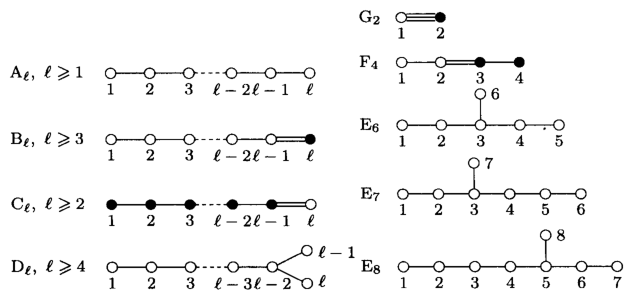 图 7.1  单纯李代数的邓金图

对一个单纯李代数，如果所有生成元乘一个公共实因子 $\lambda$，则结构常数和根矢量都扩大 $\lambda$ 倍，基林型就扩大 $\lambda^2$ 倍。这样做并不改变结构常数关于指标的完全反对称性，不改变基林型的负定性，不改变实李代数的单纯性和紧致性，也不改变根矢量内积的定义式 (7.44)，但内积不再按欧几里得几何的规则等于根矢量分量的平方和。通常文献中，在基林型是负常数矩阵的条件下，放弃内积定义式 (7.44)，改用欧几里得几何的规则，即不再用基林型作为升降指标的度规张量，把协变指标和逆变指标看成相同的，根矢量的内积就等于根矢量分量的平方和。这样的重新定义并不改变嘉当-外尔基的正则对易关系式 (7.42)，当然其中 $N_{\alpha,\beta}$ 的取值扩大了 $\lambda$ 倍。引入符号

$$
d_\mu = \frac{1}{2}\, \boldsymbol{r}_\mu \cdot \boldsymbol{r}_\mu
\tag{7.61}
$$

调节可乘因子 $\lambda$，使单纯李代数较长根的 $d_\mu$ 等于 1。

### * 三、单纯李代数的邓金图

下面讨论单纯李代数邓金图的性质和可能存在哪些邓金图。

1. 单纯李代数的邓金图不会断开

如果邓金图断成两部分，则分属两部分的素根间都互相正交。按定理三，素根正交时，$q-p=0$。而定理四指出，素根之差不是根，因而现在分属两部分的素根和也不是根。这样，单纯李代数的生成元分成两部分，与第一部分有关的生成元 $E_{\boldsymbol{r}}$ 和 $\boldsymbol{r} \cdot \boldsymbol{H}$，和与第二部分有关的生成元 $E_{\boldsymbol{r}'}$ 和 $\boldsymbol{r}' \cdot \boldsymbol{H}$ 互相之间都对易，李代数分解为两理想的直和，与李代数的单纯性矛盾。

2. 邓金图不含封闭环

用反证法。设邓金图包含封闭环，取最小的封闭环，环上连线可以是单线、双线或三线，环内再无其他连线。图中不标出双线或三线，也不用实心圈区分素根长短。沿环上的素根顺序记作 $\boldsymbol{u}_1$，$\boldsymbol{u}_2$，$\cdots$，$\boldsymbol{u}_n$，并设 $\boldsymbol{u}_{n+1} \equiv \boldsymbol{u}_1$，其中 $n$ 是环中所含素根数目。$n$ 个素根之和是非零矢量

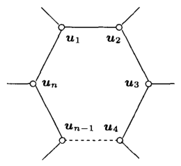

$$
\begin{aligned}
\boldsymbol{a} &= \sum_{j=1}^{n} \boldsymbol{u}_j \neq 0\\
|\boldsymbol{a}|^2 &= \sum_{j=1}^{n} |\boldsymbol{u}_j|^2 + 2\sum_{j=1}^{n} \boldsymbol{u}_j \cdot \boldsymbol{u}_{j+1}\\
&= \sum_{j=1}^{n} |\boldsymbol{u}_j|^2 \left\{ 1 + \Gamma(\boldsymbol{u}_{j+1}/\boldsymbol{u}_j) \right\} \leqslant 0
\end{aligned}
$$

与 $\boldsymbol{a}$ 是非零矢量矛盾。

3. 从每一个素根引出的连线数不超过三根

设素根 $\boldsymbol{r}$ 与 $n$ 个素根 $\boldsymbol{u}_j$，$1 \leqslant j \leqslant n$，相连，连线数等于

$$
\sum_{j=1}^{n} \Gamma(\boldsymbol{r}/\boldsymbol{u}_j) \Gamma(\boldsymbol{u}_j/\boldsymbol{r})
$$

由于不存在环，这些素根 $\boldsymbol{u}_j$ 间再无连线，即它们互相正交。既然素根线性无关，$\boldsymbol{r}$ 的长度平方一定大于它在各 $\boldsymbol{u}_j$ 方向的分量平方和

$$
|\boldsymbol{r}|^2 > \sum_{j=1}^{n} (\boldsymbol{r} \cdot \boldsymbol{u}_j)^2 / |\boldsymbol{u}_j|^2 = \frac{|\boldsymbol{r}|^2}{4} \sum_{j=1}^{n} \Gamma(\boldsymbol{r}/\boldsymbol{u}_j) \Gamma(\boldsymbol{u}_j/\boldsymbol{r})
$$

消去 $|\boldsymbol{r}|^2$ 后，即得连线数小于 4。证完。

由此，包含三线的邓金图只有一种：

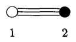

称为 $\mathrm{G}_2$ 李代数。并且下列图都是不允许的：

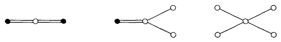

在上面图中把空心圈和实心圈交换，同样也是不允许的。下面将证明，在上面图中，把中间的圈换成一段用单线相连的素根圈链，得到的下图也是不允许的：

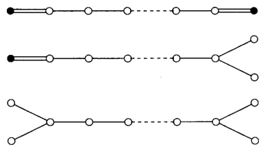

设中间插入的素根为 $m$ 个 $\boldsymbol{v}_j$，$1 \leqslant j \leqslant m$，它们的长度相等，记作 $v$。这 $m$ 个素根之和 $\boldsymbol{v} = \sum_j \boldsymbol{v}_j$ 的长度仍是 $v$

$$
|\boldsymbol{v}|^2 = \sum_{j=1}^{m} |\boldsymbol{v}_j|^2 + 2\sum_{j=1}^{m-1} \boldsymbol{v}_j \cdot \boldsymbol{v}_{j+1} = m v^2 - (m-1)v^2 = v^2
$$

用这个 $\boldsymbol{v}$ 代替前面的 $\boldsymbol{r}$，同样可证明，这 $m$ 个素根组与其他素根的连线数小于 4。

4. 带有双线的邓金图

根据上面分析，带有双线的邓金图只能取如下形式：

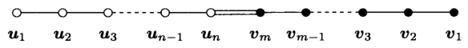

其中，$v_k$ 的长度为 $v$，$u_j$ 的长度为 $\sqrt{2}v$。令

$$
\boldsymbol{u} = \sum_{j=1}^{n} j\boldsymbol{u}_j \,,\qquad \boldsymbol{v} = \sum_{k=1}^{m} k\boldsymbol{v}_k
\tag{7.62}
$$

则

$$
\begin{aligned}
|\boldsymbol{v}|^2 &= \sum_{k=1}^{m} k^2 v^2 + \sum_{k=1}^{m-1} k(k+1)(-v^2)\\
&= v^2 \left( m^2 - \sum_{k=1}^{m-1} k \right) = \frac{1}{2}m(m+1)v^2 \ ,\\
|\boldsymbol{u}|^2 &= n(n+1)v^2
\end{aligned}
\tag{7.63}
$$

由于 $\boldsymbol{u}$ 和 $\boldsymbol{v}$ 不共线，根据许瓦兹（Schwarz）不等式，有

$$
\begin{aligned}
0 &< |\boldsymbol{u}|^2|\boldsymbol{v}|^2 - (\boldsymbol{u} \cdot \boldsymbol{v})^2\\
&= \frac{1}{2}n(n+1)m(m+1)v^4 - (mn)^2 (\boldsymbol{u}_n \cdot \boldsymbol{v}_m)^2\\
&= \frac{1}{2}nm\,(n+m+1-mn)\,v^4
\end{aligned}
$$

即

$$
(m-1)(n-1)<2
$$

若 $m=1$，则 $n$ 可取任意正整数，设为 $\ell-1$，则得如下邓金图：

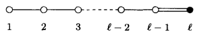

称为 $\mathrm{B}_\ell$ 李代数。若 $n=1$，则 $m$ 可取任意正整数 $\ell-1$，得如下邓金图：

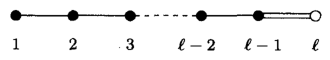

称为 $\mathrm{C}_\ell$ 李代数。若 $n=m=2$，则邓金图为：

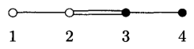

称为 $\mathrm{F}_4$ 李代数。

#### 5. 带有分叉的邓金图

带有分叉的邓金图一般形式为

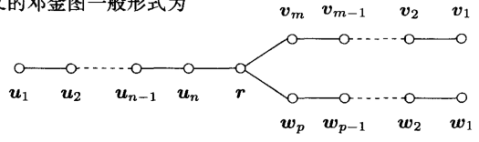

所有素根长度相等，记作 $v$. 令

$$
\boldsymbol{u}=\sum_{j=1}^{n} j \boldsymbol{u}_j \ , \qquad
\boldsymbol{v}=\sum_{k=1}^{m} k \boldsymbol{v}_k \ , \qquad
\boldsymbol{w}=\sum_{s=1}^{p} s \boldsymbol{w}_s
$$

它们互相正交，且与 $\boldsymbol{r}$ 线性无关

$$
v^2=|\boldsymbol{r}|^2>\frac{(\boldsymbol{r}\cdot\boldsymbol{u})^2}{|\boldsymbol{u}|^2}
+\frac{(\boldsymbol{r}\cdot\boldsymbol{v})^2}{|\boldsymbol{v}|^2}
+\frac{(\boldsymbol{r}\cdot\boldsymbol{w})^2}{|\boldsymbol{w}|^2}
$$

由式 (7.63)，得

$$
\frac{(\boldsymbol{r}\cdot\boldsymbol{u})^2}{|\boldsymbol{u}|^2}
=\frac{n^2v^4/4}{n(n+1)v^2/2}
=\frac{nv^2}{2(n+1)}
=\frac{v^2}{2}-\frac{v^2}{2(n+1)}
$$

故

$$
\begin{aligned}
&\frac{3}{2}-\frac{1}{2}\left(\frac{1}{n+1}+\frac{1}{m+1}+\frac{1}{p+1}\right)<1,\\
&\frac{1}{n+1}+\frac{1}{m+1}+\frac{1}{p+1}>1
\end{aligned}
$$

不失普遍性，设 $p \leqslant m \leqslant n$，则把上式左面三项全用最大的项代替，不等式仍成立

$$
\frac{3}{p+1}>1, \qquad \text{得} \quad p=1
$$

消去与 $p$ 有关的项后，再用 $m$ 代替 $n$，得

$$
\frac{2}{m+1}>\frac{1}{2}, \qquad \text{得} \quad m=1 \ \text{或} \ 2
$$

若 $m=p=1$，则 $n$ 可取任意自然数，记作 $\ell-3$，得如下邓金图：

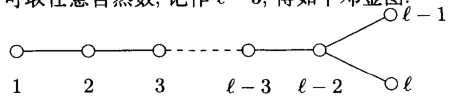

称为 $\mathrm{D}_\ell$ 李代数。若 $p=1$ 和 $m=2$，则

$$
\frac{1}{n+1}>\frac{1}{6}, \qquad \text{得} \quad 2 \leqslant n<5
$$

有三个邓金图，分别称为 $\mathrm{E}_6$，$\mathrm{E}_7$ 和 $\mathrm{E}_8$ 李代数：

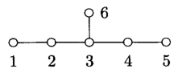

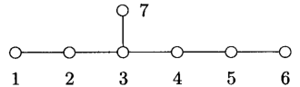

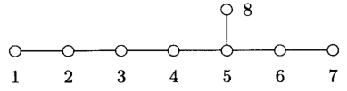

6. 全是单线的邓金图，称为 $\mathrm{A}_\ell$ 李代数：

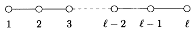

最后得到图 7.1 给出的全部单纯李代数的邓金图。

### 四、嘉当矩阵

$\ell$ 秩的单纯李代数有 $\ell$ 个素根 $\boldsymbol{r}_\mu$，定义 $\ell$ 维矩阵 $A$

$$
A_{\mu\nu}=\Gamma(\boldsymbol{r}_\nu/\boldsymbol{r}_\mu)
=\frac{2\boldsymbol{r}_\nu\cdot\boldsymbol{r}_\mu}{|\boldsymbol{r}_\mu|^2}
=d_\mu^{-1}(\boldsymbol{r}_\nu\cdot\boldsymbol{r}_\mu)
\tag{7.64}
$$

它的对角元总是 2，非对角元可取 $0$，$-1$，$-2$ 和 $-3$. 这样构成的 $\ell$ 维矩阵称为嘉当矩阵。与邓金图相比，当素根 $\boldsymbol{r}_\mu$ 和 $\boldsymbol{r}_\nu$ 没有线相连时，$A_{\mu\nu}=A_{\nu\mu}=0$，当它们有线相连时，若 $\boldsymbol{r}_\mu$ 的长度不小于 $\boldsymbol{r}_\nu$，则 $A_{\mu\nu}=-1$，而 $A_{\nu\mu}=-n$，其中 $n$ 是连线数。当素根的排列次序选定后，嘉当矩阵与邓金图有一一对应关系，它们是描写单纯李代数的两种等价方法。

邓金图和嘉当矩阵给出了该李代数的全部信息，它们不仅给出单纯李代数素根的夹角和长度比，而且由它们可计算出该李代数的全部根矢量。附录 25 中介绍了根矢量的计算方法，并用 $\mathrm{G}_2$ 李代数为例做了具体计算。但应该指出，根矢量有许多计算方法，所有单纯李代数的根矢量早已有人计算过，并列表给出。用邓金图和嘉当矩阵计算单纯李代数的全部根矢量，是为了说明它们确给出了单纯李代数的全部信息。

## *7.4 几类典型的单纯李群

### 一、SU(N) 群及其李代数

所有 $N\times N$ 幺模幺正矩阵 $u$ 的集合

$$
u^{\dagger}u=1\ , \qquad \det u=1
\tag{7.65}
$$

按照矩阵乘积规则，满足群的四个条件，因而构成群，称为 $N$ 维特殊幺正矩阵群，记作 $\mathrm{SU}(N)$ 群。 U 代表幺正，S 代表幺模，即矩阵行列式为 1. 一个 $N$ 维复矩阵，包含 $2N^2$ 个实参数。幺正矩阵的列矩阵互相正交归一。归一化条件给出 $N$ 个实条件。正交条件给出 $N(N-1)/2$ 个复条件，即 $N(N-1)$ 个实条件。行列式为 1 又给出一个实条件。因此描写 $\mathrm{SU}(N)$ 群元素的独立实参数数目为

$$
g=2N^2-N-N(N-1)-1=N^2-1
$$

即 $\mathrm{SU}(N)$ 群的阶数 $g$ 是 $N^2-1$. 幺正条件限制了矩阵元素的模有限，而且参数变化区域是连通的，因而 $\mathrm{SU}(N)$ 群是紧致简单李群。

常用下面方法选择 $\mathrm{SU}(N)$ 群的群参数。幺正矩阵 $u$ 可通过幺模幺正相似变换 $X$ 对角化，对角元的模为 1. 把对角元取为 $\exp(-\mathrm{i}\varphi_a)$，其中相角 $\varphi_a$ 允许改变 $2\pi$ 的整数倍。由于 $u$ 的行列式为 1，$N$ 个相角之和是 $2\pi$ 的整数倍，可选为零。规定 $\varphi_a$ 的取值范围为

$$
\varphi_N=-\sum_{a=1}^{N-1}\varphi_a\ , \qquad -\pi\leqslant \varphi_a\leqslant \pi\ , \qquad 1\leqslant a\leqslant (N-1)
\tag{7.66}
$$

因此

$$
\begin{aligned}
u&=X\exp\{-\mathrm{i}\Phi\}X^{-1}\\
&=\exp(-\mathrm{i}H),\\
H&=X\Phi X^{-1},
\end{aligned}
\qquad
\Phi=
\begin{pmatrix}
\varphi_1 & & & \\
& \varphi_2 & & \\
& & \ddots & \\
& & & \varphi_N
\end{pmatrix}
\tag{7.67}
$$

$H$ 是无迹厄米矩阵，共含 $N^2-1$ 个独立实参数，可用它们作为 $\mathrm{SU}(N)$ 群的群参数，描写群元素 $u$. 因为 $X$ 矩阵也是 $\mathrm{SU}(N)$ 群的元素，式 (7.67) 表明，$\mathrm{SU}(N)$ 群任意元素 $u$ 都与取对角矩阵的群元素共轭，$\mathrm{SU}(N)$ 群的类由式 (7.66) 的 $N-1$ 个参数 $\varphi_a$ 描写。数学家证明了 $\mathrm{SU}(N)$ 群类上的积分为

$$
\int\mathrm{d}\varphi\,W(\varphi)F(\varphi)
=\int_{-\pi}^{\pi}\mathrm{d}\varphi_1\cdots\int_{-\pi}^{\pi}\mathrm{d}\varphi_{N-1}
\int\mathrm{d}\varphi_N\,\delta\left(\sum_{a=1}^{N}\varphi_a\right)W(\varphi)F(\varphi)
$$

$$
\begin{aligned}
W(\varphi)&=\frac{1}{\Omega}\prod_{a<b}^{N}\sin^2\left(\frac{\varphi_a-\varphi_b}{2}\right),\\
\Omega&=\int_{-\pi}^{\pi}\mathrm{d}\varphi_1\cdots\int_{-\pi}^{\pi}\mathrm{d}\varphi_{N-1}
\int\mathrm{d}\varphi_N\,\delta\left(\sum_{a=1}^{N}\varphi_a\right)
\prod_{a<b}^{N}\sin^{-2}\left(\frac{\varphi_a-\varphi_b}{2}\right)
\end{aligned}
\tag{7.68}
$$

$H$ 可按 $N$ 维无迹厄米矩阵的基展开。物理中常选如下三类 $N$ 维无迹厄米矩阵作为基。前两类矩阵基是泡利矩阵 $\sigma_1$ 和 $\sigma_2$ 的推广，它们分别只包含两个非零的非对角元

$$
\begin{aligned}
\left(T_{ab}^{(1)}\right)_{cd}&=\frac{1}{2}\left(\delta_{ac}\delta_{bd}+\delta_{bc}\delta_{ad}\right),\\
\left(T_{ab}^{(2)}\right)_{cd}&=\frac{-\mathrm{i}}{2}\left(\delta_{ac}\delta_{bd}-\delta_{bc}\delta_{ad}\right),
\end{aligned}
\qquad a<b
\tag{7.69}
$$

其中，$c$ 和 $d$ 是矩阵的行列指标，$a$ 和 $b$ 是基的序指标，它们都在 1 至 $N$ 取值。矩阵基 $T_{ab}^{(1)}$ 只有 $a$ 行 $b$ 列元素和 $b$ 行 $a$ 列元素不为零，而为 $1/2$，因而是对称矩阵，而且对 $a$ 和 $b$ 交换也是对称的。矩阵基 $T_{ab}^{(2)}$ 也只有 $a$ 行 $b$ 列元素和 $b$ 行 $a$ 列元素不为零，分别为 $\pm\mathrm{i}/2$，因而是反对称矩阵，而且对 $a$ 和 $b$ 交换也是反对称的

$$
\begin{aligned}
\left(T_{ab}^{(1)}\right)_{cd}&=\left(T_{ba}^{(1)}\right)_{cd}=\left(T_{ab}^{(1)}\right)_{dc},\\
\left(T_{ab}^{(2)}\right)_{cd}&=-\left(T_{ba}^{(2)}\right)_{cd}=-\left(T_{ab}^{(1)}\right)_{dc}
\end{aligned}
\tag{7.70}
$$

为了保持基不重复，限制 $a<b$. 这样的矩阵基共有 $N(N-1)$ 个。作为无迹矩阵的基，$T_{ab}^{(1)}$ 的指标 $a$ 和 $b$ 必须不相等。但作为一个对角矩阵的符号，$T_{aa}^{(1)}$ 以后会常用

$$
\left(T_{aa}^{(1)}\right)_{cd}=\delta_{ac}\delta_{cd}
\tag{7.71}
$$

第三类矩阵基 $T_a^{(3)}$ 是泡利矩阵 $\sigma_3$ 的推广，它是无迹对角矩阵，前面有 $a-1$ 个对角元是 1，第 $a$ 个对角元是 $-(a-1)$，其余对角元是零。和泡利矩阵一样，为了使矩阵平方的迹为 $1/2$，前面再乘归一化因子，得

$$
\left(T_a^{(3)}\right)_{cd}=
\begin{cases}
\delta_{cd}\left\{2a(a-1)\right\}^{-1/2}, & \text{当 } c<a,\\
-\delta_{cd}\left\{(a-1)/(2a)\right\}^{1/2}, & \text{当 } c=a,\\
0, & \text{当 } c>a,
\end{cases}
\qquad 2\leqslant a\leqslant N
\tag{7.72}
$$

这对角的矩阵基有 $N-1$ 个。合起来是 $N^2-1$ 个矩阵基，构成 $N$ 维无迹厄米矩阵的完备基。前两类基的形式比较清楚，就是一个扩大了的泡利矩阵。为了对第三类矩阵基有一个直观的了解，下面列出几个 $T_a^{(3)}$ 矩阵。 diag 代表对角矩阵，只列出它们的对角元素

$$
\begin{aligned}
T_2^{(3)}&=\operatorname{diag}\{1,\,-1,\,0,\,\cdots,0\}/2,\\
T_3^{(3)}&=\operatorname{diag}\{1,\,1,\,-2,\,0,\,\cdots,0\}/(2\sqrt{3}),\\
T_4^{(3)}&=\operatorname{diag}\{1,\,1,\,1,\,-3,\,0,\,\cdots,0\}/(2\sqrt{6}),\\
T_a^{(3)}&=\operatorname{diag}\{1,\,\cdots,\,1,\,-(a-1),\,0,\,\cdots,0\}/\sqrt{2a(a-1)}
\end{aligned}
\tag{7.73}
$$

任何无迹厄米矩阵都可按这组完备基展开，展开系数是实数。矩阵 $H$ 的展开系数通常取为 $\omega_{ab}^{(1)}$，$\omega_{ab}^{(2)}$ 和 $\omega_a^{(3)}$，它们就是 $\mathrm{SU}(N)$ 群的群参数，共 $N^2-1$ 个独立实参数

$$
H=\sum_{a<b}\left\{\omega_{ab}^{(1)}T_{ab}^{(1)}+\omega_{ab}^{(2)}T_{ab}^{(2)}\right\}
+\sum_{a=2}^{N}\omega_a^{(3)}T_a^{(3)}\ , \qquad u=\exp(-\mathrm{i}H)
\tag{7.74}
$$

$\mathrm{SU}(N)$ 群的群空间具体形式比较复杂，但这种指数形式使群参数出现周期性，可以限制群参数在有限的闭区域内变化。

物理上常用一个统一的编号来编排三类矩阵基。编号按“列指标”$b$ 增加的次序自 2 开始编排，对每一确定的 $b$，按“行指标”$a$ 增加的次序自 1 开始编排，对确定的 $b$ 和 $a$，按一，二，三类矩阵基的次序编排。具体说

$$
\begin{aligned}
T_1&=T_{12}^{(1)}, & T_2&=T_{12}^{(2)}, & T_3&=T_2^{(3)}, & T_4&=T_{13}^{(1)}, & T_5&=T_{13}^{(2)},\\
T_6&=T_{23}^{(1)}, & T_7&=T_{23}^{(2)}, & T_8&=T_3^{(3)}, & T_9&=T_{14}^{(1)}, & T_{10}&=T_{14}^{(2)},\\
T_{11}&=T_{24}^{(1)}, & T_{12}&=T_{24}^{(2)}, & T_{13}&=T_{34}^{(1)}, & T_{14}&=T_{34}^{(2)}, & T_{15}&=T_4^{(3)},
\end{aligned}
\tag{7.75}
$$

$\cdots\cdots$

以此类推。这组矩阵基满足下述正交归一条件

$$
\operatorname{Tr}\left(T_A T_B\right)=\frac{1}{2}\delta_{AB}\ , \qquad A,\ B\leqslant (N^2-1)
\tag{7.76}
$$

$N=2$ 时它们就是泡利矩阵。 $N=3$ 时，它们称为盖尔曼（Gell-Mann）矩阵，如附录 24 式 (A24.2) 所示。很明显，当参数比较小时，$u$ 矩阵按参数展开，生成元正是这组矩阵基 $T_A$. 生成元也可直接用幺模和幺正条件来确定。设在恒元附近

$$
\begin{aligned}
u&=\boldsymbol{1}-\mathrm{i}\alpha X\ , & u^{\dagger}&=\boldsymbol{1}+\mathrm{i}\alpha X^{\dagger},\\
u^{\dagger}u&=\boldsymbol{1}-\mathrm{i}\alpha\left(X-X^{\dagger}\right)=\boldsymbol{1}\ , & \det u&=1-\mathrm{i}\alpha\operatorname{Tr}X=1
\end{aligned}
\tag{7.77}
$$

因此 $\alpha X$ 正是无迹厄米矩阵 $H$，按式 (7.74) 展开后，生成元是 $T_A$.

生成元满足的正交归一条件 (7.76) 保证了结构常数 $C_{AB}^{\ \ D}$ 对三个指标完全反对称。事实上，由李氏第二定理，生成元 $T_A$ 满足对易关系式 (7.5). 乘生成元 $T_D$ 并取迹，应用式 (7.76) 得

$$
C_{AB}^{\ \ D}=-2\mathrm{i}\operatorname{Tr}\left\{T_A T_B T_D-T_B T_A T_D\right\}
\tag{7.78}
$$

这表明 $\mathrm{SU}(N)$ 群是紧致李群。也只有紧致李群才能选择参数，使生成元满足正交归一关系。在文献中，经常把这完全反对称的结构常数记作 $f_{ABD}$. 为了把对易关系写成统一的形式，常引入式 (7.71) 给出的 $N$ 个有迹对角矩阵 $T_{aa}^{(1)}$ 作为过渡，但要注意 $T_{aa}^{(1)}$ 不是生成元

$$
\begin{aligned}
T_a^{(3)}&=\left(\frac{1}{2a(a-1)}\right)^{1/2}\left\{\sum_{b=1}^{a-1}T_{bb}^{(1)}-(a-1)T_{aa}^{(1)}\right\},\\
T_{11}^{(1)}-T_{aa}^{(1)}&=\sum_{b=2}^{a-1}\left(\frac{2}{b(b-1)}\right)^{1/2}T_b^{(3)}
+\left(\frac{2a}{a-1}\right)^{1/2}T_a^{(3)}
\end{aligned}
\tag{7.79}
$$

直接验算可知，这组矩阵基满足如下对易关系

$$
\begin{aligned}
\left[T_{ab}^{(1)},\,T_{cd}^{(1)}\right]&=\frac{\mathrm{i}}{2}\left(\delta_{bc}T_{ad}^{(2)}+\delta_{ad}T_{bc}^{(2)}+\delta_{ac}T_{bd}^{(2)}+\delta_{bd}T_{ac}^{(2)}\right),\\
\left[T_{ab}^{(2)},\,T_{cd}^{(2)}\right]&=\frac{-\mathrm{i}}{2}\left(\delta_{bc}T_{ad}^{(2)}+\delta_{ad}T_{bc}^{(2)}-\delta_{ac}T_{bd}^{(2)}-\delta_{bd}T_{ac}^{(2)}\right),\\
\left[T_{ab}^{(1)},\,T_{cd}^{(2)}\right]&=\frac{-\mathrm{i}}{2}\left(\delta_{bc}T_{ad}^{(1)}-\delta_{ad}T_{bc}^{(1)}+\delta_{ac}T_{bd}^{(1)}-\delta_{bd}T_{ac}^{(1)}\right)
\end{aligned}
\tag{7.80}
$$

$$
\begin{aligned}
\left[T_a^{(3)},\,T_{ab}^{(1)}\right]&=-\mathrm{i}\left\{(a-1)/(2a)\right\}^{1/2}T_{ab}^{(2)}\ ,\\
\left[T_a^{(3)},\,T_{ab}^{(2)}\right]&=\mathrm{i}\left\{(a-1)/(2a)\right\}^{1/2}T_{ab}^{(1)}\ ,\\
\left[T_c^{(3)},\,T_{ab}^{(1)}\right]&=\mathrm{i}\left\{2c(c-1)\right\}^{-1/2}T_{ab}^{(2)}\ ,\\
\left[T_c^{(3)},\,T_{ab}^{(2)}\right]&=-\mathrm{i}\left\{2c(c-1)\right\}^{-1/2}T_{ab}^{(1)}\ ,\\
\left[T_b^{(3)},\,T_{ab}^{(1)}\right]&=\mathrm{i}\left\{b/(2b-2)\right\}^{1/2}T_{ab}^{(2)}\ ,\\
\left[T_b^{(3)},\,T_{ab}^{(2)}\right]&=-\mathrm{i}\left\{b/(2b-2)\right\}^{1/2}T_{ab}^{(1)}\ ,\\
\left[T_a^{(3)},\,T_b^{(3)}\right]&=\left[T_b^{(3)},\,T_{ac}^{(1)}\right]=\left[T_a^{(3)},\,T_{cb}^{(1)}\right]\\
&=\left[T_b^{(3)},\,T_{ac}^{(2)}\right]=\left[T_a^{(3)},\,T_{cb}^{(2)}\right]=0\ ,
\end{aligned}
\qquad a<c<b
\tag{7.81}
$$

(7.80) 第三个等式右边出现的四个第一类矩阵基，如果下标相同，要用式 (7.79) 换成第三类矩阵基。写式 (7.80) 时应充分利用对称性式 (7.70)，实际上，后三项可由第一项由对称性推得。第三类矩阵基是对角矩阵，它们互相对易。式 (7.80) 和 (7.81) 是 $\mathrm{SU}(N)$ 群生成元满足的共同对易关系。附录 26 列出 $\mathrm{SU}(N)$ 群自身表示生成元满足的反对易关系和 $\mathrm{SU}(3)$ 群的结构常数。

$\mathrm{SU}(N)$ 群中包含 $N$ 个常数矩阵

$$
T_m=\omega^m\boldsymbol{1}\ , \qquad \omega=\exp\{-\mathrm{i}2\pi/N\}\ , \qquad 0\leqslant m\leqslant (N-1)
\tag{7.82}
$$

它们可与 $\mathrm{SU}(N)$ 群所有元素对易。它们的集合称为 $\mathrm{SU}(N)$ 群的中心，记作 $Z_N$. $Z_N$ 是 $\mathrm{SU}(N)$ 群的不变子群，商群 $\mathrm{SU}(N)/Z_N$ 的群空间是 $N$ 度连通的，$\mathrm{SU}(N)$ 群是它的覆盖群。

在 $\mathrm{SU}(N)$ 群自身表示的生成元中，$N-1$ 个对角生成元 $T_a^{(3)}$ 互相对易，构成 $\mathrm{SU}(N)$ 群对应李代数的嘉当子代数。为了以后的方便，通常颠倒排列次序，定义

$$
H_j=\sqrt{2}T_{N-j+1}^{(3)}\ , \qquad j=1,\ 2,\ \cdots,\ \ell\ , \qquad \ell\equiv N-1
\tag{7.83}
$$

乘 $\sqrt{2}$ 是为了使素根半长度 $d_\mu=1$. 余下的生成元要组合成 $H_j$ 的共同本征矢量，按归一化条件，取

$$
E_{\pm\alpha_{ab}}=T_{ab}^{(1)}\pm\mathrm{i}T_{ab}^{(2)}\ , \qquad a<b
\tag{7.84}
$$

得

$$
\left[H_j,\,E_{\alpha_{ab}}\right]=
\begin{cases}
-\left[(N-j)/(N-j+1)\right]^{1/2}E_{\alpha_{ab}}, & N-j+1=a\\
\left[(N-j+1)(N-j)\right]^{-1/2}E_{\alpha_{ab}}, & a<N-j+1<b\\
\left[(N-j+1)/(N-j)\right]^{1/2}E_{\alpha_{ab}}, & N-j+1=b\\
0, & \text{其他}
\end{cases}
$$

为了把根矢量表达得更清楚，在 $\ell$ 维根空间引进对称地分布的 $\ell+1$ 个线性相关的矢量 $\boldsymbol{V}_a$

$$
\begin{aligned}
\left(\boldsymbol{V}_a\right)_j&=\left(T_{N-j+1}^{(3)}\right)_{aa}=\sqrt{1/2}\left(H_j\right)_{aa}\ , & 1\leqslant j\leqslant\ell, \quad 1\leqslant a\leqslant N=\ell+1,\\
\sqrt{2}\left(\boldsymbol{V}_a\right)_j&=
\begin{cases}
\left[(N-j+1)(N-j)\right]^{-1/2}, & a<N-j+1\\
-\left[(N-j)/(N-j+1)\right]^{1/2}, & a=N-j+1\\
0, & a>N-j+1
\end{cases}\\
\sum_{a=1}^{\ell+1}\boldsymbol{V}_a&=0\ , \qquad \boldsymbol{V}_a\cdot\boldsymbol{V}_b=\frac{\delta_{ab}}{2}-\frac{1}{2(\ell+1)}
\end{aligned}
\tag{7.85}
$$

它们的具体形式是

$$
\begin{aligned}
\boldsymbol{V}_1&=\left\{(2\ell(\ell+1))^{-1/2},\ (2(\ell-1)\ell)^{-1/2},\ \cdots,\ (2a(a-1))^{-1/2},\ \cdots,\ \sqrt{1/12},\ (1/2)\right\}\\
\boldsymbol{V}_2&=\left\{(2\ell(\ell+1))^{-1/2},\ (2(\ell-1)\ell)^{-1/2},\ \cdots,\ (2a(a-1))^{-1/2},\ \cdots,\ \sqrt{1/12},\ (-1/2)\right\}\\
\boldsymbol{V}_3&=\left\{(2\ell(\ell+1))^{-1/2},\ (2(\ell-1)\ell)^{-1/2},\ \cdots,\ (2a(a-1))^{-1/2},\ \cdots,\ -\sqrt{1/3},\ 0\right\}
\end{aligned}
$$

$$
\begin{aligned}
&\cdots\cdots\\
\boldsymbol{V}_a&=\left\{(2\ell(\ell+1))^{-1/2},\ (2(\ell-1)\ell)^{-1/2},\ \cdots,\ -\left((a-1)/2a\right)^{1/2},\ 0,\cdots,\ 0\right\}
\end{aligned}
$$

$$
\begin{aligned}
&\cdots\cdots\\
\boldsymbol{V}_\ell&=\left\{(2\ell(\ell+1))^{-1/2},\ -\left((\ell-1)/(2\ell)\right)^{1/2},\ 0,\ \cdots,\ 0\right\}\\
\boldsymbol{V}_{\ell+1}&=\left\{-\left(\ell/(2\ell+2)\right)^{1/2},\ 0,\ \cdots,\ 0\right\}
\end{aligned}
$$

生成元 $E_{\alpha_{ab}}$ 对应的正根就可简单地用矢量 $\boldsymbol{V}_a$ 表出

$$
\boldsymbol{\alpha}_{ab}=\sqrt{2}\left[\boldsymbol{V}_a-\boldsymbol{V}_b\right], \qquad a<b
\tag{7.86}
$$

由此得 $\mathrm{SU}(N)$ 群的素根为

$$
\boldsymbol{r}_\mu=\sqrt{2}\left[\boldsymbol{V}_\mu-\boldsymbol{V}_{\mu+1}\right], \qquad 1\leqslant \mu\leqslant \ell
\tag{7.87}
$$

由式 (7.85) 可算得素根 $\boldsymbol{r}_\mu$ 的内积为

$$
\boldsymbol{r}_\mu\cdot\boldsymbol{r}_\nu=2\delta_{\mu\nu}-\delta_{\mu(\nu-1)}-\delta_{\mu(\nu+1)}
\tag{7.88}
$$

可见素根半长度 $d_\mu=1$，相邻素根夹角为 $2\pi/3$，因而 $\mathrm{SU}(\ell+1)$ 群的李代数是 $\mathrm{A}_\ell$. 所有正根 $\alpha_{ab}$ 可表为素根的非负整数线性组合

$$
\alpha_{ab}=\sum_{\mu=a}^{b-1}\tau_\mu
\tag{7.89}
$$

在一个单纯李代数中，如果一个根与其他任一根之差的第一个非零分量总是正值，则此根称为单纯李代数的最大根。最大根在研究伴随表示时很重要。 $\mathrm{A}_\ell$ 李代数的最大根 $\omega$ 为

$$
\omega=\sqrt{2}[V_1-V_{\ell+1}]=\sum_{\mu=1}^{\ell}\tau_\mu
\tag{7.90}
$$

### 二、SO(N) 群及其李代数

所有 $N\times N$ 实正交矩阵 $R$ 的集合

$$
R^TR=1\ ,\qquad R^*=R
\tag{7.91}
$$

按照矩阵乘积规则，满足群的四个条件，因而构成群，称为 $N$ 维实正交矩阵群，记作 $\mathrm{O}(N)$ 群。由式 (7.91) 得 $\det R=\pm 1$. $\mathrm{O}(N)$ 群是混合李群。 $\mathrm{O}(N)$ 群中行列式为 1 的元素集合构成不变子群，记作 $\mathrm{SO}(N)$ 群。 O 代表实正交，S 代表幺模。一个 $N$ 维实矩阵，包含 $N^2$ 个实参数。实正交矩阵的列矩阵互相正交归一，给出 $N(N+1)/2$ 个实条件。因此 $\mathrm{SO}(N)$ 群的阶数 $g$，即描写 $\mathrm{SO}(N)$ 群元素 $R$ 的独立实参数数目为

$$
g=N^2-N(N+1)/2=N(N-1)/2
\tag{7.92}
$$

$\mathrm{SO}(N)$ 群是 $\mathrm{SU}(N)$ 群的子群。因为实矩阵的生成元是纯虚矩阵，所以只要把 $\mathrm{SU}(N)$ 群元素的参数 $\omega_{ab}^{(1)}$ 和 $\omega_a^{(3)}$ 取为零，就得到 $\mathrm{SO}(N)$ 群的元素。习惯上，取 $\omega_{ab}=\omega_{ab}^{(2)}/2$ 和 $T_{ab}=2T_{ab}^{(2)}$，得

$$
R=\exp\left\{-\mathrm{i}\sum_{a<b=2}^{N}\omega_{ab}T_{ab}\right\}\ ,\qquad (T_{ab})_{cd}=-\mathrm{i}(\delta_{ac}\delta_{bd}-\delta_{ad}\delta_{bc})
\tag{7.93}
$$

$$
\begin{aligned}
&\operatorname{Tr}(T_{ab}T_{cd})=2(\delta_{ac}\delta_{bd}-\delta_{ad}\delta_{bc})\\
&[T_{ab},T_{cd}]=-\mathrm{i}\{\delta_{bc}T_{ad}+\delta_{ad}T_{bc}-\delta_{bd}T_{ac}-\delta_{ac}T_{bd}\}
\end{aligned}
\tag{7.94}
$$

生成元满足正交归一条件，因而结构常数对三组指标完全反对称。

在 $\mathrm{SO}(N)$ 群自身表示的生成元中，没有对角矩阵，但根据生成元的对易关系式 (7.94)，只要两个生成元 $T_{ab}$ 和 $T_{cd}$ 的下标互不相等，它们就互相对易。由此可知，在 $\mathrm{SO}(2\ell)$ 群和 $\mathrm{SO}(2\ell+1)$ 群中互相对易的生成元为 $T_{12}, T_{34}, \cdots, T_{(2\ell-1)(2\ell)}$. 取嘉当子代数的基 $H_j$ 为

$$
H_j=T_{(2j-1)(2j)}\ ,\qquad 1\leqslant j\leqslant\ell.
\tag{7.95}
$$

余下的生成元要组合成 $H_j$ 的共同本征矢量，即 $[H_j,E_\alpha]=\alpha_jE_\alpha$. 对 $\mathrm{SO}(2\ell)$ 群有

$$
\begin{aligned}
E_{ab}^{(1)}&=\frac{1}{2}\left[T_{(2a)(2b-1)}-\mathrm{i}T_{(2a-1)(2b-1)}-\mathrm{i}T_{(2a)(2b)}-T_{(2a-1)(2b)}\right]\ ,\\
E_{ab}^{(2)}&=\frac{1}{2}\left[T_{(2a)(2b-1)}+\mathrm{i}T_{(2a-1)(2b-1)}+\mathrm{i}T_{(2a)(2b)}-T_{(2a-1)(2b)}\right]\ ,\\
E_{ab}^{(3)}&=\frac{1}{2}\left[T_{(2a)(2b-1)}-\mathrm{i}T_{(2a-1)(2b-1)}+\mathrm{i}T_{(2a)(2b)}+T_{(2a-1)(2b)}\right]\ ,\\
E_{ab}^{(4)}&=\frac{1}{2}\left[T_{(2a)(2b-1)}+\mathrm{i}T_{(2a-1)(2b-1)}-\mathrm{i}T_{(2a)(2b)}+T_{(2a-1)(2b)}\right]\ ,
\end{aligned}
\qquad a<b
\tag{7.96}
$$

分别对应本征值（根矢量）$\{e_a-e_b\}_j$，$\{-e_a+e_b\}_j$，$\{e_a+e_b\}_j$ 和 $\{-e_a-e_b\}_j$，其中，$\{e_a\}_j=\delta_{aj}$. 对 $\mathrm{SO}(2\ell+1)$ 群还要补充两组生成元

$$
\begin{aligned}
E_a^{(5)}&=\sqrt{\frac{1}{2}}\left[T_{(2a)(2\ell+1)}-\mathrm{i}T_{(2a-1)(2\ell+1)}\right]\\
E_a^{(6)}&=\sqrt{\frac{1}{2}}\left[T_{(2a)(2\ell+1)}+\mathrm{i}T_{(2a-1)(2\ell+1)}\right]
\end{aligned}
\tag{7.97}
$$

对应的本征值为 $\{e_a\}_j$ 和 $\{-e_a\}_j$. 这些根矢量中，第一，第三和第五组根矢量是正根，其余是负根。

由这些正根中可选出 $\ell$ 个素根。对 $\mathrm{SO}(2\ell)$ 群有

$$
\tau_\mu=e_\mu-e_{\mu+1}\ ,\qquad \tau_\ell=e_{\ell-1}+e_\ell\ ,\qquad 1\leqslant\mu\leqslant\ell-1
\tag{7.98}
$$

素根半长度 $d_\mu=1$. 除了 $\tau_\ell$ 外，相邻素根夹角为 $2\pi/3$，但 $\tau_\ell$ 只与 $\tau_{\ell-2}$ 的夹角是 $2\pi/3$，与其他素根都垂直。可见 $\mathrm{SO}(2\ell)$ 群的李代数是 $\mathrm{D}_\ell$. 所有正根都可表为素根的整数线性组合

$$
e_a-e_b=\sum_{\mu=a}^{b-1}\tau_\mu\ ,\qquad e_a+e_b=\sum_{\mu=a}^{b-1}\tau_\mu+2\sum_{\nu=b}^{\ell-2}\tau_\nu+\tau_{\ell-1}+\tau_\ell
\tag{7.99}
$$

$\mathrm{D}_\ell$ 李代数的最大根 $\omega$ 是

$$
\omega=e_1+e_2=\tau_1+2\sum_{\nu=2}^{\ell-2}\tau_\nu+\tau_{\ell-1}+\tau_\ell
\tag{7.100}
$$

对 $\mathrm{SO}(2\ell+1)$ 群，素根为

$$
\tau_\mu=e_\mu-e_{\mu+1}\ ,\qquad \tau_\ell=e_\ell\ ,\qquad 1\leqslant\mu\leqslant\ell-1
\tag{7.101}
$$

素根半长度，除了 $d_\ell=1/2$ 外，其余 $d_\mu=1$. 除了 $\tau_\ell$ 外，相邻素根夹角为 $2\pi/3$，但 $\tau_\ell$ 与 $\tau_{\ell-1}$ 的夹角是 $3\pi/4$. 可见 $\mathrm{SO}(2\ell+1)$ 群的李代数是 $\mathrm{B}_\ell$. 所有正根都可表为素根的整数线性组合

$$
e_a-e_b=\sum_{\mu=a}^{b-1}\tau_\mu\ ,\qquad e_a+e_b=\sum_{\mu=a}^{b-1}\tau_\mu+2\sum_{\nu=b}^{\ell}\tau_\nu\ ,\qquad e_a=\sum_{\mu=a}^{\ell}\tau_\mu
\tag{7.102}
$$

$\mathrm{B}_\ell$ 李代数的最大根 $\omega$ 是

$$
\omega=e_1+e_2=\tau_1+2\sum_{\nu=2}^{\ell}\tau_\nu
\tag{7.103}
$$

### 三、酉辛群及其李代数 C_ℓ

在 $2\ell$ 维空间，矢量指标 $a$ 按下列次序取 $j$ 或 $\bar{j}$，$1\leqslant j\leqslant\ell$，

$$
a=1,\bar{1},2,\bar{2},\cdots,\ell,\bar{\ell}.
\tag{7.104}
$$

引入 $2\ell$ 维反对称矩阵 $J$

$$
J_{ab}=
\begin{cases}
1\ , & \text{当 } a=j,\quad b=\bar{j}\\
-1\ , & \text{当 } a=\bar{j},\quad b=j\\
0\ , & \text{其他}
\end{cases}
\tag{7.105}
$$

即

$$
J=\mathbf{1}_\ell\times(\mathrm{i}\sigma_2)=-J^{-1}=-J^T\ ,\qquad \det J=1
\tag{7.106}
$$

作为实正交矩阵的推广，把实正交矩阵定义中的单位矩阵 1 换成反对称矩阵 $J$

$$
R^TJR=J\ ,\qquad R^*=R
\tag{7.107}
$$

称为实赝正交矩阵。实赝正交矩阵的乘积仍是实赝正交矩阵。矩阵乘积满足结合律，恒元满足式 (7.107)，也是实赝正交矩阵，实赝正交矩阵 $R$ 的逆矩阵和转置也是实赝正交矩阵

$$
R^{-1}=-JR^TJ\ ,\qquad RJR^T=J\ ,\qquad \left(R^{-1}\right)^TJR^{-1}=(-JRJ)JR^{-1}=J
\tag{7.108}
$$

所有 $(2\ell)\times(2\ell)$ 实赝正交矩阵 $R$ 的集合，按照矩阵乘积构成群，称为实辛群 (real symplectic group)，记作 $\mathrm{Sp}(2\ell,R)$. 附录 27 中证明，实赝正交矩阵的行列式为 1，因而实辛群是简单李群。当实辛群中元素 $R$ 是对角矩阵时，由定义式 (7.107) 得

$$
R=\operatorname{diag}\left\{e^{\omega_1},e^{-\omega_1},e^{\omega_2},e^{-\omega_2},\cdots,e^{\omega_\ell},e^{-\omega_\ell}\right\}
$$

其中，参数 $\omega_j$ 可取任意大的实数。因此实辛群不是紧致李群。把式 (7.107) 中的实矩阵 $R$ 换成幺正矩阵 $u$，同样可以证明，所有满足

$$
u^TJu=J\ ,\qquad u^\dagger=u^{-1}
\tag{7.109}
$$

的 $(2\ell)\times(2\ell)$ 幺正矩阵 $u$ 的集合构成群，称为酉辛群 (unitary symplectic group)，记作 $\mathrm{USp}(2\ell)$. 因为幺正矩阵的矩阵元素的模不大于 1，所以酉辛群是紧致李群。实辛群和酉辛群常统称辛群。

当 $\ell=1$ 时，$J=\mathrm{i}\sigma_2$. 由于

$$
(\vec{\sigma}\cdot\vec{n})^T(\mathrm{i}\sigma_2)=-(\mathrm{i}\sigma_2)(\vec{\sigma}\cdot\vec{n})
$$

$\mathrm{SU}(2)$ 群元素满足式 (7.109)，$\mathrm{SU}(2)$ 群就是 $\mathrm{USp}(2)$ 群。

讨论无穷小元素 $R\in\mathrm{Sp}(2\ell,R)$ 和 $u\in\mathrm{USp}(2\ell)$

$$
\begin{aligned}
&R=1-\mathrm{i}\alpha X\ ,\qquad X^T=JXJ\ ,\qquad X^*=-X\ ,\\
&u=1-\mathrm{i}\beta Y\ ,\qquad Y^T=JYJ\ ,\qquad Y^\dagger=Y
\end{aligned}
\tag{7.110}
$$

$2\ell$ 维的虚矩阵 $X$ 和厄米矩阵 $Y$ 各包含 $4\ell^2$ 个实参数。 $X^T=JXJ$ 写成分量形式为

$$
X_{kj}=-X_{\bar{j}\bar{k}}\ ,\qquad X_{\bar{k}j}=X_{\bar{j}k}\ ,\qquad X_{k\bar{j}}=X_{j\bar{k}}
$$

共给出 $\ell^2+\ell(\ell-1)/2+\ell(\ell-1)/2=\ell(2\ell-1)$ 个约束条件。 $Y^T=JYJ$ 写成分量形式为

$$
Y_{kj}=-Y_{\bar{j}\bar{k}}\ ,\qquad Y_{\bar{k}j}=Y_{\bar{j}k}
$$

由于 $Y$ 的厄米性，上式给出的实约束条件仍是 $\ell^2+\ell(\ell-1)=\ell(2\ell-1)$ 个。这样，无论是实辛群还是酉辛群，阶数 $g$ 都是 $4\ell^2-\ell(2\ell-1)=\ell(2\ell+1)$. 附录 28 中根据辛群元素的定义直接数出辛群元素的独立实参数个数为 $\ell(2\ell+1)$.

酉辛群 $\mathrm{USp}(2\ell)$ 自身表示的生成元可利用 $\mathrm{SU}(\ell)$ 群自身表示的生成元 $T_{jk}^{(1)}$，$T_{jk}^{(2)}$ 和泡利矩阵 $\sigma_d$ 来表出。按照式 (7.110) 的要求，有

$$
\begin{aligned}
&T_{jk}^{(2)}\times\mathbf{1}_2\ ,\qquad T_{jk}^{(1)}\times\sigma_d\ ,\qquad T_{jj}^{(1)}\times\sigma_d/\sqrt{2}\ ,\\
&1\leqslant d\leqslant 3\ ,\qquad 1\leqslant j<k\leqslant\ell
\end{aligned}
\tag{7.111}
$$

生成元的个数为 $\ell(\ell-1)/2+3\ell(\ell-1)/2+3\ell=\ell(2\ell+1)$. 这些生成元满足归一化条件 $\operatorname{Tr}(T_AT_B)=\delta_{AB}$，它保证了结构常数关于三个指标完全反对称，也保证了基林型是负常数矩阵，即酉辛群的实李代数是紧致的。

实辛群 $\mathrm{Sp}(2\ell,R)$ 自身表示的生成元是纯虚矩阵，因而只要把式 (7.111) 中的 $\sigma_1$ 和 $\sigma_3$ 矩阵乘 $\mathrm{i}$，变成纯虚的 $\tau_1$ 和 $\tau_3$ 矩阵

$$
\tau_1=\mathrm{i}\sigma_1\ ,\qquad \tau_3=\mathrm{i}\sigma_3
\tag{7.112}
$$

就得到实辛群 $\mathrm{Sp}(2\ell,R)$ 自身表示的生成元。由于部分生成元添了 $\mathrm{i}$，使实辛群变成非紧致李群。如果把 $\mathrm{i}$ 归到参数中去，允许实辛群部分参数取纯虚数，则酉辛群和实辛群的不等价不可约表示一一对应。表示对应的生成元相同，只是参数实数性条件不同。这是计算非紧致李群不可约表示的标准方法。我们也将在第九章用此方法研究洛伦兹群的不可约表示。

酉辛群 $\mathrm{USp}(2\ell)$ 自身表示生成元式 (7.111) 中的对角矩阵构成酉辛群李代数中的嘉当子代数

$$
H_j=T_{jj}^{(1)}\times\sigma_3/\sqrt{2}\ ,\qquad 1\leqslant j\leqslant\ell
\tag{7.113}
$$

余下的生成元要组合成 $H_j$ 的共同本征矢量，即 $[H_j,E_\alpha]=\alpha_jE_\alpha$

$$
\begin{aligned}
E_{jk}^{(1)}&=\left\{T_{jk}^{(1)}\times\sigma_3+\mathrm{i}T_{jk}^{(2)}\times\mathbf{1}_2\right\}/\sqrt{2}\ ,\\
E_{jk}^{(2)}&=\left\{T_{jk}^{(1)}\times\sigma_3-\mathrm{i}T_{jk}^{(2)}\times\mathbf{1}_2\right\}/\sqrt{2}\ ,\\
E_{jk}^{(3)}&=T_{jk}^{(1)}\times(\sigma_1+\mathrm{i}\sigma_2)/\sqrt{2}\ ,\\
E_{jk}^{(4)}&=T_{jk}^{(1)}\times(\sigma_1-\mathrm{i}\sigma_2)/\sqrt{2}\ ,\\
E_j^{(5)}&=T_{jj}^{(1)}\times(\sigma_1+\mathrm{i}\sigma_2)/2\ ,\\
E_j^{(6)}&=T_{jj}^{(1)}\times(\sigma_1-\mathrm{i}\sigma_2)/2\ ,
\end{aligned}
\qquad j<k
\tag{7.114}
$$

对应的根矢量分别为 $\sqrt{1/2}(e_j-e_k)$，$-\sqrt{1/2}(e_j-e_k)$，$\sqrt{1/2}(e_j+e_k)$，$-\sqrt{1/2}(e_j+e_k)$，$\sqrt{2}e_j$ 和 $-\sqrt{2}e_j$. 第一，第三和第五组根是正根，从中选出素根

$$
\tau_\mu=\sqrt{1/2}(e_\mu-e_{\mu+1})\ ,\qquad 1\leqslant\mu\leqslant\ell-1\ ,\qquad \tau_\ell=\sqrt{2}e_\ell
\tag{7.115}
$$

前 $\ell-1$ 个素根是较短根，$d_\mu=(\tau_\mu\cdot\tau_\mu)/2=1/2$，最后一个素根是较长根，$d_\ell=1$. 除了 $\tau_\ell$ 外，相邻素根夹角为 $2\pi/3$，但 $\tau_\ell$ 与 $\tau_{\ell-1}$ 的夹角是 $3\pi/4$. 可见 $\mathrm{USp}(2\ell)$ 群的李代数是 $\mathrm{C}_\ell$. 所有正根都可表为素根的整数线性组合

$$
\begin{aligned}
\sqrt{1/2}(e_j-e_k)&=\sum_{\mu=j}^{k-1}\tau_\mu\\
\sqrt{1/2}(e_j+e_k)&=\sum_{\mu=j}^{k-1}\tau_\mu+2\sum_{\mu=k}^{\ell-1}\tau_\mu+\tau_\ell\\
\sqrt{2}e_j&=2\sum_{\mu=j}^{\ell-1}\tau_\mu+\tau_\ell
\end{aligned}
\tag{7.116}
$$

$\mathrm{C}_\ell$ 李代数的最大根是

$$
\omega=\sqrt{2}e_1=2\sum_{\mu=1}^{\ell-1}\tau_\mu+\tau_\ell
\tag{7.117}
$$

## 7.5 单纯李代数的线性表示

无论是李群还是李代数的研究，都要落实到不等价不可约表示的研究。研究李代数的线性表示，就是研究表示的生成元，这在大多数物理问题中已经够用了。李代数的真实表示同构于李代数，但只是局域同构于李群，因而对李群来说它可能是非真实表示或多值表示等。本节研究单纯李代数不可约表示的性质，描写方法和状态基的标记，下节再介绍生成元表示矩阵的具体计算方法。

### 一、表示和权

单纯李代数有紧致实形，紧致实李代数的线性表示等价于幺正表示。为了强调生成元算符和生成元在给定表示中的表示矩阵，有时我们把生成元的表示矩阵写成 $D(H_j)$ 和 $D(E_\alpha)$. 在幺正表示中，嘉当-外尔基满足

$$
D(H_j)^\dagger=D(H_j)\ ,\qquad D(E_\alpha)^\dagger=D(E_{-\alpha})
\tag{7.118}
$$

通常取这 $\ell$ 个互相对易的厄米算符 $H_j$ 的共同的正交归一的本征矢量作为表示空间的基。为了与嘉当-外尔基相区别，今后把表示空间的基称为状态基，或简称为态，记作 $|m\rangle$

$$
H_j|m\rangle=m_j|m\rangle
\tag{7.119}
$$

$\ell$ 个本征值排列成 $\ell$ 维空间的矢量 $\boldsymbol{m}$，称这个态的权矢量，简称权，有时权矢量也用排列起来的分量 $(m_1,\cdots,m_\ell)$ 描写。这 $\ell$ 维空间称为权空间。权空间和根空间维数是相同的。在一个不可约表示中，若有 $n$ 个线性无关的态对应一个共同的权，则此权称为重权，$n$ 称为权的重数。当 $n=1$ 时，此权称为单权。

以生成元为状态基得到的表示就是伴随表示，因而在伴随表示中，权矢量和根矢量是重合的。如果李代数的秩为 2，则可以在平面图形中分别画出根矢量和权矢量，这就是所谓的根图和平面权图。伴随表示的平面权图和根图重合。秩数较高时，这样的根图和权图应用起来都不方便，常改用其他方法来描述。

除恒等表示外，单纯李代数的不可约表示都是真实表示，生成元及其线性组合的表示矩阵都不是零矩阵，因此权矢量必张开 $\ell$ 维空间，即至少存在 $\ell$ 个线性无关的权矢量。由正则对易关系式 (7.42)

$$
[H_j,E_\alpha]=\alpha_jE_\alpha\ ,\qquad [E_\alpha,E_{-\alpha}]=\boldsymbol{\alpha}\cdot\boldsymbol{H}=H_\alpha
$$

得

$$
\operatorname{Tr}D(E_\alpha)=0\ ,\qquad \operatorname{Tr}D(H_\alpha)=0\ ,\qquad \operatorname{Tr}D(H_j)=0
\tag{7.120}
$$

后式表明，在不可约表示中，所有态的权矢量之和为零

$$
\sum\boldsymbol{m}=0
\tag{7.121}
$$

这里的求和，要包括对重权的所有态求和。

在选定的分量排列次序下，若两权之差 $\boldsymbol{m}-\boldsymbol{m}'$ 的第一个不为零分量为正值，则称权 $\boldsymbol{m}$ 高于权 $\boldsymbol{m}'$. 设 $\alpha$ 是正根，由正则对易关系得

$$
\begin{aligned}
H_j(E_{\pm\alpha}|m\rangle)&=[H_j,E_{\pm\alpha}]|m\rangle+E_{\pm\alpha}H_j|m\rangle\\
&=(m_j\pm\alpha_j)(E_{\pm\alpha}|m\rangle)
\end{aligned}
\tag{7.122}
$$

可见 $E_\alpha$ 的作用，使态 $|m\rangle$ 的权 $\boldsymbol{m}$ 升高一个正根 $\alpha$，而 $E_{-\alpha}$ 的作用，使权降低 $\alpha$. 因此，$E_\alpha$ 称为升权算符，简称升算符，$E_{-\alpha}$ 称为降权算符，简称降算符。在有限维表示中必有一个状态基 $|M\rangle$，对应的权 $\boldsymbol{M}$ 高于所有其他态的权，这样的权 $\boldsymbol{M}$ 称为该表示的最高权，$|M\rangle$ 称为最高权态。升权算符作用在最高权态上得零

$$
E_\alpha|M\rangle=0\ ,\qquad \alpha \text{ 是任何正根},\quad \boldsymbol{M} \text{ 是最高权}
\tag{7.123}
$$

这是最高权态的充要条件，也是计算最高权态的主要方法。下面定理进一步显示最高权在李代数表示理论中的重要地位。

**定理六** 单纯李代数不可约表示的最高权是单权，两不可约表示等价的充要条件是它们的最高权相等。

**证明** 设状态基 $|M\rangle$ 对应不可约表示的最高权 $\boldsymbol{M}$，则表示空间所有状态都可表为下式及其线性组合

$$
E_\lambda\cdots E_\beta E_\alpha|M\rangle
\tag{7.124}
$$

由式 (7.122) 知，式 (7.124) 也是 $H_j$ 的共同本征矢量，对应确定的权。若表示空间中另有状态也对应最高权 $\boldsymbol{M}$，我们要证明它与状态基 $|M\rangle$ 至多相差一个常系数。此态必可表成式 (7.124) 的线性组合，其中每一项都对应最高权。逐项进行讨论，如果形如式 (7.124) 的态对应最高权，则它不仅包含降算符，也必须包含升算符。按照正则对易关系式 (7.42)，把升算符向右移

$$
E_\rho E_\tau=E_\tau E_\rho+[E_\rho,E_\tau]
$$

第二项或者为零，或者是 $\boldsymbol{\rho}\cdot\boldsymbol{H}$（它作用在态上得常系数），或者是常系数乘 $E_{\rho+\tau}$，总之，第二项包含的生成元数目在减少。用此法可把升权算符 $E_\rho$ 一直移到最右面，并作用在 $|M\rangle$ 上得零，其结果也使生成元减少。在所有这样的移动过程中，只是产生一些常系数和增加一定的组合项，而每一个组合项所包含的生成元数目都不增加，最后一定可以把所有的升算符全都移到最右面并消去。在每一项中，一旦没有了升算符，也就不能再包含降算符，否则这项对应的权就要低于 $\boldsymbol{M}$. 这就是说，每一项都是常系数乘 $|M\rangle$，即 $|M\rangle$ 是单权。

若两表示等价，最高权显然相等。若两表示最高权相等，让两表示的最高权态 $|M\rangle$ 和 $|M\rangle'$ 对应起来，而且经生成元 $E_\alpha$ 作用后的态也对应起来

$$
|j\rangle\equiv E_\lambda\cdots E_\beta E_\alpha|M\rangle \longleftrightarrow |j\rangle'\equiv E_\lambda\cdots E_\beta E_\alpha|M\rangle'
$$

现在要证明这种对应关系是一一对应关系，即在一个表示空间成立的任何线性关系，在另一个表示空间也一定成立，若有

$$
\sum_j c_j|j\rangle=0\ ,\qquad \text{必有}\quad \sum_j c_j|j\rangle'\equiv|w\rangle'=0
$$

反之亦然。用反证法。若 $|w\rangle'\neq 0$，则在 $|w\rangle'$ 上再作用任何生成元得到的态，都对应第一个表示空间中的零矢量，因而这样的态的集合在第二个表示空间中构成了一个不变子空间，它又没有充满整个表示空间，因为 $|M\rangle'$ 态不在此子空间中。由表示的不可约性得 $|w\rangle'=0$. 既然两表示空间的状态基一一对应，且此对应关系在生成元作用下保持不变，因而它们等价。证完。

既然单纯李代数的不等价不可约表示可以用最高权 $\boldsymbol{M}$ 来描写，单纯李代数的不可约表示也常称为最高权表示。因为以生成元为状态基得到的表示就是伴随表示，所以伴随表示的最高权就是单纯李代数的最大根 $\omega$.

### 二、权链和外尔反射

与定理三对应，关于表示空间的权也有一个重要定理，它是具体计算单纯李代数不可约表示的基础。

**定理七** 在单纯李代数任一个不可约表示的表示空间中，若 $\boldsymbol{m}$ 是一个权，$\boldsymbol{\alpha}$ 是一个根，则

$$
\frac{2\boldsymbol{m}\cdot\boldsymbol{\alpha}}{|\boldsymbol{\alpha}|^2}\equiv\Gamma(\boldsymbol{m}/\boldsymbol{\alpha})=\text{整数}
\tag{7.125}
$$

且 $\boldsymbol{m}-\Gamma(\boldsymbol{m}/\boldsymbol{\alpha})\boldsymbol{\alpha}$ 也是一个重数与 $\boldsymbol{m}$ 相同的权。

**证明** 权和根有重要的不同，权 $\boldsymbol{m}$ 可以有重权，即它可对应若干个线性无关的状态基，而且状态基的任何线性组合都可以作为状态基。我们需要规定一个原则来选定这重权的状态基。这里采用的方法与量子力学中的矩阵力学方法很类似，请参看附录 11.

由于 $\pm\boldsymbol{\alpha}$ 的地位平等，为确定起见，不失普遍性，设

$$
\boldsymbol{m}\cdot\boldsymbol{\alpha}\geqslant 0
\tag{7.126}
$$

先任取一个态 $|m\rangle$，对应权 $m$。不断用算符 $E_\alpha$ 作用，由于表示维数有限，最后总会得零。设

$$
\begin{aligned}
E_\alpha^n \,|m\rangle &\neq 0 , & 0 &\leqslant n \leqslant p, \\
|m+p\alpha\rangle &\equiv E_\alpha^p \,|m\rangle , & E_\alpha^{p+1}\,|m\rangle &= 0
\end{aligned}
$$

现在忘掉刚才对态 $|m\rangle$ 的选择，以新的态 $|m+p\alpha\rangle$ 作为出发点，定义如下一系列状态基

$$
|m+n\alpha\rangle \equiv E_{-\alpha}^{p-n}\,|m+p\alpha\rangle , \qquad -q \leqslant n \leqslant p,
$$

$$
E_{-\alpha}^{p+q+1}\,|m+p\alpha\rangle = 0 , \qquad p+q+1 > 0
\tag{7.127}
$$

这里只限制 $q$ 是有限的整数，满足 $p+q+1>0$。特别注意，式 (7.127) 算得的态 $|m\rangle$，若与最初选择的态不同，以式 (7.127) 为准。式 (7.127) 给出的 $p+q+1$ 个状态 $|m+n\alpha\rangle$，对应一个状态链。我们要证明这些态构成的子空间，在 $E_{\pm\alpha}$ 作用下是封闭的，就是要证明

$$
E_\alpha \,|m+n\alpha\rangle = B_n \,|m+(n+1)\alpha\rangle
\tag{7.128}
$$

$B_n$ 是待定系数。用数学归纳法

$$
E_\alpha \,|m+p\alpha\rangle = 0,
$$

$$
\begin{aligned}
E_\alpha \,|m+(p-1)\alpha\rangle &= E_\alpha E_{-\alpha}\,|m+p\alpha\rangle = [E_\alpha,\, E_{-\alpha}]\,|m+p\alpha\rangle \\
&= \alpha\cdot H\,|m+p\alpha\rangle = (m\cdot\alpha + p|\alpha|^2)\,|m+p\alpha\rangle
\end{aligned}
$$

即

$$
B_p = 0 , \qquad B_{p-1} = m\cdot\alpha + p|\alpha|^2
\tag{7.129}
$$

现在设式 (7.128) 对 $n>k$ 都成立，当 $n=k$ 时有

$$
\begin{aligned}
E_\alpha \,|m+k\alpha\rangle &= E_\alpha E_{-\alpha}\,|m+(k+1)\alpha\rangle \\
&= [E_\alpha,\, E_{-\alpha}]\,|m+(k+1)\alpha\rangle + E_{-\alpha}E_\alpha \,|m+(k+1)\alpha\rangle \\
&= \{m\cdot\alpha + (k+1)|\alpha|^2 + B_{k+1}\}\,|m+(k+1)\alpha\rangle
\end{aligned}
$$

因此式 (7.128) 得证，而且算得 $B_n$ 的递推关系

$$
\begin{aligned}
B_n &= B_{n+1} + m\cdot\alpha + (n+1)|\alpha|^2 \\
&= B_{n+2} + 2m\cdot\alpha + \{(n+1)+(n+2)\}|\alpha|^2 \\
&= \cdots \\
&= B_{n+(p-n)} + (p-n)m\cdot\alpha + \frac{1}{2}(p-n)(n+p+1)|\alpha|^2 \\
&= \frac{1}{2}(p-n)\{2m\cdot\alpha + (n+p+1)|\alpha|^2\}
\end{aligned}
$$

另一方面

$$
\begin{aligned}
0 &= E_\alpha E_{-\alpha}\,|m-q\alpha\rangle \\
&= \{[E_\alpha,\, E_{-\alpha}] + E_{-\alpha}E_\alpha\}\,|m-q\alpha\rangle \\
&= \{m\cdot\alpha - q|\alpha|^2 + B_{-q}\}\,|m-q\alpha\rangle
\end{aligned}
$$

把两种方法算得的 $B_{-q}$ 进行比较，得

$$
B_{-q} = -m\cdot\alpha + q|\alpha|^2 = \frac{1}{2}(p+q)\{2m\cdot\alpha + (-q+p+1)|\alpha|^2\}
$$

$$
(p+q+1)\{2m\cdot\alpha - (q-p)|\alpha|^2\} = 0
$$

因为 $p+q+1>0$，$|\alpha|^2>0$，所以式 (7.125) 得证，而且算得此整数为 $q-p$，即

$$
\Gamma(m/\alpha) = \frac{2m\cdot\alpha}{|\alpha|^2} = q - p = \text{整数}
\tag{7.130}
$$

按照我们的约定式 (7.126)，上式是非负整数，因而 $q \geqslant p \geqslant 0$，式 (7.127) 给出的状态链中，确实包含一个对应权 $m$ 的态 $|m\rangle$，也包含一个对应权 $m'$ 的态 $|m'\rangle$

$$
m' \equiv m - \Gamma(m/\alpha)\alpha = m - (q-p)\alpha
\tag{7.131}
$$

在与式 (7.127) 给出的态正交的子空间里，再取一个新的权为 $m$ 的态，重复上述步骤，又得到一组状态链，其中也一定包含一对态，分别有权 $m$ 和 $m'$。若权 $m$ 是 $d$ 重的，则用上法计算 $d$ 次后，得到 $d$ 对态，分别对应权 $m$ 和 $m'$。这说明权 $m'$ 的重数 $d'$ 不小于 $d$。把这证明倒过来进行，由权为 $m'$ 的态计算权为 $m$ 的态，同样可证 $d$ 不小于 $d'$，因而两权重数相同。这样两个权 $m$ 和 $m'$ 称为等价权。证完。

在 $\ell$ 维权空间，对通过原点垂直根 $\alpha$ 平面的反射称为外尔反射。如图 7.2 所示，两个等价的权 $m$ 和 $m'$ 可通过外尔反射相联系。外尔反射乘积定义为相继做两次反射，外尔反射的所有乘积的集合构成群，称为外尔群 $W$。通过各种外尔反射联系起来的所有等价权的数目称为此权的外尔轨道长度 (size of orbit)。

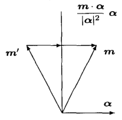

**定理八（邓金定理）** 权 $M$ 可以作为单纯李代数一个有限维不可约表示的最高权的充要条件是，对单纯李代数的所有素根 $r_\mu$，权 $M$ 满足

$$
\Gamma(M/r_\mu) = \text{非负整数}
\tag{7.132}
$$

我们只对这一定理做些解释。如果 $M$ 是某不可约表示的最高权，则由最高权的定义式 (7.123) 和定理七，式 (7.132) 显然满足。反之，邓金证明了，若 $M$ 满足式 (7.132)，则以它作为单的最高权，可以得到单纯李代数的一个有限维不可约表示，即在它对应的不简并的态 $|M\rangle$ 上，用升算符作用得零，用一系列降算符作用，得到的态空间集合一定是有限的，对应单纯李代数的一个有限维不可约表示。这是用方块权图方法计算单纯李群不可约表示的基础。

满足式 (7.132) 的权 $M$ 称为主权 (dominant weight)。单纯李代数任一不可约表示的最高权一定是主权，但一个给定的不可约表示中可能有若干个权是主权，它们在这个不可约表示中不一定是最高权，也不一定是单权，但每个主权都可以是一个不可约表示的最高权。一个不可约表示的维数等于它包含的状态基的数目。状态基对应的权都等价于某个主权。因此不可约表示的维数等于该表示所包含的各主权的重数和各主权的外尔轨道长度的乘积之和。

### ＊三、最高权表示的性质

对于给定的单纯李代数，最高权 $M$ 给出了该不可约表示的全部性质。限于篇幅，本书不做深入讨论，只给出一些主要结果。

单纯李代数 $\mathcal{L}$ 对应的紧致李群 $G$ 中，存在由嘉当子代数产生的阿贝尔子群 $H$，$H$ 的元素可用 $\ell$ 个参数 $\varphi \equiv (\varphi_1, \varphi_2, \cdots, \varphi_\ell)$ 来描写

$$
R = \exp\left\{-\mathrm{i}\sum_{j=1}^{\ell}\varphi_j H_j\right\} \in H
\tag{7.133}
$$

群 $G$ 中每一个元素都与 $H$ 中某一个元素共轭，因而参数 $\varphi$ 可以用来描写群 $G$ 的类。在不可约表示 $M$ 中，类 $\varphi$ 的特征标为

$$
\chi(M,\varphi) = \operatorname{Tr}\exp\left\{-\mathrm{i}\sum_{j=1}^{\ell}\varphi_j D(H_j)\right\} = \sum_m b(m)\exp\left\{-\mathrm{i}\sum_{j=1}^{\ell}\varphi_j m_j\right\}
\tag{7.134}
$$

$b(m)$ 是权 $m$ 的重数，因而对 $m$ 带权 $b(m)$ 的求和就是对不可约表示所有状态求和。为了计算特征标，外尔引入环链 (girdle) $\xi(K,\varphi)$ 的概念。设 $S$ 是外尔群 $W$ 的任意元素，用反射宇称 $\delta_S$ 描写 $S$ 中包含外尔反射次数的奇偶性，偶数次反射 $\delta_S = 1$，否则为 $-1$。环链 $\xi$ 定义为

$$
\xi(K,\varphi) = \sum_{S\in W}\delta_S \exp\left\{-\mathrm{i}\sum_{j=1}^{\ell}(SK)_j\varphi_j\right\}
\tag{7.135}
$$

其中，$K = M + \rho$，$\rho$ 是单纯李代数 $\mathcal{L}$ 中全部正根和的一半。类 $\varphi$ 在表示 $M$ 中的特征标为

$$
\chi(M,\varphi) = \frac{\xi(K,\varphi)}{\xi(\rho,\varphi)}
\tag{7.136}
$$

$\xi(\rho,\varphi)$ 与具体表示无关，它的模平方是紧致李群类上积分的密度函数。因此两不等价不可约表示的特征标正交归一性表为

$$
\int \chi(M,\varphi)^{*}\chi(M',\varphi)|\xi(\rho,\varphi)|^2(\mathrm{d}\varphi) = \int \xi(K,\varphi)^{*}\xi(K',\varphi)(\mathrm{d}\varphi) = \delta_{KK'}
\tag{7.137}
$$

当 $\varphi$ 趋于零时，$\chi(M,0)$ 是不定式，它趋于不可约表示 $M$ 的维数 $d(M)$，计算得

$$
d(M) = \prod_{\alpha\in\Delta_+}\left\{1+\frac{M\cdot\alpha}{\rho\cdot\alpha}\right\}
\tag{7.138}
$$

其中，$\Delta_+$ 是单纯李代数全部正根的集合。有了不可约表示的特征标和紧致李群类上积分的密度函数，原则上可以计算不可约表示直乘约化的克莱布施 – 戈登级数，但实际运算是很困难的。

### 四、基本主权

在 $\ell$ 秩单纯李代数中，下述 $\ell$ 个主权 $w_\mu$ 称为基本 (fundamental) 主权

$$
\Gamma(w_\mu/r_\nu) = d_\nu^{-1}w_\mu\cdot r_\nu = \delta_{\mu\nu} , \qquad d_\nu = r_\nu\cdot r_\nu/2
\tag{7.139}
$$

根据定理七和八，任何主权都可表为基本主权的非负整数线性组合，任何权都可表为基本主权的整数线性组合

$$
\begin{aligned}
M &= \sum_{\mu=1}^{\ell}M_\mu w_\mu , & M_\mu &= \Gamma(M/r_\mu) = \text{非负整数}, \\
m &= \sum_{\mu=1}^{\ell}m_\mu w_\mu , & m_\mu &= \Gamma(m/r_\mu) = \text{整数}
\end{aligned}
\tag{7.140}
$$

比较式 (7.64) 和 (7.139)，可以把素根和基本主权通过嘉当矩阵联系起来

$$
r_\mu = \sum_{\nu=1}^{\ell}w_\nu A_{\nu\mu} , \qquad w_\nu = \sum_{\mu=1}^{\ell}r_\mu\left(A^{-1}\right)_{\mu\nu}
\tag{7.141}
$$

以基本主权为基，素根的分量也都是整数，而且只能取 2，-1，-2，-3 和 0。正是这性质保证了在基本主权表象中权分量都是整数。在基本主权的表象中，等价权的关系式 (7.131) 变得更简单。设 $m_\mu = \Gamma(m/r_\mu)$ 是权 $m$ 关于 $w_\mu$ 的分量。经过关于素根 $r_\mu$ 的外尔反射后，权 $m$ 变成等价权 $m'$

$$
m' \xrightarrow{r_\mu} m - m_\mu r_\mu
\tag{7.142}
$$

基本主权的优点是所有权和根的分量都是整数，缺点是它们不一定正交归一。今后如无特别说明，我们在权空间和根空间就采用基本主权为基，仅在讨论平面权图时采用原来的正交基。以基本主权作为最高权的不可约表示称为基本 (fundamental) 表示。

采用了 $d_\mu$ 符号后，可把素根和基本主权的内积表达得更对称

$$
(r_\mu\cdot r_\nu) = d_\mu A_{\mu\nu} , \qquad (r_\mu\cdot w_\nu) = d_\mu\delta_{\mu\nu} , \qquad (w_\mu\cdot w_\nu) = d_\mu\left(A^{-1}\right)_{\mu\nu}
\tag{7.143}
$$

文献中常把 $d_\mu A_{\mu\nu}$ 称为对称化嘉当矩阵。

### 五、二阶卡西米尔不变量和伴随表示

在单纯李代数的紧致实形里，结构常数关于三个指标完全反对称，生成元的平方和就可与任一生成元对易

$$
\sum_A [I_A I_A,\, I_B] = \sum_A I_A[I_A,\, I_B] + [I_A,\, I_B]I_A = \mathrm{i}\sum_{AD}C_{AB}{}^{D}(I_A I_D + I_D I_A) = 0
$$

这样的生成元平方和称为单纯李代数的二阶卡西米尔 (Casimir) 算子，记作 $C_2$。按舒尔定理，它在不可约表示 $M$ 中取常数矩阵形式，此常数称为二阶卡西米尔不变量，记作 $C_2(M)$。

采用生成元的嘉当 – 外尔基

$$
C_2 = \sum_A I_A I_A = \sum_{j=1}^{\ell}H_j H_j + \sum_{\alpha\in\Delta_+}\{E_\alpha E_{-\alpha} + E_{-\alpha}E_\alpha\}
\tag{7.144}
$$

把它作用在最高权态 $|M\rangle$ 上，根据式 (7.42) 和 (7.123)，有

$$
C_2\,|M\rangle = M^2\,|M\rangle + \sum_{\alpha\in\Delta_+}[E_\alpha,\, E_{-\alpha}]\,|M\rangle = \left\{M^2 + M\cdot\sum_{\alpha\in\Delta_+}\alpha\right\}|M\rangle
$$

把单纯李代数所有正根之和记作 $2\rho$，则二阶卡西米尔不变量 $C_2(M)$ 为

$$
C_2(M) = M\cdot(M+2\rho) = \sum_{\mu,\nu=1}^{\ell}M_\mu d_\mu\left(A^{-1}\right)_{\mu\nu}(M_\nu+2)
\tag{7.145}
$$

现在来证明 $\rho$ 正好等于基本主权之和

$$
2\rho = \sum_{\alpha\in\Delta_+}\alpha = 2\sum_{\mu=1}^{\ell}w_\mu
\tag{7.146}
$$

证明方法就是检验 $2\rho$ 与每个素根 $r_\mu$ 的点乘，是否都等于 $2d_\mu$。在正根中，除了素根 $r_\mu$ 本身外，都分属关于素根 $r_\mu$ 的根链

$$
(\alpha - qr_\mu), \cdots, (\alpha - r_\mu), \alpha, (\alpha + r_\mu), \cdots, (\alpha + pr_\mu)
$$

根链中根矢量之和为

$$
(p+q+1)\alpha + \frac{1}{2}\left[p(p+1) - q(q+1)\right]r_\mu = (p+q+1)\left[\alpha + \frac{1}{2}(p-q)r_\mu\right]
$$

由于定理三，上式与 $r_\mu$ 的点乘为零。而素根 $r_\mu$ 平方等于 $2d_\mu$。证完。

对单纯李群，伴随表示是不可约表示。设 $D^M(I_A)$ 是不可约表示 $M$ 的生成元，构造 $g$ 维矩阵 $T(M)$，$T_{AB}(M) = \operatorname{Tr}[D^M(I_A)D^M(I_B)]$，第四章证明了 $T(M)$ 与伴随表示每一个生成元 $D^{\mathrm{ad}}(I_D)$ 对易，从而给出 $T(M)$ 是常数矩阵 [见式 (4.129)]，常数记作 $T_2(M)$，$T_{AB}(M) = \delta_{AB}T_2(M)$。通过 $T(M)$ 矩阵取迹，把此常数与卡西米尔不变量联系起来 [见式 (4.130)]

$$
gT_2(M) = \sum_A T_{AA}(M) = \operatorname{Tr}\left\{\sum_A D^M(I_A)D^M(I_A)\right\} = d(M)C_2(M)
\tag{7.147}
$$

其中，$d(M)$ 是表示 $M$ 的维数。对伴随表示，由式 (7.19)，$-T_{AB}(\omega) = g_{AB}$，$M$ 等于李代数的最大根 $\omega$。因此，$-T_2(\omega)$ 就是单纯李代数负定的基林型所取的常数值，有

$$
g_{AB} = -\delta_{AB}T_2(\omega) = -\delta_{AB}C_2(\omega)
\tag{7.148}
$$

附录 29 列出了单纯李代数的主要参数，包括嘉当矩阵 $A$ 和逆嘉当矩阵 $A^{-1}$，素根，正根和最大根 $\omega$，基本主权 $w_\mu$，由式 (7.145) 可算出表示 $M$ 中的二阶卡西米尔不变量 $C_2(M)$，由式 (7.148) 可算出基林型的常数值。计算中规定长根半长度 $d = 1$。

### 六、谢瓦莱基

在嘉当 – 外尔基中，$E_{\alpha+\beta}$ 可表为 $E_\alpha$ 和 $E_\beta$ 的对易关系。因此在计算生成元的表示矩阵时，只需计算与素根相联系的生成元的表示矩阵，由它们的对易关系可以得到所有其他生成元的表示矩阵。为使形式更加对称，谢瓦莱引入 $3\ell$ 个新基 $E_\mu$，$F_\mu$ 和 $H_\mu$，称为谢瓦莱基

$$
\begin{aligned}
d_\mu^{-1/2}E_{r_\mu} &\longrightarrow E_\mu , & d_\mu^{-1/2}E_{-r_\mu} &\longrightarrow F_\mu \\
d_\mu^{-1}\sum_{j=1}^{\ell}(r_\mu)_j H_j &\equiv d_\mu^{-1}r_\mu\cdot H \longrightarrow H_\mu
\end{aligned}
\tag{7.149}
$$

引入谢瓦莱基后，正则对易关系式 (7.42) 变成

$$
\begin{aligned}
[H_\mu,\, H_\nu] &= 0 , & [H_\mu,\, E_\nu] &= A_{\mu\nu}E_\nu , \\
[H_\mu,\, F_\nu] &= -A_{\mu\nu}F_\nu , & [E_\mu,\, F_\nu] &= \delta_{\mu\nu}H_\mu
\end{aligned}
\tag{7.150}
$$

其中，$A_{\mu\nu} = (r_\nu)_\mu$ 是嘉当矩阵。此外注意到素根之差不是根，素根之和形成根链

$$
\begin{aligned}
r_\mu + nr_\nu , \qquad & 0 \leqslant n \leqslant p, \qquad \text{是根}, \\
r_\mu + (p+1)r_\nu , \qquad & \text{不是根}, \qquad p = -\Gamma(r_\mu/r_\nu) = -A_{\nu\mu}
\end{aligned}
$$

因而有塞尔 (Serre) 关系

$$
\underbrace{[E_\nu,\, [E_\nu,\, \cdots [E_\nu}_{1-A_{\nu\mu}},\, E_\mu] \cdots] = 0,
$$

$$
\underbrace{[F_\nu,\, [F_\nu,\, \cdots [F_\nu}_{1-A_{\nu\mu}},\, F_\mu] \cdots] = 0
\tag{7.151}
$$

十分重要的是，有相同下标 $\mu$ 的三个生成元，正好满足 SU(2) 群生成元的对易关系。SU(2) 群的李代数是 $A_1$，自身表示生成元取为 $E = T_+ = T_1 + \mathrm{i}T_2$，$F = T_- = T_1 - \mathrm{i}T_2$ 和 $H = 2T_3$，

$$
E = \begin{pmatrix} 0 & 1 \\ 0 & 0 \end{pmatrix} , \qquad F = \begin{pmatrix} 0 & 0 \\ 1 & 0 \end{pmatrix} , \qquad H = \begin{pmatrix} 1 & 0 \\ 0 & -1 \end{pmatrix} ,
\tag{7.152}
$$

$$
[H,\, E] = 2E , \qquad [H,\, F] = -2F , \qquad [E,\, F] = H
$$

现在的 $E_\mu$，$F_\mu$ 和 $H_\mu$ 满足完全相同的对易关系

$$
[H_\mu,\, E_\mu] = 2E_\mu , \qquad [H_\mu,\, F_\mu] = -2F_\mu , \qquad [E_\mu,\, F_\mu] = H_\mu
\tag{7.153}
$$

因而构成单纯李代数的 $A_1$ 子李代数，记作 $\mathcal{A}_\mu$。在单纯李代数的一个不可约表示的表示空间里，属于代数 $\mathcal{A}_\mu$ 的不可约表示的状态集合，称为一个 $\mathcal{A}_\mu$ 多重态。各种这样的多重态以复杂的方式架构起单纯李代数的不可约表示空间，并由此可以计算出不可约表示空间的状态基和生成元表示矩阵。这方法称为方块权图方法，将在下节详细讨论。

## 7.6 方块权图方法

本节介绍用方块权图方法计算单纯李代数不可约表示空间的状态基和生成元的表示矩阵。方法的核心是怎样把各种 $\mathcal{A}_\mu$ 多重态嵌入到单纯李代数的不可约表示空间中去。由于存在重权，这些多重态在李代数的不可约表示空间中互相交叉，包含的状态基也不一定正交，形成复杂的态势。方块权图方法就是要理清这种复杂关系，确定李代数的不可约表示空间中互相正交归一的状态基和谢瓦莱基的表示矩阵。

### 一、A_μ 多重态

在第四章，$A_1$ 李代数 [SU(2) 群] 的生成元取为 $J_1$，$J_2$ 和 $J_3$，不可约表示空间的状态基用 $|j,m\rangle$ 标记，$-j \leqslant m \leqslant j$:

$$
J_3\,|j,m\rangle = m\,|j,m\rangle , \qquad (J_1 - \mathrm{i}J_-)\,|j,m\rangle = \sqrt{(j+m)(j-m+1)}\,|j,m-1\rangle
$$

现在为了与谢瓦莱基比较，生成元改用 $E = J_1 + \mathrm{i}J_2$，$F = J_1 - \mathrm{i}J_2$ 和 $H = 2J_3$，它们满足对易关系式 (7.152)。设 $M = 2j$ 和 $m = j - n$，把状态基改写为

$$
|j,j\rangle = |M,M\rangle , \qquad |j,m\rangle = |M,M-2n\rangle
$$

则

$$
\begin{aligned}
H\,|M,M-2n\rangle &= (M-2n)\,|M,M-2n\rangle, \\
F\,|M,M-2n\rangle &= \sqrt{(M-n)(n+1)}\,|M,M-2n-2\rangle, \qquad 0 \leqslant n \leqslant M \\
E\,|M,M-2n-2\rangle &= \sqrt{(M-n)(n+1)}\,|M,M-2n\rangle,
\end{aligned}
\tag{7.154}
$$

状态基 $|M,M-2n\rangle$ 是 $H$ 的本征态。$H$ 的表示矩阵是对角矩阵，而 $E$ 和 $F$ 的表示矩阵互为转置。

对单纯李代数，子李代数 $\mathcal{A}_\mu$ 生成元满足与式 (7.152) 相同的对易关系，因而在单纯李代数不可约表示中，它们对状态基也有类似的作用。设在单纯李代数不可约表示 $M$ 中，状态基记作 $|M,m\rangle$，它是 $H_\mu$ 的共同本征状态

$$
H_\mu\,|M,m\rangle = m_\mu\,|M,m\rangle
\tag{7.155}
$$

降算符 $F_\mu$ 对这些状态基的作用，使权 $m$ 减少一个素根 $r_\mu$。按照 $A_1$ 李代数多重态的规则式 (7.154)，我们可以在不可约表示 $M$ 的表示空间中，构造出 $\mathcal{A}_\mu$ 多重态来，其基本方法如下。在表示空间中，如果状态基 $|M,m\rangle$ 满足下面条件，即它在升算符 $E_\mu$ 作用下为零，且权 $m$ 包含正分量 $m_\mu > 0$，

$$
E_\mu\,|M,m\rangle = 0 , \qquad m_\mu > 0
\tag{7.156}
$$

则在表示空间中存在一个 $\mathcal{A}_\mu$ 多重态，重数为 $m_\mu + 1$

$$
|M, m - nr_\mu\rangle , \qquad 0 \leqslant n \leqslant m_\mu
\tag{7.157}
$$

$F_\mu$ 和 $E_\mu$ 在这些状态基中的矩阵元为

$$
\begin{aligned}
F_\mu\,|M, m - nr_\mu\rangle &= \sqrt{(m_\mu - n)(n+1)}\,|M, m - (n+1)r_\mu\rangle, \\
E_\mu\,|M, m - (n+1)r_\mu\rangle &= \sqrt{(m_\mu - n)(n+1)}\,|M, m - nr_\mu\rangle
\end{aligned}
\tag{7.158}
$$

$F_\mu$ 和 $E_\mu$ 的表示矩阵互为转置。

由于有不同权的状态基一定是互相正交的，只要这些权都是单权，这些状态基就可选作表示空间的正交归一的状态基。如果这些权中存在重权，就需要按一定的规则选定正交归一的状态基，这种规则往往是让状态基符合某一个 $A_\nu$ 多重态的要求，而其他 $A_\mu$ 多重态中包含的状态基（7.157）可能是这些选定的正交归一的状态基的适当线性组合。

### 二、正交归一的状态基

在单纯李代数的一个幺正不可约表示 $M$ 的表示空间中，状态基互相正交归一。对单权 $m$，状态基记作 $|M,m\rangle$。对 $n$ 重权 $m$，正交归一的状态基用序数字区分，记作 $|M,(m)_a\rangle$，$a=1,2,\cdots,n$。在不可约表示 $M$ 的方块权图中，每一个正交归一的状态基用一个方块代表。一个方块就是填以权分量的一个方框。权分量中如有负分量，用上面带一横线的数字标记。例如，单权 $m=-2w_1+w_2$ 的状态基用 $\boxed{\overline{2},1}$ 标记，三重权 $m=2w_1-w_2$ 的第二个状态基用 $\boxed{(2,\overline{1})_2}$ 标记。

在一个不可约表示中，任何权为 $m$ 的态都可由最高权态 $|M,M\rangle$ 通过多次降算符的作用得到。因此最高权 $M$ 和表示中的任何权 $m$ 之差一定可以表为素根之和

$$
M-m=\sum_{\mu=1}^{\ell} C_\mu r_\mu\ , \qquad h(M,m)=\sum_{\mu=1}^{\ell} C_\mu
\tag{7.159}
$$

$h(M,m)$ 称为在不可约表示 $M$ 中权 $m$ 的高度。最高权的高度为零。

在方块权图中，最高权 $M$ 是单权，最高权态的方块排在第一行，高度为一的权态对应的方块排在第二行，高度为二的权态对应的方块排在第三行，依此类推。同一行的方块对应的权高度都相等。只有相邻行的方块，它们对应的状态基才可能通过某一个降算符 $F_\mu$（或升算符 $E_\mu$）联系起来。在方块权图中这样的方块用一定的线连接起来。例如，由降算符 $F_1$ 相联系的方块用单线连接，由降算符 $F_2$ 相联系的方块用双线连接等。每一个 $A_\mu$ 多重态对应的方块都“竖直地”嵌入方块权图中，相邻状态基的方块排在相邻的行。对重权，$A_\mu$ 多重态中有的状态可能是若干选定的正交归一的状态基的线性组合，在方块权图中就表现为若干方块的组合。

对单纯李代数的给定不可约表示 $M$，先画出最高权态的方块。然后从最高权开始，凡见到有正分量 $m_\mu>0$ 的权，如果它的状态在 $E_\mu$ 作用下为零，则按照构造 $A_\mu$ 多重态的基本方法，在方块权图中嵌入一个 $A_\mu$ 多重态。在一个 $A_\mu$ 多重态中，有的权可能包含其他正分量（例如 $\nu$ 分量），由它又可产生新的 $A_\nu$ 多重态。最高权是单权，与最高权等价的权是单权，与最高权态同属一个 $A_\mu$ 多重态的状态的权也是单权。由最高权 $M$ 的状态出发，通过若干多重态到达某一个权为 $m$ 的状态，称为权 $m$ 的一条路径。只有一条路径的权也是单权，而有几条不同路径的权就可能是重权。例如，由最高权态出发，先经过 $A_\mu$ 多重态，再经过 $A_\nu$ 多重态到达权为 $m$ 的态，同时，由最高权态出发，先经过 $A_\nu$ 多重态，再经过 $A_\mu$ 多重态也可以到达权为 $m$ 的态。这样，权 $m$ 有两条路径，沿不同路径到达的两个权为 $m$ 的态不一定重合，因而权 $m$ 可能是二重权，在方块权图中就要画两个权为 $m$ 的方块，然后用下一小节的方法确定是单权还是二重权。

方块权图中高度最大的权，它的所有分量都非正，称为最低权 $N$。任何降算符作用在最低权态上都得零。最低权取负值就是另一个表示的最高权，这表示正是原表示的复共轭表示：$-N=M^*$。这里的 $M^*$ 是表示 $D^M$ 的复共轭表示的简写。按照幺正表示生成元的定义

$$
\begin{aligned}
D(R)^* &= \boldsymbol{1}-\mathrm{i}\sum_A \omega_A D(I_A)' = \boldsymbol{1}-\mathrm{i}\sum_A \omega_A \left\{-D(I_A)^*\right\}\\
D(I_A)' &= -D(I_A)^* = -D(I_A)^T
\end{aligned}
$$

可知在复共轭表示中生成元谢瓦莱基的表示矩阵为

$$
\begin{aligned}
D(H_\mu)' &= -D(H_\mu)\ , & H_\mu\,|M,m\rangle^* &= -m_\mu\,|M,m\rangle^*\\
D(E_\mu)' &= -D(F_\mu)\ , & E_\mu\,|M,m\rangle^* &= -\sum_{m'=m-r_\mu} D^M_{m',m}(F_\mu)\,|M,m'\rangle^*\\
D(F_\mu)' &= -D(E_\mu)\ , & F_\mu\,|M,m\rangle^* &= -\sum_{m'=m+r_\mu} D^M_{m',m}(E_\mu)\,|M,m'\rangle^*
\end{aligned}
$$

式中对重权的不同状态求和。可取复共轭表示 $M^*$ 的基为

$$
|M^*,-m\rangle=(-1)^{h(M,m)}\,|M,m\rangle^*
\tag{7.160}
$$

则

$$
D^{M^*}_{-m+r_\mu,\,-m}(E_\mu)=D^M_{m-r_\mu,\,m}(F_\mu)\ , \qquad
D^{M^*}_{-m-r_\mu,\,-m}(F_\mu)=D^M_{m+r_\mu,\,m}(E_\mu)
\tag{7.161}
$$

可见互为复共轭的两表示的方块权图互为倒置，对应的状态权互差负号。

### 三、重权重数的确定

在单纯李代数的一个不可约表示 $M$ 中，每一个权都等价于一个主权，它们的重数由主权的重数确定。因为主权没有负分量，所以在等价的权中，主权的高度最小。方块权图里对应等价权的一组方块中，对应主权的方块排在最上面，在画方块权图时它出现得最早。可用下面方法确定主权的重数，同时也就定出了与之等价的权的重数。在方块权图中，一旦出现主权的方块，首先根据由最高权降到此主权的路径数，定出该主权对应的方块数。属此主权的正交归一的状态基通常按某一个或几个 $A_\nu$ 多重态的要求来选定，然后由谢瓦莱基的对易关系式（7.150）计算相应生成元的表示矩阵元素，其中主要是

$$
E_\mu F_\mu = F_\mu E_\mu + H_\mu\ , \qquad E_\mu F_\nu = F_\nu E_\mu\ , \qquad \mu \neq \nu
\tag{7.162}
$$

式（7.158）也满足式（7.162）。方块权图中每一方块的所有连线对应的矩阵元都必须满足式（7.162）。如果发现有一个方块与所有它上面的方块的连线的矩阵元都为零，则说明此状态不能由最高权态用降算符的作用产生，根据表示的不可约性，这状态应该不存在。用这办法可最后确定该主权的重数。特殊情况下，由于状态基选得不好，还要检查有没有状态基的线性组合不能由最高权态用降算符的作用产生。但只要状态基是按一个或几个 $A_\nu$ 多重态来选定，这种情况就不会出现。

### 四、画方块权图的方法

根据前面的讨论，小结一下画方块权图的方法。对给定单纯李代数的给定不可约表示 $M$，按下面步骤自上而下画出方块权图。

（1）根据单纯李代数的嘉当矩阵 $A_{\nu\mu}$，由式（7.141）算出素根 $r_\mu$ 关于基本主权 $w_\nu$ 的展开式。

（2）按等价关系式（7.142）计算所有与最高权等价的权。

（3）方块权图的第一行是最高权态对应的方块。对最高权的每一个正分量 $m_\mu$，构造相应的 $A_\mu$ 多重态。两相邻方块用与 $F_\mu$ 相对应的连线（如实线，虚线或 $\mu$ 重线等）来连接，它们的权之差等于素根 $r_\mu$，$F_\mu$ 的矩阵元由式（7.158）计算。

（4）对方块权图中新出现的权，如包含有正分量 $m_\nu$，且对应状态基在 $E_\nu$ 作用下为零［条件式（7.156）］，就构造相应的 $A_\nu$ 多重态。

（5）当不同的多重态中出现相同的权时，若此权不是主权，则根据它等价的主权确定其重数，若此权是主权，则根据由最高权降到此权的路径数，初步确定为此主权的重数。对每一个权，用适当方式定义与重数相同个数的正交归一的状态基，分别对应方块权图中一个方块。

（6）根据式（7.158）或（7.162）计算方块权图中已出现连线的矩阵元，并把矩阵元标在连线旁。因为升算符 $E_\mu$ 的表示矩阵是降算符 $F_\mu$ 表示矩阵的转置，所以连线旁注上的矩阵元同时也是升算符的矩阵元。撤消矩阵元为零的连线。矩阵元为 1 时数字经常省略。检查每一个对应主权的方块，如发现有方块与它上面的所有方块没有连线相连，则移去此方块，从而确定该主权的重数。按等价关系式（7.142）计算所有与此主权等价的权，它们有相同的重数。按此方法画方块权图，一直到构造不出新的 $A_\nu$ 多重态为止。

（7）不可约表示的最低权改负号就是复共轭表示的最高权。互为复共轭表示的方块权图互相上下颠倒，对应的状态基可由式（7.160）相联系，权矢量互差负号，升或降算符的表示矩阵元由式（7.161）计算。

（8）在画方块权图过程中一旦出现错误，就会影响后面的计算，因而要随时做检查。检查用 $F_\mu$ 连线连接的两方块的权之差是不是等于素根 $r_\mu$，检查对每个方块的连线式（7.162）是否成立，检查等价的权重数是否相同，检查每一高度包含的方块数目，随高度增加，是否先增加，后减少，对称地形成一个纺锤形。检查方块权图的上下对称性经常是检查方块权图错误的一个重要方面。

有一本书（文献 [13]）详细列出了各单纯李代数不等价不可约表示的各种重要参数，如表示维数，表示包含的最大高度数（称为级数），表示中包含的各主权的重数，每个主权的外尔轨道长度等，这对计算生成元的表示矩阵，以及以后计算克莱布施 - 戈登系数大有帮助。

我们将通过例子来说明方块权图的画法。

### 五、A_2 李代数几个表示的方块权图

SU(3) 群的李代数是 $A_2$，它在物理中有广泛应用。$A_2$ 李代数的嘉当矩阵和素根展开式为

$$
A=\begin{pmatrix} 2 & -1\\ -1 & 2 \end{pmatrix}\ , \qquad
\begin{aligned}
r_1 &= 2w_1-w_2\ ,\\
r_2 &= -w_1+2w_2\ .
\end{aligned}
$$

先画基本表示的方块权图。$(1,0)$ 表示的最高权第一个分量为正，由它可构造一个 $A_1$ 二重态

$$
F_1\,|(1,0),(1,0)\rangle=|(1,0),(\overline{1},1)\rangle
$$

$F_1$ 作用前后，权相差 $r_1$。新状态的第二分量为正，而且在 $E_2$ 作用下为零，由它可构造一个 $A_2$ 二重态

$$
F_2\,|(1,0),(\overline{1},1)\rangle=|(1,0),(0,\overline{1})\rangle
$$

$F_2$ 作用前后，权相差 $r_2$。新状态 $(0,\overline{1})$ 不包含正分量，不能产生新的多重态。$(1,0)$ 表示是 SU(3) 群的自身表示，它包含三个互相外尔等价的状态，都对应单权。$(1,0)$ 表示的最低权是 $(0,\overline{1})$，改符号后得 SU(3) 群自身表示的复共轭表示，最高权为 $(0,1)$。$(1,0)$ 和 $(0,1)$ 是 SU(3) 群两个基本表示。图 7.3 (a) 和 (b) 给出它们的方块权图。所有降算符的非零矩阵元都是 1，在图中省略。上面给出的 $F_1$ 和 $F_2$ 对状态基的作用公式是表达降算符非零表示矩阵元的一种常用方式。状态基都是 $H_\mu$ 的本征状态，$H_\mu$ 的表示矩阵由式（7.155）给出，不需要专门列出。

再画表示 $(3,0)$ 的方块权图。由式（7.142）计算与最高权 $(3,0)$ 等价的权

$$
(3,0) \xrightarrow{r_1} (\overline{3},3) \xrightarrow{r_2} (0,\overline{3})
\tag{7.163}
$$

最高权的第一个分量为正，由它可以构造一个 $A_1$ 四重态

$$
\begin{aligned}
F_1\,|(3,0),(3,0)\rangle &= \sqrt{3}\,|(3,0),(1,1)\rangle\\
F_1\,|(3,0),(1,1)\rangle &= 2\,|(3,0),(\overline{1},2)\rangle\\
F_1\,|(3,0),(\overline{1},2)\rangle &= \sqrt{3}\,|(3,0),(\overline{3},3)\rangle
\end{aligned}
\tag{7.164}
$$

$(1,1)$ 是主权，它在表示 $(3,0)$ 中不是最高权。主权 $(1,1)$ 与最高权 $(3,0)$ 同处于一个 $A_1$ 多重态中，因而也是单权。与主权 $(1,1)$ 等价的权也都是单权，它们是

$$
\begin{aligned}
(1,1)\quad &\xrightarrow{r_1}\ (\overline{1},2)\ \xrightarrow{r_2}\ (1,\overline{2})\ \xrightarrow{r_1}\ (\overline{1},\overline{1})\\
&\xrightarrow{r_2}\ (2,\overline{1})\ \xrightarrow{r_1}\ (\overline{2},1)\ \xrightarrow{r_2}\ (\overline{1},\overline{1})
\end{aligned}
\tag{7.165}
$$

由于 $A_1$ 四重态后三个权的第二分量都为正［见式（7.164）］，由它们可分别构造 $A_2$ 的二重态，三重态和四重态

$$
\begin{aligned}
F_2\,|(3,0),(1,1)\rangle &= |(3,0),(2,\overline{1})\rangle\ , & F_2\,|(3,0),(\overline{1},2)\rangle &= \sqrt{2}\,|(3,0),(0,0)\rangle\\
F_2\,|(3,0),(0,0)\rangle &= \sqrt{2}\,|(3,0),(1,\overline{2})\rangle\ , & F_2\,|(3,0),(\overline{3},3)\rangle &= \sqrt{3}\,|(3,0),(\overline{2},1)\rangle\\
F_2\,|(3,0),(2,\overline{1})\rangle &= 2\,|(3,0),(\overline{1},\overline{1})\rangle\ , & F_2\,|(3,0),(\overline{1},\overline{1})\rangle &= \sqrt{3}\,|(3,0),(0,\overline{3})\rangle
\end{aligned}
\tag{7.166}
$$

由于权 $(2,\overline{1})$ 的第一分量为正，而且 $E_1$ 作用在该状态基上得零，可以由它构造一个 $A_1$ 三重态，后两个状态的权为 $(0,0)$ 和 $(\overline{2},1)$。$(0,0)$ 是主权，而且可从最高权通过两条不同路径到达，因而有可能是二重权。设两个 $(0,0)$ 状态基按 $A_2$ 多重态来区分，式（7.166）中的 $|(3,0),(0,0)\rangle$ 应改成 $|(3,0),(0,0)_1\rangle$，属 $A_2$ 三重态，而 $|(3,0),(0,0)_2\rangle$ 属 $A_2$ 单态

$$
E_2\,|(3,0),(0,0)_2\rangle=F_2\,|(3,0),(0,0)_2\rangle=0
$$

这样，新的 $A_1$ 三重态中出现的 $(0,0)$ 状态就一般是两个状态基的线性组合

$$
F_1\,|(3,0),(2,\overline{1})\rangle=a_1\,|(3,0),(0,0)_1\rangle+a_2\,|(3,0),(0,0)_2\rangle\ ,\qquad a_1^2+a_2^2=2
$$

利用式（7.162）得

$$
\begin{aligned}
E_2 F_1\,|(3,0),(2,\overline{1})\rangle &= a_1\sqrt{2}\,|(3,0),(\overline{1},2)\rangle\\
&= F_1 E_2\,|(3,0),(2,\overline{1})\rangle = F_1\,|(3,0),(1,1)\rangle = 2\,|(3,0),(\overline{1},2)\rangle
\end{aligned}
$$

解得 $a_1=\sqrt{2}$ 和 $a_2=\sqrt{2-a_1^2}=0$。状态基 $|(3,0),(0,0)_2\rangle$ 与前面的状态基联系的矩阵元都为零，可见它在不可约表示 $(3,0)$ 中并不存在。在表示 $(3,0)$ 中权 $(0,0)$ 应该是单权。式（7.166）中权为 $(0,0)$ 的状态基仍应记作 $|(3,0),(0,0)\rangle$。表示 $(3,0)$ 中包含的三个主权 $(3,0)$，$(1,1)$ 和 $(0,0)$ 都是单权，因而其他权也都是单权。由权 $(2,\overline{1})$ 和 $(1,\overline{2})$ 构造 $A_1$ 三重态和二重态为

$$
\begin{aligned}
F_1\,|(3,0),(2,\overline{1})\rangle &= \sqrt{2}\,|(3,0),(0,0)\rangle\ ,\\
F_1\,|(3,0),(0,0)\rangle &= \sqrt{2}\,|(3,0),(\overline{2},1)\rangle\ ,\\
F_1\,|(3,0),(1,\overline{2})\rangle &= |(3,0),(\overline{1},\overline{1})\rangle
\end{aligned}
\tag{7.167}
$$

降算符的所有不为零的矩阵元素列于式（7.164）、（7.166）和（7.167）中，也标出在图 7.3 (d) 中。这样就完成了表示 $(3,0)$ 的方块权图。表示 $(0,3)$ 是表示 $(3,0)$ 的复共轭表示，方块权图的画法十分类似，不再解释。

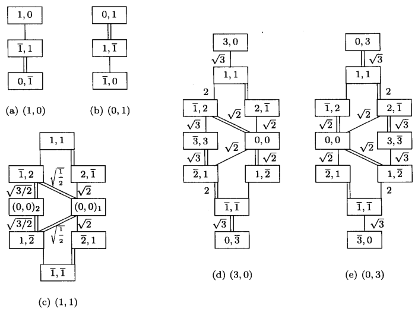

最后画 $A_2$ 李代数伴随表示 $(1,1)$ 的方块权图。最高权的两个分量都是正的，由它可构造一个 $A_1$ 多重态和一个 $A_2$ 多重态

$$
F_1\,|(1,1),(1,1)\rangle=|(1,1),(\overline{1},2)\rangle\ ,\qquad
F_2\,|(1,1),(1,1)\rangle=|(1,1),(2,\overline{1})\rangle
\tag{7.168}
$$

新产生的两个状态的权都包含正分量，构造的多重态中都包含主权 $(0,0)$ 的态，因而主权 $(0,0)$ 可能是二重权。按 $A_1$ 多重态来定义这两个状态基，$|(1,1),(0,0)_1\rangle$ 属$A_1$ 三重态，$|(1,1),(0,0)_2\rangle$ 属 $A_1$ 单态

$$
\begin{aligned}
F_1\,|(1,1),(2,\overline{1})\rangle &= \sqrt{2}\,|(1,1),(0,0)_1\rangle\ , & F_1\,|(1,1),(0,0)_1\rangle &= \sqrt{2}\,|(1,1),(\overline{2},1)\rangle\ ,\\
E_1\,|(1,1),(0,0)_2\rangle &= F_1\,|(1,1),(0,0)_2\rangle = 0\ ,\\
F_2\,|(1,1),(\overline{1},2)\rangle &= b_1\,|(1,1),(0,0)_1\rangle+b_2\,|(1,1),(0,0)_2\rangle\ , & b_1^2+b_2^2 &= 2\ ,\\
F_2\,|(1,1),(0,0)_1\rangle &= b_3\,|(1,1),(1,\overline{2})\rangle\ , & F_2\,|(1,1),(0,0)_2\rangle &= b_4\,|(1,1),(1,\overline{2})\rangle
\end{aligned}
\tag{7.169}
$$

利用式（7.162）得

$$
\begin{aligned}
E_1 F_2\,|(1,1),(\overline{1},2)\rangle &= b_1\sqrt{2}\,|(1,1),(2,\overline{1})\rangle\\
&= F_2 E_1\,|(1,1),(\overline{1},2)\rangle = F_2\,|(1,1),(1,1)\rangle = |(1,1),(2,\overline{1})\rangle
\end{aligned}
$$

解得 $b_1=\sqrt{1/2}$。选择 $|(1,1),(0,0)_2\rangle$ 的相位使 $b_2$ 是正实数，解得 $b_2=\sqrt{2-b_1^2}=\sqrt{3/2}$。再用式（7.162）

$$
\begin{aligned}
E_2 F_2\,|(1,1),(0,0)_1\rangle &= b_3^2\,|(1,1),(0,0)_1\rangle+b_3b_4\,|(1,1),(0,0)_2\rangle\\
&= (F_2 E_2+H_2)\,|(1,1),(0,0)_1\rangle = (1/2)\,|(1,1),(0,0)_1\rangle+\sqrt{3/4}\,|(1,1),(0,0)_2\rangle
\end{aligned}
$$

选择 $|(1,1),(1,\overline{2})\rangle$ 的相位使 $b_3$ 是正实数，解得 $b_3=\sqrt{1/2}$，然后得 $b_4=\sqrt{3/2}$。这样，$(1,1)$ 表示包含两个主权，最高权 $(1,1)$ 是单权，权 $(0,0)$ 是二重权。余下的是由权 $(\overline{2},1)$ 和 $(1,\overline{2})$ 构造的 $A_2$ 多重态和 $A_1$ 多重态

$$
F_2\,|(1,1),(\overline{2},1)\rangle=|(1,1),(\overline{1},\overline{1})\rangle\ ,\qquad
F_1\,|(1,1),(1,\overline{2})\rangle=|(1,1),(\overline{1},\overline{1})\rangle
\tag{7.170}
$$

式（7.168）～（7.170）给出 $(1,1)$ 表示降算符全部不为零矩阵元，这些矩阵元也标记在图 7.3 上。最低权 $(\overline{1},\overline{1})$ 与最高权仅差负号，因而伴随表示是自共轭表示。

$(1,1)$ 表示是 $A_2$ 李代数的伴随表示，它的方块权图上半部的权也是 $A_2$ 李代数的正根

$$
w_1+w_2=r_1+r_2\ ,\qquad 2w_1-w_2=r_1\ ,\qquad -w_1+2w_2=r_2
\tag{7.171}
$$

### ＊六、C_3 李代数基本表示的方块权图

$C_3$ 李代数的邓金图和嘉当矩阵如下：

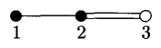

$$
A=\begin{pmatrix} 2 & -1 & 0\\ -1 & 2 & -2\\ 0 & -1 & 2 \end{pmatrix}
$$

素根和基本主权的关系是

$$
r_1=2w_1-w_2\ ,\qquad r_2=-w_1+2w_2-w_3\ ,\qquad r_3=-2w_2+2w_3
\tag{7.172}
$$

现在我们画 $C_3$ 李代数的三个基本表示的方块权图（见图 7.4）。先画 $(1,0,0)$ 表示的方块权图。与最高权等价的权都是单权，有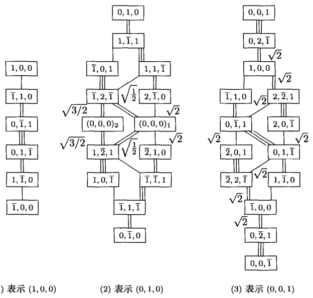

$$
(1,0,0)\xrightarrow{r_1}(\overline{1},1,0)\xrightarrow{r_2}(0,\overline{1},1)\xrightarrow{r_3}(0,1,\overline{1})\xrightarrow{r_2}(1,\overline{1},0)\xrightarrow{r_1}(\overline{1},0,0)
\tag{7.173}
$$

最高权的第一个分量为 1，由它可构造出一个 $A_1$ 二重态，得权 $(\overline{1},1,0)$。由权 $(\overline{1},1,0)$ 构造出一个 $A_2$ 二重态，得权 $(0,\overline{1},1)$。由权 $(0,\overline{1},1)$ 构造出一个 $A_3$ 二重态，得权 $(0,1,\overline{1})$。由权 $(0,1,\overline{1})$ 构造出一个 $A_2$ 二重态，得权 $(1,\overline{1},0)$。最后，由权 $(1,\overline{1},0)$ 构造出一个 $A_1$ 二重态，得权 $(\overline{1},0,0)$。权 $(\overline{1},0,0)$ 的全部分量都非正，不能再构造出新的多重态，方块权图画完。表示 $(1,0,0)$ 中只有一个主权，也就是最高权，因而表示 $(1,0,0)$ 是六维表示，六个权都互相等价，无重权。它就是 USp(6) 群的自身表示。这里和以后，为了节省篇幅，在写降算符 $F_\mu$ 的非零矩阵元时，省略状态基 $|M,m\rangle$ 中的 $M$

$$
\begin{aligned}
F_1\,|1,0,0\rangle &= |\overline{1},1,0\rangle\ , & F_2\,|\overline{1},1,0\rangle &= |0,\overline{1},1\rangle\ ,\\
F_3\,|0,\overline{1},1\rangle &= |0,1,\overline{1}\rangle\ , & F_2\,|0,1,\overline{1}\rangle &= |1,\overline{1},0\rangle\ ,\\
F_1\,|1,\overline{1},0\rangle &= |\overline{1},0,0\rangle
\end{aligned}
\tag{7.174}
$$

其次，画 (0,1,0) 表示的方块权图。有 12 个权与最高权等价

$$
\begin{aligned}
&(0,1,0),\quad (1,\bar{1},1),\quad (\bar{1},0,1),\quad (1,1,\bar{1}),\quad (\bar{1},2,\bar{1}),\quad (2,\bar{1},0)\\
&(1,\bar{2},1),\quad (\bar{2},1,0),\quad (1,0,\bar{1}),\quad (\bar{1},\bar{1},1),\quad (\bar{1},1,\bar{1}),\quad (0,\bar{1},0)
\end{aligned}
\tag{7.175}
$$

最高权的第二个分量为 1，由它可构造出一个 $A_2$ 二重态

$$
F_2\,|0,1,0\rangle = |1,\bar{1},1\rangle
$$

权 $(1,\bar{1},1)$ 中包含两个正分量，可构造两个二重态

$$
F_1\,|1,\bar{1},1\rangle = |\bar{1},0,1\rangle,\qquad F_3\,|1,\bar{1},1\rangle = |1,1,\bar{1}\rangle
$$

由新产生的权，又可以构造新的多重态

$$
F_3\,|\bar{1},0,1\rangle = |\bar{1},2,\bar{1}\rangle,\qquad F_1\,|1,1,\bar{1}\rangle = |\bar{1},2,\bar{1}\rangle,\qquad F_2\,|1,1,\bar{1}\rangle = |2,\bar{1},0\rangle
$$

到现在为止，所有产生的权都与最高权等价，因而都是单权。特别是 $F_3$ 作用在状态基 $|\bar{1},0,1\rangle$ 上得到的状态基 $|\bar{1},2,\bar{1}\rangle$，和 $F_1$ 作用在状态基 $|1,1,\bar{1}\rangle$ 上得到的状态基 $|\bar{1},2,\bar{1}\rangle$，必须是同一个基。一般来说，在画方块权图时，只要还没有出现主权，或者出现的主权也是单权，则所有其他权都是单权。一旦出现有重权的主权，才需要注意与它等价的权也是重权。

由权 $(\bar{1},2,\bar{1})$ 和 $(2,\bar{1},0)$ 分别构造两个三重态都会出现主权 $(0,0,0)$。有两个理由可以确定零权是二重权：一是它由两条不同的路径产生，它们很可能不重合。二是在高度为 4 的权中只有零权，高度为 4 的状态基数不应该少于高度为 3 的状态基数。现在按 $A_1$ 多重态来定义零权的状态基，$|(0,0,0)_1\rangle$ 属 $A_1$ 三重态，$|(0,0,0)_2\rangle$ 属 $A_1$ 单态，而 $F_2$ 对 $|\bar{1},2,\bar{1}\rangle$ 的作用得到的零权态只能是它们的组合

$$
\begin{aligned}
F_1\,|2,\bar{1},0\rangle &= \sqrt{2}\,|(0,0,0)_1\rangle, & F_1\,|(0,0,0)_1\rangle &= \sqrt{2}\,|\bar{2},1,0\rangle,\\
E_1\,|(0,0,0)_2\rangle &= F_1\,|(0,0,0)_2\rangle = 0,\\
F_2\,|\bar{1},2,\bar{1}\rangle &= a_1\,|(0,0,0)_1\rangle + a_2\,|(0,0,0)_2\rangle, & a_1^2 + a_2^2 &= 2,\\
F_2\,|(0,0,0)_1\rangle &= a_3\,|1,\bar{2},1\rangle, & F_2\,|(0,0,0)_2\rangle &= a_4\,|1,\bar{2},1\rangle
\end{aligned}
$$

按式 (7.162)，

$$
E_1 F_2\,|\bar{1},2,\bar{1}\rangle = a_1\sqrt{2}\,|2,\bar{1},0\rangle = F_2 E_1\,|\bar{1},2,\bar{1}\rangle = |2,\bar{1},0\rangle
$$

定出 $a_1 = \sqrt{1/2}$。选择状态基 $|(0,0,0)_2\rangle$ 的相位使 $a_2$ 是正实数，得 $a_2 = \sqrt{2-a_1^2} = \sqrt{3/2}$。再用式 (7.162)，

$$
\begin{aligned}
E_2 F_2\,|(0,0,0)_1\rangle &= a_3^2\,|(0,0,0)_1\rangle + a_3 a_4\,|(0,0,0)_2\rangle\\
&= (F_2 E_2 + H_2)\,|(0,0,0)_1\rangle = (1/2)\,|(0,0,0)_1\rangle + \sqrt{3/4}\,|(0,0,0)_2\rangle
\end{aligned}
$$

选择状态基 $|(1,\bar{2},1)\rangle$ 的相位使 $a_3$ 是正实数，定出 $a_3 = \sqrt{1/2}$，解得 $a_4 = \sqrt{3/2}$。方块权图的下面一半与上面对称，计算很类似，结果列于下面公式中，也标记在方块权图上。

$$
F_1\,|1,\bar{2},1\rangle = |\bar{1},\bar{1},1\rangle,\qquad F_3\,|1,\bar{2},1\rangle = |1,0,\bar{1}\rangle
$$

$$
F_2\,|\bar{2},1,0\rangle = |\bar{1},\bar{1},1\rangle,\qquad F_3\,|\bar{1},\bar{1},1\rangle = |\bar{1},1,\bar{1}\rangle
$$

$$
F_1\,|1,0,\bar{1}\rangle = |\bar{1},1,\bar{1}\rangle,\qquad F_2\,|\bar{1},1,\bar{1}\rangle = |0,\bar{1},0\rangle
$$

表示 (0,1,0) 是 14 维自共轭表示，有两个主权，零权是二重权。

最后画 (0,0,1) 表示的方块权图。这表示中有两个主权 (0,0,1) 和 (1,0,0)，主权 (1,0,0) 由最高权 (0,0,1) 通过一条路径降下来，因而也是单权。(1,0,0) 的等价权已由式 (7.173) 给出，(0,0,1) 的等价权是

$$
\begin{aligned}
&(0,0,1),\quad (0,2,\bar{1}),\quad (2,\bar{2},1),\quad (2,0,\bar{1}),\\
&(\bar{2},0,1),\quad (\bar{2},2,\bar{1}),\quad (0,\bar{2},1),\quad (0,0,\bar{1})
\end{aligned}
\tag{7.176}
$$

下面列出降算符的非零矩阵元

$$
\begin{aligned}
F_3\,|0,0,1\rangle &= |0,2,\bar{1}\rangle, & F_2\,|0,2,\bar{1}\rangle &= \sqrt{2}\,|1,0,0\rangle,\\
F_2\,|1,0,0\rangle &= \sqrt{2}\,|2,\bar{2},1\rangle, & F_1\,|1,0,0\rangle &= |\bar{1},1,0\rangle,\\
F_2\,|\bar{1},1,0\rangle &= |0,\bar{1},1\rangle, & F_1\,|2,\bar{2},1\rangle &= \sqrt{2}\,|0,\bar{1},1\rangle,\\
F_1\,|0,\bar{1},1\rangle &= \sqrt{2}\,|\bar{2},0,1\rangle, & F_3\,|2,\bar{2},1\rangle &= |2,0,\bar{1}\rangle,\\
F_1\,|2,0,\bar{1}\rangle &= \sqrt{2}\,|0,1,\bar{1}\rangle, & F_1\,|0,1,\bar{1}\rangle &= \sqrt{2}\,|\bar{2},2,\bar{1}\rangle,\\
F_3\,|0,\bar{1},1\rangle &= |0,1,\bar{1}\rangle, & F_3\,|\bar{2},0,1\rangle &= |\bar{2},2,\bar{1}\rangle,\\
F_2\,|0,1,\bar{1}\rangle &= |1,\bar{1},0\rangle, & F_1\,|1,\bar{1},0\rangle &= |\bar{1},0,0\rangle,\\
F_2\,|\bar{2},2,\bar{1}\rangle &= \sqrt{2}\,|\bar{1},0,0\rangle, & F_2\,|\bar{1},0,0\rangle &= \sqrt{2}\,|0,\bar{2},1\rangle,\\
F_3\,|0,\bar{2},1\rangle &= |0,0,\bar{1}\rangle
\end{aligned}
$$

### 七、G_2 李代数基本表示的方块权图

$G_2$ 李代数的邓金图和嘉当矩阵如下：

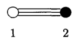

$$
A = \begin{pmatrix} 2 & -1 \\ -3 & 2 \end{pmatrix}
$$

根据嘉当矩阵可写出素根和基本主权的关系

$$
r_1 = 2w_1 - 3w_2,\qquad r_2 = -w_1 + 2w_2
\tag{7.177}
$$

表示 (0,1) 是七维表示，包含两个主权 (0,1) 和 (0,0)。与最高权 (0,1) 等价的权为

$$
(0,1),\quad (1,\bar{1}),\quad (\bar{1},2),\quad (1,\bar{2}),\quad (\bar{1},1),\quad (0,\bar{1})
\tag{7.178}
$$

主权 (0,0) 只有一条路径，因而也是单权。降算符的非零矩阵元列举如下。与前面一样，在写降算符 $F_\mu$ 的非零矩阵元时，省略状态基 $|M,m\rangle$ 中的 $M$

$$
\begin{aligned}
F_2\,|0,1\rangle &= |1,\bar{1}\rangle, & F_1\,|1,\bar{1}\rangle &= |\bar{1},2\rangle, & F_2\,|\bar{1},2\rangle &= \sqrt{2}\,|0,0\rangle,\\
F_2\,|0,0\rangle &= \sqrt{2}\,|1,\bar{2}\rangle, & F_1\,|1,\bar{2}\rangle &= |\bar{1},1\rangle, & F_2\,|\bar{1},1\rangle &= |0,\bar{1}\rangle
\end{aligned}
$$

表示 (1,0) 是伴随表示，14 维。它包含三个主权 (1,0)，(0,1) 和 (0,0)。主权 (0,1) 只有一条路径，因而是单权。主权 (0,0) 有两条路径，而且根据方块权图的纺锤形要求，它应该是二重权，从矩阵元计算中也发现它必须是二重权。设

$$
F_1\,|2,\bar{3}\rangle = \sqrt{2}\,|(0,0)_1\rangle,\qquad F_2\,|\bar{1},2\rangle = a\,|(0,0)_1\rangle + b\,|(0,0)_2\rangle
$$

则

$$
E_1 F_2\,|\bar{1},2\rangle = a\sqrt{2}\,|2,\bar{3}\rangle = F_2 E_1\,|\bar{1},2\rangle = \sqrt{3}\,|2,\bar{3}\rangle
$$

得

$$
a = \sqrt{3/2},\qquad b = (2-a^2)^{1/2} = \sqrt{1/2}
$$

可见 $b\ne 0$。请注意这里算得的矩阵元与 SU(3) 群伴随表示中的类似矩阵元不同。主权 (1,0) 的外尔轨道长度等于 6，等价权有

$$
(1,0),\quad (\bar{1},3),\quad (2,\bar{3}),\quad (\bar{2},3),\quad (1,\bar{3}),\quad (\bar{1},0)
\tag{7.179}
$$

降算符的非零矩阵元列举如下

$$
\begin{aligned}
F_1\,|1,0\rangle &= |\bar{1},3\rangle, & F_2\,|\bar{1},3\rangle &= \sqrt{3}\,|0,1\rangle,\\
F_2\,|0,1\rangle &= 2\,|1,\bar{1}\rangle, & F_2\,|1,\bar{1}\rangle &= \sqrt{3}\,|2,\bar{3}\rangle,\\
F_1\,|1,\bar{1}\rangle &= |\bar{1},2\rangle, & F_1\,|2,\bar{3}\rangle &= \sqrt{2}\,|(0,0)_1\rangle,\\
F_2\,|\bar{1},2\rangle &= \sqrt{3/2}\,|(0,0)_1\rangle + \sqrt{1/2}\,|(0,0)_2\rangle,\\
F_2\,|(0,0)_1\rangle &= \sqrt{3/2}\,|1,\bar{2}\rangle, & F_2\,|(0,0)_2\rangle &= \sqrt{1/2}\,|1,\bar{2}\rangle
\end{aligned}
$$

$$
\begin{aligned}
F_1\,|(0,0)_1\rangle &= \sqrt{2}\,|\bar{2},3\rangle, & F_1\,|1,\bar{2}\rangle &= |\bar{1},1\rangle,\\
F_2\,|\bar{2},3\rangle &= \sqrt{3}\,|\bar{1},1\rangle, & F_2\,|\bar{1},1\rangle &= 2\,|0,\bar{1}\rangle,\\
F_2\,|0,\bar{1}\rangle &= \sqrt{3}\,|1,\bar{3}\rangle, & F_1\,|1,\bar{3}\rangle &= |\bar{1},0\rangle
\end{aligned}
$$

注意，在伴随表示中，权矢量等于李代数的根矢量。两个零权对应两个零根。图中在零权上面的权对应正根，零权下面的权对应负根

$$
\begin{aligned}
w_1 &= 2r_1 + 3r_2, & -w_1 + 3w_2 &= r_1 + 3r_2,\\
w_2 &= r_1 + 2r_2, & w_1 - w_2 &= r_1 + r_2,\\
2w_1 - 3w_2 &= r_1, & -w_1 + 2w_2 &= r_2
\end{aligned}
\tag{7.180}
$$

两个基本表示的方块权图画在图 7.5。

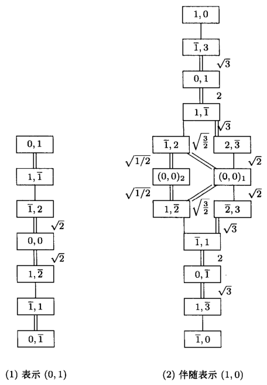

用方块权图方法原则上可以计算在任何单纯李代数的任何不可约表示 $M$ 中包含哪些基本主权及其重数，在表示空间中包含哪些状态基和生成元在这些状态基中的矩阵元。当权的重数比较高时，计算会变得相当复杂，而且复杂程度会依赖于对重权的状态基的选择，但是不会产生原则上的困难。方块权图方法有两个基本的缺点：一是在一个不可约表示中权的分布不直观。对 2 秩李代数，这缺点可用平面权图方法克服。二是状态基的物理背景和重权的产生原因不清楚。我们知道，在物理中状态基常与粒子波函数相联系的，它们可能是同一能级简并的定态波函数，也可能是具有某种对称性的不同粒子的状态等。物理学中了解这些状态基的构造，即波函数的具体形式是十分重要的事。但方块权图除了告诉我们这些状态基对应的权和生成元对这些状态基的作用规律外，没有对波函数形式提供信息。在后面几章，我们将对物理中常见的李群，研究波函数的性质。

## * 八、平面权图

对 2 秩李代数，权只有两个分量，可以把一个不可约表示所包含的权及其重数在一个平面直角坐标系中直观地画出来，这就是平面权图。对于根矢量和权矢量，我们采用过两种表象。一种是采用正交归一的矢量基，在生成元取嘉当 - 外尔基时以这样的基表达根矢量和权矢量。另一种是以基本主权 $w_\mu$ 为基，根矢量和权矢量的分量都是整数，但矢量基 $w_\mu$ 一般不是正交归一的，如式 (7.143) 所示。在用一个平面直角坐标系把权矢量表达出来时，取第一种表象比较方便。即使采用基本主权 $w_\mu$ 为基，也先要把基本主权在第一种表象中的分量算出来，画在平面直角坐标系中，然后以基本主权为基，选用斜坐标系。

对 $A_2$ 李代数 [SU(3) 群]，按照式 (7.69)、(7.72)、(7.75)、(7.83) 和 (7.84)，SU(3) 群自身表示生成元取为（请与附录 24 比较）

$$
\begin{aligned}
H_1 &= \sqrt{2}T_3^{(3)} = \sqrt{2}T_8, & H_2 &= \sqrt{2}T_2^{(3)} = \sqrt{2}T_3,\\
E_{\alpha} &= E_{-\alpha}^{\dagger} = T_{12}^{(1)} + \mathrm{i}T_{12}^{(2)} = T_1 + \mathrm{i}T_2, & E_{\beta} &= E_{-\beta}^{\dagger} = T_{13}^{(1)} + \mathrm{i}T_{13}^{(2)} = T_4 + \mathrm{i}T_5,\\
E_{\gamma} &= E_{-\gamma}^{\dagger} = T_{23}^{(1)} + \mathrm{i}T_{23}^{(2)} = T_6 + \mathrm{i}T_7
\end{aligned}
\tag{7.181}
$$

写成矩阵形式

$$
H_1 = \frac{1}{\sqrt{6}}\begin{pmatrix} 1 & 0 & 0 \\ 0 & 1 & 0 \\ 0 & 0 & -2 \end{pmatrix},\qquad H_2 = \frac{1}{\sqrt{2}}\begin{pmatrix} 1 & 0 & 0 \\ 0 & -1 & 0 \\ 0 & 0 & 0 \end{pmatrix},
$$

$$
E_{\alpha} = \begin{pmatrix} 0 & 1 & 0 \\ 0 & 0 & 0 \\ 0 & 0 & 0 \end{pmatrix},\qquad
E_{\beta} = \begin{pmatrix} 0 & 0 & 1 \\ 0 & 0 & 0 \\ 0 & 0 & 0 \end{pmatrix},\qquad
E_{\gamma} = \begin{pmatrix} 0 & 0 & 0 \\ 0 & 0 & 1 \\ 0 & 0 & 0 \end{pmatrix}
$$

直接计算得

$$
\begin{aligned}
[H_1,\,E_{\alpha}] &= 0, & [H_2,\,E_{\alpha}] &= \sqrt{2}\,E_{\alpha},\\
[H_1,\,E_{\beta}] &= \sqrt{3/2}\,E_{\beta}, & [H_2,\,E_{\beta}] &= \sqrt{1/2}\,E_{\beta},\\
[H_1,\,E_{\gamma}] &= \sqrt{3/2}\,E_{\gamma}, & [H_2,\,E_{\gamma}] &= -\sqrt{1/2}\,E_{\gamma}
\end{aligned}
$$

$$
\begin{aligned}
r_1 &= \alpha = \sqrt{2}\,e_2,\\
r_2 &= \gamma = \sqrt{3/2}\,e_1 - \sqrt{1/2}\,e_2,\\
\beta &= \sqrt{3/2}\,e_1 + \sqrt{1/2}\,e_2 = r_1 + r_2
\end{aligned}
\tag{7.182}
$$

其中，$\alpha$ 和 $\gamma$ 是素根，$\beta$ 是正根。

$$
g_{jk} = -2(\alpha_j\alpha_k + \beta_j\beta_k + \gamma_j\gamma_k) = -6\,\delta_{jk}
\tag{7.183}
$$

$A_2$ 李代数的嘉当矩阵 $A$ 及其逆矩阵 $A^{-1}$ 为

$$
A = \begin{pmatrix} 2 & -1 \\ -1 & 2 \end{pmatrix},\qquad A^{-1} = \frac{1}{3}\begin{pmatrix} 2 & 1 \\ 1 & 2 \end{pmatrix}
$$

两个基本主权是

$$
\begin{aligned}
w_1 &= \frac{1}{3}(2r_1 + r_2) = \sqrt{1/6}\,e_1 + \sqrt{1/2}\,e_2,\\
w_2 &= \frac{1}{3}(r_1 + 2r_2) = \sqrt{2/3}\,e_1
\end{aligned}
\tag{7.184}
$$

若干表示的平面权图见图 7.6。按物理上的习惯，对 SU(3) 群的平面权图，取 $e_1$ 沿纵轴方向，$e_2$ 沿横轴方向。

对李代数 $B_2\approx C_2$ [群 SO(5)\~USp(4)]，按照式 (7.93)、(7.95)\~(7.97)，SO(5) 群的自身表示生成元取为。

$$
\begin{aligned}
H_1 &= T_{12}, & H_2 &= T_{34},\\
E_{r_1} &= \frac{1}{2}\{T_{23} - \mathrm{i}T_{13} - \mathrm{i}T_{24} - T_{14}\}, & E_{\alpha} &= \frac{1}{2}\{T_{23} - \mathrm{i}T_{13} + \mathrm{i}T_{24} + T_{14}\},\\
E_{\beta} &= \sqrt{\frac{1}{2}}\{T_{25} - \mathrm{i}T_{15}\}, & E_{r_2} &= \sqrt{\frac{1}{2}}\{T_{45} - \mathrm{i}T_{35}\}
\end{aligned}
$$

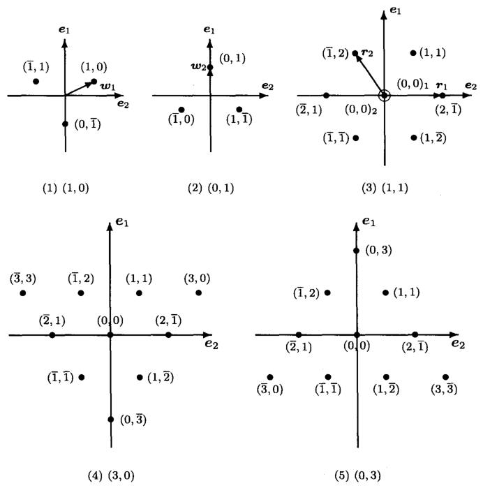

对应负根的生成元为相应正根生成元的转置共轭。由对易关系式 (7.94) 算得

$$
\begin{aligned}
[H_1,\,E_{r_1}] &= E_{r_1}, & [H_2,\,E_{r_1}] &= -E_{r_1},\\
[H_1,\,E_{\alpha}] &= E_{\alpha}, & [H_2,\,E_{\alpha}] &= E_{\alpha},\\
[H_1,\,E_{\beta}] &= E_{\beta}, & [H_2,\,E_{\beta}] &= 0,\\
[H_1,\,E_{r_2}] &= 0, & [H_2,\,E_{r_2}] &= E_{r_2}
\end{aligned}
$$

$$
\begin{aligned}
r_1 &= e_1 - e_2, & r_2 &= e_2,\\
\alpha &= e_1 + e_2 = r_1 + 2r_2, & \beta &= e_1 = r_1 + r_2
\end{aligned}
\tag{7.185}
$$

其中，$r_1$ 和 $r_2$ 是素根，$\alpha$ 和 $\beta$ 是正根。

$$
g_{jk} = -2\{(r_1)_j(r_1)_k + (r_2)_j(r_2)_k + \alpha_j\alpha_k + \beta_j\beta_k\} = -6\,\delta_{jk}
\tag{7.186}
$$

$B_2$ 李代数的嘉当矩阵 $A$ 及其逆矩阵 $A^{-1}$ 为

$$
A = \begin{pmatrix} 2 & -1 \\ -2 & 2 \end{pmatrix},\qquad A^{-1} = \begin{pmatrix} 1 & 1/2 \\ 1 & 1 \end{pmatrix}
\tag{7.187}
$$

两个基本主权是

$$
w_1 = r_1 + r_2 = e_1,\qquad w_2 = \frac{1}{2}r_1 + r_2 = \frac{1}{2}(e_1 + e_2)
\tag{7.188}
$$

SO(5) 群基本表示 (1,0)，(0,1) 和伴随表示 (0,2) 的平面权图见图 7.7。

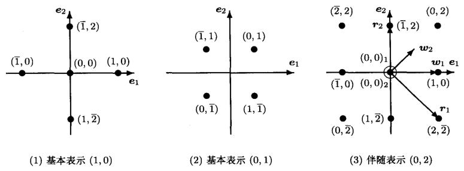

$G_2$ 李代数的嘉当矩阵 $A$ 及其逆矩阵 $A^{-1}$ 为

$$
A = \begin{pmatrix} 2 & -1 \\ -3 & 2 \end{pmatrix},\qquad A^{-1} = \begin{pmatrix} 2 & 1 \\ 3 & 2 \end{pmatrix}
\tag{7.189}
$$

素根中，$r_1$ 是长根，$r_2$ 是短根。根据式 (7.180)，选定素根的适当取向，得 $G_2$ 李代数的全部正根为

$$
\begin{aligned}
r_1 &= \sqrt{2}\,e_2,\\
r_2 &= \sqrt{1/6}\,e_1 - \sqrt{1/2}\,e_2,\\
r_1 + r_2 &= \sqrt{1/6}\,e_1 + \sqrt{1/2}\,e_2,\\
r_1 + 2r_2 &= \sqrt{2/3}\,e_1,\\
r_1 + 3r_2 &= \sqrt{3/2}\,e_1 - \sqrt{1/2}\,e_2,\\
2r_1 + 3r_2 &= \sqrt{3/2}\,e_1 + \sqrt{1/2}\,e_2
\end{aligned}
\tag{7.190}
$$

由此算出基林型和基本主权为

$$
g_{jk} = -\sum_{\alpha\in\Delta}\alpha_j\alpha_k = -8\,\delta_{jk}
\tag{7.191}
$$

$$
w_1 = 2r_1 + 3r_2 = \sqrt{3/2}\,e_1 + \sqrt{1/2}\,e_2,\qquad w_2 = r_1 + 2r_2 = \sqrt{2/3}\,e_1
\tag{7.192}
$$

$G_2$ 李代数的若干表示的平面权图见图 7.8.

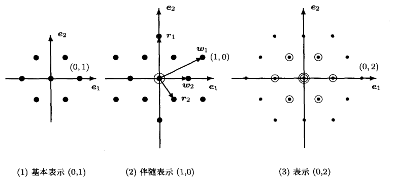

## 7.7 克莱布施 - 戈登系数

两个不可约表示的直乘一般是可约表示，它可分解为若干个不可约表示的直和。这直和称为克莱布施 - 戈登级数，而约化这可约表示的相似变换矩阵元素称为克莱布施 - 戈登系数。本节将引入主权图的方法来计算单纯李代数直乘表示的克莱布施 - 戈登级数和克莱布施 - 戈登系数。

### 一、定义和基本方法

在单纯李代数的紧致实形里，不可约表示取幺正表示，两不可约表示的直乘 $\Delta = D^{M^{(1)}}\times D^{M^{(2)}}$ 还是幺正表示，可取幺正的相似变换 $C^{M^{(1)}M^{(2)}}$ 把它约化

$$
\left(C^{M^{(1)}M^{(2)}}\right)^{-1}\left(D^{M^{(1)}}\times D^{M^{(2)}}\right)C^{M^{(1)}M^{(2)}} = \bigoplus_{M} a_M D^{M}
\tag{7.193}
$$

$a_M$ 是表示 $M$ 在直乘表示约化中的重数。 $C^{M^{(1)}M^{(2)}}$ 是 $d(M^{(1)})d(M^{(2)})$ 维矩阵，行指标为 $m^{(1)}m^{(2)}$，列指标为 $M,(r),m$. $r$ 用来区分约化中的重表示。 $d(M^{(i)})$ 是表示 $M^{(i)}$ 的维数，$i=1,2$. 直乘表示空间的状态基是参加乘积的两表示空间的状态基的直乘。每个子空间的状态基在生成元作用下满足

$$
\begin{aligned}
H_\mu |M^{(i)}, m^{(i)}\rangle &= m_\mu^{(i)} |M^{(i)}, m^{(i)}\rangle,\\
E_\mu |M^{(i)}, m^{(i)}\rangle &= \sum |M^{(i)}, m^{(i)} + r_\mu\rangle\, D^{M^{(i)}}_{(m^{(i)}+r_\mu)m^{(i)}}(E_\mu),\\
F_\mu |M^{(i)}, m^{(i)}\rangle &= \sum |M^{(i)}, m^{(i)} - r_\mu\rangle\, D^{M^{(i)}}_{(m^{(i)}-r_\mu)m^{(i)}}(F_\mu)
\end{aligned}
$$

式中对重权态求和。通常把标记表示的符号 $M^{(1)}$ 和 $M^{(2)}$ 省略

$$
|M^{(1)}, m^{(1)}\rangle|M^{(2)}, m^{(2)}\rangle = |m^{(1)}\rangle|m^{(2)}\rangle
\tag{7.194}
$$

约化后的状态基表为

$$
\|M, (r), m\rangle = \sum_{m^{(1)}, m^{(2)}} |m^{(1)}\rangle|m^{(2)}\rangle\, C^{M^{(1)}M^{(2)}}_{m^{(1)}, m^{(2)}, M, (r), m}
\tag{7.195}
$$

式 (7.195) 是表达和计算单纯李代数两不可约表示直乘分解的克莱布施 - 戈登系数的最常用的方法。生成元 $I_A$ 可取谢瓦莱基 $H_\mu$, $E_\mu$ 和 $F_\mu$，它们对状态基的作用如下式所示

$$
I_A \|M, m\rangle = \sum_{m^{(1)}, m^{(2)}} \left\{\left(I_A |m^{(1)}\rangle\right)|m^{(2)}\rangle + |m^{(1)}\rangle\left(I_A |m^{(2)}\rangle\right)\right\} C^{M^{(1)}M^{(2)}}_{m^{(1)}, m^{(2)}, M, (r), m}
\tag{7.196}
$$

当 $I_A$ 取 $H_\mu$ 时，由式 (7.196) 得

$$
\left(m^{(1)} + m^{(2)}\right) C^{M^{(1)}M^{(2)}}_{m^{(1)}, m^{(2)}, M, (r), m} = C^{M^{(1)}M^{(2)}}_{m^{(1)}, m^{(2)}, M, (r), m}{}^{m}
$$

$$
C^{M^{(1)}M^{(2)}}_{m^{(1)}, m^{(2)}, M, (r), m} = 0,\qquad \text{当 } m \neq m^{(1)} + m^{(2)}
\tag{7.197}
$$

即组合前后权矢量相加，$m = m^{(1)} + m^{(2)}$. 这是式 (4.137) 的推广，不同在于，现在可能有重权，当 $C^{M^{(1)}M^{(2)}}_{m^{(1)}, m^{(2)}, M, (r), m}$ 的行（或列）指标确定后，不为零的矩阵元素可能不止一个。

当 $I_A$ 取 $E_\mu$ 或 $F_\mu$ 时，由式 (7.196) 得

$$
\begin{aligned}
&\sum_{m^{(1)'}=m^{(1)}\mp r_j} D^{M^{(1)}}(I_A)_{m^{(1)}m^{(1)'}}\, C^{M^{(1)}M^{(2)}}_{m^{(1)'}, m^{(2)}, M, (r), m}\\
&\quad + \sum_{m^{(2)'}=m^{(2)}\mp r_j} D^{M^{(2)}}(I_A)_{m^{(2)}m^{(2)'}}\, C^{M^{(1)}M^{(2)}}_{m^{(1)}, m^{(2)'}, M, (r), m}\\
&= \sum_{m'=m\pm r_j} C^{M^{(1)}M^{(2)}}_{m^{(1)}, m^{(2)}, M, (r), m'}\, D^{M}(I_A)_{m'm}
\end{aligned}
\tag{7.198}
$$

其中，正负号中上面符号对应 $E_\mu$，下面符号对应 $F_\mu$.

### 二、克莱布施 - 戈登级数中表示的特性

设 $M$ 出现在单纯李代数两不可约表示直乘分解的克莱布施 - 戈登级数中，它的最高权态展开式为

$$
\|M, (r), M\rangle = \sum_{m^{(1)}} |m^{(1)}\rangle|M - m^{(1)}\rangle\, C^{(r)}_{m^{(1)}}
\tag{7.199}
$$

这里为了简单起见，简化了克莱布施 - 戈登系数的符号。最高权态在升算符 $E_\mu$ 作用下得零。如果 $m^{(1)}$ 不是表示 $M^{(1)}$ 中的最高权，则态 $|m^{(1)}\rangle$ 必在某升算符 $E_\mu$ 作用下不为零，设

$$
E_\mu |m^{(1)}\rangle = a\,|m^{(1)} + r_\mu\rangle + \cdots
$$

省略的是重权的态。为了保持式 (7.199) 在 $E_\mu$ 作用下得零，式 (7.199) 的求和式中必须包含另一项 $|m^{(1)} + r_\mu\rangle|M - m^{(1)} - r_\mu\rangle\, C^{(r)}_{m^{(1)}+r_\mu}$，其中

$$
E_\mu |M - m^{(1)} - r_\mu\rangle = b\,|M - m^{(1)}\rangle
$$

且满足

$$
a\,C^{(r)}_{m^{(1)}} + b\,C^{(r)}_{m^{(1)}+r_\mu} = 0
$$

这过程要一直继续下去，直到 $m^{(1)}$ 变成表示 $M^{(1)}$ 的最高权 $M^{(1)}$. 这就是说，在式 (7.199) 的展开式中一定包含 $m^{(1)} = M^{(1)}$ 的项，此时 $M - m^{(1)} = M - M^{(1)}$，它必须是表示 $M^{(2)}$ 中的一个权 $m^{(2)}$. 同理在式 (7.199) 的展开式中也一定包含 $m^{(2)} = M^{(2)}$ 的项。于是有

$$
M = M^{(1)} + m^{(2)} = m^{(1)} + M^{(2)}
\tag{7.200}
$$

式 (7.200) 是在克莱布施 - 戈登级数中出现的表示最高权 $M$ 要满足的必要条件。

在两表示 $M^{(1)}$ 和 $M^{(2)}$ 的直乘空间中，最高权的状态是

$$
|M^{(1)}\rangle|M^{(2)}\rangle
\tag{7.201}
$$

它是单权。因此，在克莱布施 - 戈登级数中一定出现一个重数为 1 的表示 $M_1$，它等于乘积表示最高权之和

$$
M_1 = M^{(1)} + M^{(2)}
\tag{7.202}
$$

在克莱布施 - 戈登级数中出现的其他表示 $M$ 满足

$$
M_1 - M = \sum_\mu c_\mu \tau_\mu ,\qquad c = \sum_\mu c_\mu
\tag{7.203}
$$

$c$ 称为表示 $M$ 在克莱布施 - 戈登级数中的序号。规定在克莱布施 - 戈登级数中的表示按序号自小至大排列起来，序号相同的表示排列次序任意。

### 三、主权图方法

研究单纯李代数两不可约表示直乘分解主要包括三个互相关联的内容。一是确定克莱布施 - 戈登级数，要研究级数中出现哪些表示和它们的重数。二是计算这些表示最高权态的展开式。当这表示的重数为 1 时，最高权态允许自由选择一个相因子，通常选择最高权态展开式中 $m^{(1)} = M^{(1)}$ 的项（至少是其中的一项）系数为正实数。当这表示的重数大于 1 时，最高权态还允许做适当的线性组合。实际计算发现，一般都可以通过选择适当的相因子或适当的线性组合使克莱布施 - 戈登系数都是实数。若 $M^{(1)} = M^{(2)}$，当约化后的表示 $M$ 重数为 1 时，克莱布施 - 戈登系数对 $|m^{(1)}\rangle$ 和 $|m^{(2)}\rangle$ 交换有确定的对称性，当重数大于 1 时，可以选择状态基的适当组合，使克莱布施 - 戈登系数对 $|m^{(1)}\rangle$ 和 $|m^{(2)}\rangle$ 交换有确定的对称性。通常把这样的表示称为对称表示或反对称表示。三是由最高权态的展开式出发用降算符作用，计算其他权态的展开式。这些问题可以通过主权图方法得到解决。

首先，在 $M^{(2)}$ 表示空间中寻找所有满足下面条件的 $m^{(2)}$，它与 $M^{(1)}$ 相加会得到主权 $M$，这些 $M$ 就是有可能在克莱布施 - 戈登级数中出现的表示的最高权。把它们按序号 $c$ 自小至大排列起来，补以重数 $a_M$. 计算克莱布施 - 戈登级数就是要计算这些重数 $a_M$. 这些重数是非负整数，但可以为零。

其次，从序号为零的表示 $M_1$ 开始，它的重数 $a_{M_1}$ 是 1，最高权态为

$$
\|M_1, M_1\rangle = |M^{(1)}\rangle|M^{(2)}\rangle,\qquad M_1 = M^{(1)} + M^{(2)}
\tag{7.204}
$$

计算这表示的方块权图，确定这表示中包含的各主权 $M$ 的重数。如果需要计算克莱布施 - 戈登系数，则可通过降算符作用计算这表示其他状态的展开式。各主权 $M$ 的重数也可在有关书中（如文献 [13]）查到。

然后对序号为 1 的权 $M_2$，计算它在直乘空间的重数和在表示 $M_1$ 表示空间的重数之差，其差数就是表示 $M_2$ 在克莱布施 - 戈登级数中的重数 $a_{M_2}$. 依此类推，表示 $M$ 在克莱布施 - 戈登级数中的重数 $a_M$，等于在直乘空间中它的重数，减去已经出现在克莱布施 - 戈登级数中的各表示的表示空间中它的重数之和。把各主权在直乘空间和在约化后各表示空间中的重数排列成表，称为直乘表示约化的主权图，由它可以方便地计算直乘表示约化的克莱布施 - 戈登级数。

主权图包括如下内容：从纵向看，从 $M_1$ 开始，在克莱布施 - 戈登级数中出现的每一个表示 $M$ 占据一列，列出该表示包含的各主权及其重数，重数为 1 省略。最左面一列列出表示乘积空间各主权的重数及其外尔轨道长度（O.S.）。它们的乘积之和就是乘积空间的维数 $d(M^{(1)})d(M^{(2)})$. 对每一个表示 $M$，各主权的重数与外尔轨道长度乘积之和就是该表示的维数。把这些维数都列在主权图中，可检查计算得的克莱布施 - 戈登级数的正确性。

第三，对在克莱布施 - 戈登级数中出现的表示，它的最高权态有两种计算方法。一是根据式 (7.123)，要求所有升算符 $E_\mu$ 作用得零，然后归一化。另一是根据属不等价不可约表示状态基正交的条件，要求它与所有已经出现在克莱布施 - 戈登级数中的各表示的相同权的状态基正交。有了最高权态的展开式，就可通过降算符作用计算这表示其他状态的展开式。

最后，因为前面的计算错误会直接影响后面的计算，所以计算过程中每一计算结果都要做检验。对每一个状态基的展开式 (7.195)，应该检查等式各项权之和是否相同，检查此展开式是否归一，与已得到的相同权的展开式是否正交，当 $M^{(1)} = M^{(2)}$ 时，检查此展开式是否满足需要的对称性，检查对称展开式的总数是否等于 $d(M^{(1)})[d(M^{(1)}) + 1]/2$，反对称展开式的总数是否等于 $d(M^{(1)})[d(M^{(1)}) - 1]/2$.

第四章中我们研究过 SU(2) 群克莱布施 - 戈登系数的对称性质 (4.143). 这些对称性质有一定的普遍意义，但由于单纯李代数的表示中存在重权，使公式变得比较复杂。附录 30 做了一些简单介绍。

### 四、SU(3) 群表示的直乘分解

从本小节开始，我们通过例子来说明克莱布施 - 戈登级数和系数的计算方法。 SU(3) 群（$A_2$ 李代数）的若干表示的方块权图已列于图 7.3. 先算两个基本表示的直乘分解：$(1,0)\times(0,1)$.

由图 7.3 可知，在直乘表示空间只有两个主权，$(1,1)$ 和 $(0,0)$. 主权 $(1,1)$ 的外尔轨道长度是 6，它是直乘表示空间的最高权，因而表示 $(1,1)$ 一定出现在克莱布施 - 戈登级数中，且重数为 1. 主权为 $(0,0)$ 的外尔轨道长度是 1，它在直乘表示空间的状态基有三个

$$
|(1,0),(1,0)\rangle|(0,1),(\bar{1},0)\rangle,\quad |(1,0),(\bar{1},1)\rangle|(0,1),(1,\bar{1})\rangle,\quad |(1,0),(0,\bar{1})\rangle|(0,1),(0,1)\rangle
$$

因为在表示 $(1,1)$ 中主权 $(0,0)$ 是二重权，所以在克莱布施 - 戈登级数中表示 $(0,0)$ 的重数是 $3 - 2 = 1$. 这样，计算得 SU(3) 群两个基本表示直乘分解的主权图如图 7.9. 方框里的填数是主权，方框右上角的数字是该主权的重数，重数为 1 时省略。最下面一行是表示直乘分解的克莱布施 - 戈登级数。

| $O.S.\times$重数 | 表示 $(1,1)$ | 表示 $(0,0)$ |
| --- | --- | --- |
| $6\times 1$ | $\boxed{1,1}$ | |
| $1\times 3$ | $\boxed{0,0}^{\,2}$ | $\boxed{0,0}$ |
| $9$ | $8$ | $1$ |

$$
(1,0)\times(0,1) \simeq (1,1) + (0,0)
$$

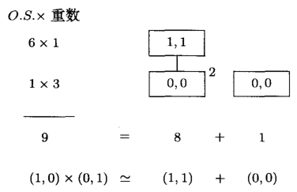

表示 $(1,1)$ 的最高权态展开式为

$$
\|(1,1),(1,1)\rangle = |(1,0),(1,0)\rangle|(0,1),(0,1)\rangle
$$

可由方块权图（见图 7.3）计算其他状态的展开式

$$
\begin{aligned}
\|(1,1),(\bar{1},2)\rangle &= F_1 \|(1,1),(1,1)\rangle = |(1,0),(\bar{1},1)\rangle|(0,1),(0,1)\rangle,\\
\|(1,1),(2,\bar{1})\rangle &= F_2 \|(1,1),(1,1)\rangle = |(1,0),(1,0)\rangle|(0,1),(1,\bar{1})\rangle,\\
\|(1,1),(0,0)_1\rangle &= \sqrt{1/2}\,F_1 \|(1,1),(2,\bar{1})\rangle\\
&= \sqrt{1/2}\left\{|(1,0),(1,0)\rangle|(0,1),(\bar{1},0)\rangle + |(1,0),(\bar{1},1)\rangle|(0,1),(1,\bar{1})\rangle\right\},\\
\|(1,1),(0,0)_2\rangle &= \sqrt{2/3}\left\{F_2\|(1,1),(\bar{1},2)\rangle - \sqrt{1/2}\|(1,1),(0,0)_1\rangle\right\}\\
&= \sqrt{2/3}\left\{|(1,0),(\bar{1},1)\rangle|(0,1),(1,\bar{1})\rangle + |(1,0),(0,\bar{1})\rangle|(0,1),(0,1)\rangle\right\}\\
&\quad - \sqrt{1/6}\left\{|(1,0),(1,0)\rangle|(0,1),(\bar{1},0)\rangle + |(1,0),(\bar{1},1)\rangle|(0,1),(1,\bar{1})\rangle\right\}\\
&= \sqrt{1/6}\left\{-|(1,0),(1,0)\rangle|(0,1),(\bar{1},0)\rangle + |(1,0),(\bar{1},1)\rangle|(0,1),(1,\bar{1})\rangle\right.\\
&\quad \left. + 2\,|(1,0),(0,\bar{1})\rangle|(0,1),(0,1)\rangle\right\},
\end{aligned}
$$

$$
\|(1,1),(\bar{2},1)\rangle = \sqrt{1/2}\,F_1 \|(1,1),(0,0)_1\rangle = |(1,0),(\bar{1},1)\rangle|(0,1),(\bar{1},0)\rangle,
$$

$$
\|(1,1),(1,\bar{2})\rangle = \sqrt{2}\,F_2 \|(1,1),(0,0)_1\rangle = |(1,0),(0,\bar{1})\rangle|(0,1),(1,\bar{1})\rangle,
$$

$$
\|(1,1),(\bar{1},\bar{1})\rangle = F_1 \|(1,1),(1,\bar{2})\rangle = |(1,0),(0,\bar{1})\rangle|(0,1),(\bar{1},0)\rangle
$$

表示 $(0,0)$ 是一维表示，状态展开式可根据条件 (7.123) 计算

$$
\begin{aligned}
\|(0,0),(0,0)\rangle &= c_1 |(1,0),(1,0)\rangle|(0,1),(\bar{1},0)\rangle + c_2 |(1,0),(\bar{1},1)\rangle|(0,1),(1,\bar{1})\rangle\\
&\quad + c_3 |(1,0),(0,\bar{1})\rangle|(0,1),(0,1)\rangle
\end{aligned}
$$

要求在升算符作用下得零，有

$$
E_1 \|(0,0),(0,0)\rangle = c_1 |(1,0),(1,0)\rangle|(0,1),(1,\bar{1})\rangle + c_2 |(1,0),(1,0)\rangle|(0,1),(1,\bar{1})\rangle = 0,
$$

$$
E_2 \|(0,0),(0,0)\rangle = c_2 |(1,0),(\bar{1},1)\rangle|(0,1),(0,1)\rangle + c_3 |(1,0),(\bar{1},1)\rangle|(0,1),(0,1)\rangle = 0
$$

解得 $c_1 = -c_2 = c_3 = \sqrt{1/3}$. 注意，三个权为 $(0,0)$ 的状态基都互相正交。

再算两个伴随表示 $(1,1)$ 的直乘分解。这是物理学中常用的一个公式。按照图 7.3，在直乘表示空间出现的主权有 $(2,2)$，$(3,0)$，$(0,3)$，$(1,1)$ 和 $(0,0)$，它们的重数分别是 1，2，2，6 和 10，外尔轨道长度分别是 6，3，3，6 和 1. 因为参加直乘的两个表示是相同的，下面列举主权对应的独立状态基时，省略因 $|m^{(1)}\rangle$ 和 $|m^{(2)}\rangle$ 交换得到的状态基。

在这些主权中，除了 $(2,2)$ 外，以其他主权作为最高权的不可约表示，它们的方块权图都已列出在图 7.3，它们分别包含哪些主权及其重数都已经清楚。表示 $(2,2)$

的方块权图的计算见附录 31，由计算结果知表示 $(2,2)$ 包含各主权 $(2,2)$，$(3,0)$，$(0,3)$，$(1,1)$ 和 $(0,0)$ 的重数分别是 1，1，1，2 和 3. 由图 7.3 知，表示 $(3,0)$ 包含各主权 $(3,0)$，$(1,1)$ 和 $(0,0)$ 的重数都是 1，表示 $(0,3)$ 包含各主权 $(0,3)$，$(1,1)$ 和 $(0,0)$ 的重数都是 1，表示 $(1,1)$ 包含主权 $(1,1)$ 和 $(0,0)$ 的重数是 1 和 2，表示 $(0,0)$ 只包含一个单主权 $(0,0)$. 这样，计算得 SU(3) 群两个伴随表示直乘分解的主权图如图 7.10. 最下面一行是表示直乘分解的克莱布施 - 戈登级数，下标 $S$ 和 $A$ 描写该表示的状态展开式关于乘积状态交换的对称性。

| 主权 | 重数 | 独立状态基 |
| --- | --- | --- |
| $(2,2)$ | 1 | $\vert (1,1)\rangle\vert (1,1)\rangle$, |
| $(3,0)$ | 2 | $\vert (1,1)\rangle\vert (2,\bar{1})\rangle$, |
| $(0,3)$ | 2 | $\vert (1,1)\rangle\vert (\bar{1},2)\rangle$, |
| $(1,1)$ | 6 | $\vert (1,1)\rangle\vert (0,0)_1\rangle$, $\vert (1,1)\rangle\vert (0,0)_2\rangle$, $\vert (\bar{1},2)\rangle\vert (2,\bar{1})\rangle$, |
| $(0,0)$ | 10 | $\vert (1,1)\rangle\vert (\bar{1},\bar{1})\rangle$, $\vert (2,\bar{1})\rangle\vert (\bar{2},1)\rangle$, $\vert (\bar{1},2)\rangle\vert (1,\bar{2})\rangle$, $\vert (0,0)_a\rangle\vert (0,0)_b\rangle$, $a,b=1,2$. |

| $O.S.\times$重数 | $(2,2)$ | $(3,0)$ | $(0,3)$ | $(1,1)$ | $(0,0)$ |
| --- | --- | --- | --- | --- | --- |
| $6\times 1$ | $\boxed{2,2}$ | | | | |
| $3\times 2$ | $\boxed{3,0}$ | $\boxed{3,0}$ | | | |
| $3\times 2$ | $\boxed{0,3}$ | | $\boxed{0,3}$ | | |
| $6\times 6$ | $\boxed{1,1}^{\,2}$ | $\boxed{1,1}$ | $\boxed{1,1}$ | $\boxed{1,1}^{\,2}$ | |
| $1\times 10$ | $\boxed{0,0}^{\,3}$ | $\boxed{0,0}$ | $\boxed{0,0}$ | $\boxed{0,0}^{\,2}$ | $\boxed{0,0}$ |
| 维数 | 27 | 10 | 10 | 8 | 1 |

$$
64 = 27 + 10 + 10 + 2\times 8 + 1
$$

$$
(1,1)\times(1,1) \simeq (2,2)_S + (3,0)_A + (0,3)_A + (1,1)_S + (1,1)_A + (0,0)_S
$$

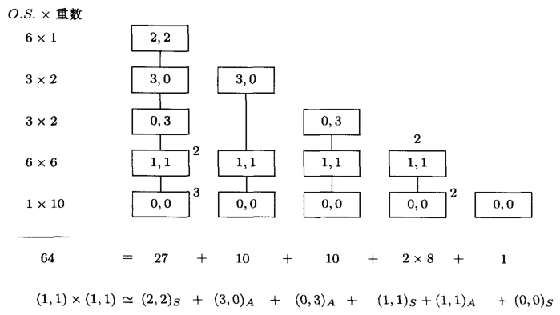

下面计算各表示的最高权态展开式。由式 (7.204) 得表示 $(2,2)$ 最高权态为

$$
\|(2,2),(2,2)\rangle = |(1,1)\rangle|(1,1)\rangle
$$

表示 $(2,2)$ 的状态展开式对两乘积状态交换是对称的。其他表示最高权态的展开式可用条件式 (7.123) 来计算。设表示 $(3,0)$ 和 $(0,3)$ 的状态展开式为

$$
\|(3,0),(3,0)\rangle = a_1\,|1,1\rangle|2,\bar{1}\rangle + a_2\,|2,\bar{1}\rangle|1,1\rangle,
$$

$$
\|(0,3),(0,3)\rangle = b_1\,|1,1\rangle|\bar{1},2\rangle + b_1\,|\bar{1},2\rangle|1,1\rangle
$$

用升算符作用得

$$
E_2 \|(3,0),(3,0)\rangle = a_1\,|1,1\rangle|1,1\rangle + a_2\,|1,1\rangle|1,1\rangle = 0,
$$

$$
E_1 \|(0,3),(0,3)\rangle = b_1\,|1,1\rangle|1,1\rangle + b_1\,|1,1\rangle|1,1\rangle = 0
$$

解得 $a_1 = -a_2 = b_1 = -b_2 = \sqrt{1/2}$. 表示 $(3,0)$ 和表示 $(0,3)$ 的状态展开式都对两乘积状态交换是反对称的。

表示 $(1,1)$ 在克莱布施 - 戈登级数中出现两次。在乘积表示空间权为 $(1,1)$ 的态出现四次。在 $E_1$ 作用下为零的乘积状态组合有四组

$$
|1,1\rangle|(0,0)_2\rangle,\qquad |1,1\rangle|(0,0)_1\rangle - \sqrt{2}\,|\bar{1},2\rangle|2,\bar{1}\rangle,
$$

$$
|(0,0)_2\rangle|1,1\rangle,\qquad |(0,0)_1\rangle|1,1\rangle - \sqrt{2}\,|2,\bar{1}\rangle|\bar{1},2\rangle
$$

进一步要求在 $E_2$ 作用下为零，这样的组合有两组

$$
-|1,1\rangle|(0,0)_2\rangle + \sqrt{3}\,|1,1\rangle|(0,0)_1\rangle - \sqrt{6}\,|\bar{1},2\rangle|2,\bar{1}\rangle + 2\,|(0,0)_2\rangle|1,1\rangle,
$$

$$
2\,|1,1\rangle|(0,0)_2\rangle - \sqrt{6}\,|2,\bar{1}\rangle|\bar{1},2\rangle + \sqrt{3}\,|(0,0)_1\rangle|1,1\rangle - |(0,0)_2\rangle|1,1\rangle
$$

把它们组合成对称和反对称的形式，归一化后作为两个表示 $(1,1)$ 的最高权态展开式，并分别标以下标 $S$ 和 $A$

$$
\begin{aligned}
\|(1,1),(1,1)\rangle_S = \sqrt{1/20}\left\{\sqrt{3}\,|1,1\rangle|(0,0)_1\rangle + |1,1\rangle|(0,0)_2\rangle - \sqrt{6}\,|\bar{1},2\rangle|2,\bar{1}\rangle\right.\\
\left. - \sqrt{6}\,|2,\bar{1}\rangle|\bar{1},2\rangle + |(0,0)_2\rangle|1,1\rangle + \sqrt{3}\,|(0,0)_1\rangle|1,1\rangle\right\},
\end{aligned}
$$

$$
\begin{aligned}
\|(1,1),(1,1)\rangle_A = \sqrt{1/12}\left\{|1,1\rangle|(0,0)_1\rangle - \sqrt{3}\,|1,1\rangle|(0,0)_2\rangle - \sqrt{2}\,|\bar{1},2\rangle|2,\bar{1}\rangle\right.\\
\left. + \sqrt{2}\,|2,\bar{1}\rangle|\bar{1},2\rangle + \sqrt{3}\,|(0,0)_2\rangle|1,1\rangle - |(0,0)_1\rangle|1,1\rangle\right\}
\end{aligned}
$$

恒等表示 $(0,0)$ 是对称表示，它的状态展开式经计算为

$$
\begin{aligned}
\|(0,0),(0,0)\rangle = \sqrt{1/8}\left\{|1,1\rangle|\bar{1},\bar{1}\rangle - |\bar{1},2\rangle|1,\bar{2}\rangle - |2,\bar{1}\rangle|\bar{2},1\rangle + |(0,0)_1\rangle|(0,0)_1\rangle\right.\\
\left. + |(0,0)_2\rangle|(0,0)_2\rangle - |\bar{2},1\rangle|2,\bar{1}\rangle - |1,\bar{2}\rangle|\bar{1},2\rangle + |\bar{1},\bar{1}\rangle|1,1\rangle\right\}
\end{aligned}
$$

### 五、G_2 李代数表示的直乘分解

讨论 $G_2$ 李代数直乘表示 $(0,1)\times(0,1)$ 的分解。根据表示 $(0,1)$ 的方块权图（见图 7.5），在直乘表示空间里出现的主权有 $(0,2)$，$(1,0)$，$(0,1)$ 和 $(0,0)$，它们的重数分别是 1, 2, 4 和 7，外尔轨道长度分别是 6, 6, 6 和 1. 因为参加直乘的两个表示是相同的，下面列举主权对应的独立状态基时，省略因 $|m^{(1)}\rangle$ 和 $|m^{(2)}\rangle$ 交换得到的状态基。

| 主权 | 重数 | 独立状态基 |
| --- | --- | --- |
| (0,2) | 1 | $\vert(0,1)\rangle\vert(0,1)\rangle$, |
| (1,0) | 2 | $\vert(0,1)\rangle\vert(1,\bar{1})\rangle$, |
| (0,1) | 4 | $\vert(0,1)\rangle\vert(0,0)\rangle$, $\vert(1,\bar{1})\rangle\vert(\bar{1},2)\rangle$, |
| (0,0) | 7 | $\vert(1,1)\rangle\vert(\bar{1},\bar{1})\rangle$, $\vert(1,\bar{1})\rangle\vert(\bar{1},1)\rangle$, $\vert(\bar{1},2)\rangle\vert(1,\bar{2})\rangle$, $\vert(0,0)\rangle\vert(0,0)\rangle$ |

乘积表示空间最高权等于参加乘积的两表示最高权相加

$$
|(0,2),(0,2)\rangle = |(0,1),(0,1)\rangle|(0,1),(0,1)\rangle \equiv |(0,1)\rangle|(0,1)\rangle
$$

图 7.8 给出了表示 (0,2) 的平面权图。从图中知道，表示 (0,2) 包含四个主权，(0,2) 和 (1,0) 是单权，(0,1) 是二重权，(0,0) 是三重权。由此可画出直乘表示分解的主权图 (见图 7.11).

O.S. × 重数

$$
\begin{array}{rcccc}
6\times 1 & \boxed{0,2} & & & \\
6\times 2 & \boxed{1,0} & \boxed{1,0} & & \\
6\times 4 & \boxed{0,1}^{\,2} & \boxed{0,1} & \boxed{0,1} & \\
1\times 7 & \boxed{0,0}^{\,3} & \boxed{0,0}^{\,2} & \boxed{0,0} & \boxed{0,0}
\end{array}
$$

$$
49 = 27 + 14 + 7 + 1
$$

$$
(0,1)\times(0,1) \simeq (0,2)_S + (1,0)_A + (0,1)_A + (0,0)_S
$$

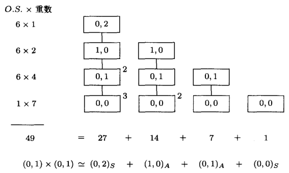

根据升算符作用得零的条件，可算出克莱布施 - 戈登级数中出现的各不可约表示的最高权态展开式。主权 (1,0) 有两个独立态，要求 $E_2$ 作用为零，得最高权态的展开式为

$$
|(1,0),(1,0)\rangle = \sqrt{1/2}\left\{|(0,1)\rangle|(1,\bar{1})\rangle - |(1,\bar{1})\rangle|(0,1)\rangle\right\}
$$

表示 (1,0) 对乘积状态交换是反对称的。主权 (0,1) 有四个独立态。在 $E_2$ 作用下为零的组合有两组

$$
|(0,1)\rangle|(0,0)\rangle - \sqrt{2}\,|(1,\bar{1})\rangle|(\bar{1},2)\rangle , \qquad \sqrt{2}\,|(\bar{1},2)\rangle|(1,\bar{1})\rangle - |(0,0)\rangle|(0,1)\rangle
$$

进一步要求 $E_1$ 作用为零，归一化后得

$$
\begin{aligned}
|(0,1),(0,1)\rangle = \sqrt{1/6}\,\{&|(0,1)\rangle|(0,0)\rangle - \sqrt{2}\,|(1,\bar{1})\rangle|(\bar{1},2)\rangle\\
&+ \sqrt{2}\,|(\bar{1},2)\rangle|(1,\bar{1})\rangle - |(0,0)\rangle|(0,1)\rangle\}
\end{aligned}
$$

表示 (0,1) 对乘积状态交换也是反对称的。最后，恒等表示 (0, 0) 的状态基展开式对乘积状态交换是对称的

$$
\begin{aligned}
|(0,0),(0,0)\rangle = \sqrt{1/7}\,\{&|(0,1)\rangle|(0,\bar{1})\rangle - |(1,\bar{1})\rangle|(\bar{1},1)\rangle + |(\bar{1},2)\rangle|(1,\bar{2})\rangle\\
&- |(0,0)\rangle|(0,0)\rangle + |(1,\bar{2})\rangle|(\bar{1},2)\rangle - |(\bar{1},1)\rangle|(1,\bar{1})\rangle\\
&+ |(0,\bar{1})\rangle|(0,1)\rangle\}
\end{aligned}
$$

其他状态基的展开式可用降算符作用得到。

## 习 题

1. 由根 $\alpha$ 和 $\beta$ 组成的根链 $\alpha + n\beta,\ -q \leqslant n \leqslant p$, 根链长度为 $p + q + 1$. 证明单纯李代数的根链长度不大于 4.

2. 画出 $C_2$ 李代数的两个基本表示 (1,0), (0,1) 和伴随表示 (2,0) 的方块权图和平面权图。

3. 计算 $C_2$ 李代数直乘表示 $(1,0) \times (1,0)$ 分解的克莱布施 - 戈登级数和克莱布施 - 戈登系数。

4. 计算 $C_2$ 李代数直乘表示 $(0,1) \times (0,1)$ 分解的克莱布施 - 戈登级数和克莱布施 - 戈登系数。

5. $C_\ell$ 李代数的素根还可以用式 (7.85) 给出的 $\ell + 1$ 个基 $V_j$ 表出

$$
r_j = V_j - V_{j+1}, \quad 1 \leqslant j \leqslant (\ell - 1), \qquad
r_\ell = 2V_\ell - \frac{2}{\ell}\left(\sqrt{\ell + 1} - 1\right)V_{\ell+1}
$$

试计算 $C_\ell$ 代数的基本主权 $w_j$ 和全部根矢量 [可利用式 (7.116) 的结果].

6. 利用式 (7.145) 分别计算 SO(N) 群如下各最高权表示 $M = \sum\limits_{\mu=1}^{\ell} M_\mu w_\mu$ 的二阶卡西米尔不变量 $C_2(M)$:

(1) $N = 2\ell + 1$ 和 $M = \sum\limits_{\mu=1}^{\ell-1} (\lambda_\mu - \lambda_{\mu+1})\, w_\mu + 2\lambda_\ell w_\ell$,

(2) $N = 2\ell + 1$ 和 $M = \lambda_1 w_1 + w_\ell$,

(3) $N = 2\ell$ 和 $M = \sum\limits_{\mu=1}^{\ell-1} (\lambda_\mu - \lambda_{\mu+1})\, w_\mu + (\lambda_{\ell-1} + \lambda_\ell)\, w_\ell$,

(4) $N = 2\ell$ 和 $M = \lambda_1 w_1 + w_\ell$.

7. 计算 $G_2$ 李代数直乘表示 $(1,0) \times (1,0)$ 和 $(1,0) \times (0,1)$ 分解的克莱布施 - 戈登级数和级数中出现的各表示最高权态的展开式，其中各有关表示维数，外尔轨道长度 (O.S.) 和包含各主权重数列于下表。

| 表示 | 维数 | O.S. | (0,0) | (0,1) | (1,0) | (0,2) | (1,1) | (0,3) | (2,0) |
| --- | --- | --- | --- | --- | --- | --- | --- | --- | --- |
| (0,0) | 1 | 1 | 1 | | | | | | |
| (0,1) | 7 | 6 | 1 | 1 | | | | | |
| (1,0) | 14 | 6 | 2 | 1 | 1 | | | | |
| (0,2) | 27 | 6 | 3 | 2 | 1 | 1 | | | |
| (1,1) | 64 | 12 | 4 | 4 | 2 | 2 | 1 | | |
| (0,3) | 77 | 6 | 5 | 4 | 3 | 2 | 1 | 1 | |
| (2,0) | 77 | 6 | 5 | 3 | 3 | 2 | 1 | 1 | 1 |

8. 计算 $F_4$ 李代数直乘表示 $(0,0,0,1) \times (0,0,0,1)$ 分解的克莱布施 - 戈登级数和级数中出现的各表示最高权态的展开式，其中各有关表示维数，外尔轨道长度 (O.S.) 和包含各主权重数列于下表。

| 表示 | 维数 | O.S. | (0,0,0,0) | (0,0,0,1) | (1,0,0,0) | (0,0,1,0) | (0,0,0,2) |
| --- | --- | --- | --- | --- | --- | --- | --- |
| (0,0,0,0) | 1 | 1 | 1 | | | | |
| (0,0,0,1) | 26 | 24 | 2 | 1 | | | |
| (1,0,0,0) | 52 | 24 | 4 | 1 | 1 | | |
| (0,0,1,0) | 273 | 96 | 9 | 5 | 2 | 1 | |
| (0,0,0,2) | 324 | 24 | 12 | 5 | 3 | 1 | 1 |
