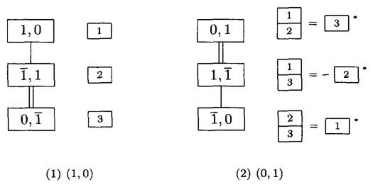
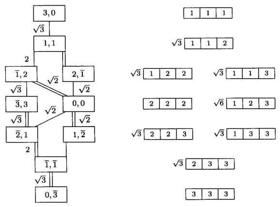
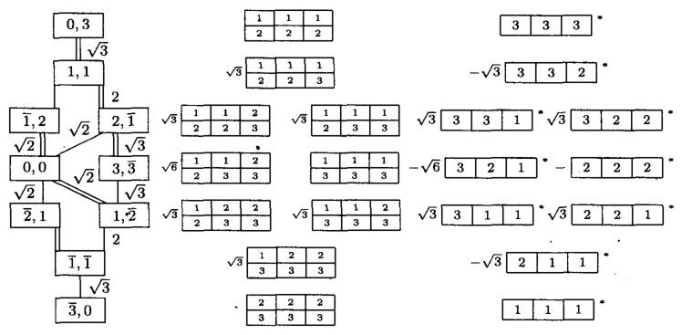
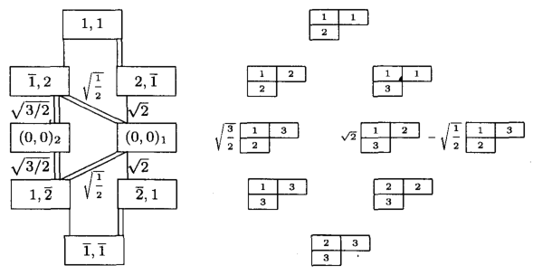
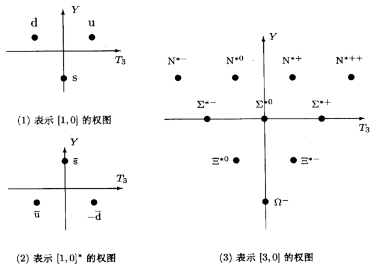
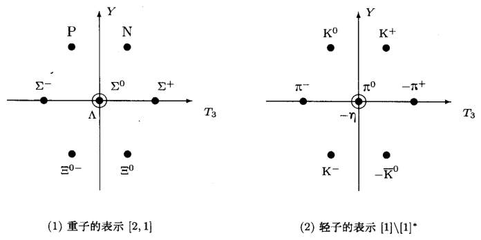
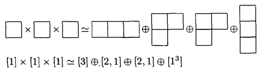

# *第八章 SU(N) 群

SU($N$) 群是紧致的单纯李群，它的李代数是 $A_{N-1}$. 方块权图方法可以计算单纯李群不可约表示状态基的权和生成元在这组状态基里的表示矩阵，但对状态基的波函数形式没有提供具体信息。本章研究 SU($N$) 群张量空间的约化，用杨算符方法确定它的不可约张量子空间，计算这些张量子空间中的独立和完备的张量基，并与方块权图方法结合起来，把这些不可约张量基正交归一化，具体给出不可约表示状态基的波函数。此外，本章还讨论 SU($N$) 群不可约表示的性质及其应用。

## 8.1 SU(N) 群的不可约表示

附录 15 已经一般地讨论过张量的概念，现在研究 SU($N$) 群的张量。 SU($N$) 群元素是 $N \times N$ 矩阵，它的变换空间是 $N$ 维复空间，这空间的矢量有 $N$ 个复分量，在 $u \in \mathrm{SU}(N)$ 变换中按下式变换

$$
V_a \xrightarrow{u} V'_a \equiv (O_u V)_a = \sum_{b=1}^{N} u_{ab} V_b
\tag{8.1}
$$

SU($N$) 群的 $n$ 阶张量 $T_{a_1 \cdots a_n}$ 有 $n$ 个指标，$N^n$ 个分量，在 SU($N$) 变换 $u$ 中，每个指标都像矢量指标一样变换

$$
T_{a_1 \cdots a_n} \xrightarrow{u} (O_u T)_{a_1 \cdots a_n} = \sum_{b_1 \cdots b_n} u_{a_1 b_1} \cdots u_{a_n b_n} T_{b_1 \cdots b_n}
\tag{8.2}
$$

也就是说，SU($N$) 群的 $n$ 阶张量空间对应的表示是 $n$ 个自身表示的直乘表示。直乘表示一般是可约表示。在第四章我们已经知道，SU(2) 群的任意表示 $D^j[\mathrm{SU}(2)]$ 都可以在自身表示的多次直乘的表示分解中得到，例如

$$
D^{1/2} \times D^{1/2} \times D^{1/2} \simeq D^{3/2} \oplus 2\,D^{1/2}
$$

$$
D^{1/2} \times D^{1/2} \times D^{1/2} \times D^{1/2} \simeq D^2 \oplus 3\,D^1 \oplus 2\,D^0
$$

因此，我们希望在 SU($N$) 群的张量空间约化中研究 SU($N$) 群的不可约表示，并计算不可约的张量基。

### 一、SU(N) 群张量空间的分解

$n$ 阶张量的集合构成 $N^n$ 维张量空间，它是一个线性空间，满足线性空间矢量相加和矢量与数相乘的一般规则。张量空间关于 SU($N$) 群的变换是不变的，就是说，张量空间的任一张量经任何 SU($N$) 变换 $u$ 的作用，仍属于此张量空间。在 SU($N$) 变换式 (8.2) 中，张量的每一个指标都平等地按 $u$ 矩阵元素来组合。这些 $u$ 矩阵是以矩阵元素的形式出现在式 (8.2) 中的，它们的乘积次序可以交换，从而使张量指标间的对称性质在 SU($N$) 变换中保持不变。指标有一定对称性质的张量构成的张量子空间也在 SU($N$) 变换中保持不变。但是，除了全对称张量和全反对称张量的意义已十分明确外，具有混合对称性的张量的意义就不很明确。例如，对三阶张量，让前两个指标对称，再让后两个指标反对称，此时前两个指标的对称性质已被破坏了。

张量指标之间的对称性质反映张量在指标间的置换变换 $R$ 作用下的变换性质。我们首先要明确地定义置换对张量的作用规则。这是一个容易混淆的问题，而且不同的文献可能有不同的规定。张量 $T$ 经置换 $R$ 的作用变成新张量 $RT \equiv T_R$，它的分量与原张量的分量存在一定的联系，这联系必须满足群的性质，就是说定义的变换规则对群元素乘积保持不变。由于任何置换可表为若干对换的乘积，而对换是自逆的，对换对张量的作用规则比较容易定义。对换 $(j\,k)$ 对张量 $T$ 作用后得到的新张量 $T'$ 做如下定义：它分量的第 $j$ 个指标和第 $k$ 个指标交换后等于原张量 $T$ 的相应分量

$$
[(j\,k)T]_{a_1 \cdots a_j \cdots a_k \cdots a_n} = T'_{a_1 \cdots a_j \cdots a_k \cdots a_n} = T_{a_1 \cdots a_k \cdots a_j \cdots a_n}
\tag{8.3}
$$

举个简单的例子，设

$$
R = \begin{pmatrix} 1 & 2 & 3 \\ 2 & 3 & 1 \end{pmatrix} = \begin{pmatrix} 3 & 1 & 2 \\ 1 & 2 & 3 \end{pmatrix} = (1\,2\,3) = (1\,2)(2\,3),
$$

$$
\begin{aligned}
[(2\,3)T]_{a_1 a_2 a_3} &= T'_{a_1 a_2 a_3} = T_{a_1 a_3 a_2},\\
(RT)_{a_1 a_2 a_3} &= [(1\,2)T']_{a_1 a_2 a_3} = T'_{a_2 a_1 a_3} = T_{a_2 a_3 a_1} \neq T_{a_3 a_1 a_2}
\end{aligned}
\tag{8.4}
$$

一般说来，设

$$
R = \begin{pmatrix} 1 & 2 & \cdots & n \\ r_1 & r_2 & \cdots & r_n \end{pmatrix} = \begin{pmatrix} \bar{r}_1 & \bar{r}_2 & \cdots & \bar{r}_n \\ 1 & 2 & \cdots & n \end{pmatrix}
\tag{8.5}
$$

$$
(RT)_{a_1 \cdots a_n} \equiv (T_R)_{a_1 \cdots a_n} = T_{a_{r_1} \cdots a_{r_n}} \neq T_{a_{\bar{r}_1} \cdots a_{\bar{r}_n}}
\tag{8.6}
$$

请注意，$R$ 对 $T$ 作用后，并不是把第 $j$ 个指标 $a_j$ 移到第 $r_j$ 位置，而是把第 $r_j$ 个指标 $a_{r_j}$ 移到第 $j$ 位置。 $n$ 阶张量指标之间的任意置换 $R$ 的集合构成 $n$ 个客体置换群 $S_n$. $n$ 阶张量经过置换 $R$ 的作用，仍是一个 $n$ 阶张量，因而 $n$ 阶张量空间对置换群 $S_n$ 也是保持不变的。

一个二阶张量分解为对称张量和反对称张量之和的方法是大家熟知的

$$
T_{ab} = \frac{1}{2}\{T_{ab} + T_{ba}\} + \frac{1}{2}\{T_{ab} - T_{ba}\}
$$

现在我们要用置换算符的作用，重新理解这一分解过程

$$
\begin{aligned}
T_{ab} &= \frac{1}{2}\{E + (1\,2)\}T_{ab} + \frac{1}{2}\{E - (1\,2)\}T_{ab}\\
&= \frac{1}{2}\left\{y^{[2]} + y^{[1,1]}\right\}T_{ab} = ET_{ab}
\end{aligned}
\tag{8.7}
$$

恒元 $E$ 分解为杨算符的组合。杨算符是投影算符，它们把任意二阶张量分别投影成对称张量和反对称张量。这样的方法是很容易推广到任意阶张量的。利用置换群恒元按杨算符的展开式，可把 $n$ 阶张量分解为用杨算符投影得到的有确定对称性的张量之和

$$
T_{a_1 \cdots a_n} = ET_{a_1 \cdots a_n} = \frac{1}{n!}\sum_{[\lambda]} d_{[\lambda]} \sum_{\mu} y_\mu^{[\lambda]} y_\mu^{[\lambda]} T_{a_1 \cdots a_n}
\tag{8.8}
$$

例如，一个三阶张量可做如下分解

$$
T_{abc} = \frac{1}{6}y^{[3]}T_{abc} + \frac{1}{3}y_1^{[2,1]}T_{abc} + \frac{1}{3}y_2^{[2,1]}T_{abc} + \frac{1}{6}y^{[1,1,1]}T_{abc}
\tag{8.9}
$$

三阶张量 $T_{abc}$ 分解为四个张量之和，第一项是完全对称张量，第四项是完全反对称张量，中间两项的张量具有新的对称性质，称为混合对称张量。把杨算符作用到 $n$ 阶张量空间 $T$ 上，就把张量空间分解为若干个张量子空间的直和

$$
T = ET = \frac{1}{n!}\bigoplus_{[\lambda]} d_{[\lambda]} \bigoplus_{\mu} y_\mu^{[\lambda]} y_\mu^{[\lambda]} T = \bigoplus_{[\lambda]} \bigoplus_{\mu} T_\mu^{[\lambda]}
\tag{8.10}
$$

这里有几点需要强调一下。第一，由于杨算符的正交性，这些张量子空间没有公共矢量，因而它们作为张量空间 $T$ 的子空间是直和的关系。第二，作为子空间，前面的常系数 $d_{[\lambda]}/n!$ 显然是不重要的，而且容易证明，$y_\mu^{[\lambda]}$ 也可略去

$$
T_\mu^{[\lambda]} = \frac{d_{[\lambda]}}{n!} y_\mu^{[\lambda]} y_\mu^{[\lambda]} T = y_\mu^{[\lambda]} y_\mu^{[\lambda]} T = y_\mu^{[\lambda]} T
\tag{8.11}
$$

要证明两个空间相等，就是要证明它们互为子空间。因为 $y_\mu^{[\lambda]}T \subset T$，有

$$
y_\mu^{[\lambda]}\left\{y_\mu^{[\lambda]} T\right\} \subset y_\mu^{[\lambda]} T
$$

同理，$y_\mu^{[\lambda]}T \subset T$，

$$
y_\mu^{[\lambda]} T = y_\mu^{[\lambda]} y_\mu^{[\lambda]} \left\{\frac{d_{[\lambda]}}{n!} y_\mu^{[\lambda]} T\right\} \subset y_\mu^{[\lambda]} y_\mu^{[\lambda]} T
$$

式 (8.11) 得证。同样方法可证

$$
RT = T, \qquad R \in S_n.
\tag{8.12}
$$

第三，要证明这些张量子空间对 SU($N$) 变换保持不变。

**定理一 (外尔互反性 Weyl reciprocity)** 张量分量指标间的置换变换 $R$ 和张量的 SU($N$) 变换 $O_u$ 作用次序可以交换。

**证明** 证明的关键在于，作为矩阵元素，在式 (8.2) 中 $u_{ab}$ 的乘积次序是可以交换的，即

$$
\begin{aligned}
(O_u RT)_{a_1 \cdots a_n} &= (O_u T_R)_{a_1 \cdots a_n} = \sum_{b_1 \cdots b_n} u_{a_1 b_1} \cdots u_{a_n b_n} (T_R)_{b_1 \cdots b_n}\\
&= \sum_{b_1 \cdots b_n} u_{a_{r_1} b_1} \cdots u_{a_{r_n} b_n} T_{b_1 \cdots b_n} = (O_u T)_{a_{r_1} \cdots a_{r_n}} = (R O_u T)_{a_1 \cdots a_n}
\end{aligned}
\tag{8.13}
$$

证完。

既然张量分量指标间的置换变换可以和张量的 SU($N$) 变换交换次序，杨算符的投影也可以和张量的 SU($N$) 变换交换次序，因而属于张量子空间 $T_\mu^{[\lambda]}$ 的张量经 SU($N$) 变换后仍属此子空间

$$
O_u\left\{y_\mu^{[\lambda]} T\right\} = y_\mu^{[\lambda]}\left\{O_u T\right\} \subset y_\mu^{[\lambda]} T = T_\mu^{[\lambda]}
$$

这就证明了这些张量子空间 $T_\mu^{[\lambda]}$ 对 SU($N$) 变换保持不变。

对张量子空间 $y_\mu^{[\lambda]}T$，由于式 (8.12)，在杨算符右面乘置换 $R$，不改变张量子空间。在杨算符左面乘置换，一般会使张量子空间做整体的变换，但由于外尔互反性，它不会改变张量子空间内各张量在 SU($N$) 变换中的相对变换规律

$$
y_\mu^{[\lambda]} RT = T_\mu^{[\lambda]}, \qquad R_{\nu\mu} y_\mu^{[\lambda]} T = y_\nu^{[\lambda]} R_{\nu\mu} T = T_\nu^{[\lambda]}
\tag{8.14}
$$

其中，$R_{\nu\mu}$ 是把正则杨表 $y_\mu^{[\lambda]}$ 变成正则杨表 $y_\nu^{[\lambda]}$ 的置换。

### 二、张量子空间的张量基

研究张量子空间的完备的张量基，是研究 SU($N$) 群不等价不可约表示的需要，也是物理上计算属不可约表示的状态波函数的需要。我们先来复习一下矢量基的概念，然后再推广到张量基，并确定在一个张量子空间 $T_\mu^{[\lambda]}$ 中哪些张量基是线性无关的和完备的。

矢量基是一类特殊的矢量，它只有一个分量不为 0，而等于 1. 任何矢量可按矢量基展开

$$
(\Theta_d)_a = \delta_{da}, \qquad V = \sum_{d=1}^{N} V_d \Theta_d, \qquad (V)_a = \sum_{d=1}^{N} V_d (\Theta_d)_a = V_a
\tag{8.15}
$$

以实三维空间来理解这些公式 (见第四章)，$\Theta_d$ 可以理解为固定在系统上的动坐标系轴向单位矢量 $\vec{e}_d$，转动前与定坐标系单位矢量重合，转动中随系统而转动。矢量 $\boldsymbol{V}$ 和单位矢量 $\vec{e}'_d$ 都固定在动坐标系中，它们之间的关系不随转动而变化，也就是说 $V_d$ 不随转动而变化。 $(V)_a$ 和 $V_a$ 在数值上虽然相同，但意义是不同的。可以理解为 $(V)_a$ 是矢量 $\boldsymbol{V}$ 沿定坐标系轴向的分量，它们随矢量的转动而变化。 $V_a$ 是矢量 $\boldsymbol{V}$ 沿动坐标系轴向的分量，它们在转动中不变化。转动前动坐标系和定坐标系重合，因而 $(V)_a$ 和 $V_a$ 数值上相等。

现在推广到张量基。张量基也是只有一个分量不为 0(等于 1) 的张量，任何张量可按张量基展开

$$
(\Theta_{d_1 \cdots d_n})_{a_1 \cdots a_n} = \delta_{d_1 a_1} \delta_{d_2 a_2} \cdots \delta_{d_n a_n} = (\Theta_{d_1})_{a_1} (\Theta_{d_2})_{a_2} \cdots (\Theta_{d_n})_{a_n}
\tag{8.16}
$$

$$
\boldsymbol{T}_{a_1 \cdots a_n} = \sum_{d_1 \cdots d_n} T_{d_1 \cdots d_n} (\Theta_{d_1 \cdots d_n})_{a_1 \cdots a_n} = \boldsymbol{T}_{a_1 \cdots a_n}
\tag{8.17}
$$

同样请注意 $\boldsymbol{T}_{a_1 \cdots a_n}$ 和 $T_{a_1 \cdots a_n}$ 在意义和变化规律上的不同。

作为一个张量，在 SU($N$) 变换中张量基服从张量的变换规律式 (8.2)

$$
\begin{aligned}
(O_u \Theta_{d_1 \cdots d_n})_{a_1 \cdots a_n} &= \sum_{b_1 \cdots b_n} u_{a_1 b_1} \cdots u_{a_n b_n} (\Theta_{d_1 \cdots d_n})_{b_1 \cdots b_n}\\
&= u_{a_1 d_1} \cdots u_{a_n d_n} = \sum_{b_1 \cdots b_n} (\Theta_{b_1 \cdots b_n})_{a_1 \cdots a_n} u_{b_1 d_1} \cdots u_{b_n d_n}
\end{aligned}
$$

$$
O_u \Theta_{d_1 \cdots d_n} = \sum_{b_1 \cdots b_n} \Theta_{b_1 \cdots b_n} u_{b_1 d_1} \cdots u_{b_n d_n}
\tag{8.18}
$$

这就是我们常说的，张量分量变换按列指标求和，张量基变换按行指标求和。对置换变换式 (8.5)，由式 (8.6)，张量基做如下变换

$$
\begin{aligned}
(R\Theta_{d_1 \cdots d_n})_{a_1 \cdots a_n} &= (\Theta_{d_1 \cdots d_n})_{a_{r_1} \cdots a_{r_n}}\\
&= \delta_{d_1 a_{r_1}} \delta_{d_2 a_{r_2}} \cdots \delta_{d_n a_{r_n}} = \delta_{d_{\bar{r}_1} a_1} \delta_{d_{\bar{r}_2} a_2} \cdots \delta_{d_{\bar{r}_n} a_n} = (\Theta_{d_{\bar{r}_1} \cdots d_{\bar{r}_n}})_{a_1 \cdots a_n}
\end{aligned}
$$

$$
R\Theta_{d_1 \cdots d_n} = \Theta_{d_{\bar{r}_1} \cdots d_{\bar{r}_n}} \neq \Theta_{d_{r_1} \cdots d_{r_n}}
\tag{8.19}
$$

经置换 $R$，张量基 $\Theta_{d_1 \cdots d_n}$ 变成了另一个张量基 $\Theta_{d_{\bar{r}_1} \cdots d_{\bar{r}_n}}$，其中第 $j$ 个指标 $d_j$ 移到了第 $r_j$ 位置，而第 $\bar{r}_j$ 个指标 $d_{\bar{r}_j}$ 移到了第 $j$ 位置。这样的变换才满足群的性质。再举式 (8.4) 的简单例子。取 $R = (1\,2\,3) = (1\,2)(2\,3)$，

$$
(2\,3)\Theta_{a_1 a_2 a_3} = \Theta_{a_1 a_3 a_2}, \qquad R\Theta_{a_1 a_2 a_3} = (1\,2)\Theta_{a_1 a_3 a_2} = \Theta_{a_3 a_1 a_2} \neq \Theta_{a_2 a_3 a_1}
$$

应该强调，虽然表现形式有所不同，式 (8.18) 和 (8.2) 是统一的，式 (8.19) 和 (8.6) 是统一的。 $\Theta_{a_1\cdots a_n}$ 是张量空间 $T$ 的张量基，用杨算符投影后，$\mathcal{Y}_\mu^{[\lambda]}\Theta_{a_1\cdots a_n}$ 是张量子空间 $T_\mu^{[\lambda]}$ 的张量基。当然，由于子空间 $T_\mu^{[\lambda]}$ 的维数比 $T$ 小，张量基 $\mathcal{Y}_\mu^{[\lambda]}\Theta_{a_1\cdots a_n}$ 中，有些会等于零，有些会线性相关，对给定的张量子空间 $T_\mu^{[\lambda]}$，我们要找出哪些张量基是线性无关的，构成张量子空间 $T_\mu^{[\lambda]}$ 的完备基。

首先，讨论杨算符对张量基的投影如何计算和描写。杨算符可表为横算符和纵算符的乘积。横算符 $\mathcal{P}$ 是杨表各行数字（客体）的全对称算符的乘积，纵算符 $\mathcal{Q}$ 是杨表各列数字（客体）的全反对称算符的乘积。在计算杨算符对张量基的作用时，不要把杨算符完全展开，而是把各个全对称算符和全反对称算符逐个作用到张量基上，把张量基的有关指标全对称化或全反对称化。例如，对应杨表为 $\begin{array}{|c|c|c|}\hline 1 & 2 & 4\\ \hline 3 & 5 & \\ \hline\end{array}$ 的杨算符 $\mathcal{Y}$ 作用在 SU(3) 群五阶张量的张量基 $\Theta_{11233}$ 上，得

$$
\begin{aligned}
\mathcal{Y}\Theta_{11233} =&\,[E+(1\,2)+(1\,4)+(2\,4)+(1\,2\,4)+(2\,1\,4)][E+(3\,5)]\\
&\times[E-(1\,3)][E-(2\,5)]\Theta_{11233}\\
=&\,[E+(3\,5)][E+(1\,2)+(1\,4)+(2\,4)+(1\,2\,4)+(2\,1\,4)]\\
&\times[\Theta_{11233}-\Theta_{13231}-\Theta_{21133}+\Theta_{23131}]\\
=&\,2[\Theta_{11233}+\Theta_{31213}+\Theta_{13213}]+2[\Theta_{11332}+\Theta_{31312}+\Theta_{13312}]\\
&-2[\Theta_{13231}+\Theta_{31231}+\Theta_{33211}]-2[\Theta_{13132}+\Theta_{31132}+\Theta_{33112}]\\
&-[\Theta_{21133}+\Theta_{12133}+\Theta_{13123}+\Theta_{31123}+\Theta_{23113}+\Theta_{32113}]\\
&-[\Theta_{21331}+\Theta_{12331}+\Theta_{13321}+\Theta_{31321}+\Theta_{23311}+\Theta_{32311}]\\
&+4[\Theta_{23131}+\Theta_{32131}+\Theta_{33121}]
\end{aligned}
\tag{8.20}
$$

第二，这样的展开式一般都很长，为了简化符号，也为了便于分析此展开式的性质，我们采用图解方法来描写类似式（8.20）的张量基展开式。对张量 $\mathcal{Y}_\mu^{[\lambda]}\Theta_{a_1\cdots a_n}$，把数 $a_1\cdots a_n$ 按照杨表 $\mathcal{Y}_\mu^{[\lambda]}$ 的填数次序填入杨图 $\mathcal{Y}_\mu^{[\lambda]}$ 中，就是说，在杨表 $\mathcal{Y}_\mu^{[\lambda]}$ 中填 $j$ 的格子中填上 $a_j$。用这样得到的杨表来描写张量 $\mathcal{Y}_\mu^{[\lambda]}\Theta_{a_1\cdots a_n}$，称为张量杨表。例如，式（8.20）的张量用张量杨表 $\begin{array}{|c|c|c|}\hline 1 & 1 & 3\\ \hline 2 & 3 & \\ \hline\end{array}$ 描写。又如，对正则杨表 $\mathcal{Y}_\mu^{[\lambda]}$

$$
\text{杨表 }\mathcal{Y}_\mu^{[\lambda]}=
\begin{array}{|c|c|c|}
\hline 1 & 2 & 6\\
\hline 3 & 5 & 7\\
\hline 4 & & \\
\hline
\end{array}
$$

张量 $\mathcal{Y}_\mu^{[\lambda]}\Theta_{a_1\cdots a_7}$，用如下张量杨表描写

$$
\mathcal{Y}_\mu^{[\lambda]}\Theta_{a_1\cdots a_7}=
\begin{array}{|c|c|c|}
\hline a_1 & a_2 & a_6\\
\hline a_3 & a_5 & a_7\\
\hline a_4 & & \\
\hline
\end{array}
$$

张量杨表描写在给定张量子空间中的一个张量，它是若干张量基 $\Theta_{a_1\cdots a_n}$ 的线性组合。对于给定的杨图，在不同的张量子空间 $T_\mu^{[\lambda]}=\mathcal{Y}_\mu^{[\lambda]}T$ 中，同一个张量杨表描写不同的张量。例如，SU(3) 群的三阶张量子空间 $\mathcal{Y}_1^{[2,1]}T$ 和 $\mathcal{Y}_2^{[2,1]}T$ 中，同一张量杨表 $\begin{array}{|c|c|}\hline 1 & 2\\ \hline 3 & \\ \hline\end{array}$ 描写不同的张量

$$
\begin{aligned}
\text{杨表}\mathcal{Y}_1^{[2,1]}&=\begin{array}{|c|c|}\hline 1 & 2\\ \hline 3 & \\ \hline\end{array},\qquad
\mathcal{Y}_1^{[2,1]}\Theta_{123}=\begin{array}{|c|c|}\hline 1 & 2\\ \hline 3 & \\ \hline\end{array}=\Theta_{123}-\Theta_{321}+\Theta_{213}-\Theta_{231}\in\mathcal{Y}_1^{[2,1]}T\\
\text{杨表}\mathcal{Y}_2^{[2,1]}&=\begin{array}{|c|c|}\hline 1 & 3\\ \hline 2 & \\ \hline\end{array},\qquad
\mathcal{Y}_2^{[2,1]}\Theta_{132}=\begin{array}{|c|c|}\hline 1 & 2\\ \hline 3 & \\ \hline\end{array}=\Theta_{132}-\Theta_{312}+\Theta_{231}-\Theta_{213}\in\mathcal{Y}_2^{[2,1]}T
\end{aligned}
$$

它们可以通过置换 (2 3) 联系起来

$$
(2\,3)\mathcal{Y}_1^{[2,1]}\Theta_{123}=\mathcal{Y}_2^{[2,1]}(2\,3)\Theta_{123}=\mathcal{Y}_2^{[2,1]}\Theta_{132}
\tag{8.21}
$$

注意，不要把张量杨表和第六章中的杨表发生混淆。

第三，研究张量杨表的对称性质。根据杨算符的对称性质式（6.66）和福克条件式（6.69）

$$
\mathcal{Y}_\mu^{[\lambda]}Q=\delta(Q)\mathcal{Y}_\mu^{[\lambda]}\ ,\qquad
\mathcal{Y}_\mu^{[\lambda]}\left\{E-\sum_\mu(c_\mu\ d_\nu)\right\}=0
\tag{8.22}
$$

如果 $Q_0$ 是杨表 $\mathcal{Y}_\mu^{[\lambda]}$ 的纵向对换，描写填在杨图 $\mathcal{Y}_\mu^{[\lambda]}$ 同一列两个格子中数字的对换，那么 $Q_0$ 右乘到杨算符 $\mathcal{Y}_\mu^{[\lambda]}$ 上产生负号，而左乘到张量基上使张量杨表中填入那两个格子的数字对换。因此，张量杨表对填在同一列的数字交换是反对称的，同一列有重复数字的张量杨表必为零，张量杨表的行数不能大于 $N$。福克条件也给出张量杨表间一定的关系式。例如

$$
\begin{aligned}
\mathcal{Y}_1^{[2,1]}\Theta_{abc}&=-\mathcal{Y}_1^{[2,1]}(1\,3)\Theta_{abc}\ ,&
\mathcal{Y}_1^{[2,1]}\Theta_{abc}&=\mathcal{Y}_1^{[2,1]}[(2\,1)+(2\,3)]\Theta_{abc}\\
\begin{array}{|c|c|}\hline a & b\\ \hline c & \\ \hline\end{array}
&=-\begin{array}{|c|c|}\hline c & b\\ \hline a & \\ \hline\end{array}\ ,&
\begin{array}{|c|c|}\hline a & b\\ \hline c & \\ \hline\end{array}
&=\begin{array}{|c|c|}\hline b & a\\ \hline c & \\ \hline\end{array}
+\begin{array}{|c|c|}\hline a & c\\ \hline b & \\ \hline\end{array}
\end{aligned}
\tag{8.23}
$$

类似的关系在各种张量杨表中都存在。在利用杨算符对称性质建立张量杨表的关系式时，我们只能在杨算符右面乘置换元素，因为只有这样的关系才给出同一张量子空间中张量间的联系。在杨算符左面乘置换元素一般会超出此张量子空间。若左乘的是杨算符的横向置换，则张量杨表保持不变。例如，张量杨表 $\mathcal{Y}_1^{[2,1]}\Theta_{abc}$ 对左乘 (1 2) 保持不变，就是说它的展开式对前两个指标的交换保持不变，但不是对 $a$ 和 $b$ 交换保持不变

$$
\begin{aligned}
(1\,2)\mathcal{Y}_1^{[2,1]}\Theta_{abc}&=(1\,2)\{\Theta_{abc}-\Theta_{cba}+\Theta_{bac}-\Theta_{bca}\}\\
&=\Theta_{bac}-\Theta_{bca}+\Theta_{abc}-\Theta_{cba}=\mathcal{Y}_1^{[2,1]}\Theta_{abc}
\end{aligned}
$$

最后，我们来研究在一个张量子空间 $T_\mu^{[\lambda]}$ 中，哪些张量杨表是线性无关的，且构成张量子空间的一组完备基。先举一个简单的例子。讨论 SU(3) 群的张量子空间 $T_1^{[2,1]}$，张量杨表一般形式为

$$
\begin{aligned}
\begin{array}{|c|c|}\hline a & b\\ \hline c & \\ \hline\end{array}
&=\mathcal{Y}_1^{[2,1]}\Theta_{abc}=\{E-(1\,3)+(1\,2)-(2\,1)(1\,3)\}\Theta_{abc}\\
&=\Theta_{abc}-\Theta_{cba}+\Theta_{bac}-\Theta_{bca}
\end{aligned}
\tag{8.24}
$$

张量杨表满足式（8.23），特别是 $a$ 和 $c$ 交换反对称，因而同一列填数不能相同。当 $a$，$b$ 和 $c$ 都相等时，张量杨表显然为零。一对数相等时，有

$$
\begin{aligned}
\mathcal{Y}_1^{[2,1]}\Theta_{112}&=\begin{array}{|c|c|}\hline 1 & 1\\ \hline 2 & \\ \hline\end{array}
=-\begin{array}{|c|c|}\hline 2 & 1\\ \hline 1 & \\ \hline\end{array}
=2\Theta_{112}-\Theta_{211}-\Theta_{121},\\[2pt]
\mathcal{Y}_1^{[2,1]}\Theta_{113}&=\begin{array}{|c|c|}\hline 1 & 1\\ \hline 3 & \\ \hline\end{array}
=-\begin{array}{|c|c|}\hline 3 & 1\\ \hline 1 & \\ \hline\end{array}
=2\Theta_{113}-\Theta_{311}-\Theta_{131},\\[2pt]
\mathcal{Y}_1^{[2,1]}\Theta_{122}&=\begin{array}{|c|c|}\hline 1 & 2\\ \hline 2 & \\ \hline\end{array}
=-\begin{array}{|c|c|}\hline 2 & 2\\ \hline 1 & \\ \hline\end{array}
=\Theta_{122}+\Theta_{212}-2\Theta_{221},\\[2pt]
\mathcal{Y}_1^{[2,1]}\Theta_{133}&=\begin{array}{|c|c|}\hline 1 & 3\\ \hline 3 & \\ \hline\end{array}
=-\begin{array}{|c|c|}\hline 3 & 3\\ \hline 1 & \\ \hline\end{array}
=\Theta_{133}+\Theta_{313}-2\Theta_{331},\\[2pt]
\mathcal{Y}_1^{[2,1]}\Theta_{233}&=\begin{array}{|c|c|}\hline 2 & 3\\ \hline 3 & \\ \hline\end{array}
=-\begin{array}{|c|c|}\hline 3 & 3\\ \hline 2 & \\ \hline\end{array}
=\Theta_{233}+\Theta_{323}-2\Theta_{332},\\[2pt]
\mathcal{Y}_1^{[2,1]}\Theta_{223}&=\begin{array}{|c|c|}\hline 2 & 2\\ \hline 3 & \\ \hline\end{array}
=-\begin{array}{|c|c|}\hline 3 & 2\\ \hline 2 & \\ \hline\end{array}
=2\Theta_{223}-\Theta_{322}-\Theta_{232}
\end{aligned}
$$

三个指标取值都不同时，有

$$
\begin{aligned}
\mathcal{Y}_1^{[2,1]}\Theta_{123}&=\begin{array}{|c|c|}\hline 1 & 2\\ \hline 3 & \\ \hline\end{array}
=-\begin{array}{|c|c|}\hline 3 & 2\\ \hline 1 & \\ \hline\end{array}
=\Theta_{123}-\Theta_{321}+\Theta_{213}-\Theta_{231}\\[2pt]
\mathcal{Y}_1^{[2,1]}\Theta_{132}&=\begin{array}{|c|c|}\hline 1 & 3\\ \hline 2 & \\ \hline\end{array}
=-\begin{array}{|c|c|}\hline 2 & 3\\ \hline 1 & \\ \hline\end{array}
=\Theta_{132}-\Theta_{231}+\Theta_{312}-\Theta_{321}\\[2pt]
\begin{array}{|c|c|}\hline 2 & 1\\ \hline 3 & \\ \hline\end{array}
&=-\begin{array}{|c|c|}\hline 3 & 1\\ \hline 2 & \\ \hline\end{array}
=\begin{array}{|c|c|}\hline 1 & 2\\ \hline 3 & \\ \hline\end{array}
-\begin{array}{|c|c|}\hline 1 & 3\\ \hline 2 & \\ \hline\end{array}
=\Theta_{213}-\Theta_{312}+\Theta_{123}-\Theta_{132}
\end{aligned}
$$

因此，张量子空间 $T_1^{[2,1]}$ 是八维的，有八个线性无关的张量杨表。这些线性无关的张量杨表有一个共同的特点，就是在张量杨表的每一行中，填在左面的数不大于填在右面的数，每一列中填在上面的数小于填在下面的数，这样的张量杨表称为正则张量杨表。下面做一般证明。

**定理二**　正则张量杨表构成张量子空间 $T_\mu^{[\lambda]}$ 中的一组完备基。

**证明**　对于任意给出的张量基 $\Theta_{b_1\cdots b_n}$，总可以通过某置换 $S$，使分量指标按自小至大顺序排列

$$
\mathcal{Y}_\mu^{[\lambda]}\Theta_{b_1\cdots b_n}=\mathcal{Y}_\mu^{[\lambda]}S\Theta_{a_1\cdots a_n}\ ,\qquad a_1\leqslant a_2\leqslant\cdots\leqslant a_n
$$

而在置换群中，所有 $\mathcal{Y}_\mu^{[\lambda]}S$ 都属于由正则杨算符 $\mathcal{Y}_\mu^{[\lambda]}$ 生成的右理想，可表为此右理想的基 $\mathcal{Y}_\mu^{[\lambda]}R_{\mu\nu}$ 的线性组合，因此，张量子空间 $T_\mu^{[\lambda]}$ 的任何张量杨表都可表为下面张量杨表的线性组合

$$
\mathcal{Y}_\mu^{[\lambda]}R_{\mu\nu}\Theta_{a_1\cdots a_n}\ ,\qquad a_1\leqslant a_2\leqslant\cdots\leqslant a_n
\tag{8.25}
$$

张量杨表之间满足的关系式（8.23）都是由杨算符的性质得来的。由式（8.23），同一列有相同填数的张量杨表必定为零。只要 $n$ 个 $a_j$ 中有一个取值不同，这些不为零的张量杨表显然是线性无关的。当 $a_j$ 的取值都相同时，由于 $\mathcal{Y}_\mu^{[\lambda]}R_{\mu\nu}$ 是线性无关的，式（8.25）给出的不为零的张量杨表也是线性无关的。因此，这些不为零的张量杨表构成张量子空间 $T_\mu^{[\lambda]}$ 的完备基，现在要证明它们是正则张量杨表。

$R_{\mu\nu}$ 是把正则杨表 $\mathcal{Y}_\nu^{[\lambda]}$ 变成正则杨表 $\mathcal{Y}_\mu^{[\lambda]}$ 的置换

$$
\mathcal{Y}_\mu^{[\lambda]}R_{\mu\nu}\Theta_{a_1\cdots a_n}=R_{\mu\nu}\left\{\mathcal{Y}_\nu^{[\lambda]}\Theta_{a_1\cdots a_n}\right\}
\tag{8.26}
$$

注意，花括号中的张量不属于张量子空间 $T_\mu^{[\lambda]}$，而属于另一个张量子空间 $T_\nu^{[\lambda]}$。左乘置换 $R_{\mu\nu}$ 把不同张量子空间的张量联系起来了。既然 $a_1\leqslant a_2\leqslant\cdots\leqslant a_n$，而且 $\mathcal{Y}_\nu^{[\lambda]}$ 是正则杨表，根据写张量杨表的规则，花括号中的张量在张量子空间 $T_\nu^{[\lambda]}$ 中的张量杨表，在每一行左面的数不大于右面的数，在每一列上面的数不大于下面的数。既然它不为零，同一列的填数不相同，因而它是正则张量杨表。下面只要证明，式（8.26）中用 $R_{\mu\nu}$ 联系起来的两个张量，在不同的张量子空间中，对应的张量杨表刚好相同。设

$$
R_{\mu\nu}=\begin{pmatrix} s_1 & s_2 & \cdots & s_n\\ 1 & 2 & \cdots & n\end{pmatrix}\ ,\qquad
R_{\mu\nu}\Theta_{a_1\cdots a_n}=\Theta_{b_1\cdots b_n}\ ,\qquad b_j=a_{s_j}
$$

对于杨图中的任意一格，设在杨表 $\mathcal{Y}_\mu^{[\lambda]}$ 中填 $j$，则在杨表 $\mathcal{Y}_\nu^{[\lambda]}$ 中填 $s_j$。对这同一个格子，在张量杨表 $\mathcal{Y}_\nu^{[\lambda]}\Theta_{a_1\cdots a_n}$ 中填 $a_{s_j}$，在张量杨表 $\mathcal{Y}_\mu^{[\lambda]}R_{\mu\nu}\Theta_{a_1\cdots a_n}$ 中填 $b_j=a_{s_j}$。两个张量杨表填数相同。证完。

### 三、SU(N) 群生成元的谢瓦莱基

式（7.149）给出了单纯李代数（或单纯李群）谢瓦莱基的定义，现在具体应用到 SU(N) 群，计算在自身表示中谢瓦莱基的矩阵形式。应用式（7.85）给出的矢量基 $V_a$，SU(N) 群的素根表为 [见式（7.87）]

$$
\begin{aligned}
(\boldsymbol{r}_\mu)_j&=\sqrt{2}[V_\mu-V_{\mu+1}]_j=\sqrt{2}\left[\left(T_{N-j+1}^{(3)}\right)_\mu-\left(T_{N-j+1}^{(3)}\right)_{\mu+1}\right]\\
&=\sqrt{\frac{\mu+1}{\mu}}\delta_{\mu(N-j)}-\sqrt{\frac{\mu-1}{\mu}}\delta_{\mu(N-j+1)}
\end{aligned}
$$

由于素根长度之半 $d_\mu=1$，在自身表示中的谢瓦莱基为 [见式（7.83）]

$$
\begin{aligned}
H_\mu&=\sum_{j=1}^{\ell}(\boldsymbol{r}_\mu)_jH_j=\sqrt{\frac{2(\mu+1)}{\mu}}T_{\mu+1}^{(3)}-\sqrt{\frac{2(\mu-1)}{\mu}}T_\mu^{(3)}=T_{\mu\mu}^{(1)}-T_{(\mu+1)(\mu+1)}^{(1)},\\
E_\mu&=F_\mu^{\dagger}=E_{\boldsymbol{\alpha}_{\mu(\mu+1)}}=T_{\mu(\mu+1)}^{(1)}+\mathrm{i}T_{\mu(\mu+1)}^{(2)}
\end{aligned}
\tag{8.27}
$$

就是说，$H_\mu$，$E_\mu$ 和 $F_\mu$ 在自身表示中的矩阵形式，只有在 $\mu$ 和 $\mu+1$ 行列的一个二维子矩阵不为零，这子矩阵正是 SU(2) 群自身表示的相应生成元矩阵（7.152），因而 $H_\mu$，$E_\mu$ 和 $F_\mu$ 满足 SU(2) 群生成元的对易关系式（7.153）。它们对矢量基的作用，不为零的有

$$
H_\mu\Theta_\mu=\Theta_\mu\ ,\qquad H_\mu\Theta_{\mu+1}=-\Theta_{\mu+1}\ ,\qquad E_\mu\Theta_{\mu+1}=\Theta_\mu\ ,\qquad F_\mu\Theta_\mu=\Theta_{\mu+1}
\tag{8.28}
$$

在 SU(N) 变换中，张量的每一个指标就像矢量指标一样按 SU(N) 群自身表示矩阵 $u$ 变换。生成元对张量基的作用，是对每个指标作用后相加。因此，正则张量杨表正是 $H_\mu$ 的共同本征状态，本征值等于正则张量杨表中填 $\mu$ 的格子数减去填 $\mu+1$ 的格子数。这数值就是权分量 $m_\mu$。两个填数相同但排列次序不同的正则张量杨表对应相同的权，因而是重权。$E_\mu$ 对正则张量杨表的作用得到一系列张量杨表之和，其中每一个张量杨表都是分别把原来的正则张量杨表中一个填 $\mu+1$ 的格子换成填 $\mu$。$F_\mu$ 的作用则是把填 $\mu$ 的格子换成填 $\mu+1$。新得到的张量杨表可能不是正则的，需用对称关系（8.23）化为正则张量杨表的组合。例如，对 SU(3) 群的张量杨表，有

$$
H_1\begin{array}{|c|c|}\hline 1 & 1\\ \hline 3 & \\ \hline\end{array}
=2\begin{array}{|c|c|}\hline 1 & 1\\ \hline 3 & \\ \hline\end{array}\ ,\qquad
H_2\begin{array}{|c|c|}\hline 1 & 1\\ \hline 3 & \\ \hline\end{array}
=-\begin{array}{|c|c|}\hline 1 & 1\\ \hline 3 & \\ \hline\end{array}\ ,
$$

$$
\begin{aligned}
E_2\begin{array}{|c|c|}\hline 1 & 1\\ \hline 3 & \\ \hline\end{array}
&=\begin{array}{|c|c|}\hline 1 & 1\\ \hline 2 & \\ \hline\end{array}\ ,&
E_1\begin{array}{|c|c|}\hline 1 & 1\\ \hline 3 & \\ \hline\end{array}
&=F_2\begin{array}{|c|c|}\hline 1 & 1\\ \hline 3 & \\ \hline\end{array}=0\\[4pt]
F_1\begin{array}{|c|c|}\hline 1 & 1\\ \hline 3 & \\ \hline\end{array}
&=\begin{array}{|c|c|}\hline 1 & 2\\ \hline 3 & \\ \hline\end{array}
+\begin{array}{|c|c|}\hline 2 & 1\\ \hline 3 & \\ \hline\end{array}
=2\begin{array}{|c|c|}\hline 1 & 2\\ \hline 3 & \\ \hline\end{array}
+\begin{array}{|c|c|}\hline 2 & 3\\ \hline 1 & \\ \hline\end{array}
=2\begin{array}{|c|c|}\hline 1 & 2\\ \hline 3 & \\ \hline\end{array}
-\begin{array}{|c|c|}\hline 1 & 3\\ \hline 2 & \\ \hline\end{array}
\end{aligned}
\tag{8.29}
$$

### 四、张量子空间的不等价不可约性

对 SU(N) 变换不变的张量子空间，它的张量基按 SU(N) 群的一个表示变换。这表示称为此张量子空间对应的表示。对应不可约表示的张量子空间称为不可约张量子空间。对应表示等价的两个张量子空间称为等价的张量子空间。

**定理三**　用正则杨算符 $\mathcal{Y}_\mu^{[\lambda]}$ 投影得到的 SU(N) 群张量子空间 $T_\mu^{[\lambda]}=\mathcal{Y}_\mu^{[\lambda]}T$ 对应 SU(N) 群的不可约表示。表示可用杨图 [λ] 标记，表示的最高权 $M$ 为

$$
M=\sum_{\nu=1}^{N-1}M_\nu w_\nu\ ,\qquad M_\nu=\lambda_\nu-\lambda_{\nu+1}
\tag{8.30}
$$

其中，$\lambda_\nu$ 是杨图 [λ] 第 $\nu$ 行的格数，$w_\nu$ 是基本主权。有不同杨图 [λ] 的张量子空间 $T_\mu^{[\lambda]}$ 不等价。有相同杨图 [λ] 而不同 $\mu$ 的张量子空间 $T_\mu^{[\lambda]}$ 等价，而且这些张量子空间 $T_\mu^{[\lambda]}$ 的对应基又构成置换群 S_n 不可约表示 [λ] 的完备基。杨图行数大于 $N$ 的张量子空间 $T_\mu^{[\lambda]}$ 是空集。

**证明**　在张量子空间 $T_\mu^{[\lambda]}$ 中存在这样一个正则张量杨表，它的每一格的填数等于格子所在的行数。升算符 $E_\nu$ 对它的作用，得到的每一项分别把一个填 $\nu+1$ 的格子变成填 $\nu$，由于 $\lambda_{\nu+1}\leqslant\lambda_\nu$，这格子上面必另有填 $\nu$ 的格子，故得到的张量杨表为零。因此，这正则张量杨表对应最高权态，对应的最高权 $M$ 由式（8.30）给出。

容易证明，对其他正则张量杨表，至少能找到一个升算符作用不为零。不失普遍性，设此正则张量杨表的前 $\nu-1$ 行的格子都填以行数，第 $\nu$ 行至少有一格填数不为 $\nu$，例如为 $\tau>\nu$。这格所在列其他格子的填数都不等于 $\tau-1$，因为处在它上面的格子填数小于 $\nu\leqslant\tau-1$，处在它下面的格子填数大于 $\tau$。因此这正则张量杨表在 $E_\tau$ 作用下不为零。

既然在张量子空间 $T_\mu^{[\lambda]}$ 中只有一个正则张量杨表描写最高权态，这不变子空间对应以最高权 $M$ 标记的不可约表示。有不同杨图 [λ] 的张量子空间 $T_\mu^{[\lambda]}$ 对应的表示最高权不同，因而不等价。有相同杨图 [λ] 而不同 $\mu$ 的张量子空间 $T_\mu^{[\lambda]}$ 对应的表示最高权相同，因而等价。这些等价的张量子空间 $T_\mu^{[\lambda]}$ 中的相同正则张量杨表，由于式（8.26），构成置换群 S_n 不可约表示 [λ] 的完备基。杨图行数大于 $N$ 的张量子空间 $T_\mu^{[\lambda]}$ 包含的所有正则张量杨表都是零，因而是零空间。证完。

### 五、张量子空间对应表示的维数

用杨图 [λ] 标记的 SU(N) 群不可约表示的维数等于张量子空间 $T_\mu^{[\lambda]}$ 中包含的正则张量杨表个数。但这不便于计算。这里提供一个计算 SU(N) 群不可约表示 [λ] 维数的钩形（hook）规则。希望读者在阅读本小节前，先复习一下第六章介绍的计算置换群 S_n 不可约表示 [λ] 维数的钩形规则。

对杨图的每一格，定义钩形数 $h_{ij}$ 和容度 $m_{ij}$。第 $i$ 行第 $j$ 列格子的钩形数 $h_{ij}$ 等于在第 $i$ 行该格右面的格子数加上在第 $j$ 列该格下面的格子数再加 1。第 $i$ 行第 $j$ 列格子的容度 $m_{ij}$ 等于该格所在列数减去所在行数，$m_{ij}=j-i$。按照钩形规则，用杨图 [λ] 标记的 SU(N) 群不可约表示维数表成一个分数

$$
d_{[\lambda]}(\mathrm{SU}(N))=\prod_{ij}\frac{N+m_{ij}}{h_{ij}}=\frac{Y_A^{[\lambda]}}{Y_h^{[\lambda]}}
\tag{8.31}
$$

分母的表 $Y_h^{[\lambda]}$ 是在杨图 [λ] 各格填以该格的钩形数 $h_{ij}$，分母是表中所填数的乘积。分子的表 $Y_A^{[\lambda]}$ 是在杨图 [λ] 各格填以 $N$ 和该格容度 $m_{ij}$ 之和，分子是表中所填数的乘积。

下面举几个例子。一行的杨图描写完全对称张量，维数为

$$
d_{[n]}(\mathrm{SU}(N))=\prod_{j=1}^{n}\frac{N+j-1}{n-j+1}=\frac{(N+n-1)!}{n!(N-1)!}=\binom{N+n-1}{n}
\tag{8.32}
$$

这结果可作如下理解。对一行的杨图，正则张量杨表的区别完全由相邻数的分界点位置决定。共有 $N-1$ 个分界点，加上 $N$ 个格子，共 $N+n-1$ 个位置，则正则张量杨表数目就是在 $N+n-1$ 个位置中任选 $N-1$ 个分界点位置的组合数。

一列的杨图描写完全反对称张量，它的正则张量杨表，可由在 $N$ 个数中任取 $n$ 个数，自小至大顺序填入杨表得到，因此正则张量杨表数目等于 $N$ 个数中取 $n$ 个数的组合数

$$
d_{[1^n]}(\mathrm{SU}(N))=\prod_{j=1}^{n}\frac{N-j+1}{n-j+1}=\frac{N!}{n!(N-n)!}=\binom{N}{n}\ ,\qquad n\leqslant N
\tag{8.33}
$$

如果一列的杨图有 $N$ 行，对应的正则张量杨表只有一个，记作 $\boldsymbol{E}=\mathcal{Y}^{[1^N]}\Theta_{12\cdots N}$。我们用两种方法证明张量 $\boldsymbol{E}$ 是关于 SU(N) 变换的不变张量。因为 $\mathcal{Y}^{[1^N]}$ 是完全反对称算符，$\mathcal{Y}^{[1^N]}=\sum_{R\in S_N}\delta(R)R$，有

$$
\left(\mathcal{Y}^{[1^N]}\Theta_{12\cdots N}\right)_{a_1\cdots a_N}=\epsilon_{a_1\cdots a_N}\ ,\qquad
\mathcal{Y}^{[1^N]}\Theta_{a_1\cdots a_N}=\epsilon_{a_1\cdots a_N}\left(\mathcal{Y}^{[1^N]}\Theta_{12\cdots N}\right)
\tag{8.34}
$$

按张量基的变换规律式（8.18），由于外尔互反性

$$
\begin{aligned}
O_u\boldsymbol{E}&=\mathcal{Y}^{[1^N]}O_u\Theta_{12\cdots N}=\sum_{a_1\cdots a_N}\left(\mathcal{Y}^{[1^N]}\Theta_{a_1\cdots a_N}\right)u_{a_1 1}\cdots u_{a_N N}\\
&=\left(\mathcal{Y}^{[1^N]}\Theta_{12\cdots N}\right)\sum_{a_1\cdots a_N}\epsilon_{a_1\cdots a_N}u_{a_1 1}\cdots u_{a_N N}\\
&=\left(\mathcal{Y}^{[1^N]}\Theta_{12\cdots N}\right)\det u=\mathcal{Y}^{[1^N]}\Theta_{12\cdots N}=\boldsymbol{E}
\end{aligned}
\tag{8.35}
$$

这里用到杨算符是线性算符，对系数 $u_{a_jj}$ 不作用。按张量分量的变换

$$
\begin{aligned}
(O_u\boldsymbol{E})_{a_1\cdots a_N}&=\left(O_u\mathcal{Y}^{[1^N]}\Theta_{12\cdots N}\right)_{a_1\cdots a_N}=\sum_{b_1\cdots b_N}u_{a_1b_1}\cdots u_{a_Nb_N}\left(\mathcal{Y}^{[1^N]}\Theta_{12\cdots N}\right)_{b_1\cdots b_N}\\
&=\sum_{b_1\cdots b_N}u_{a_1b_1}\cdots u_{a_Nb_N}\epsilon_{b_1\cdots b_N}=\epsilon_{a_1\cdots a_N}\sum_{b_1\cdots b_N}u_{1b_1}\cdots u_{Nb_N}\epsilon_{b_1\cdots b_N}\\
&=\epsilon_{a_1\cdots a_N}\det u=\epsilon_{a_1\cdots a_N}=\left(\mathcal{Y}^{[1^N]}\Theta_{12\cdots N}\right)_{a_1\cdots a_N}=\boldsymbol{E}_{a_1\cdots a_N}
\end{aligned}
\tag{8.36}
$$

因此，$N$ 行一列的杨图 $[1^N]$ 描写恒等表示，$\boldsymbol{E}$ 是 SU(N) 群的不变张量。

如果杨表有 $N$ 行，则在那些包含 $N$ 行的列中，正则张量杨表的填数只有一种填法，就是自上而下顺序填入 $1\sim N$ 这 $N$ 个数。因此 $N$ 行杨图描写的张量子空间中，不同的正则张量杨表数目完全由余下的格子填数方法决定，即下面两杨图对应的表示维数相同

$$
\begin{aligned}
&[\lambda_1,\lambda_2,\cdots,\lambda_{N-1},\lambda_N]\\
\text{和}\qquad&[(\lambda_1-\lambda_N),(\lambda_2-\lambda_N),\cdots,(\lambda_{N-1}-\lambda_N),0]
\end{aligned}
\tag{8.37}
$$

以后会证明这两个表示是等价的。通过下面例子就能了解，从钩形规则来看，为什么这两表示维数相同

$$
d_{[4,3,2,2]}(\mathrm{SU}(4))=
\frac{
\begin{array}{|c|c|c|c|}\hline 4 & 5 & 6 & 7\\ \hline 3 & 4 & 5 & \\ \hline 2 & 3 & & \\ \hline 1 & 2 & & \\ \hline\end{array}}
{\begin{array}{|c|c|c|c|}\hline 7 & 6 & 3 & 1\\ \hline 5 & 4 & 1 & \\ \hline 3 & 2 & & \\ \hline 2 & 1 & & \\ \hline\end{array}}
=d_{[2,1]}(\mathrm{SU}(4))=
\frac{
\begin{array}{|c|c|}\hline 4 & 5\\ \hline 3 & \\ \hline\end{array}}
{\begin{array}{|c|c|}\hline 3 & 1\\ \hline 1 & \\ \hline\end{array}}
$$

按公式（8.32），SU(2) 群一行的杨图 $[n]$ 对应表示的维数为 $n+1$。与第四章给出的不可约表示 $D^j$ 相比，$n=2j$

$$
[2j] \simeq D^j, \qquad d_{[n]}(\mathrm{SU}(2)) = n+1
$$

SU(3) 群两行的杨图 $[\mu,\nu]$ 对应表示的维数为

$$
d_{[\mu,\nu]}(\mathrm{SU}(3)) = \frac{\begin{array}{|c|c|c|c|c|c|c|}
\hline
3 & 4 & \cdots & \nu+2 & \nu+3 & \cdots & \mu+2 \\
\hline
2 & 3 & \cdots & \nu+1 & & & \\
\hline
\end{array}}{\begin{array}{|c|c|c|c|c|c|c|}
\hline
\mu+1 & \mu & \cdots & \mu-\nu+2 & \mu-\nu & \cdots & 1 \\
\hline
\nu & \nu-1 & \cdots & 1 & & & \\
\hline
\end{array}}
\tag{8.38}
$$

$$
= \frac{1}{2}(\mu+2)(\nu+1)(\mu-\nu+1)
$$

例如

$$
d_{[1]}(\mathrm{SU}(3)) = d_{[1,1]}(\mathrm{SU}(3)) = 3, \qquad d_{[2,1]}(\mathrm{SU}(3)) = 8,
$$

$$
d_{[3]}(\mathrm{SU}(3)) = d_{[3,3]}(\mathrm{SU}(3)) = 10, \qquad d_{[4,2]}(\mathrm{SU}(3)) = 27
$$

### 六、SU(N) 群不可约表示按子群链分解

SU(N) 群的元素 $u$ 是 $N$ 维复空间的一个么正变换。如果限制在前 $M$ 维子空间做么正变换，就得到子群 SU(M)。把 SU(N) 群的张量中取值大于 $M$ 的分量指标固定，就变成 SU(M) 群的张量。把 $N$ 的取值逐步限制，就得到 SU(N) 群的一个子群链

$$
\mathrm{SU}(N) \supset \mathrm{SU}(N-1) \supset \cdots \supset \mathrm{SU}(3) \supset \mathrm{SU}(2)
\tag{8.39}
$$

我们特别关心群链中相邻群的关系。张量基用杨算符 $\mathcal{Y}^{[\lambda]}_{\mu}$ 投影后，得到属 SU(N) 群不可约表示 $[\lambda]$ 的正则张量杨表。这正则张量杨表中，数 $N$ 只能填在表中各列的最下格，将填 $N$ 的格子移去，就得到 SU(N−1) 群不可约表示 $[\mu]$ 的正则张量杨表。例如

$$
\begin{array}{l}
\begin{array}{|c|c|c|c|c|}
\hline
 & & & N & N \\
\hline
\end{array} \\[2pt]
\begin{array}{|c|c|}
\hline
 & \\
\hline
 & N \\
\hline
\end{array} \\[2pt]
\begin{array}{|c|c|}
\hline
 & \\
\hline
\end{array} \\[2pt]
\begin{array}{|c|}
\hline
N \\
\hline
\end{array}
\end{array}
\qquad
\begin{array}{l}
[\lambda] = [5,2,2,1] \\[10pt]
[\mu] = [3,2,1]
\end{array}
$$

由不同的正则张量杨表移去填 $N$ 的格子后得到的杨图 $[\mu]$ 可能不同。把属于 SU(N) 群同一个不可约表示的所有正则张量杨表，分别移去填 $N$ 的格子，可能得到若干种杨图，其中属于杨图 $[\mu]$ 的所有正则张量杨表，正好构成 SU(N−1) 群不可约表示 $[\mu]$ 的完备基。这正是 SU(N) 群不可约表示 $[\lambda]$ 按 SU(N−1) 群不可约表示 $[\mu]$ 分解的方法，其中 $[\lambda]$ 和 $[\mu]$ 的分量满足如下关系

$$
[\lambda] \to \bigoplus_{[\mu]} [\mu], \qquad d_{[\lambda]}(\mathrm{SU}(N)) = \sum_{[\mu]} d_{[\mu]}(\mathrm{SU}(N-1)),
\tag{8.40}
$$

$$
\lambda_N \le \mu_{N-1} \le \lambda_{N-1} \le \mu_{N-2} \le \cdots \le \mu_2 \le \lambda_2 \le \mu_1 \le \lambda_1
$$

这方法可以继续进行下去，把 SU(N) 群不可约表示 $[\lambda]$，分解为群链式 (8.39) 中每一个子群 SU(M) 的不可约表示的直和，而正则张量杨表中移去填数大于 $M$ 的格子后，正是子群 SU(M) 某一不可约表示的基。这方法原则上提供了一个计算 SU(N) 群不可约表示维数的方法，但仅就计算表示维数而言，这方法并不实用。在需要 SU(N) 群表示按子群链表示分解的问题中，才用到这方法。

## 8.2 正交归一的不可约张量基

SU(N) 群的张量表示是自身表示的直乘，因而是幺正的。可定义内积，使原来的张量基 $\Theta_{a_1\cdots a_N}$ 是正交归一的。正则张量杨表是张量基 $\Theta_{a_1\cdots a_N}$ 的线性组合，它们构成张量子空间 $T^{[\lambda]}_{\mu}$ 的一组完备基，但这组基一般既不正交也不归一。以 SU(3) 群张量子空间 $T^{[2,1]}_{1}$ 为例，式 (8.24) 给出此子空间正则张量杨表的一般形式。$\mathcal{Y}^{[2,1]}_{1}\Theta_{112}$ 归一化到 6，而 $\mathcal{Y}^{[2,1]}_{1}\Theta_{123}$ 归一化到 4。$\mathcal{Y}^{[2,1]}_{1}\Theta_{123}$ 和 $\mathcal{Y}^{[2,1]}_{1}\Theta_{132}$ 不正交。在这样的张量基中计算得的表示不会是幺正表示。我们希望把它们做适当的组合，也就是做相似变换，使新的基与第七章用方块权图方法计算的基一一对应起来，从而使表示变成幺正的。

从表示的幺正化来说，重要的是表示空间的基正交和归一到相同的常数，而不在乎是否归一到数 1。由于最高权一定是单权，最高权态一定与其他状态正交，通常就让正则张量杨表组合后，都归一到与最高权态一样。从最高权态出发，按照方块权图，用降算符作用，就可以得到正交归一的其它权态。下面通过 SU(3) 群的例子来说明正交归一张量基的计算方法。

盖尔范德 (Gelfand) 提出一种统一的方法，标记 SU(N) 群不可约表示 $[\lambda]$ 的正交归一的状态基，称为盖尔范德基。他规定在出现重权时先按 $A_1$ 子代数的多重态来区分，如再有重权，按 $A_2$ 子代数的多重态来区分，依此类推。在此条件下，他解析地推导出生成元 (谢瓦莱基) 在这组基里的表示矩阵元。详细请参看附录 32。

### 一、SU(3)群基本表示

图 7.3 (a) 和 (b) 给出 SU(3) 群两个基本表示 (1,0) 和 (0,1) 的方块权图。由式 (8.30)，这两个表示对应的杨图分别为 [1,0] 和 [1,1]，最高权态的正则张量杨表分别为 $\boxed{1}$ 和 $\begin{array}{|c|}\hline 1\\ \hline 2\\ \hline\end{array}$。按式 (8.28)，用降算符作用后就可以得到两表示各状态所对应的正则张量杨表。因为这两个表示互为复共轭表示，它们的状态基可由式 (7.160) 相联系。这些都列于图 8.1。 

### 二、SU(3)群三阶对称张量表示

SU(3) 群三阶对称张量表示的杨图是 $[\lambda] = [3,0]$，最高权是 $\boldsymbol{M} = (3,0)$。有三种典型的正则张量杨表，它们分别归一到 36，12 和 6

$$
\begin{array}{|c|c|c|}
\hline
a & a & a \\
\hline
\end{array}
= 6\{\Theta_{aaa}\},
$$

$$
\begin{array}{|c|c|c|}
\hline
a & b & b \\
\hline
\end{array}
= 2\sqrt{3}\left\{3^{-1/2}(\Theta_{abb} + \Theta_{bab} + \Theta_{bba})\right\};
\tag{8.41}
$$

$$
\begin{array}{|c|c|c|}
\hline
a & b & c \\
\hline
\end{array}
= \sqrt{6}\left\{6^{-1/2}(\Theta_{abc} + \Theta_{acb} + \Theta_{bac} + \Theta_{bca} + \Theta_{cab} + \Theta_{cba})\right\}
$$

其中，$a$，$b$ 和 $c$ 互不相同。每一组填数都只有一个正则张量杨表，因而对称张量表示不存在重权。最高权态为

$$
|(3,0),(3,0)\rangle = \begin{array}{|c|c|c|}
\hline
1 & 1 & 1 \\
\hline
\end{array}
$$

在降算符 $F_\mu$ 作用时，应计算所有产生的张量杨表，并用类似式 (8.23) 的关系把它们化为正则张量杨表，例如

$$
F_1\begin{array}{|c|c|c|}
\hline
1 & 1 & 1 \\
\hline
\end{array}
= \begin{array}{|c|c|c|}
\hline
1 & 1 & 2 \\
\hline
\end{array}
+ \begin{array}{|c|c|c|}
\hline
1 & 2 & 1 \\
\hline
\end{array}
+ \begin{array}{|c|c|c|}
\hline
2 & 1 & 1 \\
\hline
\end{array}
= 3\begin{array}{|c|c|c|}
\hline
1 & 1 & 2 \\
\hline
\end{array},
$$

$$
F_1\begin{array}{|c|c|c|}
\hline
1 & 1 & 3 \\
\hline
\end{array}
= \begin{array}{|c|c|c|}
\hline
1 & 2 & 3 \\
\hline
\end{array}
+ \begin{array}{|c|c|c|}
\hline
2 & 1 & 3 \\
\hline
\end{array}
= 2\begin{array}{|c|c|c|}
\hline
1 & 2 & 3 \\
\hline
\end{array}
\tag{8.42}
$$

方块权图和各状态基所对应的正交归一的张量基画在图 8.2 中。 

我们只举几个例子来说明计算过程

$$
|(3,0),(1,1)\rangle = \sqrt{\frac{1}{3}}F_1|(3,0),(3,0)\rangle = \sqrt{\frac{1}{3}}F_1\begin{array}{|c|c|c|}
\hline
1 & 1 & 1 \\
\hline
\end{array} = \sqrt{3}\begin{array}{|c|c|c|}
\hline
1 & 1 & 2 \\
\hline
\end{array},
$$

$$
|(3,0),(0,0)\rangle = \sqrt{\frac{1}{2}}F_1|(3,0),(2,\bar{1})\rangle = \sqrt{\frac{3}{2}}F_1\begin{array}{|c|c|c|}
\hline
1 & 1 & 3 \\
\hline
\end{array} = \sqrt{6}\begin{array}{|c|c|c|}
\hline
1 & 2 & 3 \\
\hline
\end{array}
$$

表示 (3,0) 的复共轭表示是 (0,3)，对应杨图 [3,3]。取杨算符 $\mathcal{Y}^{[3,3]}_{1}$，它的杨表和展开式为

$$
\begin{array}{cc}
\begin{array}{|c|c|c|}
\hline
1 & 2 & 3 \\
\hline
4 & 5 & 6 \\
\hline
\end{array}
&
\begin{aligned}
\mathcal{Y}^{[3,3]}_{1} = {}& [E + (1\ 2) + (1\ 3) + (2\ 3) + (1\ 2\ 3) + (1\ 3\ 2)] \\
\times {}& [E + (4\ 5) + (4\ 6) + (5\ 6) + (4\ 5\ 6) + (4\ 6\ 5)] \\
\times {}& [E - (1\ 4)][E - (2\ 5)][E - (3\ 6)]
\end{aligned}
\end{array}
$$

有三种典型的正则张量杨表，分别归一到 2880 = 864 × 6，1728 = 864 × 2 和 864

$$
\begin{array}{|c|c|c|}
\hline
1 & 1 & 1 \\
\hline
2 & 2 & 2 \\
\hline
\end{array}
= \mathcal{Y}^{[3,3]}_{1}\Theta_{111222} = 36\Theta_{111222} - 36\Theta_{222111} - 12\left[\Theta_{112221} + \Theta_{121221} + \Theta_{211221}\right.
$$

$$
\begin{aligned}
&+\Theta_{112212} + \Theta_{121212} + \Theta_{211212} + \Theta_{112122} + \Theta_{121122} + \Theta_{211122}] + 12[\Theta_{221112}\\
&+\Theta_{221121} + \Theta_{221211} + \Theta_{212112} + \Theta_{212121} + \Theta_{212211} + \Theta_{122112} + \Theta_{122121} + \Theta_{122211}],
\end{aligned}
$$

$$
\begin{aligned}
&\begin{array}{|c|c|c|}
\hline
1 & 1 & 1 \\
\hline
2 & 2 & 3 \\
\hline
\end{array}
= \mathcal{Y}^{[3,3]}_{1}\Theta_{111223} = 12[\Theta_{111223} + \Theta_{111232} + \Theta_{111322}] - 12[\Theta_{223111} + \Theta_{232111}\\
&\quad + \Theta_{322111}] - 4[\Theta_{113221} + \Theta_{131221} + \Theta_{311221} + \Theta_{113212} + \Theta_{131212} + \Theta_{311212}\\
&\quad + \Theta_{113122} + \Theta_{131122} + \Theta_{311122}] + 4[\Theta_{221113} + \Theta_{221131} + \Theta_{221311} + \Theta_{212113}\\
&\quad + \Theta_{212131} + \Theta_{212311} + \Theta_{122113} + \Theta_{122131} + \Theta_{122311}] - 4[\Theta_{121213} + \Theta_{121231}\\
&\quad + \Theta_{121123} + \Theta_{121132} + \Theta_{121312} + \Theta_{121321} + \Theta_{112213} + \Theta_{112231} + \Theta_{112123}\\
&\quad + \Theta_{112132} + \Theta_{112312} + \Theta_{112321} + \Theta_{211213} + \Theta_{211231} + \Theta_{211123} + \Theta_{211132}\\
&\quad + \Theta_{211312} + \Theta_{211321}] + 4[\Theta_{123211} + \Theta_{132211} + \Theta_{231211} + \Theta_{213211}\\
&\quad + \Theta_{312211} + \Theta_{321211} + \Theta_{123121} + \Theta_{132121} + \Theta_{231121} + \Theta_{213121} + \Theta_{312121}\\
&\quad + \Theta_{321121} + \Theta_{123112} + \Theta_{132112} + \Theta_{231112} + \Theta_{213112} + \Theta_{312112} + \Theta_{321112}],
\end{aligned}
$$

$$
\begin{aligned}
&\begin{array}{|c|c|c|}
\hline
1 & 1 & 2 \\
\hline
2 & 3 & 3 \\
\hline
\end{array}
= \mathcal{Y}^{[3,3]}_{1}\Theta_{112233} = 4[\Theta_{112233} + \Theta_{112323} + \Theta_{112332} + \Theta_{121233} + \Theta_{121323}\\
&\quad + \Theta_{121332} + \Theta_{211233} + \Theta_{211323} + \Theta_{211332}] - 4[\Theta_{233112} + \Theta_{323112} + \Theta_{332112}\\
&\quad + \Theta_{233121} + \Theta_{323121} + \Theta_{332121} + \Theta_{233211} + \Theta_{323211} + \Theta_{332211}] - 4[\Theta_{113232}\\
&\quad + \Theta_{131232} + \Theta_{311232} + \Theta_{113322} + \Theta_{131322} + \Theta_{311322} + \Theta_{113223} + \Theta_{131223} + \Theta_{311223}]\\
&\quad + 4[\Theta_{232113} + \Theta_{232131} + \Theta_{232311} + \Theta_{322113} + \Theta_{322131} + \Theta_{322311} + \Theta_{223113}\\
&\quad + \Theta_{223131} + \Theta_{223311}] - 4[\Theta_{212133} + \Theta_{122133} + \Theta_{221133} + \Theta_{212313} + \Theta_{122313}\\
&\quad + \Theta_{221313} + \Theta_{212331} + \Theta_{122331} + \Theta_{221331}] + 4[\Theta_{133212} + \Theta_{133122} + \Theta_{133221}\\
&\quad + \Theta_{313212} + \Theta_{313122} + \Theta_{313221} + \Theta_{331212} + \Theta_{331122} + \Theta_{331221}]
\end{aligned}
$$

其中，第一式是最高权态。降算符 $F_\mu$ 作用时应计算所有产生的张量杨表，例如有

$$
F_2\begin{array}{|c|c|c|}
\hline
1 & 1 & 1 \\
\hline
2 & 2 & 2 \\
\hline
\end{array}
= \begin{array}{|c|c|c|}
\hline
1 & 1 & 1 \\
\hline
2 & 2 & 3 \\
\hline
\end{array}
+ \begin{array}{|c|c|c|}
\hline
1 & 1 & 1 \\
\hline
2 & 3 & 2 \\
\hline
\end{array}
+ \begin{array}{|c|c|c|}
\hline
1 & 1 & 1 \\
\hline
3 & 2 & 2 \\
\hline
\end{array}
= 3\begin{array}{|c|c|c|}
\hline
1 & 1 & 1 \\
\hline
2 & 2 & 3 \\
\hline
\end{array},
$$

$$
F_2\begin{array}{|c|c|c|}
\hline
1 & 1 & 2 \\
\hline
2 & 2 & 3 \\
\hline
\end{array}
= \begin{array}{|c|c|c|}
\hline
1 & 1 & 2 \\
\hline
2 & 3 & 3 \\
\hline
\end{array}
+ \begin{array}{|c|c|c|}
\hline
1 & 1 & 2 \\
\hline
3 & 2 & 3 \\
\hline
\end{array}
= 2\begin{array}{|c|c|c|}
\hline
1 & 1 & 2 \\
\hline
2 & 3 & 3 \\
\hline
\end{array}
$$

方块权图和各状态基所对应的正交归一的张量基画在图 8.3 中。当用式 (7.160) 化为复共轭的张量基时，略去了由于归一化而产生的常数因子 12。 

### 三、SU(3)群三阶混合对称张量表示

SU(3) 群三阶混合对称张量表示的杨图是 $[\lambda] = [2,1]$，最高权是 $\boldsymbol{M} = (1,1)$，它也是 SU(3) 群的伴随表示。表示 [2,1] 是八维表示，张量杨表的一般展开式由式 (8.24) 给出，在那里也计算了全部八个正则张量杨表的展开式。式 (8.29) 又给出了降算符对这些正则张量杨表的计算公式。在把正则张量杨表正交和归一化时，先计算两种典型的正则张量杨表。若取杨算符 $\mathcal{Y}^{[2,1]}_{1}$，有

杨表 $\mathcal{Y}^{[2,1]}_{1}$：$\begin{array}{|c|c|}\hline 1 & 2\\ \hline 3 & \\ \hline\end{array}$，

$$
\begin{array}{c}
\begin{array}{|c|c|}
\hline
1 & 1 \\
\hline
2 & \\
\hline
\end{array}
= 2\Theta_{112} - \Theta_{211} - \Theta_{121}, \\[4pt]
\begin{array}{|c|c|}
\hline
1 & 2 \\
\hline
3 & \\
\hline
\end{array}
= \Theta_{123} - \Theta_{321} + \Theta_{213} - \Theta_{231}
\end{array}
\tag{8.43}
$$

它们分别归一到 6 和 4。其次，注意重权态的计算

$$
\begin{aligned}
|(1,1),(0,0)_1\rangle &= \sqrt{\frac{1}{2}}F_1|(1,1),(2,\bar{1})\rangle
= \sqrt{\frac{1}{2}}F_1\begin{array}{|c|c|}
\hline
1 & 1 \\
\hline
3 & \\
\hline
\end{array}\\
&= \sqrt{\frac{1}{2}}\left\{\begin{array}{|c|c|}
\hline
1 & 2 \\
\hline
3 & \\
\hline
\end{array}
+ \begin{array}{|c|c|}
\hline
2 & 1 \\
\hline
3 & \\
\hline
\end{array}\right\}
= \sqrt{2}\begin{array}{|c|c|}
\hline
1 & 2 \\
\hline
3 & \\
\hline
\end{array}
- \sqrt{\frac{1}{2}}\begin{array}{|c|c|}
\hline
1 & 3 \\
\hline
2 & \\
\hline
\end{array},
\end{aligned}
$$

$$
|(1,1),(0,0)_2\rangle = \sqrt{\frac{2}{3}}\left\{F_2|(1,1),(\bar{1},2)\rangle - \sqrt{\frac{1}{2}}|(1,1),(0,0)_1\rangle\right\}
\tag{8.44}
$$

$$
\begin{aligned}
&= \sqrt{\frac{2}{3}}\left\{F_2\begin{array}{|c|c|}
\hline
1 & 2 \\
\hline
2 & \\
\hline
\end{array}
- \begin{array}{|c|c|}
\hline
1 & 2 \\
\hline
3 & \\
\hline
\end{array}
+ \frac{1}{2}\begin{array}{|c|c|}
\hline
1 & 3 \\
\hline
2 & \\
\hline
\end{array}\right\}
= \sqrt{\frac{3}{2}}\begin{array}{|c|c|}
\hline
1 & 3 \\
\hline
2 & \\
\hline
\end{array}
\end{aligned}
$$

伴随表示的方块权图和各状态基所对应的正交归一的张量基画在图 8.4 中。

## 8.3 张量表示的直乘分解

本节用张量外积的概念讨论 SU(N) 群两个不可约表示的直乘分解问题，也就是计算 SU(N) 群的克莱布施 - 戈登级数，并由此深入研究协变张量和逆变张量的两类不可约张量基之间的联系。

### 一、张量的外积

设 $T^{(1)}_{a_1\cdots a_n}$ 和 $T^{(2)}_{b_1\cdots b_m}$ 分别是 SU(N) 群的 $n$ 阶和 $m$ 阶张量，把它们并在一起就构成 SU(N) 群的一个 $n+m$ 阶张量，称为两张量的外积。两张量取外积后，张量的阶数相加。由张量外积 $T^{(1)}_{a_1\cdots a_n}T^{(2)}_{b_1\cdots b_m}$ 构成的张量空间记作 $\mathcal{T}$。

设参与外积的两张量分别用杨算符投影，得到的张量子空间分别对应 SU(N) 群的不可约表示 $[\lambda]$ 和 $[\mu]$。两张量子空间的直积记作 $\mathcal{T}^{[\lambda][\mu]}$

$$
\mathcal{Y}^{[\lambda]}\boldsymbol{T}^{(1)}\mathcal{Y}^{[\mu]}\boldsymbol{T}^{(2)} = \mathcal{Y}^{[\lambda]}\mathcal{Y}^{[\mu]}\boldsymbol{T}^{(1)}\boldsymbol{T}^{(2)} \in \mathcal{Y}^{[\lambda]}\mathcal{Y}^{[\mu]}\mathcal{T} = \mathcal{T}^{[\lambda][\mu]}
\tag{8.45}
$$

其中，杨图 $[\lambda]$ 和 $[\mu]$ 分别是 $n$ 和 $m$ 格的，行数都不大于 $N$。这里为符号简洁起见略去正则杨算符的序指标。

投影后的张量子空间 $\mathcal{T}^{[\lambda][\mu]}$，维数是 $d_{[\lambda]}(\mathrm{SU}(N))d_{[\mu]}(\mathrm{SU}(N))$，它仍对 SU(N) 变换保持不变，对应的表示是 SU(N) 群两不可约表示的直乘 $[\lambda] \times [\mu]$，它一般是 SU(N) 群的可约表示。另一方面，张量 $\boldsymbol{T}^{(1)}\boldsymbol{T}^{(2)}$ 外积的集合构成 $n+m$ 阶张量空间 $\mathcal{T}$。取格数为 $n+m$ 和行数不大于 $N$ 的杨图 $[\omega]$，用杨算符 $\mathcal{Y}^{[\omega]}$ 对 $\mathcal{T}$ 投影，得到对应 SU(N) 群不可约表示 $[\omega]$ 的张量子空间

$$
\mathcal{Y}^{[\omega]}\boldsymbol{T}^{(1)}\boldsymbol{T}^{(2)} \in \mathcal{Y}^{[\omega]}\mathcal{T} = \mathcal{T}^{[\omega]}
\tag{8.46}
$$

若

$$
\mathcal{Y}^{[\lambda]}\mathcal{Y}^{[\mu]}t_\alpha\mathcal{Y}^{[\omega]} \neq 0
\tag{8.47}
$$

其中，$t_\alpha$ 是置换群 $S_{n+m}$ 群代数中的矢量，则在张量子空间 $\mathcal{T}^{[\lambda][\mu]}$ 中，包含有对应表示 $[\omega]$ 的张量子空间

$$
\mathcal{Y}^{[\lambda]}\mathcal{Y}^{[\mu]}\left\{t_\alpha\mathcal{Y}^{[\omega]}\boldsymbol{T}^{(1)}\boldsymbol{T}^{(2)}\right\} \in \mathcal{Y}^{[\lambda]}\mathcal{Y}^{[\mu]}\mathcal{T} = \mathcal{T}^{[\lambda][\mu]}
\tag{8.48}
$$

最左面的杨算符决定了投影后的张量属张量子空间 $\mathcal{T}^{[\lambda][\mu]}$，因为花括号中的量总属于整个张量空间 $\mathcal{T}$。另一方面，虽然在杨算符 $\mathcal{Y}^{[\omega]}$ 的左面乘了置换的线性组合，使这子空间 $\mathcal{Y}^{[\omega]}\mathcal{T} = \mathcal{T}^{[\omega]}$ 发生了变动，但由于外尔互反性，这种变动是由置换变换造成的空间整体的变动，它并不影响属此空间的张量在 SU(N) 变换中的变换性质。只要这空间不是零空间，最右面的杨算符决定了这个更小的张量子空间在 SU(N) 变换中的变换性质，即对应 SU(N) 群的表示 $[\omega]$。最右面的杨算符决定子空间张量的变换性质，最左面杨算符决定子空间的所属。

式 (8.48) 表明，只要式 (8.47) 不为零，在 SU(N) 群不可约表示直乘 $[\lambda] \times [\mu]$ 的约化中，就包含表示 $[\omega]$，因而在直乘表示约化中出现的表示及其重数可由立特武德 - 理查森规则计算

$$
[\lambda] \times [\mu] \simeq \bigoplus_{[\omega]} a^{\omega}_{\lambda\mu}[\omega]
\tag{8.49}
$$

与第六章中介绍的计算置换群表示外积约化的立特武德 - 理查森规则比较，有重要的不同，主要是这里牵涉的表示是 SU(N) 群的表示，不是置换群的表示。正因为它们是 SU(N) 群的表示，引出了计算公式有两点不同。一是表示约化的维数公式 [请与式 (6.145) 比较] 为

$$
d_{[\lambda]}(\mathrm{SU}(N))d_{[\mu]}(\mathrm{SU}(N)) = \sum_{[\omega]} a^{\omega}_{\lambda\mu}d_{[\omega]}(\mathrm{SU}(N))
\tag{8.50}
$$

二是按立特武德 - 理查森规则计算出的杨图 $[\omega]$，若它的行数大于 $N$ 对应零空间，应把它从克莱布施 - 戈登级数中删去。例如，SU(3) 群两表示 [2,1] 的直乘分解，与

6.6 节的例 1 相比，删去了两个零维表示

$$
\begin{array}{cc}
\boxed{\phantom{1}} & \boxed{\phantom{1}}\\
\boxed{\phantom{1}}
\end{array}
\times
\begin{array}{cc}
\boxed{1} & \boxed{1}\\
\boxed{2}
\end{array}
\simeq
\begin{array}{cccc}
\boxed{\phantom{1}} & \boxed{\phantom{1}} & \boxed{1} & \boxed{1}\\
\boxed{\phantom{1}} & \boxed{2}
\end{array}
\oplus
\begin{array}{cccc}
\boxed{\phantom{1}} & \boxed{\phantom{1}} & \boxed{1} & \boxed{1}\\
\boxed{\phantom{1}}\\
\boxed{2}
\end{array}
$$

$$
\oplus
\begin{array}{ccc}
\boxed{\phantom{1}} & \boxed{\phantom{1}} & \boxed{1}\\
\boxed{\phantom{1}} & \boxed{1} & \boxed{2}
\end{array}
\oplus
\begin{array}{ccc}
\boxed{\phantom{1}} & \boxed{\phantom{1}} & \boxed{1}\\
\boxed{\phantom{1}} & \boxed{1}\\
\boxed{2}
\end{array}
\oplus
\begin{array}{ccc}
\boxed{\phantom{1}} & \boxed{\phantom{1}} & \boxed{1}\\
\boxed{\phantom{1}} & \boxed{2}\\
\boxed{1}
\end{array}
\oplus
\begin{array}{cc}
\boxed{\phantom{1}} & \boxed{\phantom{1}}\\
\boxed{\phantom{1}} & \boxed{1}\\
\boxed{1} & \boxed{2}
\end{array}
$$

它们的维数公式是

$$
8 \times 8 = 27 + 10 + 10^{*} + 2 \times 8 + 1
\tag{8.51}
$$

这里，加星号的数 $10^{*}$，说明表示 [3,3] 等价于表示 [3,0] 的复共轭表示。

一个重要的特例是 $N$ 阶完全反对称张量表示 $[1^N]$ 与任意表示 $[\lambda]$ 的直乘。当按立特武德 - 理查森规则计算克莱布施 - 戈登级数时，只有一个表示的杨图行数不大于 $N$，它就是把两个杨图简单地粘起来

$$
[1^N] \times [\lambda] \simeq [\lambda'], \qquad \lambda'_j = \lambda_j + 1
\tag{8.52}
$$

即杨图 $[\lambda']$ 比起原杨图 $[\lambda]$ 来，左面多了一列 $N$ 行的格子。我们已经证明，$N$ 阶完全反对称张量表示 $[1^N]$ 等价于恒等表示，因此表示 $[\lambda']$ 和表示 $[\lambda]$ 等价，即 $N$ 行的杨图和去掉左边填满 $N$ 行的那些列后的杨图，对应的表示是等价的。从正则张量杨表的角度看，这些列中数字只有唯一的一种填法，就是从上而下顺序由 1 填到 $N$。去掉或不去掉那些列，不影响独立的正则张量杨表个数，从而两表示的维数是一样的。这样，SU($N$) 群的不可约表示可用行数小于 $N$ 的杨图来描写。

立特武德 - 理查森规则给出了 SU($N$) 群两个用杨图标记的不可约表示直乘分解的克莱布施 - 戈登级数，而级数中出现的每一个不可约表示的最高权态展开式，则需要用升算符作用为零的条件 (7.123) 来计算。用正则张量杨表表达时，各展开项的相对系数比较容易计算，但归一化系数算起来有些麻烦，好在最高权态的归一化不重要。下面以 SU(3) 群两表示 [2,1] 的直乘分解为例，列出用正则张量杨表表达的各表示最高权态展开式，并与第七章用主权图方法的计算结果做对比。

$$
\begin{array}{cccc}
\boxed{1} & \boxed{1} & \boxed{1} & \boxed{1}\\
\boxed{2} & \boxed{2}
\end{array}
\sim
\begin{array}{cc}
\boxed{1} & \boxed{1}\\
\boxed{2}
\end{array}
\times
\begin{array}{cc}
\boxed{1} & \boxed{1}\\
\boxed{2}
\end{array}
$$

$$
\|(2,2),(2,2)\rangle = |1,1\rangle\,|1,1\rangle
$$

$$
\begin{array}{cccc}
\boxed{1} & \boxed{1} & \boxed{1} & \boxed{1}\\
\boxed{2}\\
\boxed{3}
\end{array}
\sim
\begin{array}{cc}
\boxed{1} & \boxed{1}\\
\boxed{2}
\end{array}
\times
\begin{array}{cc}
\boxed{1} & \boxed{1}\\
\boxed{3}
\end{array}
-
\begin{array}{cc}
\boxed{1} & \boxed{1}\\
\boxed{3}
\end{array}
\times
\begin{array}{cc}
\boxed{1} & \boxed{1}\\
\boxed{2}
\end{array}
$$

$$
\|(3,0),(3,0)\rangle = \sqrt{1/2}\,\{\,|1,1\rangle\,|2,\bar{1}\rangle - |2,\bar{1}\rangle\,|1,1\rangle\,\}
$$

$$
\begin{array}{ccc}
\boxed{1} & \boxed{1} & \boxed{1}\\
\boxed{2} & \boxed{2} & \boxed{2}
\end{array}
\sim
\begin{array}{cc}
\boxed{1} & \boxed{1}\\
\boxed{2}
\end{array}
\times
\begin{array}{cc}
\boxed{1} & \boxed{2}\\
\boxed{2}
\end{array}
-
\begin{array}{cc}
\boxed{1} & \boxed{2}\\
\boxed{2}
\end{array}
\times
\begin{array}{cc}
\boxed{1} & \boxed{1}\\
\boxed{2}
\end{array}
$$

$$
\|(0,3),(0,3)\rangle = \sqrt{1/2}\,\{\,|1,1\rangle\,|\bar{1},2\rangle - |\bar{1},2\rangle\,|1,1\rangle\,\}
$$

$$
\begin{aligned}
&\begin{array}{ccc}
\boxed{1} & \boxed{1} & \boxed{1}\\
\boxed{2} & \boxed{2}\\
\boxed{3}
\end{array}
\quad S\\
&\sim
\begin{array}{cc}
\boxed{1} & \boxed{1}\\
\boxed{2}
\end{array}
\times
\begin{array}{cc}
\boxed{1} & \boxed{2}\\
\boxed{3}
\end{array}
-
\begin{array}{cc}
\boxed{1} & \boxed{2}\\
\boxed{2}
\end{array}
\times
\begin{array}{cc}
\boxed{1} & \boxed{1}\\
\boxed{3}
\end{array}
\\
&\quad -
\begin{array}{cc}
\boxed{1} & \boxed{1}\\
\boxed{3}
\end{array}
\times
\begin{array}{cc}
\boxed{1} & \boxed{2}\\
\boxed{2}
\end{array}
+
\begin{array}{cc}
\boxed{1} & \boxed{2}\\
\boxed{3}
\end{array}
\times
\begin{array}{cc}
\boxed{1} & \boxed{1}\\
\boxed{2}
\end{array}
\end{aligned}
$$

$$
\begin{aligned}
\|(1,1),(1,1)\rangle_S = \sqrt{1/20}\,\{&\sqrt{3}\,|1,1\rangle\,|(0,0)_1\rangle + |1,1\rangle\,|(0,0)_2\rangle - \sqrt{6}\,|\bar{1},2\rangle\,|2,\bar{1}\rangle\\
&- \sqrt{6}\,|2,\bar{1}\rangle\,|\bar{1},2\rangle + |(0,0)_2\rangle\,|1,1\rangle + \sqrt{3}\,|(0,0)_1\rangle\,|1,1\rangle\}
\end{aligned}
$$

$$
\begin{aligned}
&\begin{array}{ccc}
\boxed{1} & \boxed{1} & \boxed{1}\\
\boxed{2} & \boxed{2}\\
\boxed{3}
\end{array}
\quad A\\
&\sim
\begin{array}{cc}
\boxed{1} & \boxed{1}\\
\boxed{2}
\end{array}
\times
\begin{array}{cc}
\boxed{1} & \boxed{2}\\
\boxed{3}
\end{array}
- 2\,
\begin{array}{cc}
\boxed{1} & \boxed{1}\\
\boxed{2}
\end{array}
\times
\begin{array}{cc}
\boxed{1} & \boxed{3}\\
\boxed{2}
\end{array}
-
\begin{array}{cc}
\boxed{1} & \boxed{2}\\
\boxed{2}
\end{array}
\times
\begin{array}{cc}
\boxed{1} & \boxed{1}\\
\boxed{3}
\end{array}
\\
&\quad +
\begin{array}{cc}
\boxed{1} & \boxed{1}\\
\boxed{3}
\end{array}
\times
\begin{array}{cc}
\boxed{1} & \boxed{2}\\
\boxed{2}
\end{array}
+ 2\,
\begin{array}{cc}
\boxed{1} & \boxed{3}\\
\boxed{2}
\end{array}
\times
\begin{array}{cc}
\boxed{1} & \boxed{1}\\
\boxed{2}
\end{array}
-
\begin{array}{cc}
\boxed{1} & \boxed{2}\\
\boxed{3}
\end{array}
\times
\begin{array}{cc}
\boxed{1} & \boxed{1}\\
\boxed{2}
\end{array}
\end{aligned}
$$

$$
\begin{aligned}
\|(1,1),(1,1)\rangle_A = \sqrt{1/12}\,\{&|1,1\rangle\,|(0,0)_1\rangle - \sqrt{3}\,|1,1\rangle\,|(0,0)_2\rangle - \sqrt{2}\,|\bar{1},2\rangle\,|2,\bar{1}\rangle\\
&+ \sqrt{2}\,|2,\bar{1}\rangle\,|\bar{1},2\rangle + \sqrt{3}\,|(0,0)_2\rangle\,|1,1\rangle - |(0,0)_1\rangle\,|1,1\rangle\}
\end{aligned}
$$

$$
\begin{aligned}
&\begin{array}{cc}
\boxed{1} & \boxed{1}\\
\boxed{2} & \boxed{2}\\
\boxed{3} & \boxed{3}
\end{array}\\
&\sim
\begin{array}{cc}
\boxed{1} & \boxed{1}\\
\boxed{2}
\end{array}
\times
\begin{array}{cc}
\boxed{2} & \boxed{3}\\
\boxed{3}
\end{array}
-
\begin{array}{cc}
\boxed{1} & \boxed{1}\\
\boxed{3}
\end{array}
\times
\begin{array}{cc}
\boxed{2} & \boxed{2}\\
\boxed{3}
\end{array}
-
\begin{array}{cc}
\boxed{1} & \boxed{2}\\
\boxed{2}
\end{array}
\times
\begin{array}{cc}
\boxed{1} & \boxed{3}\\
\boxed{3}
\end{array}\\
&\quad -
\begin{array}{cc}
\boxed{1} & \boxed{2}\\
\boxed{3}
\end{array}
\times
\begin{array}{cc}
\boxed{1} & \boxed{3}\\
\boxed{2}
\end{array}
-
\begin{array}{cc}
\boxed{1} & \boxed{3}\\
\boxed{2}
\end{array}
\times
\begin{array}{cc}
\boxed{1} & \boxed{2}\\
\boxed{3}
\end{array}
-
\begin{array}{cc}
\boxed{1} & \boxed{3}\\
\boxed{3}
\end{array}
\times
\begin{array}{cc}
\boxed{1} & \boxed{2}\\
\boxed{2}
\end{array}\\
&\quad -
\begin{array}{cc}
\boxed{2} & \boxed{2}\\
\boxed{3}
\end{array}
\times
\begin{array}{cc}
\boxed{1} & \boxed{1}\\
\boxed{3}
\end{array}
+
\begin{array}{cc}
\boxed{2} & \boxed{3}\\
\boxed{3}
\end{array}
\times
\begin{array}{cc}
\boxed{1} & \boxed{1}\\
\boxed{2}
\end{array}
+ 2\,
\begin{array}{cc}
\boxed{1} & \boxed{2}\\
\boxed{3}
\end{array}
\times
\begin{array}{cc}
\boxed{1} & \boxed{2}\\
\boxed{3}
\end{array}
+ 2\,
\begin{array}{cc}
\boxed{1} & \boxed{3}\\
\boxed{2}
\end{array}
\times
\begin{array}{cc}
\boxed{1} & \boxed{3}\\
\boxed{2}
\end{array}
\end{aligned}
$$

$$
\begin{aligned}
\|(0,0),(0,0)\rangle = \sqrt{1/8}\,\{&|1,1\rangle\,|\bar{1},\bar{1}\rangle - |2,\bar{1}\rangle\,|\bar{2},1\rangle - |\bar{1},2\rangle\,|1,\bar{2}\rangle + |(0,0)_1\rangle\,|(0,0)_1\rangle\\
&+ |(0,0)_2\rangle\,|(0,0)_2\rangle - |1,\bar{2}\rangle\,|\bar{1},2\rangle - |\bar{2},1\rangle\,|2,\bar{1}\rangle + |\bar{1},\bar{1}\rangle\,|1,1\rangle\}
\end{aligned}
$$

### 二、协变张量和逆变张量

设 $D(G)$ 是群 $G$ 的表示，则 $D(G)^{*}$ 和 $(D(G)^{-1})^{T}$ 也是群 $G$ 的表示。若 $D(G)$ 是么正表示，则后两个表示相同。SU($N$) 群的自身表示就是这种情况，$u^{*} = (u^{-1})^{T}$。但 SU($N$) 群自身表示与其复共轭表示不等价。按自身表示的复共轭表示变换的矢量称为逆变矢量，按复共轭表示的直乘表示变换的张量称为逆变张量。逆变张量基记作 $\boldsymbol{\Theta}^{d_1 \cdots d_m}$，有

$$
\begin{aligned}
(O_u \boldsymbol{T})^{a_1 \cdots a_m} &= \sum_{b_1 \cdots b_m} \boldsymbol{T}^{b_1 \cdots b_m} (u^{-1})_{b_1 a_1} \cdots (u^{-1})_{b_m a_m} = \sum_{b_1 \cdots b_m} u^{*}_{a_1 b_1} \cdots u^{*}_{a_m b_m} \boldsymbol{T}^{b_1 \cdots b_m}\\
O_u \boldsymbol{\Theta}^{d_1 \cdots d_m} &= \sum_{b_1 \cdots b_m} (u^{-1})_{d_1 b_1} \cdots (u^{-1})_{d_m b_m} \boldsymbol{\Theta}^{b_1 \cdots b_m} = \sum_{b_1 \cdots b_m} \boldsymbol{\Theta}^{b_1 \cdots b_m} u^{*}_{b_1 d_1} \cdots u^{*}_{b_m d_m}
\end{aligned}
\tag{8.53}
$$

以前定义的矢量和张量分别称为协变矢量和协变张量。逆变张量空间记作 $T^{*}$，用杨算符 $\mathcal{Y}^{[\tau]}$ 投影，得不可约张量子空间 $\mathcal{Y}^{[\tau]}T^{*} = T^{[\tau]^{*}}$，对应表示用带星号的杨图 $[\tau]^{*}$ 标记，子空间的张量基用带星号的正则张量杨表标记。

进一步，有 $n$ 个协变指标和 $m$ 个逆变指标，在 SU($N$) 变换中按下面规律变换的量称为 $(n, m)$ 阶混合张量

$$
\begin{aligned}
(O_u \boldsymbol{T})^{b_1 \cdots b_m}_{a_1 \cdots a_n} &= \sum_{(a')(b')} u_{a_1 a'_1} \cdots u_{a_n a'_n} \boldsymbol{T}^{b'_1 \cdots b'_m}_{a'_1 \cdots a'_n} (u^{-1})_{b'_1 b_1} \cdots (u^{-1})_{b'_m b_m}\\
&= \sum_{(a')(b')} u_{a_1 a'_1} \cdots u_{a_n a'_n} u^{*}_{b_1 b'_1} \cdots u^{*}_{b_m b'_m} \boldsymbol{T}^{b'_1 \cdots b'_m}_{a'_1 \cdots a'_n}
\end{aligned}
\tag{8.54}
$$

对混合张量，可用两个杨算符分别对协变指标和逆变指标进行组合，把混合张量空间分解为不可约协变张量子空间和不可约逆变张量子空间的直积。这样的张量子空间是否还存在对 SU($N$) 变换不变的更小的子空间呢？

混合张量的一对协变和逆变指标取相同值并求和，这对指标在 SU($N$) 变换中保持不变

$$
\begin{aligned}
\sum_{c=1}^{N} (O_u \boldsymbol{T})^{c b_1 \cdots}_{c a_1 \cdots} &= \sum_{c d d'} u_{c d} u^{*}_{c d'} \sum_{(a')(b')} u_{a_1 a'_1} \cdots u^{*}_{b_1 b'_1} \cdots \boldsymbol{T}^{d' b'_1 \cdots}_{d a'_1 \cdots}\\
&= \sum_{(a')(b')} u_{a_1 a'_1} \cdots u^{*}_{b_1 b'_1} \cdots \left(\sum_{d} \boldsymbol{T}^{d b'_1 \cdots}_{d a'_1 \cdots}\right)
\end{aligned}
\tag{8.55}
$$

这样的张量称为原来张量的迹张量。一对协变和逆变指标取迹的运算称为张量指标的收缩，$(n, m)$ 阶张量的一对指标收缩后，它的变换性质等同于 $(n-1, m-1)$ 阶张量。无迹张量的集合构成无迹张量子空间，它是原来混合张量空间的一个关于 SU($N$) 变换不变的张量子空间，迹张量子空间也是一个关于 SU($N$) 变换不变的张量子空间。有一个典型的关于 SU($N$) 变换不变的 (1, 1) 阶混合张量 $\boldsymbol{D}$，它的分量等于克罗内克 (Kronecker) $\delta$ 函数

$$
\begin{aligned}
\boldsymbol{D}^b_a &= \delta^b_a = \begin{cases} 1, & a = b\\ 0, & a \ne b \end{cases}\\
(O_u \boldsymbol{D})^b_a &= \sum_{a'b'} u_{a a'} u^{*}_{b b'} \boldsymbol{D}^{b'}_{a'} = \sum_{a'b'} u_{a a'} u^{*}_{b b'} \delta^{b'}_{a'} = \delta^b_a = \boldsymbol{D}^b_a
\end{aligned}
\tag{8.56}
$$

(1, 1) 阶混合张量 $\boldsymbol{D}$ 构成一维张量空间，对应恒等表示。在混合张量空间分解为无迹张量空间和迹张量空间的直和问题中，不变张量 $\boldsymbol{D}$ 起着重要作用，例如

$$
\boldsymbol{T}^b_a = \left\{\boldsymbol{T}^b_a - \boldsymbol{D}^b_a\left(\frac{1}{N}\sum_c \boldsymbol{T}^c_c\right)\right\} + \boldsymbol{D}^b_a\left(\frac{1}{N}\sum_c \boldsymbol{T}^c_c\right)
\tag{8.57}
$$

第一项是 (1, 1) 阶无迹混合张量，而第二项括号里的量是迹张量，它是零阶张量（标量），原来的张量性质由 $\boldsymbol{D}$ 承担。

把混合张量空间分解为无迹张量空间和迹张量空间的直和问题，原则上是一个简单的代数问题，但实际计算起来可能相当繁琐。例如，(2, 1) 阶混合张量 $\boldsymbol{T}^d_{ab}$ 的分解，就要比上面的例子复杂得多。设其中的无迹张量为 $\boldsymbol{\Phi}^d_{ab}$

$$
\boldsymbol{\Phi}^d_{ab} = \boldsymbol{T}^d_{ab} + \boldsymbol{D}^d_a \sum_{p=1}^{N} \left\{c_1 \boldsymbol{T}^p_{bp} + c_2 \boldsymbol{T}^p_{pb}\right\} + \boldsymbol{D}^d_b \sum_{p=1}^{N} \left\{c_3 \boldsymbol{T}^p_{ap} + c_4 \boldsymbol{T}^p_{pa}\right\}
$$

则根据无迹条件 $\sum\limits_a \boldsymbol{\Phi}^a_{ab} = 0$ 和 $\sum\limits_b \boldsymbol{\Phi}^b_{ab} = 0$，得

$$
\begin{array}{ll}
1 + N c_2 + c_4 = 0, & N c_1 + c_3 = 0,\\
1 + c_1 + N c_3 = 0, & c_2 + N c_4 = 0
\end{array}
$$

解得

$$
c_2 = c_3 = -N/(N^2 - 1), \qquad c_1 = c_4 = 1/(N^2 - 1),
$$

$$
\boldsymbol{\Phi}^d_{ab} = \boldsymbol{T}^d_{ab} + \frac{1}{N^2 - 1}\left\{\boldsymbol{D}^d_a \sum_{p=1}^{N}\left(\boldsymbol{T}^p_{bp} - N \boldsymbol{T}^p_{pb}\right) + \boldsymbol{D}^d_b \sum_{p=1}^{N}\left(\boldsymbol{T}^p_{pa} - N \boldsymbol{T}^p_{ap}\right)\right\}
$$

尽管计算比较繁琐，但原则上混合张量空间可以分解为无迹张量空间和迹张量空间的直和。如果得到的迹张量仍同时含协变和逆变张量指标，则可继续分解为无迹张量空间和迹张量空间的直和。总之，在混合张量空间中，为了找出最小的不变子空间，首先要把混合张量空间分解为一系列无迹张量子空间的直和，这些无迹张量的指标成对地减少，然后，对每一个无迹张量子空间，用两个杨算符分别投影。

### 三、无迹混合张量

用两个杨算符对无迹混合张量空间分别投影后，得到一个对 SU($N$) 变换不变的无迹混合张量子空间。子空间用一对杨图标记，记作 $[\lambda]\backslash[\tau]^{*}$，其中 $[\lambda]$ 和 $[\tau]^{*}$ 分别代表协变和逆变张量子空间对应的杨图。子空间的基用一对正则张量杨表标记。因为加了无迹条件，这无迹混合张量子空间不等于一个协变张量子空间 $T^{[\lambda]}$ 和一个逆变张量子空间 $T^{[\tau]^{*}}$ 的直乘，表示 $[\lambda]\backslash[\tau]^{*}$ 不等价于表示 $[\lambda]$ 和表示 $[\tau]^{*}$ 的直乘。

首先，我们要证明，用杨图 $[\lambda]\backslash[\tau]^{*}$ 标记的无迹混合张量空间为非零空间的充要条件是杨图 $[\lambda]$ 和 $[\tau]^{*}$ 的第一列格数之和不大于 $N$。证明的方法是确定在什么条件下，不同的正则张量杨表数目会大于无迹条件的数目，从而使张量子空间不是零空间。

设杨图 $[\lambda]$ 和杨图 $[\tau]^{*}$ 的第一列格数分别为 $n$ 和 $m$。在此张量子空间中任取一对正则张量杨表，设它们的第一列格子中有 $\ell$ 对填数相重。变动这 $\ell$ 对填数相同的格子的填数值，固定所有其他格子的填数，得到互不相同的张量杨表的对数为

$$
\binom{N - (n + m - 2\ell)}{\ell}
$$

由于张量是无迹的，这些张量杨表间存在着无迹条件。固定 $\ell - 1$ 对相重的填数，余下的一对数取迹，得到一个无迹条件。无迹条件数目等于这 $\ell - 1$ 对相重数所有可能的不同取值数目，即无迹条件数为

$$
\binom{N - (n + m - 2\ell)}{\ell - 1}
$$

张量子空间为非零空间的充要条件是无迹条件的数目小于不相同的正则张量杨表对数，即

$$
\ell \leqslant \frac{1}{2}\{N - (n + m - 2\ell)\}
$$

解得

$$
n + m \leqslant N
\tag{8.58}
$$

其次，讨论协变张量和逆变张量的正则张量杨表之间的联系。先讨论 $m$ 阶完全反对称逆变张量 $\boldsymbol{T}^{b_1 \cdots b_m}$ 构成的张量子空间，它对应杨图 $[1^m]^{*}$，张量基为正则张量杨表 $\mathcal{Y}^{[1^m]}\boldsymbol{\Theta}^{b_1 \cdots b_m}$。张量子空间维数是 $N$ 个数中取 $m$ 个数的组合数。将此张量与 $N$ 阶完全反对称协变张量相乘，并将 $m$ 对指标收缩，得

$$
\boldsymbol{\Phi}_{a_1 \cdots a_{N-m}} = \frac{1}{m!}\sum_{b_1 \cdots b_m} \epsilon_{a_1 \cdots a_{N-m} b_1 \cdots b_m}\, \mathcal{Y}^{[1^m]}\boldsymbol{\Theta}^{b_1 \cdots b_m}
\tag{8.59}
$$

可以用两种观点来理解式 (8.59)。从张量基组合的观点看，式 (8.59) 给出同一个张量子空间中两组基之间的组合关系。这两组基分别都是线性无关的，而且基的数目也相同

$$
\binom{N}{m} = \binom{N}{N-m}
$$

实际上，式 (8.59) 中的求和式，把因反对称指标求和产生的重复项与 $m!$ 消去后，不为零的只有一项，得到的反对称张量基 $\boldsymbol{\Phi}_{a_1 \cdots a_{N-m}}$ 和原来的张量基 $\mathcal{Y}^{[1^m]}\boldsymbol{\Theta}^{b_1 \cdots b_m}$ 只是排列次序上的差别，由它们得到的表示是等价的。但从张量基的变换规律来看

$$
\begin{aligned}
(O_u \boldsymbol{\Phi})_{a_1 \cdots a_{N-m}} &= \frac{1}{m!}\sum_{b_1 \cdots b_m} \epsilon_{a_1 \cdots a_{N-m} b_1 \cdots b_m}\left(\mathcal{Y}^{[1^m]}O_u \boldsymbol{\Theta}\right)^{b_1 \cdots b_m}\\
&= \frac{1}{m!}\sum_{b_1 \cdots b_m}\sum_{d_1 \cdots d_{N-m}}\sum_{c_1 \cdots c_{N-m}} \epsilon_{d_1 \cdots d_{N-m} b_1 \cdots b_m}\left(u^{*}_{c_1 d_1}u_{c_1 a_1}\right)\cdots\\
&\quad \times \left(u^{*}_{c_{N-m} d_{N-m}}u_{c_{N-m} a_{N-m}}\right)\sum_{t_1 \cdots t_m}\mathcal{Y}^{[1^m]}\boldsymbol{\Theta}^{t_1 \cdots t_m}u^{*}_{t_1 b_1}\cdots u^{*}_{t_m b_m}\\
&= \frac{1}{m!}\sum_{c_1 \cdots c_{N-m}}\sum_{t_1 \cdots t_m}\mathcal{Y}^{[1^m]}\boldsymbol{\Theta}^{t_1 \cdots t_m}u_{c_1 a_1}\cdots u_{c_{N-m} a_{N-m}}\\
&\quad \times \left\{\sum_{d_1 \cdots d_{N-m}}\sum_{b_1 \cdots b_m} u^{*}_{c_1 d_1}\cdots u^{*}_{c_{N-m} d_{N-m}}u^{*}_{t_1 b_1}\cdots u^{*}_{t_m b_m}\epsilon_{d_1 \cdots d_{N-m} b_1 \cdots b_m}\right\}\\
&= \frac{1}{m!}\sum_{c_1 \cdots c_{N-m}}\sum_{t_1 \cdots t_m}\epsilon_{c_1 \cdots c_{N-m} t_1 \cdots t_m}\mathcal{Y}^{[1^m]}\boldsymbol{\Theta}^{t_1 \cdots t_m}u_{c_1 a_1}\cdots u_{c_{N-m} a_{N-m}}\\
&= \sum_{c_1 \cdots c_{N-m}}\boldsymbol{\Phi}_{c_1 \cdots c_{N-m}}u_{c_1 a_1}\cdots u_{c_{N-m} a_{N-m}}
\end{aligned}
\tag{8.60}
$$

其中，用到 $N$ 阶完全反对称张量 $\epsilon_{a_1 \cdots a_N}$ 的性质式 (1.12)

$$
\begin{aligned}
\sum_{d_1 \cdots d_N} u_{a_1 d_1}\cdots u_{a_N d_N}\epsilon_{d_1 \cdots d_N} &= \epsilon_{a_1 \cdots a_N}\sum_{d_1 \cdots d_N} u_{1 d_1}\cdots u_{N d_N}\epsilon_{d_1 \cdots d_N}\\
&= (\det u)\epsilon_{a_1 \cdots a_N} = \epsilon_{a_1 \cdots a_N}
\end{aligned}
\tag{8.61}
$$

式 (8.60) 表明张量基 $\boldsymbol{\Phi}_{a_1 \cdots a_{N-m}}$ 的变换规律和 $N-m$ 阶完全反对称协变张量基 $\mathcal{Y}^{[1^{N-m}]}\boldsymbol{\Theta}_{a_1 \cdots a_{N-m}}$ 的变换规律完全相同。因此，$m$ 阶完全反对称逆变张量子空间 $\mathcal{Y}^{[1^m]}T^{*}$ 和 $N-m$ 阶完全反对称协变张量子空间 $\mathcal{Y}^{[1^{N-m}]}T$ 的基之间，通过式 (8.59) 建立起一一对应关系，这种对应关系在 SU($N$) 变换中保持不变。两张量子空间等价，对应的表示也等价

$$
[1^m]^{*} \simeq [1^{N-m}]
\tag{8.62}
$$

这种逆变张量基和协变张量基互相转化的方法可以推广到更一般的情况（见附录 33）。设无迹混合张量子空间用一对杨图 $[\lambda]\backslash[\tau]^{*}$ 描写，其中杨图 $[\tau]^{*}$ 的行数为$m$，杨图 $[\lambda]$ 的行数不大于 $N-m$，$[\tau]^{*}$ 去掉第一列后得杨图 $[\tau']^{*}$，$[\lambda]$ 从右面补上有 $N-m$ 行的一列后得杨图 $[\lambda']$，则用一对杨图 $[\lambda']\backslash[\tau']^{*}$ 描写的无迹混合张量子空间和用一对杨图 $[\lambda]\backslash[\tau]^{*}$ 描写的无迹混合张量子空间，它们的张量基可以互相转化，这两个张量子空间是等价的

$$
[\lambda]\backslash[\tau]^{*} \simeq [\lambda']\backslash[\tau']^{*}, \qquad
\begin{array}{l}
\tau'_j = \tau_j - 1, \qquad 1 \leqslant j \leqslant m,\\
\lambda'_k = \lambda_k + 1, \qquad 1 \leqslant k \leqslant N - m
\end{array}
\tag{8.63}
$$

反复运用式 (8.63)，可以把用杨图 $[\tau]^{*}$ 标记的逆变张量化用杨图 $[\lambda]$ 标记的协变张量，其中

$$
[\tau]^{*} \simeq [\lambda], \qquad \lambda_j = \tau_1 - \tau_{N-j+1}, \qquad 1 \leqslant j \leqslant N
\tag{8.64}
$$

把杨图 $[\lambda]$ 倒置，并从下面与杨图 $[\tau]^{*}$ 拼起来，刚好构成一个 $N \times \tau_1$ 的长方形。因此，SU($N$) 群的不等价不可约表示都可用一个行数小于 $N$ 的杨图 $[\lambda]$ 标记，对应的表示空间等价于用杨算符 $\mathcal{Y}^{[\lambda]}$ 投影的协变张量子空间。

图 8.1 和 8.3 给出了逆变张量表示的张量基与等价的协变张量表示的对应张量基之间的联系。当初我们是按照互为复共轭表示的对应基的关系式 (7.160) 来计算的。实际上，对 SU($N$) 群来说，这关系正是反复应用式 (8.59) 和 (8.63) 的结果。

### 四、SU(N) 群的伴随表示

以李代数（李群）最大根作为最高权的表示是李代数的伴随表示。式 (7.90) 和 (A29.1) 已经指出，SU($N$) 群伴随表示的最高权为 $(1, 0, \cdots, 0, 1)$，由式 (8.30) 算得伴随表示的杨图为 $[2, 1^{N-2}]$。由上一小节知伴随表示等价于 (1, 1) 阶无迹混合张量表示 $[1]\backslash[1]^{*}$。SU($N$) 群的伴随表示是不可约表示，因而 SU($N$) 群是单纯李群，它不存在不变子李群。

因为在李群中，伴随表示起着十分重要的作用，所以本节再用更直接的方法来研究伴随表示，而且把按伴随表示变换的张量分量和 (1, 1) 阶无迹混合张量分量直接联系起来。根据伴随表示的定义 (7.8)，SU($N$) 群的伴随表示满足

$$
u T_A u^{-1} = \sum_{B=1}^{N^2-1} T_B D^{\mathrm{ad}}_{BA}(u)
\tag{8.65}
$$

其中，$T_A$ 是 SU($N$) 群自身表示的生成元，它是 $N \times N$ 无迹厄米矩阵。(1, 1) 阶无迹混合张量 $\boldsymbol{T}^b_a$ 在 SU($N$) 变换中也有类似的关系

$$
(O_u \boldsymbol{T})^b_a = \sum_{a'b'} u_{a a'} \boldsymbol{T}^{b'}_{a'} (u^{-1})_{b' b}
\tag{8.66}
$$

把 $\boldsymbol{T}^b_a$ 看成一个 $N \times N$ 无迹矩阵的 $a$ 行 $b$ 列元素，则它可按 SU($N$) 群自身表示生成元 $T_A$ 展开，$\sqrt{2}\boldsymbol{F}_A$ 是矩阵展开式的系数

$$
\boldsymbol{T}^b_a = \sqrt{2}\sum_{A=1}^{N^2-1} (T_A)_{ab}\boldsymbol{F}_A \, , \qquad \boldsymbol{F}_A = \sqrt{2}\sum_{ab} (T_A)_{ba}\boldsymbol{T}^b_a
\tag{8.67}
$$

式 (8.67) 也可看作张量分量的重新组合，把 (1, 1) 阶无迹混合张量 $\boldsymbol{T}^b_a$ 组合成新的张量 $\boldsymbol{F}_A$，而 $\sqrt{2}(T_A)_{ba}$ 是张量的组合系数。因为是同一张量空间中张量分量的组合，所以两个张量对应的表示是等价的。计算新张量 $\boldsymbol{F}_A$ 对应的 SU($N$) 群表示

$$
\begin{aligned}
O_u \boldsymbol{T} &= u \boldsymbol{T} u^{-1} = \sqrt{2}\sum_{A=1}^{N^2-1} u T_A u^{-1} \boldsymbol{F}_A = \sqrt{2}\sum_{B=1}^{N^2-1} T_B \left(\sum_{A=1}^{N^2-1} D^{\mathrm{ad}}_{BA}(u)\boldsymbol{F}_A\right)\\
O_u \boldsymbol{T} &= \sqrt{2}\sum_{B=1}^{N^2-1} T_B (O_u \boldsymbol{F})_B
\end{aligned}
$$

即

$$
(O_u \boldsymbol{F})_B = \sum_{A=1}^{N^2-1} D^{\mathrm{ad}}_{BA}(u)\boldsymbol{F}_A
\tag{8.68}
$$

$\boldsymbol{F}_B$ 按 SU($N$) 群伴随表示变换。这说明，SU($N$) 群伴随表示等价于 $[1]\backslash[1]^{*}$ 表示，即 $[2, 1^{N-2}]$ 表示。$\boldsymbol{T}^b_a$ 和 $\boldsymbol{F}_A$ 都描写按伴随表示变换的张量，但用 $N \times N$ 无迹矩阵 $\boldsymbol{T}^b_a$ 形式更简单。这是粒子物理中常用的方法。

## 8.4 SU(3) 对称性和强子波函数

作为物理应用的例子，讨论 SU(3) 对称性在粒子物理理论中的应用，介绍广泛应用在粒子物理理论中的平面权图方法。对 SU(3) 群这样的 2 秩李群，用平面权图方法研究不可约表示的状态基，比用方块权图方法更直观。本节最后部分介绍的强子波函数的计算方法，充分体现了置换群和 SU($N$) 群的密切联系，这方法有典型意义。

### 一、夸克的量子数

现代粒子物理理论把“基本”粒子分为四类。参与强相互作用的粒子称为强子，不参与强相互作用的粒子称为轻子，传递相互作用的粒子称为规范粒子，还有一类在理论中专门为提供粒子静止质量才引入的粒子，称为希格斯 (Higgs) 粒子。希格斯粒子目前虽尚未发现，但它们已成为现代粒子物理理论不可缺少的组成部分。也有人认为它们可能是一种过渡的概念。其他还有如超对称理论引入的粒子，传递引力的所谓引力子等，目前都还没有观测到。规范粒子包括传递电磁作用的光子，传递弱作用的中性玻色子 $Z^0$ 和带电玻色子 $W^\pm$，还有传递强相互作用的胶子 G. 按照现代理论，轻子分三代，电子 e 和电子中微子 $\nu_e$，μ 轻子和 μ 中微子 $\nu_\mu$，τ 轻子和 τ 中微子 $\nu_\tau$. 此外还有它们的反粒子。

本节重点讨论强子。强子中的费米子称为重子，玻色子称为介子，它们都由称为夸克的更基本的粒子组成。目前了解的夸克有 18 种，它们由“颜色”和“味道”量子数来区分。这里所谓的颜色和味道只是一种形象的说法，与我们日常生活中的颜色和味道的概念毫无关系。夸克有三种颜色，常称为红、绿、蓝，它们是颜色 $\mathrm{SU}(3)_c$ 群自身表示的基，通过 $\mathrm{SU}(3)_c$ 规范场，即胶子场发生强相互作用。理论和实验研究表明，$\mathrm{SU}(3)_c$ 规范作用会产生颜色禁闭的效应，在目前实验的能量条件下，无法观测到有颜色的状态，也就是说，目前实验中只能观测到对 $\mathrm{SU}(3)_c$ 变换的不变态，称为无色态或颜色单态。由夸克组成的低能无色态主要有两种，一种是三个夸克构成的完全反对称态，由杨图 $[1^3]$ 描写，另一种是夸克和反夸克构成的收缩态，也就是 (1, 1) 阶混合张量的迹张量态。用数学式子表达为

$$
\sum_{abc} \epsilon^{abc} q_a q_b q_c , \qquad \text{和} \qquad \sum_{a=1}^{3} \bar{q}^a q_a
\tag{8.69}
$$

当然还可能存在由这些态组成的复合态，但这两种组态是能量较低的强子的基本组态，前者是重子态，后者是介子态，因而夸克带有 1/3 个重子数。颜色量子数不是本节讨论的重点。当我们写出三个夸克组成的重子态，或一对夸克反夸克组成的介子态时，认为它们的颜色部分已经组成无色态。

夸克有六种味道，分成三代，其中上夸克 u 和下夸克 d 是第一代，粲夸克 c 和奇夸克 s 是第二代，顶夸克 t 和底夸克 b 是第三代。列在每代前面的夸克带 2/3 个单位的正电荷，后面的夸克带 1/3 个单位的负电荷。在描写电磁作用和弱作用的 $\mathrm{SU}(2)\otimes \mathrm{U}(1)$ 规范理论（常称为标准模型）中，每一代夸克的左手态构成二重态，右手态为单态，其构造与轻子三代相对应。

上夸克 u 和下夸克 d 质量很小，也比较接近，它们构成同位旋 $\mathrm{SU}(2)$ 的二重态，这是在强子实验中发现的有条件的同位旋守恒现象在夸克层次上的反映。在强相互作用中，同位旋是一个较好的守恒量。在实验中同位旋守恒提供了很多重要的微观信息。在弱相互作用和电磁相互作用中，同位旋守恒遭到破坏。

奇夸克 s 质量虽比上夸克 u 和下夸克 d 大一些，而且带有称为奇异量子数 $S$ 的新量子数，但还是统称为轻夸克，因为它们比起其他三种所谓重夸克来轻很多。在一定的条件下，还可以认为这三种轻夸克有近似的味道 $\mathrm{SU}(3)$ 对称性，但在使用这种对称性时必须考虑它的破缺。同位旋 $\mathrm{SU}(2)$ 群是味道 $\mathrm{SU}(3)$ 群的子群。历史上，味道 $\mathrm{SU}(3)$ 对称性曾在寻找未知粒子和预言粒子质量方面起过重要作用。这是本节要讨论的主要对象。三种重夸克的质量要比轻夸克大得多，它们与三种轻夸克间的对称性破缺太大，一般很少用了。本书不再讨论。除了颜色和味道外，夸克还有一些其他的内部量子数，如重子数 $B$，电荷数 $Q$，同位旋 $T$ 及其第三分量 $T_3$，奇异量子数 $S$，超荷 $Y$，它们都列于表 8.1. 除同位旋平方量子数 $T$ 外，其他量子数对反夸克都改符号。超荷 $Y$ 定义为重子数 $B$ 和奇异量子数 $S$ 之和，它与电荷 $Q$ 有密切联系

$$
Y = B + S , \qquad Q = T_3 + Y/2
\tag{8.70}
$$

当然，夸克还有空间量子数，如自旋和宇称等。

表 8.1 轻夸克的量子数

| 夸克 | $B$ | $T$ | $T_3$ | $S$ | $Y$ | $Q$ |
|:---:|:---:|:---:|:---:|:---:|:---:|:---:|
| u | 1/3 | 1/2 | 1/2 | 0 | 1/3 | 2/3 |
| d | 1/3 | 1/2 | −1/2 | 0 | 1/3 | −1/3 |
| s | 1/3 | 0 | 0 | −1 | −2/3 | −1/3 |

### 二、平面权图

现在研究味道 $\mathrm{SU}(3)$ 对称性。 $\mathrm{SU}(3)$ 群有八个生成元，其中 $T_1$，$T_2$ 和 $T_3$ 属同位旋 $\mathrm{SU}(2)$ 群。 $T_3$ 和 $T_8$ 可以互相对易，构成 $\mathrm{SU}(3)$ 群的嘉当子代数。夸克场是味道 $\mathrm{SU}(3)$ 的协变矢量，三个夸克态构成味道 $\mathrm{SU}(3)$ 群自身表示的基，在这组基中 $T_3$ 和 $T_8$ 同时对角化

$$
T_3 = \frac{1}{2}
\begin{pmatrix}
1 & 0 & 0 \\
0 & -1 & 0 \\
0 & 0 & 0
\end{pmatrix},
\qquad
Y = \frac{2}{\sqrt{3}} T_8 = \frac{1}{3}
\begin{pmatrix}
1 & 0 & 0 \\
0 & 1 & 0 \\
0 & 0 & -2
\end{pmatrix}
\tag{8.71}
$$

这两个生成元的物理意义十分清楚：$T_3$ 是同位旋的第三分量，$Y$ 是超荷。这是粒子物理中常采用这组生成元的原因。它们与谢瓦莱基中的生成元 $H_1$ 和 $H_2$ 相差一个线性组合

$$
H_1 = 2T_3 , \qquad H_2 = 3Y/2 - T_3 = \sqrt{3}T_8 - T_3
\tag{8.72}
$$

夸克态的直乘构成味道 $\mathrm{SU}(3)$ 群的张量基，用杨算符投影后得到的不可约张量基或其适当组合，就是强子波函数的味道部分。它们是生成元 $H_1$ 和 $H_2$ 的共同本征函数，本征值就是权矢量。这些权在以 $T_3$ 和 $T_8$ 作坐标轴构成的平面图形中画出来就是平面权图。在平面权图中沿横坐标和纵坐标的单位矢量分别记作 $e_2$ 和 $e_1$. 图中的点的横坐标是 $T_3$ 的本征值，纵坐标是 $T_8$ 的本征值。由式 (8.72) 算出基本主权 $w_\mu$ 的分量为

$$
w_1 = e_2/2 + e_1/(2\sqrt{3}) , \qquad w_2 = e_1/\sqrt{3}
\tag{8.73}
$$

谢瓦莱基的非对角生成元，在粒子物理中另给了名称。 $E_1$ 和 $F_1$ 分别称为 $T_+$ 和 $T_-$，它们是同位旋（$T$ 旋）的升降算符，使 u 和 d 夸克态间发生变换。 $E_2$ 和 $F_2$ 分别称为 $U_+$ 和 $U_-$，它们是 $U$ 旋的升降算符，使 d 和 s 夸克态间发生变换

$$
\begin{aligned}
T_+ d &= u , &\quad T_+ u &= T_+ s = 0 , &\quad T_- u &= d , &\quad T_- d &= T_- s = 0 ,\\
U_+ s &= d , &\quad U_+ u &= U_+ d = 0 , &\quad U_- d &= s , &\quad U_- u &= U_- s = 0
\end{aligned}
\tag{8.74}
$$

今后在画味道 $\mathrm{SU}(3)$ 群的正则张量杨表时，填充数由 1，2 和 3 分别改为 u，d 和 s. 反夸克态是味道 $\mathrm{SU}(3)$ 的一阶逆变张量基，是自身表示的复共轭表示的基。画反夸克态的正则张量杨表时，填充数由 3，2 和 1 分别改为 $\bar{s}$，$\bar{d}$ 和 $\bar{u}$. 由式 (7.160) 和 (7.161) 知

$$
\begin{aligned}
T_+ \bar{u} &= -\bar{d} , &\quad T_+ \bar{d} &= T_+ \bar{s} = 0 , &\quad T_- \bar{d} &= -\bar{u} , &\quad T_- \bar{u} &= T_- \bar{s} = 0 ,\\
U_+ \bar{d} &= -\bar{s} , &\quad U_+ \bar{u} &= U_+ \bar{s} = 0 , &\quad U_- \bar{s} &= -\bar{d} , &\quad U_- \bar{u} &= U_- \bar{d} = 0
\end{aligned}
\tag{8.75}
$$

$T_\pm$ 算符只改变 $T_3$ 的本征值，使权矢量在平面权图的水平方向移动 $\pm 1$. 这些权属同一个同位旋多重态，电荷逐个相差 1. $U_\pm$ 算符同时改变 $T_3$ 和 $Y$ 的本征值，但保持电荷不变。 $U_\pm$ 算符使权矢量沿与水平方向成 $2\pi/3$ 的角度方向移动，$U_+$ 使 $T_3$ 减少 1/2，使 $Y$ 增加 1，$U_-$ 则相反。这些态属同一个 $U$ 旋多重态，它们有相同的电荷。

强子由夸克和（或）反夸克构成，强子波函数是夸克和（或）反夸克波函数的直乘，并用适当的杨算符投影，也就是正则张量杨表。由于外尔互反性和直乘表示生成元的作用规则，生成元对正则张量杨表的作用，可按式 (8.74) 和 (8.75) 作用在每个夸克和（或）反夸克指标上，然后相加。因为目前实验中能观测到的粒子都是无色态，所以强子一定是由三的倍数个夸克和（或）成对的夸克反夸克构成。用数学的话来说，它们是 $\mathrm{SU}(3)/Z_3$ 群的单值表示，其中 $Z_3$ 群是 $\mathrm{SU}(3)$ 群的中心，由三个常数矩阵构成的三阶群。

在画平面权图时，首先确定最高权的位置，然后用降算符 $T_-$ 和 $U_-$ 作用，得到其他权的位置。遇到重权则用 $A_1$ 的多重态来区分。用现在的符号来说，就是用同位旋平方的量子数 $T$ 来区分。用生成元 $T_3$ 和 $Y$ 的本征值来描写权矢量时，比较两个权的高低，首先比较 $Y$ 本征值的大小，在 $Y$ 本征值相同的情况下，比较 $T_3$ 本征值的大小。对夸克场来说，u 夸克的权最高，d 夸克的权其次，s 夸克的权最低。对反夸克，权大小的排列次序正相反。 $\mathrm{SU}(3)$ 群不可约表示的杨图只有两行。最高权的正则张量杨表，第一行填 u 夸克，第二行填 d 夸克。

$\mathrm{SU}(3)$ 群的平面权图分为三种类型。

（1）一行的杨图 $[\lambda, 0]$，权图是倒置的正三角形，边长为 $\lambda$. 复共轭表示的杨图为 $[\lambda, \lambda] \simeq [\lambda, 0]^*$，权图是正置的正三角形。权图中所有权都是单权。在表示 $[\lambda, 0]$ 最高权态的正则张量杨表中所有格子都填 u，因而

$$
Y = \lambda/3 , \qquad T_3 = \lambda/2
\tag{8.76}
$$

由最高权态出发，用 $T_-$ 作用，逐个把 u 改为 d，它们构成一个同位旋 $\lambda+1$ 重态，形成倒置正三角形的上边。然后再把 $U_-$ 作用在这些态上，逐个把 d 改为 s，构成 $U$ 旋多重态。在权图上表现为与 $T_3$ 轴成 $2\pi/3$ 角的斜线。所有权都是单权。复共轭表示 $[\lambda, \lambda] \simeq [\lambda, 0]^*$ 的态，权矢量反号，权图是正置的正三角形。两权图互为对原点的反演。表示 $[1,0]$，$[1,1] \simeq [1,0]^*$ 和 $[3,0]$ 的平面权图见图 8.5. 请注意权图 $[1,0]^*$ 中态前面的符号（也见图 8.1），它由式 (8.59) 的变换决定。实验中发现的宇称为正和自旋为 3/2 的低能重子，属于表示 $[3,0]$，常称为 $(3/2)^+$ 十重态重子。十重态中包含四个同位旋多重态，分别称为 $\mathrm{N}^*$，$\Sigma^*$，$\Xi^*$ 和 $\Omega$，各种粒子状态的波函数列举如下

$$
\begin{aligned}
\mathrm{N}^{*++} &= \boxed{\mathrm{u}}\,\boxed{\mathrm{u}}\,\boxed{\mathrm{u}}, &\quad
\mathrm{N}^{*+} &= \sqrt{3}\,\boxed{\mathrm{u}}\,\boxed{\mathrm{u}}\,\boxed{\mathrm{d}}, &\quad
\mathrm{N}^{*0} &= \sqrt{3}\,\boxed{\mathrm{u}}\,\boxed{\mathrm{d}}\,\boxed{\mathrm{d}}, \\[4pt]
\mathrm{N}^{*-} &= \boxed{\mathrm{d}}\,\boxed{\mathrm{d}}\,\boxed{\mathrm{d}}, \\[4pt]
\Sigma^{*+} &= \sqrt{3}\,\boxed{\mathrm{u}}\,\boxed{\mathrm{u}}\,\boxed{\mathrm{s}}, &\quad
\Sigma^{*0} &= \sqrt{6}\,\boxed{\mathrm{u}}\,\boxed{\mathrm{d}}\,\boxed{\mathrm{s}}, &\quad
\Sigma^{*-} &= \sqrt{3}\,\boxed{\mathrm{d}}\,\boxed{\mathrm{d}}\,\boxed{\mathrm{s}}, \\[4pt]
\Xi^{*0} &= \sqrt{3}\,\boxed{\mathrm{u}}\,\boxed{\mathrm{s}}\,\boxed{\mathrm{s}}, &\quad
\Xi^{*-} &= \sqrt{3}\,\boxed{\mathrm{d}}\,\boxed{\mathrm{s}}\,\boxed{\mathrm{s}}, &\quad
\Omega^{-} &= \boxed{\mathrm{s}}\,\boxed{\mathrm{s}}\,\boxed{\mathrm{s}}
\end{aligned}
\tag{8.77}
$$

（2）杨图 $[2\lambda, \lambda] \simeq [\lambda, 0]\backslash[\lambda, 0]^*$，权图是正六边形，边长 $\lambda$，处于外边缘上的状态对应单权，向中心每走一格，状态的权重数增加 1，到原点权的重数为 $\lambda+1$.

最高权对应的正则张量杨表，第一行的格子都填 u，第二行的格子都填 d，因而表示 $[2\lambda, \lambda]$ 的最高权为

$$
Y = \lambda , \qquad T_3 = \lambda/2
\tag{8.78}
$$

由最高权出发，用 $T_-$ 作用，逐个把处于单行格子中的 u 改为 d. 处于双行格子中的 u 不能改，因为同一列不能填相同的夸克。这样得到一个同位旋 $\lambda+1$ 重态，对应的权处在权图正六边形的上边，这些权都是单权。然后用 $U_-$ 作用在这些态上，逐个把 d 改为 s. 因为在这些正则张量杨表中，d 分别填在第一行和第二行，所以有几种 d 到 s 的换法，得到不同的正则分量杨表，对应重权。重权对应的状态基由同位旋多重态来区分。由正六边形外边向中心走，权的重数逐渐增加。经过 $\lambda$ 步走到原点，权减为零，重数增加到 $\lambda+1$. 零权对应的正则张量杨表中填有 u，d 和 s 各 $\lambda$ 个，其中 u 都填在第一行的左面，根据第二行中填 d 个数的不同来区分 $\lambda+1$ 个不同的正则张量杨表。图 8.6 给出表示 $[2,1] \simeq [1]\backslash[1]^*$ 的平面权图。

实验中发现的宇称为正和自旋为 1/2 的低能重子，常称 $(1/2)^+$ 八重态重子 [见图 8.6 (1)]，它们由三个夸克组成。 20 世纪 60 年代实验上已发现能量较低的介子有宇称为负和自旋为 0 的所谓 $0^-$ 八重态标量介子 [见图 8.6 (2)] 和宇称为负自旋为 1 的所谓 $1^-$ 八重态矢量介子，另外还有一个宇称为负自旋为 1 的所谓 $1^-$ 单态矢量介子。八重态重子和标量（矢量）介子的名称及其波函数（正则张量杨表）列于下式

| 重子 | 标量介子 |
|:---|:---|
| $\mathrm{P} = \begin{array}{cc}\mathrm{u} & \mathrm{u}\\ \mathrm{d} & \end{array}$ | $\mathrm{K}^+ = \mathrm{u}\bar{\mathrm{s}}$ |
| $\mathrm{N} = \begin{array}{cc}\mathrm{u} & \mathrm{d}\\ \mathrm{d} & \end{array}$ | $\mathrm{K}^0 = \mathrm{d}\bar{\mathrm{s}}$ |
| $\Sigma^+ = \begin{array}{cc}\mathrm{u} & \mathrm{u}\\ \mathrm{s} & \end{array}$ | $-\pi^+ = -\mathrm{u}\bar{\mathrm{d}}$ |
| $\Sigma^0 = \sqrt{1/2}\left\{2\begin{array}{cc}\mathrm{u} & \mathrm{d}\\ \mathrm{s} & \end{array} - \begin{array}{cc}\mathrm{u} & \mathrm{s}\\ \mathrm{d} & \end{array}\right\}$ | $\pi^0 = \sqrt{1/2}\left\{\mathrm{u}\bar{\mathrm{u}} - \mathrm{d}\bar{\mathrm{d}}\right\}$ |
| $\Sigma^- = \begin{array}{cc}\mathrm{d} & \mathrm{d}\\ \mathrm{s} & \end{array}$ | $\pi^- = \mathrm{d}\bar{\mathrm{u}}$ |
| $\Lambda = \sqrt{3/2}\begin{array}{cc}\mathrm{u} & \mathrm{s}\\ \mathrm{d} & \end{array}$ | $-\eta = -\sqrt{1/6}\left\{\mathrm{u}\bar{\mathrm{u}} + \mathrm{d}\bar{\mathrm{d}} - 2\mathrm{s}\bar{\mathrm{s}}\right\}$ |
| $\Xi^0 = \begin{array}{cc}\mathrm{u} & \mathrm{s}\\ \mathrm{s} & \end{array}$ | $-\bar{\mathrm{K}}^0 = -\mathrm{s}\bar{\mathrm{d}}$ |
| $\Xi^- = \begin{array}{cc}\mathrm{d} & \mathrm{s}\\ \mathrm{s} & \end{array}$ | $\mathrm{K}^- = \mathrm{s}\bar{\mathrm{u}}$ |

(8.79)
 标量介子与矢量介子的对应如下

$$
\pi \longleftrightarrow \rho , \qquad \mathrm{K} \longleftrightarrow \mathrm{K}^* , \qquad \eta \longleftrightarrow \omega
\tag{8.80}
$$

$1^-$ 单态矢量介子称为 $\phi$ 粒子。

介子波函数有两种计算方法，一种是由最高权出发，利用降算符作用的公式 (8.74) 和 (8.75) 计算得到

$$
\begin{aligned}
\mathrm{K}^+ &= \left[\boxed{\mathrm{u}}\middle|\boxed{\mathrm{s}}\right]^*, &
\mathrm{K}^0 &= F_1\mathrm{K}^+ = F_1\left[\boxed{\mathrm{u}}\middle|\boxed{\mathrm{s}}\right]^* = \left[\boxed{\mathrm{d}}\middle|\boxed{\mathrm{s}}\right]^*, \\[4pt]
-\pi^+ &= F_2\mathrm{K}^+ = F_2\left[\boxed{\mathrm{u}}\middle|\boxed{\mathrm{s}}\right]^* = -\left[\boxed{\mathrm{u}}\middle|\boxed{\mathrm{d}}\right]^*, \\[4pt]
\pi^0 &= \sqrt{\frac{1}{2}}F_1(-\pi^+) = -\sqrt{\frac{1}{2}}F_1\left[\boxed{\mathrm{u}}\middle|\boxed{\mathrm{d}}\right]^* = \sqrt{\frac{1}{2}}\left\{\left[\boxed{\mathrm{u}}\middle|\boxed{\mathrm{u}}\right]^* - \left[\boxed{\mathrm{d}}\middle|\boxed{\mathrm{d}}\right]^*\right\}, \\[4pt]
\pi^- &= \sqrt{\frac{1}{2}}F_1\pi^0 = \frac{1}{2}F_1\left\{\left[\boxed{\mathrm{u}}\middle|\boxed{\mathrm{u}}\right]^* - \left[\boxed{\mathrm{d}}\middle|\boxed{\mathrm{d}}\right]^*\right\} = \left[\boxed{\mathrm{d}}\middle|\boxed{\mathrm{u}}\right]^*, \\[4pt]
-\eta &= \sqrt{\frac{2}{3}}\left\{F_2\mathrm{K}^0 - \sqrt{\frac{1}{2}}\pi^0\right\} = \sqrt{\frac{1}{6}}\left\{2F_2\left[\boxed{\mathrm{d}}\middle|\boxed{\mathrm{s}}\right]^* - \left[\boxed{\mathrm{u}}\middle|\boxed{\mathrm{u}}\right]^* + \left[\boxed{\mathrm{d}}\middle|\boxed{\mathrm{d}}\right]^*\right\} \\
&= \sqrt{\frac{1}{6}}\left\{2\left[\boxed{\mathrm{s}}\middle|\boxed{\mathrm{s}}\right]^* - \left[\boxed{\mathrm{u}}\middle|\boxed{\mathrm{u}}\right]^* - \left[\boxed{\mathrm{d}}\middle|\boxed{\mathrm{d}}\right]^*\right\}, \\[4pt]
-\bar{\mathrm{K}}^0 &= \sqrt{2}F_2\pi^0 = F_2\left\{\left[\boxed{\mathrm{u}}\middle|\boxed{\mathrm{u}}\right]^* - \left[\boxed{\mathrm{d}}\middle|\boxed{\mathrm{d}}\right]^*\right\} = -\left[\boxed{\mathrm{s}}\middle|\boxed{\mathrm{d}}\right]^*, \\[4pt]
\mathrm{K}^- &= F_1\left(-\bar{\mathrm{K}}^0\right) = -F_1\left[\boxed{\mathrm{s}}\middle|\boxed{\mathrm{d}}\right]^* = \left[\boxed{\mathrm{s}}\middle|\boxed{\mathrm{u}}\right]^*
\end{aligned}
\tag{8.81}
$$

另一种方法是采用式 (8.59) 的变换来计算，这里只算 $\pi^0$ 和 $-\eta$ 的波函数。应用式 (8.23)，有

$$
\begin{aligned}
3\begin{array}{cc}\mathrm{u} & \mathrm{d}\\ \mathrm{s} & \end{array}
&= 2\begin{array}{cc}\mathrm{u} & \mathrm{d}\\ \mathrm{s} & \end{array}
+ \begin{array}{cc}\mathrm{d} & \mathrm{u}\\ \mathrm{s} & \end{array}
+ \begin{array}{cc}\mathrm{u} & \mathrm{s}\\ \mathrm{d} & \end{array}\\
&= -2\left[\boxed{\mathrm{d}}\middle|\boxed{\mathrm{d}}\right]^*
+ \left[\boxed{\mathrm{u}}\middle|\boxed{\mathrm{u}}\right]^*
+ \left[\boxed{\mathrm{s}}\middle|\boxed{\mathrm{s}}\right]^*, \\[6pt]
3\begin{array}{cc}\mathrm{u} & \mathrm{s}\\ \mathrm{d} & \end{array}
&= 2\begin{array}{cc}\mathrm{u} & \mathrm{s}\\ \mathrm{d} & \end{array}
+ \begin{array}{cc}\mathrm{s} & \mathrm{u}\\ \mathrm{d} & \end{array}
+ \begin{array}{cc}\mathrm{u} & \mathrm{d}\\ \mathrm{s} & \end{array}\\
&= 2\left[\boxed{\mathrm{s}}\middle|\boxed{\mathrm{s}}\right]^*
- \left[\boxed{\mathrm{u}}\middle|\boxed{\mathrm{u}}\right]^*
- \left[\boxed{\mathrm{d}}\middle|\boxed{\mathrm{d}}\right]^*
\end{aligned}
\tag{8.82}
$$

由此得

$$
\begin{aligned}
\pi^0 &= \sqrt{2}\begin{array}{cc}\mathrm{u} & \mathrm{d}\\ \mathrm{s} & \end{array}
- \sqrt{\frac{1}{2}}\begin{array}{cc}\mathrm{u} & \mathrm{s}\\ \mathrm{d} & \end{array}
= \sqrt{\frac{1}{2}}\left\{\left[\boxed{\mathrm{u}}\middle|\boxed{\mathrm{u}}\right]^* - \left[\boxed{\mathrm{d}}\middle|\boxed{\mathrm{d}}\right]^*\right\}, \\[6pt]
-\eta &= \sqrt{\frac{3}{2}}\begin{array}{cc}\mathrm{u} & \mathrm{s}\\ \mathrm{d} & \end{array}
= \sqrt{\frac{1}{6}}\left\{2\left[\boxed{\mathrm{s}}\middle|\boxed{\mathrm{s}}\right]^* - \left[\boxed{\mathrm{u}}\middle|\boxed{\mathrm{u}}\right]^* - \left[\boxed{\mathrm{d}}\middle|\boxed{\mathrm{d}}\right]^*\right\}
\end{aligned}
$$

（3）杨图 $[\lambda_1, \lambda_2]$，$\lambda_1 > 2\lambda_2 > 0$，权图是六边形。不相邻的三条边长度相同。上边长为 $\lambda_1 - \lambda_2$，底边长为 $\lambda_2$. 处于外边线上的状态对应单权，向里每走一格，状态的权重数增加 1，直至六边形变成倒置的正三角形，权的重数不再增加，固定为 $\lambda_2 + 1$. 把 $\lambda_2$ 换成 $\lambda_1 - \lambda_2$，就得到复共轭表示。表示 $[\lambda_1, \lambda_2]$ 的最高权为

$$
Y = (\lambda_1 + \lambda_2)/3 , \qquad T_3 = (\lambda_1 - \lambda_2)/2
\tag{8.83}
$$

对这类表示物理上目前兴趣不大，因为它包含的夸克数不能被 3 除尽，对应有色态，现有实验观测不到。

### 三、质量公式

建立一个简单模型来研究属同一味道 $\mathrm{SU}(3)$ 多重态强子的质量关系。这些强子都由夸克和反夸克构成，假设 u 和 d 夸克及其反夸克质量相同，为 $m_1$，而 s 夸克质量较重，为 $m_2$. 设想属同一多重态的强子，结合能 $-V$ 相同。根据这一简单模型，由图 8.5 得十重态重子的质量为

$$
M(\mathrm{N}^*) = 3m_1 - V , \qquad M(\Sigma^*) = 2m_1 + m_2 - V,
$$

$$
M(\Xi^*) = m_1 + 2m_2 - V , \qquad M(\Omega) = 3m_2 - V
$$

由此得质量关系

$$
M(\Omega) - M(\Xi^*) = M(\Xi^*) - M(\Sigma^*) = M(\Sigma^*) - M(\mathrm{N}^*)
\tag{8.84}
$$

根据实验测量结果，对同位旋多重态取平均，得

$$
\begin{aligned}
M_{\mathrm{N}^*} &= 1232\,\mathrm{MeV}, & M_{\Sigma^*} &= 1384.6\,\mathrm{MeV},\\
M_{\Xi^*} &= 1531.8\,\mathrm{MeV}, & M_{\Omega} &= 1672.5\,\mathrm{MeV},
\end{aligned}
$$

$$
\begin{aligned}
M(\Omega) - M(\Xi^*) &= 140.7\,\mathrm{MeV},\\
M(\Xi^*) - M(\Sigma^*) &= 147.2\,\mathrm{MeV},\\
M(\Sigma^*) - M(\mathrm{N}^*) &= 152.6\,\mathrm{MeV}
\end{aligned}
$$

虽然模型十分简单，但理论和实验符合得相当好。 20 世纪 60 年代初曾根据这质量公式，预言质量在 1680MeV 附近应该有自旋宇称为 $(3/2)^+$，超荷为 $-2$，电荷为 $-1$ 的同位旋单态重子，后来果真在实验中发现了 $\Omega$ 重子。

把这简单化的模型用到八重态重子，首先遇到一个问题就是 $\Sigma$ 重子和 $\Lambda$ 重子都由两个 u 或 d 夸克，一个 s 夸克构成，因此它们的质量应该相等，这与实验不符。可见这模型过于简单。仔细分析知道，s 夸克质量与 u 和 d 夸克质量不同，相当存在变换性质与 $Y$ 相同的破缺哈密顿量，通常称为“33”破缺，指的是破缺哈密顿量正比于自身表示的第三行第三列矩阵元素。引入粒子的质量算符 $M$，它的主要部分是 $\mathrm{SU}(3)$ 不变的，微扰项属 $\mathrm{SU}(3)$ 的伴随表示，只对同位旋 $\mathrm{SU}(2)$ 保持不变。这样的微扰项能包含几个参数？设粒子的场函数 $\psi$ 属于 $\mathrm{SU}(3)$ 表示 $[\lambda]$，由于已经把破缺部分放在质量算符里了，整个质量项 $\bar{\psi}M\psi$ 仍是 $\mathrm{SU}(3)$ 不变的，这就要求

$$
[2,1] \times [\lambda] \longrightarrow [\lambda]
$$

在这克莱布施 - 戈登级数中出现表示 $[\lambda]$ 的重数，就是允许引入的质量微扰项的参数数目。按照立特武德 - 理查森规则，当 $[\lambda]$ 是一行的杨图（或其复共轭表示）时，只允许一个微扰参数，当 $[\lambda]$ 是两行长度不同的杨图时，允许引入两个微扰参数。这就是上述简单模型对十重态重子很成功，而对八重态重子明显不合理的原因。

盖尔曼（Gell-Mann）、西岛（Nishijima）和大久保（Okubo）把质量算符表成味道 $\mathrm{SU}(3)$ 生成元的乘积形式，要求每一项对同位旋 $\mathrm{SU}(2)$ 变换保持不变，且属于恒等表示或伴随表示。因为至多只有两个微扰参数，所以写到生成元的二次项已经足够了。常数项是 $\mathrm{SU}(3)$ 不变的，满足上述要求的一次项只有 $Y$. 同位旋 $\mathrm{SU}(2)$ 不变的二次项可有 $Y^2$ 和 $T^2$ 两个独立项，它们属于两个伴随表示直乘的对称组合。因为在两个伴随表示直乘分解的克莱布施 - 戈登级数中，属对称组合的表示有 $[2,2]$，$[1,1]_s$ 和 $[0,0]$（见图 7.10 或 8.3 节第一小节的末尾），所以这两个独立的二次项必须适当组合，以排除属表示 $[2,2]$ 的部分。设我们要找的组合为 $Y^2 + cT^2$，它属于恒等表示和伴随表示直和的表示空间。根据上述讨论，把质量算符写成本征值形式，就是所谓的质量公式

$$
M = M_0 + M_1 Y + M_2\left[Y^2 + cT(T+1)\right]
$$

其中，$T(T+1)$ 是生成元 $T^2$ 的本征值，$c$ 是待定参数。这公式对重子十重态也应该成立，故有

$$
Y^2 + cT(T+1) = a + bY.
$$

以重子十重态的量子数代入，解出参数 $a$, $b$ 和 $c$。对 $\Omega$ 重子，$Y=-2$ 和 $T=0$，得 $4=a-2b$。对 $\Xi^*$ 重子，$Y=-1$ 和 $T=1/2$，得 $1+3c/4=a-b$。对 $\Sigma^*$ 重子，$Y=0$ 和 $T=1$，得 $2c=a$。解得

$$
a=-8,\qquad b=-6,\qquad c=-4
$$

用重子 $N^*$ 来检验，$Y=1$ 和 $T=3/2$，得 $1+15c/4=a+b$，此式满足。这样就得到著名的盖尔曼 - 西岛 - 大久保关系

$$
M(T,Y)=M_0+M_1Y+M_2\{Y^2-4T(T+1)\}
\tag{8.85}
$$

对八重态重子

$$
\begin{array}{ll}
M(N)=M_0+M_1-2M_2, & M(\Sigma)=M_0-8M_2 \\
M(\Lambda)=M_0, & M(\Xi)=M_0-M_1-2M_2
\end{array}
$$

$$
\frac{M(N)+M(\Xi)}{2}=\frac{M(\Sigma)+3M(\Lambda)}{4}
\tag{8.86}
$$

以实验数据代入

$$
\begin{array}{ll}
M(N)=938.9\text{MeV}, & M(\Sigma)=1193.1\text{MeV} \\
M(\Lambda)=1115.7\text{MeV}, & M(\Xi)=1318.1\text{MeV}
\end{array}
$$

式 (8.86) 左面是 1128.5MeV，右面是 1135.1MeV，符合得相当好。

　　把盖尔曼 - 西岛 - 大久保关系用到 $0^-$ 介子八重态时，结果不很理想。人们很快发现把质量公式看成质量平方的公式则符合得相当好。其中原因并不十分清楚。可能因为哈密顿量中的质量项，费米子是以质量一次方出现的，而玻色子是以质量二次方出现的。具体实验数据如下

$$
m(\pi)=138.0\text{MeV},\qquad m(K)=495.7\text{MeV},\qquad m(\eta)=547.5\text{MeV}
$$

式 (8.86) 的 $M$ 理解为质量平方 $m^2$，等式左面是 0.2457GeV$^2$，右面是 0.2296GeV$^2$，符合得相当好。当把盖尔曼 - 西岛 - 大久保关系用到 $1^-$ 介子八重态时，结果又不很理想。有人提出，由于作为 $1^-$ 单态的介子 $\varphi$ 与属于 $1^-$ 八重态的介子 $\omega$，除了属 SU(3) 群不同表示外，其他量子数完全相同。注意到质量算符属伴随表示，它可以使八重态（伴随表示）和单态（恒等表示）发生混合的。这种混合使介子质量偏离盖尔曼 - 西岛 - 大久保关系。

### 四、介子波函数

　　低能介子由一对夸克和反夸克组成，轨道角动量为零，介子波函数是三部分的乘积：颜色波函数，味道波函数和自旋波函数。因为夸克和反夸克不是全同粒子，不必考虑总波函数的置换对称性。(1, 1) 阶混合张量中可分解出无迹张量和迹张量两个多重态

$$
\square \times \square^{*} = \square\square^{*} \oplus \mathbf{1}
$$

其中，颜色和味道部分是 SU(3) 群，而自旋部分是 SU(2) 群。为了构成无色态，波函数的颜色部分只能取为单态的迹张量。味道部分可以是八重态（无迹张量）和单态（迹张量）。自旋部分无迹张量是矢量介子，迹张量是标量介子。实验上较早发现的能量较低的介子宇称都为负，它们是前面介绍过的 $0^-$ 八重态介子，$1^-$ 八重态和单态介子，后来才发现 $0^-$ 单态介子 $\eta'$。

　　如果把夸克和反夸克的自旋波函数分别记作 $(\psi_+,\psi_-)$ 和 $(-\bar{\psi}^-,\bar{\psi}^+)$，标量介子的自旋波函数是迹张量，有

$$
S=0,\qquad S_3=0:\qquad \sqrt{1/2}\left(\bar{\psi}^+\psi_+ + \bar{\psi}^-\psi_-\right)
\tag{8.87}
$$

由式 (7.156)，矢量介子自旋的最高权态波函数容易写出，再用降算符作用得其他状态波函数

$$
\begin{array}{ll}
S=1, & S_3=1:\qquad -\bar{\psi}^-\psi_+ \\
& S_3=0:\qquad \sqrt{1/2}\left(\bar{\psi}^+\psi_+ - \bar{\psi}^-\psi_-\right) \\
& S_3=-1:\qquad \bar{\psi}^+\psi_-
\end{array}
\tag{8.88}
$$

单态介子的味道波函数就是迹张量

$$
\sqrt{\frac{1}{3}}\left\{\boxed{u}\,\boxed{u}^{*} + \boxed{d}\,\boxed{d}^{*} + \boxed{s}\,\boxed{s}^{*}\right\}
\tag{8.89}
$$

八重态介子的味道波函数由式 (8.81) 给出。在粒子物理中经常把它们写成三维无迹矩阵的形式，行指标是协变张量指标，列指标是逆变张量指标。作为张量基，例如

$$
\pi^+ =
\begin{pmatrix}
0 & 1 & 0 \\
0 & 0 & 0 \\
0 & 0 & 0
\end{pmatrix},
\qquad
\pi^0 = \sqrt{\frac{1}{2}}
\begin{pmatrix}
1 & 0 & 0 \\
0 & -1 & 0 \\
0 & 0 & 0
\end{pmatrix},
\qquad
\eta = \sqrt{\frac{1}{6}}
\begin{pmatrix}
1 & 0 & 0 \\
0 & 1 & 0 \\
0 & 0 & -2
\end{pmatrix}
$$

如果把八重态介子看成同一个粒子的不同状态，它的味道波函数用三维无迹张量描写。无迹张量按式 (8.81) 给出的基展开，展开系数是相应介子的味道波函数，用介子的名字表出

$$
M=
\begin{pmatrix}
\dfrac{\pi^0}{\sqrt{2}}+\dfrac{\eta}{\sqrt{6}} & \pi^+ & K^+ \\[8pt]
\pi^- & -\dfrac{\pi^0}{\sqrt{2}}+\dfrac{\eta}{\sqrt{6}} & K^0 \\[8pt]
K^- & \bar{K}^0 & -\dfrac{2\eta}{\sqrt{6}}
\end{pmatrix}
\tag{8.90}
$$

在 SU(3) 变换 $u$ 中它按下式变换

$$
M \xrightarrow{u} uMu^{-1}
\tag{8.91}
$$

八重态介子的味道波函数也可以按照式 (8.67) 写成八维实正交表示波函数形式

$$
\begin{array}{ll}
(M_1+\mathrm{i}M_2)/\sqrt{2}=\pi^-, & (M_1-\mathrm{i}M_2)/\sqrt{2}=\pi^+ \\[4pt]
(M_4+\mathrm{i}M_5)/\sqrt{2}=K^-, & (M_4-\mathrm{i}M_5)/\sqrt{2}=K^+ \\[4pt]
(M_6+\mathrm{i}M_7)/\sqrt{2}=\bar{K}^0, & (M_6-\mathrm{i}M_7)/\sqrt{2}=K^0 \\[4pt]
M_3=\pi^0, & M_8=\eta
\end{array}
\tag{8.92}
$$

它们的关系就像 SO(3) 群的自身表示和 $D^1$ 表示的关系。在实际计算中，SU(3) 群伴随表示的这种实正交形式用得较少。

　　粒子物理中也常把八重态重子的味道波函数写成三维无迹矩阵的形式。由于式 (8.79) 给出的重子和介子的对应关系，在矩阵形式中会出现若干负号

$$
\mathbf{B}=
\begin{pmatrix}
\dfrac{\Sigma^0}{\sqrt{2}}-\dfrac{\Lambda}{\sqrt{6}} & -\Sigma^+ & P \\[8pt]
\Sigma^- & -\dfrac{\Sigma^0}{\sqrt{2}}-\dfrac{\Lambda}{\sqrt{6}} & N \\[8pt]
\Xi^- & -\Xi^0 & \dfrac{2\Lambda}{\sqrt{6}}
\end{pmatrix}
\tag{8.93}
$$

### 五、重子波函数

　　低能重子由三个夸克组成，三个夸克是全同的费米子，按照费米统计的要求，它们的波函数必须对夸克置换反对称。假定低能重子轨道角动量为零，总波函数是颜色，味道和自旋三部分波函数的乘积。三个夸克组成三阶张量，按照杨图外积的规则得

$$
[1]\times[1]\times[1]\approx[3]\oplus[2,1]\oplus[2,1]\oplus[1^3]
\tag{8.94}
$$

这些波函数在置换变换中的变换性质，也由这些杨图标记。为了构成无色态，颜色波函数必须处于色单态，对应杨图 $[1^3]$，在置换变换中是完全反对称态。这就决定了味道和自旋波函数的乘积在置换变换中必须是完全对称态。

　　味道波函数有三种可能的选择，味道 SU(3) 的 [3] 表示是十重态，在置换变换中是完全对称态，[2,1] 表示是八重态，两个八重态在置换变换中构成二维表示，称为混合对称态，[1³] 表示是单态，在置换变换中是完全反对称态。自旋对应的是 SU(2) 群，杨图 [1³] 对应零空间，因此自旋波函数只有两种可能的选择，[3] 表示是四重态，自旋为 3/2，在置换变换中是完全对称态，[2,1] 表示是二重态，自旋为 1/2，两个二重态在置换变换中构成混合对称态。

　　因为味道和自旋波函数的乘积在置换变换中必须是完全对称态，所以味道十重态必须配上自旋四重态（$S=3/2$），味道八重态必须配上自旋二重态（$S=1/2$），味道单态则无法构成满足费米统计的重子态。这就解释了最先发现的低能重子只有 $(3/2)^+$ 十重态重子和 $(1/2)^+$ 八重态重子。具体写出重子波函数时必须真正把它们组合成对置换变换的完全反对称态，以满足费米统计。颜色波函数已按式 (8.69) 明确写出，这里只写味道和自旋波函数的乘积，它们对置换变换是完全对称态。在下面展开式的每一项，都应该理解为已对三种颜色态做完全反对称组合。

　　(1) 十重态 $(3/2)^+$ 重子。写两个有代表性的重子态作为例子。

　　$N^{*+}_{1/2}, T=3/2, T_3=1/2, Y=1$，和 $S_3=1/2$。下标表 $S_3$，上标表电荷。波函数表为两部分的乘积

$$
\boxed{u}\ \boxed{u}\ \boxed{d}\ \cdot\ \boxed{+}\ \boxed{+}\ \boxed{-}
$$

$$
\begin{aligned}
N^{*+}_{1/2} ={}& \frac{1}{3}\{u_+u_+d_- + u_+d_+u_- + d_+u_+u_- + u_+u_-d_+ + u_+d_-u_+ \\
&+ d_+u_-u_+ + u_-u_+d_+ + u_-d_+u_+ + d_-u_+u_+\}
\end{aligned}
$$

　　$\Sigma^{*0}_{-1/2}, T=1, T_3=0, Y=0$，和 $S_3=-1/2$。波函数表为两部分的乘积

$$
\boxed{u}\ \boxed{d}\ \boxed{s}\ \cdot\ \boxed{+}\ \boxed{-}\ \boxed{-}
$$

$$
\begin{aligned}
\Sigma^{*0}_{-1/2} ={}& \frac{1}{3\sqrt{2}}\{u_+d_-s_- + u_+s_-d_- + d_+u_-s_- + d_+s_-u_- \\
&+ s_+u_-d_- + s_+d_-u_- + u_-d_+s_- + u_-s_+d_- + d_-u_+s_- \\
&+ d_-s_+u_- + s_-u_+d_- + s_-d_+u_- + u_-d_-s_+ + u_-s_-d_+ \\
&+ d_-u_-s_+ + d_-s_-u_+ + s_-u_-d_+ + s_-d_-u_+\}
\end{aligned}
$$

　　(2) 八重态 $(1/2)^+$ 重子。在这种情况下，对置换群来说，味道波函数和自旋波函数都属二维表示，乘起来后构成四维表示，包含置换群的对称表示，反对称表示和混合对称表示。费米统计要求把波函数组合成全对称态，即属于置换群的恒等表示。

例如，写质子自旋 $S_3=-1/2$ 态的波函数，$T=T_3=1/2, Y=1$。假定杨算符对应的正则杨表为

$$
\begin{array}{c}
\boxed{1}\ \boxed{2}\\[1pt]
\boxed{3}
\end{array}
$$

则味道波函数的标准基有两个态

$$
\begin{array}{c}
\boxed{u}\ \boxed{u}\\[1pt]
\boxed{d}
\end{array}
=2uud-duu-udu,\qquad
(23)\,
\begin{array}{c}
\boxed{u}\ \boxed{u}\\[1pt]
\boxed{d}
\end{array}
=2udu-duu-uud
$$

自旋波函数的标准基也有两个态

$$
\begin{array}{c}
\boxed{+}\ \boxed{-}\\[1pt]
\boxed{-}
\end{array}
=(+--)+(-+-)-2(--+),
$$

$$
(23)\,
\begin{array}{c}
\boxed{+}\ \boxed{-}\\[1pt]
\boxed{-}
\end{array}
=(+--)+(--+)-2(-+-)
$$

在这组标准基中，置换群生成元的表示矩阵已在表 6.4 中算出 [见式 (6.114)]

$$
D^{[2,1]}[(1\ 2)]=
\begin{pmatrix}
1 & -1 \\
0 & -1
\end{pmatrix},
\qquad
D^{[2,1]}[(1\ 2\ 3)]=
\begin{pmatrix}
-1 & 1 \\
-1 & 0
\end{pmatrix}
$$

各自直乘后，找本征值为 1 的共同本征矢量

$$
D^{[2,1]}[(1\ 2)]\times D^{[2,1]}[(1\ 2)]=
\begin{pmatrix}
1 & -1 & -1 & 1 \\
0 & -1 & 0 & 1 \\
0 & 0 & -1 & 1 \\
0 & 0 & 0 & 1
\end{pmatrix},
$$

$$
D^{[2,1]}[(1\ 2\ 3)]\times D^{[2,1]}[(1\ 2\ 3)]=
\begin{pmatrix}
1 & -1 & -1 & 1 \\
1 & 0 & -1 & 0 \\
1 & -1 & 0 & 0 \\
1 & 0 & 0 & 0
\end{pmatrix}
$$

每个矩阵有两个本征值为 1 的本征矢量，它们分别是

$$
\begin{pmatrix} 1\\0\\0\\0 \end{pmatrix},\quad
\begin{pmatrix} 0\\1\\1\\2 \end{pmatrix}
\qquad\text{和}\qquad
\begin{pmatrix} 1\\1\\0\\1 \end{pmatrix},\quad
\begin{pmatrix} 1\\0\\1\\1 \end{pmatrix}
$$

本征值为 1 的共同本征矢量取转置后为 (2, 1, 1, 2)。因此质子波函数为

$$
\begin{aligned}
\mathrm{P}_{1/2}
={}&
\begin{array}{c}
\boxed{u}\ \boxed{u}\\[1pt]
\boxed{d}
\end{array}
\left\{
2
\begin{array}{c}
\boxed{+}\ \boxed{-}\\[1pt]
\boxed{-}
\end{array}
+
\left[(2\ 3)
\begin{array}{c}
\boxed{+}\ \boxed{-}\\[1pt]
\boxed{-}
\end{array}
\right]
\right\}\\
&+
\left[(2\ 3)
\begin{array}{c}
\boxed{u}\ \boxed{u}\\[1pt]
\boxed{d}
\end{array}
\right]
\left\{
\begin{array}{c}
\boxed{+}\ \boxed{-}\\[1pt]
\boxed{-}
\end{array}
+2\left[(2\ 3)
\begin{array}{c}
\boxed{+}\ \boxed{-}\\[1pt]
\boxed{-}
\end{array}
\right]
\right\}\\
={}&
\{2uud-duu-udu\}\cdot3\{(+--)-(--+)\}\\
&+\{2udu-duu-uud\}\cdot3\{(+--)-(-+-)\}\\
={}&
3\{u_+u_-d_- - 2d_+u_-u_- + u_+d_-u_- - 2u_-u_-d_+ + d_-u_-u_+\\
&+u_-d_-u_+ + u_-u_+d_- + d_-u_+u_- - 2u_-d_+u_-\}
\end{aligned}
\tag{8.95}
$$

为了归一化，可把前面的常数换成 $\sqrt{1/18}$。容易检验，式 (8.95) 对任意两夸克交换是对称的，交换反对称的性质由颜色波函数提供。

## 习 题

　　1. 计算 SU(3) 群和 SU(6) 群用下列杨图标记的不可约表示的维数：[3], [2,1], [3,3], [4,2], [5,1].

　　2. 对 SU(3) 群和 SU(6) 群，分别计算下列表示直乘分解的克莱布施 - 戈登级数，并用维数公式检验：(1) $[2,1]\times[3,0]$，　(2) $[3,0]\times[3,0]$，　(3) $[3,0]\times[3,3]$，　(4) $[4,2]\times[2,1]$.

　　3. 把下面 SU(6) 群的无迹混合张量表示变换成协变张量或逆变张量表示，并计算这些表示的维数：(1) $[3,2,1]^*$，　(2) $[3,2,1]\backslash[3,3]^*$，　(3) $[4,3,1]\backslash[3,2]^*$.

　　4. 画出 SU(3) 群的不可约表示 [4] 的方块权图，对每一个权，标上相应的正交归一的正则张量杨表。

　　5. 画出 SU(3) 群的不可约表示 [3,1] 的方块权图，对每一个权，标上相应的正交归一的正则张量杨表。

　　6. 画出 SU(3) 群的不可约表示 [2,1,1] 的平面权图，对每一个权，标上相应的正交归一的正则张量杨表。

　　7. 计算 SU(3) 群直乘表示 $[2]\times[1]$ 的克莱布施 - 戈登级数和克莱布施 - 戈登系数。

　　8. 中子由一个 u 夸克和两个 d 夸克组成，试写出 $S_3=-1/2$ 的中子满足费米统计的波函数形式（设轨道角动量为零，颜色部分不必明显写出）。

　　9. 按下列步骤证明

$$
\sum_{A=1}^{N^2-1}(T_A)_{ac}(T_A)_{bd}
=\frac{1}{2}\delta_a^d\delta_b^c-\frac{1}{2N}\delta_a^c\delta_b^d
$$

其中，$(T_A)_{ac}$ 是 SU(N) 群自身表示的生成元。

　　(1) SU(N) 群不变的 (2 2) 阶混合张量 $T_{ab}^{cd}$ 只能是 $\delta_a^c\delta_b^d$ 和 $\delta_a^d\delta_b^c$ 的线性组合。

　　(2) 定义 SU(N) 群 (2 2) 阶混合张量

$$
T_{ab}^{cd}\equiv\sum_{A=1}^{N^2-1}(T_A)_{ac}(T_A)_{bd}
$$

证明它在 SU(N) 变换中保持不变。

　　(3) 把 $T_{ab}^{cd}$ 按 $\delta$ 函数展开，确定组合系数，最后证明上式。
