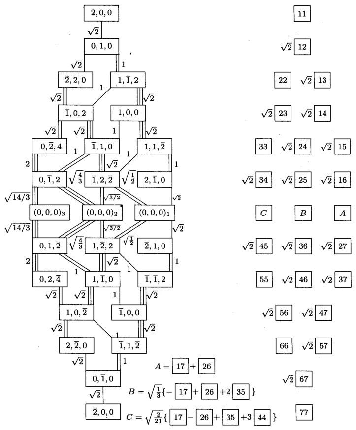
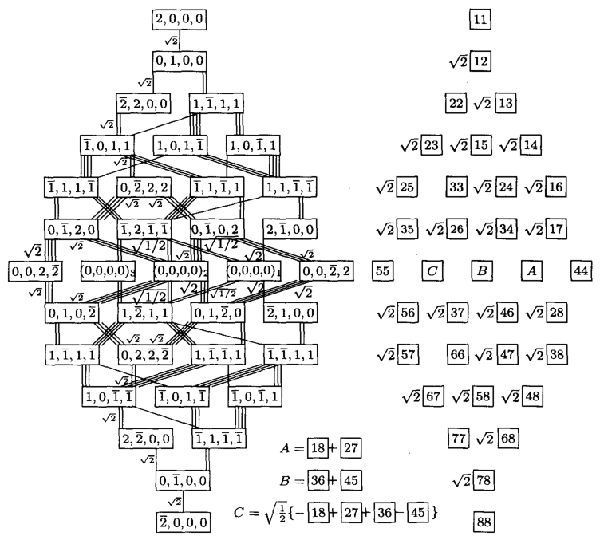

# *第九章 SO(N) 群

本章主要研究 SO(N) 群的张量表示，旋量表示和洛伦兹群的不可约表示。

## 9.1 SO(N) 群的张量表示

本节讨论 SO(N) 群张量空间的约化，并计算 SO(N) 群的不可约张量基。张量表示是 SO(N) 群的单值表示。

### 一、SO(N) 群的张量

　　与 SU(N) 群的张量和张量基的概念相类似，SO(N) 群的 $n$ 阶张量 $T_{a_1\cdots a_n}$ 有 $n$ 个指标，$N^n$ 个分量，在 SO(N) 变换 $R$ 中按下式变换

$$
T_{a_1\cdots a_n}\xrightarrow{R}(O_RT)_{a_1\cdots a_n}
=\sum_{b_1\cdots b_n}R_{a_1b_1}\cdots R_{a_nb_n}T_{b_1\cdots b_n}
\tag{9.1}
$$

同样可以引入张量基的概念。张量基是只有一个分量不为 0（等于 1）的张量，任何张量可按张量基展开

$$
(\Theta_{d_1\cdots d_n})_{a_1\cdots a_n}
=\delta_{d_1a_1}\delta_{d_2a_2}\cdots\delta_{d_na_n}
=(\Theta_{d_1})_{a_1}(\Theta_{d_2})_{a_2}\cdots(\Theta_{d_n})_{a_n}
\tag{9.2}
$$

$$
T_{a_1\cdots a_n}=\sum_{d_1\cdots d_n}T_{d_1\cdots d_n}(\Theta_{d_1\cdots d_n})_{a_1\cdots a_n}=T_{a_1\cdots a_n}
\tag{9.3}
$$

在 SO(N) 变换中张量基做如下变换

$$
O_R\Theta_{d_1\cdots d_n}=\sum_{b_1\cdots b_n}\Theta_{b_1\cdots b_n}R_{b_1d_1}\cdots R_{b_nd_n}
\tag{9.4}
$$

在置换变换中，张量和张量基也按式 (8.6) 和 (8.19) 变换。SO(N) 群的 $n$ 阶张量的集合构成 $N^n$ 维张量空间，它是一个线性空间，并对 SO(N) 变换和张量指标间的置换变换保持不变。对 SO(N) 群张量，外尔互反性也同样成立，即置换变换和 SO(N) 变换的次序可以交换，因而张量空间也可以用杨算符投影的方法，分解为对 SO(N) 变换不变的张量子空间的直和。

　　与 SU(N) 情况不同之处在于变换矩阵变成了实正交矩阵 $R\in SO(N)$，这使 SO(N) 群张量产生若干新的性质。首先，在 SO(N) 变换中，张量分量的实部和虚部都独立地按照式 (9.1) 做变换，分别构成 SO(N) 群的张量，因而对 SO(N) 群可以只研究实张量。第二，由于 $R$ 是实矩阵，SO(N) 群的协变张量和逆变张量完全相同。以前在两类张量指标之间的取迹运算（收缩），现在在同类张量指标间进行，迹张量子空间和无迹张量量子空间分别对 SO(N) 变换保持不变。在用杨算符投影的方法分解张量空间之前，先要把张量空间分解为一系列无迹张量量子空间的直和。第三，设 $T$ 是 SO(N) 群的 $n$ 阶无迹张量集合构成的张量空间，用杨算符投影后得到指标具有确定对称性的无迹张量子空间 $\mathcal{Y}^{[\lambda]}_{\mu}T=T^{[\lambda]}_{\mu}$，如果杨图 $[\lambda]$ 前两列格数之和大于 $N$，由于无迹条件数目大于独立张量分量数目，无迹张量子空间 $T^{[\lambda]}_{\mu}$ 是空集［参看式 (8.58) 的证明］. 第四，当杨图第一列格数 $\tau$ 大于 $N/2$ 时，张量基可通过 $N$ 阶完全反对称张量 $\epsilon_{a_1\cdots a_N}$ 组合，化为对偶张量基，对应表示的杨图第一列格数由 $\tau$ 改为 $N-\tau$，即

$$
[\lambda'] \simeq [\lambda], \qquad \lambda'_j = \begin{cases} \lambda_j, & j \le N-\tau, \\ 0, & j > N-\tau, \end{cases} \qquad N/2 < \tau < N \tag{9.5}
$$

这样两个杨图称为对偶杨图，它们对应的表示等价。

为了说清楚对偶张量基的概念，我们以反对称张量作为例子做进一步解释。当 $[\lambda]=[1^\tau]$ 是一列的杨图时，张量基 $\mathcal{Y}^{[1^\tau]}\Theta_{a_1\cdots a_\tau}$ 的对偶张量基定义为

$$
{}^{*}\left[\mathcal{Y}^{[1^\tau]}\Theta\right]_{a_1\cdots a_{N-\tau}} = \frac{1}{\tau!}\sum_{a_{N-\tau+1}\cdots a_N}\epsilon_{a_1\cdots a_{N-\tau}a_{N-\tau+1}\cdots a_N}\mathcal{Y}^{[1^\tau]}\Theta_{a_N\cdots a_{N-\tau+1}} \tag{9.6}
$$

逆变换有

$$
\begin{aligned}
&\frac{1}{(N-\tau)!}\sum_{a_{\tau+1}\cdots a_N}\epsilon_{b_1\cdots b_\tau a_{\tau+1}\cdots a_N}\left[\mathcal{Y}^{[1^\tau]}\Theta\right]_{a_N\cdots a_{\tau+1}}\\
&\quad = \frac{1}{\tau!(N-\tau)!}\sum_{a_1\cdots a_N}\epsilon_{b_1\cdots b_\tau a_{\tau+1}\cdots a_N}\epsilon_{a_N\cdots a_{\tau+1}a_\tau\cdots a_1}\mathcal{Y}^{[1^\tau]}\Theta_{a_1\cdots a_\tau}\\
&\quad = (-1)^{N(N-1)/2}\mathcal{Y}^{[1^\tau]}\Theta_{b_1\cdots b_\tau}
\end{aligned}
\tag{9.7}
$$

式中，两个 $N$ 阶完全反对称张量相乘时，先把第二个完全反对称张量的指标逆序排列，产生因子 $(-1)^{N(N-1)/2}$，然后指标求和，消去前面的分母，并产生 $N-\tau$ 个 $\delta$ 函数的乘积之和，得到最后结果。实际上，把因反对称指标求和产生的重复项与 $\tau!$ 消去后，式 (9.6) 的求和中只包含一项不为零。除了符号外，两组张量基只是排列次序上的不同。这是同一线性空间中基的组合，即相似变换，因而对应的表示是等价的。另一方面，由式 (9.6) 可以证明，新的基是按照反对称表示 $[1^{N-\tau}]$ 变换的，证明过程同式 (8.60). 因此 $[1^\tau]\simeq[1^{N-\tau}]$. 参考附录 33 的证明，由于无迹条件，这等价关系可以推广到任意 $\tau$ 行杨图 $[\lambda]$ 的情况，即式 (9.5).

第五，当 $N$ 是偶数时，若杨图 $[\lambda]$ 的行数等于 $\ell=N/2$，则杨图 $[\lambda]$ 与其对偶杨图完全相同，称为自对偶杨图。为了使张量基在取两次对偶后恢复原状，在对偶关系式 (9.6) 中引入因子 $(-\mathrm{i})^\ell$，以消去式 (9.7) 中的因子 $(-1)^{N(N-1)/2}=(-1)^\ell$

$$
\begin{aligned}
{}^{*}\left[\mathcal{Y}^{[\lambda]}\Theta\right]_{a_1\cdots a_\ell b\cdots} &= \frac{(-\mathrm{i})^\ell}{\ell!}\sum_{a_{\ell+1}\cdots a_{2\ell}}\epsilon_{a_1\cdots a_\ell a_{\ell+1}\cdots a_{2\ell}}\mathcal{Y}^{[\lambda]}\Theta_{a_{2\ell}\cdots a_{\ell+1}b\cdots}\;,\\
\mathcal{Y}^{[\lambda]}\Theta_{a_1\cdots a_\ell b\cdots} &= \frac{(-\mathrm{i})^\ell}{\ell!}\sum_{a_{\ell+1}\cdots a_{2\ell}}\epsilon_{a_1\cdots a_\ell a_{\ell+1}\cdots a_{2\ell}}{}^{*}\left[\mathcal{Y}^{[\lambda]}\Theta\right]_{a_{2\ell}\cdots a_{\ell+1}b\cdots}
\end{aligned}
\tag{9.8}
$$

式中张量杨表，指标 $a_j$ 填在第一列。把两组基相加或相减

$$
\Psi^{\pm}_{a_1\cdots a_\ell b\cdots} = \frac{1}{2}\left\{\mathcal{Y}^{[\lambda]}\Theta_{a_1\cdots a_\ell b\cdots} \pm {}^{*}\left[\mathcal{Y}^{[\lambda]}\Theta\right]_{a_1\cdots a_\ell b\cdots}\right\} \tag{9.9}
$$

$\Psi^{+}_{a_1\cdots a_\ell b\cdots}$ 在对偶运算中保持不变，称为自对偶张量基，$\Psi^{-}_{a_1\cdots a_\ell b\cdots}$ 在对偶运算中只改变符号，称为反自对偶张量基。例如

$$
\Psi^{\pm}_{1\cdots\ell} = \frac{1}{2}\left\{\mathcal{Y}^{[1^\ell]}\Theta_{1\cdots\ell} \pm (-\mathrm{i})^\ell\mathcal{Y}^{[1^\ell]}\Theta_{(2\ell)\cdots(\ell+1)}\right\} \tag{9.10}
$$

为了给读者一个直观的概念，我们取 $N=4$（$\ell=2$），把对偶和反对偶张量基具体写出来。注意，${}^{*}\left[\mathcal{Y}^{[1,1]}\Theta\right]_{ab}=-{}^{*}\left[\mathcal{Y}^{[1,1]}\Theta\right]_{ba}$ 和 $\mathcal{Y}^{[1,1]}\Theta_{ab}=-\mathcal{Y}^{[1,1]}\Theta_{ba}$.

$$
{}^{*}\left[\mathcal{Y}^{[1,1]}\Theta\right]_{12}=\mathcal{Y}^{[1,1]}\Theta_{34},\quad {}^{*}\left[\mathcal{Y}^{[1,1]}\Theta\right]_{13}=\mathcal{Y}^{[1,1]}\Theta_{42},\quad {}^{*}\left[\mathcal{Y}^{[1,1]}\Theta\right]_{14}=\mathcal{Y}^{[1,1]}\Theta_{23},
$$

$$
{}^{*}\left[\mathcal{Y}^{[1,1]}\Theta\right]_{34}=\mathcal{Y}^{[1,1]}\Theta_{12},\quad {}^{*}\left[\mathcal{Y}^{[1,1]}\Theta\right]_{24}=\mathcal{Y}^{[1,1]}\Theta_{31},\quad {}^{*}\left[\mathcal{Y}^{[1,1]}\Theta\right]_{23}=\mathcal{Y}^{[1,1]}\Theta_{14}
$$

$$
\begin{aligned}
\Psi^{\pm}_{12} &= \pm\Psi^{\pm}_{34} = \frac{1}{2}\left\{\mathcal{Y}^{[1,1]}\Theta_{12} \pm \mathcal{Y}^{[1,1]}\Theta_{34}\right\},\\
\Psi^{\pm}_{13} &= \pm\Psi^{\pm}_{42} = \frac{1}{2}\left\{\mathcal{Y}^{[1,1]}\Theta_{13} \pm \mathcal{Y}^{[1,1]}\Theta_{42}\right\},\\
\Psi^{\pm}_{14} &= \pm\Psi^{\pm}_{23} = \frac{1}{2}\left\{\mathcal{Y}^{[1,1]}\Theta_{14} \pm \mathcal{Y}^{[1,1]}\Theta_{23}\right\}
\end{aligned}
\tag{9.11}
$$

张量的自对偶性质在 SO(N) 变换中保持不变。因此，当 $N=2\ell$ 和杨图 $[\lambda]$ 行数为 $\ell$ 时，即 $[\lambda]$ 是自对偶杨图，无迹张量空间 $\mathcal{Y}^{[\lambda]}T$ 分解为两个维数相同的不变张量子空间的直和，分别对应 SO(N) 群两个不等价的不可约表示，记作 $[(S)\lambda]$ 和 $[(A)\lambda]$. 两个张量子空间分别称为自对偶和反自对偶张量量子空间。注意，杨算符对张量基的组合，和式 (9.6) 的对偶张量基的组合，都是实组合，式 (9.9) 引入的对偶张量基的组合，当 $N$ 能被 4 除尽时也是实组合，唯有当 $N=4m+2$ 时，式 (9.9) 引入的对偶张量基的组合是复组合。

总之，首先把 SO(N) 群的 $n$ 阶张量空间，分解为一系列无迹张量量子空间的直和，它们的张量阶数分别为 $n$，$n-2$，$n-4$ 等。然后对无迹张量空间用杨算符投影，得到张量指标有确定对称性的无迹张量量子空间，对应的表示用杨图标记。当杨图行数小于 $N/2$ 时，这表示是不可约实表示。当杨图前两列格数之和大于 $N$ 时，这子空间是零空间。当杨图行数大于 $N/2$ 时，这表示等价于对偶杨图标记的表示［见式 (9.5)］. 对 SO(2$\ell$) 群，当杨图 $[\lambda]$ 行数等于 $\ell$ 时，这张量子空间又分解为自对偶和反自对偶两个张量子空间的直和，分别对应自对偶表示 $[(S)\lambda]$ 和反自对偶表示 $[(A)\lambda]$. 当 $N=4m+2$ 时，$[(S)\lambda]$ 和 $[(A)\lambda]$ 是互为复共轭的不等价不可约表示。当 $N=4m$ 时，$[(S)\lambda]$ 和 $[(A)\lambda]$ 是两个互不等价的不可约实表示。所有张量表示都是 SO(N) 群的单值表示。关于表示的等价性和不可约性的结论将在下两小节证明。

计算 SO(N) 群的不可约张量基有几个困难。一是这样的正则张量杨表不是谢瓦莱基 $H_\mu$ 的共同本征张量基。二是张量基的无迹化虽不是原则性的困难，但是计算很麻烦，而且不好写成统一的形式。三是即使张量基无迹化了，用杨算符投影后得到的正则张量杨表不一定线性无关。解决的方法是重新定义一组正交归一的矢量基，称为球谐基。下面将就 $N$ 为奇数和偶数两种情况分别讨论。

### 二、SO(2ℓ+1) 群的谢瓦莱基和不可约张量表示最高权

第七章已经讨论过 SO(N) 群的生成元及其对易关系，根与素根，和 SO(N) 群对应的李代数。在自身表示中 SO(N) 群的生成元取为 $T_{ab}$，满足对易关系

$$
\begin{aligned}
(T_{ab})_{cd} &= -\mathrm{i}\left\{\delta_{ac}\delta_{bd} - \delta_{ad}\delta_{bc}\right\},\\
[T_{ab},\ T_{cd}] &= -\mathrm{i}\left\{\delta_{bc}T_{ad} + \delta_{ad}T_{bc} - \delta_{bd}T_{ac} - \delta_{ac}T_{bd}\right\}
\end{aligned}
\tag{9.12}
$$

对 SO(2$\ell$+1) 群，嘉当子代数的基 $H_j$ 为

$$
H_j = T_{(2j-1)(2j)}, \qquad 1 \le j \le \ell \tag{9.13}
$$

素根为

$$
\boldsymbol{r}_\mu = \boldsymbol{e}_\mu - \boldsymbol{e}_{\mu+1}, \qquad 1 \le \mu < \ell, \qquad \boldsymbol{r}_\ell = \boldsymbol{e}_\ell \tag{9.14}
$$

$\boldsymbol{r}_\mu$ 是长根，$d_\mu=1$，$\boldsymbol{r}_\ell$ 是短根，$d_\ell=1/2$. SO(2$\ell$+1) 群对应的李代数是 $\mathrm{B}_\ell$. 按照谢瓦莱基的定义式 (7.149)，SO(2$\ell$+1) 群自身表示生成元的谢瓦莱基为

$$
\begin{aligned}
H_\mu &= T_{(2\mu-1)(2\mu)} - T_{(2\mu+1)(2\mu+2)},\\
E_\mu &= \frac{1}{2}\left\{T_{(2\mu)(2\mu+1)} - \mathrm{i}T_{(2\mu-1)(2\mu+1)} - \mathrm{i}T_{(2\mu)(2\mu+2)} - T_{(2\mu-1)(2\mu+2)}\right\},\\
F_\mu &= \frac{1}{2}\left\{T_{(2\mu)(2\mu+1)} + \mathrm{i}T_{(2\mu-1)(2\mu+1)} + \mathrm{i}T_{(2\mu)(2\mu+2)} - T_{(2\mu-1)(2\mu+2)}\right\},\\
H_\ell &= 2T_{(2\ell-1)(2\ell)},\\
E_\ell &= T_{(2\ell)(2\ell+1)} - \mathrm{i}T_{(2\ell-1)(2\ell+1)},\\
F_\ell &= T_{(2\ell)(2\ell+1)} + \mathrm{i}T_{(2\ell-1)(2\ell+1)}
\end{aligned}
\tag{9.15}
$$

其中，$1 \le \mu \le \ell-1$. 矢量基 $\Theta_a$ 不是谢瓦莱基 $H_\mu$ 的共同本征矢量。把第四章 SO(3) 群的球谐基推广

$$
\Phi_1 = -\sqrt{1/2}\left(\Theta_1 + \mathrm{i}\Theta_2\right), \qquad \Phi_0 = \Theta_3, \qquad \Phi_{-1} = \sqrt{1/2}\left(\Theta_1 - \mathrm{i}\Theta_2\right)
$$

引入 SO(2$\ell$+1) 群的球谐基 $\Phi_\alpha$，$1 \le \alpha \le 2\ell+1$

$$
\Phi_\alpha = \begin{cases} (-1)^{\ell-\alpha+1}\sqrt{1/2}\left(\Theta_{2\alpha-1}+\mathrm{i}\Theta_{2\alpha}\right), & 1 \le \alpha \le \ell \\ \Theta_{2\ell+1}, & \alpha = \ell+1 \\ \sqrt{1/2}\left(\Theta_{4\ell-2\alpha+3}-\mathrm{i}\Theta_{4\ell-2\alpha+4}\right), & \ell+2 \le \alpha \le 2\ell+1 \end{cases} \tag{9.16}
$$

$n$ 阶张量的张量基 $\Phi_{\alpha_1\cdots\alpha_n}$ 是它们的直乘 $\Phi_{\alpha_1}\cdots\Phi_{\alpha_n}$. 在球谐基 $\Phi_\alpha$ 中谢瓦莱基的非零矩阵元为

$$
\begin{aligned}
H_\mu\Phi_\mu &= \Phi_\mu, & H_\mu\Phi_{\mu+1} &= -\Phi_{\mu+1}\\
H_\mu\Phi_{2\ell-\mu+1} &= \Phi_{2\ell-\mu+1}, & H_\mu\Phi_{2\ell-\mu+2} &= -\Phi_{2\ell-\mu+2}\\
H_\ell\Phi_\ell &= 2\Phi_\ell, & H_\ell\Phi_{\ell+2} &= -2\Phi_{\ell+2}\\
E_\mu\Phi_{\mu+1} &= \Phi_\mu, & E_\mu\Phi_{2\ell-\mu+2} &= \Phi_{2\ell-\mu+1}\\
E_\ell\Phi_{\ell+1} &= \sqrt{2}\Phi_\ell, & E_\ell\Phi_{\ell+2} &= \sqrt{2}\Phi_{\ell+1}\\
F_\mu\Phi_\mu &= \Phi_{\mu+1}, & F_\mu\Phi_{2\ell-\mu+1} &= \Phi_{2\ell-\mu+2}\\
F_\ell\Phi_\ell &= \sqrt{2}\Phi_{\ell+1}, & F_\ell\Phi_{\ell+1} &= \sqrt{2}\Phi_{\ell+2}
\end{aligned}
\tag{9.17}
$$

其中，$1 \le \mu \le \ell-1$. 为了直观，明显写出 $H_\mu$ 在球谐基中的矩阵形式

$$
H_\mu = \mathrm{diag}\{\underbrace{0,\cdots,0}_{\mu-1},1,-1,\underbrace{0,\cdots,0}_{2\ell-2\mu-1},1,-1,\underbrace{0,\cdots,0}_{\mu-1}\}
$$

$$
H_\ell = \mathrm{diag}\{\underbrace{0,\cdots,0}_{\ell-1},2,0,-2,\underbrace{0,\cdots,0}_{\ell-1}\}
$$

采用球谐基后，SO(2$\ell$+1) 群的张量杨表又变成 $H_\mu$ 的共同本征状态。根据在升算符 $E_\mu$ 作用下得零的要求，表示 $[\lambda]$ 最高权态对应的正则张量杨表 $\mathcal{Y}^{[\lambda]}_{\mu}\Phi_{\alpha_1\cdots\alpha_n}$，所有格子都填以该格子所在行数。根据球谐基的具体形式，这样的正则张量杨表不包含 $\alpha > \ell$ 的球谐基 $\Phi_\alpha$，因而是无迹的。例如，$\Theta_1\Theta_1$ 是有迹的，但 $\Phi_1\Phi_1$ 是无迹的。与 SU(N) 群的证明一样，可证在用杨图 $[\lambda]$ 标记的无迹张量子空间中，只有这一个正则张量杨表在所有升算符作用下为零，可见这张量子空间对应不可约表示。由式 (9.17)，SO(2$\ell$+1) 群杨图 $[\lambda]$ 和最高权 $M$ 的关系为

$$
M_\mu = \lambda_\mu - \lambda_{\mu+1}, \qquad 1 \le \mu < \ell, \qquad M_\ell = 2\lambda_\ell \tag{9.18}
$$

SO(2$\ell$+1) 群表示 $[\lambda]$ 中的其他状态基可按照方块权图，由最高权态用降算符作用得到。升算符或降算符的作用只是使状态基在不可约张量子空间内变化。由于最高权态是无迹的，由最高权态降下来的所有状态基也一定是无迹的，而且自动是正交归一的。式 (9.18) 指出，对于行数不大于 $\ell$ 的杨图，不同杨图描写不等价的不可约表示。 SO(2$\ell$+1) 群张量表示 $[\lambda]$ 是单值表示，它的最高权的特点是最后一个分量 $M_\ell$ 是偶数。以后会看到，$M_\ell$ 为奇数的表示是双值表示，称为旋量表示。

作为例子，计算 SO(7) 群（$\mathrm{B}_3$ 李代数）的二阶无迹对称张量，对应杨图是 $[2,0,0]$，最高权是 $\boldsymbol{M}=(2,0,0)$. 素根 $\boldsymbol{r}_\mu$ 和基本主权 $\boldsymbol{w}_\mu$ 的关系是

$$
\boldsymbol{r}_1 = 2\boldsymbol{w}_1 - \boldsymbol{w}_2, \qquad \boldsymbol{r}_2 = -\boldsymbol{w}_1 + 2\boldsymbol{w}_2 - 2\boldsymbol{w}_3, \qquad \boldsymbol{r}_3 = -\boldsymbol{w}_2 + 2\boldsymbol{w}_3
$$

用球谐基表出的正则张量杨表为

$$
\boxed{a}\boxed{b} = \Phi_{ab} + \Phi_{ba}, \qquad \boxed{a}\boxed{a} = 2\Phi_{aa}
$$

由正则张量杨表构成的迹张量为

$$
\begin{aligned}
&-\boxed{1}\boxed{7} + \boxed{2}\boxed{6} - \boxed{3}\boxed{5} + \frac{1}{2}\boxed{4}\boxed{4}\\
&\quad = -\Phi_{17} - \Phi_{71} + \Phi_{26} + \Phi_{62} - \Phi_{35} - \Phi_{53} + \Phi_{44}\\
&\quad = \frac{1}{2}\left(\Theta_1+\mathrm{i}\Theta_2\right)\left(\Theta_1-\mathrm{i}\Theta_2\right) + \frac{1}{2}\left(\Theta_1-\mathrm{i}\Theta_2\right)\left(\Theta_1+\mathrm{i}\Theta_2\right) + \cdots + \Theta_4\Theta_4 = \sum_{a=1}^{7}\Theta_{aa}
\end{aligned}
\tag{9.19}
$$

由最高权态 $|(2,0,0),(2,0,0)\rangle \equiv |(2,0,0)\rangle = \boxed{1}\boxed{1} = 2\Phi_{11}$ 出发，用画方块权图的标准方法，可以算出表示 (2,0,0) 的所有状态基，算出降算符在这组基中的非零矩阵元素。下面只给出部分计算。全部计算结果列于图 9.1.

从最高权态可构造一个 $A_1$ 三重态

$$
|(0,1,0)\rangle = \sqrt{1/2}F_1\,|(2,0,0)\rangle = \sqrt{1/2}F_1\boxed{1}\boxed{1} = \sqrt{2}\boxed{1}\boxed{2},
$$

$$
|(\bar{2},2,0)\rangle = \sqrt{1/2}F_1\,|(0,1,0)\rangle = F_1\boxed{1}\boxed{2} = \boxed{2}\boxed{2}
$$

主权 (0,1,0) 与最高权同属一个 $A_1$ 三重态，因而是单权。表示 (2,0,0) 包含一个三重权 (0,0,0)，与重权有关的计算如下：经过若干步计算后，得

$$
|(2,\bar{1},0)\rangle = F_2\,|(1,1,\bar{2})\rangle = \sqrt{2}F_2\boxed{1}\boxed{5} = \sqrt{2}\boxed{1}\boxed{6},
$$

$$
|(\bar{1},2,\bar{2})\rangle = F_1\,|(1,1,\bar{2})\rangle = \sqrt{2}F_1\boxed{1}\boxed{5} = \sqrt{2}\boxed{2}\boxed{5},
$$

$$
|(0,\bar{1},2)\rangle = (1/2)F_3\,|(0,\bar{2},4)\rangle = (1/2)F_3\boxed{3}\boxed{3} = \sqrt{2}\boxed{3}\boxed{4}
$$

$$
A = \boxed{1}\boxed{7} + \boxed{2}\boxed{6}, \qquad B = \sqrt{\frac{1}{3}}\left\{-\boxed{1}\boxed{7} + \boxed{2}\boxed{6} + 2\boxed{3}\boxed{5}\right\}, \qquad C = \sqrt{\frac{2}{21}}\left\{\boxed{1}\boxed{7} - \boxed{2}\boxed{6} + \boxed{3}\boxed{5} + 3\boxed{4}\boxed{4}\right\}
$$

由它们可以分别构造一个 $A_\mu$ 三重态，而且三重态中都包含权为 (0,0,0) 的态，因而主权 (0,0,0) 可能是三重权。设 $|(0,0,0)_1\rangle$ 属于 $A_1$ 三重态，其他两个属 $A_1$ 单态，$|(0,0,0)_2\rangle$ 与 $|(0,0,0)_1\rangle$ 适当组合后属于 $A_2$ 三重态，$|(0,0,0)_3\rangle$ 属 $A_2$ 单态

$$
|(0,0,0)_1\rangle = \sqrt{1/2}F_1\,|(2,\bar{1},0)\rangle = F_1\boxed{1}\boxed{6} = \boxed{1}\boxed{7} + \boxed{2}\boxed{6}\;,
$$

$$
E_1\,|(0,0,0)_2\rangle = E_1\,|(0,0,0)_3\rangle = E_2\,|(0,0,0)_3\rangle = 0\;,
$$

$$
F_2\,|(\bar{1},2,\bar{2})\rangle = a_1\,|(0,0,0)_1\rangle + a_2\,|(0,0,0)_2\rangle\;,
$$

$$
F_3,\ |(0,\bar{1},2)\rangle = b_1\,|(0,0,0)_1\rangle + b_2\,|(0,0,0)_2\rangle + b_3\,|(0,0,0)_3\rangle
$$

其中，$a_1^2+a_2^2=2$ 和 $b_1^2+b_2^2+b_3^2=6$. 与式 (9.19) 比较，$|(0,0,0)_1\rangle$ 明显是无迹张量。用 $E_1$ 作用在后两式上，得

$$
E_1F_2\,|(\bar{1},2,\bar{2})\rangle = \sqrt{2}a_1\,|(2,\bar{1},0)\rangle = F_2E_1\,|(\bar{1},2,\bar{2})\rangle = F_2\,|(1,1,\bar{2})\rangle = |(2,\bar{1},0)\rangle\;,
$$

$$
E_1F_3\,|(0,\bar{1},2)\rangle = \sqrt{2}b_1\,|(2,\bar{1},0)\rangle = F_3E_1\,|(0,\bar{1},2)\rangle = 0
$$

得 $a_1=\sqrt{1/2}$ 和 $b_1=0$. 选择 $|(0,0,0)_2\rangle$ 的位相，使 $a_2$ 是正实数，解得 $a_2=\sqrt{2-a_1^2}=\sqrt{3/2}$. 再用 $E_2F_3$ 作用在 $|(0,\bar{1},2)\rangle$ 上

$$
E_2F_3\,|(0,\bar{1},2)\rangle = \sqrt{3/2}b_2\,|(\bar{1},2,\bar{2})\rangle = F_3E_2\,|(0,\bar{1},2)\rangle = F_3\,|(\bar{1},1,0)\rangle = \sqrt{2}\,|(\bar{1},2,\bar{2})\rangle
$$

解得 $b_2=\sqrt{4/3}$. 选择 $|(0,0,0)_3\rangle$ 的位相，使 $b_3$ 是正实数，解得 $b_3=\sqrt{6-b_2^2}=\sqrt{14/3}$. 由此算得后两个零权的状态基为

$$
\begin{aligned}
|(0,0,0)_2\rangle &= \sqrt{2/3}\left\{F_2\,|(\bar{1},2,\bar{2})\rangle - \sqrt{1/2}\,|(0,0,0)_1\rangle\right\}\\
&= \sqrt{1/3}\left\{2F_2\boxed{2}\boxed{5} - \boxed{1}\boxed{7} - \boxed{2}\boxed{6}\right\}\\
&= \sqrt{1/3}\left\{-\boxed{1}\boxed{7} + \boxed{2}\boxed{6} + 2\boxed{3}\boxed{5}\right\},
\end{aligned}
$$

$$
\begin{aligned}
|(0,0,0)_3\rangle &= \sqrt{3/14}\left\{F_3\,|(0,\bar{1},2)\rangle - \sqrt{4/3}\,|(0,0,0)_2\rangle\right\}\\
&= \sqrt{2/21}\left\{\sqrt{9/2}F_3\boxed{3}\boxed{4} + \boxed{1}\boxed{7} - \boxed{2}\boxed{6} - 2\boxed{3}\boxed{5}\right\}\\
&= \sqrt{2/21}\left\{\boxed{1}\boxed{7} - \boxed{2}\boxed{6} + \boxed{3}\boxed{5} + 3\boxed{4}\boxed{4}\right\}
\end{aligned}
$$

与式 (9.19) 比较知，它们确都是无迹张量。

### 三、SO(2ℓ) 群的谢瓦莱基和不可约张量表示最高权

对 SO(2$\ell$) 群，嘉当子代数的基 $H_j$ 仍为式 (9.13)，素根为

$$
\boldsymbol{r}_\mu = \boldsymbol{e}_\mu - \boldsymbol{e}_{\mu+1}, \qquad 1 \le \mu < \ell, \qquad \boldsymbol{r}_\ell = \boldsymbol{e}_{\ell-1} + \boldsymbol{e}_\ell \tag{9.20}
$$

全部素根长度相同，$d_\mu=1$，SO(2$\ell$) 群对应的李代数是 $\mathrm{D}_\ell$. 按照谢瓦莱基的定义式 (7.149)，SO(2$\ell$) 群自身表示生成元的谢瓦莱基，当 $1 \le \mu < \ell$ 时与 SO(2$\ell$+1) 群相同，仍由式 (9.15) 给出，但当 $\mu=\ell$ 时为

$$
\begin{aligned}
H_\ell &= T_{(2\ell-3)(2\ell-2)} + T_{(2\ell-1)(2\ell)},\\
E_\ell &= \frac{1}{2}\left\{T_{(2\ell-2)(2\ell-1)} - \mathrm{i}T_{(2\ell-3)(2\ell-1)} + \mathrm{i}T_{(2\ell-2)(2\ell)} + T_{(2\ell-3)(2\ell)}\right\},\\
F_\ell &= \frac{1}{2}\left\{T_{(2\ell-2)(2\ell-1)} + \mathrm{i}T_{(2\ell-3)(2\ell-1)} - \mathrm{i}T_{(2\ell-2)(2\ell)} + T_{(2\ell-3)(2\ell)}\right\}
\end{aligned}
\tag{9.21}
$$

正则张量杨表也不是谢瓦莱基 $H_\mu$ 的共同本征张量基。对 SO(2$\ell$) 群，类似地定义球谐基 $\Phi_\alpha$

$$
\Phi_\alpha = \begin{cases} (-1)^{\ell-\alpha}\sqrt{1/2}\left(\Theta_{2\alpha-1}+\mathrm{i}\Theta_{2\alpha}\right), & 1 \le \alpha \le \ell \\ \sqrt{1/2}\left(\Theta_{4\ell-2\alpha+1}-\mathrm{i}\Theta_{4\ell-2\alpha+2}\right), & \ell+1 \le \alpha \le 2\ell \end{cases} \tag{9.22}
$$

$n$ 阶张量的张量基 $\Phi_{\alpha_1\cdots\alpha_n}$ 是它们的直乘 $\Phi_{\alpha_1}\cdots\Phi_{\alpha_n}$. 在球谐基 $\Phi_\alpha$ 中谢瓦莱基的非零矩阵元为

$$
\begin{aligned}
H_\mu\Phi_\mu &= \Phi_\mu, & H_\mu\Phi_{\mu+1} &= -\Phi_{\mu+1},\\
H_\mu\Phi_{2\ell-\mu} &= \Phi_{2\ell-\mu}, & H_\mu\Phi_{2\ell-\mu+1} &= -\Phi_{2\ell-\mu+1},\\
H_\ell\Phi_{\ell-1} &= \Phi_{\ell-1}, & H_\ell\Phi_\ell &= \Phi_\ell,\\
H_\ell\Phi_{\ell+1} &= -\Phi_{\ell+1}, & H_\ell\Phi_{\ell+2} &= -\Phi_{\ell+2},\\
E_\mu\Phi_{\mu+1} &= \Phi_\mu, & E_\mu\Phi_{2\ell-\mu+1} &= \Phi_{2\ell-\mu},\\
E_\ell\Phi_{\ell+1} &= \Phi_{\ell-1}, & E_\ell\Phi_{\ell+2} &= \Phi_\ell,\\
F_\mu\Phi_\mu &= \Phi_{\mu+1}, & F_\mu\Phi_{2\ell-\mu} &= \Phi_{2\ell-\mu+1},\\
F_\ell\Phi_{\ell-1} &= \Phi_{\ell+1}, & F_\ell\Phi_\ell &= \Phi_{\ell+2}
\end{aligned}
\tag{9.23}
$$

其中，$1 \le \mu \le \ell-1$. 为了直观，明显写出 $H_\mu$ 在球谐基中的矩阵形式

$$
H_\mu = \mathrm{diag}\{\underbrace{0,\cdots,0}_{\mu-1},1,-1,\underbrace{0,\cdots,0}_{2\ell-2\mu-2},1,-1,\underbrace{0,\cdots,0}_{\mu-1}\},
$$

$$
H_\ell = \mathrm{diag}\{\underbrace{0,\cdots,0}_{\ell-2},1,1,-1,-1,\underbrace{0,\cdots,0}_{\ell-2}\}
$$

采用球谐基后，根据在升算符 $E_\mu$ 作用下得零的要求，表示 $[\lambda]$ 最高权态对应的正则张量杨表 $\mathcal{Y}^{[\lambda]}_{\mu}\Phi_{\alpha_1\cdots\alpha_n}$ 仍是各行格子填以所在行数，但当杨图行数等于 $\ell$ 时，第 $\ell$ 行的格子，对自对偶表示 $[(S)\lambda]$ 填以 $\ell$，对反自对偶表示 $[(A)\lambda]$ 填以 $\ell+1$. 由式 (9.23) 可以确认它们在每一个升算符 $E_\mu$ 作用下都得零。因为在最高权态中不同时包含因子 $\Phi_\alpha$ 和 $\Phi_{2\ell-\alpha+1}$，所以仍是无迹张量。可证在用杨图 $[\lambda]$ 标记的无迹张量子空间中，只有这一个正则张量杨表在所有升算符作用下为零，可见这张量子空间对应不可约表示。 SO(2$\ell$) 群杨图 $[\lambda]$ 和最高权 $\boldsymbol{M}$ 的关系为

$$
\begin{aligned}
M_\mu &= \lambda_\mu - \lambda_{\mu+1}, & &\text{当 } 1 \le \mu < \ell-1\\
M_{\ell-1} &= M_\ell = \lambda_{\ell-1}, & &\text{当 } \lambda_\ell = 0\\
M_{\ell-1} &= \lambda_{\ell-1} - \lambda_\ell, \quad M_\ell = \lambda_{\ell-1} + \lambda_\ell, & &\text{对 } [(S)\lambda] \text{ 表示}\\
M_{\ell-1} &= \lambda_{\ell-1} + \lambda_\ell, \quad M_\ell = \lambda_{\ell-1} - \lambda_\ell, & &\text{对 } [(A)\lambda] \text{ 表示}
\end{aligned} \tag{9.24}
$$

SO(2$\ell$) 群表示 $[\lambda]$ 中的其他状态基可按照方块权图，由最高权态用降算符作用得到，这样算得的状态基一定是无迹的，而且自动是正交归一的。式 (9.24) 指出，对于行数小于 $\ell$ 的杨图，不同杨图描写不等价的不可约表示，行数等于 $\ell$ 的杨图，又分解为两个不等价的不可约表示，称为自对偶表示 $[(S)\lambda]$ 和反自对偶表示 $[(A)\lambda]$. SO(2$\ell$) 群张量表示 $[\lambda]$ 是单值表示，它的最高权的特点是最后两个分量之和 $M_{\ell-1}+M_\ell$ 是偶数。以后会看到，$M_{\ell-1}+M_\ell$ 为奇数的表示是双值表示，称为旋量表示。

这里给出的自对偶表示 $[(S)\lambda]$ 和反自对偶表示 $[(A)\lambda]$ 的定义与式 (9.9) 的定义是一致的。为了说明这一致性，我们以 $N=4$ ($\ell=2$) 为例，计算相应表示的张量基，并与式 (9.11) 比较。自对偶表示 $[(S)\lambda]$ 和反自对偶表示 $[(A)\lambda]$ 的最高权态分别为

$$
\begin{aligned}
\begin{array}{|c|}\hline 1\\ \hline 2\\ \hline\end{array}
&= \gamma^{[1,1]}\boldsymbol{\Phi}_{12} = \boldsymbol{\Phi}_{12}-\boldsymbol{\Phi}_{21}\\
&= \frac{1}{2}\{-(\boldsymbol{\Theta}_1+\mathrm{i}\boldsymbol{\Theta}_2)(\boldsymbol{\Theta}_3+\mathrm{i}\boldsymbol{\Theta}_4)+(\boldsymbol{\Theta}_3+\mathrm{i}\boldsymbol{\Theta}_4)(\boldsymbol{\Theta}_1+\mathrm{i}\boldsymbol{\Theta}_2)\}\\
&= \frac{1}{2}\{-\gamma^{[1,1]}\boldsymbol{\Theta}_{13}-\mathrm{i}\gamma^{[1,1]}\boldsymbol{\Theta}_{23}-\mathrm{i}\gamma^{[1,1]}\boldsymbol{\Theta}_{14}+\gamma^{[1,1]}\boldsymbol{\Theta}_{24}\}\\
&= -\boldsymbol{\Psi}^{+}_{13}-\mathrm{i}\boldsymbol{\Psi}^{+}_{14},
\end{aligned}
$$

$$
\begin{aligned}
\begin{array}{|c|}\hline 1\\ \hline 3\\ \hline\end{array}
&= \gamma^{[1,1]}\boldsymbol{\Phi}_{13} = \boldsymbol{\Phi}_{13}-\boldsymbol{\Phi}_{31}\\
&= \frac{1}{2}\{-(\boldsymbol{\Theta}_1+\mathrm{i}\boldsymbol{\Theta}_2)(\boldsymbol{\Theta}_3-\mathrm{i}\boldsymbol{\Theta}_4)+(\boldsymbol{\Theta}_3-\mathrm{i}\boldsymbol{\Theta}_4)(\boldsymbol{\Theta}_1+\mathrm{i}\boldsymbol{\Theta}_2)\}\\
&= \frac{1}{2}\{-\gamma^{[1,1]}\boldsymbol{\Theta}_{13}-\mathrm{i}\gamma^{[1,1]}\boldsymbol{\Theta}_{23}+\mathrm{i}\gamma^{[1,1]}\boldsymbol{\Theta}_{14}-\gamma^{[1,1]}\boldsymbol{\Theta}_{24}\}\\
&= -\boldsymbol{\Psi}^{-}_{13}+\mathrm{i}\boldsymbol{\Psi}^{-}_{14}
\end{aligned}
\tag{9.25}
$$

自对偶表示 $[(S)\lambda]$ 中的三个状态构成 $A_2$ 子代数的三重态

$$
\begin{aligned}
\sqrt{\frac{1}{2}}F_2\begin{array}{|c|}\hline 1\\ \hline 2\\ \hline\end{array}
&= \sqrt{\frac{1}{2}}\left(\begin{array}{|c|}\hline 1\\ \hline 4\\ \hline\end{array}-\begin{array}{|c|}\hline 2\\ \hline 3\\ \hline\end{array}\right)
= \sqrt{1/2}\{\boldsymbol{\Phi}_{14}-\boldsymbol{\Phi}_{41}-\boldsymbol{\Phi}_{23}+\boldsymbol{\Phi}_{32}\}\\
&= \sqrt{1/8}\{-(\boldsymbol{\Theta}_1+\mathrm{i}\boldsymbol{\Theta}_2)(\boldsymbol{\Theta}_1-\mathrm{i}\boldsymbol{\Theta}_2)+(\boldsymbol{\Theta}_1-\mathrm{i}\boldsymbol{\Theta}_2)(\boldsymbol{\Theta}_1+\mathrm{i}\boldsymbol{\Theta}_2)\\
&\quad -(\boldsymbol{\Theta}_3+\mathrm{i}\boldsymbol{\Theta}_4)(\boldsymbol{\Theta}_3-\mathrm{i}\boldsymbol{\Theta}_4)+(\boldsymbol{\Theta}_3-\mathrm{i}\boldsymbol{\Theta}_4)(\boldsymbol{\Theta}_3+\mathrm{i}\boldsymbol{\Theta}_4)\}\\
&= \mathrm{i}\sqrt{1/2}\{\gamma^{[1,1]}\boldsymbol{\Theta}_{12}+\gamma^{[1,1]}\boldsymbol{\Theta}_{34}\}=\mathrm{i}\sqrt{2}\boldsymbol{\Psi}^{+}_{12},
\end{aligned}
$$

$$
\sqrt{\frac{1}{2}}F_2\left\{\sqrt{\frac{1}{2}}\left(\begin{array}{|c|}\hline 1\\ \hline 4\\ \hline\end{array}-\begin{array}{|c|}\hline 2\\ \hline 3\\ \hline\end{array}\right)\right\}
= \begin{array}{|c|}\hline 3\\ \hline 4\\ \hline\end{array}
= \boldsymbol{\Phi}_{34}-\boldsymbol{\Phi}_{43}
$$

$$
\begin{aligned}
&= (1/2)\{(\boldsymbol{\Theta}_3-\mathrm{i}\boldsymbol{\Theta}_4)(\boldsymbol{\Theta}_1-\mathrm{i}\boldsymbol{\Theta}_2)-(\boldsymbol{\Theta}_1-\mathrm{i}\boldsymbol{\Theta}_2)(\boldsymbol{\Theta}_3-\mathrm{i}\boldsymbol{\Theta}_4)\}\\
&= (1/2)\{\gamma^{[1,1]}\boldsymbol{\Theta}_{31}-\mathrm{i}\gamma^{[1,1]}\boldsymbol{\Theta}_{41}-\mathrm{i}\gamma^{[1,1]}\boldsymbol{\Theta}_{32}-\gamma^{[1,1]}\boldsymbol{\Theta}_{42}\}\\
&= -\boldsymbol{\Psi}^{+}_{13}+\mathrm{i}\boldsymbol{\Psi}^{+}_{14}
\end{aligned}
$$

反自对偶表示 $[(A)\lambda]$ 中的三个状态构成 $A_1$ 子代数的三重态

$$
\begin{aligned}
\sqrt{\frac{1}{2}}F_1\begin{array}{|c|}\hline 1\\ \hline 3\\ \hline\end{array}
&= \sqrt{\frac{1}{2}}\left(\begin{array}{|c|}\hline 1\\ \hline 4\\ \hline\end{array}+\begin{array}{|c|}\hline 2\\ \hline 3\\ \hline\end{array}\right)
= \sqrt{1/2}\{\boldsymbol{\Phi}_{14}-\boldsymbol{\Phi}_{41}+\boldsymbol{\Phi}_{23}-\boldsymbol{\Phi}_{32}\}\\
&= \sqrt{1/8}\{-(\boldsymbol{\Theta}_1+\mathrm{i}\boldsymbol{\Theta}_2)(\boldsymbol{\Theta}_1-\mathrm{i}\boldsymbol{\Theta}_2)+(\boldsymbol{\Theta}_1-\mathrm{i}\boldsymbol{\Theta}_2)(\boldsymbol{\Theta}_1+\mathrm{i}\boldsymbol{\Theta}_2)\\
&\quad +(\boldsymbol{\Theta}_3+\mathrm{i}\boldsymbol{\Theta}_4)(\boldsymbol{\Theta}_3-\mathrm{i}\boldsymbol{\Theta}_4)-(\boldsymbol{\Theta}_3-\mathrm{i}\boldsymbol{\Theta}_4)(\boldsymbol{\Theta}_3+\mathrm{i}\boldsymbol{\Theta}_4)\}\\
&= \mathrm{i}\sqrt{1/2}\{\gamma^{[1,1]}\boldsymbol{\Theta}_{12},-\gamma^{[1,1]}\boldsymbol{\Theta}_{34}\}=\mathrm{i}\sqrt{2}\boldsymbol{\Psi}^{-}_{12}
\end{aligned}
$$

$$
\begin{aligned}
\sqrt{\frac{1}{2}}F_1\left\{\sqrt{\frac{1}{2}}\left(\begin{array}{|c|}\hline 1\\ \hline 4\\ \hline\end{array}+\begin{array}{|c|}\hline 2\\ \hline 3\\ \hline\end{array}\right)\right\}
&= \begin{array}{|c|}\hline 2\\ \hline 4\\ \hline\end{array}
= \boldsymbol{\Phi}_{24}-\boldsymbol{\Phi}_{42}\\
&= (1/2)\{(\boldsymbol{\Theta}_3+\mathrm{i}\boldsymbol{\Theta}_4)(\boldsymbol{\Theta}_1-\mathrm{i}\boldsymbol{\Theta}_2)-(\boldsymbol{\Theta}_1-\mathrm{i}\boldsymbol{\Theta}_2)(\boldsymbol{\Theta}_3+\mathrm{i}\boldsymbol{\Theta}_4)\}\\
&= (1/2)\{\gamma^{[1,1]}\boldsymbol{\Theta}_{31}+\mathrm{i}\gamma^{[1,1]}\boldsymbol{\Theta}_{41}-\mathrm{i}\gamma^{[1,1]}\boldsymbol{\Theta}_{32}+\gamma^{[1,1]}\boldsymbol{\Theta}_{42}\}\\
&= -\boldsymbol{\Psi}^{-}_{13}-\mathrm{i}\boldsymbol{\Psi}^{-}_{14}
\end{aligned}
$$

作为例子，计算 SO(8) 群 ($B_4$ 李代数) 的二阶无迹对称张量，对应杨图是 [2,0,0,0]，最高权是 $\boldsymbol{M}=(2,0,0,0)$. 素根 $\boldsymbol{r}_\mu$ 和基本主权 $\boldsymbol{w}_\mu$ 的关系是

$$
\begin{aligned}
\boldsymbol{r}_1 &= 2\boldsymbol{w}_1-\boldsymbol{w}_2, & \boldsymbol{r}_2 &= -\boldsymbol{w}_1+2\boldsymbol{w}_2-\boldsymbol{w}_3-\boldsymbol{w}_4,\\
\boldsymbol{r}_3 &= -\boldsymbol{w}_2+2\boldsymbol{w}_3, & \boldsymbol{r}_4 &= -\boldsymbol{w}_2+2\boldsymbol{w}_4
\end{aligned}
$$

用球谐基表出的正则张量杨表为

$$
\begin{array}{|c|c|}\hline \mathrm{a} & \mathrm{b}\\ \hline\end{array}
= \boldsymbol{\Phi}_{ab}+\boldsymbol{\Phi}_{ba}, \qquad
\begin{array}{|c|c|}\hline \mathrm{a} & \mathrm{a}\\ \hline\end{array}
= 2\boldsymbol{\Phi}_{aa}
$$

由正则张量杨表构成的迹张量为

$$
\begin{aligned}
&-\begin{array}{|c|c|}\hline 1 & 8\\ \hline\end{array}
+\begin{array}{|c|c|}\hline 2 & 7\\ \hline\end{array}
-\begin{array}{|c|c|}\hline 3 & 6\\ \hline\end{array}
+\begin{array}{|c|c|}\hline 4 & 5\\ \hline\end{array}\\
&= -\boldsymbol{\Phi}_{18}-\boldsymbol{\Phi}_{81}+\boldsymbol{\Phi}_{27}+\boldsymbol{\Phi}_{72}-\boldsymbol{\Phi}_{36}-\boldsymbol{\Phi}_{63}+\boldsymbol{\Phi}_{45}+\boldsymbol{\Phi}_{54}\\
&= \frac{1}{2}(\boldsymbol{\Theta}_1+\mathrm{i}\boldsymbol{\Theta}_2)(\boldsymbol{\Theta}_1-\mathrm{i}\boldsymbol{\Theta}_2)+\frac{1}{2}(\boldsymbol{\Theta}_1-\mathrm{i}\boldsymbol{\Theta}_2)(\boldsymbol{\Theta}_1+\mathrm{i}\boldsymbol{\Theta}_2)+\cdots\\
&= \sum_{a=1}^{8}\boldsymbol{\Theta}_a\boldsymbol{\Theta}_a=\sum_{a=1}^{8}\boldsymbol{\Theta}_{aa}
\end{aligned}
\tag{9.26}
$$

最高权态为

$$
|(2,0,0,0)\rangle = \begin{array}{|c|c|}\hline 1 & 1\\ \hline\end{array} = 2\boldsymbol{\Phi}_{11}
$$

用画方块权图的方法，可以算出表示 (2,0,0,0) 的所有状态基的展开式，算出降算符在这组基中的非零矩阵元素。表示 (2,0,0,0) 包含重权 (0,0,0,0)，下面只计算与重权相关的部分。全部计算结果列于图 9.2. 经过若干步计算后，得

$$
\begin{gathered}
|(0,\bar{1},2,0)\rangle = F_2|(\bar{1},1,1,\bar{1})\rangle = \sqrt{2}\,\begin{array}{|c|c|}\hline 3 & 5\\ \hline\end{array},\\
|(\bar{1},2,\bar{1},\bar{1})\rangle = F_3|(\bar{1},1,1,\bar{1})\rangle = \sqrt{2}\,\begin{array}{|c|c|}\hline 2 & 6\\ \hline\end{array},\\
|(0,\bar{1},0,2)\rangle = F_2|(\bar{1},1,\bar{1},1)\rangle = \sqrt{2}\,\begin{array}{|c|c|}\hline 3 & 4\\ \hline\end{array},\\
|(2,\bar{1},0,0)\rangle = F_2|(1,1,\bar{1},\bar{1})\rangle = \sqrt{2}\,\begin{array}{|c|c|}\hline 1 & 7\\ \hline\end{array},\\
F_1|(1,1,\bar{1},\bar{1})\rangle = F_4|(\bar{1},1,\bar{1},1)\rangle = |(\bar{1},2,\bar{1},\bar{1})\rangle,
\end{gathered}
$$

$$
\begin{gathered}
F_3|(0,\bar{2},2,2)\rangle = \sqrt{2}|(0,\bar{1},0,2)\rangle,\\
F_4|(0,\bar{2},2,2)\rangle = \sqrt{2}|(0,\bar{1},2,0)\rangle,\\
|(0,0,\bar{2},2)\rangle = \sqrt{1/2}F_3|(0,\bar{1},0,2)\rangle = \begin{array}{|c|c|}\hline 4 & 4\\ \hline\end{array},\\
|(0,0,2,\bar{2})\rangle = \sqrt{1/2}F_4|(0,\bar{1},2,0)\rangle = \begin{array}{|c|c|}\hline 5 & 5\\ \hline\end{array}
\end{gathered}
$$

由前四个状态基可以分别构造一个 $A_\mu$ 三重态，而且三重态中都包含权为 (0,0,0,0) 的态，因而主权 (0,0,0,0) 可能是四重权。设 $|(0,0,0,0)_1\rangle$ 属于 $A_1$ 三重态，其他三个属 $A_1$ 单态，$|(0,0,0,0)_2\rangle$ 与 $|(0,0,0,0)_1\rangle$ 适当组合后属于 $A_3$ 三重态，$|(0,0,0,0)_3\rangle$ 和 $|(0,0,0,0)_4\rangle$ 属 $A_3$ 单态，$|(0,0,0,0)_3\rangle$ 和 $|(0,0,0,0)_1\rangle$，$|(0,0,0,0)_2\rangle$ 适当组合后属于 $A_2$ 三重态，$|(0,0,0,0)_4\rangle$ 属 $A_2$ 单态

$$
\begin{aligned}
|(0,0,0,0)_1\rangle &= \sqrt{1/2}F_1|(2,\bar{1},0,0)\rangle = F_1\begin{array}{|c|c|}\hline 1 & 7\\ \hline\end{array} = \begin{array}{|c|c|}\hline 1 & 8\\ \hline\end{array}+\begin{array}{|c|c|}\hline 2 & 7\\ \hline\end{array},\\
E_1|(0,0,0,0)_2\rangle &= E_1|(0,0,0,0)_3\rangle = E_1|(0,0,0,0)_4\rangle = 0,\\
E_3|(0,0,0,0)_3\rangle &= E_3|(0,0,0,0)_4\rangle = E_2|(0,0,0,0)_4\rangle = 0,\\
F_3|(0,\bar{1},2,0)\rangle &= a_1|(0,0,0,0)_1\rangle+a_2|(0,0,0,0)_2\rangle,\\
F_2|(\bar{1},2,\bar{1},\bar{1})\rangle &= b_1|(0,0,0,0)_1\rangle+b_2|(0,0,0,0)_2\rangle+b_3|(0,0,0,0)_3\rangle,\\
F_4|(0,\bar{1},0,2)\rangle &= c_1|(0,0,0,0)_1\rangle+c_2|(0,0,0,0)_2\rangle\\
&\quad +c_3|(0,0,0,0)_3\rangle+c_4|(0,0,0,0)_4\rangle
\end{aligned}
\tag{9.27}
$$

其中，$a_1^2+a_2^2=b_1^2+b_2^2+b_3^2=c_1^2+c_2^2+c_3^2+c_4^2=2$. 与式 (9.26) 比较，$|(0,0,0,0)_1\rangle$ 明显是无迹张量。用 $E_1$ 作用在后三式上，得

$$
\begin{aligned}
E_1F_3|(0,\bar{1},2,0)\rangle &= \sqrt{2}a_1|(2,\bar{1},0,0)\rangle = F_3E_1|(0,\bar{1},2,0)\rangle = 0,\\
E_1F_2|(\bar{1},2,\bar{1},\bar{1})\rangle &= \sqrt{2}b_1|(2,\bar{1},0,0)\rangle\\
&= F_2E_1|(\bar{1},2,\bar{1},\bar{1})\rangle = F_2|(1,1,\bar{1},\bar{1})\rangle = |(2,\bar{1},0,0)\rangle,\\
E_1F_4|(0,\bar{1},0,2)\rangle &= \sqrt{2}c_1|(2,\bar{1},0,0)\rangle = F_4E_1|(0,\bar{1},0,2)\rangle = 0
\end{aligned}
$$

得 $b_1=\sqrt{1/2}$ 和 $a_1=c_1=0$. 选择 $|(0,0,0,0)_2\rangle$ 的位相，使 $a_2$ 是正实数，解得 $a_2=\sqrt{2-a_1^2}=\sqrt{2}$. 再用 $E_3$ 作用在 (9.27) 后两式上

$$
\begin{aligned}
E_3F_2|(\bar{1},2,\bar{1},\bar{1})\rangle &= \sqrt{2}b_2|(0,\bar{1},2,0)\rangle\\
&= F_2E_3|(\bar{1},2,\bar{1},\bar{1})\rangle = F_2|(\bar{1},1,1,\bar{1})\rangle = |(0,\bar{1},2,0)\rangle,\\
E_3F_4|(0,\bar{1},0,2)\rangle &= \sqrt{2}c_2|(0,\bar{1},2,0)\rangle\\
&= F_4E_3|(0,\bar{1},0,2)\rangle = \sqrt{2}F_4|(0,\bar{2},2,2)\rangle = 2|(0,\bar{1},2,0)\rangle
\end{aligned}
$$

解得 $b_2=\sqrt{1/2}$ 和 $c_2=\sqrt{2}$. 选择 $|(0,0,0,0)_3\rangle$ 的位相，使 $b_3$ 是正实数，解得 $b_3=\sqrt{2-b_1^2-b_2^2}=1$. 因为 $c_2=\sqrt{2}$，$c_3$ 和 $c_4$ 都只能为零。权 (0,0,0,0) 是三重权。由此算得

$$
|(0,0,0,0)_2\rangle = \sqrt{1/2}F_3|(0,\bar{1},2,0)\rangle = \begin{array}{|c|c|}\hline 3 & 6\\ \hline\end{array}+\begin{array}{|c|c|}\hline 4 & 5\\ \hline\end{array},
$$

$$
\begin{aligned}
|(0,0,0,0)_3\rangle &= F_2|(\bar{1},2,\bar{1},\bar{1})\rangle-\sqrt{1/2}|(0,0,0,0)_1\rangle-\sqrt{1/2}|(0,0,0,0)_2\rangle\\
&= \sqrt{1/2}\left\{2F_2\begin{array}{|c|c|}\hline 2 & 6\\ \hline\end{array}-\begin{array}{|c|c|}\hline 1 & 8\\ \hline\end{array}-\begin{array}{|c|c|}\hline 2 & 7\\ \hline\end{array}-\begin{array}{|c|c|}\hline 3 & 6\\ \hline\end{array}-\begin{array}{|c|c|}\hline 4 & 5\\ \hline\end{array}\right\}\\
&= \sqrt{1/2}\left\{-\begin{array}{|c|c|}\hline 1 & 8\\ \hline\end{array}+\begin{array}{|c|c|}\hline 2 & 7\\ \hline\end{array}+\begin{array}{|c|c|}\hline 3 & 6\\ \hline\end{array}-\begin{array}{|c|c|}\hline 4 & 5\\ \hline\end{array}\right\}
\end{aligned}
$$

与式 (9.26) 比较知，它们确都是无迹张量。

### 四、SO(N) 群不可约张量表示的维数

这里给出一种利用杨图计算 SO($N$) 群不可约张量表示 $[\lambda]$ 维数的钩形规则，其中杨图 $[\lambda]$ 前两列格数之和不大于 $N$. 在这规则中，表示维数表为一个分数，分子和分母分别是给定杨图 $[\lambda]$ 的一定表中所填数的乘积。当杨图 $[\lambda]$ 行数等于 $N/2$ 时，由于表示分解为自对偶和反自对偶两个表示的直和，表示维数还要再除以 2. 由于张量要取无迹条件，这钩形规则远比 SU($N$) 群和置换群的钩形规则要复杂，主要是作为分子的表计算比较复杂。

$$
d_{[\lambda]}(\mathrm{SO}(N))=
\begin{cases}
\dfrac{Y_T^{[\lambda]}}{Y_h^{[\lambda]}}, & \text{当 } [\lambda] \text{ 的行数不等于 } N/2\\[6pt]
\dfrac{Y_T^{[\lambda]}}{2Y_h^{[\lambda]}}, & \text{当 } [\lambda] \text{ 的行数等于 } N/2
\end{cases}
\tag{9.28}
$$

为了说清楚分子和分母表的填法，先定义杨图 $[\lambda]$ 的钩形路径 $(i,j)$，它是一条钩形通道，由杨图 $[\lambda]$ 第 $i$ 行最右面格子处进入杨图，向左走到第 $i$ 行第 $j$ 列处向下转弯，在第 $j$ 列最下面格子处离开杨图。而逆钩形路径 $(\bar{i},\bar{j})$ 与钩形路径 $(i,j)$ 形状相同，只是走向相反。两条钩形路径在杨图中经过的格子数就是第 $i$ 行第 $j$ 列格子的钩形数 $h_{ij}$. 分母的表 $Y_h^{[\lambda]}$ 是在杨图 $[\lambda]$ 各格填以该格的构形数 $h_{ij}$，分母是表中所填数的乘积。对杨图 $[\lambda]$，按下面规则相继定义一系列的表 $Y_{T_a}^{[\lambda]}$，分子的表 $Y_T^{[\lambda]}$ 是在杨图 $[\lambda]$ 各格填以上述系列中各表 $Y_{T_a}^{[\lambda]}$ 对应格子填数之和，分子是表 $Y_T^{[\lambda]}$ 中所填数的乘积。

表 $Y_{T_a}^{[\lambda]}$ 由下面规则定义：

(1) 表 $Y_{T_0}^{[\lambda]}$ 是在杨图 $[\lambda]$ 各格填以 $N$ 和容度 $m_{ij}=j-i$ 之和，即第 $i$ 行第 $j$ 列格子填以 $N+j-i$.

(2) 设 $[\lambda^{(1)}]=[\lambda]$. 由 $[\lambda^{(1)}]$ 开始，相继定义一系列 $[\lambda^{(a)}]$，其中 $[\lambda^{(a)}]$ 是由 $[\lambda^{(a-1)}]$ 移去第一行和第一列得到。这过程一直进行到 $[\lambda^{(a-1)}]$ 的列数少于 2 为止。

(3) 如果 $[\lambda^{(a)}]$ 列数大于 1，按下法定义表 $Y_{T_a}^{[\lambda]}$. 在杨图 $[\lambda]$ 前 $a-1$ 行和前 $a-1$ 列都填以零，余下部分钩成杨图 $[\lambda^{(a)}]$. 设杨图 $[\lambda^{(a)}]$ 含 $r$ 行，在杨图 $[\lambda^{(a)}]$ 中的钩形路径 (1,1) 前 $r$ 格，逐格填以 $(\lambda_1^{(a)}-1)$，$(\lambda_2^{(a)}-1)$，$\cdots$，$(\lambda_r^{(a)}-1)$，在杨图 $[\lambda^{(a)}]$ 每个逆钩形路径 $(\bar{i},1)$，$1\le i\le r$，前 $(\lambda_i^{(a)}-1)$ 格填以 $-1$. 如果几个 $-1$ 填在同一格，则填数相加。其余格子都填零。在杨图 $[\lambda^{(a)}]$ 中填数之和为零。

下面举些例子来说明维数公式 (9.28) 的用法。

**例 1** SO(7) 群的表示 [3,3,3] 的维数

$$
\begin{aligned}
Y_T^{[3,3,3]} &=
\begin{array}{|c|c|c|}\hline 7 & 8 & 9\\ \hline 6 & 7 & 8\\ \hline 5 & 6 & 7\\ \hline\end{array}\\
&\quad +
\begin{array}{|c|c|c|}\hline 2 & 2 & 2\\ \hline -2 & & \\ \hline -3 & -1 & \\ \hline\end{array}\\
&\quad +
\begin{array}{|c|c|c|}\hline & & \\ \hline & 1 & 1\\ \hline & -2 & \\ \hline\end{array}\\
&\quad =
\begin{array}{|c|c|c|}\hline 9 & 10 & 11\\ \hline 4 & 8 & 9\\ \hline 2 & 3 & 7\\ \hline\end{array}
\end{aligned}
$$

$$
d_{[3,3,3]}(\mathrm{SO}(7))=
\frac{
\begin{array}{|c|c|c|}\hline 9 & 10 & 11\\ \hline 4 & 8 & 9\\ \hline 2 & 3 & 7\\ \hline\end{array}
}{
\begin{array}{|c|c|c|}\hline 5 & 4 & 3\\ \hline 4 & 3 & 2\\ \hline 3 & 2 & 1\\ \hline\end{array}
}
= 11\times 9\times 7\times 2=1386
$$

**例 2** SO($N$) 群一行杨图 [$n$] 对应表示的维数

$$
d_{[n]}(\mathrm{SO}(N))=
\frac{
\begin{array}{|c|c|c|c|}\hline N & N+1 & \cdots & N+n-1\\ \hline\end{array}
+
\begin{array}{|c|c|c|c|}\hline -1 & \cdots & -1 & n-1\\ \hline\end{array}
}{
\begin{array}{|c|c|c|c|}\hline n & n-1 & \cdots & 1\\ \hline\end{array}
}
$$

$$
=\frac{
\begin{array}{|c|c|c|c|c|}\hline N-1 & N & \cdots & N+n-3 & N+2n-2\\ \hline\end{array}
}{n!}
\tag{9.29}
$$

$$
=\frac{(N+n-3)!(N+2n-2)}{(N-2)!n!}
$$

$$
=\frac{N+2n-2}{N-2}\binom{N+n-3}{n}
$$

对 $N=3,4$ 和 5，有

$$
\begin{aligned}
d_{[n]}(\mathrm{SO}(3)) &= 2n+1,\\
d_{[n]}(\mathrm{SO}(4)) &= (n+1)^2,\\
d_{[n]}(\mathrm{SO}(5)) &= (n+1)(n+2)(2n+3)/6
\end{aligned}
\tag{9.30}
$$

**例 3** SO($N$) 群两行杨图 [$n,m$] 对应表示的维数

$$
\begin{aligned}
Y_T^{[n,m]} &=
\begin{array}{|c|c|c|c|c|c|c|c|}
\hline
N & N+1 & \cdots & N+m-2 & N+m-1 & \cdots & N+n-2 & N+n-1\\ \hline
N-1 & N & \cdots & N+m-3 & N+m-2 & & & \\ \hline
\end{array}\\
&\quad +\begin{array}{|c|c|c|c|c|c|c|c|c|}
\hline
-1 & -1 & \cdots & -1 & -1 & \cdots & -1 & m-1 & n-1\\ \hline
-2 & -1 & \cdots & -1 & & & & & \\ \hline
\end{array}\\
&\quad +\begin{array}{|c|c|c|c|c|}
\hline
& & & & \\ \hline
& -1 & \cdots & -1 & m-2\\ \hline
\end{array}\\
&\quad =\begin{array}{|c|c|c|c|c|c|c|c|}
\hline
N-1 & \cdots & N+m-3 & N+m-2 & \cdots & N+n-4 & N+n+m-3 & N+2n-2\\ \hline
N-3 & \cdots & N+m-5 & N+2m-4 & & & & \\ \hline
\end{array}
\end{aligned}
$$

$$
Y_h^{[n,m]}=
\begin{array}{|c|c|c|c|c|c|}
\hline
n+1 & \cdots & n-m+2 & n-m & \cdots & 1\\ \hline
m & \cdots & 1 & & & \\ \hline
\end{array}
$$

$$
d_{[n,m]}(\mathrm{SO}(N))=\frac{(n-m+1)(N+n-4)!(N+m-5)!}{(n+1)!m!(N-2)!(N-4)!}
\tag{9.31}
$$

$$
\times (N+n+m-3)(N+2n-2)(N+2m-4)
$$

对 SO(5) 群和 SO(4) 群有

$$
\begin{aligned}
d_{[n,m]}(\mathrm{SO}(5)) &= (n-m+1)(n+m+2)(2n+3)(2m+1)/6,\\
d_{[n,m]}(\mathrm{SO}(4)) &= (n-m+1)(n+m+1)
\end{aligned}
\tag{9.32}
$$

在计算 SO(4) 群两行杨图对应表示的维数时，已考虑到式 (9.28) 分母中的因子 2.

对只有一列的杨图 $[1^n]$，不存在无迹条件。当 $n<N/2$ 时，有

$$
d_{[1^n]}(\mathrm{SO}(N))=\binom{N}{n}=\frac{N!}{n!(N-n)!}, \qquad n<N/2
\tag{9.33}
$$

### 五、SO(N) 群的伴随表示

以李代数（李群）最大根作为最高权的表示是李代数的伴随表示。附录 29 已经指出，SO($N$) 群伴随表示的最高权为 $(0,1,0,\cdots,0)$，由式 (9.18) 和式 (9.24) 算得伴随表示的杨图为 $[1,1,0,\cdots,0]$. 因为在李群中伴随表示特别重要，所以我们再用更直接的方法来研究 SO($N$) 群伴随表示，把按伴随表示变换的张量分量与二阶反对称张量分量直接联系起来。

SO($N$) 群自身表示的 $N(N-1)/2$ 个生成元 $T_{ab}$，构成 $N$ 维反对称矩阵的完备基，任何 $N$ 维反对称矩阵都可按它们展开。为了表述方便，把这 $N(N-1)/2$ 个生成元做适当编号，得 $T_A$，$1\le A\le N(N-1)/2$，它们满足归一条件

$$
\mathrm{Tr}\,(T_AT_B)=2\delta_{AB}
\tag{9.34}
$$

设 $R\in\mathrm{SO}(N)$，根据伴随表示的定义 (7.8)，有

$$
R\boldsymbol{T}_AR^{-1}=\sum_{B+1}^{N(N-1)/2}\boldsymbol{T}_BD_{BA}^{\mathrm{ad}}(R)
\tag{9.35}
$$

SO($N$) 群的二阶反对称张量 $\boldsymbol{T}_{ab}$ 在 SO($N$) 变换中也有类似关系

$$
(O_R\boldsymbol{T})_{ab}=\sum_{cd}R_{ac}\boldsymbol{T}_{cd}(R^{-1})_{db}=(R\boldsymbol{T}R^{-1})_{ab}
$$

把 $\boldsymbol{T}_{ab}$ 看成 $N$ 维反对称矩阵，按 $(\boldsymbol{T}_A)_{ab}$ 展开，展开系数是张量 $\boldsymbol{F}_A$

$$
\boldsymbol{T}_{ab}=\sum_{A=1}^{N(N-1)/2}(\boldsymbol{T}_A)_{ab}\boldsymbol{F}_A, \qquad
\boldsymbol{F}_A=\frac{1}{2}\sum_{ab}(\boldsymbol{T}_A)_{ba}\boldsymbol{T}_{ab}
\tag{9.36}
$$

上式也可以理解为 $\boldsymbol{T}_{ab}$ 按 $\boldsymbol{F}_A$ 展开，$(\boldsymbol{T}_A)_{ab}$ 是展开系数。这是同一张量空间张量分量的组合，它们应该按等价的表示变换。我们来讨论 $\boldsymbol{F}_A$ 在 SO($N$) 变换中的变换规律

$$
\begin{aligned}
(O_R\boldsymbol{T})_{ab} &= (R\boldsymbol{T}R^{-1})_{ab}=\sum_A (R\boldsymbol{T}_AR^{-1})_{ab}\boldsymbol{F}_A\\
&= \sum_B (\boldsymbol{T}_A)_{ab}\left\{\sum_A D_{BA}^{\mathrm{ad}}(R)\boldsymbol{F}_A\right\}\\
&= \sum_B (\boldsymbol{T}_B)_{ab}O_R\boldsymbol{F}_B
\end{aligned}
$$

$$
(O_R\boldsymbol{F})_B=\sum_A D_{BA}^{\mathrm{ad}}(R)\boldsymbol{F}_A
\tag{9.37}
$$

$\boldsymbol{F}_B$ 按伴随表示变换。这说明，SO($N$) 群伴随表示等价于二阶反对称张量表示 [1,1]. $\boldsymbol{T}_{ab}$ 和 $\boldsymbol{F}_A$ 都是按 SO($N$) 群伴随表示变换的张量。 SO(3) 群伴随表示等价于自身表示，$[1,1]\simeq[1]$. $N>4$ 时，SO($N$) 群的伴随表示是不可约表示。因此当 $N=3$ 和 $N>4$ 时，SO($N$) 群是单纯李群，它们不存在不变子李群。 SO(4) 群的伴随表示是可约表示，以后将直接证明，SO(4) 群同态于两个 SU(2) 群的直乘。

## 9.2 N 维空间角动量及其本征函数

对 SO($N$) 群，物理中更常用的不是不可约张量基，而是属不可约表示 $[\lambda]$ 的标量函数 $\psi_{\boldsymbol{m}}^{[\lambda]}(x)$

$$
P_R\psi_{\boldsymbol{m}}^{[\lambda]}(x)=\psi_{\boldsymbol{m}}^{[\lambda]}(R^{-1}x)=\sum_{\boldsymbol{m}'}\psi_{\boldsymbol{m}'}^{[\lambda]}(x)D_{\boldsymbol{m}'\boldsymbol{m}}^{[\lambda]}(R)
\tag{9.38}
$$

其中，$P_R$ 是标量函数变换算符（见第三章），$\boldsymbol{m}$ 是权矢量。本节研究这样的标量函数的性质。

### 一、N 维空间的角动量算符

SO($N$) 群的微量微分算符（见第四章），也就是标量函数变换算符 $P_R$ 的生成元，称为 $N$ 维空间的轨道角动量算符 $L_{ab}$，简称角动量算符。单粒子系统的角动量算符为

$$
L_{ab} = -\mathrm{i} r_a \frac{\partial}{\partial r_b} + \mathrm{i} r_b \frac{\partial}{\partial r_a}
$$

对 $n$ 个粒子系统，有

$$
L_{ab} = -\mathrm{i} \sum_{k=1}^{n} \left\{ r_{ka} \frac{\partial}{\partial r_{kb}} - r_{kb} \frac{\partial}{\partial r_{ka}} \right\}
\tag{9.39}
$$

其中，$r_{ka}$ 是第 $k$ 个粒子的坐标矢量 $\boldsymbol{r}_k$ 的第 $a$ 个分量。与第四章一样，我们省略了作为角动量单位的普朗克（Planck）常数 $\hbar$，即取 $\hbar = 1$. 角动量算符满足 SO($N$) 群生成元的共同对易关系式（9.12），二阶卡西米尔算符就是角动量平方算符 $L^2$

$$
L^2 = \sum_{a<b=2}^{N} L_{ab}^2
\tag{9.40}
$$

利用式（9.18）和式（9.24）的转换，可算得 $[\lambda]$ 表示的最高权 $\boldsymbol{M}$. 在此表示中 $L^2$ 算符的本征值，即二阶卡西米尔不变量 $C_2(\boldsymbol{M})$，由公式（7.145）计算。经过直接计算[见第七章第 6 题]，对 SO($N$) 群，无论 $N = 2\ell+1$ 还是 $N = 2\ell$，都有

$$
C_2([\lambda]) \equiv C_2(\boldsymbol{M}) = \sum_{\mu=1}^{\ell} \lambda_\mu (\lambda_\mu + N - 2\mu)
\tag{9.41}
$$

对 SO(3) 群，杨图只有一行，最高权只有一个分量，$L^2$ 的本征值只用一个参数描写。现在角动量平方算符 $L^2$ 的本征值用最高权 $\boldsymbol{M}$ 或杨图 $[\lambda]$ 描写，一般包含 $\ell$ 个参数。角动量算符也可以按照式（9.15）和式（9.21）组合成谢瓦莱基 $H_\mu(L)$，$E_\mu(L)$ 和 $F_\mu(L)$，其中只是把 $T_{ab}$ 换成 $L_{ab}$. 由于 $D^{[\lambda]}_{\boldsymbol{m},\boldsymbol{m}'}(H_\mu)$ 取对角形式，在 SO($N$) 变换中按式（9.38）变换的标量函数 $\psi^{[\lambda]}_{\boldsymbol{m}}(x)$ 是 $L^2$ 和 $H_\mu(L)$ 的共同本征函数，本征值是 $C_2([\lambda])$ 和权 $\boldsymbol{m}$ 的分量 $m_\mu$.

### 二、空间平移不变性和转动不变性

孤立的量子 $n$ 体系统存在空间平移不变性和转动不变性。由于平移不变性，系统的质心运动可以与系统内部运动分离开来。在质心坐标系中，系统只有 $n-1$ 个独立坐标矢量，常采用雅可比（Jacobi）坐标矢量 $\boldsymbol{R}_j$，$0 \leqslant j \leqslant n-1$（见附录 38），其中 $\boldsymbol{R}_0$ 描写质心的运动。拉普拉斯算符和角动量平方算符表达式都只是用 $\boldsymbol{R}_j$ 取代 $\boldsymbol{r}_k$

$$
\sum_{k=1}^{n} m_k^{-1} \nabla_{\boldsymbol{r}_k}^2 = \sum_{j=0}^{n-1} \nabla_{\boldsymbol{R}_j}^2
$$

$$
L_{ab} = -\mathrm{i} \sum_{k=1}^{n} \left\{ r_{ka} \frac{\partial}{\partial r_{kb}} - r_{kb} \frac{\partial}{\partial r_{ka}} \right\} = -\mathrm{i} \sum_{j=0}^{n-1} \left\{ R_{ja} \frac{\partial}{\partial R_{jb}} - R_{jb} \frac{\partial}{\partial R_{ja}} \right\}
\tag{9.42}
$$

其中，$R_{ja}$ 是雅可比坐标矢量 $\boldsymbol{R}_j$ 的第 $a$ 个分量。在质心系 $\boldsymbol{R}_0 = 0$，系统的独立变量有 $N(n-1)$ 个。由于转动不变性，总角动量守恒。系统波函数可组合成角动量本征函数 $\psi^{[\lambda]}_{\boldsymbol{m}}(x)$，它可以按一组独立且完备的角动量本征函数基展开，展开系数是内部变量的函数，称为广义径向函数。这里所谓“独立”的角动量本征函数基，是指在这组用 $R_{ka}$ 作为变量构造出的完备的角动量本征函数基中，任何一个函数基都不能表为其他函数基的线性组合，组合系数是内部变量的函数。所谓内部变量就是在转动变换中保持不变的变量。

当 $N \geqslant n$ 时，由于只有 $n-1$ 个雅可比坐标矢量 $\boldsymbol{R}_j$，它们在 $N$ 维空间中张开一个 $n-1$ 维子空间，系统对余下的 $N-n+1$ 维子空间的转动是保持不变的，因而描写系统转动的变量数是 SO($N$) 群和 SO($N-n+1$) 群的阶数之差，即 $N(N-1)/2 - (N-n+1)(N-n)/2 = (n-1)(2N-n)/2$，内部变量数目是 $N(n-1) - (n-1)(2N-n)/2 = n(n-1)/2$. 内部变量常取为

$$
\xi_{jk} = \boldsymbol{R}_j \cdot \boldsymbol{R}_k, \qquad 1 \leqslant j \leqslant k \leqslant n-1
\tag{9.43}
$$

当 $N < n$ 时，描写系统转动的变量数就是 SO($N$) 群的阶数 $N(N-1)/2$，内部变量数是 $N(n-1) - N(N-1)/2 = N(N-1)/2 + N(n-N)$. 任取 $N-1$ 个雅可比坐标矢量，例如前 $N-1$ 个，就完全确定了动坐标系的位置，而式（9.43）的变量不能唯一描写余下坐标矢量的位置。建议采用坐标矢量在一个斜坐标系中的分量作为内部变量，它们是 $R_{ja}$ 的多项式。这斜坐标系的前 $N-1$ 个坐标轴沿前 $N-1$ 个 $\boldsymbol{R}_j$ 方向，最后一个坐标轴方向由右手螺旋规则决定。

$$
\begin{aligned}
\xi_{jk} &= \boldsymbol{R}_j \cdot \boldsymbol{R}_k, \qquad \zeta_\alpha = \sum_{a_1 \cdots a_N} \epsilon_{a_1 \cdots a_N} R_{1 a_1} \cdots R_{(N-1) a_{N-1}} R_{\alpha a_N}, \\
1 &\leqslant j \leqslant N-1, \quad j \leqslant k \leqslant n-1, \quad N \leqslant \alpha \leqslant n-1
\end{aligned}
\tag{9.44}
$$

### 三、N 维空间的球谐函数

对量子二体系统，只有一个雅可比坐标矢量，它就是两粒子的相对坐标，$\boldsymbol{x} = \boldsymbol{r}_1 - \boldsymbol{r}_2$. 正因为只有一个坐标矢量，由它的分量无法构成反对称组合。由 $\boldsymbol{x}$ 的标量函数构成的角动量本征函数称为 $N$ 维空间的球谐函数，记作 $Y^{[\lambda_1]}_{\boldsymbol{m}}(\hat{x})$，它对应表示的杨图只能是一行的杨图 $[\lambda_1, 0, \cdots, 0] \equiv [\lambda_1]$.

定义 $N$ 个标量函数 $\phi_a(x) = x_a$，$1 \leqslant a \leqslant N$，在 SO($N$) 变换中做如下变换

$$
P_R \phi_a(x) = \phi_a(R^{-1}x) = \sum_{b=1}^{N} (R^{-1})_{ab} x_b = \sum_{b=1}^{N} \phi_b(x) R_{ba}
\tag{9.45}
$$

$P_R$ 的生成元是 $L_{ab}$. 这变换与矢量基 $\Theta_a$ 的变换式（9.4）非常相像

$$
O_R \Theta_a = \sum_{b=1}^{N} \Theta_b R_{ba}
$$

$O_R$ 在自身表示中的生成元是 $T_{ab}$. $L_{ab}$ 和 $T_{ab}$ 可以用相同方式组合成谢瓦莱基。谢瓦莱基 $H_\mu(T)$ 的共同本征矢量就是球谐基 $\Phi_\alpha$，它们由矢量基 $\Theta_a$ 组合得到。谢瓦莱基 $H_\mu(L)$ 的共同本征函数称为球谐坐标 $\psi_\alpha(x)$，它们可由直角坐标 $\phi_a(x) = x_a$ 通过相同方式组合得到。当 $N = 2\ell+1$ 时，由式（9.16）得

$$
\psi_\alpha(x) = \begin{cases}
(-1)^{\ell-\alpha+1} \sqrt{1/2} (x_{2\alpha-1} + \mathrm{i}x_{2\alpha}), & 1 \leqslant \alpha \leqslant \ell \\
x_{2\ell+1}, & \alpha = \ell+1 \\
\sqrt{1/2} (x_{4\ell-2\alpha+3} - \mathrm{i}x_{4\ell-2\alpha+4}), & \ell+2 \leqslant \alpha \leqslant 2\ell+1
\end{cases}
\tag{9.46}
$$

当 $N = 2\ell$ 时，由式（9.22）得

$$
\psi_\alpha(x) = \begin{cases}
(-1)^{\ell-\alpha} \sqrt{1/2} (x_{2\alpha-1} + \mathrm{i}x_{2\alpha}), & 1 \leqslant \alpha \leqslant \ell \\
\sqrt{1/2} (x_{4\ell-2\alpha+1} - \mathrm{i}x_{4\ell-2\alpha+2}), & \ell+1 \leqslant \alpha \leqslant 2\ell
\end{cases}
\tag{9.47}
$$

$\psi_\alpha(x)$ 是属自身表示 $[1, 0, \cdots, 0]$ 的函数。式（9.17）和式（9.23）给出了指标 $\alpha$ 与权 $\boldsymbol{m}$ 的换算关系，其中最高权态是

$$
\psi_1(x) \sim (x_1 + \mathrm{i}x_2)
\tag{9.48}
$$

我们知道，$\lambda_1$ 阶无迹对称张量空间对应不可约表示 $[\lambda_1]$. 把球谐坐标 $\psi_\alpha(x)$ 自乘 $\lambda_1$ 次，构成 $x_a$ 的 $\lambda_1$ 次齐次多项式，也属不可约表示 $[\lambda_1]$. 为消去量纲，把这多项式除以 $|x|^{\lambda_1}$，并归一化后，就得到广义球谐函数的最高权态 $Y^{[\lambda_1]}_{\boldsymbol{M}}(x)$

$$
Y^{[\lambda_1]}_{\boldsymbol{M}}(\hat{x}) = C_{N,\lambda_1} |x|^{-\lambda_1} (x_1 + \mathrm{i}x_2)^{\lambda_1}
$$

$$
C_{N,\lambda_1} = \begin{cases}
(-1)^{\ell\lambda_1} 2^{-\ell-\lambda_1} \left\{ \dfrac{(2\lambda_1 + 2\ell - 1)!}{\pi^\ell \lambda_1! (\lambda_1 + \ell - 1)!} \right\}^{1/2}, & N = 2\ell+1 \\[10pt]
(-1)^{(\ell-1)\lambda_1} \left\{ \dfrac{(\lambda_1 + \ell - 1)!}{2\pi^\ell \lambda_1!} \right\}^{1/2}, & N = 2\ell
\end{cases}
\tag{9.49}
$$

其中，$|x|$ 是坐标分量 $x_a$ 平方和的开方，称为矢径长度。 $C_{N,\lambda_1}$ 是归一化因子，计算可参看文献（见文献 [39] 和 [65]）。归一化因子中的符号来自 $\psi_1(x)$ 的符号，见式（9.46）和（9.47）。属同一不可约表示的其他权态可以用降算符作用在最高权态上得到，计算方法已在上一节给出。但在物理上，由于系统各向同性，知道最高权态常常已经够用了。

### 四、N 维空间的量子三体系统

对量子三体系统，有两个雅可比坐标矢量，$\boldsymbol{x}$ 表第一个粒子相对后两个粒子质心的坐标，$\boldsymbol{y}$ 表后两粒子的相对坐标，前面还要加上适当的质量权重。正因为有两个坐标矢量，由它们的分量构成的标量函数只能属用两行杨图 $[\lambda_1, \lambda_2, 0, \cdots, 0] \equiv [\lambda_1, \lambda_2]$，$\lambda_1 \geqslant \lambda_2 \geqslant 0$，描写的不可约表示。按标准方法，角动量本征函数可以由关于 $\boldsymbol{x}$ 和 $\boldsymbol{y}$ 的球谐函数乘积，用克莱布施 - 戈登系数组合得到。设两个球谐函数对应的分角动量用一行的杨图 $[\omega]$ 和 $[\tau]$ 描写，它们的乘积组合属表示 $[\lambda_1, \lambda_2]$，则 $[\lambda_1, \lambda_2]$ 必须出现在乘积表示 $[\omega] \times [\tau]$ 约化的克莱布施 - 戈登级数中。

SO($N$) 群两个不可约表示直乘分解的克莱布施 - 戈登级数所包含的表示由两部分组成。一部分是按立特武德 - 理查森规则计算得到，就像 SU($N$) 群表示直乘分解一样。另一部分是先把分属两表示的张量指标取迹，然后再按立特武德 - 理查森规则计算得到。用下标 LR 表按立特武德 - 理查森规则计算的级数。不失普遍性设 $\omega \geqslant \tau$，对表示直乘 $[\omega] \times [\tau]$，有

$$
\begin{aligned}
([\omega] \times [\tau])_{LR} &\simeq [\omega+\tau, 0] \oplus [\omega+\tau-1, 1] \oplus \cdots \oplus [\omega, \tau] \simeq \bigoplus_{s=0}^{\tau} [\omega+\tau-s, s] \\
[\omega] \times [\tau] &\simeq ([\omega] \times [\tau])_{LR} \oplus ([\omega-1] \times [\tau-1])_{LR} \oplus \cdots \oplus ([\omega-\tau] \times [0])_{LR} \\
&\simeq \bigoplus_{s=0}^{\tau} \bigoplus_{t=0}^{\tau-s} [\omega+\tau-s-2t, s]
\end{aligned}
\tag{9.50}
$$

对 SO(3) 群，$s$ 只能等于 0 或 1，而且 $[\lambda, 1] \simeq [\lambda, 0]$. 对 SO(4) 群，$s \neq 0$ 的表示还要分解为自对偶表示和反自对偶表示的直和。

因为作为独立的角动量本征函数基不应该包含内部变量的函数作为因子，而一对指标取迹就意味着出现了内部变量函数的因子，所以只有 $t = 0$ 的表示才与独立的角动量本征函数基有关。反过来说，独立的角动量为 $[\lambda_1, \lambda_2]$ 的本征函数基只能在如下表示直乘分解中得到

$$
([q] \times [\lambda_1 + \lambda_2 - q])_{LR} \simeq \bigoplus_{s=0}^{\min\{q, (\lambda_1+\lambda_2-q)\}} [\lambda_1+\lambda_2-s, s] = [\lambda_1, \lambda_2] \oplus \cdots
\tag{9.51}
$$

其中，$\lambda_2 \leqslant q \leqslant \lambda_1$. 因此，独立的角动量本征函数基有 $\lambda_1 - \lambda_2 + 1$ 个，分别由两个球谐函数 $Y^{[q]}_{\boldsymbol{m}}(\hat{x})$ 和 $Y^{[\lambda_1+\lambda_2-q]}_{\boldsymbol{m}'}(\hat{y})$ 的乘积，通过克莱布施 - 戈登系数组合得到。但是，如何计算这克莱布施 - 戈登系数呢？幸运的是，物理上往往只需要知道对应最高权态的角动量本征函数基，而且归一化因子也不重要。即使要知道其他权态的角动量本征函数基，应用上一节介绍的方块权图方法也可以由最高权态计算得到。最高权态的波函数很容易写出来。在上节我们已经知道，对应最高权态的正则张量杨表，每格填数是该格所在行数。对标量波函数，填数 $\alpha$ 就对应因子 $\psi_\alpha(x)$ 或 $\psi_\alpha(y)$ 等，还要注意对应同一列填数，波函数要构成反对称组合。

对应表示 $[\lambda_1, \lambda_2]$ 的独立的最高权态共有 $\lambda_1 - \lambda_2 + 1$ 个，分别记作 $Y^{[\lambda_1,\lambda_2]}_q(\boldsymbol{x}, \boldsymbol{y})$. 任选一个 $Y^{[\lambda_1,\lambda_2]}_q(\boldsymbol{x}, \boldsymbol{y})$，它包含 $q$ 个与 $\boldsymbol{x}$ 有关的因子，$\lambda_1 + \lambda_2 - q$ 个与 $\boldsymbol{y}$ 有关的因子，可以用另一个对应杨图 $[\lambda_1, \lambda_2]$ 的表来标记。杨图中第一行左边 $q$ 格填以 $x$，其余格子填以 $y$. 例如，$[\lambda_1, \lambda_2] = [8, 3]$，$q = 5$，这个表是

| x | x | x | x | x | y | y | y |
|---|---|---|---|---|---|---|---|
| y | y | y | | | | | |

这表中包含两行的列有 $\lambda_2$ 个，在只有一行的列中，$q - \lambda_2$ 个填 $x$，$\lambda_1 - q$ 个填 $y$，对应的角动量本征函数基正比于

$$
\begin{aligned}
Y^{[\lambda_1,\lambda_2]}_q(\boldsymbol{x}, \boldsymbol{y}) \sim {}& (x_1 + \mathrm{i}x_2)^{q-\lambda_2} (y_1 + \mathrm{i}y_2)^{\lambda_1-q} \\
& \times [(x_1 + \mathrm{i}x_2)(y_3 + \mathrm{i}y_4) - (x_3 + \mathrm{i}x_4)(y_1 + \mathrm{i}y_2)]^{\lambda_2}
\end{aligned}
\tag{9.52}
$$

对 SO(3) 群，取 $x_4 = y_4 = 0$. 对 SO(4) 群，式（9.52）是属自对偶表示的角动量本征函数基，属反自对偶表示的角动量本征函数基只需把 $(x_3 + \mathrm{i}x_4)$ 和 $(y_3 + \mathrm{i}y_4)$ 中间的加号改成减号。容易验证式（9.52）在任何升算符 $E_\mu(L)$ 作用下得零，在 $H_\mu(L)$ 作用下得表示 $[\lambda_1, \lambda_2]$ 的最高权分量 $M_\mu$. 这样的本征函数基构成角动量为 $[\lambda_1, \lambda_2]$ 的最高权态的独立且完备的本征函数集。这函数集中包含的本征函数基个数就是上述表的个数。这表在形式上正好是 SU(2) 群表示 $[\lambda_1, \lambda_2]$ 对应的正则张量杨表，因而这本征函数集中包含的角动量本征函数基的个数等于 SU(2) 群表示 $[\lambda_1, \lambda_2]$ 的维数 $d_{[\lambda_1,\lambda_2]}[\mathrm{SU}(2)] = \lambda_1 - \lambda_2 + 1$.

这方法可以推广到 $N$ 维空间量子 $n$ 体系统。当 $n \leqslant N$ 时，角动量为 $[\lambda_1, \cdots, \lambda_n]$ 的最高权态记作 $Y^{[\lambda_1,\cdots,\lambda_n]}_{(q_{jk})}(\boldsymbol{R}_1, \cdots, \boldsymbol{R}_n)$，分别用杨图为 $[\lambda_1, \cdots, \lambda_n]$ 的表标记，表中第 $k$ 行填 $\boldsymbol{R}_j$ 的格数为 $q_{jk}$，$j \geqslant k$. 这样的独立最高权态个数等于 SU($n-1$) 群表示 $[\lambda_1, \cdots, \lambda_n]$ 的维数 $d_{[\lambda_1,\cdots,\lambda_n]}[\mathrm{SU}(n-1)]$. 当 $n > N$ 时，任取 $N-1$ 个雅可比坐标矢量构成角动量本征函数基，形式与 $n = N$ 情况相同，只是内部变量要取式（9.44）。由于篇幅所限，不再详细讨论。

## 9.3 O(N) 群的张量表示

O($N$) 群的群空间分成不相连接的两片，包含恒元的那一连续片对应 SO($N$) 群。 SO($N$) 群是简单李群，是 O($N$) 群的不变子群，关于它的不可约张量表示我们已研究清楚。以 SO($N$) 群的不可约表示为基础，寻找 O($N$) 群不可约表示的关键，是找 SO($N$) 群陪集中一个代表元素在这表示中的表示矩阵。当 $N$ 是奇数时，通常选取 $\sigma = -1$ 作为代表元素。 $\sigma$ 可与 O($N$) 群中所有元素对易，而且平方等于恒元，因而它在不可约表示中的表示矩阵是常数矩阵，且平方为单位矩阵

$$
D(\sigma) = c\mathbf{1}, \qquad D(\sigma)^2 = \mathbf{1}, \qquad c = \pm 1
\tag{9.53}
$$

设 SO($N$) 群的元素记作 $R$，陪集元素记作 $R' = \sigma R$，则由 SO($N$) 群的每一个不可约表示 $D^{[\lambda]}$，可诱导出 O($N$) 群两个不等价的不可约表示 $D^{[\lambda]\pm}$

$$
D^{[\lambda]\pm}(R) = D^{[\lambda]}(R), \qquad D^{[\lambda]\pm}(\sigma R) = \pm D^{[\lambda]}(R)
\tag{9.54}
$$

这是式（4.83）的推广。

当 $N$ 是偶数时，$-1$ 属于 SO($N$) 群。另选代表元素 $\tau$，它与单位矩阵 1 的差别只是第 $N$ 个对角元变成 $-1$，而 $\tau^2 = 1$. 若张量基有奇数个指标取值 $N$，则此张量基在 $\tau$ 变换中改变符号，否则此张量基不变。杨算符和置换变换引起的张量基的组合，不改变张量基指标的取值，只是改变指标的排列次序，无迹条件使某些张量基线性相关，但参与此线性关系的所有张量基，它们的指标只能成对地发生变化。这两类组合都不改变 $\tau$ 的本征值。因此当杨图 $[\lambda]$ 的行数小于 $N/2$ 时，可取独立且无迹的正则张量杨表为基，在此基中 $\tau$ 的矩阵形式 $D^{[\lambda]}(\tau)$ 是对角化的，对角元的取值决定于该正则张量杨表中所含取值为 $N$ 的指标的奇偶性，偶数时为 1，奇数时为 $-1$. 改变 $\tau$ 表示矩阵的符号，不影响群元素表示矩阵的乘积关系，但得到另一个不等价的不可约表示。设 SO($N$) 群的元素记作 $R$，陪集元素记作 $R' = \tau R$，则当杨图 $[\lambda]$ 的行数小于 $N/2$ 时，由 SO($N$) 群的每一个不可约表示 $D^{[\lambda]}$，可诱导出 O($N$) 群两个不等价的不可约表示 $D^{[\lambda]\pm}$

$$
D^{[\lambda]\pm}(R) = D^{[\lambda]}(R), \qquad D^{[\lambda]\pm}(\tau R) = \pm D^{[\lambda]}(\tau) D^{[\lambda]}(R)
\tag{9.55}
$$

当杨图 $[\lambda]$ 的行数等于 $N/2$ 时，SO($N$) 群的张量子空间按照式（9.9）分解为自对偶和反自对偶两个不变张量子空间。式（9.9）中参加组合的两个张量基，它们包含的取值为 $N$ 的指标，刚好一个为偶数，一个为奇数，而自对偶和反自对偶张量的区别仅在于这两项的组合方式，一个是相加，一个是相减。因此在 $\tau$ 变换中，自对偶张量变成了反自对偶张量，反之亦然。即当 $N = 2\ell$ 时

$$
\tau \Psi^{\pm}_{a_1 \cdots a_\ell b \cdots} = \Psi^{\mp}_{a_1 \cdots a_\ell b \cdots}, \quad \text{或} \quad \tau \Psi^{\pm}_{a_1 \cdots a_\ell b \cdots} = -\Psi^{\mp}_{a_1 \cdots a_\ell b \cdots}
$$

取正号还是取负号依赖于张量分量中取值为 $N$ 的指标个数的奇偶性。正因为 $\tau$ 把自对偶和反自对偶两个张量子空间的基联系了起来。自对偶和反自对偶两个张量子空间对 O($N$) 群都不是不变的，只有把它们直和起来，才保持不变，从而构成 O($N$) 群的最小的不变张量子空间。这样，当杨图 $[\lambda]$ 的行数等于 $N/2$ 时，SO($N$) 群的两个不等价不可约表示 $[(S)\lambda]$ 和 $[(A)\lambda]$ 诱导出 O($N$) 群一个不可约表示 $[\lambda]$，表示的维数等于两个表示维数之和。在直和空间 $\tau$ 的表示矩阵 $D^{[\lambda]}(\tau)$ 不包含对角元。将表示矩阵 $D^{[\lambda]}(\tau)$ 改号当做相似变换 $X$

$$
X = \begin{pmatrix}
1 & 0 \\
0 & -1
\end{pmatrix}
$$

## 9.4 Γ 矩阵群

狄拉克（Dirac）方程中引入了四个 $\gamma$ 矩阵，它们是泡利矩阵的推广，满足反对易关系。依靠 $\gamma$ 矩阵这一工具，狄拉克找到了描写自旋为 1/2 的粒子的相对论波函数及其运动方程。用群论的语言说，狄拉克找到了洛伦兹群的旋量表示。现在把 $\gamma$ 矩阵这一工具推广，用来研究 SO($N$) 群的旋量表示。通过对 SO($N$) 群旋量表示的研究，可能会加深对狄拉克旋量理论的理解。 $\gamma$ 矩阵乘积的集合构成 $\Gamma$ 矩阵群，它的群代数称为克利福德（Clifford）代数。用群论方法研究 $\Gamma$ 矩阵群，是第三章有限群表示理论应用的一个典型例子。

### 一、Γ 矩阵群的一般性质

定义 $N$ 个矩阵 $\gamma_a$，它们满足反对易关系

$$
\{ \gamma_a, \gamma_b \} = \gamma_a\gamma_b + \gamma_b\gamma_a = 2\delta_{ab}\mathbf{1}, \qquad a, b \leqslant N
\tag{9.56}
$$

这关系除了告诉我们，下标不相同的 $\gamma_a$ 矩阵互反对易外，还告诉我们 $\gamma_a$ 矩阵的平方等于单位矩阵，即 $\gamma_a$ 矩阵是自逆矩阵。因此 $\gamma$ 矩阵乘积的逆矩阵等于它们逆序相乘。所有 $\gamma$ 矩阵乘积的集合 $\Gamma_N$，按照矩阵乘积规则，满足群的四个条件，因而构成群，称为 $\Gamma_N$ 矩阵群。在 $\gamma$ 矩阵乘积中，相同下标的 $\gamma_a$ 矩阵，可以通过反对易关系（9.56），移到一起并消去，因此 $\Gamma_N$ 矩阵群是有限群，而且群元素以互相差负号的方式成对出现。在每一对元素中，取一个元素作为代表，这样构成的集合记作 $\Gamma'_N$. 由于这集合不满足元素乘积的封闭性，它不是群，它包含元素数目等于 $\Gamma_N$ 群阶数 $g^{(N)}$ 的一半。

除了反对易关系（9.56）外，我们还没有定义 $\gamma$ 矩阵的具体形式。既然 $\gamma$ 矩阵的乘积集合构成有限群 $\Gamma_N$，可以选取 $\Gamma_N$ 群的一个真实的不可约幺正表示作为 $\gamma_a$ 矩阵自身形式的定义。以后会看到，这样的表示是存在的。这里强调真实表示就是要求 $\gamma_a$ 矩阵满足反对易关系（9.56），因而 $\gamma_a$ 矩阵既是幺正矩阵，又是厄米矩阵

$$
\gamma_a^+ = \gamma_a^{-1} = \gamma_a
\tag{9.57}
$$

$N$ 个 $\gamma_a$ 矩阵顺序相乘，记作 $\gamma^{(N)}_\chi$

$$
\gamma^{(N)}_\chi = \gamma_1\gamma_2\cdots\gamma_N, \qquad \left(\gamma^{(N)}_\chi\right)^2 = (-1)^{N(N-1)/2}\mathbf{1}
\tag{9.58}
$$

当 $N$ 是奇数时，$\gamma^{(N)}_\chi$ 可与所有 $\gamma_a$ 矩阵对易，由舒尔定理，它是常数矩阵

$$
\gamma^{(N)}_\chi = \begin{cases}
\pm 1, & \text{当 } N = 4m+1 \\
\pm \mathrm{i}\mathbf{1}, & \text{当 } N = 4m-1
\end{cases}
\tag{9.59}
$$

这样，当 $N = 4m+1$ 时，$\gamma^{(N)}_\chi$ 不是一个新元素，它等于恒元 1，或者等于 $-1 = \gamma_1\gamma_2\gamma_1\gamma_2$. 这造成两个后果。第一，$\gamma^{(N)}_\chi$ 等于 1 和等于 $-1$ 的两个矩阵群，只要把其中一对元素 $\pm\gamma_a$ 交叉对应，就互相同构，例如

$$
\gamma_a \longleftrightarrow \gamma'_a, \qquad a < N, \qquad \gamma_N \longleftrightarrow -\gamma'_N
$$

第二，对于给定的 $\gamma^{(4m+1)}_\chi$，矩阵 $\gamma_{4m+1}$ 可以表达成其余 $\gamma_a$ 矩阵的乘积。因此，$\Gamma_{4m+1}$ 群和 $\Gamma_{4m}$ 群一样，它们的所有元素都可表达成 $4m$ 个 $\gamma_a$ 矩阵的乘积，即这两个群同构。当 $N = 4m-1$ 时，$\gamma^{(N)}_\chi$ 是一个新元素，在不可约的真实表示中，它等于恒元 1 和常数 $\mathrm{i}$ 或 $-\mathrm{i}$ 的乘积。与上面一样，正负号的不同选择产生的矩阵群是互相同构的。如果我们把 $\mathrm{i}$ 作为一个群元素引入，则 $\Gamma_{4m-1}$ 群的元素都可表成 $\Gamma_{4m-2}$ 群的元素，及其与元素 $\mathrm{i}$ 的乘积，即

$$
\Gamma_{4m+1} \approx \Gamma_{4m}, \qquad \Gamma_{4m-1} \approx \{ \Gamma_{4m-2}, \mathrm{i}\Gamma_{4m-2} \}
\tag{9.60}
$$

下面我们将重点研究 $N = 2\ell$ 是偶数的情况，只在最后一小节专门讨论 $N$ 是奇数的情况。

首先，计算 $\Gamma_{2\ell}$ 矩阵群的元素数目 $g^{(2\ell)}$. 设 $S_n$ 是 $n$ 个不同下标的 $\gamma_a$ 矩阵的乘积，这样的元素数目为

$$
2 \begin{pmatrix} 2\ell \\ n \end{pmatrix} = 2 \frac{(2\ell)!}{n!(2\ell-n)!}
$$

前面的因子 2 表示每一种乘积都有正负成对的两个元素。 $n$ 的取值范围由零至 $2\ell$，零个 $\gamma_a$ 矩阵乘积就是恒元，$2\ell$ 个 $\gamma_a$ 矩阵乘积就是 $\gamma^{(2\ell)}_\chi$，因而 $\Gamma_{2\ell}$ 矩阵群的阶为

$$
g^{(2\ell)} = 2 \sum_{n=0}^{2\ell} \begin{pmatrix} 2\ell \\ n \end{pmatrix} = 2(1+1)^{2\ell} = 2^{2\ell+1}
\tag{9.61}
$$

其中，组合数正是二项式的展开系数。

其次，根据元素自身表示的特征标来确定 $\gamma_a$ 矩阵的维数 $d^{(2\ell)}$. 除了 $\pm 1$ 外，$\Gamma_{2\ell}$ 矩阵群中任何元素 $S_n$，都能找到另一个元素与它反对易。事实上，当 $n$ 是偶数时，参与 $S_n$ 乘积的每一个 $\gamma_a$ 矩阵都与 $S_n$ 反对易，当 $n$ 是奇数时，必定存在不参与 $S_n$ 乘积的 $\gamma_a$ 矩阵，它与 $S_n$ 反对易。现设 $\gamma_a$ 矩阵与 $S_n$ 矩阵反对易，则

$$
\operatorname{Tr} S_n = \operatorname{Tr}\left(\gamma_a^2 S_n\right) = -\operatorname{Tr}\left(\gamma_a S_n \gamma_a\right) = -\operatorname{Tr} S_n = 0
$$

因此 $\Gamma_{2\ell}$ 矩阵群中元素 $S$ 在自身表示中的特征标为

$$
\chi(S)=\begin{cases}
\pm d^{(2\ell)}, & \text{当 } S=\pm 1\\
0, & \text{当 } S\neq \pm 1
\end{cases}
\tag{9.62}
$$

由于自身表示是不可约表示

$$
2\left(d^{(2\ell)}\right)^2=\sum_{S\in\Gamma'_{2\ell}}|\chi(S)|^2=g^{(2\ell)}=2^{2\ell+1},
$$

$$
d^{(2\ell)}=2^{\ell}.
\tag{9.63}
$$

第三，$\gamma_\chi^{(2\ell)}$ 矩阵可与所有 $\gamma_a$ 矩阵都反对易，如果再乘一个适当的系数，可使它也变成自逆的，从而与其他 $\gamma_a$ 矩阵处于平等地位。引入 $\gamma_f^{(2\ell)}$ 矩阵

$$
\gamma_f^{(2\ell)}=(-\mathrm{i})^\ell\gamma_\chi^{(2\ell)}=(-\mathrm{i})^\ell\gamma_1\gamma_2\cdots\gamma_{2\ell},\qquad \left(\gamma_f^{(2\ell)}\right)^2=1
\tag{9.64}
$$

实际上，这 $\gamma_f^{(2\ell)}$ 可以定义为 $\gamma_{2\ell+1}$ 矩阵，从而确定 $\Gamma_{2\ell+1}$ 矩阵群。

第四，集合 $\Gamma'_{2\ell}$ 中的矩阵都是线性无关的。如若不然，存在如下线性关系

$$
\sum_{S\in\Gamma'_{2\ell}}C(S)S=0
$$

乘 $R^{-1}/d^{(2\ell)}$ 后取迹，得 $C(R)=0$，即所有系数为零。集合 $\Gamma'_{2\ell}$ 包含了 $2^{2\ell}$ 个线性无关的 $d^{(2\ell)}=2^\ell$ 维矩阵，因而它们构成完备基，任何 $d^{(2\ell)}$ 维矩阵 $M$ 都可按 $S\in\Gamma'_{2\ell}$ 展开

$$
M=\sum_{S\in\Gamma'_{2\ell}}C(S)S,\qquad C(S)=\frac{1}{d^{(2\ell)}}\operatorname{Tr}\left(S^{-1}M\right)
\tag{9.65}
$$

第五，讨论 $\Gamma_{2\ell}$ 矩阵群的类。因为不同的 $\gamma_a$ 矩阵互相反对易，所以 $\pm S$ 两个矩阵构成一类，1 和 $-1$ 分别构成一类，$\Gamma_{2\ell}$ 矩阵群有 $2^{2\ell}+1$ 个类。

很容易构造出 $\Gamma_{2\ell}$ 群 $2^{2\ell}$ 个不等价的一维表示：让 $n$ 个 $\gamma_a$ 对应 1，其余 $2\ell-n$ 个 $\gamma_b$ 对应 $-1$，就得到一个一维表示，不同取法的表示不等价。 $n$ 的取值范围是由零至 $2\ell$，共有

$$
\sum_{n=0}^{2\ell}\binom{2\ell}{n}=2^{2\ell}
$$

个。在这些一维表示中，元素 $-1=\gamma_1\gamma_2\gamma_1\gamma_2$ 的表示矩阵是 1，因而一维表示都是 $\Gamma_{2\ell}$ 群的非真实表示。现在 $\Gamma_{2\ell}$ 群只剩下一个不等价不可约表示，它是 $d^{(2\ell)}$ 维的真实表示。在此表示中的 $\gamma_a$ 矩阵称为不可约 $\gamma_a$ 矩阵，这里给出它们的具体形式。 $\gamma_a$ 矩阵是无迹厄米兼幺正矩阵，可以写成 $\ell$ 个二维矩阵的直乘，这些二维矩阵取泡利矩阵 $\sigma_a$ 和单位矩阵 1. 通常选取表象，使 $\gamma_f^{(2\ell)}$ 对角化，称为约化旋量表象。但对角化的 $\gamma_f^{(2\ell)}$ 还有很多不同的选择。这里介绍一种常用的表象。

$$
\begin{aligned}
\gamma_{2n-1}&=\underbrace{1\times\cdots\times 1}_{n-1}\times\sigma_1\times\underbrace{\sigma_3\times\cdots\times\sigma_3}_{\ell-n},\\
\gamma_{2n}&=\underbrace{1\times\cdots\times 1}_{n-1}\times\sigma_2\times\underbrace{\sigma_3\times\cdots\times\sigma_3}_{\ell-n},\\
\gamma_f^{(2\ell)}&=\underbrace{\sigma_3\times\cdots\times\sigma_3}_{\ell},\\
C^{(4m)}&=\underbrace{(\sigma_1\times\sigma_2)\times(\sigma_1\times\sigma_2)\times\cdots\times(\sigma_1\times\sigma_2)}_{m},\\
C^{(4m+2)}&=\sigma_2\times C^{(4m)}
\end{aligned}
\tag{9.66}
$$

这表象形式对称，但 $\gamma_f^{(2\ell)}$ 的对角元 1 和 $-1$ 混杂排列，没有完全分开。

**定理一（等价定理）** $N=2\ell$ 为偶数时，满足反对易的关系 (9.56) 的 $d^{(2\ell)}$ 维 $\gamma_a$ 矩阵必等价

$$
\bar\gamma_a=X^{-1}\gamma_a X,\qquad 1\leqslant a\leqslant 2\ell
\tag{9.67}
$$

**证明** 可以用两种方法证明此定理。一是用特征标方法证明。由这些 $\gamma_a$ 矩阵乘积构成的 $\Gamma_{2\ell}$ 矩阵群表示，特征标必满足式 (9.62)，因而表示互相等价。二是根据 $\Gamma_{2\ell}$ 矩阵群只有一个不等价不可约真实表示，因而 $d^{(2\ell)}$ 维真实表示都等价。证完。

**推论** 两组 $d^{(2\ell)}$ 维不可约 $\gamma_a$ 矩阵间的相似变换矩阵，精确到一个常系数，是唯一的。如果限制相似变换矩阵的行列式为 1，则此常系数只能取 $d^{(2\ell)}$ 个数 $\exp(-\mathrm{i}2n\pi/d^{(2\ell)})$，$0\leqslant n<d^{(2\ell)}$.

**证明** 设另有相似变换 $Y$

$$
\bar\gamma_a=Y^{-1}\gamma_a Y
$$

与式 (9.67) 比较知，$YX^{-1}$ 可与所有 $\gamma_a$ 矩阵对易，因而是常数矩阵，$Y=cX$. 证完。

最后指出，$\gamma_a$ 矩阵是无迹厄米兼幺正矩阵，故本征值只能取 $\pm1$，且两种本征值数目相等，于是

$$
\det\gamma_a=(-1)^{2^{\ell-1}}
\tag{9.68}
$$

当 $\ell>1$ 时，$\gamma_a$ 矩阵的行列式为 1.

### 二、电荷共轭变换矩阵

对 $N$ 个不可约 $\gamma_a$ 矩阵，定义

$$
\bar\gamma_a=-(\gamma_a)^T
\tag{9.69}
$$

其中，上标 $T$ 表矩阵取转置，显然 $\bar\gamma_a$ 也满足反对易关系 (9.56)，因而 $\bar\gamma_a$ 和 $\gamma_a$ 等价，它们可通过幺模幺正相似变换 $C^{(2\ell)}$ 相联系

$$
\left(C^{(2\ell)}\right)^{-1}\gamma_a C^{(2\ell)}=-(\gamma_a)^T,\qquad \left(C^{(2\ell)}\right)^+ C^{(2\ell)}=\mathbf{1},\qquad \det C^{(2\ell)}=1
\tag{9.70}
$$

由此可得

$$
\left(C^{(2\ell)}\right)^{-1}\gamma_f^{(2\ell)}C^{(2\ell)}=(-\mathrm{i})^\ell(\gamma_1)^T(\gamma_2)^T\cdots(\gamma_{2\ell})^T=(-1)^\ell\left(\gamma_f^{(2\ell)}\right)^T
\tag{9.71}
$$

式 (9.70) 取转置，有

$$
\gamma_a=-\left(C^{(2\ell)}\right)^T\gamma_a^T\left[\left(C^{(2\ell)}\right)^{-1}\right]^T=\left[\left(C^{(2\ell)}\right)^T\left(C^{(2\ell)}\right)^{-1}\right]\gamma_a\left[\left(C^{(2\ell)}\right)^T\left(C^{(2\ell)}\right)^{-1}\right]^{-1}
$$

即 $\left(C^{(2\ell)}\right)^T\left(C^{(2\ell)}\right)^{-1}=\lambda^{(2\ell)}\mathbf{1}$，$\left(C^{(2\ell)}\right)^T=\lambda^{(2\ell)}C^{(2\ell)}$，因而

$$
C^{(2\ell)}=\lambda^{(2\ell)}\left(C^{(2\ell)}\right)^T=\left(\lambda^{(2\ell)}\right)^2C^{(2\ell)},\qquad \lambda^{(2\ell)}=\pm1
$$

为了确定此参数 $\lambda^{(2\ell)}$，取 $n$ 个不同的 $\gamma_a$ 矩阵的乘积 $S_n$，得

$$
\left(S_nC^{(2\ell)}\right)^T=\lambda^{(2\ell)}C^{(2\ell)}(S_n)^T=\lambda^{(2\ell)}(-1)^{n(n+1)/2}\left(S_nC^{(2\ell)}\right)
\tag{9.72}
$$

$S_nC^{(2\ell)}$ 是对称或反对称矩阵。由于集合 $\Gamma'_{2\ell}$ 中的矩阵构成 $d^{(2\ell)}$ 维矩阵的完备基，这些元素乘 $C^{(2\ell)}$ 后仍是完备基。我们已经知道，这样的矩阵 $S_nC^{(2\ell)}$ 的个数是 $2\ell$ 个数中取 $n$ 个数的组合数，它随 $n$ 增加，先增加后减少。根据对称矩阵必须多于反对称矩阵的条件，在 $n=\ell=N/2$ 时 $S_nC^{(2\ell)}$ 必须是对称矩阵，即

$$
\left(C^{(2\ell)}\right)^T=\lambda^{(2\ell)}C^{(2\ell)},\qquad \lambda^{(2\ell)}=(-1)^{\ell(\ell+1)/2}
\tag{9.73}
$$

在相对论量子力学中，$C^{(2\ell)}$ 矩阵和电荷共轭变换相联系，称为电荷共轭变换矩阵。还有一个与时空反演变换有关的变换矩阵 $B^{(2\ell)}$，满足

$$
\left(B^{(2\ell)}\right)^{-1}\gamma_a B^{(2\ell)}=(\gamma_a)^T,\qquad \left(B^{(2\ell)}\right)^+B^{(2\ell)}=\mathbf{1},\qquad \det B^{(2\ell)}=1
\tag{9.74}
$$

$$
B^{(2\ell)}=\gamma_f^{(2\ell)}C^{(2\ell)}
\tag{9.75}
$$

由此

$$
\left(B^{(2\ell)}\right)^T=\lambda^{(2\ell)}C^{(2\ell)}\left(\gamma_f^{(2\ell)}\right)^T=\tau^{(2\ell)}B^{(2\ell)},\qquad \tau^{(2\ell)}=(-1)^{\ell(\ell-1)/2}
\tag{9.76}
$$

在 $N=4$ 时

$$
\left(C^{(4)}\right)^T=-C^{(4)},\qquad \left(B^{(4)}\right)^T=-B^{(4)}
\tag{9.77}
$$

$\Gamma_{2\ell}$ 矩阵群的阶数 $g^{(2\ell)}$，矩阵维数 $d^{(2\ell)}$，$C^{(2\ell)}$ 矩阵和 $B^{(2\ell)}$ 矩阵的对称参数 $\lambda^{(2\ell)}$ 和 $\tau^{(2\ell)}$ 列于表 9.1.

**表 9.1  $\Gamma_{2\ell}$ 群若干参数**

| $N=2\ell$ | 2 | 4 | 6 | 8 | 10 | 12 | 14 | 16 |
|---|---|---|---|---|---|---|---|---|
| 矩阵维数 $d^{(2\ell)}$ | 2 | 4 | 8 | 16 | 32 | 64 | 128 | 256 |
| 群阶数 $g^{(2\ell)}$ | 8 | 32 | 128 | 512 | 2048 | 8192 | 32768 | 131072 |
| $\lambda^{(2\ell)}$ | $-1$ | $-1$ | 1 | 1 | $-1$ | $-1$ | 1 | 1 |
| $\tau^{(2\ell)}$ | 1 | $-1$ | $-1$ | 1 | 1 | $-1$ | $-1$ | 1 |

$$
d^{(2\ell)}=2^{\ell},\qquad g^{(2\ell)}=2^{2\ell+1},\qquad \left(C^{(2\ell)}\right)^T=\lambda^{(2\ell)}C^{(2\ell)},\qquad \left(B^{(2\ell)}\right)^T=\tau^{(2\ell)}B^{(2\ell)}.
$$

### 三、N 为奇数的情况

现在，我们讨论 $N=2\ell+1$ 为奇数的情况。首先，讨论 $\gamma$ 矩阵的形式。 $\Gamma_{2\ell}$ 矩阵群中包含 $2\ell$ 个 $\gamma_a$ 矩阵和一个 $\gamma_f^{(2\ell)}$ 矩阵，它们满足式 (9.56)，可以作为 $\Gamma_{2\ell+1}$ 矩阵群的 $2\ell+1$ 个 $\gamma_a$ 矩阵的定义

$$
\gamma_{2\ell+1}=\gamma_f^{(2\ell)},\qquad \gamma_\chi^{(2\ell+1)}=\gamma_1\cdots\gamma_{2\ell+1}=(\mathrm{i})^\ell\mathbf{1}
\tag{9.78}
$$

这里已选定了 $\gamma_\chi^{(2\ell+1)}$ 矩阵的符号。显然 $\Gamma_{2\ell+1}$ 与 $\Gamma_{2\ell}$ 矩阵群的矩阵维数相同

$$
d^{(2\ell+1)}=d^{(2\ell)}=2^\ell
\tag{9.79}
$$

第二，讨论等价定理。当 $N$ 是奇数时，式 (9.59) 是元素乘积规则的一部分，而且 1 和 $\mathrm{i}\mathbf{1}$ 在不可约表示中的表示矩阵是常数矩阵。由于式 (9.60)$\Gamma_{4m-1}$ 群与 $\Gamma_{4m-2}$ 群相比，元素增加一倍，类数增加一倍，因而不等价不可约表示个数也增加一倍。改变式 (9.59) 的符号就是改变元素 "$\mathrm{i}$" 表示矩阵的符号，由此得到一组不等价的不可约表示。 $\Gamma_{4m+1}$ 群与 $\Gamma_{4m}$ 群是同构的，改变式 (9.59) 的符号就是改变元素 "$\pm1$" 表示矩阵的符号，作为表示这是不允许的。总之，当 $N$ 是奇数时，在等价定理的条件中，除了条件式 (9.56)，还应加上 $\gamma_\chi^{(4m\pm1)}$ 和 $\bar\gamma_\chi^{(4m\pm1)}$ 相等的条件，否则相似变换式 (9.67) 至少对一个 $\gamma_a$ 矩阵不成立。

最后，讨论电荷共轭变换矩阵 $C^{(N)}$. 对奇数 $N=2\ell+1$，按式 (9.69) 引入 $\bar\gamma_a$ 时，为了定义 $C^{(N)}$ 矩阵，必须检验 $\gamma_\chi^{(2\ell+1)}$ 和 $\bar\gamma_\chi^{(2\ell+1)}$ 是否相等

$$
\begin{aligned}
\bar\gamma_\chi^{(2\ell+1)}&=\bar\gamma_1\cdots\bar\gamma_{2\ell+1}=-\left\{\gamma_{2\ell+1}\cdots\gamma_1\right\}^T\\
&=(-1)^{\ell+1}\left\{\gamma_\chi^{(2\ell+1)}\right\}^T=(-1)^{\ell+1}\gamma_\chi^{(2\ell+1)}
\end{aligned}
\tag{9.80}
$$

可见满足式 (9.70) 的 $C^{(4m-1)}$ 是存在的，而 $C^{(4m+1)}$ 不存在，同理，满足式 (9.74) 的$B^{(4m-1)}$ 不存在，而 $B^{(4m+1)}$ 是存在的。由式 (9.71)、(9.73)、(9.75) 和 (9.76) 得

$$
\begin{aligned}
C^{(4m-1)}&=C^{(4m-2)}, & \left(C^{(4m-1)}\right)^T&=(-1)^m C^{(4m-1)}\\
B^{(4m+1)}&=B^{(4m)}=\gamma_f^{(4m)}C^{(4m)}, & \left(B^{(4m+1)}\right)^T&=(-1)^m B^{(4m+1)}
\end{aligned}
\tag{9.81}
$$

矩阵 $C^{(4m-1)}$，$B^{(4m+1)}$，$C^{(4m-2)}$ 和 $C^{(4m)}$ 的对称性都一样，转置后都产生因子 $(-1)^m$.

## 9.5 SO(N) 群的旋量表示

在这一节我们将深入研究 SO($N$) 群旋量表示的性质。

### 一、SO(N) 群旋量表示的定义

对满足式 (9.56) 的 $N$ 个不可约幺正 $\gamma_a$ 矩阵，定义

$$
\bar\gamma_a=\sum_{b=1}^{N}R_{ab}\gamma_b,\qquad R\in SO(N)
\tag{9.82}
$$

由于 $R$ 是行列式为 1 的实正交矩阵，$\bar\gamma_a$ 满足

$$
\begin{aligned}
\bar\gamma_a\bar\gamma_b+\bar\gamma_b\bar\gamma_a&=\sum_{cd}R_{ac}R_{bd}\left\{\gamma_c\gamma_d+\gamma_d\gamma_c\right\}=2\sum_c R_{ac}R_{bc}\mathbf{1}=2\delta_{ab}\mathbf{1},\\
\bar\gamma_1\bar\gamma_2\cdots\bar\gamma_N&=\sum_{a_1\cdots a_N}R_{1a_1}\cdots R_{Na_N}\gamma_{a_1}\gamma_{a_2}\cdots\gamma_{a_N}\\
&=\sum_{a_1\cdots a_N}R_{1a_1}\cdots R_{Na_N}\varepsilon_{a_1\cdots a_N}\gamma_1\gamma_2\cdots\gamma_N\\
&=(\det R)\gamma_1\gamma_2\cdots\gamma_N=\gamma_1\gamma_2\cdots\gamma_N
\end{aligned}
$$

由于式 (9.56)，第一行求和式中的 $a_j$ 互不相等，例如

$$
\sum_{a_1a_2}R_{1a_1}R_{2a_2}\gamma_{a_1}\gamma_{a_2}=\frac{1}{2}\sum_{a_1\neq a_2}R_{1a_1}R_{2a_2}\left(\gamma_{a_1}\gamma_{a_2}-\gamma_{a_2}\gamma_{a_1}\right)+\mathbf{1}\sum_{a_1a_2}R_{1a_1}R_{2a_2}\delta_{a_1a_2}
$$

后项显然为零。根据等价定理，$\bar\gamma_a$ 和 $\gamma_a$ 可通过幺模幺正相似变换相联系。这相似变换依赖于 $R$，记作 $D(R)$

$$
D(R)^{-1}\gamma_a D(R)=\sum_{b=1}^{N}R_{ab}\gamma_b
\tag{9.83}
$$

$D(R)$ 矩阵还允许相差常系数

$$
\exp\left(-\mathrm{i}2n\pi/d^{(N)}\right),\qquad 0\leqslant n<d^{(N)}
\tag{9.84}
$$

满足式 (9.83) 的 $D(R)$ 矩阵的集合，按照矩阵乘积规则，显然满足群的四个条件，构成群 $G'_N$. 幺模幺正矩阵 $D(R)$ 通过相似变换关系 (9.83)，与 SO($N$) 群元素 $R$ 有 $d^{(N)}:1$ 的对应关系，而且这种对应关系对元素乘积保持不变，因而 SO($N$) 群与 $G'_N$ 同态。既然 SO($N$) 群的群空间是双连通的，它与覆盖群的同态关系应该是 $1:2$ 的对应关系，可见 $G'_N$ 群一定是混合李群，群空间是不连通的。群空间中包含恒元的那一连片构成它的不变子群 $G_N$. $G_N$ 群是简单李群，它才是 SO($N$) 群的覆盖群。我们要找出一个不连续的条件，把 $G_N$ 群从 $G'_N$ 群中区分出来。找这条件的最好办法就是利用 $G_N$ 群的连通性，也就是利用 $G_N$ 群的无穷小元素及其生成元。

设 $R$ 是无穷小元素，$R$ 和 $D(R)$ 矩阵可按无穷小参数 $\omega_{ab}$ 展开

$$
\begin{aligned}
R_{ab}&=\delta_{ab}-\mathrm{i}\sum_{c<d}\omega_{cd}(T_{cd})_{ab}=\delta_{ab}-\omega_{ab}\\
D(R)&=\mathbf{1}-\mathrm{i}\sum_{c<d}\omega_{cd}S_{cd}
\end{aligned}
\tag{9.85}
$$

其中，用到 SO($N$) 群自身表示的生成元 $T_{ab}$ 的形式 (7.97). $S_{cd}$ 是幺正表示 $D(R)$ 的生成元，因而是厄米矩阵。代入式 (9.83) 得

$$
\begin{aligned}
-\mathrm{i}\sum_{c<d}\omega_{cd}\left[\gamma_a,S_{cd}\right]&=-\sum_d\omega_{ad}\gamma_d\\
&=-\sum_{d>a}\omega_{ad}\gamma_d+\sum_{d<a}\omega_{da}\gamma_d=-\sum_{c<d}\omega_{cd}\left\{\delta_{ac}\gamma_d-\delta_{ad}\gamma_c\right\}
\end{aligned}
$$

即 $S_{cd}$ 满足

$$
\left[\gamma_a,S_{cd}\right]=-\mathrm{i}\left\{\delta_{ac}\gamma_d-\delta_{ad}\gamma_c\right\}
\tag{9.86}
$$

按照式 (9.65) 把 $S_{cd}$ 展开成 $S_n$ 的线性组合。 $S_n$ 是 $n$ 个不同的 $\gamma_a$ 矩阵的乘积，代入式 (9.86) 取对易关系后，必定得到由 $n\pm1$ 个 $\gamma_a$ 矩阵乘积的项，为了满足式 (9.86)，必须 $n=2$. 然后做简单运算，可解得

$$
S_{ab}=\frac{1}{4\mathrm{i}}\left(\gamma_a\gamma_b-\gamma_b\gamma_a\right)
\tag{9.87}
$$

$S_{ab}$ 确实是厄米矩阵。

为了书写的符号统一，定义

$$
C=\begin{cases}
B^{(N)}, & \text{当 } N=4m+1\\
C^{(N)}, & \text{当 } N\neq4m+1
\end{cases}
\tag{9.88}
$$

则 $C^{-1}S_{ab}C=-\left(S_{ab}\right)^T=-S_{ab}^*$

$$
C^{-1}D(R)C=\left\{D(R^{-1})\right\}^T=D(R)^*
\tag{9.89}
$$

不连续的条件式 (9.89) 限制了 $D(R)$ 矩阵前的可乘因子 [见式 (9.84)]，从而使 SO($N$) 群元素 $R$，通过式 (9.83) 和 (9.89)，与 $\pm D(R)$ 两个矩阵，建立起一二对应的关系，且这对应关系对元素乘积保持不变，即 $G_N$ 群是 SO($N$) 群的覆盖群

$$
SO(N)\sim G_N
\tag{9.90}
$$

$G_N$ 群称为 SO($N$) 群的基本旋量表示，在不会引起混淆时常简称旋量表示，$S_{ab}$ 称为自旋角动量算符。今后把基本旋量表示表为 $D^{[s]}(SO(N))$. 显然，当 $N=3$ 时，$G_3$ 群就是 SU(2) 群。 SO($N$) 群的不可约张量表示称为 SO($N$) 群的单值表示，它们是 $G_N$ 群的非真实表示。 $G_N$ 群的真实表示，称为 SO($N$) 群的双值表示，或称旋量表示。

### 二、基本旋量表示的不可约性

因为 $\gamma_a$ 矩阵及其乘积 $S_n$ 构成 $d^{(N)}$ 维矩阵的完备基，所以逐个检验 $S_n$，容易证明，除了常数矩阵外，只有 $\gamma_\chi^{(N)}$ 矩阵才能与基本旋量表示所有生成元 $S_{ab}$ 对易。当 $N=2\ell+1$ 是奇数时，$\gamma_\chi^{(2\ell+1)}$ 是常数矩阵，因而奇数 $N$ 的基本旋量表示是不可约表示。由式 (9.89) 和 (9.81) 知，奇数 $N$ 的基本旋量表示是自共轭表示，当 $N=8k\pm1$ 时基本旋量表示是实表示。

当 $N=2\ell$ 是偶数时，$\gamma_\chi^{(2\ell)}$ 不是常数矩阵，偶数 $N$ 的基本旋量表示是可约表示。由于所选用的表象式 (9.66)，$\gamma_f^{(2\ell)}$ 表为 $\ell$ 个 $\sigma_3$ 矩阵的乘积，它是对角矩阵，但本征值 $\pm1$ 分散分布在不同行列。可通过简单相似变换 $X$ 把 $\gamma_f^{(2\ell)}$ 化成 $\sigma_3\times\mathbf{1}$ 形式，从而把基本旋量表示约化为两个不可约表示的直和

$$
X^{-1}D^{[s]}(R)X=\begin{pmatrix}
D^{[+s]}(R)&0\\
0&D^{[-s]}(R)
\end{pmatrix}
\tag{9.91}
$$

不难用反证法证明这两个子不可约表示 $D^{[\pm s]}(R)$ 是不等价的。如若不然，取相似变换 $Y=\mathbf{1}\times Z$ 把 $D^{[-s]}(R)$ 变成 $D^{[+s]}(R)$，于是在新表象中，所有生成元 $(XY)^{-1}S_{ab}XY$ 可与 $\sigma_1\times\mathbf{1}$ 对易，但它们的乘积却不能与之对易。事实上，它们的乘积在这相似变换中保持不变

$$
2^\ell(XY)^{-1}\left(S_{12}S_{34}\cdots S_{(2\ell-1)(2\ell)}\right)XY=Y^{-1}\left[X^{-1}\gamma_f^{(2\ell)}X\right]Y=\sigma_3\times\mathbf{1}
$$

这显然是矛盾的。这两个旋量表示 $D^{[\pm s]}$ 常称不可约基本旋量表示。

引入投影算符 $P_\pm$

$$
P_\pm=\frac{1}{2}\left(1\pm\gamma_f^{(2\ell)}\right),\qquad X^{-1}P_+X=\begin{pmatrix}1&0\\0&0\end{pmatrix},\qquad X^{-1}P_-X=\begin{pmatrix}0&0\\0&1\end{pmatrix}
\tag{9.92}
$$

经过 $P_\pm$ 的投影

$$
\begin{aligned}
X^{-1}P_+D^{[s]}(R)X&=X^{-1}D^{[s]}(R)P_+X=\begin{pmatrix}D^{[+s]}(R)&0\\0&0\end{pmatrix},\\
X^{-1}P_-D^{[s]}(R)X&=X^{-1}D^{[s]}(R)P_-X=\begin{pmatrix}0&0\\0&D^{[-s]}(R)\end{pmatrix}
\end{aligned}
\tag{9.93}
$$

根据式 (9.71) 和 (9.89)，得

$$
C^{-1}D^{[s]}(R)P_\pm C=\begin{cases}
D^{[s]}(R)^*P_\pm, & \text{当 } N=4m\\
D^{[s]}(R)^*P_\mp, & \text{当 } N=4m+2
\end{cases}
\tag{9.94}
$$

当 $N=4m+2$ 时，$D^{[\pm s]}(R)$ 互为复共轭表示，当 $N=4m$ 时，$D^{[\pm s]}(R)$ 是不等价的自共轭表示，当 $N=8k$ 时，$D^{[\pm s]}(R)$ 是不等价的实表示。 SO($N$) 群不可约旋量表示的维数为

$$
d_{[s]}\left[SO(2\ell+1)\right]=2^\ell,\qquad d_{[\pm s]}\left[SO(2\ell)\right]=2^{\ell-1}
\tag{9.95}
$$

### 三、SO(N) 群的基本旋量

有 $d^{(N)}$ 个分量，在 SO($N$) 变换中按下述规律变换的量 $\psi_\mu$，称为 SO($N$) 群的基本旋量，简称旋量

$$
\left(O_R\psi\right)_\mu=\sum_\nu D_{\mu\nu}^{[s]}(R)\psi_\nu,\qquad O_R\psi=D^{[s]}(R)\psi
\tag{9.96}
$$

由于所选用的表象式 (9.77)，当 $N=2\ell$ 或 $2\ell+1$ 时，$\gamma_a$ 矩阵表为 $\ell$ 个 $\sigma$ 矩阵或二维单位矩阵的直乘，SO($N$) 群基本旋量 $\psi$ 的基 $W$ 最好也表为 $\ell$ 个二维旋量 $\chi(\alpha)$ 的直乘

$$
W(\alpha_1,\alpha_2,\cdots,\alpha_\ell)=\chi(\alpha_1)\chi(\alpha_2)\cdots\chi(\alpha_\ell),
$$

$$
\chi(+)=\begin{pmatrix}1\\0\end{pmatrix},\qquad \chi(-)=\begin{pmatrix}0\\1\end{pmatrix}
\tag{9.97}
$$

当 $N=2\ell$ 时，$P_+$ 投影得到的子空间，旋量基包含偶数个 $\chi(-)$ 因子，这是 $[+s]$ 的表示空间，而 $P_-$ 投影得到的子空间，旋量基包含奇数个 $\chi(-)$ 因子，这是 $[-s]$ 的表示空间。

在生成元的谢瓦莱基式 (9.15) 和 (9.21) 中，把 $T_{ab}$ 换成 $S_{ab}$，就得到自旋角动量的谢瓦莱基 $H_\mu(S)$，$E_\mu(S)$ 和 $F_\mu(S)$. 经过直接计算，对 SO($2\ell$) 群 (D$_\ell$ 代数) 和SO(2ℓ+1) 群 ($B_\ell$ 代数)，有

$$
\begin{aligned}
H_\mu(S) &= \underbrace{1\times\cdots\times1}_{\mu-1}\times\frac{1}{2}\{\sigma_3\times1-1\times\sigma_3\}\times\underbrace{1\times\cdots\times1}_{\ell-\mu-1},\\
E_\mu(S) &= \underbrace{1\times\cdots\times1}_{\mu-1}\times\{\sigma_+\times\sigma_-\}\times\underbrace{1\times\cdots\times1}_{\ell-\mu-1},
\end{aligned}
\qquad
\begin{array}{l}
\text{SO}(2\ell)\text{和}\\[2pt]
\text{SO}(2\ell+1)\\[2pt]
1\leqslant\mu<\ell
\end{array}
$$

$$
H_\ell(S)=
\begin{cases}
\underbrace{1\times\cdots\times1}_{\ell-2}\times\dfrac{1}{2}\{\sigma_3\times1+1\times\sigma_3\}, & \text{SO}(2\ell)\\[14pt]
\underbrace{1\times\cdots\times1}_{\ell-1}\times\sigma_3, & \text{SO}(2\ell+1)
\end{cases}
$$

$$
E_\ell(S)=
\begin{cases}
-\underbrace{1\times\cdots\times1}_{\ell-2}\times\{\sigma_+\times\sigma_+\}, & \text{SO}(2\ell)\\[14pt]
\underbrace{\sigma_3\times\cdots\times\sigma_3}_{\ell-1}\times\sigma_+, & \text{SO}(2\ell+1)
\end{cases}
\tag{9.98}
$$

把升算符 $E_\mu(S)$ 中的 $\sigma_\pm$ 换成 $\sigma_\mp$，就得到降算符 $F_\mu(S)$. $\sigma_\pm$ 作用在 $\chi(\pm)$ 上得零，作用在 $\chi(\mp)$ 上得 $\chi(\pm)$. 四维对角矩阵 $\{\sigma_3\times1-1\times\sigma_3\}/2$ 作用在 $\chi(+)\chi(-)$ 上得 1，作用在 $\chi(-)\chi(+)$ 上得 $-1$，作用在其他态上得零。四维对角矩阵 $\{\sigma_3\times1+1\times\sigma_3\}/2$ 作用在 $\chi(+)\chi(+)$ 上得 1，作用在 $\chi(-)\chi(-)$ 上得 $-1$，作用在其他态上得零。

由式 (9.98)，各基本不可约旋量表示的最高权态及其最高权 $M$ 为

$$
\begin{aligned}
&\underbrace{\chi(+)\cdots\chi(+)\chi(+)}_{\ell-1}, &\boldsymbol{M}=(\underbrace{0,\cdots,0}_{\ell-1},1), &\text{SO}(2\ell+1)\ \text{群表示}\ [s]\\[6pt]
&\underbrace{\chi(+)\cdots\chi(+)\chi(+)}_{\ell-1}, &\boldsymbol{M}=(\underbrace{0,\cdots,0}_{\ell-2},0,1), &\text{SO}(2\ell)\ \text{群表示}\ [+s]\\[6pt]
&\underbrace{\chi(+)\cdots\chi(+)\chi(-)}_{\ell-1}, &\boldsymbol{M}=(\underbrace{0,\cdots,0}_{\ell-2},1,0), &\text{SO}(2\ell)\ \text{群表示}\ [-s]
\end{aligned}
\tag{9.99}
$$

表示中的其他状态可用降算符 $F_\mu(S)$ 作用得到。

### 四、SO(N) 群基本旋量表示的直乘分解

因为旋量表示是幺正的，所以

$$
O_R \psi^\dagger = \psi^\dagger D^{[s]}(R)^{-1},
\tag{9.100}
$$

$$
\begin{aligned}
\psi^\dagger\psi &= \sum_\mu \psi_\mu^* \psi_\mu = \sum_{\mu\nu} \psi_\mu^* \delta_{\mu\nu} \psi_\nu, \\
O_R\left(\psi^\dagger\psi\right) &= \psi^\dagger D^{[s]}(R)^{-1} D^{[s]}(R) \psi = \psi^\dagger \psi
\end{aligned}
\tag{9.101}
$$

$\psi^\dagger\psi$ 构成 SO(N) 变换的不变量，即标量。按群论的一般理论，由 $\psi_\mu^*$ 和 $\psi_\nu$ 乘积的线性组合，架设 SO(N) 群的不变空间，对应表示 $D^{[s]*}\times D^{[s]}$，它一般是 SO(N) 群的可约表示，可以找出相应的克莱布施 − 戈登级数和克莱布施 − 戈登系数。式 (9.101) 指出，在此克莱布施 − 戈登级数中包含恒等表示，而且给出了克莱布施 − 戈登系数为 $\delta_{\mu\nu}$. 把这思想推广，由于

$$
\begin{aligned}
O_R\left(\psi^\dagger \gamma_{a_1}\cdots\gamma_{a_n}\psi\right)
&= \psi^\dagger D^{[s]}(R)^{-1}\gamma_{a_1}\cdots\gamma_{a_n}D^{[s]}(R)\psi\\
&= \sum_{b_1\cdots b_n} R_{a_1b_1}\cdots R_{a_nb_n}\,\psi^\dagger\gamma_{b_1}\cdots\gamma_{b_n}\psi
\end{aligned}
\tag{9.102}
$$

这样的组合构成 SO(N) 群的 n 阶反对称张量，对应杨图 $[1^n]$. n 显然不大于 N，否则必有重复的 γ 矩阵，它们可以移到一起并消去，不构成新的张量。

当 $N=2\ell+1$ 是奇数时，由于 $\gamma_f^{(2\ell+1)}$ 是常数矩阵，n 个 γ 矩阵的乘积可以化为 N−n 个 γ 矩阵的乘积。因此式 (9.102) 给出的张量阶数 n < N/2，即克莱布施 − 戈登级数为

$$
[s]^*\times[s]\simeq[s]\times[s]\simeq[0]\oplus[1]\oplus[1^2]\oplus\cdots\oplus[1^\ell]
\tag{9.103}
$$

式 (9.102) 中的 γ 矩阵乘积的矩阵元素就是相应的克莱布施 − 戈登系数。从最高权的观点来看，由式 (9.99)，$[s]\times[s]$ 直乘空间中状态的最高权为 $\boldsymbol{M}=(0,\cdots,0,2)$，它正是张量表示 $[1^\ell]$ 的最高权 [见式 (9.18)].

当 $N=2\ell$ 是偶数时，应用投影算符 $P_\pm$ 的性质

$$
\begin{aligned}
P_+P_- &= P_-P_+ = 0, \qquad P_\pm P_\pm = P_\pm, \qquad \gamma_f^{(2\ell)}P_\pm = \pm P_\pm,\\
P_\mp \gamma_{a_1}\cdots\gamma_{a_{2n}}P_\pm &= 0, \qquad P_\pm\gamma_{a_1}\cdots\gamma_{a_{2n+1}}P_\pm = 0
\end{aligned}
\tag{9.104}
$$

由 $P_\pm\psi$ 可以构成如下非零张量

$$
\begin{aligned}
&\psi^\dagger P_\pm \gamma_{a_1}\cdots\gamma_{a_{2n}}P_\pm\psi, &\qquad &2n\leqslant\ell\,,\\
&\psi^\dagger P_\mp \gamma_{a_1}\cdots\gamma_{a_{2n+1}}P_\pm\psi, &\qquad &2n+1\leqslant\ell
\end{aligned}
\tag{9.105}
$$

当 γ 矩阵数目超过 ℓ 时，仍可用乘 $\gamma_f^{(2\ell)}$ 矩阵的办法化为数目少于 ℓ 个 γ 矩阵的乘积。这时虽然 $\gamma_f^{(2\ell)}$ 矩阵不是常数矩阵，但它乘在 $P_\pm$ 上只相当于一个正负号。对 ℓ 个 γ 矩阵的乘积，比较式 (9.10) 知，它们分别对应自对偶和反自对偶组合

$$
\begin{aligned}
\gamma_1\gamma_2\cdots\gamma_\ell &= \mathrm{i}^\ell \gamma_f^{(2\ell)}\gamma_{2\ell}\gamma_{2\ell-1}\cdots\gamma_{\ell+1}
= (-\mathrm{i})^\ell \gamma_{2\ell}\gamma_{2\ell-1}\cdots\gamma_{\ell+1}\gamma_f^{(2\ell)}\\
\gamma_1\gamma_2\cdots\gamma_\ell P_\pm &= \frac{1}{2}\left\{\gamma_1\gamma_2\cdots\gamma_\ell \pm (-\mathrm{i})^\ell \gamma_{2\ell}\gamma_{2\ell-1}\cdots\gamma_{\ell+1}\right\}P_\pm
\end{aligned}
\tag{9.106}
$$

从最高权的观点来看，由式 (9.99)，当 $N=2\ell$ 时，各不可约基本旋量表示直乘空间所包含的状态的最高权 $M$ 和相应的张量表示如表 9.2. 表 9.2

| 表示直乘 | 最高权 | 张量表示 |
| --- | --- | --- |
| $[+s]\times[+s]$ | $\boldsymbol{M}=(\underbrace{0,\cdots,0}_{\ell-2},0,2)$ | $[(S)^{1^\ell}]$ |
| $[-s]\times[-s]$ | $\boldsymbol{M}=(\underbrace{0,\cdots,0}_{\ell-2},0,2,0)$ | $[(A)^{1^\ell}]$ |
| $[+s]\times[-s]$ | $\boldsymbol{M}=(\underbrace{0,\cdots,0}_{\ell-2},0,1,1)$ | $[1^{\ell-1}]$ |

再注意式 (9.94) 和 (9.10)，当 $N=4m$ 时

$$
\begin{aligned}
[\pm s]^*\times[\pm s] &\simeq [\pm s]\times[\pm s]\simeq[0]\oplus[1^2]\oplus[1^4]\oplus\cdots\oplus
\begin{Bmatrix}[(S)^{1^{2m}}]\\ {}[(A)^{1^{2m}}]\end{Bmatrix}\\[14pt]
[\mp s]^*\times[\pm s] &\simeq [\mp s]\times[\pm s]\simeq[1]\oplus[1^3]\oplus[1^5]\oplus\cdots\oplus[1^{2m-1}]
\end{aligned}
\tag{9.107}
$$

而当 $N=4m+2$ 时

$$
\begin{aligned}
[\pm s]^*\times[\pm s] &\simeq [\mp s]\times[\pm s]\simeq[0]\oplus[1^2]\oplus[1^4]\oplus\cdots\oplus[1^{2m}]\\[14pt]
[\mp s]^*\times[\pm s] &\simeq [\pm s]\times[\pm s]\simeq[1]\oplus[1^3]\oplus[1^5]\oplus\cdots\oplus
\begin{Bmatrix}[(S)^{1^{2m+1}}]\\ {}[(A)^{1^{2m+1}}]\end{Bmatrix}
\end{aligned}
\tag{9.108}
$$

### 五、高阶旋量表示

对 SO(3) 群，$D^{1/2}$ 表示是基本旋量表示，高阶旋量表示 $D^j$ 可由基本旋量表示和张量表示直乘分解得到

$$
D^{1/2}\times D^\ell \simeq D^{\ell+1/2}\oplus D^{\ell-1/2}
\tag{9.109}
$$

推广这一思想，可研究 SO(N) 群的高阶旋量表示。

设旋量带有张量指标 $\Psi_{a_1\cdots a_n}$，它在 SO(N) 变换中按下式变换

$$
\left(O_R\Psi\right)_{a_1\cdots a_n}=\sum_{b_1\cdots b_n}R_{a_1b_1}\cdots R_{a_nb_n}D^{[s]}(R)\Psi_{b_1\cdots b_n}
\tag{9.110}
$$

这样的量称为旋量张量。旋量张量空间是可约的，存在对 SO(N) 群的不变子空间。先对旋量张量的张量部分，用去迹和杨算符投影的办法，选出以行数不大于 N/2 的杨图 [λ] 标记的无迹张量空间。这样的旋量张量空间对应的表示是旋量表示 [s] 和张量表示 [λ] 的直乘。它一般还是可约表示，表示空间存在第二类迹旋量张量构成的关于 SO(N) 变换的不变子空间

$$
\Phi_{a_1\cdots a_{i-1}a_{i+1}\cdots a_n}=\sum_{b=1}^{N}\gamma_b\Psi_{a_1\cdots a_{i-1}ba_{i+1}\cdots a_n},
$$

$$
\begin{aligned}
\left(O_R\Phi\right)_{a_1\cdots a_{i-1}a_{i+1}\cdots a_n}
&= \sum_{b_1\cdots b_n b'} R_{a_1b_1}\cdots R_{a_nb_n}\left[\sum_b \gamma_b R_{bb'}\right]D^{[s]}(R)\Psi_{b_1\cdots b_{i-1}b'b_{i+1}\cdots b_n}\\
&= \sum_{b_1\cdots b_n} R_{a_1b_1}\cdots R_{a_nb_n}D^{[s]}(R)\left[\sum_{b'}\gamma_{b'}\Psi_{b_1\cdots b_{i-1}b'b_{i+1}\cdots b_n}\right]\\
&= \sum_{b_1\cdots b_n} R_{a_1b_1}\cdots R_{a_nb_n}D^{[s]}(R)\Phi_{b_1\cdots b_{i-1}b_{i+1}\cdots b_n}
\end{aligned}
$$

因此存在旋张量的第二类无迹条件

$$
\sum_{b=1}^{N}\gamma_b\Psi_{a_1\cdots a_{i-1}ba_{i+1}\cdots a_n}=0
\tag{9.111}
$$

旋张量可以按照此第二类无迹条件，分解为无迹旋张量和迹旋张量之和，分别对 SO(N) 变换保持不变。对迹旋张量的剩余指标还可以继续去迹。这种分解就是直乘表示 $[s]\times[\lambda]$ 的分解。表示空间中阶数最高的无迹旋张量所对应的表示最高权 $M$ 等于表示 [s] 和 [λ] 最高权之和，用行数不大于 N/2 的杨图 [λ] 前面加 s 或 ±s 标记：N 是奇数时，标记为 $[s(\lambda)]$，N 是偶数时，标记为 $[+s(\lambda)]$ 或 $[-s(\lambda)]$. 最高权 $M$ 和杨图的关系如表 9.3 所示。

表 9.3

| $N$ | 表示直乘 | 最高权 | 表示 |
| --- | --- | --- | --- |
| $2\ell+1$ | $[s]\times[\lambda]$ | $\boldsymbol{M}=[(\lambda_1-\lambda_2),\cdots,(\lambda_{\ell-1}-\lambda_\ell),(2\lambda_\ell+1)]$ | $[s(\lambda)]$ |
| $2\ell$ | $[+s]\times[(S)\lambda]$ | $\boldsymbol{M}=[(\lambda_1-\lambda_2),\cdots,(\lambda_{\ell-1}-\lambda_\ell),(\lambda_{\ell-1}+\lambda_\ell+1)]$ | $[+s(\lambda)]$ |
| $2\ell$ | $[-s]\times[(A)\lambda]$ | $\boldsymbol{M}=[(\lambda_1-\lambda_2),\cdots,(\lambda_{\ell-1}+\lambda_\ell+1),(\lambda_{\ell-1}-\lambda_\ell)]$ | $[-s(\lambda)]$ |

若 $\lambda_\ell=0$，上表所列最高权及其杨图标记仍成立。当 $N=2\ell$ 时，在直乘空间 $[+s]\times[(A)\lambda]$ 和 $[-s]\times[(S)\lambda]$ 所包含状态的最高权及其对应杨图分别为

$$
\begin{aligned}
&[+s]\times[(A)\lambda]\,:\\
&\qquad[(\lambda_1-\lambda_2),\cdots,(\lambda_{\ell-1}+\lambda_\ell),(\lambda_{\ell-1}-\lambda_\ell+1)],\qquad[-s(\lambda_1,\lambda_2,\cdots,\lambda_{\ell-1},\lambda_\ell-1)],\\[8pt]
&[-s]\times[(S)\lambda]\,:\\
&\qquad[(\lambda_1-\lambda_2),\cdots,(\lambda_{\ell-1}-\lambda_\ell+1),(\lambda_{\ell-1}+\lambda_\ell)],\qquad[+s(\lambda_1,\lambda_2,\cdots,\lambda_{\ell-1},\lambda_\ell-1)]
\end{aligned}
\tag{9.112}
$$

克莱布施 − 戈登级数中包含的其他表示则需通过主权图方法计算。若旋张量的张量部分是一行或一列的杨图，则当 $N=2\ell+1$ 时，有

$$
\begin{aligned}
[s]\times[\lambda_1,0,\cdots,0] &\simeq [s(\lambda_1,0,\cdots,0)]\oplus[s(\lambda_1-1,0,\cdots,0)]\,,\\
[s]\times[1^n] &\simeq [s(1^n)]\oplus[s(1^{n-1})]\oplus\cdots\oplus[s],\qquad n\leqslant\ell
\end{aligned}
\tag{9.113}
$$

当 $N=2\ell$ 时，有

$$
\begin{aligned}
[\pm s]\times[\lambda_1,0,\cdots,0] &\simeq [\pm s(\lambda_1,0,\cdots,0)]\oplus[\mp s(\lambda_1-1,0,\cdots,0)]\,,\\
[\pm s]\times[1^n] &\simeq [\pm s(1^n)]\oplus[\mp s(1^{n-1})]\oplus[\pm s(1^{n-2})]\oplus\cdots,\qquad n<\ell\,,\\
[+s]\times[(S)1^\ell] &\simeq [+s(1^\ell)]\oplus[-s(1^{\ell-2})]\oplus[+s(1^{\ell-4})]\oplus\cdots,\\
[-s]\times[(A)1^\ell] &\simeq [-s(1^\ell)]\oplus[+s(1^{\ell-2})]\oplus[-s(1^{\ell-4})]\oplus\cdots,\\
[+s]\times[(A)1^\ell] &\simeq [-s(1^{\ell-1})]\oplus[+s(1^{\ell-3})]\oplus[-s(1^{\ell-5})]\oplus\cdots,\\
[-s]\times[(S)1^\ell] &\simeq [+s(1^{\ell-1})]\oplus[-s(1^{\ell-3})]\oplus[+s(1^{\ell-5})]\oplus\cdots
\end{aligned}
\tag{9.114}
$$

最后强调一下，高阶旋量表示的杨图行数不能大于 N/2，否则是零空间。以 $N=2\ell+1$ 情况的高阶旋量表示 $[s(1^n)]$ 为例来说明。因为张量指标反对称，所以不存在第一类无迹条件。在取第二类无迹条件前，旋张量空间维数为 $d^{(N)}$ 乘 N 个数中取 n 个数的组合，而第二类无迹条件个数为 $d^{(N)}$ 乘 N 个数中取 n−1 个数的组合。空间维数必须大于无迹条件个数，即 $n\leqslant N/2$.

### 六、高阶旋量表示的维数

可以根据杨图，用钩形规则来计算 SO(N) 群高阶旋量表示 [s(λ)] 的维数，其中杨图 [λ] 行数不大于 N/2. 在这规则中，表示维数表为一个分数，分子和分母分别为给定杨图 [λ] 的一定表中所有填数的乘积，前面还要乘上不可约基本旋量表示的维数

$$
\begin{aligned}
d_{[s(\lambda)]}[\mathrm{SO}(2\ell+1)] &= d_{[s]}[\mathrm{SO}(2\ell+1)]\,\frac{Y_S^{[\lambda]}}{Y_h^{[\lambda]}}, &\quad d_{[s]}[\mathrm{SO}(2\ell+1)] &= 2^\ell,\\
d_{[\pm s(\lambda)]}[\mathrm{SO}(2\ell)] &= d_{[\pm s]}[\mathrm{SO}(2\ell)]\,\frac{Y_S^{[\lambda]}}{Y_h^{[\lambda]}}, &\quad d_{[\pm s]}[\mathrm{SO}(2\ell)] &= 2^{\ell-1}
\end{aligned}
\tag{9.115}
$$

仍沿用以前关于钩形路径和逆钩形路径的定义。杨图 [λ] 的钩形路径 $(i,j)$ 是一条钩形通道，由杨图 [λ] 第 i 行最右面格子处进入杨图，向左走到第 i 行第 j 列处向下转弯，在第 j 列最下面格子处离开杨图。而逆钩形路径 $(i,j)$ 与钩形路径 $(i,j)$ 形状相同，只是走向相反。两条钩形路径在杨图中经过的格子数就是第 i 行第 j 列格子的钩形数 $h_{ij}$. 分母的表 $Y_h^{[\lambda]}$ 是在杨图 [λ] 各格填以该格的构形数 $h_{ij}$，分母是表中所填数的乘积。对杨图 [λ]，按下面规则相继定义一系列的表 $Y_{S_a}^{[\lambda]}$，分子的表 $Y_S^{[\lambda]}$ 是在杨图 [λ] 各格填以上述系列中各表 $Y_{S_a}^{[\lambda]}$ 对应格子填数之和，分子是表 $Y_S^{[\lambda]}$ 中所填数的乘积。

表 $Y_{S_a}^{[\lambda]}$ 由下面规则定义：

(1) 表 $Y_{S_0}^{[\lambda]}$ 是在杨图 [λ] 各格填以 N−1 和容度 $m_{ij}=j-i$ 之和，即第 i 行第 j 列格子填以 N−1+j−i.

(2) 设 $[\lambda^{(1)}]=[\lambda]$. 由 $[\lambda^{(1)}]$ 开始，相继定义一系列 $[\lambda^{(a)}]$，其中 $[\lambda^{(a)}]$ 是由 $[\lambda^{(a-1)}]$ 移去第一行和第一列得到。这过程直进行到 $[\lambda^{(a-1)}]$ 的行数少于 2 为止。

(3) 如果 $[\lambda^{(a)}]$ 行数大于 1，按下法定义表 $Y_{S_a}^{[\lambda]}$. 在杨图 [λ] 前 a−1 行和前 a−1 列都填以零，余下部分构成杨图 $[\lambda^{(a)}]$. 设杨图 $[\lambda^{(a)}]$ 含 r 行，在杨图 $[\lambda^{(a)}]$ 中的构形路径 (1, 1) 前 r−1 格，逐格填以 $\lambda_2^{(a)}$, $\lambda_3^{(a)}$, $\cdots$, $\lambda_r^{(a)}$，在杨图 $[\lambda^{(a)}]$ 每个逆构形路径 (i, 1)，$2\leqslant i\leqslant r$，前 $\lambda_i^{(a)}$ 格填以 −1. 如果几个 −1 填在同一格，则填数相加。其余格子都填零。在杨图 $[\lambda^{(a)}]$ 中填数之和为零。

下面举些例子来说明维数公式 (9.115) 的用法。

**例 1** SO(8) 群的表示 [+s(3,3,3)] 的维数

$$
Y_C^{[3,3,3]}=
\begin{array}{|c|c|c|}\hline 7&8&9\\\hline 6&7&8\\\hline 5&6&7\\\hline\end{array}
+
\begin{array}{|c|c|c|}\hline &3&3\\\hline -1&-1&\\\hline -2&-1&-1\\\hline\end{array}
+
\begin{array}{|c|c|c|}\hline &&\\\hline &&2\\\hline &-1&-1\\\hline\end{array}
=
\begin{array}{|c|c|c|}\hline 7&11&12\\\hline 5&6&10\\\hline 3&4&5\\\hline\end{array}
$$

$$
\begin{aligned}
d_{[+s(3,3,3)]}(\mathrm{SO}(8))
&=
\left\{
d_{[+s]}[\mathrm{SO}(8)]
\begin{array}{|c|c|c|}\hline 7&11&12\\\hline 5&6&10\\\hline 3&4&5\\\hline\end{array}
\right\}
\div
\left\{
\begin{array}{|c|c|c|}\hline 5&4&3\\\hline 4&3&2\\\hline 3&2&1\\\hline\end{array}
\right\}\\
&= 2^3\times11\times7\times5^2 = 15400
\end{aligned}
$$

**例 2** SO(N) 群一行杨图 [s(n)] 对应旋量表示的维数

$$
\begin{aligned}
d_{[s(n)]}(\mathrm{SO}(N))
&= d_{[s]}(\mathrm{SO}(N))\,
\frac{
\begin{array}{|c|c|c|c|}\hline N-1&N&\cdots&N+n-2\\\hline\end{array}
}{
\begin{array}{|c|c|c|c|}\hline n&n-1&\cdots&1\\\hline\end{array}
}\\
&= d_{[s]}(\mathrm{SO}(N))
\begin{pmatrix} N+n-2\\ n\end{pmatrix}
\end{aligned}
\tag{9.116}
$$

**例 3** SO(N) 群一列杨图 $[s(1^n)]$ 对应旋量表示的维数

$$
Y_S^{[1^n]}=
\begin{array}{|c|}\hline N-1\\\hline N-2\\\hline \vdots\\\hline N-n+1\\\hline N-n\\\hline\end{array}
+
\begin{array}{|c|}\hline 1\\\hline 1\\\hline \vdots\\\hline 1\\\hline -n+1\\\hline\end{array}
=
\begin{array}{|c|}\hline N\\\hline N-1\\\hline \vdots\\\hline N-n+2\\\hline N-2n+1\\\hline\end{array}
$$

$$
d_{[s(1^n)]}(\mathrm{SO}(N))=d_{[s]}(\mathrm{SO}(N))\,
\frac{N!\,(N-2n+1)}{n!\,(N-n+1)}
\tag{9.117}
$$

在例 2 和例 3 中，当 N 为偶数时，s 理解为 ±s.

## 9.6 SO(4) 群和洛伦兹群

洛伦兹群是物理学中一个十分重要的对称变换群，它是一个非紧致李群。 SO(4) 群是紧致李群，而且与洛伦兹群很“接近”，它们只是在参数的实数性条件上有所不同。本节介绍的，通过 SO(4) 群的不等价不可约表示，计算洛伦兹群的不等价不可约表示的方法，对研究非紧致李群的不等价不可约表示有普遍意义，因而这方法在数学中也很重要。

### 一、SO(4) 群不可约表示及其生成元

从邓金图可以看到，作为李代数有 $D_2\approx A_1\oplus A_1$，它反映了 SO(4) 群与两个 SU(2) 群直乘有同态关系。本小节先适当组合 SO(4) 群自身表示生成元，得出 SO(4) 群与两个 SU(2) 群直乘生成元的联系，并进一步把 SO(4) 群的群元素明显表为两个 SU(2) 群元素的直乘，具体确定它们间的一比二同态关系。根据这对应关系，可以选用相应的参数，利用 SU(2) 群的不可约表示解析形式，找出 SO(4) 群的不等价不可约表示解析形式。

式 (7.93) 给出了 SO(4) 群自身表示的六个生成元 $T_{ab}$. 作适当组合，例如

$$
T_1^{(\pm)}=\frac{1}{2}\left(T_{23}\pm T_{14}\right)=
\frac{1}{2}
\begin{pmatrix}
0&0&0&\mp\mathrm{i}\\
0&0&-\mathrm{i}&0\\
0&\mathrm{i}&0&0\\
\pm\mathrm{i}&0&0&0
\end{pmatrix}
\tag{9.118}
$$

及其 1, 2, 3 循环。上式可表成二维矩阵的直乘形式

$$
\begin{aligned}
T_1^{(+)} &= \frac{1}{2}\sigma_2\times\sigma_1, &\quad
T_2^{(+)} &= -\frac{1}{2}\sigma_2\times\sigma_3, &\quad
T_3^{(+)} &= \frac{1}{2}1_2\times\sigma_2\,,\\
T_1^{(-)} &= -\frac{1}{2}\sigma_1\times\sigma_2, &\quad
T_2^{(-)} &= -\frac{1}{2}\sigma_2\times1_2, &\quad
T_3^{(-)} &= \frac{1}{2}\sigma_3\times\sigma_2
\end{aligned}
$$

它们分成两组生成元，分别满足 SU(2) 群生成元的对易关系

$$
\left[T_a^{(\pm)},T_b^{(\pm)}\right]=\mathrm{i}\sum_{c=1}^{3}\epsilon_{abc}T_c^{(\pm)},
\qquad
\left[T_a^{(+)},T_b^{(-)}\right]=0
\tag{9.119}
$$

作相似变换 N 后，这分解可看得更清楚

$$
\begin{aligned}
&N^{-1}T_a^{(+)}N=\left(\sigma_a/2\right)\times1_2, \qquad
N^{-1}T_a^{(-)}N=1_2\times\left(\sigma_a/2\right),\\[6pt]
&N=\frac{1}{\sqrt{2}}
\begin{pmatrix}
-1&0&0&1\\
-\mathrm{i}&0&0&-\mathrm{i}\\
0&1&1&0\\
0&\mathrm{i}&-\mathrm{i}&0
\end{pmatrix}
\end{aligned}
\tag{9.120}
$$

请注意式 (9.22) 是式 (9.120) 的推广。由此，SO(4) 群任意元素 R 可表为

$$
\begin{aligned}
R &= \exp\left(-\mathrm{i}\sum_{a<b}^{4}\omega_{ab}T_{ab}\right)\\
&= \exp\left\{-\mathrm{i}\sum_{a=1}^{3}\left(\omega_a^{(+)}T_a^{(+)}+\omega_a^{(-)}T_a^{(-)}\right)\right\}\\
&= \exp\left\{-\mathrm{i}\omega^{(+)}\hat{n}^{(+)}\cdot\vec{T}^{(+)}\right\}\exp\left\{-\mathrm{i}\omega^{(-)}\hat{n}^{(-)}\cdot\vec{T}^{(-)}\right\}\\
&= N\left\{u(\hat{n}^{(+)},\omega^{(+)})\times u(\hat{n}^{(-)},\omega^{(-)})\right\}N^{-1}
\end{aligned}
\tag{9.121}
$$

其中

$$
\begin{aligned}
\omega_1^{(\pm)} &= \omega_{23}\pm\omega_{14}=\omega^{(\pm)}n_1^{(\pm)},\\
\omega_2^{(\pm)} &= \omega_{31}\pm\omega_{24}=\omega^{(\pm)}n_2^{(\pm)},\\
\omega_3^{(\pm)} &= \omega_{12}\pm\omega_{34}=\omega^{(\pm)}n_3^{(\pm)},
\end{aligned}
\qquad
\omega^{(\pm)}=\left\{\sum_{a=1}^{3}\left(\omega_a^{(\pm)}\right)^2\right\}^{1/2}
\tag{9.122}
$$

这样，R 矩阵明显地表达成两个二维幺模幺正矩阵 u 的乘积。两个 u 矩阵同时改变符号，R 矩阵保持不变。因此，式 (9.121) 给出 SO(4) 群元素和两个 SU(2) 群直乘元素的一二对应关系，而且这种对应关系对群元素乘积保持不变，故有

$$
\mathrm{SO}(4)\sim\mathrm{SU}(2)\otimes\mathrm{SU}(2)'
\tag{9.123}
$$

可以就选这两个 SU(2) 群的参数作为 SO(4) 群的群参数。为了在测度不为零的区域内，使群空间的参数与群元素有一一对应的关系，在确定 SO(4) 群的群空间时，可把一个 SU(2)′ 群的群空间缩小一半，即规定 SO(4) 群群参数的变化区域如下

$$
\begin{aligned}
0\leqslant\omega^{(+)}\leqslant2\pi, &\qquad 0\leqslant\omega^{(-)}\leqslant\pi,\\
0\leqslant\theta^{(\pm)}\leqslant\pi, &\qquad -\pi\leqslant\varphi^{(\pm)}\leqslant\pi
\end{aligned}
\tag{9.124}
$$

其中，$\theta^{(\pm)}$ 和 $\varphi^{(\pm)}$ 是 $\hat{n}^{(\pm)}$ 方向的极角和方位角。由于一个 SU(2)′ 群的群空间缩小了一半，就类似于 SO(3) 群的群空间，在群空间的边界上直径两端的点对应同一个群元素，这决定了 SO(4) 群的群空间是双连通的。双连通性反映了 R 矩阵在两个 u 矩阵同时改号时保持不变

$$
\begin{aligned}
R(\hat{n}^{(+)},\omega^{(+)};\hat{n}^{(-)},\omega^{(-)}) &= R(-\hat{n}^{(+)},(2\pi-\omega^{(+)});-\hat{n}^{(-)},(2\pi-\omega^{(-)}))\,,\\
R(\hat{n}^{(+)},\omega^{(+)};\hat{n}^{(-)},\pi) &= R(-\hat{n}^{(+)},(2\pi-\omega^{(+)});-\hat{n}^{(-)},\pi)
\end{aligned}
\tag{9.125}
$$

SO(4) 群的覆盖群是 $\mathrm{SU}(2)\otimes\mathrm{SU}(2)'$ 群。选择这组参数后，SO(4) 群群上积分的密度函数为

$$
\begin{aligned}
\mathrm{d}R ={}& \frac{1}{8\pi}\sin^2\left(\omega^{(+)}/2\right)\sin^2\left(\omega^{(-)}/2\right)\sin\theta^{(+)}\sin\theta^{(-)}\\
&\times\mathrm{d}\omega^{(+)}\mathrm{d}\omega^{(-)}\mathrm{d}\theta^{(+)}\mathrm{d}\theta^{(-)}\mathrm{d}\varphi^{(+)}\mathrm{d}\varphi^{(-)}
\end{aligned}
\tag{9.126}
$$

SO(4) 群的不等价不可约表示都可表成两个 SU(2) 群不等价不可约表示的直乘，记作 $D^{jk}$

$$
\begin{aligned}
D^{jk}(\mathrm{SO}(4)) &= D^{j}(\mathrm{SU}(2)) \times D^{k}(\mathrm{SU}(2))',\\
D^{jk}\left(\hat{\boldsymbol{n}}^{(+)}, \omega^{(+)}; \hat{\boldsymbol{n}}^{(-)}, \omega^{(-)}\right) &= D^{j}\left(\hat{\boldsymbol{n}}^{(+)}, \omega^{(+)}\right) \times D^{k}\left(\hat{\boldsymbol{n}}^{(-)}, \omega^{(-)}\right)
\end{aligned}
\tag{9.127}
$$

$D^{jk}$ 是 $(2j+1)(2k+1)$ 维的，它的行（列）指标用两个字母 $(\mu\nu)$ 共同标记，它的生成元 $I^{jk}$ 可由 SU(2) 群相应表示生成元 $I^{j}$ 表出

$$
\begin{aligned}
I_{a}^{jk(+)} &= I_{a}^{j} \times 1_{2k+1}, \qquad I_{a}^{jk(-)} = 1_{2j+1} \times I_{a}^{k},\\
I_{ab}^{jk} &= \sum_{c=1}^{3} \epsilon_{abc}\left(I_{c}^{jk(+)} + I_{c}^{jk(-)}\right) = \sum_{c=1}^{3} \epsilon_{abc}\left(I_{c}^{j} \times 1_{2k+1} + 1_{2j+1} \times I_{c}^{k}\right),\\
I_{a4}^{jk} &= I_{a}^{jk(+)} - I_{a}^{jk(-)} = I_{a}^{j} \times 1_{2k+1} - 1_{2j+1} \times I_{a}^{k}
\end{aligned}
\tag{9.128}
$$

$D^{jk}$ 表示的直乘分解，可以借用 SU(2) 群表示的性质来计算。例如

$$
\begin{aligned}
\left(C^{j_{1}j_{2}}\right)^{-1}\left(D^{j_{1}0}(R) \times D^{j_{2}0}(R)\right)\left(C^{j_{1}j_{2}}\right) &= \bigoplus_{J=|j_{1}-j_{2}|}^{j_{1}+j_{2}} D^{J0}(R),\\
\left(C^{k_{1}k_{2}}\right)^{-1}\left(D^{0k_{1}}(R) \times D^{0k_{2}}(R)\right)\left(C^{k_{1}k_{2}}\right) &= \bigoplus_{K=|k_{1}-k_{2}|}^{k_{1}+k_{2}} D^{0K}(R),\\
D^{j_{1}k_{1}}(R) \times D^{j_{2}k_{2}}(R) &\simeq \bigoplus_{J=|j_{1}-j_{2}|}^{j_{1}+j_{2}} \bigoplus_{K=|k_{1}-k_{2}|}^{k_{1}+k_{2}} D^{JK}(R)
\end{aligned}
\tag{9.129}
$$

事实上，$I_{a}^{jk(\pm)}$ 与谢瓦莱基有直接的联系

$$
\begin{aligned}
H_{1} &= 2I_{3}^{jk(-)}, & H_{2} &= 2I_{3}^{jk(+)},\\
E_{1} &= I_{1}^{jk(-)} + \mathrm{i}I_{2}^{jk(-)}, & E_{2} &= I_{1}^{jk(+)} + \mathrm{i}I_{2}^{jk(+)}
\end{aligned}
\tag{9.130}
$$

因而 $D^{jk}$ 表示对应的最高权为 $M = (2k, 2j)$，相应的杨图标记为

$$
\begin{aligned}
&\text{当 } j = k, & D^{jj} &\simeq [2j, 0]\\
&\text{当 } j - k \text{ 是正整数}, & D^{jk} &\simeq [(S)(j+k), (j-k)] \text{ 是自对偶表示}\\
&\text{当 } k - j \text{ 是正整数}, & D^{jk} &\simeq [(A)(j+k), (k-j)] \text{ 是反自对偶表示}\\
&\text{当 } j - k - 1/2 \text{ 是正整数}, & D^{jk} &\simeq [+s(j+k-1/2, j-k-1/2)]\\
&\text{当 } k - j - 1/2 \text{ 是正整数}, & D^{jk} &\simeq [-s(j+k-1/2, k-j-1/2)]
\end{aligned}
\tag{9.131}
$$

采用式 (9.66) 的 $\gamma_{a}$ 矩阵形式，可以计算 SO(4) 群的基本旋量表示生成元

$$
\begin{aligned}
S_{23} &= (\sigma_{2} \times \sigma_{2})/2, & S_{14} &= -(\sigma_{1} \times \sigma_{1})/2\\
S_{31} &= -(\sigma_{1} \times \sigma_{2})/2, & S_{24} &= -(\sigma_{2} \times \sigma_{1})/2\\
S_{12} &= (\sigma_{3} \times 1)/2, & S_{34} &= (1 \times \sigma_{3})/2
\end{aligned}
\tag{9.132}
$$

经过类似式 (9.118) 的组合后，它们化成两组互相对易的生成元，分别满足 SU(2) 群生成元的对易关系。再经过相似变换 $X$

$$
X = \begin{pmatrix}
1 & 0 & 0 & 0\\
0 & 0 & 1 & 0\\
0 & 0 & 0 & 1\\
0 & -1 & 0 & 0
\end{pmatrix}
$$

可把 $S_{a}^{\pm}$ 分别化成基本旋量表示 $D^{\frac{1}{2}0}$ 和 $D^{0\frac{1}{2}}$ 的生成元

$$
S_{a}^{\pm} = P_{\pm} \times \sigma_{a}/2, \qquad
P_{+} = \begin{pmatrix} 1 & 0\\ 0 & 0 \end{pmatrix}, \quad
P_{-} = \begin{pmatrix} 0 & 0\\ 0 & 1 \end{pmatrix}
\tag{9.133}
$$

即基本旋量表示是 $D^{\frac{1}{2}0} \oplus D^{0\frac{1}{2}}$. SO(4) 群的恒等表示是 $D^{00}$，自身表示等价于 $D^{\frac{1}{2}\frac{1}{2}}$.

### 二、O(4) 群不可约单值表示

现在讨论 O(4) 群的不可约单值表示。正如 9.2 节所讨论的那样，关键要在 SO(4) 群的陪集里找一个代表元素，确定它的表示矩阵。全反演变换 $\rho = -1$ 不能作为陪集的代表元素，因为它的行列式是 1。通常选 $\tau$ 作为陪集的代表元素，它是对角矩阵，仅第四个对角元为 $-1$，其余为 1。生成元在 $\tau$ 变换下的变换规则是由群元素乘积规则计算出来的，因而对所有表示都一样。可在自身表示中计算这规则

$$
\begin{aligned}
\tau T_{ab}\tau^{-1} &= T_{ab}, & \tau T_{a4}\tau^{-1} &= -T_{a4},\\
\tau T_{a}^{(\pm)}\tau^{-1} &= T_{a}^{(\mp)}, & \tau\left(T^{(\pm)}\right)^{2}\tau^{-1} &= \left(T^{(\mp)}\right)^{2}
\end{aligned}
\tag{9.134}
$$

其中

$$
\left(T^{(\pm)}\right)^{2} = \sum_{a=1}^{3}\left(T_{a}^{(\pm)}\right)^{2}
\tag{9.135}
$$

把 O(4) 变换的标量函数变换算符记作 $P_{R}$，它的生成元记作 $L_{ab}$ 或其组合 $L_{a}^{\pm}$，类似式 (9.135) 可得 $\left(L^{(\pm)}\right)^{2}$。设 $\Psi_{\mu\nu}^{jk}$ 在 SO(4) 变换中按 $D^{jk}$ 表示变换

$$
\begin{aligned}
P_{R}\Psi_{\mu\nu}^{jk} &= \sum_{\mu'\nu'} \Psi_{\mu'\nu'}^{jk} D_{\mu'\nu',\mu\nu}^{jk}(R)\\
&= \sum_{\mu'\nu'} \Psi_{\mu'\nu'}^{jk} D_{\mu'\mu}^{j}\left(\hat{\boldsymbol{n}}^{(+)}, \omega^{(+)}\right) D_{\nu'\nu}^{k}\left(\hat{\boldsymbol{n}}^{(-)}, \omega^{(-)}\right)
\end{aligned}
\tag{9.136}
$$

其中，$j+k$ 是整数，则 $\Psi_{\mu\nu}^{jk}$ 是 $L_{3}^{(+)}$ 和 $\left(L^{(\pm)}\right)^{2}$ 的共同本征函数

$$
\begin{aligned}
L_{3}^{(+)}\Psi_{\mu\nu}^{jk} &= \mu\Psi_{\mu\nu}^{jk}, & L_{3}^{(-)}\Psi_{\mu\nu}^{jk} &= \nu\Psi_{\mu\nu}^{jk},\\
\left(L^{(+)}\right)^{2}\Psi_{\mu\nu}^{jk} &= j(j+1)\Psi_{\mu\nu}^{jk}, & \left(L^{(-)}\right)^{2}\Psi_{\mu\nu}^{jk} &= k(k+1)\Psi_{\mu\nu}^{jk}
\end{aligned}
\tag{9.137}
$$

经 $\tau$ 变换，$P_{\tau}\psi_{\mu\nu}^{jk}$ 仍是上述四算符的共同本征函数，只是本征值 $\mu$ 和 $\nu$ 交换，$j(j+1)$ 和 $k(k+1)$ 交换，因而有

$$
\begin{aligned}
P_{\tau}\psi_{\mu\nu}^{jk} &= \Phi_{\nu\mu}^{kj}, & P_{\tau}\Phi_{\nu\mu}^{kj} &= \psi_{\mu\nu}^{jk},\\
L_{3}^{(+)}\Phi_{\nu\mu}^{kj} &= \nu\Phi_{\nu\mu}^{kj}, & L_{3}^{(-)}\Phi_{\nu\mu}^{kj} &= \mu\Phi_{\nu\mu}^{kj},\\
\left(L^{(+)}\right)^{2}\Phi_{\nu\mu}^{kj} &= k(k+1)\Phi_{\nu\mu}^{kj}, & \left(L^{(-)}\right)^{2}\Phi_{\nu\mu}^{kj} &= j(j+1)\Phi_{\nu\mu}^{kj}
\end{aligned}
$$

其中用到 $P_{\tau}^{2} = P_{E} = 1$. $\Phi_{\nu\mu}^{kj}$ 在 SO(4) 变换中按表示 $D^{kj}$ 变换。可见当 $j \neq k$ 时，SO(4) 群的两个分属表示 $D^{jk}$ 和 $D^{kj}$ 的表示空间对 O(4) 群不再是不变的，它们直和起来才对 O(4) 群保持不变，从而由 SO(4) 群两个不可约表示 $D^{jk}$ 和 $D^{kj}$ 诱导出 O(4) 群一个不可约表示 $\Delta^{jk}$。么正表示 $\Delta^{jk}$ 的行（列）指标，除了用 $\mu\nu$ 标记外，还需要引入指标 $\alpha = \pm$ 以区分两个不同的表示空间

$$
\begin{aligned}
\Delta_{\mu\nu+,\mu'\nu'+}^{jk}(R) &= D_{\mu\nu,\mu'\nu'}^{jk}(R), & \Delta_{\mu\nu-,\nu'\mu'-}^{jk}(R) &= D_{\nu\mu,\nu'\mu'}^{kj}(R),\\
\Delta_{\mu\nu+,\nu'\mu'-}^{jk}(R) &= \Delta_{\nu\mu-,\mu'\nu'+}^{jk}(R) = 0, & \Delta_{\mu\nu\alpha,\mu'\nu'\beta}^{jk}(\tau) &= \delta_{(-\alpha)\beta}\delta_{\mu\mu'}\delta_{\nu\nu'}
\end{aligned}
\tag{9.138}
$$

其中，$R \in \mathrm{SO}(4)$。$\Delta^{jk}(\tau)$ 改变一个负号，对应等价表示。当 $j = k$ 时，情况比较特殊，有

$$
\psi_{\mu\nu}^{jj\pm} \sim \psi_{\mu\nu}^{jj} \pm \Phi_{\mu\nu}^{jj}, \qquad P_{\tau}\psi_{\mu\nu}^{jj\pm} = \pm\psi_{\mu\nu}^{jj\pm}
$$

可见 $\psi_{\mu\nu}^{jj\pm}$ 分别构成的空间都对 O(4) 群保持不变，即由 SO(4) 群一个不可约么正表示 $D^{jj}$ 诱导出 O(4) 群两个不等价的不可约么正表示 $\Delta^{jj\pm}$

$$
\Delta^{jj\pm}(R) = D^{jj}(R), \qquad \Delta_{\mu\nu\alpha,\mu'\nu'\alpha}^{jj\pm}(\tau) = \pm\delta_{\mu\mu'}\delta_{\nu\nu'}
\tag{9.139}
$$

其中，$R \in \mathrm{SO}(4)$.

### 三、洛伦兹群的性质

四维时空两个惯性系间的坐标变换称为洛伦兹变换。对洛伦兹变换，物理中通常取坐标系变换的观点，但为了本书前后统一起见，我们仍采用系统变换的观点，两者互差逆变换。物理中对四维时空有两种常用的坐标及其度规。一种是取虚坐标 $x_{4} = \mathrm{i}ct$ 和欧几里得度规（单位矩阵），其中 $t$ 是时间，$c$ 是光速，而洛伦兹变换矩阵 $A$ 是四维正交矩阵

$$
A^{\mathrm{T}}A = AA^{\mathrm{T}} = 1
\tag{9.140}
$$

$A$ 矩阵元素满足如下实数性条件

$$
A_{ab} \text{ 和 } A_{44} \text{ 是实数}，\quad A_{a4} \text{ 和 } A_{4a} \text{ 是虚数}，\quad a \text{ 和 } b = 1, 2, 3
\tag{9.141}
$$

这实数性条件在 $A$ 矩阵乘积中保持不变。所有这样的正交矩阵 $A$ 的集合，按矩阵乘积规则，满足群的四个条件，构成群，称为齐次洛伦兹群，记作 $L_{h}$。另一种是取实坐标和闵可夫斯基度规 $\eta$，$x_{0} = ct$，行（列）指标按 0，1，2，3 排列，洛伦兹变换矩阵 $A$ 是实的赝正交矩阵

$$
A^{\mathrm{T}}\eta A = \eta, \qquad \eta = \mathrm{diag}\{1, -1, -1, -1\}
\tag{9.142}
$$

所有这样的赝正交矩阵 $A$ 的集合，按矩阵乘积规则，满足群的四个条件，构成群 O(3,1)，它当然与 $L_{h}$ 群同构，因为两类洛伦兹变换矩阵可通过相似变换 $M$ 相联系

$$
M^{-1}AM = \mathcal{A}, \quad
M = \begin{pmatrix}
0 & 0 & 0 & -\mathrm{i}\\
1 & 0 & 0 & 0\\
0 & 1 & 0 & 0\\
0 & 0 & 1 & 0
\end{pmatrix}, \quad
M^{-1} = \begin{pmatrix}
0 & 1 & 0 & 0\\
0 & 0 & 1 & 0\\
0 & 0 & 0 & 1\\
\mathrm{i} & 0 & 0 & 0
\end{pmatrix}
\tag{9.143}
$$

一个典型的例子是沿第三轴方向相对速度为 $v$ 的洛伦兹变换

$$
A = \begin{pmatrix}
1 & 0 & 0 & 0\\
0 & 1 & 0 & 0\\
0 & 0 & \cosh\omega & -\mathrm{i}\sinh\omega\\
0 & 0 & \mathrm{i}\sinh\omega & \cosh\omega
\end{pmatrix}, \quad
\mathcal{A} = \begin{pmatrix}
\cosh\omega & 0 & 0 & \sinh\omega\\
0 & 1 & 0 & 0\\
0 & 0 & 1 & 0\\
\sinh\omega & 0 & 0 & \cosh\omega
\end{pmatrix}
$$

$$
\begin{aligned}
M^{-1}AM &= \mathcal{A}, & v &= c\tanh\omega\\
\cosh\omega &= \left(1-v^{2}/c^{2}\right)^{-1/2}, & \sinh\omega &= (v/c)\left(1-v^{2}/c^{2}\right)^{-1/2}
\end{aligned}
\tag{9.144}
$$

本节采取虚坐标 $x_{4} = \mathrm{i}ct$ 和欧几里得度规。

由正交条件 (9.140) 得两个不连续条件

$$
\det A = \pm 1, \qquad A_{44}^{2} = 1 + \sum_{a=1}^{3}|A_{a4}|^{2} \geqslant 1
\tag{9.145}
$$

它们把 $L_{h}$ 群的群空间分成不相连接的四片，包含恒元的那片满足

$$
\det A = 1, \qquad A_{44} \geqslant 1
\tag{9.146}
$$

满足此条件的元素集合构成简单李群，称为固有（proper）洛伦兹群，记作 $L_{p}$。由于 $A_{44}$ 的绝对值没有上限，$L_{p}$ 群的群空间是欧氏空间的一个开区域，$L_{p}$ 群是非紧致李群。在 $L_{p}$ 群的三个陪集中各选一个对角矩阵作为代表元素，即空间反演变换 $\sigma$，时间反演变换 $\tau$ 和全反演变换 $\rho$

$$
\begin{aligned}
\sigma &= \mathrm{diag}(-1,\ -1,\ -1,\ 1)\ ,\\
\tau &= \mathrm{diag}(1,\ 1,\ 1,\ -1)\ ,\\
\rho &= \mathrm{diag}(-1,\ -1,\ -1,\ -1)
\end{aligned}
\tag{9.147}
$$

这三个元素，加上恒元，构成四阶反演群 $V_{4}$. 齐次洛伦兹群的四个连续片分别用表 9.4 中给出的符号标记，其中箭头代表时间轴取向，即 $A_{44}$ 的符号，下标描写行列式的符号。 $L_{p}$ 和 $L_{+}^{\uparrow}$ 合在一起，构成正时洛伦兹群，也称完全（full）洛伦兹群，记作 $L_{f}$.

表 9.4 固有洛伦兹群及其陪集

| 名 称 | $\det A$ | $A_{44}$ | 代表元素 |
| --- | --- | --- | --- |
| $L_{+}^{\uparrow} = L_{p}$ | 1 | $\geqslant 1$ | $E$ |
| $L_{-}^{\uparrow}$ | $-1$ | $\geqslant 1$ | $\sigma$ |
| $L_{-}^{\downarrow}$ | $-1$ | $\leqslant -1$ | $\tau$ |
| $L_{+}^{\downarrow}$ | 1 | $\leqslant -1$ | $\rho$ |

### 四、固有洛伦兹群的不可约表示

讨论 $L_{p}$ 群自身表示的生成元。设 $A$ 是无穷小元素

$$
\begin{aligned}
A &= 1 - \mathrm{i}\alpha X, & A^{\mathrm{T}} &= 1 - \mathrm{i}\alpha X^{\mathrm{T}},\\
1 &= A^{\mathrm{T}}A = 1 - \mathrm{i}\alpha\left(X + X^{\mathrm{T}}\right), & X^{\mathrm{T}} &= -X,\\
1 &= \det A = 1 - \mathrm{i}\alpha \mathrm{Tr}X, & \mathrm{Tr}X &= 0
\end{aligned}
$$

因此 $X$ 是无迹反对称矩阵，可以按照 SO(4) 群自身表示生成元展开

$$
\begin{aligned}
A &= 1 - \mathrm{i}\sum_{a<b}^{3}\omega_{ab}T_{ab} - \mathrm{i}\sum_{a=1}^{3}\omega_{a4}T_{a4}\\
&= 1 - \mathrm{i}\sum_{a=1}^{3}\left(\omega_{a}^{(+)}T_{a}^{(+)} + \omega_{a}^{(-)}T_{a}^{(-)}\right)
\end{aligned}
\tag{9.148}
$$

由于实数性条件式 (9.141)

$$
\begin{aligned}
\omega_{1}^{(\pm)} &= \omega_{23} \pm \omega_{14}, & \omega_{2}^{(\pm)} &= \omega_{31} \pm \omega_{24}, & \omega_{3}^{(\pm)} &= \omega_{12} \pm \omega_{34},\\
\omega_{ab} &\text{ 是实数}, & \omega_{a4} &\text{ 是虚数}, & \omega_{a}^{(+)} &= \left(\omega_{a}^{(-)}\right)^{*}
\end{aligned}
\tag{9.149}
$$

如果允许采用虚参数，则除了参数的实数性条件不一样外，SO(4) 群和 $L_{p}$ 群自身表示生成元相同，结构常数相同，两群在对应不可约表示中的生成元也相同。这就是说，两群的不等价不可约表示是一一对应的。$L_{p}$ 群的有限维不等价不可约表示都可表为 $D^{jk}(L_{p})$，生成元为

$$
\begin{aligned}
I_{ab}^{jk} &= \sum_{c=1}^{3}\epsilon_{abc}\left\{I_{c}^{jk(+)} + I_{c}^{jk(-)}\right\}, & I_{a4}^{jk} &= I_{a}^{jk(+)} - I_{a}^{jk(-)},\\
I_{a}^{jk(+)} &= I_{a}^{j} \times 1_{2k+1}, & I_{a}^{jk(-)} &= 1_{2j+1} \times I_{a}^{k}
\end{aligned}
\tag{9.150}
$$

其中，$a$，$b$ 和 $c$ 都取 1~3，$I_{a}^{j}$ 和 $I_{a}^{k}$ 是 SU(2) 群相应表示的生成元。由此，表示的维数，表示的单值性和表示直乘的约化公式，对 SO(4) 群和 $L_{p}$ 群都一样。但因参数实数性条件不同，两群的整体性质很不一样，$L_{p}$ 群有限维不可约表示 $D^{jk}$，除了恒等表示外，都不是么正表示。$L_{p}$ 群可以有无限维么正表示，本书不做讨论。

洛伦兹群是物理学中常用的对称变换群，在实际计算中经常还需要写出群元素表示矩阵的解析形式。这时，上面选用的参数 $\omega$ 就不很方便。需要选用类似欧拉角的参数，把任意固有洛伦兹变换表成六个变换的乘积，其中尽可能多地用转动变换，但至少有一个是惯性系的变换。这六个参数的确定方法如下。

与 $T_{ab}$ 相联系的变换显然是转动变换，属于子群 SO(3)。现在的变换矩阵要写成四维矩阵，例如绕 $z$ 轴的转动表为

$$
R(\vec{e}_{3}, \varphi) = \begin{pmatrix}
\cos\varphi & -\sin\varphi & 0 & 0\\
\sin\varphi & \cos\varphi & 0 & 0\\
0 & 0 & 1 & 0\\
0 & 0 & 0 & 1
\end{pmatrix}
\tag{9.151}
$$

与 $T_{a4}$ 相联系的变换，参数是虚数 $\omega_{a4}$。参数 $\omega_{34} = \mathrm{i}\omega$ 时元素的变换矩阵 $A(\vec{e}_{3}, \mathrm{i}\omega) \equiv \exp\{-\mathrm{i}(\mathrm{i}\omega)T_{34}\}$ 正是式 (9.144) 给出的矩阵 $\mathcal{A}$。矩阵指数函数展开的方法见第四章式 (4.10)。这变换矩阵与物理教科书中给出的洛伦兹变换矩阵差逆变换，原因是我们采用系统变换的观点，物理教科书中常采用坐标系变换的观点。

对于任意给定的固有洛伦兹变换 $A$，$\det A = 1$，$A_{44} \geqslant 1$。令 $A_{44} = \cosh\omega$，定出 $\omega$ 值。从 $A_{a4}$ 中提出因子 $-\mathrm{i}\sinh\omega$，余下的部分看作三维空间单位矢量 $\hat{\boldsymbol{n}}(\theta, \varphi)$

$$
\begin{aligned}
A_{44} &= \cosh\omega, & \mathrm{i}A_{14}/\sinh\omega &= \sin\theta\cos\varphi,\\
\mathrm{i}A_{24}/\sinh\omega &= \sin\theta\sin\varphi, & \mathrm{i}A_{34}/\sinh\omega &= \cos\theta
\end{aligned}
\tag{9.152}
$$

由此定出 $\theta$ 和 $\varphi$ 值。令

$$
A(\varphi, \theta, \omega, 0, 0, 0) = R(\vec{e}_{3}, \varphi)R(\vec{e}_{2}, \theta)A(\vec{e}_{3}, \mathrm{i}\omega)
\tag{9.153}
$$

有

$$
A(\varphi, \theta, \omega, 0, 0, 0)\begin{pmatrix} 0\\ 0\\ 0\\ 1\end{pmatrix} = \begin{pmatrix} A_{14}\\ A_{24}\\ A_{34}\\ A_{44}\end{pmatrix}
$$

则 $A(\varphi, \theta, \omega, 0, 0, 0)^{-1}A$ 是个纯粹的转动 $R(\alpha, \beta, \gamma)$，由此可确定三个参数 $\alpha$，$\beta$，$\gamma$. 把这六个参数标在元素 $A$ 上，得

$$
A = A(\varphi, \theta, \omega, \alpha, \beta, \gamma) = R(\varphi, \theta, 0)A(\vec{e}_{3}, \mathrm{i}\omega)R(\alpha, \beta, \gamma)
\tag{9.154}
$$

这六个参数的取值范围是

$$
\begin{aligned}
0 \leqslant \omega < \infty, & \quad 0 \leqslant \theta \leqslant \pi, & \quad 0 \leqslant \beta \leqslant \pi,\\
-\pi \leqslant \varphi \leqslant \pi, & \quad -\pi \leqslant \alpha \leqslant \pi, & \quad -\pi \leqslant \gamma \leqslant \pi
\end{aligned}
\tag{9.155}
$$

这分解的几何意义是十分清楚的。设 $K$ 是惯性参照系，$K'$ 是固定在系统上的坐标系，$A$ 把 $K'$ 系由与 $K$ 系重合的位置变换到现在位置，则 $A$ 是 $K'$ 系相对 $K$ 系的洛伦兹变换。设 $K'$ 系相对 $K$ 系沿 $\hat{\boldsymbol{n}}$ 方向以速度 $v$ 运动。$A$ 的分解式 (9.154) 表明，$R(\varphi,\theta,0)$ 把 $K$ 系的 $x_{3}$ 轴转到 $\hat{\boldsymbol{n}}$ 方向，$R(0,\beta,\gamma)^{-1}$ 把 $K'$ 系的 $x_{3}'$ 轴转到 $\hat{\boldsymbol{n}}$ 方向，这样两个新的惯性系的第三轴互相平行，都沿 $\hat{\boldsymbol{n}}$ 方向，$R(\vec{e}_{3},\alpha)$ 使上述两系的第一轴和第二轴也分别互相平行，最后，洛伦兹变换 $A(\vec{e}_{3},\mathrm{i}\omega)$ 把这两个惯性系联系起来。

根据式 (9.149) 和 (9.150) 可以具体写出洛伦兹变换 $A(\varphi,\theta,\omega,\alpha,\beta,\gamma)$ 在表示 $D^{jk}(L_{p})$ 中的表示矩阵。对转动变换 $R(\alpha,\beta,\gamma)$ 和沿 $x_{3}$ 方向的洛伦兹变换 $A(\vec{e}_{3},\mathrm{i}\omega)$ 有

$$
D^{jk}(\alpha,\beta,\gamma) = D^{j}(\alpha,\beta,\gamma) \times D^{k}(\alpha,\beta,\gamma),
$$

$$
D^{jk}(\vec{e}_{3},\mathrm{i}\omega) = \exp(\omega I_{3}^{j}) \times \exp(-\omega I_{3}^{k})
\tag{9.156}
$$

其中，$I_{3}^{j}$ 和 $I_{3}^{k}$ 是对角矩阵。合起来，写成矩阵元素形式为

$$
\begin{aligned}
D_{\mu\nu,\mu'\nu'}^{jk}(\varphi,\theta,\omega,\alpha,\beta,\gamma) &= \sum_{\rho\tau}\mathrm{e}^{-\mathrm{i}(\mu+\nu)\varphi}d_{\mu\rho}^{j}(\theta)d_{\nu\tau}^{k}(\theta)\mathrm{e}^{(\rho-\tau)\omega}\\
&\quad \times \mathrm{e}^{-\mathrm{i}(\rho+\tau)\alpha}d_{\rho\mu'}^{j}(\beta)d_{\tau\nu'}^{k}(\beta)\mathrm{e}^{-\mathrm{i}(\mu'+\nu')\gamma}
\end{aligned}
\tag{9.157}
$$

### 五、固有洛伦兹群的覆盖群

在讨论 SO(4) 群的覆盖群时，先通过相似变换把群元素对角化，然后把它变成对角矩阵的指数函数，再在指数上做逆相似变换，从而把群元素表成矩阵的指数函数形式，指数属 SO(4) 群的实李代数。根据生成元可分解成互相对易的两组，证明了 SO(4) 群与 SU(2)⊗SU(2)′ 群同态。虽然 $L_{p}$ 群的元素不一定可以通过相似变换对角化，但可以利用 $L_{p}$ 群和 SO(4) 群对应表示生成元相同的性质，找出 $L_{p}$ 群的覆盖群，并把群元素表为矩阵的指数函数形式，且指数属 $L_{p}$ 群的实李代数。数学上说，如果李群的每一元素都属于一个单参数子群，则称该李群存在指数映照。按照李氏第一定理，在这李群的线性表示里，群元素的表示矩阵都可表为矩阵的指数函数形式，且指数乘 $\mathrm{i}$ 后是生成元的实线性组合。反过来说，对矩阵李群，如果它的每一群元素都可表为矩阵的指数函数形式，且指数属对应实李代数，则此李群存在指数映照。数学上证明，紧致李群都存在指数映照，但非紧致李群不一定存在指数映照。附录 39 中给出若干非紧致李群不存在指数映照的例子。$L_{p}$ 群是非紧致李群，但存在指数映照。

SO(4) 群的自身表示可以通过相似变换 $N$ 化为表示 $D^{\frac{1}{2}\frac{1}{2}}$[见式 (9.120)]。这关系同样适合于 $L_{p}$ 群。根据式 (9.154) 和 (9.156)，有

$$
\begin{aligned}
A &= A(\varphi,\theta,\omega,\alpha,\beta,\gamma)\\
&= N\left\{u(\varphi,\theta,0) \times u(\varphi,\theta,0)\right\}\left\{\exp(\omega\sigma_{3}/2) \times \exp(-\omega\sigma_{3}/2)\right\}\\
&\quad \times \left\{u(\alpha,\beta,\gamma) \times u(\alpha,\beta,\gamma)\right\}N^{-1}\\
&= N\left\{M \times \left(\sigma_{2}M^{*}\sigma_{2}\right)\right\}N^{-1},\\
M &= u(\varphi,\theta,0)\exp(\omega\sigma_{3}/2)u(\alpha,\beta,\gamma) \in \mathrm{SL}(2,C)
\end{aligned}
\tag{9.158}
$$

其中，$D^{1/2}(\alpha,\beta,\gamma) = u(\alpha,\beta,\gamma)$ 就是 SU(2) 群元素。显然，$M$ 的行列式为 1，它属于二维幺模复矩阵群 SL(2,C)。式 (9.158) 给出 $L_{p}$ 群元素 $A$ 和 SL(2,C) 群元素 $M$ 间的一个对应关系。设有 SL(2,C) 群的两个不同元素 $M$ 和 $M'$，通过式 (9.158) 对应 $L_{p}$ 群同一个元素 $A$，则

$$
1 = N^{-1}\left(AA^{-1}\right)N = MM'^{-1} \times \sigma_{2}\left(MM'^{-1}\right)^{*}\sigma_{2}
$$

即 $MM'^{-1}$ 必须是常数矩阵 $c1$，取行列式得 $c^{2} = 1$。因为 $L_{p}$ 群和 SL(2,C) 群的阶数都是 6，所以这种对应关系不会在 $L_{p}$ 群和 SL(2,C) 群的一个子李群间实现。式 (9.158) 给出 $L_{p}$ 群元素 $A$ 和 SL(2,C) 群元素 $\pm M$ 间的一个 $1:2$ 对应关系，这对应关系显然对群元素乘积保持不变，因而 $L_{p}$ 群和 SL(2,C) 群同态，SL(2,C) 群是 $L_{p}$ 群的覆盖群，它们都是单纯李群。

现在利用这种同态关系，把 $L_{p}$ 群元素表为矩阵的指数函数形式。若 $M$ 的两个本征值不相等，则它可通过幺模相似变换 $Y$ 对角化。由于 $M$ 的行列式为 1，对角元互为倒数

$$
Y^{-1}MY = \begin{pmatrix} \mathrm{e}^{-\mathrm{i}\tau} & 0\\ 0 & \mathrm{e}^{\mathrm{i}\tau}\end{pmatrix}
= \exp\left\{-\mathrm{i}\begin{pmatrix} \tau & 0\\ 0 & -\tau\end{pmatrix}\right\}
\tag{9.159}
$$

若 $M$ 的两个本征值相等，都是 1，则可通过幺模相似变换 $Y$ 化为阶梯矩阵

$$
Y^{-1}MY = \begin{pmatrix} 1 & -2\\ 0 & 1\end{pmatrix}
= \exp\left\{\begin{pmatrix} 0 & -2\\ 0 & 0\end{pmatrix}\right\}
\tag{9.160}
$$

若 $M$ 的两个本征值都为 $-1$，则由于 $\pm M$ 和 $A$ 的二一对应关系，可取 $-M$ 来讨论。式 (9.159) 中出现的 $\tau$ 一般是复数，可选 $\tau$ 的虚部为正。式 (9.160) 中的参数 2 也可取其他非零复数，参数 2 改为零时对应 $M = \pm 1$。因此略去可能的负号后，$M$ 一般地可表为 $\exp(-\mathrm{i}B)$ 形式，$B$ 是无迹复矩阵，可按泡利矩阵展开，展开系数是复数

$$
M = \exp\left(-\mathrm{i}\vec{\vartheta}\cdot\vec{\sigma}/2\right)
\tag{9.161}
$$

代入式 (9.158)，$L_{p}$ 群的任意元素可表为

$$
\begin{aligned}
A &= N\left\{\exp\left(-\mathrm{i}\vec{\Omega}\cdot\vec{\sigma}/2\right)\times\exp\left(-\mathrm{i}\vec{\Omega}^{*}\cdot\vec{\sigma}/2\right)\right\}N^{-1}\\
&= \exp\left(-\mathrm{i}\vec{\Omega}\cdot\vec{T}^{(+)}\right)\exp\left(-\mathrm{i}\vec{\Omega}^{*}\cdot\vec{T}^{(-)}\right)\\
&= \exp\left\{-\mathrm{i}\sum_{a=1}^{3}\left(\Omega_{a}T_{a}^{(+)}+\Omega_{a}^{*}T_{a}^{(-)}\right)\right\}\\
&= \exp\left\{-\mathrm{i}\sum_{a<b}\omega_{ab}T_{ab}-\mathrm{i}\sum_{a=1}^{3}\omega_{a4}T_{a4}\right\}
\end{aligned}
\tag{9.162}
$$

其中

$$
\omega_{ab}=\frac{1}{2}\sum_{c=1}^{3}\epsilon_{abc}\left(\Omega_{c}+\Omega_{c}^{*}\right),\qquad
\omega_{a4}=\frac{1}{2}\left(\Omega_{a}-\Omega_{a}^{*}\right)
\tag{9.163}
$$

这样，把任意洛伦兹变换 $A$ 表成矩阵的指数函数形式，参数 $\omega_{ab}$ 是实数，$\omega_{a4}$ 是虚数，因而指数部分属 $L_{p}$ 群的实李代数。当参数很小时，式 (9.163) 回到式 (9.148)。这组参数相当 SO(3) 群中的参数 $\vec{\omega}$，主要供理论研究用，实际计算则不太方便。选用这组参数时，$A$ 在表示 $D^{jk}$ 中的表示矩阵是

$$
\begin{aligned}
D^{jk}(A) &= \exp\left\{-\mathrm{i}\sum_{a<b}\omega_{ab}I_{ab}^{jk}-\mathrm{i}\sum_{a=1}^{3}\omega_{a4}I_{a4}^{jk}\right\}\\
&= \exp\left\{-\mathrm{i}\sum_{a=1}^{3}\Omega_{a}I_{a}^{j}\right\}\times\exp\left\{-\mathrm{i}\sum_{a=1}^{3}\Omega_{a}^{*}I_{a}^{k}\right\}
\end{aligned}
\tag{9.164}
$$

本小节提供的方法原则上解决了两组参数之间的换算，即根据参数 $(\varphi,\theta,\omega,\alpha,\beta,\gamma)$，由式 (9.158) 定出 $M$ 矩阵，再由式 (9.161) 和 (9.163) 计算参数 $\omega_{ab}$ 和 $\omega_{a4}$。反之，根据参数 $\omega_{ab}$ 和 $\omega_{a4}$，由式 (9.162) 计算 $A$ 矩阵，从而定出参数 $(\varphi,\theta,\omega,\alpha,\beta,\gamma)$。当然实际计算是很累的。

### 六、固有洛伦兹群的类

在互相共轭的元素中选一个代表元素，用它的参数描写李群的类。对矩阵群，常把群元素对角化，用对角元素来描写类。$L_{p}$ 群的群元素是正交矩阵，当四个本征值都为 1 时，除了恒元都不能通过相似变换对角化。但由于 $L_{p}$ 群和 SL(2,C) 群同态，可以通过 SL(2,C) 群的类来研究 $L_{p}$ 群的类。

当 SL(2,C) 群的任意元素 $M$ 的两个本征值不相等时，由式 (9.159)，$M$ 共轭于对角矩阵。可取 $\tau$ 的虚部为正，$\tau$ 增加 $\pi$ 对应 $M$ 改符号。用 $\tau$ 描写 $M$ 矩阵所属的类，也描写 $L_{p}$ 群的类。通过式 (9.161) 和 (9.163) 定出 $A$ 的参数 $\Omega_{3}=2\tau$ 和

$$
\omega_{12}=\varphi=\tau+\tau^{*},\qquad \omega_{34}=\mathrm{i}\omega=\tau-\tau^{*}
\tag{9.165}
$$

$L_{p}$ 群的类中元素都共轭于代表元素 $A(\varphi,0,\omega,0,0,0)$

$$
A=\begin{pmatrix}
\cos\varphi & -\sin\varphi & 0 & 0\\
\sin\varphi & \cos\varphi & 0 & 0\\
0 & 0 & \cosh\omega & -\mathrm{i}\sinh\omega\\
0 & 0 & \mathrm{i}\sinh\omega & \cosh\omega
\end{pmatrix},\qquad
\begin{aligned}
-\pi &\leqslant \varphi \leqslant \pi\\
0 &\leqslant \omega < \infty
\end{aligned}
\tag{9.166}
$$

当 SL(2,C) 群任意元素 $M$ 的两个本征值相等时，它们或者都为 1，或者都为 -1。若 $M$ 是对角矩阵，则 $M=\pm 1$，在 SL(2,C) 群构成两类，对应 $L_{p}$ 群一个类，即恒元构成的类。若 $M$ 不是对角矩阵，则在 SL(2,C) 群也构成两类，代表元素去掉正负号后为

$$
\begin{aligned}
u(-\pi,\pi/4,0)\begin{pmatrix}\sqrt{2}+1 & 0\\ 0 & \sqrt{2}-1\end{pmatrix}u(\pi,3\pi/4,0) &= \begin{pmatrix}1 & -2\\ 0 & 1\end{pmatrix}\\
&= \exp\left\{\begin{pmatrix}0 & -2\\ 0 & 0\end{pmatrix}\right\} = \exp\{-\sigma_{1}-\mathrm{i}\sigma_{2}\} = \exp\left\{-\mathrm{i}\sum_{a=1}^{3}\Omega_{a}\sigma_{a}/2\right\}
\end{aligned}
\tag{9.167}
$$

参数 $\Omega_{1}=-2\mathrm{i}$，$\Omega_{2}=2$，$\Omega_{3}=0$。两个类对应 $L_{p}$ 群一个类，此类中代表元素为 $A(-\pi,\pi/4,\omega,\pi,3\pi/4,0)$，其中 $\cosh\omega=3$

$$
A=\begin{pmatrix}
1 & 0 & 2 & 2\mathrm{i}\\
0 & 1 & 0 & 0\\
-2 & 0 & -1 & -2\mathrm{i}\\
-2\mathrm{i} & 0 & -2\mathrm{i} & 3
\end{pmatrix}
= \mathrm{e}^{-\mathrm{i}2T_{31}-2T_{14}}
\tag{9.168}
$$

显然 $A$ 是一个固有洛伦兹变换矩阵，四个本征值都是 1，但只有两个线性无关的本征矢量，可通过相似变换 $Z$ 化成约当标准型

$$
Z=\begin{pmatrix}
0 & 0 & 2 & -1\\
1 & 0 & 0 & 0\\
0 & -4 & 0 & 1\\
0 & -4\mathrm{i} & 0 & 0
\end{pmatrix},\qquad
Z^{-1}AZ=\begin{pmatrix}
1 & 0 & 0 & 0\\
0 & 1 & 1 & 0\\
0 & 0 & 1 & 1\\
0 & 0 & 0 & 1
\end{pmatrix}
\tag{9.169}
$$

### 七、齐次洛伦兹群的不可约表示

有了 $L_{p}$ 群的不等价不可约表示，再确定陪集代表元素 $\tau$ 和 $\rho$ 的表示矩阵，就可以知道 $L_{h}$ 群的不等价不可约表示，另一代表元素 $\sigma$ 可用公式 $\sigma=\tau\rho$ 计算。$\rho$ 可与 $L_{h}$ 群任意元素对易，且平方等于恒元，因而它在不可约表示中只能取常数矩阵，在单值表示中常数为 $\pm 1$。$\tau$ 的性质已在式 (9.134) 给出。O(4) 群单值表示的研究方法可以直接搬过来，但要注意 $L_{p}$ 群的群空间分成四个不连续区域。

引入四阶反演群 $V_{4}$ 的四个不等价不可约表示

$$
\begin{aligned}
&V^{(1)}(\tau)=V^{(2)}(\tau)=V^{(1)}(\rho)=V^{(4)}(\rho)=1,\\
&V^{(3)}(\tau)=V^{(4)}(\tau)=V^{(2)}(\rho)=V^{(3)}(\rho)=-1
\end{aligned}
\tag{9.170}
$$

当 $j=k$ 时，由 $L_{p}$ 群的不可约表示 $D^{jj}$ 可诱导出 $L_{h}$ 群的四个不等价不可约表示

$$
\begin{aligned}
\Delta^{jj\lambda}(A) &= D^{jj}(A), \qquad A\in L_{p},\\
\Delta^{jj\lambda}_{\mu\nu,\nu'\mu'}(\tau) &= V^{(\lambda)}(\tau)\delta_{\mu\mu'}\delta_{\nu\nu'},\\
\Delta^{jj\lambda}(\rho) &= V^{(\lambda)}(\rho)\,\mathbf{1}, \qquad 1\leqslant \lambda\leqslant 4
\end{aligned}
\tag{9.171}
$$

当 $j\neq k$，但 $j+k$ 是整数时，$L_{p}$ 群的两个不可约表示表示空间的直和才对 $L_{h}$ 群保持不变，由 $L_{p}$ 群的表示 $D^{jk}\oplus D^{kj}$ 诱导出 $L_{h}$ 群的两个不等价不可约表示 $\Delta^{jk\pm}$

$$
\begin{aligned}
\Delta^{jk\pm}(A) &= D^{jk}(A)\oplus D^{kj}(A), \qquad A\in L_{p}, \qquad \Delta^{jk\pm}(\rho)=\pm 1,\\
\Delta^{jk\pm}_{\mu\nu\alpha,\nu'\mu'\beta}(\tau) &= \delta_{(-\alpha)\beta}\delta_{\mu\mu'}\delta_{\nu\nu'}, \qquad \alpha,\ \beta=\pm 1
\end{aligned}
\tag{9.172}
$$

其中，$\alpha$ 和 $\beta$ 用以区分 $D^{jk}$ 和 $D^{kj}$ 两个表示空间。因 $\Delta^{jk\pm}(\tau)$ 无对角元，改变它的符号对应等价表示。

对半奇数的 $j+k$，我们只讨论狄拉克旋量表示 $D(L_{h})$。仿照 SO($N$) 群基本旋量表示的讨论方法，对于四个满足反对易关系的 $\gamma_{\mu}$ 矩阵，引入

$$
\tilde{\gamma}_{\mu}=\sum_{\nu=1}^{4}A_{\mu\nu}\gamma_{\nu}
$$

这里为区别起见，指标 $\mu$ 取 1~4，而指标 $a$ 取 1~3。由于洛伦兹变换矩阵 $A$ 是正交矩阵，$\tilde{\gamma}_{\mu}$ 也满足反对易关系。因此由 $\gamma$ 矩阵的等价定理知，存在幺模相似变换 $D(A)$

$$
D(A)^{-1}\gamma_{\mu}D(A)=\sum_{\nu=1}^{4}A_{\mu\nu}\gamma_{\nu},\qquad \det D(A)=1
\tag{9.173}
$$

$D(A)$ 的集合构成 $L_{h}$ 群的多值表示，生成元为

$$
I_{\mu\nu}=\frac{-\mathrm{i}}{4}\left(\gamma_{\mu}\gamma_{\nu}-\gamma_{\nu}\gamma_{\mu}\right)
\tag{9.174}
$$

引入电荷共轭变换矩阵 $C$

$$
C^{-1}\gamma_{\mu}C=-\gamma_{\mu}^{\mathrm{T}},\qquad C^{\dagger}C=1,\qquad C^{\mathrm{T}}=-C,\qquad \det C=1
\tag{9.175}
$$

有

$$
C^{-1}I_{\mu\nu}C=-I_{\mu\nu}^{\mathrm{T}}
$$

对 $L_{p}$ 群，用下面条件选择表示矩阵 $D(A)$

$$
C^{-1}D(A)C=\left\{D(A^{-1})\right\}^{\mathrm{T}},\qquad A\in L_{p}
\tag{9.176}
$$

得到 $L_{p}$ 群的双值的基本旋量表示。注意，式 (9.176) 的右面不再能表为 $D(A)^{*}$。对 $L_{h}$ 群，通常用下式来规定群空间每一连续片一个代表元素的表示矩阵

$$
C^{-1}D(A)C=\frac{A_{44}}{|A_{44}|}\left\{D(A^{-1})\right\}^{\mathrm{T}},\qquad A\in L_{h}
\tag{9.177}
$$

解得

$$
D(\sigma)=\pm\mathrm{i}\gamma_{4},\qquad D(\tau)=\pm\gamma_{4}\gamma_{5},\qquad D(\rho)=\pm\mathrm{i}\gamma_{5}
\tag{9.178}
$$

从而使矩阵集合 $D(A)$ 与 $L_{h}$ 群有二一对应的同态关系，称为狄拉克旋量表示。狄拉克旋量表示是 $L_{h}$ 群的覆盖群。对 $L_{p}$ 群而言，狄拉克旋量表示约化为两个二维不可约表示，作为 $L_{p}$ 群的覆盖群，它们每一个都与 SL(2,C) 群同构。

狄拉克旋量表示不是幺正表示。下面计算表示矩阵的共轭矩阵的性质。将式 (9.173) 两边取共轭

$$
\begin{aligned}
D(A)^{\dagger}\gamma_{a}D(A^{-1})^{\dagger} &= \sum_{b=1}^{3}A_{ab}\gamma_{b}-A_{a4}\gamma_{4},\\
D(A)^{\dagger}\gamma_{4}D(A^{-1})^{\dagger} &= -\sum_{b=1}^{3}A_{4b}\gamma_{b}+A_{44}\gamma_{4}
\end{aligned}
$$

为把上式写成统一的形式，做 $\gamma_{4}$ 相似变换

$$
\left\{\gamma_{4}D(A)^{\dagger}\gamma_{4}\right\}\gamma_{\mu}\left\{\gamma_{4}D(A)^{\dagger}\gamma_{4}\right\}^{-1}=\sum_{\nu=1}^{4}A_{\mu\nu}\gamma_{\nu}
$$

由 $\gamma$ 矩阵的等价定理知

$$
\gamma_{4}D(A)^{\dagger}\gamma_{4}=cD(A)^{-1}
$$

用式 (9.178) 代入，不难确定此常数

$$
\gamma_{4}D(A)^{\dagger}\gamma_{4}=\frac{A_{44}}{|A_{44}|}D(A)^{-1}
\tag{9.179}
$$

这就是量子场论中，用旋量场构造洛伦兹变换的不变量时，必须插入一个 $\gamma_{4}$ 矩阵的原因

$$
\bar{\psi}\psi=\psi^{\dagger}\gamma_{4}\psi
\tag{9.180}
$$

## 习 题

1. 计算下列杨图标记的 SO(6) 群不可约表示的维数
(1) $[4,2]$， (2) $[3,2]$， (3) $[4,4]$， (4) $[3,1,1]$， (5) $[3,3,1]$。

2. 将下列 SU(6) 群不可约表示，作为 SO(6) 群的分导表示，按 SO(6) 群不可约表示分解，并通过计算分解式两边表示的维数来进行检验：(1) $[4,2]$， (2) $[3,2]$。

3. 计算下列 SO($N$) 群不可约张量表示直乘分解的克莱布施–戈登级数，并取 $N=7$，计算分解式两边表示的维数来进行检验：
(1) $[2]\otimes[2]$， (2) $[2]\otimes[1,1]$， (3) $[3]\otimes[2,1]$。

4. 用方块权图方法，在 SO(5) 群不可约表示 $[2,2]$ 的表示空间计算正交归一化的基，并把基按 SO(5) 群四阶无迹张量空间的正则张量基展开。

5. 分别对 SO(7) 群和 SO(8) 群计算属表示 $[2,0,\cdots,0]$ 的所有球谐函数 $Y_{m}^{[2,0,\cdots,0]}(\hat{x})$，并把结果与图 9.1 和 9.2 比较。

6. 计算下列杨图标记的 SO(6) 群不可约旋量表示的维数：
(1) $[+s(4,2)]$， (2) $[+s(3,2)]$， (3) $[+s(4,4)]$， (4) $[+s(3,1,1)]$， (5) $[+s(3,3,1)]$。

7. 结合方块权图方法，用二阶旋量 $\chi(\alpha)$ 的直乘形式，分别表出 SO(7) 群和 SO(8) 群基本旋量的各正交归一的状态基 $\chi(m)$，并指出它们的权 $\boldsymbol{m}$。

8. 讨论 SO(4) 群的类并计算它们在不可约表示 $D^{jk}$ 中的特征标。

9. 计算下面固有洛伦兹变换 $A$ 的六个参数

$$
A(\varphi,\theta,\omega,\alpha,\beta,\gamma)=
\begin{pmatrix}
1 & 0 & 0 & 0\\
0 & \sqrt{3}/2 & (\cosh\omega)/2 & -\mathrm{i}(\sinh\omega)/2\\
0 & -1/2 & \sqrt{3}(\cosh\omega)/2 & -\mathrm{i}\sqrt{3}(\sinh\omega)/2\\
0 & 0 & \mathrm{i}\sinh\omega & \cosh\omega
\end{pmatrix}
$$

10. 设

$$
X=-\mathrm{i}x_{4}\mathbf{1}+\sum_{a=1}^{3}x_{a}\sigma_{a},\qquad M\in \mathrm{SL}(2,C)
$$

$$
MXM^{\dagger}=X'=-\mathrm{i}x'_{4}\mathbf{1}+\sum_{a=1}^{3}x'_{a}\sigma_{a}
$$

(1) 计算 $\mathrm{Tr}\,X$ 和 $\det X$，(2) 证明 $x'_{\mu}=\sum_{\nu}A_{\mu\nu}x_{\nu}$，其中 $A$ 为固有洛伦兹变换，(3) 由此证明 $L_{p}\sim \mathrm{SL}(2,C)$，(4) 当 $A$ 为 $R(\hat{e}_{3},\varphi)$，$R(\hat{e}_{2},\theta)$，和 $A(\hat{e}_{3},\mathrm{i}\omega)$ 时，分别计算对应的 $M$ 矩阵，(5) 对任意固有洛伦兹变换，写出对应的 $M$ 矩阵。
