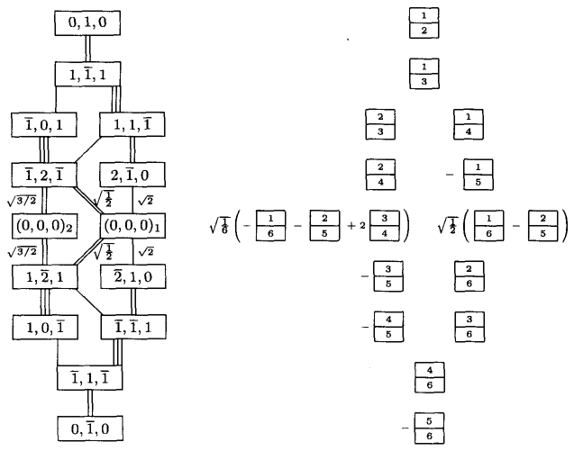

# *第十章　辛　群

近年来辛几何和辛算法在物理上得到广泛应用，这些方法都与辛群及其李代数 $C_{\ell}$ 相联系。本章讨论辛群和 $C_{\ell}$ 李代数的性质，用场算符方法研究它们的线性表示。

## 10.1　实辛群和酉辛群的一般性质

7.4 节已经介绍过实辛群和酉辛群的一般性质，现在简单地复习一下。把 $2\ell$ 维空间的基按下面次序排列

$$
a=1,\ \bar{1},\ 2,\ \bar{2},\ \cdots,\ \ell,\ \bar{\ell}
\tag{10.1}
$$

引入 $2\ell$ 维反对称矩阵 $J$

$$
J=\mathbf{1}_{\ell}\times(\mathrm{i}\sigma_{2})=-J^{-1}=-J^{\mathrm{T}},\qquad \det J=1
\tag{10.2}
$$

所有满足下面条件的 $2\ell$ 维实赝正交矩阵 $R$ 的集合，按照矩阵乘积，构成实辛群 Sp$(2\ell,R)$

$$
R^{*}=R,\qquad R^{\mathrm{T}}JR=J
\tag{10.3}
$$

Sp$(2\ell,R)$ 群不是紧致李群。所有满足下面条件的 $2\ell$ 维幺正矩阵 $u$ 的集合，按照矩阵乘积，构成酉辛群 USp$(2\ell)$

$$
u^{\dagger}=u^{-1},\qquad u^{\mathrm{T}}Ju=J
\tag{10.4}
$$

USp$(2\ell)$ 群是紧致李群。从定义容易证明 $RJR^{\mathrm{T}}=J$ 和 $uJu^{\mathrm{T}}=J$。附录 27 中已证明

$$
\det R=1,\qquad \det u=1
\tag{10.5}
$$

实辛群和酉辛群的群空间都是单连通的，它们都是单纯李群，阶数为 $\ell(2\ell+1)$。

酉辛群 USp$(2\ell)$ 自身表示的生成元可利用 SU$(\ell)$ 群自身表示的生成元 $T_{jk}^{(1)}$，$T_{jk}^{(2)}$ 和泡利矩阵 $\sigma_{d}$ 来表出

$$
\begin{aligned}
&T_{jk}^{(2)}\times \mathbf{1}_{2},\qquad T_{jk}^{(1)}\times\sigma_{d},\qquad T_{jj}^{(1)}\times\sigma_{d}/\sqrt{2}\\
&1\leqslant d\leqslant 3,\qquad 1\leqslant j<k\leqslant \ell,\qquad \left(T_{jj}^{(1)}\right)_{pq}=\delta_{pq}\delta_{\nu p}
\end{aligned}
\tag{10.6}
$$

这些生成元满足归一化条件 $\mathrm{Tr}(T_{A}T_{B})=\delta_{AB}$，它保证了结构常数关于三个指标完全反对称，也保证了基林型是负常数矩阵，即酉辛群的实李代数是紧致的。

实辛群 Sp$(2\ell,R)$ 自身表示的生成元是纯虚矩阵，因而只要把式 (10.6) 中的 $\sigma_{1}$ 和 $\sigma_{3}$ 矩阵乘 $\mathrm{i}$，变成纯虚的 $\tau_{1}$ 和 $\tau_{3}$ 矩阵

$$
\tau_{1}=\mathrm{i}\sigma_{1},\qquad \tau_{3}=\mathrm{i}\sigma_{3}
\tag{10.7}
$$

就得到实辛群 Sp$(2\ell,R)$ 自身表示的生成元。由于部分生成元添了 $\mathrm{i}$，使实辛群变成非紧致李群。如果把 $\mathrm{i}$ 归到参数中去，允许实辛群部分参数取纯虚数，则酉辛群和实辛群的不等价不可约表示一一对应，它们的生成元对应相同，只是参数实数性条件不同。这是计算非紧致李群不可约表示的标准方法。我们已在第九章用此方法研究过洛伦兹群的不可约表示。实辛群的自身表示当然是实表示。酉辛群的自身表示取复共轭后，由式 (10.6) 知，只有含 $\sigma_{1}$ 和 $\sigma_{3}$ 的生成元改符号，而这负号可以通过相似变换 $\mathbf{1}\times\sigma_{2}$ 消去。因为相似变换矩阵是反对称的，所以酉辛群的自身表示是自共轭而非实表示。

酉辛群 USp$(2\ell)$ 自身表示生成元中的对角矩阵构成酉辛群李代数的嘉当子代数

$$
H_{j}=T_{jj}^{(1)}\times\sigma_{3}/\sqrt{2},\qquad 1\leqslant j\leqslant \ell
\tag{10.8}
$$

余下的生成元要组合成 $H_{j}$ 的共同本征矢量，$[H_{j},E_{\boldsymbol{\alpha}}]=\alpha_{j}E_{\boldsymbol{\alpha}}$，本征值构成根矢量 $\boldsymbol{\alpha}$，其中素根为

$$
\boldsymbol{r}_{\mu}=\sqrt{1/2}\left(\boldsymbol{e}_{\mu}-\boldsymbol{e}_{\mu+1}\right),\qquad 1\leqslant \mu\leqslant \ell-1,\qquad \boldsymbol{r}_{\ell}=\sqrt{2}\boldsymbol{e}_{\ell}
\tag{10.9}
$$

对应的生成元为

$$
\begin{aligned}
E_{\pm \boldsymbol{r}_{\mu}} &= \left\{T_{\mu(\mu+1)}^{(1)}\times\sigma_{3}\pm \mathrm{i}T_{\mu(\mu+1)}^{(2)}\times \mathbf{1}_{2}\right\}/\sqrt{2},\qquad 1\leqslant \mu<\ell\\
E_{\pm \boldsymbol{r}_{\ell}} &= T_{\ell\ell}^{(1)}\times(\sigma_{1}\pm \mathrm{i}\sigma_{2})/2
\end{aligned}
\tag{10.10}
$$

前 $\ell-1$ 个素根是较短根，$d_{\mu}=1/2$，第 $\ell$ 个素根是较长根，$d_{\ell}=1$。除了 $\boldsymbol{r}_{\ell}$ 外，相邻素根夹角为 $2\pi/3$，但 $\boldsymbol{r}_{\ell}$ 与 $\boldsymbol{r}_{\ell-1}$ 的夹角是 $3\pi/4$。因此，USp$(2\ell)$ 群的李代数是 $C_{\ell}$。

USp$(2\ell)$ 群的基本主权为

$$
\boldsymbol{w}_{\mu}=\sqrt{1/2}\sum_{\nu=1}^{\mu}\boldsymbol{e}_{\nu},\qquad 1\leqslant \mu\leqslant \ell
\tag{10.11}
$$

$C_{\ell}$ 李代数的最大根是

$$
\boldsymbol{\omega}=\sqrt{2}\boldsymbol{e}_{1}=2\sum_{\mu=1}^{\ell-1}\boldsymbol{r}_{\mu}+\boldsymbol{r}_{\ell}=2\boldsymbol{w}_{1}
\tag{10.12}
$$

这就是说，伴随表示的最高权是 $\boldsymbol{M}=(2,0,\cdots,0)$。

## 10.2　辛群的张量表示

既然实辛群和酉辛群的不可约表示互相一一对应，生成元对应相同，只是参数的实数性条件不同。我们可以只讨论酉辛群的张量表示。把酉辛群元素 $u$ 看成 $2\ell$ 维复空间中的坐标变换矩阵

$$
x_{a}\ \xrightarrow{\ u\ }\ x'_{a}=\sum_{b}u_{ab}x_{b}
\tag{10.13}
$$

由此可以定义关于 USp$(2\ell)$ 变换的 $n$ 阶张量和张量基

$$
\begin{aligned}
T_{a_{1}\cdots a_{n}}\ \xrightarrow{\ u\ }\ \left(O_{u}T\right)_{a_{1}\cdots a_{n}} &= \sum_{b_{1}\cdots b_{n}}u_{a_{1}b_{1}}\cdots u_{a_{n}b_{n}}T_{b_{1}\cdots b_{n}},\\
\Theta_{a_{1}\cdots a_{n}}\ \xrightarrow{\ u\ }\ O_{u}\Theta_{a_{1}\cdots a_{n}} &= \sum_{b_{1}\cdots b_{n}}\Theta_{b_{1}\cdots b_{n}}u_{b_{1}a_{1}}\cdots u_{b_{n}a_{n}}
\end{aligned}
\tag{10.14}
$$

与以前一样，外尔互反性对按 USp$(2\ell)$ 变换的张量同样成立，张量空间可以用杨算符约化。同时，与 SO($N$) 变换类似，对 USp$(2\ell)$ 变换也有两个不变张量，一个是二阶反对称张量 $J_{ab}$，另一个是 $2\ell$ 阶完全反对称张量 $\epsilon_{a_{1}\cdots a_{2\ell}}$。先讨论二阶反对称不变张量 $J_{ab}$

$$
\left(O_{u}J\right)_{ab}=\sum_{cd}u_{ac}u_{bd}J_{cd}=\left(uJu^{\mathrm{T}}\right)_{ab}=J_{ab}
\tag{10.15}
$$

它使张量 $\sum_{a_{r}a_{s}}J_{a_{r}a_{s}}T_{a_{1}\cdots a_{r-1}a_{r}a_{r+1}\cdots a_{s-1}a_{s}a_{s+1}\cdots a_{n}}$ 在 USp$(2\ell)$ 变换中就像没有指标 $a_{r}$ 和 $a_{s}$ 一样

$$
\begin{aligned}
&\sum_{a_{r}a_{s}}\left(O_{u}J_{a_{r}a_{s}}T\right)_{a_{1}\cdots a_{r-1}a_{r}a_{r+1}\cdots a_{s-1}a_{s}a_{s+1}\cdots a_{n}}
= \sum_{a_{r}a_{s}b_{1}\cdots b_{n}}J_{a_{r}a_{s}}u_{a_{1}b_{1}}\cdots u_{a_{n}b_{n}}T_{b_{1}\cdots b_{n}}\\
&\quad = \sum_{b_{1}\cdots b_{n}}u_{a_{1}b_{1}}\cdots u_{a_{r-1}b_{r-1}}u_{a_{r+1}b_{r+1}}\cdots u_{a_{s-1}b_{s-1}}u_{a_{s+1}b_{s+1}}\cdots u_{a_{n}b_{n}}\\
&\qquad \times \left(J_{b_{r}b_{s}}T_{b_{1}\cdots b_{r-1}b_{r}b_{r+1}\cdots b_{s-1}b_{s}b_{s+1}\cdots}\right)
\end{aligned}
\tag{10.16}
$$

这是关于酉辛群张量指标的收缩，或称取迹，只是现在的收缩是在反对称指标间进行。要把酉辛群张量空间约化，首先要把张量空间分解为一系列无迹张量子空间的直和，其中无迹条件为

$$
\sum_{ab}J_{ab}T_{\cdots a\cdots b\cdots}=0
\tag{10.17}
$$

分解后得到的无迹张量子空间 $T$，再用杨算符 $\gamma_{\mu}^{[\lambda]}$ 投影，得到用杨图 $[\lambda]$ 标记的对 USp$(2\ell)$ 群不变的无迹张量子空间 $\gamma_{\mu}^{[\lambda]}T=T_{\mu}^{[\lambda]}$，对应的表示也用杨图 $[\lambda]$ 标记，以后会证明它是不可约的。张量子空间 $T_\mu^{[\lambda]}$ 的基是满足无迹条件的正则张量杨表的线性组合。我们先来证明，对 USp(2$\ell$) 群，用行数大于 $\ell$ 的杨图标记的无迹张量子空间是零空间。证明方法是比较独立张量数目是不是小于取迹条件数。因为证明过程与杨图后面列的指标无关，所以为简明起见，可以就一列的杨图来证明。

设一列的杨图有 $n$ 格，在正则张量杨表中每格填充的指标是反对称的，因而互不相同。设有 $m$ 对指标成对地取 $j$ 和 $\bar j$ 值，这些成对的指标需要加无迹条件。把不成对的 $n-2m$ 个指标固定起来，计算这样的张量数目和无迹条件数。线性无关的张量数目等于成对指标的所有可能取值数，它等于在 $\ell-(n-2m)$ 个数中取 $m$ 个数的组合数。而无迹条件是把 $m-1$ 对数固定，一对数取迹，因而无迹条件个数等于在 $\ell-(n-2m)$ 个数中取 $m-1$ 个数的组合数。因为在 $p$ 个数中取 $q$ 个数的组合数，在 $q=p/2$ 时达最大值，所以要求张量子空间非空的条件是 $m$ 不大于 $\ell-(n-2m)$ 的一半，即

$$
m \leqslant [\ell-(n-2m)]/2, \qquad \text{得 } n \leqslant \ell
\tag{10.18}
$$

证完。

再讨论 $2\ell$ 阶完全反对称张量 $\epsilon_{\alpha_1 \cdots \alpha_{2\ell}}$, 它关于 USp(2$\ell$) 变换不变是因为 $u$ 的行列式为 1. 类似 SU($N$) 群情况，它可以从协变张量基诱导出逆变张量基。但 USp(2$\ell$) 群的自身表示是自共轭表示，没有必要再研究逆变张量，因而这完全反对称张量对研究 USp(2$\ell$) 群表示的作用不大。我们不再讨论。

为了研究用杨图 $[\lambda]$ 标记的表示的性质，先根据式 (7.149), 在酉辛群自身表示中计算生成元的谢瓦莱基

$$
\begin{aligned}
E_\mu &= T^{(1)}_{\mu(\mu+1)} \times \sigma_3 + \mathrm{i} T^{(2)}_{\mu(\mu+1)} \times \mathrm{I}_2, &\quad
E_\ell &= T^{(1)}_{\ell\ell} \times (\sigma_1 + \mathrm{i}\sigma_2)/2, \\
F_\mu &= T^{(1)}_{\mu(\mu+1)} \times \sigma_3 - \mathrm{i} T^{(2)}_{\mu(\mu+1)} \times \mathrm{I}_2, &\quad
F_\ell &= T^{(1)}_{\ell\ell} \times (\sigma_1 - \mathrm{i}\sigma_2)/2, \\
H_\mu &= \left\{ T^{(1)}_{\mu\mu} - T^{(1)}_{(\mu+1)(\mu+1)} \right\} \times \sigma_3, &\quad
H_\ell &= T^{(1)}_{\ell\ell} \times \sigma_3
\end{aligned}
\tag{10.19}
$$

其中， $1 \leqslant \mu \leqslant (\ell-1)$. 它们对矢量基 $\Theta_a$ 的非零作用有

$$
\begin{aligned}
H_\mu \Theta_\mu &= \Theta_\mu, &\quad
H_\mu \Theta_{\mu+1} &= -\Theta_{\mu+1}, &\quad
H_\mu \Theta_{\overline{\mu+1}} &= \Theta_{\overline{\mu+1}}, \\
H_\mu \Theta_{\bar\mu} &= -\Theta_{\bar\mu}, &\quad
H_\ell \Theta_\ell &= \Theta_\ell, &\quad
H_\ell \Theta_{\bar\ell} &= -\Theta_{\bar\ell}, \\
E_\mu \Theta_{\mu+1} &= \Theta_\mu, &\quad
E_\mu \Theta_{\bar\mu} &= -\Theta_{\overline{\mu+1}}, &\quad
E_\ell \Theta_{\bar\ell} &= \Theta_\ell, \\
F_\mu \Theta_\mu &= \Theta_{\mu+1}, &\quad
F_\mu \Theta_{\overline{\mu+1}} &= -\Theta_\mu, &\quad
F_\ell \Theta_\ell &= \Theta_{\bar\ell}
\end{aligned}
\tag{10.20}
$$

可见矢量基 $\Theta_a$ 是 $H_\mu$ 和 $H_\ell$ 的共同本征矢量，但在升降算符的作用下它们的排列次序使用起来不方便，重新排列后引进新的矢量基 $\Phi_\alpha$, $1 \leqslant \alpha \leqslant 2\ell$. 与式 (10.1) 的次序相比，现在的次序是

$$
1,\ 2,\ \cdots,\ \ell,\ \bar\ell,\ \overline{\ell-1},\ \cdots,\ \bar{2},\ \bar{1}
$$

即

$$
\Phi_\mu = \Theta_\mu, \qquad \Phi_{\ell+\mu} = \Theta_{\overline{\ell-\mu+1}}, \qquad 1 \leqslant \mu \leqslant \ell
\tag{10.21}
$$

谢瓦莱基对新矢量基的非零作用为

$$
\begin{aligned}
H_\mu \Phi_\mu &= \Phi_\mu, &\quad
H_\mu \Phi_{\mu+1} &= -\Phi_{\mu+1}, &\quad
H_\mu \Phi_{2\ell-\mu} &= \Phi_{2\ell-\mu} \\
H_\mu \Phi_{2\ell-\mu+1} &= -\Phi_{2\ell-\mu+1}, &\quad
H_\ell \Phi_\ell &= \Phi_\ell, &\quad
H_\ell \Phi_{\ell+1} &= -\Phi_{\ell+1} \\
E_\mu \Phi_{\mu+1} &= \Phi_\mu, &\quad
E_\mu \Phi_{2\ell-\mu+1} &= -\Phi_{2\ell-\mu}, &\quad
E_\ell \Phi_{\ell+1} &= \Phi_\ell \\
F_\mu \Phi_\mu &= \Phi_{\mu+1}, &\quad
F_\mu \Phi_{2\ell-\mu} &= -\Phi_{2\ell-\mu+1}, &\quad
F_\ell \Phi_\ell &= \Phi_{\ell+1}
\end{aligned}
\tag{10.22}
$$

其中， $1 \leqslant \mu \leqslant \ell-1$.

张量基 $\Phi_{\alpha_1 \cdots \alpha_n}$ 是矢量基 $\Phi_\alpha$ 的直乘，生成元对张量基的作用等于对每个矢量基分别作用后相加，得到若干张量基的线性组合。张量杨表是杨算符对张量基 $\Phi_{\alpha_1 \cdots \alpha_n}$ 的投影。由于外尔互反性，生成元可以直接作用在张量基上，然后再用杨算符投影，得到若干张量杨表的线性组合。根据式 (10.22), 正则张量杨表是 $H_\mu$ 和 $H_\ell$ 的共同本征张量， $H_\mu$ 的本征值是正则张量杨表中填 $\mu$ 和填 $2\ell-\mu$ 的格数之和，减去填 $\mu+1$ 和填 $2\ell-\mu+1$ 的格数之和， $H_\ell$ 的本征值是正则张量杨表中填 $\ell$ 的格数减去填 $\ell+1$ 的格数。 $E_\mu$ 对正则张量杨表的作用得到若干张量杨表的代数和，其中每一个都是由原来的正则张量杨表，把其中一个填数 $\mu+1$ 换成 $\mu$, 或把一个填数 $2\ell-\mu+1$ 换成 $2\ell-\mu$, 在后一替换得到的张量杨表前要加负号。 $F_\mu$ 对正则张量杨表的作用正好做相反的替换。这样得到的张量杨表，有些可能不是正则的，它们可通过类似式 (8.23) 的对称性和福克条件化为正则张量杨表的线性组合。

与 SU($N$) 群和 SO($N$) 群正交归一的不可约张量基的计算方法类似，对给定的张量子空间 $T_\mu^{[\lambda]}$, 关键要计算最高权态的正则张量杨表，它必须在升算符 $E_\mu$ 作用下为零，而且是无迹的。然后把降算符作用在作为最高权态的正则张量杨表上，就得到其他态关于正则张量杨表的展开式，它们自然是无迹的和正交归一的。

设杨图 $[\lambda]$ 的行数不大于 $\ell$, $[\lambda] = [\lambda_1, \lambda_2, \cdots, \lambda_\ell]$. 在张量子空间 $T_\mu^{[\lambda]}$ 中存在一个正则张量杨表，它的每一格都填以该格所在的行数。任一升算符 $E_\mu$ 对它的作用都为零，因为产生的每一个张量杨表都有两个填 $\mu$ 的格子处在同一列。这正则张量杨表不同时包含填数为 $\mu$ 和 $2\ell-\mu+1$ 的格子，即不包含乘积 $\Theta_\mu \Theta_{\bar\mu}$, 因而无迹的。这就是我们要找的最高权态的正则张量杨表。容易证明，对其他正则张量杨表，至少能找到一个升算符作用不为零。不失普遍性，设此正则张量杨表的前 $\nu-1$ 行的格子都填以行数，第 $\nu$ 行至少有一格填数不为 $\nu$, 例如为 $\tau > \nu$. 这格所在列其他格子的填数都不等于 $\tau-1$, 因为处在它上面的格子填数小于 $\nu \leqslant \tau-1$, 处在它下面的格子填数大于 $\tau$. 因此这正则张量杨表在 $E_\tau$ 作用下不为零。既然在张量子空间 $T_\mu^{[\lambda]}$ 中满足最高权态条件的正则张量杨表是唯一的，这子空间对应 USp(2$\ell$) 群的不可约表示，而且可算得用杨图 $[\lambda]$ 描写的不可约表示的最高权 $M$ 为

$$
M_\mu = \lambda_\mu - \lambda_{\mu+1}, \qquad M_\ell = \lambda_\ell, \qquad 1 \leqslant \mu < \ell
\tag{10.23}
$$

这样，我们得到了 USp(2$\ell$) 群的全部有限维的不等价不可约表示，它们都是自共轭表示。不可约表示的表示空间的正交归一基和在此基中生成元的矩阵形式，可用第七章介绍的方块权图方法计算，而正交归一的张量基的展开式可由最高权态的展开式，通过降算符作用得到。

## 10.3 正交归一的不可约张量基的计算

本节以 USp(6) 群 (C$_3$ 李代数) 的二阶无迹反对称张量表示 [1,1,0] 为例来计算各状态基的张量杨表形式。该表示的最高权为 (0,1,0). USp(6) 群的素根 $r_\mu$ 与基本主权 $w_\nu$ 的关系为

$$
r_1 = 2w_1 - w_2, \qquad r_2 = -w_1 + 2w_2 - w_3, \qquad r_3 = -2w_2 + 2w_3
\tag{10.24}
$$

用新基 $\Phi_\mu$ 表出的正则张量杨表为

$$
\begin{array}{|c|}
\hline
a \\
\hline
b \\
\hline
\end{array}
= y^{[1,1,0]} \Phi_{ab} = \Phi_{ab} - \Phi_{ba}, \qquad a < b
$$

由正则张量杨表构成的迹张量为

$$
\boxed{\begin{array}{c} 1 \\ 6 \end{array}}
+ \boxed{\begin{array}{c} 2 \\ 5 \end{array}}
+ \boxed{\begin{array}{c} 3 \\ 4 \end{array}}
= \Theta_1\Theta_{\bar 1} - \Theta_{\bar 1}\Theta_1 + \Theta_2\Theta_{\bar 2} - \Theta_{\bar 2}\Theta_2 + \Theta_3\Theta_{\bar 3} - \Theta_{\bar 3}\Theta_3
$$

$$
= \sum_{ab} \Theta_a J_{ab} \Theta_b
$$

最高权态及由降算符算得的其他权态如下，同时也列于图 10.1.

$$
|(0,1,0)\rangle = \boxed{\begin{array}{c} 1 \\ 2 \end{array}} = \Theta_1\Theta_2 - \Theta_2\Theta_1,
$$

$$
|(1,\bar 1,1)\rangle = F_2|(0,1,0)\rangle = \boxed{\begin{array}{c} 1 \\ 3 \end{array}} = \Theta_1\Theta_3 - \Theta_3\Theta_1,
$$

$$
|(\bar 1,0,1)\rangle = F_1|(1,\bar 1,1)\rangle = \boxed{\begin{array}{c} 2 \\ 3 \end{array}} = \Theta_2\Theta_3 - \Theta_3\Theta_2,
$$

$$
|(1,1,\bar 1)\rangle = F_3|(1,\bar 1,1)\rangle = \boxed{\begin{array}{c} 1 \\ 4 \end{array}} = \Theta_1\Theta_{\bar 3} - \Theta_{\bar 3}\Theta_1,
$$

$$
|(\bar 1,2,\bar 1)\rangle = F_3|(\bar 1,0,1)\rangle = \boxed{\begin{array}{c} 2 \\ 4 \end{array}} = \Theta_2\Theta_{\bar 3} - \Theta_{\bar 3}\Theta_2,
$$

$$
|(2,\bar 1,0)\rangle = F_2|(1,1,\bar 1)\rangle = -\boxed{\begin{array}{c} 1 \\ 5 \end{array}} = -\Theta_1\Theta_{\bar 2} + \Theta_{\bar 2}\Theta_1,
$$

$$
|(0,0,0)_1\rangle = \sqrt{1/2} F_1|(2,\bar 1,0)\rangle = \sqrt{1/2}\left\{ \boxed{\begin{array}{c} 1 \\ 6 \end{array}} - \boxed{\begin{array}{c} 2 \\ 5 \end{array}} \right\}
$$

$$
= \sqrt{1/2}\left\{ \Theta_1\Theta_{\bar 1} - \Theta_{\bar 1}\Theta_1 - \Theta_2\Theta_{\bar 2} + \Theta_{\bar 2}\Theta_2 \right\},
$$

$$
|(0,0,0)_2\rangle = \sqrt{2/3}\left\{ F_2|(\bar 1,2,\bar 1)\rangle - \sqrt{1/2}|(0,0,0)_1\rangle \right\}
$$

$$
= \sqrt{1/6}\left\{ -\boxed{\begin{array}{c} 1 \\ 6 \end{array}} - \boxed{\begin{array}{c} 2 \\ 5 \end{array}} + 2\boxed{\begin{array}{c} 3 \\ 4 \end{array}} \right\}
$$

$$
= \sqrt{1/6}\left\{ -\Theta_1\Theta_{\bar 1} + \Theta_{\bar 1}\Theta_1 - \Theta_2\Theta_{\bar 2} + \Theta_{\bar 2}\Theta_2 + 2\Theta_3\Theta_{\bar 3} - 2\Theta_{\bar 3}\Theta_3 \right\},
$$

$$
|(\bar 2,1,0)\rangle = \sqrt{1/2}F_1|(0,0,0)_1\rangle = \boxed{\begin{array}{c} 2 \\ 6 \end{array}} = \Theta_2\Theta_{\bar 1} - \Theta_{\bar 1}\Theta_2,
$$

$$
|(1,\bar 2,1)\rangle = \sqrt{2}F_2|(0,0,0)_1\rangle = -\boxed{\begin{array}{c} 3 \\ 5 \end{array}} = -\Theta_3\Theta_{\bar 2} + \Theta_{\bar 2}\Theta_3,
$$

$$
|(\bar 1,\bar 1,1)\rangle = F_1|(1,\bar 2,1)\rangle = \boxed{\begin{array}{c} 3 \\ 6 \end{array}} = \Theta_3\Theta_{\bar 1} - \Theta_{\bar 1}\Theta_3,
$$

$$
|(1,0,\bar 1)\rangle = F_3|(1,\bar 2,1)\rangle = -\boxed{\begin{array}{c} 4 \\ 5 \end{array}} = -\Theta_{\bar 1}\Theta_{\bar 2} + \Theta_{\bar 2}\Theta_{\bar 1},
$$

$$
|(\bar 1,1,\bar 1)\rangle = F_1|(1,0,\bar 1)\rangle = \boxed{\begin{array}{c} 4 \\ 6 \end{array}} = \Theta_3\Theta_{\bar 1} - \Theta_{\bar 1}\Theta_{\bar 3},
$$

$$
|(0,\bar 1,0)\rangle = F_2|(\bar 1,1,\bar 1)\rangle = -\boxed{\begin{array}{c} 5 \\ 6 \end{array}} = -\Theta_{\bar 2}\Theta_{\bar 3} + \Theta_{\bar 3}\Theta_{\bar 2}
$$

## 10.4 辛群不可约表示维数的计算

USp(2$\ell$) 群表示 $[\lambda]$ 的维数 $d_{[\lambda]}(\mathrm{USp}(2\ell))$, 可用下面的钩形规则来计算。这规则在一定程度上与计算 SO($N$) 群旋量表示维数的规则类似。实辛群 Sp($2\ell,R$) 和酉辛群 USp(2$\ell$) 的不可约表示维数是对应相同的。在这钩形规则中，表示维数表为一个分数，分子和分母分别为给定杨图 $[\lambda]$ 的一定表中所有填数的乘积

$$
d_{[\lambda]}[\mathrm{USp}(2\ell)] = \frac{Y_{Sp}^{[\lambda]}}{Y_h^{[\lambda]}}
\tag{10.25}
$$

仍沿用以前关于钩形路径和逆钩形路径的定义。杨图 $[\lambda]$ 的钩形路径 $(i,j)$ 是一条钩形通道，由杨图 $[\lambda]$ 第 $i$ 行最右面格子处进入杨图，向左走到第 $i$ 行第 $j$ 列处向下转弯，在第 $j$ 列最下面格子处离开杨图。而逆钩形路径 $(\bar i,\bar j)$ 与钩形路径 $(i,j)$ 形状相同，只是走向相反。两条钩形路径在杨图中经过的格子数就是第 $i$ 行第 $j$ 列格子的钩形数 $h_{ij}$. 分母的表 $Y_h^{[\lambda]}$ 是在杨图 $[\lambda]$ 各格填以该格的钩形数 $h_{ij}$, 分母是表中所填数的乘积。对杨图 $[\lambda]$, 按下面规则相继定义一系列的表 $Y_{Spa}^{[\lambda]}$, 分子的表 $Y_{Sp}^{[\lambda]}$ 是在杨图 $[\lambda]$ 各格填以上述系列中各表 $Y_{Spa}^{[\lambda]}$ 对应格子填数之和，分子是表 $Y_{Sp}^{[\lambda]}$ 中所填数的乘积。

表 $Y_{Spa}^{[\lambda]}$ 由下面规则定义：

(1) 表 $Y_{Sp0}^{[\lambda]}$ 是在杨图 $[\lambda]$ 各格填以 $2\ell$ 和容度 $m_{ij}=j-i$ 之和，即第 $i$ 行第 $j$ 列格子填以 $2\ell+j-i$.

(2) 设 $[\lambda^{(1)}]=[\lambda]$. 由 $[\lambda^{(1)}]$ 开始，相继定义一系列 $[\lambda^{(a)}]$, 其中 $[\lambda^{(a)}]$ 是由 $[\lambda^{(a-1)}]$ 移去第一行和第一列得到。这过程直进行到 $[\lambda^{(a-1)}]$ 的行数少于 2 为止。

(3) 如果 $[\lambda^{(a)}]$ 行数大于 1, 按下法定义表 $Y_{Spa}^{[\lambda]}$. 在杨图 $[\lambda]$ 前 $a-1$ 行和前 $a-1$ 列都填以零，余下部分构成杨图 $[\lambda^{(a)}]$. 设杨图 $[\lambda^{(a)}]$ 含 $r$ 行，在杨图 $[\lambda^{(a)}]$ 中的钩形路径 $(1,1)$ 前 $r-1$ 格，逐格填以 $\lambda_2^{(a)}$, $\lambda_3^{(a)}$, $\cdots$, $\lambda_r^{(a)}$, 在杨图 $[\lambda^{(a)}]$ 每个逆钩形路径 $(\bar i,1)$, $2 \leqslant i \leqslant r$, 前 $\lambda_i^{(a)}$ 格填以 $-1$. 如果几个 $-1$ 填在同一格，则填数相加。其余格子都填零。在杨图 $[\lambda^{(a)}]$ 中填数之和为零。

下面举些例子来说明维数公式 (10.25) 的用法。

**例 1** USp(6) 群的表示 [3,3,3] 的维数

$$
Y_{Sp}^{[3,3,3]} =
\begin{array}{|c|c|c|}
\hline 6 & 7 & 8 \\ \hline
5 & 6 & 7 \\ \hline
4 & 5 & 6 \\ \hline
\end{array}
+
\begin{array}{|c|c|c|}
\hline & 3 & 3 \\ \hline
-1 & -1 & \\ \hline
-2 & -1 & -1 \\ \hline
\end{array}
+
\begin{array}{|c|c|c|}
\hline & & \\ \hline
& & 2 \\ \hline
& -1 & -1 \\ \hline
\end{array}
=
\begin{array}{|c|c|c|}
\hline 6 & 10 & 11 \\ \hline
4 & 5 & 9 \\ \hline
2 & 3 & 4 \\ \hline
\end{array}
$$

$$
d_{[3,3,3]}[\mathrm{USp}(6)] =
\frac{
\begin{array}{|c|c|c|}
\hline 6 & 10 & 11 \\ \hline
4 & 5 & 9 \\ \hline
2 & 3 & 4 \\ \hline
\end{array}
}{
\begin{array}{|c|c|c|}
\hline 5 & 4 & 3 \\ \hline
4 & 3 & 2 \\ \hline
3 & 2 & 1 \\ \hline
\end{array}
}
= 11 \times 5 \times 3 \times 2 = 330
$$

**例 2** USp(2$\ell$) 群一行杨图 $[n]$ 对应表示的维数。对只有一行杨图 $[n]$ 的表示空间，不存在无迹条件。

$$
d_{[n]}[\mathrm{USp}(2\ell)] = d_{[n]}[\mathrm{SU}(2\ell)] = \binom{2\ell+n-1}{n}
\tag{10.26}
$$

**例 3** USp(2$\ell$) 群一列杨图 $[1^n]$ 对应表示的维数

$$
Y_{Sp}^{[1^n]} =
\begin{array}{|c|}
\hline 2\ell \\ \hline
2\ell-1 \\ \hline
\vdots \\ \hline
2\ell-n+2 \\ \hline
2\ell-n+1 \\ \hline
\end{array}
+
\begin{array}{|c|}
\hline 1 \\ \hline
1 \\ \hline
\vdots \\ \hline
1 \\ \hline
-n+1 \\ \hline
\end{array}
=
\begin{array}{|c|}
\hline 2\ell+1 \\ \hline
2\ell \\ \hline
\vdots \\ \hline
2\ell-n+3 \\ \hline
2\ell-2n+2. \\ \hline
\end{array}
$$

$$
d_{[1^n]}[\mathrm{USp}(2\ell)] = \frac{(2\ell+1)!(2\ell-2n+2)}{n!(2\ell-n+2)!}
\tag{10.27}
$$

**例 4** USp(2$\ell$) 群两行杨图 $[n,m]$ 对应表示的维数

$$
Y_{Sp}^{[n,m]} =
\begin{array}{c}
\begin{array}{|c|c|c|c|c|c|}
\hline 2\ell & \cdots & 2\ell+m-1 & \cdots & 2\ell+n-2 & 2\ell+n-1 \\ \hline
\end{array} \\
\begin{array}{|c|c|c|}
\hline 2\ell-1 & \cdots & 2\ell+m-2 \\ \hline
\end{array}
\end{array}
$$

$$
+ \begin{array}{c}
\begin{array}{|c|c|c|c|c|c|}
\hline 0 & \cdots & 0 & \cdots & 0 & m \\ \hline
\end{array} \\
\begin{array}{|c|c|c|}
\hline -1 & \cdots & -1 \\ \hline
\end{array}
\end{array}
$$

$$
= \begin{array}{c}
\begin{array}{|c|c|c|c|c|c|}
\hline 2\ell & \cdots & 2\ell+m-1 & \cdots & 2\ell+n-2 & 2\ell+n+m-1 \\ \hline
\end{array} \\
\begin{array}{|c|c|c|}
\hline 2\ell-2 & \cdots & 2\ell+m-3 \\ \hline
\end{array}
\end{array}
$$

$$
Y_h^{[n,m]} = \begin{array}{c}
\begin{array}{|c|c|c|c|c|c|}
\hline n+1 & \cdots & n-m+2 & n-m & \cdots & 1 \\ \hline
\end{array} \\
\begin{array}{|c|c|c|}
\hline m & \cdots & 1 \\ \hline
\end{array}
\end{array}
$$

$$
d_{[n,m]}[\mathrm{USp}(2\ell)] = \frac{(n-m+1)(2\ell+n+m-1)(2\ell+n-2)!(2\ell+m-3)!}{(n+1)!m!(2\ell-1)!(2\ell-3)!}
\tag{10.28}
$$

对 USp(4) 群和 USp(6) 群有

$$
d_{[n,m]}[\mathrm{USp}(4)] = (n-m+1)(n+m+3)(n+2)(m+1)/6
$$

$$
d_{[n,m]}[\mathrm{USp}(6)] = (n-m+1)(n+m+5)(n+4)(n+3)(n+2)
$$

$$
\times (m+3)(m+2)(m+1)/720 .
\tag{10.29}
$$

## 10.5 简单的物理应用

辛群在物理上有重要应用。有 $\ell$ 个自由度的经典系统，哈密顿方程表为

$$
\frac{\mathrm{d}q_j}{\mathrm{d}t} = \frac{\partial H}{\partial p_j}, \qquad
\frac{\mathrm{d}p_j}{\mathrm{d}t} = -\frac{\partial H}{\partial q_j}
\tag{10.30}
$$

把坐标 $q_j$ 和动量 $p_j$ 按下面次序排列起来，构成 $2\ell$ 维相空间的坐标 $x_a$

$$
x_a = (q_1,\ p_1,\ q_2,\ p_2,\ \cdots,\ q_\ell,\ p_\ell)
\tag{10.31}
$$

则哈密顿方程可以统一地表达成

$$
\frac{\mathrm{d}x_a}{\mathrm{d}t} = \sum_b J_{ab}\frac{\partial H}{\partial x_b}, \qquad
\frac{\mathrm{d}x}{\mathrm{d}t} = J\frac{\partial H}{\partial x}
\tag{10.32}
$$

后式是哈密顿方程的矩阵形式。设 $\mathrm{d}x_a$ 满足哈密顿方程，则经过辛变换后

$$
\mathrm{d}z_a = \sum_b R_{ab}\mathrm{d}x_b, \qquad
R_{ab} = \frac{\partial z_a}{\partial x_b}, \qquad
R^T J R = J
\tag{10.33}
$$

$\mathrm{d}z_a$ 仍满足哈密顿方程

$$
\begin{aligned}
\frac{\mathrm{d}z_a}{\mathrm{d}t} &= \sum_b R_{ab}\frac{\mathrm{d}x_b}{\mathrm{d}t} = \sum_{bc} R_{ab}J_{bc} \sum_r \frac{\partial z_r}{\partial x_c}\frac{\partial H}{\partial z_r} \\
&= \sum_r (RJR^T)_{ar}\frac{\partial H}{\partial z_r} = \sum_r J_{ar}\frac{\partial H}{\partial z_r}
\end{aligned}
$$

因此式 (10.32) 称为经典哈密顿方程的辛形式。

用计算机求解经典运动方程时，通常采用龙格 (Runge)-库塔 (Kutta) 法，这方法没有反映经典运动方程的特征，因而在大量重复的计算中，误差会积累起来，造成计算结果与真实轨道严重偏离。例如，回旋加速器中粒子的运行，由于旋转的圈数太大，计算结果偏差就会超过允许值。对人造卫星运行的计算也有类似情况。如果计算的每一步都能反映哈密顿方程的特征，即做辛变换，误差积累就会大大减少

$$
z_a = z_a^{(0)} + \tau \sum_b J_{ab}\frac{\partial H(x)}{\partial z_b}, \qquad
x_a = \left(z_a + z_a^{(0)}\right)/2
\tag{10.34}
$$

其中， $\tau$ 为步长。冯康教授对此有深入的研究，具体细节请参考他的文章 (见文献 [28]).

## 习 题

1. 用钩形规则计算 USp(6) 群和 USp(8) 群用下列杨图标记的不可约表示维数： [3], $[1^3]$, [3,3,2], [3,2,1], [4,3,2,1].

2. 用钩形规则计算 USp(2$\ell$) 群， $\ell \geqslant 3$, 用三行杨图 $[n,m,p]$ 标记的不可约表示维数，并检验第 1 题的计算结果。

3. USp(6) 群有九个正根，试在自身表示中写出对应这些正根生成元的矩阵形式。

4. 用 USp(6) 群三阶张量基 $\Theta_{abc}$ 表出 USp(6) 群不可约表示 [1,1,1] 的正交归一的张量基。

5. 用主权图方法计算 USp(6) 群直乘表示 [1,1,0] × [1,1,0] 约化的克莱布施 - 戈登级数，和级数中出现的各不可约表示最高权态的展开式。

6. 计算 C$_3$ 李代数直乘表示 (0,2,0) × (1,0,0) 分解的克莱布施 - 戈登级数，其中各有关表示维数，外尔轨道长度 (O.S.) 和包含各主权重数列于下表：

| 表示 | 维数 | OS | (1,0,0) | (0,0,1) | (1,1,0) | (3,0,0) | (0,1,1) | (2,0,1) | (1,2,0) |
|---|---|---|---|---|---|---|---|---|---|
| (1,0,0) | 6 | 6 | 1 | | | | | | |
| (0,0,1) | 14 | 8 | 1 | 1 | | | | | |
| (1,1,0) | 64 | 24 | 4 | 2 | 1 | | | | |
| (3,0,0) | 56 | 6 | 3 | 1 | 1 | 1 | | | |
| (0,1,1) | 126 | 24 | 5 | 3 | 2 | 0 | 1 | | |
| (2,0,1) | 216 | 24 | 7 | 6 | 3 | 1 | 1 | 1 | |
| (1,2,0) | 350 | 24 | 11 | 7 | 5 | 2 | 2 | 1 | 1 |
