# 附 录

## 附录1 几种常用的矩阵

### 一、幺正矩阵

若 $R$ 矩阵的共轭矩阵等于其逆矩阵，则 $R$ 称为幺正矩阵

$$
R^\dagger = R^{-1}, \qquad R^\dagger R = R R^\dagger = 1
\tag{A1.1}
$$

幺正矩阵的行列式模为1. 幺正矩阵相乘仍为幺正矩阵，在幺正相似变换中，幺正矩阵的幺正性保持不变。把式 (A1.1) 写成矩阵元素形式

$$
\begin{aligned}
\sum_{\rho} \left(R^\dagger\right)_{\mu\rho} R_{\rho\nu} &= \sum_{\rho} R_{\rho\mu}^{*} R_{\rho\nu} = \delta_{\mu\nu},\\
\sum_{\rho} R_{\mu\rho} \left(R^\dagger\right)_{\rho\nu} &= \sum_{\rho} R_{\mu\rho} R_{\nu\rho}^{*} = \delta_{\mu\nu}
\end{aligned}
\tag{A1.2}
$$

即幺正矩阵的各列作为列矩阵互相正交归一，它的各行矩阵也互相正交归一。幺正矩阵的作用不改变列矩阵的内积，即对任意同维列矩阵 $a$ 和 $b$，有

$$
(R a)^\dagger (R b) = a^\dagger R^\dagger R b = a^\dagger b
\tag{A1.3}
$$

设 $R a_1 = \lambda_1 a_1$，$R a_2 = \lambda_2 a_2$，则 $0 \ne a_1^\dagger a_1 = (R a_1)^\dagger (R a_1) = |\lambda_1|^2 a_1^\dagger a_1$，故 $|\lambda_1|^2 = 1$，即幺正矩阵的本征值模为1. 又因 $a_1^\dagger a_2 = (R a_1)^\dagger (R a_2) = \lambda_1^{*} \lambda_2 a_1^\dagger a_2$，若 $\lambda_1 \ne \lambda_2$，则 $\lambda_1^{*} \lambda_2 \ne 1$，故 $a_1^\dagger a_2 = 0$，即幺正矩阵不同本征值的本征列矩阵互相正交。

现在来证明，幺正矩阵一定可以通过幺正相似变换对角化。解久期方程 (1.39) 得 $R$ 的某一个本征值 $\lambda_1$ 及相应归一化的本征列矩阵 $S_1^{(1)}$. 任选一组正交归一的列矩阵，以 $S_1^{(1)}$ 为其中第一个列矩阵，把它们排列起来构成 $S^{(1)}$. $R$ 矩阵经 $S^{(1)}$ 相似变换后仍是幺正矩阵，矩阵第一列只有第一行元素为 $\lambda_1$，其余元素都为零。因 $|\lambda_1|^2 = 1$，由矩阵幺正性可知，矩阵第一行其他元素也为零，即

$$
\left(S^{(1)}\right)^{-1} R S^{(1)} =
\begin{pmatrix}
\lambda_1 & 0 & \cdots & 0 \\
0 & & & \\
\vdots & & R^{(1)} & \\
0 & & &
\end{pmatrix}
$$

余下的子矩阵 $R^{(1)}$ 仍是幺正的，可以重复前面的步骤，通过一系列幺正相似变换把 $R$ 矩阵对角化。证完。因此，$m$ 维幺正矩阵有 $m$ 个互相正交的本征列矩阵。

### 二、厄米矩阵

若矩阵与其共轭矩阵相等，则此矩阵称为厄米矩阵

$$
R^\dagger = R, \qquad R_{\mu\nu}^{*} = R_{\nu\mu}
\tag{A1.4}
$$

厄米矩阵的对角元素是实数，非对角元素成对地互为复共轭。厄米矩阵之和是厄米矩阵。在幺正相似变换中，厄米矩阵的厄米性保持不变。对任意同维列矩阵 $a$ 和 $b$，厄米矩阵 $R$ 满足

$$
(R a)^\dagger b = a^\dagger R b
\tag{A1.5}
$$

设 $R a_1 = \lambda_1 a_1$，$R a_2 = \lambda_2 a_2$，则 $\lambda_1^{*} (a_1^\dagger a_1) = (R a_1)^\dagger a_1 = a_1^\dagger R a_1 = \lambda_1 (a_1^\dagger a_1)$，故 $\lambda_1^{*} = \lambda_1$，即厄米矩阵的本征值是实数。又因 $\lambda_1 a_1^\dagger a_2 = (R a_1)^\dagger a_2 = a_1^\dagger R a_2 = \lambda_2 a_1^\dagger a_2$，若 $\lambda_1 \ne \lambda_2$，则 $a_1^\dagger a_2 = 0$，即厄米矩阵不同本征值的本征列矩阵互相正交。

厄米矩阵一定可以通过幺正相似变换对角化。证明方法与关于幺正矩阵的证明类似。厄米矩阵在经 $S^{(1)}$ 相似变换后仍是厄米矩阵，矩阵第一列元素除第一行外都为零。而由矩阵的厄米性可知，矩阵第一行元素除第一列外也只能为零。余下的证法相同。因此，$m$ 维厄米矩阵有 $m$ 个互相正交的本征列矩阵。

本征值都大于零的厄米矩阵称为正定的厄米矩阵，本征值不小于零的厄米矩阵称为半正定的厄米矩阵。类似地可以定义负定和半负定的厄米矩阵。形如 $R^\dagger R$ 的非奇矩阵是正定的厄米矩阵。

### 三、正交矩阵和实正交矩阵

若 $R$ 矩阵的转置等于其逆矩阵，则 $R$ 称为正交矩阵

$$
R^{T} = R^{-1}, \qquad R^{T} R = R R^{T} = 1
\tag{A1.6}
$$

正交矩阵的行列式等于 $+1$ 或 $-1$. 正交矩阵的乘积仍是正交矩阵，在正交相似变换中，正交矩阵的正交性保持不变。正交矩阵的列（或行）矩阵满足

$$
\sum_{\rho} R_{\rho\mu} R_{\rho\nu} = \sum_{\rho} R_{\mu\rho} R_{\nu\rho} = \delta_{\mu\nu}
\tag{A1.7}
$$

在式 (1.53) 的内积定义下，正交矩阵的各列（或行）矩阵互相正交。在这种内积下，正交矩阵保持列矩阵内积不变

$$
(R a)^{T} (R b) = a^{T} b
\tag{A1.8}
$$

设 $a$ 为正交矩阵 $R$ 的本征列矩阵，$R a = \lambda a$，本征值 $\lambda \ne \pm 1$，则

$$
a^{T} a = (R a)^{T} (R a) = \lambda^2 a^{T} a = 0
\tag{A1.9}
$$

即本征值不为 $\pm 1$ 的本征列矩阵分量平方和为零。

矩阵元素是实数的正交矩阵称为实正交矩阵。实正交矩阵既是正交矩阵，又是幺正矩阵，因而同时具有两类矩阵的性质。实正交矩阵的列（或行）矩阵互相正交归一，行列式为 $+1$ 或 $-1$. 对任意同维列矩阵 $a$ 和 $b$，实正交矩阵 $R$ 满足

$$
(R a)^\dagger (R b) = a^\dagger b, \qquad (R a)^{T} (R b) = a^{T} b
\tag{A1.10}
$$

实正交矩阵的本征值模为1，复本征值两两成对，互为复共轭，对应的本征列矩阵也互为复共轭。不同本征值的本征列矩阵互相正交。在本征值为 $\pm 1$ 时本征列矩阵可组合成实列矩阵。在本征值不为 $\pm 1$ 时本征列矩阵的分量平方和为零。实正交矩阵的乘积仍为实正交矩阵，在实正交相似变换中，实正交矩阵的实正交性保持不变。实正交矩阵存在与矩阵维数相同个数的互相正交的本征列矩阵，但本征列矩阵不一定都是实的，因而实正交矩阵一定可以通过幺正相似变换对角化，但不一定能通过实正交相似变换对角化。

### 四、实对称矩阵

实的厄米矩阵称为实对称矩阵。实对称矩阵之和仍是实对称矩阵。在实正交相似变换中矩阵的实对称性保持不变。实对称矩阵的本征值是实数，本征列矩阵可组合成实列矩阵。因此 $m$ 维实对称矩阵有 $m$ 个互相正交归一的实本征列矩阵，即实对称矩阵一定可以通过实正交相似变换对角化。

## 附录2 点群分解为循环子群的乘积

在晶体理论中，经常把点群表达成按一定次序排列的若干循环子群的乘积形式。这些循环子群元素的乘积不一定能对易，但它们的乘积没有重复。把它们的元素按给定次序乘起来，能唯一确定地表达出群中每一个元素。循环子群 $C_N$ 代表一个 $N$ 次轴。在晶体理论中规定沿 $z$ 轴方向的 $N$ 次轴用不带撇的 $C_N$ 标记，沿其他方向的高次轴（$N>2$）用带一撇的 $C_N'$ 标记，沿 $x$ 方向的二次轴用带一撇的 $C_2'$ 标记，沿其他方向的二次轴用带两撇的 $C_2''$ 标记。

采用第二章所用的符号。 $C_N$ 群本身就是循环群。 $D_N$ 群可表为 $C_N C_2'$，$S_j = T^{j-1} S_1$. T 群可表为 $C_3' C_2 C_2'$，三个循环子群的生成元分别为 $R_1$，$T_z^2$ 和 $T_x^2$. 除循环子群的元素外，T 群元素表为如下乘积形式

$$
\begin{aligned}
T_y^2 &= T_z^2 T_x^2, & R_2 &= R_1 T_z^2 T_x^2, & R_3 &= R_1 T_x^2, & R_4 &= R_1 T_z^2,\\
R_2^2 &= R_1^2 T_z^2, & R_3^2 &= R_1^2 T_z^2 T_x^2, & R_4^2 &= R_1^2 T_x^2
\end{aligned}
\tag{A2.1}
$$

O 群可表为 $C_3' C_4 C_2''$，三个循环子群的生成元分别为 $R_1$，$T_z$ 和 $S_1$. 除 T 群元素$R_4 = R_1 T_z^2$，$R_2^2 = R_1^2 T_z^2$ 和循环子群元素外，群 O 其他元素表为

$$
\begin{aligned}
T_y^3 &= R_1 S_1, & T_x &= R_1^2 S_1, & T_y^2 &= T_z S_1, & R_2 &= R_1 T_z S_1, & R_3^2 &= R_1^2 T_z S_1,\\
S_5 &= R_1 T_z, & T_x^3 &= R_1^2 T_z, & S_2 &= T_z^2 S_1, & S_6 &= R_1 T_z^2 S_1, & S_4 &= R_1^2 T_z^2 S_1,\\
T_y &= R_1 T_z^3, & S_3 &= R_1^2 T_z^3, & T_x^2 &= T_z^3 S_1, & R_3 &= R_1 T_z^3 S_1, & R_4^2 &= R_1^2 T_z^3 S_1
\end{aligned}
\tag{A2.2}
$$

I 群每个元素都可表为 $T_0$ 的幂次和子群 T 元素的乘积，即 $T_0^a (R_6^b S_1^c S_{12}^d)$，每个元素对应的指数列于表 A2.1 中。因为 $R_6 = S_1 (T_0^2 S_1 T_0^{-1})$ 和 $S_{12} = (T_0^2 S_1 T_0^{-1})^{-1} R_6$，所以 I 群的生成元是 $S_1$ 和 $T_0$.

**表 A2.1 点群 I 元素表为四个循环子群元素的乘积：$T_0^a R_6^b S_1^c S_{12}^d$**

| | $E$ | $S_1$ | $S_2$ | $S_3$ | $S_4$ | $S_5$ | $S_6$ | $S_7$ | $S_8$ | $S_9$ | $S_{10}$ | $S_{11}$ | $S_{12}$ | $S_{13}$ | $S_{14}$ |
|---|---|---|---|---|---|---|---|---|---|---|---|---|---|---|---|
| $a$ | 0 | 0 | 4 | 1 | 4 | 1 | 2 | 2 | 0 | 3 | 3 | 3 | 0 | 2 | 4 |
| $b$ | 0 | 0 | 1 | 2 | 2 | 1 | 2 | 1 | 0 | 1 | 2 | 0 | 0 | 0 | 0 |
| $c$ | 0 | 1 | 0 | 1 | 0 | 1 | 1 | 0 | 1 | 1 | 0 | 0 | 0 | 0 | 0 |
| $d$ | 0 | 0 | 1 | 0 | 1 | 1 | 1 | 0 | 1 | 0 | 0 | 1 | 1 | 1 | 1 |

| | $S_{15}$ | $T_0$ | $T_0^2$ | $T_0^3$ | $T_0^4$ | $T_1$ | $T_1^2$ | $T_1^3$ | $T_1^4$ | $T_2$ | $T_2^2$ | $T_2^3$ | $T_2^4$ | $T_3$ | $T_3^2$ |
|---|---|---|---|---|---|---|---|---|---|---|---|---|---|---|---|
| $a$ | 1 | 1 | 2 | 3 | 4 | 2 | 1 | 4 | 3 | 4 | 1 | 3 | 2 | 2 | 4 |
| $b$ | 0 | 0 | 0 | 0 | 0 | 1 | 2 | 2 | 1 | 2 | 1 | 2 | 0 | 2 | 0 |
| $c$ | 0 | 0 | 0 | 0 | 0 | 0 | 1 | 0 | 1 | 1 | 0 | 1 | 1 | 0 | 1 |
| $d$ | 1 | 0 | 0 | 0 | 0 | 1 | 1 | 0 | 1 | 0 | 0 | 1 | 0 | 1 | 1 |

| | $T_3^3$ | $T_3^4$ | $T_4$ | $T_4^2$ | $T_4^3$ | $T_4^4$ | $T_5$ | $T_5^2$ | $T_5^3$ | $T_5^4$ | $R_1$ | $R_1^2$ | $R_2$ | $R_2^2$ | $R_3$ |
|---|---|---|---|---|---|---|---|---|---|---|---|---|---|---|---|
| $a$ | 3 | 1 | 4 | 2 | 1 | 3 | 3 | 2 | 4 | 1 | 3 | 1 | 0 | 0 | 3 |
| $b$ | 1 | 1 | 1 | 1 | 0 | 2 | 0 | 2 | 1 | 2 | 1 | 0 | 2 | 1 | 2 |
| $c$ | 0 | 0 | 1 | 1 | 1 | 1 | 1 | 0 | 1 | 0 | 0 | 1 | 1 | 0 | 0 |
| $d$ | 0 | 1 | 1 | 0 | 1 | 0 | 0 | 0 | 0 | 1 | 1 | 0 | 0 | 1 | 1 |

| | $R_3^2$ | $R_4$ | $R_4^2$ | $R_5$ | $R_5^2$ | $R_6$ | $R_6^2$ | $R_7$ | $R_7^2$ | $R_8$ | $R_8^2$ | $R_9$ | $R_9^2$ | $R_{10}$ | $R_{10}^2$ |
|---|---|---|---|---|---|---|---|---|---|---|---|---|---|---|---|
| $a$ | 2 | 0 | 0 | 4 | 2 | 0 | 0 | 3 | 4 | 1 | 4 | 1 | 2 | 0 | 0 |
| $b$ | 2 | 1 | 2 | 0 | 1 | 1 | 2 | 0 | 2 | 1 | 1 | 2 | 0 | 2 | 1 |
| $c$ | 1 | 1 | 0 | 1 | 1 | 0 | 0 | 1 | 1 | 1 | 0 | 0 | 1 | 1 | 1 |
| $d$ | 0 | 1 | 1 | 0 | 1 | 0 | 0 | 1 | 1 | 0 | 0 | 0 | 1 | 1 | 0 |

## 附录3 第三章定理一的证明

先证定理第一部分。对于给定的表示 $D(G)$，要找出相似变换 $X$，使下式成立

$$
\overline{D}(R) = X^{-1} D(R) X, \qquad \overline{D}(R)^\dagger \overline{D}(R) = 1
\tag{A3.1}
$$

把前式代入后式得

$$
D(R)^\dagger \left(X X^\dagger\right)^{-1} D(R) = \left(X X^\dagger\right)^{-1}
$$

由重排定理可以证明如下定义的 $H$ 矩阵满足此性质

$$
\begin{aligned}
H &\equiv \sum_{S \in G} D(S)^\dagger D(S),\\
D(R)^\dagger H D(R) &= D(R)^\dagger \left(\sum_{S \in G} D(S)^\dagger D(S)\right) D(R)\\
&= \sum_{S \in G} D(SR)^\dagger D(SR) = \sum_{S \in G} D(S)^\dagger D(S) = H
\end{aligned}
\tag{A3.2}
$$

对 $S$ 求和与对 $SR$ 求和，区别只在于求和项的排列次序不同，因而相等。对给定的表示 $D(G)$，$H$ 矩阵是已知的，它显然是正定的厄米矩阵。现在需要把它拆开来，找到相似变换矩阵 $X$

$$
\left(X X^\dagger\right)^{-1} = H
\tag{A3.3}
$$

通过幺正的相似变换 $U$ 把 $H$ 矩阵对角化，对角元是正实数

$$
\Gamma = U^{-1} H U, \qquad \Gamma_{\mu\mu} > 0
$$

令 $\Gamma'_{\mu\nu} = \delta_{\mu\nu} \left(\Gamma_{\mu\mu}\right)^{-1/2}$，则 $X = U \Gamma' U^{-1}$ 满足式 (A3.3).

定理的第二部分是已知 $D(G)$ 和 $\overline{D}(G)$ 都是幺正表示，它们通过非幺正的相似变换 $X$ 相联系

$$
\overline{D}(R) = X^{-1} D(R) X
\tag{A3.4}
$$

要在式 (A3.4) 上再做一个相似变换 $Y$，它不改变 $\overline{D}(G)$，但使相似变换 $(XY)$ 是幺正的，即 $Y$ 满足

$$
(XY)^\dagger (XY) = 1, \qquad Y^{-1} \overline{D}(R) Y = \overline{D}(R)
\tag{A3.5}
$$

由第一式得

$$
H_1 \equiv X^\dagger X = \left(Y Y^\dagger\right)^{-1}
$$

但由式 (A3.4)，$X \overline{D}(R) = D(R) X$，易证 $H_1$ 可与 $\overline{D}(R)$ 对易

$$
\overline{D}(R)^{-1} H_1 \overline{D}(R) = \left\{X \overline{D}(R)\right\}^\dagger \left\{X \overline{D}(R)\right\} = \left\{D(R) X\right\}^\dagger \left\{D(R) X\right\} = H_1
$$

用前一部分证明中用过的方法，同样可由 $H_1$ 计算出 $Y$ 矩阵。具体说，$H_1$ 也是正定的厄米矩阵，可通过幺正相似变换 $V$ 对角化，对角元是正实数

$$
\Gamma_1 = V^{-1} H_1 V, \qquad \left(\Gamma_1\right)_{\mu\mu} > 0
$$

取 $\left(\Gamma_1'\right)_{\mu\nu} = \delta_{\mu\nu} \left(\Gamma_1\right)_{\mu\mu}^{-1/2}$，得 $Y = V \Gamma_1' V^{-1}$. 由于 $V^{-1} \overline{D}(R) V$ 可与 $\Gamma_1$ 对易，它也必可与 $\Gamma_1'$ 对易，因而式 (A3.5) 满足。证完。

## 附录4 点群的克莱布施－戈登系数

直乘表示通过相似变换 $C^{jk}$ 约化，

$$
\left(C^{jk}\right)^{-1} \left[D^j(R) \times D^k(R)\right] C^{jk} = \bigoplus_J a_J D^J(R)
\tag{A4.1}
$$

等式右面的求和式称为克莱布施－戈登级数，相似变换矩阵 $C^{jk}$ 称为克莱布施－戈登矩阵，矩阵元素称为克莱布施－戈登系数。可以有多种方法列举克莱布施－戈登系数。对简单的群，可直接写出克莱布施－戈登矩阵。对 I 群，可用列举法列出不为零的系数。恒等表示与任一表示 $D^j$ 的直乘，仍等于表示 $D^j$，不必列出。

### 一、D_3 群的克莱布施-戈登系数

$D_3$ 群的特征标表见表 3.7. 二维不可约表示取式 (2.10) 的形式

$$
\begin{aligned}
\left(C^{BE}\right)^{-1} \left[D^B(R) \times D^E(R)\right] C^{BE} &= D^E(R),\\
\left(C^{EE}\right)^{-1} \left[D^E(R) \times D^E(R)\right] C^{EE} &= D^A(R) \oplus D^B(R) \oplus D^E(R)
\end{aligned}
\tag{A4.2}
$$

$$
C^{BE} = \begin{pmatrix} 0 & 1 \\ -1 & 0 \end{pmatrix}, \qquad
C^{EE} = \begin{pmatrix}
1 & 0 & -1 & 0\\
0 & -1 & 0 & 1\\
0 & 1 & 0 & 1\\
1 & 0 & 1 & 0
\end{pmatrix}
\tag{A4.3}
$$

### 二、D_N 群的克莱布施-戈登系数

当 $N = 2n+1$ 时，$D_{2n+1}$ 群有两个不等价的一维表示 $D^A$ 和 $D^B$，$n$ 个二维不等价不可约表示 $D^{E_j}$. 二维表示有两种常用的表象，表示矩阵分别由式 (3.71) 和 (3.73) 给出，它们通过相似变换 $X$ 相联系

$$
X = \frac{1}{2} \begin{pmatrix} 1 & -i \\ 1 & i \end{pmatrix}
$$

我们采用式 (3.73) 的表象。如果把两个一维表示按式 (3.72) 直和起来，看成 $D^{E_0}$ 表示，并把 $D^{E_j}$ 表示的指标 $j$ 按周期 $N$ 延拓，即

$$
\overline{D}^{E_0}(R) = \begin{pmatrix} D^A(R) & 0 \\ 0 & D^B(R) \end{pmatrix}, \qquad
\overline{D}^{E_{j+N}}(R) = \overline{D}^{E_j}(R) = \sigma_3 \overline{D}^{E_{-j}}(R) \sigma_3
\tag{A4.4}
$$

则有

$$
\left(C^{jk}\right)^{-1} \left(\overline{D}^{E_j} \times \overline{D}^{E_k}\right) C^{jk} = \overline{D}^{E_{j-k}} \oplus \overline{D}^{E_{j+k}}, \qquad
C^{jk} = \begin{pmatrix}
1 & 0 & -1 & 0\\
0 & -1 & 0 & -1\\
0 & 1 & 0 & -1\\
1 & 0 & 1 & 0
\end{pmatrix}
\tag{A4.5}
$$

容易检验，式 (A4.2) 和 (A4.3) 是式 (A4.5) 的特殊情况。

当 $N = 2n$ 时，$D_{2n}$ 群有四个不等价的一维表示和 $n-1$ 个二维不等价不可约表示 $D^{E_j}$. 二维表示有两种常用的表象，表示矩阵分别由式 (3.76) 和 (3.78) 给出，它们也通过相似变换 $X$ 相联系。我们采用式 (3.78) 的表象。如果把四个一维表示按式 (3.77) 直和起来，看成 $D^{E_0}$ 和 $D^{E_n}$ 表示，并把 $D^{E_j}$ 表示的下标按周期 $N$ 延拓，即

$$
\begin{aligned}
\overline{D}^{E_0}(R) &= \begin{pmatrix} D^{A_1}(R) & 0 \\ 0 & D^{A_2}(R) \end{pmatrix}, \qquad
\overline{D}^{E_n}(R) = \begin{pmatrix} D^{B_1}(R) & 0 \\ 0 & D^{B_2}(R) \end{pmatrix},\\
\overline{D}^{E_{j+N}}(R) &= \overline{D}^{E_j}(R) = \sigma_3 \overline{D}^{E_{-j}}(R) \sigma_3
\end{aligned}
\tag{A4.6}
$$

则仍有式 (A4.5).

### 三、T 群的克莱布施-戈登系数

T 群有三个一维，一个三维不等价不可约表示，特征标表由表 3.8 给出。三维表示采用式 (3.59) 的表象，有

$$
\begin{aligned}
\left(C^{ET}\right)^{-1} \left[D^E(R) \times D^T(R)\right] C^{ET} &= D^T(R),\\
\left(C^{E'T}\right)^{-1} \left[D^{E'}(R) \times D^T(R)\right] C^{E'T} &= D^T(R),\\
\left(C^{TT}\right)^{-1} \left[D^T(R) \times D^T(R)\right] C^{TT} &= D^A(R) \oplus D^E(R) \oplus D^{E'}(R) \oplus D^T(R) \oplus D^T(R)
\end{aligned}
\tag{A4.7}
$$

$$
C^{ET} = \left(C^{E'T}\right)^{*} = \operatorname{diag}\{\omega, \omega^2, 1\},
$$

$$
C^{TT} = \begin{pmatrix}
1 & 1 & 1 & 0 & 0 & 0 & 0 & 0 & 0\\
0 & 0 & 0 & 0 & 0 & 1 & 0 & 0 & 0\\
0 & 0 & 0 & 0 & 0 & 0 & 0 & 1 & 0\\
0 & 0 & 0 & 0 & 0 & 0 & 0 & 0 & 1\\
1 & \omega^2 & \omega & 0 & 0 & 0 & 0 & 0 & 0\\
0 & 0 & 0 & 1 & 0 & 0 & 0 & 0 & 0\\
0 & 0 & 0 & 0 & 1 & 0 & 0 & 0 & 0\\
0 & 0 & 0 & 0 & 0 & 0 & 1 & 0 & 0\\
1 & \omega & \omega^2 & 0 & 0 & 0 & 0 & 0 & 0
\end{pmatrix}
\tag{A4.8}
$$

### 四、O 群的克莱布施-戈登系数

O 群有两个一维，一个二维和两个三维不等价不可约表示，特征标表由表 3.9 给出。前三个表示是 O 群关于 $D_2$ 子群的商群的表示。商群同构于 $D_3$ 群。这些表示的直乘分解完全与 $D_3$ 群表示的直乘分解相同。采用式 (3.60)～(3.62) 给出的表象，其他表示的直乘分解为

$$
\begin{aligned}
D^B \times D^{T_1} &= D^{T_2}, & \left(C^{ET}\right)^{-1} \left(D^E \times D^{T_1}\right) C^{ET} &= D^{T_1} \oplus D^{T_2},\\
D^B \times D^{T_2} &= D^{T_1}, & \left(C^{ET}\right)^{-1} \left(D^E \times D^{T_2}\right) C^{ET} &= D^{T_2} \oplus D^{T_1},\\
\left(C^{TT}\right)^{-1} \left(D^{T_1} \times D^{T_1}\right) C^{TT} &= \left(C^{TT}\right)^{-1} \left(D^{T_2} \times D^{T_2}\right) C^{TT}\\
&= D^A \oplus D^E \oplus D^{T_1} \oplus D^{T_2},\\
\left(C^{TT'}\right)^{-1} \left(D^{T_1} \times D^{T_2}\right) C^{TT'} &= \left(C^{TT'}\right)^{-1} \left(D^{T_2} \times D^{T_1}\right) C^{TT'}\\
&= D^B \oplus D^E \oplus D^{T_1} \oplus D^{T_2},
\end{aligned}
\tag{A4.9}
$$

$$
C^{ET} = \frac{1}{2}
\begin{pmatrix}
-1 & 0 & 0 & -\sqrt{3} & 0 & 0\\
0 & -1 & 0 & 0 & \sqrt{3} & 0\\
0 & 0 & 2 & 0 & 0 & 0\\
\sqrt{3} & 0 & 0 & -1 & 0 & 0\\
0 & -\sqrt{3} & 0 & 0 & -1 & 0\\
0 & 0 & 0 & 0 & 0 & 2
\end{pmatrix}
$$

$$
C^{TT} = \frac{1}{\sqrt{6}}
\begin{pmatrix}
\sqrt{2} & -1 & \sqrt{3} & 0 & 0 & 0 & 0 & 0 & 0\\
0 & 0 & 0 & 0 & 0 & \sqrt{3} & 0 & 0 & \sqrt{3}\\
0 & 0 & 0 & 0 & -\sqrt{3} & 0 & 0 & \sqrt{3} & 0\\
0 & 0 & 0 & 0 & 0 & -\sqrt{3} & 0 & 0 & \sqrt{3}\\
\sqrt{2} & -1 & -\sqrt{3} & 0 & 0 & 0 & 0 & 0 & 0\\
0 & 0 & 0 & \sqrt{3} & 0 & 0 & \sqrt{3} & 0 & 0\\
0 & 0 & 0 & 0 & \sqrt{3} & 0 & 0 & \sqrt{3} & 0\\
0 & 0 & 0 & -\sqrt{3} & 0 & 0 & \sqrt{3} & 0 & 0\\
\sqrt{2} & 2 & 0 & 0 & 0 & 0 & 0 & 0 & 0
\end{pmatrix}
$$

$$
C^{TT'} = \frac{1}{\sqrt{6}}
\begin{pmatrix}
\sqrt{2} & \sqrt{3} & 1 & 0 & 0 & 0 & 0 & 0 & 0\\
0 & 0 & 0 & 0 & 0 & \sqrt{3} & 0 & 0 & \sqrt{3}\\
0 & 0 & 0 & 0 & \sqrt{3} & 0 & 0 & -\sqrt{3} & 0\\
0 & 0 & 0 & 0 & 0 & \sqrt{3} & 0 & 0 & -\sqrt{3}\\
\sqrt{2} & -\sqrt{3} & 1 & 0 & 0 & 0 & 0 & 0 & 0\\
0 & 0 & 0 & \sqrt{3} & 0 & 0 & \sqrt{3} & 0 & 0\\
0 & 0 & 0 & 0 & \sqrt{3} & 0 & 0 & \sqrt{3} & 0\\
0 & 0 & 0 & \sqrt{3} & 0 & 0 & -\sqrt{3} & 0 & 0\\
\sqrt{2} & 0 & -2 & 0 & 0 & 0 & 0 & 0 & 0
\end{pmatrix}
$$

### 五、I 群的克莱布施-戈登系数

I 群有一个一维，两个三维，一个四维和一个五维不等价不可约表示，特征标表由表 3.14 给出。采用附录 6 给出的表象，生成元 $T_0$ 的表示矩阵是对角矩阵，对角元为 $\eta^\mu$，$\eta = e^{-i2\pi/5}$，$\mu =$ 整数 mod 5。用这幂次 $\mu$ 标记各表示的行（列）

$$
\begin{aligned}
D^A&:\ \mu=0, & D^{T_1}&:\ \mu=1,\ 0,\ \bar 1, & D^{T_2}&:\ \mu=2,\ 0,\ \bar 2,\\
D^G&:\ \mu=2,\ 1,\ \bar 1,\ \bar 2, & D^H&:\ \mu=2,\ 1,\ 0,\ \bar 1,\ \bar 2
\end{aligned}
\tag{A4.10}
$$

其中，$\bar\mu = -\mu$。采用类似式（3.93）的方式列出克莱布施-戈登系数。因为表示直乘时这幂次是相加的关系，所以式（3.93）可修改为

$$
\Phi^J_{Mr}(1,2) = (N_{JMr})^{-1/2}\sum_\mu C_{\mu,JMr}\psi^{jk}_{\mu(M-\mu)}(1,2)
\tag{A4.11}
$$

对给定的 $J$，$M$，$r$ 和 $\mu$，只需用表列出不为零的系数 $N$ 和 $C$。当 $D^J$ 不是重表示时，指标 $r$ 可以省略。表中把 $D^j$ 简记为 $j$。

**表 A4.1**

$T_1\times T_1 = A\oplus T_1\oplus H$

| $J$ | $M$ | $N$ | $\mu=1$ | $\mu=0$ | $\mu=\bar 1$ |
|---|---|---|---|---|---|
| $A$ | 0 | 3 | 1 | -1 | 1 |
| $T_1$ | 1 | 2 | 1 | -1 |  |
| $T_1$ | 0 | 2 | 1 |  | -1 |
| $T_1$ | $\bar 1$ | 2 |  | 1 | -1 |
| $H$ | 2 | 1 | 1 |  |  |
| $H$ | 1 | 2 | 1 | 1 |  |
| $H$ | 0 | 6 | 1 | 2 | 1 |
| $H$ | $\bar 1$ | 2 |  | 1 | 1 |
| $H$ | $\bar 2$ | 1 |  |  | 1 |

$T_2\times T_2 = A\oplus T_2\oplus H$

| $J$ | $M$ | $N$ | $\mu=2$ | $\mu=0$ | $\mu=\bar 2$ |
|---|---|---|---|---|---|
| $A$ | 0 | 3 | 1 | 1 | 1 |
| $T_2$ | 2 | 2 | 1 | -1 |  |
| $T_2$ | 0 | 2 | -1 |  | 1 |
| $T_2$ | $\bar 2$ | 2 |  | 1 | -1 |
| $H$ | 2 | 2 | 1 | 1 |  |
| $H$ | 1 | 1 |  |  | 1 |
| $H$ | 0 | 6 | 1 | -2 | 1 |
| $H$ | $\bar 1$ | 1 | -1 |  |  |
| $H$ | $\bar 2$ | 2 |  | 1 | 1 |

**表 A4.2**

$T_1\times T_2 = G\oplus H$

| $J$ | $M$ | $N$ | $\mu=1$ | $\mu=0$ | $\mu=\bar 1$ |
|---|---|---|---|---|---|
| $G$ | 2 | 3 |  | $\sqrt{2}$ | -1 |
| $G$ | 1 | 3 | $\sqrt{2}$ |  | -1 |
| $G$ | $\bar 1$ | 3 | 1 |  | $-\sqrt{2}$ |
| $G$ | $\bar 2$ | 3 | 1 | $\sqrt{2}$ |  |

| $J$ | $M$ | $N$ | $\mu=2$ | $\mu=0$ | $\mu=\bar 2$ |
|---|---|---|---|---|---|
| $H$ | 2 | 3 | 0 | 1 | $\sqrt{2}$ |
| $H$ | 1 | 3 | -1 |  | $-\sqrt{2}$ |
| $H$ | 0 | 1 |  | 1 |  |
| $H$ | $\bar 1$ | 3 | $-\sqrt{2}$ |  | -1 |
| $H$ | $\bar 2$ | 3 | $-\sqrt{2}$ | 1 |  | **表 A4.3**

$T_1\times G = T_2\oplus G\oplus H$

| $J$ | $M$ | $N$ | $\mu=1$ | $\mu=0$ | $\mu=\bar 1$ |
|---|---|---|---|---|---|
| $T_2$ | 2 | 4 | 1 | $\sqrt{2}$ | -1 |
| $T_2$ | 0 | 2 | 1 |  | -1 |
| $T_2$ | $\bar 2$ | 4 | 1 | $\sqrt{2}$ | -1 |
| $G$ | 2 | 3 | $\sqrt{2}$ | -1 |  |
| $G$ | 1 | 3 |  | 1 | $-\sqrt{2}$ |
| $G$ | $\bar 1$ | 3 | $-\sqrt{2}$ | -1 |  |
| $G$ | $\bar 2$ | 3 |  | 1 | $\sqrt{2}$ |
| $H$ | 2 | 12 | 1 | $\sqrt{2}$ | 3 |
| $H$ | 1 | 3 |  | $-\sqrt{2}$ | -1 |
| $H$ | 0 | 2 | 1 |  | 1 |
| $H$ | $\bar 1$ | 3 | 1 | $-\sqrt{2}$ |  |
| $H$ | $\bar 2$ | 12 | 3 | $-\sqrt{2}$ | 1 |

$T_2\times G = T_1\oplus G\oplus H$

| $J$ | $M$ | $N$ | $\mu=2$ | $\mu=0$ | $\mu=\bar 2$ |
|---|---|---|---|---|---|
| $T_1$ | 1 | 4 | 1 | $\sqrt{2}$ | 1 |
| $T_1$ | 0 | 2 | 1 |  | 1 |
| $T_1$ | $\bar 1$ | 4 | -1 | $-\sqrt{2}$ | -1 |
| $G$ | 2 | 3 |  | 1 | $\sqrt{2}$ |
| $G$ | 1 | 3 |  | 1 | $-\sqrt{2}$ |
| $G$ | $\bar 1$ | 3 | $\sqrt{2}$ | -1 |  |
| $G$ | $\bar 2$ | 3 | $-\sqrt{2}$ | -1 |  |
| $H$ | 2 | 3 |  | $\sqrt{2}$ | -1 |
| $H$ | 1 | 12 | -3 | $\sqrt{2}$ | 1 |
| $H$ | 0 | 2 | 1 |  | -1 |
| $H$ | $\bar 1$ | 12 | 1 | $\sqrt{2}$ | -3 |
| $H$ | $\bar 2$ | 3 | 1 | $-\sqrt{2}$ |  |

**表 A4.4**

$T_1\times H = T_1\oplus T_2\oplus G\oplus H$

| $J$ | $M$ | $N$ | $\mu=1$ | $\mu=0$ | $\mu=\bar 1$ |
|---|---|---|---|---|---|
| $T_1$ | 1 | 10 | 1 | $-\sqrt{3}$ | $\sqrt{6}$ |
| $T_1$ | 0 | 10 | $\sqrt{3}$ | -2 | $\sqrt{3}$ |
| $T_1$ | $\bar 1$ | 10 | $\sqrt{6}$ | $-\sqrt{3}$ | 1 |
| $T_2$ | 2 | 5 | $\sqrt{2}$ | 1 | $\sqrt{2}$ |
| $T_2$ | 0 | 5 | 1 | $\sqrt{3}$ | 1 |
| $T_2$ | $\bar 2$ | 5 | $-\sqrt{2}$ | 1 | $\sqrt{2}$ |
| $G$ | 2 | 15 | -2 | $-\sqrt{2}$ | 3 |
| $G$ | 1 | 15 | $\sqrt{6}$ | $2\sqrt{2}$ | 1 |
| $G$ | $\bar 1$ | 15 | 1 | $2\sqrt{2}$ | $\sqrt{6}$ |
| $G$ | $\bar 2$ | 15 | 3 | $\sqrt{2}$ | 2 |
| $H$ | 2 | 3 | 1 | $-\sqrt{2}$ |  |
| $H$ | 1 | 6 | $\sqrt{3}$ | -1 | $-\sqrt{2}$ |
| $H$ | 0 | 2 | 1 |  | -1 |
| $H$ | $\bar 1$ | 6 | $\sqrt{2}$ | 1 | $-\sqrt{3}$ |
| $H$ | $\bar 2$ | 3 |  | $\sqrt{2}$ | -1 |

$T_2\times H = T_1\oplus T_2\oplus G\oplus H$

| $J$ | $M$ | $N$ | $\mu=2$ | $\mu=0$ | $\mu=\bar 2$ |
|---|---|---|---|---|---|
| $T_1$ | 1 | 5 | $-\sqrt{2}$ | -1 | $-\sqrt{2}$ |
| $T_1$ | 0 | 5 | 1 | $\sqrt{3}$ | 1 |
| $T_1$ | $\bar 1$ | 5 | $\sqrt{2}$ | -1 | $-\sqrt{2}$ |
| $T_2$ | 2 | 10 | 1 | $\sqrt{3}$ | $-\sqrt{6}$ |
| $T_2$ | 0 | 10 | $\sqrt{3}$ | -2 | $\sqrt{3}$ |
| $T_2$ | $\bar 2$ | 10 | $\sqrt{6}$ | $\sqrt{3}$ | 1 |
| $G$ | 2 | 15 | $\sqrt{6}$ | $-2\sqrt{2}$ | -1 |
| $G$ | 1 | 15 | 3 | $-\sqrt{2}$ | -2 |
| $G$ | $\bar 1$ | 15 | 2 | $-\sqrt{2}$ | 3 |
| $G$ | $\bar 2$ | 15 | -1 | $2\sqrt{2}$ | $-\sqrt{6}$ |
| $H$ | 2 | 6 | $\sqrt{3}$ | 1 | $\sqrt{2}$ |
| $H$ | 1 | 3 |  | $-\sqrt{2}$ | 1 |
| $H$ | 0 | 2 | -1 |  | 1 |
| $H$ | $\bar 1$ | 3 | 1 | $\sqrt{2}$ |  |
| $H$ | $\bar 2$ | 6 | $\sqrt{2}$ | -1 | $-\sqrt{3}$ |

**表 A4.5**

$G\times G = A\oplus T_1\oplus T_2\oplus G\oplus H$

| $J$ | $M$ | $N$ | $\mu=2$ | $\mu=1$ | $\mu=\bar 1$ | $\mu=\bar 2$ |
|---|---|---|---|---|---|---|
| $A$ | 0 | 4 | 1 | 1 | 1 | 1 |
| $T_1$ | 1 | 2 | 1 |  | -1 |  |
| $T_1$ | 0 | 4 | -1 | 1 | -1 | 1 |
| $T_1$ | $\bar 1$ | 2 |  | -1 |  | 1 |
| $G$ | 2 | 3 |  | 1 | -1 | -1 |
| $G$ | 1 | 3 | 1 |  | 1 | -1 |
| $G$ | $\bar 1$ | 3 | -1 | 1 |  | 1 |
| $G$ | $\bar 2$ | 3 | -1 | -1 | 1 |  |

| $J$ | $M$ | $N$ | $\mu=2$ | $\mu=1$ | $\mu=\bar 1$ | $\mu=\bar 2$ |
|---|---|---|---|---|---|---|
| $T_2$ | 2 | 2 |  |  | -1 | 1 |
| $T_2$ | 0 | 4 | -1 | -1 | 1 | 1 |
| $T_2$ | $\bar 2$ | 2 | -1 | 1 |  |  |
| $H$ | 2 | 6 |  | 2 | 1 | 1 |
| $H$ | 1 | 6 | 1 |  | 1 | 2 |
| $H$ | 0 | 4 | 1 | -1 | -1 | 1 |
| $H$ | $\bar 1$ | 6 | -2 | -1 |  | -1 |
| $H$ | $\bar 2$ | 6 | 1 | 1 | 2 |  | **表 A4.6**

$G\times H = T_1\oplus T_2\oplus G\oplus H\oplus H$

| $J$ | $M$ | $N$ | $\mu=2$ | $\mu=1$ | $\mu=\bar 1$ | $\mu=\bar 2$ |
|---|---|---|---|---|---|---|
| $T_1$ | 1 | 20 | 2 | $\sqrt{6}$ | 1 | 3 |
| $T_1$ | 0 | 10 | -1 | -2 | -2 | 1 |
| $T_1$ | $\bar 1$ | 20 | 3 | 1 | $\sqrt{6}$ | -2 |
| $T_2$ | 2 | 20 | $\sqrt{6}$ | -3 | 2 | 1 |
| $T_2$ | 0 | 10 | -2 | 1 | 1 | 2 |
| $T_2$ | $\bar 2$ | 20 | 1 | -2 | -3 | $-\sqrt{6}$ |
| $G$ | 2 | 15 | $\sqrt{3}$ | $\sqrt{2}$ | $\sqrt{2}$ | $-2\sqrt{2}$ |
| $G$ | 1 | 15 | $-\sqrt{2}$ | $-\sqrt{3}$ | $2\sqrt{2}$ | $\sqrt{2}$ |
| $G$ | $\bar 1$ | 15 | $\sqrt{2}$ | $2\sqrt{2}$ | $-\sqrt{3}$ | $\sqrt{2}$ |
| $G$ | $\bar 2$ | 15 | $2\sqrt{2}$ | $\sqrt{2}$ | $-\sqrt{2}$ | $\sqrt{3}$ |

| $J$ | $M$ | $N$ | $\mu=2$ | $\mu=1$ | $\mu=\bar 1$ | $\mu=\bar 2$ |
|---|---|---|---|---|---|---|
| $H(1)$ | 2 | 3 |  | -1 | -1 | -1 |
| $H(1)$ | 1 | 12 | -2 | $\sqrt{6}$ | 1 | -1 |
| $H(1)$ | 0 | 2 | 1 |  |  | 1 |
| $H(1)$ | $\bar 1$ | 12 | 1 | -1 | $-\sqrt{6}$ | -2 |
| $H(1)$ | $\bar 2$ | 3 | 1 | -1 | 1 |  |
| $H(2)$ | 2 | 12 | $-\sqrt{6}$ | -1 | 2 | -1 |
| $H(2)$ | 1 | 3 | 1 |  | 1 | -1 |
| $H(2)$ | 0 | 2 |  | 1 | -1 |  |
| $H(2)$ | $\bar 1$ | 3 | 1 | -1 |  | 1 |
| $H(2)$ | $\bar 2$ | 12 | 1 | 2 | 1 | $-\sqrt{6}$ |

**表 A4.7**

$H\times H = A\oplus T_1\oplus T_2\oplus G\oplus G\oplus H\oplus H$

| $J$ | $M$ | $N$ | $\mu=2$ | $\mu=1$ | $\mu=0$ | $\mu=\bar 1$ | $\mu=\bar 2$ |
|---|---|---|---|---|---|---|---|
| $A$ | 0 | 5 | 1 | -1 | 1 | -1 | 1 |
| $T_1$ | 1 | 10 | $\sqrt{2}$ | $-\sqrt{3}$ | $\sqrt{3}$ | $-\sqrt{2}$ |  |
| $T_1$ | 0 | 10 | 2 | -1 |  | 1 | -2 |
| $T_1$ | $\bar 1$ | 10 |  | $\sqrt{2}$ | $-\sqrt{3}$ | $\sqrt{3}$ | $-\sqrt{2}$ |
| $T_2$ | 2 | 20 | $\sqrt{6}$ |  | $-\sqrt{6}$ | 2 | -2 |
| $T_2$ | 0 | 10 | 1 | 2 |  | -2 | -1 |
| $T_2$ | $\bar 2$ | 20 | -2 | 2 | $\sqrt{6}$ |  | $-\sqrt{6}$ |
| $G(1)$ | 2 | 10 | $-\sqrt{2}$ |  | $\sqrt{2}$ | $\sqrt{3}$ | $-\sqrt{3}$ |
| $G(1)$ | 1 | 10 | $\sqrt{3}$ | $\sqrt{2}$ | $-\sqrt{2}$ | $-\sqrt{3}$ |  |
| $G(1)$ | $\bar 1$ | 10 |  | $\sqrt{3}$ | $\sqrt{2}$ | $-\sqrt{2}$ | $-\sqrt{3}$ |
| $G(1)$ | $\bar 2$ | 10 | $\sqrt{3}$ | $-\sqrt{3}$ | $\sqrt{2}$ |  | $-\sqrt{2}$ |
| $G(2)$ | 2 | 30 | $\sqrt{6}$ | 4 | $\sqrt{6}$ | -1 | -1 |
| $G(2)$ | 1 | 30 | 1 | $\sqrt{6}$ | $\sqrt{6}$ | 1 | -4 |
| $G(2)$ | $\bar 1$ | 30 | -4 | -1 | $-\sqrt{6}$ | $-\sqrt{6}$ | -1 |
| $G(2)$ | $\bar 2$ | 30 | 1 | 1 | $\sqrt{6}$ | 4 | $\sqrt{6}$ |
| $H(1)$ | 2 | 7 | $\sqrt{2}$ | $-\sqrt{3}$ | $\sqrt{2}$ |  |  |
| $H(1)$ | 1 | 14 | $\sqrt{6}$ | -1 | -1 | $\sqrt{6}$ |  |
| $H(1)$ | 0 | 14 | 2 | 1 | -2 | 1 | 2 |
| $H(1)$ | $\bar 1$ | 14 |  | $\sqrt{6}$ | -1 | -1 | $\sqrt{6}$ |
| $H(1)$ | $\bar 2$ | 7 |  |  | $\sqrt{2}$ | $-\sqrt{3}$ | $\sqrt{2}$ |
| $H(2)$ | 2 | 210 | $\sqrt{3}$ | $2\sqrt{2}$ | $\sqrt{3}$ | $7\sqrt{2}$ | $7\sqrt{2}$ |
| $H(2)$ | 1 | 105 | -2 | $-2\sqrt{6}$ | $-2\sqrt{6}$ | -2 | -7 |
| $H(2)$ | 0 | 70 | 1 | 4 | 6 | 4 | 1 |
| $H(2)$ | $\bar 1$ | 105 | 7 | -2 | $-2\sqrt{6}$ | $-2\sqrt{6}$ | -2 |
| $H(2)$ | $\bar 2$ | 210 | $-7\sqrt{2}$ | $-7\sqrt{2}$ | $\sqrt{3}$ | $2\sqrt{2}$ | $\sqrt{3}$ |

## 附录 5　O 群群空间的不可约基

2.5 节介绍过 O 群的基本性质。O 群是立方体的固有对称变换群，包含 24 个元素，5 个自逆类，乘法表由表 2.9，2.10 和 2.11 给出。O 群有两个一维，一个二维和两个三维不等价不可约表示，特征标表由表 3.9 给出。生成元取沿 $z$ 轴的四次轴转动 $T_z$ 和沿 $(e_1+e_2+e_3)/\sqrt{3}$ 方向的三次轴转动 $R_1$。O 群有不变子群 $D_2$ 和 T，关于 $D_2$ 子群的商群同构于 $D_3$ 群。商群的表示给出 O 群前三个不等价不可约表示。在三维表示中，$D^{T_1}$ 是子群 T 三维表示的扩充，$D^{T_2} = D^B\times D^{T_1}$。表示矩阵由式（3.60）～（3.62）给出，在这表象中生成元 $T_z^2$ 的表示矩阵是对角化的。

用投影算符方法计算 O 群群空间的不可约基。分别做相似变换 $X$ 和 $Y$ 使生成元 $R_1$ 的表示矩阵对角化，

$$
Y=\frac{1}{\sqrt{2}}\begin{pmatrix}1&1\\ i&-i\end{pmatrix},\qquad
Y^{-1}=\frac{1}{\sqrt{2}}\begin{pmatrix}1&-i\\ 1&i\end{pmatrix},
$$

$$
\bar D^E(R_1)=\begin{pmatrix}\omega&0\\ 0&\omega^2\end{pmatrix},\qquad
\bar D^E(T_z)=\begin{pmatrix}0&1\\ 1&0\end{pmatrix}
\tag{A5.1}
$$

$$
X=\frac{1}{\sqrt{3}}\begin{pmatrix}1&\omega^2&\omega\\ 1&\omega&\omega^2\\ 1&1&1\end{pmatrix},\qquad
X^{-1}=\frac{1}{\sqrt{3}}\begin{pmatrix}1&1&1\\ \omega&\omega^2&1\\ \omega^2&\omega&1\end{pmatrix},
$$

$$
\bar D^{T_1}(R_1)=\begin{pmatrix}1&0&0\\ 0&\omega&0\\ 0&0&\omega^2\end{pmatrix},\qquad
\bar D^{T_1}(T_z)=\frac{1}{3}\begin{pmatrix}1&-2\omega&-2\omega^2\\ -2\omega&-2\omega^2&1\\ -2\omega^2&1&-2\omega\end{pmatrix},
$$

$$
\bar D^{T_2}(R_1)=\bar D^{T_1}(R_1),\qquad
\bar D^{T_2}(T_z)=-\bar D^{T_1}(T_z)
\tag{A5.2}
$$

其中，$\omega = e^{-i2\pi/3}$。$R_1$ 的本征值是 $\omega^\rho$，$\rho = 0,1,2 \bmod 3$。用这幂次 $\rho$ 来标记不可约表示的行（列）指标，群代数的不可约基为

$$
\phi^A_{00},\qquad \phi^B_{00},\qquad \phi^E_{\alpha\beta},\qquad \phi^T_{\rho\lambda},\qquad \alpha,\beta=1,2,\qquad \rho,\lambda=0,1,2
\tag{A5.3}
$$

与 T 群情况相同，先用投影算符 $P^\rho$ 计算左乘和右乘 $R_1$ 的共同本征矢量 $\Phi^{(r)}_{\rho\lambda}$

$$
\begin{aligned}
R_1\Phi^{(r)}_{\rho\lambda}&=\omega^\rho\Phi^{(r)}_{\rho\lambda}, &
\Phi^{(r)}_{\rho\lambda}R_1&=\omega^\lambda\Phi^{(r)}_{\rho\lambda},\\
P^\rho&=\{E+\omega^{-\rho}R_1+\omega^\rho R_1^2\}/3, &
\Phi^{(r)}_{\rho\lambda}&=9P^\rho R P^\lambda
\end{aligned}
\tag{A5.4}
$$

其中，因子 9 是为了使公式简洁。取 $R$ 为 $E$ 和 $T_z^2$ 的结果是与式（3.129）和（3.130）相同的，再取 $R$ 为 $T_z$ 和 $S_2$，利用乘法表 2.9～2.11，通过类似的计算，得

$$
\begin{aligned}
\Phi^{(1)}_{\rho\lambda} &= 9P^\rho E P^\lambda = 3\delta_{\rho\lambda}\left\{E+R_1\omega^{-\rho}+R_1^2\omega^\rho\right\},\\
\Phi^{(2)}_{\rho\lambda} &= 9P^\rho T_z^2 P^\lambda = \left\{T_z^2+\omega^{-\lambda}R_2+\omega^\lambda R_4^2\right\}+\omega^{\lambda-\rho}\left\{T_x^2+\omega^{-\lambda}R_4+\omega^\lambda R_3^2\right\}\\
&\quad +\omega^{\rho-\lambda}\left\{T_y^2+\omega^{-\lambda}R_3+\omega^\lambda R_2^2\right\},\\
\Phi^{(3)}_{\rho\lambda} &= 9P^\rho T_z P^\lambda = T_z+\omega^{-\lambda}S_3+\omega^\lambda T_y^3+\omega^{\lambda-\rho}\left\{T_x+\omega^{-\lambda}S_5+\omega^\lambda T_z^3\right\}\\
&\quad +\omega^{\rho-\lambda}\left\{T_y+\omega^{-\lambda}S_1+\omega^\lambda T_x^3\right\},\\
\Phi^{(4)}_{\rho\lambda} &= 9P^\rho S_2 P^\lambda = 3\delta_{\rho(-\lambda)}\left\{S_2+\omega^\rho S_4+\omega^{-\rho}S_6\right\}
\end{aligned}
\tag{A5.5}
$$

其中，$\delta_{\rho(-\lambda)}$ 在 $\rho+\lambda$ 等于 3 的倍数时等于 1，其余为零。在这四组函数基展开式中已出现群 O 的全部元素，再把投影算符作用在其他群元素上，不会产生独立的新函数基。

其次，为了区分属不等价不可约表示的函数基，选择类算符 $W = T_x+T_x^3+T_y+T_y^3+T_z+T_z^3$，它在各不可约表示 $D^A$，$D^B$，$D^E$，$D^{T_1}$ 和 $D^{T_2}$ 中的取值分别为 6，-6，0，2 和 -2。现在对确定的下标 $\rho$ 和 $\lambda$，计算 $W$ 在函数基 $\Phi^{(r)}_{\rho\lambda}$ 中的矩阵元和本征矢量。由于函数基的完备性，我们只需要列出 $E$，$T_z^2$，$T_z$ 和 $S_2$ 的项。常用的元素乘法公式可以先从乘法表中查出备用

$$
\begin{aligned}
&T_xT_x^3=T_x^3T_x=T_yT_y^3=T_y^3T_y=T_zT_z^3=T_z^3T_z=E,\\
&T_zE=T_z^3T_z^2=T_xR_2^2=T_x^3R_4^2=T_yR_3=T_y^3R_1=T_z,\\
&T_zT_z=T_z^3T_z^3=T_xS_3=T_x^3S_4=T_yS_6=T_y^3S_5=T_z^2,\\
&T_zT_y^2=T_z^3T_x^2=T_xR_4^2=T_x^3R_2^2=T_yR_4=T_y^3R_2=S_2
\end{aligned}
\tag{A5.6}
$$

则

$$
\begin{aligned}
W\Phi^{(1)}_{\rho\rho} &= 3T_z\left\{1+\omega^{-\rho}\right\}+\cdots = 3\omega^\rho\left(3\delta_{\rho 0}-1\right)\Phi^{(3)}_{\rho\rho},\\
W\Phi^{(2)}_{\rho\lambda} &= T_z\left\{1+\omega^\rho+\omega^\lambda+\omega^{\rho+\lambda}\right\}\\
&\quad +S_2\left\{\omega^{\lambda-\rho}+\omega^{\rho-\lambda}+\omega^{-\rho}+\omega^{-\lambda}+\omega^\rho+\omega^\lambda\right\}+\cdots\\
&= \omega^{-\rho-\lambda}\left(1+9\delta_{\rho 0}\delta_{\lambda 0}-3\delta_{\rho 0}-3\delta_{\lambda 0}\right)\Phi^{(3)}_{\rho\lambda}
+\delta_{\rho(-\lambda)}\left(3\delta_{\rho 0}-1\right)\Phi^{(4)}_{\rho\lambda},\\
W\Phi^{(3)}_{\rho\lambda} &= E\left\{\omega^\rho+\omega^{\lambda-\rho}+\omega^\lambda+\omega^{\rho-\lambda}+\omega^{-\lambda-\rho}+1\right\}\\
&\quad +T_z^2\left\{1+\omega^{-\lambda-\rho}+\omega^{-\lambda}+\omega^{-\rho}\right\}+\cdots\\
&= \delta_{\rho\lambda}\left(3\delta_{\rho 0}-1\right)\omega^{-\rho}\Phi^{(1)}_{\rho\rho}
+\omega^{\rho+\lambda}\left(1+9\delta_{\rho 0}\delta_{\lambda 0}-3\delta_{\rho 0}-3\delta_{\lambda 0}\right)\Phi^{(2)}_{\rho\lambda},\\
W\Phi^{(4)}_{\rho\lambda} &= 3\delta_{\rho(-\lambda)}T_z^2\left\{\omega^\rho+\omega^{-\rho}\right\}+\cdots
= 3\delta_{\rho(-\lambda)}\left(3\delta_{\rho 0}-1\right)\Phi^{(2)}_{\rho\lambda}
\end{aligned}
\tag{A5.7}
$$

当 $\rho=\lambda=0$ 时，有四个基 $\Phi^{(1)}_{00}$，$\Phi^{(2)}_{00}$，$\Phi^{(3)}_{00}$ 和 $\Phi^{(4)}_{00}$，$W$ 在这组基中的矩阵形式及其本征矢量为

$$
\begin{pmatrix}
0&0&2&0\\
0&0&4&6\\
6&4&0&0\\
0&2&0&0
\end{pmatrix},\quad
\begin{pmatrix}1\\3\\3\\1\end{pmatrix},\quad
\begin{pmatrix}1\\3\\-3\\-1\end{pmatrix},\quad
\begin{pmatrix}1\\-1\\1\\-1\end{pmatrix},\quad
\begin{pmatrix}1\\-1\\-1\\1\end{pmatrix}
$$

本征值分别为 6，-6，2 和 -2，相应的本征矢量分属表示 $D^A$，$D^B$，$D^{T_1}$ 和 $D^{T_2}$

$$
\begin{aligned}
\phi^A_{00} &= c_A\left\{\Phi^{(1)}_{00}+3\Phi^{(2)}_{00}+3\Phi^{(3)}_{00}+\Phi^{(4)}_{00}\right\}\\
&= 3c_A\bigl\{E+R_1+R_1^2+T_x^2+T_y^2+T_z^2+R_2+R_2^2\\
&\quad +R_3+R_3^2+R_4+R_4^2+T_x+T_x^3+T_y+T_y^3\\
&\quad +T_z+T_z^3+S_1+S_3+S_5+S_2+S_4+S_6\bigr\},\\
\phi^B_{00} &= c_B\left\{\Phi^{(1)}_{00}+3\Phi^{(2)}_{00}-3\Phi^{(3)}_{00}-\Phi^{(4)}_{00}\right\}\\
&= 3c_B\bigl\{E+R_1+R_1^2+T_x^2+T_y^2+T_z^2+R_2+R_2^2\\
&\quad +R_3+R_3^2+R_4+R_4^2-T_x-T_x^3-T_y-T_y^3\\
&\quad -T_z-T_z^3-S_1-S_3-S_5-S_2-S_4-S_6\bigr\},\\
\phi^{T_1}_{00} &= b_{00}\left\{\Phi^{(1)}_{00}-\Phi^{(2)}_{00}+\Phi^{(3)}_{00}-\Phi^{(4)}_{00}\right\}\\
&= b_{00}\bigl\{3E+3R_1+3R_1^2-T_x^2-T_y^2-T_z^2-R_2-R_2^2\\
&\quad -R_3-R_3^2-R_4-R_4^2+T_x+T_x^3+T_y+T_y^3\\
&\quad +T_z+T_z^3+S_1+S_3+S_5-3S_2-3S_4-3S_6\bigr\},\\
\phi^{T_2}_{00} &= c_{00}\left\{\Phi^{(1)}_{00}-\Phi^{(2)}_{00}-\Phi^{(3)}_{00}+\Phi^{(4)}_{00}\right\}\\
&= c_{00}\bigl\{3E+3R_1+3R_1^2-T_x^2-T_y^2-T_z^2-R_2-R_2^2\\
&\quad -R_3-R_3^2-R_4-R_4^2-T_x-T_x^3-T_y-T_y^3\\
&\quad -T_z-T_z^3-S_1-S_3-S_5+3S_2+3S_4+3S_6\bigr\}
\end{aligned}
\tag{A5.8}
$$

每个波函数前面都可乘一任意常数。对一维表示，这常数就是归一化因子，取为 $c_A=c_B=\sqrt{1/216}$，但对二维或三维表示，每一个不可约表示只有一个常数可以选择，可取 $b_{00}=c_{00}=\sqrt{1/72}$。

当 $\rho=\lambda\neq 0$ 时，有三个基 $\Phi^{(1)}_{\rho\rho}$，$\Phi^{(2)}_{\rho\rho}$ 和 $\Phi^{(3)}_{\rho\rho}$，$W$ 在这组基中的矩阵形式及其本征矢量为

$$
\begin{pmatrix}
0&0&-\omega^{-\rho}\\
0&0&\omega^{-\rho}\\
-3\omega^\rho&\omega^\rho&0
\end{pmatrix},\quad
\begin{pmatrix}1\\3\\0\end{pmatrix},\quad
\begin{pmatrix}1\\-1\\-2\omega^\rho\end{pmatrix},\quad
\begin{pmatrix}1\\-1\\2\omega^\rho\end{pmatrix}
$$

本征值为 0，2 和 -2，相应的本征矢量分属表示 $D^E$，$D^{T_1}$ 和 $D^{T_2}$

$$
\begin{aligned}
\phi^E_{\rho\rho} &= a_{\rho\rho}\left\{\Phi^{(1)}_{\rho\rho}+3\Phi^{(2)}_{\rho\rho}\right\}\\
&= 3a_{\rho\rho}\bigl\{E+T_x^2+T_y^2+T_z^2+\omega^{-\rho}\left(R_1+R_2+R_3+R_4\right)\\
&\quad +\omega^\rho\left(R_1^2+R_2^2+R_3^2+R_4^2\right)\bigr\},\\
\phi^{T_1}_{\rho\rho} &= b_{\rho\rho}\left\{\Phi^{(1)}_{\rho\rho}-\Phi^{(2)}_{\rho\rho}-2\omega^\rho\Phi^{(3)}_{\rho\rho}\right\}\\
&= b_{\rho\rho}\bigl\{3E-T_x^2-T_y^2-T_z^2-2S_1-2S_3-2S_5\\
&\quad +\omega^{-\rho}\left(3R_1-R_2-R_3-R_4-2T_x^3-2T_y^3-2T_z^3\right)\\
&\quad +\omega^\rho\left(3R_1^2-R_2^2-R_3^2-R_4^2-2T_x-2T_y-2T_z\right)\bigr\},\\
\phi^{T_2}_{\rho\rho} &= c_{\rho\rho}\left\{\Phi^{(1)}_{\rho\rho}-\Phi^{(2)}_{\rho\rho}+2\omega^\rho\Phi^{(3)}_{\rho\rho}\right\}\\
&= c_{\rho\rho}\bigl\{3E-T_x^2-T_y^2-T_z^2+2S_1+2S_3+2S_5\\
&\quad +\omega^{-\rho}\left(3R_1-R_2-R_3-R_4+2T_x^3+2T_y^3+2T_z^3\right)\\
&\quad +\omega^\rho\left(3R_1^2-R_2^2-R_3^2-R_4^2+2T_x+2T_y+2T_z\right)\bigr\}
\end{aligned}
\tag{A5.9}
$$

可取 $a_{11}=\sqrt{1/108}$。

当 $\rho+\lambda=3$ 时，有三个基 $\Phi^{(2)}_{\rho\lambda}$，$\Phi^{(3)}_{\rho\lambda}$ 和 $\Phi^{(4)}_{\rho\lambda}$，$W$ 在这组基中的矩阵形式及其本征矢量为

$$
\begin{pmatrix}
0&1&-3\\
1&0&0\\
-1&0&0
\end{pmatrix},\quad
\begin{pmatrix}0\\3\\1\end{pmatrix},\quad
\begin{pmatrix}2\\1\\-1\end{pmatrix},\quad
\begin{pmatrix}2\\-1\\1\end{pmatrix}
$$

本征值分别为 0，2 和 -2，相应的本征矢量分属表示 $D^E$，$D^{T_1}$ 和 $D^{T_2}$

$$
\begin{aligned}
\phi^E_{\rho\lambda} &= a_{\rho\lambda}\left\{3\Phi^{(3)}_{\rho\lambda}+\Phi^{(4)}_{\rho\lambda}\right\}\\
&= 3a_{\rho\lambda}\bigl\{T_z+T_z^3+S_1+S_2+\omega^{-\rho}\left(T_y+T_y^3+S_5+S_6\right)\\
&\quad +\omega^\rho\left(T_x+T_x^3+S_3+S_4\right)\bigr\},\\
\phi^{T_1}_{\rho\lambda} &= b_{\rho\lambda}\left\{2\Phi^{(2)}_{\rho\lambda}+\Phi^{(3)}_{\rho\lambda}-\Phi^{(4)}_{\rho\lambda}\right\}\\
&= b_{\rho\lambda}\bigl\{2T_z^2+2R_3+2R_3^2+T_z+T_z^3+S_1-3S_2\\
&\quad +\omega^{-\rho}\left(2T_y^2+2R_4+2R_4^2+T_y+T_y^3+S_5-3S_6\right)\\
&\quad +\omega^\rho\left(2T_x^2+2R_2+2R_2^2+T_x+T_x^3+S_3-3S_4\right)\bigr\},\\
\phi^{T_2}_{\rho\lambda} &= c_{\rho\lambda}\left\{2\Phi^{(2)}_{\rho\lambda}-\Phi^{(3)}_{\rho\lambda}+\Phi^{(4)}_{\rho\lambda}\right\}\\
&= c_{\rho\lambda}\bigl\{2T_z^2+2R_3+2R_3^2-T_z-T_z^3-S_1+3S_2\\
&\quad +\omega^{-\rho}\left(2T_y^2+2R_4+2R_4^2-T_y-T_y^3-S_5+3S_6\right)\\
&\quad +\omega^\rho\left(2T_x^2+2R_2+2R_2^2-T_x-T_x^3-S_3+3S_4\right)\bigr\}
\end{aligned}
\tag{A5.10}
$$

当 $\rho=0$ 和 $\lambda\neq 0$ 时，有两个基 $\Phi^{(2)}_{0\lambda}$ 和 $\Phi^{(3)}_{0\lambda}$，$W$ 在这组基中的矩阵形式及其本征矢量为

$$
\begin{pmatrix}
0&-2\omega^\lambda\\
-2\omega^{-\lambda}&0
\end{pmatrix},\quad
\begin{pmatrix}1\\-\omega^{-\lambda}\end{pmatrix},\quad
\begin{pmatrix}1\\ \omega^{-\lambda}\end{pmatrix}
$$

本征值分别为 2 和 -2，相应的本征矢量分属表示 $D^{T_1}$ 和 $D^{T_2}$

$$
\begin{aligned}
\phi^{T_1}_{0\lambda} &= b_{0\lambda}\left\{\Phi^{(2)}_{0\lambda}-\omega^{-\lambda}\Phi^{(3)}_{0\lambda}\right\}
= b_{0\lambda}\bigl\{T_z^2+R_4+R_2^2-T_x-T_y^3-S_1\\
&\quad +\omega^{-\lambda}\left(T_y^2+R_2+R_3^2-T_z-T_x^3-S_5\right)\\
&\quad +\omega^\lambda\left(T_x^2+R_3+R_4^2-T_y-T_z^3-S_3\right)\bigr\},\\
\phi^{T_2}_{0\lambda} &= c_{0\lambda}\left\{\Phi^{(2)}_{0\lambda}+\omega^{-\lambda}\Phi^{(3)}_{0\lambda}\right\}
= c_{0\lambda}\bigl\{T_z^2+R_4+R_2^2+T_x+T_y^3+S_1\\
&\quad +\omega^{-\lambda}\left(T_y^2+R_2+R_3^2+T_z+T_x^3+S_5\right)\\
&\quad +\omega^\lambda\left(T_x^2+R_3+R_4^2+T_y+T_z^3+S_3\right)\bigr\}
\end{aligned}
\tag{A5.11}
$$

当 $\lambda=0$ 和 $\rho\neq 0$ 时，有两个基 $\Phi^{(2)}_{\rho 0}$ 和 $\Phi^{(3)}_{\rho 0}$，$W$ 在这组基中的矩阵形式及其本征矢量为

$$
\begin{pmatrix}
0&-2\omega^\rho\\
-2\omega^{-\rho}&0
\end{pmatrix},\quad
\begin{pmatrix}1\\-\omega^{-\rho}\end{pmatrix},\quad
\begin{pmatrix}1\\ \omega^{-\rho}\end{pmatrix}
$$

本征值分别为 2 和 -2，相应的本征矢量分属表示 $D^{T_1}$ 和 $D^{T_2}$

$$
\begin{aligned}
\phi^{T_1}_{\rho 0} &= b_{\rho 0}\left\{\Phi^{(2)}_{\rho 0}-\omega^{-\rho}\Phi^{(3)}_{\rho 0}\right\}
= b_{\rho 0}\bigl\{T_z^2+R_2+R_4^2-T_y-S_1-T_x^3\\
&\quad +\omega^{-\rho}\left(T_x^2+R_4+R_3^2-T_z-S_3-T_y^3\right)\\
&\quad +\omega^\rho\left(T_y^2+R_3+R_2^2-T_x-S_5-T_z^3\right)\bigr\},\\
\phi^{T_2}_{\rho 0} &= c_{\rho 0}\left\{\Phi^{(2)}_{\rho 0}+\omega^{-\rho}\Phi^{(3)}_{\rho 0}\right\}
= c_{\rho 0}\bigl\{T_z^2+R_2+R_4^2+T_y+S_1+T_x^3\\
&\quad +\omega^{-\rho}\left(T_x^2+R_4+R_3^2+T_z+S_3+T_y^3\right)\\
&\quad +\omega^\rho\left(T_y^2+R_3+R_2^2+T_x+S_5+T_z^3\right)\bigr\}
\end{aligned}
\tag{A5.12}
$$

现在根据不可约基的定义计算这些不可约基的未定系数

$$
T_z\phi^j_{\rho\lambda}=\sum_\tau \phi^j_{\tau\lambda}\bar D^j_{\tau\rho}(T_z),\qquad
\phi^j_{\rho\lambda}T_z=\sum_\tau \bar D^j_{\lambda\tau}(T_z)\phi^j_{\rho\tau}
\tag{A5.13}
$$

对二维表示 $\bar D^E$，计算中只需列出 $E$ 和 $T_z$ 的项。由式（A5.1）

$$
T_z\phi^E_{11}=\sqrt{1/12}\left\{T_z+\cdots\right\}=\phi^E_{21}
$$

定出 $a_{21}=\sqrt{1/108}$。再用式（A5.1）得

$$
\phi^E_{11}T_z=\sqrt{1/12}\left\{T_z+\cdots\right\}=\phi^E_{12},
$$

$$
\phi^E_{21}T_z=\sqrt{1/12}\left\{E+\cdots\right\}=\phi^E_{22}
$$

定出 $a_{12}=a_{22}=\sqrt{1/108}$。列出表示 $D^E$ 的不可约基

$$
\begin{aligned}
\phi^E_{11} &= \sqrt{1/12}\left\{E+T_x^2+T_y^2+T_z^2+\omega^2(R_1+R_2+R_3+R_4)\right. \\
&\quad \left.+\omega\left(R_1^2+R_2^2+R_3^2+R_4^2\right)\right\}, \\
\phi^E_{21} &= \sqrt{1/12}\left\{T_z+T_z^3+S_1+S_2+\omega\left(T_y+T_y^3+S_5+S_6\right)\right. \\
&\quad \left.+\omega^2\left(T_x+T_x^3+S_3+S_4\right)\right\}, \\
\phi^E_{12} &= \sqrt{1/12}\left\{T_z+T_z^3+S_1+S_2+\omega^2\left(T_y+T_y^3+S_5+S_6\right)\right. \\
&\quad \left.+\omega\left(T_x+T_x^3+S_3+S_4\right)\right\}, \\
\phi^E_{22} &= \sqrt{1/12}\left\{E+T_x^2+T_y^2+T_z^2+\omega(R_1+R_2+R_3+R_4)\right. \\
&\quad \left.+\omega^2\left(R_1^2+R_2^2+R_3^2+R_4^2\right)\right\}
\end{aligned}
\tag{A5.14}
$$

如果取式 (3.77) 的表象，则需做 $Y^{-1}$ 变换

$$
\psi^E_{\mu\nu}=\sum_{\alpha\beta}Y_{\nu\beta}\phi^E_{\alpha\beta}\left(Y^{-1}\right)_{\alpha\mu}=\sum_{\alpha\beta}Y^{*}_{\mu\alpha}\phi^E_{\alpha\beta}\left(Y^{-1}\right)^{*}_{\beta\nu}
\tag{A5.15}
$$

计算结果为

$$
\begin{aligned}
\psi^E_{11} &= \sqrt{1/48}\left\{2\left(E+T_x^2+T_y^2+T_z^2\right)+2\left(T_z+T_z^3+S_1+S_2\right)\right. \\
&\quad -\left(R_1+R_2+R_3+R_4+R_1^2+R_2^2+R_3^2+R_4^2\right) \\
&\quad \left.-\left(T_y+T_y^3+S_5+S_6+T_x+T_x^3+S_3+S_4\right)\right\}, \\
\psi^E_{21} &= (1/4)\left\{\left(R_1+R_2+R_3+R_4\right)-\left(R_1^2+R_2^2+R_3^2+R_4^2\right)\right. \\
&\quad \left.+\left(T_y+T_y^3+S_5+S_6\right)-\left(T_x+T_x^3+S_3+S_4\right)\right\}, \\
\psi^E_{12} &= (1/4)\left\{-\left(R_1+R_2+R_3+R_4\right)+\left(R_1^2+R_2^2+R_3^2+R_4^2\right)\right. \\
&\quad \left.+\left(T_y+T_y^3+S_5+S_6\right)-\left(T_x+T_x^3+S_3+S_4\right)\right\}, \\
\psi^E_{22} &= \sqrt{1/48}\left\{2\left(E+T_x^2+T_y^2+T_z^2\right)-2\left(T_z+T_z^3+S_1+S_2\right)\right. \\
&\quad -\left(R_1+R_2+R_3+R_4+R_1^2+R_2^2+R_3^2+R_4^2\right) \\
&\quad \left.+\left(T_y+T_y^3+S_5+S_6+T_x+T_x^3+S_3+S_4\right)\right\}
\end{aligned}
\tag{A5.16}
$$

对三维表示 $D^{T_1}$，计算中只需列出 $E$，$T_z$，$T_z^2$ 和 $T_z^3$ 的项。由式 (A5.2) 得

$$
T_z\phi^{T_1}_{00}=\sqrt{1/72}\left\{E+3T_z+T_z^2-T_z^3+\cdots\right\}=\left\{\phi^{T_1}_{00}-2\omega\phi^{T_1}_{10}-2\omega^2\phi^{T_1}_{20}\right\}/3,
$$

$$
\phi^{T_1}_{00}=\sqrt{1/72}\left\{3E+T_z-T_z^2+T_z^3+\cdots\right\},
$$

$$
\phi^{T_1}_{10}=b_{10}\left\{-\omega^2T_z+T_z^2-\omega T_z^3+\cdots\right\},\qquad
\phi^{T_1}_{20}=b_{20}\left\{-\omega T_z+T_z^2-\omega^2T_z^3+\cdots\right\}
$$

定出 $b_{10}=b_{20}=\sqrt{1/18}$。再由式 (A5.2) 得

$$
\phi^{T_1}_{00}T_z=\sqrt{1/72}\left\{E+3T_z+T_z^2-T_z^3+\cdots\right\}=\left\{\phi^{T_1}_{00}-2\omega\phi^{T_1}_{01}-2\omega^2\phi^{T_1}_{02}\right\}/3,
$$

$$
\phi^{T_1}_{01}=b_{01}\left\{-\omega^2T_z+T_z^2-\omega T_z^3+\cdots\right\},\qquad
\phi^{T_1}_{02}=b_{02}\left\{-\omega T_z+T_z^2-\omega^2T_z^3+\cdots\right\},
$$

$$
\phi^{T_1}_{10}T_z=\sqrt{1/18}\left\{-\omega E-\omega^2T_z^2+T_z^3+\cdots\right\}=\left\{\phi^{T_1}_{10}-2\omega\phi^{T_1}_{11}-2\omega^2\phi^{T_1}_{12}\right\}/3,
$$

$$
\phi^{T_1}_{11}=b_{11}\left\{3E-2\omega T_z-T_z^2-2\omega^2T_z^3\right\},\qquad
\phi^{T_1}_{12}=b_{12}\left\{T_z+2T_z^2+T_z^3\right\},
$$

$$
\phi^{T_1}_{20}T_z=\sqrt{1/18}\left\{-\omega^2E-\omega T_z^2+T_z^3+\cdots\right\}=\left\{\phi^{T_1}_{20}-2\omega\phi^{T_1}_{21}-2\omega^2\phi^{T_1}_{22}\right\}/3,
$$

$$
\phi^{T_1}_{21}=b_{21}\left\{T_z+2T_z^2+T_z^3\right\},\qquad
\phi^{T_1}_{22}=b_{22}\left\{3E-2\omega^2T_z-T_z^2-2\omega T_z^3\right\}
$$

定出 $b_{01}=b_{02}=\sqrt{1/18}$ 和 $b_{11}=b_{22}=b_{12}=b_{21}=\sqrt{1/72}$。表示 $D^{T_1}$ 的不可约基为

$$
\begin{aligned}
\phi^{T_1}_{00} &= \sqrt{1/72}\left\{3E+3R_1+3R_1^2-T_x^2-T_y^2-T_z^2-R_2-R_2^2\right. \\
&\quad -R_3-R_3^2-R_4-R_4^2+T_x+T_x^3+T_y+T_y^3 \\
&\quad \left.+T_z+T_z^3+S_1+S_3+S_5-3S_2-3S_4-3S_6\right\}, \\
\phi^{T_1}_{10} &= \sqrt{1/18}\left\{T_z^2+R_2+R_4^2-T_y-S_1-T_x^3+\omega^2\left(T_x^2+R_4+R_3^2\right.\right. \\
&\quad \left.\left.-T_z-S_3-T_y^3\right)+\omega\left(T_y^2+R_3+R_1^2-T_x-S_5-T_z^3\right)\right\}, \\
\phi^{T_1}_{20} &= \sqrt{1/18}\left\{T_z^2+R_2+R_4^2-T_y-S_1-T_x^3+\omega\left(T_x^2+R_4+R_3^2\right.\right. \\
&\quad \left.\left.-T_z-S_3-T_y^3\right)+\omega^2\left(T_y^2+R_3+R_1^2-T_x-S_5-T_z^3\right)\right\}, \\
\phi^{T_1}_{01} &= \sqrt{1/18}\left\{T_z^2+R_4+R_2^2-T_x-T_y^3-S_1+\omega^2\left(T_y^2+R_2+R_3^2\right.\right. \\
&\quad \left.\left.-T_z-T_x^3-S_5\right)+\omega\left(T_x^2+R_3+R_4^2-T_y-T_z^3-S_3\right)\right\}, \\
\phi^{T_1}_{11} &= \sqrt{1/72}\left\{3E-T_x^2-T_y^2-T_z^2-2S_1-2S_3-2S_5\right. \\
&\quad +\omega^2\left(3R_1-R_2-R_3-R_4-2T_x^3-2T_y^3-2T_z^3\right) \\
&\quad \left.+\omega\left(3R_1^2-R_2^2-R_3^2-R_4^2-2T_x-2T_y-2T_z\right)\right\}, \\
\phi^{T_1}_{21} &= \sqrt{1/72}\left\{2T_z^2+2R_3+2R_3^2+T_z+T_z^3+S_1-3S_2\right. \\
&\quad +\omega\left(2T_y^2+2R_4+2R_4^2+T_y+T_y^3+S_5-3S_6\right) \\
&\quad \left.+\omega^2\left(2T_x^2+2R_2+2R_2^2+T_x+T_x^3+S_3-3S_4\right)\right\}, \\
\phi^{T_1}_{02} &= \sqrt{1/18}\left\{T_z^2+R_4+R_2^2-T_x-T_y^3-S_1+\omega\left(T_y^2+R_2+R_3^2\right.\right. \\
&\quad \left.\left.-T_z-T_x^3-S_5\right)+\omega^2\left(T_x^2+R_3+R_4^2-T_y-T_z^3-S_3\right)\right\}, \\
\phi^{T_1}_{12} &= \sqrt{1/72}\left\{2T_z^2+2R_3+2R_3^2+T_z+T_z^3+S_1-3S_2\right. \\
&\quad +\omega^2\left(2T_y^2+2R_4+2R_4^2+T_y+T_y^3+S_5-3S_6\right) \\
&\quad \left.+\omega\left(2T_x^2+2R_2+2R_2^2+T_x+T_x^3+S_3-3S_4\right)\right\}, \\
\phi^{T_1}_{22} &= \sqrt{1/72}\left\{3E-T_x^2-T_y^2-T_z^2-2S_1-2S_3-2S_5\right. \\
&\quad +\omega\left(3R_1-R_2-R_3-R_4-2T_x^3-2T_y^3-2T_z^3\right) \\
&\quad \left.+\omega^2\left(3R_1^2-R_2^2-R_3^2-R_4^2-2T_x-2T_y-2T_z\right)\right\}
\end{aligned}
\tag{A5.17}
$$

如果取式 (3.77) 和 (3.78) 的表象，则需做 $X^{-1}$ 变换

$$
\psi^{T_1}_{\mu\nu}=\sum_{\alpha\beta}X_{\nu\beta}\phi^{T_1}_{\alpha\beta}\left(X^{-1}\right)_{\alpha\mu}=\sum_{\alpha\beta}X^{*}_{\mu\alpha}\phi^{T_1}_{\alpha\beta}\left(X^{-1}\right)^{*}_{\beta\nu}
\tag{A5.18}
$$

计算结果为

$$
\begin{aligned}
\psi^{T_1}_{11} &= \sqrt{1/8}\left\{E+T_x^2-T_y^2-T_z^2+T_x+T_x^3-S_3-S_4\right\}, \\
\psi^{T_1}_{21} &= \sqrt{1/8}\left\{T_z-T_z^3+S_1-S_2+R_1-R_2+R_3-R_4\right\}, \\
\psi^{T_1}_{31} &= \sqrt{1/8}\left\{-T_y+T_y^3+S_5-S_6+R_1^2-R_2^2-R_3^2+R_4^2\right\}, \\
\psi^{T_1}_{12} &= \sqrt{1/8}\left\{-T_z+T_z^3+S_1-S_2+R_1^2-R_2^2+R_3^2-R_4^2\right\}, \\
\psi^{T_1}_{22} &= \sqrt{1/8}\left\{E-T_x^2+T_y^2-T_z^2+T_y+T_y^3-S_5-S_6\right\}, \\
\psi^{T_1}_{32} &= \sqrt{1/8}\left\{T_x-T_x^3+S_3-S_4+R_1+R_2-R_3-R_4\right\}, \\
\psi^{T_1}_{13} &= \sqrt{1/8}\left\{T_y-T_y^3+S_5-S_6+R_1-R_2-R_3+R_4\right\}, \\
\psi^{T_1}_{23} &= \sqrt{1/8}\left\{-T_x+T_x^3+S_3-S_4+R_1^2+R_2^2-R_3^2-R_4^2\right\}, \\
\psi^{T_1}_{33} &= \sqrt{1/8}\left\{E-T_x^2-T_y^2+T_z^2+T_z+T_z^3-S_1-S_2\right\}
\end{aligned}
\tag{A5.19}
$$

对 $D^{T_2}$ 表示，因为表示矩阵 $D^{T_2}(R)$ 是 $D^B(R)$ 和 $D^{T_1}(R)$ 的直乘，只要把函数基 $\phi^{T_1}_{\rho\lambda}$ 和 $\psi^{T_1}_{\mu\nu}$ 中，与子群 T 有关项的系数保持不变，而与陪集有关项的系数改符号，就得到函数基 $\phi^{T_2}_{\rho\lambda}$ 和 $\psi^{T_2}_{\mu\nu}$ 的展开式。

## 附录 6　I 群空间的不可约基

近年来，碳 60 分子的研究受到很大重视，它具有 I 群对称性。在碳 60 各种能谱的计算中，经常用到 I 群群空间的不可约基 $\phi^{j}_{\mu\nu}$。这里严格按照前面用过的方法计算 I 群的不可约基。由于篇幅所限，略去常规的计算过程，只给出计算的基本步骤和结果。

在 2.5 节我们已介绍过正二十面体及其对称群 I。正二十面体有 6 个等价的五次转动轴，10 个等价的三次转动轴和 15 个等价的二次转动轴，它们都是双向轴。每个转动轴对应的循环群生成元分别记作：$T_j$，$0\leqslant j\leqslant 5$，$R_k$，$1\leqslant k\leqslant 10$，和 $S_i$，$1\leqslant i\leqslant 15$。生成元选为 $T_0$ 和 $S_1$。选不可约表示的表象，使 $T_0$ 的表示矩阵是对角化的，对角元为 $\eta^{\mu}$，$\eta=\exp(-\mathrm{i}2\pi/5)$，$\mu=-2,-1,0,1,2,\bmod 5$，即差 5 的倍数的两个 $\mu$ 数值被看成是相等的。I 群包含 60 个元素，五个类，有一个一维，两个三维，一个四维和一个五维不等价不可约表示，分别记作 $D^A$，$D^{T_1}$，$D^{T_2}$，$D^G$ 和 $D^H$。特征标表见表 3.14。用本征值的幂次 $\mu$ 来标记不可约表示的行列指标，表示矩阵的行（列）排列次序为

$$
\begin{gathered}
D^A: 0; \qquad D^{T_1}: 1, 0, \bar{1}; \qquad D^{T_2}: 2, 0, \bar{2}; \\
D^G: 2, 1, \bar{1}, \bar{2}; \qquad D^H: 2, 1, 0, \bar{1}, \bar{2}
\end{gathered}
\tag{A6.1}
$$

其中，$\bar{\mu}=-\mu$。

设 $T_0$ 产生的循环子群为 H，对于 H 不可约表示的投影算符为

$$
P^{\mu}=\frac{1}{5}\sum_{\nu=-2}^{2}\eta^{-\mu\nu}T_0^{\nu},\qquad -2\leqslant\mu\leqslant 2
\tag{A6.2}
$$

把投影算符从左面和从右面乘到任意元素 $R$ 上，计算出群代数中左乘和右乘 $T_0$ 的共同本征矢量，它们构成群空间的一组基

$$
\Phi_{\mu\nu}=c\,P^{\mu}R\,P^{\nu},\qquad T_0\Phi_{\mu\nu}=\eta^{\mu}\Phi_{\mu\nu},\qquad \Phi_{\mu\nu}T_0=\eta^{\nu}\Phi_{\mu\nu}
\tag{A6.3}
$$

$c$ 是可乘常数，使基归一化。通过选择 $R$ 来寻找完备的新基。$R$ 的不同选择除了改变可乘常数外，不会影响计算结果。在下面计算中，$R$ 分别选 $E$，$S_{11}$，$S_5$ 和 $S_{10}$。计算结果为

$$
\begin{aligned}
\Phi^{(1)}_{\mu\mu} &= \left(E+\eta^{-\mu}T_0+\eta^{-2\mu}T_0^2+\eta^{2\mu}T_0^3+\eta^{\mu}T_0^4\right)/\sqrt{5}, \\
\Phi^{(2)}_{\mu\bar{\mu}} &= \left(S_{11}+\eta^{-\mu}S_{14}+\eta^{-2\mu}S_{12}+\eta^{2\mu}S_{15}+\eta^{\mu}S_{13}\right)/\sqrt{5}, \\
\Phi^{(3)}_{\mu\nu} &= \left\{\left(S_5+\eta^{-\mu}R_5^2+\eta^{-2\mu}T_1^4+\eta^{2\mu}T_4+\eta^{\mu}R_4\right)\right. \\
&\quad +\eta^{(\mu-\nu)}\left(S_4+\eta^{-\mu}R_4^2+\eta^{-2\mu}T_5^4+\eta^{2\mu}T_3+\eta^{\mu}R_3\right) \\
&\quad +\eta^{2(\mu-\nu)}\left(S_3+\eta^{-\mu}R_3^2+\eta^{-2\mu}T_4^4+\eta^{2\mu}T_2+\eta^{\mu}R_2\right) \\
&\quad +\eta^{-2(\mu-\nu)}\left(S_2+\eta^{-\mu}R_2^2+\eta^{-2\mu}T_3^4+\eta^{2\mu}T_1+\eta^{\mu}R_1\right) \\
&\quad \left.+\eta^{-(\mu-\nu)}\left(S_1+\eta^{-\mu}R_1^2+\eta^{-2\mu}T_2^4+\eta^{2\mu}T_5+\eta^{\mu}R_5\right)\right\}/5, \\
\Phi^{(4)}_{\mu\nu} &= \left\{\left(S_{10}+\eta^{-\mu}T_1^3+\eta^{-2\mu}R_6^2+\eta^{2\mu}R_9+\eta^{\mu}T_5^2\right)\right. \\
&\quad +\eta^{(\mu-\nu)}\left(S_9+\eta^{-\mu}T_5^3+\eta^{-2\mu}R_{10}^2+\eta^{2\mu}R_8+\eta^{\mu}T_4^2\right) \\
&\quad +\eta^{2(\mu-\nu)}\left(S_8+\eta^{-\mu}T_4^3+\eta^{-2\mu}R_9^2+\eta^{2\mu}R_7+\eta^{\mu}T_3^2\right) \\
&\quad +\eta^{-2(\mu-\nu)}\left(S_7+\eta^{-\mu}T_3^3+\eta^{-2\mu}R_8^2+\eta^{2\mu}R_6+\eta^{\mu}T_2^2\right) \\
&\quad \left.+\eta^{-(\mu-\nu)}\left(S_6+\eta^{-\mu}T_2^3+\eta^{-2\mu}R_7^2+\eta^{2\mu}R_{10}+\eta^{\mu}T_1^2\right)\right\}/5
\end{aligned}
\tag{A6.4}
$$

选用 $C_5$ 类的元素之和 $W$ 来区分新基所属的表示

$$
\begin{aligned}
W &= \sum_{j=0}^{5}\left(T_j+T_j^4\right),\qquad D^{j}(W)=\alpha^{j}\mathbf{1},\qquad \eta=\mathrm{e}^{-\mathrm{i}2\pi/5}, \\
p &= \eta+\eta^{-1}=(\sqrt{5}-1)/2,\qquad p^{-1}=-\eta^2-\eta^{-2}=(\sqrt{5}+1)/2, \\
\alpha^A &= 12,\qquad \alpha^{T_1}=4p^{-1},\qquad \alpha^{T_2}=-4p,\qquad \alpha^G=-3,\qquad \alpha^H=0
\end{aligned}
\tag{A6.5}
$$

对应给定的下标 $\mu$ 和 $\nu$，要计算 $W$ 算符在这组基 $\Phi^{(r)}_{\mu\nu}$ 中的矩阵形式及其本征矢量。计算中不必列出全部项，只要列出四项 $E$，$S_{11}$，$S_5$ 和 $S_{10}$ 的系数，就可定出 $W$ 的矩阵形式。有了矩阵形式就可计算本征矢量。当 $\mu=\nu=0$ 时，有四个基 $\Phi^{(1)}_{00}$，$\Phi^{(2)}_{00}$，$\Phi^{(3)}_{00}$ 和 $\Phi^{(4)}_{00}$，$W$ 算符在这组基中的矩阵形式为

$$
\begin{pmatrix}
2 & 0 & 2\sqrt{5} & 0 \\
0 & 2 & 0 & 2\sqrt{5} \\
2\sqrt{5} & 0 & 6 & 4 \\
0 & 2\sqrt{5} & 4 & 6
\end{pmatrix}
$$

对应本征值 $12$，$4p^{-1}$，$-4p$ 和 0 的本征矢量分别为

$$
\frac{1}{\sqrt{12}}\begin{pmatrix}1\\1\\\sqrt{5}\\\sqrt{5}\end{pmatrix},\qquad
\frac{1}{2}\begin{pmatrix}1\\-1\\1\\-1\end{pmatrix},\qquad
\frac{1}{2}\begin{pmatrix}1\\-1\\-1\\1\end{pmatrix},\qquad
\frac{1}{\sqrt{12}}\begin{pmatrix}\sqrt{5}\\\sqrt{5}\\-1\\-1\end{pmatrix}
\tag{A6.6}
$$

当 $\mu=\nu\ne 0$ 时，有三个基 $\Phi^{(1)}_{\mu\mu}$，$\Phi^{(3)}_{\mu\mu}$ 和 $\Phi^{(4)}_{\mu\mu}$，在这组基中 $W$ 的矩阵形式为

$$
\begin{pmatrix}
\eta^{\mu}+\eta^{-\mu} & \sqrt{5}\left(\eta^{2\mu}+\eta^{-2\mu}\right) & 0 \\
\sqrt{5}\left(\eta^{2\mu}+\eta^{-2\mu}\right) & -2\eta^{2\mu}-2\eta^{-2\mu} & \left(\eta^{2\mu}+\eta^{-2\mu}\right)^2 \\
0 & \left(\eta^{2\mu}+\eta^{-2\mu}\right)^2 & -\left(\eta^{\mu}+\eta^{-\mu}\right)^2
\end{pmatrix}
$$

当 $\mu=1$ 或 $-1$ 时，对应本征值 $4p^{-1}$，$-3$ 和 0 的本征矢量分别为

$$
\frac{1}{2}\begin{pmatrix}1\\-p^{-1}\\-p\end{pmatrix},\qquad
\frac{1}{\sqrt{3}}\begin{pmatrix}1\\1\\-1\end{pmatrix},\qquad
\frac{1}{\sqrt{12}}\begin{pmatrix}\sqrt{5}\\p^2\\p^{-2}\end{pmatrix}
$$

当 $\mu=2$ 或 $-2$ 时，对应本征值 $-4p$，$-3$ 和 0 的本征矢量分别为

$$
\frac{1}{2}\begin{pmatrix}1\\-p\\-p^{-1}\end{pmatrix},\qquad
\frac{1}{\sqrt{3}}\begin{pmatrix}1\\-1\\1\end{pmatrix},\qquad
\frac{1}{\sqrt{12}}\begin{pmatrix}\sqrt{5}\\p^{-2}\\p^2\end{pmatrix}
$$

当 $\mu=-\nu=\pm 1$ 时，有三个基 $\Phi^{(2)}_{\pm 1,\mp 1}$，$\Phi^{(3)}_{\pm 1,\mp 1}$ 和 $\Phi^{(4)}_{\pm 1,\mp 1}$，在这组基中 $W$ 的矩阵形式为

$$
\begin{pmatrix}
p & 0 & -\eta^{\pm 1}\left(2+p^{-1}\right) \\
0 & -p^2 & \eta^{\pm 1}p^{-2} \\
-\eta^{\mp 1}\left(2+p^{-1}\right) & \eta^{\mp 1}p^{-2} & 2p^{-1}
\end{pmatrix}
$$

对应本征值 $4p^{-1}$，$-3$ 和 0 的本征矢量分别为

$$
\frac{1}{2}\begin{pmatrix}1\\-p\\-\eta^{\mp 1}p^{-1}\end{pmatrix},\qquad
\frac{1}{\sqrt{3}}\begin{pmatrix}1\\-1\\\eta^{\mp 1}\end{pmatrix},\qquad
\frac{1}{\sqrt{12}}\begin{pmatrix}\sqrt{5}\\p^{-2}\\\eta^{\mp 1}p^2\end{pmatrix}
$$

当 $\mu=-\nu=\pm 2$ 时，有三个基 $\Phi^{(2)}_{\pm 2,\mp 2}$，$\Phi^{(3)}_{\pm 2,\mp 2}$ 和 $\Phi^{(4)}_{\pm 2,\mp 2}$，在这组基中 $W$ 的矩阵形式为

$$
\begin{pmatrix}
-p^{-1} & 0 & \eta^{\pm 2}(2-p) \\
0 & -p^{-2} & \eta^{\pm 2}p^2 \\
\eta^{\mp 2}(2-p) & \eta^{\mp 2}p^2 & -2p
\end{pmatrix}
$$

对应本征值 $-4p$，$-3$ 和 0 的本征矢量分别为

$$
\frac{1}{2}\begin{pmatrix}1\\-p^{-1}\\-\eta^{\mp 2}p\end{pmatrix},\qquad
\frac{1}{\sqrt{3}}\begin{pmatrix}1\\1\\-\eta^{\mp 2}\end{pmatrix},\qquad
\frac{1}{\sqrt{12}}\begin{pmatrix}\sqrt{5}\\p^2\\\eta^{\mp 2}p^{-2}\end{pmatrix}
$$

当 $\mu=0$ 和 $\nu\ne 0$ 时，有两个基 $\Phi^{(3)}_{0\nu}$ 和 $\Phi^{(4)}_{0\nu}$，在这组基中 $W$ 的矩阵形式为

$$
2\begin{pmatrix}
-\eta^{2\nu}-\eta^{-2\nu} & 1+\eta^{-\nu} \\
1+\eta^{\nu} & -\eta^{2\nu}-\eta^{-2\nu}
\end{pmatrix}
$$

对应本征值 $-4\left(\eta^{2\nu}+\eta^{-2\nu}\right)$ 和 0 的本征矢量分别为

$$
\frac{1}{\sqrt{2}}\begin{pmatrix}\eta^{2\nu}\\-1\end{pmatrix},\qquad
\frac{1}{\sqrt{2}}\begin{pmatrix}\eta^{2\nu}\\1\end{pmatrix}
$$

当 $\mu\ne 0$ 和 $\nu=0$ 时，有两个基 $\Phi^{(3)}_{\mu 0}$ 和 $\Phi^{(4)}_{\mu 0}$，在这组基中 $W$ 的矩阵形式为

$$
2\begin{pmatrix}
-\eta^{2\mu}-\eta^{-2\mu} & 1+\eta^{\mu} \\
1+\eta^{-\mu} & -\eta^{2\mu}-\eta^{-2\mu}
\end{pmatrix}
$$

对应本征值 $-4\left(\eta^{2\mu}+\eta^{-2\mu}\right)$ 和 0 的本征矢量分别为

$$
\frac{1}{\sqrt{2}}\begin{pmatrix}1\\-\eta^{2\mu}\end{pmatrix},\qquad
\frac{1}{\sqrt{2}}\begin{pmatrix}1\\\eta^{2\mu}\end{pmatrix}
$$

当 $0\ne\mu\ne\nu\ne 0$ 和 $\mu\ne -\nu$ 时，令 $\zeta=\eta^{(\mu-\nu)}$，有两个基 $\Phi^{(3)}_{\mu\nu}$ 和 $\Phi^{(4)}_{\mu\nu}$，在这组基中 $W$ 的矩阵形式为

$$
\begin{pmatrix}
-\left(\zeta+\zeta^{-1}\right)^2 & -\zeta^{-2} \\
-\zeta^2 & -\left(\zeta^2+\zeta^{-2}\right)^2
\end{pmatrix}
$$

对应本征值 $-3$ 和 0 的本征矢量分别为

$$
\frac{1}{\sqrt{3}}\begin{pmatrix}\zeta+\zeta^{-1}\\-\zeta^2\left(\zeta^2+\zeta^{-2}\right)\end{pmatrix},\qquad
\frac{1}{\sqrt{3}}\begin{pmatrix}\zeta^2+\zeta^{-2}\\\zeta^2\left(\zeta+\zeta^{-1}\right)\end{pmatrix}
$$

现在我们可以写出属 I 群各不等价不可约表示的标准基和计算生成元的标准形式。

$$
\begin{aligned}
\phi^A_{00} &= \left(\Phi^{(1)}_{00}+\Phi^{(2)}_{00}+\sqrt{5}\Phi^{(3)}_{00}+\sqrt{5}\Phi^{(4)}_{00}\right)/\sqrt{12}, \\
D^A(T_0) &= D^A(S_1)=1
\end{aligned}
\tag{A6.7}
$$

$$
\begin{aligned}
\phi^{T_1}_{11} &= \left(\Phi^{(1)}_{11}-p^{-1}\Phi^{(3)}_{11}-p\Phi^{(4)}_{11}\right)/2, \\
\phi^{T_1}_{01} &= \left(-\eta^{-1}\Phi^{(3)}_{01}+\eta^{2}\Phi^{(4)}_{01}\right)/\sqrt{2}, \\
\phi^{T_1}_{\bar{1}1} &= \left(\eta^{-2}\Phi^{(2)}_{\bar{1}1}-p\eta^{-2}\Phi^{(3)}_{\bar{1}1}-p^{-1}\eta^{-1}\Phi^{(4)}_{\bar{1}1}\right)/2, \\
\phi^{T_1}_{10} &= \left(-\eta\Phi^{(3)}_{10}+\eta^{-2}\Phi^{(4)}_{10}\right)/\sqrt{2}, \\
\phi^{T_1}_{00} &= \left(\Phi^{(1)}_{00}-\Phi^{(2)}_{00}+\Phi^{(3)}_{00}-\Phi^{(4)}_{00}\right)/2, \\
\phi^{T_1}_{\bar{1}0} &= \left(\eta^{-1}\Phi^{(3)}_{\bar{1}0}-\eta^{2}\Phi^{(4)}_{\bar{1}0}\right)/\sqrt{2}, \\
\phi^{T_1}_{1\bar{1}} &= \left(\eta^{2}\Phi^{(2)}_{1\bar{1}}-p\eta^{2}\Phi^{(3)}_{1\bar{1}}-p^{-1}\eta\Phi^{(4)}_{1\bar{1}}\right)/2, \\
\phi^{T_1}_{0\bar{1}} &= \left(\eta\Phi^{(3)}_{0\bar{1}}-\eta^{-2}\Phi^{(4)}_{0\bar{1}}\right)/\sqrt{2}, \\
\phi^{T_1}_{\bar{1}\bar{1}} &= \left(\Phi^{(1)}_{\bar{1}\bar{1}}-p^{-1}\Phi^{(3)}_{\bar{1}\bar{1}}-p\Phi^{(4)}_{\bar{1}\bar{1}}\right)/2
\end{aligned}
\tag{A6.8}
$$

$$
D^{T_1}(T_0)=\begin{pmatrix}\eta&0&0\\0&1&0\\0&0&\eta^{-1}\end{pmatrix},\qquad
D^{T_1}(S_1)=\frac{-1}{\sqrt{5}}\begin{pmatrix}
p^{-1}&\sqrt{2}&p\\
\sqrt{2}&-1&-\sqrt{2}\\
p&-\sqrt{2}&p^{-1}
\end{pmatrix}
\tag{A6.9}
$$

$$
\begin{aligned}
\phi^{T_2}_{22} &= \left(\Phi^{(1)}_{22}-p\Phi^{(3)}_{22}-p^{-1}\Phi^{(4)}_{22}\right)/2, \\
\phi^{T_2}_{02} &= \left(\eta^{-2}\Phi^{(3)}_{02}-\eta^{-1}\Phi^{(4)}_{02}\right)/\sqrt{2}, \\
\phi^{T_2}_{\bar{2}2} &= \left(-\eta\Phi^{(2)}_{\bar{2}2}+p^{-1}\eta\Phi^{(3)}_{\bar{2}2}+p\eta^{-2}\Phi^{(4)}_{\bar{2}2}\right)/2, \\
\phi^{T_2}_{20} &= \left(\eta^{2}\Phi^{(3)}_{20}-\eta\Phi^{(4)}_{20}\right)/\sqrt{2}, \\
\phi^{T_2}_{00} &= \left(\Phi^{(1)}_{00}-\Phi^{(2)}_{00}-\Phi^{(3)}_{00}+\Phi^{(4)}_{00}\right)/2, \\
\phi^{T_2}_{\bar{2}0} &= \left(\eta^{-2}\Phi^{(3)}_{\bar{2}0}-\eta^{-1}\Phi^{(4)}_{\bar{2}0}\right)/\sqrt{2}, \\
\phi^{T_2}_{2\bar{2}} &= \left(-\eta^{-1}\Phi^{(2)}_{2\bar{2}}+p^{-1}\eta^{-1}\Phi^{(3)}_{2\bar{2}}+p\eta^{2}\Phi^{(4)}_{2\bar{2}}\right)/2, \\
\phi^{T_2}_{0\bar{2}} &= \left(\eta^{2}\Phi^{(3)}_{0\bar{2}}-\eta\Phi^{(4)}_{0\bar{2}}\right)/\sqrt{2}, \\
\phi^{T_2}_{\bar{2}\bar{2}} &= \left(\Phi^{(1)}_{\bar{2}\bar{2}}-p\Phi^{(3)}_{\bar{2}\bar{2}}-p^{-1}\Phi^{(4)}_{\bar{2}\bar{2}}\right)/2
\end{aligned}
\tag{A6.10}
$$

$$
D^{T_2}(T_0)=\begin{pmatrix}\eta^{2}&0&0\\0&1&0\\0&0&\eta^{-2}\end{pmatrix},\qquad
D^{T_2}(S_1)=\frac{1}{\sqrt{5}}\begin{pmatrix}
-p&\sqrt{2}&p^{-1}\\
\sqrt{2}&-1&\sqrt{2}\\
p^{-1}&\sqrt{2}&-p
\end{pmatrix}
\tag{A6.11}
$$

$$
\begin{aligned}
\phi^{G}_{22} &= \left(\Phi^{(1)}_{22}-\Phi^{(3)}_{22}+\Phi^{(4)}_{22}\right)/\sqrt{3}, \\
\phi^{G}_{12} &= \left(-p\eta^{-1}\Phi^{(3)}_{12}-p^{-1}\eta^{2}\Phi^{(4)}_{12}\right)/\sqrt{3}, \\
\phi^{G}_{\bar{1}2} &= \left(-p^{-1}\eta^{2}\Phi^{(3)}_{\bar{1}2}-p\eta\Phi^{(4)}_{\bar{1}2}\right)/\sqrt{3}, \\
\phi^{G}_{\bar{2}2} &= \left(\eta\Phi^{(2)}_{\bar{2}2}+\eta\Phi^{(3)}_{\bar{2}2}-\eta^{-2}\Phi^{(4)}_{\bar{2}2}\right)/\sqrt{3}, \\
\phi^{G}_{21} &= \left(-p\eta\Phi^{(3)}_{21}-p^{-1}\eta^{-2}\Phi^{(4)}_{21}\right)/\sqrt{3}, \\
\phi^{G}_{11} &= \left(\Phi^{(1)}_{11}+\Phi^{(3)}_{11}-\Phi^{(4)}_{11}\right)/\sqrt{3}, \\
\phi^{G}_{\bar{1}1} &= \left(\eta^{-2}\Phi^{(2)}_{\bar{1}1}-\eta^{-2}\Phi^{(3)}_{\bar{1}1}+\eta^{-1}\Phi^{(4)}_{\bar{1}1}\right)/\sqrt{3}, \\
\phi^{G}_{\bar{2}1} &= \left(-p^{-1}\eta^{2}\Phi^{(3)}_{\bar{2}1}-p\eta\Phi^{(4)}_{\bar{2}1}\right)/\sqrt{3}, \\
\phi^{G}_{2\bar{1}} &= \left(-p^{-1}\eta^{-2}\Phi^{(3)}_{2\bar{1}}-p\eta^{-1}\Phi^{(4)}_{2\bar{1}}\right)/\sqrt{3}, \\
\phi^{G}_{1\bar{1}} &= \left(\eta^{2}\Phi^{(2)}_{1\bar{1}}-\eta^{2}\Phi^{(3)}_{1\bar{1}}+\eta\Phi^{(4)}_{1\bar{1}}\right)/\sqrt{3}, \\
\phi^{G}_{\bar{1}\bar{1}} &= \left(\Phi^{(1)}_{\bar{1}\bar{1}}+\Phi^{(3)}_{\bar{1}\bar{1}}-\Phi^{(4)}_{\bar{1}\bar{1}}\right)/\sqrt{3}, \\
\phi^{G}_{\bar{2}\bar{1}} &= \left(-p\eta^{-1}\Phi^{(3)}_{\bar{2}\bar{1}}-p^{-1}\eta^{2}\Phi^{(4)}_{\bar{2}\bar{1}}\right)/\sqrt{3}, \\
\phi^{G}_{2\bar{2}} &= \left(\eta^{-1}\Phi^{(2)}_{2\bar{2}}+\eta^{-1}\Phi^{(3)}_{2\bar{2}}-\eta^{2}\Phi^{(4)}_{2\bar{2}}\right)/\sqrt{3}, \\
\phi^{G}_{1\bar{2}} &= \left(-p^{-1}\eta^{-2}\Phi^{(3)}_{1\bar{2}}-p\eta^{-1}\Phi^{(4)}_{1\bar{2}}\right)/\sqrt{3}, \\
\phi^{G}_{\bar{1}\bar{2}} &= \left(-p\eta\Phi^{(3)}_{\bar{1}\bar{2}}-p^{-1}\eta^{-2}\Phi^{(4)}_{\bar{1}\bar{2}}\right)/\sqrt{3}, \\
\phi^{G}_{\bar{2}\bar{2}} &= \left(\Phi^{(1)}_{\bar{2}\bar{2}}-\Phi^{(3)}_{\bar{2}\bar{2}}+\Phi^{(4)}_{\bar{2}\bar{2}}\right)/\sqrt{3}
\end{aligned}
\tag{A6.12}
$$

$$
D^{G}(T_0)=\mathrm{diag}\{\eta^{2},\ \eta,\ \eta^{-1},\ \eta^{-2}\}
$$

$$
D^{G}(S_1)=\frac{1}{\sqrt{5}}\begin{pmatrix}
-1&-p&-p^{-1}&1\\
-p&1&-1&-p^{-1}\\
-p^{-1}&-1&1&-p\\
1&-p^{-1}&-p&-1
\end{pmatrix}
\tag{A6.13}
$$

$$
\begin{aligned}
\phi^{H}_{22} &= \left(\sqrt{5}\Phi^{(1)}_{22}+p^{-2}\Phi^{(3)}_{22}+p^{2}\Phi^{(4)}_{22}\right)/\sqrt{12}, \\
\phi^{H}_{12} &= \left(p^{-1}\eta^{-1}\Phi^{(3)}_{12}-p\eta^{2}\Phi^{(4)}_{12}\right)/\sqrt{3}, \\
\phi^{H}_{02} &= \left(\eta^{-2}\Phi^{(3)}_{02}+\eta^{-1}\Phi^{(4)}_{02}\right)/\sqrt{2}, \\
\phi^{H}_{\bar{1}2} &= \left(p\eta^{2}\Phi^{(3)}_{\bar{1}2}-p^{-1}\eta\Phi^{(4)}_{\bar{1}2}\right)/\sqrt{3}, \\
\phi^{H}_{\bar{2}2} &= \left(\sqrt{5}\eta\Phi^{(2)}_{\bar{2}2}+p^{2}\eta\Phi^{(3)}_{\bar{2}2}+p^{-2}\eta^{-2}\Phi^{(4)}_{\bar{2}2}\right)/\sqrt{12},
\end{aligned}
$$

$$
\phi^{H}_{21}=\left(p^{-1}\eta\Phi^{(3)}_{21}-p\eta^{-2}\Phi^{(4)}_{21}\right)\Big/\sqrt{3},
$$

$$
\phi^{H}_{11}=\left(\sqrt{5}\Phi^{(1)}_{11}+p^{2}\Phi^{(3)}_{11}+p^{-2}\Phi^{(4)}_{11}\right)\Big/\sqrt{12},
$$

$$
\phi^{H}_{01}=\left(-\eta^{-1}\Phi^{(3)}_{01}-\eta^{2}\Phi^{(4)}_{01}\right)\Big/\sqrt{2},
$$

$$
\phi^{H}_{\bar{1}1}=\left(-\sqrt{5}\eta^{-2}\Phi^{(2)}_{\bar{1}1}-p^{-2}\eta^{-2}\Phi^{(3)}_{\bar{1}1}-p^{2}\eta^{-1}\Phi^{(4)}_{\bar{1}1}\right)\Big/\sqrt{12},
$$

$$
\phi^{H}_{\bar{2}1}=\left(-p\eta^{2}\Phi^{(3)}_{\bar{2}1}+p^{-1}\eta\Phi^{(4)}_{\bar{2}1}\right)\Big/\sqrt{3},
$$

$$
\phi^{H}_{20}=\left(\eta^{2}\Phi^{(3)}_{20}+\eta\Phi^{(4)}_{20}\right)\Big/\sqrt{2},
$$

$$
\phi^{H}_{10}=\left(-\eta\Phi^{(3)}_{10}-\eta^{-2}\Phi^{(4)}_{10}\right)\Big/\sqrt{2},
$$

$$
\phi^{H}_{00}=\left(\sqrt{5}\Phi^{(1)}_{00}+\sqrt{5}\Phi^{(2)}_{00}-\Phi^{(3)}_{00}-\Phi^{(4)}_{00}\right)\Big/\sqrt{12},
\tag{A6.14}
$$

$$
\phi^{H}_{\bar{1}0}=\left(\eta^{-1}\Phi^{(3)}_{\bar{1}0}+\eta^{2}\Phi^{(4)}_{\bar{1}0}\right)\Big/\sqrt{2},
$$

$$
\phi^{H}_{\bar{2}0}=\left(\eta^{-2}\Phi^{(3)}_{\bar{2}0}+\eta^{-1}\Phi^{(4)}_{\bar{2}0}\right)\Big/\sqrt{2},
$$

$$
\phi^{H}_{2\bar{1}}=\left(p\eta^{-2}\Phi^{(3)}_{2\bar{1}}-p^{-1}\eta^{-1}\Phi^{(4)}_{2\bar{1}}\right)\Big/\sqrt{3},
$$

$$
\phi^{H}_{1\bar{1}}=\left(-\sqrt{5}\eta^{2}\Phi^{(2)}_{1\bar{1}}-p^{-2}\eta^{2}\Phi^{(3)}_{1\bar{1}}-p^{2}\eta\Phi^{(4)}_{1\bar{1}}\right)\Big/\sqrt{12},
$$

$$
\phi^{H}_{0\bar{1}}=\left(\eta\Phi^{(3)}_{0\bar{1}}+\eta^{-2}\Phi^{(4)}_{0\bar{1}}\right)\Big/\sqrt{2},
$$

$$
\phi^{H}_{\bar{1}\bar{1}}=\left(\sqrt{5}\Phi^{(1)}_{\bar{1}\bar{1}}+p^{2}\Phi^{(3)}_{\bar{1}\bar{1}}+p^{-2}\Phi^{(4)}_{\bar{1}\bar{1}}\right)\Big/\sqrt{12},
$$

$$
\phi^{H}_{\bar{2}\bar{1}}=\left(-p^{-1}\eta^{-1}\Phi^{(3)}_{\bar{2}\bar{1}}+p\eta^{2}\Phi^{(4)}_{\bar{2}\bar{1}}\right)\Big/\sqrt{3},
$$

$$
\phi^{H}_{2\bar{2}}=\left(\sqrt{5}\eta^{-1}\Phi^{(2)}_{2\bar{2}}+p^{2}\eta^{-1}\Phi^{(3)}_{2\bar{2}}+p^{-2}\eta^{2}\Phi^{(4)}_{2\bar{2}}\right)\Big/\sqrt{12},
$$

$$
\phi^{H}_{1\bar{2}}=\left(-p\eta^{-2}\Phi^{(3)}_{1\bar{2}}+p^{-1}\eta^{-1}\Phi^{(4)}_{1\bar{2}}\right)\Big/\sqrt{3},
$$

$$
\phi^{H}_{0\bar{2}}=\left(\eta^{2}\Phi^{(3)}_{0\bar{2}}+\eta\Phi^{(4)}_{0\bar{2}}\right)\Big/\sqrt{2},
$$

$$
\phi^{H}_{\bar{1}\bar{2}}=\left(-p^{-1}\eta\Phi^{(3)}_{\bar{1}\bar{2}}+p\eta^{-2}\Phi^{(4)}_{\bar{1}\bar{2}}\right)\Big/\sqrt{3},
$$

$$
\phi^{H}_{\bar{2}\bar{2}}=\left(\sqrt{5}\Phi^{(1)}_{\bar{2}\bar{2}}+p^{-2}\Phi^{(3)}_{\bar{2}\bar{2}}+p^{2}\Phi^{(4)}_{\bar{2}\bar{2}}\right)\Big/\sqrt{12}
$$

$$
D^{H}(T_{0})=\mathrm{diag}\{\eta^{2},\ \eta,\ 1,\ \eta^{-1},\ \eta^{-2}\},
$$

$$
D^{H}(S_{1})=\frac{1}{5}
\begin{pmatrix}
p^{-2} & 2p^{-1} & \sqrt{6} & 2p & p^{2}\\
2p^{-1} & p^{2} & -\sqrt{6} & -p^{-2} & -2p\\
\sqrt{6} & -\sqrt{6} & -1 & \sqrt{6} & \sqrt{6}\\
2p & -p^{-2} & \sqrt{6} & p^{2} & -2p^{-1}\\
p^{2} & -2p & \sqrt{6} & -2p^{-1} & p^{-2}
\end{pmatrix}
\tag{A6.15}
$$

## 附录 7 SO(3) 群和 SU(2) 群的同态关系

我们来证明 SO(3) 群元素 $R(\hat{n},\omega)$ 和 SU(2) 群的元素 $\pm u(\hat{n},\omega)$ 间的一二对应关系式 (4.41)，即

$$
u(\hat{n},\omega)(\vec{\sigma}\cdot\vec{r})u(\hat{n},\omega)^{-1}=\vec{\sigma}\cdot[R(\hat{n},\omega)\vec{r}]
\tag{A7.1}
$$

把 $\vec{r}$ 分解为平行和垂直 $\hat{n}$ 方向的分量

$$
\vec{r}=\hat{n}a+\hat{m}b\ ,\qquad \hat{n}\cdot\hat{m}=0\ ,\qquad (\vec{\sigma}\cdot\vec{r})=\vec{\sigma}\cdot\hat{n}a+\vec{\sigma}\cdot\hat{m}b
\tag{A7.2}
$$

利用式 (4.34) 直接计算可得

$$
u(\hat{n},\omega)(\vec{\sigma}\cdot\hat{n})u(\hat{n},\omega)^{-1}=\vec{\sigma}\cdot\hat{n},
$$

$$
u(\hat{n},\omega)(\vec{\sigma}\cdot\hat{m})u(\hat{n},\omega)^{-1}=\vec{\sigma}\cdot\hat{m}',
\tag{A7.3}
$$

$$
\hat{m}'=\hat{m}\cos\omega+(\hat{n}\times\hat{m})\sin\omega
$$

前式是显然的，后式证明中要注意 $\hat{m}$ 和 $\hat{n}$ 互相垂直。证明如下

$$
\left\{1\cos\left(\frac{\omega}{2}\right)-\mathrm{i}(\vec{\sigma}\cdot\hat{n})\sin\left(\frac{\omega}{2}\right)\right\}(\vec{\sigma}\cdot\hat{m})\left\{1\cos\left(\frac{\omega}{2}\right)+\mathrm{i}(\vec{\sigma}\cdot\hat{n})\sin\left(\frac{\omega}{2}\right)\right\}
$$

$$
=(\vec{\sigma}\cdot\hat{m})\left\{\cos\left(\frac{\omega}{2}\right)\right\}^{2}-\frac{\mathrm{i}}{2}\sin\omega\left\{(\vec{\sigma}\cdot\hat{n})(\vec{\sigma}\cdot\hat{m})-(\vec{\sigma}\cdot\hat{m})(\vec{\sigma}\cdot\hat{n})\right\}
$$

$$
+(\vec{\sigma}\cdot\hat{n})(\vec{\sigma}\cdot\hat{m})(\vec{\sigma}\cdot\hat{n})\left\{\sin\left(\frac{\omega}{2}\right)\right\}^{2}
$$

$$
(\vec{\sigma}\cdot\hat{n})(\vec{\sigma}\cdot\hat{m})-(\vec{\sigma}\cdot\hat{m})(\vec{\sigma}\cdot\hat{n})=2\mathrm{i}\vec{\sigma}\cdot(\hat{n}\times\hat{m})
$$

$$
(\vec{\sigma}\cdot\hat{n})(\vec{\sigma}\cdot\hat{m})(\vec{\sigma}\cdot\hat{n})=\mathrm{i}\{\vec{\sigma}\cdot(\hat{n}\times\hat{m})\}(\vec{\sigma}\cdot\hat{n})
$$

$$
=-\vec{\sigma}\cdot\{(\hat{n}\times\hat{m})\times\hat{n}\}=-\vec{\sigma}\cdot\hat{m}
$$

希望读者能独立地做此计算，以熟悉矩阵矢量 $\vec{\sigma}$ 的运算方法。这种方法本书中将多次用到。把式 (A7.3) 代入式 (A7.1) 右边，得 $\vec{\sigma}\cdot\vec{r}'$

$$
\vec{r}'=\hat{n}a+\hat{m}b\cos\omega+(\hat{n}\times\hat{m})b\sin\omega=R(\hat{n},\omega)\vec{r}
\tag{A7.4}
$$

从图 A7.1 容易看出，位置矢量 $\vec{r}$ 经转动 $R(\hat{n},\omega)$ 后，正好变成矢量 $\vec{r}'$. 这就是式 (A7.1).

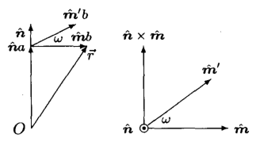

图 A7.1  矢量绕 $\hat{n}$ 方向转动 $\omega$ 角的变换

## 附录 8 采用欧拉角参数时的群上积分元

计算的困难主要在于恒元邻近的一个测度为零的区域 $(\beta=0)$，群参数和群元素是多一对应的。这样，恒元邻近的密度函数 $W_0$ 以正比于 $\beta$ 的方式趋于零。同时，恒元邻近元素的参数也不都趋于零。

设恒元邻近元素 $A$ 的三个欧拉角参数为 $(\alpha_0,\beta_0,\gamma_0)$，则可取

$$
\alpha_0=-\gamma_0+r\ ,\qquad \beta_0=t
$$

其中，$\gamma_0$ 是有限数，$r$ 和 $t$ 是无穷小量。按照式 (4.47)，令 $AR=R'$，要计算

$$
\frac{W(A)}{W(R)}=\frac{W(\alpha_0,\beta_0,\gamma_0)}{W(\alpha,\beta,\gamma)}=\frac{W_0 t}{W(\alpha,\beta,\gamma)}=
\begin{vmatrix}
\dfrac{\partial\alpha'}{\partial\alpha_0} & \dfrac{\partial\alpha'}{\partial\beta_0} & \dfrac{\partial\alpha'}{\partial\gamma_0}\\[10pt]
\dfrac{\partial\beta'}{\partial\alpha_0} & \dfrac{\partial\beta'}{\partial\beta_0} & \dfrac{\partial\beta'}{\partial\gamma_0}\\[10pt]
\dfrac{\partial\gamma'}{\partial\alpha_0} & \dfrac{\partial\gamma'}{\partial\beta_0} & \dfrac{\partial\gamma'}{\partial\gamma_0}
\end{vmatrix}
\tag{A8.1}
$$

在 $R$ 参数不变的条件下对 $\alpha_0$(即 $r$)，$\beta_0$(即 $t$) 和 $\gamma_0$ 求偏微商，计算结果保留到 $t$ 和 $r$ 的一级小量。引入符号

|  |  |  |  |
| --- | --- | --- | --- |
| $s_\alpha=\sin\alpha$, | $c_\alpha=\cos\alpha$, | $s_0=\sin\gamma_0$, | $c_0=\cos\gamma_0$, |
| $s_\beta=\sin\beta$, | $c_\beta=\cos\beta$, | $\sin\beta_0=t$, | $\sin\alpha_0=-s_0+rc_0+r^2s_0/2$, |
| $s_\gamma=\sin\gamma$, | $c_\gamma=\cos\gamma$, | $\cos\beta_0=1-t^2/2$, | $\cos\alpha_0=c_0+rs_0-r^2c_0/2$ |

由式 (4.60) 得

$$
R(\alpha_0,\beta_0,\gamma_0)=
\begin{pmatrix}
1-r^2/2-t^2c_0^2/2 & -r-t^2c_0s_0/2 & tc_0+rts_0\\
r-t^2s_0c_0/2 & 1-r^2/2-t^2s_0^2/2 & ts_0+rtc_0\\
-tc_0 & ts_0 & 1-t^2/2
\end{pmatrix}
$$

代入

$$
R(\alpha_0,\beta_0,\gamma_0)R(\alpha,\beta,\gamma)=R(\alpha',\beta',\gamma')
\tag{A8.2}
$$

利用式 (4.60) 计算 $\alpha'$，$\beta'$ 和 $\gamma'$. 先比较等式 (A8.2) 两边矩阵的第三行第三列元素，解出 $\beta'$

$$
\cos\beta' = c_\beta-ts_\beta\cos(\alpha+\gamma_0)-t^2c_\beta/2,
$$

$$
\beta' = \beta+t\cos(\alpha+\gamma_0)+t^2(c_\beta/s_\beta)\sin^2(\alpha+\gamma_0)\ ,
$$

$$
\sin\beta' = s_\beta+tc_\beta\cos(\alpha+\gamma_0)-t^2s_\beta/2+(t^2/s_\beta)\sin^2(\alpha+\gamma_0)
$$

其次，比较矩阵的第三行第一列 (或第二列) 元素，解出 $\gamma'$

$$
-\sin\beta'\cos\gamma'=-s_\beta c_\gamma-tc_\beta c_\gamma\cos(\alpha+\gamma_0)+ts_\gamma\sin(\alpha+\gamma_0)+t^2s_\beta c_\gamma/2,
$$

$$
\cos\gamma'=c_\gamma-t(s_\gamma/s_\beta)\sin(\alpha+\gamma_0)+\cdots,
$$

$$
\gamma'=\gamma+(t/s_\beta)\sin(\alpha+\gamma_0)+\cdots
$$

其中，删去的部分是关于 $t^2$ 的项。由于 $\beta'$ 和 $\gamma'$ 都与 $r$ 无关，它们对 $\gamma_0$ 的偏微商都是一级小量，对 $\alpha'$ 的计算也只需要算到一级小量。比较矩阵的第一行 (或第二行) 第三列元素，得

$$
\sin\beta'\cos\alpha'=c_\alpha s_\beta-rs_\alpha s_\beta+tc_\beta c_0,
$$

$$
\cos\alpha'=c_\alpha-rs_\alpha+t(s_\alpha c_\beta/s_\beta)\sin(\alpha+\gamma_0),
$$

$$
\alpha'=\alpha+r-t\cot\beta\sin(\alpha+\gamma_0)
$$

代入式 (4.47) 得

$$
\frac{W_0t}{W(\alpha,\beta,\gamma)}=
\begin{vmatrix}
1 & -\cot\beta\sin(\alpha+\gamma_0) & 1\\
0 & \cos(\gamma_0+\alpha) & -t\sin(\alpha+\gamma_0)\\
0 & \sin(\alpha+\gamma_0)/\sin\beta & t\cos(\alpha+\gamma_0)/\sin\beta
\end{vmatrix}
=\frac{t}{\sin\beta}
\tag{A8.3}
$$

得 $W(\alpha,\beta,\gamma)=W_0\sin\beta$，归一化后得式 (4.65).

## 附录 9 三维转动群的表示矩阵 d^j(β)

为简化符号，下面关于矩阵元素 $d^j_{\nu\mu}(\omega)$ 的表达式中，$c=\cos(\omega/2)$ 和 $s=\sin(\omega/2)$. 式 (4.74) 给出 $d^j(\omega)$ 矩阵的一些对称性质，使得有些矩阵元素可以很容易地由另一些矩阵元素算出。如把 $\omega$ 换成 $\pi-\omega$，只是把表达式中 $s$ 和 $c$ 互换，又如由

$$
d^j_{\nu\mu}(\omega)=(-1)^{\mu-\nu}d^j_{-\nu-\mu}(\omega)=(-1)^{\mu-\nu}d^j_{\mu\nu}(\omega)=(-1)^{j+\nu}d^j_{\nu(-\mu)}(\pi-\omega)
$$

我们只需列出满足 $\mu\geqslant\nu\geqslant0$ 条件的矩阵元素 $d^j_{\nu\mu}(\omega)$

$$
d^0_{0,0}(\omega)=1,\qquad d^{1/2}_{1/2,1/2}(\omega)=c,
$$

$$
d^1_{1,1}(\omega)=c^2,\qquad d^1_{0,1}(\omega)=\sqrt{2}cs,\qquad d^1_{0,0}(\omega)=c^2-s^2,
$$

$$
d^{3/2}_{3/2,3/2}(\omega)=c^3,\qquad d^{3/2}_{1/2,3/2}(\omega)=\sqrt{3}c^2s,\qquad d^{3/2}_{1/2,1/2}(\omega)=c^3-2cs^2,
$$

$$
d^2_{2,2}(\omega)=c^4,\qquad d^2_{1,2}(\omega)=2c^3s,\qquad d^2_{1,1}(\omega)=c^4-3c^2s^2,
$$

$$
d^2_{0,2}(\omega)=\sqrt{6}c^2s^2,\qquad d^2_{0,1}(\omega)=\sqrt{6}\left(c^3s-cs^3\right),\qquad d^2_{0,0}(\omega)=c^4-4c^2s^2+s^4
$$

$$
d^{5/2}_{5/2,5/2}(\omega)=c^5,\qquad d^{5/2}_{3/2,5/2}(\omega)=\sqrt{5}c^4s,
$$

$$
d^{5/2}_{3/2,3/2}(\omega)=c^5-4c^3s^2,\qquad d^{5/2}_{1/2,5/2}(\omega)=\sqrt{10}c^3s^2,
$$

$$
d^{5/2}_{1/2,3/2}(\omega)=\sqrt{2}\left(2c^4s-3c^2s^3\right),\qquad d^{5/2}_{1/2,1/2}(\omega)=c^5-6c^3s^2+3cs^4,
$$

$$
d^3_{3,3}(\omega)=c^6,\qquad d^3_{2,3}(\omega)=\sqrt{6}c^5s,
$$

$$
d^3_{2,2}(\omega)=c^6-5c^4s^2,\qquad d^3_{1,3}(\omega)=\sqrt{15}c^4s^2,
$$

$$
d^3_{1,2}(\omega)=\sqrt{10}\left(c^5s-2c^3s^3\right),\qquad d^3_{1,1}(\omega)=c^6-8c^4s^2+6c^2s^4,
$$

$$
d^3_{0,3}(\omega)=2\sqrt{5}c^3s^3,\qquad d^3_{0,2}(\omega)=\sqrt{30}\left(c^4s^2-c^2s^4\right),
$$

$$
d^3_{0,1}(\omega)=2\sqrt{3}\left(c^5s-3c^3s^3+cs^5\right),\qquad d^3_{0,0}(\omega)=c^6-9c^4s^2+9c^2s^4-s^6,
$$

$$
d^{7/2}_{7/2,7/2}(\omega)=c^7,\qquad d^{7/2}_{5/2,7/2}(\omega)=\sqrt{7}c^6s,
$$

$$
d^{7/2}_{5/2,5/2}(\omega)=c^7-6c^5s^2,\qquad d^{7/2}_{3/2,7/2}(\omega)=\sqrt{21}c^5s^2,
$$

$$
d^{7/2}_{3/2,5/2}(\omega)=\sqrt{3}\left(2c^6s-5c^4s^3\right),\qquad d^{7/2}_{3/2,3/2}(\omega)=c^7-10c^5s^2+10c^3s^4,
$$

$$
d^{7/2}_{1/2,7/2}(\omega)=\sqrt{35}c^4s^3,\qquad d^{7/2}_{1/2,5/2}(\omega)=\sqrt{5}\left(3c^5s^2-4c^3s^4\right),
$$

$$
d^{7/2}_{1/2,3/2}(\omega)=\sqrt{15}\left(c^6s-4c^4s^3+2c^2s^5\right),\qquad d^{7/2}_{1/2,1/2}(\omega)=c^7-12c^5s^2+18c^3s^4-4cs^6,
$$

$$
d^4_{4,4}(\omega)=c^8,\qquad d^4_{3,4}(\omega)=2\sqrt{2}c^7s,
$$

$$
d^4_{3,3}(\omega)=c^8-7c^6s^2,\qquad d^4_{2,4}(\omega)=2\sqrt{7}c^6s^2,
$$

$$
d^4_{2,3}(\omega)=\sqrt{14}\left(c^7s-3c^5s^3\right),\qquad d^4_{2,2}(\omega)=c^8-12c^6s^2+15c^4s^4,
$$

$$
d^4_{1,4}(\omega)=2\sqrt{14}c^5s^3,\qquad d^4_{1,3}(\omega)=\sqrt{7}\left(3c^6s^2-5c^4s^4\right),
$$

$$
d^4_{1,2}(\omega)=\sqrt{2}\left(3c^7s-15c^5s^3+10c^3s^5\right),\qquad d^4_{1,1}(\omega)=c^8-15c^6s^2+30c^4s^4-5c^2s^6,
$$

$$
d^4_{0,4}(\omega)=\sqrt{70}c^4s^4,\qquad d^4_{0,3}(\omega)=2\sqrt{35}\left(c^5s^3-c^3s^5\right),
$$

$$
d^4_{0,2}(\omega)=\sqrt{10}\left(3c^6s^2-8c^4s^4+3c^2s^6\right),
$$

$$
d^4_{0,1}(\omega)=2\sqrt{5}\left(c^7s-6c^5s^3+6c^3s^5-cs^7\right),
$$

$$
d^4_{0,0}(\omega)=c^8-16c^6s^2+36c^4s^4-16c^2s^6+s^8
$$

## 附录 10 球谐多项式

球函数 $Y_m^\ell(\theta,\varphi)$ 乘上 $r^\ell$ 后是直角坐标的 $\ell$ 次齐次多项式，称为球谐多项式。为了符合通常习惯，这里直角坐标写成 $x$，$y$ 和 $z$，而不取符号 $x_1$，$x_2$ 和 $x_3$. 下面列出球谐多项式基本公式和若干具体形式 ($m=\ell$，$\ell-1$ 和 $\ell\leqslant4$)

$$
r^\ell Y_m^\ell(\hat{r})=\left\{\frac{2\ell+1}{4\pi}\right\}^{1/2}r^\ell\mathrm{e}^{\mathrm{i}m\varphi}d^\ell_{m0}(\theta)
\tag{A10.1}
$$

$$
r^\ell Y^\ell_\ell(\hat{r})=\frac{(-1)^\ell}{2^{\ell+1}\ell!}\left\{\frac{(2\ell+1)!}{\pi}\right\}^{1/2}(x+\mathrm{i}y)^\ell
\tag{A10.2}
$$

$$
r^\ell Y^\ell_{\ell-1}(\hat{r})=\frac{(-1)^{\ell-1}}{2^\ell(\ell-1)!}\left\{\frac{(2\ell+1)!}{2\pi\ell}\right\}^{1/2}(x+\mathrm{i}y)^{\ell-1}z,\qquad \ell>0
\tag{A10.3}
$$

$$
\sqrt{4\pi}Y^0_0=1.
$$

$$
\sqrt{\frac{4\pi}{3}}rY^1_0=z.
$$

$$
\sqrt{\frac{8\pi}{15}}r^2Y^2_{\pm1}=\mp(x\pm\mathrm{i}y)z,
$$

$$
\sqrt{\frac{8\pi}{35}}r^3Y^3_{\pm3}=\mp\frac{1}{2\sqrt{2}}(x\pm\mathrm{i}y)^3,
$$

$$
\sqrt{\frac{8\pi}{35}}r^3Y^3_{\pm1}=\mp\frac{\sqrt{30}}{20}(x\pm\mathrm{i}y)(5z^2-r^2),
$$

$$
\sqrt{\frac{32\pi}{315}}r^4Y^4_{\pm4}=\frac{1}{4}(x\pm\mathrm{i}y)^4,
$$

$$
\sqrt{\frac{32\pi}{315}}r^4Y^4_{\pm2}=\frac{1}{2\sqrt{7}}(x\pm\mathrm{i}y)^2(7z^2-r^2),
$$

$$
\sqrt{\frac{32\pi}{315}}r^4Y^4_{\pm1}=\mp\frac{1}{\sqrt{14}}(x\pm\mathrm{i}y)z(7z^2-3r^2),
$$

$$
\sqrt{\frac{32\pi}{315}}r^4Y^4_0=\frac{1}{2\sqrt{70}}(35z^4-30r^2z^2+3r^4).
$$

$$
\sqrt{\frac{4\pi}{3}}rY^1_{\pm1}=\mp\frac{1}{\sqrt{2}}(x\pm\mathrm{i}y),
$$

$$
\sqrt{\frac{8\pi}{15}}r^2Y^2_{\pm2}=\frac{1}{2}(x\pm\mathrm{i}y)^2,
$$

$$
\sqrt{\frac{8\pi}{15}}r^2Y^2_0=\frac{1}{\sqrt{6}}(3z^2-r^2).
$$

$$
\sqrt{\frac{8\pi}{35}}r^3Y^3_{\pm2}=\frac{\sqrt{3}}{2}(x\pm\mathrm{i}y)^2z,
$$

$$
\sqrt{\frac{8\pi}{35}}r^3Y^3_0=\frac{1}{\sqrt{10}}(5z^2-3r^2)z.
$$

$$
\sqrt{\frac{32\pi}{315}}r^4Y^4_{\pm3}=\mp\frac{1}{\sqrt{2}}(x\pm\mathrm{i}y)^3z,
$$

## 附录 11 量子力学中角动量矩阵形式的计算

在量子力学中，就根据角动量算符 $L_a$ 的对易关系式 (4.112)，在 $L^2$ 相同本征值的本征函数构成的有限维函数空间中，选取关于 $L_a$ 的最小不变函数空间，取 $L_3$ 对角化的表象，计算出生成元的矩阵形式式 (4.78)，称为角动量的矩阵形式。现简单解释一下计算过程。

引入 $L_\pm=L_1\pm\mathrm{i}L_2$，则

$$
[L_3,L_\pm]=\pm L_\pm,\qquad [L_+,L_-]=2L_3,\qquad [L^2,L_a]=0,
$$

$$
L^2=\sum_a L_a^2=L_3^2+L_3+L_-L_+=L_3^2-L_3+L_+L_-
$$

若 $|m\rangle$ 是 $L_3$ 的本征状态，本征值为 $m$，则 $L_\pm|m\rangle$ 也是 $L_3$ 的本征状态，本征值为 $m\pm1$. 在 $L^2$ 的相同本征值的简并本征函数空间中，因为简并度有限，则必能找到 $L_3$ 最高本征值的本征状态，本征值记为 $\ell$

$$
L_3|\ell\rangle=\ell|\ell\rangle\ ,\qquad L_+|\ell\rangle=0
$$

由此可求出 $L^2$ 的本征值为 $\ell(\ell+1)$. 多次用 $L_-$ 作用，由于简并度有限，次数足够多后必有

$$
L^{n+1}_-|\ell\rangle=0\ ,\qquad L^m_-|\ell\rangle\neq0\ ,\qquad 0\leqslant m\leqslant n
$$

则

$$
L_3L^n_-|\ell\rangle=(\ell-n)L^n_-|\ell\rangle,
$$

$$
L^2L^n_-|\ell\rangle=(\ell-n)(\ell-n-1)L^n_-|\ell\rangle=\ell(\ell+1)L^n_-|\ell\rangle
$$

解得 $n$ 的正根为 $2\ell$，故 $\ell$ 只能取整数或半奇数。设

$$
L_-|m\rangle=A_m|m-1\rangle\ ,\qquad -\ell\leqslant m\leqslant\ell
$$

其中，$A_m$ 是待定常数，$A_{-\ell}=0$，其他 $A_m$ 不为零。现在来证明基 $|m\rangle$ 在 $L_+$ 作用下和 $|m+1\rangle$ 成比例，就是说，这个 $2\ell+1$ 维空间对角动量算符 $L_a$ 是封闭的。用数学归纳法，若下式成立

$$
L_+|n\rangle=B_{n+1}|n+1\rangle,\qquad m\leqslant n\leqslant\ell\ ,\qquad B_{\ell+1}=0
$$

要证明它对 $n=m-1\geqslant-\ell$ 也成立，
其中，$B_{n+1}$ 是待定常数

$$
2m|m\rangle=2L_3|m\rangle=[L_+,L_-]|m\rangle=A_mL_+|m-1\rangle-A_{m+1}B_{m+1}|m\rangle,
$$

$$
L_+|m-1\rangle=(A_m)^{-1}\left(2m+A_{m+1}B_{m+1}\right)|m\rangle=B_m|m\rangle
$$

证完。上式同时给出递推关系

$$
\begin{aligned}
A_{m+1}B_{m+1}&=A_mB_m-2m=A_{m-1}B_{m-1}-2m-2(m-1)=\cdots\\
&=A_{-\ell}B_{m-(m+\ell)}-(m-\ell)(m+\ell+1)\\
&=(\ell+m+1)(\ell-m)=\left(\Gamma^\ell_{m+1}\right)^2
\end{aligned}
$$

选择基的可乘因子，使 $A_m=B_m=\Gamma^\ell_m$ 为正实数，得式 (4.78).

## 附录 12 李代数的理想和李群的不变子李群

我们来简要说明李代数存在非平庸理想是李群存在非平凡不变子李群的充要条件。

设 $H$ 是李群 $G$ 的不变子李群，$A(\alpha)$ 是 $H$ 的无穷小元素，生成元记作 $I_\mu$，$R$ 是 $G$ 的无穷小元素，生成元记作 $I_j$. 根据不变子李群的性质，$RAR^{-1}A^{-1}=B$ 仍是 $H$

中的一个无穷小元素。在群 $G$ 的一个真实表示 $D(G)$ 中

$$
D(R)=\mathbf{1}-\mathrm{i}\sum_{j=1}^{g}r_jI_j+\cdots\ ,\qquad D(A)=\mathbf{1}-\mathrm{i}\sum_{\mu=1}^{h}\alpha_\mu I_\mu,
$$

$$
D(R)D(A)D(R)^{-1}D(A)^{-1}=\mathbf{1}-\sum_{j=1}^{g}\sum_{\mu=1}^{h}r_j\alpha_\mu[I_j,I_\mu]+\cdots
$$

$$
=D(B)=\mathbf{1}-\mathrm{i}\sum_{\nu=1}^{h}\beta_\nu I_\nu
$$

这里我们并不关心 $\beta_\nu$ 具体等于多少，而关心的是生成元 $I_j$ 和 $I_\mu$ 取对易关系 (李代数中的乘积运算) 后，仍属于李代数 $\mathscr{L}_H$，即 $\mathscr{L}_H$ 是 $\mathscr{L}_G$ 的理想。

另一方面，若 $\mathscr{L}_H$ 是 $\mathscr{L}_G$ 的理想，$A(\alpha)$ 是 $H$ 的无穷小元素，$R$ 是 $G$ 的任意元素。先假定群 $G$ 存在指数映照，即 $R$ 可以表为生成元的矩阵指数函数。利用第四章习题 1 的公式，有

$$
D(R)=\mathrm{e}^{-\mathrm{i}X},\qquad D(A)=\mathbf{1}-\mathrm{i}\sum_{\mu=1}^{h}\alpha_\mu I_\mu\ ,\qquad X\in\mathscr{L}_G,\qquad I_\mu\in\mathscr{L}_H,
$$

$$
D(R)D(A)D(R)^{-1}=\mathbf{1}-\mathrm{i}\sum_{\mu=1}^{h}\alpha_\mu\sum_{n=0}^{\infty}\frac{1}{n!}[X,[X,\cdots[X,I_\mu]\cdots]]
$$

根据假设 $\mathscr{L}_H$ 是 $\mathscr{L}_G$ 的理想，有

$$
[X,[X,\cdots[X,I_\mu]\cdots]]\in\mathscr{L}_H
$$

因而 $D(R)D(A)D(R)^{-1}\in H$. 对一般情况，根据李氏第一定理，$R$ 可以表为生成元 $X$ 的矩阵指数函数的乘积，上述证明仍成立。

## 附录 13 SU(2) 群的克莱布施-戈登系数

先推导计算中常用的有关组合数的求和公式，这些公式可由下面二项式定理来证明

$$
\begin{aligned}
(1+x)^a&=\sum_{n=0}^{a}x^n\begin{pmatrix}a\\n\end{pmatrix}\ ,\qquad \begin{pmatrix}a\\n\end{pmatrix}=\frac{a!}{n!(a-n)!},\\
(1+x)^{-b}&=\sum_{n=0}^{\infty}(-1)^nx^n\begin{pmatrix}b+n-1\\n\end{pmatrix}
\end{aligned}
\tag{A13.1}
$$

其实这里不用太注意求和指标的取值范围，因为一旦它超出此范围，分母会出现负整数的阶乘，从而使该项为零。分别用两种不同方式计算下面二项式，再做求和指标替换，就可证明三个恒等式。首先

$$
(1+x)^{a+b}=\sum_{m} x^{m}\begin{pmatrix} a+b \\ m \end{pmatrix}=(1+x)^{a}(1+x)^{b}
$$

$$
=\sum_{n} x^{n}\begin{pmatrix} a \\ n \end{pmatrix}\sum_{\ell} x^{\ell}\begin{pmatrix} b \\ \ell \end{pmatrix}=\sum_{m} x^{m}\sum_{n}\begin{pmatrix} a \\ n \end{pmatrix}\begin{pmatrix} b \\ m-n \end{pmatrix}
$$

得

$$
\sum_{p}\begin{pmatrix} u \\ p \end{pmatrix}\begin{pmatrix} v \\ r-p \end{pmatrix}=\begin{pmatrix} u+v \\ r \end{pmatrix},
$$

$$
\sum_{p}\{p!(v-r+p)!(u-p)!(r-p)!\}^{-1}=\frac{(u+v)!}{u!v!r!(u+v-r)!}
\tag{A13.2}
$$

其次

$$
(1+x)^{a-b}=\sum_{m}(-1)^{m}x^{m}\begin{pmatrix} b-a+m-1 \\ m \end{pmatrix}
$$

$$
=(1+x)^{a}(1+x)^{-b}=\sum_{n} x^{n}\begin{pmatrix} a \\ n \end{pmatrix}\sum_{\ell}(-1)^{\ell}x^{\ell}\begin{pmatrix} b+\ell-1 \\ \ell \end{pmatrix}
$$

$$
=\sum_{m}(-1)^{m}x^{m}\sum_{n}(-1)^{n}\begin{pmatrix} a \\ n \end{pmatrix}\begin{pmatrix} b+m-n-1 \\ m-n \end{pmatrix}
$$

得

$$
\sum_{p}(-1)^{p}\begin{pmatrix} u \\ p \end{pmatrix}\begin{pmatrix} v-p \\ r-p \end{pmatrix}=\begin{pmatrix} v-u \\ r \end{pmatrix},
$$

$$
\sum_{p}\frac{(-1)^{p}(v-p)!}{p!(u-p)!(r-p)!}=\frac{(v-u)!(v-r)!}{u!r!(v-u-r)!}
\tag{A13.3}
$$

最后

$$
(1+x)^{-a-b}=\sum_{m}(-1)^{m}x^{m}\begin{pmatrix} a+b+m-1 \\ m \end{pmatrix}
$$

$$
=(1+x)^{-a}(1+x)^{-b}=\sum_{n}(-1)^{n}x^{n}\begin{pmatrix} a+n-1 \\ n \end{pmatrix}\sum_{\ell}(-1)^{\ell}x^{\ell}\begin{pmatrix} b+\ell-1 \\ \ell \end{pmatrix}
$$

$$
=\sum_{m}(-1)^{m}x^{m}\sum_{n}\begin{pmatrix} a+n-1 \\ n \end{pmatrix}\begin{pmatrix} b+m-n-1 \\ m-n \end{pmatrix}
$$

得

$$
\sum_{p}\begin{pmatrix} u+p-1 \\ p \end{pmatrix}\begin{pmatrix} v+r-p-1 \\ r-p \end{pmatrix}=\begin{pmatrix} u+v+r-1 \\ r \end{pmatrix},
$$

$$
\sum_{p}\frac{(u+p-1)!(v+r-p-1)!}{p!(r-p)!}=\frac{(u+v+r-1)!(u-1)!(v-1)!}{r!(u+v-1)!}
\tag{A13.4}
$$

现在介绍由递推关系式 (4.137) 计算 CG 系数的方法。取式 (4.137) 的上面符号，且 $M=J$，则等式右面项为零。逐次取 $\mu=j,j-1,\cdots$，可把 $C^{jk}_{\mu(J-\mu)JJ}$ 用 $C^{jk}_{j(J-j)JJ}$ 表达出

$$
C^{jk}_{\mu(J-\mu)JJ}=(-1)^{j-\mu}\left\{\frac{(J+k-\mu)!(j+k-J)!(j+\mu)!}{(J+k-j)!(k-J+\mu)!(j-\mu)!(2j)!}\right\}^{1/2}C^{jk}_{j(J-j)JJ}
\tag{A13.5}
$$

由于 $C^{jk}_{j(J-j)JJ}$ 是正实数，用归一化条件 (4.138) 和式 (A13.4) 可算得

$$
C^{jk}_{j(J-j)JJ}=\left\{\frac{(2j)!(2J+1)!}{(J+j-k)!(J+j-k+1)!}\right\}^{1/2}
\tag{A13.6}
$$

$$
C^{jk}_{\mu(J-\mu)JJ}=(-1)^{j-\mu}\left\{\frac{(2J+1)!(j+k-J)!(J+k-\mu)!(j+\mu)!}{(J+k-j)!(J+j-k)!(J+j+k+1)!(k-J+\mu)!(j-\mu)!}\right\}^{1/2}
\tag{A13.7}
$$

最后，$J-M$ 次引用递推关系 (4.137)(下面符号)，可把 $C^{jk}_{\mu(M-\mu)JM}$ 中的磁量子数 $M$ 升至 $J$. 每用一次递推关系，项数增加一倍，总共有 $2^{J-M}$ 项，每一项都包含 $C^{jk}_{m(J-m)JJ}$，但 $m$ 值不同。 $m$ 值相同的项系数都相同，这样的项数等于 $J-M$ 个客体中取 $m-\mu$ 个客体的组合数。因此得

$$
C^{jk}_{\mu(M-\mu)JM}=\sum_{m}C^{jk}_{m(M-m)JJ}\left\{\frac{(J-M)!}{(m-\mu)!(J-M+\mu-m)!}\right\}
$$

$$
\times\left\{\frac{(j-\mu)!(k-M+\mu)!(J+M)!(J+k-m)!(j+m)!}{(j+\mu)!(k+M-\mu)!(J-M)!(j-m)!(k-J+m)!(2J)!}\right\}^{1/2}
$$

$$
=\left\{\frac{(2J+1)(j+k-J)!(J+M)!(J-M)!(j-\mu)!(k-M+\mu)!}{(J+j-k+1)!(J+j-k)!(J-j+k)!(j+\mu)!(k+M-\mu)!}\right\}^{1/2}
$$

$$
\times\sum_{m}\frac{(-1)^{j-m}(J+k-m)!(j+m)!}{(j-m)!(J-M+\mu-m)!(m-\mu)!(m+k-J)!}
$$

将求和指标 $m$ 换成 $n=m-\mu$，得克莱布施 - 戈登系数的拉卡形式

$$
C^{jk}_{\mu(M-\mu)JM}
$$

$$
=\left\{\frac{(2J+1)(j+k-J)!(J+M)!(J-M)!(j-\mu)!(k-M+\mu)!}{(J+j+k+1)!(J+j-k)!(J-j+k)!(j+\mu)!(k+M-\mu)!}\right\}^{1/2}
$$

$$
\times\sum_{n}\frac{(-1)^{n+j-\mu}(J+k-\mu-n)!(j+\mu+n)!}{(j-\mu-n)!(J-M-n)!n!(n+\mu+k-J)!}
\tag{A13.8}
$$

$$
n\ \text{取}\ \max\left\{\begin{array}{c}0\\ J-k-\mu\end{array}\right\},\cdots,\min\left\{\begin{array}{c}j-\mu\\ J-M\end{array}\right\}
$$

注意，因子 $(2J+1)^{1/2}$ 是没有阶乘号的。

通过下列求和指标替换步骤，可把克莱布施 - 戈登系数化为更对称的形式：

(1) 用式 (A13.2)，取 $u=k+M-\mu$，$v=J-M-n$，$r=J-j+k$，和 $p=s$，得

$$
\frac{(k+J-\mu-n)!}{(k+M-\mu)!(J-M-n)!(J-j+k)!(j-\mu-n)!}
$$

$$
=\sum_{s}\{(s)!(k+M-\mu-s)!(J-j+k-s)!(j-k-M-n+s)!\}^{-1}
$$

(2) 把求和指标 $n$ 换成 $t=j-k-M+s-n$，再用式 (A13.3)，取 $v=2j-k-M+\mu+s$，$u=j-J-M+\mu+s$，$r=j-k-M+s$ 和 $p=t$，得

$$
\sum_{n}\frac{(-1)^{-n+j-\mu}(j+\mu+n)!}{(n)!(k-J+\mu+n)!(j-k-M-n+s)!}
$$

$$
=\sum_{t}\frac{(-1)^{k+M-\mu-s+t}(2j-k-M+\mu+s-t)!}{(t)!(j-J-M+\mu+s-t)!(j-k-M+s-t)!}
$$

$$
=\frac{(-1)^{k+M-\mu-s}(j-k+J)!(j+\mu)!}{(j-J-M+\mu+s)!(j-k-M+s)!(J+M-s)!}
$$

(3) 把求和指标 $s$ 换成 $n=k+M-\mu-s$，得

$$
C^{jk}_{\mu(M-\mu)JM}=(2J+1)^{1/2}\Delta(j,k,J)\{(j+\mu)!(j-\mu)!
$$

$$
\times(k+M-\mu)!(k-M+\mu)!(J+M)!(J-M)!\}^{1/2}
$$

$$
\times\sum_{n}(-1)^{n}\{(n)!(J-j-M+\mu+n)!(J-k+\mu+n)!
$$

$$
\times(j-\mu-n)!(k+M-\mu-n)!(j+k-J-n)!\}^{-1}
$$

$$
n\ \text{取}\ \max\left\{\begin{array}{c}0\\ j+M-\mu-J\\ k-\mu-J\end{array}\right\},\cdots,\min\left\{\begin{array}{c}j-\mu\\ k+M-\mu\\ j+k-J\end{array}\right\}
\tag{A13.9}
$$

其中，$|\mu|\leqslant j$，$|M-\mu|\leqslant k$，$|M|\leqslant J$，$|j-k|\leqslant J\leqslant j+k$，和

$$
\Delta(a,b,c)=\left\{\frac{(a+b-c)!(b+c-a)!(c+a-b)!}{(a+b+c+1)!}\right\}^{1/2}
\tag{A13.10}
$$

这公式称为克莱布施 - 戈登系数的范德瓦登 (Van der Waerden) 形式。

现在介绍由式 (4.132) 直接计算 CG 系数的方法。把以欧拉角作为参数的 $D^{j}(\alpha,\beta,\gamma)$ 函数式 (4.73) 代入，由于式 (4.136)，等式两边与 $\alpha$ 和 $\gamma$ 角有关的指数因子正好消去。将相似变换矩阵移到等式右面，得

$$
d^{j}_{\mu\rho}(\beta)d^{k}_{\nu\lambda}(\beta)=\sum_{J}C^{jk}_{\mu\nu J(\mu+\nu)}d^{J}_{(\mu+\nu)(\rho+\lambda)}(\beta)C^{jk}_{\rho\lambda J(\rho+\lambda)}
\tag{A13.11}
$$

利用 $d^{j}$ 函数的正交关系式 (4.77) 得

$$
C^{jk}_{\mu\nu J(\mu+\nu)}C^{jk}_{\rho\lambda J(\rho+\lambda)}=\frac{2J+1}{2}\int_{0}^{\pi}\mathrm{d}\beta\,\sin\beta\,d^{J}_{(\mu+\nu)(\rho+\lambda)}(\beta)d^{j}_{\mu\rho}(\beta)d^{k}_{\nu\lambda}(\beta)
\tag{A13.12}
$$

取 $\rho=j$，$\lambda=-k$，以 $d^{j}$ 的具体形式式 (4.72) 代入，并利用积分公式

$$
\frac{1}{2}\int_{0}^{\pi}\mathrm{d}\beta\,[\cos(\beta/2)]^{2a}[\sin(\beta/2)]^{2b}=\frac{a!b!}{(a+b+1)!}
\tag{A13.13}
$$

得

$$
C^{jk}_{\mu\nu J(\mu+\nu)}C^{jk}_{j(-k)J(j-k)}=\frac{(2J+1)\{(2j)!(2k)!\}^{1/2}}{(J+j+k+1)!}
$$

$$
\times\left\{\frac{(J+j-k)!(J-j+k)!(J+\mu+\nu)!(J-\mu-\nu)!}{(j+\mu)!(j-\mu)!(k+\nu)!(k-\nu)!}\right\}^{1/2}
$$

$$
\times\sum_{n}\frac{(-1)^{n+k+\nu}(J+k+\mu-n)!(n+j-\mu)!}{(J-j+k-n)!(J+\mu+\nu-n)!n!(n+j-k-\mu-\nu)!}
\tag{A13.14}
$$

先计算 $C^{jk}_{j(-k)J(j-k)}$，取 $\mu=j$ 和 $\nu=-k$，得

$$
\left(C^{jk}_{j(-k)J(j-k)}\right)^{2}=\frac{(2J+1)(2k)!(J+j-k)!}{(J+j+k+1)!}
$$

$$
\times\sum_{n}(-1)^{n}\begin{pmatrix} J-j+k \\ n \end{pmatrix}\begin{pmatrix} J+j+k-n \\ J+j-k-n \end{pmatrix}
$$

注意它是正实数，利用式 (A13.3)，取 $u=J-j+k$，$v=J+j+k$，$r=J+j-k$ 和 $p=n$，得

$$
C^{jk}_{j(-k)J(j-k)}=\left\{\frac{(2J+1)(2j)!(2k)!}{(J+j+k+1)!(j+k-J)!}\right\}^{1/2}
\tag{A13.15}
$$

再代入式 (A13.14) 得

$$
C^{jk}_{\mu\nu J(\mu+\nu)}=\left\{\frac{(j+k-J)!(J-j+k)!(J+j-k)!}{(J+j+k+1)!}\right\}^{1/2}
$$

$$
\times\left\{\frac{(2J+1)(J+\mu+\nu)!(J-\mu-\nu)!}{(j+\mu)!(j-\mu)!(k+\nu)!(k-\nu)!}\right\}^{1/2}
$$

$$
\times\sum_{n}\frac{(-1)^{n+k+\nu}(J+k+\mu-n)!(n+j-\mu)!}{(J-j+k-n)!(J+\mu+\nu-n)!n!(n+j-k-\mu-\nu)!}
$$

将对 $n$ 求和换成对 $m=n-k-\nu$ 求和，再把求和指标 $m$ 重新记作 $n$，得克莱布施 - 戈登系数的维格纳 (Wigner) 形式

$$
C^{jk}_{\mu\nu J(\mu+\nu)}=\Delta(j,k,J)\left\{\frac{(2J+1)(J+\mu+\nu)!(J-\mu-\nu)!}{(j+\mu)!(j-\mu)!(k+\nu)!(k-\nu)!}\right\}^{1/2}
$$

$$
\times\sum_{n}\frac{(-1)^{n}(J+\mu-\nu-n)!(n+j+k-\mu+\nu)!}{(J-j-\nu-n)!(J-k+\mu-n)!(n+k+\nu)!(n+j-\mu)!}
\tag{A13.16}
$$

$$
n\ \text{取}\ \max\left(\begin{array}{c}-k-\nu\\ -j+\mu\end{array}\right),\cdots,\min\left(\begin{array}{c}J-j-\nu\\ J-k+\mu\end{array}\right)
$$

下面用展开式 (4.147) 的方式列出若干克莱布施 - 戈登系数，但波函数采用狄拉克符号，即把 $\Psi^{J}_{M}(x^{(1)}x^{(2)})$ 记作 $||J,M\rangle$，把 $\psi^{j}_{\mu}(x^{(1)})\psi^{k}_{\nu}(x^{(2)})$ 记作 $|j,\mu\rangle|k,\nu\rangle$

$$
||J,M\rangle=\sum_{\mu}C^{jk}_{\mu(M-\mu)JM}\ |j,\mu\rangle|k,(M-\mu)\rangle
\tag{A13.17}
$$

列出的克莱布施 - 戈登系数有

$$
||(j+k),(j+k)\rangle=|j,j\rangle|k,k\rangle,
$$

$$
||(j+k),(j+k-1)\rangle=\left(\frac{k}{j+k}\right)^{1/2}|j,j\rangle|k,(k-1)\rangle
$$

$$
+\left(\frac{j}{j+k}\right)^{1/2}|j,(j-1)\rangle|k,k\rangle,
$$

$$
||(j+k),(j+k-2)\rangle=\left(\frac{k(2k-1)}{(j+k)(2j+2k-1)}\right)^{1/2}|j,j\rangle|k,(k-2)\rangle
$$

$$
+2\left(\frac{jk}{(j+k)(2j+2k-1)}\right)^{1/2}|j,(j-1)\rangle|k,(k-1)\rangle
$$

$$
+\left(\frac{j(2j-1)}{(j+k)(2j+2k-1)}\right)^{1/2}|j,(j-2)\rangle|k,k\rangle,
$$

$$
||(j+k),M\rangle=\sum_{\mu}\left[\frac{(2j)!(2k)!(j+k+M)!(j+k-M)!}{(2j+2k)!(j+\mu)!(j-\mu)!(k+M-\mu)!(k-M+\mu)!}\right]^{1/2}
$$

$$
\times|j,\mu\rangle|k,(M-\mu)\rangle
\tag{A13.18}
$$

这些式子都可用降算符 $L_{-}$ 多次作用在第一式两边得到，但要注意对乘积波函数，降算符要分别作用到两个波函数上，然后相加，即降算符为

$$
L_{-}\times \mathbf{1}+\mathbf{1}\times L_{-}
\tag{A13.19}
$$

利用升算符 $L_{+}$ 作用为零的条件，或用与上述展开式正交的条件，再考虑相因子的规定，可计算不同 $J$ 的最高磁量子数状态 ($M=J$) 的展开式，它是式 (A13.7) 的另一表达方式

$$
||(j+k-1),(j+k-1)\rangle=\left(\frac{j}{j+k}\right)^{1/2}|j,j\rangle|k,(k-1)\rangle
$$

$$
-\left(\frac{k}{j+k}\right)^{1/2}|j,(j-1)\rangle|k,k\rangle,
$$

$$
||(j+k-2),(j+k-2)\rangle=\left(\frac{2j(2j-1)}{(2j+2k-1)(2j+2k-2)}\right)^{1/2}|j,j\rangle|k,(k-2)\rangle
$$

$$
-\left(\frac{2(2j-1)(2k-1)}{(2j+2k-1)(2j+2k-2)}\right)^{1/2}|j,(j-1)\rangle|k,(k-1)\rangle
$$

$$
+\left(\frac{2k(2k-1)}{(2j+2k-1)(2j+2k-2)}\right)^{1/2}|j,(j-2)\rangle|k,k\rangle,
$$

$$
||J,J\rangle=\sum_{\mu}(-1)^{j-\mu}
$$

$$
\times\left\{\frac{(2J+1)!(j+k-J)!(J+k-\mu)!(j+\mu)!}{(J+k-j)!(J+j-k)!(J+j+k+1)!(k-J+\mu)!(j-\mu)!}\right\}^{1/2}
$$

$$
\times|j,\mu\rangle|k,(J-\mu)\rangle
\tag{A13.20}
$$

然后再用降算符式 (A13.19) 作用，可计算其他状态的展开式。这也是计算克莱布施 - 戈登系数的一种重要方法，将在第七章做详细讨论。

当 $k=1/2$ 和 $k=1$ 时，有

$$
C^{j\frac{1}{2}}_{(M-\frac{1}{2})\frac{1}{2}(j+\frac{1}{2})M}=C^{j\frac{1}{2}}_{(M+\frac{1}{2})(-\frac{1}{2})(j-\frac{1}{2})M}=\left\{\frac{j+M+1/2}{2j+1}\right\}^{1/2},
$$

$$
C^{j\frac{1}{2}}_{(M+\frac{1}{2})(-\frac{1}{2})(j+\frac{1}{2})M}=-C^{j\frac{1}{2}}_{(M-\frac{1}{2})\frac{1}{2}(j-\frac{1}{2})M}=\left\{\frac{j-M+1/2}{2j+1}\right\}^{1/2},
\tag{A13.21}
$$

$$
C^{j1}_{(M\mp 1)(\pm 1)(j+1)M}=\left\{\frac{(j\pm M)(j\pm M+1)}{2(2j+1)(j+1)}\right\}^{1/2},
$$

$$
C^{j1}_{(M\mp 1)(\pm 1)jM}=\mp\left\{\frac{(j\pm M)(j\mp M+1)}{2j(j+1)}\right\}^{1/2},
$$

$$
C^{j1}_{(M\mp 1)(\pm 1)(j-1)M}=\left\{\frac{(j\mp M)(j\mp M+1)}{2j(2j+1)}\right\}^{1/2},
\tag{A13.22}
$$

$$
C^{j1}_{M0(j+1)M}=\left\{\frac{(j-M+1)(j+M+1)}{(2j+1)(j+1)}\right\}^{1/2},
$$

$$
C^{j1}_{M0jM}=\frac{M}{\{j(j+1)\}^{1/2}},\quad C^{j1}_{M0(j-1)M}=-\left\{\frac{(j-M)(j+M)}{j(2j+1)}\right\}^{1/2}
$$

下面再列出部分 CG 系数值

$$
C^{j0}_{\mu 0j\mu}=1,\quad C^{jj}_{\mu(-\mu)00}=\begin{pmatrix} j & j & 0\\ \mu & -\mu & 0\end{pmatrix}=\frac{(-1)^{j-\mu}}{(2j+1)^{1/2}}
\tag{A13.23}
$$

$$
\sqrt{2}C^{11}_{\mu\nu 1(\mu+\nu)}=\left\{\begin{array}{cl}1, & \text{当 }\mu>\nu\\ 0, & \text{当 }\mu=\nu\\ -1, & \text{当 }\mu<\nu\end{array}\right.
\tag{A13.24}
$$

$$
C^{jk}_{j(-k)(j-k)(j-k)}=(-1)^{2k}C^{jk}_{(-j)k(j-k)(k-j)}=\frac{2(j-k)+1}{2j+1},\quad j\geqslant k
\tag{A13.25}
$$

$$
C^{jk}_{j(M-j)JM}=C^{kj}_{(j-M)(-j)J(-M)}
$$

$$
=\left\{\frac{(2J+1)(2j)!(J+k-j)!(j+k-M)!(J+M)!}{(j+k-J)!(J+j-k)!(J+j+k+1)!(k-j+M)!(J-M)!}\right\}^{1/2}
\tag{A13.26}
$$

$$
C^{\ell_1\ell_2}_{00L0}=0,\quad \text{当 } L-\ell_1-\ell_2=\text{奇数}
\tag{A13.27}
$$

式 (A13.26) 反映了两子系统的宇称乘积必须等于复合系统的宇称 [见式 (4.152)].

## 附录 14 拉卡系数的计算

现在我们来用求和公式 (A13.2)~(A13.4)，把式 (4.159) 定义的拉卡系数具体计算出来。计算中取 $M=J$，并作符号简化

$$
a=j,\quad b=k,\quad c=J,\quad d=\ell,\quad e=J_{12},\quad f=J_{23},
$$

$$
\alpha=J-\nu-\rho=\mu,\quad \gamma=J-\rho=\mu+\nu
$$

把式 (A13.7) 和式 (4.141) 的克莱布施 - 戈登系数代入式 (4.159)，得

$$
W[abcd;ef]
$$

$$
=\frac{(-1)^{a-b+c+d}\Delta(a,b,e)\Delta(e,d,c)\Delta(b,d,f)\Delta(a,f,c)(2c+1)!}{(c+d-e)!(c-d+e)!(c+a-f)!(c-a+f)!}
$$

$$
\times\sum_{\alpha\gamma tn}(-1)^{t+n}(a+\alpha)!(c+f-\alpha)!(e+\gamma)!(c+d-\gamma)!
$$

$$
\times(b+\alpha-\gamma)!(b-\alpha+\gamma)!\{t!(a-b+e-t)!n!
$$

$$
\times(-b+d+f-n)!(a+\alpha-t)!(-a+b-\gamma+t)!
$$

$$
\times(c+d-\gamma-n)!(b-c-d+\alpha+n)!(e+\gamma-t)!
$$

$$
\times(b-e-\alpha+t)!(c+f-\alpha-n)!(b-c-f+\gamma+n)!\}^{-1}
$$

(1) 用式 (A13.2)，取 $u=-a+b-\gamma+t$，$v=a+\alpha-t$，$r=c+d-\gamma-n$ 和 $p=m-e-\gamma$，得

$$
\frac{(b+\alpha-\gamma)!}{(a+\alpha-t)!(-a+b-\gamma+t)!(c+d-\gamma-n)!(b-c-d+\alpha+n)!}
$$

$$
=\sum_{m}\{(m-e-\gamma)!(-a+b+e-m+t)!(c+d+e-n-m)!
$$

$$
\times(a-c-d-e+\alpha-t+n+m)!\}^{-1}
$$

(2) 用式 (4.147)，取 $u=b-e-\alpha+t$，$v=e+\gamma-t$，$r=c+f-\alpha-n$ 和 $p=c+f-\alpha-n-m+t+w$，得

$$
\frac{(b-\alpha+\gamma)!}{(e+\gamma-t)!(b-e-\alpha+t)!(c+f-\alpha-n)!(b-c-f+\gamma+n)!}
$$

$$
=\sum_{w}\{(c+f-\alpha-n-m+t+w)!(b-c-e-f+n+m-w)!
$$

$$
\times(m-t-w)!(e+\gamma-m+w)!\}^{-1}
$$

(3) 按式 (A13.4) 对 $\alpha$ 求和，取 $u=n+m-t-w+1$，$v=c+d+e+t-n-m+1$，$r=a-d-e+f+w$ 和 $p=c+f-\alpha-n-m+t+w$，得

$$
\sum_{\alpha}\frac{(a+\alpha)!(c+f-\alpha)!}{(a-c-d-e+\alpha-t+n+m)!(c+f-\alpha-n-m+t+w)!}
$$

$$
=\frac{(a+c+f+1)!(n+m-t-w)!(c+d+e+t-n-m)!}{(a-d-e+f+w)!(c+d+e-w+1)!}
$$

(4) 用式 (A13.2)，取 $u=a-b+e-t$，$v=-a+b-e+n+m-w$，$r=n$ 和$p=j$，得

$$
\frac{(n+m-t-w)!}{(m-w-t)!(a-b+e-t)!(n)!}
$$

$$
=\sum_{j}\frac{(-a+b-e+n+m-w)!}{j!(a-b+e-t-j)!(-a+b-e+m-w+j)!(n-j)!}
$$

(5) 用式 (A13.2)，取 $u=-b+d+f-n$，$v=b+c+e-f+t-m$，$r=t$ 和 $p=k$，得

$$
\frac{(c+d+e+t-n-m)!}{(-b+d+f-n)!t!(c+d+e-n-m)!}
$$

$$
=\sum_{k}\frac{(b+c+e-f+t-m)!}{k!(-b+d+f-n-k)!(t-k)!(b+c+e-f-m+k)!}
$$

现在我们算得

$$
W[abcd;ef]
$$

$$
=\frac{(-1)^{a-b+c+d}\Delta(a,b,e)\Delta(e,d,c)\Delta(b,d,f)\Delta(a,f,c)(2c+1)!}{(c+d-e)!(c-d+e)!(c+a-f)!(c-a+f)!}
$$

$$
\times(a+c+f+1)!\sum_{\gamma}(e+\gamma)!(c+d-\gamma)!\sum_{j}\{(j)!\}^{-1}
$$

$$
\times\sum_{k}\{(k)!\}^{-1}\sum_{m}\{(b+c+e-f+k-m)!(-e+m-\gamma)!\}^{-1}
$$

$$
\times\sum_{w}\{(a-d-e+f+w)!(e+c+d-w+1)!
$$

$$
\times(-a+b-e-m-w+j)!(e+\gamma-m+w)!\}^{-1}
$$

$$
\times\sum_{n}(-1)^{n}(-a+b-e+m+n-w)!
$$

$$
\times\{(b-c-e-f+m+n-w)!(n-j)!(-b+d+f-k+n)!\}^{-1}
$$

$$
\times\sum_{t}(-1)^{t}\{(-a+b+e-m+t)!(a-b+e-t-j)!(t-k)!\}^{-1}
$$

(6) 按式 (A13.3) 对 $t$ 求和，取 $u=2e-j-m$，$v=a+c+2e-f-j-m$，$r=a-b+e-j-k$ 和 $p=a-b+e-j-t$，得

$$
\sum_{t}\frac{(-1)^{t}(b+c+e+t-f-m)!}{(-a+b+e-m+t)!(a-b+e-j-t)!(t-k)!}
$$

$$
=\frac{(-1)^{-a+b-e+j}(a+c-f)!(b+c+e-f+k-m)!}{(2e-j-m)!(a-b+e-j-k)!(b+c-e-f+j+k)!}
$$

(7) 按式 (A13.3) 对 $n$ 求和，取 $u=-b+d+f-j-k$，$v=-a+d-e+f-k+m-w$，$r=-c+d-e-k+m-w$ 和 $p=-b+d+f-k-n$，得

$$
\sum_{n}\frac{(-1)^{n}(-a+b-e+m+n-w)!}{(b-c-e-f+m+n-w)!(n-j)!(-b+d+f-k-n)!}
$$

$$
=\frac{(-1)^{b-d-f+k}(-a+b-e+j+m-w)!(-a+c+f)!}{(-b+d+f-j-k)!(-c+d-e-k+m-w)!}
$$

$$
\times\{(-a+b+c-d+j+k)!\}^{-1}
$$

(8) 按式 (A13.2) 对 $w$ 求和，取 $u=-c+d-k+\gamma$，$v=a+c+f+1$，$r=c+d+2e-m+\gamma+1$ 和 $p=e-m+w+\gamma$，得

$$
\sum_{w}\{(a-d-e+f+w)!(c+d+e-w+1)!
$$

$$
\times(e-m+w+\gamma)!(-c+d-e-k+m-w)!\}^{-1}
$$

$$
=(a+d+f-k+\gamma+1)!\ \{(-c+d-k+\gamma)!(a+c+f+1)!
$$

$$
\times(c+d+2e-m+\gamma+1)!(a-c-2e+f-k+m)!\}^{-1}
$$

(9) 按式 (A13.2) 对 $m$ 求和，取 $u=e-j-\gamma$，$v=a+d+f-k+\gamma+1$，$r=c+d+e+1$ 和 $p=-e+m-\gamma$，得

$$
\sum_{m}\{(-e+m-\gamma)!(c+d+2e-m+\gamma+1)!
$$

$$
\times(a-c-2e+f-k+m)!(2e-j-m)!\}^{-1}
$$

$$
=(a+d+e+f-j-k+1)!\{(e-j-\gamma)!(a+d+f-k+\gamma+1)!
$$

$$
\times(c+d+e+1)!(a-c+f-j-k)!\}^{-1}
$$

做替换 $n=j+k$，得

$$
W[abcd;ef]
$$

$$
=\frac{(-1)^{b+c-e-f}\Delta(a,b,e)\Delta(e,d,c)\Delta(a,f,c)\Delta(b,d,f)(2c+1)!}{(c+e-d)!(c-e+d)!(c+d+e+1)!}
$$

$$
\times\sum_{n}(-1)^{n}(a+d+e+f-n+1)!\ \{(a-b+e-n)!(b+c-e-f+n)!
$$

$$
\times(a-c+f-n)!(-b+d+f-n)!(-a+b+c-d+n)!\}^{-1}\sum_{\gamma}\{(e+\gamma)!
$$

$$
\times(c+d-\gamma)!\}\sum_{k}\{(n-k)!(k)!(-c+d+\gamma-k)!(e-\gamma-n+k)!\}^{-1}
$$

(10) 按式 (A13.2) 对 $k$ 求和，取 $u=n$，$v=-c+d+e-n$，$r=-c+d+\gamma$ 和 $p=k$，得

$$
\sum_{k}\{(n-k)!(k)!(-c+d+\gamma-k)!(e-\gamma-n+k)!\}^{-1}
$$

$$
=\frac{(-c+d+e)!}{n!(-c+d+e-n)!(-c+d+\gamma)!(e-\gamma)!}
$$

(11) 按式 (A13.4) 对 $\gamma$ 求和，取 $u=c-d+e+1$，$v=c+d-e+1$，$r=-c+d+e$ 和 $p=-c+d+\gamma$，得

$$
\sum_{\gamma}\frac{(e+\gamma)!(c+d-\gamma)!}{(-c+d+\gamma)!(e-\gamma)!}=\frac{(c+d+e+1)!(c-d+e)!(c+d-e)!}{(-c+d+e)!(2c+1)!}
$$

由此得

$$
W[abcd;ef]
$$

$$
=(-1)^{b+c-e-f}\Delta(a,b,e)\Delta(e,d,c)\Delta(b,d,f)\Delta(a,f,c)
$$

$$
\times\sum_{n}(-1)^{n}(a+d+e+f-n+1)!\{n!(b+c-e-f+n)!
$$

$$
\times(-a+b+c-d+n)!(a-b+e-n)!(-c+d+e-n)!
$$

$$
\times(-b+d+f-n)!(a-c+f-n)!\}^{-1}
$$

最后做求和和指标替换，得式 (4.162).

下面列出若干 $6j$ 符号，其中指标 $d$ 取较小的值 $0$，$1/2$ 或 $1$.

$$
\begin{Bmatrix} a & b & c \\ 0 & c & b \end{Bmatrix}=\frac{(-1)^{a+b+c}}{\{(2b+1)(2c+1)\}^{1/2}},
$$

$$
\begin{Bmatrix} a & b & c \\ \frac{1}{2} & c-\frac{1}{2} & b-\frac{1}{2} \end{Bmatrix}=(-1)^{a+b+c}\left\{\frac{(a+b+c+1)(-a+b+c)}{(2b)(2b+1)(2c)(2c+1)}\right\}^{1/2},
$$

$$
\begin{Bmatrix} a & b & c \\ \frac{1}{2} & c-\frac{1}{2} & b+\frac{1}{2} \end{Bmatrix}=(-1)^{a+b+c}\left\{\frac{(a-b+c)(a+b-c+1)}{(2b+1)(2b+2)(2c)(2c+1)}\right\}^{1/2},
$$

$$
\begin{Bmatrix} a & b & c \\ 1 & c-1 & b-1 \end{Bmatrix}=(-1)^{a+b+c}
$$

$$
\times\left\{\frac{(a+b+c+1)(a+b+c)(-a+b+c)(-a+b+c-1)}{(2b-1)(2b)(2b+1)(2c-1)(2c)(2c+1)}\right\}^{1/2},
$$

$$
\begin{Bmatrix} a & b & c \\ 1 & c-1 & b+1 \end{Bmatrix}=(-1)^{a+b+c}
$$

$$
\times\left\{\frac{(a-b+c-1)(a-b+c)(a+b-c+1)(a+b-c+2)}{(2b)(2b+1)(2b+2)(2c-1)(2c)(2c+1)}\right\}^{1/2},
$$

$$
\begin{Bmatrix} a & b & c \\ 1 & c-1 & b \end{Bmatrix}=(-1)^{a+b+c}
$$

$$
\times\left\{\frac{(a+b+c+1)(a+b-c+1)(a-b+c)(-a+b+c)}{2b(2b+1)(2b+2)(2c-1)c(2c+1)}\right\}^{1/2},
$$

$$
\begin{Bmatrix} a & b & c \\ 1 & c & b \end{Bmatrix}=(-1)^{a+b+c+1}
$$

$$
\times\frac{(a+b+c+2)(-a+b+c)-(a+b-c)(a-b+c)}{\{(2b)(2b+1)(2b+2)(2c)(2c+1)(2c+2)\}^{1/2}}
$$

$$
=(-1)^{a+b+c}\frac{a(a+1)-b(b+1)-c(c+1)}{\{b(2b+1)(2b+2)c(2c+1)(2c+2)\}^{1/2}}
$$

## 附录 15 协变张量和逆变张量

设群 $G$ 是由 $N$ 维方矩阵 $R$ 集合构成的矩阵群，把 $R$ 看成是 $N$ 维空间的坐标变换

$$
x_a \xrightarrow{R} x'_a=\sum_{d}R_{ad}x_d
\tag{A15.1}
$$

则包含 $N^n$ 个分量，在变换 $R$ 中按下式变换的量 $T(x)_{a_1\cdots a_n}$

$$
[O_RT(x)]_{a_1\cdots a_n}=\sum_{d_1\cdots d_n}R_{a_1d_1}\cdots R_{a_nd_n}T(R^{-1}x)_{d_1\cdots d_n}
\tag{A15.2}
$$

称为关于矩阵群 $G$ 的 $n$ 阶协变张量场。如果张量分量与坐标 $x$ 无关，则协变张量场简称协变张量。协变张量场可按协变张量基 $\Theta_{b_1\cdots b_n}$ 展开

$$
(\Theta_{b_1\cdots b_n})_{a_1\cdots a_n}=\delta_{a_1b_1}\cdots\delta_{a_nb_n}
\tag{A15.3}
$$

$$
\begin{aligned}
T(x)&=\sum_{b_1\cdots b_n}T(x)_{b_1\cdots b_n}\Theta_{b_1\cdots b_n}\\
T(x)_{a_1\cdots a_n}&=\sum_{b_1\cdots b_n}T(x)_{b_1\cdots b_n}(\Theta_{b_1\cdots b_n})_{a_1\cdots a_n}=T(x)_{a_1\cdots a_n}
\end{aligned}
\tag{A15.4}
$$

展开系数 $T(x)_{a_1\cdots a_n}$ 在数值上等于张量分量 $T(x)_{a_1\cdots a_n}$，但在 $G$ 变换中，它却是一个标量，张量的变换由张量基 $\Theta_{b_1\cdots b_n}$ 来承担

$$
[O_RT(x)]_{a_1\cdots a_n}=[P_RT(x)]_{a_1\cdots a_n}=T(R^{-1}x)_{a_1\cdots a_n}
$$

$$
O_R\Theta_{b_1\cdots b_n}=Q_R\Theta_{b_1\cdots b_n}=\sum_{d_1\cdots d_n}\Theta_{d_1\cdots d_n}R_{d_1b_1}\cdots R_{d_nb_n}
\tag{A15.5}
$$

因为

$$
[O_R\Theta_{b_1\cdots b_n}]_{a_1\cdots a_n}=\sum_{d_1\cdots d_n}R_{a_1d_1}\cdots R_{a_nd_n}[\Theta_{b_1\cdots b_n}]_{d_1\cdots d_n}
$$

$$
=R_{a_1b_1}\cdots R_{a_nb_n}=\sum_{d_1\cdots d_n}[\Theta_{d_1\cdots d_n}]_{a_1\cdots a_n}R_{d_1b_1}\cdots R_{d_nb_n}
$$

包含 $N^n$ 个分量，在变换 $R$ 中按下式变换的量 $T(x)^{a_1\cdots a_n}$

$$
[O_RT(x)]^{a_1\cdots a_n}=\sum_{d_1\cdots d_n}T(R^{-1}x)^{d_1\cdots d_n}(R^{-1})_{d_1a_1}\cdots(R^{-1})_{d_na_n}
\tag{A15.6}
$$

称为关于矩阵群 $G$ 的 $n$ 阶逆变张量场。如果张量分量与坐标 $x$ 无关，则逆变张量场简称逆变张量。同样，逆变张量场可按逆变张量基 $\Theta^{b_1\cdots b_n}$ 展开

$$
(\Theta_{b_1\cdots b_n})^{a_1\cdots a_n}=\delta_{a_1b_1}\cdots\delta_{a_nb_n}
\tag{A15.7}
$$

$$
\begin{aligned}
T(x)&=\sum_{b_1\cdots b_n}T(x)^{b_1\cdots b_n}\Theta^{b_1\cdots b_n},\\
T(x)^{a_1\cdots a_n}&=\sum_{b_1\cdots b_n}T(x)^{b_1\cdots b_n}(\Theta_{b_1\cdots b_n})^{a_1\cdots a_n}=T(x)^{a_1\cdots a_n}
\end{aligned}
\tag{A15.8}
$$

展开系数 $T(x)^{a_1\cdots a_n}$ 在数值上等于张量分量 $T(x)^{a_1\cdots a_n}$，但在 $G$ 变换中，它却是一个标量，张量的变换由张量基 $\Theta^{b_1\cdots b_n}$ 来承担

$$
[O_RT(x)]^{a_1\cdots a_n}=[P_RT(x)]^{a_1\cdots a_n}=T(R^{-1}x)^{a_1\cdots a_n},
$$

$$
O_R\Theta_{b_1\cdots b_n}=Q_R\Theta_{b_1\cdots b_n}=\sum_{d_1\cdots d_n}(R^{-1})_{b_1d_1}\cdots(R^{-1})_{b_nd_n}\Theta_{d_1\cdots d_n}
\tag{A15.9}
$$

包含 $N^{n+m}$ 个分量，在变换 $R$ 中按下式变换的量 $T(x)^{b_1\cdots b_m}_{a_1\cdots a_n}$

$$
[O_RT(x)]^{b_1\cdots b_m}_{a_1\cdots a_n}=\sum_{c_1\cdots c_nd_1\cdots d_m}R_{a_1c_1}\cdots R_{a_nc_n}T(R^{-1}x)^{d_1\cdots d_m}_{c_1\cdots c_n}(R^{-1})_{d_1a_1}\cdots(R^{-1})_{d_na_n}
\tag{A15.10}
$$

称为关于矩阵群 $G$ 的 $(n,m)$ 阶混合张量场。

## 附录 16  J^2, J_3, S^2 和 S·r 的共同本征函数

这四个算符是可以互相对易的，因而可以有共同的本征函数。

设 $e^{(s)}(\rho)_\lambda$ 是 $s$ 阶旋量的旋量基

$$
O_Re^{(s)}(\rho)=Q_Re^{(s)}(\rho)=\sum_{\sigma}e^{(s)}(\sigma)D^s_{\sigma\rho}(R)
\tag{A16.1}
$$

则 $e^{(s)}(\rho)_\lambda$ 是属 SU(2) 群不可约表示 $D^s$ $\rho$ 行的函数，是 $S^2$ 和 $S_3$ 的共同本征函数

$$
S^2e^{(s)}(\rho)=s(s+1)e^{(s)}(\rho),\qquad S_3e^{(s)}(\rho)=\rho e^{(s)}(\rho)
\tag{A16.2}
$$

设 $T=R(\varphi,\theta,\gamma)$ 和 $T_0=R(\varphi,\theta,0)$，其中 $\theta$ 和 $\varphi$ 是径向 $\hat{r}$ 的极角和方位角，则 $S^2$ 和 $\vec{S}\cdot\hat{r}=Q_{T_0}S_3Q_{T_0}^{-1}$ 的共同本征函数为

$$
Q_{T_0}e^{(s)}(\rho)=\sum_{\sigma}e^{(s)}(\sigma)D^s_{\sigma\rho}(\varphi,\theta,0)
\tag{A16.3}
$$

本征值为 $s(s+1)$ 和 $\rho$.

设 $\Psi^j_\mu(x)$ 是 $s$ 阶旋量，是属 SU(2) 群不可约表示 $D^j$ $\mu$ 行的函数

$$
O_R\Psi^j_\mu(x)=D^s(R)\Psi^j_\mu(R^{-1}x)=\sum_{\nu}\Psi^j_\nu(x)D^j_{\nu\mu}(R)
\tag{A16.4}
$$

因而 $\Psi^j_\mu(x)$ 是 $J^2$，$J_3$ 和 $S^2$ 的共同本征函数

$$
J^2\Psi^j_\mu(x)=j(j+1)\Psi^j_\mu(x),\qquad J_3\Psi^j_\mu(x)=\mu\Psi^j_\mu(x),\qquad S^2\Psi^j_\mu(x)=s(s+1)\Psi^j_\mu(x)
\tag{A16.5}
$$

式 (A16.4) 中取 $R$ 为 $T^{-1}$，取 $x$ 为 $x_0=(r,0,0)$，则 $Tx_0=(r,\theta,\varphi)$

$$
D^s(T^{-1})\Psi^j_\mu(Tx_0)=O_{T^{-1}}\Psi^j_\mu(x_0)=\sum_{\nu}\Psi^j_\nu(x_0)D^j_{\nu\mu}(T^{-1})
$$

两边乘 $D^s(T)$，并把 $Tx_0$ 记作 $x$

$$
\Psi^j_\mu(x)=\sum_{\nu}D^s(T)\Psi^j_\nu(x_0)D^j_{\nu\mu}(T^{-1})
\tag{A16.6}
$$

把旋量按旋量基展开，并把 $T$ 的欧拉角代入

$$
\begin{aligned}
\Psi^j_\mu(x)&=\sum_{\sigma\rho\nu}e^{(s)}(\sigma)D^s_{\sigma\rho}(T)\Psi^j_\nu(x_0)_\rho D^j_{\nu\mu}(T)^*\\
&=\sum_{\sigma\rho\nu}e^{(s)}(\sigma)d^s_{\sigma\rho}(\theta)\Psi^j_\nu(x_0)_\rho d^j_{\nu\mu}(\theta)\mathrm{e}^{\mathrm{i}\varphi(\mu-\sigma)}\mathrm{e}^{\mathrm{i}\gamma(\nu-\rho)}
\end{aligned}
$$

等式左面与 $\gamma$ 角无关，等式右面也必须与 $\gamma$ 角无关，因此 $\Psi^j_\nu(x_0)_\rho$ 的一般形式是

$$
\Psi^j_\nu(x_0)_\rho=\phi_\nu(r)\delta_{\rho\nu}
\tag{A16.7}
$$

无论 $\phi_\nu(r)$ 取什么值，只要不为零，下式都是 $J^2$，$J_3$ 和 $S^2$ 的共同本征函数

$$
\Psi^j_\mu(x)=\sum_{\nu}\left\{\sum_{\sigma}e^{(s)}(\sigma)D^s_{\sigma\nu}(\varphi,\theta,0)\right\}\phi_\nu(r)D^j_{\mu\nu}(\varphi,\theta,0)^*
\tag{A16.8}
$$

由式 (A16.3)，花括号中的量是 $\vec{S}\cdot\hat{r}$ 的本征值为 $\nu$ 的本征函数，因而如果 $\phi_\nu(r)=\delta_{\nu\rho}$，即式 (A16.7) 中对 $\nu$ 的求和只有一项时，$\Psi^j_\mu(x)$ 就是 $J^2$，$J_3$，$S^2$ 和 $\vec{S}\cdot\hat{r}$ 的共同本征函数

$$
\Psi^j_{\mu\rho}(x)=\sum_{\sigma}e^{(s)}(\sigma)D^s_{\sigma\rho}(\varphi,\theta,0)D^j_{\mu\rho}(\varphi,\theta,0)^*,
$$

$$
J^2\Psi^j_{\mu\rho}(x)=j(j+1)\Psi^j_{\mu\rho}(x),\qquad J_3\Psi^j_{\mu\rho}(x)=\mu\Psi^j_{\mu\rho}(x),
$$

$$
S^2\Psi^j_{\mu\rho}(x)=s(s+1)\Psi^j_{\mu\rho}(x),\qquad\left(\vec{S}\cdot\hat{r}\right)\Psi^j_{\mu\rho}(x)=\rho\Psi^j_{\mu\rho}(x)
\tag{A16.9}
$$

## 附录 17 简单空间群的性质

在本附录的表 A17.1 中列出 7 种晶系，14 种布拉菲格子和 73 种简单空间群，并列出晶格基矢的选择及其与转动轴向的关系。表后面还列出子循环点群生成元在这些晶格基矢中的矩阵形式。生成元符号上的撇标记它们的转动轴方向，沿 $\bar{a}_3$ 方向的生成元不带撇，沿其他方向的高次轴或沿 $\bar{a}_1$ 方向的二次轴的生成元带一撇，沿其他方向的二次轴生成元带两撇，菱方晶系例外。

**表 A17.1**

| 晶系，布拉菲格子和简单空间群数 | 熊氏符号 | 国际符号 | 表成循环子群的乘积形式 | 基矢的关连 | 转动轴向和基矢的关系 |
|---|---|---|---|---|---|
| 三斜晶系 $P$，空间群数 2 | $\mathrm{C}_1$ | 1 | $\mathrm{C}_1$ | | |
| | $\mathrm{C}_i$ | $\bar{1}$ | $\mathrm{C}_i$ | | |
| 单斜晶系 $P,A$，简单空间群数 6 | $\mathrm{C}_2$ | 2 | $\mathrm{C}_2$ | $\alpha_1=\alpha_2=\pi/2$ | $\bar{a}_3$ 2 |
| | $\mathrm{C}_s$ | $\bar{2}$ | $\mathrm{C}_s$ | | $\bar{a}_3$ $\bar{2}$ |
| | $\mathrm{C}_{2h}$ | $\pm 2$ | $\mathrm{C}_i\mathrm{C}_2$ | | $\bar{a}_3$ $\pm 2$ |
| 正交晶系 $P,C,I,F$，空间群数 13；$P,A,C,I,F$ | $\mathrm{D}_2$ | $22'$ | $\mathrm{C}_2\mathrm{C}_2'$ | $\alpha_1=\alpha_2$ | $\bar{a}_3$ 2；$\bar{a}_1$ 2 |
| | $\mathrm{D}_{2h}$ | $\pm 22'$ | $\mathrm{C}_i\mathrm{C}_2\mathrm{C}_2'$ | $=\alpha_3$ | $\bar{a}_3$ $\pm 2$；$\bar{a}_1$ $\pm 2$ |
| | $\mathrm{C}_{2v}$ | $2\bar{2}'$ | $\mathrm{C}_2\mathrm{C}_s'$ | $=\pi/2$ | $\bar{a}_3$ 2；$\bar{a}_1$ $\bar{2}$ |
| 四方晶系 $P,I$，简单空间群数 16 | $\mathrm{C}_4$ | 4 | $\mathrm{C}_4$ | $\alpha_1=\alpha_2$ | $\bar{a}_3$ 4 |
| | $\mathrm{S}_4$ | $\bar{4}$ | $\mathrm{S}_4$ | | $\bar{a}_3$ $\bar{4}$ |
| | $\mathrm{C}_{4h}$ | $\pm 4$ | $\mathrm{C}_i\mathrm{C}_4$ | $=\alpha_3$ | $\bar{a}_3$ $\pm 4$ |
| | $\mathrm{D}_4$ | $42'$ | $\mathrm{C}_4\mathrm{C}_2'$ | $=\pi/2$ | $\bar{a}_3$ 4；$\bar{a}_1$ 2；$\bar{a}_1+\bar{a}_2$ 2 |
| | $\mathrm{C}_{4v}$ | $4\bar{2}'$ | $\mathrm{C}_4\mathrm{C}_s'$ | | $\bar{a}_3$ 4；$\bar{a}_1$ $\bar{2}$；$\bar{a}_1+\bar{a}_2$ $\bar{2}$ |
| | $\mathrm{D}_{2d}$ | $\bar{4}2'$ | $\mathrm{S}_4\mathrm{C}_2'$ | | $\bar{a}_3$ $\bar{4}$；$\bar{a}_1$ 2；$\bar{a}_1+\bar{a}_2$ $\bar{2}$ |
| | $\mathrm{D}_{2d}$ | $\bar{4}2''$ | $\mathrm{S}_4\mathrm{C}_2''$ | | $\bar{a}_3$ $\bar{4}$；$\bar{a}_1$ $\bar{2}$；$\bar{a}_1+\bar{a}_2$ 2 |
| | $\mathrm{D}_{4h}$ | $\pm 42'$ | $\mathrm{C}_i\mathrm{C}_4\mathrm{C}_2'$ | | $\bar{a}_3$ $\pm 4$；$\bar{a}_1$ $\pm 2$；$\bar{a}_1+\bar{a}_2$ $\pm 2$ |
| 立方晶系 $P,I,F$，简单空间群数 15 | T | $3'22'$ | $\mathrm{C}_3'\mathrm{C}_2\mathrm{C}_2'$ | $a_1=a_2$ | $\bar{a}_3$ 2；$\bar{a}'$ 3 |
| | $\mathrm{T}_h$ | $\bar{3}22'$ | $\mathrm{C}_{3i}'\mathrm{C}_2\mathrm{C}_2'$ | $=a_3$ | $\bar{a}_3$ $\pm 2$；$\bar{a}'$ $\bar{3}$ |
| | O | $3'42''$ | $\mathrm{C}_3'\mathrm{C}_4\mathrm{C}_2''$ | $\alpha_1=\alpha_2$ | $\bar{a}_3$ 4；$\bar{a}'$ 3；$\bar{a}_1+\bar{a}_2$ 2 |
| | $\mathrm{T}_d$ | $3'\bar{4}\bar{2}''$ | $\mathrm{C}_3\mathrm{S}_4\mathrm{C}_s''$ | $=\alpha_3$ | $\bar{a}_3$ $\bar{4}$；$\bar{a}'$ 3；$\bar{a}_1+\bar{a}_2$ $\bar{2}$ |
| | $\mathrm{O}_h$ | $\bar{3}'42''$ | $\mathrm{C}_{3i}'\mathrm{C}_4\mathrm{C}_2''$ | $=\pi/2$ | $\bar{a}_3$ $\pm 4$；$\bar{a}'$ $\bar{3}$；$\bar{a}_1+\bar{a}_2$ $\pm 2$ |
| 菱方晶系 $R$，简单空间群数 5 | $\mathrm{C}_3$ | 3 | $\mathrm{C}_3$ | $a_1=a_2$ | $\bar{a}'$ 3 |
| | $\mathrm{C}_{3i}$ | $\bar{3}$ | $\mathrm{C}_{3i}$ | $=a_3$ | $\bar{a}'$ $\bar{3}$ |
| | $\mathrm{D}_3$ | $32'$ | $\mathrm{C}_3\mathrm{C}_2'$ | $\alpha_1=\alpha_2$ | $\bar{a}'$ 3；$\bar{a}_1-\bar{a}_2$ 2 |
| | $\mathrm{C}_{3v}$ | $3\bar{2}'$ | $\mathrm{C}_3\mathrm{C}_s'$ | $=\alpha_3$ | $\bar{a}'$ 3；$\bar{a}_1-\bar{a}_2$ $\bar{2}$ |
| | $\mathrm{D}_{3d}$ | $\bar{3}2'$ | $\mathrm{C}_{3i}\mathrm{C}_2'$ | $=\pi/2$ | $\bar{a}'$ $\bar{3}$；$\bar{a}_1-\bar{a}_2$ $\pm 2$ | （续表）

| 晶系，布拉菲格子和简单空间群数 | 熊氏符号 | 国际符号 | 表成循环子群的乘积形式 | 基矢的关连 | 转动轴向和基矢的关系 |
|---|---|---|---|---|---|
| 六方晶系 $P$，简单空间群数 16 | $\mathrm{C}_3$ | 3 | $\mathrm{C}_3$ | $a_1=a_2$ | $\bar{a}_3$ 3 |
| | $\mathrm{C}_{3i}$ | $\bar{3}$ | $\mathrm{C}_{3i}$ | $\alpha_1=\alpha_2$ | $\bar{a}_3$ $\bar{3}$ |
| | $\mathrm{D}_3$ | $32'$ | $\mathrm{C}_3\mathrm{C}_2'$ | $=\pi/2$ | $\bar{a}_3$ 3；$\bar{a}_1$ 2 |
| | $\mathrm{D}_3$ | $32''$ | $\mathrm{C}_3\mathrm{C}_2''$ | $\alpha_3=2\pi/3$ | $\bar{a}_3$ 3；$\bar{a}_1-\bar{a}_2$ 2 |
| | $\mathrm{C}_{3v}$ | $3\bar{2}'$ | $\mathrm{C}_3\mathrm{C}_s'$ | | $\bar{a}_3$ 3；$\bar{a}_1$ $\bar{2}$ |
| | $\mathrm{C}_{3v}$ | $3\bar{2}''$ | $\mathrm{C}_3\mathrm{C}_s''$ | | $\bar{a}_3$ 3；$\bar{a}_1-\bar{a}_2$ $\bar{2}$ |
| | $\mathrm{D}_{3d}$ | $\bar{3}2'$ | $\mathrm{C}_{3i}\mathrm{C}_2'$ | | $\bar{a}_3$ $\bar{3}$；$\bar{a}_1$ $\pm 2$ |
| | $\mathrm{D}_{3d}$ | $\bar{3}2''$ | $\mathrm{C}_{3i}\mathrm{C}_2''$ | | $\bar{a}_3$ $\bar{3}$；$\bar{a}_1-\bar{a}_2$ $\pm 2$ |
| | $\mathrm{C}_6$ | 6 | $\mathrm{C}_6$ | | $\bar{a}_3$ 6 |
| | $\mathrm{C}_{3h}$ | $\bar{6}$ | $\mathrm{C}_{3h}$ | | $\bar{a}_3$ $\bar{6}$ |
| | $\mathrm{C}_{6h}$ | $\pm 6$ | $\mathrm{C}_i\mathrm{C}_6$ | | $\bar{a}_3$ $\pm 6$ |
| | $\mathrm{D}_6$ | $62'$ | $\mathrm{C}_6\mathrm{C}_2'$ | | $\bar{a}_3$ 6；$\bar{a}_1$ 2；$\bar{a}_1-\bar{a}_2$ 2 |
| | $\mathrm{C}_{6v}$ | $6\bar{2}'$ | $\mathrm{C}_6\mathrm{C}_s'$ | | $\bar{a}_3$ 6；$\bar{a}_1$ $\bar{2}$；$\bar{a}_1-\bar{a}_2$ $\bar{2}$ |
| | $\mathrm{D}_{3h}$ | $\bar{6}2'$ | $\mathrm{C}_{3h}\mathrm{C}_2'$ | | $\bar{a}_3$ $\bar{6}$；$\bar{a}_1$ 2；$\bar{a}_1-\bar{a}_2$ $\bar{2}$ |
| | $\mathrm{D}_{3h}$ | $\bar{6}2''$ | $\mathrm{C}_{3h}\mathrm{C}_2''$ | | $\bar{a}_3$ $\bar{6}$；$\bar{a}_1$ $\bar{2}$；$\bar{a}_1-\bar{a}_2$ 2 |
| | $\mathrm{D}_{6h}$ | $\pm 62'$ | $\mathrm{C}_i\mathrm{C}_6\mathrm{C}_2'$ | | $\bar{a}_3$ $\pm 6$；$\bar{a}_1$ $\pm 2$；$\bar{a}_1-\bar{a}_2$ $\pm 2$ |

**附：1. 六方晶系循环子群的生成元**

$$
C_6=\begin{pmatrix}1&-1&0\\1&0&0\\0&0&1\end{pmatrix},\qquad C_3=\begin{pmatrix}0&-1&0\\1&-1&0\\0&0&1\end{pmatrix},
$$

$$
C_2'=\begin{pmatrix}1&-1&0\\0&-1&0\\0&0&-1\end{pmatrix},\qquad C_2''=\begin{pmatrix}0&-1&0\\-1&0&0\\0&0&-1\end{pmatrix}
$$

**2. 菱方晶系循环子群的生成元**

$$
C_3=\begin{pmatrix}0&0&1\\1&0&0\\0&1&0\end{pmatrix},\qquad C_2'=\begin{pmatrix}0&-1&0\\-1&0&0\\0&0&-1\end{pmatrix}
$$

**3. 其他各循环子群的生成元**

$$
C_1=-C_i=1,
$$

$$
C_2=\begin{pmatrix}-1&0&0\\0&-1&0\\0&0&1\end{pmatrix},
$$

$$
C_2'=\begin{pmatrix}1&0&0\\0&-1&0\\0&0&-1\end{pmatrix},\qquad C_2''=\begin{pmatrix}0&1&0\\1&0&0\\0&0&-1\end{pmatrix},
$$

$$
C_4=\begin{pmatrix}0&-1&0\\1&0&0\\0&0&1\end{pmatrix},\qquad C_3=\begin{pmatrix}0&0&1\\1&0&0\\0&1&0\end{pmatrix}
$$

**4.** $\vec{a}'=\bar{a}_1+\bar{a}_2+\bar{a}_3$.

## 附录 18　230 种空间群

为了看得清楚，表中把空间群国际符号里应作为下标的量用括号表出，例如空间群 $D_{2h}^{24}$，应表为 $F\pm 2_{\frac{1}{4}\frac{1}{4}0}2'0_{\frac{1}{4}\frac{1}{4}}$，现表为 $F\pm 2(\frac{1}{4}\frac{1}{4}0)2'(0\frac{1}{4}\frac{1}{4})$。表中带星号的空间群是简单空间群。

**表 A18.1　三斜晶系**

| 序号 | 熊氏符号 | 国际符号 | 序号 | 熊氏符号 | 国际符号 |
|:---:|:---:|:---:|:---:|:---:|:---:|
| *1 | $C_1^1$ | $P1$ | *2 | $C_i^1$ | $P\bar{1}$ |

**表 A18.2　单斜晶系**

| 序号 | 熊氏符号 | 国际符号 | 序号 | 熊氏符号 | 国际符号 |
|:---:|:---:|:---:|:---:|:---:|:---:|
| *3 | $C_2^1$ | $P2$ | *10 | $C_{2h}^1$ | $P\pm 2$ |
| 4 | $C_2^2$ | $P2(0\frac{1}{2}0)$ | 11 | $C_{2h}^2$ | $P\pm 2(0\frac{1}{2}0)$ |
| *5 | $C_2^3$ | $A2$ | *12 | $C_{2h}^3$ | $A\pm 2$ |
| *6 | $C_s^1$ | $P\bar{2}$ | 13 | $C_{2h}^4$ | $P\pm 2(\frac{1}{2}00)$ |
| 7 | $C_s^2$ | $P\bar{2}(\frac{1}{2}00)$ | 14 | $C_{2h}^5$ | $P\pm 2(\frac{1}{2}\frac{1}{2}0)$ |
| *8 | $C_s^3$ | $A\bar{2}$ | 15 | $C_{2h}^6$ | $A\pm 2(\frac{1}{2}00)$ |
| 9 | $C_s^4$ | $A\bar{2}(\frac{1}{2}00)$ | | | |

**表 A18.3　正交晶系**

| 序号 | 熊氏符号 | 国际符号 | 序号 | 熊氏符号 | 国际符号 |
|:---:|:---:|:---:|:---:|:---:|:---:|
| *16 | $D_2^1$ | $P22'$ | 32 | $C_{2v}^8$ | $P2\bar{2}'(\frac{1}{2}\frac{1}{2}0)$ |
| 17 | $D_2^2$ | $P22'(0\frac{1}{2}0)$ | 33 | $C_{2v}^9$ | $P2(00\frac{1}{2})\bar{2}'(\frac{1}{2}\frac{1}{2}\frac{1}{2})$ |
| 18 | $D_2^3$ | $P22'(\frac{1}{2}\frac{1}{2}0)$ | 34 | $C_{2v}^{10}$ | $P2\bar{2}'(\frac{1}{2}\frac{1}{2}\frac{1}{2})$ |
| 19 | $D_2^4$ | $P2(00\frac{1}{2})2'(\frac{1}{2}\frac{1}{2}0)$ | *35 | $C_{2v}^{11}$ | $C2\bar{2}'$ |
| 20 | $D_2^5$ | $A22'(\frac{1}{2}00)$ | 36 | $C_{2v}^{12}$ | $C2(00\frac{1}{2})\bar{2}'$ |
| *21 | $D_2^6$ | $A22'$ | 37 | $C_{2v}^{13}$ | $C2\bar{2}'(00\frac{1}{2})$ |
| *22 | $D_2^7$ | $F22'$ | *38 | $C_{2v}^{14}$ | $A2\bar{2}'$ |
| *23 | $D_2^8$ | $I22'$ | 39 | $C_{2v}^{15}$ | $A2\bar{2}'(0\frac{1}{2}0)$ |
| 24 | $D_2^9$ | $I2(00\frac{1}{2})2'(\frac{1}{2}\frac{1}{2}0)$ | 40 | $C_{2v}^{16}$ | $A2\bar{2}'(\frac{1}{2}00)$ |
| *25 | $C_{2v}^1$ | $P2\bar{2}'$ | 41 | $C_{2v}^{17}$ | $A2\bar{2}'(\frac{1}{2}\frac{1}{2}0)$ |
| 26 | $C_{2v}^2$ | $P2(00\frac{1}{2})\bar{2}'$ | *42 | $C_{2v}^{18}$ | $F2\bar{2}'$ |
| 27 | $C_{2v}^3$ | $P2\bar{2}'(00\frac{1}{2})$ | 43 | $C_{2v}^{19}$ | $F2\bar{2}'(\frac{1}{4}\frac{1}{4}\frac{1}{4})$ |
| 28 | $C_{2v}^4$ | $P2\bar{2}'(\frac{1}{2}00)$ | *44 | $C_{2v}^{20}$ | $I2\bar{2}'$ |
| 29 | $C_{2v}^5$ | $P2(00\frac{1}{2})\bar{2}'(\frac{1}{2}0\frac{1}{2})$ | 45 | $C_{2v}^{21}$ | $I2\bar{2}'(\frac{1}{2}\frac{1}{2}0)$ |
| 30 | $C_{2v}^6$ | $P2\bar{2}'(0\frac{1}{2}\frac{1}{2})$ | 46 | $C_{2v}^{22}$ | $I2\bar{2}'(\frac{1}{2}00)$ |
| 31 | $C_{2v}^7$ | $P2(00\frac{1}{2})\bar{2}'(\frac{1}{2}00)$ | *47 | $D_{2h}^1$ | $P\pm 22'$ | （续表）

| 序号 | 熊氏符号 | 国际符号 | 序号 | 熊氏符号 | 国际符号 |
|:---:|:---:|:---:|:---:|:---:|:---:|
| 48 | $D_{2h}^2$ | $P\pm 2(\frac{1}{2}\frac{1}{2}0)2'(0\frac{1}{2}\frac{1}{2})$ | 62 | $D_{2h}^{16}$ | $P\pm 2(00\frac{1}{2})2'(\frac{1}{2}\frac{1}{2}\frac{1}{2})$ |
| 49 | $D_{2h}^3$ | $P\pm 22'(00\frac{1}{2})$ | 63 | $D_{2h}^{17}$ | $A\pm 22'(\frac{1}{2}00)$ |
| 50 | $D_{2h}^4$ | $P\pm 2(\frac{1}{2}\frac{1}{2}0)2'(0\frac{1}{2}0)$ | 64 | $D_{2h}^{18}$ | $A\pm 22'(\frac{1}{2}\frac{1}{2}0)$ |
| 51 | $D_{2h}^5$ | $P\pm 22'(\frac{1}{2}00)$ | *65 | $D_{2h}^{19}$ | $A\pm 22'$ |
| 52 | $D_{2h}^6$ | $P\pm 2(\frac{1}{2}\frac{1}{2}0)2'(\frac{1}{2}\frac{1}{2}\frac{1}{2})$ | 66 | $D_{2h}^{20}$ | $A\pm 2(\frac{1}{2}00)2'$ |
| 53 | $D_{2h}^7$ | $P\pm 22'(\frac{1}{2}0\frac{1}{2})$ | 67 | $D_{2h}^{21}$ | $A\pm 22'(0\frac{1}{2}0)$ |
| 54 | $D_{2h}^8$ | $P\pm 2(\frac{1}{2}0\frac{1}{2})2'(00\frac{1}{2})$ | 68 | $D_{2h}^{22}$ | $A\pm 2(\frac{1}{2}00)2'(0\frac{1}{2}0)$ |
| 55 | $D_{2h}^9$ | $P\pm 22'(\frac{1}{2}\frac{1}{2}0)$ | *69 | $D_{2h}^{23}$ | $F\pm 22'$ |
| 56 | $D_{2h}^{10}$ | $P\pm 2(\frac{1}{2}\frac{1}{2}0)2'(\frac{1}{2}0\frac{1}{2})$ | 70 | $D_{2h}^{24}$ | $F\pm 2(\frac{1}{4}\frac{1}{4}0)2'(0\frac{1}{4}\frac{1}{4})$ |
| 57 | $D_{2h}^{11}$ | $P\pm 2(00\frac{1}{2})2'(0\frac{1}{2}0)$ | *71 | $D_{2h}^{25}$ | $I\pm 22'$ |
| 58 | $D_{2h}^{12}$ | $P\pm 22'(\frac{1}{2}\frac{1}{2}\frac{1}{2})$ | 72 | $D_{2h}^{26}$ | $I\pm 22'(\frac{1}{2}\frac{1}{2}0)$ |
| 59 | $D_{2h}^{13}$ | $P\pm 2(00\frac{1}{2})2'(0\frac{1}{2}\frac{1}{2})$ | 73 | $D_{2h}^{27}$ | $I\pm 2(\frac{1}{2}0\frac{1}{2})2'(\frac{1}{2}\frac{1}{2}0)$ |
| 60 | $D_{2h}^{14}$ | $P\pm 2(\frac{1}{2}\frac{1}{2}0)2'(\frac{1}{2}\frac{1}{2}0)$ | 74 | $D_{2h}^{28}$ | $I\pm 22'(\frac{1}{2}00)$ |
| 61 | $D_{2h}^{15}$ | $P\pm 2(\frac{1}{2}0\frac{1}{2})2'(\frac{1}{2}\frac{1}{2}0)$ | | | |

**表 A18.4　四方晶系**

| 序号 | 熊氏符号 | 国际符号 | 序号 | 熊氏符号 | 国际符号 |
|:---:|:---:|:---:|:---:|:---:|:---:|
| *75 | $C_4^1$ | $P4$ | 98 | $D_4^{10}$ | $I4(00\frac{1}{4})2'$ |
| 76 | $C_4^2$ | $P4(00\frac{1}{4})$ | *99 | $C_{4v}^1$ | $P4\bar{2}'$ |
| 77 | $C_4^3$ | $P4(00\frac{1}{2})$ | 100 | $C_{4v}^2$ | $P4\bar{2}'(\frac{1}{2}\frac{1}{2}0)$ |
| 78 | $C_4^4$ | $P4(00\frac{3}{4})$ | 101 | $C_{4v}^3$ | $P4(00\frac{1}{2})\bar{2}'(00\frac{1}{2})$ |
| *79 | $C_4^5$ | $I4$ | 102 | $C_{4v}^4$ | $P4(00\frac{1}{2})\bar{2}'(\frac{1}{2}\frac{1}{2}\frac{1}{2})$ |
| 80 | $C_4^6$ | $I4(00\frac{1}{4})$ | 103 | $C_{4v}^5$ | $P4\bar{2}'(00\frac{1}{2})$ |
| *81 | $S_4^1$ | $P\bar{4}$ | 104 | $C_{4v}^6$ | $P4\bar{2}'(\frac{1}{2}\frac{1}{2}\frac{1}{2})$ |
| *82 | $S_4^2$ | $I\bar{4}$ | 105 | $C_{4v}^7$ | $P4(00\frac{1}{2})\bar{2}'$ |
| *83 | $C_{4h}^1$ | $P\pm 4$ | 106 | $C_{4v}^8$ | $P4(00\frac{1}{2})\bar{2}'(\frac{1}{2}\frac{1}{2}0)$ |
| 84 | $C_{4h}^2$ | $P\pm 4(00\frac{1}{2})$ | *107 | $C_{4v}^9$ | $I4\bar{2}'$ |
| 85 | $C_{4h}^3$ | $P\pm 4(\frac{1}{2}00)$ | 108 | $C_{4v}^{10}$ | $I4\bar{2}'(00\frac{1}{2})$ |
| 86 | $C_{4h}^4$ | $P\pm 4(0\frac{1}{2}\frac{1}{2})$ | 109 | $C_{4v}^{11}$ | $I4(00\frac{1}{4})\bar{2}'(\frac{1}{2}00)$ |
| *87 | $C_{4h}^5$ | $I\pm 4$ | 110 | $C_{4v}^{12}$ | $I4(00\frac{1}{4})\bar{2}'(\frac{1}{2}0\frac{1}{2})$ |
| 88 | $C_{4h}^6$ | $I\pm 4(\frac{1}{4}\frac{1}{4}\frac{1}{4})$ | *111 | $D_{2d}^1$ | $P\bar{4}2'$ |
| *89 | $D_4^1$ | $P42'$ | 112 | $D_{2d}^2$ | $P\bar{4}2'(00\frac{1}{2})$ |
| 90 | $D_4^2$ | $P42'(\frac{1}{2}\frac{1}{2}0)$ | 113 | $D_{2d}^3$ | $P\bar{4}2'(\frac{1}{2}\frac{1}{2}0)$ |
| 91 | $D_4^3$ | $P4(00\frac{1}{4})2'$ | 114 | $D_{2d}^4$ | $P\bar{4}2'(\frac{1}{2}\frac{1}{2}\frac{1}{2})$ |
| 92 | $D_4^4$ | $P4(00\frac{1}{4})2'(\frac{1}{2}\frac{1}{2}0)$ | *115 | $D_{2d}^5$ | $P\bar{4}2''$ |
| 93 | $D_4^5$ | $P4(00\frac{1}{2})2'$ | 116 | $D_{2d}^6$ | $P\bar{4}2''(00\frac{1}{2})$ |
| 94 | $D_4^6$ | $P4(00\frac{1}{2})2'(\frac{1}{2}\frac{1}{2}0)$ | 117 | $D_{2d}^7$ | $P\bar{4}2''(\frac{1}{2}\frac{1}{2}0)$ |
| 95 | $D_4^7$ | $P4(00\frac{3}{4})2'$ | 118 | $D_{2d}^8$ | $P\bar{4}2''(\frac{1}{2}\frac{1}{2}\frac{1}{2})$ |
| 96 | $D_4^8$ | $P4(00\frac{3}{4})2'(\frac{1}{2}\frac{1}{2}0)$ | *119 | $D_{2d}^9$ | $I\bar{4}2''$ |
| *97 | $D_4^9$ | $I42'$ | 120 | $D_{2d}^{10}$ | $I\bar{4}2''(00\frac{1}{2})$ | （续表）

| 序号 | 熊氏符号 | 国际符号 | 序号 | 熊氏符号 | 国际符号 |
|:---:|:---:|:---:|:---:|:---:|:---:|
| *121 | $D_{2d}^{11}$ | $I\bar{4}2'$ | 132 | $D_{4h}^{10}$ | $P\pm 4(00\frac{1}{2})2'(00\frac{1}{2})$ |
| 122 | $D_{2d}^{12}$ | $I\bar{4}2'(0\frac{1}{2}\frac{1}{4})$ | 133 | $D_{4h}^{11}$ | $P\pm 4(0\frac{1}{2}\frac{1}{2})2'(0\frac{1}{2}0)$ |
| *123 | $D_{4h}^1$ | $P\pm 42'$ | 134 | $D_{4h}^{12}$ | $P\pm 4(0\frac{1}{2}\frac{1}{2})2'(0\frac{1}{2}\frac{1}{2})$ |
| 124 | $D_{4h}^2$ | $P\pm 42'(00\frac{1}{2})$ | 135 | $D_{4h}^{13}$ | $P\pm 4(00\frac{1}{2})2'(\frac{1}{2}\frac{1}{2}0)$ |
| 125 | $D_{4h}^3$ | $P\pm 4(\frac{1}{2}00)2'(0\frac{1}{2}0)$ | 136 | $D_{4h}^{14}$ | $P\pm 4(00\frac{1}{2})2'(\frac{1}{2}\frac{1}{2}\frac{1}{2})$ |
| 126 | $D_{4h}^4$ | $P\pm 4(\frac{1}{2}00)2'(0\frac{1}{2}\frac{1}{2})$ | 137 | $D_{4h}^{15}$ | $P\pm 4(0\frac{1}{2}\frac{1}{2})2'(\frac{1}{2}00)$ |
| 127 | $D_{4h}^5$ | $P\pm 42'(\frac{1}{2}\frac{1}{2}0)$ | 138 | $D_{4h}^{16}$ | $P\pm 4(0\frac{1}{2}\frac{1}{2})2'(\frac{1}{2}0\frac{1}{2})$ |
| 128 | $D_{4h}^6$ | $P\pm 42'(\frac{1}{2}\frac{1}{2}\frac{1}{2})$ | *139 | $D_{4h}^{17}$ | $I\pm 42'$ |
| 129 | $D_{4h}^7$ | $P\pm 4(\frac{1}{2}00)2'(\frac{1}{2}00)$ | 140 | $D_{4h}^{18}$ | $I\pm 42'(00\frac{1}{2})$ |
| 130 | $D_{4h}^8$ | $P\pm 4(\frac{1}{2}00)2'(\frac{1}{2}0\frac{1}{2})$ | 141 | $D_{4h}^{19}$ | $I\pm 4(\frac{1}{4}\frac{1}{4}\frac{1}{4})2'(\frac{1}{2}00)$ |
| 131 | $D_{4h}^9$ | $P\pm 4(00\frac{1}{2})2'$ | 142 | $D_{4h}^{20}$ | $I\pm 4(\frac{1}{4}\frac{1}{4}\frac{1}{4})2'(\frac{1}{2}0\frac{1}{2})$ |

**表 A18.5　三方晶系**

| 序号 | 熊氏符号 | 国际符号 | 序号 | 熊氏符号 | 国际符号 |
|:---:|:---:|:---:|:---:|:---:|:---:|
| *143 | $C_3^1$ | $P3$ | *156 | $C_{3v}^1$ | $P3\bar{2}'$ |
| 144 | $C_3^2$ | $P3(00\frac{1}{3})$ | *157 | $C_{3v}^2$ | $P3\bar{2}''$ |
| 145 | $C_3^3$ | $P3(00\frac{2}{3})$ | 158 | $C_{3v}^3$ | $P3\bar{2}'(00\frac{1}{2})$ |
| *146 | $C_3^4$ | $R3$ | 159 | $C_{3v}^4$ | $P3\bar{2}''(00\frac{1}{2})$ |
| *147 | $C_{3i}^1$ | $P\bar{3}$ | *160 | $C_{3v}^5$ | $R3\bar{2}'$ |
| *148 | $C_{3i}^2$ | $R\bar{3}$ | 161 | $C_{3v}^6$ | $R3\bar{2}'(\frac{1}{2}\frac{1}{2}\frac{1}{2})$ |
| *149 | $D_3^1$ | $P32''$ | *162 | $D_{3d}^1$ | $P\bar{3}2''$ |
| *150 | $D_3^2$ | $P32'$ | 163 | $D_{3d}^2$ | $P\bar{3}2''(00\frac{1}{2})$ |
| 151 | $D_3^3$ | $P3(00\frac{1}{3})2''$ | *164 | $D_{3d}^3$ | $P\bar{3}2'$ |
| 152 | $D_3^4$ | $P3(00\frac{1}{3})2'$ | 165 | $D_{3d}^4$ | $P\bar{3}2'(00\frac{1}{2})$ |
| 153 | $D_3^5$ | $P3(00\frac{2}{3})2''$ | *166 | $D_{3d}^5$ | $R\bar{3}2'$ |
| 154 | $D_3^6$ | $P3(00\frac{2}{3})2'$ | 167 | $D_{3d}^6$ | $R\bar{3}2'(\frac{1}{2}\frac{1}{2}\frac{1}{2})$ |
| *155 | $D_3^7$ | $R32'$ | | | |

**表 A18.6　六方晶系**

| 序号 | 熊氏符号 | 国际符号 | 序号 | 熊氏符号 | 国际符号 |
|:---:|:---:|:---:|:---:|:---:|:---:|
| *168 | $C_6^1$ | $P6$ | *177 | $D_6^1$ | $P62'$ |
| 169 | $C_6^2$ | $P6(00\frac{1}{6})$ | 178 | $D_6^2$ | $P6(00\frac{1}{6})2'$ |
| 170 | $C_6^3$ | $P6(00\frac{5}{6})$ | 179 | $D_6^3$ | $P6(00\frac{5}{6})2'$ |
| 171 | $C_6^4$ | $P6(00\frac{1}{3})$ | 180 | $D_6^4$ | $P6(00\frac{1}{3})2'$ |
| 172 | $C_6^5$ | $P6(00\frac{2}{3})$ | 181 | $D_6^5$ | $P6(00\frac{2}{3})2'$ |
| 173 | $C_6^6$ | $P6(00\frac{1}{2})$ | 182 | $D_6^6$ | $P6(00\frac{1}{2})2'$ |
| *174 | $C_{3h}^1$ | $P\bar{6}$ | *183 | $C_{6v}^1$ | $P6\bar{2}'$ |
| *175 | $C_{6h}^1$ | $P\pm 6$ | 184 | $C_{6v}^2$ | $P6\bar{2}'(00\frac{1}{2})$ |
| 176 | $C_{6h}^2$ | $P\pm 6(00\frac{1}{2})$ | 185 | $C_{6v}^3$ | $P6(00\frac{1}{2})\bar{2}'(00\frac{1}{2})$ | （续表）

| 序号 | 熊氏符号 | 国际符号 | 序号 | 熊氏符号 | 国际符号 |
|:---:|:---:|:---:|:---:|:---:|:---:|
| 186 | $C_{6v}^4$ | $P6(00\frac{1}{2})\bar{2}'$ | *191 | $D_{6h}^1$ | $P\pm 62'$ |
| *187 | $D_{3h}^1$ | $P\bar{6}2''$ | 192 | $D_{6h}^2$ | $P\pm 62'(00\frac{1}{2})$ |
| 188 | $D_{3h}^2$ | $P\bar{6}2''(00\frac{1}{2})$ | 193 | $D_{6h}^3$ | $P\pm 6(00\frac{1}{2})2'(00\frac{1}{2})$ |
| *189 | $D_{3h}^3$ | $P\bar{6}2'$ | 194 | $D_{6h}^4$ | $P\pm 6(00\frac{1}{2})2'$ |
| 190 | $D_{3h}^4$ | $P\bar{6}2'(00\frac{1}{2})$ | | | |

**表 A18.7　立方晶系**

| 序号 | 熊氏符号 | 国际符号 | 序号 | 熊氏符号 | 国际符号 |
|:---:|:---:|:---:|:---:|:---:|:---:|
| *195 | $T^1$ | $P3'22'$ | 213 | $O^7$ | $P3'4(\frac{1}{4}\frac{3}{4}\frac{1}{4})2''(\frac{3}{4}\frac{1}{4}\frac{1}{4})$ |
| *196 | $T^2$ | $F3'22'$ | 214 | $O^8$ | $I3'4(\frac{1}{4}\frac{3}{4}\frac{1}{4})2''(\frac{3}{4}\frac{1}{4}\frac{1}{4})$ |
| *197 | $T^3$ | $I3'22'$ | *215 | $T_d^1$ | $P3'\bar{4}\bar{2}''$ |
| 198 | $T^4$ | $P3'2(\frac{1}{2}0\frac{1}{2})2'(\frac{1}{2}\frac{1}{2}0)$ | *216 | $T_d^2$ | $F3'\bar{4}\bar{2}''$ |
| 199 | $T^5$ | $I3'2(\frac{1}{2}0\frac{1}{2})2'(\frac{1}{2}\frac{1}{2}0)$ | *217 | $T_d^3$ | $I3'\bar{4}\bar{2}''$ |
| *200 | $T_h^1$ | $P\bar{3}'22'$ | 218 | $T_d^4$ | $P3'\bar{4}(\frac{1}{2}\frac{1}{2}\frac{1}{2})\bar{2}''(\frac{1}{2}\frac{1}{2}\frac{1}{2})$ |
| 201 | $T_h^2$ | $P\bar{3}'2(\frac{1}{2}\frac{1}{2}0)2'(0\frac{1}{2}\frac{1}{2})$ | 219 | $T_d^5$ | $F3'\bar{4}(00\frac{1}{2})\bar{2}''(00\frac{1}{2})$ |
| *202 | $T_h^3$ | $F\bar{3}'22'$ | 220 | $T_d^6$ | $I3'\bar{4}(\frac{1}{4}\frac{1}{4}\frac{1}{4})\bar{2}''(\frac{1}{4}\frac{1}{4}\frac{3}{4})$ |
| 203 | $T_h^4$ | $F\bar{3}'2(\frac{1}{4}\frac{1}{4}0)2'(0\frac{1}{4}\frac{1}{4})$ | *221 | $O_h^1$ | $P\bar{3}'42''$ |
| *204 | $T_h^5$ | $I\bar{3}'22'$ | 222 | $O_h^2$ | $P\bar{3}'4(\frac{1}{2}00)2''(00\frac{1}{2})$ |
| 205 | $T_h^6$ | $P\bar{3}'2(\frac{1}{2}0\frac{1}{2})2'(\frac{1}{2}\frac{1}{2}0)$ | 223 | $O_h^3$ | $P\bar{3}'4(\frac{1}{2}\frac{1}{2}\frac{1}{2})2''(\frac{1}{2}\frac{1}{2}\frac{1}{2})$ |
| 206 | $T_h^7$ | $I\bar{3}'2(0\frac{1}{2}0)2'(00\frac{1}{2})$ | 224 | $O_h^4$ | $P\bar{3}'4(0\frac{1}{2}\frac{1}{2})2''(\frac{1}{2}\frac{1}{2}0)$ |
| *207 | $O^1$ | $P3'42''$ | *225 | $O_h^5$ | $F\bar{3}'42''$ |
| 208 | $O^2$ | $P3'4(\frac{1}{2}\frac{1}{2}\frac{1}{2})2''(\frac{1}{2}\frac{1}{2}\frac{1}{2})$ | 226 | $O_h^6$ | $F\bar{3}'4(00\frac{1}{2})2''(00\frac{1}{2})$ |
| *209 | $O^3$ | $F3'42''$ | 227 | $O_h^7$ | $F\bar{3}'4(0\frac{1}{4}\frac{1}{4})2''(\frac{1}{4}\frac{1}{4}0)$ |
| 210 | $O^4$ | $F3'4(\frac{1}{4}\frac{1}{4}\frac{1}{4})2''(\frac{1}{4}\frac{1}{4}\frac{1}{4})$ | 228 | $O_h^8$ | $F\bar{3}'4(\frac{1}{2}\frac{1}{4}\frac{1}{4})2''(\frac{1}{4}\frac{1}{4}\frac{1}{2})$ |
| *211 | $O^5$ | $I3'42''$ | *229 | $O_h^9$ | $I\bar{3}'42''$ |
| 212 | $O^6$ | $P3'4(\frac{3}{4}\frac{1}{4}\frac{3}{4})2''(\frac{1}{4}\frac{3}{4}\frac{3}{4})$ | 230 | $O_h^{10}$ | $I\bar{3}'4(\frac{1}{4}\frac{3}{4}\frac{1}{4})2''(\frac{3}{4}\frac{1}{4}\frac{1}{4})$ |

## 附录 19　立特武德－理查森规则的应用举例

利用立特武德－理查森规则可以计算置换群两不可约表示外积的约化和 $S_{n+m}$ 群不可约表示 $[\omega]$ 关于子群 $S_n\otimes S_m$ 分导表示的约化。在第六章计算了两种约化分解的表示级数。在这附录里要举例说明如何利用式（6.139）和（6.144）计算这两种约化的相似变换矩阵。当表示维数比较高时，计算工作量会很大。这里只能选取维数较低的表示，简明地说明计算方法。由于计算中只涉及一个左理想中基的组合，杨算符的正交性不重要了，$y_\mu$ 可以略去，公共的归一化因子 $d/n!$ 也可略去。

**例 1**　计算 $S_2$ 群表示 [2] 和 $S_2$ 群表示 [1, 1] 的外积表示 [2]⊗[1, 1]，按 $S_4$ 群不可约表示约化，并计算相似变换矩阵。

根据立特武德－理查森规则，外积表示约化的展开式为

$$
\begin{array}{|c|c|}\hline \times & \times\\\hline\end{array}
\otimes
\begin{array}{|c|}\hline 1\\\hline 2\\\hline\end{array}
=
\begin{array}{|c|c|c|}\hline \times & \times & 1\\\hline 2 & & \\\hline\end{array}
\oplus
\begin{array}{|c|c|}\hline \times & \times\\\hline 1 & \\\hline 2 & \\\hline\end{array}
$$

子群 $S_2\otimes S_2$ 的不可约表示 $[2]\times[1,1]$ 是一维的，基为

$$
b_1=\mathcal{Y}\begin{array}{|c|c|}\hline 1 & 2\\\hline\end{array}
\otimes
\mathcal{Y}\begin{array}{|c|}\hline 3\\\hline 4\\\hline\end{array}
=\{E+(1\ 2)\}\{E-(3\ 4)\}
$$

子群的指数为 $4!/(2!2!)=6$，因而子群共有 5 个陪集，外积表示有 $6\times 1=6$ 个基，除了 $b_1$ 外，还有

$$
b_2=(1\ 3)b_1\ ,\qquad b_3=(1\ 4)b_1\ ,\qquad b_4=(2\ 3)b_1
$$

$$
b_5=(2\ 4)b_1\ ,\qquad b_6=(1\ 3)(2\ 4)b_1=-(1\ 4)(2\ 3)b_1
$$

$b_6$ 的计算中用到杨算符的对称性质式（6.65）

$$
(1\ 3)(2\ 4)b_1=(1\ 3)(4\ 2\ 1)b_1=(3\ 1\ 4\ 2)b_1=(1\ 4)(2\ 3)(3\ 4)b_1=-(1\ 4)(2\ 3)b_1
$$

$S_4$ 群的表示 [3, 1] 是 3 维的，杨算符取

$$
\begin{aligned}
\mathcal{Y}_1=\mathcal{Y}\begin{array}{|c|c|c|}\hline 1 & 2 & 3\\\hline 4 & & \\\hline\end{array}
&=\{E+(1\ 2)+(1\ 3)+(2\ 3)+(1\ 2\ 3)+(3\ 2\ 1)\}\{E-(1\ 4)\}\\
&=E+(1\ 2)+(1\ 3)+(2\ 3)+(1\ 2\ 3)+(3\ 2\ 1)-(1\ 4)\\
&\quad -(2\ 1\ 4)-(3\ 1\ 4)-(2\ 3)(1\ 4)-(2\ 3\ 1\ 4)-(3\ 2\ 1\ 4)
\end{aligned}
$$

这表示对应的左理想向外积表示对应的左理想的映射算符为 $\mathcal{Y}_1b_1$，因而表示 [3, 1] 的基可按外积表示的基 $b_\mu$ 展开

$$
\begin{aligned}
\psi_1=\mathcal{Y}_1b_1&=\{E+E+(1\ 3)+(2\ 3)+(3\ 1)+(3\ 2)-(1\ 4)-(4\ 2)\\
&\quad +(1\ 4)-(2\ 3)(1\ 4)-(4\ 2)(3\ 1)+(2\ 4)\}b_1\\
&=2b_1+2b_2+2b_4,
\end{aligned}
$$

$$
\psi_2=(3\ 4)\psi_1=-2b_1-2b_3-2b_5,
$$

$$
\psi_3=(2\ 3\ 4)\psi_1=(4\ 2)\psi_1=2b_5+2b_6-2b_4
$$

$S_4$ 群的表示 [2, 1, 1] 也是三维的，杨算符取

$$
\begin{aligned}
\mathcal{Y}_2=\mathcal{Y}\begin{array}{|c|c|}\hline 1 & 2\\\hline 3 & \\\hline 4 & \\\hline\end{array}
&=\{E+(1\ 2)\}\{E-(1\ 3)-(1\ 4)-(3\ 4)+(1\ 3\ 4)+(4\ 3\ 1)\}\\
&=E-(1\ 3)-(1\ 4)-(3\ 4)+(1\ 3\ 4)+(4\ 3\ 1)+(1\ 2)\\
&\quad -(2\ 1\ 3)-(2\ 1\ 4)-(1\ 2)(3\ 4)+(2\ 1\ 3\ 4)+(2\ 1\ 4\ 3)
\end{aligned}
$$

这表示的左理想向外积表示对应的左理想的映射算符为 $\mathcal{Y}_2b_1$，因而表示 [2, 1, 1] 的基可按外积表示的基 $b_\mu$ 展开

$$
\begin{aligned}
\psi_4&=\mathcal{Y}_2b_1=\{E-(1\ 3)-(1\ 4)+E-(1\ 3)-(1\ 4)\\
&\quad +E-(3\ 2)-(4\ 2)+E-(3\ 2)-(4\ 2)\}b_1\\
&=4b_1-2b_2-2b_3-2b_4-2b_5,
\end{aligned}
$$

$$
\psi_5=(2\ 3)\psi_4=4b_4-2b_2+2b_6-2b_1+2b_5\ ,
$$

$$
\psi_6=(2\ 4\ 3)\psi_4=-(2\ 4)\psi_4=-4b_5+2b_6+2b_3-2b_4+2b_1
$$

最后算出相似变换矩阵 $X$ 是

$$
X=\begin{pmatrix}
2 & -2 & 0 & 4 & -2 & 2\\
2 & 0 & 0 & -2 & -2 & 0\\
0 & -2 & 0 & -2 & 0 & 2\\
2 & 0 & -2 & -2 & 4 & -2\\
0 & -2 & 2 & -2 & 2 & -4\\
0 & 0 & 2 & 0 & 2 & 2
\end{pmatrix}
$$

$X$ 中包含的因子 2 可以移去。$X$ 矩阵不是实正交矩阵，但满足

$$
\{[2]\otimes[1,1]\}X=X\{[3,1]\oplus[2,1,1]\}
$$

$S_4$ 的生成元 $(1\ 2)$ 和 $(1\ 2\ 3\ 4)$ 在表示 $[2]\otimes[1,1]$ 中的矩阵形式分别为

$$
\begin{pmatrix}
1 & 0 & 0 & 0 & 0 & 0\\
0 & 0 & 0 & 1 & 0 & 0\\
0 & 0 & 0 & 0 & 1 & 0\\
0 & 1 & 0 & 0 & 0 & 0\\
0 & 0 & 1 & 0 & 0 & 0\\
0 & 0 & 0 & 0 & 0 & -1
\end{pmatrix},
\qquad
\begin{pmatrix}
0 & 0 & 0 & 0 & -1 & 0\\
-1 & 0 & 0 & 0 & 0 & 0\\
0 & 0 & 0 & 1 & 0 & 0\\
0 & 0 & -1 & 0 & 0 & 0\\
0 & 0 & 0 & 0 & 0 & -1\\
0 & -1 & 0 & 0 & 0 & 0
\end{pmatrix}
$$

而生成元在表示 [3, 1]⊕[2, 1, 1] 中的矩阵形式可用列表法计算，得

$$
\begin{pmatrix}
1 & 0 & -1 & 0 & 0 & 0\\
0 & 1 & -1 & 0 & 0 & 0\\
0 & 0 & -1 & 0 & 0 & 0\\
0 & 0 & 0 & 1 & -1 & 1\\
0 & 0 & 0 & 0 & -1 & 0\\
0 & 0 & 0 & 0 & 0 & -1
\end{pmatrix},
\qquad
\begin{pmatrix}
-1 & 1 & 0 & 0 & 0 & 0\\
-1 & 0 & 1 & 0 & 0 & 0\\
-1 & 0 & 0 & 0 & 0 & 0\\
0 & 0 & 0 & 1 & -1 & 1\\
0 & 0 & 0 & 1 & 0 & 0\\
0 & 0 & 0 & 0 & 1 & 0
\end{pmatrix}
$$

**例 2**　计算 $S_5$ 群表示 [3, 2]，作为子群 $S_3\otimes S_2$ 的分导表示，按子群不可约表示约化，并计算相似变换矩阵。

根据立特武德－理查森规则，分导表示 [3, 2] 约化式为

$$
\begin{array}{|c|c|c|}\hline \times & \times & \times\\\hline 1 & 1 & \\\hline\end{array}
\quad
\begin{array}{|c|c|c|}\hline \times & \times & 1\\\hline \times & 1 & \\\hline\end{array}
\quad
\begin{array}{|c|c|c|}\hline \times & \times & 1\\\hline \times & 2 & \\\hline\end{array}
$$

$$
[3,2]\simeq[3]\times[2]\ \oplus\ [2,1]\times[2]\ \oplus\ [2,1]\times[1,1]
$$

表示 [3, 2] 的标准基为

$$
\begin{aligned}
b_1&=\mathcal{Y}_1=\mathcal{Y}\begin{array}{|c|c|c|}\hline 1 & 2 & 3\\\hline 4 & 5 & \\\hline\end{array}\\
&=\{E+(1\ 2)+(1\ 3)+(2\ 3)+(1\ 2\ 3)+(3\ 2\ 1)\}\\
&\quad \times\{E+(4\ 5)\}\{E-(1\ 4)\}\{E-(2\ 5)\},
\end{aligned}
$$

$$
b_2=(3\ 4)b_1\ ,\qquad b_3=(3\ 5\ 4)b_1=(3\ 5)b_1
$$

$$
b_4=(2\ 3\ 4)b_1=(4\ 2)b_1\ ,\qquad b_5=(2\ 3\ 5\ 4)b_1=(5\ 2)b_1
$$

注意，根据福克条件（6.68），有

$$
\{E+(1\ 4)+(2\ 4)+(3\ 4)\}b_1=0,\qquad\{E+(1\ 5)+(2\ 5)+(3\ 5)\}b_1=0
$$

子群 $S_3\otimes S_2$ 的表示 $[3]\times[2]$ 是一维的，幂等元为

$$
\begin{aligned}
\mathcal{Y}_2&=\mathcal{Y}\begin{array}{|c|c|c|}\hline 1 & 2 & 3\\\hline\end{array}\ \mathcal{Y}\begin{array}{|c|c|}\hline 4 & 5\\\hline\end{array}\\
&=\{E+(1\ 2)+(1\ 3)+(2\ 3)+(1\ 2\ 3)+(3\ 2\ 1)\}\{E+(4\ 5)\}
\end{aligned}
$$

它对应的左理想向分导表示对应的左理想的映射算符为 $\mathcal{Y}_2\mathcal{Y}_1$，因而表示 $[3]\times[2]$ 的基可按分导表示的基 $b_\mu$ 展开

$$
\psi_1=\mathcal{Y}_2\mathcal{Y}_1=12b_1
$$

子群 $S_3\otimes S_2$ 的表示 $[2,1]\times[2]$ 是二维的，幂等元为

$$
\mathcal{Y}_3=\mathcal{Y}\begin{array}{|c|c|}\hline 1 & 2\\\hline 3 & \\\hline\end{array}\ \mathcal{Y}\begin{array}{|c|c|}\hline 4 & 5\\\hline\end{array}
=\{E+(1\ 2)-(1\ 3)-(2\ 1\ 3)\}\{E+(4\ 5)\}
$$

由于 $\mathcal{Y}_3\mathcal{Y}_1=0$，它对应的左理想向分导表示对应的左理想的映射算符取为 $\mathcal{Y}_3(3\ 4)\mathcal{Y}_1$，因而表示 $[2,1]\times[2]$ 的基可按分导表示的基 $b_\mu$ 展开

$$
\begin{aligned}
\psi_2&=\mathcal{Y}_3(3\ 4)\mathcal{Y}_1\\
&=\{E+(1\ 2)-(1\ 3)-(2\ 1\ 3)\}\{(3\ 4)+(3\ 5)\}b_1\\
&=\{(3\ 4)+(3\ 4)-(4\ 1)-(4\ 2)+(3\ 5)+(3\ 5)-(5\ 1)-(5\ 2)\}b_1\\
&=2b_1+3b_2+3b_3,
\end{aligned}
$$

$$
\begin{aligned}
\psi_3&=(2\ 3)\psi_2=\{2E+3(4\ 2)+3(5\ 2)\}b_1\\
&=2b_1+3b_4+3b_5
\end{aligned}
$$

子群 $S_3\otimes S_2$ 的表示 $[2,1]\times[1,1]$ 是二维的，幂等元为

$$
\mathcal{Y}_4=\mathcal{Y}\begin{array}{|c|c|}\hline 1 & 2\\\hline 3 & \\\hline\end{array}\ \mathcal{Y}\begin{array}{|c|}\hline 4\\\hline 5\\\hline\end{array}
=\{E+(1\ 2)-(1\ 3)-(2\ 1\ 3)\}\{E-(4\ 5)\}
$$

由于 $\mathcal{Y}_4\mathcal{Y}_1=0$，它对应的左理想向分导表示对应的左理想的映射算符取为 $\mathcal{Y}_4(3\ 4)\mathcal{Y}_1$，因而表示 $[2,1]\times[1,1]$ 的基可按分导表示的基 $b_\mu$ 展开

$$
\begin{aligned}
\psi_4&=\mathcal{Y}_4(3\ 4)\mathcal{Y}_1\\
&=\{E+(1\ 2)-(1\ 3)-(2\ 1\ 3)\}\{(3\ 4)-(3\ 5)\}b_1\\
&=\{(3\ 4)+(3\ 4)-(4\ 1)-(4\ 2)-(3\ 5)-(3\ 5)+(5\ 1)+(5\ 2)\}b_1\\
&=3b_2-3b_3,
\end{aligned}
$$

$$
\psi_3=(2\ 3)\psi_2=\{3(4\ 2)-3(5\ 2)\}b_1=3b_4-3b_5
$$

最后算出相似变换矩阵 $X$ 是

$$
X=\begin{pmatrix}
12 & 2 & 2 & 0 & 0\\
0 & 3 & 0 & 3 & 0\\
0 & 3 & 0 & -3 & 0\\
0 & 0 & 3 & 0 & 3\\
0 & 0 & 3 & 0 & -3
\end{pmatrix}
$$

$X$ 矩阵不是实正交矩阵，但满足

$$
\{[3,2]\}X=X\{([3]\times[2])\oplus([2,1]\times[2])\oplus([2,1]\times[1,1])\}
$$

$S_3\otimes S_2$ 的生成元 $(1\ 2)(4\ 5)$ 和 $(1\ 2\ 3)(4\ 5)$ 在表示 $[3,2]$ 中的矩阵形式分别为

$$
\begin{pmatrix}
1 & 0 & 0 & -1 & -1\\
0 & 0 & 1 & 0 & -1\\
0 & 1 & 0 & -1 & 0\\
0 & 0 & 0 & 0 & -1\\
0 & 0 & 0 & -1 & 0
\end{pmatrix},\qquad
\begin{pmatrix}
1 & -1 & -1 & 0 & 0\\
0 & 0 & -1 & 0 & 1\\
0 & -1 & 0 & 1 & 0\\
0 & 0 & -1 & 0 & 0\\
0 & -1 & 0 & 0 & 0
\end{pmatrix}
$$

而生成元在表示 $([3]\times[2])\oplus([2,1]\times[2])\oplus([2,1]\times[1,1])$ 中的矩阵形式分别为

$$
\begin{pmatrix}
1 & 0 & 0 & 0 & 0\\
0 & 1 & -1 & 0 & 0\\
0 & 0 & -1 & 0 & 0\\
0 & 0 & 0 & -1 & 1\\
0 & 0 & 0 & 0 & 1
\end{pmatrix},\qquad
\begin{pmatrix}
1 & 0 & 0 & 0 & 0\\
0 & -1 & 1 & 0 & 0\\
0 & -1 & 0 & 0 & 0\\
0 & 0 & 0 & 1 & -1\\
0 & 0 & 0 & 1 & 0
\end{pmatrix}
$$

## 附录 20 辫子群

辫子群是一类不连续的无限群。它与纽结（knot）和环结（link）理论有密切联系。 20 世纪 20 年代提出辫子群和纽结理论后，由于缺乏有效的工具来研究，理论处于相对停滞状态。 20 世纪 80 年代，杨（Yang）-巴克斯特（Baxter）方程和量子群理论取得突破，带动了辫子群理论的发展。置换群是辫子群关于纯辫子群的商群，是辫子群的一种特殊情况。本附录对辫子群理论做一些简单的介绍。

### 一、辫子和辫子群

取两根无穷长的直线，称为端线，它们上面各顺序排列着 $n$ 个固定点。在三维空间，用 $n$ 根线由上端线的 $n$ 个点分别连到下端线的 $n$ 个点，连接方式满足下面条件：

(1) 端线上每一点都引出（或接收），且只引出（或接收）一根线。

(2) 每一根线的走向都单调地由上而下。

(3) 这些线在三维空间互不相交。

这样构成的图形称为一个 $n$ 线辫子（braid），简称辫子。在不扯断任何一根线的条件下，将线在三维空间移动，得到的图形称为与原图形等价的辫子。等价的辫子不予区分。

定义两个辫子的乘积 $A_2A_1$. 将第二个辫子 $A_2$ 的下端线和第一个辫子 $A_1$ 的上端线重合起来，端线上的点也对应重合，并把两个图形的连线分别对应连接起来。略去中间重合的端线，整个图形仍是一个 $n$ 线辫子，称为两个辫子的乘积。图 A20.1 是三线辫子乘积的例子。 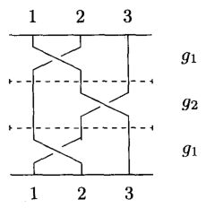

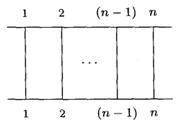

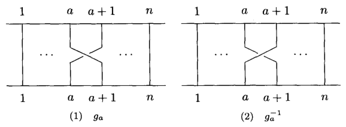

从图 A20.1 的例子中看出，任一辫子都由若干对线的交叉构成。完全没有线之间交叉的辫子，与任何辫子相乘，仍得原辫子，故称为恒元 $E$，如图 A20.2 所示。只有相邻一对线交叉的辫子称为基本辫子。 $n$ 线辫子有 $2(n-1)$ 个基本辫子 $g_a$ 和 $g_a^{-1}$，$1\leqslant a\leqslant n-1$，如图 A20.3 所示。由图 A20.3 和 A20.4 可以看出，这些基本辫子满足如下乘积关系

$$
\begin{aligned}
& g_ag_b=g_bg_a\ ,\qquad \text{当 } |a-b|\geqslant 2,\\
& g_ag_{a+1}g_a=g_{a+1}g_ag_{a+1},\\
& g_ag_a^{-1}=g_a^{-1}g_a=E
\end{aligned}
\tag{A20.1}
$$

与相邻客体对换 $P_a$ 的乘积公式（6.18）作比较，差别只是现在 $g_a\neq g_a^{-1}$. 由式（A20.1）容易证明

$$
\begin{aligned}
g_a^m(g_{a\pm1}g_a)&=(g_{a\pm1}g_a)g_{a\pm1}^m,\\
g_a^m(g_{a\pm1}^{-1}g_a^{-1})&=(g_{a\pm1}^{-1}g_a^{-1})g_{a\pm1}^m
\end{aligned}
\tag{A20.2}
$$

其中，$m$ 为任何整数。 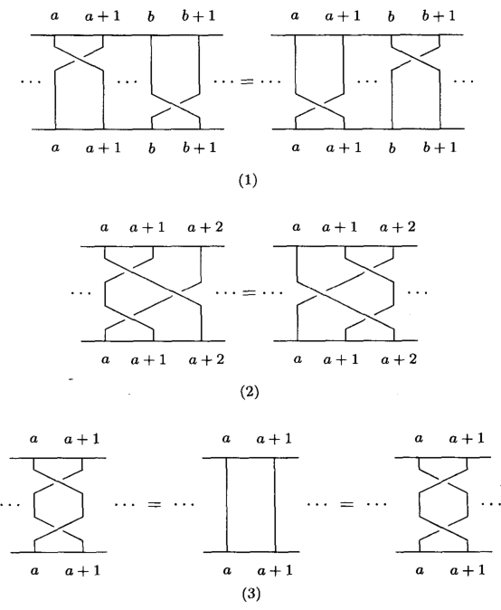

每一个 $n$ 线辫子 $A$ 都可以表成一系列基本辫子的乘积。把每一个基本辫子取逆，即把 $g_a$ 和 $g_a^{-1}$ 互换，再把乘积次序颠倒，就得到 $A$ 的逆 $A^{-1}$.

所有可能的 $n$ 线辫子的集合，即由 $2(n-1)$ 个基本辫子 $g_a$ 和 $g_a^{-1}$ 的所有可能乘积的集合，在上述乘积的定义下，元素的乘积满足封闭性和结合律，集合包含恒元和每个元素的逆元，因而此集合构成群，称为 $n$ 线辫子群 $B_n$，简称辫子群（braid group）。辫子群是不连续的无限群。

辫子群中有两个重要的元素 $\Delta$ 和 $\Omega$

$$
\Delta=g_1g_2\cdots g_{n-1}\ ,\qquad \Omega=g_1\Delta
\tag{A20.3}
$$

当 $2\leqslant a\leqslant n-1$ 时

$$
\begin{aligned}
g_a\Delta&=g_1g_2\cdots g_{a-2}(g_ag_{a-1}g_a)g_{a+1}\cdots g_{n-1}\\
&=g_1g_2\cdots g_{a-2}(g_{a-1}g_ag_{a-1})g_{a+1}\cdots g_{n-1}\\
&=\Delta g_{a-1}
\end{aligned}
\tag{A20.4}
$$

$$
\begin{aligned}
g_1\Delta^2&=g_1\{g_1(g_2g_1)(g_3g_2)\cdots(g_{n-2}g_{n-3})(g_{n-1}g_{n-2})g_{n-1}\}\\
&=g_1(g_2g_1)g_2(g_3g_2)\cdots(g_{n-2}g_{n-3})(g_{n-1}g_{n-2})g_{n-1}\\
&=\cdots\\
&=\Delta^2g_{n-1}
\end{aligned}
\tag{A20.5}
$$

因此

$$
\Omega^{n-1}=g_1\Delta g_1\Delta\cdots g_1\Delta=g_1g_2\cdots g_{n-1}\Delta^{n-1}=\Delta^n
$$

归结起来，有

$$
\begin{aligned}
&\Omega^{n-1}=\Delta^n\ ,\qquad g_1=\Omega\Delta^{-1},\\
&g_a=\Delta g_{a-1}\Delta^{-1}=\Delta^{a-1}g_1\Delta^{1-a}=\Delta^{a-1}\Omega\Delta^{-a},\\
&g_a\Delta^n=\Delta^ng_a\ ,\qquad 1\leqslant a\leqslant n-1
\end{aligned}
\tag{A20.6}
$$

可见，辫子群有四个生成元 $\Delta$，$\Omega$ 及其逆元。辫子群的秩是 4. 能和群中所有元素对易的元素集合称为群的中心。 $B_n$ 群的中心由恒元和 $\Delta^n$ 构成。 $\Delta^n$ 有一个简单的几何意义，它代表将恒元 $E$ 描写的辫子的下端线，绕铅垂线转动 360° 后得到的图形。在研究无限群的不等价不可约表示时，在中心里恒元以外的元素非常重要，因为它们在不可约表示中取常数矩阵形式，这常数可用来标记不可约表示。

讨论一类特殊的 $n$ 线辫子，它的 $n$ 根线都分别将上下两端线上编号相同的点连接起来，而在两端线之间这些连线可能有着复杂的交叉。这样的辫子相乘后仍保持此性质，逆元和共轭元素也保持此性质。因此，$B_n$ 群中所有具有这性质的元素集合构成 $B_n$ 群的一个不变子群，称为纯（pure）辫子群 $P_n$，它的商群同构于置换群

$$
B_n/P_n\approx S_n
\tag{A20.7}
$$

事实上，在辫子群中，$g_a$ 和 $g_a^{-1}$ 是完全独立的。如果对它们加上约束条件，则辫子群可能退化为较简单的无限群，甚至变成有限群。例如，附加约束条件

$$
g_a^{-1}=g_a
$$

即略去了连线的各种复杂交叉的区别，式（A20.1）退化为式（6.18），这也就是从辫子群中抹去了纯辫子群，得到商群，即置换群。下一小节是另一个有趣的例子。

### 二、狄拉克模型

三面墙上各钉一钉子，由每一个钉子分别引出一根有弹性的线（橡皮筋），连到一块木板上的三个钉子上，这样得到的模型，如图 A20.5 所示，称为狄拉克模型（Dirac game）。当然，三面墙可以等价地移到上面，相当无穷长的上端线。与三线辫子的区别在于下端线变成有限长了。狄拉克证明，这样的模型具有类似旋量的性质，即在不扯断橡皮筋的条件下，木板绕铅垂轴转动 720° 后整个系统才恢复原状。问题的关键在于，木板线度有限，橡皮筋可以从木板的下方绕过去，也就是说，图 A20.6 等价于恒元。用辫子群的语言来说，狄拉克模型的变换群就是加了下面约束的辫子群 $B_3$

$$
g_1g_2g_2g_1=E\ ,\qquad g_2^2=g_1^{-2}\ ,\qquad g_1^2=g_1^{-2}
\tag{A20.8}
$$

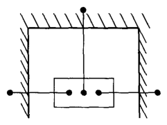

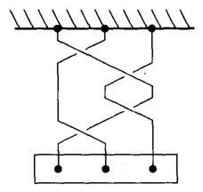

$g_1$ 和 $g_2$ 还要满足基本辫子的关系式（A20.1），故有

$$
\begin{aligned}
g_2^4&=g_2(g_1g_1^{-1})g_1^{-2}(g_1^{-1}g_1)g_2=(g_2g_1g_2)g_2^2(g_2g_1g_2)\\
&=(g_1g_2g_1)g_1^{-2}(g_1g_2g_1)=g_1g_2g_2g_1=E
\end{aligned}
$$

由此得

$$
g_1^2=g_1^{-2}=g_2^2=g_2^{-2}\ ,\qquad g_1^{-1}=g_1^3\ ,\qquad g_2^{-1}=g_2^3
\tag{A20.9}
$$

木板绕铅垂方向转动 360° 就是辫子群 $B_3$ 的中心 $\Delta^3=(g_1g_2)^3$，它不等于恒元

$$
(g_1g_2)(g_1g_2)(g_1g_2)=g_1g_2g_1^2g_2g_1=g_1^2\neq E
$$

而木板转动 720° 就恢复原状。

约束使狄拉克模型的变换群 $G$ 变成有限群，它包含 12 个元素。第二章的习题第 15 题给出了它的乘法表，其中元素的对应关系如下

$$
\begin{array}{llll}
E=E\ , & g_1=B\ , & g_2=C\ , & g_1^{-1}=F,\\
g_2^{-1}=I\ , & g_1^2=A\ , & g_1g_2=K\ , & g_2g_1=L,\\
g_1g_2^{-1}=M\ , & g_2g_1^{-1}=N\ , & g_1g_2g_1^{-1}=D\ , & g_1g_2g_1=J
\end{array}
\tag{A20.10}
$$

### 三、黑克代数

在辫子群 $B_n$ 的群代数中附加约束条件

$$
g_a=(1-q^2)E+q^2g_a^{-1}
\tag{A20.11}
$$

其中，$q$ 是一个复数，而且限制 $q$ 不是单位根，$q^n\neq 1$，则此代数变成有限维的，称为黑克（Hecke）代数，记作 $H(q^2,n)$. 作为代数关系，式（A20.11）中的 $E$ 应该改为单位元 $\mathbf{1}$. 约束式（A20.11）经常表成下面形式

$$
(g_a-\mathbf{1})(g_a+q^2\mathbf{1})=0
\tag{A20.12}
$$

注意，当 $q^2$ 趋于 1 时，黑克代数退化为置换群的群代数。由于有此联系，置换群的某些不连续的性质可能会在黑克代数中得以保留，某些研究方法可以推广。推广式（6.118），定义 $n-1$ 个算符 $H_a$

$$
H_a=\sum_{d=1}^{a-1}q^{-2(a-d-1)}g_{a-1}g_{a-2}\cdots g_{d+1}g_dg_{d+1}\cdots g_{a-2}g_{a-1},
\tag{A20.13}
$$

$$
2\leqslant a\leqslant n
$$

易见

$$
H_{a+1}=g_a+q^{-2}g_aH_ag_a\ ,\qquad H_1=0
\tag{A20.14}
$$

当 $q^2\to 1$ 时，有对应关系

$$
g_a\to P_a\ ,\qquad H_a\to M_a
\tag{A20.15}
$$

式（A20.14）两边左乘 $q^2g_a^{-1}$，并用式（A20.11）代入，得

$$
g_aH_{a+1}-H_ag_a=(1-q^2)H_{a+1}+q^2E
\tag{A20.16}
$$

这式子在计算 $g_a$ 的表示矩阵时有用。

类似于式（6.120），我们来证明 $H_a$ 也满足一个重要关系

$$
g_aH_b=H_bg_a\ ,\qquad \text{若 } b\neq a \text{ 或 } a+1
\tag{A20.17}
$$

**证明**　由基本辫子的乘积关系式（A20.1）知，当 $b<a$ 时式（A20.17）是显然的。当 $b>a+1$ 时我们将 $H_b$ 按式（A20.13）展开，并逐项检查它们与 $g_a$ 的对易关系。 $d>a+1$ 的项与 $g_a$ 对易也是显然的。对 $d<a$ 的项，由式（A20.1）得

$$
\begin{aligned}
& g_a\left\{q^{-2(b-d-1)}g_{b-1}\cdots g_{a+1}g_a\cdots g_d\cdots g_ag_{a+1}\cdots g_{b-1}\right\}\\
&\quad=q^{-2(b-d-1)}g_{b-1}\cdots(g_ag_{a+1}g_a)\cdots g_d\cdots g_ag_{a+1}\cdots g_{b-1}\\
&\quad=q^{-2(b-d-1)}g_{b-1}\cdots g_{a+1}g_a\cdots g_d\cdots(g_{a+1}g_ag_{a+1})\cdots g_{b-1}\\
&\quad=\left\{q^{-2(b-d-1)}g_{b-1}\cdots g_{a+1}g_a\cdots g_d\cdots g_ag_{a+1}\cdots g_{b-1}\right\}g_a
\end{aligned}
$$

最后，把 $d=a+1$ 和 $a$ 两项合起来，讨论它们与 $g_a$ 的对易关系

$$
\begin{aligned}
& g_a\left\{q^{-2(b-a-2)}g_{b-1}\cdots g_{a+1}\cdots g_{b-1}+q^{-2(b-a-1)}g_{b-1}\cdots g_a\cdots g_{b-1}\right\}\\
&\quad=q^{-2(b-a-1)}g_{b-1}\cdots g_{a+2}\left\{g_a\left(q^2g_{a+1}+g_{a+1}g_ag_{a+1}\right)\right\}g_{a+2}\cdots g_{b-1}
\end{aligned}
$$

由于约束式（A20.11），有

$$
\begin{aligned}
g_a\left\{q^2g_{a+1}+g_{a+1}g_ag_{a+1}\right\}
&=\left\{(g_{a+1}-1+q^2)g_{a+1}\right\}g_ag_{a+1}+(g_ag_{a+1}g_a)\left(1-q^2+q^2g_{a+1}^{-1}\right)\\
&=g_{a+1}(g_{a+1}g_ag_{a+1})+q^2g_{a+1}g_a\\
&=\left\{q^2g_{a+1}+g_{a+1}g_ag_{a+1}\right\}g_a
\end{aligned}
$$

证完。

因为 $H_a$ 的展开式中只包含下标小于 $a$ 的 $g_d$，所以由式（A20.17）立刻可得

$$
[H_a,\ H_b]=0\ ,\qquad a,b\leqslant n
\tag{A20.18}
$$

与 $M_a$ 算符类似，用算符 $H_a$ 集合的共同本征矢量作为黑克代数不可约表示的基。由于 $q$ 的连续变形，辫子群（黑克代数）可变回置换群，辫子群的不可约表示 $D_q$ 也可用杨图 $[\lambda]$ 标记，表示的行和列也可按正则杨表标记和排列，而且当 $q^2\to 1$ 时，所有的量都变回到置换群的对应量

$$
\begin{aligned}
D_q(H_a)_{\mu\nu}&=\delta_{\mu\nu}\,h_\nu(a),\\
h_\nu(a)&\to m_\nu(a)\ ,\qquad \text{当 } q^2\to 1
\end{aligned}
\tag{A20.19}
$$

其中，省略了上标 $[\lambda]$. 此式保证了 $H_a$ 的本征值 $h_\nu(a)$ 是不简并的。由式（A20.17）得

$$
D_q(g_a)_{\mu\nu}\{h_\mu(b)-h_\nu(b)\}=0,\qquad \text{当 } b<a \text{ 或 } b>a+1
$$

即

$$
D_q(g_a)_{\mu\nu}=0\ ,\qquad \text{若 } \mu\neq\nu \text{ 或 } \nu_a
\tag{A20.20}
$$

其中，$\nu_a$ 的定义见 6.5 节式（6.129）。表示矩阵又变成方块矩阵，分解为一维和二维子矩阵的直和形式。如果 $\nu_a$ 不存在，即在正则杨表 $\mathcal{Y}_\nu$ 中，$a$ 和 $a+1$ 填在同一行或同一列，则得一维子矩阵 $D_q(g_a)_{\nu\nu}$. 由约束条件式（A20.12）知，一维子矩阵满足

$$
\{D_q(g_a)_{\nu\nu}-1\}\{D_q(g_a)_{\nu\nu}+q^2\}=0
$$

再考虑式（A20.14）和极限条件（A20.19），当 $a$ 和 $a+1$ 填在正则杨表 $\mathcal{Y}_\nu$ 的同一行时有

$$
D_q(g_a)_{\nu\nu}=1\ ,\qquad h_\nu(a+1)=1+q^{-2}h_\nu(a)
\tag{A20.21}
$$

当 $a$ 和 $a+1$ 填在正则杨表 $\mathcal{Y}_\nu$ 的同一列时有

$$
D_q(g_a)_{\nu\nu}=-q^2\ ,\qquad h_\nu(a+1)=-q^2+q^2h_\nu(a)
\tag{A20.22}
$$

如果 $\nu_a$ 存在，则 $D_q(g_a)$ 中包含二维子矩阵，例如选 $\nu<\nu_a$，子矩阵表为

$$
\begin{pmatrix}
D_q(g_a)_{\nu\nu} & D_q(g_a)_{\nu\nu_a}\\
D_q(g_a)_{\nu_a\nu} & D_q(g_a)_{\nu_a\nu_a}
\end{pmatrix}
\tag{A20.23}
$$

其中，行（和列）指标为 $\nu$ 和 $\nu_a$. 根据极限条件式（A20.19），适当选择基，可使

$$
D_q(g_a)_{\nu\nu_a}=D_q(g_a)_{\nu_a\nu}\neq 0
\tag{A20.24}
$$

代入式（A20.16）得

$$
\begin{aligned}
&D_q(g_a)_{\nu\nu_a}\{h_{\nu_a}(a+1)-h_\nu(a)\}=0,\\
&D_q(g_a)_{\nu_a\nu}\{h_\nu(a+1)-h_{\nu_a}(a)\}=0,\\
&D_q(g_a)_{\nu\nu}=\frac{(1-q^2)h_\nu(a+1)+q^2}{h_\nu(a+1)-h_\nu(a)},\\
&D_q(g_a)_{\nu_a\nu_a}=\frac{(1-q^2)h_{\nu_a}(a+1)+q^2}{h_{\nu_a}(a+1)-h_{\nu_a}(a)}
\end{aligned}
\tag{A20.25}
$$

由前两式得

$$
h_{\nu_a}(a)=h_\nu(a+1)\ ,\qquad h_{\nu_a}(a+1)=h_\nu(a)
\tag{A20.26}
$$

通过数学归纳法可证

$$
\begin{aligned}
h_\nu(a)&=q^{1-m_\nu(a)}[m_\nu(a)]_q\\
&=\begin{cases}
1+q^{-2}+q^{-4}+\cdots+q^{-2m_\nu(a)+2}, & \text{当 } m_\nu(a)>0\\
0, & \text{当 } m_\nu(a)=0\\
-q^2-q^4-\cdots-q^{-2m_\nu(a)}, & \text{当 } m_\nu(a)<0
\end{cases}
\end{aligned}
\tag{A20.27}
$$

其中，“$q$ 数”$[m]_q$ 定义如下

$$
\begin{aligned}
[m]_q&\equiv\frac{q^m-q^{-m}}{q-q^{-1}}\ \xrightarrow{\ q\to 1\ }\ m,\\
[0]_q&=0\ ,\qquad [1]_q=1\ ,\qquad [-m]_q=-[m]_q,\\
[m]_q&\neq 0\ ,\qquad \text{当 } m\neq 0
\end{aligned}
\tag{A20.28}
$$

最后一式用到了 $q$ 不是单位根的条件。

**证明**　取 $h_\nu(1)=0$. 当 $a=2$ 时，$m_\nu(2)$ 等于 1 或 $-1$，式（A20.27）符合于式（A20.21）和（A20.22）。假定式（A20.27）对 $1\leqslant a\leqslant b$ 都成立，我们需要证明 $h_\nu(b+1)$ 也满足式（A20.27）。如果在正则杨表 $\mathcal{Y}_\nu$ 中，$b+1$ 和 $b$ 填在同一行或同一列，则 $m_\nu(b)-m_\nu(b+1)=-1$（同一行）或 1（同一列），式（A20.21）和（A20.22）保证 $h_\nu(b+1)$ 满足式（A20.27）。对其他情况，由于式（A20.26）和（6.129），有

$$
h_\nu(b+1)=h_{\nu_a}(b)=q^{1-m_\nu(b+1)}[m_\nu(b+1)]_q
$$

证完。

　　不失普遍性，设 $\nu<\nu_a$，令

$$
m \equiv m_\nu(a)-m_\nu(a+1)>1
\tag{A20.29}
$$

把式 (A20.27) 代入式 (A20.25)，分两种情况计算 $D_q(g_a)_{\nu\nu}$：

　　(1) $m_\nu(a)>m_\nu(a+1)\geqslant 0$

$$
\begin{aligned}
D_q(g_a)_{\nu\nu} &= \frac{q^{-2m_\nu(a+1)+2}}{-q^{-2m_\nu(a+1)}-q^{-2m_\nu(a+1)-2}-\cdots-q^{-2m_\nu(a)+2}} \\
&= \frac{-q^2}{1+q^{-2}+q^{-4}+\cdots+q^{-2m_\nu(a)+2m_\nu(a+1)+2}} \\
&= \frac{1-q^2}{1-q^{-2m_\nu(a)+2m_\nu(a+1)}} \\
&= -\frac{q^{m_\nu(a)-m_\nu(a+1)+1}}{[m_\nu(a)-m_\nu(a+1)]_q} = -q^{m+1}/[m]_q
\end{aligned}
$$

　　(2) $m_\nu(a+1)<0$

$$
\begin{aligned}
D_q(g_a)_{\nu\nu} &= \frac{-q^{-2m_\nu(a+1)+2}}{q^{-2m_\nu(a)+2}+q^{-2m_\nu(a)+4}+\cdots+q^{-2m_\nu(a+1)}} \\
&= -q^{m+1}/[m]_q
\end{aligned}
$$

两种情况结果相同。$D_q(g_a)_{\nu_a\nu_a}$ 也可同法计算，如利用约束条件

$$
D_q(g_a)^2=(1-q^2)D_q(g_a)+q^2\mathbf{1}
$$

计算更简便。上式取 $\nu$ 行 $\nu_a$ 列元素，消去公共因子 $D_q(g_a)_{\nu\nu_a}$，得

$$
D_q(g_a)_{\nu_a\nu_a} = -D_q(g_a)_{\nu\nu}+(1-q^2) = \frac{q^{m+1}-q\,(q^m-q^{-m})}{[m]_q} = \frac{q^{-m+1}}{[m]_q}
$$

再取 $\nu$ 行 $\nu$ 列元素，得

$$
\begin{aligned}
D_q(g_a)^2_{\nu\nu_a} &= -D_q(g_a)^2_{\nu\nu}+(1-q^2)D_q(g_a)_{\nu\nu}+q^2 \\
&= \frac{q^2}{(q^m-q^{-m})^2}\left\{-q^{2m}\left(q-q^{-1}\right)^2+\left(q-q^{-1}\right)^2q^m\left(q^m-q^{-m}\right)+\left(q^m-q^{-m}\right)^2\right\} \\
&= \frac{q^2}{(q^m-q^{-m})^2}\left\{-q^2-q^{-2}+q^{2m}+q^{-2m}\right\} = \frac{q^2[m+1]_q[m-1]_q}{[m]_q^2}
\end{aligned}
$$

因此，$D_q(g_a)$ 包含的 $2\times 2$ 子矩阵式 (A20.23) 为

$$
\frac{q}{[m]_q}
\begin{pmatrix}
-q^m & \{[m+1]_q[m-1]_q\}^{1/2} \\
\{[m+1]_q[m-1]_q\}^{1/2} & q^{-m}
\end{pmatrix}
\tag{A20.30}
$$

总之，加了约束条件 (A20.11) 后，辫子群 $B_n$ 的群代数简化为黑克代数，它的有限维不可约表示可用杨图 $[\lambda]$ 标记，表示的行（列）用正则杨表标记和排列。表示矩阵 $D_q(g_a)$ 是若干个 $1\times 1$ 和 $2\times 2$ 子矩阵的直和，这些子矩阵分别由式 (A20.21)、(A20.22) 和 (A20.30) 给出。当然这样的表示也是辫子群 $B_n$ 的表示。当 $q\to 1$ 时，这表示退化为置换群 $S_n$ 的用同一杨图 $[\lambda]$ 标记的不可约表示。

### 四、辫子群的有限维表示

　　对不附加任何约束条件的辫子群 $B_n$，有限维表示问题还没有得到普遍的解决。这里只是介绍一点思路。

　　辫子群的生成元取为 $\Delta$，$\Omega$ 及其逆元，它们和辫子群的中心 $\Delta^n=\Omega^{n-1}$ 存在幂次关系。在辫子群不可约表示中，中心的表示矩阵必为常数矩阵，非零常数记作 $\lambda$。选择表象，使 $\Delta$ 是对角化的，$\Omega$ 则可通过相似变换 $Z$ 对角化，于是我们得到辫子群 $B_n$ 有限维不可约表示的一般形式

$$
D^\lambda(\Delta^n)=\lambda\mathbf{1}\;,\qquad
D^\lambda(\Delta)=\lambda^{1/n}\Gamma_1\;,\qquad
D^\lambda(\Omega)=\lambda^{1/(n-1)}Z\Gamma_2Z^{-1}
\tag{A20.31}
$$

其中，$\Gamma_1$ 和 $\Gamma_2$ 是两个非常数对角矩阵，对角元只能分别取 $\omega$ 和 $\tau$ 的幂次

$$
\omega=\exp\{-\mathrm{i}2\pi/n\}\;,\qquad
\tau=\exp\{-\mathrm{i}2\pi/(n-1)\}
\tag{A20.32}
$$

$Z$ 是非奇相似变换矩阵，由式 (A20.1) 和 (A20.6)，它还要满足相容条件

$$
\begin{aligned}
&(Z\Gamma_2Z^{-1})^2\Gamma_1^{-2}(Z\Gamma_2Z^{-1})=\Gamma_1(Z\Gamma_2Z^{-1})\Gamma_1^{-2}(Z\Gamma_2Z^{-1})^2\Gamma_1^{-1}\;,\\
&(Z\Gamma_2Z^{-1})\Gamma_1^{a-2}(Z\Gamma_2Z^{-1})=\Gamma_1^{a-1}(Z\Gamma_2Z^{-1})\Gamma_1^{-a}(Z\Gamma_2Z^{-1})\Gamma_1^{a-1}\;,\\
&\qquad\qquad\qquad\qquad\qquad\qquad 3\leqslant a\leqslant n-1
\end{aligned}
\tag{A20.33}
$$

这些条件并不完全独立。辫子群 $B_n$ 的不可约表示 $D^\lambda(B_n)$ 依赖于 $\lambda$，$\Gamma_1$，$\Gamma_2$ 和 $Z$ 矩阵。进一步的分类还有待研究。

## 附录 21 第七章定理一的解释

　　若 $\det g=0$，则可在实李代数中选取适当的实参数，使 $g_{AB}$ 对角化，而且至少有一个对角元为零。例如 $g_{11}=0$，其他 $g_{BB}\neq 0$。则由式 (7.20) 得

$$
0=C_{AB1}=C_{1AB}=C_{1A}{}^{B}g_{BB}\;,\qquad C_{1A}{}^{B}=0
$$

即

$$
[I_1\,,\,I_A]=\mathrm{i}C_{1A}{}^{1}I_1
$$

由 $I_1$ 架设的子李代数是阿贝尔理想。当有 $n$ 个对角元 $g_{AA}=0$ 时，相应子李代数是可解李代数，当然还是存在阿贝尔理想，证明需要更多的数学知识，这里从略。

　　反之，如果李代数的实形存在阿贝尔理想，选择参数，使属于理想的参数用 $a$，$b$ 等标记，其余参数用 $j$，$k$ 等标记，$A$，$B$ 等同时标记两类参数，则

$$
\begin{aligned}
&[I_a\,,\,I_b]=0\;,\qquad\qquad\qquad C_{ab}{}^A=0\;,\\
&[I_a\,,\,I_j]=\mathrm{i}\sum_b C_{aj}{}^b I_b\;,\qquad C_{aj}{}^k=0
\end{aligned}
$$

因此

$$
g_{aB}=\sum_{PQ}C_{aP}{}^Q C_{BQ}{}^P=\sum_{bj}C_{aj}{}^b C_{Bb}{}^j=0
$$

即 $\det g=0$。

　　对紧致实李代数，式 (4.125) 已经证明，可以选到一组实参数，使结构常数关于三个指标是完全反对称的

$$
C_{AB}{}^D=-C_{BA}{}^D=-C_{AD}{}^B
$$

若再找实正交变换 $X$，将 $g_{AB}$ 对角化，则对角元为非正

$$
\begin{aligned}
g'_{AA} &= \sum_{PQ}\sum_{BD}X_{AB}\left(C_{BP}{}^Q C_{DQ}{}^P\right)X_{AD}\\
&= -\sum_{PQ}\left(\sum_D X_{AD}C_{DP}{}^Q\right)^2\leqslant 0
\end{aligned}
$$

若此实李代数又是半单的，则 $g'_{AA}<0$，即 $g_{AB}$ 负定。反之，若 $g_{AB}$ 负定，则可选择实参数，使 $g_{AB}=-\delta_{AB}$，$C_{AB}{}^D=-C_{ABD}$ 是完全反对称的，伴随表示化成了实正交表示，此实李代数是紧致的。

## 附录 22 半单李代数的卡西米尔算子

　　半单李代数的基林型非奇，因而存在 $g_{AB}$ 的逆矩阵 $g^{AB}$，它也是对称矩阵，满足式 (7.23)。$g_{AB}$ 和 $g^{AB}$ 相当于度规张量，可以用来升降指标。

　　由生成元的 $n$ 次齐次多项式构成的，可与所有生成元对易的算子，称为 $n$ 阶卡西米尔算子 $C_n$。在不可约表示中卡西米尔算子取常数矩阵，此常数称为卡西米尔不变量。下面将证明半单李代数的 $n$ 阶卡西米尔算子 $C_n$ 为

$$
C_n=\sum_{(D)}\sum_{(A)}\sum_{(B)}C_{A_1D_1}{}^{D_2}C_{A_2D_2}{}^{D_3}\cdots C_{A_nD_n}{}^{D_1}
\times g^{A_1B_1}\cdots g^{A_nB_n}I_{B_1}I_{B_2}\cdots I_{B_n}
\tag{A22.1}
$$

例如，二阶卡西米尔算子为

$$
\begin{aligned}
C_2&=\sum_{D_1D_2}\sum_{A_1A_2}\sum_{B_1B_2}C_{A_1D_1}{}^{D_2}C_{A_2D_2}{}^{D_1}g^{A_1B_1}g^{A_2B_2}I_{B_1}I_{B_2}\\
&=\sum_{B_1B_2}g^{B_1B_2}I_{B_1}I_{B_2}
\end{aligned}
\tag{A22.2}
$$

现在来证明，$C_n$ 与每一个生成元 $I_Q$ 对易。

$$
\begin{aligned}
[I_{B_1}I_{B_2}\cdots I_{B_n}\,,\,I_Q] &= \sum_{a=1}^{n}I_{B_1}\cdots I_{B_{a-1}}[I_{B_a}\,,\,I_Q]I_{B_{a+1}}\cdots I_n\\
&= \mathrm{i}\sum_{a=1}^{n}\sum_P C_{B_aQ}{}^P I_{B_1}\cdots I_{B_{a-1}}I_P I_{B_{a+1}}\cdots I_n
\end{aligned}
$$

交换求和指标 $B_a$ 和 $P$，再把与 $A_a$ 和 $P$ 有关的部分提出来

$$
\begin{aligned}
\sum_{A_aP}C_{A_aD_a}{}^{D_{a+1}}C_{PQ}{}^{B_a}g^{A_aP} &= \sum_{A_aPD}C_{A_aD_a}{}^{D_{a+1}}C_{PQD}g^{DB_a}g^{A_aP}\\
&= \sum_{A_aD}C_{A_aD_a}{}^{D_{a+1}}C_{QD}{}^{A_a}g^{DB_a}\\
&= \sum_{A_aD}\left\{C_{QA_a}{}^{D_{a+1}}C_{DD_a}{}^{A_a}-C_{DA_a}{}^{D_{a+1}}C_{QD_a}{}^{A_a}\right\}g^{DB_a}\\
&= \sum_{DA_a}\left\{C_{QD}{}^{D_{a+1}}C_{A_aD_a}{}^{D}-C_{A_aD}{}^{D_{a+1}}C_{QD_a}{}^{D}\right\}g^{A_aB_a}
\end{aligned}
$$

最后一步交换了求和指标 $D$ 和 $A_a$。由此得

$$
\begin{aligned}
[C_n\,,\,I_Q] &= \mathrm{i}\sum_{a=1}^{n}\sum_{D(D)}\sum_{(A)}\sum_{(B)}C_{A_1D_1}{}^{D_2}\cdots C_{A_{a-1}D_{a-1}}{}^{D_a}\\
&\quad\times\left(C_{A_aD_a}{}^{D}C_{QD}{}^{D_{a+1}}-C_{QD_a}{}^{D}C_{A_aD}{}^{D_{a+1}}\right)\\
&\quad\times C_{A_{a+1}D_{a+1}}{}^{D_{a+2}}\cdots C_{A_nD_n}{}^{D_1}g^{A_1B_1}\cdots g^{A_nB_n}I_{B_1}I_{B_2}\cdots I_{B_n}\\
&= 0
\end{aligned}
$$

相减的两项对 $a$ 求和后互相抵消。

　　由式 (7.19) 知，当把紧致半单实李代数的基林型化为常数矩阵后，此常数正是伴随表示的二阶卡西米尔不变量。对 $\mathrm{SU}(N)$ 群和 $\mathrm{SO}(N)$ 群，7.4 节的方式选择实参数后，基林型为

$$
\begin{aligned}
&\mathrm{SU}(N)\ \text{群}\qquad g_{AB}=-\delta_{AB}N\\
&\mathrm{SO}(N)\ \text{群}\qquad g_{AB}=-\delta_{AB}2(N-2)
\end{aligned}
\tag{A22.3}
$$

## 附录 23 半单李代数的紧致实形

　　对复的半单李代数，$\det(g_{jk})\neq 0$，可通过选择参数，即将 $H_j$ 做适当的线性组合，使

$$
\langle H_j|H_k\rangle=-g_{jk}=\delta_{jk}
\tag{A23.1}
$$

在保持 $-g_{jk}$ 不变的条件下，$H_j$ 还允许作任意正交变换。$H_j$ 作正交变换也就是根作正交变换。我们先来证明，可以找到适当的正交变换，使所有根都变成实根。既然度规是 $-g_{jk}=\delta_{jk}$，实的根空间就是实欧几里得空间。

　　证明分两步走。任取 $\ell$ 个线性无关的根 $\alpha^{(j)}$，其他根都可表为它们的线性组合。先证 $\ell$ 个根 $\alpha^{(j)}$ 可通过正交变换化为实根，再证其他根关于这些实根的展开系数都是实数。

　　因为度规 $-g_{jk}=\delta_{jk}$，所以矢量的模就是矢量各分量的平方和，两矢量内积就是两矢量对应分量乘积之和。根据定理三推论二，根矢量 $\alpha^{(1)}$ 的模是正实数，因而由 $\alpha^{(1)}$ 各分量的实部构成的实矢量不是零矢量，可通过实正交变换把这实矢量的第一分量变为正的，记作 $a$，其余分量都为零。正因为根矢量 $\alpha^{(1)}$ 的模是正实数，它的第一分量虚部只能为零。再把变换后的 $\alpha^{(1)}$ 各分量的虚部，去掉 $\mathrm{i}$ 后，看作一个实矢量，可通过后 $\ell-1$ 维空间的实正交变换，保持第一分量为零，把第二分量变为非负，记作 $b$，其余分量都为零。经过这两次变换，$\alpha^{(1)}$ 的前两分量分别为 $a$ 和 $\mathrm{i}b$，其余分量都为零，且 $0\leqslant b<a$。再在前两维子空间中作如下正交变换，其余分量保持不变，而前两分量变成

$$
\left(a^2-b^2\right)^{-1/2}
\begin{pmatrix}
a & \mathrm{i}b\\
-\mathrm{i}b & a
\end{pmatrix}
\begin{pmatrix}
a\\
\mathrm{i}b
\end{pmatrix}
=
\begin{pmatrix}
\left(a^2-b^2\right)^{1/2}\\
0
\end{pmatrix}
$$

这样，根矢量 $\alpha^{(1)}$ 变成实矢量，且只有第一分量是正实数，记作 $a_1>0$，其余分量全为零。根据定理三推论二，其余根矢量 $\alpha^{(j)}$ 与 $\alpha^{(1)}$ 的内积是实数，因而其余根矢量的第一分量都是实数。设 $\alpha^{(2)}$ 的第一分量为实数 $a_2$，$\boldsymbol{V}^{(2)}=\alpha^{(2)}-(a_2/a_1)\alpha^{(1)}$，则 $\boldsymbol{V}^{(2)}$ 的第一分量为零。进一步，保持 $\boldsymbol{V}^{(2)}$ 的第一分量不变，在余下的 $\ell-1$ 维空间作正交变换，重复前面做法，可使矢量 $\boldsymbol{V}^{(2)}$ 的第一分量为零，第二分量是不为零的正实数，其余分量都为零。这时根矢量 $\alpha^{(2)}$ 也是实矢量，只有前两分量不为零。根据定理三推论二，所有余下的根矢量 $\alpha^{(j)}$ 的第一和第二分量都是实数。依此方法做下去，可通过一系列正交变换，使 $\ell$ 个根矢量 $\alpha^{(j)}$ 都变成实矢量。

　　其次，余下的任意根 $\beta$ 可按实根 $\alpha^{(j)}$ 展开，设 $\beta=\sum_j x_j\alpha^{(j)}$，等式两边都与 $2\alpha^{(k)}/(\alpha^{(k)}\cdot\alpha^{(k)})$ 取内积，得

$$
\Gamma\left(\beta/\alpha^{(k)}\right)=\sum_{j=1}^{\ell}x_j\Gamma\left(\alpha^{(j)}/\alpha^{(k)}\right)
\tag{A23.2}
$$

此式是关于 $\ell$ 个变量 $x_j$ 的线性联立方程。由于 $\alpha^{(j)}$ 是线性无关的，方程的系数行列式不为零，存在唯一解 $x_j$。这当然是意料之中的。既然联立方程 (A23.2) 的所有系数都是整数，解 $x_j$ 必是有理数。证完。

　　现在我们已经选择了适当的参数，即选择了正则基 $H_j$ 和 $E_\alpha$，使 $\ell$ 秩半单李代数中的所有根矢量都是实矢量，基林型取如下简单形式

$$
g_{jk}=-\delta_{jk}\;,\qquad g_{\alpha\beta}=-\delta_{(-\alpha)\beta}\;,\qquad g_{j\alpha}=0
\tag{A23.3}
$$

值得注意的是，式 (A23.3) 还没有完全限定基 $E_\alpha$。$E_\alpha$ 是作为 $H_j$ 的本征矢量来定义的，它允许乘任意系数 $b_\alpha$。条件 $g_{\alpha(-\alpha)}=-1$ 对 $b_\alpha$ 加上了限制，但还允许系数在满足 $b_\alpha b_{-\alpha}=1$ 的条件下做进一步选择，即系数比 $b_\alpha/b_{-\alpha}$ 还允许做任意选择。

　　类似于 $\mathrm{SO}(3)$ 群中的 $T_\pm$ 和 $T_1$，$T_2$ 之间的组合，令

$$
E_{\alpha1}=(E_\alpha+E_{-\alpha})/\sqrt{2}\;,\qquad
E_{\alpha2}=-\mathrm{i}(E_\alpha-E_{-\alpha})/\sqrt{2}
\tag{A23.4}
$$

$$
\frac{1}{\sqrt{2}}
\begin{pmatrix}
1 & 1\\
-\mathrm{i} & \mathrm{i}
\end{pmatrix}
\begin{pmatrix}
0 & -1\\
-1 & 0
\end{pmatrix}
\frac{1}{\sqrt{2}}
\begin{pmatrix}
1 & -\mathrm{i}\\
1 & \mathrm{i}
\end{pmatrix}
=
\begin{pmatrix}
-1 & 0\\
0 & -1
\end{pmatrix}
$$

可以使基林型变成 $-1$，但不能保证结构常数都变成实数。可以证明，只有选择系数比 $b_\alpha/b_{-\alpha}$ 使下式都成立

$$
N_{\alpha,\beta}=-N_{-\alpha,-\beta}
\tag{A23.5}
$$

才能保证结构常数同时变成实数。如果此时参数都是实数，则此半单李代数是紧致实形。这就是第七章定理五。

　　**证明**　　根据式 (7.53)，$N_{\alpha,\beta}$ 和 $N_{-\alpha,-\beta}$ 的乘积是负实数，因而条件式 (A23.5) 使 $N_{\alpha,\beta}$ 都是实数。

　　变换式 (A23.4) 对 $H_j$ 之间的对易关系式 (7.30) 没有影响。$H_j$ 和 $E_\alpha$ 的对易关系式 (7.31) 变成

$$
\begin{aligned}
[H_j\,,\,E_{\alpha1}] &= \frac{1}{\sqrt{2}}\left(\alpha_jE_\alpha-\alpha_jE_{-\alpha}\right)=\mathrm{i}\alpha_jE_{\alpha2}\;,\qquad C_{j(\alpha1)}{}^{(\alpha2)}=\alpha_j\\
[H_j\,,\,E_{\alpha2}] &= \frac{-\mathrm{i}}{\sqrt{2}}\left(\alpha_jE_\alpha+\alpha_jE_{-\alpha}\right)=-\mathrm{i}\alpha_jE_{\alpha1}\;,\qquad C_{j(\alpha2)}{}^{(\alpha1)}=-\alpha_j
\end{aligned}
\tag{A23.6}
$$

结构常数是实数。$E_\alpha$ 之间的对易关系式 (7.42) 分三种情况。当 $\alpha\pm\beta$ 不是根时，组合 (A23.4) 不影响对易关系。当 $\alpha=\beta$ 时

$$
[E_{\alpha1}\,,\,E_{\alpha2}]=\mathrm{i}[E_\alpha\,,\,E_{-\alpha}]=\mathrm{i}H_\alpha\;,\qquad
C_{(\alpha1)(\alpha2)}{}^{j}=\alpha_j
\tag{A23.7}
$$

我们看到结构常数对三个指标完全反对称。当 $\alpha\neq\beta$，且 $\alpha+\beta$ 和（或）$\alpha-\beta$ 是根时，不失普遍性，可设 $\alpha\pm\beta$ 是正根，则

$$
\begin{aligned}
[E_{\alpha1}\,,\,E_{\beta1}] &= \frac{1}{2}\left\{[E_\alpha\,,\,E_\beta]+[E_{-\alpha}\,,\,E_{-\beta}]+[E_\alpha\,,\,E_{-\beta}]+[E_{-\alpha}\,,\,E_\beta]\right\}\\
&= \mathrm{i}\sqrt{1/2}N_{\alpha,\beta}E_{(\alpha+\beta)2}+\mathrm{i}\sqrt{1/2}N_{\alpha,-\beta}E_{(\alpha-\beta)2}\;,
\end{aligned}
$$

$$
\begin{aligned}
[E_{\alpha2}\,,\,E_{\beta2}] &= \frac{-1}{2}\left\{[E_\alpha\,,\,E_\beta]+[E_{-\alpha}\,,\,E_{-\beta}]-[E_\alpha\,,\,E_{-\beta}]-[E_{-\alpha}\,,\,E_\beta]\right\}\\
&= -\mathrm{i}\sqrt{1/2}N_{\alpha,\beta}E_{(\alpha+\beta)2}+\mathrm{i}\sqrt{1/2}N_{\alpha,-\beta}E_{(\alpha-\beta)2}\;,
\end{aligned}
$$

$$
\begin{aligned}
[E_{\alpha1}\,,\,E_{\beta2}] &= \frac{-\mathrm{i}}{2}\left\{[E_\alpha\,,\,E_\beta]-[E_{-\alpha}\,,\,E_{-\beta}]-[E_\alpha\,,\,E_{-\beta}]+[E_{-\alpha}\,,\,E_\beta]\right\}\\
&= -\mathrm{i}\sqrt{1/2}N_{\alpha,\beta}E_{(\alpha+\beta)1}+\mathrm{i}\sqrt{1/2}N_{\alpha,-\beta}E_{(\alpha-\beta)1}\;,
\end{aligned}
$$

$$
\begin{aligned}
[E_{\alpha2}\,,\,E_{\beta1}] &= \frac{-\mathrm{i}}{2}\left\{[E_\alpha\,,\,E_\beta]-[E_{-\alpha}\,,\,E_{-\beta}]+[E_\alpha\,,\,E_{-\beta}]-[E_{-\alpha}\,,\,E_\beta]\right\}\\
&= -\mathrm{i}\sqrt{1/2}N_{\alpha,\beta}E_{(\alpha+\beta)1}-\mathrm{i}\sqrt{1/2}N_{\alpha,-\beta}E_{(\alpha-\beta)1}
\end{aligned}
$$

$$
\begin{aligned}
C_{(\alpha1)(\beta1)}{}^{(\alpha+\beta)2} &= -C_{(\alpha2)(\beta2)}{}^{(\alpha+\beta)2}=-C_{(\alpha1)(\beta2)}{}^{(\alpha+\beta)1}=-C_{(\alpha2)(\beta1)}{}^{(\alpha+\beta)1}=\sqrt{1/2}N_{\alpha,\beta}\;,\\
C_{(\alpha1)(\beta1)}{}^{(\alpha-\beta)2} &= C_{(\alpha2)(\beta2)}{}^{(\alpha-\beta)2}=C_{(\alpha1)(\beta2)}{}^{(\alpha-\beta)1}=-C_{(\alpha2)(\beta1)}{}^{(\alpha-\beta)1}=\sqrt{1/2}N_{\alpha,-\beta}
\end{aligned}
\tag{A23.8}
$$

若 $\alpha\pm\beta$ 中有一个不是根，可取相应系数 $N_{\alpha,\beta}$ 或 $N_{\alpha,-\beta}$ 为零，结构常数仍都是实数。证完。

　　最后，概略说明如何选取系数比 $b_\alpha/b_{-\alpha}$，使式 (A23.5) 成立。由于正则对易关系式 (7.42)，$b_\alpha$ 的改变引起 $N_{\alpha,\beta}$ 的变化为

$$
\frac{N'_{\alpha,\beta}}{N'_{-\alpha,-\beta}}
=\frac{b_\alpha}{b_{-\alpha}}\frac{b_\beta}{b_{-\beta}}\frac{b_{-\alpha-\beta}}{b_{\alpha+\beta}}\frac{N_{\alpha,\beta}}{N_{-\alpha,-\beta}}
\tag{A23.9}
$$

　　由素根出发，逐级选择各正根的系数比 $b_\alpha/b_{-\alpha}$。素根是一级正根，它的系数比可任意选定，不影响生成元的对易关系，因而这不同选择对应的李代数是同构的。

　　二级正根是两个素根之和，根据式 (A23.9)，选择它的系数比，可使式 (A23.5) 成立。当 $\alpha$，$\beta$ 和 $\gamma=\alpha+\beta$ 都是根时，由 $N_{\alpha,\beta}=-N_{-\alpha,-\beta}$，利用式 (7.55)，可以推出

$$
N_{-\gamma,\alpha}=N_{\alpha,\beta}=-N_{-\alpha,-\beta}=N_{-\beta,-\alpha}=N_{-\alpha,\gamma}=-N_{\gamma,-\alpha}
\tag{A23.10}
$$

因此我们不必讨论下标分别是正根和负根的系数 $N_{\alpha,-\beta}$，它们会自动满足式 (A23.5)。

　　现设 $n$ 级正根的系数比已选定，对应的式 (A23.5) 都成立。$n+1$ 级正根 $\gamma$ 是 $n$ 级正根 $\alpha$ 与素根 $r$ 之和，选取 $E_\gamma$ 的系数比，使

$$
N_{\alpha,r}=-N_{-\alpha,-r}
\tag{A23.11}
$$

问题是，若有

$$
\alpha+r=\gamma=\beta+r'
\tag{A23.12}
$$

由于 $E_\gamma$ 的系数比已经选定，此时能否保证

$$
N_{\beta,r'}=-N_{-\beta,-r'}
\tag{A23.13}
$$

下面证明用到素根之差不是根和式 (7.26)

$$
\begin{aligned}
N_{\alpha,r}N_{-\beta,-r'} &= N_{\alpha,r}N_{-\beta,-r'}\langle E_\gamma|E_{-\gamma}\rangle=\langle[E_\alpha\,,\,E_r]\,|\,[E_{-\beta}\,,\,E_{-r'}]\rangle\\
&= -\langle[[E_\alpha\,,\,E_r]\,,\,E_{-r'}]|E_{-\beta}\rangle\\
&= \langle[[E_r\,,\,E_{-r'}]\,,\,E_\alpha]|E_{-\beta}\rangle+\langle[[E_{-r'}\,,\,E_\alpha]\,,\,E_r]|E_{-\beta}\rangle\\
&= \langle[E_\alpha\,,\,E_{-r'}]\,|\,[E_{-\beta}\,,\,E_r]\rangle=N_{\alpha,-r'}N_{-\beta,r}
\end{aligned}
\tag{A23.14}
$$

等式左面不等于零，因此 $\alpha-r'=\beta-r$ 也是根。利用式 (A23.10) 可以证得式 (A23.12)

$$
N_{\alpha,r}N_{-\beta,-r'}=N_{\alpha,-r'}N_{-\beta,r}=N_{-\alpha,r'}N_{\beta,-r}=N_{-\alpha,-r}N_{\beta,r'}
\tag{A23.15}
$$

最后一步又用到式 (A23.14)。对于式 (A23.5) 中 $\alpha$ 和 $\beta$ 都不是素根的情况，可以用把它们分解成素根和的办法来证，在分解式中出现的系数 $N_{\gamma,r}$ 都已满足式 (A23.11)，保证了 $N_{\alpha,\beta}$ 满足式 (A23.5)。证完。现在系数 $b_\alpha$ 和 $b_{-\alpha}$ 还可同时改负号，这对应 $N_{\alpha,\beta}$ 的符号的选择，这种变化对应同构的紧致实李代数。

## 附录 24 SU(3) 群的李代数

　　为了增加直观性，计算 SU(3) 群李代数的嘉当－外尔基，素根和根矢量。SU(3) 群是三维幺模幺正矩阵集合按矩阵乘积构成的群。任意群元素 $u$ 通过幺正相似变换对角化后，可表为

$$
u=\exp\left\{-\mathrm{i}\sum_{a=1}^{8}\omega_aT_a\right\},
\tag{A24.1}
$$

$$
\begin{aligned}
T_1&=\frac{1}{2}\begin{pmatrix}0&1&0\\1&0&0\\0&0&0\end{pmatrix},&
T_2&=\frac{1}{2}\begin{pmatrix}0&-\mathrm{i}&0\\ \mathrm{i}&0&0\\0&0&0\end{pmatrix},&
T_4&=\frac{1}{2}\begin{pmatrix}0&0&1\\0&0&0\\1&0&0\end{pmatrix},\\[6pt]
T_5&=\frac{1}{2}\begin{pmatrix}0&0&-\mathrm{i}\\0&0&0\\ \mathrm{i}&0&0\end{pmatrix},&
T_6&=\frac{1}{2}\begin{pmatrix}0&0&0\\0&0&1\\0&1&0\end{pmatrix},&
T_7&=\frac{1}{2}\begin{pmatrix}0&0&0\\0&0&-\mathrm{i}\\0&\mathrm{i}&0\end{pmatrix},\\[6pt]
T_3&=\frac{1}{2}\begin{pmatrix}1&0&0\\0&-1&0\\0&0&0\end{pmatrix},&
T_8&=\frac{1}{2\sqrt{3}}\begin{pmatrix}1&0&0\\0&1&0\\0&0&-2\end{pmatrix}&&
\end{aligned}
\tag{A24.2}
$$

这组矩阵称为盖尔曼（Gell-Mann）矩阵。SU(3) 群的阶数为 8，秩为 2。在李代数中有两个生成元可以互相对易，它们架设嘉当子代数

$$
H_1 = T_8, \qquad H_2 = T_3
\tag{A24.3}
$$

其他生成元组合为

$$
\begin{aligned}
E_{\pm\alpha} &= (T_1 \pm \mathrm{i}T_2)/\sqrt{2}\,, &\alpha &= (0,\ 1),\\
E_{\pm\beta} &= (T_4 \pm \mathrm{i}T_5)/\sqrt{2}\,, &\beta &= (\sqrt{3}/2,\ 1/2),\\
E_{\pm\gamma} &= (T_6 \pm \mathrm{i}T_7)/\sqrt{2}\,, &\gamma &= (\sqrt{3}/2,\ -1/2),
\end{aligned}
\tag{A24.4}
$$

其中，$\alpha$ 和 $\gamma$ 是素根

$$
\begin{gathered}
\alpha + \gamma = \beta\,, \qquad [E_\alpha,\ E_\gamma] = E_\beta/\sqrt{2}\\
N_{\alpha,\gamma} = N_{\gamma,-\beta} = N_{-\beta,\alpha} = N_{-\gamma,-\alpha} = N_{-\alpha,\beta} = N_{\beta,-\gamma} = \sqrt{1/2}
\end{gathered}
\tag{A24.5}
$$

根的模平方为 1，$N_{\alpha,\gamma}$ 的数值符合式 (7.53)。基林型为

$$
\begin{aligned}
g_{jk} &= -2\alpha_j\alpha_k - 2\beta_j\beta_k - 2\gamma_j\gamma_k = -3\delta_{jk},\\
g_{11} &= 0 - 3/2 - 3/2 = -3\,, \qquad g_{22} = -2 - 1/2 - 1/2 = -3\,,\\
g_{12} &= -1/2 + 1/2 = 0
\end{aligned}
\tag{A24.6}
$$

附录 23 指出，对应素根的生成元的系数比 $b_\alpha/b_{-\alpha}$ 可以任选，然后对应正根生成元的系数比以它们为基础来选定，前者的不同选择不影响结构常数，因而对应同构的李代数。现在我们以 SU(3) 群为例来说明。把 $E_\alpha$ 乘 3，$E_{-\alpha}$ 除 3。为了满足式 (A23.6)，$E_\beta$ 也要乘 3，$E_{-\beta}$ 要除 3。这样，在 SU(3) 群自身表示中，有四个生成元保持原样，另四个生成元如下式所示

$$
T_1 = \frac{1}{2}\begin{pmatrix} 0 & 3 & 0 \\ 1/3 & 0 & 0 \\ 0 & 0 & 0 \end{pmatrix}, \qquad
T_2 = \frac{1}{2}\begin{pmatrix} 0 & -\mathrm{i}3 & 0 \\ \mathrm{i}/3 & 0 & 0 \\ 0 & 0 & 0 \end{pmatrix},
$$

$$
T_4 = \frac{1}{2}\begin{pmatrix} 0 & 0 & 3 \\ 0 & 0 & 0 \\ 1/3 & 0 & 0 \end{pmatrix}, \qquad
T_5 = \frac{1}{2}\begin{pmatrix} 0 & 0 & -\mathrm{i}3 \\ 0 & 0 & 0 \\ \mathrm{i}/3 & 0 & 0 \end{pmatrix}
$$

很明显，所有对易关系都保持不变。与原来表象相比，只是相差一个对角的相似变换

$$
X = \operatorname{diag}\{3,\ 1,\ 1\}
\tag{A24.7}
$$

## 附录 25　用嘉当矩阵计算单纯李代数的全部正根

式 (7.57) 指出，单纯李代数所有正根都可表为素根的非负整数线性组合，这些组合系数之和称为该正根的级数。素根是一级根。可用递推的办法，用嘉当矩阵 (7.64) 逐级找出各级正根。设小于 $m$ 级的正根已经找到，$m$ 级的正根总是 $m-1$ 级正根和素根之和，现要判断 $m-1$ 级正根 $\alpha$ 和素根 $r_j$ 之和是不是根。这问题可以与找下面根链问题结合起来解决

$$
\begin{aligned}
&\alpha + n r_j\,, \quad -q \leqslant n \leqslant p\,, &&\text{是根}\\
&\alpha - (q+1) r_j \ \text{和}\ \alpha + (p+1) r_j\,, &&\text{不是根}
\end{aligned}
\tag{A25.1}
$$

因为小于 $m$ 级的正根都已找到，$q$ 是已知的。为了计算 $p$，设

$$
\alpha = \sum_{k=1}^{\ell} r_k f_k
\tag{A25.2}
$$

则

$$
p = q - \Gamma(\alpha/r_j) = q - \sum_{k=1}^{\ell} A_{jk} f_k
\tag{A25.3}
$$

若 $p = 0$，则 $\alpha + r_j$ 不是根，若 $p > 0$，则 $\alpha + m r_j\,,\ 0 \leqslant m \leqslant p$，都是根。用这办法可以找出单纯李代数的全部正根。下面以 $G_2$ 李代数为例说明这方法。

$G_2$ 李代数的邓金图和嘉当矩阵如下：

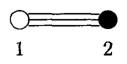

$$
A = \begin{pmatrix} 2 & -1 \\ -3 & 2 \end{pmatrix}
\tag{A25.4}
$$

$G_2$ 李代数有两个素根 $r_1$ 和 $r_2$，$r_1$ 是长根。先判断 $r_1$ 加 $r_2$ 是不是根。把 $r_1$ 看作 $\alpha$，则 $f_1 = 1$，$f_2 = 0$，$q = 0$，按式 (A25.3)，$p = 0 - A_{21} f_1 = 3$，故

$$
r_1 + r_2\,,\quad r_1 + 2 r_2 \ \text{和}\ r_1 + 3 r_2 \ \text{都是根},\qquad r_1 + 4 r_2 \ \text{不是根.}
$$

若把 $r_2$ 看作 $\alpha$，则 $f_1 = 0$，$f_2 = 1$，$q = 0$，按式 (A25.3)，$p = 0 - A_{12} f_2 = 1$，故除重复得到 $r_2 + r_1$ 是根外，还知道 $r_2 + 2 r_1$ 不是根。

事实上，对二秩李代数，二级根只有这一种可能性。三级根有两种可能，但已知 $r_2 + 2 r_1$ 不是根，故只有一个三级根 $r_1 + 2 r_2$。由它加 $r_1$ 变成二级根的两倍，显然不是根，因而四级根也只有一个，$r_1 + 3 r_2$。

现在讨论五级根。取 $\alpha = r_1 + 3 r_2$，有 $f_1 = 1$，$f_2 = 3$。已知 $\alpha + r_2$ 不是根，现要判断 $\alpha + r_1$ 是不是根。因为 $\alpha - r_1$ 不是根，所以 $q = 0$

$$
p = 0 - A_{11} f_1 - A_{12} f_2 = -2 + 3 = 1
$$

得到五级根 $2 r_1 + 3 r_2$。无论再加 $r_1$ 还是 $r_2$，都得到已知根的倍数，不能是根。因此已找完了 $G_2$ 李代数的全部正根，包括素根共 6 个正根，12 个根，$G_2$ 代数的阶数为 12 + 2 = 14。

按照数学上的习惯，取长根长度平方为 2，$G_2$ 代数的素根取为

$$
r_1 = \left(0,\ \sqrt{2}\right), \qquad r_2 = \left(\sqrt{1/6},\ -\sqrt{1/2}\right)
\tag{A25.5}
$$

以这两个素根为基础，分别旋转 60° 的整数倍，构成一大一小互相套叠的两个正六边形。这就是 $G_2$ 李代数的根图。根图和伴随表示的平面权图是相同的，见图 7.8 (2)。

## 附录 26　SU(N) 群自身表示生成元的反对易关系

对 SU($N$) 群自身表示生成元，有时还用它们的反对易关系

$$
\{T_A,\ T_B\} \equiv T_A T_B + T_B T_A = \sum_D d_{ABD} T_D + r_{AB} \mathbf{1}
\tag{A26.1}
$$

与对易关系不同之处在于，厄米矩阵取反对易关系后得有迹厄米矩阵。上式右面所有系数都是实数，但必须补上单位矩阵的项。等式两边取迹可确定实系数 $r_{AB}$

$$
N r_{AB} = \operatorname{Tr}\{T_A T_B + T_B T_A\} = \delta_{AB}
$$

代回上式得

$$
\{T_A,\ T_B\} \equiv T_A T_B + T_B T_A = \sum_D d_{ABD} T_D + \frac{1}{N}\delta_{AB}\mathbf{1}
\tag{A26.2}
$$

上式两边乘 $T_D$ 后取迹，可计算系数 $d_{ABD}$

$$
d_{ABD} = 2\operatorname{Tr}\{T_A T_B T_D + T_B T_A T_D\}
\tag{A26.3}
$$

实系数 $d_{ABD}$ 关于三个指标完全对称。直接计算可得自身表示生成元的反对易关系如下

$$
\begin{aligned}
\left\{T_{ab}^{(1)},\ T_{cd}^{(1)}\right\} &= \frac{1}{2}\left(\delta_{bc}T_{ad}^{(1)} + \delta_{ad}T_{bc}^{(1)} + \delta_{ac}T_{bd}^{(1)} + \delta_{bd}T_{ac}^{(1)}\right),\\
\left\{T_{ab}^{(2)},\ T_{cd}^{(2)}\right\} &= \frac{1}{2}\left(-\delta_{bc}T_{ad}^{(1)} - \delta_{ad}T_{bc}^{(1)} + \delta_{ac}T_{bd}^{(1)} + \delta_{bd}T_{ac}^{(1)}\right),\\
\left\{T_{ab}^{(1)},\ T_{cd}^{(2)}\right\} &= \frac{1}{2}\left(\delta_{bc}T_{ad}^{(2)} - \delta_{ad}T_{bc}^{(2)} + \delta_{ac}T_{bd}^{(2)} - \delta_{bd}T_{ac}^{(2)}\right)
\end{aligned}
\tag{A26.4}
$$

$$
\begin{aligned}
\left\{T_a^{(3)},\ T_{ab}^{(r)}\right\} &= -\{(a-1)/(2a)\}^{1/2} T_{ab}^{(r)},\\
\left\{T_c^{(3)},\ T_{ab}^{(r)}\right\} &= \{2c(c-1)\}^{-1/2} T_{ab}^{(r)},\\
\left\{T_b^{(3)},\ T_{ab}^{(r)}\right\} &= \frac{-b+2}{\{2b(b-1)\}^{1/2}} T_{ab}^{(r)}, \qquad a < c < b, \quad r = 1, 2\\
\left\{T_b^{(3)},\ T_{ac}^{(r)}\right\} &= \left\{\frac{2}{b(b-1)}\right\}^{1/2} T_{ac}^{(r)},\\
\left\{T_a^{(3)},\ T_{cb}^{(r)}\right\} &= 0,
\end{aligned}
\tag{A26.5}
$$

$$
\begin{aligned}
\left\{T_a^{(3)},\ T_a^{(3)}\right\} &= 2\left\{T_a^{(3)}\right\}^2 = \frac{1}{a(a-1)}\sum_{d=1}^{a-1} T_{dd}^{(1)} + \frac{a-1}{a} T_{aa}^{(1)},\\
\left\{T_a^{(3)},\ T_b^{(3)}\right\} &= \frac{1}{\{ab(a-1)(b-1)\}^{1/2}}\sum_{d=1}^{a-1} T_{dd}^{(1)} - \left\{\frac{a-1}{ab(b-1)}\right\}^{1/2} T_{aa}^{(1)}, \qquad a < b
\end{aligned}
\tag{A26.6}
$$

式中，右面 $T^{(1)}$ 的下标相等时，就会出现单位矩阵项。SU(3) 群不为零的结构常数 $f_{ABD}$ 和系数 $d_{ABD}$ 列于表 A26.1。

**表 A26.1　SU(3) 群不为零的结构常数 $f_{ABD}$ 和系数 $d_{ABD}$ 值**

| $ABD$ | 123 | 147 | 156 | 246 | 257 | 345 | 367 | 458 | 678 |
| --- | --- | --- | --- | --- | --- | --- | --- | --- | --- |
| $f_{ABD}$ | 1 | $\frac{1}{2}$ | $-\frac{1}{2}$ | $\frac{1}{2}$ | $\frac{1}{2}$ | $\frac{1}{2}$ | $-\frac{1}{2}$ | $\frac{\sqrt{3}}{2}$ | $\frac{\sqrt{3}}{2}$ |

| $ABD$ | 118 | 146 | 157 | 228 | 247 | 256 | 338 | 344 |
| --- | --- | --- | --- | --- | --- | --- | --- | --- |
| $d_{ABD}$ | $\frac{1}{\sqrt{3}}$ | $\frac{1}{2}$ | $\frac{1}{2}$ | $\frac{1}{\sqrt{3}}$ | $-\frac{1}{2}$ | $\frac{1}{2}$ | $\frac{1}{\sqrt{3}}$ | $\frac{1}{2}$ |

| $ABD$ | 355 | 366 | 377 | 448 | 558 | 668 | 778 | 888 |
| --- | --- | --- | --- | --- | --- | --- | --- | --- |
| $d_{ABD}$ | $\frac{1}{2}$ | $-\frac{1}{2}$ | $-\frac{1}{2}$ | $-\frac{1}{2\sqrt{3}}$ | $-\frac{1}{2\sqrt{3}}$ | $-\frac{1}{2\sqrt{3}}$ | $-\frac{1}{2\sqrt{3}}$ | $-\frac{1}{\sqrt{3}}$ |

## 附录 27　实赝正交矩阵的行列式

把实赝正交矩阵看成 $2\ell$ 维实线性空间的变换矩阵

$$
x_a \xrightarrow{R} x'_a = \sum_b R_{ab} x_b\,, \qquad R \in \mathrm{Sp}(2\ell, R)
\tag{A27.1}
$$

我们知道，实正交变换保持实矢量点乘（内积）不变，现在定义实矢量 $x$ 和 $y$ 间的一种新内积，称为赝内积

$$
\{x,\ y\}_J \equiv \sum_{ab} x_a J_{ab} y_b = \sum_{j=1}^{\ell} \left(x_j y_{\bar j} - x_{\bar j} y_j\right)
\tag{A27.2}
$$

显然，赝内积在实赝正交变换中保持不变

$$
\{x,\ y\}_J = \{Rx,\ Ry\}_J
\tag{A27.3}
$$

而且同一矢量的赝内积为零。

对 $2\ell$ 阶完全反对称张量 $\epsilon_{a_1\cdots a_{2\ell}}$，由式 (7.105) 不难证明

$$
\sum_{a_1\cdots a_{2\ell}} \epsilon_{a_1\cdots a_{2\ell}} J_{a_1 a_2}\cdots J_{a_{2\ell-1} a_{2\ell}} = 2^{\ell}\ell!
\tag{A27.4}
$$

实际上，式 (A27.4) 左面如下项等于 1，这项指标 $a_{2j-1}$ 取 $j$，$a_{2j}$ 取 $\bar{j}$。当指标置换时产生的非零项都等于 1，而这样的项数如下：$J$ 之间的交换有 $\ell!$ 项，$J$ 下标的交换有 $2^{\ell}$ 项。把 $(2\ell)\times(2\ell)$ 矩阵 $X$ 的行指标写成协变指标，列指标写成逆变指标，则按式 (1.12)，实 $X$ 矩阵的行列式可表为

$$
\begin{aligned}
\det X &= \sum_{b_1\cdots b_{2\ell}} \epsilon_{b_1\cdots b_{2\ell}} X_1^{b_1}\cdots X_{2\ell}^{b_{2\ell}},\\
\epsilon_{a_1\cdots a_{2\ell}}\det X &= \sum_{b_1\cdots b_{2\ell}} \epsilon_{b_1\cdots b_{2\ell}} X_{a_1}^{b_1}\cdots X_{a_{2\ell}}^{b_{2\ell}}
\end{aligned}
\tag{A27.5}
$$

再利用式 (A27.4)，得

$$
\begin{aligned}
\det X &= (2^{\ell}\ell!)^{-1}\sum_{a_1\cdots a_{2\ell}} (\det X)\,\epsilon_{a_1\cdots a_{2\ell}} J_{a_1 a_2}\cdots J_{a_{2\ell-1} a_{2\ell}}\\
&= (2^{\ell}\ell!)^{-1}\sum_{a_1\cdots a_{2\ell}} J_{a_1 a_2}\cdots J_{a_{2\ell-1} a_{2\ell}} \sum_{b_1\cdots b_{2\ell}} \epsilon_{b_1\cdots b_{2\ell}} X_{a_1}^{b_1}\cdots X_{a_{2\ell}}^{b_{2\ell}}\\
&= (2^{\ell}\ell!)^{-1}\sum_{b_1\cdots b_{2\ell}} \epsilon_{b_1\cdots b_{2\ell}} \{X^{b_1},\ X^{b_2}\}_J\cdots\{X^{b_{2\ell-1}},\ X^{b_{2\ell}}\}_J
\end{aligned}
\tag{A27.6}
$$

末式用了赝内积的定义 (A27.2)。因为 $\det(RX)$ 就是对 $X$ 矩阵的各列矩阵同时作实赝正交变换 $R$ 后再取行列式，而式 (A27.6) 右面对 $R$ 变换保持不变，所以

$$
\det(RX) = \det X\,, \qquad \det R = 1
\tag{A27.7}
$$

实赝正交矩阵 $R$ 的行列式为 1。把 $2\ell$ 维实线性空间改为复空间，并把式 (A27.1) 中的 $R$ 换成 $u \in \mathrm{USp}(2\ell)$，同样可证 $\det u = 1$。

## 附录 28　辛群独立实参数的数目

根据辛群元素的定义 (7.107) 和 (7.109)，直接计算辛群元素的独立实参数数目。$2\ell$ 维实矩阵有 $(2\ell)^2$ 个实参数。定义 (7.107) 指出 $R \in \mathrm{Sp}(2\ell, R)$ 的 $a$ 和 $b$ 列矩阵的赝内积等于 $J_{ab}$

$$
\{R_{\cdot a},\ R_{\cdot b}\}_J = \sum_{j=1}^{\ell}\left(R_{ja}R_{\bar{j}b} - R_{\bar{j}a}R_{jb}\right) = J_{ab}
\tag{A28.1}
$$

当 $a = b$ 时上式是恒等式，当 $a \neq b$ 时上式给出 $\ell(2\ell-1)$ 个独立的实条件，因而 Sp$(2\ell, R)$ 群元素的独立实参数数目是 $(2\ell)^2 - \ell(2\ell-1) = \ell(2\ell+1)$。

$2\ell$ 维复矩阵有 $2(2\ell)^2$ 个实参数。由 $u^{-1} = -Ju^TJ$ 得 $u^* = -JuJ$

$$
u_{jk}^{*} = u_{\bar{j}\bar{k}}\,, \qquad u_{j\bar{k}}^{*} = -u_{\bar{j}k}
\tag{A28.2}
$$

各给出 $2\ell^2$ 个独立实条件。由幺正条件 $\sum_d u_{da}^{*}u_{db} = \delta_{ab}$ 得如下约束。情况 $a = b = j$ 和情况 $a = b = \bar{j}$ 相同，给出 $\ell$ 个独立实条件

$$
\begin{aligned}
a = b = j, &\qquad \sum_{k=1}^{\ell}\left(u_{\bar{k}\bar{j}}u_{kj} - u_{k\bar{j}}u_{\bar{k}j}\right) = \sum_{k=1}^{\ell}\left(|u_{kj}|^2 + |u_{\bar{k}j}|^2\right) = 1,\\
a = b = \bar{j}, &\qquad \sum_{k=1}^{\ell}\left(-u_{\bar{k}j}u_{k\bar{j}} + u_{kj}u_{\bar{k}\bar{j}}\right) = 1
\end{aligned}
$$

当 $j \neq k$ 时，情况 $a = j$，$b = k$ 和情况 $a = \bar{k}$，$b = \bar{j}$ 相同，由于式 (A28.2)，交换 $a$ 和 $b$ 情况也相同，共给出 $\ell(\ell-1)/2$ 个独立复条件

$$
\begin{aligned}
a = j,\quad b = k \neq j, &\qquad \sum_{\tau=1}^{\ell}\left(u_{\bar{\tau}\bar{j}}u_{\tau k} - u_{\tau\bar{j}}u_{\bar{\tau}k}\right) = 0,\\
a = \bar{k},\quad b = \bar{j} \neq \bar{k}, &\qquad \sum_{\tau=1}^{\ell}\left(-u_{\bar{\tau}k}u_{\tau\bar{j}} + u_{\tau k}u_{\bar{\tau}\bar{j}}\right) = 0
\end{aligned}
$$

当 $j \neq k$ 时，情况 $a = j$，$b = \bar{k}$ 和情况 $a = k$，$b = \bar{j}$ 相同，由于式 (A28.2)，交换 $a$ 和 $b$ 情况也相同，共给出 $\ell(\ell-1)/2$ 个独立复条件

$$
\begin{aligned}
a = j,\quad b = \bar{k} \neq \bar{j}, &\qquad \sum_{\tau=1}^{\ell}\left(u_{\bar{\tau}\bar{j}}u_{\tau\bar{k}} - u_{\tau\bar{j}}u_{\bar{\tau}\bar{k}}\right) = 0,\\
a = k,\quad b = \bar{j} \neq \bar{k}, &\qquad \sum_{\tau=1}^{\ell}\left(u_{\bar{\tau}\bar{k}}u_{\tau\bar{j}} - u_{\tau\bar{k}}u_{\bar{\tau}\bar{j}}\right) = 0
\end{aligned}
$$

一个复条件等价于两个实条件，总共有 $(2\ell)^2 + \ell + 2\ell(\ell-1) = 6\ell^2 - \ell$ 个实条件，因而 USp$(2\ell)$ 群元素包含的独立实参数数目为 $8\ell^2 - (6\ell^2 - \ell) = \ell(2\ell+1)$。

## 附录 29　单纯李代数的重要性质

本附录列举各单纯李代数的邓金图，嘉当矩阵及其逆矩阵，素根，正根，基本主和其他主要参数，诸如素根长度 $d_\mu$、最大根 $\omega$、若干重要表示的维数 $d(M)$ 和卡西米尔不变量 $C_2(M)$ 等。伴随表示的最高权 $M_{\mathrm{adj}}$ 就是最大根 $\omega$，伴随表示中的卡西米尔不变量 $C_2(M_{\mathrm{adj}})$ 改符号后就是基林型的常数值，$g_{AB} = -\delta_{AB}C_2(M_{\mathrm{adj}})$。按数学习惯取长根的长度平方为 2，即 $d_\mu = 1$。这规定与 SU($N$) 群的物理习惯不同，即根的长度平方和卡西米尔不变量都增大了两倍。

### 一、A_ℓ 李代数和 SU(ℓ+1) 群

$A_\ell$ 李代数的邓金图，嘉当矩阵及其逆矩阵和主要参数如下：

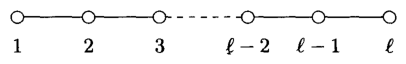

$$
A = \begin{pmatrix}
2 & -1 & 0 & 0 & \cdots & 0 & 0\\
-1 & 2 & -1 & 0 & \cdots & 0 & 0\\
0 & -1 & 2 & -1 & \cdots & 0 & 0\\
\cdot & \cdot & \cdot & \cdot & \cdots & \cdot & \cdot\\
0 & 0 & 0 & 0 & \cdots & 2 & -1\\
0 & 0 & 0 & 0 & \cdots & -1 & 2
\end{pmatrix}
$$

$$
A^{-1} = \frac{1}{\ell+1}\begin{pmatrix}
1\cdot\ell & 1\cdot(\ell-1) & 1\cdot(\ell-2) & \cdots & 1\cdot 2 & 1\cdot 1\\
1\cdot(\ell-1) & 2\cdot(\ell-1) & 2\cdot(\ell-2) & \cdots & 2\cdot 2 & 2\cdot 1\\
1\cdot(\ell-2) & 2\cdot(\ell-2) & 3\cdot(\ell-2) & \cdots & 3\cdot 2 & 3\cdot 1\\
\cdot & \cdot & \cdot & \cdots & \cdot & \cdot\\
1\cdot 2 & 2\cdot 2 & 3\cdot 2 & \cdots & (\ell-1)\cdot 2 & (\ell-1)\cdot 1\\
1\cdot 1 & 2\cdot 1 & 3\cdot 1 & \cdots & (\ell-1)\cdot 1 & \ell\cdot 1
\end{pmatrix}
$$

$$
\begin{aligned}
d_\mu &= 1\,, & 1 &\leqslant \mu \leqslant \ell,\\
M_0 &= w_1\,, & M_{\mathrm{adj}} &= \omega = w_1 + w_\ell,\\
d(M_0) &= \ell+1\,, & d(M_{\mathrm{adj}}) &= \ell(\ell+2),\\
C_2(M_0) &= \frac{\ell^2 + 2\ell}{\ell+1}\,, & C_2(M_{\mathrm{adj}}) &= 2(\ell+1)
\end{aligned}
\tag{A29.1}
$$

采用式 (7.85) 引入的 $\ell+1$ 个线性相关的矢量 $V_a$ 作基

$$
V_a \cdot V_b = \frac{\delta_{ab}}{2} - \frac{1}{2(\ell+1)}\,, \qquad V_{\ell+1} = -\sum_{a=1}^{\ell} V_a
\tag{A29.2}
$$

这 $\ell+1$ 个矢量对称地分布在 $\ell$ 维空间中，$V_{\ell+1}$ 沿第一个轴的负向。素根 $r_j$ 和基本主权 $w_j$ 可用这组基表出

$$
r_\mu = \sqrt{2}\left(V_\mu - V_{\mu+1}\right)\,, \qquad w_\mu = \sqrt{2}\sum_{\nu=1}^{\mu} V_\nu\,, \qquad 1 \leqslant \mu \leqslant \ell
\tag{A29.3}
$$

$A_\ell$ 李代数的阶是 $\ell(\ell+2)$，它共有 $\ell(\ell+1)$ 个根，表为 $\sqrt{2}(V_a - V_b)$ 的形式。最高权为 $M$ 的表示维数为

$$
d(M) = \prod_{a<b}^{\ell+1}\left\{1 + \sum_{\mu=a}^{b-1}\frac{M_\mu}{b-a}\right\}
\tag{A29.4}
$$

其中，$M_\mu$ 是最高权 $M$ 在基本主权表象 $w_\mu$ 中的分量。下同。

### 二、B_ℓ 李代数和 SO(2ℓ+1) 群

作为李代数，$B_1 = A_1$，$B_2 = C_2$，本节讨论 $\ell \geqslant 3$ 的李代数 $B_\ell$，它的邓金图，嘉当矩阵及其逆矩阵，和主要参数如下：

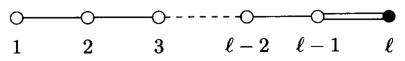

$$
A = \begin{pmatrix}
2 & -1 & 0 & \cdots & 0 & 0\\
-1 & 2 & -1 & \cdots & 0 & 0\\
0 & -1 & 2 & \cdots & 0 & 0\\
\cdot & \cdot & \cdot & \cdots & \cdot & \cdot\\
0 & 0 & 0 & \cdots & 2 & -1\\
0 & 0 & 0 & \cdots & -2 & 2
\end{pmatrix}
$$

$$
A^{-1} = \begin{pmatrix}
1 & 1 & 1 & \cdots & 1 & 1/2\\
1 & 2 & 2 & \cdots & 2 & 1\\
1 & 2 & 3 & \cdots & 3 & 3/2\\
\cdot & \cdot & \cdot & \cdots & \cdot & \cdot\\
1 & 2 & 3 & \cdots & \ell-1 & (\ell-1)/2\\
1 & 2 & 3 & \cdots & \ell-1 & \ell/2
\end{pmatrix}
$$

$$
\begin{aligned}
d_\mu &= 1\,, & 1 &\leqslant \mu \leqslant \ell-1\,, & d_\ell &= 1/2,\\
M_0 &= w_1\,, & M_{\mathrm{adj}} &= \omega = w_2\,, & M_S &= w_\ell,\\
d(M_0) &= 2\ell+1\,, & d(M_{\mathrm{adj}}) &= \ell(2\ell+1)\,, & d(M_S) &= 2^{\ell},\\
C_2(M_0) &= 2\ell\,, & C_2(M_{\mathrm{adj}}) &= 2(2\ell-1)\,, & C_2(M_S) &= \ell(2\ell+1)/4
\end{aligned}
\tag{A29.5}
$$

其中，$M_S$ 是基本旋量表示。$B_2$ 李代数的最大根，即伴随表示最高权 $\omega$ 是 $2w_2$，而不是 $w_2$，因而 $B_2 = C_2$ 归入 $C_\ell$ 系列。

在 $\ell$ 维空间直角坐标系的正交基 $e_\mu$ 中，素根和基本主权表为

$$
\begin{aligned}
r_\mu &= e_\mu - e_{\mu+1}\,, & 1 &\leqslant \mu \leqslant (\ell-1)\,, & r_\ell &= e_\ell,\\
w_\mu &= \sum_{\nu=1}^{\mu} e_\nu\,, & 1 &\leqslant \mu < \ell\,, & w_\ell &= \frac{1}{2}\sum_{\nu=1}^{\ell} e_\nu\,.
\end{aligned}
\tag{A29.6}
$$

B_ℓ 李代数的阶为 $\ell(2\ell+1)$，它共有 $2\ell^2$ 个根，可表为 $\pm e_\mu$，$\pm (e_\mu + e_\nu)$ 和 $(e_\mu - e_\nu)$ 的形式。最高权表示 $M$ 的维数是

$$
\begin{aligned}
d(M) =& \prod_{\lambda=1}^{\ell}\left\{1 + \frac{M_\ell + 2\sum\limits_{\rho=\lambda}^{\ell-1} M_\rho}{1 + 2(\ell - \lambda)}\right\} \\
&\times \prod_{\mu<\nu}^{\ell}\left\{\left(1 + \frac{M_\ell + \sum\limits_{\rho=\mu}^{\nu-1} M_\rho + \sum\limits_{\rho=\nu}^{\ell-1} 2M_\rho}{1 + 2\ell - \mu - \nu}\right)\left(1 + \frac{\sum\limits_{\rho=\mu}^{\nu-1} M_\rho}{\nu - \mu}\right)\right\}
\end{aligned}
\tag{A29.7}
$$

### 三、C_ℓ 李代数和 USp(2ℓ) 群

作为李代数，C_1 = A_1，本节讨论 $\ell \geqslant 2$ 的 C_ℓ 李代数，它的邓金图、嘉当矩阵及其逆矩阵和主要参数如下：

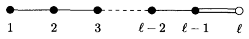

$$
A = \begin{pmatrix}
2 & -1 & 0 & \cdots & 0 & 0 \\
-1 & 2 & -1 & \cdots & 0 & 0 \\
0 & -1 & 2 & \cdots & 0 & 0 \\
\cdot & \cdot & \cdot & \cdots & \cdot & \cdot \\
0 & 0 & 0 & \cdots & 2 & -2 \\
0 & 0 & 0 & \cdots & -1 & 2
\end{pmatrix}
$$

$$
A^{-1} = \begin{pmatrix}
1 & 1 & 1 & \cdots & 1 & 1 \\
1 & 2 & 2 & \cdots & 2 & 2 \\
1 & 2 & 3 & \cdots & 3 & 3 \\
\cdot & \cdot & \cdot & \cdots & \cdot & \cdot \\
1 & 2 & 3 & \cdots & \ell - 1 & \ell - 1 \\
1/2 & 1 & 3/2 & \cdots & (\ell-1)/2 & \ell/2
\end{pmatrix}
$$

$$
\begin{aligned}
d_\mu &= 1/2, \quad 1 \leqslant \mu \leqslant (\ell-1), & d_\ell &= 1, \\
M_0 &= w_1, & M_{\mathrm{adj}} &= \omega = 2w_1, \\
d(M_0) &= 2\ell, & d(M_{\mathrm{adj}}) &= \ell(2\ell+1), \\
C_2(M_0) &= \ell + 1/2, & C_2(M_{\mathrm{adj}}) &= 2(\ell+1)
\end{aligned}
\tag{A29.8}
$$

在 $\ell$ 维空间直角坐标系的正交基 $e_\mu$ 中，C_ℓ 李代数的素根和基本主权可表为

$$
\begin{aligned}
\boldsymbol{r}_\mu &= \sqrt{1/2}\,\{e_\mu - e_{\mu+1}\}, \quad 1 \leqslant \mu \leqslant (\ell-1), & \boldsymbol{r}_\ell &= \sqrt{2}\,e_\ell, \\
\boldsymbol{w}_\mu &= \sqrt{1/2}\sum_{\nu=1}^{\mu} e_\nu, \quad 1 \leqslant \mu \leqslant \ell
\end{aligned}
\tag{A29.9}
$$

C_ℓ 李代数的阶为 $\ell(2\ell+1)$，共有 $2\ell^2$ 个根，表为 $\sqrt{1/2}\,\{e_\mu - e_\nu\}$，$\pm \sqrt{1/2}\,\{e_\mu + e_\nu\}$ 和 $\pm \sqrt{2}\,e_\mu$. 最高权表示 $M$ 的维数是

$$
\begin{aligned}
d(M) =& \prod_{\lambda=1}^{\ell}\left\{1 + \frac{\sum\limits_{\rho=\lambda}^{\ell} M_\rho}{\ell + 1 - \lambda}\right\} \\
&\times \prod_{\mu<\nu}^{\ell}\left\{\left(1 + \frac{\sum\limits_{\rho=\mu}^{\nu-1} M_\rho + \sum\limits_{\rho=\nu}^{\ell} 2M_\rho}{2\ell + 2 - \mu - \nu}\right)\left(1 + \frac{\sum\limits_{\rho=\mu}^{\nu-1} M_\rho}{\nu - \mu}\right)\right\}
\end{aligned}
\tag{A29.10}
$$

### 四、D_ℓ 李代数和 SO(2ℓ) 群

作为李代数，D_2 = A_1 ⊕ A_1，D_3 = A_3，本节讨论 $\ell \geqslant 4$ 的李代数 D_ℓ，它的邓金图，嘉当矩阵及其逆矩阵，和主要参数如下：

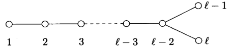

$$
A = \begin{pmatrix}
2 & -1 & 0 & 0 & \cdots & 0 & 0 & 0 \\
-1 & 2 & -1 & 0 & \cdots & 0 & 0 & 0 \\
0 & -1 & 2 & -1 & \cdots & 0 & 0 & 0 \\
\cdot & \cdot & \cdot & \cdot & \cdots & \cdot & \cdot & \cdot \\
0 & 0 & 0 & 0 & \cdots & 2 & -1 & -1 \\
0 & 0 & 0 & 0 & \cdots & -1 & 2 & 0 \\
0 & 0 & 0 & 0 & \cdots & -1 & 0 & 2
\end{pmatrix}
$$

$$
A^{-1} = \frac{1}{2}\begin{pmatrix}
2 & 2 & 2 & \cdots & 2 & 1 & 1 \\
2 & 4 & 4 & \cdots & 4 & 2 & 2 \\
2 & 4 & 6 & \cdots & 6 & 3 & 3 \\
\cdot & \cdot & \cdot & \cdots & \cdot & \cdot & \cdot \\
2 & 4 & 6 & \cdots & 2(\ell-2) & \ell-2 & \ell-2 \\
1 & 2 & 3 & \cdots & \ell-2 & \ell/2 & (\ell-2)/2 \\
1 & 2 & 3 & \cdots & \ell-2 & (\ell-2)/2 & \ell/2
\end{pmatrix}
$$

$$
\begin{aligned}
d_\mu &= 1, & 1 \leqslant \mu \leqslant \ell, & M_0 &= \boldsymbol{w}_1, \\
M_{\mathrm{adj}} &= \omega = \boldsymbol{w}_2, & M_{S1} &= \boldsymbol{w}_{\ell-1}, & M_{S2} &= \boldsymbol{w}_\ell, \\
d(M_0) &= 2\ell, & d(M_{\mathrm{adj}}) &= \ell(2\ell-1), & d(M_{S1}) &= d(M_{S2}) = 2^{\ell-1}, \\
C_2(M_0) &= 2\ell-1, & C_2(M_{\mathrm{adj}}) &= 4(\ell-1), & C_2(M_{S1}) &= C_2(M_{S2}) = \ell(2\ell-1)/4
\end{aligned}
\tag{A29.11}
$$

其中，$M_{S1}$ 和 $M_{S2}$ 是两个不等价的基本旋量表示。

在 $\ell$ 维空间直角坐标系的正交基 $e_\mu$ 中，素根和基本主权表为

$$
\begin{aligned}
\boldsymbol{r}_\mu &= e_\mu - e_{\mu+1}, \quad 1 \leqslant \mu \leqslant (\ell-1), & \boldsymbol{r}_\ell &= e_{\ell-1} + e_\ell, \\
\boldsymbol{w}_\nu &= \sum_{\rho=1}^{\nu} e_\rho, \quad 1 \leqslant \nu \leqslant \ell-2, \\
\boldsymbol{w}_{\ell-1} &= \frac{1}{2}\sum_{\rho=1}^{\ell-1} e_\rho - \frac{1}{2}e_\ell, & \boldsymbol{w}_\ell &= \frac{1}{2}\sum_{\rho=1}^{\ell} e_\rho
\end{aligned}
\tag{A29.12}
$$

D_ℓ 李代数的阶为 $\ell(2\ell-1)$，它共有 $2\ell(\ell-1)$ 个根，表为 $\pm (e_\mu + e_\nu)$ 和 $(e_\mu - e_\nu)$ 的形式。最高权表示 $M$ 的维数是

$$
d(M) = \prod_{\mu<\nu}^{\ell}\left\{\left(1 + \frac{\sum\limits_{\rho=\mu}^{\nu-1} M_\rho + \sum\limits_{\rho=\nu}^{\ell} 2M_\rho - M_{\ell-1} - M_\ell}{2\ell - \mu - \nu}\right)\left(1 + \frac{\sum\limits_{\rho=\mu}^{\nu-1} M_\rho}{\nu - \mu}\right)\right\}
\tag{A29.13}
$$

### 五、G_2 李代数

G_2 李代数的邓金图，嘉当矩阵及其逆矩阵和主要参数如下：

$$
A = \begin{pmatrix} 2 & -1 \\ -3 & 2 \end{pmatrix}, \qquad
A^{-1} = \begin{pmatrix} 2 & 1 \\ 3 & 2 \end{pmatrix}
$$

$$
\begin{aligned}
d_1 &= 1, & d_2 &= 1/3, & M_0 &= \boldsymbol{w}_2, & M_{\mathrm{adj}} &= \omega = \boldsymbol{w}_1, \\
d(M_0) &= 7, & d(M_{\mathrm{adj}}) &= 14, & C_2(M_0) &= 4, & C_2(M_{\mathrm{adj}}) &= 8
\end{aligned}
\tag{A29.14}
$$

在二维空间直角坐标系的正交基 $e_\mu$ 中，素根和基本主权表为

$$
\begin{aligned}
\boldsymbol{r}_1 &= \sqrt{2}e_2, & \boldsymbol{r}_2 &= \sqrt{1/6}e_1 - \sqrt{1/2}e_2, \\
\boldsymbol{w}_1 &= \sqrt{3/2}e_1 + \sqrt{1/2}e_2, & \boldsymbol{w}_2 &= \sqrt{2/3}e_1
\end{aligned}
\tag{A29.15}
$$

G_2 李代数共有 12 个根，其余 4 个正根为

$$
\begin{aligned}
\boldsymbol{r}_1 + \boldsymbol{r}_2 &= \sqrt{1/6}e_1 + \sqrt{1/2}e_2, & \boldsymbol{r}_1 + 2\boldsymbol{r}_2 &= \sqrt{2/3}e_1, \\
\boldsymbol{r}_1 + 3\boldsymbol{r}_2 &= \sqrt{3/2}e_1 - \sqrt{1/2}e_2, & 2\boldsymbol{r}_1 + 3\boldsymbol{r}_2 &= \sqrt{3/2}e_1 + \sqrt{1/2}e_2
\end{aligned}
\tag{A29.16}
$$

G_2 李代数的阶为 14. 最高权表示 $M$ 的维数是

$$
\begin{aligned}
d(M) =& (1 + M_1)(1 + M_2)(4 + 3M_1 + M_2)(5 + 3M_1 + 2M_2) \\
&\times (2 + M_1 + M_2)(3 + 2M_1 + M_2)/120\ .
\end{aligned}
\tag{A29.17}
$$

### 六、F_4 李代数

F_4 李代数的邓金图，嘉当矩阵及其逆矩阵和主要参数如下：

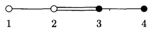

$$
A = \begin{pmatrix}
2 & -1 & 0 & 0 \\
-1 & 2 & -1 & 0 \\
0 & -2 & 2 & -1 \\
0 & 0 & -1 & 2
\end{pmatrix}, \qquad
A^{-1} = \begin{pmatrix}
2 & 3 & 2 & 1 \\
3 & 6 & 4 & 2 \\
4 & 8 & 6 & 3 \\
2 & 4 & 3 & 2
\end{pmatrix}
$$

$$
\begin{aligned}
d_1 &= d_2 = 1, & d_3 &= d_4 = 1/2, \\
M_0 &= \boldsymbol{w}_4, & M_{\mathrm{adj}} &= \omega = \boldsymbol{w}_1, \\
d(M_0) &= 26, & d(M_{\mathrm{adj}}) &= 52, \\
C_2(M_0) &= 12, & C_2(M_{\mathrm{adj}}) &= 18
\end{aligned}
\tag{A29.18}
$$

在四维空间直角坐标系的正交基 $e_\mu$ 中，素根和基本主权表为

$$
\begin{aligned}
\boldsymbol{r}_1 &= e_2 - e_3, & \boldsymbol{r}_2 &= e_3 - e_4, \\
\boldsymbol{r}_3 &= e_4, & \boldsymbol{r}_4 &= (e_1 - e_2 - e_3 - e_4)/2, \\
\boldsymbol{w}_1 &= e_1 + e_2, & \boldsymbol{w}_2 &= 2e_1 + e_2 + e_3, \\
\boldsymbol{w}_3 &= (3e_1 + e_2 + e_3 + e_4)/2, & \boldsymbol{w}_4 &= e_1
\end{aligned}
\tag{A29.19}
$$

F_4 代数的阶为 52，共有 48 个根。它包含 B_4 李代数的全部 32 个根 $\pm e_\mu$，$\pm (e_\mu + e_\nu)$，$(e_\mu - e_\nu)$，还有 16 个如下形式的根

$$
a e_1 + b e_2 + c e_3 + d e_4
\tag{A29.20}
$$

其中，$a$，$b$，$c$ 和 $d$ 独立地取 $\pm 1$. B_4 是 F_4 的子李代数，但不是理想。最高权表示 $M$ 的维数是

$$
\begin{aligned}
d(M) =& \{1 + (2M_1 + 4M_2 + 3M_3 + 2M_4)/11\}\{1 + (2M_1 + 2M_2 + M_3)/5\} \\
&\times \{1 + (2M_2 + M_3)/3\}\{1 + M_3\}\{1 + (2M_1 + 3M_2 + 2M_3 + M_4)/8\} \\
&\times \{1 + (M_2 + M_3 + M_4)/3\}\{1 + (M_1 + 3M_2 + 2M_3 + M_4)/7\} \\
&\times \{1 + (M_1 + M_2 + M_3 + M_4)/4\}\{1 + (M_1 + 2M_2 + 2M_3 + M_4)/6\}
\end{aligned}
$$

$$
\begin{aligned}
&\times \{1 + (M_1 + 2M_2 + M_3 + M_4)/5\}\{1 + (M_1 + 2M_2 + M_3)/4\}\{1 + M_1\} \\
&\times \{1 + (M_1 + M_2 + M_3)/3\}\{1 + (M_1 + M_2)/2\}\{1 + (M_2 + M_3)/2\} \\
&\times \{1 + M_2\}\{1 + (2M_1 + 4M_2 + 3M_3 + M_4)/10\} \\
&\times \{1 + (2M_2 + 2M_3 + M_4)/5\}\{1 + (2M_1 + 2M_2 + 2M_3 + M_4)/7\} \\
&\times \{1 + (2M_1 + 4M_2 + 2M_3 + M_4)/9\}\{1 + (M_3 + M_4)/2\}\{1 + M_4\} \\
&\times \{1 + (2M_2 + M_3 + M_4)/4\}\{1 + (2M_1 + 2M_2 + M_3 + M_4)/6\}\ .
\end{aligned}
\tag{A29.21}
$$

### 七、E_6 李代数

E_6 李代数的邓金图，嘉当矩阵及其逆矩阵和主要参数如下：

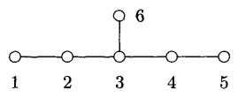

$$
A = \begin{pmatrix}
2 & -1 & 0 & 0 & 0 & 0 \\
-1 & 2 & -1 & 0 & 0 & 0 \\
0 & -1 & 2 & -1 & 0 & -1 \\
0 & 0 & -1 & 2 & -1 & 0 \\
0 & 0 & 0 & -1 & 2 & 0 \\
0 & 0 & -1 & 0 & 0 & 2
\end{pmatrix}, \qquad
A^{-1} = \frac{1}{3}\begin{pmatrix}
4 & 5 & 6 & 4 & 2 & 3 \\
5 & 10 & 12 & 8 & 4 & 6 \\
6 & 12 & 18 & 12 & 6 & 9 \\
4 & 8 & 12 & 10 & 5 & 6 \\
2 & 4 & 6 & 5 & 4 & 3 \\
3 & 6 & 9 & 6 & 3 & 6
\end{pmatrix}
$$

$$
\begin{aligned}
d_\mu &= 1, \quad 1 \leqslant \mu \leqslant 6, & M_0 &= \boldsymbol{w}_1, & M_{\mathrm{adj}} &= \omega = \boldsymbol{w}_6, \\
d(M_0) &= 27, & d(M_{\mathrm{adj}}) &= 78, & C_2(M_0) &= 52/3, & C_2(M_{\mathrm{adj}}) &= 24
\end{aligned}
\tag{A29.22}
$$

引入六维空间六个线性相关矢量 $U_a$，$\sum U_a = 0$. 它们的第六分量都为零，前五个分量采用 A_5 李代数中定义的矢量 $V_a$，$1 \leqslant a \leqslant 6$. 再定义 $e_6$，它只有第六个分量为 1，前五个分量都为 0. 这样，线性无关的基共有六个，用这组基表达 E_6 李代数的素根和基本主权较为方便

$$
\begin{aligned}
\boldsymbol{r}_1 &= \sqrt{2}e_6, & \boldsymbol{r}_2 &= \sqrt{2}\,(U_3 + U_4 + U_5) - e_6/\sqrt{2}, \\
\boldsymbol{r}_3 &= \sqrt{2}\,(U_2 - U_3), & \boldsymbol{r}_4 &= \sqrt{2}\,(U_3 - U_4), \\
\boldsymbol{r}_5 &= \sqrt{2}\,(U_4 - U_5), & \boldsymbol{r}_6 &= \sqrt{2}\,(U_1 - U_2), \\
\boldsymbol{w}_1 &= -\sqrt{2}U_6 + e_6/\sqrt{2}, & \boldsymbol{w}_2 &= -2\sqrt{2}U_6, \\
\boldsymbol{w}_3 &= \sqrt{2}\,(U_1 + U_2 - 2U_6), & \boldsymbol{w}_4 &= \sqrt{2}\,(U_1 + U_2 + U_3 - U_6), \\
\boldsymbol{w}_5 &= -\sqrt{2}\,(U_5 + U_6), & \boldsymbol{w}_6 &= \sqrt{2}\,(U_1 - U_6)
\end{aligned}
\tag{A29.23}
$$

E_6 李代数的阶为 78，共有 72 个根。它包含 A_5 李代数的全部 30 个根，即 $\sqrt{2}(U_a - U_b)$，还有 $\pm \sqrt{2}e_6$，和如下形式的 40 个根

$$
\sqrt{2}\,(U_a + U_b + U_c) \pm e_6/\sqrt{2}
\tag{A29.24}
$$

其中，$a$，$b$ 和 $c$ 互不相等地取 1～6 中任意三个数值。 A_5 是 E_6 的子李代数，但不是理想。

### 八、E_7 李代数

E_7 李代数的邓金图，嘉当矩阵及其逆矩阵和主要参数如下：

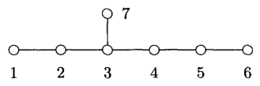

$$
A = \begin{pmatrix}
2 & -1 & 0 & 0 & 0 & 0 & 0 \\
-1 & 2 & -1 & 0 & 0 & 0 & 0 \\
0 & -1 & 2 & -1 & 0 & 0 & -1 \\
0 & 0 & -1 & 2 & -1 & 0 & 0 \\
0 & 0 & 0 & -1 & 2 & -1 & 0 \\
0 & 0 & 0 & 0 & -1 & 2 & 0 \\
0 & 0 & -1 & 0 & 0 & 0 & 2
\end{pmatrix}
$$

$$
A^{-1} = \frac{1}{2}\begin{pmatrix}
4 & 6 & 8 & 6 & 4 & 2 & 4 \\
6 & 12 & 16 & 12 & 8 & 4 & 8 \\
8 & 16 & 24 & 18 & 12 & 6 & 12 \\
6 & 12 & 18 & 15 & 10 & 5 & 9 \\
4 & 8 & 12 & 10 & 8 & 4 & 6 \\
2 & 4 & 6 & 5 & 4 & 3 & 3 \\
4 & 8 & 12 & 9 & 6 & 3 & 7
\end{pmatrix}
$$

$$
\begin{aligned}
d_\mu &= 1, \quad 1 \leqslant \mu \leqslant 7, & M_0 &= \boldsymbol{w}_6, & M_{\mathrm{adj}} &= \omega = \boldsymbol{w}_1, \\
d(M_0) &= 56, & d(M_{\mathrm{adj}}) &= 133, & C_2(M_0) &= 57/2, & C_2(M_{\mathrm{adj}}) &= 36
\end{aligned}
\tag{A29.25}
$$

采用 A_7 李代数中定义的矢量 $V_a$，$1 \leqslant a \leqslant 8$，$V_8 = -\sum_{b=1}^{7} V_b$，表达 E_7 李代数的素根和基本主权较为方便

$$
\begin{aligned}
\boldsymbol{r}_1 &= \sqrt{2}\,(V_1 - V_2), & \boldsymbol{r}_2 &= \sqrt{2}\,(V_2 - V_3), \\
\boldsymbol{r}_3 &= \sqrt{2}\,(V_3 - V_4), & \boldsymbol{r}_4 &= \sqrt{2}\,(V_4 - V_5), \\
\boldsymbol{r}_5 &= \sqrt{2}\,(V_5 - V_6), & \boldsymbol{r}_6 &= \sqrt{2}\,(V_6 - V_7), \\
\boldsymbol{r}_7 &= \sqrt{2}\,(V_4 + V_5 + V_6 + V_7), & \boldsymbol{w}_1 &= \sqrt{2}\,(V_1 - V_8), \\
\boldsymbol{w}_2 &= \sqrt{2}\,(V_1 + V_2 - 2V_8), & \boldsymbol{w}_3 &= \sqrt{2}\,(V_1 + V_2 + V_3 - 3V_8), \\
\boldsymbol{w}_4 &= -\sqrt{2}\,(V_5 + V_6 + V_7 + 3V_8), & \boldsymbol{w}_5 &= -\sqrt{2}\,(V_6 + V_7 + 2V_8), \\
\boldsymbol{w}_6 &= -\sqrt{2}\,(V_7 + V_8), & \boldsymbol{w}_7 &= -2\sqrt{2}V_8
\end{aligned}
\tag{A29.26}
$$

E_7 李代数的阶为 133，共有 126 个根。它包含 A_7 李代数的全部 56 个根 $\sqrt{2}(V_a - V_b)$，还有如下形式的 70 个根

$$
\sqrt{2}\,(V_a + V_b + V_c + V_d)
$$

其中，$a$，$b$，$c$ 和 $d$ 互不相等地取 1～8 中任意四个数值。 A_7 是 E_7 的子李代数，但不是理想。

### 九、E_8 李代数

E_8 李代数的邓金图，嘉当矩阵及其逆矩阵和主要参数如下：

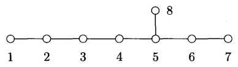

$$
A = \begin{pmatrix}
2 & -1 & 0 & 0 & 0 & 0 & 0 & 0 \\
-1 & 2 & -1 & 0 & 0 & 0 & 0 & 0 \\
0 & -1 & 2 & -1 & 0 & 0 & 0 & 0 \\
0 & 0 & -1 & 2 & -1 & 0 & 0 & 0 \\
0 & 0 & 0 & -1 & 2 & -1 & 0 & -1 \\
0 & 0 & 0 & 0 & -1 & 2 & -1 & 0 \\
0 & 0 & 0 & 0 & 0 & -1 & 2 & 0 \\
0 & 0 & 0 & 0 & -1 & 0 & 0 & 2
\end{pmatrix}
$$

$$
A^{-1} = \begin{pmatrix}
2 & 3 & 4 & 5 & 6 & 4 & 2 & 3 \\
3 & 6 & 8 & 10 & 12 & 8 & 4 & 6 \\
4 & 8 & 12 & 15 & 18 & 12 & 6 & 9 \\
5 & 10 & 15 & 20 & 24 & 16 & 8 & 12 \\
6 & 12 & 18 & 24 & 30 & 20 & 10 & 15 \\
4 & 8 & 12 & 16 & 20 & 14 & 7 & 10 \\
2 & 4 & 6 & 8 & 10 & 7 & 4 & 5 \\
3 & 6 & 9 & 12 & 15 & 10 & 5 & 8
\end{pmatrix}
$$

$$
\begin{aligned}
d_\mu &= 1, \quad 1 \leqslant \mu \leqslant 8, & M_0 &= M_{\mathrm{adj}} = \omega = \boldsymbol{w}_1, \\
d(M_0) &= 248, & C_2(M_{\mathrm{adj}}) &= 60
\end{aligned}
\tag{A29.27}
$$

采用八维空间直角坐标系的正交基 $e_\mu$，$1 \leqslant \mu \leqslant 8$，表达 E_8 李代数的素根和基本主权较为方便

$$
\begin{aligned}
\boldsymbol{r}_1 &= e_2 - e_3, & \boldsymbol{r}_2 &= e_3 - e_4, & \boldsymbol{r}_3 &= e_4 - e_5, \\
\boldsymbol{r}_4 &= e_5 - e_6, & \boldsymbol{r}_5 &= e_6 - e_7, & \boldsymbol{r}_6 &= e_7 - e_8, \\
\boldsymbol{r}_7 &= 2^{-1}\left\{e_1 + e_8 - \sum_{j=2}^{7} e_j\right\}, & \boldsymbol{r}_8 &= e_7 + e_8, \\
\boldsymbol{w}_1 &= e_1 + e_2, & \boldsymbol{w}_2 &= 2e_1 + e_2 + e_3, \\
\boldsymbol{w}_3 &= 3e_1 + \sum_{j=2}^{4} e_j, & \boldsymbol{w}_4 &= 4e_1 + \sum_{j=2}^{5} e_j, \\
\boldsymbol{w}_5 &= 5e_1 + \sum_{j=2}^{6} e_j, & \boldsymbol{w}_6 &= \frac{7}{2}e_1 + \frac{1}{2}\sum_{j=2}^{7} e_j - \frac{1}{2}e_8, \\
\boldsymbol{w}_7 &= 2e_1, & \boldsymbol{w}_8 &= \frac{5}{2}e_1 + \frac{1}{2}\sum_{j=2}^{8} e_j
\end{aligned}
\tag{A29.28}
$$

E_8 李代数的阶为 248，共有 240 个根。它包含 D_8 李代数的全部 112 个根，即 $\pm (e_\mu + e_\nu)$ 和 $(e_\mu - e_\nu)$，还有如下形式的 128 个根

$$
(\pm e_1 \pm e_2 \pm e_3 \pm e_4 \pm e_5 \pm e_6 \pm e_7 \pm e_8)/2
$$

其中，括号内取偶数个负号。 D_8 是 E_8 的子代数，但不是理想。

## 附录 30 克莱布施-戈登系数的对称性质

第四章我们研究过 SU(2) 群克莱布施－戈登系数的对称性质式 (4.143). 这些对称性质有一定的普遍意义，但由于单纯李代数的表示中存在重权，使公式变得比较复杂。这里我们研究式 (4.143) 中两个比较简单的对称性，而且假定表示 $M$ 重数为 1.

第一个对称关系与交换直乘表示的乘积次序有关。克莱布施 - 戈登系数通常都用展开式 (7.195) 的方式给出。当把表示乘积次序颠倒时，展开式不会发生变化，所有的差别来自于克莱布施 - 戈登系数相位的规定，因而它们最多只能相差一个符号

$$
C_{m^{(2)},m^{(1)},M,m}^{M^{(2)}M^{(1)}} = \xi_M C_{m^{(1)},m^{(2)},M,m}^{M^{(1)}M^{(2)}}
\tag{A30.1}
$$

因子 $\xi_M = \pm 1$ 取决于在最高权态 $(m = M)$ 的展开式 (7.195) 中，两种选取相因子方法。例如，在 $D^{M^{(1)}} \times D^{M^{(2)}}$ 约化中选取展开式的项 $m^{(1)} = M^{(1)}$ 系数为正实数，而在 $D^{M^{(2)}} \times D^{M^{(1)}}$ 约化中选取项 $m^{(2)} = M^{(2)}$ 系数为正实数，则根据最高权态在升算符作用下为零的条件，得

$$
\xi_M = (-1)^{h(M^{(2)},M-M^{(1)})} = (-1)^{h(M^{(1)},M-M^{(2)})}
\tag{A30.2}
$$

其中， $h(M,m)$ 是权 $m$ 在表示 $M$ 中的高度 [见式 (7.159)].

第二个对称关系与复共轭表示有关。互为复共轭的表示状态基和生成元满足式 (7.160) 和 (7.161). 由于式 (7.195) 每一项中两个权高度之和是相同的

$$
h(M^{(1)},m^{(1)}) + h(M^{(2)},m^{(2)})
\tag{A30.3}
$$

有关高度的因子可以提到求和号外面来。如果克莱布施 - 戈登系数是实的，对式 (7.195) 取复共轭知， $C_{M^{*}}^{M^{(1)*}M^{(2)*}}$ 和 $C_{M}^{M^{(1)}M^{(2)}}$ 都把直乘表示 $M^{(1)*} \times M^{(2)*}$ 约化到表示 $M^{*}$, 根据舒尔定理它们只能相差一个与 $m$ 无关的常数 $\zeta_M$

$$
C_{-m^{(1)},-m^{(2)},M^{*},-m}^{M^{(1)*}M^{(2)*}} = \zeta_M C_{m^{(1)},m^{(2)},M,m}^{M^{(1)}M^{(2)}}
\tag{A30.4}
$$

$$
\zeta_M = (-1)^{h(M^{(1)},m^{(1)}) + h(M^{(2)},m^{(2)}) - h(M,m)}
$$

取 $m = M$ 和 $m^{(1)} = M^{(1)}$, 得

$$
h(M^{(1)},m^{(1)}) + h(M^{(2)},m^{(2)}) - h(M,m) = h[M^{(2)},(M-M^{(1)})]
\tag{A30.5}
$$

因此，一般说来， $\xi_M = \zeta_M$,

$$
\begin{aligned}
C_{m^{(1)},m^{(2)},M,m}^{M^{(1)}M^{(2)}} &= \xi_M C_{m^{(2)},m^{(1)},M,m}^{M^{(2)}M^{(1)}} = \xi_M C_{-m^{(1)},-m^{(2)},M^{*},-m}^{M^{(1)*}M^{(2)*}} \\
&= C_{-m^{(2)},-m^{(1)},M^{*},-m}^{M^{(2)*}M^{(1)*}}
\end{aligned}
\tag{A30.6}
$$

当参与直乘的表示互为复共轭表示时， $M^{(2)} = M^{(1)*}$, 克莱布施 - 戈登级数中有一个恒等表示 0, 它的状态展开式为

$$
\|0,0\rangle = (d_{M^{(1)}})^{-1/2} \sum_m (-1)^{h(M^{(1)},m)} |M^{(1)},m\rangle |M^{(1)*},-m\rangle
\tag{A30.7}
$$

## 附录 31 SU(3) 群两伴随表示直乘的克莱布施 - 戈登系数

7.7 节已计算了 SU(3) 群两伴随表示直乘的克莱布施 - 戈登级数和级数中各表示最高权态的展开式。现在用方块权图方法和降算符作用，计算其他权态的展开式，即计算克莱布施 - 戈登系数。表示 (2,2) 的最高权态为

$$
\|(2,2),(2,2)\rangle = |(1,1)\rangle|(1,1)\rangle
$$

它对乘积状态是对称的。由于最高权中两个分量都是正的，可得一个 $A_1$ 三重态和一个 $A_2$ 三重态。用降算符作用得

$$
\|(2,2),(0,3)\rangle = \sqrt{1/2} F_1\|(2,2),(2,2)\rangle = \sqrt{1/2}\left\{|(1,1)\rangle|(\bar{1},2)\rangle + |(\bar{1},2)\rangle|(1,1)\rangle\right\},
$$

$$
\|(2,2),(\bar{2},4)\rangle = \sqrt{1/2} F_1\|(2,2),(0,3)\rangle = |(\bar{1},2)\rangle|(\bar{1},2)\rangle,
$$

$$
\|(2,2),(3,0)\rangle = \sqrt{1/2} F_2\|(2,2),(2,2)\rangle = \sqrt{1/2}\left\{|(1,1)\rangle|(2,\bar{1})\rangle + |(2,\bar{1})\rangle|(1,1)\rangle\right\},
$$

$$
\|(2,2),(4,\bar{2})\rangle = \sqrt{1/2} F_2\|(2,2),(3,0)\rangle = |(2,\bar{1})\rangle|(2,\bar{1})\rangle
$$

其中，出现两个主权 (0,3) 和 (3,0), 它们分别与最高权属于同一个 $A_{\mu}$ 多重态，因而是单权。与它们等价的权也是单权，分别是

$$
(0,3),\quad (3,\bar{3}),\quad (\bar{3},0) \quad \text{和} \quad (3,0),\quad (\bar{3},3),\quad (0,\bar{3})
$$

由权 (0,3) 可得一个 $A_2$ 四重态，包含的权有 (0,3), (1,1), $(2,\bar{1})$ 和 $(3,\bar{3})$. 由权 (3,0) 可得一个 $A_1$ 四重态，包含的权有 (3,0), (1,1), $(\bar{1},2)$ 和 $(\bar{3},3)$. 两个四重态中都包含主权 (1,1), 它可能是二重权。设态 $(1,1)_1$ 属于 $A_1$ 四重态， $(1,1)_2$ 只能属于 $A_1$ 二重态。

$$
\|(2,2),(1,1)_1\rangle = \sqrt{1/3} F_1\|(2,2),(3,0)\rangle
$$

$$
= \sqrt{1/6}\left\{\sqrt{2}|(1,1)\rangle|(0,0)_1\rangle + |(\bar{1},2)\rangle|(2,\bar{1})\rangle + (\text{sym. terms})\right\},
$$

$$
E_1\|(2,2),(1,1)_2\rangle = 0
$$

其中， (sym. terms) 代表一些对称项，它们由前面各项交换两状态基乘积次序得到。在上式中它代表

$$
\sqrt{1/6}\left\{\sqrt{2}|(0,0)_1\rangle|(1,1)\rangle + |(2,\bar{1})\rangle|(\bar{1},2)\rangle\right\}
$$

如果是 (antisym. terms), 则代表一些反对称项，即相差负号的项，今后不再加以说明了。设

$$
\begin{aligned}
F_2\|(2,2),(0,3)\rangle &= a_1 \|(2,2),(1,1)_1\rangle + a_2 \|(2,2),(1,1)_2\rangle \\
&= 2^{-1}\left\{|(1,1)\rangle|(0,0)_1\rangle + \sqrt{3}|(1,1)\rangle|(0,0)_2\rangle + \sqrt{2}|(2,\bar{1})\rangle|(\bar{1},2)\rangle + (\text{sym. terms})\right\}
\end{aligned}
$$

有两种方法来计算系数 $a_1$ 和 $a_2$. 一种是画方块权图时常用的方法，利用 $E_1$ 和 $F_2$ 对易

$$
\begin{aligned}
E_1 F_2 \|(2,2),(0,3)\rangle &= \sqrt{3} a_1 \|(2,2),(3,0)\rangle \\
&= F_2 E_1 \|(2,2),(0,3)\rangle = 2 \|(2,2),(3,0)\rangle
\end{aligned}
$$

定出 $a_1 = \sqrt{4/3}$. 选择状态基 $\|(2,2),(1,1)_2\rangle$ 的相位，使 $a_2$ 是正实数，得 $a_2 = \{3 - a_1^2\}^{1/2} = \sqrt{5/3}$. 因此主权 (1,1) 是二重权，并算得

$$
\begin{aligned}
\|(2,2),(1,1)_2\rangle &= \sqrt{3/5}\left\{F_2\|(2,2),(0,3)\rangle - \sqrt{4/3}\|(2,2),(1,1)_1\rangle\right\} \\
&= \sqrt{1/60}\left\{-|(1,1)\rangle|(0,0)_1\rangle + \sqrt{27}|(1,1)\rangle|(0,0)_2\rangle \right. \\
&\quad \left. + \sqrt{2}|(2,\bar{1})\rangle|(\bar{1},2)\rangle + (\text{sym. terms})\right\}
\end{aligned}
$$

另一方法是利用克莱布施 - 戈登系数的正交性

$$
\begin{aligned}
a_1 &= \langle(2,2),(1,1)_1\| F_2 \|(2,2),(0,3)\rangle \\
&= \sqrt{1/24}\left\{\sqrt{2} + \sqrt{2} + \sqrt{2} + \sqrt{2}\right\} = \sqrt{4/3}
\end{aligned}
$$

$a_2$ 也可根据归一化条件和相位选择来确定

$$
\begin{aligned}
a_2 \|(2,2),(1,1)_2\rangle &= F_2 \|(2,2),(0,3)\rangle - \sqrt{4/3}\|(2,2),(1,1)_1\rangle \\
&= 6^{-1}\left\{-|(1,1)\rangle|(0,0)_1\rangle + \sqrt{27}|(1,1)\rangle|(0,0)_2\rangle + \sqrt{2}|(2,\bar{1})\rangle|(\bar{1},2)\rangle \right. \\
&\quad \left. + (\text{sym. terms})\right\}
\end{aligned}
$$

归一化后得 $a_2 = \sqrt{5/3}$. 两种方法都可选用，但这里尽量采用新方法。

继续上面两个多重态的计算。所有与主权 (1,1) 等价的权都是二重权

$$
(1,1),\quad (\bar{1},2),\quad (2,\bar{1}),\quad (1,\bar{2}),\quad (\bar{2},1),\quad (\bar{1},\bar{1})
$$

选择 $(\bar{1},2)_1$ 和 $(\bar{1},2)_2$ 分别属于前面确定的 $A_1$ 四重态和二重态，得

$$
\begin{aligned}
\|(2,2),(\bar{1},2)_1\rangle &= 2^{-1} F_1 \|(2,2),(1,1)_1\rangle \\
&= \sqrt{1/6}\left\{|(1,1)\rangle|(\bar{2},1)\rangle + \sqrt{2}|(\bar{1},2)\rangle|(0,0)_1\rangle + (\text{sym. terms})\right\},
\end{aligned}
$$

$$
\begin{aligned}
\|(2,2),(\bar{3},3)\rangle &= \sqrt{1/3} F_1 \|(2,2),(\bar{1},2)_1\rangle \\
&= \sqrt{1/2}\left\{|(\bar{1},2)\rangle|(\bar{2},1)\rangle + |(\bar{2},1)\rangle|(\bar{1},2)\rangle\right\},
\end{aligned}
$$

$$
\begin{aligned}
\|(2,2),(\bar{1},2)_2\rangle &= F_1 \|(2,2),(1,1)_2\rangle \\
&= \sqrt{1/60}\left\{-\sqrt{2}|(1,1)\rangle|(\bar{2},1)\rangle + |(\bar{1},2)\rangle|(0,0)_1\rangle \right. \\
&\quad \left. + \sqrt{27}|(\bar{1},2)\rangle|(0,0)_2\rangle + (\text{sym. terms})\right\}
\end{aligned}
$$

权为 $(\bar{1},2)$ 的两状态基确实是互相正交的。再计算降算符对高度为 2 的其他态的作用。利用状态基的正交性可得

$$
\begin{aligned}
F_2 \|(2,2),(\bar{2},4)\rangle &= \sqrt{1/2}\left\{|(\bar{1},2)\rangle|(0,0)_1\rangle + \sqrt{3}|(\bar{1},2)\rangle|(0,0)_2\rangle + (\text{sym. terms})\right\} \\
&= \sqrt{2/3}\|(2,2),(\bar{1},2)_1\rangle + \sqrt{10/3}\|(2,2),(\bar{1},2)_2\rangle
\end{aligned}
$$

让 $(2,\bar{1})_1$ 属于由 $(4,\bar{2})$ 构造的 $A_1$ 五重态，而 $(2,\bar{1})_2$ 只能属于 $A_1$ 三重态

$$
\|(2,2),(2,\bar{1})_1\rangle = 2^{-1} F_1 \|(2,2),(4,\bar{2})\rangle = \sqrt{1/2}\left\{|(2,\bar{1})\rangle|(0,0)_1\rangle + |(0,0)_1\rangle|(2,\bar{1})\rangle\right\},
$$

$$
E_1 \|(2,2),(2,\bar{1})_2\rangle = 0
$$

设

$$
\begin{aligned}
F_2 \|(2,2),(1,1)_1\rangle &= b_1 \|(2,2),(2,\bar{1})_1\rangle + b_2\|(2,2),(2,\bar{1})_2\rangle \\
&= \sqrt{1/6}\left\{|(1,1)\rangle|(1,\bar{2})\rangle + 3\sqrt{1/2}|(2,\bar{1})\rangle\rangle|(0,0)_1\rangle \right. \\
&\quad \left. + \sqrt{3/2}|(2,\bar{1})\rangle\rangle|(0,0)_2\rangle + (\text{sym. terms})\right\},
\end{aligned}
$$

$$
\begin{aligned}
F_2 \|(2,2),(1,1)_2\rangle &= b_3 \|(2,2),(2,\bar{1})_1\rangle + b_4 \|(2,2),(2,\bar{1})_2\rangle \\
&= \sqrt{4/15}\left\{\sqrt{2}|(1,1)\rangle|(1,\bar{2})\rangle + \sqrt{3}|(2,\bar{1})\rangle|(0,0)_2\rangle + (\text{sym. terms})\right\}
\end{aligned}
$$

由正交性定出

$$
b_1 = \langle(2,2),(2,\bar{1})_1\|F_2\|(2,2),(1,1)_1\rangle = \sqrt{3/2},
$$

$$
b_3 = \langle(2,2),(2,\bar{1})_1\|F_2\|(2,2),(1,1)_2\rangle = 0
$$

选择状态基 $\|(2,2),(2,\bar{1})_2\rangle$ 的归一化系数，得 $b_4 = \sqrt{8/3}$ 和

$$
\begin{aligned}
\|(2,2),(2,\bar{1})_2\rangle &= \sqrt{3/8}F_2 \|(2,2),(1,1)_2\rangle \\
&= \sqrt{1/10}\left\{\sqrt{2}|(1,1)\rangle|(1,\bar{2})\rangle + \sqrt{3}|(2,\bar{1})\rangle|(0,0)_2\rangle + (\text{sym. terms})\right\}
\end{aligned}
$$

由此算得

$$
b_2 = \langle(2,2),(2,\bar{1})_2\|F_2\|(2,2),(1,1)_1\rangle = \sqrt{5/6}
$$

在高度为 4 的权中，有两个单权 $(\bar{3},3)$ 和 $(3,\bar{3})$ 是很明显的。一个单权 $(\bar{3},3)$ 的状态基展开式已经计算过，另一个单权 $(3,\bar{3})$ 的状态基也容易计算

$$
\begin{aligned}
F_2 \|(2,2),(2,\bar{1})_1\rangle &= 2^{-1}\left\{|(2,\bar{1})\rangle|(1,\bar{2})\rangle + |(1,\bar{2})\rangle|(2,\bar{1})\rangle\right\} \\
&= \sqrt{1/2}\|(2,2),(3,\bar{3})\rangle,
\end{aligned}
$$

$$
\begin{aligned}
F_2 \|(2,2),(2,\bar{1})_2\rangle &= \sqrt{5/4}\left\{|(2,\bar{1})\rangle|(1,\bar{2})\rangle + |(1,\bar{2})\rangle|(2,\bar{1})\rangle\right\} \\
&= \sqrt{5/2}\|(2,2),(3,\bar{3})\rangle,
\end{aligned}
$$

$$
\|(2,2),(3,\bar{3})\rangle = \sqrt{1/2}\left\{|(2,\bar{1})\rangle|(1,\bar{2})\rangle + |(1,\bar{2})\rangle|(2,\bar{1})\rangle\right\}
$$

可以验算

$$
\begin{aligned}
&F_2^3\|(2,2),(0,3)\rangle \\
&\quad= F_2^2\left\{\sqrt{4/3}\|(2,2),(1,1)_1\rangle + \sqrt{5/3}\|(2,2),(1,1)_2\rangle\right\} \\
&\quad= \sqrt{4/3} F_2\left\{\sqrt{3/2}\|(2,2),(2,\bar{1})_1\rangle + \sqrt{5/6}\|(2,2),(2,\bar{1})_2\rangle\right\} \\
&\qquad + \sqrt{5/3}\sqrt{8/3} F_2 \|(2,2),(2,\bar{1})_2\rangle \\
&\quad= 6 \|(2,2),(3,\bar{3})\rangle
\end{aligned}
$$

把 $F_1$ 作用到状态基 $\|(2,2),(2,\bar{1})_1\rangle$ 和 $\|(2,2),(2,\bar{1})_2\rangle$ 上会得到 (0,0) 权的态，把 $F_2$ 作用到状态基 $\|(2,2),(\bar{1},2)_1\rangle$ 和 $\|(2,2),(\bar{1},2)_2\rangle$ 上也会得到 (0,0) 权的态。既然主权 (0,0) 可由四条路径得到，我们应该先假设 (0,0) 权是四重权。让 $(0,0)_1$ 属于由 $(4,\bar{2})$ 构造的 $A_1$ 五重态， $(0,0)_2$ 属于由 $(2,\bar{1})_2$ 构造的 $A_1$ 三重态，而其余两个 $(0,0)_3$ 和 $(0,0)_4$ 分属于 $A_1$ 单态

$$
\begin{aligned}
\|(2,2),(0,0)_1\rangle &= \sqrt{1/6} F_1 \|(2,2),(2,\bar{1})_1\rangle \\
&= \sqrt{1/6}\left\{|(2,\bar{1})\rangle|(\bar{2},1)\rangle + 2|(0,0)_1\rangle|(0,0)_1\rangle + |(\bar{2},1)\rangle|(2,\bar{1})\rangle\right\},
\end{aligned}
$$

$$
\begin{aligned}
\|(2,2),(0,0)_2\rangle &= \sqrt{1/2} F_1 \|(2,2),(2,\bar{1})_2\rangle \\
&= \sqrt{1/10}\left\{|(1,1)\rangle|(\bar{1},\bar{1})\rangle + |(\bar{1},2)\rangle|(1,\bar{2})\rangle + \sqrt{3}|(0,0)_1\rangle|(0,0)_2\rangle \right. \\
&\quad \left. + (\text{sym. terms})\right\},
\end{aligned}
$$

$$
E_1 \|(2,2),(0,0)_3\rangle = E_1 \|(2,2),(0,0)_4\rangle = 0
$$

它们确实是互相正交的。令

$$
\begin{aligned}
F_2 \|(2,2),(\bar{1},2)_1\rangle &= c_1 \|(2,2),(0,0)_1\rangle + c_2 \|(2,2),(0,0)_2\rangle \\
&\quad + c_3 \|(2,2),(0,0)_3\rangle + c_4 \|(2,2),(0,0)_4\rangle \\
&= \sqrt{1/6}\left\{|(1,1)\rangle|(\bar{1},\bar{1})\rangle + |(2,\bar{1})\rangle|(\bar{2},1)\rangle + |(\bar{1},2)\rangle|(1,\bar{2})\rangle \right. \\
&\quad \left. + \sqrt{3}|(0,0)_2\rangle|(0,0)_1\rangle + (\text{sym. terms}) + 2|(0,0)_1\rangle|(0,0)_1\rangle\right\},
\end{aligned}
$$

$$
\begin{aligned}
F_2 \|(2,2),(\bar{1},2)_2\rangle &= d_1 \|(2,2),(0,0)_1\rangle + d_2 \|(2,2),(0,0)_2\rangle \\
&\quad + d_3 \|(2,2),(0,0)_3\rangle + d_4 \|(2,2),(0,0)_4\rangle \\
&= \sqrt{1/60}\left\{-\sqrt{2}|(1,1)\rangle|(\bar{1},\bar{1})\rangle - \sqrt{2}|(2,\bar{1})\rangle|(\bar{2},1)\rangle + 5\sqrt{2}|(\bar{1},2)\rangle|(1,\bar{2})\rangle \right. \\
&\quad + 2\sqrt{6}|(0,0)_1\rangle|(0,0)_2\rangle + (\text{sym. terms}) \\
&\quad \left. + \sqrt{2}|(0,0)_1\rangle|(0,0)_1\rangle + 9\sqrt{2}|(0,0)_2\rangle|(0,0)_2\rangle\right\}
\end{aligned}
$$

由正交性定出

$$
c_1 = \langle(2,2),(0,0)_1\|F_2\|(2,2),(\bar{1},2)_1\rangle = 1,
$$

$$
c_2 = \langle(2,2),(0,0)_2\|F_2\|(2,2),(\bar{1},2)_1\rangle = \sqrt{5/3},
$$

$$
d_1 = \langle(2,2),(0,0)_1\|F_2\|(2,2),(\bar{1},2)_2\rangle = 0,
$$

$$
d_2 = \langle(2,2),(0,0)_2\|F_2\|(2,2),(\bar{1},2)_2\rangle = \sqrt{4/3}
$$

代入上式得

$$
\begin{aligned}
F_2 \|(2,2),(\bar{1},2)_1\rangle &= \sqrt{1/6}\left\{|(2,\bar{1})\rangle|(\bar{2},1)\rangle + (\text{sym. terms}) + 2|(0,0)_1\rangle|(0,0)_1\rangle\right\} \\
&\quad + \sqrt{5/3}\sqrt{1/10}\left\{|(1,1)\rangle|(\bar{1},\bar{1})\rangle + |(\bar{1},2)\rangle|(1,\bar{2})\rangle \right. \\
&\quad \left. + \sqrt{3}|(0,0)_2\rangle|(0,0)_1\rangle + (\text{sym. terms})\right\} \\
&= \|(2,2),(0,0)_1\rangle + \sqrt{5/3}\|(2,2),(0,0)_2\rangle
\end{aligned}
$$

即 $c_3 = c_4 = 0$. 可见权 (0,0) 是三重态，取 $d_4 = 0$, 得

$$
\begin{aligned}
d_3 \|(2,2),(0,0)_3\rangle &= F_2 \|(2,2),(\bar{1},2)_2\rangle - \sqrt{4/3}\|(2,2),(0,0)_2\rangle \\
&= \sqrt{1/60}\left\{-\sqrt{2}|(1,1)\rangle|(\bar{1},\bar{1})\rangle - \sqrt{2}|(2,\bar{1})\rangle|(\bar{2},1)\rangle + 5\sqrt{2}|(\bar{1},2)\rangle|(1,\bar{2})\rangle \right. \\
&\quad + 2\sqrt{6}|(0,0)_1\rangle|(0,0)_2\rangle + (\text{sym. terms}) \\
&\quad \left. + \sqrt{2}|(0,0)_1\rangle|(0,0)_1\rangle + 9\sqrt{2}|(0,0)_2\rangle|(0,0)_2\rangle\right\} \\
&\quad - \sqrt{2/15}\left\{|(1,1)\rangle|(\bar{1},\bar{1})\rangle + |(\bar{1},2)\rangle|(1,\bar{2})\rangle + \sqrt{3}|(0,0)_1\rangle|(0,0)_2\rangle \right. \\
&\quad \left. + (\text{sym. terms})\right\} \\
&= 2 \times \sqrt{1/120}\left\{-3|(1,1)\rangle|(\bar{1},\bar{1})\rangle - |(2,\bar{1})\rangle|(\bar{2},1)\rangle + 3|(\bar{1},2)\rangle|(1,\bar{2})\rangle \right. \\
&\quad \left. + (\text{sym. terms}) + |(0,0)_1\rangle|(0,0)_1\rangle + 9|(0,0)_2\rangle|(0,0)_2\rangle\right\}
\end{aligned}
$$

把状态基归一化后，得 $d_3 = 2$,

$$
\begin{aligned}
\|(2,2),(0,0)_3\rangle &= \sqrt{1/120}\left\{-3|(1,1)\rangle|(\bar{1},\bar{1})\rangle - |(2,\bar{1})\rangle|(\bar{2},1)\rangle + 3|(\bar{1},2)\rangle|(1,\bar{2})\rangle \right. \\
&\quad \left. + (\text{sym. terms}) + |(0,0)_1\rangle|(0,0)_1\rangle + 9|(0,0)_2\rangle|(0,0)_2\rangle\right\}
\end{aligned}
$$

它正交于另两个权为 (0,0) 的状态基。表示 (2,2) 的方块权图是上下对称的，见图 A31.1. 余下的状态基展开式可类似计算。 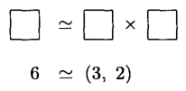

$$
\begin{aligned}
\|(2,2),(\bar{2},1)_1\rangle &= \sqrt{1/6} F_1 \|(2,2),(0,0)_1\rangle \\
&= \sqrt{1/2}\left\{|(0,0)_1\rangle|(\bar{2},1)\rangle + |(\bar{2},1)\rangle|(0,0)_1\rangle\right\},
\end{aligned}
$$

$$
\|(2,2),(\bar{4},2)\rangle = (1/2) F_1 \|(2,2),(\bar{2},1)_1\rangle = |(\bar{2},1)\rangle|(\bar{2},1)\rangle,
$$

$$
\begin{aligned}
\|(2,2),(\bar{2},1)_2\rangle &= \sqrt{1/2} F_1 \|(2,2),(0,0)_2\rangle \\
&= \sqrt{1/10}\left\{\sqrt{2}|(\bar{1},2)\rangle|(\bar{1},\bar{1})\rangle + \sqrt{3}|(\bar{2},1)\rangle|(0,0)_2\rangle + (\text{sym. terms})\right\},
\end{aligned}
$$

$$
\begin{aligned}
\|(2,2),(1,\bar{2})_1\rangle &= \sqrt{1/3} F_1 \|(2,2),(3,\bar{3})\rangle \\
&= \sqrt{1/6}\left\{|(2,\bar{1})\rangle|(\bar{1},\bar{1})\rangle + \sqrt{2}|(0,0)_1\rangle|(1,\bar{2})\rangle + (\text{sym. terms})\right\},
\end{aligned}
$$

$$
\begin{aligned}
\|(2,2),(\bar{1},\bar{1})_1\rangle &= (1/2) F_1 \|(2,2),(1,\bar{2})_1\rangle \\
&= \sqrt{1/6}\left\{\sqrt{2}|(0,0)_1\rangle|(\bar{1},\bar{1})\rangle + |(\bar{2},1)\rangle|(1,\bar{2})\rangle + (\text{sym. terms})\right\},
\end{aligned}
$$

$$
\begin{aligned}
\|(2,2),(\bar{3},0)\rangle &= \sqrt{1/3} F_1 \|(2,2),(\bar{1},\bar{1})_1\rangle \\
&= \sqrt{1/2}\left\{\sqrt{2}|(\bar{2},1)\rangle|(\bar{1},\bar{1})\rangle + |(\bar{1},\bar{1})\rangle|(\bar{2},1)\rangle\right\},
\end{aligned}
$$

$$
\begin{aligned}
\|(2,2),(1,\bar{2})_2\rangle &= (1/2) F_2 \|(2,2),(0,0)_3\rangle \\
&= \sqrt{1/60}\left\{-\sqrt{2}|(2,\bar{1})\rangle|(\bar{1},\bar{1})\rangle + |(0,0)_1\rangle|(1,\bar{2})\rangle \right. \\
&\quad \left. + 3\sqrt{3}|(0,0)_2\rangle|(1,\bar{2})\rangle + (\text{sym. terms})\right\},
\end{aligned}
$$

$$
\begin{aligned}
\|(2,2),(\bar{1},\bar{1})_2\rangle &= F_1 \|(2,2),(1,\bar{2})_2\rangle \\
&= \sqrt{1/60}\left\{-|(0,0)_1\rangle|(\bar{1},\bar{1})\rangle + 3\sqrt{3}|(0,0)_2\rangle|(\bar{1},\bar{1})\rangle + \sqrt{2}|(\bar{2},1)\rangle|(1,\bar{2})\rangle \right. \\
&\quad \left. + (\text{sym. terms})\right\},
\end{aligned}
$$

$$
\|(2,2),(2,\bar{4})_2\rangle = \sqrt{3/10}F_2 \|(2,2),(1,\bar{2})_2\rangle = |(1,\bar{2})\rangle|(1,\bar{2})\rangle,
$$

$$
\|(2,2),(0,\bar{3})\rangle = \sqrt{1/2}F_1 \|(2,2),(2,\bar{4})_2\rangle = \sqrt{1/2}\left\{|(1,\bar{2})\rangle|(\bar{1},\bar{1})\rangle + |(\bar{1},\bar{1})\rangle|(1,\bar{2})\rangle\right\},
$$

$$
\|(2,2),(\bar{2},\bar{2})\rangle = \sqrt{1/2}F_1 \|(2,2),(0,\bar{3})\rangle = |(\bar{1},\bar{1})\rangle|(\bar{1},\bar{1})\rangle
$$

根据上面的计算，知道表示 (2,2) 包含如下主权： (2,2), (3,0) 和 (0,3) 是单权， (1,1) 是二重权， (0,0) 是三重权。

其次，计算表示 (3,0) 和 (0,3) 的状态基展开式。最高权态的展开式已在 7.7 节中算出。现在通过降算符的作用，计算其他状态的展开式。

$$
\|(3,0),(3,0)\rangle = \sqrt{1/2}\left\{|1,1\rangle|2,\bar{1}\rangle - |2,\bar{1}\rangle|1,1\rangle\right\},
$$

$$
\begin{aligned}
\|(3,0),(1,1)\rangle &= \sqrt{1/3} F_1 \|(3,0),(3,0)\rangle \\
&= \sqrt{1/6}\left\{\sqrt{2}|(1,1)\rangle|(0,0)_1\rangle + |\bar{1},2\rangle|2,\bar{1}\rangle + (\text{antisym. terms})\right\},
\end{aligned}
$$

$$
\begin{aligned}
\|(3,0),(\bar{1},2)\rangle &= 2^{-1} F_1 \|(3,0),(1,1)\rangle \\
&= \sqrt{1/6}\left\{|(1,1)\rangle|(\bar{2},1)\rangle + \sqrt{2}|\bar{1},2\rangle|(0,0)_1\rangle + (\text{antisym. terms})\right\},
\end{aligned}
$$

$$
\begin{aligned}
\|(3,0),(\bar{3},3)\rangle &= \sqrt{1/3} F_1 \|(3,0),(\bar{1},2)\rangle = \sqrt{1/2}\left\{|\bar{1},2\rangle|\bar{2},1\rangle - |\bar{2},1\rangle|\bar{1},2\rangle\right\},
\end{aligned}
$$

$$
\begin{aligned}
\|(3,0),(2,\bar{1})\rangle &= F_2 \|(3,0),(1,1)\rangle \\
&= \sqrt{1/12}\left\{\sqrt{2}|1,1\rangle|1,\bar{2}\rangle + |2,\bar{1}\rangle|(0,0)_1\rangle - \sqrt{3}|2,\bar{1}\rangle|(0,0)_2\rangle \right. \\
&\quad \left. + (\text{antisym. terms})\right\},
\end{aligned}
$$

$$
\begin{aligned}
\|(3,0),(0,0)\rangle &= \sqrt{1/2} F_2 \|(3,0),(\bar{1},2)\rangle \\
&= \sqrt{1/12}\left\{|1,1\rangle|\bar{1},\bar{1}\rangle + |\bar{1},2\rangle|1,\bar{2}\rangle + |2,\bar{1}\rangle|\bar{2},1\rangle - \sqrt{3}|(0,0)_1\rangle|(0,0)_2\rangle \right. \\
&\quad \left. + (\text{antisym. terms})\right\},
\end{aligned}
$$

$$
\begin{aligned}
\|(3,0),(1,\bar{2})\rangle &= \sqrt{1/2} F_2 \|(3,0),(0,0)\rangle \\
&= \sqrt{1/12}\left\{\sqrt{2}|2,\bar{1}\rangle|\bar{1},\bar{1}\rangle - |(0,0)_1\rangle|1,\bar{2}\rangle + \sqrt{3}|(0,0)_2\rangle|1,\bar{2}\rangle \right. \\
&\quad \left. + (\text{antisym. terms})\right\},
\end{aligned}
$$

$$
\|(3,0),(\bar{2},1)\rangle = \sqrt{1/3} F_2 \|(3,0),(\bar{3},3)\rangle
$$

$$
\begin{aligned}
&= \sqrt{1/12}\,\bigl\{ \sqrt{2}\,|\bar{1},2\rangle\,|\bar{1},\bar{1}\rangle + |(0,0)_1\rangle|\bar{2},1\rangle + \sqrt{3}\,|(0,0)_2\rangle|\bar{2},1\rangle \\
&\quad + (\text{antisym. terms}) \bigr\},
\end{aligned}
$$

$$
\begin{aligned}
\|(3,0),(\bar{1},\bar{1})\rangle &= 2^{-1}\,F_2\,\|(3,0),(\bar{2},1)\rangle \\
&= \sqrt{1/12}\,\bigl\{ |(0,0)_1\rangle\,|\bar{1},\bar{1}\rangle + \sqrt{3}\,|(0,0)_2\rangle\,|\bar{1},\bar{1}\rangle - \sqrt{2}\,|\bar{2},1\rangle\,|1,\bar{2}\rangle \\
&\quad + (\text{antisym. terms}) \bigr\},
\end{aligned}
$$

$$
\|(3,0),(0,\bar{3})\rangle = \sqrt{1/3}\,F_2\,\|(3,0),(\bar{1},\bar{1})\rangle = \sqrt{1/2}\,\bigl\{ |1,\bar{2}\rangle\,|\bar{1},\bar{1}\rangle - |\bar{1},\bar{1}\rangle|1,\bar{2}\rangle \bigr\}
$$

$(0,3)$ 表示的状态展开式可类似得到，结果也很类似，只是把上式所有状态中权 $m$ 的两个分量交换，但 $|(0,0)_1\rangle$ 和 $|(0,0)_2\rangle$ 要分别换成 $(|(0,0)_1\rangle + \sqrt{3}|(0,0)_2\rangle)/2$ 和 $(\sqrt{3}|(0,0)_1\rangle - |(0,0)_2\rangle)/2$。也可按计算共轭表示状态基的办法式（7.160），把表示 $(3,0)$ 的状态基展开式作如下变换：两乘积状态交换次序，所有权改符号。例如

$$
\begin{aligned}
\|(0,3),(0,0)\rangle &= \sqrt{1/12}\,\bigl\{ |1,1\rangle\,|\bar{1},\bar{1}\rangle + |\bar{1},2\rangle\,|1,\bar{2}\rangle + |2,\bar{1}\rangle\,|\bar{2},1\rangle \\
&\quad + \sqrt{3}\,|(0,0)_1\rangle\,|(0,0)_2\rangle + (\text{antisym. terms}) \bigr\}
\end{aligned}
$$

$(1,1)$ 的最高权态展开式有两个，分别对乘积状态交换对称和反对称，以下标 $S$ 和 $A$ 标记。在降算符作用下得到

$$
\begin{aligned}
\|(1,1),(1,1)\rangle_S &= \sqrt{1/20}\,\bigl\{ \sqrt{3}\,|1,1\rangle\,|(0,0)_1\rangle + |1,1\rangle|(0,0)_2\rangle \\
&\quad - \sqrt{6}\,|\bar{1},2\rangle|2,\bar{1}\rangle + (\text{sym. terms}) \bigr\},
\end{aligned}
$$

$$
\begin{aligned}
\|(1,1),(\bar{1},2)\rangle_S &= F_1\,\|(1,1),(1,1)\rangle_S \\
&= \sqrt{1/20}\,\bigl\{ \sqrt{6}\,|1,1\rangle|\bar{2},1\rangle - \sqrt{3}\,|\bar{1},2\rangle|(0,0)_1\rangle + |\bar{1},2\rangle|(0,0)_2\rangle + (\text{sym. terms}) \bigr\},
\end{aligned}
$$

$$
\begin{aligned}
\|(1,1),(2,\bar{1})\rangle_S &= F_2\,\|(1,1),(1,1)\rangle_S \\
&= \sqrt{1/20}\,\bigl\{ \sqrt{6}|1,1\rangle|1,\bar{2}\rangle - 2|2,\bar{1}\rangle|(0,0)_2\rangle + (\text{sym. terms}) \bigr\},
\end{aligned}
$$

$$
\begin{aligned}
\|(1,1),(0,0)_1\rangle_S &= \sqrt{1/2}\,F_1\,\|(1,1),(2,\bar{1})\rangle_S \\
&= \sqrt{1/20}\,\bigl\{ \sqrt{3}\,|1,1\rangle|\bar{1},\bar{1}\rangle + \sqrt{3}\,|\bar{1},2\rangle|1,\bar{2}\rangle - 2\,|(0,0)_1\rangle|(0,0)_2\rangle + (\text{sym. terms}) \bigr\},
\end{aligned}
$$

$$
\begin{aligned}
\|(1,1),(0,0)_2\rangle_S &= \sqrt{2/3}\,\Bigl\{ F_2\,\|(1,1),(\bar{1},2)\rangle_S - \sqrt{1/2}\,\|(1,1),(0,0)_1\rangle_S \Bigr\} \\
&= \sqrt{1/20}\,\bigl\{ |1,1\rangle|\bar{1},\bar{1}\rangle - |\bar{1},2\rangle|1,\bar{2}\rangle + 2\,|2,\bar{1}\rangle|\bar{2},1\rangle + (\text{sym. terms}) \\
&\quad - 2\,|(0,0)_1\rangle|(0,0)_1\rangle + 2\,|(0,0)_2\rangle|(0,0)_2\rangle \bigr\},
\end{aligned}
$$

$$
\begin{aligned}
\|(1,1),(1,1)\rangle_A &= \sqrt{1/12}\,\bigl\{ |1,1\rangle|(0,0)_1\rangle - \sqrt{3}\,|1,1\rangle|(0,0)_2\rangle \\
&\quad - \sqrt{2}\,|\bar{1},2\rangle|2,\bar{1}\rangle + (\text{antisym. terms}) \bigr\},
\end{aligned}
$$

$$
\begin{aligned}
\|(1,1),(\bar{1},2)\rangle_A &= \sqrt{1/12}\,\bigl\{ \sqrt{2}\,|1,1\rangle\,|\bar{2},1\rangle - |\bar{1},2\rangle\,|(0,0)_1\rangle - \sqrt{3}\,|\bar{1},2\rangle\,|(0,0)_2\rangle \\
&\quad + (\text{antisym. terms}) \bigr\},
\end{aligned}
$$

$$
\|(1,1),(2,\bar{1})\rangle_A = \sqrt{1/6}\,\bigl\{ -|1,1\rangle|1,\bar{2}\rangle + \sqrt{2}\,|2,\bar{1}\rangle|(0,0)_1\rangle + (\text{antisym. terms}) \bigr\},
$$

$$
\begin{aligned}
\|(1,1),(0,0)_1\rangle_A &= \sqrt{1/12}\,\bigl\{ -|1,1\rangle|\bar{1},\bar{1}\rangle - |\bar{1},2\rangle|1,\bar{2}\rangle + 2\,|2,\bar{1}\rangle|\bar{2},1\rangle \\
&\quad + (\text{antisym. terms}) \bigr\},
\end{aligned}
$$

$$
\|(1,1),(0,0)_2\rangle_A = 2^{-1}\,\bigl\{ |1,1\rangle|\bar{1},\bar{1}\rangle - |\bar{1},2\rangle|1,\bar{2}\rangle + (\text{antisym. terms}) \bigr\}
$$

其余状态展开式从略。

## 附录 32 盖尔范德基

盖尔范德（Gelfand）提出一种统一的方法，标记 SU($N$) 群不可约表示 $[\lambda]$ 的正交归一的状态基，称为盖尔范德基。他规定在出现重权时先按 $A_1$ 子代数的多重态来区分，如再有重权，按 $A_2$ 子代数的多重态来区分，依此类推。在此条件下，他解析地推导出生成元（谢瓦莱基）在盖尔范德基里的表示矩阵元。

盖尔范德基用 $N(N+1)/2$ 个参数 $\omega_{ab}$ 描写，$1 \leqslant a \leqslant b \leqslant N$。这组参数排列成一个倒置的三角形

$$
|\omega_{ab}\rangle =
\left(
\begin{array}{ccccc}
\omega_{1N} & \omega_{2N} & \cdots & \omega_{(N-1)N} & \omega_{NN} \\
& \omega_{1(N-1)} & \cdots & \cdots & \omega_{(N-1)(N-1)} \\
& & \cdots & \cdots & \\
& \omega_{12} & \omega_{22} & & \\
& & \omega_{11} & &
\end{array}
\right)
\tag{A32.1}
$$

对 SU($N$) 群不可约表示 $[\lambda]$ 的一个权为 $m$ 的基，有

$$
\begin{aligned}
&\omega_{\mu N} = \lambda_\mu \,, \qquad \omega_{NN} = \lambda_N = 0 \,, \qquad \omega_{ab} \geqslant \omega_{a(b-1)} \geqslant \omega_{(a+1)b}, \\
&m_\mu = -\sum_{a=1}^{\mu+1} \omega_{a(\mu+1)} + 2\sum_{a=1}^{\mu} \omega_{a\mu} - \sum_{a=1}^{\mu-1} \omega_{a(\mu-1)} \,, \qquad \omega_{a0} = 0, \\
&1 \leqslant a \leqslant b \leqslant N \,, \qquad 1 \leqslant \mu \leqslant (N-1)
\end{aligned}
\tag{A32.2}
$$

生成元谢瓦莱基的矩阵形式解析表达式为

$$
H_\mu\,|\omega_{ab}\rangle = m_\mu\,|\omega_{ab}\rangle = \left\{ -\sum_{c=1}^{\mu+1} \omega_{c(\mu+1)} + 2\sum_{c=1}^{\mu} \omega_{c\mu} - \sum_{c=1}^{\mu-1} \omega_{c(\mu-1)} \right\}|\omega_{ab}\rangle,
$$

$$
E_\mu\,|\omega_{ab}\rangle = \sum_{\nu=1}^{\mu} A_{\nu\mu}(\omega_{ab})\,|\omega_{ab} + \delta_{a\nu}\delta_{b\mu}\rangle,
$$

$$
F_\mu\,|\omega_{ab}\rangle = \sum_{\nu=1}^{\mu} A_{\nu\mu}(\omega_{ab} - \delta_{a\nu}\delta_{b\mu})\,|\omega_{ab} - \delta_{a\nu}\delta_{b\mu}\rangle,
$$

$$
A_{\nu\mu}(\omega_{ab}) = \left\{ -\prod_{\tau=1}^{\mu-1} \left(\omega_{\tau(\mu-1)} - \omega_{\nu\mu} - \tau + \nu - 1\right) \right\}^{1/2}
$$

$$
\times \left\{ \frac{\prod\limits_{\rho=1}^{\mu+1} \left(\omega_{\rho(\mu+1)} - \omega_{\nu\mu} - \rho + \nu\right)}{\prod\limits_{\substack{\lambda \ne \nu \\ \lambda=1}}^{\mu} \left(\omega_{\lambda\mu} - \omega_{\nu\mu} - \lambda + \nu\right)\left(\omega_{\lambda\mu} - \omega_{\nu\mu} - \lambda + \nu - 1\right)} \right\}^{1/2}
\tag{A32.3}
$$

用文字表述：$H_\mu$ 的本征值等于盖尔范德基中倒数第 $\mu$ 行的参数之和的两倍减去倒数第 $\mu-1$ 行和第 $\mu+1$ 行的参数之和。$E_\mu$（$F_\mu$）作用在盖尔范德基上得到基的线性组合，新基的参数是把原基中倒数第 $\mu$ 行的某一个参数，在满足式（A32.2）的条件下，增加（减少）1。

作为例子，下面列出 SU(3) 群不可约表示 $[2,1]$ 的盖尔范德基所对应的权和正则张量杨表

$$
\begin{array}{|c|c|}
\hline 1 & 1 \\ \hline 2 &  \\ 
\end{array}
= |1,1\rangle =
\left|\begin{array}{ccc} 2 & 1 & 0 \\ & 2 & 1 \\ & & 2 \end{array}\right\rangle,
\qquad
\begin{array}{|c|c|}
\hline 1 & 2 \\ \hline 2 &  \\ 
\end{array}
= |\bar{1},2\rangle =
\left|\begin{array}{ccc} 2 & 1 & 0 \\ & 2 & 1 \\ & & 1 \end{array}\right\rangle,
$$

$$
\begin{array}{|c|c|}
\hline 1 & 1 \\ \hline 3 &  \\ 
\end{array}
= |2,\bar{1}\rangle =
\left|\begin{array}{ccc} 2 & 1 & 0 \\ & 2 & 0 \\ & & 2 \end{array}\right\rangle,
\qquad
\begin{array}{|c|c|}
\hline 2 & 2 \\ \hline 3 &  \\ 
\end{array}
= |\bar{2},1\rangle =
\left|\begin{array}{ccc} 2 & 1 & 0 \\ & 2 & 0 \\ & & 0 \end{array}\right\rangle,
$$

$$
\begin{array}{|c|c|}
\hline 1 & 3 \\ \hline 3 &  \\ 
\end{array}
= |1,\bar{2}\rangle =
\left|\begin{array}{ccc} 2 & 1 & 0 \\ & 1 & 0 \\ & & 1 \end{array}\right\rangle,
\qquad
\begin{array}{|c|c|}
\hline 2 & 3 \\ \hline 3 &  \\ 
\end{array}
= |\bar{1},\bar{1}\rangle =
\left|\begin{array}{ccc} 2 & 1 & 0 \\ & 1 & 0 \\ & & 0 \end{array}\right\rangle,
$$

$$
\sqrt{2}\,
\begin{array}{|c|c|}
\hline 1 & 2 \\ \hline 3 &  \\ 
\end{array}
- \sqrt{1/2}\,
\begin{array}{|c|c|}
\hline 1 & 3 \\ \hline 2 &  \\ 
\end{array}
= |(0,0)_1\rangle =
\left|\begin{array}{ccc} 2 & 1 & 0 \\ & 2 & 0 \\ & & 1 \end{array}\right\rangle,
$$

$$
\sqrt{3/2}\,
\begin{array}{|c|c|}
\hline 1 & 3 \\ \hline 2 &  \\ 
\end{array}
= |(0,0)_2\rangle =
\left|\begin{array}{ccc} 2 & 1 & 0 \\ & 1 & 1 \\ & & 1 \end{array}\right\rangle
\tag{A32.4}
$$

### 计算 E_2 对态 |1,2̄⟩ 的作用

$$
E_2 \left|\begin{array}{ccc} 2 & 1 & 0 \\ & 1 & 0 \\ & & 1 \end{array}\right\rangle
= A_{12} \left|\begin{array}{ccc} 2 & 1 & 0 \\ & 2 & 0 \\ & & 1 \end{array}\right\rangle
+ A_{22} \left|\begin{array}{ccc} 2 & 1 & 0 \\ & 1 & 1 \\ & & 1 \end{array}\right\rangle,
$$

$$
A_{12} = \left\{ \frac{-(-1)(1)(-1)(-3)}{(-2)(-3)} \right\}^{1/2} = \sqrt{1/2},
$$

$$
A_{22} = \left\{ \frac{-(1)(3)(1)(-1)}{(2)(1)} \right\}^{1/2} = \sqrt{3/2}
$$

## 附录 33 SU(N) 群协变和逆变张量基的互相转化

8.3 节第三小节已经证明了完全反对称的协变张量基和逆变张量基的互相转化公式（8.59）和（8.62）。现在要把它们推广到一般形式式（8.63）。分几步证明。第一步把式（8.59）中完全反对称的张量基 $\mathcal{Y}^{[1^m]}\Theta^{b_1\cdots b_m}$ 推广到包含有协变指标的无迹张量基情况。设 $\Omega^{b_1\cdots b_m}_{c\cdots}$ 是对应表示 $[\lambda]\backslash[1^m]^*$ 的无迹张量基，其中逆变张量指标 $b_j$ 完全反对称，协变张量部分是对应杨图 $[\lambda]$ 的正则张量杨表，杨图 $[\lambda]$ 的行数不大于 $N-m$，$c$ 是任意一个协变指标，它与每一个逆变指标 $b_j$ 之间都是无迹的

$$
\Omega^{b_1\cdots b_j\cdots b_k\cdots b_m}_{c\cdots} = -\Omega^{b_1\cdots b_k\cdots b_j\cdots b_m}_{c\cdots}
\tag{A33.1}
$$

$$
\sum_{c=1}^{N}\sum_{b_j=1}^{N} \delta_{cb_j}\,\Omega^{b_1\cdots b_j\cdots b_m}_{c\cdots} = 0
\tag{A33.2}
$$

类似式（8.59），用乘完全反对称张量并把 $m$ 对指标收缩的办法，可把逆变张量变成协变张量，属表示 $[1^{N-m}]$

$$
\Phi_{a_1\cdots a_{N-m}c\cdots} = \frac{1}{m!}\sum_{b_1\cdots b_m} \epsilon_{a_1\cdots a_{N-m}b_1\cdots b_m}\,\Omega^{b_1\cdots b_m}_{c\cdots}
\tag{A33.3}
$$

与式（8.59）不同之处在于 $\Omega$ 原来就有协变张量指标，对应表示 $[\lambda]$。现在两部分协变张量要直乘，直乘后的表示应该按式（8.49）用立特武德－理查森规则计算。我们要证明，原张量基 $\Omega^{b_1\cdots b_m}_{c\cdots}$ 的无迹条件（A33.2）会使直乘表示 $[1^{N-m}]\times[\lambda]$ 的分解中只保留把两表示直接粘在一起的一项 $[\lambda']$

$$
\lambda'_k = \lambda_k + 1, \qquad 1 \leqslant k \leqslant N-m
\tag{A33.4}
$$

而按立特武德－理查森规则计算的其他项都对应零空间。就是说，要证明至少把一个协变指标 $c$ 与新产生的协变指标 $a_j$ 全反对称化的项都是零

$$
\begin{aligned}
&\sum_{a_1\cdots a_{N-m}c} \epsilon^{a_1\cdots a_{N-m}d_1\cdots d_{m-1}c}\,\Phi_{a_1\cdots a_{N-m}c\cdots} \\
&= \frac{1}{m!}\sum_{a_1\cdots a_{N-m}cb_1\cdots b_m} \epsilon^{a_1\cdots a_{N-m}d_1\cdots d_{m-1}c}\,\epsilon_{a_1\cdots a_{N-m}b_1\cdots b_m}\,\Omega^{b_1\cdots b_m}_{c\cdots} = 0
\end{aligned}
\tag{A33.5}
$$

因为按式（1.14）

$$
\sum_{a_1\cdots a_{N-m}} \epsilon^{a_1\cdots a_{N-m}d_1\cdots d_{m-1}c}\,\epsilon_{a_1\cdots a_{N-m}b_1\cdots b_m}
$$

等于 $m!$ 项之和，每项都是 $m$ 个 $\delta$ 函数的乘积，其中分别有一个因子 $\delta_{cb_j}$。由于式（A33.2），它代入式（A33.5）得零。这样，我们证明了下面两表示等价

$$
[\lambda]\backslash[1^m]^* \simeq [\lambda']
\tag{A33.6}
$$

杨图 $[\lambda']$ 是 $N-m$ 行的，去掉第一列得杨图 $[\lambda]$。类似地有 $[1^m]\backslash[\lambda]^* \simeq [\lambda']^*$。换一下符号，得

$$
[\tau]^* \simeq [1^{N-m}]\backslash[\tau']^*, \qquad \tau'_k = \tau_k - 1, \qquad 1 \leqslant k \leqslant m
\tag{A33.7}
$$

其中，杨图 $[\tau]$ 的行数为 $m$，去掉第一列后得杨图 $[\tau']$。对应式（A33.7）的张量基转换为

$$
\Phi^{c\cdots}_{a_1\cdots a_{N-m}} = \frac{1}{m!}\sum_{b_1\cdots b_m} \epsilon_{a_1\cdots a_{N-m}b_1\cdots b_m}\,\mathcal{Y}^{[\tau]}\Theta^{b_1\cdots b_m c\cdots}
\tag{A33.8}
$$

其中，不可约张量基 $\mathcal{Y}^{[\tau]}\Theta^{b_1\cdots b_m c\cdots}$ 的正则张量杨表形如

$$
\begin{array}{|c|c|c|}
\hline
b_1 & & \\ \hline
b_2 & c & \\ \hline
\vdots & \vdots &  \\
\vdots &  &  \\ 
b_m & & \\ 
\end{array}
\tag{A33.9}
$$

根据福克条件式（6.69），正则张量杨表满足

$$
\mathcal{Y}^{[\tau]}\Theta^{b_1\cdots b_m c\cdots} - \sum_{j=1}^{m} \mathcal{Y}^{[\tau]}\Theta^{b_1\cdots b_{j-1}c b_{j+1}\cdots b_m b_j\cdots} = 0
\tag{A33.10}
$$

条件式（A33.10）保证了张量基 $\Phi^{c\cdots}_{a_1\cdots a_{N-m}}$ 是无迹的。事实上

$$
\sum_{c=1}^{N} \Phi^{c\cdots}_{a_1\cdots a_{i-1}c a_{i+1}\cdots a_{N-m}} = \frac{1}{m!}\sum_{c b_1\cdots b_m} \epsilon_{a_1\cdots a_{i-1}c a_{i+1}\cdots a_{N-m}b_1\cdots b_m}\,\mathcal{Y}^{[\tau]}\Theta^{b_1\cdots b_m c\cdots}
\tag{A33.11}
$$

等式右面 $c$ 和 $m$ 个 $b_j$ 都是求和指标，而且作为反对称张量 $\epsilon$ 的下标它们是反对称的。把求和指标 $c$ 和 $b_j$ 交换，再在 $\epsilon$ 中把它们换回来，其效果只是把后面的张量基做如下替换

$$
\mathcal{Y}^{[\tau]}\Theta^{b_1\cdots b_m c\cdots} \longrightarrow -\mathcal{Y}^{[\tau]}\Theta^{b_1\cdots b_{j-1}c b_{j+1}\cdots b_m b_j\cdots}
$$

这替换正是把式（A33.10）的第一项换成后面求和式中的任何一项。因此，可把式（A33.11）左边的张量基 $\mathcal{Y}^{[\tau]}\Theta^{b_1\cdots b_m c\cdots}$ 换成式（A33.10）的右边并除以 $m+1$，而由式（A33.10）知它为零

$$
\begin{aligned}
\sum_{c=1}^{N} \Phi^{c\cdots}_{a_1\cdots a_{i-1}c a_{i+1}\cdots a_{N-m}} &= \frac{1}{(m+1)!}\sum_{c b_1\cdots b_m} \epsilon_{a_1\cdots a_{i-1}c a_{i+1}\cdots a_{N-m}b_1\cdots b_m} \\
&\quad \times \left\{ \mathcal{Y}^{[\tau]}\Theta^{b_1\cdots b_m c\cdots} - \sum_{j=1}^{m} \mathcal{Y}^{[\tau]}\Theta^{b_1\cdots b_{j-1}c b_{j+1}\cdots b_m b_j\cdots} \right\} = 0
\end{aligned}
\tag{A33.12}
$$

最后，证明最一般的情况式（8.63）。设 $\Omega^{b_1\cdots b_m c\cdots}_{d\cdots}$ 是对应表示 $[\lambda]\backslash[\tau]^*$ 的无迹张量基，其中逆变张量部分对应类似式（A33.9）的正则张量杨表，协变张量部分是对应杨图 $[\lambda]$ 的正则张量杨表，杨图 $[\tau]^*$ 的行数为 $m$，杨图 $[\lambda]$ 的行数不大于 $N-m$，$d$ 是任意一个协变指标，它与每一个逆变指标 $b_j$ 或 $c$ 之间都是无迹的。当用完全反对称张量把对应逆变张量部分的正则张量杨表第一列变为协变指标时

$$
\Phi^{c\cdots}_{a_1\cdots a_{N-m}d\cdots} = \frac{1}{m!}\sum_{b_1\cdots b_m} \epsilon_{a_1\cdots a_{N-m}b_1\cdots b_m}\,\Omega^{b_1\cdots b_m c\cdots}_{d\cdots}
\tag{A33.13}
$$

$\Phi$ 的协变张量部分对应两个杨图的外积

$$
[1^{N-m}]\times[\lambda]
$$

在克莱布施－戈登级数中，除了把两个杨图粘起来的项 $[\lambda']$ 外，其他项都至少有一个原来的协变指标（例如 $d$）和所有新的协变指标 $a_j$ 完全反对称化。把这些指标反对称化，相当于式（A33.13）乘反对称张量

$$
\epsilon^{a_1\cdots a_{N-m}b'_1\cdots b'_{m-1}d}
$$

并对 $d$ 和所有 $a_i$ 求和，这样就会产生 $m$ 个 $\delta$ 函数的乘积项之和，每一项中都含有一个因子 $\delta_{db_j}$。既然指标 $d$ 和所有 $b_j$ 都无迹，这样的项为零。现在新张量基 $\Phi^{c\cdots}_{a_1\cdots a_{N-m}d\cdots}$ 的逆变张量部分对应正则张量杨表 $[\tau']$，协变张量部分对应正则张量杨表 $[\lambda']$，$c$ 和 $d$ 之间本来就无迹，$c$ 和新协变指标 $a_i$ 之间已由式（A33.12）证明为无迹，因而新张量基属不可约表示 $[\lambda']\backslash[\tau']$。证完。

## 附录 34 SU(3) 群不可约表示的具体形式

则张量杨表具体展开成张量基 $\Theta_{a_1\cdots a_n}$ 的组合时，这组合系数构成的矩阵 $X$，正是把 SU($N$) 群自身表示的直乘形式约化为不可约表示直和的相似变换矩阵

$$
X\,(u\times u\times\cdots\times u)\,X^{-1} = \bigoplus_{[\lambda]} d_{[\lambda]}D^{[\lambda]}(u)
\tag{A34.1}
$$

其中，杨图 $[\lambda]$ 的格数为 $n$，$d_{[\lambda]}$ 是置换群表示 $[\lambda]$ 的维数。采用这种方法一般需要借用计算机。

物理上更常用的方法是利用外尔互反性，直接采用直乘表示的形式。用杨算符投影得到的张量基，指标之间具有确定的对称性质，而且这种对称性质在 SU($N$) 变换中保持不变。因此正则张量杨表在 SU($N$) 变换中仍可按 SU($N$) 群自身表示的直乘来变换，例如

$$
O_u\,
\begin{array}{|c|c|}
\hline a & b \\ \hline c &  \\ 
\end{array}
= \sum_{a'b'c'}
\begin{array}{|c|c|}
\hline a' & b' \\ \hline c' &  \\ 
\end{array}
u_{a'a}u_{b'b}u_{c'c}
\tag{A34.2}
$$

等式右面出现的非正则的张量杨表，可以表为正则张量杨表的线性组合，从而得到正则张量杨表的变换矩阵。

也可采用更直接的方法。把李群的群元素分解成若干个单参数子群元素的乘积，这种分解的方法，本质上就是在 SO(3) 群中根据群元素的矩阵形式确定欧拉角的方法的推广。这些子李群的生成元取为 $H_\mu$ 或 $-\mathrm{i}(E_\mu - F_\mu)/2$。它们在 $A_\mu$ 多重态中的表示矩阵类似 SU(2) 群的 $2I_3$ 或 $I_2$，因而单参数子群元素在 $A_\mu$ 多重态中的表示矩阵是对角矩阵或 $d^j$ 矩阵。在用方块权图方法计算李群不可约表示生成元的矩阵形式时，已经得到状态基和子代数 $A_\mu$ 多重态的基之间的组合关系，这种组合关系就是相似变换关系。根据这相似变换关系可以计算单参数子群元素在李群不可约表示中的表示矩阵。

先复习一下 SO(3) 群中，根据元素 $R$ 在自身表示中的矩阵形式确定欧拉角的方法。$R$ 矩阵的第三列，作为列矩阵，描写三维空间的单位矢量 $\hat{n}$。设它的极角是 $\beta$，方位角是 $\alpha$，则转动 $S(\alpha,\beta)$ 把 $x_3$ 轴转到 $\hat{n}$ 方向。因此，$S(\alpha,\beta)^{-1}R$ 是绕 $x_3$ 轴的转动变换，记作 $R(\vec{e}_3,\gamma)$

$$
R = S(\alpha,\beta)R(\vec{e}_3,\gamma) = R(\vec{e}_3,\alpha)R(\vec{e}_2,\beta)R(\vec{e}_3,\gamma)
$$

这方法的关键是，$R$ 矩阵第三列是三维空间的单位矢量 $\hat{n}$，找转动 $S(\alpha,\beta)^{-1}$，把 $\hat{n}$ 方向转到 $x_3$ 轴方向去，从而把 SO(3) 转动 $R$ 简化为 SO(2) 转动。推广到 SU($N$) 群，群元素 $u$ 的第 $N$ 列是 $N$ 维复空间的单位矢量，可用 $u^{-1}\in\mathrm{SU}(N)$ 变换把上述方向转到 $N$ 维复空间的第 $N$ 个正方向，即变成的矢量只有第 $N$ 个分量为 1，其余分量都为 0。从而把 SU($N$) 变换简化为 SU($N-1$) 变换。$u$ 变换有 $2N-1$ 个参数，正好是 SU($N$) 群和 SU($N-1$) 群的参数之差

$$
\{N^2-1\} - \{(N-1)^2-1\} = 2N-1
$$

下面我们以 SU(3) 群为例，具体说明这一方法。

SU(3) 群有八个生成元，我们更关心其中四个生成元，把它们表成谢瓦莱基的组合

$$
\begin{aligned}
2T_3 &= H_1\,, & \{\sqrt{3}T_8 - T_3\} &= H_2, \\
T_2 &= (2\mathrm{i})^{-1}(E_1 - F_1)\,, & T_7 &= (2\mathrm{i})^{-1}(E_2 - F_2)
\end{aligned}
\tag{A34.3}
$$

它们生成的单参数子李群的元素，在自身表示中取如下形式

$$
R_1(\varphi) \equiv \mathrm{e}^{-\mathrm{i}\varphi H_1} =
\begin{pmatrix}
\mathrm{e}^{-\mathrm{i}\varphi} & 0 & 0 \\
0 & \mathrm{e}^{\mathrm{i}\varphi} & 0 \\
0 & 0 & 1
\end{pmatrix},
\qquad
R_2(\varphi) \equiv \mathrm{e}^{-\mathrm{i}\varphi H_2} =
\begin{pmatrix}
1 & 0 & 0 \\
0 & \mathrm{e}^{-\mathrm{i}\varphi} & 0 \\
0 & 0 & \mathrm{e}^{\mathrm{i}\varphi}
\end{pmatrix},
$$

$$
S_1(\theta) \equiv \mathrm{e}^{-\mathrm{i}\theta T_2} =
\begin{pmatrix}
\cos(\theta/2) & -\sin(\theta/2) & 0 \\
\sin(\theta/2) & \cos(\theta/2) & 0 \\
0 & 0 & 1
\end{pmatrix},
$$

$$
S_2(\theta) \equiv \mathrm{e}^{-\mathrm{i}\theta T_7} =
\begin{pmatrix}
1 & 0 & 0 \\
0 & \cos(\theta/2) & -\sin(\theta/2) \\
0 & \sin(\theta/2) & \cos(\theta/2)
\end{pmatrix}
$$

现把 SU(3) 群任意元素 $u$ 的第三列矩阵元素表成如下形式

$$
\begin{pmatrix} u_{13} \\ u_{23} \\ u_{33} \end{pmatrix}
=
\begin{pmatrix}
s_1s_2r_1^{-1}r_2^{-1}r_3 \\
-c_1s_2r_1r_2^{-1}r_3 \\
c_2r_2r_3
\end{pmatrix}
= R_1(\varphi_1)S_1(\theta_1)R_2(\varphi_2)S_2(\theta_2)R_2(\varphi_3)
\begin{pmatrix} 0 \\ 0 \\ 1 \end{pmatrix}
$$

其中，$c_i = \cos(\theta_i/2)$，$s_i = \sin(\theta_i/2)$ 和 $r_i = \exp(\mathrm{i}\varphi_i)$。提出这五个变换后，$u$ 化为 SU(2) 变换，它的第二列又可表为

$$
\begin{pmatrix} u'_{12} \\ u'_{22} \\ 0 \end{pmatrix}
=
\begin{pmatrix}
-s_3r_4^{-1}r_5 \\
c_3r_4r_5 \\
0
\end{pmatrix}
= R_1(\varphi_4)S_1(\theta_3)R_1(\varphi_5)
\begin{pmatrix} 0 \\ 1 \\ 0 \end{pmatrix}
$$

因此

$$
\begin{aligned}
u &= R_1(\varphi_1)S_1(\theta_1)R_2(\varphi_2)S_2(\theta_2)R_2(\varphi_3)R_1(\varphi_4)S_1(\theta_3)R_1(\varphi_5) \\
&= \begin{pmatrix}
u_{11} & u_{12} & s_1s_2r_1^{-1}r_2^{-1}r_3 \\
u_{21} & u_{22} & -c_1s_2r_1r_2^{-1}r_3 \\
s_2s_3r_2r_3^{-1}r_4r_5^{-1}\,, & s_2c_3r_2r_3^{-1}r_4r_5 & c_2r_2r_3
\end{pmatrix}
\end{aligned}
\tag{A34.4}
$$

$$
\begin{aligned}
u_{11} &= (c_1c_3r_4^{-1} - s_1c_2s_3r_2^{-1}r_3^{-1}r_4)\,r_1^{-1}r_5^{-1},\\
u_{12} &= (-c_1s_3r_4^{-1} - s_1c_2c_3r_2^{-1}r_3^{-1}r_4)\,r_1^{-1}r_5,\\
u_{21} &= (s_1c_3r_4^{-1} + c_1c_2s_3r_2^{-1}r_3^{-1}r_4)\,r_1r_5^{-1},\\
u_{22} &= (-s_1s_3r_4^{-1} + c_1c_2c_3r_2^{-1}r_3^{-1}r_4)\,r_1r_5
\end{aligned}
$$

根据第三列矩阵元素定出 $\theta_1$，$\theta_2$，$\varphi_1$，$\varphi_2$ 和 $\varphi_3$，再根据第三行矩阵元素定出 $\theta_3$，$\varphi_4$ 和 $\varphi_5$。具体说，设 $u_{ab}$ 的模和幅角分别为 $\rho_{ab}$ 和 $\Phi_{ab}$，则

$$
\begin{aligned}
\cos(\theta_1/2) &= \rho_{23}/\sin(\theta_2/2)\,, & \cos(\theta_2/2) &= \rho_{33},\\
\cos(\theta_3/2) &= \rho_{32}/\sin(\theta_2/2)\,, & 0 &\leqslant \theta_j \leqslant \pi,\\
\varphi_2 &= (-\Phi_{13} - \Phi_{23} + 2\Phi_{33} + \pi)/4\,, & \varphi_1 &= (-\Phi_{13} + \Phi_{23} - \pi)/2,\\
\varphi_3 &= (\Phi_{13} + \Phi_{23} + 2\Phi_{33} - \pi)/4\,, & \varphi_5 &= (\Phi_{32} - \Phi_{31})/2,\\
\varphi_4 &= (\Phi_{32} + \Phi_{31})/2 - \varphi_2 + \varphi_3\,, & -\pi &\leqslant \varphi_j \leqslant \pi
\end{aligned}
$$

SU($N$) 群的群元素共轭于取对角矩阵的群元素。对 SU(3) 群，取对角矩阵的群元素可用参数 $\varphi_3$ 和 $\varphi_5$ 描写，其余参数取为零

$$
\begin{aligned}
u &= \mathrm{diag}\left\{e^{-i\varphi_3},\, e^{i(\varphi_3-\varphi_5)},\, e^{i\varphi_5}\right\},\\
&-\pi \leqslant \varphi_3 \leqslant \pi\,,\qquad -\pi \leqslant \varphi_5 \leqslant \pi\\
&\theta_1 = \theta_2 = \theta_3 = 0\,,\qquad \varphi_1 = \varphi_2 = \varphi_4 = 0
\end{aligned}
$$

参数 $\varphi_3$ 和 $\varphi_5$ 描写 SU(3) 群的类。

在用方块权图方法计算得的正交归一基中计算 $R_k(\varphi)$ 的表示矩阵比较简单，只要把 $H_k$ 的本征值乘上 $-i\varphi$，放到指数上即可。$S_k(\theta)$ 的表示矩阵，可根据子李代数 $A_k$ 的多重态，取相应的 SU(2) 表示矩阵 $d^j(\theta)$ 的形式，其中 $2j+1$ 等于该多重态的重数 $m_k+1$。例如，在 SU(3) 群表示 $[3]$ 中，把正交基编号

$$
\begin{aligned}
1:\ (3,0)\,, &\quad 2:\ (1,1)\,, &\quad 3:\ (\bar{1},2)\,, &\quad 4:\ (\bar{3},3)\,, &\quad 5:\ (2,\bar{1})\,,\\
6:\ (0,0)\,, &\quad 7:\ (\bar{2},1)\,, &\quad 8:\ (1,\bar{2})\,, &\quad 9:\ (\bar{1},\bar{1})\,, &\quad 10:\ (0,\bar{3})
\end{aligned}
\tag{A34.5}
$$

这四个子群元素取如下形式

$$
\begin{aligned}
D^{[3]}[R_1(\varphi)] &= \mathrm{diag}\left\{e^{-i3\varphi},\, e^{-i\varphi},\, e^{i\varphi},\, e^{i3\varphi},\, e^{-i2\varphi},\, 1,\, e^{i2\varphi},\, e^{-i\varphi},\, e^{i\varphi},\, 1\right\},\\
D^{[3]}[R_2(\varphi)] &= \mathrm{diag}\left\{1,\, e^{-i\varphi},\, e^{-i2\varphi},\, e^{-i3\varphi},\, e^{i\varphi},\, 1,\, e^{-i\varphi},\, e^{i2\varphi},\, e^{i\varphi},\, e^{i3\varphi}\right\},\\
D^{[3]}[S_1(\theta)] &= d^{3/2}(\theta) \oplus d^{1}(\theta) \oplus d^{1/2}(\theta) \oplus 1
\end{aligned}
\tag{A34.6}
$$

$D^{[3]}(S_1(\theta))$ 是四个子矩阵的直和，$d^{3/2}(\theta)$ 涉及的行（列）是 1，2，3 和 4，$d^{1}(\theta)$ 涉及的行（列）是 5，6 和 7，$d^{1/2}(\theta)$ 涉及的行（列）是 8 和 9，$d^{0}(\theta)=1$ 涉及第 10 行（列）。$D^{[3]}(S_2(\theta))$ 和 $D^{[3]}(S_1(\theta))$ 类似，也是这样四个子矩阵的直和，只是 $d^{3/2}(\theta)$ 涉及的行（列）是 4，7，9 和 10，$d^{1}(\theta)$ 涉及的行（列）是 3，6，和 8，$d^{1/2}(\theta)$ 涉及的行（列）是 2 和 5，$d^{0}(\theta)=1$ 涉及第 1 行（列）。

再例如，在 SU(3) 群伴随表示 $[2,1]$ 中，正交基作如下编号

$$
\begin{aligned}
1:\ (1,1)\,, &\quad 2:\ (\bar{1},2)\,, &\quad 3:\ (2,\bar{1})\,, &\quad 4:\ (0,0)_1\,,\\
5:\ (\bar{2},1)\,, &\quad 6:\ (0,0)_2\,, &\quad 7:\ (1,\bar{2})\,, &\quad 8:\ (\bar{1},\bar{1})
\end{aligned}
\tag{A34.7}
$$

这四个子群元素取如下形式

$$
\begin{aligned}
D^{[2,1]}(R_1(\varphi)) &= \mathrm{diag}\left\{e^{-i\varphi},\, e^{i\varphi},\, e^{-i2\varphi},\, 1,\, e^{i2\varphi},\, 1,\, e^{-i\varphi},\, e^{i\varphi}\right\},\\
D^{[2,1]}(R_2(\varphi)) &= \mathrm{diag}\left\{e^{-i\varphi},\, e^{-i2\varphi},\, e^{i\varphi},\, 1,\, e^{-i\varphi},\, 1,\, e^{i2\varphi},\, e^{i\varphi}\right\},\\
D^{[2,1]}(S_1(\theta)) &= d^{1/2}(\theta) \oplus d^{1}(\theta) \oplus 1 \oplus d^{1/2}(\theta)
\end{aligned}
\tag{A34.8}
$$

$D^{[2,1]}(S_1(\theta))$ 是四个子矩阵的直和，一个 $d^{1/2}(\theta)$ 涉及的行（列）是 1 和 2，另一个 $d^{1/2}(\theta)$ 涉及的行（列）是 7 和 8，$d^{1}(\theta)$ 涉及的行（列）是 3，4 和 5，$d^{0}(\theta)=1$ 涉及第 6 行（列）。$D^{[2,1]}(S_2(\theta))$ 的第 1 和第 3 行（列）子矩阵是 $d^{1/2}(\theta)$，第 5 和第 8 行（列）子矩阵也是 $d^{1/2}(\theta)$，第 2，第 4，第 6 和第 7 行（列）子矩阵取如下形式

$$
X\begin{pmatrix} d^{1}(\theta) & \\ & 1 \end{pmatrix}X^{-1}\,,\qquad
X = \begin{pmatrix}
1 & 0 & 0 & 0\\
0 & 1/2 & -\sqrt{3}/2 & 0\\
0 & \sqrt{3}/2 & 1/2 & 0\\
0 & 0 & 0 & 1
\end{pmatrix}
\tag{A34.9}
$$

## 附录 35 SU(NM) 群的分导表示

在微观领域里，由于实验条件的限制以及问题本身的复杂性，人们对微观粒子的认识还是很不充分的，因而在微观领域，对称性的研究就显得更为重要。对微观系统各种对称性的认识常常会帮助我们理解微观领域已发现的物理现象，认识微观领域的物理规律，进一步探索新的物理现象。这种对称性包括严格成立的对称性，在一定条件下成立的对称性和只在一定精度下近似成立的对称性。这类近似对称性的寻找和提出，需要有丰富的想象力，在理论提出之初，不必苛求它的“合理性”，重要的是它应该解释某些物理现象。理论和模型能否保留下来，最终是由实验来判决的。想像这类新的对称性的思路之一，就是设想目前已知的对称性是某种更大对称性的一种表现，然后研究这种更大对称性能否提供新的物理信息，并得到实验证实。附录 35 和附录 36 讨论的两个例子都是历史上提出过的理论模型，目前还在一定条件下应用，或正在变着样子作进一步探索。我们的重点不在物理模型本身，而在于从中提炼出新的群论方法，也许它会在别的物理领域，对新的物理问题有所启发。

20 世纪 60 年代，有人试图把味道 SU(3) 群和自旋 SU(2) 群结合起来，由 SU(3)$\otimes$ SU(2) 群扩充为 SU(6) 群，设想这种内部空间和外部时空联系在一起的 SU(6) 群是微观系统在一定条件下的一种近似对称性。从数学上说，这是大群 SU($NM$) 与其子群 SU($N$)$\otimes$ SU($M$) 的关系问题。先在自身表示中研究大群与子群的关系。一个 $N$ 维幺模幺正矩阵 $u$ 和一个 $M$ 维幺模幺正矩阵 $v$ 的直乘，是一个 $NM$ 维幺模幺正矩阵，所有这样矩阵的集合构成群 SU($N$)$\otimes$ SU($M$)，是 SU($NM$) 群的子群。任意 $NM$ 维幺正矩阵不一定可表为一个 $N$ 维幺正矩阵和一个 $M$ 维幺正矩阵的直乘。从群参数数目来看，SU($NM$) 群有 $(NM)^2-1$ 个参数，而子群 SU($N$)$\otimes$ SU($M$) 只有

$$
(N^2-1)+(M^2-1)=(NM)^2-1-(N^2-1)(M^2-1)
\tag{A35.1}
$$

个参数。子群的生成元一般表为

$$
I_A \times 1_M\,, \qquad \text{和} \qquad 1_N \times I_B
$$

除了这些生成元外，大群还有如下 $(N^2-1)(M^2-1)$ 个生成元

$$
I_A \times I_B
$$

把 SU($NM$) 群的矢量指标 $\alpha$ 分解为两个指标 $(a,i)$，$1 \leqslant a \leqslant N$，$1 \leqslant i \leqslant M$，则 $\alpha$ 有 $NM$ 个不同的取值

$$
\alpha = (a,i) = 11,\, 12,\, \cdots,\, 1M,\, 21,\, 21,\, \cdots,\, 2M,\, \cdots,\, N1,\, N1,\, \cdots,\, NM
$$

$a$ 是 SU($N$) 群的矢量指标，$i$ 是 SU($M$) 群的矢量指标，矢量 $T_{ai}$ 在子群 SU($N$)$\otimes$ SU($M$) 的变换中按下式变换

$$
T_{ai} \xrightarrow{u\times v} \sum_{bj} (u\times v)_{ai,bj} T_{bj} = \sum_{bj} u_{ab} v_{ij} T_{bj}
\tag{A35.2}
$$

在 SU($NM$) 群的变换下，矢量 $T_{ai}$ 做更一般的变换

$$
T_{ai} \xrightarrow{U} \sum_{bj} U_{ai,bj} T_{bj}
\tag{A35.3}
$$

对 SU($NM$) 群的 $n$ 阶张量，用杨算符投影后得到用杨图 $[\omega]$ 标记的张量子空间，对应表示 $[\omega]$。现在要讨论它关于子群 SU($N$)$\otimes$ SU($M$) 的分导表示，如何按子群不可约表示 $[\lambda]\times[\mu]$ 分解。设在 $[\omega]$ 分导表示的约化中含子群不可约表示 $[\lambda]\times[\mu]$，三个杨图都是 $n$ 格杨图，则在以 $[\omega]$ 标记的张量空间中存在这样的张量子空间，在此子空间中的张量，指标间都具有如下特定的置换对称性。这 $n$ 个指标的每一个都分为两部分，把 $i$ 部分固定，$a$ 部分具有以 $[\lambda]$ 标记的置换对称性，把 $a$ 部分固定，$i$ 部分具有以 $[\mu]$ 标记的置换对称性，两部分都变，具有以 $[\omega]$ 标记的置换对称性。因此置换群表示 $[\omega]$ 必须在置换群表示 $[\lambda]$ 和 $[\mu]$ 的直乘（内积）约化中出现

$$
[\lambda]\times[\mu]=[\omega]\oplus\cdots
$$

这条件也是 SU($NM$) 群的不可约表示 $[\omega]$，作为 SU($N$)$\otimes$ SU($M$) 子群的分导表示，在按子群不可约表示分解时，子群表示 $[\lambda]\times[\mu]$ 出现的条件。除了这一条件外，作为幺正矩阵群的表示，杨图 $[\omega]$ 的行数不能超过 $NM$，杨图 $[\lambda]$ 的行数不能超过 $N$，杨图 $[\mu]$ 的行数不能超过 $M$。

现在以 SU(6) 群不可约表示，作为 SU(3)$\otimes$ SU(2) 子群的分导表示，按子群不可约表示分解为例来说明这一计算方法，其中 SU(3) 群的表示描写味道多重态，SU(2) 群的表示描写自旋多重态。这些表示都用多重态的重数来标记

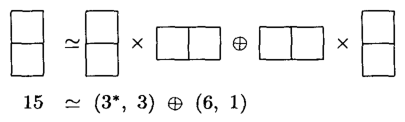

$$
6 \simeq (3,\,2)
$$

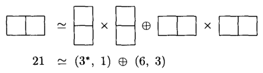

$$
15 \simeq (3^{*},\,3)\oplus(6,\,1)
$$

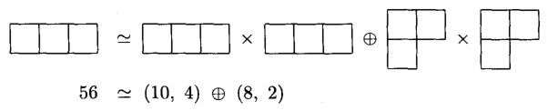

$$
21 \simeq (3^{*},\,1)\oplus(6,\,3)
$$

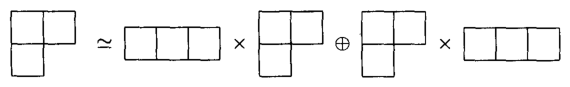

$$
56 \simeq (10,\,4)\oplus(8,\,2)
$$

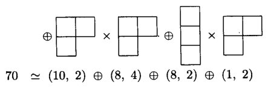

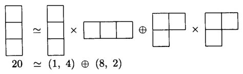

$$
70 \simeq (10,\,2)\oplus(8,\,4)\oplus(8,\,2)\oplus(1,\,2)
$$

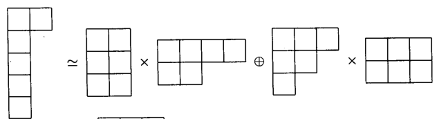

$$
20 \simeq (1,\,4)\oplus(8,\,2)
$$

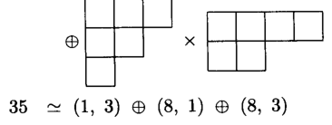

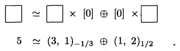

$$
35 \simeq (1,\,3)\oplus(8,\,1)\oplus(8,\,3)
$$

我们特别关心表示 $[3]$ 和表示 $[2,1^4]\simeq[1]\backslash[1]^{*}$ 的约化。前者给出低能重子可能的多重态，即自旋 3/2 的十重态和自旋 1/2 的八重态，而且因为它们处在同一个 SU(6) 多重态中，所以宇称相同。后者给出低能介子可能的多重态，即自旋 1 的单态，自旋 0 的八重态和自旋 1 的八重态，它们的宇称相同。这正好与 20 世纪 60 年代初实验上已发现的强子相吻合。现在发现的强子太多了，SU(6) 理论已不能做出很好的解释。此外，在 SU(6) 理论中，用 SU(2) 群来描写自旋，决定了这理论只能是非相对论的，很难解释高能粒子物理的许多现象。

## 附录 36 SU(N+M) 群的分导表示

20 世纪 70 年代初，描写强相互作用的颜色 SU(3) 规范理论和描写弱电统一作用的 SU(2)$\otimes$ U(1) 规范理论都取得了重大的进展，这些理论至今仍是粒子物理中的最基本的理论模型，常称为标准模型。1974 年乔治（Georgi）和格拉肖（Glashow）把两个规范理论纳入更大的 SU(5) 规范理论中去，从而试图把粒子物理中最基本的三种相互作用，即强相互作用，电磁相互作用和弱相互作用统一到一个规范理论模型中，把重子和轻子放在同一个规范群的多重态中，称为 SU(5) 大统一模型。这理论如能成功，前景当然十分诱人。正因为这模型把重子和轻子放在同一个多重态中，它就必须预言重子衰变到轻子的概率，以解释为什么实验中从未观测到这类衰变现象。如果存在这类衰变，质子的存在就有一定的寿命，遗憾的是这模型预言的质子寿命，低于实验中检测到的质子寿命的下限几个数量级，从而遭到实验的否定。目前还有人对这理论做各种修正，特别是引入超对称理论，使这理论还有一定的吸引力，但它已退出粒子物理界关心的热点。

从数学上说，这是大群 SU($N+M$) 的不可约表示 $[\omega]$ 关于子群 SU($N$)$\otimes$ SU($M$) 的分导表示，如何按子群不可约表示 $[\lambda]\times[\mu]$ 分解的问题。

先看 SU($N+M$) 群的自身表示。一个 $N$ 维幺正矩阵 $u$ 和一个 $M$ 维幺正矩阵 $v$ 的直和，是一个 $N+M$ 维的幺正矩阵。从群论的角度看，SU($N$) 群的元素是 $N$ 维幺正矩阵 $u$ 与 $M$ 维单位矩阵的直和，SU($M$) 群的元素是 $N$ 维单位矩阵和 $M$ 维幺正矩阵 $v$ 的直和。分属这两群的元素乘积可以对易，所有这样的元素乘积的集合构成群 SU($N$)$\otimes$ SU($M$)，它是 SU($N+M$) 群的子群。从群参数数目来看，SU($N+M$) 群有 $(N+M)^2-1$ 个参数，而子群 SU($N$)$\otimes$ SU($M$) 只有

$$
(N^2-1)+(M^2-1)=(N+M)^2-1-(2NM+1)
\tag{A36.1}
$$

个参数。这余下的 $2NM$ 个参数描写直和矩阵之外的非对角元，而最后一个参数描写如下对角矩阵

$$
e^{-iY\varphi}=\begin{pmatrix}
\mathbf{1}_N e^{i\varphi/N} & 0\\
0 & \mathbf{1}_M e^{-i\varphi/M}
\end{pmatrix}\,,\qquad
Y=\begin{pmatrix}
-\dfrac{\mathbf{1}_N}{N} & 0\\
0 & \dfrac{\mathbf{1}_M}{M}
\end{pmatrix}
\tag{A36.2}
$$

这样的对角矩阵的集合构成子群 U(1)。在 SU(5) 大统一模型中，这生成元 $Y$ 称为弱超荷，或简称超荷。当 $\varphi$ 等于 $2\pi$ 整数倍时，这对角矩阵同时属于子群 SU($N$)$\otimes$ SU($M$) 和子群 U(1)。因此，SU($N+M$) 群包含子群 SU($N$)$\otimes$ SU($M$) 和子群 U(1)，但不包含群 SU($N$)$\otimes$ SU($M$)$\otimes$ U(1)。

子群 SU($N$)$\otimes$ SU($M$) 的生成元可表为

$$
\begin{pmatrix} I_A & 0\\ 0 & 0 \end{pmatrix}\,,\qquad \text{和} \qquad
\begin{pmatrix} 0 & 0\\ 0 & I_B \end{pmatrix}
$$

除了这些生成元外，群 SU($N+M$) 还有式 (A36.2) 给出的生成元 $Y$ 和如下形式的 $2NM$ 个生成元

$$
\begin{pmatrix} 0 & X\\ X^{\dagger} & 0 \end{pmatrix}
$$

把 SU($N+M$) 群的矢量分量指标 $\alpha$ 的取值分成两部分

$$
1 \leqslant a \leqslant N\,, \qquad (N+1)\leqslant i\leqslant (N+M)\,, \qquad 1\leqslant \alpha \leqslant (N+M)
$$

$a$ 是 SU($N$) 群的分量指标，$i$ 是 SU($M$) 群的分量指标，而 $\alpha$ 或者等于 $a$，或者等于 $i$。在子群 SU($N$)$\otimes$ SU($M$) 的变换中，当 $\alpha=a$ 时矢量 $T_a$ 按 SU($N$) 群变换，当 $\alpha=i$ 时矢量 $T_i$ 按 SU($M$) 群变换，只有在 SU($N+M$) 群的变换下，两类指标的矢量分量才会相互组合。

对 SU($N+M$) 群的 $n$ 阶张量 $T_{\alpha_1\cdots\alpha_n}$，用杨图 $[\omega]$ 标记的杨算符 $\mathcal{Y}^{[\omega]}$ 投影后，得到的张量子空间对应 SU($N+M$) 群的不可约表示 $[\omega]$。现在讨论表示 $[\omega]$ 关于子群 SU($N$)$\otimes$ SU($M$) 的分导表示，如何按子群不可约表示 $[\lambda]\times[\mu]$ 分解。任意给出一个张量分量，设有 $n_1$ 个指标取值在前 $N$ 个数中，称为 $a$ 类指标，$n_2=n-n_1$ 个指标取值在后 $M$ 个数中，称为 $i$ 类指标。用子群的杨算符 $\mathcal{Y}^{[\lambda]}\mathcal{Y}^{[\mu]}$ 投影，其中杨图 $[\lambda]$ 是 $n_1$ 格的，杨算符 $\mathcal{Y}^{[\lambda]}$ 作用在 $a$ 类指标上，杨图 $[\mu]$ 是 $n_2$ 格的，杨算符 $\mathcal{Y}^{[\mu]}$ 作用在 $i$ 类指标上。这样得到的张量子空间对应子群不可约表示 $[\lambda]\times[\mu]$。设

$$
\mathcal{Y}^{[\omega]}\,t\,\mathcal{Y}^{[\lambda]}\mathcal{Y}^{[\mu]}\boldsymbol{T}_{\alpha_1\cdots\alpha_n}\neq 0\,, \qquad t\ \text{属}\ \mathrm{S}_{n+m}\ \text{群代数}
$$

则在 $\mathcal{Y}^{[\omega]}$ 投影构成的张量空间中，有属于子群 SU($N$)$\otimes$ SU($M$) 不可约表示 $[\lambda]\times[\mu]$ 的子空间，即在表示 $[\omega]$ 关于子群的分导表示约化中出现子群表示 $[\lambda]\times[\mu]$。因此这分导表示的约化，可用立特武德 - 理查森规则来计算

$$
\begin{aligned}
[\omega] &\simeq \bigoplus a^{\omega}_{\lambda\mu}\,\{[\lambda]\times[\mu]\}\\
d_{[\omega]}[\mathrm{SU}(N+M)] &= \sum a^{\omega}_{\lambda\mu}\, d_{[\lambda]}[\mathrm{SU}(N)]\, d_{[\mu]}[\mathrm{SU}(M)]
\end{aligned}
\tag{A36.3}
$$

三个杨图分别描写三个不同的幺正矩阵群的表示，三个杨图 $[\omega]$，$[\lambda]$ 和 $[\mu]$ 的行数分别不能大于 $N+M$，$N$ 和 $M$。在分导表示 $[\omega]$ 的约化中，杨图 $[\lambda]$ 的格数 $n_1$ 和杨图 $[\mu]$ 的格数 $n_2$ 是不固定的，只要求它们之和等于杨图 $[\omega]$ 的格数 $n$。对约化的每一项，由式 (A36.2) 可确定 U(1) 子群的量子数，它等于 $(-n_1/N+n_2/M)$，在大统一模型中，这量子数就是弱超荷 $Y$。

下面讨论 SU(5) 群的不可约表示作为子群 SU(3)$\otimes$ SU(2) 的分导表示，按子群不可约表示的分解。在物理上的大统一模型里，前一表示描写颜色 SU(3) 多重态，后一表示描写弱电 SU(2) 多重态，这些表示都用多重态的重数来标记。下标给出 $Y$ 量子数。在 SU(5) 大统一模型中，电荷 $Q$ 等于弱电 SU(2) 的第三个生成元 $T_3$ 和 $Y$ 之和

$$
\begin{aligned}
Q=T_3+Y &= \mathrm{diag}\{0,\,0,\,0,\,1/2,\,-1/2\}\\
&\quad + \mathrm{diag}\{-1/3,\,-1/3,\,-1/3,\,1/2,\,1/2\}\\
&= \mathrm{diag}\{-1/3,\,-1/3,\,-1/3,\,1,\,0\}
\end{aligned}
$$

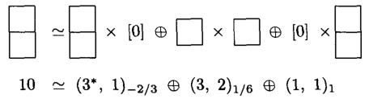

$$
5 \simeq (3,\,1)_{-1/3}\oplus(1,\,2)_{1/2}
$$

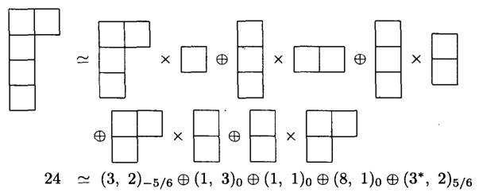

$$
10 \simeq (3^{*},\,1)_{-2/3}\oplus(3,\,2)_{1/6}\oplus(1,\,1)_{1}
$$

$$
24 \simeq (3,\,2)_{-5/6}\oplus(1,\,3)_{0}\oplus(1,\,1)_{0}\oplus(8,\,1)_{0}\oplus(3^{*},\,2)_{5/6}
$$

在 SU(5) 大统一模型中，粒子区分左手态和右手态，分别填充到 5 维和 10 维多重态中。第一代粒子的填充法如下

$$
\begin{pmatrix}
d_1\\ d_2\\ d_3\\ e^c\\ \nu^c
\end{pmatrix}_{\mathrm{R}}\,, \qquad
\begin{pmatrix}
0 & u_3^c & -u_2^c & u_1 & d_1\\
 & 0 & u_1^c & u_2 & d_2\\
 & & 0 & u_3 & d_3\\
 & & & 0 & e^c\\
 & & & & 0
\end{pmatrix}_{\mathrm{L}}
$$

其中，上标 $c$ 表电荷共轭态，下标 R 和 L 表右手态和左手态。10 维表示是反对称张量表示，因而只需填出上半个矩阵的粒子态。24 维表示是伴随表示，对应规范粒子，这里不再列出。

## 附录 37 SU(N) 群三阶卡西米尔不变量

由生成元组成，又能与所有生成元对易的算符称为卡西米尔（Casimir）算子，它的本征值称为卡西米尔不变量。卡西米尔算子在物理和数学中都十分重要。物理中，它与守恒量有密切联系。数学中，它可用来标记不可约表示。数学中证明，李群独立的卡西米尔算子数目等于李群的秩数，即李群中能互相对易的生成元的最大数目。对 SU($N$) 群，有 $N-1$ 个独立的卡西米尔算子，其中用得最多的是二阶和三阶卡西米尔算子，它们分别可表为生成元的二次和三次齐次多项式。二阶卡西米尔算子及其不变量在第七章已有详细讨论，见式 (7.144)、(7.145) 和 (7.147)。本附录重点讨论 SU(N) 群三阶卡西米尔不变量。

设 $I_A^{[\lambda]}$ 是 SU(N) 群表示 $D^{[\lambda]}(u)$ 的生成元，则它们构成伴随表示的基[见式 (7.8)]

$$
D^{[\lambda]}(u)^{-1}I_A^{[\lambda]}D^{[\lambda]}(u)=\sum_{A'}D_{AA'}^{\mathrm{ad}}(u)I_{A'}^{[\lambda]}
\tag{A37.1}
$$

其中，用到伴随表示是实正交表示。对自身表示，$I_A^{[\lambda]}$ 取 $T_A$，$D^{[\lambda]}(u)$ 取 $u$。由自身表示生成元 $T_A$ 可以构造出对变换式 (A37.1) 的一个三阶对称张量 $f_{ABC}$ 和一个三阶反对称张量 $d_{ABC}$[见式 (7.78) 和 (A26.3)]

$$
\begin{aligned}
f_{ABC}&=-2\mathrm{i}\mathrm{Tr}\left(T_A\left[T_B,\ T_C\right]\right)=-2\mathrm{i}\mathrm{Tr}\left(T_AT_BT_C-T_AT_CT_B\right),\\
d_{ABC}&=2\mathrm{Tr}\left(T_A\left\{T_B,\ T_C\right\}\right)=2\mathrm{Tr}\left(T_AT_BT_C+T_AT_CT_B\right),
\end{aligned}
\tag{A37.2}
$$

$f_{ABC}$ 和 $d_{ABC}$ 都是关于伴随表示的不变张量。以 $f_{ABC}$ 为例来证明

$$
\begin{aligned}
f_{ABC}&\longrightarrow\sum_{A'B'C'}D_{AA'}^{\mathrm{ad}}(u)D_{BB'}^{\mathrm{ad}}(u)D_{CC'}^{\mathrm{ad}}(u)f_{A'B'C'}\\
&=-2\mathrm{i}\mathrm{Tr}\left(u^{-1}T_Au\left[u^{-1}T_Bu,\ u^{-1}T_Cu\right]\right)=f_{ABC}
\end{aligned}
$$

间接地，这两个张量也可看成是 SU(N) 群的不变张量。根据立特武德 - 理查德森规则，除了 $N=2$ 外，SU(N) 群的两个伴随表示直乘的克莱布施 - 戈登级数中，只包含一个恒等表示和两个伴随表示，因而三个伴随表示直乘后只包含两个恒等表示，即关于伴随表示不变的三阶张量只有这两个张量。换句话说，关于伴随表示不变的三阶反对称张量一定与 $f_{ABC}$ 成比例，关于伴随表示不变的三阶对称张量一定与 $d_{ABC}$ 成比例。对 SU(2) 群，$d_{ABC}=0$，三个伴随表示直乘后只包含一个恒等表示，关于伴随表示不变的三阶张量一定是反对称张量，而且与 $f_{ABC}$ 成比例。

现在把式 (A37.2) 中的自身表示生成元 $T_A$ 换成任意不可约表示 $[\lambda]$ 的生成元 $I_A^{[\lambda]}$，同样可证等式右面的张量是关于伴随表示不变的三阶反对称或对称张量，因此它们一定与 $f_{ABC}$ 或 $d_{ABC}$ 成比例，比例系数依赖于所取表示

$$
-2\mathrm{i}\mathrm{Tr}\left(I_A^{[\lambda]}\left[I_B^{[\lambda]},\ I_C^{[\lambda]}\right]\right)=2T_2([\lambda])f_{ABC}
\tag{A37.3}
$$

$$
2\mathrm{Tr}\left(I_A^{[\lambda]}\left\{I_B^{[\lambda]},\ I_C^{[\lambda]}\right\}\right)=A([\lambda])d_{ABC}
\tag{A37.4}
$$

前式左面的对易关系可用结构常数表出

$$
-2\mathrm{i}\mathrm{Tr}\left(I_A^{[\lambda]}\left[I_B^{[\lambda]},\ I_C^{[\lambda]}\right]\right)=2\sum_D f_{DBC}\mathrm{Tr}\left(I_A^{[\lambda]}I_D^{[\lambda]}\right)
$$

比较得

$$
\mathrm{Tr}\left(I_A^{[\lambda]}I_D^{[\lambda]}\right)=\delta_{AD}T_2([\lambda])
$$

它通过式 (7.147) 与二阶卡西米尔不变量 $C_2([\lambda])$ 相联系

$$
d_{[\lambda]}(\mathrm{SU}(N))\ C_2([\lambda])=(N^2-1)\ T_2([\lambda])
\tag{A37.5}
$$

$C_2([\lambda])$ 可由式 (7.145) 计算。这里简单介绍用附录 36 给出的结果计算 $T_2([\lambda])$ 的方法。根据定义式 (A37.3)，等价表示的 $T_2$ 相等，表示的直和和直积有

$$
T_2([\lambda]\oplus[\mu])=T_2([\lambda])+T_2([\mu]),\quad T_2([\lambda]\times[\mu])=d_{[\mu]}T_2([\lambda])+d_{[\lambda]}T_2([\mu])
\tag{A37.6}
$$

其中，$d_{[\lambda]}$ 是表示 $[\lambda]$ 的维数。把 SU(2) 群的 $T_2([\lambda])$ 记作 $T_2^{(0)}([\lambda])$，直接计算得

$$
T_2^{(0)}([\lambda])=\mathrm{Tr}\left[\left(T_3^{[\lambda]}\right)^2\right]=\sum_{n=-\lambda/2}^{\lambda/2}n^2=\lambda(\lambda+1)(\lambda+2)/12
\tag{A37.7}
$$

把 SU(N) 群的不可约表示 $[\lambda]$，作为子群 SU(N−2)×SU(2) 的分导表示，按附录 36 给出的方法分解为子群不可约表示的直和

$$
[\lambda]=\bigoplus\ [\nu]\times[\mu]
\tag{A37.8}
$$

其中，$[\nu]$ 是 SU(N−2) 群的表示，$[\mu]$ 是 SU(2) 群的表示。在式 (A37.3) 中，取 $A=3$，$B=1$ 和 $C=2$，则

$$
T_2([\lambda])=\mathrm{Tr}\left[\left(T_3^{[\lambda]}\right)^2\right]=\sum d_{[\nu]}[\mathrm{SU}(N-2)]T_2^{(0)}([\mu])
\tag{A37.9}
$$

在量子场论中，$A([\lambda])$ 与重整化反常有关，它与三阶卡西米尔不变量有直接的联系。为了具体计算 $A([\lambda])$，先研究它的基本性质。等价表示的 $A$ 相等。恒等表示有 $A([1^N])=0$，自身表示有 $A([1])=1$。幺正表示 $[\lambda]$ 的复共轭表示 $[\lambda]^*$，生成元取转置并差负号，因而 $A([\lambda]^*)=-A([\lambda])$。对表示的直和和直积有

$$
A([\lambda]\oplus[\mu])=A([\lambda])+A([\mu]),\quad A([\lambda]\times[\mu])=d_{[\mu]}A([\lambda])+d_{[\lambda]}A([\mu])
\tag{A37.10}
$$

SU(2) 群的 $d_{ABC}=0$，因而只有当 $N\geqslant 3$ 时 $A([\lambda])$ 才有意义。对 SU(3) 群，把 $A([\lambda])$ 记作 $A^{(0)}([\lambda])$，在式 (A37.4) 中取 $A=8$，$B=C=3$，$d_{338}=\sqrt{1/3}$，得

$$
A^{(0)}([\lambda])=4\sqrt{3}\mathrm{Tr}\left\{T_8^{[\lambda]}\left(T_3^{[\lambda]}\right)^2\right\}
\tag{A37.11}
$$

在平面权图中属同一水平线的权，$T_8^{[\lambda]}$ 的本征值相同，把这些权对应的 $\left(T_3^{[\lambda]}\right)^2$ 按公式 (A37.7) 先算出来，然后再对各水平线求和，可以算得 $A^{(0)}([\lambda])$。对一行的杨图，$I_8^{[\lambda,0]}$ 的对角元分别取 $\sqrt{1/12}(\lambda-3m)$，$0\leqslant m\leqslant\lambda$

$$
\begin{aligned}
A^{(0)}([\lambda,0])&=-A^{(0)}([\lambda,0]^*)=2\sum_{m=0}^{\lambda}(\lambda-3m)T_2^{(0)}([\lambda-m])\\
&=(1/6)\sum_{m=0}^{\lambda}(\lambda-3m)(\lambda-m)(\lambda-m+1)(\lambda-m+2)\\
&=(1/120)\lambda(\lambda+1)(\lambda+2)(\lambda+3)(2\lambda+3)
\end{aligned}
\tag{A37.12}
$$

最后一式可以这样得到：求和式必定可表为 λ 的五次代数式，而且无常数项，然后用 λ = 1 至 5 代入比较即可确定有关系数。对两行的杨图 $[(\lambda+\tau),\tau]\simeq[\lambda]\backslash[\tau]^*$，$\tau\leqslant\lambda$，根据式 (A37.10) 有

$$
\begin{aligned}
A^{(0)}([\lambda+\tau,\tau])&=A^{(0)}([\lambda,0]\backslash[\tau,0]^*)\\
&=A^{(0)}([\lambda,0]\times[\tau,0]^*)-A^{(0)}([\lambda-1,0]\times[\tau-1,0]^*)
\end{aligned}
$$

$$
\begin{aligned}
A^{(0)}([\lambda,0]\times[\tau,0]^*)&=d_{[\tau]}[\mathrm{SU}(3)]A^{(0)}([\lambda,0])-d_{[\lambda]}[\mathrm{SU}(3)]A^{(0)}([\tau,0])\\
&=\frac{1}{240}(\lambda+1)(\lambda+2)(\tau+1)(\tau+2)\times\{\lambda(\lambda+3)(2\lambda+3)-\tau(\tau+3)(2\tau+3)\}
\end{aligned}
$$

由此算得

$$
A^{(0)}([\lambda+\tau,\tau])=\frac{1}{120}(\lambda+1)(\tau+1)(\lambda-\tau)(\lambda+\tau+2)(\lambda+2\tau+3)(2\lambda+\tau+3)
\tag{A37.13}
$$

当 λ = τ 时，杨图 [2λ,λ] 的平面权图对原点对称，故 $A^{(0)}([2\lambda,\lambda])=0$，因而式 (A37.13) 包含因子 $(\lambda-\tau)$。

把 SU(N) 群的不可约表示 [λ]，作为子群 SU(N−3)⊗SU(3) 的分导表示，按附录 36 给出的方法分解为子群不可约表示的直和

$$
[\lambda]=\bigoplus\ [\nu]\times[\mu]
\tag{A37.14}
$$

其中，[ν] 是 SU(N−3) 群的表示，[μ] 是 SU(3) 群的表示。在式 (A37.4) 中，取 A = 8，B = C = 3，则

$$
A([\lambda])=4\sqrt{3}\mathrm{Tr}\left\{I_8\left(I_3^{[\lambda]}\right)^2\right\}=\sum d_{[\nu]}[\mathrm{SU}(N-3)]A^{(0)}([\mu])
\tag{A37.15}
$$

例如，对反对称表示 $[1^r]$，有

$$
\begin{aligned}
A([1^r])&=\left\{d_{[1^{r-1}]}(\mathrm{SU}(N-3))-d_{[1^{r-2}]}(\mathrm{SU}(N-3))\right\}A^{(0)}([1])\\
&=\frac{(N-3)!}{(r-1)!(N-r-2)!}-\frac{(N-3)!}{(r-2)!(N-r-1)!}\\
&=\frac{(N-3)!\left\{(N-r-1)-(r-1)\right\}}{(r-1)!(N-r-1)!}
\end{aligned}
$$

$$
=\frac{(N-2r)}{(r-1)}\left(\begin{array}{c}N-3\\ r-2\end{array}\right)
\tag{A37.16}
$$

## 附录 38 雅可比坐标

对任意 N 个粒子构成的孤立系统具有空间平移对称性，势能函数 V 在空间平移变换中保持不变。N 个粒子的坐标矢量和质量分别用 $\boldsymbol{r}_k$ 和 $m_k\ (k=1,2,\cdots,N)$ 标记，定态薛定谔方程为

$$
-\frac{\hbar^2}{2}\Delta\Psi+V\Psi=E\Psi,\qquad \Delta=\sum_{k=1}^{N}m_k^{-1}\Delta_{\boldsymbol{r}_k}
\tag{A38.1}
$$

其中，$\Delta_{\boldsymbol{r}_k}$ 是关于坐标矢量 $\boldsymbol{r}_k$ 的拉普拉斯算符。

引进 N 个雅可比坐标矢量 $\boldsymbol{R}_j\ [0\leqslant j\leqslant(N-1)]$

$$
\begin{aligned}
\boldsymbol{R}_0&=M^{-1/2}\sum_{k=1}^{N}m_k\boldsymbol{r}_k\\
\boldsymbol{R}_j&=(\mu_j)^{1/2}\left(\boldsymbol{r}_j-\sum_{k=j+1}^{N}\frac{m_k\boldsymbol{r}_k}{M_{j+1}}\right)\\
M_j&=\sum_{k=j}^{N}m_k,\qquad M_1=M\ \text{是总质量}
\end{aligned}
\tag{A38.2}
$$

其中，$\boldsymbol{R}_0$ 描写质心的运动，$\boldsymbol{R}_1$ 描写第一个粒子相对其余粒子质心的运动，$\boldsymbol{R}_2$ 描写第二个粒子相对后 $N-2$ 个粒子质心的运动，以此类推。为方便起见，我们让雅可比坐标矢量包含一个附加的因子 $M^{1/2}$，以消除变换后方程中的质量参数。$\boldsymbol{R}_j$ 前面的“折合质量” $\mu_j$ 由下面条件定出

$$
\sum_{k=1}^{N}m_k\boldsymbol{r}_k^2=\sum_{j=0}^{N-1}\boldsymbol{R}_j^2
\tag{A38.3}
$$

可选取特殊情况具体确定折合质量 $\mu_j$。设在质心系中前 $j-1$ 个粒子在原点，后 $N-j$ 个粒子重合，有

$$
\boldsymbol{r}_k=0,\qquad 1\leqslant k<j,
$$

$$
\boldsymbol{r}_{j+1}=\boldsymbol{r}_{j+2}=\cdots=\boldsymbol{r}_N=-m_j\boldsymbol{r}_j/M_{j+1}
$$

于是

$$
\boldsymbol{R}_k=0,\qquad k\neq j
$$

得

$$
\begin{aligned}
\sum_{k=j}^{N}m_k\boldsymbol{r}_k^2&=m_j\boldsymbol{r}_j^2+M_{j+1}(-m_j\boldsymbol{r}_j/M_{j+1})^2=(m_jM_j/M_{j+1})\boldsymbol{r}_j^2\\
&=\boldsymbol{R}_j^2=\mu_j\left[\boldsymbol{r}_j+m_j\boldsymbol{r}_j/M_{j+1}\right]^2=\mu_j\left[M_j\boldsymbol{r}_j/M_{j+1}\right]^2
\end{aligned}
$$

由此算出第 j 个粒子的折合质量 $\mu_j$ 为

$$
\mu_j=\frac{m_jM_{j+1}}{M_j}
\tag{A38.4}
$$

为了计算变量替换后拉普拉斯算符和总轨道角动量算符的表达式，我们引入变换矩阵 X，把式 (A38.2) 表为

$$
\boldsymbol{R}_j=\sum_{k=1}^{N}X_{jk}m_k^{1/2}\boldsymbol{r}_k,\qquad \nabla_{\boldsymbol{r}_k}=m_k^{1/2}\sum_{j=0}^{N-1}X_{jk}\nabla_{\boldsymbol{R}_j}
\tag{A38.5}
$$

代入式 (A38.3)

$$
\sum_{k=1}^{N}m_k\boldsymbol{r}_k^2=\sum_{j=0}^{N-1}\boldsymbol{R}_j^2=\sum_{kt}(m_km_t)^{1/2}\boldsymbol{r}_k\boldsymbol{r}_t\sum_{j=0}^{N-1}X_{jk}X_{jt}
$$

可见 X 是实正交矩阵，且

$$
\boldsymbol{r}_k=m_k^{-1/2}\sum_{j=0}^{N-1}\boldsymbol{R}_jX_{jk}
\tag{A38.6}
$$

由此，拉普拉斯算符 Δ 和系统总轨道角动量算符 L 可直接用雅可比坐标矢量表出

$$
\begin{aligned}
\Delta&=\sum_{k=1}^{N}m_k^{-1}\nabla_{\boldsymbol{r}_k}^2\\
&=\sum_{jj'}\nabla_{\boldsymbol{R}_j}\cdot\nabla_{\boldsymbol{R}_{j'}}\sum_{k=1}^{N}m_k^{-1}\left(X_{jk}m_k^{1/2}\right)\left(X_{j'k}m_k^{1/2}\right)=\sum_{j=0}^{N-1}\nabla_{\boldsymbol{R}_j}^2\ ,\\
L_{ab}&=-\mathrm{i}\sum_{k=1}^{n}\left\{r_{ka}\frac{\partial}{\partial r_{kb}}-r_{kb}\frac{\partial}{\partial r_{ka}}\right\}\\
&=-\mathrm{i}\sum_{k=1}^{n}\sum_{j=0}^{n-1}\sum_{j'=0}^{n-1}\left\{R_{ja}\left(X_{jk}m_k^{-1/2}\right)\left(X_{j'k}m_k^{1/2}\right)\frac{\partial}{\partial R_{j'b}}\right.\\
&\qquad\left.-R_{jb}\left(X_{j'k}m_k^{-1/2}\right)\left(X_{jk}m_k^{1/2}\right)\frac{\partial}{\partial R_{ka}}\right\}\\
&=-\mathrm{i}\sum_{j=0}^{n-1}\left\{R_{ja}\frac{\partial}{\partial R_{jb}}-R_{jb}\frac{\partial}{\partial R_{ja}}\right\}
\end{aligned}
\tag{A38.7}
$$

于是方程 (A38.1) 经变换后，$\boldsymbol{R}_0$ 可以分离出去。换句话说，在质心系中，$\boldsymbol{R}_0=0$，N 体系统的薛定谔方程 (A38.1) 简化为

$$
\Delta\Psi=\sum_{j=1}^{N-1}\Delta_{\boldsymbol{R}_j}\Psi=-\frac{2}{\hbar^2}(E-V)\Psi
\tag{A38.8}
$$

雅可比坐标矢量 $\boldsymbol{R}_j$ 的 $3(N-1)$ 个分量在拉普拉斯算符中地位平等，因此拉普拉斯算符具有 $O(3N-3)\supset SO(3)\times O(N-1)$ 对称性，其中子群 SO(3) 就是通常的三维空间转动群，子群 O(N−1) 包含空间反演和 N 个粒子间的置换变换。改变雅可比坐标矢量的定义也相当一个 O(N−1) 变换。这里特别要讨论一下置换变换。在置换 (k, k+1) 中，$m_k\leftrightarrow m_{k+1}$ 和 $\boldsymbol{r}_k\leftrightarrow\boldsymbol{r}_{k+1}$，有

$$
\begin{aligned}
\boldsymbol{R}_j'&=\boldsymbol{R}_j,\qquad j\neq k\ \text{或}\ k+1,\\
\boldsymbol{R}_k'&=\left[\frac{m_{k+1}}{M_k(m_k+M_{k+2})}\right]^{1/2}\left[(m_k+M_{k+2})\boldsymbol{r}_{k+1}-m_k\boldsymbol{r}_k-\sum_{j=k+2}^{N}m_j\boldsymbol{r}_j\right]\\
&=-\boldsymbol{R}_k\cos\theta_k+\boldsymbol{R}_{k+1}\sin\theta_k,\\
\boldsymbol{R}_{k+1}'&=\left[\frac{m_k}{(m_k+M_{k+2})M_{k+2}}\right]^{1/2}\left[M_{k+2}\boldsymbol{r}_k-\sum_{j=k+2}^{N}m_j\boldsymbol{r}_j\right]\\
&=\boldsymbol{R}_k\sin\theta_k+\boldsymbol{R}_{k+1}\cos\theta_k,\\
\cos\theta_k&=\left[\frac{m_km_{k+1}}{M_{k+1}(m_k+M_{k+2})}\right]^{1/2},\qquad \sin\theta_k=\left[\frac{M_kM_{k+2}}{M_{k+1}(m_k+M_{k+2})}\right]^{1/2}
\end{aligned}
\tag{A38.9}
$$

这显然属于 O(N−1) 变换。对全同粒子体系，$\cos\theta_k=(N-k)^{-1}$。

容易得到式 (A38.2) 的逆变换为

$$
\begin{aligned}
\boldsymbol{r}_k&=\left[\frac{M_{k+1}}{m_kM_k}\right]^{1/2}\boldsymbol{R}_k-\sum_{j=1}^{k-1}\left[\frac{m_j}{M_jM_{j+1}}\right]^{1/2}\boldsymbol{R}_j+M^{-1/2}\boldsymbol{R}_0,\\
\boldsymbol{r}_k-\boldsymbol{r}_j&=\left[\frac{M_{k+1}}{m_kM_k}\right]^{1/2}\boldsymbol{R}_k-\sum_{i=j+1}^{k-1}\left[\frac{m_i}{M_iM_{i+1}}\right]^{1/2}\boldsymbol{R}_i-\left[\frac{M_j}{m_jM_{j+1}}\right]^{1/2}\boldsymbol{R}_j
\end{aligned}
\tag{A38.10}
$$

通过式 (A38.10) 可以把势函数 V 表为 $\boldsymbol{R}_j$ 的函数，与 $\boldsymbol{R}_0$ 无关。

## 附录 39 高维空间狄拉克方程的径向方程

在 N 维空间引入球坐标

$$
\begin{aligned}
x^1&=r\cos\theta_1\sin\theta_2\cdots\sin\theta_{N-1},\\
x^2&=r\sin\theta_1\sin\theta_2\cdots\sin\theta_{N-1},\\
x^b&=r\cos\theta_{b-1}\sin\theta_k\cdots\sin\theta_{N-1},\qquad 3\leqslant b\leqslant N-1,\\
x^N&=r\cos\theta_{N-1},\\
\sum_{a=1}^{N}(x^a)^2&=r^2
\end{aligned}
\tag{A39.1}
$$

沿 $\boldsymbol{x}$ 方向的单位矢量记作 $\hat{\boldsymbol{x}}=\boldsymbol{x}/r$。组态空间的体积元为

$$
\prod_{a=1}^{N}\mathrm{d}x^a=r^{N-1}\mathrm{d}r\,\mathrm{d}\Omega,\qquad \mathrm{d}\Omega=\prod_{a=1}^{N-1}(\sin\theta_a)^{a-1}\mathrm{d}\theta_a,
$$

$$
0\leqslant r\leqslant\infty,\qquad -\pi\leqslant\theta_1\leqslant\pi,\qquad 0\leqslant\theta_b\leqslant\pi,\qquad 2\leqslant b\leqslant N-1
\tag{A39.2}
$$

按照文献 [11] 的符号，把狄拉克方程推广到任意 N 维空间和一维时间

$$
\mathrm{i}\sum_{\mu=0}^{N}\gamma^\mu\left(\frac{\partial}{\partial x^\mu}+\mathrm{i}eA_\mu\right)\Psi(\boldsymbol{x},t)=M\Psi(\boldsymbol{x},t)
\tag{A39.3}
$$

其中，M 是粒子质量。为简化起见，取自然单位，$\hbar=c=1$。$N+1$ 个 $\gamma_\mu$ 矩阵满足反对易关系

$$
\gamma^\mu\gamma^\nu+\gamma^\nu\gamma^\mu=2\eta^{\mu\nu}\boldsymbol{1}
\tag{A39.4}
$$

其中，度规张量 $\eta^{\mu\nu}$ 为

$$
\eta^{\mu\nu}=\eta_{\mu\nu}=\left\{\begin{array}{ll}\delta_{\mu\nu}, & \text{当}\ \mu=0\\ -\delta_{\mu\nu}, & \text{当}\ \mu\neq 0\end{array}\right.
\tag{A39.5}
$$

讨论一个特殊情况，规范势 $A_\mu$ 只有第零分量不为零，且为球对称

$$
eA_0=V(r),\qquad A_a=0,\qquad \text{当}\ a\neq 0
\tag{A39.6}
$$

系统哈密顿量 $H(\boldsymbol{x})$ 表为

$$
\mathrm{i}\frac{\partial}{\partial x^0}\Psi(\boldsymbol{x},t)=H(\boldsymbol{x})\Psi(\boldsymbol{x},t),\qquad H(\boldsymbol{x})=-\mathrm{i}\sum_{a=1}^{N}\gamma^0\gamma^a\frac{\partial}{\partial x^a}+V(r)+\gamma^0M
\tag{A39.7}
$$

轨道角动量算符 $L_{ab}$，自旋角动量算符 $S_{ab}$ 和总角动量算符 $J_{ab}$ 分别定义为

$$
L_{ab}=-L_{ba}=\mathrm{i}x_a\frac{\partial}{\partial x^b}-\mathrm{i}x_b\frac{\partial}{\partial x^a},\qquad S_{ab}=-S_{ba}=\mathrm{i}\gamma_a\gamma_b/2,
$$

$$
J_{ab}=L_{ab}+S_{ab},\qquad 1\leqslant a<b\leqslant N,
$$

$$
J^2=\sum_{a<b=2}^{N}J_{ab}^2,\qquad L^2=\sum_{a<b=2}^{N}L_{ab}^2,\qquad S^2=\sum_{a<b=2}^{N}S_{ab}^2
\tag{A39.8}
$$

直接验算可知存在一个守恒量算符 κ，它与 $J_{ab}$ 和 $H(\boldsymbol{x})$ 都对易

$$
\kappa=\gamma^0\left\{\sum_{a<b}\mathrm{i}\gamma^a\gamma^bL_{ab}+(N-1)/2\right\}=\gamma^0\left\{J^2-L^2-S^2+(N-1)/2\right\}
\tag{A39.9}
$$

把谢瓦莱基式 (9.15) 和 (9.20) 中的 $T_{ab}$ 换成 $J_{ab}$，$L_{ab}$ 或 $S_{ab}$，就得到角动量算符的谢瓦莱基。下面分别讨论它们的本征状态。

在轨道空间，因为只有一个坐标矢量 $\boldsymbol{x}$，不能构成反对称组合，所以对应轨道角动量的不可约表示只能是由一行杨图标记的表示，$[\ell]\equiv[\ell,0,\cdots]$，最高权为 $(\ell)\equiv(\ell,0,\cdots,0)$。N 维空间的轨道角动量本征函数，即 $H_\mu(L)$ 的共同本征函数，就是球谐函数 $\mathrm{Y}_{\boldsymbol{m}}^{[\ell]}(\hat{\boldsymbol{x}})$

$$
H_\mu(L)\mathrm{Y}_{\boldsymbol{m}}^{[\ell]}(\hat{\boldsymbol{x}})=m_\mu\mathrm{Y}_{\boldsymbol{m}}^{[\ell]}(\hat{\boldsymbol{x}})
\tag{A39.10}
$$

最高权态的球谐函数已由式 (9.49) 给出，其他权状态球谐函数可用降算符 $F_\mu(L)$ 作用得到。球谐函数 $\mathrm{Y}_{\boldsymbol{m}}^{[\ell]}(\hat{\boldsymbol{x}})$ 对应的卡西米尔不变量已由式 (9.41) 给出

$$
L^2\mathrm{Y}_{\boldsymbol{m}}^{[\ell]}(\hat{\boldsymbol{x}})=C_2([\ell])\mathrm{Y}_{\boldsymbol{m}}^{[\ell]}(\hat{\boldsymbol{x}}),\qquad C_2([\ell])=\ell(\ell+N-2)
\tag{A39.11}
$$

当 N 为奇数时，取

$$
\gamma^0=\sigma_3\times\boldsymbol{1},\qquad \gamma^a=(\mathrm{i}\sigma_2)\times\beta_a,\qquad 1\leqslant a\leqslant N
\tag{A39.12}
$$

其中，奇数个矩阵 $\beta_a$ 满足反对易关系

$$
\beta_a\beta_b+\beta_b\beta_a=2\delta_{ab}\boldsymbol{1},\qquad a,\ b=1,2,\cdots,N
\tag{A39.13}
$$

可取式 (9.66) 和 (9.78) 形式，维数为 $2^{(N-1)/2}$。在此表象，自旋算符 $S_{ab}$ 和 κ 算符变成方块矩阵

$$
S_{ab}=\boldsymbol{1}\times\overline{S}_{ab},\qquad \overline{S}_{ab}=-\mathrm{i}\beta_a\beta_b/2
\tag{A39.14}
$$

$$
\kappa=\sigma_3\times\overline{\kappa},\qquad \overline{\kappa}=2\sum_{a<b}\overline{S}_{ab}L_{ab}+(N-1)/2
\tag{A39.15}
$$

算符 $S_{ab}$ 和算符 $\overline{S}_{ab}$ 的关系相似于狄拉克自旋算符和泡利自旋算符的关系，分别称为在全旋量空间和固有旋量空间的自旋算符。在固有旋量空间，对应基本旋量表示 $(s) \equiv (0, \cdots, 0, 1)$ 的基本旋量为 $\chi(\boldsymbol{m})$，由式 (7.145) 算得卡西米尔不变量为 $C_2[(s)] = (N^2 - N)/8$.

球谐函数和基本旋量函数的乘积，对应两表示的直乘，$(\ell) \times (s)$. 按式 (9.113) 有

$$
(\ell) \times (s) \simeq (\ell, 0, \cdots, 0, 1) \oplus (\ell - 1, 0, \cdots, 0, 1)
$$

因此，可有两种方法来构造属表示 $(j) \equiv (\ell, 0, \cdots, 0, 1)$ 的总角动量本征函数，它们对应不同的 $\bar{\pi}$ 本征值。由式 (7.145) 算得表示 $(j)$ 的卡西米尔不变量为

$$
C_2[(j)] = \ell(\ell + N - 1) + (N^2 - N)/8
\tag{A39.16}
$$

因为系统是球对称的，所以我们只需要写出最高权态的波函数。根据式 (9.17)、(9.23)、(9.46) 和 (9.47) 和最高权态的条件式 (7.123) 可算得

$$
\begin{aligned}
\phi_{|K|, (j)}(\hat{\boldsymbol{x}}) &= Y^{[\ell]}_{(\ell)}(\hat{\boldsymbol{x}})\chi[(s)] = C_{N,\ell} r^{-\ell}(x^1 + ix^2)^{\ell}\chi[(s)],\\
|K| &= C_2[(j)] - C_2[(\ell)] - C_2[(s)] + (N - 1)/2 = (2\ell + N - 1)/2,\\
\phi_{-|K|, (j)}(\hat{\boldsymbol{x}}) &= \sum_{\boldsymbol{m}} Y^{[\ell+1]}_{\boldsymbol{m}}(\hat{\boldsymbol{x}})\chi[(j) - \boldsymbol{m}]\{(\ell+1), \boldsymbol{m}, (s), (j) - \boldsymbol{m}|(j), (j)\}\\
&= \left\{\frac{2(\ell+1)}{N + 2\ell}\right\}^{1/2} C_{N,(\ell+1)} r^{-\ell-1}(x^1 + ix^2)^{\ell}\{x^{2N+1}\chi[(s)]\\
&\quad + (x^{2N-1} + ix^{2N})\chi[(0, \cdots, 0, 1, \bar{1})]\\
&\quad + (x^{2N-3} + ix^{2N-2})\chi[(0, \cdots, 0, 1, \bar{1}, 1)] + \cdots\\
&\quad + (x^3 + ix^4)\chi[(1, \bar{1}, 0, \cdots, 0, 1)] + (x^1 + ix^2)\chi[(\bar{1}, 0, \cdots, 0, 1)]\},\\
-|K| &= C_2[(j)] - C_2[(\ell+1)] - C_2[(s)] + (N - 1)/2 = -(2\ell + N - 1)/2
\tag{A39.17}
\end{aligned}
$$

在全旋量空间，对应表示 $(j)$ 的总角动量最高权态波函数 $\Psi_{K,(j)}(\boldsymbol{x})$ 表为

$$
\Psi_{K,(j)}(\boldsymbol{x}, t) = r^{-(N-1)/2}\mathrm{e}^{-iEt}
\begin{pmatrix}
F(r)\phi_{K,(j)}(\hat{\boldsymbol{x}})\\
iG(r)\phi_{-K,(j)}(\hat{\boldsymbol{x}})
\end{pmatrix}
$$

$$
\kappa\Psi_{K,(j)}(\boldsymbol{x}) = K\Psi_{K,(j)}(\boldsymbol{x}), \qquad K = \pm(2\ell + N - 1)/2
\tag{A39.18}
$$

代入狄拉克方程 (A39.3)，得径向方程

$$
\begin{aligned}
\frac{\mathrm{d}G(r)}{\mathrm{d}r} + \frac{K}{r}G(r) &= [E - V(r) - M]F(r),\\
-\frac{\mathrm{d}F(r)}{\mathrm{d}r} + \frac{K}{r}F(r) &= [E - V(r) + M]G(r)
\end{aligned}
\tag{A39.19}
$$

此式对 $N = 3$ 也成立。当 $N$ 是大于 2 的偶数时，有

$$
\gamma^0 = \beta_{N+1}, \qquad \gamma^a = \beta_{N+1}\beta_a, \qquad 1 \leqslant a \leqslant N
\tag{A39.20}
$$

奇数个 $\beta_a$ 矩阵满足式 (A39.13)，由式 (9.66) 和 (9.78) 定义，$\beta_{N+1}$ 是对角矩阵。对偶数 $N$ 的 $\mathrm{SO}(N)$ 群，旋量表示分解为两个不等价的基本旋量表示 $(+s) \equiv (0, 0, \cdots, 0, 1)$ 和 $(-s) \equiv (0, 0, \cdots, 0, 1, 0)$ 的直和，由式 (7.145) 算得卡西米尔不变量都为 $C_2[(\pm s)] = (N^2 - N)/8$. $\gamma^0$ 是对角矩阵，一半对角元为 $+1$，另一半为 $-1$. $\gamma^0$ 把全旋量空间分解为两个固有旋量空间的直和。现在自旋算符 $S_{ab}$ 和 $\kappa$ 算符都是与 $\gamma^0$ 维数相同的矩阵，且与 $\gamma^0$ 对易，因而都是两个子矩阵的直和，分别属于两个固有旋量空间。在两个固有旋量空间的基本旋量 $\chi_{\pm}(\boldsymbol{m})$ 分别对应基本旋量表示 $(+s)$ 和 $(-s)$，满足

$$
\gamma^0\chi_{\pm}(\boldsymbol{m}) = \pm\chi_{\pm}(\boldsymbol{m})
\tag{A39.21}
$$

在每一个固有旋量空间，把基本旋量和球谐函数相乘，对应两表示的直乘，$(\ell) \times (\pm s)$. 按式 (9.114) 有

$$
\begin{aligned}
(\ell) \times (+s) &\simeq (\ell, 0, \cdots, 0, 1) \oplus (\ell - 1, 0, \cdots, 1, 0)\\
(\ell) \times (-s) &\simeq (\ell, 0, \cdots, 1, 0) \oplus (\ell - 1, 0, \cdots, 0, 1)
\end{aligned}
\tag{A39.22}
$$

因此，总角动量状态对应表示有两类，$(j_1) \equiv (\ell, 0, \cdots, 0, 1)$ 和 $(j_2) \equiv (\ell, 0, \cdots, 0, 1, 0)$，由式 (7.145) 算得它们的卡西米尔不变量都是

$$
C_2[(j_1)] = C_2[(j_2)] = \ell(\ell + N - 1) + (N^2 - N)/8
\tag{A39.23}
$$

按式 (A39.22)，属表示 $(j_1) \equiv (\ell, 0, \cdots, 0, 1)$ 的总角动量本征函数有两组，它们的最高权态分别为

$$
\begin{aligned}
\phi_{|K|, (j_1)}(\hat{\boldsymbol{x}}) &= Y^{[\ell]}_{(\ell)}(\hat{\boldsymbol{x}})\chi_+[(+s)] = C_{N,\ell} r^{-\ell}(x^1 + ix^2)^{\ell}\chi_+[(+s)]\\
\phi_{-|K|, (j_1)}(\hat{\boldsymbol{x}}) &= \sum_{\boldsymbol{m}} Y^{[\ell+1]}_{\boldsymbol{m}}(\hat{\boldsymbol{x}})\chi_-[(j_1) - \boldsymbol{m}]\{(\ell+1), \boldsymbol{m}, (-s), (j_1) - \boldsymbol{m}|(j_1), (j_1)\}\\
&= \left\{\frac{2(\ell+1)}{N + 2\ell}\right\}^{1/2} C_{N,(\ell+1)} r^{-\ell-1}(x^1 + ix^2)^{\ell}\{(x^{2N-1} + ix^{2N})\chi_-[(-s)]\\
&\quad + (x^{2N-3} + ix^{2N-2})\chi_-[(\cdots, 0, 0, 1, \bar{1}, 0, 0)]\\
&\quad + (x^{2N-5} + ix^{2N-4})\chi_-[(\cdots, 0, 0, 1, \bar{1}, 0, 1)] + \cdots\\
&\quad + (x^3 + ix^4)\chi_-[(1, \bar{1}, 0, \cdots, 0, 1)] + (x^1 + ix^2)\chi_-[(\bar{1}, 0, \cdots, 0, 1)]\}
\end{aligned}
\tag{A39.24}
$$

属表示 $(j_2)$ 的总角动量本征函数也有两组，它们的最高权态分别为

$$
\begin{aligned}
\phi_{-|K|, (j_2)}(\hat{\boldsymbol{x}}) &= \sum_{\boldsymbol{m}} Y^{[\ell+1]}_{\boldsymbol{m}}(\hat{\boldsymbol{x}})\chi_+[(j_2) - \boldsymbol{m}]\{(\ell+1), \boldsymbol{m}, (+s), (j_2) - \boldsymbol{m}|(j_2), (j_2)\}\\
&= \left\{\frac{2(\ell+1)}{N + 2\ell}\right\}^{1/2} C_{N,(\ell+1)} r^{-\ell-1}(x^1 + ix^2)^{\ell}\{(x^{2N-1} - ix^{2N})\chi_+[(+s)]\\
&\quad + (x^{2N-3} + ix^{2N-2})\chi_+[(0, \cdots, 0, 1, 0, \bar{1})]\\
&\quad + (x^{2N-5} + ix^{2N-4})\chi_+[(0, \cdots, 0, 1, \bar{1}, 1, 0)] + \cdots\\
&\quad + (x^3 + ix^4)\chi_+[(1, \bar{1}, 0, \cdots, 0, 1, 0)] + (x^1 + ix^2)\chi_+[(\bar{1}, 0, \cdots, 0, 1, 0)]\}\\
\phi_{|K|, (j_2)}(\hat{\boldsymbol{x}}) &= Y^{[\ell]}_{(\ell)}(\hat{\boldsymbol{x}})\chi_-[(-s)] = C_{N,\ell} r^{-\ell}(x^1 + ix^2)^{\ell}\chi_-[(-s)]
\end{aligned}
\tag{A39.25}
$$

根据轨道角动量为 $(\ell)$ 还是 $(\ell+1)$，算得卡西米尔不变量分别为

$$
C_2[(j_\omega)] - C_2[(\ell)] - C_2[(+s)] + (N - 1)/2 = (2\ell + N - 1)/2,
$$

$$
C_2[(j_\omega)] - C_2[(l+1)] - C_2[(+s)] + (N - 1)/2 = -(2\ell + N - 1)/2
\tag{A39.26}
$$

其中，$\omega = 1$ 或 2. 在全旋量空间，对应不可约表示 $(j_\omega)$ 的总角动量本征函数的最高权态波函数为 $\Psi_{K,(j_\omega)}(\boldsymbol{x})$

$$
\Psi_{|K|, (j_1)}(\boldsymbol{x}, t) = r^{-N+1/2}\mathrm{e}^{-iEt}\{F(r)\phi_{|K|, (j_1)}(\hat{\boldsymbol{x}}) + iG(r)\phi_{-|K|, (j_1)}(\hat{\boldsymbol{x}})\},
$$

$$
\Psi_{-|K|, (j_2)}(\boldsymbol{x}, t) = r^{-N+1/2}\mathrm{e}^{-iEt}\{F(r)\phi_{-|K|, (j_2)}(\hat{\boldsymbol{x}}) + iG(r)\phi_{|K|, (j_2)}(\hat{\boldsymbol{x}})\},
$$

$$
\kappa\Psi_{K,(j_\omega)}(\boldsymbol{x}) = K\Psi_{K,(j_\omega)}(\boldsymbol{x}),
$$

$$
K =
\begin{cases}
l + N - 1/2, & \text{当 } \omega = 1\\
-l - N + 1/2, & \text{当 } \omega = 2
\end{cases}
\tag{A39.27}
$$

代入狄拉克方程 (A39.3) 得径向方程

$$
\begin{aligned}
\frac{\mathrm{d}G(r)}{\mathrm{d}r} + \frac{K}{r}G(r) &= [E - V(r) - M]F(r),\\
-\frac{\mathrm{d}F(r)}{\mathrm{d}r} + \frac{K}{r}F(r) &= [E - V(r) + M]G(r)
\end{aligned}
\tag{A39.28}
$$

当 $N = 4$ 时，$\mathrm{SO}(4)$ 群同态于 $\mathrm{SU}(2)\times\mathrm{SU}(2)$，表示 $(+s)$ 和 $(-s)$ 分属两个不同的 $\mathrm{SU}(2)$ 子群。当 $N = 2$ 时，$\mathrm{SO}(2)$ 群是阿贝尔群，$K = \pm j = \pm 1/2, \pm 3/2, \cdots$. 然而，式 (A39.28) 仍适用那些情况。

## 附录 40 李群的指数映照

如果李群的每一元素都属于一个单参数子李群，则称该李群存在指数映照。对矩阵李群，如果它的任意群元素都可表为矩阵的指数函数形式，且指数属对应实李代数，则此李群存在指数映照。紧致李群都存在指数映照。非紧致李群不一定存在指数映照。常见的非紧致李群中

$$
\mathrm{SO}(2,1) \sim \mathrm{SL}(2,R) \approx \mathrm{SU}(1,1), \qquad L_p \sim \mathrm{SL}(2,C)
$$

$\mathrm{SO}(2,1)$ 群和 $L_p$ 群存在指数映照，而 $\mathrm{SL}(2,R)$ 群，$\mathrm{SU}(1,1)$ 群和 $\mathrm{SL}(2,C)$ 群不存在指数映照。

$\mathrm{SL}(2,C)$ 群由二维幺模复矩阵组成，在自身表示中实李代数由无迹矩阵的集合构成。例如，如下元素不能表为指数函数形式

$$
A = \begin{pmatrix} -1 & -2\\ 0 & -1 \end{pmatrix} = -\mathrm{e}^{\sigma_1 + i\sigma_2}, \qquad
B = \begin{pmatrix} -1 - i & -1\\ -1 & -1 + i \end{pmatrix} = -\mathrm{e}^{\sigma_1 + i\sigma_3}
$$

$\mathrm{SL}(2,R)$ 群是 $\mathrm{SL}(2,C)$ 群的子群，由二维幺模实矩阵组成，在自身表示中实李代数由无迹实矩阵的集合构成。元素 $A$ 也属于 $\mathrm{SL}(2,R)$ 群。 $\mathrm{SU}(1,1)$ 群是 $\mathrm{SL}(2,C)$ 群的子群，由满足 $u^{\dagger}\sigma_3 u = \sigma_3$ 的二维幺模矩阵 $u$ 组成，在自身表示中实李代数的基为 $\sigma_1$，$\sigma_2$ 和 $i\sigma_3$. 元素 $B$ 也属于 $\mathrm{SU}(1,1)$ 群。此外，$\mathrm{SL}(2,R)$ 群和 $\mathrm{SU}(1,1)$ 群还包含一些群元素，如属此两李群的公共元素 $C$，它虽可表为指数函数形式，但指数上的矩阵不属于此两李群的实李代数，

$$
C = \begin{pmatrix} -\cosh(\omega) & -\sinh(\omega)\\ -\sinh(\omega) & -\cosh(\omega) \end{pmatrix} = \exp\{\sigma_1(\omega + i\pi)\}
$$
