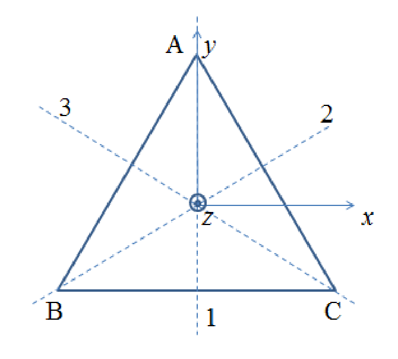
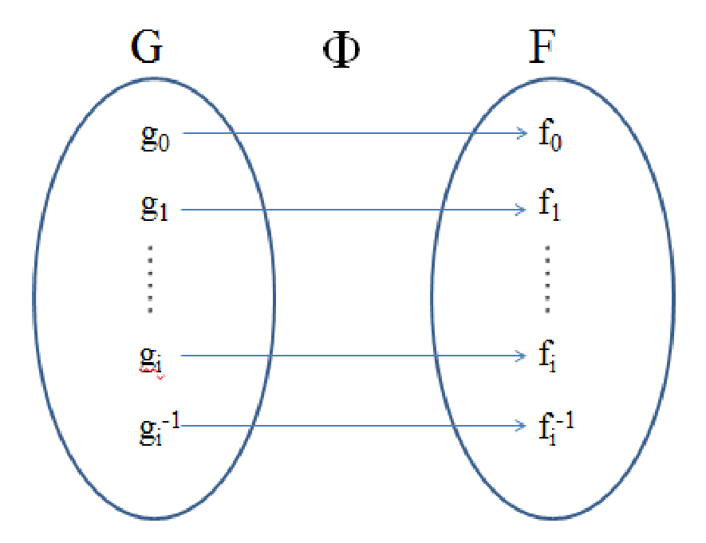
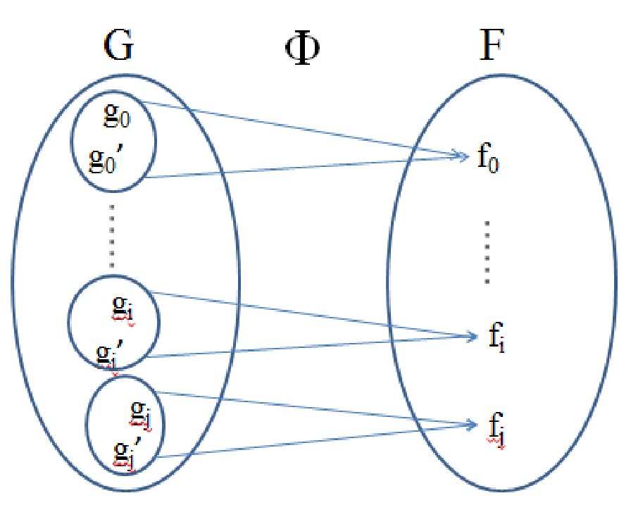
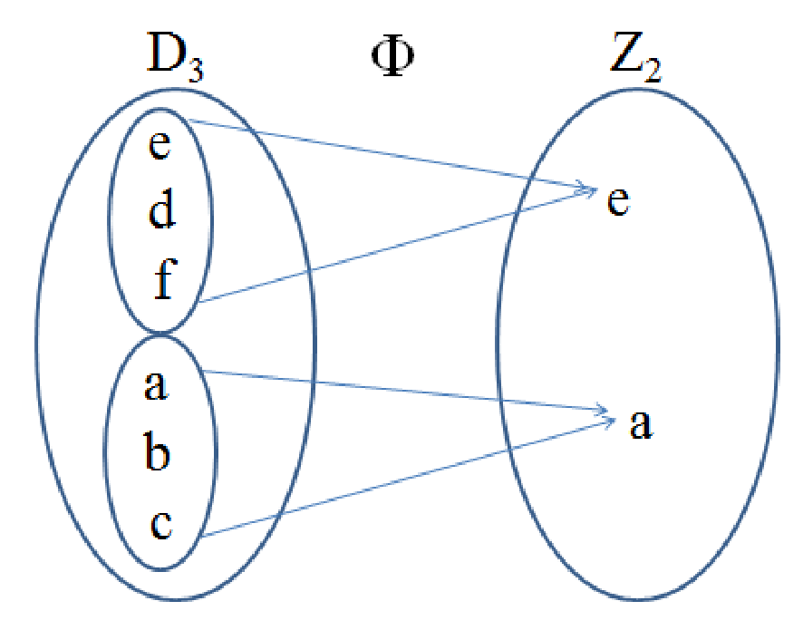
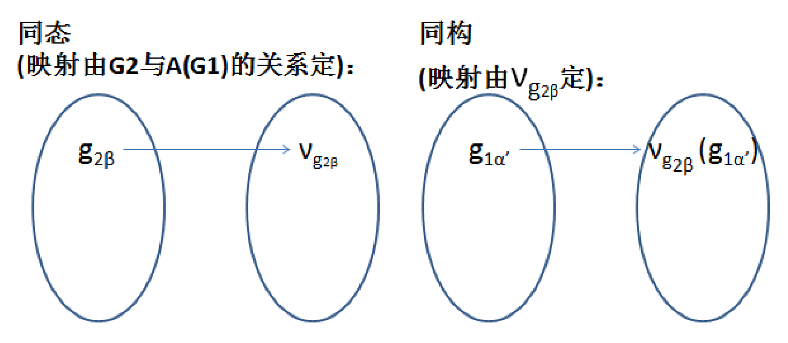

# 第一章 群的基本概念

## 1.1 群

**定义 1.1**（群）：设 $G$ 是一些元素（操作）的集合，记为 $G=\{\cdots,g,\cdots\}$，在 $G$ 中定义了乘运算，如果 $G$ 中元素对这种运算满足下面四个条件：

1) 封闭性：$\forall$ 两个元素（操作）的乘积仍属于这类元素（操作）的集合；

2) 结合律：对 $\forall$ 三个元素（操作）$f$、$g$、$h$，有 $(fg)h=f(gh)$；

3) 有唯一单位元素 $e$，使得对 $\forall f\in G$，有 $ef=fe=f$；

4) 对 $\forall f\in G$，存在且唯一存在 $f^{-1}$ 属于 $G$，使 $f^{-1}f=ff^{-1}=e$；

这时我们称 $G$ 是一个群，$e$ 为其单位元素，$f^{-1}$ 为 $f$ 的逆。

去理解这个定义，我们先看一些例子。

**例 1.1** 一个集合有两个操作 $E$ 和 $I$，$E$ 作用三维欧式空间中任一向量 $\vec{r}$ 上，得到 $\vec{r}$ 本身，$I$ 作用这个 $\vec{r}$ 上，得到 $-\vec{r}$。问 $\{E,I\}$ 是否形成一个群？

考虑这种问题的时候，就去想群的定义。两个元素，操作组合有 4 种，$E\cdot E$、$E\cdot I$、$I\cdot E$、$I\cdot I$，其中任何一个作用到 $\vec{r}$ 上，结果不是 $\vec{r}$ 就是 $-\vec{r}$，所以效果与 $E$ 或者 $I$ 作用到 $\vec{r}$ 上一致，封闭性满足。

结合律，类似 $(E\cdot I)\cdot E=E\cdot(I\cdot E)$ 的关系对于这三个位置怎么填都成立。

唯一单位元素 $E$。

逆元素，$E$ 的逆是 $E$，$I$ 的逆是 $I$。

所以 $\{E,I\}$ 形成一个群，称为空间反演群。

**例 2** 这样一系列操作的集合，它们中每一个操作，都把 $1\text{、}2\text{、}\cdots\text{、}n$ 这 $n$ 个数，一对一的对应到 $1\text{、}2\text{、}\cdots\text{、}n$ 这 $n$ 个数上。比如

$$
P=\begin{pmatrix}1&2&\cdots&n\\m_1&m_2&\cdots&m_n\end{pmatrix}\qquad (2.1)
$$

就是把 $1\text{、}2\text{、}\cdots\text{、}n$ 对应到 $m_1\text{、}m_2\text{、}\cdots\text{、}m_n$ 上，其中 $m_1\text{、}m_2\text{、}\cdots\text{、}m_n$ 是 $1\text{、}2\text{、}\cdots\text{、}n$ 的任意排列。

注意，在这个标记中 $\begin{pmatrix}1&2&\cdots&n\\m_1&m_2&\cdots&m_n\end{pmatrix}$ 与 $\begin{pmatrix}2&1&\cdots&n\\m_2&m_1&\cdots&m_n\end{pmatrix}$ 是一样的，因为它们的效果都是把 1 变为 $m_1$、2 变为 $m_2$、$\cdots$（以此类推）

现在我们来看这样的操作的集合是否形成群？

1. 封闭性：不管怎么变，$1\text{、}2\text{、}\cdots\text{、}n$ 这 $n$ 个数都是变到这 $n$ 个数上，封闭性满足；

2. 结合律：设 $P_1$ 是把 1 变为 2，$P_2$ 是把 2 变为 3，$P_3$ 是把 3 变为 4，那么

$$
(P_1P_2)P_3=[(1\to2)(2\to3)](3\to4)=(1\to3)(3\to4)=(1\to4)\qquad (2.2)
$$

$$
P_1(P_2P_3)=(1\to2)[(2\to3)(3\to4)]=(1\to2)(2\to4)=(1\to4)\qquad (2.3)
$$

两者相等，结合律成立

3. 单位元：有且唯一，什么都不变的那个操作

4. 逆：存在且唯一，你变过去我再变回来

所以这些元素的集合也构成一个群，我们称为 $n$ 阶置换群，它的群元的个数是 $n!$。在物理上，处理全同粒子体系的时候，会经常用到这一类群，我们后面会专门介绍。

**例 3** 是个几何图形的对称性，有三维欧式空间的一个正三角形，顶点是 $A$、$B$、$C$。

对于这样一个三角形，它有六个纯转动可以使自身回到自身的操作，分别是：

1. $e$：不动；

2. $d$：绕 $z$ 轴转 $2\pi/3$；

3. $f$：绕 $z$ 轴转 $4\pi/3$；

4. $a$：绕 1 轴转 $\pi$；

5. $b$：绕 2 轴转 $\pi$；

6. $c$：绕 3 轴转 $\pi$；

现在问：这六个操作是否形成群？

这个答案肯定还是按我们上面的思路来走，看它是否满足那四个条件？

但与此同时，我们还可以借用一下前面讲的置换群的概念，因为这些操作无非是将（$A$、$B$、$C$）对应到（$A$、$B$、$C$）上去，而这六个几何操作有恰恰和三阶置换群的六个变换一一对应。因此它们形成一个群。

既然形成一个群，现在我们看它们的乘法关系。$d$ 操作干的事情是 $\begin{pmatrix}A&B&C\\B&C&A\end{pmatrix}$，而 $a$ 操作干的事情是 $\begin{pmatrix}A&B&C\\A&C&B\end{pmatrix}$，因此：

$$
d\cdot a=\begin{pmatrix}A&B&C\\B&C&A\end{pmatrix}\begin{pmatrix}A&B&C\\A&C&B\end{pmatrix}=\left(\begin{array}{c}\begin{pmatrix}A&B&C\\A&C&B\end{pmatrix}\\[6pt]\begin{pmatrix}B&C&A\\B&A&C\end{pmatrix}\end{array}\right)=\begin{pmatrix}A&B&C\\B&A&C\end{pmatrix}=c\qquad (2.4)
$$

重复类似运算，可得完整乘法表：

| | $e$ | $d$ | $f$ | $a$ | $b$ | $c$ |
|---|---|---|---|---|---|---|
| $e$ | $e$ | $d$ | $f$ | $a$ | $b$ | $c$ |
| $d$ | $d$ | $f$ | $e$ | $c$ | $a$ | $b$ |
| $f$ | $f$ | $e$ | $d$ | $b$ | $c$ | $a$ |
| $a$ | $a$ | $b$ | $c$ | $e$ | $d$ | $f$ |
| $b$ | $b$ | $c$ | $a$ | $f$ | $e$ | $d$ |
| $c$ | $c$ | $a$ | $b$ | $d$ | $f$ | $e$ |

（表 1：$D_3$ 群乘法表）

这样一个群叫 $D_3$ 群，它是图形中的三角形的纯转动群，当我们除了转动还包含反射、反演这些操作的时候，群元就会再多一些，群也不是这个 $D_3$ 群了。这里的 $D_3$ 群只包含转动操作。

**例 4** 定义群的乘法为数的加法，则全体整数构成一个群，0 是其中的单位元素，$n$ 与 $-n$ 互逆。

同理，全体实数也在这个乘法规则下构成一个群，全体复数也是。

但如果我们把乘法定义为数乘，那么它们就不再是群了，因为这种情况下单位元素只能是 1，而 0 是没有逆的。

现在我们知道群是定义了乘法且满足一定规律的元素的组合，下面我们看一下跟群相关的两个定义与一个定理。

**定义 1.2** 有限群与无限群：群内元素个数称为群的阶，当群阶有限时，称为有限群，当群阶无限时，称为无限群。（这个学期我们主要讲有限群）

**定义 1.3** Abel 群：群的乘法一般不可交换（这个在群的定义里面没有体现，因此在一般的群中也不需要遵守，比如 $D_3$ 中 $ad$ 就不等于 $da$），当群中元素乘法可以任意互换时，这个群称为 Abel 群。（由这个定义我们很容易想象 Abel 群的乘法表都应该是相对于对角线对称的）

**定理 1.1** 重排定理：设 $G=\{\cdots,g_\alpha,\cdots\}$，对 $\forall u\in G$，当 $g_\alpha$ 取遍 $G$ 中所有元素时，$ug_\alpha$ 给出且仅仅一次给出 $G$ 中所有元素。

证明：

两个方面，1) 任何 $G$ 中元素都可以由 $ug_\alpha$ 给出，2) 仅仅一次给出。

1. 给出。对任意 $g_\beta$ 属于 $G$，可取 $u^{-1}g_\beta\in G$，使得：$u(u^{-1}g_\beta)=g_\beta$

2. 仅仅一次给出。

反证：设有 $g_\alpha\neq g_{\alpha'}$，使得 $ug_\alpha=ug_{\alpha'}$，那么就会有：$u^{-1}ug_\alpha=u^{-1}ug_{\alpha'}$，进而 $g_\alpha=g_{\alpha'}$，与假设矛盾。

至此，第一节结束。四个内容，三个定义（群，有限、无限群、Abel 群），一个定理（重排）。这些讲的都是群本身的性质，不牵扯其内部结构。既然要理解群这个元素集合的结构特性，对其内部结构的认识不可避免。下面的内容很自然与内部结构有关，子群与陪集。

## 1.2 子群与陪集

**定义 1.4** 子群：设 $H$ 是群 $G$ 的一个子集（部分元素的集合），若对群 $G$ 相同的乘法运算，$H$ 也构成一个群，则称 $H$ 为 $G$ 的子群。

这里需要注意的地方是和 $G$ 相同的乘法。同时，上面我们定义群的时候，用了四个条件。原则上，定义子群也需要这四个条件 1) 封闭性、2) 结合律、3) 单位元、4) 每个元素唯一逆。但因为 $H$ 属于 $G$，又是相同的乘法，所以结合律自然成立。同时，如果 4) 满足，则有 $f$ 属于 $H$ 时，$f^{-1}$ 也属于 $H$，只要封闭性成立，$e$ 自然属于 $H$。因此，在证明子集为子群时，只要 1) 与 4) 成立就可以了。

显然 $\{e\}$ 与 $G$ 本身都是 $G$ 的子群，由于太明显，所以称为显然子群，或平庸子群。而群 $G$ 的非平庸子群称为固有子群。一般我们找群 $G$ 的子群的时候找的是它的固有子群（非平庸子群）。

**例 5** $n$ 阶循环群，它的定义是 $a^n=e$，由 $\{a\text{、}a^2\text{、}\cdots\text{、}a^{n-1}\text{、}a^n=e\}$ 组成。这样的群是 Abel 群，乘法可易。以 6 阶循环群为例，$G=\{a\text{、}a^2\text{、}\cdots\text{、}a^5\text{、}a^6=e\}$，其中 $\{e\}$ 与 $G$ 是显然子群。$\{a^2\text{、}a^4\text{、}e\}$ 与 $\{a^3\text{、}e\}$ 为固有子群。

**例 6** 在定义群的乘法为数的加法的时候，整数全体形成的群是实数全体形成的群的子群。

**例 7** 绕固定轴 $\vec{k}$ 转动的元素形成的群 $\{C_{\vec{k}}(\Psi)\}$，是绕轴上某一点转动（过这点可以有无数个轴）的群 SO(3) 群的子群。

**定义 1.5** 群元的阶：对任意一个有限群 $G$，从中取一个元素 $a$，从 $a$ 出发作幂操作，总是可以构成 $G$ 的一个循环子群 $Z_k$ 的，这个 $Z_k$ 等于 $\{a\text{、}a^2\text{、}\cdots\text{、}a^{k-1}\text{、}a^k=e\}$，这时称 $k$（满足这个性质的最小的 $k$）为群元 $a$ 的阶。

这个概念很好理解，但有个地方需要说明一下，就是你凭什么说“从 $a$ 出发，总能构成 $G$ 的一个循环子群的”？这是因为如果 $a=e$，则 $Z_k$ 等于 $\{e\}$，问题解决。如果，$a\neq e$，则 $a^2\neq a$（不然 $a=e$），这时，如果 $a^2=e$，则问题又解决了。如 $a^2\neq e$，则它必为 $e$ 与 $a$ 之外的另一个元素，我把 $a^2\text{、}a$ 放到我的子集中，继续做 $a^3$，同样 $a^3\neq a^2$（不然 $a=e$）、也不等于 $a$（不然 $a^2=e$），如果 $a^3=e$，问题解决，如 $a^3\neq e$，再把 $a^3$ 放到那个子集中。依次类推，因为 $G$ 是有限群（阶为 $n$），所以必然存在一个 $k$ 小于等于 $n$，使得 $a^k=e$，来结束这个过程。这时，$\{a\text{、}a^2\text{、}\cdots\text{、}a^{k-1}\text{、}a^k=e\}$ 这个集合自然就形成了 $k$ 阶循环子群了。

**例 8** 群元的阶的例子，对 $D_3$ 群，六个元素 $e\text{、}d\text{、}f\text{、}a\text{、}b\text{、}c$。对 $d$，从它出发，$d^2=f$，$d^3=e$，所以由 $d$ 形成的循环子群是 $\{e\text{、}d\text{、}f\}$，$d$ 的阶是 3。

对 $f$，$f^2=d$，$f^3=e$，所以由 $f$ 形成的循环子群也是 $\{e\text{、}d\text{、}f\}$，$f$ 的阶也是 3。类似，$a$，$a^2=e$，由 $a$ 出发形成的循环子群是 $\{e\text{、}a\}$，$a$ 的阶是 2；$b$，$b^2=e$，由 $b$ 出发形成的循环子群是 $\{e\text{、}b\}$，$b$ 的阶是 2；$c$ 与 $a$、$b$ 一样。

说完了子群与群元的阶，下一个概念是陪集。

**定义 1.6** 陪集：设 $H$ 是群 $G$ 的子群，$H=\{h_\alpha\}$，由固定的 $g\in G$，可生成子群 $H$ 的左陪集：$gH=\{gh_\alpha|h_\alpha\in H\}$，也可生成子群 $H$ 的右陪集：$Hg=\{h_\alpha g|h_\alpha\in H\}$。

这个定义做两点说明。一是当 $H$ 是有限子群时，陪集元素个数等于 $H$ 的阶。因为不可能存在 $h_\alpha\neq h_{\alpha'}$ 但 $gh_\alpha=gh_{\alpha'}$ 或 $h_\alpha g=h_{\alpha'}g$ 的情况。也就是说子群中元素与陪集中元素一一对应。二是根据这个定义，陪集可以为子群本身。如果上面取的 $g\in H$，就是。如果不属于，就不是。关于子群和陪集，除了这两点，还有一个很重要的性质，就是陪集定理。

**定理 1.2** 陪集定理：设群 $H$ 是群 $G$ 的子群，则 $H$ 的两个左（或右）陪集或者完全相同，或者没有任何公共元素。

换句话说，对于一个群 $G$，如果它按照其子群 $H$ 来进行分割：$G=\{g_0H\text{、}g_1H\text{、}g_2H\text{、}\cdots\}$，$g_0=e$，其中任意两个陪集 $g_iH$ 与 $g_jH$ 的关系是它们要么完全相同，要么根本没有任何公共元素。

证明：（以左陪集为例）

设 $uH$、$vH$ 是不同陪集。

再假设 $uH$ 与 $vH$ 中间有一个公共元素 $uh_\alpha=vh_\beta$，则有 $v^{-1}uh_\alpha=h_\beta$，进而 $v^{-1}u=h_\beta h_\alpha^{-1}$，$v^{-1}u\in H$。

这个时候，由于 $H$ 本身是个群，所以由重排定理知道 $v^{-1}uH=H$，那么 $v(v^{-1}uH)$ 自然等于 $vH$。而同时 $v(v^{-1}uH)=uH$。也就是说 $uH=vH$，与假设矛盾。

（证毕，右陪集证明类似）

有了这个性质，我们在面对一个群的时候，按照它的一个子群和这个子群的陪集去进行分割，我们会得到什么？

群是 $G$，子群是 $H$，它本身就是一个陪集。除了 $H$，我们可以再取 $u_1\in G$，但 $\notin H$，建一个 $H$ 的陪集 $u_1H$，这个 $u_1H$ 与 $H$ 是没有任何公共元素的，因为如果 $u_1h_\alpha=h_\beta$，则 $u_1=h_\beta h_\alpha^{-1}$，与 $u_1\notin H$ 矛盾。这时可以将 $G$ 写为 $H$、$u_1H$、以及它们以外的元素的集合。这个时候在继续取 $u_2$ 属于 $G$，但它不属于 $H$，也不属于 $u_1H$。做陪集 $u_2H$，$u_2H$ 中的 $u_2$ 不在 $eH$ 中，也不在 $u_1H$ 中，所以 $u_2H$ 与 $eH$、$u_1H$ 完全不同。

依次类推，设 $G$ 的阶是 $n$，$H$ 的阶是 $m$。则每个陪集给出的都是全新的 $m$ 个群 $G$ 中的元素。重复这个过程，直到把 $G$ 中元素穷尽。那么这个 $H$ 的陪集的个数就应该是 $n/m$。这个 $n/m$ 必须是个整数，这也就意味着子群 $H$ 的阶 $m$ 必为群 $G$ 的阶 $n$ 的因子。这个性质就是我们的第三个定理。

**定理 1.3** 拉格朗日（Lagrange）定理：有限群子群的阶，必为群阶的因子。

由这个定理，我们再去分析 $D_3$ 群的子群，我们说过它的子群有 $\{e\}$、$G$、$\{e\text{、}d\text{、}f\}$、$\{e\text{、}a\}$、$\{e\text{、}b\}$、$\{e\text{、}c\}$，这些子群的阶分别是 1、6、3、2、2、2，都是 6 的因子。用 $\{e\text{、}d\text{、}f\}$ 来分割群的话，$G=\{\{e\text{、}d\text{、}f\}\text{、}a\{e\text{、}d\text{、}f\}\}$，其中 $a\{e\text{、}d\text{、}f\}$ 对照前面的乘法表，给出的恰恰是 $\{a\text{、}b\text{、}c\}$。

至此，前两节结束。讲了六个定义：1) 群，2) 群的阶、有限群、无限群，3) Abel 群，4) 子群，5) 循环子群与群元的阶，6) 陪集。三个定理：1) 重排定理，2) 陪集定理，3) 拉格朗日定理。在导言里面我们提到群是一个有结构的元素的集合，这三个定理是最基本的结构性质，以后很多定理的证明都会用到。第二节讲的子群和陪集是群中元素结构关系的一个方面，下面一节要讲的类与不变子群是其另一个方面。

## 1.3 类与不变子群

此节中，类与不变子群是我们要重点阐明的概念。理解它们需要一个基础，这个基础是共轭。

**定义 1.7** 共轭：所谓共轭，指的是群 $G$ 中两个元素 $f$、$h$，如果在 $G$ 中存在一个 $g$，使得 $f$、$h$ 可以通过 $gfg^{-1}=h$ 联系起来，则称 $f$、$h$ 共轭，记为 $f\sim h$。

由此定义，我们首先知道共轭是相互的。因为如果 $gfg^{-1}=h$，则 $g^{-1}hg=f$，也就是 $g^{-1}h(g^{-1})^{-1}=f$，其中 $g^{-1}\in G$。其次，我们知道共轭有传递性，也就是说 $f_1\sim f_2$，$f_2\sim f_3$，则 $f_1\sim f_3$，为什么？因为由 $f_1\sim f_2$，我们知道，一定存在 $g\in G$，使得 $gf_1g^{-1}=f_2$。而由 $f_2\sim f_3$，我们又知道一定存在 $h\in G$，使得 $hf_2h^{-1}=f_3$。把第一个式子代入第二个，就会有 $hgf_1g^{-1}h^{-1}=f_3$，进而 $hgf_1(hg)^{-1}=f_3$。而 $hg$ 是属于 $G$ 的，所以 $f_1\sim f_3$。

由此传递性，我们可以去定义类。

**定义 1.8** 类：群 $G$ 中所有相互共轭的元素形成的集合，称为群 $G$ 的一个类。

由于共轭关系的传递性，我们知道一个类是可以被其中任何一个元素所确定的。这个有些像现实生活中的犯罪团伙，逮着一个，其他的也就差不多了。此比喻不一定准确，但有相似的地方。

而就由类中任何一个元素确定这个类的操作步骤而言，很简单，对一个类中元素 $f$，取任意 $g$ 属于 $G$，做操作 $gfg^{-1}$。当 $g$ 走遍 $G$ 中所有元素的时候，那么 $f$ 的所有同类元素，没跑，就一个个全出现了。（地毯式搜捕）由这个共轭关系和类的定义，我们还可以得出：

1) 一个群中的单位元素自成一类，因为对任意 $f$ 属于 $G$，$fef^{-1}=e$；

2) Abel 群的所有元素都自成一类，因为对任意 $f$ 属于 $G$，取任意 $h$ 属于 $G$，做 $hfh^{-1}=hh^{-1}f=f$；

3) 设群元素 $f$ 的阶为 $m$，即 $f^m=e$，则与它同类的元素的阶也为 $m$。这是因为它的同类元素可以写为 $gfg^{-1}$，对于这个元素，$(gfg^{-1})^k=gf^kg^{-1}$。当 $k<m$ 时，$f^k$ 不等于 $e$，所以 $gf^kg^{-1}$ 也不可能为 $e$，因为如果它为 $e$，就有 $f^k=e$，与已知矛盾。而 $k=m$ 时，$gf^kg^{-1}=geg^{-1}=e$，所以 $gfg^{-1}$ 的阶为 $m$。

最后要说明的，是按类分割群和按陪集分割群是分割群的两种方法。按陪集分割时，群元会被等分为若干部分，但按类就不一定了。同时在用 $gfg^{-1}$ 找 $f$ 的同类元素时，$g$ 取不同值，$gfg^{-1}$ 可不止一次给出同一元素，比如找单位元的同类元素时，$g$ 不管取什么，$gfg^{-1}$ 给出的都是 $e$。

跟类相关的第一个定理是关于类中元素个数的，跟 Lagrange 定理有像的地方，内容如下。

**定理 1.4** 有限群的每个类中元素的个数都是群阶的因子。

（定理很简单，证明稍微有些麻烦）

证明：（分三步）

我们要找的是由 $g$ 这个任意元素确认的类中元素的个数。

第一步，先证明所有与 $g$ 互易的元素 $h$ 形成一个 $G$ 的子群，记为 $H_g$，这个根据子群的定义，只需证明封闭和有逆就可以了。

封闭：如 $h_1g=gh_1$，$h_2g=gh_2$，则 $h_1h_2g=h_1gh_2=gh_1h_2$，也就是说 $h_1h_2$ 属于也这个集合。

有逆：如 $hg=gh$，则 $h^{-1}hg=g=h^{-1}gh$，进而 $gh^{-1}=h^{-1}g$，$h^{-1}$ 也属于这个集合。

两个结合，所有与 $g$ 互易的元素形成群 $G$ 的一个子群，记为 $H_g$。

第二步，根据拉格朗日定理，我们可以把群 $G$ 按照 $H_g$ 的陪集，分割为 $\{g_0H_g\text{、}g_1H_g\text{、}g_2H_g\text{、}\cdots\}$。这里取 $g_0$ 为 $G$ 中单位元素。

现在我们要证明的是每个陪集中元素 $g_ih_\alpha$，在 $h_\alpha$ 取遍 $H_g$ 中所有元素，也就是 $g_ih_\alpha$ 取遍这个陪集中所有元素的时候，$g_ih_\alpha g(g_ih_\alpha)^{-1}$ 给出同一个 $g$ 类中元素 $g_igg_i^{-1}$，且不同陪集给出的类中元素不同。

这个证明是两个方面：

1) 同一陪集同一元素，对陪集中任意元素 $g_ih_\alpha$，做 $g_ih_\alpha g(g_ih_\alpha)^{-1}$，由于 $h_\alpha$ 于 $g$ 互易，结果都是 $g_igg_i^{-1}$。

2) 不同陪集不同元素，$g_iH_g$ 与 $g_jH_g$ 两个陪集，给出元素为 $g_igg_i^{-1}$ 与 $g_jgg_j^{-1}$。如 $g_igg_i^{-1}=g_jgg_j^{-1}$，则有 $g_j^{-1}g_igg_i^{-1}=gg_j^{-1}$，进而 $g_j^{-1}g_ig=gg_j^{-1}g_i$，这也就是说 $g_j^{-1}g_i$ 属于 $H_g$。这样，由重排定理知道 $H_g=g_j^{-1}g_iH_g$，进而 $g_iH_g=g_jH_g$，与已知它们为两个不同陪集矛盾。因此，不同陪集做共轭操作给出不同类中元素。

第三步，$G$ 中有 $n$ 个元素，$H_g$ 阶为 $m$，我们按 $H_g$ 做陪集分解会有 $n/m$ 个子群与陪集。每个陪集给出一个 $g$ 的同类元素，一共是 $n/m$ 个。这也就是说 $g$ 的类中元素个数为 $n/m$。$n/m$ 显然是 $n$ 的因子。

现在我们再来回味一下之前说的两句话，1) 一个群的单位元素自成一类，2) Abel 群中每个元素自成一类。对于这两种情况，上面证明中用到的 $H_g$ 就是群 $G$ 本身，所以 $m=n$，$n/m=1$。这个类中只有一个元素。

上面说的共轭、类的概念的对象都是元素。在《子群和陪集》那一节，我们知道群中我们研究的对象除了元素，还有子群。因此，做个类比，上面提到的群元素共轭的概念原则上也可以推广到子群之间。

**定义 1.9** 共轭子群：设 $H$ 和 $K$ 是群 $G$ 的两个子群，若存在 $g$ 属于 $G$，使得 $K=gHg^{-1}=\{ghg^{-1}|h\in H\}$。这时，称 $H$ 和 $K$ 是共轭子群。

由这个定义，我们知道：1) 两个共轭的子群里面必有同类的元素；2) 与元素共轭的传递性类似，子群共轭也有传递性。同时，与群元可以按类进行划分一样，$\{\{e\}\text{、}\{g_1\text{、}g_2\}\text{、}\{g_3\text{、}g_4\text{、}g_5\}\text{、}\cdots\}$，群的子群也可以按共轭子群类来进行划分。比如，上例中，$\{e\}$ 自成一个共轭子群类，$\{e\text{、}g_1\}$、$\{e\text{，}g_2\}$ 是一个共轭子群类，等等。这些概念比较繁琐，有些教材中会提到，但后面用到的地方不多，我们这里稍微提一下。在类和子群的概念的结合中并不繁琐，同时我们以后也非常多用到的一个概念是不变子群，我们重点讲解。

**定义 1.10** 设 $H$ 是 $G$ 的子群，如果 $H$ 中所有元素的同类元素都属于 $H$，则称 $H$ 是 $G$ 的不变子群（数学上一般称为正规子群）。

不变子群是一种特殊的子群，它有一个非常重要的性质。

**定理 1.5** 设 $H$ 是 $G$ 的不变子群，那么对任意固定的 $f$ 属于 $G$，当 $h_\alpha$ 取遍 $H$ 中所有元素的时候，$fh_\alpha f^{-1}$ 给出且仅仅一次给出 $H$ 中所有元素。

（这里对 $f$ 的要求是 $f$ 是任意一个属于 $G$ 的固定元素即可，没要求它一定不属于 $H$。$f$ 定了，$fh_\alpha f^{-1}$ 就一对一得给出 $H$ 中所有元素。）

证明：（两步）

第一步，对任意 $h_\beta$ 属于 $H$，都可以由 $fh_\alpha f^{-1}$ 给出。这个很简单，因为 $H$ 是不变子群，所以取 $h_\alpha=f^{-1}h_\beta f$，则 $fh_\alpha f^{-1}$ 就给出 $h_\beta$，而这个 $h_\alpha=f^{-1}h_\beta f$，属于 $H$ 的。

第二步，属于 $H$ 的不同的 $h_\alpha$、$h_\beta$，$fh_\alpha f^{-1}$ 与 $fh_\beta f^{-1}$ 不同。这个很显眼，因为如果$fh_\alpha f^{-1}$ 与 $fh_\beta f^{-1}$ 相同，则 $h_\alpha$、$h_\beta$ 相同，与假设矛盾。

（证毕）

说了半天道理，现在看几个例子。

**例 9** 以加法为群的乘法，之前说过，有整数群，有实数群。我们也说过整数群是实数群的子群，现在看它是不是实数群的不变子群。

标准只有一个，就是看子群的同类元素是否属于这个子群。$n$，它的共轭元素是 $a+n-a=n$ 本身，属于整数群，所以是不变子群。

实际上，所有 Abel 群的子群都是其不变子群。因为每个元素自成一类，其同类元素自然在这个子群中。

关于不变子群，还有一个很重要的性质。

**定理 1.6** 不变子群的左陪集与右陪集是重合的。

证明：

利用定理 1.5，说的是 $fHf^{-1}=H$，那么 $fH=Hf$（证毕）。

这样的话对于不变子群，我们在说陪集的时候，就不用说左陪集或右陪集，直接说陪集就可以了。除了上面那个性质，不变子群的陪集还有另外一个更加重要的性质，就是两个（非子群的）不同陪集中元素的乘积，必为第三个陪集中的元素。

这个说的是什么呢？就是 $H$ 是 $G$ 的不变子群，由 $H$，可将 $G$ 分解为 $G=\{g_0H\text{、}g_1H\text{、}g_2H\text{、}\cdots\}$。这样的话在这一系列的陪集中，取 $g_iH$ 与 $g_jH$ 这两个陪集中的元素 $g_ih_\alpha$ 与 $g_jh_\beta$ 相乘，结果是这样的：当 $g_iH$ 与 $g_jH$ 都不是 $g_0H$ 时，必属于 $g_iH$ 与 $g_jH$ 外的另一个陪集；当 $g_iH$、$g_jH$ 其中一个是 $g_0H$ 时，必属于 $g_iH$ 与 $g_jH$ 中的另一个；$g_iH$ 与 $g_jH$ 都是 $g_0H$ 时，必属于 $g_0H$。

这里后两种情况很明显，第一种情况需要证一下。

证明：（反证法）

$g_ih_\alpha g_jh_\beta=g_ig_jg_j^{-1}h_\alpha g_jh_\beta=g_ig_jh_{\alpha'}h_\beta$，我们把 $g_ig_jH$ 这个陪集记作 $g_kH$。

现在设 $g_kH=g_iH$，这个会导致 $g_ig_jh_{\alpha'}h_\beta=g_ih_\gamma$，进而 $g_j=h_\gamma h_\beta^{-1}h_{\alpha'}^{-1}$。再由 $H$ 是子群，得 $g_j$ 属于 $H$，这样就与已知 $g_j$ 不属于 $H$ 矛盾了。

同理，如果 $g_kH=g_jH$，就会有 $g_ig_jh_{\alpha'}h_\beta=g_ih_\alpha g_jh_\beta=g_jh_\gamma$。这样的话，就有 $g_ih_\alpha g_jh_\beta g_j^{-1}g_j=g_jh_\gamma$，进而 $g_ih_\alpha h_{\beta'}g_j=g_jh_\gamma$，进而 $g_ih_\alpha h_{\beta'}=g_jh_\gamma g_j^{-1}=h_{\gamma'}$，进而 $g_i$ 属于 $H$ 了，同样与已知矛盾。

（证毕）

这样的话，根据上面提到的三种情况的性质，我们可以定义一个基于不变子群的商群。

**定义 1.11** 商群：设群 $G$ 有不变子群 $H$，由 $H$ 将 $G$ 分为 $\{g_0H\text{、}g_1H\text{、}g_2H\text{、}\cdots\text{、}g_iH\text{、}\cdots\}$，把其中每个陪集看成一个新的元素，并由两个陪集中元素相乘得到另一陪集中的元素，定义新的元素乘法，即：

| 陪集串 | 新元素 |
|---|---|
| $g_0H$ | $f_0$ |
| $g_1H$ | $f_1$ |
| $g_2H$ | $f_2$ |
| $\vdots$ | $\vdots$ |
| $g_iH$ | $f_i$ |
| $\vdots$ | $\vdots$ |

乘法规则对应关系：

$$
g_ih_\alpha g_jh_\beta=g_kh_\gamma \qquad\qquad f_if_j=f_k
$$

这样得到的群 $\{f_0\text{、}f_1\text{、}\cdots\text{、}f_i\text{、}\cdots\}$ 称为 $G$ 对其不变子群 $H$ 的商群，记为 $G/H$。

说白了，就是把每个陪集当成一个新的元素，形成的新的结构。在导言的时候，我们说过群论研究的是集合的结构特征及其生成规律，这里的不变子群与其商群，就是群结构特征的一个典型的例子。我们可以把商群当成是群本身，以不变子群及其陪集为基本单元的一种超结构。

关于这些概念，我们还是通过一个例子来作具体的理解。

**例 10** $D_3$ 群，它的元素是 $\{e\text{、}d\text{、}f\text{、}a\text{、}b\text{、}c\}$，乘法表见前面的表 1，借助乘法表，先看它的分类情况。任何群，$\{e\}$ 自成一类。$a^{-1}=a$、$b^{-1}=b$、$c^{-1}=c$、$d^{-1}=f$、$f^{-1}=d$。

对 $a$，其同类元素有：$d^{-1}ad=fad=fb=c$、$f^{-1}af=daf=dc=b$、$a^{-1}aa=a$、$b^{-1}ab=bab=bd=c$、$c^{-1}ac=cac=cf=b$。因此，$a$ 的同类元素有 $b$、$c$。它们的阶都是 2，也形成一个类。

同理，$d$ 的同类元素是 $f$，它们阶都是 3，形成一个类。$D_3$ 群有三个类。

之前我们讲过，它的子群有 $\{e\}$、$G$、$\{e\text{、}a\}$、$\{e\text{、}b\}$、$\{e\text{、}c\}$、$\{e\text{、}d\text{、}f\}$。其中，不变子群有 $\{e\}$、$G$、$\{e\text{、}d\text{、}f\}$，只有最后一个非平庸，记为 $H$。再由 $H$，可把 $G$ 分解为 $\{H\text{、}aH\}$，作对应 $H$ 对 $f_0$，$aH$ 对 $f_1$，商群 $G/H$，就是一个由 $\{f_0\text{、}f_1\}$ 组成的二阶循环群。

## 1.4 同构与同态

到目前为止，我们讲的都是群自身的结构。群与群之间，也有结构关系。这节要讲的同构与同态，说的就是这个。

**定义 1.12** 若从群 $G$ 到群 $F$ 上，存在一一对应的满映射 $\Phi$，且这个映射本身保持群的乘法运算规律不变，也就是说 $G$ 中两个元素乘积的映射，等于群 $G$ 中两个元素映射的乘积，则称群 $G$ 与群 $F$ 同构，记作 $G\cong F$。映射 $\Phi$ 称为同构映射，它的作用是：

把单位元素映射到单位元素，把互逆元素映射到互逆元素，不然，结构就破坏了，一一对应关系也会不成立。从数学角度，两个同构的群有完全相同的结构，没有本质的区别。

**例 11** 空间反演群 $\{E\text{、}I\}$ 与二阶循环群 $\{e\text{、}a\}$ 完全同构。

**例 12** 三阶置换群与 $D_3$ 群完全同构。

**例 13** 群 $G$ 的两个互为共轭的子群 $H$ 与 $K$，由定义，是存在一个固定的 $g$ 属于 $G$，使得对任意的 $h_\alpha\in H$，都有 $k_\alpha=gh_\alpha g^{-1}\in K$ 与之对应。这个对应关系是一对一的，同时单位元素对应单位元素，互逆元素对应互逆元素。所以同一个群的两个共轭子群同构。

比如 $D_3$ 群，有三个子群 $\{e\text{、}a\}$、$\{e\text{、}b\}$、$\{e\text{、}c\}$，它们相互共轭，$\{e\text{、}c\}=f\{e\text{、}a\}f^{-1}$，它们也相互同构。

同构的群有完全相同的数学结构，但是具体可指代不同内容。比如 2+3=5，在小孩眼里是糖，大人眼里是钱，科研工作者眼中是文章、引用、或者是真正看得懂你的文章的同行的赞。

这个理解也告诉我们同构是两个群之间结构关系的最强的相似性，除了这种完全的一对一且保持乘法规则，还可以把一对一这个限制弱化一下，这个就是我们下面要讲的同态。

**定义 1.13** 同态：设存在从群 $G$ 到群 $F$ 的满映射$^4$（注意，没有一对一了）$\Phi$，且这个映射本身保持群的乘法运算规律不变，也就是说 $G$ 中两个元素乘积的映射，等于群 $G$ 中两个元素映射的乘积，则称群 $G$ 与群 $F$ 同态，记作 $G\sim F$。映射 $\Phi$ 称为同态映射，它的作用是：

由于一一对应改成了多一对应，所以同态关系不可逆。

这样一个定义看起来好像结构特征并不强，就是随随便便的说了一句保持乘法关系，但实际上，这一句话里面的信息已经非常大了。最为典型的一个表现就是同态核定理。在引入这个定理之前，前说一下什么是同态核。

**定义 1.14** 同态核：设 $G$ 与 $F$ 同态，那么 $G$ 中与 $F$ 的单位元素对应的所有元素的集合称为同态核。

对照上图，就是第一个小圈圈。

$^4$ 数学上，关于同态的严格定义是没有满映射这个要求的，他们唯一的要求是保持乘法规则。在我们的应用中，我们关注的是群的表示。在群表示的讨论中，满映射这个要求存在。为保持本讲义讨论的一致性，我们从开头就做这样一个要求。

**定理 1.7**（同态核定理）设 $G$ 与 $F$ 同态，则有：

1) 同态核 $H$ 是 $G$ 的不变子群；

2) 商群 $G/H$ 与 $F$ 同构。

（这个定理其实是把同态定义所蕴藏的极强的结构特征给说明了，因为我们如果单从同态的定义出发去直观地理解，我们可能会觉得上面图中会出现这样的情况 1) 与 $f_0$、$f_1$、$f_2$ 对应的 $G$ 中小圈圈内 $g$ 元素的个数不一定相同，因为你没说；2) 每个小圈圈内的元素形成一个子集，它到底具有什么样的结构，比如说可以是子群、可以是陪集，我都不知道，因为你也没说。）

（同态核定理告诉我们的信息是：1) 每个小圈圈内元素个数相同；2) 与 $F$ 中单位元素对应的小圈圈内的 $g$ 元素的集合构成 $G$ 的一个子群；3) 这个子群不光是子群，还是不变子群；4) 其它圈圈对应的是它的陪集；5) 如果把这些圈圈当成新的元素，那么这些元素的结合形成的群与 $F$ 群完全同构。你说这个结构关系强不强？）

证明：（分三步）

第一步，先证同态核是子群。分两点 1) 封闭、2) 有逆。

封闭，对 $h_\alpha$、$h_\beta$ 属于同态核，我们知道它们对应的 $F$ 中元素都是 $f_0$，由于乘法规则不变，那么 $\Phi(h_\alpha h_\beta)=\Phi(h_\alpha)\Phi(h_\beta)=f_0f_0=f_0$，$h_\alpha h_\beta$ 也属于同态核。

有逆，$h_\alpha$ 属于同态核，要证 $h_\alpha^{-1}$ 也属于同态核。反证，设 $h_\alpha^{-1}$ 不属于同态核，它对应的元素为 $f_i$，那么就会一方面有 $\Phi(h_\alpha h_\alpha^{-1})=\Phi(g_0)=f_0$，另一方面 $\Phi(h_\alpha h_\alpha^{-1})=\Phi(h_\alpha)\Phi(h_\alpha^{-1})=f_0f_i=f_i$。也就是说 $f_i$ 等于 $f_0$。这与 $h_\alpha^{-1}$ 不属于 $H$，对应的 $f_i$ 不等于 $f_0$ 矛盾。因此假设不成立，$h_\alpha$ 属于同态核的话，$h_\alpha^{-1}$ 也属于同态核。

第二步，再证 $H$ 是不变子群。对 $\forall h_\alpha\in H$，要证 $gh_\alpha g^{-1}\in H$ 对 $\forall g\in G$ 成立。

由映射定义，知道在 $\Phi$ 作用下，$gh_\alpha g^{-1}$ 对应：$\Phi(g)\Phi(h_\alpha)\Phi(g^{-1})=\Phi(g)f_0\Phi(g^{-1})=\Phi(g)\Phi(g^{-1})=\Phi(g_0)=f_0$，所以 $gh_\alpha g^{-1}$ 依然属于 $H$，$H$ 为不变子群。

第三步，$G/H$ 与 $F$ 同构。

在这里，商群是我们把 $H$ 以及它的陪集 $g_1H$、$g_2H$、$\cdots$ 分别都当成新的元素形成的群。要证明它与 $F$ 同构，需证明：1) $H$ 与陪集串中每个集合对应 $F$ 中一个元素，2) 不同集合对应不同元素，这样一对一的关系成立。由于 $G$ 与 $F$ 本身同态，乘法关系是保持的，所以这个一对一的关系如果成立，$G/H$ 就与 $F$ 同构。

这两点里面第一点很好证，$H$ 中元素都对应 $f_0$，这个是因为同态核的定义。同时 $g_iH$ 中元素都对应 $\Phi(g_i)$，记为 $f_i$。第二点，不同集合对应不同 $F$ 中元素，用反证法。设 $g_iH$ 不等于 $g_jH$，是两个不同陪集，而它们对应的 $f_i=f_j$。这样的话就会有 $g_i^{-1}g_jh_\alpha$ 对应 $f_i^{-1}f_jf_0=f_0$，这也就是说 $g_i^{-1}g_jh_\alpha$ 属于 $H$，进而 $g_i^{-1}g_j\in H$。这样的话由重排定理，就知道 $g_iH$ 等于 $g_ig_i^{-1}g_jH$，等于 $g_jH$。与已知矛盾。

（证毕）

总结起来，就是通过上面三步，我们说明了同态核是不变子群，且 $G$ 对同态核的商群与 $F$ 同构。下面看几个例子。

**例 14** $D_3$ 群与二阶循环群 $Z_2$ 同态。为什么说这个成立呢？因为我们可以按照下图建立一个满映射关系，这种关系能保持乘法规律不变。

在这里，很显然$\{e\text{、}d\text{、}f\}$是同态核。如果大家翻到$D_3$群乘法表的那一页的话，很容易看到一种超结构，就是$6\times 6$的部分可以化成以$3\times 3$为基本单元的$2\times 2$的结构。这个就是二阶循环群的超结构了。

上面是由同态关系来说明商群与$F$同构。反过来，如果知道了商群与$F$同构，能否得到$G$与$F$同态呢？这个答案也是肯定的，因为前面商群的定义说的就是存在映射、且保持乘法规律不变的事情。

这个时候大家可以想一下前面讲这些概念的时候的路子，基本都是由一个看似不经意的定义出发，然后挖掘出这个定义内部包含的所有意思。对于定义这句话，如果只看表面的意思，可能你会觉得没有什么。但正是这几句话，认真挖掘的话，你会深刻地体会到里面包含的元素间，或者是群的结构间缜密的结构关系。正是因为这个原因，我们讲的路子基本都是：定义、定理、定义、定理、……，从而在你的脑子里建立起一个数学的概念体系。利用这个体系，我们后面再去看物理中的问题。同态这个地方最典型，所以我在这儿提一句，供大家体会。[^5]

[^5]: 2018 年春季，在这本讲义最终定型过程中，有幸看到阿热先生的那本经典教材，其中有这样一句话来描述群论：Starting from a few innocuous sounding axioms defining what a group is, an elegant mathematical structure emerges, with many unexpected theorems，大致说的正是笔者在这里描述的这种感觉。同时，在阿热先生那本经典教材的开头，他引了 18 世纪一个法国著名的 Polymath（对他而言含数学、力学、物理）Jean-Baptiste le Rond d'Alembert（让·勒朗·达朗贝尔）的一句名言：Algebra is generous; she often gives more than is asked of her。说的也是这个感受。在阿热先生的一个课程录像上，他提到了 Geometry 不是，他是这个感觉，他不知道为什么。笔者在讲义补充到这里的时候，也有同样的感觉，也不知道为什么。读者如有答案，欢迎告知。

同态和同构说的是两个群的结构特征之间的关系，用来建立这种关系的一个关键的概念是映射。关于这个映射本身，我们目前还没有说什么。下面要讲的几个概念是关于这个的。

**定义 1.15** 自同构映射：群$G$到自身的同构映射，记为$\nu$，做的事情是对$\forall g_\alpha\in G$，有$\nu(g_\alpha)\in G$与之对应，且保持乘法规律不变，即$\nu(g_\alpha g_\beta)=\nu(g_\alpha)\nu(g_\beta)$。

由于这个定义，我们知道自同构映射把$G$中单位元素映到单位元素，互逆的元素映到互逆的元素。我们还知道自同构映射是一个操作，也可以当成一个元素。如果把所有群$G$的自同构映射放在一起，也可以形成一个群。

**定义 1.16** 群$G$的自同构群：如果我们把群$G$的所有自同构映射放在一起，定义两个自同构映射$\nu_1$与$\nu_2$的乘积$\nu_1\nu_2$为先进行自同构映射$\nu_2$，再进行自同构映射$\nu_1$，那么所有的自同构映射是形成一个群的，这个群称为群$G$的自同构群，记为$A(G)$。

同时，我们还可以说群$G$的自同构群$A(G)$的子群称为群$G$的一个自同构群。注意，这个$A(G)$是包含了群$G$的所有自同构映射，而‘一个自同构群’是它的子群，用‘一个’来加了个限制。在自同构群$A(G)$的子群中，存在这样的子群，它的自同构映射的定义比较特殊。

**定义 1.17** 内自同构映射：在群$G$中取一个元素$u$，用它对群$G$中任意一个元素$g$进行$ugu^{-1}$的操作。因为$u(g_ig_j)u^{-1}=ug_iu^{-1}ug_ju^{-1}$，所以它是一个自同构映射，称为内自同构映射。把类似映射放在一起形成的群，称为内自同构群，记为$I(G)$。

在这里，对内自同构映射，需要说一句，就是取不同$u$，可能对应的映射是同一个。比如，群是 Abel 群，取不同$u$对应的映射都是恒等映射。关于内自同构映射群，有个性质，它是$A(G)$的不变子群，这个怎么理解？

先证明它是子群，分两个方面。

1) 封闭性，有内自同构映射$f$、$h$，它们定义的映射为$fgf^{-1}$、$hgh^{-1}$，记为$\nu_1$、$\nu_2$。它们的乘积为：$fhgh^{-1}f^{-1}=fhg(fh)^{-1}$，还是内自同构映射。

2) 有逆，$f$对应的内自同构映射为$fgf^{-1}$，它与$f^{-1}$定义的内自同构映射乘积是$f^{-1}fgf^{-1}f=g$，恒等映射。

再证明它是不变子群，这个稍微复杂些，就是要证当$\mu$是一个内自同构映射（$\in I(G)$），$\nu$是一个自同构映射（$\in A(G)$）时，$\nu\mu\nu^{-1}$是一个内自同构映射。也就是说当它作用到群$G$中任意一个元素$g_\alpha$时，会得到$u_1g_\alpha u_1^{-1}$，这里$u_1$是群$G$中的一个元素。

（沿着这个思路往下走），$\nu$是一个自同构映射，$\nu^{-1}$是它的逆，也是一个自同构映射。设$\nu^{-1}$作用到$g_\alpha$上得到$g_\beta$，那么$\nu$作用到$g_\beta$就会得到$g_\alpha$。$g_\alpha$是群$G$中任意一个元素。

现在看$\nu\mu\nu^{-1}$作用到$g_\alpha$上面什么效果（$\nu\mu\nu^{-1}(g_\alpha)$），先是最右边的作用，得到$\nu\mu\nu^{-1}(g_\alpha)=\nu\mu(g_\beta)$。然后是$\mu$作用，因为它是一个内自同构映射，所以效果为$\mu(g_\beta)=ug_\beta u^{-1}$，其中这个$u$是属于$G$的一个固定元素。$\nu\mu(g_\beta)$继续等于$\nu(ug_\beta u^{-1})$。

最后看$\nu$作用上去的效果，因为乘积的投影等于投影的乘积，所以$\nu(ug_\beta u^{-1})$等于$\nu(u)\nu(g_\beta)\nu(u^{-1})$，前面说过，$u$为$G$中固定元素，所以对一个特定的$\nu$，$\nu(u)$为群$G$中另一固定元素，且$\nu(u^{-1})=\nu(u)^{-1}$，所以最前面和最后面分别是群$G$中一个固定元素$\nu(u)$对应的$\nu(u)$与$\nu(u)^{-1}$。中间$\nu(g_\beta)=g_\alpha$，那么$\nu\mu\nu^{-1}$作用到$g_\alpha$上的效果就是$\nu(u)g_\alpha\nu(u)^{-1}$，其中$\nu(u)$为群中一个固定元素，这个映射为内自同构映射。

（证毕）

**例 15** 三阶循环群$Z_3=\{e\text{、}a\text{、}a^2\}$的自同构群是什么样子，它的元素有哪些？

单位元素对应单位元素，逆元对应逆元，所以只能有两个自同构映射。为恒等映射，与$e$到$e$、$a$到$a^2$、$a^2$到$a$这个映射。自同构群包含两个元素，与二阶循环群同构。

而内自同构映射，因为$Z_3$是 Abel 群，只包含恒等映射。内自同构群是自同构群的不变子群。

## 1.5 变换群

变换群是以变换为群元形成的群，对它的讨论分变换对象以及变换操作。之所以把变换群单独拎出来讲，是因为它是我们物理问题研究中最常用到的一种群，包括我们后面要讲的点群、空间群，SO(3) 群，它们都是些变换操作的集合，变换的对象是我们感兴趣的物理系统。在这些章节的讨论中，我们会用到变换群的一些概念。先看几个定义。

**定义 1.18** 变换、完全对称群、变换群：设$X$是一个非空集合，$X=\{x\text{、}y\text{、}z\text{、}\ldots\}$，$f$是将$X$映入其自身的一一满映射，$f(x)=y\in X$，那么我们将$f$称为$X$上的变换或置换。

在置换基础上，如果继续定义$X$上的两个置换$f$、$g$的乘积为$fg$为先对$X$进行置换$g$，再对$X$进行置换$f$，即对$\forall x\in X$，有$fg(x)=f(g(x))$，那么$X$的全体置换在此乘法规则下形成一个群，称为$X$上的完全对称群，记为$S_X$。恒等置换$e$是$S_X$的单位元素，置换元素$f$与其逆置换为互逆元素。完全对称群的子群称为$X$上的变换群或对称群。若$X$为$n$个元素的集合，则称其上的完全对称群为$X$上的$n$阶置换群，记为$S_n$。对群$G$，当我们把群元当成变换对象时，它也有完全对称群，记为$S_G$。关于$S_G$，有个凯莱定理。

**定理 1.8** 凯莱（Cayley）定理：群$G$同构与$S_G$的一个子群。

证明：（就是找到一个$S_G$的子群，再证明它与$G$同构）

定义这样一个变换，取$G$中任意一个元素$g$，它对$G$进行的变换就是$gG$，根据重排定理，它给出且仅仅一次给出$G$中所有元素，所以这是$G$上的一个变换。把$G$中的每个元素都抽出来当这个$g$，当抽出的是单位元素的时候，对应恒等变换。而$g$所对应的变换的逆变换为$g^{-1}$所对应的变换，因为$g^{-1}gG=G$。这样是可以形成一个$S_G$的子群的。很显然这个$S_G$的子群与$G$同构。

（证毕）

上面说的是跟变换群相关的性质，关注的是变换操作的集合，还没有关注变换对象。跟变换对象相关的最重要的一个概念是变换对象中元素的等价性，以及与之相关的轨道。

**定义 1.19** 等价性：设$G$为$X$上的变换群，若对$x$、$y\in X$，$\exists g\in G$，使得$g(x)=y$，则称$x$与$y$等价，记为$x\sim y$。

由这个定义出发，我们可以想象和群元的共轭比较类似，这里变换对象中元素的等价也有传递和对称性。这里所谓的对称，指的是当$x$与$y$等价时，$y$也与$x$等价。因为既然存在$g$属于$G$，使得$g(x)=y$，而$G$是一个群，那么肯定存在一个$g$的逆，使得$g^{-1}(y)=x$。

而传递，指的是由$x\sim y$、$y\sim z$得到$x\sim z$。这个还是类似道理，因为$x\sim y$，必有$g$属于$G$，使得$g(x)=y$；因为$y\sim z$，必有$f$属于$G$，使得$f(y)=z$。由变换群的乘法定义，可知$fg(x)=f(g(x))=f(y)=z$。而因为$G$是一个变换群，所以$fg$属于$G$，这个$G$中的元素可以让$x$与$z$等价。

基于等价，我们还可以定义一个$G$轨道的概念。

**定义 1.20** $x$的$G$轨道：设$G$为$X$上的变换群，$x$为$X$中元素，由$X$中所有与$x$等价的元素的集合，称为$x$的$G$轨道。

这个和之前将的群元中类的概念有相似的地方，等价对应共轭。

关于变换对象还有另外一个概念，不变子集。这个不变子集，说白了就是一个集合，这个集合的特征是任意$G$中元素作用到这个集合中元素上，得到的还是这个集合中的元素。说的严格些，就是：

**定义 1.21** 设$G$为$X$上的变换群，若有$X$上的子集$Y$，对应$G$中任意元素$g$，它得到的结果还属于$Y$，则称$Y$为群$G$在$X$上的不变子集。

由这个定义，我们可以看出：

1． $X$中每个$G$轨道都是$G$不变的，所以这些$G$轨道及其并集都是$G$在$X$上的不变子集。

2． $X$中的任意子集$Y$，总能找到$G$的一个子群$H$，使得$Y$是$H$不变的，因为大不了只包含恒等变换。

看个例子。

**例 16** 设$X$是二维平面，$G$是绕$z$轴转动的二维转动群，$G=\{C_{\vec{k}}(\Psi)\}$，$X=\{\vec{r}=x\hat{i}+y\hat{j}\}$，前者为变换操作，后者为变换对象。对于$X$中任意一点$\vec{r}=x\hat{i}+y\hat{j}$，$G$中元素$C_{\vec{k}}(\Psi)$作用到它上面的效果是：$\vec{r}'=(x\cos\Psi-y\sin\Psi)\hat{i}+(x\sin\Psi+y\cos\Psi)\hat{j}$。

按照我们前面介绍的定义，$\vec{r}$与$\vec{r}'$是等价的，以原点$O$为圆心，过$\vec{r}$的圆周上的所有点，都与其等价，它们的集合构成$\vec{r}$的$G$轨道。

这些同心圆及其并集，是$X$的子集，也是$G$不变的，所以是$X$的$G$不变子集。

如取一个圆上等间距的四个点作为$X$的子集$Y$，这个$Y$作对应的不变的变换群就是$G$中的子群$H$，$H$包含的操作就是转动$\pi/2$以及它的整数倍的操作。

上面说了，$X$的任意子集$Y$都有一个$G$的子群$H$，使得$Y$对$H$不变。当$Y$只包含$X$中的一个点$x$时，这种不变关系还可以用来定义一个新的概念，就是迷向子群。

**定义 1.22** 设$G$是$X$上的变换群，$x$是$X$中一点，$G$的子群$G^x$保持$x$不变，也就是$G^x=\{h\mid h\in G\text{且}hx=x\}$，则称$G^x$是$G$对$x$的迷向子群。

迷向这个词在这里用得特别好，你可以把它当成一种感觉，就像段誉遇到了王语嫣。这个迷向子群在我们讲点群的时候非常有用。关于它有个定理。

**定理 1.9** 设$G^x$是$G$对$x$的迷向子群，则$G^x$的每个左陪集把$x$映为$G$中一个特定的点$y$，且不同陪集把它映为不同的点。也就是说含$x$的$G$轨道上的点，与$G^x$的左陪集一一对应。

证明：（老套路，两点，一是说每个$x$的$G$轨道上的点都对应一个陪集，且这个陪集中所有元素都把$x$变为这一点，二是说不同陪集对应不同点。）

先看第一点，对轨道上的任意一点$y$，由$gx=y$得到，所以$g$肯定不属于$G^x$。由此，我们可以定义一个陪集$gG^x$，里面的任意一个元素$gh$，作用到$x$上，都等于$ghx=gx=y$。

再看第二点，要证不同陪集对应不同点，反证，设不同陪集$g_1G^x$、$g_2G^x$对应同一$y$，这样的话就会有$g_1h_1x=g_2h_2x=y$，其中$h_1$为迷向子群元素。

这样我们可以进一步得到$g_2^{-1}g_1h_1x=h_2x=x$，也就是说$g_2^{-1}g_1h_1$是迷向子群的元素，这样$g_2^{-1}g_1$自然也是迷向子群中的元素。这时，由重排定理知$G^x=g_2^{-1}g_1G^x$，那么$g_2G^x$就自然等于$g_1G^x$，与已知矛盾。

（证毕）

由这个定理我们也知道当群$G$的阶为$n$，其迷向子群$G^x$阶为$m$时，含$x$的$G$轨道上点的个数就是$n/m$。（点群那章中会用到）

（举个与这几个概念相关的例子）

**例 17** 设$A$、$B$、$C$是平面正三角形的三个顶点，只考虑转动，$D_3$是其对称群。$A$是$X$中一点，其迷向子群是什么？（答案：$\{e\text{、}a\}$）

这个迷向子群的左陪集$b\{e\text{、}a\}=\{b\text{、}f\}$将$A$映为$C$。左陪集$c\{e\text{、}a\}=\{c\text{、}d\}$将$A$映为$B$。含$A$的$G$轨道上点的个数是$6/2=3$。

## 1.6 直积与半直积

这里要讲的直积与半直积，是利用同态的概念，相对与子群与陪集、类与不变子群这两节内容对群结构的进一步的剖析。其中最强的结构是基于直积概念的，但它的适用范围比较小。结构弱一些，适用性更强的一个关系是半直积。因为这个原因，这节学习中的重点是半直积。

讨论从直积开始，它说的是由两个已知的群$G_1$与$G_2$，来构造一个新群$G$，而这个新群的元素，是由$G_1$群中的元素，比如$g_{1\alpha}$，与$G_2$群中的元素上得到$g_{2\beta}$，形成的有序对$g_{\alpha,\beta}=(g_{1\alpha}g_{2\beta})$。在两个由此定义的元素$g_{\alpha,\beta}=(g_{1\alpha}g_{2\beta})$与$g_{\alpha',\beta'}=(g_{1\alpha'}g_{2\beta'})$进行乘法时，符合的规律是：$g_{\alpha,\beta}g_{\alpha',\beta'}=(g_{1\alpha}g_{2\beta})(g_{1\alpha'}g_{2\beta'})=(g_{1\alpha}g_{1\alpha'}g_{2\beta}g_{2\beta'})$。两个有序对中，属于$G_1$的两个元素相乘，得到一个$G_1$元素，属于$G_2$的两个元素相乘，得到一个$G_2$元素，再由这个$G_1$与这个$G_2$元素形成的有序对。

针对这样一个有序对以及乘法定义，我们是可以定义一个群的，因为严格意义上我们有集合了，我们也有乘法规则了。我们只需要证明这个集合满足群的四个条件，它们就会形成一个群。下面我会一步步证明这四个条件成立，这个有序对形成一个群，我们把这样的一个群叫做$G_1$与$G_2$的直积群。证明按四点进行：

1. 封闭性，这个其实由乘法定义已经给出，$g_{\alpha,\beta}$与$g_{\alpha',\beta'}$相乘的结果仍然是$G_1$与$G_2$中元素组成的有序对，仍然属于这个群。

2. 结合律，这个要证$g_{\alpha\beta}(g_{\alpha'\beta'}g_{\alpha''\beta''})=(g_{\alpha\beta}g_{\alpha'\beta'})g_{\alpha''\beta''}$，由乘法定义知，

$$
g_{\alpha\beta}(g_{\alpha'\beta'}g_{\alpha''\beta''})=(g_{1\alpha}g_{2\beta})(g_{1\alpha'}g_{1\alpha''}g_{2\beta'}g_{2\beta''})=(g_{1\alpha}g_{1\alpha'}g_{1\alpha''}g_{2\beta}g_{2\beta'}g_{2\beta''})
$$

$$
(g_{\alpha\beta}g_{\alpha'\beta'})g_{\alpha''\beta''}=(g_{1\alpha}g_{1\alpha'}g_{2\beta}g_{2\beta'})(g_{1\alpha''}g_{2\beta''})=(g_{1\alpha}g_{1\alpha'}g_{1\alpha''}g_{2\beta}g_{2\beta'}g_{2\beta''})
$$

两者相等。

3. 单位元素，$(g_{10}g_{20})$存在且唯一。

4. 逆元，对$(g_{1\alpha}g_{2\beta})$，逆元为$(g_{1\alpha}^{-1}g_{2\beta}^{-1})$，存在且唯一。

基于这个证明，直积群的概念应该说也就清楚了，总结如下。

**定义 1.23** 直积群：两个群$G_1$与$G_2$，各贡献一个群元，$g_{1\alpha}$与$g_{2\beta}$，形成一个有序对$g_{\alpha\beta}=(g_{1\alpha}g_{2\beta})$。这些有序对形成一个集合，如我们进一步定义这个集合中两个元素$g_{\alpha\beta}=(g_{1\alpha}g_{2\beta})$与$g_{\alpha'\beta'}=(g_{1\alpha'}g_{2\beta'})$在进行乘法时，满足的规则是$g_{\alpha\beta}g_{\alpha'\beta'}=(g_{1\alpha}g_{2\beta})(g_{1\alpha'}g_{2\beta'})=(g_{1\alpha}g_{1\alpha'}g_{2\beta}g_{2\beta'})$，那么这个集合形成一个群。这个群我们称为$G_1$与$G_2$的直积群$G$，记为$G_1\otimes G_2$。

前面我们说用直积概念是为了剖析群的结构，但目前我们不光没剖析群结构，还利用$G_1$与$G_2$产生了直积群$G$。这个看似和我们的目的无关，但其实把我们从$G_1$与$G_2$产生$G$这个过程反过来看，把$G$分解为$G_1$与$G_2$，也对应剖析$G$的结构了。这个反过来的概念叫直积分解，具体如下。

**定义 1.24** 直积因子：一个群$G$，有两个子群$G_1$与$G_2$，如果$G$中的任何一个元素都可以唯一地表示为$g_{\alpha\beta}=g_{1\alpha}g_{2\beta}$，其中$g_{1\alpha}$属于$G_1$、$g_{2\beta}$属于$G_2$，且$g_{1\alpha}g_{2\beta}=g_{2\beta}g_{1\alpha}$，则$G$是$G_1$与$G_2$的直积，$G_1$与$G_2$称为$G$的直积因子。

做个说明，前面我们在引入直积群的概念时，利用了$G_1$与$G_2$元素形成的有序对。这个有序对的乘法满足$G_1$中元素与$G_2$中元素分别相乘，然后再放在一起形成有序对这样一个原则。要让这个关系成立，$G_1$与$G_2$中的元素要么没有乘法，要么它们有乘法，但可以互易。当没有乘法的时候，直积群中的元素就是一个有序对，$g_{1\alpha}$与$g_{2\beta}$是不能通过乘法合到一起的，我们只是通过$G_1$与$G_2$建立了一个新的直积群$G$。此操作没有任何实际意义。

直积群这个概念有实际意义的情况是$G_1$与$G_2$中的元素有乘法，且互易，也就是从$G$可以找到其直积因子$G_1$与$G_2$的情况。

同时需要说明的是这个$G_1$与$G_2$本身不要求是 Abel 群，定义只要求它们之间乘法互易。同时，$G_1$、$G_2$与$G$之间存在两个结构关系，1) 它们只有一个公共元素$e$，2) 它们都是$G$的不变子群。这个怎么理解？

先看第一点，子群之间必有单位元素$e$这个公共元素，现在要证它们只有这一个公共元素，就用反证法。设除了$e$还有一个$a$是它们的公共元素。如果这样的话，那么$G$中的元素$a$，就可以写成$G_1$出$e$、$G_2$出$a$，相乘的结果；或者$G_1$出$a$、$G_2$出$e$，相乘的结果，两种情况。与直积因子定义的时候第一条，唯一地表示为$g_{\alpha\beta}=g_{1\alpha}g_{2\beta}$，其中$g_{1\alpha}$属于$G_1$、$g_{2\beta}$属于$G_2$，矛盾。

再看第二点，$G_1$与$G_2$是$G$的不变子群。这个证明很简单，以$G_1$为例，其中任意元素$g_{1\alpha}$，其同类元素为：$(g_{1\alpha'}g_{2\beta'})g_{1\alpha}(g_{1\alpha'}g_{2\beta'})^{-1}=g_{1\alpha'}g_{1\alpha}(g_{1\alpha'})^{-1}$，仍然属于$G_1$。

看几个直积群的例子。

**例 18** 定义$xy$平面上的向量为群元素，其乘法为向量加法，则$xy$平面上所有向量的集合构成一个群，记为$G_1$。定义$z$轴上所有向量按同样乘法规则构成群$G_2$。

则它们作直积，形成三维空间所有向量的集合。同理，三维空间所有向量的集合，按照向量加法为群元乘法，可分解为$xy$平面形成的群$G_1$与$z$轴形成的群$G_2$的直积，$G_1$与$G_2$为直积因子。

这里，分解方法不唯一（任何一个平面与一个不属于它的直线都可以）。但任意一种方法分解完了以后，$G_1$与$G_2$都满足它们只有一个公共元素，且它们都是$G$的不变子群这两个性质。

**例 19** 6 阶循环群$Z_6=\{a\text{、}a^2\text{、}a^3\text{、}a^4\text{、}a^5\text{、}e\}$，取其两个子群$G_1=\{e\text{、}a^3\}$，$G_2=\{e\text{、}a^2\text{、}a^4\}$，则$Z_6$中任意一个元素都可以唯一写成$G_1$中元素与$G_2$种元素的乘积，且$G_1$与$G_2$乘法互易。这个时候，$G_1$与$G_2$就是六阶循环群的直积因子，也是它的不变子群。

这两个都是直积的例子，结构关系很强。前面我们提到过，$D_3$群的结构关系也很强，在这里它有直积因子吗？

**例 20** $D_3$群，取$G_1=\{e\text{、}d\text{、}f\}$，$G_2=\{e\text{、}a\}$，这时$D_3$群中任何一个元素也可以唯一的表达为$G_1$中元素$g_{1\alpha}$与$G_2$中元素$g_{2\beta}$的乘积$g_{1\alpha}g_{2\beta}$，这个没有问题。但是，$G_1$与$G_2$的乘法不互易，与之相应$g_{1\alpha}g_{2\beta}\neq g_{2\beta}g_{1\alpha}$，这时，$D_3$就不再是$G_1$与$G_2$的直积，$G_1$与$G_2$也不都为$D_3$的不变子群（$G_1$是，$G_2$不是）。

不过这个时候，我们还是知道$D_3$是可以由$G_1$与$G_2$按某种关系来构成的。这个时候，我们不能用直积这个概念，我们退而求其次，把这个结构关系进行一定程度的弱化，就会形成另外一个概念，叫半直积。

半直积这个概念有一点点复杂，但是还可以（后面不缺更复杂的）。

**定义 1.25** 半直积：设群$G_1=\{g_{1\alpha}\}$，$G_2=\{g_{2\beta}\}$。对$G_1$，如存在自同构映射群$A(G_1)$，使得$G_2$与之同态，也就是说对$G_2$中任意$g_{2\beta}$，我们总可以通过这个同态映射，找到一个$G_1$群的自同构映射$\nu_{g_{2\beta}}$，利用这个自同构映射，我们可以定义一个$G_1$群与$G_2$群元素形成的有序对$g_{\alpha,\beta}=\langle g_{1\alpha}g_{2\beta}\rangle$的集合，并且规定这个集合中元素乘法满足：$g_{\alpha,\beta}g_{\alpha',\beta'}=\langle g_{1\alpha}g_{2\beta}\rangle\langle g_{1\alpha'}g_{2\beta'}\rangle=\langle g_{1\alpha}\nu_{g_{2\beta}}(g_{1\alpha'})g_{2\beta}g_{2\beta'}\rangle$，下面我们会证明这样的一个集合按照这样的一个乘法构成群，这个群我们称为$G_1$与$G_2$的半直积群，记为$G_1\otimes_s G_2$。

我们现在来细细体会这个概念。半直积，很显然，没有直积那么强的结构型，所以我们在定义这个有序对乘法的时候不能简单规定两个因子群的群元简单相乘。但是，我们也说过，它还是有很强的结构性的，那么这个结构性就体现在$G_2$必与$G_1$的某个自同构映射群同态上。

这句话比较绕，它最本质的功能，就是要建立一个规则，让$G_1$与$G_2$的有序对能够相乘，得到新的有序对。就是在有序对相乘的时候，直积群是$G_2$中元素$g_{2\beta}$不做任何限制地让$G_1$中的元素$g_{1\alpha'}$跑到它前面跟$G_1$中的元素$g_{1\alpha}$相乘。很无私，背后是强烈的自信，因为我们这个有序对的集合的结构性太强的，它允许我这么让步。对半直积群，我$G_2$中元素$g_{2\beta}$不是不让你过去，但你不能无视我，你要过去，必须按照我制定的规则，变成$G_1$中的另外一个元素$\nu_{g_{2\beta}}(g_{1\alpha'})$。

这个规则是怎么制定出来的呢？我$G_2$不是和你$G_1$的自同构群同态嘛，我们前面说过，同态存在的话由$G_2$中的元素$g_{2\beta}$就可以确定$G_1$的一个自同构映射$\nu_{g_{2\beta}}$。我这个自同构映射干的是什么事情呢？就是你给我一个$G_1$中元素$g_{1\alpha'}$，我让你变成$G_1$中另外一个元素$\nu_{g_{2\beta}}(g_{1\alpha'})$。然后，在有序对乘法的时候，$g_{1\alpha'}$通过这个规则变成$\nu_{g_{2\beta}}(g_{1\alpha'})$，与$g_{1\alpha}$相乘，形成有序对中$G_1$群的元素$g_{1\alpha}\nu_{g_{2\beta}}(g_{1\alpha'})$。而$g_{2\beta}$呢？严于律人、宽以待己，再对别人进行完一系列的要求后，自己恬不知耻的不做任何改变，跑到后面和$g_{2\beta'}$相乘，变成了有序对里$G_2$群的元素。

用图表示的话这个过程中重要的就是一个同态关系和一个同构关系，如下：

上面是按照我们这门课的习惯，用简单的几句话定了规则，下面我们看这些规则产生的规律，这个规律就是它们形成一个群，我们按群的四要素来讨论。在这个讨论中，我们用到的最为基本的两个性质是：

1. $\nu_{g_{2\beta}}(g_{1\alpha}g_{1\alpha'})=\nu_{g_{2\beta}}(g_{1\alpha})\nu_{g_{2\beta}}(g_{1\alpha'})$，$\nu_{g_{2\beta}}$是$G_1$的自同构映射，乘积的映射等于映射的乘积。（这个对应的是我们上图右面那个构映射关系）

2. $\nu_{g_{2\beta}g_{2\beta'}}(g_{1\alpha'})=\nu_{g_{2\beta}}(\nu_{g_{2\beta'}}(g_{1\alpha'}))$，$g_{2\beta}g_{2\beta'}$是$G_2$群中的两个元素的乘积，对应$G_1$群的自同构映射$\nu_{g_{2\beta}g_{2\beta'}}$。这个自同构映射作用到$g_{1\alpha'}$得到$G_1$中的一个元素，是等式左边的值。等式右边，$g_{2\beta'}$是$G_2$中的一个元素，由于与$G_1$的自同构群$A(G_1)$同态，也对应一个$G_1$的自同构映射，$\nu_{g_{2\beta'}}$，这个自同构映射作用到$g_{1\alpha'}$上，得到$G_1$中元素$\nu_{g_{2\beta'}}(g_{1\alpha'})$。于此同时$g_{2\beta}$也对应一个$G_1$的自同构映射$\nu_{g_{2\beta}}$，这个自同构映射作用到$\nu_{g_{2\beta'}}(g_{1\alpha'})$得到的结果与等式左边相等。这个相等的基础是因为$G_2$与$G_1$的自同构群$A(G_1)$同态，在这个同态关系中，乘积的映射等于映射的乘积，所以$\nu_{g_{2\beta}g_{2\beta'}}$等于$\nu_{g_{2\beta}}$乘以$\nu_{g_{2\beta'}}$。（这个对应的是我们上图左边那个同态映射关系）

证明：

现在我们看群的四要素：

1. 结合律，也就是：

$$
(\langle g_{1\alpha}g_{2\beta}\rangle\langle g_{1\alpha'}g_{2\beta'}\rangle)\langle g_{1\alpha''}g_{2\beta''}\rangle=\langle g_{1\alpha}g_{2\beta}\rangle(\langle g_{1\alpha'}g_{2\beta'}\rangle\langle g_{1\alpha''}g_{2\beta''}\rangle)
$$

左边等于

$$
\langle g_{1\alpha}\nu_{g_{2\beta}}(g_{1\alpha'})g_{2\beta}g_{2\beta'}\rangle\langle g_{1\alpha''}g_{2\beta''}\rangle=\langle g_{1\alpha}\nu_{g_{2\beta}}(g_{1\alpha'})\nu_{g_{2\beta}g_{2\beta'}}(g_{1\alpha''})g_{2\beta}g_{2\beta'}g_{2\beta''}\rangle
$$

右边等于

$$
\langle g_{1\alpha}g_{2\beta}\rangle\langle g_{1\alpha'}\nu_{g_{2\beta'}}(g_{1\alpha''})g_{2\beta'}g_{2\beta''}\rangle=\langle g_{1\alpha}\nu_{g_{2\beta}}\left(g_{1\alpha'}\nu_{g_{2\beta'}}(g_{1\alpha''})\right)g_{2\beta}g_{2\beta'}g_{2\beta''}\rangle
$$

$$
=\langle g_{1\alpha}\nu_{g_{2\beta}}(g_{1\alpha'})\nu_{g_{2\beta}}(\nu_{g_{2\beta'}}(g_{1\alpha''}))g_{2\beta}g_{2\beta'}g_{2\beta''}\rangle
$$

由上面性质的第二点我们知道等式成立。

2. 封闭性，$G$中元素为$G_1$与$G_2$中元素形成的有序对，两个元素相乘按照乘法规则还是这样的有序对，所以封闭性自然成立。

3. 单位元素：$g_{10}$、$g_{20}$分别是$G_1$与$G_2$中的单位元素，$G_2$中单位元素对应的映射为恒等映射。同时任意一个$G_1$的自同构映射作用到$g_{10}$上都得到$g_{10}$。所以：

$$
\langle g_{10}g_{20}\rangle\langle g_{1\alpha}g_{2\beta}\rangle=\langle g_{10}\nu_{g_{20}}(g_{1\alpha})g_{20}g_{2\beta}\rangle=\langle g_{1\alpha}g_{2\beta}\rangle
$$

$$
\langle g_{1\alpha}g_{2\beta}\rangle\langle g_{10}g_{20}\rangle=\langle g_{1\alpha}\nu_{g_{2\beta}}(g_{10})g_{20}g_{2\beta}\rangle=\langle g_{1\alpha}g_{2\beta}\rangle
$$

4. 逆元：$\langle g_{1\alpha}g_{2\beta}\rangle$的逆元为$\langle\nu_{g_{2\beta}}^{-1}(g_{1\alpha}^{-1})g_{2\beta}^{-1}\rangle$。这个形式怎么定出来的？

先看$G_2$的部分，它很简单，就是$g_{2\beta}^{-1}$，因为在有序对乘法过程中，它不做任何改变。

再看$G_1$的部分，它比较复杂。我们先设逆元中$G_1$部分为$g_{1\alpha'}$。它要满足：

$$
\langle g_{1\alpha}g_{2\beta}\rangle\langle g_{1\alpha'}g_{2\beta}^{-1}\rangle=\langle g_{1\alpha}\nu_{g_{2\beta}}(g_{1\alpha'})g_{20}\rangle=\langle g_{10}g_{20}\rangle
$$

也就是$\nu_{g_{2\beta}}(g_{1\alpha'})=g_{1\alpha}^{-1}$对任意$g_{1\alpha}$成立。将$\nu_{g_{2\beta}}^{-1}$作用到这个式子两段，就有$g_{1\alpha'}=\nu_{g_{2\beta}}^{-1}(g_{1\alpha}^{-1})$。

结合这四点，$\langle g_{1\alpha}g_{2\beta}\rangle$的集合形成一个群，称为半直积群。

（证毕）

关于半直积群，有个比较重要的性质就是$G_1$是它的不变子群。因为：

$$
\langle g_{1\alpha}g_{2\beta}\rangle\langle g_{1\alpha'}g_{20}\rangle\langle\nu_{g_{2\beta}}^{-1}(g_{1\alpha}^{-1})g_{2\beta}^{-1}\rangle\ldots(g_{20}\text{对应恒等映射})
$$

$$
=\langle g_{1\alpha}g_{2\beta}\rangle\langle g_{1\alpha'}\nu_{g_{2\beta}}^{-1}(g_{1\alpha}^{-1})g_{20}g_{2\beta}^{-1}\rangle
$$

$$
=\langle g_{1\alpha}\nu_{g_{2\beta}}(g_{1\alpha'}\nu_{g_{2\beta}}^{-1}(g_{1\alpha}^{-1}))g_{2\beta}g_{2\beta}^{-1}\rangle
$$

$$
=\langle g_{1\alpha}\nu_{g_{2\beta}}(g_{1\alpha'})\nu_{g_{2\beta}}(\nu_{g_{2\beta}}^{-1}(g_{1\alpha}^{-1}))g_{20}\rangle
$$

$$
=\langle g_{1\alpha}\nu_{g_{2\beta}}(g_{1\alpha'})g_{1\alpha}^{-1}g_{20}\rangle
$$

还是$G_1$中元素。但$G_2$没有这个特性，当$G_2$也是$G$的不变子群时，半直积就变成了直积。

**例 21** $D_3$群，取$G_1=\{e\text{、}d\text{、}f\}$，$G_2=\{e\text{、}a\}$。$G_1$的自同构映射群有两个元素，$\nu_e$是恒等映射，$\nu_a$把$e$映为$e$、$f$映为$d$、$d$映为$f$，所以$G_2$与$G_1$的这个自同构群同态。这个时候，我们可以定义半直积群元素：$\{\langle ee\rangle\text{、}\langle ea\rangle\text{、}\langle de\rangle\text{、}\langle da\rangle\text{、}\langle fe\rangle\text{、}\langle fa\rangle\}$。根据$D_3$群乘法，我们可以知道它们分别对应：$\{e\text{、}a\text{、}d\text{、}c\text{、}f\text{、}b\}$。$G_1$与$G_2$的乘法不互易，但是由于$G_2$与$G_1$的自同构群的同态映射关系，我们有：$\langle da\rangle\langle fa\rangle=\langle d\nu_a(f)aa\rangle=\langle ddaa\rangle=\langle fe\rangle$，对应到$D_3$群的乘法表中，就是$cb=f$。

同样：$\langle fa\rangle\langle da\rangle=\langle f\nu_a(d)aa\rangle=\langle ffaa\rangle=\langle de\rangle$，对应$D_3$群乘法表中的$bc=d$。

因此，$D_3$群具备以$G_1=\{e\text{、}d\text{、}f\}$，$G_2=\{e\text{、}a\}$为因子形成的半直积结构，是它们的半直积群。其中$G_1$是$D_3$的不变子群。

## 习题与思考

1. 证明：只有一个三阶群。

2. 证明：两个子群的交集为子群。

3. 证明：有两个四阶群，且都是 Abel 群。

4. 对群$G=\{1\text{、}i\text{、}-1\text{、}-i\}$，有没有非平庸的不变子群。如有，$G$对它的商群是什么？

5. 生成矩阵群，它的两个元素为$\begin{pmatrix}0&1\\-1&0\end{pmatrix}$和$\begin{pmatrix}0&1\\1&0\end{pmatrix}$，此群的阶是多少？共有多少个共轭类？

6. 说出$D_3$群的子群与不变子群。

7. 证明：不是子群本身的陪集不包含子群的元，且不是群。

8. 一个群可不可以有几个不同的不变子群。

9. 证明：除恒元外其它所有元都是二阶的群是 Abel 群。

10. 试问下列三个矩阵，按矩阵乘法规则，是否形成一个群？

$$
\begin{pmatrix}1&0&0&0\\0&1&0&0\\0&0&1&0\\0&0&0&1\end{pmatrix},\quad\begin{pmatrix}0&0&0&1\\1&0&0&0\\0&1&0&0\\0&0&1&0\end{pmatrix},\quad\begin{pmatrix}0&0&1&0\\0&0&0&1\\1&0&0&0\\0&1&0&0\end{pmatrix}
$$

至少需要添加几个矩阵才能构成一个群？求出这些要添加的矩阵，以及群的共轭类。

11. 考虑下面六个函数的集合：

$f_1(x)=x$；$f_2(x)=1-x$；$f_3(x)=x/(x-1)$；

$f_4(x)=1/x$；$f_5(x)=1/(1-x)$；$f_6(x)=(x-1)/x$。

定义两个函数的乘积是以后面函数的输出作为前面函数的输入得到的整体函数依赖关系，如$(f_1f_3)(x)=f_1(f_3(x))$。证明该集合在此运算法则下形成一个群，且该群与$D_3$群同构。

12. 设$C_i$为群中的一个类，$C_i^*$为$C_i$中元素的逆的集合。证明：$C_i^*$也是一个类。

13. 写出下列置换的逆：

$$
p_1=\begin{pmatrix}1&2&3&4&5&6&7&8\\3&5&7&1&2&8&4&6\end{pmatrix},\qquad p_2=\begin{pmatrix}1&2&3&4&5&6&7&8\\2&5&6&8&1&7&4&3\end{pmatrix}
$$

并验证$(p_1p_2)^{-1}=p_2^{-1}p_1^{-1}$。

14. 找出三阶对称群$S_3$的所有子群，并指出哪个子群是不变子群，哪个子群是含元素$\begin{pmatrix}1&2&3\\2&3&1\end{pmatrix}$的循环群？

15. 求六阶循环群的所有不变子群，以及其对应的商群。

16. 用两个元素$A$与$B$生成一个群，使得它仅仅遵从关系式：$A^2=B^k=(AB)^2=E$，式中$k$是大于 1 的有限整数。

17. 求$D_3$群的自同构群，它是内自同构群吗？

18. 设群只有一个阶为 2 的元素$h$，证明：对$\forall g\in G$，有$gh=hg$。

19. 在$D_4$群中，取子群$G_1=\{e\text{、}r\text{、}r^2\text{、}r^3\}$，$G_2=\{e\text{、}a\}$，证明：$D_4=G_1\otimes_s G_2$。

20. 若$G=H\otimes_s K$，证明：1) 商群$G/H$与$K$同构；2) $G$与$H$和$K$同态。

21. 一个群与其子群是否总是同态，为什么？
