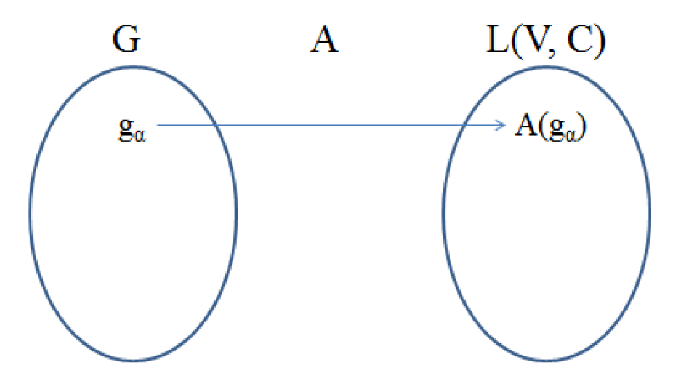
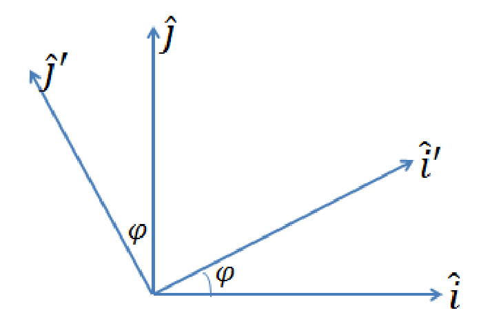
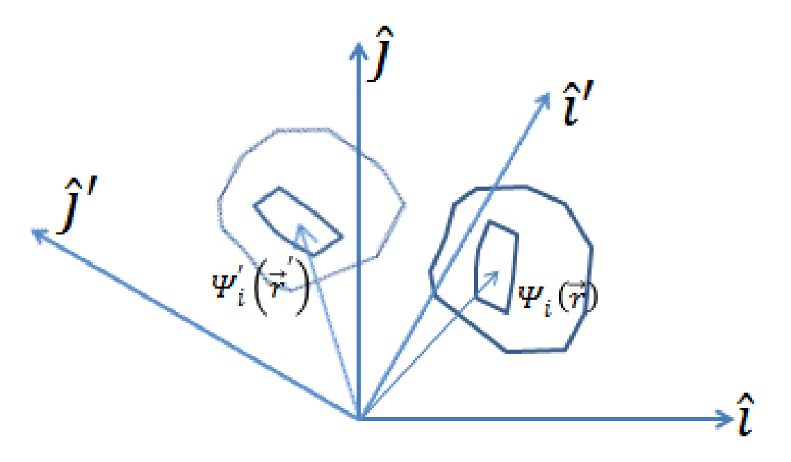
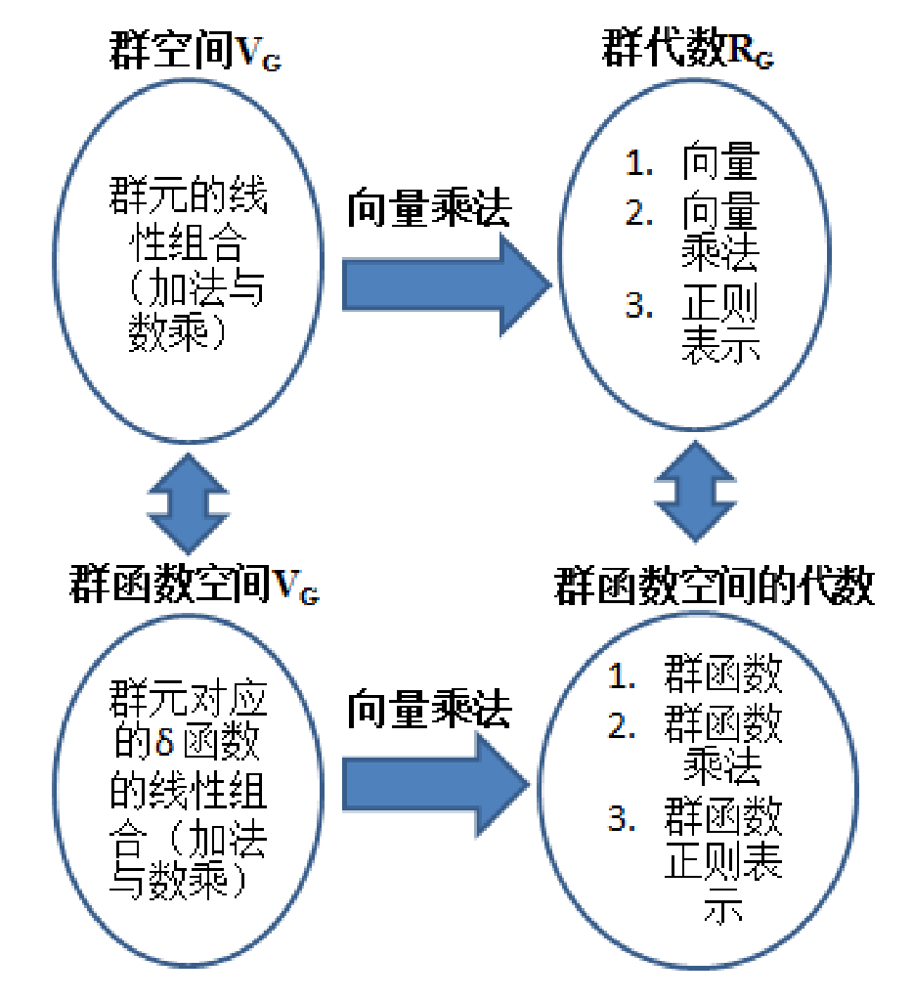
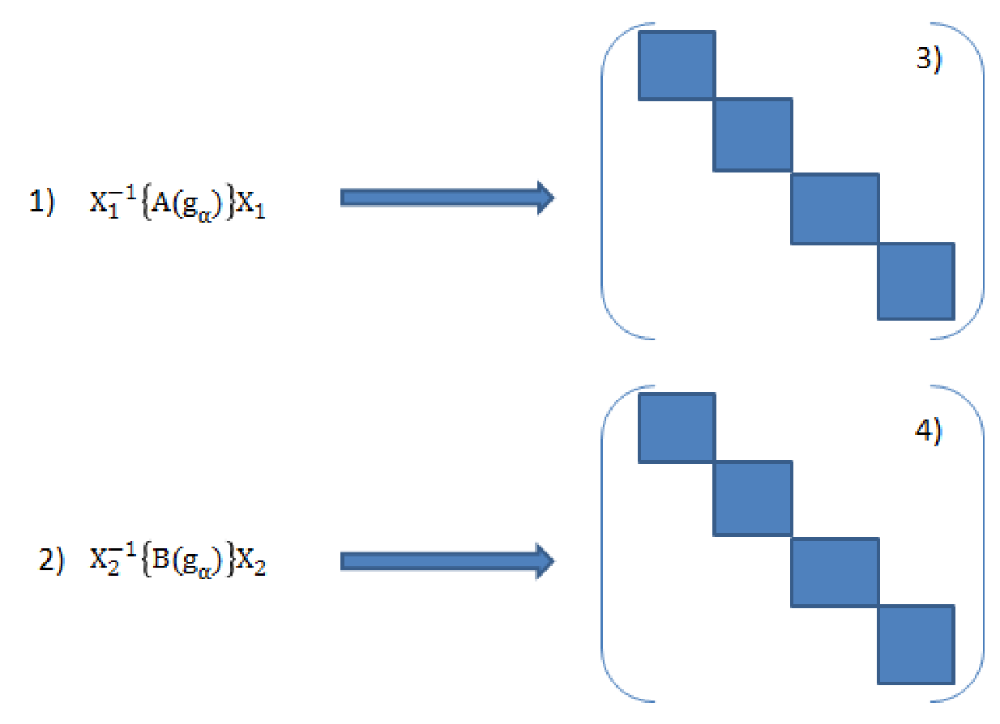
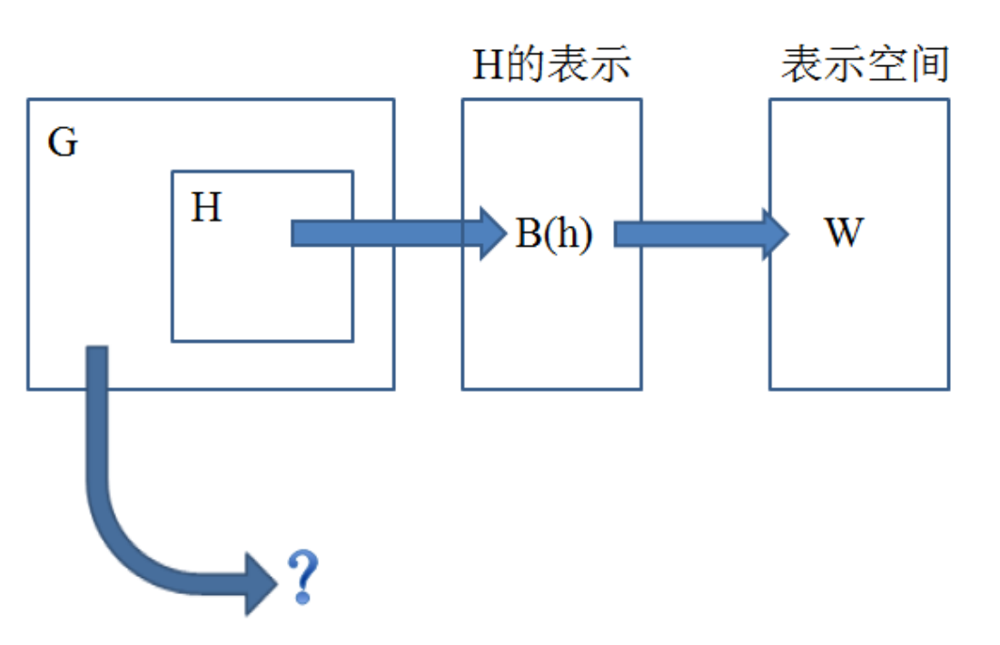
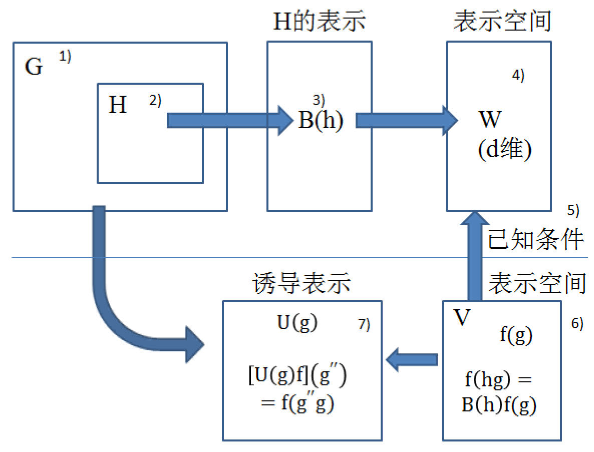
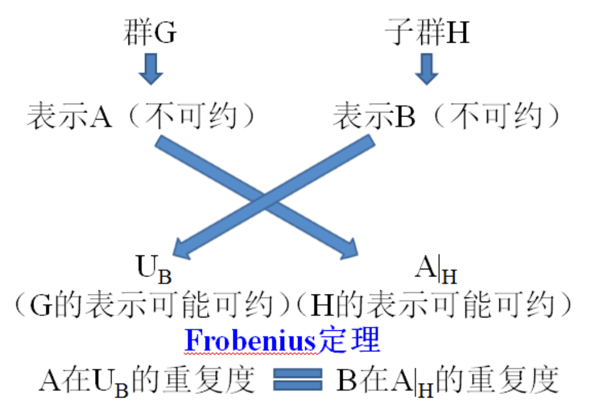

# 第二章 群表示理论

## 2.1 群表示

上一章讲了群的基本结构，这一章讲如何用数学的语言去描述群。这个对应的理论叫群表示论，要用到的知识是线性代数，其中最基本的概念是群表示。

如果用一句话来传达群表示这个概念的核心意思的话，我们可以说它是群 $G$ 到线性空间 $V$ 上的线性变换群 $L(V,\mathbb{C})$ 的同态映射关系。也就是说表示是同态映射关系，它存在于一个我们要研究的抽象群和一个线性空间的线性变换群之间。这里的线性变换群，大家也可以直接地理解为一个矩阵群。我们先把这句话说出来，下面再来做详细解释，从线性空间说起、到线性变换、再到线性变换群。

**定义 2.1** 线性空间：线性空间又叫向量空间，它是定义在数域 $K$（可以是实数域 $\mathbb{R}$，也可以是复数域 $\mathbb{C}$）上的向量集合 $V=\{x\text{、}y\text{、}z\text{、}\dots\}$，在 $V$ 中可以定义加法和数乘两种运算，设 $x$、$y$、$z$ 属于 $V$，$a$、$b$、$c$ 属于 $K$，向量加法和数乘具有封闭性，且对加法满足：

1. $x+y=y+x$
2. $(x+y)+z=x+(y+z)$
3. 有唯一 $0$ 元素，对任意 $x$ 属于 $V$，$0+x=x+0$
4. 对任意 $x$ 属于 $V$，有唯一 $(-x)$，使得 $x+(-x)=0$，

对数乘满足：

1. $1x=x$
2. $(ab)x=a(bx)$
3. $a(x+y)=ax+ay$
4. $(a+b)x=ax+bx$。

这些条件满足的话，$V$ 这个向量集合就构成一个线性空间。

线性空间最为直接的一个例子就是我们所处的三维实空间，这个 $a$、$b$、$c$ 是实数，$V$ 中元素是三维空间中向量。线性空间中，我们知道最重要的一个概念是线性相关与线性无关。

**定义 2.2** 线性空间 $V$ 中，任意 $n$ 个向量 $\vec{X}_1,\vec{X}_2,\cdots\cdots,\vec{X}_n$ 的线性组合 $a_1\vec{X}_1+a_2\vec{X}_2+\cdots\cdots+a_n\vec{X}_n=0$ 当且仅当 $a_1=a_2=\cdots\cdots=a_n=0$ 时成立，其中这些系数都是线性空间数域 $K$ 上的数，这时，称 $\vec{X}_1,\vec{X}_2,\cdots\cdots,\vec{X}_n$ 这些向量线性无关。否则，它们线性相关。

基于线性无关的一个概念是线性空间的维数。

**定义 2.3** 线性空间中线性无关的向量的最大个数 $m$，称为线性空间的维数，记为 $\dim V=m$。

有了线性空间、维数，下一步我们就可以定义基矢了。

**定义 2.4** 设 $V$ 是 $n$ 维线性空间，则 $V$ 中任意一组 $n$ 个线性无关的向量，都可以构成 $V$ 的基矢，记为 $(\vec{e}_1,\vec{e}_2,\cdots\cdots,\vec{e}_n)$。空间中任意矢量都可以表示成为这 $n$ 个基矢的线性组合，$\vec{X}=\sum_{i=1}^{n}x_i\vec{e}_i$，矩阵形式为：

$$
\vec{X}=(\vec{e}_1,\vec{e}_2,\cdots\cdots,\vec{e}_n)
\begin{pmatrix}
x_1\\
x_2\\
\vdots\\
\vdots\\
x_n
\end{pmatrix}
$$

其中，我们用 $[\vec{X}]$ 代表向量在这组基矢上的坐标，表示为：

$$
[\vec{X}]=
\begin{pmatrix}
x_1\\
x_2\\
\vdots\\
\vdots\\
x_n
\end{pmatrix}
$$

由此定义，显然：

$$
[\vec{e}_1]=
\begin{pmatrix}
1\\
0\\
\vdots\\
\vdots\\
0
\end{pmatrix},\quad
[\vec{e}_2]=
\begin{pmatrix}
0\\
1\\
\vdots\\
\vdots\\
0
\end{pmatrix},\quad
\cdots\cdots,\quad
[\vec{e}_n]=
\begin{pmatrix}
0\\
0\\
\vdots\\
\vdots\\
1
\end{pmatrix}
$$

线性空间上的变换是线性变换，定义如下：

**定义 2.5** 线性变换：线性变换 $A$ 是将线性空间 $V$ 映入 $V$ 的映射，满足 $\forall\vec{x},\vec{y}\in V$，$a\in K$，$A:V\to V$，$A(\vec{x})\in V$，$A(a\vec{x}+\vec{y})=aA(\vec{x})+A(\vec{y})$，也就是说这个变换作用到向量的线性组合上，等于这个变换作用到向量上的线性组合。这样的变换称为线性变换。

关于线性变换，我们知道它可以在线性代数里面写成一个矩阵，这个矩阵的样子是什么呢？我们这样看，$A$ 作用到 $\vec{x}$ 上，得到 $\vec{y}$，我们记为：$\vec{y}=A(\vec{x})$，其中 $\vec{y}=\sum_{i=1}^{n}y_i\vec{e}_i$，$\vec{x}=\sum_{i=1}^{n}x_i\vec{e}_i$。根据 $A(a\vec{x}+\vec{y})=aA(\vec{x})+A(\vec{y})$，我们知道：

$$
A(\vec{x})=\sum_{j=1}^{n}A(\vec{e}_j)x_j\qquad (2.1)
$$

对任意一个基矢 $\vec{e}_j$，我们做线性变换 $A(\vec{e}_j)$，都会得到另外一个向量 $\vec{e}_j'$，这个向量用基矢组展开，可以写为：

$$
\vec{e}_j'=(\vec{e}_1,\vec{e}_2,\cdots\cdots,\vec{e}_n)
\begin{pmatrix}
a_{1j}\\
a_{2j}\\
\vdots\\
\vdots\\
a_{nj}
\end{pmatrix}\qquad (2.2)
$$

把式 2.2 代入式 2.1，我们可以得到：

$$
\begin{aligned}
A(\vec{x})&=\sum_{j=1}^{n}A(\vec{e}_j)x_j=\sum_{j=1}^{n}\vec{e}_j'x_j=\sum_{j=1}^{n}\sum_{i=1}^{n}\vec{e}_i a_{ij}x_j\\
&=(\vec{e}_1,\vec{e}_2,\cdots\cdots,\vec{e}_n)
\begin{pmatrix}
a_{11} & a_{12} & \cdots\cdots & a_{1n}\\
a_{21} & a_{22} & \cdots\cdots & a_{2n}\\
\vdots & \vdots & \ddots & \vdots\\
a_{n1} & a_{n2} & \cdots\cdots & a_{nn}
\end{pmatrix}
\begin{pmatrix}
x_1\\
x_2\\
\vdots\\
x_n
\end{pmatrix}
\end{aligned}
$$

而另一方面：

$$
\vec{y}=(\vec{e}_1,\vec{e}_2,\cdots\cdots,\vec{e}_n)
\begin{pmatrix}
y_1\\
y_2\\
\vdots\\
y_n
\end{pmatrix}
$$

而 $\vec{y}=A(\vec{x})$。两个向量相等，它们的所有分量都相等，所以线性变换 $A$ 写成矩阵的形式标记为 $[A][\vec{x}]=[\vec{y}]$。具体矩阵表达形式为：

$$
\begin{pmatrix}
a_{11} & a_{12} & \cdots\cdots & a_{1n}\\
a_{21} & a_{22} & \cdots\cdots & a_{2n}\\
\vdots & \vdots & \ddots & \vdots\\
a_{n1} & a_{n2} & \cdots\cdots & a_{nn}
\end{pmatrix}
\begin{pmatrix}
x_1\\
x_2\\
\vdots\\
x_n
\end{pmatrix}
=
\begin{pmatrix}
y_1\\
y_2\\
\vdots\\
y_n
\end{pmatrix}
$$

矩阵元满足：

$$
(\vec{e}_1',\vec{e}_2',\cdots\cdots,\vec{e}_n')=(\vec{e}_1,\vec{e}_2,\cdots\cdots,\vec{e}_n)
\begin{pmatrix}
a_{11} & a_{12} & \cdots\cdots & a_{1n}\\
a_{21} & a_{22} & \cdots\cdots & a_{2n}\\
\vdots & \vdots & \ddots & \vdots\\
a_{n1} & a_{n2} & \cdots\cdots & a_{nn}
\end{pmatrix}
$$

也就是说这个线性变换如果用矩阵表示的话，它的第 $j$ 列，就是这个线性变换作用到这个线性空间中我们已选定的基足的第 $j$ 个基矢上得到的向量在这组基矢下的展开系数。这样如果知道变换作用到基上会产生什么样的结果，就知道群元的矩阵表示了。

知道这个矩阵表示，我们就进而知道了它作用到线性空间中的任意一个向量 $\sum_{i=1}^{n}x_i\vec{e}_i$ 上，得到的新向量的坐标：

$$
\begin{pmatrix}
a_{11} & a_{12} & \cdots\cdots & a_{1n}\\
a_{21} & a_{22} & \cdots\cdots & a_{2n}\\
\vdots & \vdots & \ddots & \vdots\\
a_{n1} & a_{n2} & \cdots\cdots & a_{nn}
\end{pmatrix}
\begin{pmatrix}
x_1\\
x_2\\
\vdots\\
x_n
\end{pmatrix}
$$

现在线性空间、线性变换的定义都有了，我们还知道了在线性空间的一组基下，线性变换的矩阵表示。下一步，如果我们进一步定义线性变换的乘法，那么我们就可以把线性变换的集合往群的方向去描述了。这个群叫线性变换群。

**定义 2.6** 线性变换群：定义两个线性变换的乘法为两个线性变换相继作用，则 $n$ 维复线性空间 $V$ 上的全部非奇异线性变换在此乘法下构成一个群，称为 $n$ 维复一般线性群 $GL(V,\mathbb{C})$，其子群 $L(V,\mathbb{C})$ 称为 $V$ 上的线性变换群。

在这里需要对“非奇异”这个要求做个说明。为什么要非奇异，因为我们这个线性变换群或矩阵群是一个群，如果奇异了（矩阵的行列式为零），这个集合不能形成群。这个就像在实数乘法作为群元乘法的时候，所有实数不能形成一个群，因为零没有逆元，但所有非零实数就可以形成一个群，是一个道理。

由这个定义我们也知道 $GL(V,\mathbb{C})$，复一般线性群（注意‘一般’两个字），是包含 $V$ 上的所有非奇异变换的。正常情况下，它是无穷多个，$V$ 定了，它就定了，但我们一般不关心它。

线性变换群，是其中一些非奇异线性变换的集合（$GL(V,\mathbb{C})$ 的子集，形成群），我们关心的是这个。因为群表示指的是我们感兴趣的抽象群 $G$，到这个线性变换群的同态映射关系。

**定义 2.7** 群表示：设有群 $G$，如存在一个从 $G$ 到 $n$ 维线性空间 $V$ 上的线性变换群 $L(V,\mathbb{C})$ 的同态映射 $A$，则称 $A$ 是群 $G$ 的一个线性表示，$V$ 为表示空间，$n$ 是表示的维数。记为：

$$
\begin{aligned}
&A:G\to L\\
&\forall g_\alpha\in G,\ \text{有 } A(g_\alpha)\in L\\
&\forall g_\alpha,g_\beta\in G,\ \text{有 } A(g_\alpha g_\beta)=A(g_\alpha)A(g_\beta)
\end{aligned}
$$

显然，$G$ 的单位元素，由同态的定义，对应的是 $V$ 上的恒等变换，互逆元素对应的是互逆的变换。

对于线性空间 $V$，如果选定一组特定的基矢，那么每个线性变换可以由一个矩阵表示，而线性变换群也会对应一个矩阵群。这时，抽象群 $G$ 与线性变换群的同态映射关系也可以理解为抽象群 $G$ 与矩阵群的同态映射关系。画成图的话就是这样的，左边是抽象群，右边是线性变换群，它在一个特定的基矢下表现为一个矩阵群。表示指的是从左边到右边的同态映射关系。

因为是同态，我们第一章讲了，严格意义上是多对一，保持乘法规则满映射。如果这个同态进一步严格，变为一对一的同构，那么相应的表示就变成了忠实表示。

同时，对于两个同构的群 $G$ 与 $G'$，如果 $A$ 是 $G$ 的表示，那么因为 $G$ 与 $G'$ 的同构（一对一）关系，$A$ 也是 $G'$ 的表示。（课上画图讲解）

由上面讲的概念，我们看几个例子。

**例 1** 任何群 $G$，恒与 $\{1\}$（一阶单位矩阵）同态，这个表示称为一维恒等表示，或显然表示、平凡表示（trivial representation）。

推广一下，它和 $\left\{\begin{pmatrix}1 & 0\\ 0 & 1\end{pmatrix}\right\}$ 也自然同态。一个群原则上说怎么都有无穷多个表示，我们后面会介绍可约、等价这些概念把它们联系起来，而我们真正关心的，是有个性那几个，我们称之为不等价不可约表示（后面会讲）。

**例 2** 任何矩阵群，都是自身的表示，且为忠实表示。

**例 3** 三个二阶群，1. $\{E,\sigma_{\hat{k}}\}$（三维空间对 $xy$ 平面的反射），2. $\{E,C_{\hat{k}}(\pi)\}$（绕 $z$ 轴转 $\pi$ 角，3. $\{E,I\}$（空间反演操作）。表示空间为三维实空间，取基矢为 $\{\hat{i},\hat{j},\hat{k}\}$，它们的表示分别是什么？

很简单，步骤是按照我们之前说的线性变换对应的线性矩阵的定义。对 $E$ 这个线性变换，因为恒等，所以把 $\hat{i}$、$\hat{j}$、$\hat{k}$ 变为 $\hat{i}$、$\hat{j}$、$\hat{k}$，对应的新向量在旧基矢组下的展开系数分别为 $(1\text{、}0\text{、}0)$，$(0\text{、}1\text{、}0)$、$(0\text{、}0\text{、}1)$，所以矩阵为三阶单位矩阵。实际上单位元对应的都是单位矩阵。

对非单位元，第一种情况，$\sigma_{\hat{k}}$ 把 $\hat{i}$、$\hat{j}$、$\hat{k}$ 变为 $\hat{i}$、$\hat{j}$、$-\hat{k}$。所以展开系数为 $(1\text{、}0\text{、}0)$、$(0\text{、}1\text{、}0)$、$(0\text{、}0\text{、}-1)$，对应的表示矩阵为：

$$
\begin{pmatrix}
1 & 0 & 0\\
0 & 1 & 0\\
0 & 0 & -1
\end{pmatrix}
$$

第二种情况，$C_{\hat{k}}(\pi)$ 把 $\hat{i}$、$\hat{j}$、$\hat{k}$ 变为 $-\hat{i}$、$-\hat{j}$、$\hat{k}$，矩阵为：

$$
\begin{pmatrix}
-1 & 0 & 0\\
0 & -1 & 0\\
0 & 0 & 1
\end{pmatrix}
$$

第三种情况，$I$ 把 $\hat{i}$、$\hat{j}$、$\hat{k}$ 变为 $-\hat{i}$、$-\hat{j}$、$-\hat{k}$，矩阵为：

$$
\begin{pmatrix}
-1 & 0 & 0\\
0 & -1 & 0\\
0 & 0 & -1
\end{pmatrix}
$$

结合一下，三个表示矩阵群分别是：

$$
\left\{
\begin{pmatrix}
1 & 0 & 0\\
0 & 1 & 0\\
0 & 0 & 1
\end{pmatrix},
\begin{pmatrix}
1 & 0 & 0\\
0 & 1 & 0\\
0 & 0 & -1
\end{pmatrix}
\right\},\quad
\left\{
\begin{pmatrix}
1 & 0 & 0\\
0 & 1 & 0\\
0 & 0 & 1
\end{pmatrix},
\begin{pmatrix}
-1 & 0 & 0\\
0 & -1 & 0\\
0 & 0 & 1
\end{pmatrix}
\right\},\quad
\left\{
\begin{pmatrix}
1 & 0 & 0\\
0 & 1 & 0\\
0 & 0 & 1
\end{pmatrix},
\begin{pmatrix}
-1 & 0 & 0\\
0 & -1 & 0\\
0 & 0 & -1
\end{pmatrix}
\right\}
$$

同时，既然表示可以理解为抽象群到矩阵群的同态映射关系，上面的三个抽象群相互同构，那么这三个矩阵群也可以相互为那三个抽象群的表示。

**例 4** 绕 $z$ 轴的转动群 $\{C_{\hat{k}}(\varphi)\}$，表示空间为三维实空间，取基矢为 $\{\hat{i},\hat{j},\hat{k}\}$。

同样，还是将变换作用到基矢上，看效果。

$$
\begin{aligned}
C_{\hat{k}}(\varphi)\hat{i}&=\cos\varphi\,\hat{i}+\sin\varphi\,\hat{j}\\
C_{\hat{k}}(\varphi)\hat{j}&=-\sin\varphi\,\hat{i}+\cos\varphi\,\hat{j}\\
C_{\hat{k}}(\varphi)\hat{k}&=\hat{k}
\end{aligned}
$$

表示矩阵为：

$$
\begin{pmatrix}
\cos\varphi & -\sin\varphi & 0\\
\sin\varphi & \cos\varphi & 0\\
0 & 0 & 1
\end{pmatrix}
$$

上面例子中取的基矢当群元作用到它们上面的时候效果都很直接，好理解。在下面我们讲具体表示的时候，还会遇到一类线性空间的基矢，是一些函数。在这个线性空间中，线性变换作用到它们身上效果不像上面一样好理解，我们也介绍一下。比如基组是 $\{\Psi_1(\vec{r}),\Psi_2(\vec{r}),\cdots\cdots,\Psi_n(\vec{r})\}$（大家以后比较经常遇到的会有平面波、高斯、球谐函数等等）。

$g_\alpha$ 是我们抽象群的群元，它通过表示 $A$ 所对应的线性空间的线性变换为 $A(g_\alpha)$。我们要想知道它的矩阵表示形式，根据上面的介绍，就要知道 $A(g_\alpha)$ 作用到每个基函数上得到的新的函数按 $\{\Psi_1(\vec{r}),\Psi_2(\vec{r}),\cdots\cdots,\Psi_n(\vec{r})\}$ 这组基展开的展开系数。在这些函数中，$\vec{r}$ 是它们的变量（好好理解一下）。

现在我们以 $\Psi_i(\vec{r})$ 为例，看 $A(g_\alpha)$ 作用到 $\Psi_i(\vec{r})$ 上会得到什么样的效果？我们记 $A(g_\alpha)\Psi_i(\vec{r})$ 为 $\Psi_i'(\vec{r})$，我们知道 $\Psi_i'(\vec{r})$ 为一个新的函数。如果这个抽象群群元 $g_\alpha$ 的意义是它作用到三维实空间的一个向量 $\vec{r}$ 上，得到一个新的向量 $\vec{r}'=g_\alpha\vec{r}$。

那么 $\Psi_i(\vec{r})$ 这个函数本身的变化，由上图，我们可以想象满足 $\Psi_i'(\vec{r}')=\Psi_i(\vec{r})$，其中 $\vec{r}'=g_\alpha\vec{r}$，这也就意味着 $\Psi_i'(\vec{r})=\Psi_i(g_\alpha^{-1}\vec{r})$。再由于我们上面是把 $A(g_\alpha)$ 作用到 $\Psi_i(\vec{r})$ 上得到的函数 $A(g_\alpha)\Psi_i(\vec{r})$ 记为 $\Psi_i'(\vec{r})$ 的，其中满足：$\Psi_i'(\vec{r})=\Psi_i(g_\alpha^{-1}\vec{r})$，这也就意味着 $A(g_\alpha)$ 这个线性变换，作用到 $\Psi_i(\vec{r})$ 这个基函数上，得到的函数是 $\Psi_i(g_\alpha^{-1}\vec{r})$。我们要做的就是把 $\Psi_i(g_\alpha^{-1}\vec{r})$ 按 $\{\Psi_1(\vec{r}),\Psi_2(\vec{r}),\cdots\cdots,\Psi_n(\vec{r})\}$ 展开就可以了。

一种数学上更为规范的语言去总结上面的分析，我们可以说：$g_\alpha$ 是我们关心的抽象群的群元；在一个由函数组成的线性空间，它表现为一个线性变换 $A(g_\alpha)$；这个 $A(g_\alpha)$ 的作用对象是函数，也就是说 $A(g_\alpha)$ 作用到函数 $\Psi_i$ 上，结果是 $A(g_\alpha)\Psi_i$。这个新的函数，我们记为 $\Psi_i'$；我们对它的要求是 $\Psi_i'(\vec{r}')=\Psi_i(\vec{r})$，也就是说变换后的函数形式以变换后的坐标作为输入的话，输出的数值不变；根据这个要求，我们可以得到前面推出的 $\Psi_i'(\vec{r})=\Psi_i(g_\alpha^{-1}\vec{r})$。

这些讨论同样适用于其它群 $G$ 的意义是作用到表示空间的基函数的变量的其它情况。换句话说，只要抽象群的群元是用作在基函数的变量上的，上面的讨论都适用。比如，我们后面会将一个东西叫群函数，我们也会用这个方法。现在为了方面理解，你们可以先按我上面说的把函数变量当成三维欧式空间的向量，抽象群群元是作用在这个向量上的变换。

举个具体例子。

**例 5** 线性空间为由下面六个函数组成的函数空间：$\{\Psi_1(\vec{r})=x^2,\ \Psi_2(\vec{r})=y^2,\ \Psi_3(\vec{r})=z^2,\ \Psi_4(\vec{r})=xy,\ \Psi_5(\vec{r})=yz,\ \Psi_6(\vec{r})=xz\}$。我们求 $D_3$ 群在它上面的表示。这里的基础是 $D_3$ 群的群元作用到三维实空间向量 $\vec{r}$ 上的效果。以 $d$ 为例，根据前面的讨论，我们知道效果是：

$$
d\vec{r}=(\hat{i}\ \hat{j}\ \hat{k})
\begin{pmatrix}
-1/2 & -\sqrt{3}/2 & 0\\
\sqrt{3}/2 & -1/2 & 0\\
0 & 0 & 1
\end{pmatrix}
\begin{pmatrix}
x\\
y\\
z
\end{pmatrix}
=(\hat{i}\ \hat{j}\ \hat{k})
\begin{pmatrix}
-\frac{1}{2}x-\frac{\sqrt{3}}{2}y\\
\frac{\sqrt{3}}{2}x-\frac{1}{2}y\\
z
\end{pmatrix}
$$

这样我们知道对 $f$ 这个 $D_3$ 群的群元，它作用到一个函数上，

$$
A(f)\Psi_1(\vec{r})=\Psi_1(f^{-1}\vec{r})=\Psi_1(d\vec{r})=\left(-\frac{1}{2}x-\frac{\sqrt{3}}{2}y\right)^2=\frac{1}{4}x^2+\frac{3}{4}y^2+\frac{\sqrt{3}}{2}xy
$$

展开系数为 $\frac{1}{4}$、$\frac{3}{4}$、$0$、$\frac{\sqrt{3}}{2}$、$0$、$0$。

同样的方法作用到 $\Psi_2(\vec{r})$ 到 $\Psi_6(\vec{r})$ 上，我们就可以得到 $f$ 的表示矩阵。其它群元表示矩阵也由相同的方法得到。

到这儿，这一节内容我讲完了，总结一下，三句话：

1. 群表示指的是抽象群 $G$ 与线性变换群的同态映射关系。
2. 在求群表示矩阵的时候，我们要做的就是把每个基矢进行变换，然后按旧基展开，展开系数为表示矩阵的列。
3. 当表示空间的基为函数，而抽象群群元为其变量的变换时，函数变换满足的规律是：$A(g_\alpha)\Psi_i(\vec{r})=\Psi_i(g_\alpha^{-1}\vec{r})$。

## 2.2 等价表示、不可约表示、酉表示

上一节我们在举群表示的例子的时候，开始我们就提到了一个群的表示严格意义上是无穷多个，比如所有维数的单位矩阵都是这个群的表示。同时我们又提到了研究类似重复提高这些维数得到的这些表示在我们这门课程里其实没有意义，我们真正感兴趣的表示是不等价、不可约表示。要想理解什么是不等价不可约表示，那么首先我们就要理解什么是等价、可约。

先说等价表示，它在这一节的地位有点就像‘共轭’在‘类与不变子群’那节一样。下面的定义是从韩老师那本书上摘下来的，非常好！但有一个地方要说明（给完定义后进行）。

**定义 2.8** 等价表示：设群 $G=\{g_\alpha\}$ 在表示空间 $V$ 上的一个表示 $A$ 是 $\{A(g_\alpha)\}$。也就是说对每个 $g_\alpha$ 有个非奇异变换与之对应，在一组基 $(\vec{e}_1,\vec{e}_2,\cdots\cdots,\vec{e}_n)$ 下，$A(g_\alpha)$ 为 $g_\alpha$ 对应的非奇异矩阵。设 $P$ 是 $V$ 上的一个非奇异矩阵，$\det(P)$ 不为零，则相似矩阵集合 $\{P^{-1}A(g_\alpha)P\}$ 也给出群 $G$ 的一个表示，因为每个 $g_\alpha$ 也唯一对应一个 $P^{-1}A(g_\alpha)P$，且：$P^{-1}A(g_\alpha g_\beta)P=P^{-1}A(g_\alpha)A(g_\beta)P=P^{-1}A(g_\alpha)PP^{-1}A(g_\beta)P$，保持乘法规律不变。这个表示 $\{P^{-1}A(g_\alpha)P\}$ 称为 $\{A(g_\alpha)\}$ 的等价表示。

这个定义给我们的一个直观的感觉就是两个可以由相似变换联系起来的表示就是等价表示。这个感觉是对的，这也是我的理解。但它同时可能造成一个略显狭义的理解，就是你会觉得等价表示必须对应一个线性空间，因为它只提到了线性空间 $V$。实际上，当两个表示对应的表示空间不一样，但他们对应的表示矩阵群可以通过一个不依赖于 $g_\alpha$ 的非奇异矩阵 $P$，由 $P^{-1}\{A(g_\alpha)\}P$ 通过联系起来的时候，它们也等价。这种情况应该是广泛存在的，因为一个有限群的表示空间可以有很多，但最后它的不等价不可约表示就那么几个。这个我们后面会做详细解释。我建议大家先做最简单的理解：两个可以由相似变换联系起来的表示就是等价表示。但同时记住，等价表示的表示空间可以不一样。

针对这个理解，有三点需要进一步说明：

1. 既然两个等价表示是由相似变换联系起来的，那么两个等价表示的表示空间维数必须相同。
2. 判断两个表示是否等价，原则上，我们是要找到不依赖于 $g_\alpha$ 的非奇异矩阵 $P$，这很难。实际上，我们后面会引入一个叫特征标的东西，有了它就很方便了。
3. 表示 $\{A(g_\alpha)\}$ 与 $\{P^{-1}A(g_\alpha)P\}$ 的基函数具体什么关系？

$V$ 是一个线性空间，$(\vec{e}_1,\vec{e}_2,\cdots\cdots,\vec{e}_n)$ 是它的一组基，我们标记为 $B$。群 $G$ 在 $B$ 这组基下对应的表示矩阵群为 $\{A(g_\alpha)\}$。对于一个线性变换 $A(g_\alpha)\vec{x}=\vec{y}$，其矩阵形式为：$[A(g_\alpha)]_B[\vec{x}]_B=[\vec{y}]_B$。这里 $[A(g_\alpha)]_B$ 的第 $j$ 列，是 $(\vec{e}_1,\vec{e}_2,\cdots\cdots,\vec{e}_n)$ 里的第 $j$ 个基在 $A(g_\alpha)$ 这个线性变换下得到的新矢量在这组基下的展开系数。

同样，对于另一组基 $(\vec{e}_1',\vec{e}_2',\cdots\cdots,\vec{e}_n')$（记为 $B'$），$A(g_\alpha)$ 这组线性变换也有一个矩阵表达式，它们作用到向量 $\vec{x}$ 上，矩阵形式为：$[A(g_\alpha)]_{B'}[\vec{x}]_{B'}=[\vec{y}]_{B'}$。

当 $B'$ 这组基与 $B$ 这组基存在：

$$
(\vec{e}_1',\vec{e}_2',\cdots\cdots,\vec{e}_n')=(\vec{e}_1,\vec{e}_2,\cdots\cdots,\vec{e}_n)(P)_{n\times n}
$$

的关系时，我们看 $[A(g_\alpha)]_B$ 与 $[A(g_\alpha)]_{B'}$ 存在什么样的联系？

$\vec{y}$ 这个向量，在 $B$ 下，是：

$$
\vec{y}=(\vec{e}_1,\vec{e}_2,\cdots\cdots,\vec{e}_n)
\begin{pmatrix}
y_1\\
y_2\\
\vdots\\
y_n
\end{pmatrix}
=(\vec{e}_1,\vec{e}_2,\cdots\cdots,\vec{e}_n)[A(g_\alpha)]_B
\begin{pmatrix}
x_1\\
x_2\\
\vdots\\
x_n
\end{pmatrix}
$$

在 $B'$ 下，就是：

$$
\vec{y}=(\vec{e}_1',\vec{e}_2',\cdots\cdots,\vec{e}_n')
\begin{pmatrix}
y_1'\\
y_2'\\
\vdots\\
y_n'
\end{pmatrix}
=(\vec{e}_1,\vec{e}_2,\cdots\cdots,\vec{e}_n)(P)_{n\times n}[A(g_\alpha)]_{B'}
\begin{pmatrix}
x_1'\\
x_2'\\
\vdots\\
x_n'
\end{pmatrix}
$$

不管坐标系是哪个，向量是同样的向量，所以：

$$
(\vec{e}_1,\vec{e}_2,\cdots\cdots,\vec{e}_n)[A(g_\alpha)]_B
\begin{pmatrix}
x_1\\
x_2\\
\vdots\\
x_n
\end{pmatrix}
=(\vec{e}_1,\vec{e}_2,\cdots\cdots,\vec{e}_n)(P)_{n\times n}[A(g_\alpha)]_{B'}
\begin{pmatrix}
x_1'\\
x_2'\\
\vdots\\
x_n'
\end{pmatrix}
$$

进而：

$$
[A(g_\alpha)]_B
\begin{pmatrix}
x_1\\
x_2\\
\vdots\\
\vdots\\
x_n
\end{pmatrix}
=(P)_{n\times n}[A(g_\alpha)]_{B'}
\begin{pmatrix}
x_1'\\
x_2'\\
\vdots\\
\vdots\\
x_n'
\end{pmatrix}\qquad (2.3)
$$

对向量 $\vec{x}$，根据同样分析，有：

$$
\vec{x}=(\vec{e}_1,\vec{e}_2,\cdots\cdots,\vec{e}_n)
\begin{pmatrix}
x_1\\
x_2\\
\vdots\\
\vdots\\
x_n
\end{pmatrix}
=(\vec{e}_1',\vec{e}_2',\cdots\cdots,\vec{e}_n')
\begin{pmatrix}
x_1'\\
x_2'\\
\vdots\\
\vdots\\
x_n'
\end{pmatrix}
=(\vec{e}_1,\vec{e}_2,\cdots\cdots,\vec{e}_n)(P)_{n\times n}
\begin{pmatrix}
x_1'\\
x_2'\\
\vdots\\
\vdots\\
x_n'
\end{pmatrix}
$$

进而

$$
\begin{pmatrix}
x_1'\\
x_2'\\
\vdots\\
\vdots\\
x_n'
\end{pmatrix}
=[(P)_{n\times n}]^{-1}
\begin{pmatrix}
x_1\\
x_2\\
\vdots\\
\vdots\\
x_n
\end{pmatrix}
$$

将这个式子代入式 2.3，我们有：

$$
[A(g_\alpha)]_B
\begin{pmatrix}
x_1\\
x_2\\
\vdots\\
\vdots\\
x_n
\end{pmatrix}
=(P)_{n\times n}[A(g_\alpha)]_{B'}[(P)_{n\times n}]^{-1}
\begin{pmatrix}
x_1\\
x_2\\
\vdots\\
\vdots\\
x_n
\end{pmatrix}
$$

对任意 $\vec{x}$ 成立，所以，$[A(g_\alpha)]_{B'}=[(P)_{n\times n}]^{-1}[A(g_\alpha)]_B(P)_{n\times n}$。

也就是说 $\{A(g_\alpha)\}$ 是群 $G$ 在 $V$ 上取基矢组 $(\vec{e}_1,\vec{e}_2,\cdots\cdots,\vec{e}_n)$ 的表示时，$\{P^{-1}A(g_\alpha)P\}$ 就是群 $G$ 在 $V$ 上取基矢组 $(\vec{e}_1',\vec{e}_2',\cdots\cdots,\vec{e}_n')$ 的表示。其中，$(\vec{e}_1',\vec{e}_2',\cdots\cdots,\vec{e}_n')$ 与 $(\vec{e}_1,\vec{e}_2,\cdots\cdots,\vec{e}_n)$ 的关系是：

$$
(\vec{e}_1',\vec{e}_2',\cdots\cdots,\vec{e}_n')=(\vec{e}_1,\vec{e}_2,\cdots\cdots,\vec{e}_n)(P)_{n\times n}
$$

换句话，在表示空间不变的情况下，你可以说等价表示就是把基换一下，得到的矩阵群。

在表示空间改变的情况，我们可以理解为 $\{P^{-1}A(g_\alpha)P\}$ 的基，与 $\{A(g_\alpha)\}$ 的基做线性变换后得到的基矢组

$$
(\vec{e}_1',\vec{e}_2',\cdots\cdots,\vec{e}_n')=(\vec{e}_1,\vec{e}_2,\cdots\cdots,\vec{e}_n)(P)_{n\times n}
$$

一一对应。

现在说完了等价表示。一句话，它们是由相似变换联系起来的。相似变换，大家在学线性代数的时候应该有印象，我们一般是用来做矩阵对角化的。也就是说我们通过相似变换，找到一组新的基，使得矩阵在这组新基下具有对角化的形式。类似的操作我们称为约化矩阵。下面我们要讲的概念，和约化矩阵有关，这个概念是可约表示。

**定义 2.9** 可约表示：设 $A$ 是群 $G$ 在表示空间 $V$ 上的一个表示，如果 $V$ 存在一个 $G$ 不变的真子空间 $W$（‘真’指的是这个空间不能为 $V$ 本身或只包含零向量），则称 $A$ 是可约表示。这里 $G$ 不变的真子空间 $W$，是指对其中 $\forall\vec{y}$，对 $\forall g_\alpha\in G$，做 $A(g_\alpha)\vec{y}$，得到的矢量仍然属于 $W$，也就是说 $\forall A(g_\alpha)$ 都不会把 $W$ 中向量变到 $W$ 外面去。

由这个定义，我们知道当 $V$ 存在 $G$ 不变的真子空间 $W$ 的时候，总可以在 $V$ 中取一组基 $(\vec{e}_1,\vec{e}_2,\cdots,\vec{e}_m,\vec{e}_{m+1},\cdots\cdots,\vec{e}_n)$，其中 $\vec{e}_1,\vec{e}_2,\cdots,\vec{e}_m$ 是 $W$ 中的向量，$W$ 的维数是 $m$。如果我们做线性变换表示矩阵的话，那么我们矩阵群中的每个矩阵都具备这样的性质：

$$
A(g_\alpha)=
\begin{pmatrix}
C_\alpha & N_\alpha\\
0 & B_\alpha
\end{pmatrix}
$$

这个里面 $C_\alpha$ 为 $m\times m$ 矩阵，$N_\alpha$ 为 $m\times(n-m)$ 矩阵，$B_\alpha$ 为 $(n-m)\times(n-m)$ 矩阵，左下角的 $0$，代表 $(n-m)\times m$ 的零矩阵。

这时，$W$ 空间中向量的表示形式为：

$$
\vec{y}=
\begin{pmatrix}
y_1\\
\vdots\\
y_m\\
0\\
\vdots\\
0
\end{pmatrix}
$$

显然 $A(g_\alpha)\vec{y}\in W$。

由这个定义，我们还可以去想，当一个群的表示矩阵群具有如上豆腐块形式的话，这个表示可约吗？（答案：可约）

反过来，当一个群的表示不具备如上豆腐块的形式，这个表示就不可约吗？（不一定，可能基没有选对，比如我群是饶 $z$ 轴的转动群，在三维空间，它肯定可约，因为我的子空间 $xy$ 平面对它不变。但是如果我选的基里面，前两个不属于 $xy$ 平面，那么我的表示矩阵就不会具备上面的样子）。

换句话，判断一个群的表示是否可约，不是看它是否已经具备豆腐块的形式，而是要看它是否具备成为豆腐块的潜质。这个潜质体现在它的表示空间上。表示矩阵是外在的东西，表示空间是内在的东西，关键看内在。

现在讲完了可约，说的是有个 $G$ 的表示空间 $V$，存在真子空间 $W$，对 $\forall\vec{y}$，对 $\forall g_\alpha\in G$，做 $A(g_\alpha)\vec{y}$，得到的矢量仍然属于 $W$。下面讲的两个概念与它的正交补空间以及这个正交补空间在线性变换下的变换性质有关。这两个概念是线性空间的直和与完全可约。

**定义 2.10** 直和：对于群 $G$ 的表示空间 $V$，$W$ 与 $W'$ 是它的子空间，如对 $\forall\vec{x}\in V$，都能找到 $\vec{y}\in W$，$\vec{z}\in W'$，使得 $\vec{x}$ 可唯一地分解为：$\vec{x}=\vec{y}+\vec{z}$，则称 $V$ 是 $W$ 与 $W'$ 的直和。记为：$V=W\oplus W'$。唯一分解这个条件要求 $W\cap W'=\{0\}$。

再根据直和可以定义完全可约。

**定义 2.11** 完全可约：我们把 $G$ 的表示空间 $V$ 分解为 $W$ 与 $W'$ 的直和，如 $W$ 与 $W'$ 都是 $G$ 不变的，则称 $V$ 这个表示空间完全可约。

显然完全可约是一种特殊的可约，我们在以后学习的过程中，会遇到很多的定理，说的都是“某某表示可约则完全可约”。在这本书的范畴内，基本我们讲的都是完全可约[^6]。

由可约表示的定义，我们还可以通过其逆否命题得到：如果群 $G$ 表示 $A$ 的表示空间 $V$ 不存在 $G$ 不变的真子空间，则称 $A$ 是 $G$ 的不可约表示。

同时，由上面的讨论，我们还知道如果群 $G$ 的表示不可约，它一定不能写成豆腐块 $\begin{pmatrix}C_\alpha & N_\alpha\\ 0 & B_\alpha\end{pmatrix}$ 的形式。

如 $G$ 的表示完全可约，这个豆腐块的形式还可以进一步变换为：$\begin{pmatrix}C_\alpha & 0\\ 0 & B_\alpha\end{pmatrix}$。

这时，$W$ 中向量表示为：$\vec{y}=\begin{pmatrix}y_1\\ \vdots\\ y_m\\ 0\\ \vdots\\ 0\end{pmatrix}$，$W'$ 中向量表示为：$\vec{z}=\begin{pmatrix}0\\ \vdots\\ 0\\ z_1\\ \vdots\\ z_m\end{pmatrix}$。

这时我们称 $A$ 可以约化为 $C$ 与 $B$ 的直和，记为 $A(g_\alpha)=C(g_\alpha)\oplus B(g_\alpha)$。同样，对 $B$、$C$ 的表示空间，我们可进一步寻求约化，如每个可约都是完全可约，则任何表示最终都可以约化为不可约表示的直和，记作：$A(g_\alpha)=\sum_p\oplus m_p A^p(g_\alpha)$，其中 $m_p$ 代表不可约表示 $A^p$ 出现的次数，称为重复度。

有了这些概念，大家现在就可以理解“对任何群，求其全部不等价不可约表示是我们群表示论的主要课题（注意是主要，比重要还重要）”这句话了。

前面我们提到的“某某表示可约则完全可约”这句话，为了让大家先有个体会，我们讲个定理。

**定理 2.1** 对于有限群，表示可约则完全可约（有限群涵盖我们这学期主要内容）。

**证明** 设可约表示可写成上三角形式：

[^6]: 这里先交个底，下面慢慢体会。

$$
A(g_\alpha)=
\begin{pmatrix}
G_1(g_\alpha) & R(g_\alpha)\\
0 & G_2(g_\alpha)
\end{pmatrix}
$$

前面说过了，面 $G_1(g_\alpha)$ 为 $m\times m$ 矩阵，$R(g_\alpha)$ 为 $m\times(n-m)$ 矩阵，$G_2(g_\alpha)$ 为 $(n-m)\times(n-m)$ 矩阵，左下角的 $0$，代表 $(n-m)\times m$ 的零矩阵。

如果我们可以证明，存在一个矩阵 $P$，使得 $P^{-1}AP$ 后，得到：

$$
P^{-1}A(g_\alpha)P=G_0(g_\alpha)=
\begin{pmatrix}
G_1(g_\alpha) & 0\\
0 & G_2(g_\alpha)
\end{pmatrix}
$$

那我们就成功了。（沿着这个路子往下去找）

这个 $P$ 的形式可以设为：

$$
P=
\begin{pmatrix}
I_m & C\\
0 & I_{n-m}
\end{pmatrix}
$$

其中 $I$ 为单位矩阵，关键是要确定 $C$ 这个 $m\times(n-m)$ 矩阵。

由 $P^{-1}A(g_\alpha)P=G_0(g_\alpha)$ 知 $A(g_\alpha)P=PG_0(g_\alpha)$，把它们的具体形式分别带入得：

$$
\begin{pmatrix}
G_1(g_\alpha) & R(g_\alpha)\\
0 & G_2(g_\alpha)
\end{pmatrix}
\begin{pmatrix}
I_m & C\\
0 & I_{n-m}
\end{pmatrix}
=
\begin{pmatrix}
I_m & C\\
0 & I_{n-m}
\end{pmatrix}
\begin{pmatrix}
G_1(g_\alpha) & 0\\
0 & G_2(g_\alpha)
\end{pmatrix}
$$

也就是：

$$
\begin{pmatrix}
G_1(g_\alpha) & G_1(g_\alpha)C+R(g_\alpha)\\
0 & G_2(g_\alpha)
\end{pmatrix}
=
\begin{pmatrix}
G_1(g_\alpha) & CG_2(g_\alpha)\\
0 & G_2(g_\alpha)
\end{pmatrix}
$$

这样要证的就简化为了：

$$
G_1(g_\alpha)C+R(g_\alpha)=CG_2(g_\alpha),\qquad (2.4)
$$

也就是说存在 $C$，使它成立。

我们先把这个式子放一下，去找些对证明有利的条件，把它变个形。这个条件是由“$A$ 是群表示”提供的，也就是：

$$
A(g_\alpha)=
\begin{pmatrix}
G_1(g_\alpha) & R(g_\alpha)\\
0 & G_2(g_\alpha)
\end{pmatrix},\quad
A(g_\alpha^{-1})=
\begin{pmatrix}
G_1(g_\alpha^{-1}) & R(g_\alpha^{-1})\\
0 & G_2(g_\alpha^{-1})
\end{pmatrix}
$$

同时 $A(g_\alpha)A(g_\alpha^{-1})=I_n$，因此：

$$
G_1(g_\alpha)G_1(g_\alpha^{-1})=I_m,\quad G_2(g_\alpha)G_2(g_\alpha^{-1})=I_{n-m}\qquad (2.5)
$$

现在由式 2.5 对式 2.4 进行变形，后者两边右乘 $G_2(g_\alpha^{-1})$，得：

$$
G_1(g_\alpha)CG_2(g_\alpha^{-1})+R(g_\alpha)G_2(g_\alpha^{-1})=CG_2(g_\alpha)G_2(g_\alpha^{-1})=C
$$

等同于：

$$
G_1(g_\alpha)CG_2(g_\alpha^{-1})=C-R(g_\alpha)G_2(g_\alpha^{-1})\qquad (2.6)
$$

也就是说只要找到一个 $C$，使得式 2.6 成立。

这个 $C$ 存不存在呢？我们可以试：

$$
C=\frac{1}{n_G}\sum_{g\in G}R(g)G_2(g^{-1})
$$

把这个表达式代入 2.6，左边等于：

$$
\begin{aligned}
G_1(g_\alpha)CG_2(g_\alpha^{-1})&=G_1(g_\alpha)\frac{1}{n_G}\sum_{g\in G}R(g)G_2(g^{-1})G_2(g_\alpha^{-1})\\
&=G_1(g_\alpha)\frac{1}{n_G}\sum_{g\in G}R(g)G_2(g^{-1}g_\alpha^{-1})\\
&=\frac{1}{n_G}\sum_{g\in G}G_1(g_\alpha)R(g)G_2((g_\alpha g)^{-1})\qquad (2.7)
\end{aligned}
$$

到这里还是做不下去，需要更多条件，跟上面一样，继续利用条件“$A$ 是一个表示”，知：

$$
\begin{aligned}
A(g_\alpha)A(g)&=
\begin{pmatrix}
G_1(g_\alpha) & R(g_\alpha)\\
0 & G_2(g_\alpha)
\end{pmatrix}
\begin{pmatrix}
G_1(g) & R(g)\\
0 & G_2(g)
\end{pmatrix}\\
&=
\begin{pmatrix}
G_1(g_\alpha)G_1(g) & G_1(g_\alpha)R(g)+R(g_\alpha)G_2(g)\\
0 & G_2(g_\alpha)G_2(g)
\end{pmatrix}\\
&=A(g_\alpha g)=
\begin{pmatrix}
G_1(g_\alpha g) & R(g_\alpha g)\\
0 & G_2(g_\alpha g)
\end{pmatrix}
\end{aligned}
$$

类似 $G_1(g_\alpha)G_1(g)=G_1(g_\alpha g)$ 这些条件我们前面用过了，这里用 $G_1(g_\alpha)R(g)+R(g_\alpha)G_2(g)=R(g_\alpha g)$，它等同于 $G_1(g_\alpha)R(g)=R(g_\alpha g)-R(g_\alpha)G_2(g)$，代入 2.7 式，得：

$$
\begin{aligned}
G_1(g_\alpha)CG_2(g_\alpha^{-1})&=\frac{1}{n_G}\sum_{g\in G}\left(R(g_\alpha g)-R(g_\alpha)G_2(g)\right)G_2((g_\alpha g)^{-1})\\
&=\frac{1}{n_G}\sum_{g\in G}\left(R(g_\alpha g)\right)G_2((g_\alpha g)^{-1})-\frac{1}{n_G}\sum_{g\in G}R(g_\alpha)G_2(g)G_2((g_\alpha g)^{-1})\\
&=\frac{1}{n_G}\sum_{g\in G}\left(R(g_\alpha g)\right)G_2((g_\alpha g)^{-1})-\frac{1}{n_G}\sum_{g\in G}R(g_\alpha)G_2(g_\alpha^{-1})
\end{aligned}
$$

上式第一部分由重排定理等于 $C$，第二部分由于加和与 $g_\alpha$ 无关，等于$R(g_\alpha)G_2(g_\alpha^{-1})$，所以上式继续等于：

$$
G_1(g_\alpha)CG_2(g_\alpha^{-1})=C-R(g_\alpha)G_2(g_\alpha^{-1})
$$

这个就是我们要证的式 2.6 了。

（证毕）

总结一下，有限群可约则完全可约。证明中用到了对 $g$ 的加和，所以这个证明只对有限群成立。

讲完了可约表示，下一个我们想说明的概念是酉（unitary，也叫幺正）表示。这个概念的基础是酉变换（unitary transformation，幺正变换）。这个大家在线性代数中应该学过，简单地说，酉变换就是一个保内积变换，当线性空间取的基是正交归一基的时候，它表现为酉矩阵。

也就是说酉变换的特点是：$\hat{U}^{+}\hat{U}=\hat{I}$，这里它们都是算符。取正交归一基时，其矩阵满足 $U^{+}U=I$，这里它们都是矩阵，$\tilde{U}^{*}$ 是 $U$ 的转置共轭，$\tilde{U}^{*}$ 等于 $U^{-1}$。后面的讨论为了方便，我们都取正交归一基，这样酉变换的矩阵就是酉矩阵。

**定义 2.12** 酉表示：由酉变换群或酉矩阵群进行的表示是酉表示。

根据上面的介绍，它的特征是：$A(g_\alpha)^{+}=A(g_\alpha)^{-1}=A(g_\alpha^{-1})$。写成矩阵元的形式就是：$[A(g_\alpha)]_{j,i}^{*}=[A(g_\alpha)^{-1}]_{i,j}=[A(g_\alpha^{-1})]_{i,j}$。

关于酉表示，有个定理，也属于“某某表示可约则完全可约”的情况。

**定理 2.2** 酉表示可约则完全可约。

**证明** 酉表示是定义在内积空间 $V$ 的，$A$ 可约，则 $V$ 中有 $G$ 不变的真子空间 $W$。

将 $V$ 就 $W$ 与其正交补空间 $W^{\perp}$ 作直和，$V=W\oplus W^{\perp}$。

那么这样的话，对 $\forall\vec{y}\in W$，$\forall\vec{z}\in W^{\perp}$，有 $(\vec{y}|\vec{z})=0$。我们目前已知 $W$ 是 $G$ 不变的，下面只需证明 $W^{\perp}$ 也是 $G$ 不变的即可。

因 $W$ 是 $G$ 不变的，所以对 $\forall g_\alpha\in G$，$\forall\vec y\in W$，有 $A(g_\alpha)\vec y\in W$，$A(g_\alpha^{-1})\vec y\in W$，$A(g_\alpha)^{-1}\vec y\in W$。

这样的话对 $\forall g_\alpha\in G$，$\forall\vec z\in W^\perp$，也有：

$$
(A(g_\alpha)\vec z|\vec y)=(\vec z|A(g_\alpha)^{+}\vec y)=(\vec z|A(g_\alpha)^{-1}\vec y)=(\vec z|A(g_\alpha^{-1})\vec y)=(\vec z|\vec y')
$$

其中，由于 $\vec y'\in W$，所以 $(\vec z|\vec y')=0$，这也就是说对 $\forall g_\alpha\in G$，$\forall\vec z\in W^\perp$，有 $(A(g_\alpha)\vec z|\vec y)=0$。$W^\perp$ 也是 $G$ 不变的。$A$ 完全可约。

（证毕）

由这个性质，我们也可以得到：有限维酉表示总可分解为不可约表示的直和。

## 2.3 群代数与正则表示

现在我们讲完了群表示论这章的前两节，这一章一共是六节，我们在开始第三节之前先说一下这六节分别是做什么的，方便有个整体的理解。

第一节、群表示

第二节、等价表示、不可约表示、酉表示

第三节、群代数与正则表示

第四节、有限群表示理论

第五节、特征标理论

第六节、新表示的构成

这六节里面，前两节是基础，第一节告诉了我们什么是群表示，第二节讲了等价表示、不可约表示、和酉表示。它们的目的是为了把我们的研究重点引到一个群的不等价、不可约表示上来。

在这个目的明确后，按理说，我们就应该讲有限群表示理论、特征标理论了。前面我提过前两章是我们群论这门课的理论基础，从概念体系的角度来讲是重点。

现在，我要再进一步说明一下，其中第二章的第四、第五节，也就是有限群表示理论与特征标理论，是重中之重。

我们前两章花了那么大力气去解释的所有概念，说白了，都是为了让大家能够理解这两节的内容。但在知道了群表示、等价、不可约、酉表示是什么之后，在进入这两节之前，我们还需要进行最后一个铺垫。这个最后的铺垫就是《群代数与正则表示》。这一节有两个重要的概念，群代数、正则表示。后面推有限群表示理论基本定理的时候，必须要用到这两个概念。

我们从群代数开始。在了解群代数之前，我们先看一下什么是代数？（很明显，群代数是一种代数）

**定义 2.13**　设 $R$ 是数域 $K$ 上的线性空间，在 $R$ 上可定义乘法，如该乘法对 $\forall\vec x$，$\vec y$，$\vec z\in R$，$\forall a\in K$，有：

1. $\vec x\vec y\in R$（两个向量的乘积仍然是这个线性空间的向量）
2. $\vec x(\vec y+\vec z)=\vec x\vec y+\vec x\vec z$、$(\vec x+\vec y)\vec z=\vec x\vec z+\vec y\vec z$（乘法分配律）
3. $a(\vec x\vec y)=(a\vec x)\vec y=\vec x(a\vec y)$（数乘可结合交换）

则称 $R$ 是线性代数，或代数。

由这个定义我们知道代数是定义了向量乘法，且该乘法满足如上三个条件的线性空间。

这三个性质中不包含向量乘法的结合律，也就是 $(\vec x\vec y)\vec z=\vec x(\vec y\vec z)$，当这个结合律进一步成立的时候，对应的代数为结合代数。

看个例子。

**例 6**　全部 $n\times n$ 复矩阵，它们的线性组合还是 $n\times n$ 复矩阵，且满足线性空间的那些要求，这些 $n\times n$ 复矩阵的集合是构成线性空间。这个线性空间我们可以取：

$$
\begin{pmatrix}1&0&0&\cdots&0\\0&0&0&\cdots&0\\0&0&0&\cdots&0\\0&0&0&\cdots&0\\0&0&0&\cdots&0\end{pmatrix},\quad
\begin{pmatrix}0&1&0&\cdots&0\\0&0&0&\cdots&0\\0&0&0&\cdots&0\\0&0&0&\cdots&0\\0&0&0&\cdots&0\end{pmatrix},\quad
\begin{pmatrix}0&0&1&\cdots&0\\0&0&0&\cdots&0\\0&0&0&\cdots&0\\0&0&0&\cdots&0\\0&0&0&\cdots&0\end{pmatrix}\cdots\cdots
$$

共 $n\times n$ 个。

在这个线性空间的基础上，我们可以进一步定义向量乘法为矩阵乘法，这时很明显，这个乘法是满足：$\vec x\vec y\in R$；$\vec x(\vec y+\vec z)=\vec x\vec y+\vec x\vec z$、$(\vec x+\vec y)\vec z=\vec x\vec z+\vec y\vec z$（乘法分配律）；$a(\vec x\vec y)=(a\vec x)\vec y=\vec x(a\vec y)$（数乘可结合交换）的。所以这个线性空间同时也形成一个线性代数。

另一个关于代数的例子与我们要研究的群有关，是群代数。对它进行定义的基本思路是先以群元为基，它们的线性组合为向量，定义一个线性空间，叫群空间。然后，再在这个群空间的基础上，定义一个向量乘法，之后去验证这个线性空间中的向量在这个乘法下是否满足代数的定义，验证的结果是满足的，这样就定义了一个群代数。

我们先看群空间。

**定义 2.14**　群空间：设 $C$ 是复数域，$G=\{g_\alpha\}$ 是一个群，群 $G$ 原来只有其中元素的乘法。我们以这些元素的线性组合为向量，对它们定义加法与数乘，使得对：$\forall\vec x=\sum\limits_\alpha x_\alpha g_\alpha$，$\forall\vec y=\sum\limits_\alpha y_\alpha g_\alpha$，$x_\alpha$、$y_\alpha$、$a\in C$，有：$\vec x+\vec y=\sum\limits_\alpha (x_\alpha+y_\alpha)g_\alpha$、$a\vec x=\sum\limits_\alpha (ax_\alpha)g_\alpha$，那么我们称这个向量的组合形成一个线性空间。这个线性空间称为群空间，记为 $V_G$。

**定义 2.15**　群代数：在上面定义的线性空间的基础上，进一步定义乘法规则。下面的标记中，我们规定 $G$ 中元素 $g_\alpha$、$g_\beta$、$g_\gamma$ 的关系为 $g_\alpha g_\beta=g_\gamma$。这时，对 $\forall\vec x=\sum\limits_\alpha x_\alpha g_\alpha$，$\forall\vec y=\sum\limits_\beta y_\beta g_\beta$，有：

$$
\vec x\vec y=\Big(\sum_\alpha x_\alpha g_\alpha\Big)\Big(\sum_\beta y_\beta g_\beta\Big)=\sum_{\alpha,\beta}x_\alpha y_\beta(g_\alpha g_\beta)
$$

（这里有两个循环，分别作用到 $\vec x$ 的向量分量指标以及 $\vec y$ 的向量分量指标上）

如果你觉得它不好看，也可以把它写为：

$$
\vec x\vec y=\sum_\gamma(\vec x\vec y)_\gamma g_\gamma,\qquad \text{其中}\quad (\vec x\vec y)_\gamma=\sum_\alpha x_\alpha y_{\alpha^{-1}\gamma}
$$

$y_{\alpha^{-1}\gamma}$ 代表向量 $\vec y$ 在 $g_\alpha^{-1}g_\gamma$ 上的分量。

这样定义的向量乘法是满足结合代数（比一般代数还更严格）的条件的，我们把这个群空间基于上述定义的向量乘法形成的代数称为群代数，记为 $R_G$。

需要说明的是，在上面两个加和的式子中，加和的方式是不同的。第一种加和很好理解，就是向量 $\vec x$ 有个分量的循环，向量 $\vec y$ 有个分量的循环，我们别做这两个循环，看最终的效果。

第二个式子的样子看起来好看些，因为 $\sum_\gamma(\vec x\vec y)_\gamma g_\gamma$ 直接代表了一个群元的线性组合，$(\vec x\vec y)_\gamma$ 代表了它在 $g_\gamma$ 上的分量。但这种好看的背后隐藏的，是你在计算 $(\vec x\vec y)_\gamma$ 的时候的辛苦。它不是凭空来的，要想知道这一组数，我们需要进行类似 $\sum_\alpha x_\alpha y_{\alpha^{-1}\gamma}$ 的加和。也就是选定一个 $\gamma$ 指标，我们在求向量乘积结果的向量在这个指标上的分量的时候，在对 $\vec x$ 与 $\vec y$ 的分量进行乘积加和的时候，加和指标是在 $\vec x$ 的分量指标上，在 $g_\alpha$ 走遍群 $G$ 中所有元素的时候，与它相乘的 $\vec y$ 向量只取 $g_\alpha^{-1}g_\gamma$ 这个分量上的系数进行相乘，以保证乘完的结果是 $\mathbf{g_\gamma}$ 这个群元。

这样说可能还是不太直接。为了在课上给个更直观的例子，我们还是取 $\mathrm{C}_3$ 群，看这个概念在这里是什么样的？

**例 7**　$\mathrm{C}_3$ 群，元素为 $\{e\text{、}d\text{、}f\}$，取群空间两个向量 $\vec x=e+2d+3f$、$\vec y=2e+3d+f$，利用上面的向量乘法定义，看 $\vec x\vec y$ 等于什么？

1. $\vec x\vec y=\sum\limits_{\alpha,\beta}x_\alpha y_\beta(g_\alpha g_\beta)=(e+2d+3f)(2e+3d+f)=2e+3d+f+4d+6f+2e+6f+9e+3d=13e+10d+13f$
2. $\vec x\vec y=\sum\limits_\gamma(\vec x\vec y)_\gamma g_\gamma$

$g_\gamma=e$ 时，加和在 $\vec x$ 指标上，但这个加和对 $\vec y$ 中向量有要求。$\vec x$ 中的 e 只能对应 $\vec y$ 中的 e，两个系数相乘贡献 2；$\vec x$ 中的 d 只能对应 $\vec y$ 中的 f，两个系数相乘贡献 2；$\vec x$ 中的 f 只能对应 $\vec y$ 中的 d，两个系数相乘贡献 9。加在一起 13。

$g_\gamma=d$ 时，$\vec x$ 中的 e 只能对应 $\vec y$ 中的 d，两个系数相乘贡献 3；$\vec x$ 中的 d 只能对应 $\vec y$ 中的 e，两个系数相乘贡献 4；$\vec x$ 中的 f 只能对应 $\vec y$ 中的 f，两个系数相乘贡献 3。加在一起 10。

$g_\gamma=f$ 时，$\vec x$ 中的 e 只能对应 $\vec y$ 中的 f，两个系数相乘贡献 1；$\vec x$ 中的 d 只能对应 $\vec y$ 中的 d，两个系数相乘贡献 6；$\vec x$ 中的 f 只能对应 $\vec y$ 中的 e，两个系数相乘贡献 6。加在一起 13。

加在一起还是 $13e+10d+13f$。

这样定义的乘法，显然满足结合代数的条件：

1. $\vec x\vec y\in R_G$
2. $\vec x(\vec y+\vec z)=\vec x\vec y+\vec x\vec z$、$(\vec x+\vec y)\vec z=\vec x\vec z+\vec y\vec z$
3. $a(\vec x\vec y)=(a\vec x)\vec y=\vec x(a\vec y)$
4. $(\vec x\vec y)\vec z=\vec x(\vec y\vec z)$

因此形成一个代数。

现在有了群空间 $V_G$ 的定义、群代数 $R_G$ 的定义，那么对群中任意群元 $g_i$，我们都可以通过群代数 $R_G$ 的定义，把它映射为一个群空间 $V_G$ 上的线性变换。因为对 $V_G$ 上任意向量 $\vec x=\sum\limits_j x_j g_j$，$g_i$ 作用到它上面等于 $L(g_i)\vec x=\sum\limits_j x_j g_i g_j$，还是群空间向量。这样定义的每个群元 $g_i$ 对应的群空间中的线性变换，我们记为 $L(g_i)$。

我们把每个群元对应的群空间 $V_G$ 上的线性变换都放在一起，是一个线性变换的集合。对于这个线性变换的集合，如果我们进一步定义两个线性变换 $L(g_i)$ 与$L(g_j)$ 的乘积 $L(g_i)L(g_j)$ 为先让 $L(g_j)$ 作用，再让 $L(g_i)$ 作用，那么根据上面定义的线性变换规则，我们很容易证明这个线性变换的集合是满足群的四个条件的。这样的话我们就可以建立一个群 $G$，到它的群空间 $V_G$ 上的线性变换群 $\{L(g_i)\}$ 的映射。同时这样的映射保持群 $G$ 的乘法关系不变。

**定义 2.16**　左正则表示：由如上所述的抽象群 $G$ 与线性变换群 $\{L(g_i)\}$ 的同态映射关系，形成群 $G$ 的一个表示，因为线性变换 $L(g_i)$ 从左边作用到群空间的向量上的，我们称之为左正则表示。

这样一个表示，对 $g_i\neq g_j$，所对应的线性变换肯定是不同的，因为假设它们相同，那么它们作用到 $g_k$ 上一样，就会得到 $g_i g_k=g_j g_k$，进而 $g_i=g_j$，与假设矛盾。所以这样同态映射还是一个同构映射。左正则表示是群表示的忠实表示[^7]。

与左正则表示对应，在定义线性变换的时候，我们也可以定义群元 $g_i$ 所对应的线性变换，在作用到群空间 $V_G$ 的任意向量 $\vec x=\sum\limits_j x_j g_j$ 上时，效果为 $\sum\limits_j x_j g_j g_i^{-1}$。

这个结果对应群空间中的一个向量，所以它也是群空间上的一个线性变换，记为 $R(g_i)$。如果进一步定义这个线性变换所对应的线性变换的集合 $\{R(g_i)\}$ 中两个元素 $R(g_i)$ 与 $R(g_j)$ 相乘 $R(g_i)R(g_j)$ 为先让 $R(g_j)$ 作用，再让 $R(g_i)$ 作用，那么这个线性变换的集合也是形成一个线性变换群的。并且群 $G$ 也和这个线性变换群同构。也就是说 $\{R(g_i)\}$ 也形成群 $G=\{g_i\}$ 的一个表示，这个表示称为右正则表示。

左正则与右正则表示统称正则表示。有时也叫正规表示。因为它的表示空间是 n 维的，所以它是一个 n 维表示。

对于上面定义的 $L(g_i)\vec x=\sum\limits_j x_j g_i g_j$（左正则），或者 $R(g_i)\vec x=\sum\limits_j x_j g_j g_i^{-1}$（右

[^7]: 这个同构很重要，因为它意味着做正则表示矩阵与抽象群群元存在一一对应关系。基于这个关系，在后面有限群表示理论那一节，我们会利用正则表示来剖析群的结构。这句话可在学完第四节后回头体会。

正则）这种变换，我们写的这个表达方式稍微有些复杂。其实对它们来说，如果在线性空间（也就是群空间）中取一组基，我们把这些线性变换作用到这组基上的结果写出来之后，这些线性变换作用到这个线性空间的任何一个向量上的效果也就自然清楚了。

基于这样一个原因，大家看其它书的话，经常有用这些方式来定义左正则变换和右正则变换的：

$$
L(g_i)g_j=g_i g_j,\quad L(g_i)L(g_j)g_k=g_i g_j g_k;
$$

$$
R(g_i)g_j=g_j g_i^{-1},\quad R(g_i)R(g_j)g_k=g_k g_j^{-1}g_i^{-1}
$$

这个定义和我们上面的定义，效果是一样的。用这个定义的话线性变换群是抽象群的表示这样个关系还更好说明，因为：

$$
L(g_i)L(g_j)g_k=g_i g_j g_k=L(g_i g_j)g_k
$$

$$
R(g_i)R(g_j)g_k=g_k g_j^{-1}g_i^{-1}=g_k(g_i g_j)^{-1}=R(g_i g_j)g_k
$$

这里，我是把两个说法都说一下，供大家参考。

在这个正则表示的定义中，我们已经用到了群代数的概念，为什么？

（因为已经牵扯到了群空间向量的乘法，不管是左正则表示还是右正则表示，他们背后的群空间与群代数的概念是完全一样的。不一样的是定义变化的时候把变换对应到了不同的乘法形式上，对左正则，定义的变换对应的乘法是 $L(g_i)g_j=g_i g_j$，对右正则，定义的变换对应的乘法是 $R(g_i)g_j=g_j g_i^{-1}$，向量乘法本身的规则相同）

现在看几个正则表示的表示矩阵，以左正则表示为例。

**例 8**　二阶循环群 $\mathrm{Z}_2=\{e\text{、}a\}$，群空间中的基为 $|e\rangle$、$|a\rangle$。$L(e)|e\rangle=ee=1|e\rangle+0|a\rangle$，$L(e)|a\rangle=ea=0|e\rangle+1|a\rangle$，$L(a)|e\rangle=ae=0|e\rangle+1|a\rangle$，$L(a)|a\rangle=aa=1|e\rangle+0|a\rangle$。

所以线性变换所对应的矩阵群为：$\left\{\begin{pmatrix}1&0\\0&1\end{pmatrix}\text{、}\begin{pmatrix}0&1\\1&0\end{pmatrix}\right\}$。

$\mathrm{Z}_2$ 是个二阶群，这个线性变换群也是一个二阶群，表示为忠实表示。

前面我们说过表示可约与不可约这样一个概念，我们说了可约表示可以写成豆腐块的形式。豆腐块的表示一定可约，但不是豆腐块的表示不一定不可约，因为它可以通过相似变换变为豆腐块的形式。

对于上面的二阶矩阵群，就是这样一个例子。它表面上没有豆腐块的形式，但是如果我们取 $X=\frac{1}{\sqrt{2}}\begin{pmatrix}1&1\\1&-1\end{pmatrix}$，那么 $X^{-1}=\frac{1}{\sqrt{2}}\begin{pmatrix}1&1\\1&-1\end{pmatrix}$，用相似变换就会得到 $X\left\{\begin{pmatrix}1&0\\0&1\end{pmatrix}\text{、}\begin{pmatrix}0&1\\1&0\end{pmatrix}\right\}X^{-1}=\left\{\begin{pmatrix}1&0\\0&1\end{pmatrix}\text{、}\begin{pmatrix}1&0\\0&-1\end{pmatrix}\right\}$。这个矩阵群就有豆腐块的形式了。

实际上，对有限群，后面我们会说到（Burnside 定理），除了一阶群，正则表示都可约。

**例 9**　$\mathrm{D}_3$ 群，六个元素，乘法表为：

| | e | d | f | a | b | c |
|---|---|---|---|---|---|---|
| e | e | d | f | a | b | c |
| d | d | f | e | c | a | b |
| f | f | e | d | b | c | a |
| a | a | b | c | e | d | f |
| b | b | c | a | f | e | d |
| c | c | a | b | d | f | e |

我问左正则表示中，a 对应的表示矩阵是什么？

看乘法表中 a 对应那一行，说明 $L(a)$ 作用到六个群元基矢上，展开系数分别为：（0、0、0、1、0、0）、（0、0、0、0、1、0）、（0、0、0、0、0、1）、（1、0、0、0、0、0）、（0、1、0、0、0、0）、（0、0、1、0、0、0）。所以表示矩阵是：

$$
\begin{pmatrix}
0&0&0&1&0&0\\
0&0&0&0&1&0\\
0&0&0&0&0&1\\
1&0&0&0&0&0\\
0&1&0&0&0&0\\
0&0&1&0&0&0
\end{pmatrix}
$$

到这儿，我们相当于是把为了介绍有限群表示理论、特征标理论这两节所需要的概念都介绍完了。下面我们就开始这门课在这个学期最重要的两节。

## 2.4 有限群表示理论

这一节的主体是五个定理：舒尔引理（Schur’s Lemma）一、舒尔引理二、有限群内积空间的每个表示都有等价的酉表示、正交性定理、完备性定理。

在这五个定理里面，正交性定理、完备性定理又是核心。也就是说，这门课的理论基础是前两章，前两章讲了一堆概念，但最重要的东西在第二章的第四、第五两节，而这两节里面，最核心的内容又是第四节的正交性、完备性两个定理。为了引出这两个定理，我们会花比较大的力气去详细地解释前三个都是什么。在这个过程中，大家脑子里记住我说的这句话，不至于迷失。

**定理 2.3**　舒尔引理一：设群 $G$ 在有限维向量空间 $V_A$ 与 $V_B$ 有不可约表示 $A$ 与 $B$，若对 $\forall g_\alpha\in G$，有将 $V_A$ 映入 $V_B$ 的线性变换 $M$，满足：$B(g_\alpha)M=MA(g_\alpha)$，则：

1. 当表示 $A$ 与 $B$ 不等价时，$M\equiv 0$（为零矩阵）；
2. 当 $M$ 不为零时，$A$ 与 $B$ 必等价。

在开始证明之前我们说明两点：

1. $M$ 是什么？它是一个线性变换，你给它一个 $V_A$ 中的向量 $\vec x$，$M$ 作用后的结果 $M\vec x$ 是一个 $V_B$ 中的向量。
2. ‘则’后面这两句话的关系，是逆否命题，所以证明一个就可以了。

证明：（我们证明第一句，用反证法）设 $A$ 与 $B$ 不等价时，有 $M$ 不为零矩阵的情况。（我们分三步来说明这个不可能）

第一步：做 $V_A$ 的子空间 $N$，$N$ 的定义是 $V_A$ 中向量的集合，这些向量的特点是当 $M$ 作用到它上面的时候，得到的是 $V_B$ 中的零向量，也就是 $M\vec x=0$。

由这个定义，我们可以知道这个 $N$ 是 $G$ 不变的，因为对 $\forall g_\alpha\in G$，$\forall\vec x\in N$，由已知 $B(g_\alpha)M=MA(g_\alpha)$ 可以得到：$MA(g_\alpha)\vec x=B(g_\alpha)M\vec x=B(g_\alpha)0=0$。

也就是说 $\forall g_\alpha\in G$，$\forall\vec x\in N$，$A(g_\alpha)\vec x\in N$。（$N$ 是 $V_A$ 中 $G$ 不变的子空间）

我们的已知条件里面说了，$A$ 是不可约表示，表示空间是 $V_A$。这里这个 $N$ 是 $G$ 不变的，那么它要么等于 $V_A$，要么只包含零元素。

第二步：当 $N=V_A$ 时，这就意味着当 $M$ 作用到 $V_A$ 中所有向量的时候，得到的都是 $V_B$ 中的零向量。这个结果用矩阵表示的话就是：

$$
\begin{pmatrix}
M_{11}&M_{12}&\cdots&M_{1n}\\
M_{21}&M_{22}&\cdots&M_{2n}\\
\cdots&\cdots&\ddots&\vdots\\
M_{n1}&M_{n2}&\cdots&M_{nn}
\end{pmatrix}
\begin{pmatrix}x_1\\x_2\\\vdots\\x_n\end{pmatrix}=0
$$

对任意的 $x_1$、$x_2$、$\cdots$、$x_n$ 成立，这样的话 $M$ 必为零矩阵。

第三步：上面两步告诉我们的事情是在本定理已知条件下，如果想让 $M$ 不为零矩阵，$N$ 只能只包含 $V_A$ 中的零向量。我们下面要说明的是如果这个情况存在，则 $A$ 与 $B$ 等价。也就是说这种情况不能存在。

我们现在看 $N$ 只包含 $V_A$ 中的零向量会带来什么样的后果？一共是两个：

1. $V_A$ 中任意两个不同向量 $\vec x_1$ 与 $\vec x_2$ 必对应 $V_B$ 中的两个不同元素。因为如果这个不成立，它们对应同一个元素的话，就会有 $M\vec x_1=M\vec x_2$，进而 $M(\vec x_1-\vec x_2)=0$。$\vec x_1$ 与 $\vec x_2$ 为 $V_A$ 中两个不同向量，所以 $\vec x_1-\vec x_2$ 不为零，与 $N$ 只能只包含 $V_A$ 中的零向量矛盾。
2. 当 $\vec x$ 走遍 $V_A$ 中所有元素的时候，$M\vec x$ 走遍 $V_B$ 中所有元素。

设 $R$ 为 $M$ 作用到 $V_A$ 中所有元素时形成的 $V_B$ 中向量的集合，记 $R=\{\vec y\in V_B|\vec y=M\vec x,\vec x\in V_A\}$。$R$ 肯定是 $V_B$ 的子空间。

同时，因为对 $\forall\vec y\in R$，$\forall g_\alpha\in G$，有：$B(g_\alpha)\vec y=B(g_\alpha)M\vec x=MA(g_\alpha)\vec x=M\vec x'\in R$。所以 $R$ 还是 $V_B$ 的 $G$ 不变子空间。$B$ 也是不可约表示，所以 $R$ 要么为 $V_B$，要么只包含 $V_B$ 中的零向量。

由于我们设了 $M$ 不为零矩阵，所以 $R$ 显然不能只包含零向量，那么 $R$ 为 $V_B$。也就是说对任意 $V_B$ 中的元素，都可以由 $V_A$ 中的元素通过 $M$ 进行线性变换得到。

把上面的 1、2 两点结合起来，我们知道的是 $M$ 是一个 $V_A$ 与 $V_B$ 间的一一满映射。这样的一个映射是存在逆的，也就是说由 $MA(g_\alpha)=B(g_\alpha)M$，我们是可以得到：$A(g_\alpha)=M^{-1}B(g_\alpha)M$，也就是说 $A$ 与 $B$ 等价。这个和已知 $A$ 与 $B$ 为不等价不可约表示矛盾。所以我们第三步开始说的 $N$ 只包含 $V_B$ 中的零向量这个情况还是不成立的。

所以最终的情况只能是：$N=V_A$（$M$ 作用后得到 $V_B$ 中零向量的 $V_A$ 中向量的集合为 $V_A$ 本身），$M\equiv 0$。

（证毕）

这个定理说的更直接些，就是两个不等价不可约表示，不可能通过一个非零的线性变换 $M$，由 $MA(g_\alpha)=B(g_\alpha)M$ 联系起来。说完了舒尔引理一，下来是二。

**定理 2.4**　舒尔引理二：设 $A$ 是群 $G$ 在有限维复空间 $V$ 上的不可约表示，若 $V$ 上的线性变换 $M$ 满足 $MA(g_\alpha)=A(g_\alpha)M$ 对任意 $G$ 中元素成立，则 $M=\lambda E$。$\lambda$ 为数域上的数，$E$ 为单位变换。

也就是说与不可约表示任意一个表示矩阵互易的矩阵必为常数矩阵。

证明：

我们从有限维复空间变换 $M$ 的一个性质出发来证明，这个性质是：复空间线性变换 $M$ 至少有一个非零本征矢。即总存在 $\vec y\neq 0$，使得 $M\vec y=\lambda\vec y$。

这句话可能并不是对所有人都很直接，包括我自己，需要稍微解释一下。$M$ 是一个线性变换，我们可以通过求解 $|M-\lambda E|=0$ 这样一个 $\lambda$ 的 n 次多项式，得到至少一个 $\lambda_0$（本征值可以有重复度，但再怎么重复，会有这样一个 $\lambda_0$），使得 $|M-\lambda_0E|=0$。与之相应的 $M$ 的本征矢是：$M\vec y=\lambda_0\vec y$。

这个 $\vec y\neq 0$。为什么这么说呢？因为 $M\vec y=\lambda_0\vec y$ 等同于 $(M-\lambda_0)\vec y=0$，$M-\lambda_0$ 是个奇异矩阵，也就是说如果把他的每一列当作一个向量的话，这些向量是线性相关的。因为它们线性相关，所以必然存在一组不为零的系数，和它们作线性组合的时候得到的向量为零。而这组不为零的系数，对应的恰恰是向量 $\vec y$ 在我们事先选定的基下的展开系数。既然这组系数不为零，那么这个向量 $\vec y$ 自然也不为零。

因此 $M$ 至少存在一个不为零本征矢，本征值为 $\lambda_0$。

现在，我定义一个 $V$ 中向量的集合，这个集合的特点是 $M$ 作用到其中任何一个向量上，结果为这个向量乘上 $\lambda_0$，我们把这个集合记为 $R$，$R=\{\vec y\in V|M\vec y=\lambda_0\vec y\}$。

这样对于 $R$ 中任意一个向量 $\vec y$，由 $MA(g_\alpha)=A(g_\alpha)M$ 就会有：$MA(g_\alpha)\vec y=A(g_\alpha)M\vec y=\lambda_0A(g_\alpha)\vec y$，也就是说 $A(g_\alpha)\vec y$ 还是属于这个集合，$R$ 是 $G$ 不变的。

$A$ 是不可约表示。$R$ 要么为 $V$，要么只包含其中零元素。前面已经说了 $R$ 非空，那么 $R$ 就等于 $V$。

这也就是说对任意 $V$ 中元素 $\vec x$，都有 $M\vec x=\lambda_0\vec x$。这样 $M$ 只能是单位变换乘上 $\lambda_0$。在线性变换的矩阵表达式中，$M$ 就是一个常数矩阵。

（证毕）

**定理 2.5**　有限群在内积空间的每一个表示都有等价的酉表示。

证明：

设 $A$ 是有限群 $G$ 在内积空间 $V$ 上的一个表示，即对 $\forall g_i$、$g_j\in G$，有 $A(g_i)$、$A(g_j)$ 与之对应，且保持乘法规律不变 $A(g_i)A(g_j)=A(g_i g_j)$。

取 $\forall\vec x$，$\vec y\in V$，当 $A$ 不是酉表示的时候，内积 $(A(g_i)\vec x|A(g_i)\vec y)\neq(\vec x|\vec y)$。

现在的任务，说白了，就是找一个 $A$ 的等价表示，记为 $X^{-1}A(g_i)X$，使得 $(X^{-1}A(g_i)X\vec x|X^{-1}A(g_i)X\vec y)=(\vec x|\vec y)$ 对 $\forall\vec x\in V$、$\forall g_i\in G$ 成立。

如何去找这个 $X$ 呢？我们可以去想，内积的取法其实是可以很多种的。在 $(\vec x|\vec y)$ 内积定义的基础上，如果我们定义一个新的内积取法为：

$$
\langle\vec x|\vec y\rangle=\frac{1}{n}\sum_{j=1}^n (A(g_j)\vec x|A(g_j)\vec y)
$$

也就是说对每个 $A(g_j)$，利用旧内积的定义，做 $(A(g_j)\vec x|A(g_j)\vec y)$，然后再对 $G$ 中元素进行加和求平均。使得任意两个向量在进行类似操作后，还得到一个数。

在这个新的内积的定义下，我们可以得到对 $\forall g_i\in G$，有：

$$
\begin{aligned}
\langle A(g_i)\vec x|A(g_i)\vec y\rangle&=\frac{1}{n}\sum_{j=1}^n (A(g_j)A(g_i)\vec x|A(g_j)A(g_i)\vec y)\\
&=\frac{1}{n}\sum_{j=1}^n (A(g_j g_i)\vec x|A(g_j g_i)\vec y)\\
&=\frac{1}{n}\sum_{k=1}^n (A(g_k)\vec x|A(g_k)\vec y)=\langle\vec x|\vec y\rangle
\end{aligned}
$$

（这里用到了重排定理）。也就是说 $A(g_i)$ 在这个新内积的定义下是个酉变换。

现在我们取两组基，$(\vec e_1\text{，}\vec e_2\text{，}\cdots\text{，}\vec e_m)$ 与 $(\vec f_1\text{，}\vec f_2\text{，}\cdots\text{，}\vec f_m)$，在 m 维线性空间 $V$ 中，分别对就内积定义 $(\quad|\quad)$ 与新内积定义 $\langle\quad|\quad\rangle$ 正交归一。

这两组基可以通过一个非奇异线性变换 $X$ 联系起来，$(\vec f_1\text{，}\vec f_2\text{，}\cdots\text{，}\vec f_m)=(\vec e_1\text{，}\vec e_2\text{，}\cdots\text{，}\vec e_m)(X)$

任意一个 $V$ 中向量 $\vec x$，在这两组基下，坐标分别为：$\begin{pmatrix}x_1\\\vdots\\x_m\end{pmatrix}$ 与 $\begin{pmatrix}x_1'\\\vdots\\x_m'\end{pmatrix}$。它们的关系是：$\begin{pmatrix}x_1'\\\vdots\\x_m'\end{pmatrix}=(X^{-1})\begin{pmatrix}x_1\\\vdots\\x_m\end{pmatrix}$，因为：

$$
\begin{aligned}
\vec x&=(\vec e_1\text{，}\vec e_2\text{，}\cdots\text{，}\vec e_m)\begin{pmatrix}x_1\\\vdots\\x_m\end{pmatrix}=(\vec f_1\text{，}\vec f_2\text{，}\cdots\text{，}\vec f_m)\begin{pmatrix}x_1'\\\vdots\\x_m'\end{pmatrix}\\
&=(\vec e_1\text{，}\vec e_2\text{，}\cdots\text{，}\vec e_m)(X)\begin{pmatrix}x_1'\\\vdots\\x_m'\end{pmatrix}
\end{aligned}
$$

两个向量相等它们的各个分量都要相等。

因为 $(\vec e_1\text{，}\vec e_2\text{，}\cdots\text{，}\vec e_m)$ 在 $(\quad|\quad)$ 下正交归一，有：$(\vec x|\vec y)=(x_1^*\cdots x_m^*)\begin{pmatrix}x_1\\\vdots\\x_m\end{pmatrix}$。

另一组基 $(\vec f_1\text{，}\vec f_2\text{，}\cdots\text{，}\vec f_m)$ 在 $\langle\quad|\quad\rangle$ 下正交归一，有 $\langle\vec x|\vec y\rangle=(x_1'^*\cdots x_m'^*)\begin{pmatrix}x_1'\\\vdots\\x_m'\end{pmatrix}$。

由于 $\begin{pmatrix}x_1'\\\vdots\\x_m'\end{pmatrix}=(X^{-1})\begin{pmatrix}x_1\\\vdots\\x_m\end{pmatrix}$，后者可以进一步写成：

$$
\langle\vec x|\vec y\rangle=(x_1^*\cdots x_m^*)(X^{-1})^{+}(X^{-1})\begin{pmatrix}x_1\\\vdots\\x_m\end{pmatrix}
$$

而前面说过：

$$
(\vec x|\vec y)=(x_1^*\cdots x_m^*)\begin{pmatrix}x_1\\\vdots\\x_m\end{pmatrix}
$$

从 $\langle\vec x|\vec y\rangle$、$(\vec x|\vec y)$ 的形式，我们可以看出这两个向量在两个内积定义下一般不等，但是 $\langle X\vec x|X\vec y\rangle$ 等于 $(\vec x|\vec y)$。

有了这个关系，我们继续看：$(X^{-1}A(g_i)X\vec x|X^{-1}A(g_i)X\vec y)$，它首先等于：$\langle XX^{-1}A(g_i)X\vec x|XX^{-1}A(g_i)X\vec y\rangle=\langle A(g_i)X\vec x|A(g_i)X\vec y\rangle$。再由于 $\langle A(g_i)\vec x|A(g_i)\vec y\rangle=\langle\vec x|\vec y\rangle$，我们继续有：$(X^{-1}A(g_i)X\vec x|X^{-1}A(g_i)X\vec y)=\langle A(g_i)X\vec x|A(g_i)X\vec y\rangle=\langle X\vec x|X\vec y\rangle$。

最后，再由 $\langle X\vec x|X\vec y\rangle$ 等于 $(\vec x|\vec y)$，我们继续得到：$(X^{-1}A(g_i)X\vec x|X^{-1}A(g_i)X\vec y)=\langle X\vec x|X\vec y\rangle=(\vec x|\vec y)$。

也就是说在原先内积的定义下，$(X^{-1}A(g_i)X\vec x|X^{-1}A(g_i)X\vec y)=(\vec x|\vec y)$，表示 $X^{-1}A(g_i)X$ 为酉表示。

（证毕）在这里，引入 $(\quad|\quad)$ 内积的定义，只不过是为了找到一组基，使原来的线性变换群在这组基下的等价线性变换群 $X^{-1}A(g_i)X$ 是一个酉群。

在这个证明中三个关键的地方是：1. $(\quad|\quad)$ 定义，2.由此定义以及重排定理得到的 $\langle A(g_i)\vec x|A(g_i)\vec y\rangle=\langle\vec x|\vec y\rangle$ 这个性质，以及 3. $\langle X\vec x|X\vec y\rangle=(\vec x|\vec y)$。这三个结合起来推出的 $(X^{-1}A(g_i)X\vec x|X^{-1}A(g_i)X\vec y)=(\vec x|\vec y)$。

前面说过有限群可约则完全可约。这样对任何内积空间中的有限群的表示，我们先可以把它化为不可约表示的直和。然后利用这些不可约表示都有等价的酉表示，把它们划为相互之间不等价的不可约的酉表示。这样的话我们最终面对的，就都是不等价不可约的酉表示。

下面的正交性与完备性定理，针对的就是这样的不等价不可约酉表示。讲之前我们再进行最后一个铺垫，群函数这个概念。我们从它和我们之前讲的群代数的关系出发，先把这个关系讲出来，然后详细解释：

1. 群函数是一个函数，你给我一个群元，我给你一个数。它可以组成一个线性的函数空间，该空间与群空间对应，其中向量（也就是群函数）也与群空间中向量对应。
2. 群空间中定义向量乘法形成群代数，同样，群函数空间中定义函数向量的乘法，也形成群函数空间的代数。基于群代数有正则表示吗。在群函数空间，因为前面的一对一关系，也有正则表示。这些规律都是一样的。

用图的方式来说明的话，就是这个关系：

现在我们详细解释。

1． 为什么说群函数和群空间中的向量（也就是群代数中的向量）一一对应？

群函数 $f(g_i)$ 是这样一个函数，你给我一个群元，我给你一个数。

而群空间（群代数）中的向量 $\vec f=\sum\limits_{i=1}^n f(g_i)g_i$，也具备这样的特征，你给我一个群元，就等于告诉我了你关心的基，然后我就可以告诉你我这个向量在这个基上的分量。

每个群函数，你都可以通过 $\vec f=\sum\limits_{i=1}^n f(g_i)g_i$ 构造一个向量。同样每个向量，你也都可以由这个式子对应一个群函数，所以群函数与群空间中的向量一一对应。

2． 我们在讲群空间的时候说了向量的加法与数乘，在讲群代数的时候，说了向量的乘法。那么在群函数空间我们也可以进一步定义群函数作为向量的加法与数乘以及向量之间的乘法，进而定义群函数空间以及群函数空间的代数，方式是将群函数的乘法与群代数中的向量乘法进行一个对应。

具体实施过程就是针对两个群函数空间中的函数，我们定义其乘法与加法满足：

1). $(ax)(g_i)=ax(g_i)$

2). $(x+y)(g_i)=x(g_i)+y(g_i)$

3). $xy(g_i)=\sum\limits_{j=1}^n x(g_j)y(g_j^{-1}g_i)$

其中前两点是对应群空间性质的，第三点是对应群代数性质。很显然这个和我们群空间中向量，群代数中向量乘法的定义都是一一对应的。

这样定义的一个结果就是群函数空间中不光群函数与群代数中的向量一一对应，它们之间的加法、数乘、向量（函数）乘法也是一致的。因此我们就可以最直接的把群函数与群代数中的向量一一对应起来。

在这种对应关系中，群代数中的向量对应的群函数空间中的函数是什么样子的呢？由 $\vec f=\sum\limits_{i=1}^n f(g_i)g_i$ 大家想一下。是不是：$g_1(g_i)=\delta_{1,i}$，$g_2(g_i)=\delta_{2,i}$，$\cdots\cdots$，$g_n(g_i)=\delta_{n,i}$？

由于群空间是 n 维的，那么很自然，群函数空间也是 n 维的。在这个 n 维的函数空间中，与群空间向量内积对应，如果我们定义两个函数 x、y 的内积为：

$$
(x|y)=\frac{1}{n}\sum_{i=1}^n x^*(g_i)y(g_i)
$$

那么这个群函数空间就构成了一个内积空间。

这些定义，说白了，和群代数中向量、向量内积的定义都是一一对应。用群元所对应的群函数作基，它们之间的内积是什么样子的？

$$
(g_i|g_j)=\frac{1}{n}\delta_{ij}
$$

正交，但不归一。

对于我们前面讲过的正则表示，在这样一个内积定义下，具备什么样的性质？答案是酉表示。因为：

$$
\begin{aligned}
(L(g_k)\vec x|L(g_k)\vec y)&=\Big(L(g_k)\sum_{i=1}^n x(g_i)g_i\Big|L(g_k)\sum_{j=1}^n y(g_j)g_j\Big)\\
&=\Big(\sum_{i=1}^n x(g_i)L(g_k)g_i\Big|\sum_{j=1}^n y(g_j)L(g_k)g_j\Big)\\
&=\Big(\sum_{i=1}^n x(g_i)g_kg_i\Big|\sum_{j=1}^n y(g_j)g_kg_j\Big)=\frac{1}{n}\sum_{i=1}^n x^*(g_i)y(g_i)=(x|y)
\end{aligned}
$$

在这里大家可以注意到我们关于内积、正则表示的处理，在定义了函数乘法的群函数空间的代数和群代数之间是随意互换的。大家好好体会一下。

上面这些理解我们可以总结为三句话。之后我们对有限群不等价、不可约酉表示的正交性定理以及完备性定理的理解会从这三句话来展开进行。

1. 对一个群 $G$ 的 s 维表示 $A$，它的矩阵元 $A(g_i)$ 是不是一个群函数？因为这个表示有 $s^2$ 个矩阵元，这个表示是否可以给出 $s^2$ 个群函数？
2. 群函数空间的群函数，因为与群空间中的向量一一对应，自由度为群的阶数 n。
3. 我们要讲的不等价、不可约酉表示的正交性与完备性定理，说的就是有限群不等价、不可约酉表示的矩阵元作为群函数在群函数空间的正交性与完备性。

（先看正交性定理）

**定理 2.6**　设有限群 $G=\{g_\alpha\}$ 有不等价不可约酉表示 $A^1$、$A^2$、$\cdots$、$A^p$、$\cdots$、$A^r$、$\cdots$，其维数分别为：$S_1$、$S_2$、$\cdots$、$S_p$、$\cdots$、$S_r$、$\cdots$。这些不等价不可约酉表示矩阵元，作为群函数，在群函数空间这个内积空间，有这个性质：

$$
\left(A^p_{\mu\nu}\middle|A^r_{\mu'\nu'}\right)=\frac{1}{S_p}\delta_{pr}\delta_{\mu\mu'}\delta_{\nu\nu'}
$$

写成加和的形式就是：

$$
\sum_{i=1}^n\left(A^p_{\mu\nu}\right)^*A^r_{\mu'\nu'}=\frac{n}{S_p}\delta_{pr}\delta_{\mu\mu'}\delta_{\nu\nu'}
$$

这里，正交性存在于三个 index 上，分别是不等价不可约酉表示的指标 p(r)，矩阵行的指标 $\mu(\mu')$，矩阵列的指标 $\nu(\nu')$。其中 $A^p_{\mu\nu}$ 这个群函数与其自身，内积为 $\frac{1}{S_p}$。

证明：

作 $S_p$ 维矩阵 $C$，基于另一个任意的 $S_p$ 维矩阵 $D$，$C$ 与 $D$ 的关系为：

$$
C=\frac{1}{n}\sum_{i=1}^n A^p(g_i)DA^p(g_i^{-1})
$$

由这个 $C$ 的定义，对 $\forall g_i\in G$，利用重排定理，有：

$$
\begin{aligned}
A^p(g_j)C&=\frac{1}{n}\sum_{i=1}^n A^p(g_j)A^p(g_i)DA^p(g_i^{-1})=\frac{1}{n}\sum_{i=1}^n A^p(g_jg_i)DA^p(g_i^{-1})\\
&=\frac{1}{n}\sum_{i=1}^n A^p(g_jg_i)DA^p\left((g_jg_i)^{-1}\right)A^p(g_j)=CA^p(g_j)
\end{aligned}
$$

由舒尔引理二，$A$ 是不可约表示，所以 $C=\lambda(D)E_{S_p\times S_p}$。

这个性质是对任意形式的 $D$ 都成立的。这个时候我们取一个特殊的 $D$ 的形式，就是它是这样一个矩阵，除了第 $\nu'$ 行、第 $\nu$ 列矩阵元为 1，其它矩阵元均为零。

将这个取法代入 $C$ 的定义式，就有 $C$ 的矩阵元等于：

$$
C_{\mu'\mu}=\frac{1}{n}\sum_{i=1}^n\sum_{\mu_1\mu_2}A^p_{\mu'\mu_1}(g_i)D_{\mu_1\mu_2}A^p_{\mu_2\mu}(g_i^{-1})
$$

其中 $D_{\mu_1\mu_2}$ 只有在 $\mu_1=\nu'$、$\mu_2=\nu$ 时才为 1，其它都为 0，所以：

$$
C_{\mu'\mu}=\frac{1}{n}\sum_{i=1}^n A^p_{\mu'\nu'}(g_i)A^p_{\nu\mu}(g_i^{-1})\qquad (2.8)
$$

同时由于 $A^p$ 是酉表示，所以 $A^p(g_i^{-1})=A^p(g_i)^{-1}=A^p(g_i)^{+}$，具体到矩阵元，就是：

$$
A^p_{\nu\mu}(g_i^{-1})=[A^p(g_i^{-1})]_{\nu\mu}=[A^p(g_i)^{+}]_{\nu\mu}=[A^p(g_i)]^{*}_{\mu\nu}=\left(A^p_{\mu\nu}(g_i)\right)^{*}
$$

这样的话，由 $C$ 的矩阵元的对角性质，就有：

$$
C_{\mu'\mu}=\frac{1}{n}\sum_{i=1}^n A^p_{\mu'\nu'}(g_i)\left(A^p_{\mu\nu}(g_i)\right)^{*}=\lambda(D)\delta_{\mu'\mu}\qquad (2.9)
$$

第一个正交关系就出来了。

之后我们来看 $\lambda(D)$ 等于什么？对式 2.8，我们取 $\mu'=\mu$，并对 $\mu$ 加和。这样的话一方面我们有：

$$
\begin{aligned}
\sum_{\mu=1}^{S_p}C_{\mu\mu}&=\frac{1}{n}\sum_{i=1}^{n}A^p_{\mu'\nu'}(g_i)A^p_{\nu\mu}(g_i^{-1})=\frac{1}{n}\sum_{i=1}^{n}A^p_{\nu\mu}(g_i^{-1})A^p_{\mu'\nu'}(g_i)\\
&=\frac{1}{n}\sum_{i=1}^{n}\left[A^p(g_i^{-1}g_i)\right]_{\nu\nu'}=\frac{1}{n}\sum_{i=1}^{n}\delta_{\nu\nu'}=\delta_{\nu\nu'}
\end{aligned}
$$

另一方面，由式 2.9 它又等于

$$
\sum_{\mu=1}^{S_p}C_{\mu\mu}=\sum_{\mu=1}^{S_p}\lambda(D)\delta_{\mu'\mu}=\lambda(D)S_p
$$

也就是说：$\delta_{\nu\nu'}=\lambda(D)S_p$，这样式 2.9 进一步变为：

$$
\frac{1}{n}\sum_{i=1}^{n}A^p_{\mu'\nu'}(g_i)\left(A^p_{\mu\nu}(g_i)\right)^{*}=\frac{\delta_{\nu\nu'}}{S_p}\delta_{\mu'\mu}
$$

到这个地方，我们在定理中提到的三个正交关系我们已经证明了两个。分别是不等价、不可约酉表示矩阵元群函数的行与列。在确定这个关系的过程中，我们用到的一个关键的性质是舒尔引理二。之前讲两个舒尔引理的时候我们说过它们在证明不等价不可约酉表示的正交性、完备性定理的时候会起到很大的作用。在证行指标、列指标的正交性的时候我们用到的是舒尔引理二，它说的是当一个矩阵与一个不可约表示的矩阵群中所有矩阵都对易的时候，这个矩阵必为常数对角矩阵。常数对角矩阵本身会产生行、列指标的正交性。这个其实是对应的。

下面要证明的不等价不可约酉表示矩阵元作为群函数对不等价不可约表示的指标还有一个正交性。对两个不等价不可约 A、B，如 AM=MB，前面我们的舒尔引理一说 M 比为零矩阵。这个零矩阵本身也蕴藏着一个正交性，这个正交恰恰是在不等价不可约表示的指标上的。因此，我们下一个正交关系的证明很自然要用到的就是舒尔引理一。

这里我们设两个不等价不可约酉表示是 $A^r$ 与 $A^p$，它们的维度分别是 $S_r$ 与 $S_p$。现在构造一个 $S_r\times S_p$ 维的矩阵 $C'$，形式为：

$$
C'=\frac{1}{n}\sum_{i=1}^{n}A^r(g_i)D'A^p(g_i^{-1})
$$

其中 $D'$ 为任意的一个 $S_r\times S_p$ 维的矩阵。对这样定义的一个 $C'$，它满足：

$$
\begin{aligned}
C'A^p(g_j)&=\frac{1}{n}\sum_{i=1}^{n}A^r(g_i)D'A^p(g_i^{-1})A^p(g_j)\\
&=\frac{1}{n}\sum_{i=1}^{n}A^r(g_j)A^r(g_j^{-1})A^r(g_i)D'A^p(g_i^{-1})A^p(g_j)\\
&=A^r(g_j)\frac{1}{n}\sum_{i=1}^{n}A^r(g_j^{-1}g_i)D'A^p\left((g_j^{-1}g_i)^{-1}\right)=A^r(g_j)C'
\end{aligned}
$$

这时，由舒尔引理一，当 $r$ 与 $p$ 为不等价不可约表示的时候，$C'\equiv 0$。

而另一方面，由 $C'$ 矩阵的定义，它的矩阵元是：

$$
C'_{\mu'\mu}=\frac{1}{n}\sum_{i=1}^{n}\sum_{\mu_1\mu_2}A^r_{\mu'\mu_1}(g_i)D'_{\mu_1\mu_2}A^p_{\mu_2\mu}(g_i^{-1})
$$

取 $D'$ 矩阵为只有在 $\mu_1=\nu'$、$\mu_2=\nu$ 时才为 1，其它都为 0，那么上式继续等于：

$$
C'_{\mu'\mu}=\frac{1}{n}\sum_{i=1}^{n}A^r_{\mu'\nu'}(g_i)A^p_{\nu\mu}(g_i^{-1})
$$

前面说过对酉表示有 $A^p_{\nu\mu}(g_i^{-1})=\left(A^p_{\mu\nu}(g_i)\right)^{*}$，因此继续：

$$
C'_{\mu'\mu}=\frac{1}{n}\sum_{i=1}^{n}A^r_{\mu'\nu'}(g_i)\left(A^p_{\mu\nu}(g_i)\right)^{*}
$$

而 $r$ 与 $p$ 不同时，$C'\equiv 0$，因此：

$$
\frac{1}{n}\sum_{i=1}^{n}A^r_{\mu'\nu'}(g_i)\left(A^p_{\mu\nu}(g_i)\right)^{*}=0
$$

在 $r$ 与 $p$ 相同的时候，是我们证明的前一部分：

$$
\frac{1}{n}\sum_{i=1}^{n}A^p_{\mu'\nu'}(g_i)\left(A^p_{\mu\nu}(g_i)\right)^{*}=\frac{\delta_{\nu\nu'}}{S_p}\delta_{\mu'\mu}
$$

的情况。因此，三个正交关系一结合，就是：

$$
\sum_{i=1}^{n}\left(A^p_{\mu\nu}\right)^{*}A^r_{\mu'\nu'}=\frac{n}{S_p}\delta_{pr}\delta_{\mu\mu'}\delta_{\nu\nu'}
$$

或：

$$
\left(A^p_{\mu\nu}|A^r_{\mu'\nu'}\right)=\frac{1}{S_p}\delta_{pr}\delta_{\mu\mu'}\delta_{\nu\nu'}\text{。}
$$

（证毕）

第一次学的时候有个容易混淆的地方再说明一下，r、p 是不等价不可约酉表示的 index，$S_r$ 与 $S_p$ 是它们的维度。r 与 $S_r$、p 与 $S_p$ 没有要求相等。

比如一个 n 阶群，有两个一维不等价不可约酉表示、三个二维不等价不可约酉表示、两个三维不等价不可约酉表示。那么它的不等价不可约酉表示的个数是 2+3+2=7 个。不等价不可约酉表示的 index 是：1、2、3、4、5、6、7。它们的维度分别是：$S_1=1$、$S_2=1$、$S_3=2$、$S_4=2$、$S_5=2$、$S_6=3$、$S_7=3$。

这些不等价不可约酉表示的矩阵元，因为正交，提供的群函数空间的维度是：$1^2+1^2+2^2+2^2+2^2+3^2+3^2=32$。

前面正交性定理说的是这 32 个群函数在群函数空间正交，很高大上的。下面的完备性定理同样牛，说是这 32 个群函数在群函数空间完备。

**定理 2.7** 完备性定理：设 $A^p$（p=1、2、$\cdots$、q）是有限群 $G=\{g_\alpha\}$ 的所有不等价不可约酉表示，则 $A^p$ 生成的群函数 $A^p_{\mu\nu}(g_i)$ 在 p 走遍所有不等价不可约酉表示的 index，$\mu$、$\nu$ 走遍所有行和列的 index 时，在群函数空间是完备的。

证明：

用到的性质很简单，我们有一个群空间，当我们按群代数中定义的向量乘法来作线性变换的时候，这个群空间是右正则表示 $R(g_j)$ 的表示空间，这个表示空间是 n 维的。它的基你可以说是群空间中的向量 $g_1$、$g_2$、$\cdots$、$g_n$，也可以说是群函数空间中的函数 $g_1(g_i)=\delta_{1i}$、$g_2(g_i)=\delta_{2i}$、$\cdots$、$g_n(g_i)=\delta_{ni}$，这个群函数空间是 n 维的。

现在我们从这 n 维的、完整的群函数空间找子函数空间，这个等同于从 n 维的群空间找子向量空间。我们会注意到存在这样的子空间：对第 p 个不等价不可约酉表示，它的第 $\mu$ 行矩阵元，一共 $S_p$ 个，$\left(\sum_{i=1}^{n}A^p_{\mu 1}(g_i)g_i\right)$、$\left(\sum_{i=1}^{n}A^p_{\mu 2}(g_i)g_i\right)$、$\cdots$、$\left(\sum_{i=1}^{n}A^p_{\mu S_p}(g_i)g_i\right)$，由于正交性，形成一个 $S_p$ 维的子空间。

取其中任意一个向量，比如第 $\nu$ 个，$\left(\sum_{i=1}^{n}A^p_{\mu\nu}(g_i)g_i\right)$，作线性变换：

$$
R(g_j)\left(\sum_{i=1}^{n}A^p_{\mu\nu}(g_i)g_i\right)=\sum_{i=1}^{n}A^p_{\mu\nu}(g_i)g_ig_j^{-1}
$$

记 $g_ig_j^{-1}=g_k$，它继续等于：

$$
\begin{aligned}
R(g_j)\left(\sum_{i=1}^{n}A^p_{\mu\nu}(g_i)g_i\right)&=\sum_{k=1}^{n}A^p_{\mu\nu}(g_kg_j)g_k=\sum_{k=1}^{n}\sum_{\lambda=1}^{S_p}A^p_{\mu\lambda}(g_k)A^p_{\lambda\nu}(g_j)g_k\\
&=\sum_{\lambda=1}^{S_p}A^p_{\lambda\nu}(g_j)\left(\sum_{i=1}^{n}A^p_{\mu\lambda}(g_k)g_k\right)
\end{aligned}
$$

这里 $\left(\sum_{i=1}^{n}A^p_{\mu\lambda}(g_k)g_k\right)$ 还是那 $S_p$ 个基，$A^p_{\lambda\nu}(g_j)$ 是展开系数，在这里 $\nu$ 是一个固定的数，代表的是我不等价不可约酉表示矩阵元第 $\mu$ 行这 $S_p$ 个群函数形成的基中的第 $\nu$ 个。当 $R(g_j)$ 作用到它上面之后，它还变成这 $S_p$ 个群函数的线性组合，展开系数是对应我表示矩阵的第 $\nu$ 列，在这里恰恰是 $A^p_{\lambda\nu}(g_j)$。这个相互关系意味着两个事情：

1\. 不等价不可约酉表示矩阵元对应的群函数，以每一行的群函数为基组形成的线性空间，都成右正则表示的 $G$ 不变的子空间（因为对这行的每一个函数进行变换，结果还是这行群函数的线性组合）。

2\. 这组基所对应 $R(g_j)$ 的表示矩阵，恰恰是 $A^p$ 这个矩阵本身。

这个时候，对于我们已知的 q 个不等价不可约酉表示，它们的矩阵元群函数，个数将是 $S_1^2+S_2^2+\cdots+S_q^2$。由于它们之间的正交性，我们可以用它们的线性组合来构成一个线性空间，由上面说的性质，这个线性空间是 $G$ 不变的，我们记为 $V$。完备性定理要说的是这个 $V$ 就等于 $R_G$。

为了证明这一点，我们构造 $V$ 对 $R_G$ 的正交补空间，记为 $V^{\perp}$。我们证明它只包含零元素。

我们用到的性质是 $R(g_j)$ 是酉表示，它可约则完全可约。当我们把 $R_G$ 分为 $V$ 与 $V^{\perp}$ 的时候，由于 $V$ 是 $G$ 不变的，$V^{\perp}$ 与它正交互补，所以 $V^{\perp}$ 也是 $G$ 不变的。

这时我们在 $V^{\perp}$ 中取基矢组 $X_1$、$X_2$、$\cdots$、$X_{S_r}$。这里我们取最简单的情况，就是这个 $G$ 不变的子空间只包含 r 这个不可约表示，当然它还可以作为几个不可约表示的直和。然后我们证明即使这种情况，也是不可能的。

为了证明这个，我们把 $R(g_j)$ 作用到 $X_1$、$X_2$、$\cdots$、$X_{S_r}$ 中第 $\alpha$ 个向量上，效果为：

$$
R(g_j)\left(\sum_{i=1}^{n}X_\alpha(g_i)g_i\right)=\left(\sum_{i=1}^{n}X_\alpha(g_i)g_ig_j^{-1}\right)
$$

取 $g_ig_j^{-1}=g_k$，上式继续等于：

$$
R(g_j)\left(\sum_{i=1}^{n}X_\alpha(g_i)g_i\right)=\left(\sum_{k=1}^{n}X_\alpha(g_kg_j)g_k\right)
$$

另一方面，前面说过，由于 $X_1$、$X_2$、$\cdots$、$X_{S_r}$ 承载了群 $G$ 的第 r 个不等价不可约酉表示，$R(g_j)$ 作用到 $\left(\sum_{i=1}^{n}X_\alpha(g_i)g_i\right)$ 上，同时还可写为：

$$
R(g_j)\left(\sum_{i=1}^{n}X_\alpha(g_i)g_i\right)=\sum_{\beta}A^r_{\beta\alpha}(g_j)\left(\sum_{i=1}^{n}X_\beta(g_i)g_i\right)
$$

这样的话就会有：

$$
\left(\sum_{k=1}^{n}X_\alpha(g_kg_j)g_k\right)=\sum_{\beta}A^r_{\beta\alpha}(g_j)\left(\sum_{i=1}^{n}X_\beta(g_i)g_i\right)
$$

这个等式意味着群空间的两个向量相等（或者说两个群函数相同）。群空间中两个向量相等的话它们的每个分量都应该相同，我们关注单位元素 $g_0$ 上的分量，左边是：$X_\alpha(g_j)$，右边是：$\sum_{\beta}A^r_{\beta\alpha}(g_j)X_\beta(g_0)$，并且这个相等对 $\forall g_j\in G$ 都要成立。

这样的我们就可以构造两个向量：$\sum_{j=1}^{n}X_\alpha(g_j)g_j$ 与 $\sum_{j=1}^{n}\left(\sum_{\beta}A^r_{\beta\alpha}(g_j)X_\beta(g_0)\right)g_j$，它们是相等的。对后面这个向量，我们可以进一步把它变换为：

$$
\sum_{j=1}^{n}\left(\sum_{\beta}A^r_{\beta\alpha}(g_j)X_\beta(g_0)\right)g_j=\sum_{\beta}\left(\sum_{j=1}^{n}A^r_{\beta\alpha}(g_j)g_j\right)X_\beta(g_0)
$$

这也就意味着：

$$
\sum_{j=1}^{n}X_\alpha(g_j)g_j=\sum_{\beta}\left(\sum_{j=1}^{n}A^r_{\beta\alpha}(g_j)g_j\right)X_\beta(g_0)
$$

这个等式大家想一下会意味着什么样的矛盾？

左边是 $V^{\perp}$ 中的向量，右边 $\sum_{j=1}^{n}A^r_{\beta\alpha}(g_j)g_j$ 是 $V$ 中的基，$\sum_{\beta}\left(\sum_{j=1}^{n}A^r_{\beta\alpha}(g_j)g_j\right)X_\beta(g_0)$ 是它们的线性组合，所以是 $V$ 中的向量。而我们说过，$V$ 与 $V^{\perp}$ 是正交补空间，它们不能有非零的公共元素。这样的话假设自然就不成立了，$V$ 就等于 $R_G$。这样就意味着对于一个有限群，它的所有不等价不可约酉表示的矩阵元形成的群函数空间，对于群代数，是完备的！

（证毕）

这个时候，再结合正交性定理：

$$
\left(A^p_{\mu\nu}|A^r_{\mu'\nu'}\right)=\frac{1}{S_p}\delta_{pr}\delta_{\mu\mu'}\delta_{\nu\nu'}
$$

我们知道 $\sqrt{S_p}\left(A^p_{\mu\nu}(g_i)g_i\right)$ 更是构成了群函数空间中正交归一的完备基，所有的群函数，都可以按这个基组来进行展开。

再进一步，由这个定理，我们还可以得出两个重要的推论：

1\. Burnside 定理。

群 $G$ 的群空间是 n 维的，它的群函数空间也是 n 维的。而另一方面，由 $\sqrt{S_p}\left(A^p_{\mu\nu}(g_i)g_i\right)$ 构成的群函数空间是 $S_1^2+S_2^2+\cdots+S_q^2$ 维的。因为这些群函数在群函数空间是完备的，所以：$S_1^2+S_2^2+\cdots+S_q^2=n$。这个关系，基本限定了一个有限群不等价不可约表示的维数情况。这个后面我们在讲完一个类与不等价不可约表示个数的关系以后，会详细举例说明。

2\. 前面我们说过，对第 p 个不等价不可约表示第 $\mu$ 行矩阵元群函数形成的线性空间，右正则变换 $R(g_j)$ 作用到它的 $\nu$ 列矩阵元群函数上面的话，有：

$$
R(g_j)\left(\sum_{i=1}^{n}A^p_{\mu\nu}(g_i)g_i\right)=\sum_{\lambda=1}^{S_p}A^p_{\lambda\nu}(g_j)\left(\sum_{i=1}^{n}A^p_{\mu\lambda}(g_k)g_k\right)
$$

这意味着我群 $G$ 的第 p 个不等价不可约表示第 $\mu$ 行矩阵元群函数形成的线性空间，承载着我这个不等价不可约表示。因为我有 $S_p$ 行，所以我可以承载 $S_p$ 次，每次的基，和我 $R(g_j)$ 本身对应的那 n 个维度中的基，差的就是一个相似变换。如果把 $R(g_j)$ 化为群 $G$ 的不等价不可约表示的直和的话，形式是：$\sum_{p=1}^{q}\oplus S_pA^p(g_j)$。

对左正则变换，相似的，$L(g_j)$ 也可以写成 $\sum_{p=1}^{q}\oplus S_pA^p(g_j)$，只不过在这个里面，承载每个 $A^p(g_j)$ 的不再是不等价不可约酉表示矩阵的某行对应的群函数了，而是某列的共轭，因为：

$$
L(g_j)\left(\sum_{i=1}^{n}A^{p*}_{\mu\nu}(g_i)g_i\right)=\sum_{i=1}^{n}A^{p*}_{\mu\nu}(g_i)g_jg_i\qquad(\text{取 }g_jg_i=g_k)
$$

$$
\begin{aligned}
&=\sum_{k=1}^{n}A^{p*}_{\mu\nu}(g_j^{-1}g_k)g_k=\sum_{i=1}^{n}A^{p*}_{\mu\nu}(g_j^{-1}g_i)g_i=\sum_{i=1}^{n}\sum_{\lambda=1}^{S_p}A^{p*}_{\mu\lambda}(g_j^{-1})A^{p*}_{\lambda\nu}(g_i)g_i\\
&=\sum_{\lambda=1}^{S_p}A^{p*}_{\mu\lambda}(g_j^{-1})\left(\sum_{i=1}^{n}A^{p*}_{\lambda\nu}(g_i)g_i\right)=\sum_{\lambda=1}^{S_p}A^p_{\lambda\mu}(g_j)\left(\sum_{i=1}^{n}A^{p*}_{\lambda\nu}(g_i)g_i\right)
\end{aligned}
$$

到这里，我们有限群表示理论这一节就讲完了。前面我们提到过我们这门课的理论基础部分最重要的两节是有限群表示理论与特征标理论。在有限群表示理论这一节，我们讨论的是一个有限群的不等价不可约酉表示矩阵元应该满足的性质。前面我们也提高过，一个群的表示可以有很多，但不等价不可约表示就那么几个。如果我们知道两个同维的酉表示都不可约，那么根据这一节讲的内容，每个表示内的矩阵元群函数是正交的，这两个表示间的矩阵元群函数是否正交，就关键取决于它们是否等价了。

等价我们之前介绍过，最本质的定义就是要找到一个不依赖于群元的矩阵 X，通过 $B(g_i)=X^{-1}A(g_i)X$，将两个矩阵群联系起来。但找这个 X 其实是很麻烦的。下面一节要介绍的特征标理论，就为我们在进行类似等价的分析时提供了一个非常方便的手段。

## 2.5 特征标理论

**定义 2.15** 特征标：设 $A=\{A(g_\alpha)\}$ 是群 $G=\{g_\alpha\}$ 的一个表示，这个表示的特征标定义为 $\{\chi(g_\alpha)\}$，其中

$$
\chi(g_\alpha)=\mathrm{tr}A(g_\alpha)=\sum_{\mu}A_{\mu\mu}(g_\alpha)
$$

由这个定义，我们很容易知道：

1\. 等价表示的特征标相同，原因是相似变换不改变矩阵的特征根，当让也不改变它的迹；

2\. 在一个表示中，共轭元素的特征标相同，因为

$$
A(f)=A(hgh^{-1})=A(h)A(g)A(h^{-1})
$$

同时，把这个性质进行一个推广，我们也很容易知道：

1\. 设 $K_\alpha$ 是群 $G$ 中含元素 $g_\alpha$ 的一个类，那么 $K_\alpha$ 中所有元素的特征标相同。换句话说，$\chi$ 是类的函数。不同类元素，可以有不同的特征标，这个没有限制，但同一个类中的元素，必须有相同的特征标。

2\. $G$ 中单位元素自成一类，由于它与单位矩阵对应，所以特征标等于维度。

上面的这些性质对所有群都成立，不要求 $G$ 是有限群。当 $G$ 是一个有限群，有 q 个不等价不可约表示时，它的特征标是个群函数，也是个类函数（好好体会一下这句话）。这个特征标函数具有一个很重要的正交特征。

**定理 2.8** 特征标第一正交定理：有限群不可约表示的特征标满足

$$
(\chi^p|\chi^r)=\frac{1}{n}\sum_{i=1}^{n}\chi^{p*}(g_i)\chi^r(g_i)=\delta_{pr}
$$

证明：

注意，酉表示这个要求没有了，原因是既然有限群的任何一个不可约表示都有等价的酉表示，而等价表示特征标相同，所以这个酉表示的要求，自然就可以放宽了。而证明的时候，我们只需要证明对酉表示特征标函数 $(\chi'^p|\chi'^r)$ 正交，那么对与它相似的表示，这个特征标正交条件 $(\chi^p|\chi^r)$ 自然成立。

对不等价、不可约酉表示，它有

$$
\sum_{i=1}^{n}\left(A'^p_{\mu\nu}\right)^{*}A'^r_{\mu'\nu'}=\frac{n}{S_p}\delta_{pr}\delta_{\mu\mu'}\delta_{\nu\nu'}
$$

与之相应的

$$
\begin{aligned}
(\chi'^p|\chi'^r)&=\frac{1}{n}\sum_{i=1}^{n}\left[\left(\sum_{\mu=1}^{S_p}A'^p_{\mu\mu}(g_i)\right)^{*}\left(\sum_{\mu'=1}^{S_r}A'^r_{\mu'\mu'}(g_i)\right)\right]\\
&=\sum_{\mu=1}^{S_p}\sum_{\mu'=1}^{S_r}\left(\frac{1}{n}\sum_{i=1}^{n}A'^{p*}_{\mu\mu}(g_i)A'^r_{\mu'\mu'}(g_i)\right)=\sum_{\mu=1}^{S_p}\sum_{\mu'=1}^{S_r}\frac{1}{S_p}\delta_{pr}\delta_{\mu\mu'}=\delta_{pr}
\end{aligned}
$$

（证毕）

由于特征标是类函数，这个加和还可以写成：

$$
(\chi^p|\chi^r)=\frac{1}{n}\sum_{i=1}^{q'}n_i\chi^{p*}(K_i)\chi^r(K_i)=\delta_{pr}
$$

其中 $q'$ 为群 $G$ 中类的个数，而 $n_i$ 是第 i 个类中元素的个数。

由这个定理，我们知道：

1\. 一个不可约表示与其自身，作特征标内积的话，结果是 1；

2\. 对一个可约表示，它总可约化为一系列不等价不可约表示的直和：$B=\sum_{p=1}^{q}\oplus m_pA^p$。其中每个不等价不可约表示，都有等价的酉表示。这个时候由特征标正交定理，我们有：

$$
(\chi^{A^p}|\chi^B)=\left(\chi^{A^p}\middle|\sum_{p'=1}^{q}\oplus m_{p'}\chi^{A^{p'}}\right)=m_p
$$

这也就是说一个可约表示中某个不可约表示的重复度，可由这个可约表示与这个不可约表示的内积给出；

3\. 基于 2，我们还可以知道对可约表示 B，有：

$$
(\chi^B|\chi^B)=\left(\sum_{p=1}^{q}\oplus m_p\chi^{A^p}\middle|\sum_{p'=1}^{q}\oplus m_{p'}\chi^{A^{p'}}\right)=\sum_{p=1}^{q}m_p^2>1
$$

也就是说可约表示的特征表内积总是大于 1 的。

同时关于群函数与这里讲的类函数，还有一个关系以及由它引起的性质必须说一下。这个性质跟我们前面说的 Burnside 定理有类似的地方，是一个从维度引出的群表示的性质。

这个性质解释的话最好还是从群函数和类函数的关系说起。群函数我们都是到，就是你给我一个群元，我给你一个数。群函数空间和群空间同维，都是 n。而类函数，我们之前说过，就是你给我一个类，我给你一个数。按照这个对应关系，类函数空间的维度是多少？

答案：类函数空间的维度就是这个群中类的个数。

由于类函数要求群中同类的群元给出的数相同，这个可以说是对群函数加了一个额外的限制，因此，我们也可以说类函数是一种特殊的群函数。

现在群函数和类函数的关系明确了，我们想说的下一个性质与有限群不等价不可约表示的特征标有关，内容是：

**定理 2.9** 有限群的所有不等价不可约表示的特征标在类函数空间是完备的。

证明：

设群 $G$ 是我们关心的有限群，$A^p$ 是它的所有不等价不可约表示，其中 p = 1，$\cdots$，q，q 是这个群的不等价不可约表示的个数。对有限群，由于每个表示都有等价的酉表示，所以 $A^p$ 这个系列有另外一个和它们等价的不等价不可约酉表示，记为：$A'^p$。

由之前讲的有限群不等价不可约酉表示矩阵元在群函数空间完备这个性质，我们知道对任意的一个群函数 $f(g_i)$，它都可以写成：

$$
f(g_i)=\sum_{p,\mu,\nu}a^p_{\mu,\nu}A'^p_{\mu,\nu}(g_i)\qquad (2.10)
$$

而类函数，由于 $f(g_i)=f(g_j^{-1}g_ig_j)$，可以写为：

$$
f(g_i)=\frac{1}{n}\sum_{j=1}^{n}f(g_j^{-1}g_ig_j)
$$

这样由式 2.10 可知这个类函数可以进一步写成：

$$
\begin{aligned}
f(g_i)&=\frac{1}{n}\sum_{j=1}^{n}\sum_{p,\mu,\nu}a^p_{\mu,\nu}A'^p_{\mu,\nu}(g_j^{-1}g_ig_j)\\
&=\frac{1}{n}\sum_{j=1}^{n}\sum_{p,\mu,\nu}\sum_{\lambda,\sigma}a^p_{\mu,\nu}A'^p_{\mu,\lambda}(g_j^{-1})A'^p_{\lambda,\sigma}(g_i)A'^p_{\sigma,\nu}(g_j)\\
&=\sum_{p,\mu,\nu}\sum_{\lambda,\sigma}a^p_{\mu,\nu}A'^p_{\lambda,\sigma}(g_i)\left(\frac{1}{n}\sum_{j=1}^{n}A'^p_{\mu,\lambda}(g_j^{-1})A'^p_{\sigma,\nu}(g_j)\right)\\
&=\sum_{p,\mu,\nu}\sum_{\lambda,\sigma}a^p_{\mu,\nu}A'^p_{\lambda,\sigma}(g_i)\left(\frac{1}{n}\sum_{j=1}^{n}A'^{p*}_{\lambda,\mu}(g_j)A'^p_{\sigma,\nu}(g_j)\right)\\
&=\sum_{p,\mu,\nu}\sum_{\lambda,\sigma}a^p_{\mu,\nu}A'^p_{\lambda,\sigma}(g_i)\left(\frac{1}{S_p}\delta_{\lambda,\sigma}\delta_{\mu,\nu}\right)=\sum_{p,\mu}\sum_{\lambda}\frac{1}{S_p}a^p_{\mu,\mu}A'^p_{\lambda,\lambda}(g_i)\\
&=\sum_{p}\left(\frac{1}{S_p}\sum_{\mu}a^p_{\mu,\mu}\right)\left(\sum_{\lambda}A'^p_{\lambda,\lambda}(g_i)\right)=\sum_{p}a^p\chi'^p(g_i)=\sum_{p}a^p\chi^p(g_i)
\end{aligned}
$$

这也就是说任何一个类函数，都可以用我这个有限群的不等价不可约表示的特征标函数来展开。换句话说，类函数的空间维度，就应该等于我不等价不可约表示的个数。

（证毕）

这个时候我们再结合上面分析类函数空间性质的时候得到的一个群群元可以分多少个类，它的类函数空间但就是多少维，很自然，我们就可以得到“一个群的不等价不可约表示的个数就等于这个群中类的个数”这样一个性质了。

这个由特征标函数的完备性推出的性质，和由不等价不可约酉表示表示矩阵函数的完备性推出的 Burnside 定理，合在一起，就是我们对一个有限群的不等价不可约表示情况分析时的最为有力的工具了。

我们现在知道了特征标作为群函数的正交性、完备性。按照上一节，有限群不等价不可约酉表示性质描述那一部分的路子，大家可能会觉得我们要讲的应该都结束了。但实际情况是这一节我们还有两个关键的内容。这两个内容都和上面那个性质“有限群不等价不可约表示数等于群中类的个数”有关。

在我们之前讲的正交定理中，我们的加和号是走遍群元，或者说走遍类的，具体形式是：

$$
(\chi^p|\chi^r)=\frac{1}{n}\sum_{i=1}^{n}\chi^{p*}(g_i)\chi^r(g_i)=\frac{1}{n}\sum_{i=1}^{q'}n_i\chi^{p*}(K_i)\chi^r(K_i)=\delta_{pr}
$$

在讲这个定理的时候，我们还不知道有限群的不等价不可约表示数 q 等于它类的个数 q'。现在我们知道了 q' = q，那么这个加和号会出现另外一种情况：加和到不等价不可约表示这个指标上，这种情况下，会不会出现正交指标存在于类这个 index 上面的情况呢？也就是：

$$
\frac{1}{n}\sum_{p=1}^{q}n_i\chi^{p*}(K_i)\chi^p(K_j)=\delta_{ij}
$$

这个答案是对，而这种正交关系我们称为特征标第二正交定理。

**定理 2.10**

$$
\frac{1}{n}\sum_{p=1}^{q}n_i\chi^{p*}(K_i)\chi^p(K_j)=\delta_{ij}
$$

证明：

我们可以设计一个矩阵 F，$q\times q$ 的，行指标走遍不等价不可约表示，列指标走遍类。F 的形式为（第 r 行，第 i 列）：

$$
F_{ri}=\sqrt{\frac{n_i}{n}}\chi^r(K_i)
$$

这样一个矩阵的矩阵元很明显具备这样的性质：

$$
F^{*}_{pi}=\sqrt{\frac{n_i}{n}}\chi^{p*}(K_i)=(F^{+})_{ip}
$$

之前我们讲过的特征标第一正交定理，

$$
\frac{1}{n}\sum_{i=1}^{q}n_i\chi^{p*}(K_i)\chi^r(K_i)=\delta_{pr}
$$

按照这个矩阵形式，可表述为：

$$
\sum_{i=1}^{q}F_{ri}(F^{+})_{ip}=(FF^{+})_{rp}=\delta_{pr}
$$

这也就意味着 $FF^{+}=E$，$F^{+}=F^{-}$，进而：$F^{+}F=E$。这个式子，写成矩阵元的形式，就是：

$$
\begin{aligned}
(F^{+}F)_{ij}&=\sum_{r=1}^{q}(F^{+})_{ir}F_{rj}=\sum_{r=1}^{q}\left[\sqrt{\frac{n_i}{n}}\chi^{r*}(K_i)\sqrt{\frac{n_j}{n}}\chi^{r*}(K_j)\right]=\delta_{ij}
\end{aligned}
$$

由于 i，j 不等时两边都为零，所以也可以写为：

$$
\frac{1}{n}\sum_{r=1}^{q}n_i\chi^{r*}(K_i)\chi^r(K_j)=\delta_{ij}
$$

（证毕）

由特征标的两个正交关系，我们可以引入的一个很重要的东西就是有限群表示的特征标表。它的具体定义我们可以这样理解：既然特征标是类函数，它又对不同不等价不可约表示可以不同，那么原则上，在分析一个有限群的特征标时，我们可以按两个轴来展开。第一个轴是有限群的类，第二个轴是群的不等价不可约表示指标。因为类数等于不等价不可约表示数，所以由这两个轴做出的表的行数和列数是相同的，都等于有限群的类的个数。在这个表的每一列，我们记为 $n_i\{K_i\}$，其中 $\{K_i\}$ 是类，$n_i$ 是其中元素个数。而每一行，我们记为 $A^p$，是不等价不可约表示的 index。这个表的具体形式是：

| | $n_1\{K_1\}$ | $n_2\{K_2\}$ | $\cdots$ | $n_q\{K_q\}$ |
|---|---|---|---|---|
| $A^1$ | $\chi^1(K_1)$ | $\chi^1(K_2)$ | $\cdots$ | $\chi^1(K_q)$ |
| $A^2$ | $\chi^2(K_1)$ | $\chi^2(K_2)$ | $\cdots$ | $\chi^2(K_q)$ |
| $\vdots$ | $\vdots$ | $\vdots$ | $\ddots$ | $\vdots$ |
| $A^q$ | $\chi^q(K_1)$ | $\chi^q(K_2)$ | $\cdots$ | $\chi^q(K_q)$ |

在这里，行列之间都有正交，对应的就是特征标的两个正交定理。

**例 10** n 阶循环群 $\{a,a^2,\cdots,a^n=e\}$，它是 Abel 群，有 n 个类，所以每个不等价不可约表示都是一维的。$A(a)$ 是 a 的表示，它是一个数，它要满足的特性是：$(A(a))^n=1$，所以，$A(a)$ 可以是：$\exp[2\pi i*(p-1)/n]$，其中 i 是虚部因子，p 是不等价不可约表示的指标，从 1 到 n。

它所对应的特征标表就是：

| | $1\{e\}$ | $1\{a\}$ | $1\{a^2\}$ | $1\{a^3\}$ |
|---|---|---|---|---|
| $A^1$ | 1 | 1 | 1 | 1 |
| $A^2$ | 1 | $i$ | $-1$ | $-i$ |
| $A^3$ | 1 | $-1$ | 1 | $-1$ |
| $A^4$ | 1 | $-i$ | $-1$ | I |

这里行列的正交性大家都可以检验一下。

到这儿，跟特征标函数相关的概念和定理我们都说完了。在这一节开始的时候，我们提过要确定两个表示等价，最笨的方法是找相似变换矩阵。因为这个太麻烦了，我们才会引入特征标这个概念。现在我们把特征标的所有性质讲完了，回到这个问题，也就是这节课最后一句话：两个表示等价的充要条件是它们的特征标相等。

必要性不用解释了，等价特征标必相同，因为相似变换不改变特征标。充分性怎么理解？这个要从类函数空间中不等价不可约表示特征标函数的正交性与完备性出发。两个表示的特征标相同，说明它们对应的类函数相同。同一个类函数，在类函数空间，是可以分解为相同的不等价不可约表示特征标函数的线性组合的。也就是说表示是 A 与 B，它们都可能可约，但如果它们的特征标相同，那就意味着当我把它们分解为不等价不可约表示的直和的时候，$\oplus m_pA^p$ 的形式是完全一样的。这也就意味着下面关系：

1 与 2 通过相似变换称为具有相同结构的豆腐块 3 与 4，而 3 与 4 之间每个豆腐块相互又是等价的，所以表示的特征标相同与表示等价互为充要条件。

到这个地方，我们这门课理论部分最重要的两节就结束了。还是那句话，这是个坎儿，迈过了后面内容很自然你就能理解了。

这一章的最后一节是新表示的构成。它说的是一个什么样的事情呢？在前面的学习中，我们应该有这样一个感觉，对一个群对称性的分析，最重要的地方就是要知道它的特征标表。在求这个特征标表的时候，我们说了，Burnside 定理和群元的分类是最重要的。当群比较小，它的分类比较简单的时候，我们很容易结合 Burnside 定理、群元的分类、以及特征标的两个正交定理把特征标表求出来。但是当群比较大的时候，这样就不太容易了。这个时候，我们要做的，就是从这些比较复杂的群的因子，也就是比较简单的群出发，去构造这些比较复杂的群的表示。那么新表示的构成这一节，讲的基本就是这样一个事情。

它由四个部分构成：群表示的直积、直积群的表示、诱导表示、群表示在其子群上的缩小。其中第四个概念最简单，第三个最复杂。第二、第三个最有用。

## 2.6 新表示的构成

先看群表示的直积，这个概念比较直接，但在讲它之前，我们还是先看一下矩阵直积。

我们知道一个 $n\times n$ 的矩阵 $A=(a_{ik})$，一个 $m\times m$ 的矩阵 $B=(b_{jl})$，这两个矩阵的直积为 $C=A\otimes B$，它的群元为 $c_{ij,kl}=(a_{ik}b_{jl})$。这是一个 $(n\times m)\times(n\times m)$ 的矩阵，行指标为 $ij$，列指标为 $kl$。用这个行列指标时，为方便起见，我们规定格式为：

$$
C=\begin{pmatrix}
a_{11}B & a_{12}B & \cdots & a_{1n}B\\
a_{21}B & a_{22}B & \cdots & a_{2n}B\\
\vdots & \vdots & \ddots & \vdots\\
a_{n1}B & a_{n2}B & \cdots & a_{nn}B
\end{pmatrix}
$$

这样规定的格式和其它方式规定的格式，差的是一个相似变换。

由这种方式定义的直积矩阵显然具备如下四个性质：

1\. 两个单位矩阵的直积是单位矩阵；

2\. 两个对角矩阵的直积是对角矩阵；

3\. 两个酉矩阵的直积仍为酉矩阵；

4\. 若 $A^{(1)}$ 与 $A^{(2)}$ 是阶相同的矩阵，$B^{(1)}$ 与 $B^{(2)}$ 是阶相同的矩阵，则 $(A^{(1)}\otimes B^{(1)})(A^{(2)}\otimes B^{(2)})=(A^{(1)}A^{(2)})\otimes(B^{(1)}B^{(2)})$。

这四个性质里面 1、2 很好理解。3、4 需要解释一下。先解释 4，3 利用 4 就很好理解了。对 4 中的式子，左边 $A^{(1)}$ 的行列指标为 $(i,k)$，$B^{(1)}$ 的行列指标为 $(j,l)$，$A^{(1)}\otimes B^{(1)}$ 的指标为 $(ij,kl)$。同样 $A^{(2)}$ 的行列指标为 $(i',k')$，$B^{(2)}$ 的行列指标为 $(j',l')$，$A^{(2)}\otimes B^{(2)}$ 的指标为 $(i'j',k'l')$。当 $A^{(1)}\otimes B^{(1)}$ 与 $A^{(2)}\otimes B^{(2)}$ 作乘法时，指标加和的要求是 $k=i'$、$l=j'$。产生的矩阵指标为 $(ij,k'l')$。

而式子右边，$A^{(1)}A^{(2)}$ 的指标为 $(i,k')$，加和要求是 $k=i'$；$B^{(1)}B^{(2)}$ 的指标为$(j,l')$，加和要求为 $l=j'$。在 $A^{(1)}A^{(2)}$ 与 $B^{(1)}B^{(2)}$ 作直积时，没有加和的要求，只有指标的组合，组合后结果为 $(ij,k'l')$。这样在进行右边的操作的时候，总结一下，就是加和要求为 $k=i'$、$l=j'$，产生的矩阵指标为 $(ij,k'l')$。和左边完全相同。这样的话 $(A^{(1)}\otimes B^{(1)})(A^{(2)}\otimes B^{(2)})=(A^{(1)}A^{(2)})\otimes(B^{(1)}B^{(2)})$ 成立。

由这个式子成立，我们再去看第 3 点性质。这一点说的是 A 是一个酉矩阵，具备 $A^{+}A=E_n$，B 是一个酉矩阵，也具备 $B^{+}B=E_m$。要说明 $A\otimes B$ 也是酉矩阵，满足 $(A\otimes B)^{+}A\otimes B=E_{n\times m}$。这个时候根据第 4 点，很容易有 $(A\otimes B)^{+}A\otimes B=(A^{+}\otimes B^{+})A\otimes B=(A^{+}A)\otimes B^{+}B=E_n\otimes E_m=E_{n\times m}$。

（补充：如果上述理解不直接，也可以换个角度，因为 A 是酉矩阵，满足 $A^{+}A=E_n$，这个关系按照矩阵元的性质表示，就是：

$$
\begin{pmatrix}
a_{11}^{*} & a_{21}^{*} & \cdots & a_{n1}^{*}\\
a_{12}^{*} & a_{22}^{*} & \cdots & a_{n2}^{*}\\
\vdots & \vdots & \ddots & \vdots\\
a_{1n}^{*} & a_{2n}^{*} & \cdots & a_{nn}^{*}
\end{pmatrix}
\begin{pmatrix}
a_{11} & a_{12} & \cdots & a_{1n}\\
a_{21} & a_{22} & \cdots & a_{2n}\\
\vdots & \vdots & \ddots & \vdots\\
a_{n1} & a_{n2} & \cdots & a_{nn}
\end{pmatrix}=E_n
$$

进而 $\sum_{i=1}^{n}a_{ik}^{*}a_{ik'}=\delta_{kk'}$。同样，对 B 也有：$\sum_{j=1}^{m}b_{jl}^{*}b_{jl'}=\delta_{ll'}$。

当 A 与 B 作直积 C 时，矩阵元为 $c_{ij,kl}=a_{ik}b_{jl}$，要看 C 是否为酉矩阵，就是要看 $C^{+}C$ 是否为单位矩阵，体现在矩阵元上，就是 $\sum_{ij}c_{ij,kl}^{*}c_{ij,k'l'}$ 是否等于 $\delta_{kk'}\delta_{ll'}$？这个时候，把 C 的矩阵元代入，就有：

$$
\sum_{ij}c_{ij,kl}^{*}c_{ij,k'l'}=\sum_{ij}(a_{ik}^{*}b_{jl}^{*})a_{ik'}b_{jl'}=\left(\sum_{i=1}^{n}a_{ik}^{*}a_{ik'}\right)\left(\sum_{j=1}^{m}b_{jl}^{*}b_{jl'}\right)=\delta_{kk'}\delta_{ll'}
$$

补充完毕）

现在有了矩阵直积的定义与性质，我们来看群表示的直积。

**定义 2.16** 群表示的直积：群 G 有两个表示 A 与 B，作表示矩阵的直积 $C(g_\alpha)=A(g_\alpha)\otimes B(g_\alpha)$，这个直积矩阵群保持群的乘法规律不变，因为对 $\forall g_\alpha$，$g_\beta\in G$，有：

$$
\begin{aligned}
C(g_\alpha)C(g_\beta)&=(A(g_\alpha)\otimes B(g_\alpha))(A(g_\beta)\otimes B(g_\beta))\\
&=(A(g_\alpha)A(g_\beta))\otimes(B(g_\alpha)B(g_\beta))=A(g_\alpha g_\beta)\otimes B(g_\alpha g_\beta)\\
&=C(g_\alpha g_\beta)
\end{aligned}
$$

这时，C 也是群 G 的一个表示。这个表示称为 A 表示与 B 表示的直积表示。

因为矩阵直积的迹等于其因子迹的乘积，所以直积表示的特征标等于其因子的特征标的乘积：

$$
\chi^C(g_\alpha)=\chi^A(g_\alpha)\chi^B(g_\alpha)
$$

如果 A 与 B 都是群 G 的不可约表示，那么 $(\chi^A|\chi^A)=(\chi^B|\chi^B)=1$，而 $(\chi^A|\chi^B)=0$。这个时候直积表示的特征标内积为：

$$
(\chi^C|\chi^C)=\frac{1}{n}\sum_{i=1}^{n}\chi^{A*}(g_i)\chi^{B*}(g_i)\chi^A(g_i)\chi^B(g_i)
$$

这个加和是没法做分解的，一般情况下结果大于 1，对应可约表示。这个也很好理解，群空间你没有变，但你把表示矩阵变胖了很多。我这个群空间允许的不可约表示都是那些由 Burnside 定理和群的分类情况确定的瘦矩阵，你来个胖子，肯定不属于我们这个瘦人集团。

我自己能想到两个不可约表示的直积仍为不可约表示的情况是：A 与 B 中间任何一个（比如 B）是一维表示，且满足 $\chi^{B*}(g_i)\chi^B(g_i)$ 这个数，对任意 $g_i$ 都等于 1。

看个例子。

**例 11** 我们最常见的 $D_3$ 群它的特征标表是：

| | $1\{e\}$ | $2\{d\}$ | $3\{a\}$ |
|---|---|---|---|
| $A^1$ | 1 | 1 | 1 |
| $A^2$ | 1 | 1 | -1 |

| |  | |  |
|---|---|---|---|
| $A^{3}$ | 2 | $-1$ | 0 |

由这个特征标表，我们知道下面几个直积群的特征标分别为：

$$
A^{1}\otimes A^{3}\qquad 2\qquad -1\qquad 0
$$

与 $A^{3}$ 等价，不可约；

$$
A^{2}\otimes A^{3}\qquad 2\qquad -1\qquad 0
$$

与 $A^{3}$ 等价，不可约；

$$
A^{1}\otimes A^{2}\qquad 1\qquad 1\qquad -1
$$

与 $A^{2}$ 等价，不可约；

$$
A^{3}\otimes A^{3}\qquad 4\qquad 1\qquad 0
$$

可约了。我们把它记为 $C$，由 $(\chi^{C}|\chi^{A^{1}})=1$，$(\chi^{C}|\chi^{A^{2}})=1$，$(\chi^{C}|\chi^{A^{3}})=1$ 我们知道它约化完的结果为 $A^{1}\oplus A^{2}\oplus A^{3}$。

以上就是群表示的直积部分，下面我们看直积群的表示。这里，$G_{1}=\{g_{1\alpha}\}$ 与 $G_{2}=\{g_{2\beta}\}$ 是两个我们已知的群，$G$ 是它们的直积群。由上一章我们讲的，这个关系意味着任意一个 $G$ 中元素，可唯一写成 $g_{1\alpha}g_{2\beta}$ 的形式，$g_{1\alpha}g_{2\beta}=g_{2\beta}g_{1\alpha}$，且两个 $G$ 中元素 $g_{1\alpha}g_{2\beta}$ 与 $g_{1\alpha'}g_{2\beta'}$ 的乘积，可由 $g_{1\alpha}g_{1\alpha'}g_{2\beta}g_{2\beta'}$ 得到，$G_{1}$ 与 $G_{2}$ 中元素乘法互易，它们都是 $G$ 的不变子群。

这是一个非常强的关系。当这个关系成立的时候，如果 $A$ 是 $G_{1}$ 的表示，$B$ 是 $G_{2}$ 的表示，那么对任意 $G$ 中元素 $g_{1\alpha}g_{2\beta}$，都有一个矩阵 $A(g_{1\alpha})\otimes B(g_{2\beta})$ 与之对应。且这种对应关系会保持 $G$ 中元素的乘法规律不变，因为 $g_{1\alpha}g_{2\beta}$ 这个 $G$ 中元素与 $g_{1\alpha'}g_{2\beta'}$ 这个 $G$ 中元素对应的矩阵乘法满足：

$$
\begin{aligned}
C(g_{1\alpha}g_{2\beta})C(g_{1\alpha'}g_{2\beta'})&=(A(g_{1\alpha})\otimes B(g_{2\beta}))(A(g_{1\alpha'})\otimes B(g_{2\beta'}))\\
&=(A(g_{1\alpha})A(g_{1\alpha'}))\otimes(B(g_{2\beta})B(g_{2\beta'}))\\
&=A(g_{1\alpha}g_{1\alpha'})\otimes B(g_{2\beta}g_{2\beta'})\\
&=C(g_{1\alpha}g_{1\alpha'}g_{2\beta}g_{2\beta'})=C(g_{1\alpha}g_{2\beta}g_{1\alpha'}g_{2\beta'})
\end{aligned}
$$

左边是 $g_{1\alpha}g_{2\beta}$ 对应的矩阵与 $g_{1\alpha'}g_{2\beta'}$ 对应的矩阵的乘积，右边是 $g_{1\alpha}g_{2\beta}$ 与 $g_{1\alpha'}g_{2\beta'}$ 乘积对应的矩阵，形成表示。这样的表示我们称为直积群的表示。

这个直积群的表示和我们前面讲的群表示的直积有什么区别呢？最重要的一点点就是在群表示的直积那里，我已经知道了它的两个表示，我干的事情是用这两个表示矩阵做直积，来形成新的表示。而在直积群的表示这里，我们本来是不知道 $G$ 的任何表示的，我们知道的是它的两个不变子群的表示，我们同时知道这个群可以写成这两个不变子群的直积。我们是基于这个关系构造的群 $G$ 的表示。由于这个差别，在前面我们说群表示的直积形成的新的表示时，两个不可约表示形成的新的表示可能可约。而在这里，如果 $A$ 与 $B$ 是 $G_{1}$ 与 $G_{2}$ 的不可约表示，那么 $A(g_{1\alpha})\otimes B(g_{2\beta})$ 对应的 $G$ 的表示也不可约。因为设 $G_{1}$ 与 $G_{2}$ 的阶为 $n$ 和 $m$ 时，有：

$$
\begin{aligned}
(\chi^{C}|\chi^{C})&=\frac{1}{nm}\sum_{\alpha=1}^{n}\sum_{\beta=1}^{m}\chi^{A*}(g_{1\alpha})\chi^{B*}(g_{2\beta})\chi^{A}(g_{1\alpha})\chi^{B}(g_{2\beta})\\
&=\left(\frac{1}{n}\sum_{\alpha=1}^{n}\chi^{A*}(g_{1\alpha})\chi^{A}(g_{1\alpha})\right)\left(\frac{1}{m}\sum_{\beta=1}^{m}\chi^{B*}(g_{2\beta})\chi^{B}(g_{2\beta})\right)
\end{aligned}
$$

当 $A$ 与 $B$ 不可约时，1 乘上 1 还是 1。换句话说，对 $G$，如果它太复杂，我们可以利用直积群的表示这个概念，由它因子的不可约表示来构造它的不可约表示。

下面我们看诱导表示。这个概念的难度在我们这门课里面是数一数二的，当然，有用程度也很高。不然我们没必要自找麻烦。

它的主要作用是什么呢？前面我们讲过，新表示的构成这一节的一个中心思想是从已知表示构造新的表示。实际研究中，最经常面对的情况是群 $G$ 比较复杂，它的子群比较简单，我们要从它子群的表示出发构造群 $G$ 的表示。前面讲的直积群的表示处理的实际就是这样一个情况。但是我们必须要清楚，在直积群的表示那里，我们对群 $G$ 结构特征的要求是非常高的。这个群本身必须可以分解为两个子群的直积，实际情况下这种条件很难成立。这里要讲的诱导表示，面对的就是这样的情况。对它而言，我只要求群 $G$ 存在一个子群就行了，我们从这个子群的表示出发构造群 $G$ 的表示，我们不要求这个子群是不变子群，我们更不要求这个群 $G$ 可以直积分解。

用图画出来，这里的结构关系是这样的：

我们有群 $G$，它很复杂，我们不知道它有什么表示。我们知道的是它有一个子群 $H$，这个 $H$ 简单很多，它有一个表示 $B$ 我们知道，同时我们知道这个表示的表示空间是 $W$。我们想知道由这些信息，能否给出 $G$ 的一个表示？

这里“诱导”也是这个意思了，就是有已知的 $H$ 的信息，得出未知的 $G$ 的信息。把这个目的明确后，我们就去看怎么诱导了？这个说白了，就是要去定义一个线性变换群，使得 $G$ 与它同态。而定义这个线性变换群，说白了三步：

1. 定义一个线性空间，使得线性变换可以作用到这个线性空间的向量上；

2. 定义这个线性变换；

3. 把这些线性变换放在一起，看它们是否形成群，是否与 $G$ 同态（也就是保持乘法规律不变）。

当这些都做完以后，我们就可以说我们从 $H$ 诱导出了 $G$ 的一个表示了。下面我们的讨论也会按这个思路来进行。

### 一. 把诱导表示记为 U，表示空间记为 V，这个 V 是什么？

这个 $V$ 我们把它定义为一个函数空间，既然已知条件是 $H$、$B$、$W$，那么这个函数空间必然与这些已知条件有关。怎么个相关法？

我们可以定义 $V$ 中向量是这样一个函数，这个函数的特点是你给我一个 $G$ 中的群元，我给你一个 $W$ 空间中的向量，我们把这个函数记为 $f$。

这个相当于是把 $W$ 空间的信息利用起来了，把 $G$ 这个群利用起来了，但是 $H$、$B$ 还没有利用。为了把这个 $B$ 是 $H$ 的表示这个信息再利用起来，我们规定，对任意 $h$ 属于 $H$，任意 $g$ 属于 $G$，有：$f(hg)=B(h)f(g)$。

这是一个限制条件，也就是说 $f$ 并不是所有你给我一个 $G$ 中群元，我给你一个 $W$ 空间中的向量，这样一个函数。我还要求 $f(hg)=B(h)f(g)$ 对任意 $h$、$g$ 成立。在这个等式中，左边是 $W$ 空间中一个向量，右边 $f(g)$ 也是 $W$ 空间中一个向量，$B(h)$ 是 $W$ 空间上的线性变换，作用到 $W$ 空间的向量 $f(g)$ 上，得到 $W$ 空间的另一个向量 $B(h)f(g)$。这个等式要求这个向量与 $f$ 这个函数直接以 $hg$ 为输入得到的 $W$ 空间的向量相同。

### 二. 线性变换 U(g) 是什么？

上面是对诱导表示的表示空间的定义，现在我们看表示的线性变换。我们对它的要求是它作用到 $V$ 中向量 $f$ 上，得到的 $V$ 中向量 $U(g)f$，满足：$[U(g)f](g'')=f(g''g)$。

注意这里 $[U(g)f]$ 是一个 $V$ 中向量，换句话说也是一个函数，对这个函数你给它一个 $G$ 中群元，它给你一个 $W$ 空间向量。我们对这个 $V$ 中向量的要求是如果你给它一个群元 $g''$，那么它给你的 $W$ 空间的向量，与函数 $f$ 以 $g''g$ 为输入得到的 $W$ 空间中的向量相等。

这个是对线性变换 $U(g)$ 的要求。在第一点中，我们说了 $V$ 中的向量 $f$ 要满足：$f(hg)=B(h)f(g)$。在这里，$U(g)$ 作用到 $f$ 上，得到 $V$ 中的另一个向量 $[U(g)f]$，显然，$[U(g)f]$ 也是要满足要求：$[U(g)f](hg'')=B(h)[U(g)f](g'')$ 的。这个要求满不满足呢？答案是满足，因为对这个式子，有：

$$
[U(g)f](hg'')=f(hg''g)=B(h)f(g''g)
$$

再根据 $[U(g)f](g'')=f(g''g)$，继续有：

$$
[U(g)f](hg'')=B(h)f(g''g)=B(h)[U(g)f](g'')
$$

这也就是说 $U(g)$ 作用到 $V$ 中的一个向量上，得到的确实是 $V$ 中的另一个向量。

### 三. 这个线性变换群保持抽象群 G 的乘法规律不变。

现在我们是定义完了诱导表示的表示空间 $V$，它是一个函数空间，其中函数是 $f$，$f$ 的特征是你给我一个群 $G$ 中群元，我给你一个 $H$ 表示 $B$ 的表示空间 $W$ 中的向量，且 $f$ 满足：$f(hg)=B(h)f(g)$，对 $\forall h\in H$、$\forall g\in G$ 成立。

同时我们定义完了线性变换 $U(g)$，它满足：$[U(g)f](g'')=f(g''g)$ 对 $\forall g$、$g''\in G$，$\forall f\in V$ 成立。

现在我们看 $\{U(g)\}$ 是否形成群？以及 $G$ 与 $\{U(g)\}$ 是否同态？同态要满足的关系是：

$$
[U(g')U(g)f](g'')=[U(g'g)f](g'')
$$

对 $\forall g$、$g'$、$g''\in G$，$\forall f\in V$ 成立。我们先证这个关系成立，然后说明 $\{U(g)\}$ 形成群。两者合在一起，$G$ 与 $\{U(g)\}$ 同态自然成立。

证明这个关系成立比较简单：

$[U(g')U(g)f](g'')=[U(g')f](g''g)$（先对后一半作用，同时记 $f(g''g)$ 这个函数为 $\varphi(g'')$，因为对这个式子而言，变量是 $g''$，线性变换作用到的，是一个以 $g''$ 为变量的函数）

因此，它可以继续写为：

$$
[U(g')U(g)f](g'')=[U(g')f](g''g)=[U(g')\varphi](g'')=\varphi(g''g')
$$

这里 $U(g)f$ 这个函数 $\varphi$ 依然属于 $V$，因此 $U(g')$ 作用到 $\varphi(g'')$ 上等于 $\varphi(g''g')$。

这个时候把 $\varphi$ 本来的样子代入，就有：$\varphi(g''g')=f(g''g'g)$。进而：

$$
[U(g')U(g)f](g'')=\varphi(g''g')=f(g''g'g)
$$

而 $[U(g'g)f](g'')=f(g''g'g)$。因此：

$$
[U(g')U(g)f](g'')=[U(g'g)f](g'')
$$

对 $\forall g$、$g'$、$g''\in G$，$\forall f\in V$ 成立。

关系成立后，第二点：$\{U(g)\}$ 是否形成群呢？答案是肯定的。首先由于 $[U(g_{0})f](g'')=f(g'')$，$U(g_{0})$ 是单位元素；其次 $U(g^{-1})$ 与 $U(g)$ 互逆；第三是上面说了 $U(g')U(g)=U(g'g)$，乘法关系保持；最后 $(U(g'')U(g'))U(g)=U(g''g')U(g)=U(g''g'g)=U(g'')U(g'g)=U(g'')(U(g')U(g))$，结合律也成立。四点结合，$\{U(g)\}$ 形成群。

$\{U(g)\}$ 形成群与前面说的 $U(g')U(g)=U(g'g)$ 这两点再一结合，$\{U(g)\}$ 就是 $G$ 的一个表示。我们把这个表示称为诱导表示，记作：${}_{H}U_{G}^{B}$、${}_{H}U^{B}$、或 $U^{B}$。

为了更清楚地把它的产生过程再说明一遍，我们把刚才那个图补完：

（从 1 到 7 依次讲下来，加上 $f(hg)=B(h)f(g)$、$[U(g)f](g'')=f(g''g)$ 两个限制条件，我们就可以证明 $\{U(g)\}$ 就是 $G$ 的表示了）

上面是搞清楚了诱导表示的基本原理。实际应用中，除了这个基本原理，可能更重要的是我们要知道如何去产生诱导表示的矩阵？

要搞清楚这个问题，在前面求群表示的时候我们已经说过，标准程序是什？

答案：如下三布。

1. 搞清楚表示空间的维度，在这里就是 $V$ 这个函数空间的维度；

2. 在这个函数空间中，取这个维度个线性无关的函数，作为基；

3. 将线性变换 $\{U(g)\}$ 作用到这些基上，得到新函数，把每个新函数按旧基展开，展开系数对应表示矩阵的列。

先看第一步，这个函数空间有多少维？

1. 要确定一个函数空间的维度，说白了就是要看我们需要用几个数来确定一个函数。在群代数以及它对应的群函数那里，我们需要群的阶 $n$ 个数来确定一个群函数，所以群函数空间的维度为 $n$。在类函数那里，我们需要类的个数个数来确定一个类函数，所以类函数的维度为类的个数。

在这里，我们的函数空间 $V$ 具备这样的特质，你给我一个群元，我给你一个 $W$ 空间中的向量。群元有 $n$ 个选择（自由度为 $n$），这个 $W$ 空间中的向量是 $d$ 维的（自由度为 $d$），两方面加在一起，要确定这样一个函数，我们有 $n\times d$ 个自由度，这个函数空间是 $n\times d$ 维的。

但是在得出这个结论的时候，我们忽略了一个对 $V$ 中函数 $f$ 的限制，也就是 $f(hg)=B(h)f(g)$，对 $\forall h\in H$、$\forall g\in G$ 成立。这个限制有什么意义呢？这个限制其实以为着对 $f$，我们不需要知道所有 $f(g)$ 的值，只需要知道一部分，就可以把所有 $f(g)$ 的值通过 $f(hg)=B(h)f(g)$ 得到。为什么呢？

因为我们可以把群 $G$，按其子群 $H$ 进行陪集分解，$G=\{Hg_{1}\text{、}Hg_{2}\text{、}\cdots\text{、}Hg_{l}\}$，其中 $g_{1}$ 是 $G$ 中单位元，$l=n/m$，$n$ 是 $G$ 的阶，$m$ 是 $H$ 的阶。这样分割的话，你给我一个任意群元 $g$，我都可以把它定位在某一个陪集中，写成 $hg_{i}$，这样，它所对应的 $W$ 空间中的向量，就可以通过 $f(hg_{i})=B(h)f(g_{i})$ 得到。这里 $B(h)$ 已知，也就是说我只需要知道在上面的陪集分解中每个 $g_{i}$ 对应的 $f(g_{i})$，那么所有的 $f(g)$ 就都知道了。这样 $V$ 的维度就缩小为 $\frac{n}{m}d$，以后记 $l=\frac{n}{m}$。

2. 有了这样一个认识，我们就开始选基了。这个基应该有 $l\times d$ 个，每个都是这样一个函数，这个函数干的事情是你给我一个上面陪集分解时的 $g_{i}$，我给你一个 $W$ 空间中的向量。

我们用两个指标来标记这一组基，$r$ 与 $j$，这组基的形式为：$e_{rj}(g_{k})=\delta_{jk}\vec{e}_{r}$，其中 $r$ 是 $W$ 空间的维度指标，走遍 1 到 $d$，$\vec{e}_{r}$ 是 $W$ 里面 $d$ 个线性无关的向量（$H$ 表示 $B$ 的表示空间）。$j$ 是从 1 到 $l$ 中间的一个数，这样 $rj$ 有 $l\times d$ 个组合。

这里 $e_{rj}(g_{k})$ 起的作用呢？是你给我一个 $G$ 中按 $H$ 的陪集分解得到的，$g_{1}$、$g_{2}$、到 $g_{l}$ 中的一个元素，我给你一个 $W$ 空间中的矢量。当我这个函数的输入不是 $g_{1}$、$g_{2}$、到 $g_{l}$ 中的一个元素，而是 $G$ 中任意一个元素时，我这个函数会根据你这个元素在我 $G$ 的陪集分解中的定位，把你写成 $hg_{i}$ 的形式，然后我 $e_{rj}(hg_{i})$，就等于 $B(h)e_{rj}(g_{i})$。$B(h)$ 已知，$e_{rj}(g_{i})$ 已知，$e_{rj}(hg_{i})$ 自然就知道了。

也就是说，对确定这组基组，最终会落定在 $r$ 与 $j$ 分别取遍从 1 到 $d$、1 到 $l$ 的值时，$e_{rj}(g_{k})$ 分别对应什么样的函数？

我们先看 $r=1$，$j=1$ 的情况，这个时候，对 $e_{rj}(g_{k})$ 这个函数，你给我 $g_{1}$，我给你 $W$ 中的 $\vec{e}_{1}$，你给我 $g_{2}$，我给你 $W$ 空间中的零向量，你给我 $g_{3}$ 到 $g_{l}$，我都给你 $W$ 空间中的零向量。

$r=2$，$j=1$ 时，对 $e_{rj}(g_{k})$ 这个函数，你给我 $g_{1}$，我给你 $W$ 中的 $\vec{e}_{2}$，你给我 $g_{2}$，我给你 $W$ 空间中的零向量，你给我 $g_{3}$ 到 $g_{l}$，我都给你 $W$ 空间中的零向量。

$r=3$，$j=1$ 等情况依次类推。

$r=d$，$j=1$ 时，对 $e_{rj}(g_{k})$ 这个函数，你给我 $g_{1}$，我给你 $W$ 中的 $\vec{e}_{d}$，你给我 $g_{2}$，我给你 $W$ 空间中的零向量，你给我 $g_{3}$ 到 $g_{l}$，我都给你 $W$ 空间中的零向量。

$r=1$，$j=2$ 时，对 $e_{rj}(g_{k})$ 这个函数，你给我 $g_{1}$，我给你 $W$ 中的零向量，你给我 $g_{2}$，我给你 $W$ 空间中的 $\vec{e}_{1}$，你给我 $g_{3}$ 到 $g_{l}$，我都给你 $W$ 空间中的零向量。

$r=2$，$j=2$ 时，对 $e_{rj}(g_{k})$ 这个函数，你给我 $g_{1}$，我给你 $W$ 中的零向量，你给我 $g_{2}$，我给你 $W$ 空间中的 $\vec{e}_{2}$，你给我 $g_{3}$ 到 $g_{l}$，我都给你 $W$ 空间中的零向量。

$r=3$，$j=2$ 等情况依次类推。

$r=d$，$j=2$ 时，对 $e_{rj}(g_{k})$ 这个函数，你给我 $g_{1}$，我给你 $W$ 中的零向量，你给我 $g_{2}$，我给你 $W$ 空间中的 $\vec{e}_{d}$，你给我 $g_{3}$ 到 $g_{l}$，我都给你 $W$ 空间中的零向量。

$j=3$ 到 $l$，对每个 $j$，$r$ 等于 1 到 $d$ 的情况依次类推。当 $r$、$j$ 的组合走遍 $d\times l$ 个维度。$V$ 中的 $l\times d$ 个基就定了。

3. 定义完这样一个基以后，我们就要求诱导表示的表示矩阵了。这个说白了，就是要看 $U(g)$ 作用到 $e_{rj}(g_{k})$ 上的效果，根据 $U(g)$ 的定义，我们知道：

$$
U(g)e_{rj}(g_{k})=e_{rj}(g_{k}g)
$$

这里，$e_{rj}(g_{k}g)$ 对应什么样的 $W$ 空间中的向量，我们可以根据 $G$ 按 $H$ 进行陪集分解的具体形式，确定 $g_{k}g$ 为 $hg_{i}$，然后再根据 $e_{rj}(hg_{i})=B(h)e_{rj}(g_{i})$ 来确定。这个没有问题。**但是**，当我会回到线性变换本身，要想把 $e_{rj}(g_{k}g)$ 写成以 $g_{k}$ 为变量的函数，并且把它用 $e_{rj}(g_{k})$ 来展开，就没那么容易了。

这个时候我们首先需要明确的是 $g$ 是一个确定的群元，我们要求的是它的线性变换矩阵。这个 $U(g)$ 作用到 $e_{rj}(g_{k})$ 上，得到的是 $e_{rj}(g_{k}g)$。这个 $e_{rj}(g_{k}g)$ 我们不知道是什么，我们需要通过 $H$ 对 $G$ 的陪集分解，把它确定为某个 $hg_{i}$。$g$ 定了，$g_{k}$ 定了，这个 $h$ 与 $g_{i}$ 也就定了。然后我们通过 $e_{rj}(g_{k}g)=e_{rj}(hg_{i})=B(h)e_{rj}(g_{i})$ 可以得到：

$$
U(g)e_{rj}(g_{k})=B(h)e_{rj}(g_{i})
$$

$B(h)$ 是一个我们已知的变换矩阵。我们现在需要做的，是把 $e_{rj}(g_{i})$ 的变量变作 $g_{k}$，这样的话我们就可以得出 $U(g)$ 的矩阵表示了。

我们怎么做到这一点？我们用的性质是 $g_{i}$ 是 $g_{1}$、$g_{2}$、到 $g_{l}$ 中的一个群元，$g_{k}$ 也是 $g_{1}$、$g_{2}$、到 $g_{l}$ 中的一个群元。当我 $g_{1}$、$g_{2}$、到 $g_{l}$ 排好位置以后，$g_{i}$ 与 $g_{k}$ 差的是一个平移。假设 $i+t$ 等于 $k$，那么 $e_{rj}(g_{i})=e_{rj+t}(g_{k})$。把 $j+t$ 记为 $m$，那么上面那个变换就变成了：

$$
U(g)e_{rj}(g_{k})=B(h)e_{rm}(g_{k})
$$

$e_{rm}(g_{k})$ 是我们基矢组中的一个，展开系数就可以由右边确定了。

这个式子的右边要想不为零，由 $e_{rm}(g_{k})$ 的定义，要求 $m=k$。而这个式子的左边要想不为零，由 $e_{rj}(g_{i})$ 定义，也要求 $i=j$。与此同时由 $g_{k}g=hg_{i}$，知 $h=g_{k}gg_{i}^{-1}$。

结合 $m=k$、$i=j$，我们就知道：$g_{m}gg_{j}^{-1}=h\in H$。注意，这里 $m$、$j$ 是基 $e_{rm}(g_{k})$、$e_{rj}(g_{i})$ 的第二个指标，这也就是说只有这个基的第二个指标 $m$、$j$ 所对应的 $g_{m}$、$g_{j}$ 通过 $g_{m}gg_{j}^{-1}$ 的方式作用到群元 $g$ 上得到的群元 $g_{m}gg_{j}^{-1}=h\in H$ 时，$U(g)e_{rj}(g_{k})$ 的展开系数才不为零。这时展开系数由 $B(h)$，即 $B(g_{m}gg_{j}^{-1})$ 决定。其它情况下，结果都是零。

基于这个理解，表示矩阵的具体形式就非常简单了。对 $\forall g\in G$，$U(g)$ 等于：

$$
U(g)=\begin{pmatrix}
\dot{B}(g_{1}gg_{1}^{-1}) & \dot{B}(g_{1}gg_{2}^{-1}) & \cdots & \dot{B}(g_{1}gg_{l}^{-1})\\
\dot{B}(g_{2}gg_{1}^{-1}) & \dot{B}(g_{2}gg_{2}^{-1}) & \cdots & \dot{B}(g_{2}gg_{l}^{-1})\\
\vdots & \vdots & \ddots & \vdots\\
\dot{B}(g_{l}gg_{1}^{-1}) & \dot{B}(g_{l}gg_{2}^{-1}) & \cdots & \dot{B}(g_{l}gg_{l}^{-1})
\end{pmatrix}
$$

其中：

$$
\dot{B}(g_{m}gg_{j}^{-1})=\begin{cases}
B(g_{m}gg_{j}^{-1}), & \text{if}\ \ g_{m}gg_{j}^{-1}\in H\\
0, & \text{otherwise}
\end{cases}
$$

在这个表述中，我们是把 $\dot{B}(g_{m}gg_{j}^{-1})$ 这个 $d\times d$ 的矩阵作为基本单元，把 $U(g)$ 写成了 $l\times l$ 块。在这 $l\times l$ 中，对一个特定的 $m$，因为 $g_{m}g$ 只能分解到一个 $H$ 的陪集中，所以只有一个 $\dot{B}(g_{m}gg_{j}^{-1})$ 非零。同样，不同 $g_{m}g$ 与 $g_{m'}g$，必对应不同陪集（因为不然由 $g_{m}g=h_{1}g_{j}$ 与 $g_{m'}g=h_{2}g_{j}$ 可得 $g_{m}=h_{1}h_{2}^{-1}g_{m'}$，进而 $g_{m}\in Hg_{m'}$，与 $Hg_{m}$、$Hg_{m'}$ 是不同陪集矛盾），这样 $U(g)$ 这个矩阵以 $B$ 这个 $d\times d$ 的矩阵作为基本单元，写出来的样子就是：

$$
U(g)=\begin{pmatrix}
0 & 0 & \cdots & 0\\
0 & B & \cdots & 0\\
\vdots & \vdots & \ddots & \vdots\\
B & 0 & & 0\\
\vdots & \vdots & \cdots & B\\
0 & 0 & \cdots & 0
\end{pmatrix}
$$

这种类似于正则表示的样子了。

举个例子，还是用 $D_{3}$。

**例 12** 这个 $G=\{e\text{、}d\text{、}f\text{、}a\text{、}b\text{、}c\}$，$H=\{e\text{、}d\text{、}f\}$。$H$ 是个三阶循环群，有表示 $B(e)=1$、$B(d)=\varepsilon=\exp\left[\frac{2\pi\mathrm{i}}{3}\right]$、$B(f)=\varepsilon^{2}=\exp[4\pi\mathrm{i}/3]$。求由它诱导出的 $G$ 的表示？

这里需要的信息是 $D_{3}$ 群乘法表：

| | e | d | f | a | b | c |
|---|---|---|---|---|---|---|
| e | e | d | f | a | b | c |
| d | d | f | e | c | a | b |
| f | f | e | d | b | c | a |
| a | a | b | c | e | d | f |
| b | b | c | a | f | e | d |
| c | c | a | b | d | f | e |

$G=\{Hg_{1}\text{、}Hg_{2}\}$，$g_{1}=e$、$g_{2}=a$。

由上面给出的诱导表示的式子，很直接：

$$
U^{B}(e)=\begin{pmatrix}\dot{B}(eee^{-1}) & \dot{B}(eea^{-1})\\ \dot{B}(aee^{-1}) & \dot{B}(aea^{-1})\end{pmatrix}=\begin{pmatrix}B(e) & 0\\ 0 & B(e)\end{pmatrix}=\begin{pmatrix}1 & 0\\ 0 & 1\end{pmatrix}
$$

$$
U^{B}(d)=\begin{pmatrix}\dot{B}(ede^{-1}) & \dot{B}(eda^{-1})\\ \dot{B}(ade^{-1}) & \dot{B}(ada^{-1})\end{pmatrix}=\begin{pmatrix}B(d) & 0\\ 0 & B(f)\end{pmatrix}=\begin{pmatrix}\varepsilon & 0\\ 0 & \varepsilon^{2}\end{pmatrix}
$$

$$
U^{B}(f)=\begin{pmatrix}\dot{B}(efe^{-1}) & \dot{B}(efa^{-1})\\ \dot{B}(afe^{-1}) & \dot{B}(afa^{-1})\end{pmatrix}=\begin{pmatrix}B(f) & 0\\ 0 & B(d)\end{pmatrix}=\begin{pmatrix}\varepsilon^{2} & 0\\ 0 & \varepsilon\end{pmatrix}
$$

$$
U^{B}(a)=\begin{pmatrix}\dot{B}(eae^{-1}) & \dot{B}(eaa^{-1})\\ \dot{B}(aae^{-1}) & \dot{B}(aaa^{-1})\end{pmatrix}=\begin{pmatrix}0 & B(e)\\ B(e) & 0\end{pmatrix}=\begin{pmatrix}0 & 1\\ 1 & 0\end{pmatrix}
$$

$$
U^{B}(b)=\begin{pmatrix}\dot{B}(ebe^{-1}) & \dot{B}(eba^{-1})\\ \dot{B}(abe^{-1}) & \dot{B}(aba^{-1})\end{pmatrix}=\begin{pmatrix}0 & B(f)\\ B(d) & 0\end{pmatrix}=\begin{pmatrix}0 & \varepsilon^{2}\\ \varepsilon & 0\end{pmatrix}
$$

$$
U^{B}(c)=\begin{pmatrix}\dot{B}(ece^{-1}) & \dot{B}(eca^{-1})\\ \dot{B}(ace^{-1}) & \dot{B}(aca^{-1})\end{pmatrix}=\begin{pmatrix}0 & B(d)\\ B(f) & 0\end{pmatrix}=\begin{pmatrix}0 & \varepsilon\\ \varepsilon^{2} & 0\end{pmatrix}
$$

这个诱导表示特征标为 2、$-1$、0，是不可约表示。

由前面的式 2.11，我们还知道诱导表示的特征标整体可写为：

$$
\chi^{U}(g)=\sum_{j=1}^{l}\mathrm{tr}\dot{B}(g_{j}gg_{j}^{-1})\qquad \text{（式 2.12）}
$$

在这个加和的时候，$j$ 走遍从 1 到 $l=n/m$。这里 $g_{j}gg_{j}^{-1}\in H$ 时 $\dot{B}$ 是 $B$，否则是零矩阵。我们可以注意到这样一个性质，就是我们这个 $g_{1}$ 到 $g_{l}$ 其实是在对 $G$，依据 $H$ 进行陪集分解的时候用到的 $H$ 外的那些群元，整个 $G$ 可以写成 $Hg_{1}$ 到 $Hg_{l}$ 的并集。对一个陪集，比如 $Hg_{j}$ 中的任何一个元素 $hg_{j}$，把它作用到 $g$ 上，都会有这样的性质：就是如果 $g_{j}gg_{j}^{-1}\in H$，则 $hg_{j}gg_{j}^{-1}h^{-1}\in H$，而如果 $g_{j}gg_{j}^{-1}\notin H$，则 $hg_{j}gg_{j}^{-1}h^{-1}\notin H$。因为如果不然，就会反推出 $g_{j}gg_{j}^{-1}\in H$。同时 $\mathrm{tr}\dot{B}(g_{j}gg_{j}^{-1})=\mathrm{tr}\dot{B}(hg_{j}gg_{j}^{-1}h)$。

这样的话，式 2.12 中那个对 $g_{j}$ 的加和，就可以扩展到 $G$ 中所有元素上，唯一需要注意的是对 $H$ 中元素遍历的时候，给了 $m$ 遍（$H$ 的阶）相同的结果，所以要把这个重复的部分扣除，最终有：

$$
\chi^{U}(g)=\frac{1}{m}\sum_{t\in G}\mathrm{tr}\dot{B}(tgt^{-1})\qquad (2.12)
$$

在诱导表示这个硬骨头啃下来之后，我们这一节就剩下两个简单很多的内容了：1、群表示在子群上的缩小，2、Frobenius 定理。这两个都可以几句话说清。

先说群表示到其子群的缩小。说的是这样一个事情，$A$ 是群 $G$ 的一个表示，对 $\forall g\in G$，都有一个线性变换 $A(g)$ 与之对应，且有 $A(g_{1}g_{2})=A(g_{1})A(g_{2})$。那么这个对应关系对 $G$ 的子群 $H$ 中的元素自然也成立，即对 $\forall h\in H\subset G$，都有一个线性变换 $A(h)$ 与之对应，且有 $A(h_{1}h_{2})=A(h_{1})A(h_{2})$。也就是说线性变换群 $\{A(h)\}$ 形成了 $G$ 的子群 $H$ 的一个表示。我们把这样的一个表示称为 $G$ 的表示 $A$，到其子群 $H$ 的缩小，记为 $A|_{H}$。

对于类似表示的缩小，如果 $A$ 是 $G$ 的不可约表示，那么 $A|_{H}$ 是 $H$ 的不可约表示吗？

答案是：不一定。比如对于 $D_{3}$ 群，有二维不可约表示：

$$
A(e)=\begin{pmatrix}1 & 0\\ 0 & 1\end{pmatrix}\text{、}A(d)=\begin{pmatrix}\varepsilon & 0\\ 0 & \varepsilon^{2}\end{pmatrix}\text{、}A(f)=\begin{pmatrix}\varepsilon^{2} & 0\\ 0 & \varepsilon\end{pmatrix}\text{、}
$$

$$
A(a)=\begin{pmatrix}0 & 1\\ 1 & 0\end{pmatrix}\text{、}A(b)=\begin{pmatrix}0 & \varepsilon^{2}\\ \varepsilon & 0\end{pmatrix}\text{、}A(c)=\begin{pmatrix}0 & \varepsilon\\ \varepsilon^{2} & 0\end{pmatrix}
$$

它在 $D_{3}$ 的子群 $H=\{e\text{、}d\text{、}f\}$ 上的缩小，就不是这个三阶循环群的不可约表示。

这个就是群表示在子群上得缩小说的意思了。那么 Frobenius 定理呢？说的是群 $G$ 有个子群 $H$，$G$ 有不可约表示 $A$，$H$ 有不可约表示 $B$，它们本来是两个道上的车，看起来没啥关系。但是由我们前面的讨论我们知道由 $H$ 的不可约表示 $B$，可以诱导出 $G$ 的一个表示 $U$，这个表示 $U$ 对 $G$ 来说可能是可约的。同时对 $G$ 的不可约表示 $A$，它在 $H$ 上有个缩小 $A|_{H}$，这个缩小对 $H$ 来说也可能是可约的。

Frobenius 定理说的是：由于诱导表示和群表示的缩小这两个定义本身蕴藏的结构关系，我们可以知道 $G$ 的不可约表示 $A$ 在由 $H$ 的不可约表示 $B$ 所诱导出来的 $G$ 的表示 $U$ 中的重复度，等于 $H$ 的不可约表示 $B$ 本身在 $G$ 的不可约表示 $A$ 对 $H$ 的缩小（也就是 $H$ 的表示 $A|_{H}$）中的重复度。用图形的方式表达，就是：

用数学式子写出来，就是：

$$
(\chi^{A}|\chi^{U})=(\chi^{B}|\chi)
$$

其中 $\chi^{A}$、$\chi^{U}$ 是群 $G$ 的不可约表示 $A$ 与由 $H$ 的不可约表示 $B$ 所诱导出来的 $G$ 的诱导表示 $U$ 的特征标；$\chi^{B}$、$\chi$ 是群 $H$ 的不可约表示 $B$ 与由 $G$ 的表示 $A$ 在 $H$ 上的缩小构成的 $H$ 的表示 $A|_{H}$ 的特征标。

怎么证？我们可以这样看，式子的左边为：

$$
\begin{aligned}
(\chi^{A}|\chi^{U})&=\frac{1}{n}\sum_{g\in G}\chi^{A*}(g)\chi^{U}(g)=\frac{1}{n}\sum_{g\in G}\chi^{A*}(g)\left\{\frac{1}{m}\sum_{t\in G}\mathrm{tr}\dot{B}(tgt^{-1})\right\}\\
&=\frac{1}{nm}\sum_{t\in G}\sum_{g\in G}\chi^{A*}(g)\mathrm{tr}\dot{B}(tgt^{-1})
\end{aligned}
$$

这里 $t$ 与 $g$ 的加和都走遍 $G$，记 $s=tgt^{-1}$，则 $g=t^{-1}st$，那么对 $t$ 与 $g$ 的加和，是可以换作对 $s$ 与 $t$ 的加和的，也就是上式可继续等于

$$
=\frac{1}{nm}\sum_{t\in G}\sum_{s\in G}\chi^{A*}(t^{-1}st)\mathrm{tr}\dot{B}(s)
$$

由 $\dot{B}$ 定义，它继续等于

$$
=\frac{1}{m}\sum_{s\in H}\left\{\frac{1}{n}\sum_{t\in G}\chi^{A*}(t^{-1}st)\right\}\chi^{B}(s)
$$

因为对 $\chi^{B}$ 求和，要求 $s$ 属于 $H$，所以加和范围自然缩小到 $H$。同时，又由于在 $t$ 走遍 $G$ 时，$\chi^{A*}(t^{-1}st)=\chi^{A*}(s)$ 都成立，所以，上式继续等于

$$
=\frac{1}{m}\sum_{s\in H}\chi^{A*}(s)\chi^{B}(s)=(\chi|\chi^{B})
$$

由于重复度为实数，它继续等于

$$
=(\chi^{B}|\chi)
$$

也就是

$$
(\chi^{A}|\chi^{U})=(\chi^{B}|\chi)
$$

Frobenius 定理成立。

再回到刚才 $D_{3}$ 群的例子。

**例 13** 我们刚才从 $\{e\text{、}d\text{、}f\}$ 的不可约表示 $B(e)=1$、$B(d)=\varepsilon=\exp[2\pi\mathrm{i}/3]$、$B(f)=\varepsilon^{2}=\exp[4\pi\mathrm{i}/3]$ 推出了 $A$ 的诱导：

$$
A(e)=\begin{pmatrix}1 & 0\\ 0 & 1\end{pmatrix}\text{、}A(d)=\begin{pmatrix}\varepsilon & 0\\ 0 & \varepsilon^{2}\end{pmatrix}\text{、}A(f)=\begin{pmatrix}\varepsilon^{2} & 0\\ 0 & \varepsilon\end{pmatrix}\text{、}
$$

$$
A(a)=\begin{pmatrix}0 & 1\\ 1 & 0\end{pmatrix}\text{、}A(b)=\begin{pmatrix}0 & \varepsilon^{2}\\ \varepsilon & 0\end{pmatrix}\text{、}A(c)=\begin{pmatrix}0 & \varepsilon\\ \varepsilon^{2} & 0\end{pmatrix}
$$

这个诱导表示我们不保证是 $D_{3}$ 的不可约表示，但这里凑巧它就是，$A^{1}$、$A^{2}$、$A^{3}$ 在它上面的重复度由特征标表：

| | $1\{e\}$ | $2\{d\}$ | $3\{a\}$ |
|---|---|---|---|
| $A^{1}$ | 1 | 1 | 1 |
| $A^{2}$ | 1 | 1 | $-1$ |
| $A^{3}$ | 2 | $-1$ | 0 |

可以得出分别为：0、0、1。

这个时候我们来验证 Frobenius 定理。如果我取 $D_{3}$ 的不可约表示为 $A^{1}$ 或 $A^{2}$，这个 $A^{1}$ 或 $A^{2}$ 在 $H$ 上的缩小都是 $A(e)=A(d)=A(f)=1$，$H$ 的不可约表示在它上面的重复度都是 0，这个 0 恰好与 $A^{1}$ 或 $A^{2}$ 本身在这个诱导表示上得重复度相同，这也就是 Frobenius 定理说的内容。

如果我们把 $D_{3}$ 的不可约表示换为 $A^{3}$，$A^{3}$ 在 $B$ 的诱导表示上的重复度为 1。而同时，$A^{3}$ 在 $H$ 上的缩小为：

$$
A(e)=\begin{pmatrix}1 & 0\\ 0 & 1\end{pmatrix}\text{、}A(d)=\begin{pmatrix}\varepsilon & 0\\ 0 & \varepsilon^{2}\end{pmatrix}\text{、}A(f)=\begin{pmatrix}\varepsilon^{2} & 0\\ 0 & \varepsilon\end{pmatrix}
$$

$H$ 本身的不可约表示 $B(e)=1$、$B(d)=\varepsilon=\exp[2\pi\mathrm{i}/3]$、$B(f)=\varepsilon^{2}=\exp[4\pi\mathrm{i}/3]$ 在 $A|_{H}$ 上得重复度为：

$$
\begin{aligned}
(\chi^{B}|\chi)&=\frac{1}{3}\left[2\times 1+(\varepsilon+\varepsilon^{2})\times\varepsilon+(\varepsilon^{2}+\varepsilon)\times\varepsilon^{2}\right]\\
&=\frac{1}{3}\left[2+(\varepsilon+\varepsilon^{2})\times(\varepsilon^{2}+\varepsilon)\right]=1
\end{aligned}
$$

Frobenius 依然成立。

## 习题与思考

1. 设 $A(g)$ 是群 $G=\{g\}$ 的一个表示，证明：复共轭矩阵 $A^{*}(g)$ 也是 $G$ 的一个表示。如 $A(g)$ 是不可约的或者幺正的，则 $A^{*}(g)$ 也是不可约的或者幺正的。

2. 设 $A(g)$ 是群 $G=\{g\}$ 的一个表示，证明：转置逆矩阵 $[A^{t}(g)]^{-1}$、厄密共轭逆矩阵 $[A^{+}(g)]^{-1}$ 也是 $G$ 的一个表示。如 $A(g)$ 是不可约的或者幺正的，则 $[A^{t}(g)]^{-1}$、$[A^{+}(g)]^{-1}$ 也是不可约的或者幺正的。

3. 如 $A(g)$ 是群 $G=\{g\}$ 的一个表示，那 $A^{t}(g)$、$A^{+}(g)$ 是吗？为什么？

4. 设 $A(g)$ 是有限群 $G$ 的一个不可约表示，$C$ 是 $G$ 中一个共轭类，$\lambda$ 为常数，$E$ 是单位矩阵。证明：$\sum_{g\in G}A(g)=\lambda E$。体会此证明中有限群这个条件的使用。

5. 证明有限群 $G$ 中属于同一类的各元的表示矩阵之和，必与群 $G$ 的一切元的表示矩阵互易。

6. 求三阶群的所有不等价不可约表示。

7. 设 $A(g)$ 是有限群 $G$ 的一个不可约表示，$B(g)$ 是有限群 $G$ 的一个一维非恒等表示，证明：$A(g)\otimes B(g)$ 也是群 $G$ 的一个不可约表示。

8. 设 $V=\{e\text{、}a\text{、}b\text{、}c\}$ 是满足如下乘法表的四阶群，求其所有不等价、不可约表示

| | e | a | b | c |
|---|---|---|---|---|
| e | e | a | b | c |
| a | a | e | c | b |
| b | b | c | e | a |
| c | c | b | a | e |

9. 求出 $D_{3}$ 群的所有不等价、不可约酉表示，并检验群表示的正交定理。

10. 求出 $D_{3}$ 群在二次齐次函数空间的群表示，并写出其包含的不可约表示。

11. 写出四阶循环群的左正则与右正则表示。

12. 设 $A^{p}(g)$ 与 $A^{r}(g)$ 是群 $G$ 的两个不等价、不可约表示，直积表示 $A^{p}(g)\otimes A^{r*}(g)$ 包含其恒等表示吗？$A^{p}(g)\otimes A^{p*}(g)$ 呢？为什么？如包含，包含几次？

13. 取子群 $H$ 的表示为左正则表示，由其诱导出的群 $G$ 的表示是什么样子？为什么？

14. 有限群 $G$ 的非恒等的不可约表示的特征标之和，$\sum_{g\in G}\chi^{p}(g)$，等于几？为什么？

15. 以 $f_{1}(\vec{r})=x^{2}$、$f_{2}(\vec{r})=y^{2}$、$f_{3}(\vec{r})=xy$ 为基，写出 $D_{3}$ 群的三维表示，并约化。

16. $D_{3}$ 群，基于其子群 $\{e\text{、}a\}$ 的恒等表示，写出诱导表示，并约化。

17. 写出 $D_{3}$ 群所有不可约表示相互之间的直积，并约化。
