# 第三章 点群与空间群

## 3.1 点群基础

前面我们说过很多次，第一、第二章是这门课的理论基础，讲它们是为我们后面讲具体的群做准备的。第三章讲点群和空间群。历史上，物理学家（包括地质学家），特别是其中研究晶体的那部分人，就对称性的认识，在早期也集中于这个领域。现在，可以说点群与空间群的对称性描述是我们在讨论固体和分子的结构、电子结构、振动谱等物理性质时不可或缺的科学语言。不懂这个，物质科学类（Physical Sciences）杂志上的很多文章对我们会读起来很困难。

点群最基本的特征是我们在进行对称操作的时候，操作对象至少有一个点保持不动。这种对称性在晶体、分子、准晶材料中都会出现。而空间群，是基于点群概念的。它描述的是晶体的对称性。因为这个原因，我们这一章的基础是点群。在点群中，我们不要求系统具有平移对称性。在讲完点群之后，我们会说，如果我们再加一个限制，也就是我面对的系统需要有平移对称性，那么这个时候，就不是所有的点群都可以在晶体中存在了。能在晶体中存在的只是其中的一部分。比如在分子中是允许五次轴，也就是绕一个轴转 $2\pi/5$ 角的对称操作存在的，但是在晶体中就不允许。这也就引出了晶体点群，它是点群的一部分。和晶体点群的概念对应，我们还有晶体点阵的概念。

同时，我们可以注意一下，在晶体出现的时候，它对点群这个加的只是一个限制，效果是使得很多非周期性体系中的对称性在晶体中不能存在。但是任何事物都有两面性，晶体的平移周期性结构对点群的对称操作加了这样一个限制，作为补偿，在其它的对称群描述中，晶体周期性结构对其中群元的要求就会有所放松。这个在空间群这个概念中可以详细体现。具体而言，就是在晶体中进行一定角度的旋转后，做个晶格长度分数倍的平移，系统还可以回到与之前不可分辨的状态。这种操作对应某空间群元素，其对称元素是我们常说的螺旋轴。在不做这个旋转前，晶格长度分数倍的平移是不被晶体中原子的周期性排布允许的。同时，晶体在对一个平面进行反射后再做一个晶格长度分数倍的平移，也可回到与之前不可分辨的状态。这个对称操作的对称元素是我们常说的滑移面。这些操作因为不保持一个固定的点不变了，所以它不是点群操作，但它能够保持晶体的不变。为了描述这种转动与平移对称性的集合，我们引入空间群这个概念。由这个介绍大家可以暂时理解它是基于点群，但又跟点群不同。具体的细节我们会在后面花几节课的时间仔细讲。这里，先给大家做一个整体的介绍。

同时，如果你不满足于此讲义的内容，去看不同教材的话，你也应该会注意到大体而言人们会通过两个途径来引入点群的概念：

一、从点群的母体，三维实正交群 O(3) 出发。这个 O(3) 群是由转动、反演、以及它们的组合构成的，是一个无限群。这个后面我们会细讲。点群呢，是这个 O(3) 群的有限子群；

二、从具体的多面体或分子出发，去讨论它们的对称性，总结归纳出一些共同点，再引入点群的概念。

而比较有意思的是，如果你去看书的作者以及他/她们所采取的方式，你会发现作者的背景和他/她们采取的写作方式是存在一定关联的。一般来说，学物理出身的人倾向于使用前者，就是我把你的母体说明白了，再讲你，事情就很 trivial 了。韩老师与孙老师、马老师她/他们的教材采取的都是这个路子。而化学出身的，比如 Frank Albert Cotton，还有我们一些物理化学教材里面讲对称性的时候，就使用的是后者。当然，我只说有一定关联，也不排除例外。对我而言，我觉得两个路子各有好处，前者严格、后者直观。这里我们倾向于使用一个折中，把三维实正交 O(3) 群与点群合在一起，作为“点群基础”来讲。

这里点群是一种群，它对应的是一个实际系统在三维实空间中具有的对称性的集合，这些操作有个特征，就是进行操作的时候，三维空间中有一个点不动。这个实际系统可以有限大，比如分子、团簇，也可以无限大，比如晶体。

对点群的讨论可以从其中最重要的两个概念，对称操作（Symmetry Operation）与对称元素（Symmetry Element），开始。先看几个例子：

**例 1**　立方体，有八个顶点，a 到 h，中心是 O，x、y、z 轴分别过中心：

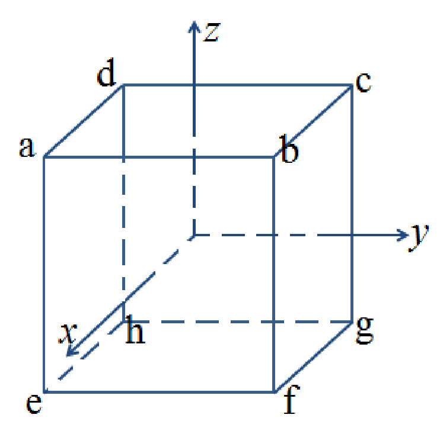

先看什么是对称操作？这里我们参考 Albert Cotton 书上 18 页给出的定义。

**定义 3.1**：A symmetry operation is a movement of a body such that, after the movement has been carried out, every point of the body is coincident with an equivalent point of the body in its original orientation. In other words, if we note the position and orientation of a body before and after a movement is carried out, that movement is a symmetry operation if these points and orientations are indistinguishable.

由这个定义，我们知道对称操作是一个 movement，是一个使物体到达与其原状态不可分辨的另一个状态的 movement。根据这个定义，我们看上面的立方体有多少个对称操作？

1. 沿立方体的四个对角线 ag、fd、hb、ce 进行 $2\pi/3$、$4\pi/3$ 转动的操作，这样的操作有 $4\times 2=8$ 个；
2. 沿 x、y、z 轴转 $\pi/2$、$\pi$、$3\pi/2$ 的操作，这样的操作有 $3\times 3=9$ 个；
3. 立方体有 12 个棱，两条相对的棱的中点连接起来，绕这个连线转动 $\pi$ 角的操作，这样的操作有 $6\times 1=6$ 个；
4. 再加上根本就不动这个操作，一共 $8+9+6+1=24$ 个纯转动操作。

在这里转动是对称操作，与每个转动相应，有个旋转轴，这个旋转轴，就是下面我们要讲得对称元素。同样，我们参考 Albert Cotton 书上的定义。

**定义 3.2**：A symmetry element is a geometrical entity such as a line, a plane, or a point, with respect to which one or more symmetry operations may be carried out.

由这个定义，我们知道对称元素是一个几何实体（geometrical entity），对称操作是相对于这个几何实体进行的，在上面的例子中，它就是旋转轴。当然，实际的对称元素不一定非得是旋转轴，也可以是反演中心、反射面、转动反演轴等等，这些我们以后会讲。它们的共同特点就是它们都是几何实体，对称操作都是相对它们进行的。

在上面讲的立方体的例子中，如果我们再加上反演操作 I，也就是把三维实空间中任意一个 $(x,y,z)$ 的点变换到 $(-x,-y,-z)$，这个反演操作对刚才的立方体实际上也是对称操作。这个 I 与刚才 24 个纯转动操作结合，就又可以给出 24 个新的对称操作。这样加在一起就有 48 个对称操作了。这 48 个对称操作的集合构成一个群，这个群就是这个立方体的对称群，我们记为 $\mathrm{O_h}$，它是一个点群（因为对这 48 个操作，立方体中心那个点都不变）。

现在我们可以去想，如果我把这个立方体揉成一个球，那么这 48 个 $\mathrm{O_h}$ 群的对称操作是否保持这个球不变？答案：保持，是吧？同时，我们需要指出的是对于这个球而言，它的对称操作远远不止这些。以后我们学到的所有点群的对称操作，对这个球都成立。换句话说，如果我们把所有保持这个球不变的对称操作放在一起，它们是形成一个群的。这个群是如此强大以至于任何的一个我们后面学到的点群，都是这个群的子群。在这里，我们把它称为点群的母体，它的名字叫三维实正交群，记为 O(3)。下面我们会花些时间来介绍一下这个 O(3) 群。

但在讲这个 O(3) 群之前，我们需要先介绍一下它里面的基本操作，就是三维实空间（$\mathbb{R}^3$）中的正交变换。

这个三维实空间的一个性质是在定了一组正交归一基 $\vec{i}$、$\vec{j}$、$\vec{k}$ 以后，其中的任意一个向量都可以写成下述列矩阵形式，比如：

$$
\vec{r}=\begin{pmatrix}x_1\\x_2\\x_3\end{pmatrix},\qquad \vec{r}'=\begin{pmatrix}x_1'\\x_2'\\x_3'\end{pmatrix}
$$

两个向量的内积为：

$$
(\vec{r}\cdot\vec{r}')=\sum_{i=1}^{3}x_ix_i'
$$

其中向量 $\vec{r}$ 的长度为：

$$
|\vec{r}|=(\vec{r}\cdot\vec{r})^{1/2}=\left(\sum_{i=1}^{3}x_ix_i\right)^{1/2}
$$

而向量 $\vec{r}$ 与 $\vec{r}'$ 的夹角 $\varphi$ 满足：

$$
\cos\varphi=(\vec{r}\cdot\vec{r}')/(|\vec{r}||\vec{r}'|)
$$

（这些都是 $\mathbb{R}^3$ 中向量的性质）

而 $\mathbb{R}^3$ 中的正交变换，是保持 $\mathbb{R}^3$ 中任意两个向量内积不变的变换，也就是说对 $\forall\vec{r}$、$\vec{r}'\in\mathbb{R}^3$，线性变换 O 要满足：

$$
(O\vec{r}\cdot O\vec{r}')=(\vec{r}\cdot\vec{r}')
$$

也就是：

$$
O^{\mathrm{t}}O=E
$$

这里 $O^{\mathrm{t}}$ 是 O 的转置（实矩阵）。

这个时候，如果我们对比之前讲的酉变换，我们会发现酉变换的定义对应的是任意内积空间中的保内积变换。而这里，正交变换，则对应的是三维欧式空间这个实向量空间中的保内积变换，它是一种特殊的酉变换。

基于这样一个正交变换，我们可以引出三维实正交群 O(3)。

**定义 3.3**　由三维欧式空间中所有的正交变换构成的群，称为三维实正交群，记为 O(3)。

关于 O(3) 群其中元素最重要的性质，我们可以由这个式子得到：

$$
O^{\mathrm{t}}O=E
$$

由这个式子，我们知：

$$
\det(O^{\mathrm{t}}O)=\left(\det(O)\right)^2=1
$$

从而 $\det(O)=\pm 1$，也就是说正交变换为非奇异变换，其行列式为 +1 或 -1。

同时，由于

$$
\det(O_1O_2)=\det(O_1)\det(O_2)
$$

我们还知道 O(3) 群中行列式为 1 的正交变换形成它的一个子群，因为 $1\times 1=1$。

并且由：

$$
\det(O_2^{-1}O_1O_2)=\det(O_2^{-1})\det(O_1)\det(O_2)=\det(O_2^{\mathrm{t}})\det(O_1)\det(O_2)=\det(O_1)
$$

可知 O(3) 群的所有行列式为 1 的元素形成的子群还是一个不变子群。我们把它记为 SO(3)。具体定义如下。

**定义 3.4**　O(3) 群的所有行列式为 1 的正交变换形成的不变子群称为 SO(3) 群，记为：

$$
\mathrm{SO}(3)=\{O\in\mathrm{O}(3)|\det(O)=1\}
$$

这个 SO(3) 群的一个特征是其中任意的一个元素，作用到三维欧式空间的一组向量上，不光不改变它们之间的内积，还不改变这组向量的手性关系。比如我们的三维空间以 $\vec{i}$、$\vec{j}$、$\vec{k}$ 为基，在这组基下，我一个线性变换的矩阵形式是：

$$
O=\begin{pmatrix}a_{11}&a_{12}&a_{13}\\a_{21}&a_{22}&a_{23}\\a_{31}&a_{32}&a_{33}\end{pmatrix}
$$

我现在说这个线性变换是一个 SO(3) 群中的元素，那么有：$\det(O)=1$。

我现在把它作用到三个向量 $\vec{i}$、$\vec{j}$、$\vec{k}$，它们相互关系是个右手系，有 $\vec{i}\cdot(\vec{j}\times\vec{k})=1$。现在把 O 作用到它们三个上面，有：

$$
O\vec{i}\cdot(O\vec{j}\times O\vec{k})=\begin{pmatrix}a_{11}\\a_{21}\\a_{31}\end{pmatrix}\cdot\left[\begin{pmatrix}a_{12}\\a_{22}\\a_{32}\end{pmatrix}\times\begin{pmatrix}a_{13}\\a_{23}\\a_{33}\end{pmatrix}\right]=\begin{vmatrix}a_{11}&a_{12}&a_{13}\\a_{21}&a_{22}&a_{23}\\a_{31}&a_{32}&a_{33}\end{vmatrix}=1
$$

不改变手性关系。

同样，如果作用到 $\vec{j}$、$\vec{i}$、$\vec{k}$，它们的相互关系是左手系，有 $\vec{j}\cdot(\vec{i}\times\vec{k})=-1$。现在把 O 作用到它们上面，也有：

$$
O\vec{j}\cdot(O\vec{i}\times O\vec{k})=\begin{pmatrix}a_{12}\\a_{22}\\a_{32}\end{pmatrix}\cdot\left[\begin{pmatrix}a_{11}\\a_{21}\\a_{31}\end{pmatrix}\times\begin{pmatrix}a_{13}\\a_{23}\\a_{33}\end{pmatrix}\right]=\begin{vmatrix}a_{12}&a_{11}&a_{13}\\a_{22}&a_{21}&a_{23}\\a_{32}&a_{31}&a_{33}\end{vmatrix}=-1
$$

同样不改变手性关系。

而在 O(3) 群中，有一个空间反演操作，其矩阵形式为：

$$
I=\begin{pmatrix}-1&0&0\\0&-1&0\\0&0&-1\end{pmatrix}
$$

这个操作行列式等于 -1，它也会改变三维实空间三个向量的手性关系。同时，这个反演操作与恒等操作 E 还可以构成一个空间反演群 {E、I}，由于 E、I 都与 O(3) 群中任意元素互易，它也是 O(3) 群的不变子群。这个不变子群与二阶循环群 {1、-1} 同构。

这样的话，对 O(3) 群而言，我们可以把其中行列式为 1 的部分取出来，就是SO(3) 群，作为一部分。而属于 O(3)，又不属于 SO(3) 的元素作为另一部分，构成一个 O(3) 群到二阶循环群的映射：

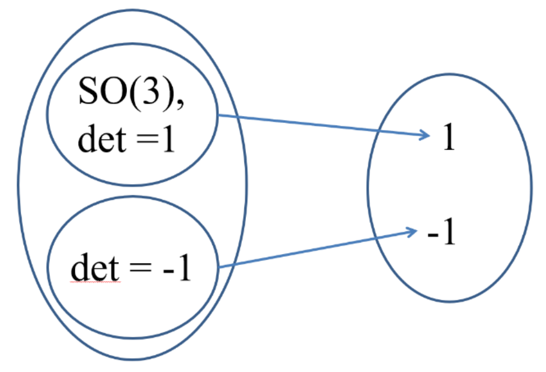

由于 $\det(O_1O_2)=\det(O_1)\det(O_2)$，这个映射是个同态映射。

同时我们可以取 I 为行列式为 -1 元素的代表，把 O(3) 群进行一个 $\mathrm{SO}(3)\cup I\cdot\mathrm{SO}(3)$ 的分解。由于 E、I 与 O(3) 群中任意元素互易，套用我们第一章讲的一个概念，这个 O(3) 群就可以写成是 SO(3) 群与空间反演群 {E、I} 的直积。

到这个地方，O(3) 群与 SO(3) 群的定义我们就讲完了。简单的说，O(3) 群是三维实空间中的保内积变换群，而 SO(3) 群，是三维实空间的保内积、保手性变换群。下面我们介绍几个 SO(3) 群的性质。

**定理 3.1**　对 $\forall g\in\mathrm{SO}(3)$，可在 $\mathbb{R}^3$ 中找到一个向量 $\vec{k}$，使 $g\vec{k}=\vec{k}$。

**证明**：

（说白了就是要证对 $\forall g\in\mathrm{SO}(3)$ 其对应的 $(g-E)\vec{k}=0$ 有非零解。因为这个东西有非零解，也就意味着存在向量 $\vec{k}$，使 $g\vec{k}=\vec{k}$。那么 $(g-E)\vec{k}=0$ 有非零解的充要条件是什么？答：$\det(g-E)=0$。

这也就意味着现在要证的就是对 $\forall g\in\mathrm{SO}(3)$ 都有 $\det(g-E)=0$。怎么证呢？很简单，由 g 的定义（正交变换），有：

$$
\det(g-E)=\det(g-E)^{\mathrm{t}}=\det(g^{\mathrm{t}}-E)=\det(g^{-1}-E)\qquad(3.1)
$$

而

$$
g^{-1}-E=g^{-1}E(E-g)=g^{-1}(-E)(g-E)
$$

代入式 3.1，会产生：

$$
\det(g-E)=\det(g^{-1})\det(-E)\det(g-E)=1\cdot(-1)\cdot\det(g-E)
$$

一个实数等于它的负，这个实数必为零。

（证毕）

由这个定理，我们还可以得到如下性质：

1. 在 $g\vec{k}=\vec{k}$ 的解得到后，我们可以取它为 $\vec{k}$，与之垂直的两个向量为 $\vec{i}$、$\vec{j}$，在以这样的 $\vec{i}$、$\vec{j}$、$\vec{k}$ 为基时，这个转动 g 表示为：

$$
g(\Psi)=\begin{pmatrix}\cos\Psi&-\sin\Psi&0\\\sin\Psi&\cos\Psi&0\\0&0&1\end{pmatrix}=C_{\vec{k}}(\Psi)
$$

其中 $\vec{k}$ 为转轴，$\Psi$ 为转角，取值范围是 $[0,\pi]$，$\vec{k}$ 为向量，有个方位角 $\theta$、$\varphi$。$\theta$ 是它与 z 轴的夹角，$\varphi$ 是其 xy 平面投影与 x 轴的夹角（群表示部分的内容）。

2. 由于定理 3.1，SO(3) 又称为转动群，它的所有变换的行列式都是 1，两个 SO(3) 群中元素 $g_1$ 与 $g_2$ 的乘积 $g_3$ 由于行列式为 1，也是一个纯转动，用 $C_{\vec{k}}(\Psi)$ 的形式写出来就是：

$$
C_{\vec{k}_1}(\Psi_1)C_{\vec{k}_2}(\Psi_2)=C_{\vec{k}_3}(\Psi_3)
$$

$C_{\vec{k}_3}(\Psi_3)$ 也是绕某一轴（$\vec{k}_3$）的一个转动，$\vec{k}_3$、$\Psi_3$ 由 $\vec{k}_1$、$\Psi_1$、$\vec{k}_2$、$\Psi_2$ 定，只不过关系不是看起来很直接罢了。

上面说到在一组基（$\vec{i}$、$\vec{j}$、$\vec{k}$）下，转动 $C_{\vec{k}}(\Psi)$ 的表示为 $\begin{pmatrix}\cos\Psi&-\sin\Psi&0\\\sin\Psi&\cos\Psi&0\\0&0&1\end{pmatrix}$ 这样一个简单的形式。在任意一组基（$\vec{i}'$、$\vec{j}'$、$\vec{k}'$）下，$C_{\vec{k}}(\Psi)$ 的表示矩阵又会是什么样子？

换句话来说，如果在三维欧式空间中，我已经选择了一组基（$\vec{i}'$、$\vec{j}'$、$\vec{k}'$），你现在在这个空间中任意找了一个轴 $\vec{k}$，你绕它做了一个转动 $\Psi$ 角的操作，然后你问我这个 $C_{\vec{k}}(\Psi)$ 在（$\vec{i}'$、$\vec{j}'$、$\vec{k}'$）下的表示矩阵是什么？这个问题的答案我们后面在关于点群的讨论中也会经常用到，现在花时间细说一下。

这里我们可以取（$\vec{i}'$、$\vec{j}'$、$\vec{k}'$）为旧基，（$\vec{i}$、$\vec{j}$、$\vec{k}$）为新基，旧基到新基的变换矩阵是 Q，$Q=\begin{pmatrix}a_{11}&a_{12}&a_{13}\\a_{21}&a_{22}&a_{23}\\a_{31}&a_{32}&a_{33}\end{pmatrix}$，那么这个变换形式就是：

$$
\begin{pmatrix}\vec{i}&\vec{j}&\vec{k}\end{pmatrix}=\begin{pmatrix}\vec{i}'&\vec{j}'&\vec{k}'\end{pmatrix}\begin{pmatrix}a_{11}&a_{12}&a_{13}\\a_{21}&a_{22}&a_{23}\\a_{31}&a_{32}&a_{33}\end{pmatrix}
$$

这里 Q 为实正交变换，$Q^{-1}=Q^{\mathrm{t}}$。

空间有个矢量 $\vec{r}$，它在 $C_{\vec{k}}(\Psi)$ 作用下，变为 $\vec{r}'$。在坐标系（$\vec{i}$、$\vec{j}$、$\vec{k}$）下，这个变换表现为：

$$
\begin{pmatrix}\vec{i}&\vec{j}&\vec{k}\end{pmatrix}\begin{pmatrix}\cos\Psi&-\sin\Psi&0\\\sin\Psi&\cos\Psi&0\\0&0&1\end{pmatrix}\begin{pmatrix}x_1\\x_2\\x_3\end{pmatrix}
$$

其中 $\begin{pmatrix}x_1\\x_2\\x_3\end{pmatrix}$ 为 $\vec{r}$ 在（$\vec{i}$、$\vec{j}$、$\vec{k}$）下的坐标。

在坐标系（$\vec{i}'$、$\vec{j}'$、$\vec{k}'$）下，这个变换表示为：

$$
\begin{pmatrix}\vec{i}'&\vec{j}'&\vec{k}'\end{pmatrix}A\begin{pmatrix}x_1'\\x_2'\\x_3'\end{pmatrix}
$$

其中 $\begin{pmatrix}x_1'\\x_2'\\x_3'\end{pmatrix}$ 是 $\vec{r}$ 在（$\vec{i}'$、$\vec{j}'$、$\vec{k}'$）下的坐标，A 是我们想求的 $C_{\vec{k}}(\Psi)$ 在（$\vec{i}'$、$\vec{j}'$、$\vec{k}'$）下的表示矩阵。

现在问题清楚了，就是要用已知条件，求 A 的形式？

这个时候，我们用的第一个条件就是 $\vec{r}'$ 这个矢量不管是在（$\vec{i}$、$\vec{j}$、$\vec{k}$）下，还是在（$\vec{i}'$、$\vec{j}'$、$\vec{k}'$），它是同一个矢量，所以：

$$
\begin{pmatrix}\vec{i}&\vec{j}&\vec{k}\end{pmatrix}\begin{pmatrix}\cos\Psi&-\sin\Psi&0\\\sin\Psi&\cos\Psi&0\\0&0&1\end{pmatrix}\begin{pmatrix}x_1\\x_2\\x_3\end{pmatrix}=\begin{pmatrix}\vec{i}'&\vec{j}'&\vec{k}'\end{pmatrix}A\begin{pmatrix}x_1'\\x_2'\\x_3'\end{pmatrix}\qquad(3.2)
$$

同理，$\vec{r}$ 也是同一个矢量，所以：

$$
\begin{pmatrix}\vec{i}&\vec{j}&\vec{k}\end{pmatrix}\begin{pmatrix}x_1\\x_2\\x_3\end{pmatrix}=\begin{pmatrix}\vec{i}'&\vec{j}'&\vec{k}'\end{pmatrix}\begin{pmatrix}x_1'\\x_2'\\x_3'\end{pmatrix}\qquad(3.3)
$$

那么现在我们要做的事情就是从式 3.2 与 3.3 求 A。这个时候，由：

$$
\begin{pmatrix}\vec{i}&\vec{j}&\vec{k}\end{pmatrix}=\begin{pmatrix}\vec{i}'&\vec{j}'&\vec{k}'\end{pmatrix}Q
$$

代入 3.3 我们知道，得：

$$
Q\begin{pmatrix}x_1\\x_2\\x_3\end{pmatrix}=\begin{pmatrix}x_1'\\x_2'\\x_3'\end{pmatrix}
$$

这个式子，代入 3.2，进一步有：

$$
\begin{pmatrix}\vec{i}&\vec{j}&\vec{k}\end{pmatrix}\begin{pmatrix}\cos\Psi&-\sin\Psi&0\\\sin\Psi&\cos\Psi&0\\0&0&1\end{pmatrix}\begin{pmatrix}x_1\\x_2\\x_3\end{pmatrix}=\begin{pmatrix}\vec{i}'&\vec{j}'&\vec{k}'\end{pmatrix}AQ\begin{pmatrix}x_1\\x_2\\x_3\end{pmatrix}
$$

由于这个式子对任意 $\begin{pmatrix}x_1\\x_2\\x_3\end{pmatrix}$ 成立，所以有：

$$
\begin{pmatrix}\vec{i}&\vec{j}&\vec{k}\end{pmatrix}\begin{pmatrix}\cos\Psi&-\sin\Psi&0\\\sin\Psi&\cos\Psi&0\\0&0&1\end{pmatrix}=\begin{pmatrix}\vec{i}'&\vec{j}'&\vec{k}'\end{pmatrix}AQ
$$

再把 $\begin{pmatrix}\vec{i}&\vec{j}&\vec{k}\end{pmatrix}=\begin{pmatrix}\vec{i}'&\vec{j}'&\vec{k}'\end{pmatrix}(Q)$ 继续代入，有：

$$
\begin{pmatrix}\vec{i}'&\vec{j}'&\vec{k}'\end{pmatrix}Q\begin{pmatrix}\cos\Psi&-\sin\Psi&0\\\sin\Psi&\cos\Psi&0\\0&0&1\end{pmatrix}=\begin{pmatrix}\vec{i}'&\vec{j}'&\vec{k}'\end{pmatrix}AQ
$$

两个向量相等，它们的所有分量都要相等，所以：

$$
Q\begin{pmatrix}\cos\Psi&-\sin\Psi&0\\\sin\Psi&\cos\Psi&0\\0&0&1\end{pmatrix}=AQ
$$

进而：

$$
A=Q\begin{pmatrix}\cos\Psi&-\sin\Psi&0\\\sin\Psi&\cos\Psi&0\\0&0&1\end{pmatrix}Q^{-1}
$$

这个说明什么？这个说明在三维欧式空间中，如果你事先选定了一组基的话，那么绕空间任意一个轴转 $\Psi$ 的操作，都可以写成：

$$
Q\begin{pmatrix}\cos\Psi&-\sin\Psi&0\\\sin\Psi&\cos\Psi&0\\0&0&1\end{pmatrix}Q^{-1}
$$

的形式。

这里，$\begin{pmatrix}\cos\Psi&-\sin\Psi&0\\\sin\Psi&\cos\Psi&0\\0&0&1\end{pmatrix}$ 是这个转动在以 $\vec{k}$ 为 z 轴，以与它垂直的两个单位向量 $\vec{i}$、$\vec{j}$ 为 x、y 轴的坐标系下的表示矩阵。Q 是这三个向量在原来选定的坐标系下的展开，即：$\begin{pmatrix}\vec{i}&\vec{j}&\vec{k}\end{pmatrix}=\begin{pmatrix}\vec{i}'&\vec{j}'&\vec{k}'\end{pmatrix}Q$。

由于相似变换并不改变矩阵的迹，所以 $\mathrm{tr}(QC_{\vec{k}}(\Psi)Q^{-1})=\mathrm{tr}(C_{\vec{k}}(\Psi))=1+2\cos\Psi$。也就是说绕任何一个轴，转动 $\Psi$ 角的转动，它的迹都是 $1+2\cos\Psi$，转动轴的选取，只影响转动的矩阵表达形式，不影响它的迹。

除了转动的迹只与转角有关，下面两段话的分析对我们以后点群分类也特别重要：

1. 这里我们直接用 $C_{\vec{k}}(\Psi)$ 代表绕 $\vec{k}$ 轴的转动，因此，$C_{\vec{k}}(\Psi)$ 满足 $C_{\vec{k}}(\Psi)\vec{k}=\vec{k}$。取 SO(3) 群中任意元素 $g'$，作用到这个等式上，有 $g'C_{\vec{k}}(\Psi)\vec{k}=g'\vec{k}$，进而 $g'C_{\vec{k}}(\Psi)g'^{-1}g'\vec{k}=g'\vec{k}$，也就是说 $g'C_{\vec{k}}(\Psi)g'^{-1}$ 代表的是在（$\vec{i}$、$\vec{j}$、$\vec{k}$）下绕 $g'\vec{k}$ 轴转动 $\Psi$ 角的操作。这里 $g'$ 为 SO(3) 群中任意元素，因此 $g'\vec{k}$ 可以是空间任意指向，这也就是说 SO(3) 群中绕空间任意轴转动相同转角的操作都同类。

2. 把这个性质展开：对点群而言，转动相同转角的操作是否同类？答案是不一定，因为上面的推导是针对 SO(3) 群的，要求 $g'$ 属于 SO(3) 群。点群是 SO(3) 群有限子群。其中可能会有两个转动转角相同，但我这个点群中没有任何一个操作，可以把这两个转动的转轴联系起来，这样，就不能从 $C_{\vec{k}}(\Psi)\vec{k}=\vec{k}$ 推到 $g'C_{\vec{k}}(\Psi)g'^{-1}g'\vec{k}=g'\vec{k}$ 了。因为没有一个点群中元素 $g'$，使得这两个轴一个为 $\vec{k}$，一个为 $g'\vec{k}$。

这些讨论总结一下就是：SO(3) 群中所有转动相同转角的元素都同类，但点群中不一定，要看有没有一个点群中元素将他们的转动轴联系起来？

这些讨论同时还告诉我们 SO(3) 群可以写成 $\{C_{\vec{k}}(\Psi)\}$，其中 $\vec{k}$ 取遍过原点 O 的所有轴，$\Psi$ 取遍 $[0,\pi]$。前面我们还说过，O(3) 可以写成 $\mathrm{SO}(3)\otimes\{E, I\}$。因此，O(3) 也可以写成 $\{C_{\vec{k}}(\Psi), IC_{\vec{k}}(\Psi)\}$。

对其中任意一个元素 $C_{\vec{k}}(\Psi)$，对其进行共轭操作，情况有两种：

1. $C_{\vec{k}'}(\Psi')C_{\vec{k}}(\Psi)C_{\vec{k}'}(\Psi')^{-1}$，

2. $IC_{\vec{k}'}(\Psi')C_{\vec{k}}(\Psi)\left(IC_{\vec{k}'}(\Psi')\right)^{-1}=C_{\vec{k}'}(\Psi')C_{\vec{k}}(\Psi)C_{\vec{k}'}(\Psi')^{-1}$。

也就是不管怎么说，同类操作都是绕某一轴转动相同角度的纯转动操作。

而对其中任意一个转动反演操作 $IC_{\vec{k}}(\Psi)$，也具有同样地性质。因此，在 O(3) 群中，所有转动相同转角的纯转动操作为一类，所有转动相同转角的转动反演操作为一类。

现在我们是讲完了点群的母体，O(3) 群的所有性质。开始看点群，先看概念。

**定义 3.5（点群）**　三点：

1. 点群是三维实正交群 O(3) 群的有限子群；
2. 如果点群只包含转动元素，它是 SO(3) 群的有限子群，称为第一类点群；
3. 如果点群还包含转动反演元素，称为第二类点群。

关于点群，有个重要的性质。

**定理 3.2**　设群 G 是绕固定轴 $\vec{k}$ 转动生成的 n 阶群，则 G 由元素 $C_{\vec{k}}(2\pi/n)$ 生成。

**证明**：

由群 G 是绕 $\vec{k}$ 转动生成的 n 阶群，知 G 中只有 n 个元素，且都是绕 $\vec{k}$ 轴转动，我们可以记为 $C_{\vec{k}}(\theta_i)$，i 为从 0 到 n-1。

我们选 $\theta_0=0$，对应单位元素，$\theta_1$ 是非零转动中的最小转角。其它 $\theta_i$ 可以写成 $\theta_i=m_i\theta_1+\varphi_i$ 的形式。其中 $0\le\varphi_i<\theta_1$，$m_i$ 为正整数。

既然有这个关系，我们就知道：

$$
[C_{\vec{k}}(\theta_1)]^{-m_i}C_{\vec{k}}(\theta_i)=C_{\vec{k}}(\varphi_i)\in G
$$

前面说过，$\theta_1$ 是非零转动中的最小转角，所以 $\varphi_i$ 必都为零。也就是说所有转角都可以写成 $m_i\theta_1$ 的样子了。在 $\theta_0$ 对应单位操作，之后依次取 n-1 个 $m_i$，这样就有 n 个转动操作了。第 n+1 个与单位操作重复，所以就有 $n\theta_1=2\pi$，进而 $\theta_1=2\pi/n$，这个转动群由 $C_{\vec{k}}(2\pi/n)$ 生成。

（证毕）

到这儿，我们知道了一个点群其中元素必可写为 $\{C_{\vec{k}}(2\pi/n), IC_{\vec{k}'}(2\pi/n')\}$ 的形式。其中 $\vec{k}$、n、$\vec{k}'$、n' 有多种选择。对于 $C_{\vec{k}}(2\pi/n)$、$IC_{\vec{k}'}(2\pi/n')$ 这些操作，它们的对称元素有几种情况，后面关于点群讨论的时候经常用到，这里说一下：

1. $IC_{\vec{k}}(2\pi/n)$ 中 n 取 1，这时对应的是 I，中心反演操作，对称元素为反演中心；

2. $IC_{\vec{k}}(2\pi/n)$ 中 n 取 2，对应操作为 $IC_{\vec{k}}(\pi)$。这个操作干的事情是绕 $\vec{k}$ 轴转动 $\pi$，再对原点作反演。以（$\vec{i}$、$\vec{j}$、$\vec{k}$）为坐标轴的话，这个操作干的事情就是先把 $\begin{pmatrix}x\\y\\z\end{pmatrix}$ 变到 $\begin{pmatrix}-x\\-y\\z\end{pmatrix}$，再把 $\begin{pmatrix}-x\\-y\\z\end{pmatrix}$ 变到 $\begin{pmatrix}x\\y\\-z\end{pmatrix}$，最终使 $\begin{pmatrix}x\\y\\z\end{pmatrix}$ 与 $\begin{pmatrix}x\\y\\-z\end{pmatrix}$ 等价。这里，我们可以说对称元素是过原点，与 $\vec{k}$ 垂直的反射面；

3. $C_{\vec{k}}(2\pi/n)$ 普遍情况，对称元素就是转动轴；

4. $IC_{\vec{k}}(2\pi/n)$ 普遍情况，对称元素就是转动反演轴。

需要说明的是对于有些教材，他们可能不喜欢用转动反演轴来讲东西，而喜欢利用一个叫转动反射面的东西，记为 $S_{\vec{k}}(2\pi/n)$，指的是绕 $\vec{k}$ 轴作个转动 $2\pi/n$，再对与 $\vec{k}$ 轴垂直的镜面作反射，也就是 $\sigma_{\vec{k}}C_{\vec{k}}(2\pi/n)$。它与转动反演的关系是：

$$
\sigma_{\vec{k}}C_{\vec{k}}(2\pi/n)=IC_{\vec{k}}\left(\frac{2\pi}{n}+\pi\right)
$$

（这个关系需要画图说明）

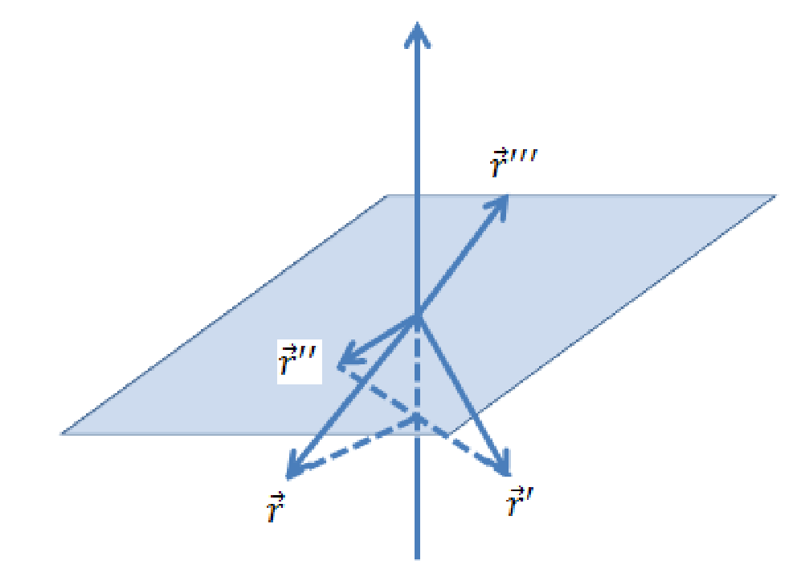

到这里，我们是把点群的一些最基本的特性给说清楚了。简单的说就是点群是一个由 $\{C_{\vec{k}}(2\pi/n), IC_{\vec{k}'}(2\pi/n')\}$ 形成的对称操作的集合，这里 $\vec{k}$、n、$\vec{k}'$、n' 有有限个取值。我们之前说过，群本身是有很强的结构特征的，当我们说一个集合形成群时，看似简单的几句话，其实都为它们之间的相互关系留下了伏笔。这个大家在第一章应该有体会。同态，看似简单，但蕴藏着同态核定理。在这里其实也是，我们说 $\vec{k}$、n、$\vec{k}'$、n' 取有限个取值的 $\{C_{\vec{k}}(2\pi/n), IC_{\vec{k}'}(2\pi/n')\}$ 这样的一个集合的时候，这个 $\{C_{\vec{k}}(2\pi/n), IC_{\vec{k}'}(2\pi/n')\}$ 本身是不是也要符合什么规律呢？

答案是肯定的。这个规律是我们这一章的定理 3.3。

**定理 3.3**　设 G 是点群，K 是 G 的纯转动部分，由于纯转动部分的乘积以及逆元必属于这个纯转动部分，所以 K 也是 G 的纯转动子群，也就是说 $K=G\cap\mathrm{SO}(3)$。这个时候，关于 G 与 K 的关系，存在三种可能：

1. $G=K$，这个时候 G 是 SO(3) 的有限子群，这样的点群称为第一类点群，它只包含纯转动操作；
2. 当 G 不只包含纯转动操作时，如果 G 中包含纯反演操作 I，那么 G 与 K 的关系必然是 $G=K\cup IK$；
3. 当 G 不只包含纯转动操作，且 G 中不包含纯反演操作 I 时，G 必与一个纯转动群 $G^+$ 同构，这里 $G^+=K\cup K^+$，而 $K^+$ 的定义是：$K^+=\{Ig\}$，其中 $g\in G$，但 $g\notin K$。

这三个性质，说出了所有点群的情况！大家一定要好好理解。其中第一个性质不需要证明，很直白，就是有一类点群只包含纯转动操作。第二、第三个性质是需要我们证明的。

证明之前我先问一下大家我们知道这个定理有什么用？一句话：如果这个定理成立，那么我们了解了所有第一类点群，也就很自然地了解所有点群了。

**证明**：

G 不是纯转动元素集合时的情况，$G=\{\{C_{\vec{k}}(\Psi)\}, \{IC_{\vec{k}'}(\Psi')\}\}=\{K, IK^+\}$。

这个时候，如果 I 属于 G，那么由于重排定理 IG 应该也等于 G，这样的话 G 这个集合就要写成 $\{IK, K^+\}$，它要与 $\{K, IK^+\}$ 相同，这就要求 $K^+=K$。这也就是我们说的第二种情况。

当 I 不属于 G 时，由上面 $G=\{\{C_{\vec{k}}(\Psi)\}, \{IC_{\vec{k}'}(\Psi')\}\}$ 的形式，我们是可以构造一个集合 $G^+=\{\{C_{\vec{k}}(\Psi)\}, \{C_{\vec{k}'}(\Psi')\}\}$ 的。这个集合与 G 存在一一对应的关系是显然的。那么下面我们只需要证明 $G^+$ 是一个群，且保持乘法规则不变，就可以了。

先看 $G^+=\{\{C_{\vec{k}}(\Psi)\}, \{C_{\vec{k}'}(\Psi')\}\}$ 是不是一个群，由 $G=\{\{C_{\vec{k}}(\Psi)\}, \{IC_{\vec{k}'}(\Psi')\}\}$ 是一个群出发。

封闭性：由 $G=\{\{C_{\vec{k}}(\Psi)\}, \{IC_{\vec{k}'}(\Psi')\}\}$ 是一个群，知两个 $\{C_{\vec{k}}(\Psi)\}$ 中元素相乘，结果属于 $\{C_{\vec{k}}(\Psi)\}$；两个 $\{IC_{\vec{k}'}(\Psi')\}$ 中元素相乘，结果属于 $\{C_{\vec{k}}(\Psi)\}$；而一个 $\{C_{\vec{k}}(\Psi)\}$ 中元素与一个 $\{IC_{\vec{k}'}(\Psi')\}$ 中元素相乘，结果属于 $\{IC_{\vec{k}'}(\Psi')\}$。

因此对应 $G^+=\{\{C_{\vec{k}}(\Psi)\}, \{C_{\vec{k}'}(\Psi')\}\}$ 中元素。两个 $\{C_{\vec{k}}(\Psi)\}$ 中元素相乘，结果属于 $\{C_{\vec{k}}(\Psi)\}$；两个 $\{C_{\vec{k}'}(\Psi')\}$ 中元素相乘，结果属于 $\{C_{\vec{k}}(\Psi)\}$；而一个 $\{C_{\vec{k}}(\Psi)\}$ 中元素与一个 $\{C_{\vec{k}'}(\Psi')\}$ 中元素相乘，结果属于 $\{C_{\vec{k}'}(\Psi')\}$。

故 $\{\{C_{\vec{k}}(\Psi)\}, \{C_{\vec{k}'}(\Psi')\}\}$ 封闭。

单位元素，在 $\{C_{\vec{k}}(\Psi)\}$ 中。

逆元，由 G 是群知对任意 $\{C_{\vec{k}}(\Psi)\}$ 中元素其逆属于这个集合，任意 $\{IC_{\vec{k}'}(\Psi')\}$ 中元素，其逆也属于这个集合。与此对应，$G^+$ 中，任意 $\{C_{\vec{k}}(\Psi)\}$ 中元素，其逆属于这个集合，任意 $\{C_{\vec{k}'}(\Psi')\}$ 中元素，其逆也属于这个集合。这条也成立。

结合律，由 G 是群且 I 与任意其中元素互易得到。

因此 $G^+$ 是一个群且与 G 一一对应。

而乘法规则呢？我们可以对比 $\{\{C_{\vec{k}}(\Psi)\}, \{C_{\vec{k}'}(\Psi')\}\}$ 与 $\{\{C_{\vec{k}}(\Psi)\}, \{IC_{\vec{k}'}(\Psi')\}\}$，由 I 与其中任意元素互易得到。

这个时候我们再提一句之前提到的讲这个定理的初衷，也就是说明当我知道了所有的第一类点群之后，我们很自然的可以通过这个定理的第二、第三条去构造所有的第二类点群。

（证毕）

到这儿，我们点群基础这一节就讲完了，我们讲地比较细，内容看似很多，不过总结起来，就是下面几句：

1. O(3) 群是三维欧式空间中的实正交变换群，包含转动群 SO(3) 与转动反演部分 $I\cdot\mathrm{SO}(3)$；

2. SO(3) 群中，如果两个转轴可以由一个转动 g 联系起来，也就是说一个轴是 $\vec{k}$，一个轴是 $g\vec{k}$，则由 $C_{\vec{k}}(\Psi)\vec{k}=\vec{k}$ 可知 $gC_{\vec{k}}(\Psi)g^{-1}g\vec{k}=g\vec{k}$。也就是说 $gC_{\vec{k}}(\Psi)g^{-1}$ 代表的是绕 $g\vec{k}$ 轴转动 $\Psi$ 角的操作。这也就意味着 SO(3) 群中所有转动相同转角的操作，实际上是同类的；
3. 与之相似，$I\cdot\mathrm{SO}(3)$ 中具有相同转角的转动反演操作也彼此同类；
4. 点群是 O(3) 群的有限子群，可以用 $\{\{C_{\vec{k}}(\Psi)\}, \{IC_{\vec{k}'}(\Psi')\}\}$ 的方式来分析，其中 $\vec{k}$、$\Psi$、$\vec{k}'$、$\Psi'$ 具有有限个取值；
5. $\vec{k}$、$\vec{k}'$ 为整数阶轴；
6. 点群中对称元素包括：转动轴、转动反演轴、反演中心、反射面，其中后两者是前两者的特殊情况；
7. 最后是定理 3.3，就是点群的三种情况。这三种情况意味着我们只要把第一类点群分析清楚，依据这个定理，就可以把所有点群分析清楚了。

## 3.2 第一类点群

这一节，说白了，就是利用我们第一节给出的点群的基本知识，结合第一章里面的群的基本理论，对第一类点群进行一个系统地研究。假设一个第一类点群是 G，它有转动轴 $C_{n_1}$、$C_{n_2}$、$\cdots$、$C_{n_i}$、$\cdots$，其中 $n_i$ 为大于等于 2 的整数，也就是说 $C_{n_i}$ 代表的是不同轴，$n_i$ 是代表它几次。这个时候我们可以去想，对于 $C_{n_i}$ 这个轴来讲，它会对我这个纯转动群贡献几个非恒等的转动操作？答案：$n_i-1$。这个是我目前知道的关于群 G 与其转动轴的信息。现在我们要从这个信息里面去推出群 G 有多少个元素。怎么推？

这里一个很有用的工具就是球形图。它是以原点为中心，以任意一个正数 r 为半径的球面，记为 $S_r$。点群 G 中元素的作用，就是把这个 $S_r$，转到一个和它等价的构型。对 G 中的 $n_i$ 阶轴 $C_{n_i}$ 来说，它与 $S_r$ 有两个交点，我们把这两个交点记为 $\vec{r}_i$ 与 $-\vec{r}_i$。这两个矢量在 $C_{n_i}$、$C_{n_i}^2$、$\cdots$、$C_{n_i}^{n_i-1}$ 这些非恒等操作下，是不变的。称为这些操作的极点。

那么，对于 $\vec{r}_i$ 与 $-\vec{r}_i$，群 $\{E, C_{n_i}, C_{n_i}^2, \cdots, C_{n_i}^{n_i-1}\}$ 是不是群 G 对它们的迷向子群？（第一章中的概念，对于一个变换群 G，变换对象为 X，其中有一点 x，如果群 G 有个子群 $G^x$ 作用到 x 上，还是得到 x，那么 $G^x$ 是 G 对 x 的迷向子群）

除了迷向子群，第一章变换群那一节我们还有一个概念要用到，就是 $\vec{r}_i$ 的 G 轨道。说的是取任意 g 属于 G，让 g 作用到 $\vec{r}_i$ 上，当 g 走遍 G 中元素的时候，$\vec{r}_i$ 就会走遍所有与它等价的点，这些点的集合就是 G 对 $\vec{r}_i$ 的 G 轨道。

迷向子群与 G 轨道这两个概念说了，它们之间有什么联系呢？我们在第一章，有个定理 1.9，说的是 $\vec{r}_i$ 的 G 轨道上点的个数可以由群 G 的阶 n 与迷向子群的阶 $n_i$ 通过 $n/n_i$ 求出。

那么在这里，这样一个信息能告诉我什么样的事情呢？那就是通过这个关系，我们知道对任意一个 $n_i$ 阶轴 $C_{n_i}$ 的极点 $\vec{r}_i$ 而言，它会有 $n/n_i$ 个与它等价的 $n_i$ 阶轴的极点。这些极点的集合我们称为一个极点的 G 轨道。这个轨道上每个点能贡献 $(n_i-1)$ 个非恒等操作，一共有 $n/n_i$ 个点，那么这个轨道可以贡献的群 G 中非恒等变换的个数就是：

$$
\frac{n}{n_i}(n_i-1)
$$

这个要搞清楚。

然后呢，我们把球面上可以由对称变换联系起来的所有的极点都归纳为一个 G 轨道，不能由对称变换联系起来的极点归为不同 G 轨道，同一个 G 轨道上的极点所对应的轴的阶数是必须相等的（因为一个轴不可能即使 3 次轴，又是 4 次，诸如此类），这样就可以把极点按照 G 轨道分类了吧？我们假设一共有 l 条 G 轨道。

那么这些极点的集合，能够贡献的群 G 中非恒等变换的个数按照上面的逻辑是不是就是：$\sum_{i=1}^{l}\frac{n}{n_i}(n_i-1)$？

但在这个逻辑中，需要指出的是我们还有一个漏洞，就是 $\vec{r}_i$ 与 $-\vec{r}_i$ 给出的非恒等操作是重复的，对吧？这种重复可能以两种方式出现：

1. 我们在算 l 的时候，也就是极点的 G 轨道个数的时候，如果 $\vec{r}_i$ 与 $-\vec{r}_i$ 不在一个 G 轨道上的时候，那么在上面的加和式子中，i 从 1 到 l，就会有两个不同的 i，给出的非对称操作其实是一样的，这是不是以为着在上面的加和式子中，我们应该除个 2？

2. 第二种情况，当 $\vec{r}_i$ 与 $-\vec{r}_i$ 在同一个 G 轨道上的时候，意味着什么？意味着并不是所有这个 G 轨道上的极点，给出的都是不同的非恒等变换。比如 $\vec{r}_i$ 与 $-\vec{r}_i$ 都在这个 G 轨道上，它们给出的非恒等变换就是重复的。同样 $g\vec{r}_i$ 与 $-g\vec{r}_i$ 也是，它们给出的非恒等操作也重复了。这时，对于 $\frac{n}{n_i}(n_i-1)$，我们是不是也应该除上一个 2？

两者综合一下，那就是对

$$
\sum_{i=1}^{l}\frac{n}{n_i}(n_i-1)
$$

这个 2 是必须除的。要么，是在 i 从 1 到 l 的时候算重了，要么是 $\frac{n}{n_i}(n_i-1)$ 这部分本身就应该是 $\frac{n}{2n_i}(n_i-1)$。综合起来，我们得到的是群 G 中非恒等操作的个数就是：

$$
\sum_{i=1}^{l}\frac{n}{2n_i}(n_i-1)
$$

这个是由上面对极点 G 轨道顶点的分析得到的 G 中非恒等操作的个数，与此同时，对这样一个纯转动群，它是 n 阶的，那么它里面非恒等操作的个数本身就应该是 $(n-1)$。两者做一个结合，对这些有限次轴阶数 $n_i$ 以及极点 G 轨道个数 l 的约束就可以通过下面这个式子反映出来了：

$$
\sum_{i=1}^{l}\frac{n}{2n_i}(n_i-1)=n-1
$$

这个式子等价于：

$$
\sum_{i=1}^{l}\left(1-\frac{1}{n_i}\right)=2\left(1-\frac{1}{n}\right)\qquad(3.4)
$$

在这里，我们要注意的一个基本关系就是 n 要大于等于 $n_i$，而 $n_i$ 要大于等于 2。也就是 $1/2\ge 1/n_i\ge 1/n$。这个方程称为第一类点群的基本方程。它是我们这节课的重点，下面，我们会从它出发，去分析一共会有哪些第一类点群出现？

这里 l 是正整数，也就是 1、2、3 等等。但需要说明的是当 l 等于 1 的时候，上面这个式子能不能成立？答案是不能，因为左边是：$\left(1-\frac{1}{n_i}\right)$，小于 1，右边是 $2-\frac{2}{n}$，大于 1，两边不可能相等。

与此同时，当 l 大于等于 4 的时候，又会发生什么情况？这个时候，左边是大于等于 $4-\sum_{i=1}^{4}\frac{1}{n_i}$ 的，而 $\sum_{i=1}^{4}\frac{1}{n_i}$ 要小于等于 2，所以左边是大于等于 2。而右边，$2-\frac{2}{n}$ 肯定小于 2。一个大于等于 2 的数与一个小于 2 的数是肯定不可能相等的。所以 l 也不可能大于等于 4。

综合上面的讨论，l 只能是 2，或者 3。下面，我们会用穷举的方式把上面那个基本方程的所有解都求出来。

1. $l=2$，我们把 $n_i$ 按从小到大的顺序排。这样的话上面那个基本方程就变成了：

$$
\sum_{i=1}^{2}\left(1-\frac{1}{n_i}\right)=2\left(1-\frac{1}{n}\right)
$$

也就是：

$$
2-\frac{1}{n_1}-\frac{1}{n_2}=2-\frac{2}{n}
$$

进而：

$$
\frac{1}{n_1}+\frac{1}{n_2}=\frac{2}{n}
$$

由于 $n_1\le n_2\le n$，所以这种情况只能有一个解：$n_1=n_2=n$。

这时对应的实际情况，就是我有一个 n 阶轴，它把我的球面戳了两个大洞。由于没有其它的对称操作把这两个洞给联系起来，所以它们表现为两个 G 轨道。实际上它们对应的是一个对称轴。

2. $l=3$，这样的话基本方程就变成了：

$$
3-\frac{1}{n_1}-\frac{1}{n_2}-\frac{1}{n_3}=2-\frac{2}{n}
$$

进而：

$$
\frac{1}{n_1}+\frac{1}{n_2}+\frac{1}{n_3}=1+\frac{2}{n}\qquad(3.5)
$$

由于 $n_1\le n_2\le n_3\le n$，所以

$$
\frac{1}{n_1}\ge\frac{1}{n_2}\ge\frac{1}{n_3}\ge\frac{1}{n}
$$

当 $n_1\ge 3$ 时，式 3.5 的左边小于 1，右边大于 1，不成立。这也就是说 $n_1$ 只能为 2。这时，式 3.5 可化为：

$$
\frac{1}{2}+\frac{1}{n_2}+\frac{1}{n_3}=1+\frac{2}{n}\qquad(3.6)
$$

而 $n_2$ 如果大于等于 4，那么上式左边小于 1，右边大于 1，又不成立。所以现在的情况是 $l=3$、$n_1=2$、$n_2$ 等于 2 或者 3。

当 $n_2$ 等于 2 时，式 3.6 变为：

$$
\frac{1}{n_3}=\frac{2}{n}
$$

也就是说 $n=2n_3$，这里 $n$ 等于 4、6、8 等等都可以。这是第二个解。

3. $l=3$、$n_1=2$、$n_2=3$，这时基本方程变成了：

$$
\frac{1}{2}+\frac{1}{3}+\frac{1}{n_3}=1+\frac{2}{n}
$$

进而：

$$
\frac{1}{n_3}=\frac{1}{6}+\frac{2}{n} \qquad (3.7)
$$

这时如果 $n_3=3$，则 $n=12$。解为：$l=3$、$n_1=2$、$n_2=3$、$n_3=3$、$n=12$。

4. $l=3$、$n_1=2$、$n_2=3$、$n_3=4$，这时 $n=24$，第 4 个解。

5. $l=3$、$n_1=2$、$n_2=3$、$n_3=5$，这时 $n=60$，第 5 个解。

之后如果 $n_3\geq 6$，式 3.7 的左边小于等于 $1/6$，右边大于等于 $1/6$，又不相等了。所以只有以上五种解。上面我们是从点群基本方程出发，讨论了它存在的五种解的可能，下面我们仔细看一下它们分别对应什么实际情况。

1. $n_1=n_2=n$。这个上面说过，就是一个 $n$ 阶轴，将球戳了两个洞。由于这两个洞没法通过其它对称操作联系起来，所以它们是两个极点的 $G$ 轨道。这样的群称为 $C_n$ 群。

例子：

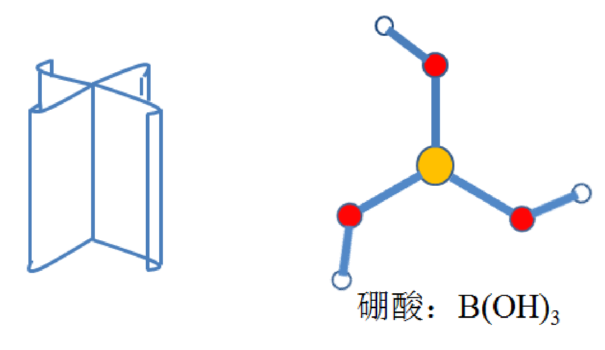

这样的群是 Abel 群，每个群元是一类，一共有 $n$ 个类。

2. $l=3$、$n_1=2$、$n_2=2$、$n_3=m$、$n=2m$，$m=2$、$3$、$4$、$\cdots$

全部极点分成三个轨道，第一个与第二个轨道上各有 $\frac{2m}{2}=m$ 个极点。它们是 $m$ 个二阶轴与球面的交点。第三个轨道上有 $\frac{2m}{m}=2$ 个极点，它们是一个 $m$ 阶轴与球面的两个交点，这两个交点在一个 $G$ 轨道上。

由于这两个 $m$ 阶轴的极点在同一个 $G$ 轨道上，说明必有一个二阶轴与这个 $m$ 阶轴垂直，而反过来，这个 $m$ 阶轴又可以将这个二阶轴转到 $m$ 个与之等价的位置。

这样的群我们称为二面体群，比如我们总用到的 $D_3$ 群，还有 $D_4$ 群：

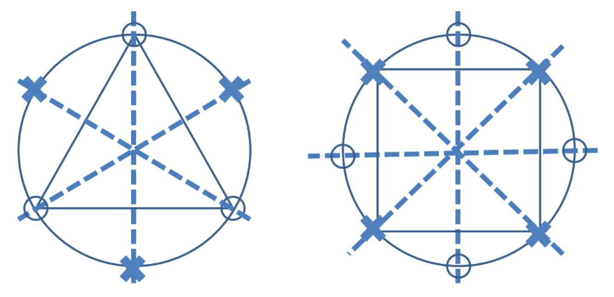

这个其实是非常好的两个例子，来说明我们在引入第一类点群基本方程时，通过极点 $G$ 轨道上点的个数求群中非恒等操作群元个数的时候，为什么在

$$
\sum_{i=1}^{l}\frac{n}{2n_i}(n_i-1)
$$

这个表示式中必须有 $1/2$ 这个因子？

这里 $n_1=2$、$n_2=2$，对 $D_3$ 群来说，每个二阶轴与球面的两个交点不在一个 $G$ 轨道上，所以在算极点 $G$ 轨道个数也就是 $l$ 的时候，是有 double counting 的。也就是说在这里 $n_1$ 与 $n_2$ 对应的操作，本身就是同样的操作，我在对 $G$ 轨道进行加和的时候，把 $n_1$ 与 $n_2$ 都算了，所以理所当然的要在最后除上一个 2。

而对 $D_4$ 群来说，我一个二阶轴与球面的两个交点 $\vec{r}_i$ 与 $-\vec{r}_i$ 在同一 $G$ 轨道上，所以在对轨道个数进行加和的时候没有 double counting。但是，我在算一个轨道上的极点 $\vec{r}_i$ 等价点的个数的时候，是不是把 $-\vec{r}_i$ 也算进来了？这时，double counting 还是存在的，它发生在我算一个 $G$ 轨道内等价极点的个数的时候。

两者结合起来，还是那两句话：

1. 当 $\vec{r}_i$ 与 $-\vec{r}_i$ 不在一个 $G$ 轨道的时候，double counting 是发生在我们对 $l$ 的统计中；

2. 当 $\vec{r}_i$ 与 $-\vec{r}_i$ 在一个 $G$ 轨道的时候，double counting 是发生在计算 $\vec{r}_i$ 的 $G$ 轨道上的等价点对群本身非恒等操作的贡献上。

不管怎样，double counting 总是存在的。

现在我们知道了第一类点群基本方程的第二个解对应的是二面体群 $D_n$ 的情况。下面我们来看它是怎么分类的。我们的基本思路还是：两个具有相同转角的转动，如果其转轴可以通过群中另外一个元素联系起来，则它们同类。由于这个原因，我们很容易知道对于上面 $D_3$ 与 $D_4$，它们的分类情况就会不一样。

对于 $D_3$，是不是它的所有二阶轴都可以通过绕 3 次轴的转动联系起来，而对于 $D_4$，它的二阶轴必须分为两类。与此同时，对于 $D_3$ 这种奇数次的二面体群，它绕 $n$ 阶轴的非恒等转动中，$C_n^k$ 与 $C_n^{n-k}$ 同类，这里 $k$ 的取值有 $(n-1)/2$ 个。$n=3$ 时为 1，$n=5$ 时为 2。这样这种 $D_n$ 群的总的类的个数就是 $1+(n-1)/2+1=(n+3)/2$ 个。这里第一个 1 是恒等变换，第二个 $(n-1)/2$ 是绕 $n$ 次轴的非恒等操作，最后一个 1 对应所有 2 次轴。

而对于 $D_4$ 这种偶数次的二面体群，它绕 $n$ 阶轴的非恒等转动中，$C_n^k$ 与 $C_n^{n-k}$ 同类，这里 $k$ 的取值有 $(n-2)/2$ 个。同时恒等操作是一类，转 $\pi$ 角的操作是一类。同时 2 次转动分为两类，所以总的类数是：$1+\frac{n-2}{2}+1+2=\frac{n}{2}+3$ 个。

除了 $C_n$ 与 $D_n$，下面的三种情况是：

3. $l=3$（有三个极点轨道），$n=12$（群里有 12 个对称操作）

$n_1=2$、$n_2=3$、$n_3=3$

第一个极点轨道是二阶轴的，一共有 6 个点；

第二个极点轨道是三阶轴的，一共有 4 个点；

第三个极点轨道也是三阶轴的，一共也有 4 个点。

怎么去理解这个群呢？我们可以从其中最高阶轴的极点出发（后面的讨论也是同样的路子，因为高阶轴极点少，好在三维空间中构建图像）。

假设 $\vec{r}_1$、$\vec{r}_2$、$\vec{r}_3$、$\vec{r}_4$ 是第二个极点轨道上的四个极点，$G$ 中的任意一个元素，作用到这四个极点上，得到的集合还是这四个极点。

取 $\vec{r}_1$ 对应的三次转动 $C_3$，它作用到 $\vec{r}_1$ 上得到的还是 $\vec{r}_1$。但它作用到其它三个极点上，得到的 $C_3\vec{r}_2$、$C_3\vec{r}_3$、$C_3\vec{r}_4$ 是不是就要落到 $\vec{r}_2$、$\vec{r}_3$、$\vec{r}_4$ 这个集合上？一定不能产生新的点，不然这个 $G$ 轨道上就不止四个点了。

要想让这种情况成立的话，$\vec{r}_1$、$\vec{r}_2$、$\vec{r}_3$、$\vec{r}_4$ 的位置必须满足什么样的情况？答案是：当我以 $\vec{r}_1$ 作为北极的话，$\vec{r}_2$、$\vec{r}_3$、$\vec{r}_4$ 必须是在同一个纬度上，经度相差 120 度的三个点。

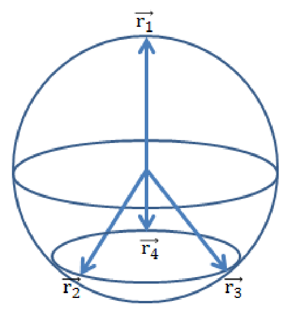

同样，对于 $\vec{r}_2$，取一个绕它的三次转动，我们也可以得到 $\vec{r}_1$、$\vec{r}_3$、$\vec{r}_4$ 必处在以它为极点的纬度线上等间距分布这样一个结论。

对 $\vec{r}_3$、$\vec{r}_4$ 也可做类似处理。把这些结论和在一起，那么 $\vec{r}_1$、$\vec{r}_2$、$\vec{r}_3$、$\vec{r}_4$ 的分布就只能有一种情况：就是它们是球面上相互之间都等间距分布的四个点，构成一个正四面体。

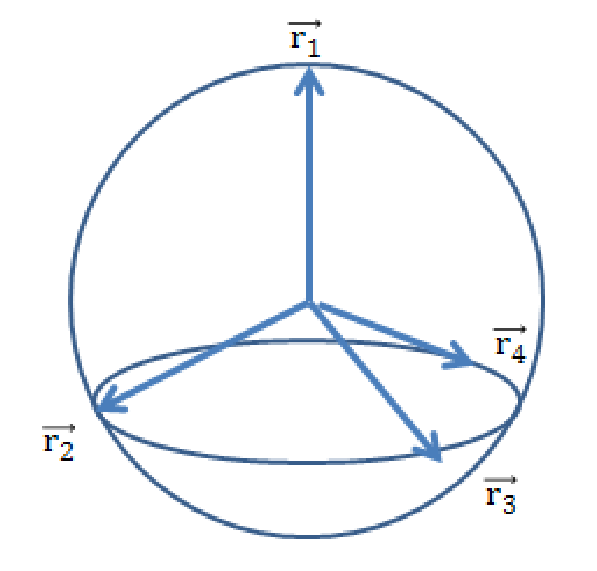

对于这个正四面体，$\vec{r}_1$、$\vec{r}_2$、$\vec{r}_3$、$\vec{r}_4$ 对应的 $-\vec{r}_1$、$-\vec{r}_2$、$-\vec{r}_3$、$-\vec{r}_4$，也构成一个极点 $G$ 轨道，这个就是我们的解中 $n_3=3$ 对应的情况。

同时，二阶轴所对应的六个极点，也可以通过三次转动联系起来，比如：

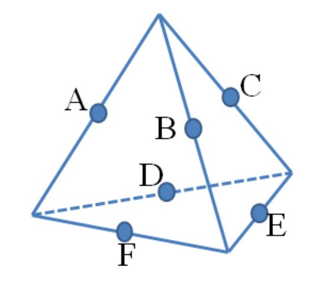

这个图里面四面体中心到 A、$\cdots$、F 这些点的连线与球面的交点，对应的都是二次轴极点，它们相互可由三次转动联系起来，所以只形成一个轨道，对应解中 $n_1=2$ 的情况。

这样的一个正四面体群，我们称为 $T$ 群。在有些教材中在讲到正四面体群的时候，会跟四阶置换群做一个类比。背后更大的背景是所有的有限群均同构与置换群的子群。这里我们先用点群与置换群及其子群做个类比。

$T$ 群的每一个对称操作，说白了，就是对正四面体的四个顶点进行一个置换，比如：

$$
C_3=\begin{pmatrix}1&2&3&4\\1&3&4&2\end{pmatrix}
$$

比如：

$$
C_3^2=\begin{pmatrix}1&2&3&4\\1&4&2&3\end{pmatrix}
$$

对于一个四阶循环群来说，它的阶数是 4 的阶乘，也就是 24。而 $T$ 群只有 12 个元素，为什么？

原因很简单，就是 $T$ 群是个第一类点群，它包含的是纯转动操作，在变换过程中，1、2、3、4 四个点之间手性发生变化的变换是不包括的。因为这个原因，在有些教材上，会说到 $T$ 群是 $S_4$ 的偶置换子群。

在 $T$ 群中，如果再加上这种不保手性的变换，也就是我的对象还是这个正四面体，但我允许它的顶点进行不保手性的变换，后面会说到这个群对应的是一个第二类点群 $T_d$，这样的一个群跟 $S_4$ 就同构了。

再展开来说，在点群中，随着顶点数的增加，几何限制会使得点群与置换群的差别会越来越大。当只有三个顶点的时候，前面讲过 $D_3$ 与 $S_3$ 直接同构；当我有四个顶点的时候，$T$ 与 $S_4$ 只有在加入非纯转动操作的时候才同构；对于五个以上顶点的情况，即使假如转动反演操作，也不行，因为顶点之间的任意置换是不可能被点群中的几何操作（转动或转动反演）所允许的。这些点群只能与相应置换群的子群同构，这个越往后你们会越能体会。

关于 $T$ 群中群元的分类。

E 自成一类；二次转动 $C_2$、$C_2'$、$C_2''$，由于转轴可通过三次转动联系起来，所以成为一类；转 $2\pi/3$ 角的操作 $C_3$、$C_3'$、$C_3''$、$C_3'''$，由于其转轴可以通过其它三次转动联系起来，所以也成为一类；而 $C_3$ 与 $C_3^2$ 之间，由于其转轴没法通过 $T$ 中元素联系起来，所以不是一类，但 $C_3^2$、$C_3'^2$、$C_3''^2$、$C_3'''^2$ 之间是可以通过 $T$ 中元素联系起来的，所以 $C_3^2$、$C_3'^2$、$C_3''^2$、$C_3'''^2$ 组成一个类。

综合起来，就是 $T$ 中有四个类，分别是：$\{E\}$，$\{C_2$、$C_2'$、$C_2''\}$，$\{C_3$、$C_3'$、$C_3''$、$C_3'''\}$、$\{C_3^2$、$C_3'^2$、$C_3''^2$、$C_3'''^2\}$。

这个分类情况再结合 Burnside 定理，我们就会知道 $T$ 群的不等价不可约表示维数情况是什么？

$S_1^2+S_2^2+S_3^2+S_4^2=12$，以为恒等表示 $S_1=1$，其它维度只能是 $S_2=1$、$S_3=1$、$S_4=3$。也就是说 $T$ 群有三个一维不等价不可约表示，一个三维不等价不可约表示。

4. $C_n$、$D_n$、$T$ 之后的第四种情况。

$l=3$，三个极点 $G$ 轨道；

$n=24$，24 个对称操作；

$n_1=2$，第一个 $G$ 轨道对应的是 2 次轴的极点，上面有 12 个点；

$n_2=3$，第二个 $G$ 轨道对应的是 3 次轴的极点，上面有 8 个点；

$n_3=4$，第一个 $G$ 轨道对应的是 4 次轴的极点，上面有 6 个点；

分析的话还是和上面一个例子一样，从最高阶轴的极点出发。有 $\vec{r}_1$、$\vec{r}_2$、$\vec{r}_3$、$\vec{r}_4$、$\vec{r}_5$、$\vec{r}_6$ 六个极点。这个群本身的转动都是 2、3、4 次转动。

我们把一个 4 次转动作用到 $\vec{r}_1$、$\vec{r}_2$、$\vec{r}_3$、$\vec{r}_4$、$\vec{r}_5$、$\vec{r}_6$ 上，得到的必是这六个点的集合自身。

设这个 $C_4$ 本身对应的是 $\vec{r}_1$ 轴，那么 $\vec{r}_2$、$\vec{r}_3$、$\vec{r}_4$、$\vec{r}_5$、$\vec{r}_6$ 这六个点怎么配置呢？只能是其中的是个放在同一纬度线上等间距分布，随后一个放到 $\vec{r}_1$ 正对的那个极点，也就是这个样子：

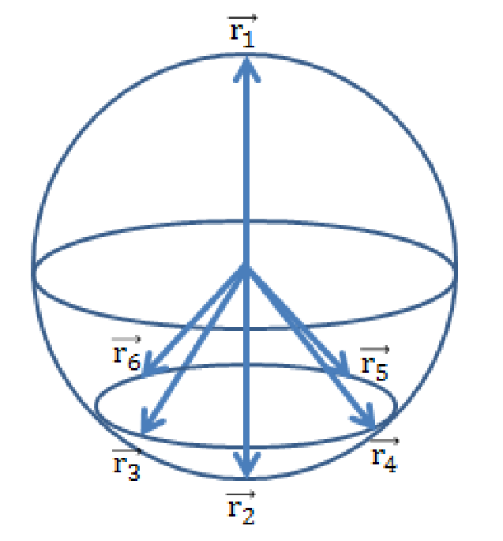

与此同时，$\vec{r}_1$、$\vec{r}_2$、$\vec{r}_3$、$\vec{r}_4$、$\vec{r}_5$、$\vec{r}_6$ 完全等价，现在上面那个图是只考虑了绕 $\vec{r}_1$ 的四次转动，绕 $\vec{r}_2$、$\vec{r}_3$、$\vec{r}_4$、$\vec{r}_5$、$\vec{r}_6$，其实我们也是有同样要求的。如果把这些所有的要求都考虑在一起，那么很自然，我的顶点就只能是这种情况：

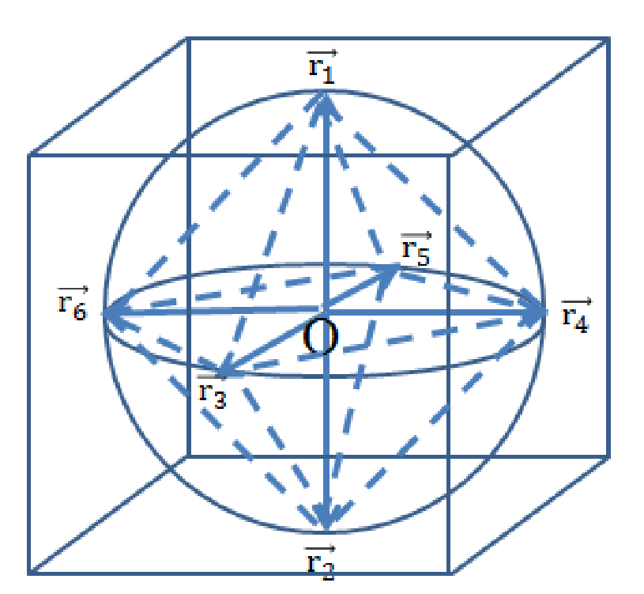

$\vec{r}_1$、$\vec{r}_2$、$\vec{r}_3$、$\vec{r}_4$、$\vec{r}_5$、$\vec{r}_6$ 是一个正八面体的顶点，因此这个群也就叫 O 群（Octahedron）了。这个正八面体，外面还可以接一个立方体。也就是说只考虑转动的情况下，这个群描述的是立方体，或正八面体的对称性。

这个正八面体（里面虚线），相对正三角形的中心连线是个三阶轴（或者说事外接立方体相对顶点连线）。这样的三阶轴一共有 4 条，对应 8 个极点。这些极点相互之间由于都可以用 4 阶转动联系起来，所以 $G$ 轨道上是 8 个点，对应的就是我们的基本方程给出的 $n_2=3$ 的情况了。

同时，正八面体相对棱的中点连线，对应的是 2 次轴（也是立方体相对棱的中点连线）。这样的 2 次轴有 6 条，对应 12 个极点。这些极点之间可以由 4 次转动联系起来，所以 $G$ 轨道上是 12 个点，对应的就是基本方程中 $n_1=2$ 的情况了。

最后，由于这些四次轴、三次轴、二次轴的极点都可以由群中其它元素联系起来，所以 $G$ 轨道就三个。转 $2\pi/3$ 与转 $4\pi/3$ 的操作同类，转 $\pi/2$ 与转 $3\pi/2$ 的操作同类。而转 $\pi$ 的操作，存在两种情况，一种是绕 2 次轴的转动，一种是绕 4 次轴的转动，但转两次。这两种转动的转动轴，是不能通过群中其它元素联系起来的。这样的话总共 24 个操作的分类是：

$\{E\}$、$\{C_2^{(1)}$、$C_2^{(2)}$、$C_2^{(3)}$、$C_2^{(4)}$、$C_2^{(5)}$、$C_2^{(6)}\}$、

$\{C_3$、$C_3'$、$C_3''$、$C_3'''$、$C_3^2$、$C_3'^2$、$C_3''^2$、$C_3'''^2\}$、$\{C_4$、$C_4'$、$C_4''$、$C_4^3$、$C_4'^3$、$C_4''^3\}$、$\{C_4^2$、$C_4'^2$、$C_4''^2\}$

其中二次轴与四次轴的夹角是 45 度，这样的话虽然绕四次轴转两次和绕二次轴转一次转动角相同，但转轴不能通过群中其它元素练习起来，就不是一类了。

同时再做前面说过的，$D_3$ 与 $S_3$ 的类比，我们会发现这里 $T$（四个顶点）是 $S_4$（24 个元素）的一个子群，O（六个顶点）是 $S_6$ 的（720 个元素）的一个子群。只不过因为这 6 个顶点相互位置不能乱换，O 群的阶比 $S_6$ 群的阶小得多。

5. $C_n$、$D_n$、$T$、O 之后最后一种第一类点群：

$l=3$，三个极点 $G$ 轨道；

$n=60$，60 个对称操作；

$n_1=2$，第一个 $G$ 轨道对应的是 2 次轴的极点，上面有 30 个点；

$n_2=3$，第二个 $G$ 轨道对应的是 3 次轴的极点，上面有 20 个点；

$n_3=5$，第一个 $G$ 轨道对应的是 5 次轴的极点，上面有 12 个点；

还是从最高阶轴开始，设 $\vec{r}_1$、$\vec{r}_2$、$\cdots\cdots$、$\vec{r}_{12}$ 对应这 12 个极点，他们的集合要在五次转动下不变。

以绕 $\vec{r}_1$ 的转动为例，这些转动要把 $\vec{r}_2$、$\cdots\cdots$、$\vec{r}_{12}$ 这 11 个极点转到它们本身。与前面的分析类似，这种情况，只能将这 11 个点分成三组，前两组每组五个点，等间距分布在以 $\vec{r}_1$ 为极点的等纬度线上。最后一个点，与 $\vec{r}_1$ 相对。

同时，这十二个点要相互等价，这样的话对每个极点，另 11 个都要满足这样的性质。综合起来，结果就只有一种可能：

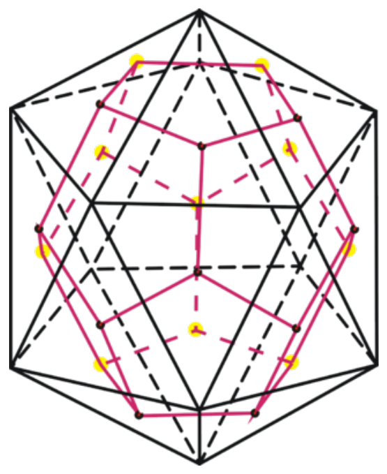

这是一个由 20 个正三角形组成的二十面体，因此这个群也称为正二十面体群（Icosahedron），记为 Y。这个正二十面体也可以内接一个正十二面体，每个面试个正五边形。它们的对称性是完全一样的。

就二十面体而言，每两个相对的极点的连线都是一个五次轴，一共有 12 个极点，6 个轴，相对极点可由其它变换（二次转动）联系起来，所以这个轨道有 12 个极点。

同时每两个相对的正三角形中点的连线是个三阶轴，三角形有 20 个，所以三阶轴是 10 个。相对极点同样可通过二次转动联系起来，这个轨道上有 20 个点。

每两个相对棱的中点连线为二次轴，一共有 30 条棱，也就是 15 个二阶轴。同样，相对极点可由其它二阶转动联系起来，所以轨道上有 30 个点。

在这个群中，由于它已经越来越像球了，对称性也越来越高，这个时候具有相同转角的转动就越有可能被其它转动操作联系起来，从而形成一类。Y 群的 60 个元素的分类情况也就是：

$\{E\}$、

$\{C_2^{(1)}$、$C_2^{(2)}$、$\cdots$、$C_2^{(15)}\}$（15 个）、

$\{C_3^{(1)}$、$\cdots$、$C_3^{(10)}$、$C_3^{(1)2}$、$\cdots$、$C_3^{(10)2}\}$（20 个）、

$\{C_5^{(1)}$、$\cdots$、$C_5^{(6)}$、$C_5^{(1)4}$、$\cdots$、$C_5^{(6)4}\}$（12 个）、

$\{C_5^{(1)2}$、$\cdots$、$C_5^{(6)2}$、$C_5^{(1)3}$、$\cdots$、$C_5^{(6)3}\}$（12 个）

而这个正二十面体，你如果把每条棱都三等分，然后再把头去掉，那么你最终得到的，就是一个足球。相关的诺奖是 1996 年化学奖，$C_{60}$。

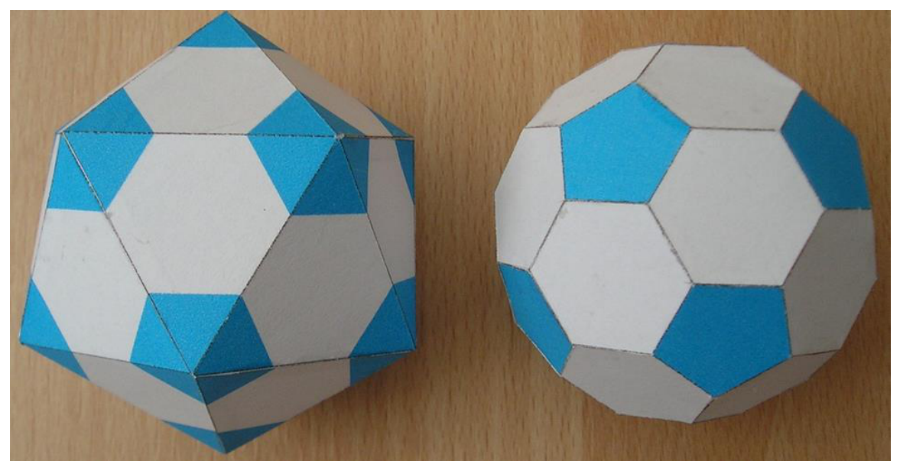

## 3.3 第二类点群

前面我们是通过第一类点群的基本方程，把第一类点群的所有情况作了一个介绍。根据这个介绍，我们现在就可以再之前我们说的定理 3.3 的第二与第三种情况，把所有的第二类点群推出来了。

先看第二种情况：当 $G$ 不只包含纯转动操作时，如果 $G$ 中包含纯反演操作 $I$，那么 $G$ 与 $K$ 的关系必然是 $G=K\cup IK$；这个时候，因为有五种第一类点群，与之对应的第二类点群也就是五种。下面我们用 [II，中] 来表示这些第二类点群，II 是第二类点群的意思，‘中’代表具有中心反演对称性。这里由于中心反演对称操作与任意转动操作互易，所以 $IK$ 这个部分不改变 $K$ 的分类，只是把 $K$ 中所有的类又在乘上 $I$ 之后重复了一遍。

1. $C_n\cup IC_n$，这是一个 $2n$ 阶的 Abel 群，$C_n$ 中的每个元素自成一类，$IC_n$ 中的每个元素也自成一类。

2. $D_n\cup ID_n$，这里 $D_n$ 是 $2n$ 阶的，$D_n\cup ID_n$ 就是 $4n$ 阶的。前面说了，$n$ 为奇数时，$D_n$ 有 $(n+3)/2$ 个类，$D_n\cup ID_n$ 就有 $n+3$ 个类。N 为偶数时，$D_n$ 有 $n/2+3$ 个类，$D_n\cup ID_n$ 就有 $n+6$ 个。

3. $T\cup IT$ 阶为 24，有 8 个类，记为 $T_h$。

4. $O\cup IO$ 阶为 48，有 10 个类，记为 $O_h$。

5. $Y\cup IY$ 阶为 120，有 10 个类，记为 $Y_h$。（后面会解释为什么用这个 h）

除了上面说的 [I]、[II，中]，第三种情况说的是：当 $G$ 不只包含纯转动操作，且 $G$ 中不包含纯反演操作 $I$ 时，$G$ 必与一个纯转动群 $G^+$ 同构，这里 $G^+=K\cup K^+$，而 $K^+$ 的定义是：$K^+=\{Ig\,|\,g\in G\text{，}\text{但 } g\notin K\}$。

换句话说这里的第二类点群不包含纯反演操作，同时它与一个第一类点群同构。这样的话我们只需要找到与之同构的第一类点群 $K\cup K^+$，然后对它做 $K\cup IK^+$ 这样一个变换就可以了。

而对 $K\cup K^+$ 这样一个第一类点群，如果我们把 $K$ 当作一部分，$K^+$ 当作一部分，它与二阶循环群是同态的，为什么？

（因为 $K\cup IK^+$ 本身是一个群，$IK^+$ 中的 $K^+$ 就是我们这个第一类点群的第二部分。由于重排定理，对 $K\cup IK^+$，取 $K$ 中任何一个元素，它乘上 $K$ 这个集合，必给出 $K$ 这个集合；而它乘上 $IK^+$ 这个集合，必给出 $IK^+$ 这个集合。同时 $IK^+$ 中任意元素，乘上 $K$ 这个集合，必给出 $IK^+$ 这个集合；它乘上 $IK^+$ 这个结合，给出 $K$。由于 $I$ 是可以单独提出的，所以对 $K\cup K^+$ 这个第一类点群，必存在这样的性质：$K$ 乘上 $K$ 等于 $K$，$K$ 乘上 $K^+$ 等于 $K^+$，$K^+$ 乘上 $K$ 等于 $K^+$，$K^+$ 乘上 $K^+$ 等于 $K$。也就是说 $\{K,K^+\}$ 与二阶循环群同态）。

这样的话 $K$ 必须是 $\{K,K^+\}$ 的不变子群，并且阶数是它的一半。根据这样一个规则，现在我们就可以来通过我们知道的第一类点群，构造这种第二类点群了。

在 $C_n$、$D_n$、$T$、O、Y 里面符合这个条件的，只有 $C_{2n}$、$D_n$、$D_{2n}$、O 这四种情况，下面我们来分开介绍（符号在前面五种第二类点群的基础上继续）：

6. $C_{2n}$，对它来讲，$\{C_{2n}^2$、$C_{2n}^4$、$\cdots$、$C_{2n}^{2n}=E\}$ 形成不变子群。

$\{C_{2n}$、$C_{2n}^3$、$\cdots$、$C_{2n}^{2n-1}\}$ 为其陪集，形成的第二类子群是：

$$
\left\{\left\{C_{2n}^{2}\text{、}C_{2n}^{4}\text{、}\cdots\text{、}C_{2n}^{2n}=E\right\}\text{、}I\left\{C_{2n}\text{、}C_{2n}^{3}\text{、}\cdots\text{、}C_{2n}^{2n-1}\right\}\right\}\text{。}
$$

7. 与 $D_n$ 同构的第二类点群，这里纯转动部分是：$\{C_n$、$C_n^2$、$\cdots$、$E\}$，另外一部分是：$I\{C_2^{(1)}$、$C_2^{(2)}$、$\cdots$、$C_2^{(n)}\}$。

由于 $I$ 与任意元素互易，所以它的分类情况与 $D_n$ 完全相同，$n$ 为奇数是，是 $(n+3)/2$，偶数时，是 $n/2+3$。

8. 对 $D_n$，当 $n$ 为偶数时，也就是 $D_{2n}$ 这种情况，它除了 $C_{2n}$ 这个不变子群，还有 $D_n$ 也是它的不变子群。这个时候，如果根据 $D_n$ 去做这个第二类点群，又能得到一种情况。这个时候纯转动部分是：

$$
\left\{C_{2n}^{2}\text{、}C_{2n}^{4}\text{、}\cdots\text{、}C_{2n}^{2n}=E\text{、}C_2^{(2)}\text{、}C_2^{(4)}\text{、}\cdots\text{、}C_2^{(2n)}\right\}
$$

转动反演部分是：

$$
I\left\{C_{2n}\text{、}C_{2n}^{3}\text{、}\cdots\text{、}C_{2n}^{2n-1}\text{、}C_2^{(1)}\text{、}C_2^{(3)}\text{、}\cdots\text{、}C_2^{(2n-1)}\right\}
$$

以 $D_6$ 为例，这里是取它的不变子群 $D_3$，这里 $C_2^{(1)}$、$C_2^{(2)}$、$\cdots$、$C_2^{(2n)}$ 的分布就是：

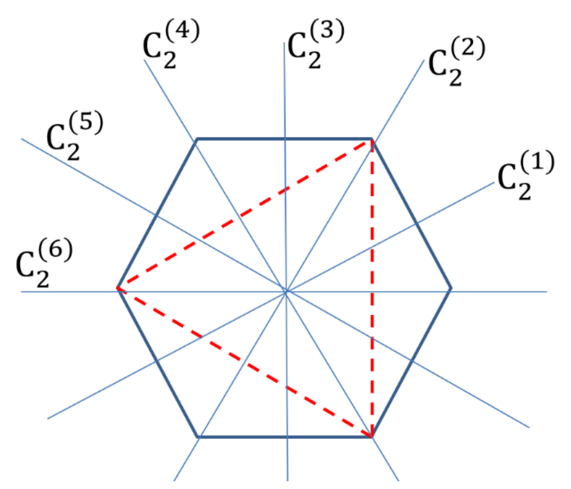

由于 $I$ 与任意群元互易，所以它的分类情况与 $D_{2n}$ 群完全一样，也是 $2n/2+3=n+3$。

9. 最后一种情况，基于的第一类点群是 O 群，它的不变子群是 T。

这个怎么理解呢？我们有一个立方体，它的纯转动对称群是 O 群，现在针对它做一个内接正四面体，这个四面体，纯转动操作相对于 O 群减少了一半，但是除了这些纯转动操作，它多了一些转动反演操作。这些转动反演操作加上保留下来的纯转动操作，形成的第二类点群与 O 群同构，也是 24 个操作。

比如这个对这个正四面体，如果我对 z 轴转 90 度，再做反演，它回到它本身。这个操作就是这个正四面体具有的，它是一个转动反演操作，与立方体本身转 90 度的纯转动操作对应。

这里 $K$ 等于：

$$
\left\{C_3\text{、}C_3'\text{、}C_3''\text{、}C_3'''\text{、}C_3^{2}\text{、}C_3'^{2}\text{、}C_3''^{2}\text{、}C_3'''^{2}\text{、}E\text{、}C_4^{2}\text{、}C_4'^{2}\text{、}C_4''^{2}\right\}
$$

$IK^+$ 等于：

$$
I\left\{C_2^{(1)}\text{、}C_2^{(2)}\text{、}C_2^{(3)}\text{、}C_2^{(4)}\text{、}C_2^{(5)}\text{、}C_2^{(6)}\text{、}C_4\text{、}C_4'\text{、}C_4''\text{、}C_4^{3}\text{、}C_4'^{3}\text{、}C_4''^{3}\right\}
$$

同样，由于 $I$ 与任意元素互易，这个群与 O 群分类相同，5 个类。

到这儿，我们是讲完了所有的点群，它们是如何分类的，都具有哪些对称造作。但光有这些了解，你们还没法看文献，因为文献中一般都会用一些符号去标识一个特定的点群，比如 $T_d$、$T_h$、$O_h$。这些符号直接告诉了我们这个点群是什么，而不用让我们去写比如：与 O 同构的不含反演操作的第二类点群，或者 T 与中心反演操作结合形成的点群，这些东西。

这些符号叫熊夫利符号，因为它是我们在工作中经常接触的东西，我们在这里详细说一下。我们先说明的一点是熊夫利符号与点群的对称元素有着最直接的联系。同时，在对称元素的描述中，熊夫利符号倾向于使用转动反射面，而不是转动反演轴。在前面的讨论中，因为转动反演轴更便于我们讲点群分类，所以我们一直采用它，后面要换一下。前面讲过，它与转动反射面的关系很简单，是：

$$
\sigma_{\vec{k}}C_{\vec{k}}\left(\frac{2\pi}{n}\right)=IC_{\vec{k}}\left(\frac{2\pi}{n}+\pi\right)\text{。}
$$

在熊夫利的命名规则中，一个点群的最高阶转轴、与某反射面垂直的轴、或某个转动反演轴会被当作是主轴。命名的时候是基于第一类点群的符号，结合反射面或转动反射轴来进行的。主轴的方向一般我们称为垂直方向。水平的放射面记为 $\sigma_h$，而过主轴与水平面垂直的反射面记为 $\sigma_v$ 或 $\sigma_d$。这里 v 与 d 还有些区别，我们一会儿再讲。

熊夫利命名规则，说白了，就是根据前面我们分析出来的各种群的特征，找到一个可以标识它的对称元素的符号，用这个符号来代表这个群。或者说就是起名，起名的根据是对称元素。这句话说起来简单，但做起来并不好做。下面我们具体得来分析，根据这个图：

点群分类：

| [I] | [II，中] | [II，非中] |
| --- | --- | --- |
| $C_n$ | $C_n\cup IC_n$ | 与 $C_{2n}$ 同构 |
| $D_n$ | $D_n\cup ID_n$ | 与 $D_n$ 同构 |
| T | $T\cup IT$ | 与 $D_{2n}$ 同构 |
| O | $O\cup IO$ | 与 O 同构 |
| Y | $Y\cup IY$ | |

*To be labeled*

其中第一类点群名字已经有了。对第二类点群，我们最终是要把它分成的情况是：

| [II，中] | | [II，非中] | |
| --- | --- | --- | --- |
| $C_n\cup IC_n$ | $2n+1-S_{4n+2}$ (6) | 与 $C_{2n}$ 同构 | $4n+2-C_{2n+1h}$ (9) |
| | $2n-C_{2nh}$ (8) | | $4n-S_{4n}$ (7) |
| $D_n\cup ID_n$ | $2n+1-D_{2n+1d}$ (12) | 与 $D_n$ 同构 | $C_{nv}$ (4) |
| | $2n-D_{2nh}$ (10) | | |
| $T\cup IT$ | $T_h$ (1) | 与 $D_{2n}$ 同构 | $4n+2-D_{2n+1h}$ (11) |
| | | | $4n-D_{2nd}$ (13) |
| $O\cup IO$ | $O_h$ (2) | 与 O 同构 | $T_d$ (5) |
| $Y\cup IY$ | $Y_h$ (3) | | |

有：$S_{2n}$，$C_{nv}$，$C_{nh}$，$D_{nh}$，$D_{nd}$，$T_h$，$O_h$，$Y_h$，$T_d$

下面我们按照兰色标记的十三个数字逐个讲，这 13 个数字，其中在熊夫利符号中重复的情况，比如 10、11。它们在我们之前以定理 3.3 来推各种点群的时候，属于定理 3.3 的不同情况，但这里它们由相似的对称元素标识。因此，这 13 种可能性又可以在熊夫利的框架下缩小为 9 种标识的情况。下面，我们先走遍这 13 个兰色数字，再对它们进行黑框中的归纳：

1. 先看 $T\cup IT$。

$T$ 的操作是：$\{E$、$C_2$、$C_2'$、$C_2''$、$C_3$、$C_3'$、$C_3''$、$C_3'''$、$C_3^2$、$C_3'^2$、$C_3''^2$、$C_3'''^2\}$，并上 $IT$，也就是 $I\{E$、$C_2$、$C_2'$、$C_2''$、$C_3$、$C_3'$、$C_3''$、$C_3'''$、$C_3^2$、$C_3'^2$、$C_3''^2$、$C_3'''^2\}$，这是是它所有的操作。

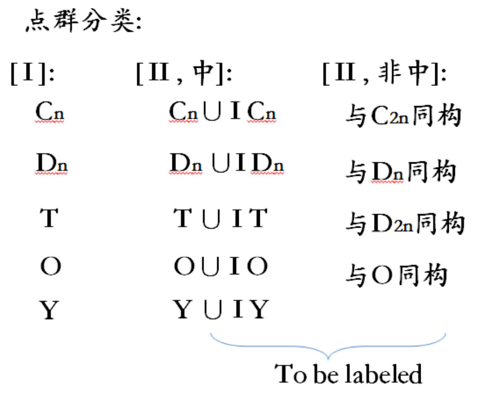

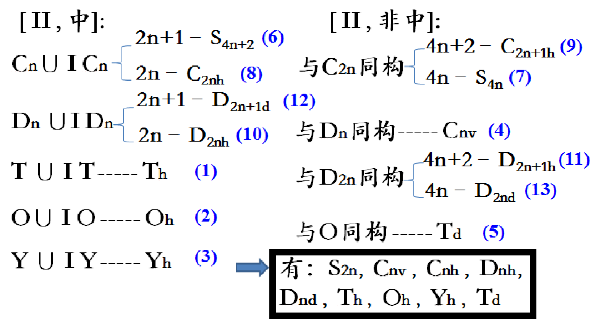

这些操作中，有纯转动，有转动反射。在熊夫利的命名规则中，把 $IC_2$ 这个转动反演操作所对应的反射面当作非纯转动部分的代表，并把这个反射面放到水平的位置。这样我用 $T$ 可以把纯转动部分包括，用 $\sigma_h$ 对 $T$ 做陪集就可以把转动反演部分包括。子群与陪集结合产生所有这个群里面的元素，与之相应这个群也就可以记为：$T_h$。

2. 对 O，一样，有 $IC_4^2$ 这个操作，我们可以把它对应的平面定为水平面，用 $\sigma_h$ 与 O 来标识这个群，记为：$O_h$。

3. 对 Y，有 $IC_2$，把它对应的平面定为水平面，用 $\sigma_h$ 与 Y 来标识这个群，记为：$Y_h$。

4. 与 $D_n$ 同构的第二类点群，对称操作为：

$$
\left\{\left\{C_n\text{、}C_n^{2}\text{、}\cdots\text{、}E\right\}\text{、}I\left\{C_2^{(1)}\text{、}C_2^{(2)}\text{、}\cdots\text{、}C_2^{(n)}\right\}\right\}\text{。}
$$

$C_n$ 这个高阶转动轴为主轴，形成子群 $\{C_n$、$C_n^2$、$\cdots$、$E\}$。陪集部分是 $I\{C_2^{(1)}$、$C_2^{(2)}$、$\cdots$、$C_2^{(n)}\}$。由于 $C_2^{(i)}$ 在水平面上，所以他们代表的是垂直水平面的反射面 $\sigma_v$，这个 v 代表 vertical。两者结合起来，我们用 $C_{nv}$ 来标识这样的群。

5. 与 O 同构的第二类点群，包含的操作是：

$$
\left\{C_3\text{、}C_3'\text{、}C_3''\text{、}C_3'''\text{、}C_3^{2}\text{、}C_3'^{2}\text{、}C_3''^{2}\text{、}C_3'''^{2}\text{、}E\text{、}C_4^{2}\text{、}C_4'^{2}\text{、}C_4''^{2}\right\}
$$

$$
\cup\, I\left\{C_2^{(1)}\text{、}C_2^{(2)}\text{、}C_2^{(3)}\text{、}C_2^{(4)}\text{、}C_2^{(5)}\text{、}C_2^{(6)}\text{、}C_4\text{、}C_4'\text{、}C_4''\text{、}C_4^{3}\text{、}C_4'^{3}\text{、}C_4''^{3}\right\}
$$

纯转动部分是个 $T$ 群，最高转动轴位三次轴。转动反演部分有三个 4 次转动反演轴。对于 4 次转动反演轴，我们可以在实空间画一下它对应的等价的点：

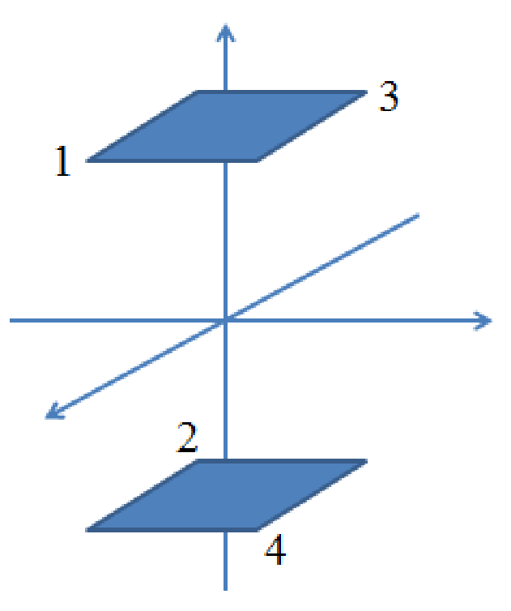

从这些点我们可以看出 4 次转动反演轴等价于 4 次转动反射轴。我们以这个转动反射轴为主轴。这个轴是本身 O 群的 4 次轴，也就是下图中的 z 轴：

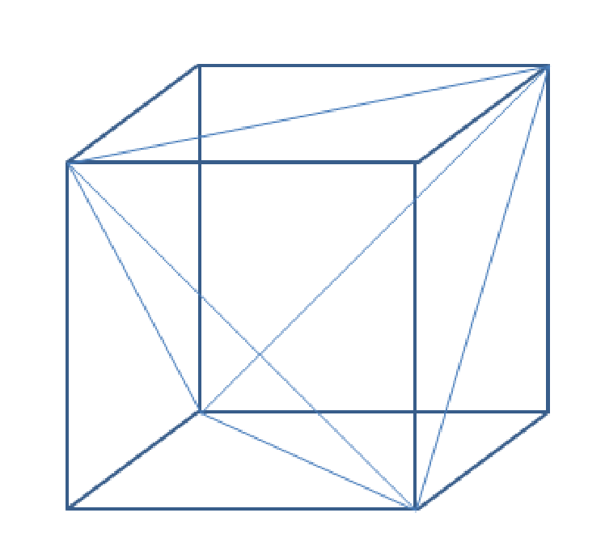

这个时候，我们对这个与 O 群同构的第二类点群，纯转动部分是 T，转动反演部分只要找出一个操作，就可以通过陪集的方式把这个群确定下来了。在上个图中，我们知道 O 群会有两个水平的二次轴，对应 $C_2^{(i)}$ 中的两个，它们乘上 I，给出的是垂直于水平面的反射面。这样的话我们就可以用 T 与这个反射面来标识这个群了。

但需要注意的是，前面我们说垂直于水平面的反射面，会有两种情况，$\sigma_v$ 与 $\sigma_d$。$\sigma_v$ 就是一个一般的垂直水平面的反射面，前面我们也用过。而 $\sigma_d$，说的是这个反射面除了垂直于水平面，还平分水平面上两个二次轴的夹角。d 是 diagonal 的意思。好多教材没有解释这个，大家有兴趣的话，可以看一下朗道《量子力学》第 93 节那部分$^{8}$，或者 Dresselhaus 那本《Group Theory Applications o Physics of Condensed Matter》的第 45 页。

这样的话对与 O 同构的第二类点群，我们就可以用 $T_d$ 来标识了。

6. $C_n\cup IC_n$，$n$ 为奇数，可记为 $C_{2n+1}\cup IC_{2n+1}$，这个群包含的元素是：

$$
\left\{C_{2n+1}\text{、}C_{2n+1}^{2}\text{、}\cdots\text{、}C_{2n+1}^{2n+1}=E\right\}\cup I\left\{C_{2n+1}\text{、}C_{2n+1}^{2}\text{、}\cdots\text{、}C_{2n+1}^{2n+1}=E\right\}
$$

这些元素的集合与 $S_{4n+2}$ 这个转动反射轴作为基本生成元，形成的群是一样的，所以在熊夫利符号中，记为 $S_{4n+2}$。

以 $S_6$ 为例，通过这个操作，我们可以知道一个点的等价点的集合为：

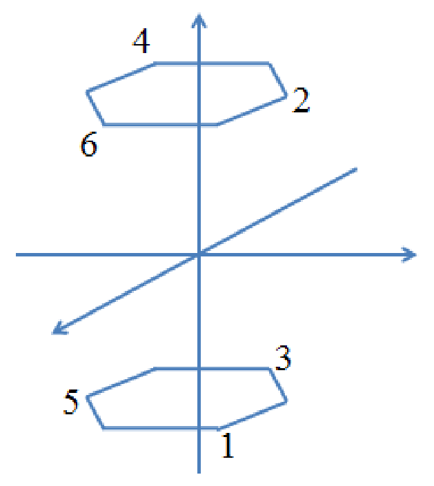

从这个等价的点的集合，我们很容易想象它的对称群是：

$$
\left\{C_3\text{、}C_3^{2}\text{、}E\right\}\cup I\left\{C_3\text{、}C_3^{2}\text{、}E\right\}
$$

7. 与 $C_{2n}$ 同构的第二类点群中的一种情况，当 $2n$ 为 4 的整数倍，也就是 $4n$，或者直接说与 $C_{4n}$ 同构的第二类点群。这时这个群为 $C_{2n}\cup I(C_{4n}-C_{2n})$，它包含的群元有：

$$
\left\{C_{4n}^{2}\text{、}C_{4n}^{4}\text{、}\cdots\text{、}C_{4n}^{4n}=E\right\}\cup I\left\{C_{4n}\text{、}C_{4n}^{3}\text{、}\cdots\text{、}C_{4n}^{4n-1}\right\}
$$

这些元素的集合与 $S_{4n}$ 这个转动反射轴作为基本生成元，形成的群是一样的，

⁸ 我第一年上课的时候，一个叫杨康的学生帮我发现的，谢谢！

所以在熊夫利符号中，记为 $S_{4n}$。

以 $S_4$ 为例，通过这个操作，我们可以知道一个点的等价点的集合为：

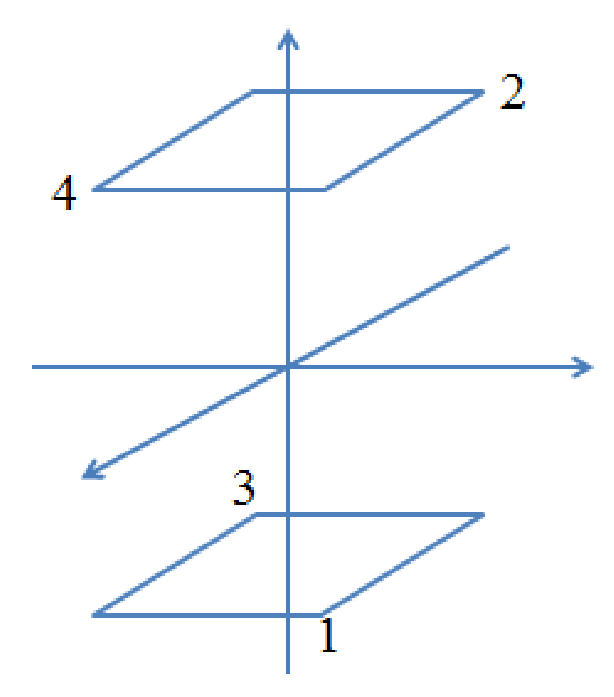

从这个等价的点的集合，我们很容易想象它的对称群是：

$$
\left\{C_4^{2}\text{、}E\right\}\cup I\left\{C_4^{1}\text{、}C_4^{3}\right\}
$$

8. $C_n\cup IC_n$ 时，$n$ 为偶数，也就是 $C_{2n}\cup IC_{2n}$。这个群包含的元素是：

$$
\left\{C_{2n}\text{、}C_{2n}^{2}\text{、}\cdots\text{、}C_{2n}^{2n}=E\right\}\cup I\left\{C_{2n}\text{、}C_{2n}^{2}\text{、}\cdots\text{、}C_{2n}^{2n}=E\right\}
$$

这里，既有 $C_{2n}$，又有转动反射 $IC_{2n}^{n}=\sigma_h$，因此可记为 $C_{2nh}$。

9. 与 $C_{4n+2}$ 同构的第二类点群，群元：

$$
\left\{C_{4n+2}^{2}\text{、}C_{4n+2}^{4}\text{、}\cdots\text{、}C_{4n+2}^{4n+2}=E\right\}\cup I\left\{C_{4n+2}\text{、}\cdots\text{、}C_{4n+2}^{2n+1}\text{、}\cdots\text{、}C_{4n+2}^{4n+1}\right\}
$$

有 $C_{2n+1}$ 这个第一类点群的所有操作，有 $IC_{4n+2}^{2n+1}=\sigma_h$，因此记为 $C_{2n+1h}$。

10. $D_{2n}\cup ID_{2n}$，有 $D_{2n}$ 的全部对称操作，有 $IC_{2n}^{n}=\sigma_h$，因此可记为 $D_{2nh}$。

11. 与 $D_{4n+2}$ 同构的第二类点群，群为 $D_{2n+1}\cup I(D_{4n+2}-D_{2n+1})$。它有 $D_{2n+1}$ 的全部对称性，同时还包括 $IC_{4n+2}^{2n+1}=\sigma_h$，所以也记为 $D_{2n+1h}$。

12. $D_{2n+1}\cup ID_{2n+1}$，有 $2n+1$ 个垂直反射面 $IC_2^{(1)}$、$\cdots$、$IC_2^{(2n+1)}$。

以 $D_3\cup ID_3$ 为例：

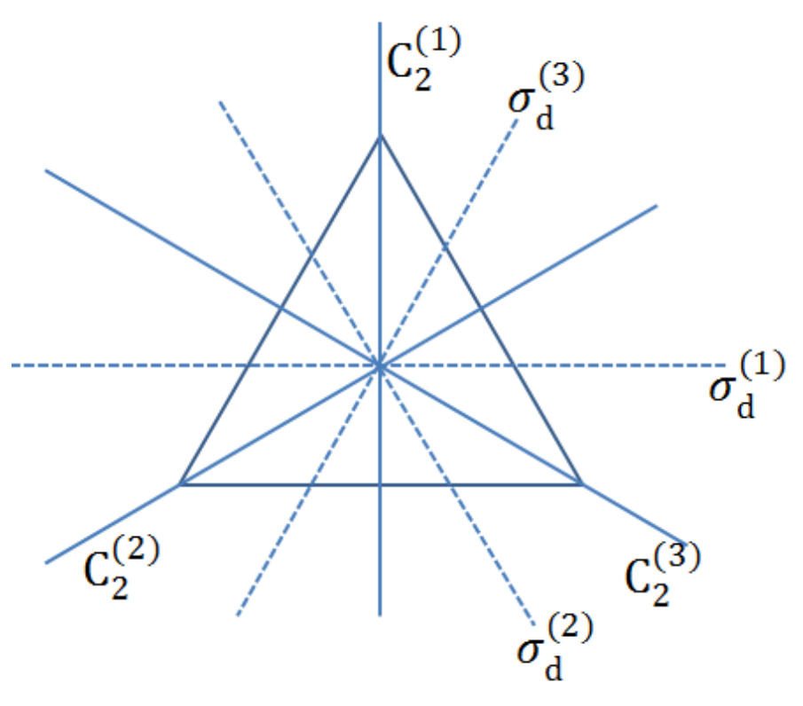

图中 $\sigma_d^{(1)}=IC_2^{(1)}$、$\sigma_d^{(2)}=IC_2^{(2)}$、$\sigma_d^{(3)}=IC_2^{(3)}$，都是垂直于水平面的反射面，我们在这里用 d 而不是用 v，是因为它们刚好又在二次轴的平分线上。由于这个群有 $D_{2n+1}$ 的全部对称性，又有 $\sigma_d^{(i)}$，它被记为 $D_{2n+1d}$。

13. 与 $D_{4n}$ 同构的第二类点群，$D_{2n}\cup I(D_{4n}-D_{2n})$，以 $D_2\cup I(D_4-D_2)$ 为例，$D_4$ 有四个水平二阶轴，现在两个保持（记为 $C_2^{(1)}$、$C_2^{(3)}$），两个变为转动二阶轴（记为 $IC_2^{(2)}$、$IC_2^{(4)}$）。它们的关系见下图：

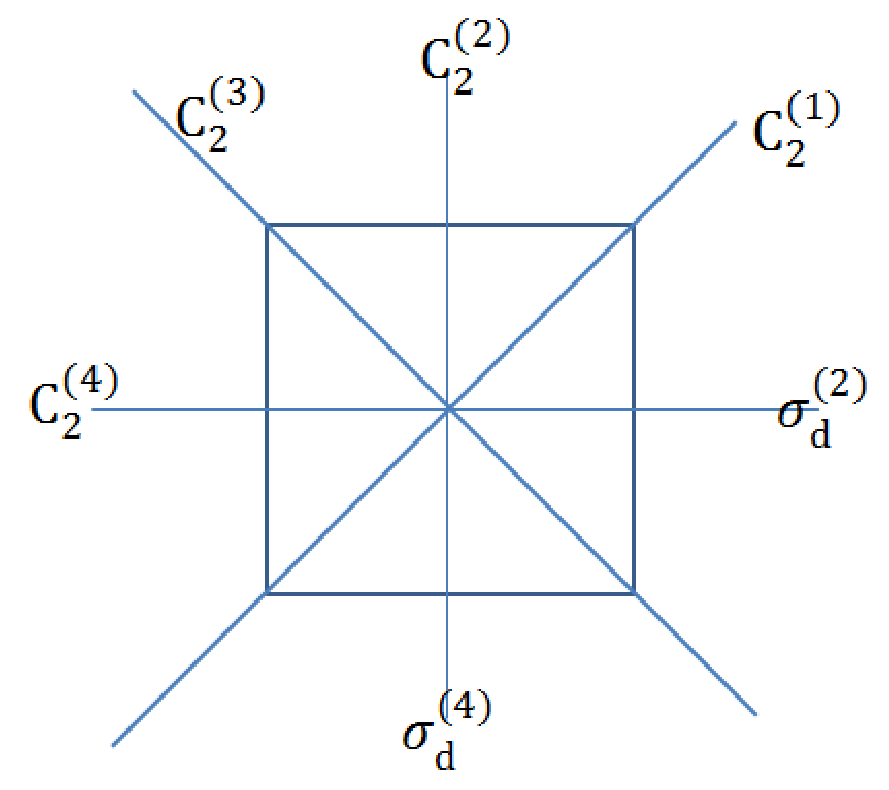

在这里 $\sigma_d^{(2)}=IC_2^{(2)}$，它在 $C_2^{(1)}$、$C_2^{(3)}$ 平分线上，用 d 标识。这个群又有 $D_{2n}$ 的所有对称性，所以记为 $D_{2nd}$。

这 13 种情况中，6（$S_{4n+2}$）、7（$S_{4n}$）都对应 $S_{2n}$；8（$C_{2nh}$）、9（$C_{2n+1h}$）都对应 $C_{nh}$；10（$D_{2nh}$）、11（$D_{2n+1h}$）都对应 $D_{nh}$；12（$D_{2n+1d}$）、13（$D_{2nd}$）都对应 $D_{nd}$。所以合在一起就是 $S_{2n}$、$C_{nh}$、$D_{nh}$、$D_{nd}$、$C_{nv}$、$T_h$、$O_h$、$Y_h$、$T_d$ 九种情况。

## 3.4 晶体点群与空间群

现在我们是把点群基础、第一类点群、与第二类点群以及点群的熊夫利符号讲完了。利用这些知识，我们可以具体的去研究一个在我们物理学近一百多年的发展史中占据核心地位的系统——晶体。我们会先研究一下晶体里面的点群，然后再把点群这个概念进行一个扩充，讲一下空间群。

所谓晶体，简单的说，就是这个系统必须要由全同的、由原子的集合构成的结构单元组成，并且这个结构单元在三维空间中可以“无限地”重复。它要有转动（含转动反演）与平移两种对称性。晶体点群，是忽略了平移对称性，能够将晶体变到其本身的转动与转动反演对称性的集合。在点群的所有对称操作中，晶体有一个点是不动的。

晶体点群，相对于普通点群（比如说分子中的点群），最重要的一个性质就是晶体制约定理。

**定理 3.4** 设 $G$ 是晶体点群，则 $G$ 中转动元素只能是 $C_1$（也就是 E）、$C_2$、$C_3$、$C_4$、$C_6$，所有转动反演元素，只能是 I、$IC_2$、$IC_3$、$IC_4$、$IC_6$。

（在证明这个定理的时候中要用到的一个概念是晶格，它是由三个线性无关的向量 $\vec{a}_1$、$\vec{a}_2$、$\vec{a}_3$ 的整数线性组合组成的。而晶体，可以看作是那些重复单元，坐在晶格上形成的）

**证明：**

设晶格 L 是 $G$ 不变的，L 的基本向量是 $\vec{a}_1$、$\vec{a}_2$、$\vec{a}_3$，则对 $\forall g\in G$，有：

$$
g\vec{a}_i=\sum_{j=1}^{3}c_{ji}\vec{a}_j
$$

对这个等式我们先看左边，$g\vec{a}_i$ 这个向量本身必须在晶格上，因此右边的 $c_{ij}$ 必为整数。这个是我们从左边向量性质推出的右边系数的性质。

而另一方面，$G$ 是 O(3) 群的子群，上式同时还代表着如果选 $\vec{a}_1$、$\vec{a}_2$、$\vec{a}_3$ 为基的话，由系数 $c_{ji}$ 形成的矩阵 $C(g)$ 是群 $G$ 的表示矩阵。与之相应的 $\{C(g)\}$ 就是 $G$ 的一个表示。

这个表示和我们用三维欧式空间中正交的单位向量 $\vec{i}$、$\vec{j}$、$\vec{k}$ 形成的表示差的就是一个相似变换，从 $\vec{i}$、$\vec{j}$、$\vec{k}$ 到 $\vec{a}_1$、$\vec{a}_2$、$\vec{a}_3$ 的相似变换，对吧？这个相似变换是不改变标识的特征标的。也就是说对 $\{C(g)\}$ 这个表示，它的特征标还等于 $\pm(1+2\cos\Psi)$，其中 $\Psi$ 是转角。

这也就意味着 $\mathrm{tr}(C(g))$ 一方面等于 $\sum_{i=1}^{3}c_{ii}$，另一方面等于 $\pm(1+2\cos\Psi)$。

前面说过 $c_{ii}$ 为整数，那么 $\pm(1+2\cos\Psi)$ 就必为整数，这样的话这里的 $\Psi$ 只能为 0、$\pi/3$、$\pi/2$、$2\pi/3$、$\pi$。纯转动操作为 $C_1$（也就是 E）、$C_2$、$C_3$、$C_4$、$C_6$，转动反演操作为 I、$IC_2$、$IC_3$、$IC_4$、$IC_6$。（$C_5$、$C_7$、$C_8$、$\cdots$ 就不会存在）

（证毕）

有了晶体制约定理，再回到我们之前讲的第一类、第二类点群，我们就很容易知道：

一. 第一类点群中可以在晶体中出现的是 $C_n$ 里面的 $C_1$、$C_2$、$C_3$、$C_4$、$C_6$，$D_n$ 里面的 $D_2$、$D_3$、$D_4$、$D_6$，O，T，共 11 个。Y 不能存在因为它有五次轴。

二. 第二类点群里面可以在晶体中出现的包括：

1. $S_{2n}$ 中的 $S_2$、$S_4$、$S_6$。因为 $S_{4n+2}=C_{2n+1}\cup IC_{2n+1}$，这个里面可以存在的是 $S_2$ 和 $S_6$，$S_{10}$ 及其以上都不能存在；$S_{4n}=C_{2n}\cup I(C_{4n}-C_{2n})$，这里 n 只能为 1，对应 $S_4$。（3 个）2. $C_{nv}$（与 $D_n$ 同构的第二类点群）中的 $C_{2v}$、$C_{3v}$、$C_{4v}$、$C_{6v}$。（4 个）

3. $C_{nh}$ 中的 $C_{1h}$、$C_{2h}$、$C_{3h}$、$C_{4h}$、$C_{6h}$。因为 $C_{2nh}=C_{2n}\cup IC_{2n}$，它可以贡献 $C_{2h}$、$C_{4h}$、$C_{6h}$；$C_{2n+1h}=C_{2n+1}\cup I(C_{4n+2}-C_{2n+1})$，它可以贡献 $C_{1h}$、$C_{3h}$。（5 个）

4. $D_{nh}$ 中的 $D_{2h}$、$D_{3h}$、$D_{4h}$、$D_{6h}$。因为 $D_{2n+1h}=D_{2n+1}\cup I(D_{4n+2}-D_{2n+1})$，它可以 $D_{3h}$；$D_{2nh}=D_{2n}\cup ID_{2n}$，它可以贡献 $D_{2h}$、$D_{4h}$、$D_{6h}$。（4 个）

5. $D_{nd}$ 中的 $D_{2d}$、$D_{3d}$。其中 $D_{2nd}=D_{2n}\cup I(D_{4n}-D_{2n})$ 可以贡献 $D_{2d}$；$D_{2n+1d}=D_{2n+1}\cup ID_{2n+1}$ 可以贡献 $D_{3d}$。（2 个）

6. $T_h=T\cup IT$。（1 个）

7. $T_d=T\cup I(O-T)$。（1 个）

8. $O_h=O\cup IO$。（1 个）

共 21 个第二类点群。

两者加在一起就是 32 种晶体点群。任何晶体，它的转动与转动反演对称性的集合，必属于这 32 种点群。利用这 32 种点群，我们是可以对晶体进行一个分类的。具有相同点群的晶体，它们会有一些共同的特征，比如红外谱、拉曼谱、能带，这个我们后面第四章会专门讲到。

除了按这 32 种点群对晶体进行分类，在这 32 种点群中，依据各点群间对称操作的对称元素的相似性，这 32 种点群还可以进行一个划分。以 T、O、$T_d$、$T_h$、$O_h$ 这五种点群为例，具有这些对称性的晶体，它们都有 4 个三次轴。这 4 个三次轴，会让它们的宏观对称性呈现出一些相似性。我们把它们归为一类，这样的一个类，称为一个晶系。有 4 个三次轴的晶系是立方晶系，它们是晶体中对称性最高的一个群体，宏观性质上，x、y、z 轴三者等价。如果沿 z 轴方向做个拉伸，使得 x、y 等价，z 轴和它们不等价，造成的一个结果就是系统只在一个方向（z 轴）有四阶转动轴或四阶转动反演轴。对称操作的对称元素具备这个特征的点群再形成一个群体，包括 $C_4$、$D_4$、$C_{4h}$、$S_4$、$D_{4h}$、$C_{4v}$、$D_{2d}$，我们称为四方系。

为什么要进行这样的分类呢？之前我们说过，最早研究晶体结构的是晶体学家，早于 X 射线、早于电子衍射谱。因此，晶体的宏观特征是他们在描述晶体内部结构时一定要抓住的特征。T、O、$T_d$、$T_h$、$O_h$ 这五种点群，它们都有 4 个三次轴，肉眼上可以看到的性质就是 x、y、z 三个轴等价。晶体中类似的晶系有七种，它们的划分依据，是共同的对称操作的对称元素，比如立方系的三次轴。在描述这些点群之间对称操作的对称元素共同特征的时候，我们可以借助于晶胞这个反映晶体对称性的最小结构单元。这些对称操作的对称元素的共同特征可以由晶胞参数（$\vec{a}$、$\vec{b}$、$\vec{c}$、$\alpha$、$\beta$、$\gamma$，定义见下图）反映出来。

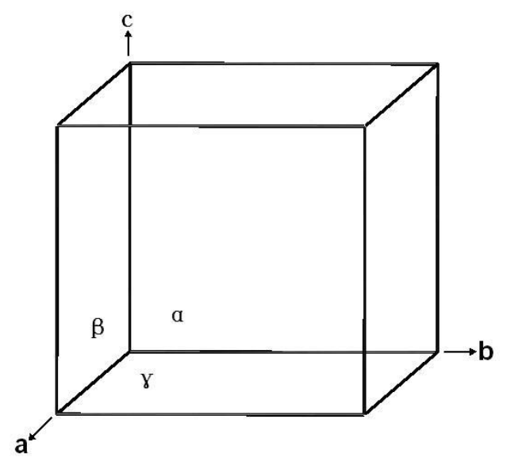

下面我们就按照这七种晶系的定义（对称操作的对称元素的相似性），以及它们晶胞参数的特性，依次把 32 种晶体点群进行归纳：

### 1. 三斜晶系（Triclinic Crystal System）

这种晶系中，不同点群的对称元素的共性是只存在一重轴或一重转动轴。

在上面的讨论中，我们知道满足这个要求的点群包括：$S_2=C_1\cup IC_1$、$C_1$ 两种。其晶胞参数的限制就是 $\vec{a}$、$\vec{b}$、$\vec{c}$ 长度不同，夹角任意，都不为 90 度。$S_2$ 对应的是有中心反演对称性的情况，它在此晶系中对称性最高。$C_1$ 对应的是连 I 都没有的情况。

### 2. 单斜晶系（Monoclinic Crystal System）

这种晶系中，不同点群的对称元素的共性是只在一个轴方向存在二重轴或二重反轴。

在上面的讨论中，满足这个要求的点群包括：

1) 第一类点群：$C_2$

2) 第二类点群：$C_2\cup IC_2=C_{2h}$、$C_1\cup I(C_2-C_1)=C_{1h}$

在这三种点群中，$C_{2h}$ 对称性最高。

对其晶胞，要求是：$a\neq b\neq c$，$\alpha=\beta=90^\circ$，$\gamma\neq 90^\circ$。

### 3. 正交晶系（Orthorhombic Crystal System）

这种晶系中，不同点群的对称元素的共性是有三个相互垂直的二重轴或二重反轴。

在上面的讨论中，满足这个要求的点群包括：

1) 第一类点群：$D_2$

2) 第二类点群：$D_2\cup ID_2=D_{2h}$、$C_2\cup I(D_2-C_2)=C_{2v}$

在这三种点群中，$D_{2h}$ 对称性最高。

对其晶胞，要求是：$a\neq b\neq c$，$\alpha=\beta=\gamma=90^\circ$。

### 4. 四方晶系（Tetragonal Crystal System）

这种晶系中，不同点群的对称元素的共性是在唯一高次轴方向有四重轴或四重反轴。

在上面的讨论中，满足这个要求的点群包括：

1) 第一类点群：$C_4$、$D_4$

2) 第二类点群：包括从 $C_4$ 出发的 $C_4\cup IC_4=C_{4h}$、$C_2\cup I(C_4-C_2)=S_4$；以及由 $D_4$ 出发的 $D_4\cup ID_4=D_{4h}$、$C_4\cup I(D_4-C_4)=C_{4v}$、$D_2\cup I(D_4-D_2)=D_{2d}$。

在这三种点群中，$D_{4h}$ 对称性最高。

对其晶胞，要求是：$a=b\neq c$，$\alpha=\beta=\gamma=90^\circ$。

### 5. 三方晶系（也叫三角晶系，Trigonal Crystal System）

这种晶系中，不同点群的对称元素的共性是在唯一高次轴方向有三重轴或三重反轴。

在上面的讨论中，满足这个要求的点群包括：

1) 第一类点群：$C_3$、$D_3$

2) 第二类点群：包括从 $C_3$ 出发的 $C_3\cup IC_3=S_6$；以及由 $D_3$ 出发的 $D_3\cup ID_3=D_{3d}$、$C_3\cup I(D_3-C_3)=C_{3v}$。

在这三种点群中，$D_{3d}$ 对称性最高。

晶胞方面，有两种取法，第一种是 $a=b\neq c$，$\alpha=\beta=90^\circ$，$\gamma=120^\circ$；或者 $a=b=c$，$\alpha=\beta=\gamma\neq 90^\circ$。

### 6. 六角晶系（Hexagonal Crystal System）

这种晶系中，不同点群的对称元素的共性是在唯一高次轴方向有六重轴或六重反轴。

在上面的讨论中，满足这个要求的点群包括：

1) 第一类点群：$C_6$、$D_6$

2) 第二类点群：包括从 $C_6$ 出发的 $C_6\cup IC_6=C_{6h}$、$C_3\cup I(C_6-C_3)=C_{3h}$；以及由 $D_6$ 出发的 $D_6\cup ID_6=D_{3h}$、$C_6\cup I(D_6-C_6)=C_{6v}$、$D_3\cup I(D_6-D_3)=D_{3h}$。

在这三种点群中，$D_{6h}$ 对称性最高。

晶胞方面，$a=b\neq c$，$\alpha=\beta=90^\circ$，$\gamma=120^\circ$。

三方系与六角系，当三方系的晶胞按第一种取法取时，从晶胞参数上看不出任何差别。它们的本质的差别还是体现在主轴的对称性上，对六角系是六次。

### 7. 立方晶系（Cubic Crystal System）

这种晶系中，不同点群的对称元素的共性是四个三次轴。

在上面的讨论中，满足这个要求的点群包括：

1) 第一类点群：T、O

2) 第二类点群：包括从 T 出发的 $T\cup IT=T_h$；以及由 O 出发的 $O\cup IO=O_h$、$T\cup I(O-T)=T_d$。

在这三种点群中，$O_h$ 对称性最高。

晶胞方面，$a=b=c$，$\alpha=\beta=\gamma=90^\circ$。

有了这些知识，你们就应该知道在以后事科研工作中，如果老板问你研究的晶体是什么晶系（Crystal System）？它的点群是什么？他/她指的是什么意思。

现在我们清楚了晶系与晶体点群两个概念，下一步是往空间群过渡。七种晶系可容纳 32 种点群。对于一个点群，它属于某晶系，晶胞特征可以由 $\vec{a}$、$\vec{b}$、$\vec{c}$ 之间的关系描述。对于由 $\vec{a}$、$\vec{b}$、$\vec{c}$ 形成的六面体，我们也只是想象它的顶点有个东西。以立方晶系中的 $O_h$ 群为例。如果只是由 $\vec{a}$、$\vec{b}$、$\vec{c}$ 形成的六面体顶点有原子，它可以形成一种晶体。如果我们将这个六面体的体心加一个原子，可以形成另一种晶体，这个晶体也具备 $O_h$ 对称性。把每个面心都加一个原子，同样也可以在不破坏点群对称性的基础上生成另一种晶体。这些晶体无疑是不一样的（空间群不一样），但点群与晶系这两个概念不能描述这种差别。要描述这种差别，我们需要引入另一个概念，就是晶格（布拉菲格子 Bravais Lattice），一共 14 种。说到底，晶格是一个空间群的概念。

和前面讲点群一样，这 14 个晶格也是分别属于前面我们提到的类似于晶系的东西。前面是 7 种晶系（Crystal System），每种容纳几个点群，加在一起容纳 32 个点群。这里是 7 种晶格系统（Lattice System），每种容纳几个布拉菲格子，加在一起容纳 14 个布拉菲格子。前面 7 种晶系（Crystal System）和这里的 7 种晶格系统（Lattice System）大部分相同，但略有区别，这里必须解释一下。晶系，是基于晶体点群对称性对晶体的分类，它的基础是点群中对称操作的对称元素的共性。晶格系统，是基于晶体的空间群的对称性对晶体进行的分类，它的基础是晶格。

要详细说明这个差别，我们先做一个对比。前面的 7 种晶系（Crystal System）分别是：Triclinic（三斜）、Monoclinic（单斜）、Orthorhombic（正交）、Tetrogonal（四角）、Trigonal（三方）、Hexagonal（六角）、Cubic（立方）。这里的 7 种晶格系统（Lattice System）分别是：Triclinic（三斜）、Monoclinic（单斜）、Orthorhombic（正交）、Tetrogonal（四角）、Rhombohedral（菱方）、Hexagonal（六角）、Cubic（立方）。其中，这两者之间的 Triclinic（三斜）、Monoclinic（单斜）、Orthorhombic（正交）、Tetrogonal（四角）、Cubic（立方）这五种是完全一样的。差别出现在晶系（Crystal System）中的 Trigonal（三方）、Hexagonal（六角）和晶格系统（Lattice System）中的 Rhombohedral（菱方）、Hexagonal（六角）上面，它们之间有交叉。以后你们看文献，说到 Rhombohedral（菱方），你们一定要知道说的是晶格系统（Lattice System），它指的是 Bravais Lattice 的分类；说到 Trigonal（三方或三角），你们一定要知道说的是 Crystal System，它指的是晶系的分类；说到 Hexagonal（六角），即可以指晶系（Crystal System）也可以指晶格系（Lattice System）。后面我们会通过表格来详细解释这个差别。这里先通过一个图来说明：点群、晶系、晶格系统、布拉菲格子之间的关系。通过这种关系，引出 14 布拉菲格子。然后再详细介绍它们之间以及它们与空间群之间的关系。

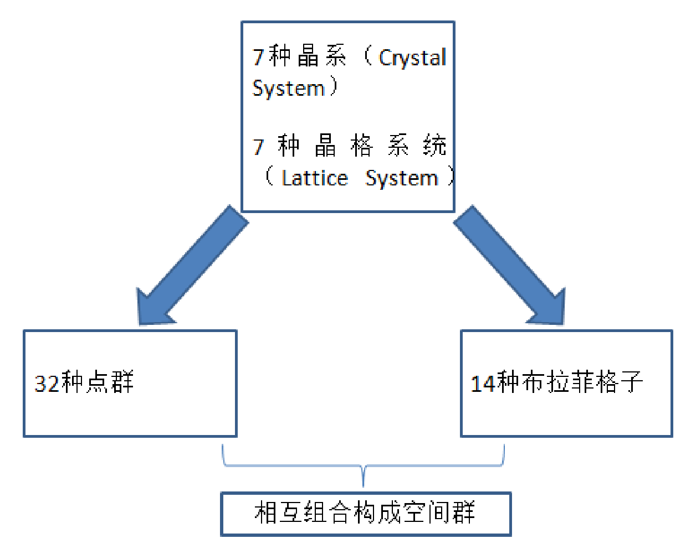

也就是说每个晶格系统（Lattice System）容纳一到几个晶格（即布拉菲格子），一共容纳 14 个晶格。每个晶系所容纳几个点群，一共容纳 32 种点群。在同一个晶系（Crystal System）或者晶格系统（Lattice System）容纳的点群与晶格之间，可以相互组合，从而构造出空间群。晶系（Crystal System）和晶格系统（Lattice System）处在中心的位置向两边辐射，两边可交叉。

在产生 14 种布拉菲格子的过程中，我们总是针对某个晶系/晶格系统⁹里晶胞的六面体，在体心、面心这些高对称点添加与六面体顶点相同的重复单元（原

⁹ 更准确的说，应该是晶格系统 Lattice System。这里为了方便讨论，先从晶系 Crystal System 开始说。14 种布拉菲格子都出现以后，这种差别其实已经可以体现了。在后面讲空间群的时候，我们会用一个表格进行更为详细的说明。

子或原子的集合）使晶格发生变化。7 种晶系/晶格系统，通过添加这些修饰，我们可以产生 14 种布拉菲格子。对于这种修饰，我们有两个要求：

1. 修饰完了以后不改变晶胞的点群对称性（因此修饰都在体心、单面心、或全面心这些高对称点进行）；

2. 修饰完了以后，晶胞不能被进一步简化为更小的可反映点群对称性的晶胞。

下面，我们以三斜和单斜为例，讲一下这 14 种布拉菲格子是怎么出来的：

**1. 三斜晶系：**特点是 $a\neq b\neq c$，$\alpha\neq\beta\neq\gamma\neq 90^\circ$。

在这样的晶胞中，如果我们在体心、面心加修饰的话，我们总能找到更小的反应点群对称性的晶胞，比如下图：

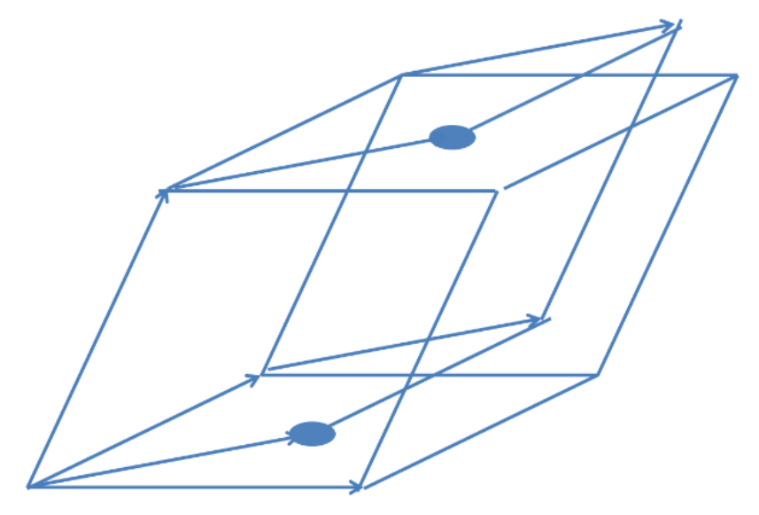

结果就是对三斜晶系来说，修饰起不到任何作用，它所对应的布拉菲格子只有一个。在以后的讨论中，我们会把只在顶点有东西的格子称为简单格子，记为 P 格子。

**2. 单斜晶系：**特点是 $a\neq b\neq c$，$\alpha=\beta=90^\circ$，$\gamma\neq 90^\circ$。

在这样的一个晶系中，除了 P 格子，如果我们在上下表面的中心加一个修饰，我们可以回到另一个 P 格子，如图：

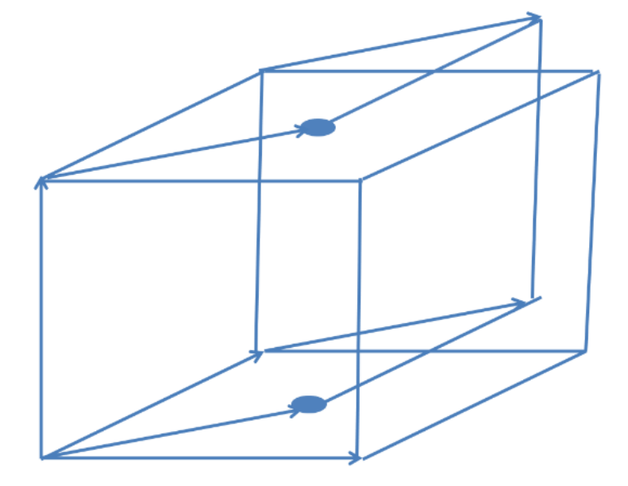

如果我们在一个侧面的面心加修饰，那我们可以得到一个新的格子，记为 A 面心：

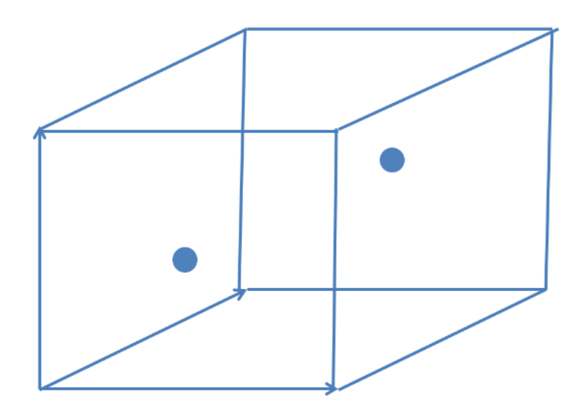

在另一个侧面的面心加修饰是同一个效果。

在体心加修饰的话，我可以把过体心的面当作一个面心，回到侧面面心修饰的状态：

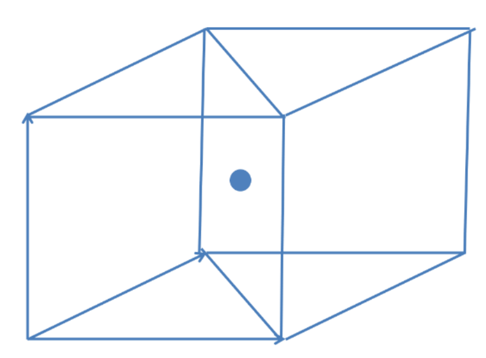

如果在三个侧面的面心同时加修饰，可以通过重新选项 a、b 轴回到体心：

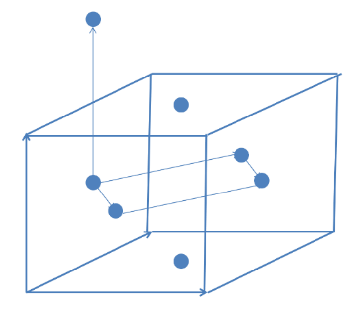

再由体心回到一个侧面心的情况。

综合一下，对单斜晶体，布拉菲格子就是 P 与 A 两种。

**3. 正交晶系：**特点是 $a\neq b\neq c$，$\alpha=\beta=\gamma=90^\circ$。

P 格子单独存在；

随便在哪个面心加个修饰，也单独存在；

体心加修饰，单独存在；

三个面心同时加修饰，也单独存在；

所以对正交格子，有 P、A、I、F 四种布拉菲格子。

依次重复下去，最终我们会得到这样一张图：

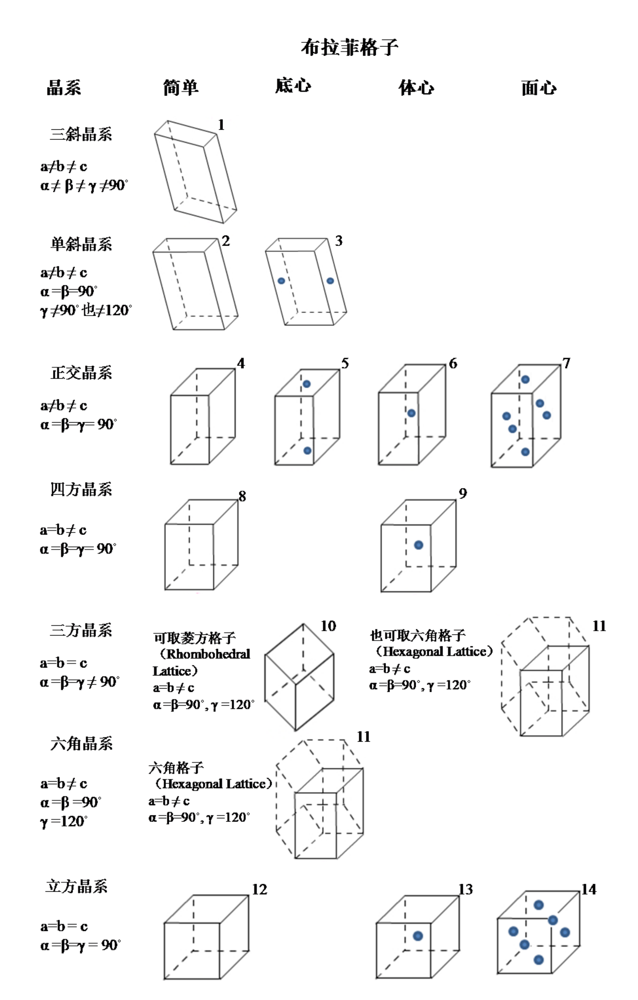

一共是 14 种布拉菲格子。

其中，前面提到的晶系（Crystal System）与晶格系统（Lattice System）的差别在这里就有体现。除了三方晶系与六角晶系，其它五种晶系 Crystal System 与 Lattice System 两个概念完全重合，1-9、12-14 共 12 种格子分别属于某一个晶系，没有模糊的地方。

对三方和六角晶系（Crystal System），在 Lattice System 的概念中，它们的集合对应菱方格子（Rhombohedral Lattice）与六角格子（Hexagonal Lattice）的集合。但相互之间个体并不对应个体。在三方晶系（Crystal System）的晶体中，依据格子的选取，有些在晶格系统（Lattice System）中属于菱方格子（Rhombohedral Lattice）的晶体，有些属于六角格子（Hexagonal Lattice）的晶体。六角晶系（Crystal System）的晶体对应的都是晶格系统中属于六角格子（Hexagonal Lattice）的晶体。换句话说，晶系中的三方晶系材料一部分具有菱方格子，一部分具有六角格子。而六角晶系材料都是六角格子。用表格的方式表达，就是：

| 晶系 | 点群 | 布拉菲格子 | 晶格系统 |
| --- | --- | --- | --- |
| 三斜 | 2（$S_2$、$C_1$） | 1 | 三斜 |
| 单斜 | 3（$C_{2h}$、$C_2$、$C_{1h}$） | 2 | 单斜 |
| 正交 | 3（$D_{2h}$、$D_2$、$C_{2v}$） | 4 | 正交 |
| 四方 | 7（$D_{4h}$、$C_4$、$S_4$、$D_4$、$C_{4v}$、$C_{4h}$、$D_{2d}$） | 2 | 四方 |
| 三方 Trigonal | 5（$D_{3d}$、$S_6$、$C_3$、$C_{3v}$、$D_3$） | 1 | 菱方 Rhombohedral |
| 六角 Hexagonal | 7（$D_{6h}$、$C_6$、$C_{3h}$、$C_{6h}$、$C_{6v}$、$D_6$、$D_{3h}$） | 1 | 六角 Hexagonal |

| 晶系 | 点群 | 布拉菲格子 | 晶格系统 |
| --- | --- | --- | --- |
| 立方 | 5（$O_h$、T、O、$T_h$、$T_d$） | 3 | 立方 |
| 共 7 种 | 共 32 种 | 共 14 种 | 共 7 种 |

最后一部分我们要讨论的是 Hermann-Mauguin 符号，也是目前点群空间群描述中的国际符号。目前人们是在对分子对称性描述的时候，倾向于用熊夫利符号；对晶体结构描述的时候，倾向于用 Hermann-Mauguin 符号，因为后者对平移对称性的描述更方便。

这个国际符号的基本特征是用不等价的轴或平面来标记晶体的对称性。这个轴包含纯转动轴与转动反演轴，纯转动轴是 1、2、3、4、6，转动反演轴是 $\bar{1}$、$\bar{2}$、$\bar{3}$、$\bar{4}$、$\bar{6}$。在熊夫利符号中，我们用转动反射面 $S_1$、$S_2$、$S_3$、$S_4$、$S_6$，它们与转动反演轴的关系是：$S_1=\bar{2}$、$S_2=\bar{1}$、$S_3=\bar{6}$、$S_4=\bar{4}$、$S_6=\bar{3}$（下去自己画图理解）。由这个关系，我们就知道 32 种点群在国际符号下分别是：

1. $S_2$、$S_4$、$S_6$：$\bar{1}$、$\bar{4}$、$\bar{3}$；

2. $C_1$、$C_2$、$C_3$、$C_4$、$C_6$：1、2、3、4、6；

3. $D_2$：222；

$D_3$：32（有一组同类的 2 次轴与主轴垂直）；

$D_4$：422（两组二次轴不同类）；

$D_6$：622（两组二次轴不同类）；

4. T：23（主轴是 2 次轴，3 次轴都同类）；

O：432（主轴 4 次轴，3 次、2 次都同类）；

5. $C_{1h}$：m；

$C_{2h}$：2/m（主轴为 2 次轴，m 与之垂直）；

$C_{3h}$（说白了是 $S_3$）：$\bar{6}$；

$C_{4h}$：4/m；

$C_{6h}$：6/m；

6. $C_{2v}$：mm2（过主轴两类与水平面垂直的反射面）；

$C_{3v}$：3m（三个反射面同类）；

$C_{4v}$：4mm（反射面不同类）；

$C_{6v}$：6mm（反射面不同类）；

7. $D_{2h}=D_2\cup ID_2$：2/m 2/m 2/m（三个 2 阶轴都有一个与之垂直的反射面，且相互不同类）；

$D_{4h}=D_4\cup ID_4$：4/m m m（既有与主轴垂直，又有过主轴的发射面，且过主轴的反射面分两类）；

$D_{3h}=D_3\cup I(D_6-D_3)$：$\bar{6}$ m 2（$\bar{6}$ 为主轴，m 为过主轴反射面，2 为二阶轴）；

$D_{6h}=D_6\cup ID_6$：6/m 2/m 2/m（6/m 代表 6 阶轴以及与之垂直的反射面，2/m 代表 2 阶轴以及与之垂直的反射面，2/m 有两类）；

8. $D_{2d}=D_2\cup I(D_4-D_2)$：$\bar{4}$ 2 m；

$D_{3d}=D_3\cup ID_3$：$\bar{3}$ 2/m；

9. $T_h=T\cup IT$：2/m $\bar{3}$；

$T_d=T\cup I(O-T)$：$\bar{4}$ 3 m；

10. $O_h=O\cup IO$：4/m $\bar{3}$ 2/m；

现在我们把我们知道的晶系，点群的熊夫利、国际符号做个汇总，写成下面这个表格：

**晶体点群按晶系分类**

| 晶系（全面对称群） | 熊夫利符号 | 国际符号 |
| --- | --- | --- |
| 三斜系（$S_2$） | $S_2$ | $\bar{1}$ |
|  | $C_1$ | 1 |
| 单斜系（$C_{2h}$） | $C_{2h}$ | 2/m |
|  | $C_2$ | 2 |
|  | $C_{1h}$ | M |
| 正交系（$D_{2h}$） | $D_{2h}$ | 2/m 2/m 2/m |
|  | $D_2$ | 222 |
|  | $C_{2v}$ | mm2 |
| 四角系（$D_{4h}$） | $D_{4h}$ | 4/m m m |
|  | $C_4$ | 4 |
|  | $S_4$ | $\bar{4}$ |
|  | $D_4$ | 422 |
|  | $C_{4v}$ | 4mm |
|  | $C_{4h}$ | 4/m |
|  | $D_{2d}$ | $\bar{4}$ 2 m |
| 三方系（$D_{3d}$） | $D_{3d}$ | $\bar{3}$ 2/m |
|  | $S_6$ | $\bar{3}$ |
|  | $C_3$ | 3 |
|  | $C_{3v}$ | 3m |
|  | $D_3$ | 32 |
| 六角系（$D_{6h}$） | $D_{6h}$ | 6/m 2/m 2/m |
|  | $C_6$ | 6 |
|  | $C_{3h}$ | $\bar{6}$ |
|  | $C_{6h}$ | 6/m |
|  | $C_{6v}$ | 6mm |
|  | $D_6$ | 622 |
|  | $D_{3h}$ | $\bar{6}$ m 2 |
| 立方系（$O_h$） | $O_h$ | 4/m $\bar{3}$ 2/m |
|  | T | 23 |
|  | O | 432 |
|  | $T_h$ | 2/m $\bar{3}$ |
|  | $T_d$ | $\bar{4}$ 3 m |

你把这个表看懂了，在文献中跟晶体点群相关的东西你也就都明白了。之后在这个讲义中我想提一下的一个概念是极射赤面投影图。它是对点群对称性的一种图形表述。理解这种图，大家抓住 6 点，就很容易理解：

1. 极射赤面投影图是什么样的图？

它是用球形图 Sr 的赤道面来描述点群对称性的图。

它的来源是球形图 Sr，这个球的南北极连线 S-N 是晶体点群的主轴。

极射赤面投影图显示的，是赤道面上的东西，这个需要把球面上的东西往赤道面做投影，因此叫极射赤面投影图，也叫测地投影图。

2. 怎么描述？

用两个赤面来描述。一般左边那个描述的是球面上的任意一点，在点群 $G$ 的所有操作下形成的轨道的投影；右边那个描述的是 $G$ 的所有对称元素，在赤道面的投影。

3. 左边那个投影图怎么画？

它画的必须是 Sr 上面的一个普通的点，在 $G$ 中所有元素的作用下，得到的 $G$ 轨道。

所谓普通，就是这个点在 $G$ 中的迷向子群必为 $\{E\}$，这样它的 $G$ 轨道才能把 $G$ 中所有元素反映出来。

当这个轨道上的点 P 在 Sr 的北半球时，我们做投影的时候是把这个点与南极连起来，连线与赤面的交点用实心点表示。

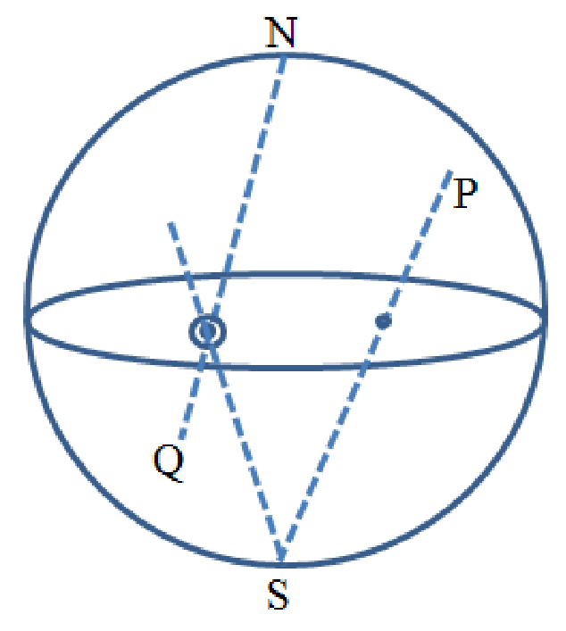

当这个轨道上的点 Q 在 Sr 的南半球时，我们做投影的时候是把它与北极连起来，连线与赤面的交点用空心的圈表示。

当赤面上出现 ⊙ 时，说明这个轨道上在南北半球有可以被镜面反射联系起来的点。

之后是右边这个反应对称元素的图怎么画，注意三点：

4. 对反射面，它与南北半球都有交线，我们在赤面上反映的只是它与北半球的交线的投影，画成粗线。

作为一个结果：与水平面垂直的反射面在赤面上反映为直的粗线；水平的反射面反映为绕赤道的粗圆周；斜的反射面反映为粗的曲线。

5. 转动轴与转动反演轴，类似，之取它们与北半球的交点做投影。轴水平时，赤面圆周的相对的两端各出现一次。在这个过程中，转动轴、转动反演轴的符号分别是：

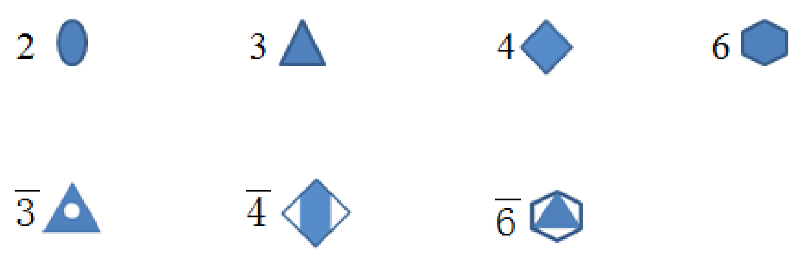

6. 右边图中应标出点群的所有对称元素，这个与国际符号中只写出能够确定点群的最小的对称元素不同。

看几个例子：

1. $C_1$ 群，没有非 E 对称元素，只画左边一个图就可以。任意一点，轨道上也就一点，可以画为：

2. $C_2$ 群，有一个二次轴，Sr 上任意一点的轨道有两个点，转 180 度，所以是：

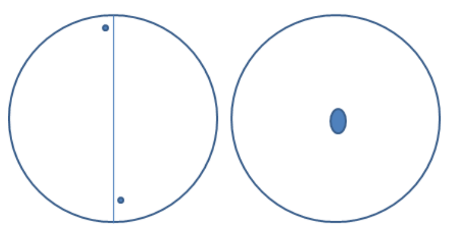

3. $C_{1h}=C_1\cup I(C_2-C_1)$，对应的图形是：

4. $C_{2h}=C_2\cup IC_2$，对应的图形是：

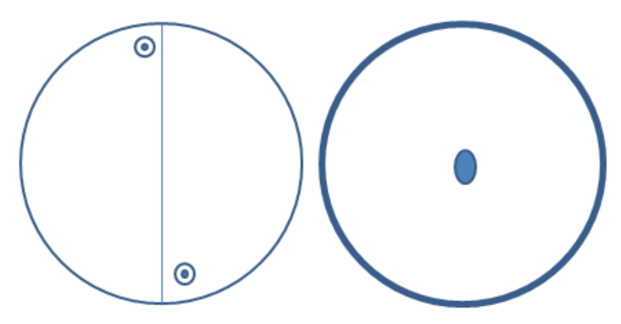

5. $S_4=C_2\cup I(C_4-C_2)$，对应的图形是：

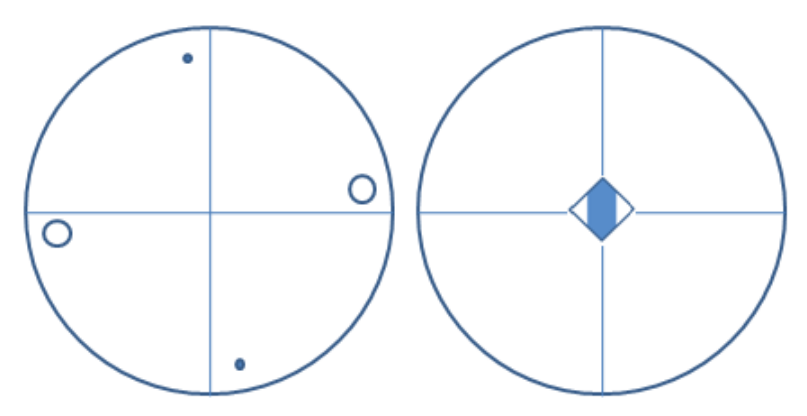

6. $C_{4h}=C_4\cup IC_4$，对应的图形是：

7. $\mathrm{D_6}$，对应的图形是：

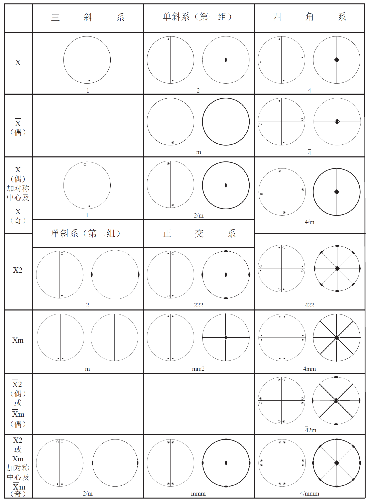

其他的投影图可总结为：

|  | 三斜系 | 单斜系（第一组） | 四角系 |
|:--|:--|:--|:--|
| X | 1 | 2 | 4 |
| $\bar{X}$（偶） |  | m | $\bar{4}$ |
| X（偶）加对称中心及 $\bar{X}$（奇） | $\bar{1}$ | 2/m | 4/m |

|  | 单斜系（第二组） | 正交系 | 四角系 |
|:--|:--|:--|:--|
| X2 | 2 | 222 | 422 |
| Xm | m | mm2 | 4mm |
| $\bar{X}2$（偶）或 $\bar{X}$m（偶） |  |  | $\bar{4}2m$ |
| X2 或 Xm 加对称中心及 $\bar{X}$m（奇） | 2/m | mmm | 4/mmm |

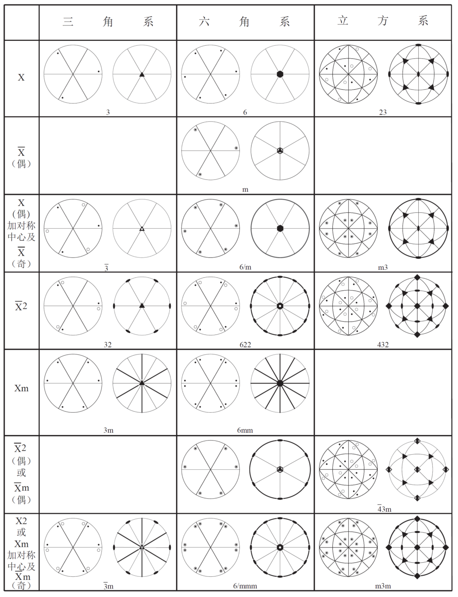

|  | 三角系 | 六角系 | 立方系 |
|:--|:--|:--|:--|
| X | 3 | 6 | 23 |
| $\bar{X}$（偶） |  | m |  |
| X（偶）加对称中心及 $\bar{X}$（奇） | $\bar{3}$ | 6/m | m3 |
| $\bar{X}2$ | 32 | 622 | 432 |
| Xm | 3m | 6mm |  |
| $\bar{X}2$（偶）或 $\bar{X}$m（偶） |  |  | $\bar{4}3m$ |
| X2 或 Xm 加对称中心及 $\bar{X}$m（奇） | $\bar{3}m$ | 6/mmm | m3m |

最后讲一下空间群，这是一个什么概念呢？

- 点群，大家都知道是只考虑了晶体的转动对称性的群，对称操作为 R；
- 空间群呢，是在考虑了晶体转动的基础上，同时考虑它的平移不变性，从而得到的所有对称操作形成的群。对称操作为 $\{R|\vec{t}\}$，晶体在 $\{R|\vec{t}\}$ 操作下回到自身。

举个例子，前面我们讲晶体的时候，我们说了它根据所允许的点群，可分成 7 种晶系。同时，我们还可以利用 7 种晶格系统来划分 14 种布拉菲格子。我们前面提到，点群和格子之间可以相互组合。

以立方晶系为例，它允许简单、体心、面心三种格子，同时它允许 T、O、$\mathrm{T_h}$、$\mathrm{T_d}$、$\mathrm{O_h}$ 五种点群。当这个晶体的点群为 T 是，我们可以去简单、体心、面心三种格子，这样我们得到的三种 $\{R|\vec{t}\}$ 的组合是不是肯定就不一样了？（这里是 R 相同，$\vec{t}$ 不同，见下图）

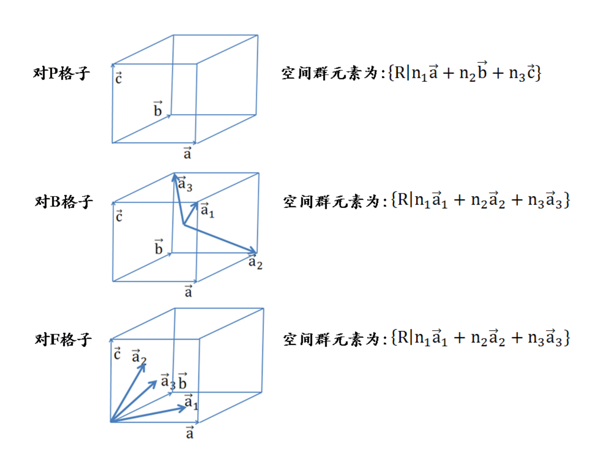

- 对 P 格子：$\{R|n_1\vec{a}+n_2\vec{b}+n_3\vec{c}\}$
- 对 B 格子：$\{R|n_1\vec{a}_1+n_2\vec{a}_2+n_3\vec{a}_3\}$
- 对 F 格子：$\{R|n_1\vec{a}_1+n_2\vec{a}_2+n_3\vec{a}_3\}$

同样晶体点群是 O 时，我们可以做同样的处理，以此类推，对立方晶系，我们如果只考虑这种简单的组合，我们是可以得到 $3\times 5=15$ 种空间群。

现在我们把前面提到的晶系、布拉菲格子、点群的相互关系拿出来，做一个简单的估计：

| 晶系 | 点群 | 布拉菲格子 | 晶格系统 | 简单空间群 |
|:--|:--:|:--:|:--|:--:|
| 三斜 | 2 | 1 | 三斜 | 2 |
| 单斜 | 3 | 2 | 单斜 | 6 |
| 正交 | 3 | 4 | 正交 | 12 |
| 四方 | 7 | 2 | 四方 | 14 |
| 三方 Trigonal | 5 | 1 | 菱方 Rhombohedral | 5 |
| 六角 Hexagonal | 7 | 1 | 六角 Hexagonal | 7 |
| 立方 | 5 | 3 | 立方 | 15 |
| 共 7 种 | 共 32 种 | 共 14 种 | 共 7 种 | 共 66 种 |

这种最简单的组合可以给出 66 种空间群，在这些空间群里面，平移矢量 $\vec{t}$ 是平移周期性最小重复单元的整数倍。对所有 R，取 $\vec{t}=0$，也就是不做平移时，$\{R|0\}$ 都是空间群中的元素。这样的空间群我们称为简单空间群。

不过需要说明的是上面表格里面我们对简单空间群的计算方式还是太简单了。实际上简单空间群并不止我们上面算的 66 种，应该是 73 种。这个原因是对有些布拉菲格子，它与点群的结合方式不止一种。比如正交晶系的底心格子，我们再算布拉菲格子的时候，把底心和侧面面心算成是一种格子，但当它与 $\mathrm{C_{2v}}=\mathrm{C_2\cup I(D_2-C_2)}$ 结合的时候，如果取主轴为 z 轴，这两种格子给出的空间群是不一样的。对我们这 7 种晶系，类似情况可以再多给出 7 种简单空间群。所以总的简单空间群个数是 73 个。

除了这些简单空间群，在晶体中，$\{R|\vec{t}\}$ 操作还存在另外一种情况，就是 $\vec{t}$ 并不是空间平移对称性最小重复单元的整数倍。而是它的分数倍，比如下面两种情况：

1. 螺旋轴（Screw axis），说的是存在这样的操作，我相对于某个轴转一定角度之后，再沿着这个轴做一个平移，系统回到了与原来不可分辨的状态。比如：

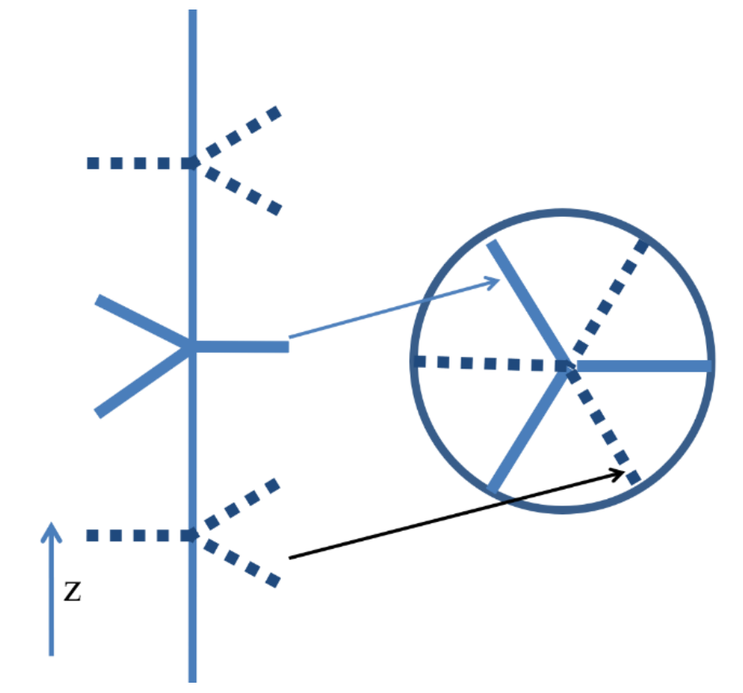

这样黄色和蓝色是用来区别 z 轴不同的高度，它们代表的结构单元是一样的。右边是俯视图。纯平移的周期性是 a，但转动 60 度再做 a/2 的平移也是系统的对称操作。它所对应的空间群元素 $\{R|\vec{t}\}$ 中的 R 不可以脱离 $\vec{t}$ 单独存在。与之相应，拥有这样操作的空间群也不属于简单空间群。

2. 滑移平面（Slide plance），指的是对一个平面先做反射，再平移一个 $\vec{t}/m$，比如：

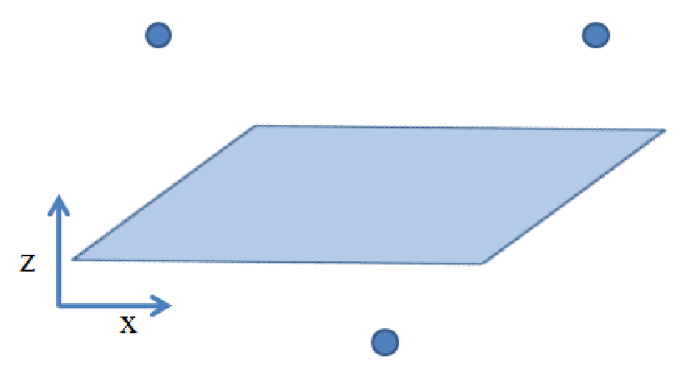

这里沿 x 轴方向平移 a 是对称操作，平移 a/2 不是。但这个 a/2 与镜面反射结合就是了。

加上这些对称操作后，空间群的情况就会多很多。这种群中对称元素平移部分包含平移对称性分数倍情况的空间群，称为非简单空间群，它有 157 种。两者加在一起是 230 种。弄明白这个事情，是 19 世纪下半叶欧洲的一些晶体学家、数学家的研究热点，但大家可以想象这个其实是非常具有挑战性的。这个里面最早做出工作的是个德国数学家，叫 Leonhard Sohncke，时间是 1879 年，他推出了 66 种空间群。这个和我们前面讲的通过点群和格子的组合生成的 66 种不完全一样，因为当时人们还没有我们现在的这种理解。他的 66 种空间群里面，还有一些重复的情况。但这个工作之后引起了德国人熊夫利和俄国人 Fedorov 的注意，他们之后是在相互独立，但又有一些交流的情况下，分别于 1891 年与 1892 年发表专著解释了空间群的 230 种情况。这 230 种空间群，根据前面提到的晶系、晶格系统的划分情况是：

| 晶系 | 点群 | 空间群 | 布拉菲格子 | 晶格系统 |
|:--|:--:|:--:|:--:|:--|
| 三斜 | 2 | 2 | 1 | 三斜 |
| 单斜 | 3 | 13 | 2 | 单斜 |
| 正交 | 3 | 59 | 4 | 正交 |

| 晶系 | 点群 | 空间群 | 布拉菲格子 | 晶格系统 |
|:--|:--:|:--:|:--:|:--|
| 四方 | 7 | 68 | 2 | 四方 |
| 三方 Trigonal | 5 | 7 | 1 | 菱方 Rhombohedral |
|  |  | 18 | 1 | 六角 Hexagonal |
| 六角 Hexagonal | 7 | 27 |  |  |
| 立方 | 5 | 36 | 3 | 立方 |
| 共 7 种 | 共 32 种 | 共 230 种 | 共 14 种 | 共 7 种 |

现在人们需要用到空间群的时候，一般就是先知道它的国际符号（Hermann-Mauguin 符号），然后查这个群中的对称操作 $\{R|\vec{t}\}$，通过这些对称操作，就可以把晶体结构彻底搞清。同时这些对称操作 $\{R|\vec{t}\}$ 对我们理解系统的电子态分布也非常有用，下一章我们会做详细介绍。

空间群的完整的对称操作的表格，有一个很好的网站，叫 Bilbao Crystallographic Server（在 google 中输入 Bilbao Crystal 就可以找到）[24]。进入这个网站后，有个 GENPOS 的选项，点入后直接输入你的空间群序号，比如 122、150，所有的对称操作就出来了。在这个网站中，你还可以看具有每个空间群的晶体的布里渊区的样子，以及很多其它你们以后研究中可以用到的信息。最近，这个网站还增加了关于后面我们要讲的双群以及这个讲义中并不触及但在磁性材料物性研究中很有用的磁空间群的内容。

和这个网站差不多，英国也有一个网站$^{10}$：

http://img.chem.ucl.ac.uk/sgp/large/sgp.htm

里面有类似的功能，这两个网站都建议收藏。

有了这些对称操作后，在读很多文献的时候，他们给晶体结构只会给晶体中

---

$^{10}$ 这个网站是某一年的一个学生（来自北京大学量子中心的陈玉琴同学）告诉我的。

不等价的原子的位置与晶体空间群。你们可以做的事情是对每个原子，用这些空间群对称操作操作一遍，如果得到的原子已经出现了，就掠过，如果没有，就保存，从而得到具体的晶体结构。现在，一些通行的材料模拟方面的软件（比如 Material Studio）也会提供类似功能。应该说对于需要应用此方面知识的从业人员，辅助工具越来越强大了。只要我们能够理解这些基本原理，在应用这些知识的时候，我们拥有前人无法想象的友善的软环境。

## 3.5 晶体点群的不可约表示

最后一部分是晶体点群的不可约表示。在学完前两章之后，我们后面讲任何一种具体的群，基本都是这个路子。先讲这个群是什么，再分析它有多少种群，每种群的分类情况，最后看它们的不等价不可约表示是什么？为什么要看这些不等价不可约表示，我们下一章《群论与量子力学》中会做详细说明。

找所有晶体点群的不等价不可约表示这个任务乍一看挺吓人的，因为我们有 32 种晶体点群。但实际上，我们之前讲的一些定理可以在这里大大简化这个问题。这些定理里面的第一个是第二章里面的：直接群 $G=G_1\otimes G_2$ 的所有不等价不可约表示，可以由 $G_1$ 与 $G_2$ 的不等价不可约表示给出。第二个是我们这章的定理 3.3：点群三种情况，纯转动、纯转动与 $\{E\text{、}I\}$ 的直积、与某个纯转动同构的不含 I 的第二类点群。这就意味着对点群，只要我们把所有的第一类点群的不等价不可约表示搞明白了，我们就可以很自然的通过定理 3.3 的第二点与第三点得到所有的第二类点群的不等价不可约表示。

第一类点群有 11 种：$\mathrm{C_1}$、$\mathrm{C_2}$、$\mathrm{C_3}$、$\mathrm{C_4}$、$\mathrm{C_6}$、$\mathrm{D_2}$、$\mathrm{D_3}$、$\mathrm{D_4}$、$\mathrm{D_6}$、T、O。下面我们就一一地把这 11 种情况过一遍。

1. 先看 $\mathrm{C_n}$ 群，这些群都是循环群，我们前面说过，n 阶就有 n 个类，也就是 n个不等价不可约表示，对生成元 a，它的表示是：

$$
A^{p}(a)=\exp\left[(p-1)2\pi \mathrm{i}/n\right]
$$

其中 p 是不等价不可约表示的 index，为 1、2、$\cdots$、n 中的一个数。

这样 11 种第一类点群的前五种情况就包括了。

2. 第六种情况是 $\mathrm{D_2}$ 群，它有四个元素：e、绕 z 轴转 $\pi$ 角的操作 a、绕 x 轴转 $\pi$ 角的操作 b、绕 y 轴转 $\pi$ 角的操作 c。

$\{e\text{、}a\}$ 是它的不变子群，因为 z 这个轴不能通过群中其它元素变到 x 与 y 轴。同理 $\{e\text{、}b\}$ 也是，且 $ab=ba$，这样的话 $\mathrm{D_2}=\{e\text{、}a\}\otimes\{e\text{、}b\}$。$\{e\text{、}a\}$ 与 $\{e\text{、}b\}$ 的特征标表为：

|  | e | A |
|:--|:--:|:--:|
| 1 | 1 | 1 |
| 1 | 1 | -1 |

那么 $\mathrm{D_2}$ 的特征标表就是：

|  | e(ee) | a(ae) | b(eb) | c(ab) |
|:--|:--:|:--:|:--:|:--:|
| 1 | 1 | 1 | 1 | 1 |
| 1 | 1 | -1 | 1 | -1 |
| 1 | 1 | 1 | -1 | -1 |
| 1 | 1 | -1 | -1 | 1 |

3. $\mathrm{D_3}$ 群，有三个类，6 个元素，$\mathrm{C_3}$ 是它的不变子群，含 $\{e\text{、}d\text{、}f\}$，$\mathrm{D_3/C_3}$ 同构与二阶循环群，于是有了 $\mathrm{A_2}$ 这个表示。再由正交定理，得 $\mathrm{A_3}$。整体的特征标表是：

|  | 1{e} | 2{d} | 3{a} |
|:--|:--:|:--:|:--:|

|  | 1{e} | 2{d} | 3{a} |
|:--|:--:|:--:|:--:|
| $\mathrm{A_1}$ | 1 | 1 | 1 |
| $\mathrm{A_2}$ | 1 | 1 | -1 |
| $\mathrm{A_3}$ | 2 | -1 | 0 |

4. $\mathrm{D_4}$ 群，五个类，为：

$$
\{E\}\text{、}\{C_4\text{、}C_4^{3}\}\text{、}\{C_4^{2}\}\text{、}\{C_2^{(1)}\text{、}C_2^{(3)}\}\text{、}\{C_2^{(2)}\text{、}C_2^{(4)}\}
$$

$$
S_1^2+S_2^2+S_3^2+S_4^2+S_5^2=8
$$

解为：

$$
S_1=S_2=S_3=S_4=1\text{、}S_5=2
$$

$\mathrm{D_4}$ 群有不变子群：$\{E\text{、}C_4\text{、}C_4^{2}\text{、}C_4^{3}\}$、$\{E\text{、}C_4^{2}\text{、}C_2^{(1)}\text{、}C_2^{(3)}\}$、$\{E\text{、}C_4^{2}\text{、}C_2^{(2)}\text{、}C_2^{(4)}\}$，这样的话由每个不变子群产生的商群都与二阶循环群同构，可以得到 $\mathrm{D_4}$ 群到二阶循环群的三个同态映射，其中恒等部分相同，非恒等部分给出三个一维非恒等表示。

之后再由正交关系确认最后一个二维表示，得到特征标表为：

|  | 1{E} | 1{$\mathrm{C_4^{2}}$} | 2{$\mathrm{C_4}$} | 2{$\mathrm{C_2^{(1)}}$} | 2{$\mathrm{C_2^{(2)}}$} |
|:--|:--:|:--:|:--:|:--:|:--:|
| $\mathrm{A_1}$ | 1 | 1 | 1 | 1 | 1 |
| $\mathrm{A_2}$ | 1 | 1 | 1 | -1 | -1 |
| $\mathrm{A_3}$ | 1 | 1 | -1 | 1 | -1 |
| $\mathrm{A_4}$ | 1 | 1 | -1 | -1 | 1 |
| $\mathrm{A_5}$ | 2 | -2 | 0 | 0 | 0 |

5. $\mathrm{D_6}$，有 12 个元素，为：

$$
\{E\text{、}C_6^{2}\text{、}C_6^{4}\text{、}C_2^{(1)}\text{、}C_2^{(3)}\text{、}C_2^{(5)};C_6^{1}\text{、}C_6^{3}\text{、}C_6^{5}\text{、}C_2^{(2)}\text{、}C_2^{(4)}\text{、}C_2^{(6)}\}
$$

其中前六个是 $\mathrm{D_3}$ 群，它是 $\mathrm{D_6}$ 的不变子群，后面 6 个是它的陪集。在这个陪集里面 $\mathrm{C_6^{3}}$ 自成一类（它与其它六次轴转动角度不同，与二次轴转动虽角度相同但转轴无法通过群中元素联系起来），因此 $\{E\text{、}C_6^{3}\}$ 也是一个不变子群，$\mathrm{D_6}=\mathrm{D_3}\otimes\{E\text{、}C_6^{3}\}$。

6. T 群，有 $\{E\}$、$\{C_2^{(1)}\text{、}C_2^{(2)}\text{、}C_2^{(3)}\}$、$\{C_3'\text{、}C_3''\text{、}C_3'''\text{、}C_3''''\}$、$\{C_3'^2\text{、}C_3''^2\text{、}C_3'''^2\text{、}C_3''''^2\}$ 四个类。

$$
S_1^2+S_2^2+S_3^2+S_4^2=12
$$

解为：

$$
S_1=S_2=S_3=1\text{、}S_4=3
$$

T 的不变子群是：$\{E\text{、}C_2^{(1)}\text{、}C_2^{(2)}\text{、}C_2^{(3)}\}$，把 T 和它做商群，可以产生一个三阶循环群，三阶循环群有三个一维表示，所以给出 $\mathrm{A_1}$ 到 $\mathrm{A_3}$。最后一个三维表示由正交关系得到：

|  | {E} | 3{$\mathrm{C_2^{(1)}}$} | 4{$\mathrm{C_3'}$} | 4{$\mathrm{C_3'^2}$} |
|:--|:--:|:--:|:--:|:--:|
| $\mathrm{A_1}$ | 1 | 1 | 1 | 1 |
| $\mathrm{A_2}$ | 1 | 1 | $\varepsilon$ | $\varepsilon^2$ |
| $\mathrm{A_3}$ | 1 | 1 | $\varepsilon^2$ | $\varepsilon$ |
| $\mathrm{A_4}$ | 3 | -1 | 0 | 0 |

7. 最后一个，是这节最难的一个，O 群，有 24 个元素，分五类：

$$
\{E\}\text{、}\{C_2^{(1)}\text{、}C_2^{(2)}\text{、}\cdots\text{、}C_2^{(6)}\}\text{、}\{C_3'\text{、}C_3''\text{、}C_3'''\text{、}C_3''''\text{、}C_3'^2\text{、}C_3''^2\text{、}C_3'''^2\text{、}C_3''''^2\}\text{、}\{C_4'\text{、}C_4''\text{、}C_4'''\text{、}C_4'^3\text{、}C_4''^3\text{、}C_4'''^3\}\text{、}\{C_4'^2\text{、}C_4''^2\text{、}C_4'''^2\}
$$

$$
S_1^2+S_2^2+S_3^2+S_4^2+S_5^2=24
$$

解为：

$$
S_1=S_2=1\text{、}S_3=2\text{、}S_4=S_5=3
$$

O 有不变子群 T，包含：

$\{E\text{、}C_3'\text{、}C_3''\text{、}C_3'''\text{、}C_3''''\text{、}C_3'^2\text{、}C_3''^2\text{、}C_3'''^2\text{、}C_3''''^2\text{、}C_4'^2\text{、}C_4''^2\text{、}C_4'''^2\}$

因此通过 O/T 商群与二阶循环群的同构，可以得到两个一维表示。

二维表示怎么办？我们可以利用前面讲的诱导表示的概念。

我们想用 T 群，这个 O 群的子群的非恒等的一维表示 $\mathrm{A_2}$，得到 O 群的一个二维表示。我们要做的事情，就是把 O 分成 T 与它的陪集，$\mathrm{O}=\{g_0T\text{、}g_1T\}$，这里 $g_0$ 是单位元素，$g_1$ 有多种选择，我们取 $g_1=C_2^{(1)}$。

T 群与 O 群的关系是：

我们利用诱导表示的表示矩阵：

$$
U^{B}(g)=\begin{pmatrix}\dot{B}(g_0gg_0^{-1}) & \dot{B}(g_0gg_1^{-1})\\ \dot{B}(g_1gg_0^{-1}) & \dot{B}(g_1gg_1^{-1})\end{pmatrix}
$$

其中：

$$
\dot{B}(g_igg_j^{-1})=\begin{cases}A_2(g_igg_j^{-1}) & \text{if } g_igg_j^{-1}\in T\\ 0 & \text{otherwise}\end{cases}
$$

而：

$$
A_2(g_igg_j^{-1})=\begin{cases}1 & \text{if } g_igg_j^{-1}\in\{E\text{、}C_4'^2\text{、}C_4''^2\text{、}C_4'''^2\}\\ \varepsilon & \text{if } g_igg_j^{-1}\in\{C_3'\text{、}C_3''\text{、}C_3'''\text{、}C_3''''\}\\ \varepsilon^2 & \text{if } g_igg_j^{-1}\in\{C_3'^2\text{、}C_3''^2\text{、}C_3'''^2\text{、}C_3''''^2\}\end{cases}
$$

再利用公式（2.12）：

$$
\chi^{U}(g)=\frac{1}{m}\sum_{t\in O}\mathrm{tr}\dot{B}(tgt^{-1})
$$

这里 m 是 T 的阶，我们很容易得到：

$$
\chi^{U}(E)=\frac{1}{12}\sum_{t\in O}\mathrm{tr}\dot{B}(tEt^{-1})=\frac{1}{12}\cdot 24\cdot 1=2
$$

$$
\chi^{U}(C_3')=\frac{1}{12}\sum_{t\in O}\mathrm{tr}\dot{B}(tC_3't^{-1})=\frac{1}{12}\cdot 12\cdot(\varepsilon+\varepsilon^2)=-1
$$

$$
\chi^{U}(C_4')=\frac{1}{12}\sum_{t\in O}\mathrm{tr}\dot{B}(tC_4't^{-1})=0
$$

$\cdots\cdots tC_4't^{-1}\notin T$

$$
\chi^{U}(C_4'^2)=\frac{1}{12}\sum_{t\in O}\mathrm{tr}\dot{B}(tC_4'^2t^{-1})=\frac{1}{12}\cdot 24\cdot 1=2
$$

$\cdots\cdots tC_4'^2t^{-1}\in\{C_4'^2\text{、}C_4''^2\text{、}C_4'''^2\}$

$$
\chi^{U}(C_2^{(1)})=\frac{1}{12}\sum_{t\in O}\mathrm{tr}\dot{B}(tC_2^{(1)}t^{-1})=0
$$

$\cdots\cdots tC_2^{(1)}t^{-1}\notin T$

这个诱导表示对 O 群的五个类而言特征标分别是：

$$
2,\qquad 0,\qquad 2,\qquad -1,\qquad 0
$$

做内积，满足归一条件，为不可约表示。

|  | {E} | 6{$\mathrm{C_4'}$} | 3{$\mathrm{C_4'^2}$} | 8{$\mathrm{C_3'}$} | 6{$\mathrm{C_2^{(1)}}$} |
|:--|:--:|:--:|:--:|:--:|:--:|
| $\mathrm{A_1}$ | 1 | 1 | 1 | 1 | 1 |
| $\mathrm{A_2}$ | 1 | -1 | 1 | 1 | -1 |
| $\mathrm{A_3}$ | 2 | 0 | 2 | -1 | 0 |
| $\mathrm{A_4}$ | 3 | $\chi^4(C_4')$ | $\chi^4(C_4'^2)$ | $\chi^4(C_3')$ | $\chi^4(C_2^{(1)})$ |
| $\mathrm{A_5}$ | 3 | $\chi^5(C_4')$ | $\chi^5(C_4'^2)$ | $\chi^5(C_3')$ | $\chi^5(C_2^{(1)})$ |

最后就剩下两个三维表示了。求法和上面一样，还是利用诱导表示。不过这里用的是 T 的三维表示，导出的 O 的表示是六维的。它的特征标是：

$$
\chi^{U}(E)=\frac{1}{12}\sum_{t\in O}\mathrm{tr}\dot{B}(tEt^{-1})=\frac{1}{12}\cdot 24\cdot 3=6
$$

$$
\chi^{U}(C_3')=\frac{1}{12}\sum_{t\in O}\mathrm{tr}\dot{B}(tC_3't^{-1})=0
$$

$\cdots\cdots$ T 的三维表示中 $C_3'$ 的特征标也是零

$$
\chi^{U}(C_4')=\frac{1}{12}\sum_{t\in O}\mathrm{tr}\dot{B}(tC_4't^{-1})=0
$$

$\cdots\cdots tC_4't^{-1}\notin T$

$$
\chi^{U}(C_4'^2)=\frac{1}{12}\sum_{t\in O}\mathrm{tr}\dot{B}(tC_4'^2t^{-1})=\frac{1}{12}\cdot 24\cdot(-1)=-2
$$

$\cdots\cdots tC_4'^2t^{-1}\in\{C_4'^2\text{、}C_4''^2\text{、}C_4'''^2\}$

$$
\chi^{U}(C_2^{(1)})=\frac{1}{12}\sum_{t\in O}\mathrm{tr}\dot{B}(tC_2^{(1)}t^{-1})=0
$$

$\cdots\cdots tC_2^{(1)}t^{-1}\notin T$

这个六维表示肯定是可约的，如果它是两个 $\mathrm{A_4}$ 或两个 $\mathrm{A_5}$ 的直和。对应的 $\mathrm{A_4}$ 或 $\mathrm{A_5}$ 的特征标为：3、0、-1、0、0，做内积的话不等于 1，不是不可约表示。

还有一种可能是它是 $\mathrm{A_4}$ 与 $\mathrm{A_5}$ 的直和，如果是这样的话，我们就有：

$$
\chi^4(C_4')+\chi^5(C_4')=0
$$

$$
\chi^4(C_4'^2)+\chi^5(C_4'^2)=-2
$$

$$
\chi^4(C_3')+\chi^5(C_3')=0
$$

$$
\chi^4(C_2^{(1)})+\chi^5(C_2^{(1)})=0
$$

对这样的条件，有一种解是：

$$
\chi^4(C_4')=1\text{、}\chi^4(C_4'^2)=-1\text{、}\chi^4(C_3')=0\text{、}\chi^4(C_2^{(1)})=1
$$

$$
\chi^5(C_4')=-1\text{、}\chi^5(C_4'^2)=-1\text{、}\chi^5(C_3')=0\text{、}\chi^5(C_2^{(1)})=-1
$$

这个解是满足特征标归一条件的，所以是对应两个三维不可约表示（填到上面那个表中）。这样 O 群的不等价不可约表示特征标表就也出来了。

最后一个需要提一下的，你们在看一些文献上给出的点群特征标表的时候，经常会看到这样的例子。比如 $\mathrm{O_h}$ 特征标表，在有些文献中，会写成这个样子：

| representation | basis functions | $E$ | $3C_4^2$ | $6C_4$ | $6C_2$ | $8C_3$ | $i$ | $3iC_4^2$ | $6iC_4$ | $6iC_2$ | $8iC_3$ |
|:--|:--|:--:|:--:|:--:|:--:|:--:|:--:|:--:|:--:|:--:|:--:|
| $\Gamma_1$ | 1 | 1 | 1 | 1 | 1 | 1 | 1 | 1 | 1 | 1 | 1 |
| $\Gamma_2$ | $x^4(y^2-z^2)+$ $y^4(z^2-x^2)+$ $z^4(x^2-y^2)$ | 1 | 1 | -1 | -1 | 1 | 1 | 1 | -1 | -1 | 1 |
| $\Gamma_{12}$ | $x^2-y^2$ $2z^2-x^2-y^2$ | 2 | 2 | 0 | 0 | -1 | 2 | 2 | 0 | 0 | -1 |
| $\Gamma_{15}$ | $x,y,z$ | 3 | -1 | 1 | -1 | 0 | -3 | 1 | -1 | 1 | 0 |
| $\Gamma_{25}$ | $z(x^2-y^2)$, etc. | 3 | -1 | -1 | 1 | 0 | -3 | 1 | 1 | -1 | 0 |
| $\Gamma_1'$ | $xyz[x^4(y^2-z^2)+$ $y^4(z^2-x^2)+$ $z^4(x^2-y^2)]$ | 1 | 1 | 1 | 1 | 1 | -1 | -1 | -1 | -1 | -1 |
| $\Gamma_2'$ | $xyz$ | 1 | 1 | -1 | -1 | 1 | -1 | -1 | 1 | 1 | -1 |
| $\Gamma_{12}'$ | $xyz(x^2-y^2)$, etc. | 2 | 2 | 0 | 0 | -1 | -2 | -2 | 0 | 0 | 1 |
| $\Gamma_{15}'$ | $xy(x^2-y^2)$, etc. | 3 | -1 | 1 | -1 | 0 | 3 | -1 | 1 | -1 | 0 |
| $\Gamma_{25}'$ | $xy,yz,zx$ | 3 | -1 | -1 | 1 | 0 | 3 | -1 | -1 | 1 | 0 |

在另一些文献中，又被写成：

| repr. | basis functions | $E$ | $3C_4^2$ | $6C_4$ | $6C_2'$ | $8C_3$ | $i$ | $3iC_4^2$ | $6iC_4$ | $6iC_2'$ | $8iC_3$ |
|:--|:--|:--:|:--:|:--:|:--:|:--:|:--:|:--:|:--:|:--:|:--:|
| $A_1^+$ | 1 | 1 | 1 | 1 | 1 | 1 | 1 | 1 | 1 | 1 | 1 |
| $A_2^+$ | $x^4(y^2-z^2)+$ $y^4(z^2-x^2)+$ $z^4(x^2-y^2)$ | 1 | 1 | -1 | -1 | 1 | 1 | 1 | -1 | -1 | 1 |
| $E^+$ | $x^2-y^2$ $2z^2-x^2-y^2$ | 2 | 2 | 0 | 0 | -1 | 2 | 2 | 0 | 0 | -1 |
| $T_1^-$ | $x,y,z$ | 3 | -1 | 1 | -1 | 0 | -3 | 1 | -1 | 1 | 0 |
| $T_2^-$ | $z(x^2-y^2)\dots$ | 3 | -1 | -1 | 1 | 0 | -3 | 1 | 1 | -1 | 0 |
| $A_1^-$ | $xyz[x^4(y^2-z^2)+$ $y^4(z^2-x^2)+$ $z^4(x^2-y^2)]$ | 1 | 1 | 1 | 1 | 1 | -1 | -1 | -1 | -1 | -1 |
| $A_2^-$ | $xyz$ | 1 | 1 | -1 | -1 | 1 | -1 | -1 | 1 | 1 | -1 |
| $E^-$ | $xyz(x^2-y^2)\dots$ | 2 | 2 | 0 | 0 | -1 | -2 | -2 | 0 | 0 | 1 |
| $T_1^+$ | $xy(x^2-y^2)\dots$ | 3 | -1 | 1 | -1 | 0 | 3 | -1 | 1 | -1 | 0 |
| $T_2^+$ | $xy,yz,zx$ | 3 | -1 | -1 | 1 | 0 | 3 | -1 | -1 | 1 | 0 |

第一种表述方法遵循的是 Wigner 在 1936 年和 Bouckert、Smoluchowski 合写的

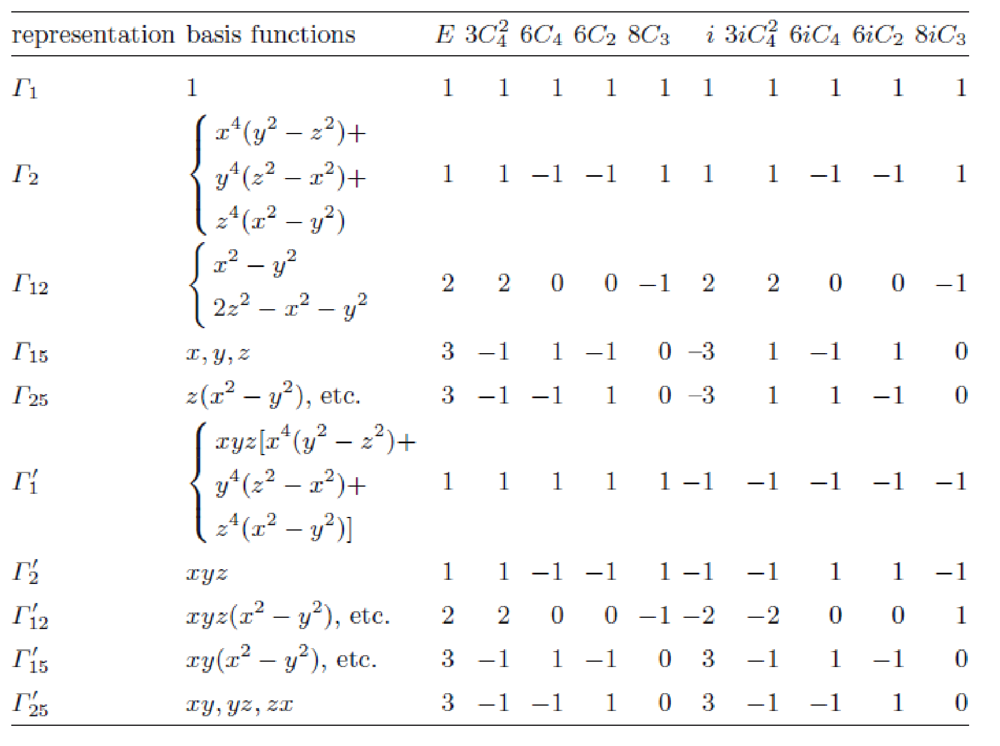

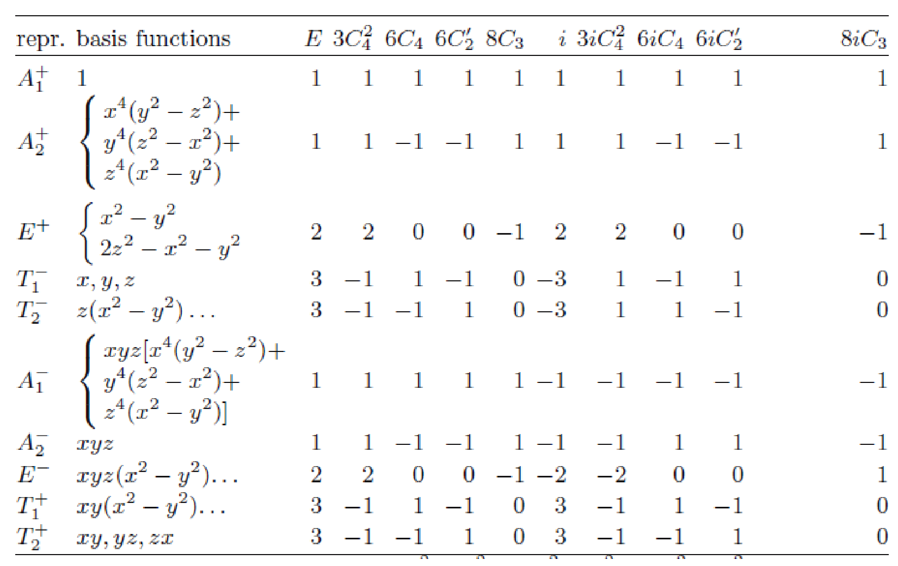

一篇文章中的习惯。他们在这里的基本逻辑是对一些高对称的空间群的晶体，如果我把它的布里渊区画出来的话，那么它的布里渊区里面不同的点具有不同的点群对称性。比如一个晶体是简立方的晶格，那么它的布里渊区就是这个样子：

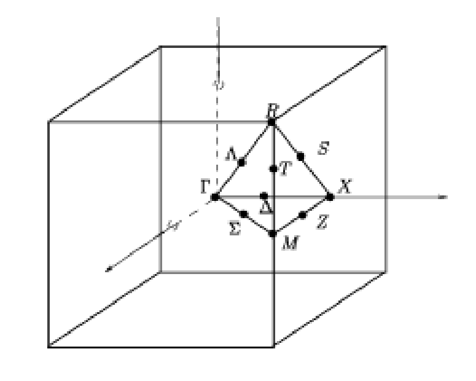

这样的一个布里渊去里面，不同的点的点群对称性分别如下。因为这个原因，对 $\mathrm{O_h}$ 这个点群，由于只有 $\Gamma$ 点具有它的对称性，所以在标识 $\mathrm{O_h}$ 的不可约表示的时候，用了 $\Gamma$。这个是做固体物理的人比较喜欢的习惯。

| lattice | point | $k$ | symmetry |
|:--|:--:|:--|:--|
| #221$^{a}$ | $\Gamma$ | $(0,0,0)$ | $O_h$ |
|  | $R$ | $[(2\pi/a)(1,1,1)]$ | $O_h$ |
|  | $X$ | $[(2\pi/a)(1,0,0)]$ | $D_{4h}$ |
|  | $M$ | $[(2\pi/a)(1,1,0)]$ | $D_{4h}$ |
|  | $\Lambda$ | $[(2\pi/a)(x,x,x)]$ | $C_{3v}$ |
|  | $\Sigma$ | $[(2\pi/a)(x,x,0)]$ | $C_{2v}$ |
|  | $\Delta$ | $[(2\pi/a)(x,0,0)]$ | $C_{4v}$ |
|  | $S$ | $[(2\pi/a)(1,z,z)]$ | $C_{2v}$ |
|  | $T$ | $[(2\pi/a)(1,1,z)]$ | $C_{4v}$ |
|  | $Z$ | $[(2\pi/a)(1,y,0)]$ | $C_{2v}$ |

另一拨人（比如原子分子物理、理论化学专业），可能又比较喜欢用 A、B、E、T 来标记点群不可约表示，A、B 是一维的，E 是二维的，T 是三维的。现在由于学科交融，做固体物理的很多时候也会使用 A、B、E、T 这种标识。因此，这个就是一个习惯问题，背后有这样一个故事，但不绝对。

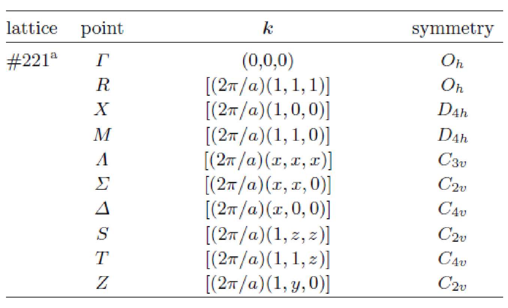

当点群中存在空间反演操作 I 时，第一个表中后五个 $\Gamma$ 带撇了。这个撇代表这五个不可约表示的基函数是奇宇称的。对 A、B、E、T 这种表述，上面的例子是用 '+'、'-' 这些上标给区分出来。在有些其它的文献中，也会用 $\mathrm{A_g}$、$\mathrm{A_u}$ 这类 g 和 u 的下标来区分。这里 g 是 gerade，德语 even 的意思，u 是 ungerade，德语 odd 的意思，对应的还是宇称。

最后，在 basis function 那一栏，好多文献中会给出一些 x、y、z 的齐次函数的例子。后面我们会讲一个量子力学系统的本征态往往对应一个不可约表示的基，这样的话给出这些齐次函数的例子就很重要了。这个后面我们会细讲，这里大家先记住是不可约表示的一些比较典型的基就可以了。

## 3.6 习题与思考

1. 设 O 是三维实正交群一个元素，$C_{\vec{k}}(\theta)$ 是其中的某纯转动操作，$S_{\vec{k}}(\theta)$ 是其中的某转动反射操作。问 $OC_{\vec{k}}(\theta)O^{-1}$ 是什么样的操作？$OS_{\vec{k}}(\theta)O^{-1}$ 是什么样的操作？

2. 某点群有个垂直 xy 水平面的二阶轴 $\mathrm{C_2}$，和过 $\mathrm{C_2}$ 的反射面 $\sigma_v$，它是什么点群？以 $\{xy,xz,yz\}$ 为基，它的表示是什么？它可约吗？如可约，请约化。

3. 以 $\{2xy,x^2-y^2\}$、$\{R_x=yp_z-zp_y,R_y=zp_x-xp_z\}$ 为基，求 $\mathrm{D_3}$ 的表示矩阵。

4. 某点群有奇数阶转动轴 $S_{2n+1}$，证明：必存在独立的转动轴 $C_{2n+1}$ 及水平反射面。

5. 4n 阶转动反射轴 $S_{4n}$ 为生成元，能否产生反演操作 I？

6. 求出二维实空间中所有点群。

7. 用熊夫利符号，说出如下点群：1）基于 $\mathrm{C_6}$ 群中，增加空间反演操作；2）在 $\mathrm{C_{5h}}$ 群中，去掉所有转动反演操作；3）基于 $\mathrm{T_d}$ 群中，增加空间反演操作。

8. 1）上 Bilbao Crystallographic Server 的网站查基于 $\mathrm{D_2}$ 点群一个空间群 P222 的所有对称操作，写出来。2）某篇关于晶体结构的文章在给结构的时候只给出非等价的原子的位置。如果给出的这个原子是 C，它在晶胞内的相对坐标是 (0.125, 0.125, 0.125)，写出晶胞内所有原子的位置。3）如果这个空间群是 $\mathrm{P2_1 22}$，情况又怎样？4）空间群是 C222，情况又怎样？（本题写相对坐标就可以）

9. 一个立方体，点群是什么？沿对角线方向拉伸，点群变成什么？如果它是完美单晶，这个晶体会由什么晶系变成什么晶系？

10. 参考附录内容中三方晶系包含的空间群，体会本节描述晶系、点群、布拉菲格子、晶格系统那个表格，指出哪些是基于菱方的晶格系统？

11. 指出下列分子的点群：

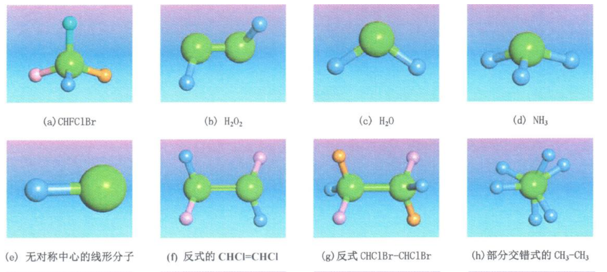

12. 基于本节中已知第一类点群特征标表，不要参考附录，完整地写出 $\mathrm{C_{4h}}$ 群的特征标表（要求过程，同时写明每个类包含哪些元素）。

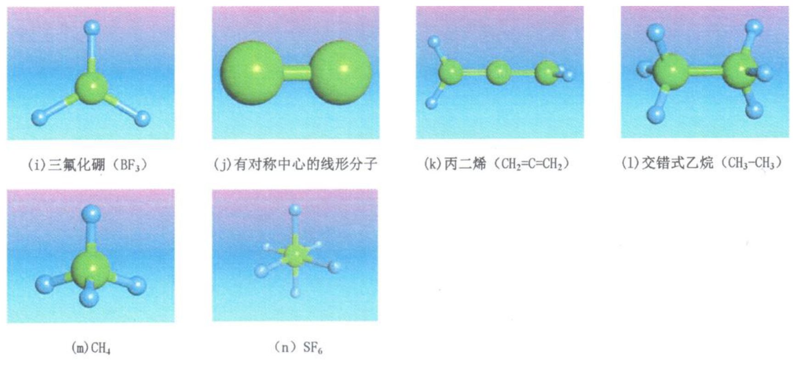

13. 基于本节中已知第一类点群特征标表，不要参考附录，完整地写出 $\mathrm{D_{4d}}$ 群的特征标表（要求过程，同时写明每个类包含哪些元素）。
