# 第四章 群论与量子力学

现在我们把我们这门课的理论基础以及我们在以后面对实际材料的时候遇到的最为重要的点群、空间群讲完了。我们这门课还有两类群需要讲：转动群与置换群。在讲之前，以我自己学这门课和讲这门课的经验来看，最大的困难是我们在学了很多很难理解的概念和定理之后并不知道它有什么用？我觉得这个坑必须现在先填上。

这一章的作用就是填坑。方法是用一些我知道的量子力学、固体物理、原子分子物理中的例子，来理解群论到底怎么去用？理解的话你可以去想量子力学、固体物理、原子分子物理是物理，群论是数学，由于量子力学在物理这边起最基础的作用，这一章的题目我们把它叫作《群论与量子力学》。

具体而言，作为物理系、化学系的学生，面对微观世界，我们是需要用量子力学的概念去理解其物理、化学性质的。我们观测到的任何东西，最终解释的时候都会落到你所观测的系统的一些本征态上。以分子或凝聚态体系为例，这些本征态可以是电子态，可以是声子态，也可以是它们之间的耦合形成的其它准粒子态。这些态是如何产生的？它与你所观测的系统的对称性存在什么样的关联？你观测的系统在一个外界扰动下，从一个本征态向另一个本征态跃迁会呈现什么样的规律？这些都是你们在以后的科研中要遇到的实际问题。在你花费了巨大精力学习完这门课后，如果你以后在科研中遇到类似问题，不懂得如何用对称性原理去理解，这门课你就白上了。也正是因为这个原因，我把《群论与量子力学》这章当成我们这门课里面重点的重点。

要讲的内容包括八节。第一节哈密顿算符群与相关定理是总体的讲量子力学与对称性之间的关系，其中的概念与定理是对我们这一章内容进行理解的基础。

第二节讲微扰引起的能级分裂，是一个具体的系统对称性的变化导致物性变化的例子。具体会说明在这个变化过程中，我们如何用对称性的语言去描述和理解物性的变化。第三节讲投影算符与久期行列式的对角化。其中投影算符是数学基础部分，它将教会我们如何让一组基函数具备物理系统的对称性。久期行列式的对角化是对称化的基函数在解薛定谔方程的时候的应用，它可以简化这个求解过程。第四节讲一些矩阵元定理与选择定则。它说的是本来系统有个哈密顿量，有一系列的本征波函数。根据我们第一节讲的内容，我们应该知道这些本征态基函数能反映系统的对称性。现在我加了个微扰，系统会在原来哈密顿量的本征态之间发生一些跃迁。这一节会告诉我们如何利用对称性的知识去理解哪些跃迁可以发生、哪些跃迁不能发生？第五节我想讲一下你们以后做实验应该会经常接触到的红外谱、拉曼谱、和频光谱。第六节与第七节回到固体物理，从平移与转动两个角度去讲解晶体中的这些对称性对晶体能带的影响。最后一节讲时间反演对称性。这些内容只是根据我在过去五年中的课程进度放入的内容，使得讲义本身可以在一个学期讲完。更多应用建议大家仔细阅读 Dresselhaus 那本书。

## 4.1 哈密顿算符群与相关定理

这部分讨论的基础是哈密顿量的变换性质，把它搞明白了，所有的概念与定理就清楚了。而要明白哈密顿量的变换性质，首先就要清楚哈密顿量是什么？简单来说，它有这样的性质：

1. 它是一个坐标的函数（这个坐标是个广义的坐标，暂记为 $\vec{x}$）；
2. 它是一个算符；
3. 我们一般把它记为 $\hat{H}(\vec{x})$；
4. 它与一个物理系统对应。

因为它是坐标的函数，那么如果我们对它的变量空间做变换 $g$ 的话，这个函数的变量就变成了 $g\vec{x}$。这个时候，如果 $\hat{H}(\vec{x}) = \hat{H}(g\vec{x})$（注意，这个要求是哈密顿量不变，它同时包含动能与势能项），我们称 $g$ 是保持哈密顿量不变的一个操作。换句话说，$g$ 是让系统回到和之前不可分辨状态的一个操作。它存在会给系统带来什么样的性质呢？

既然 $g$ 是作用到 $\vec{x}$ 上的一个变换，对于波函数所在希尔伯特空间的任意一个向量 $\varphi(\vec{x})$，那它肯定对应一个线性变换算符 $\hat{P}_g$。根据我们之前讲过的变换规则，$\hat{P}_g$ 作用到 $\varphi(\vec{x})$ 上后果为：$\hat{P}_g\varphi(\vec{x}) = \varphi(g^{-1}\vec{x})$。

同时，如果我们定义 $g$ 这个作用到 $\vec{x}$ 上的变换，与 $f$ 这个作用到 $\vec{x}$ 上的变换，它们的乘积 $fg$ 所对应的线性变换算符 $\hat{P}_{fg} = \hat{P}_f\hat{P}_g$，那么我们就会有：

$$
\hat{P}_{g^{-1}}\hat{P}_g\varphi(\vec{x}) = \hat{P}_{g^{-1}}\left(\hat{P}_g\varphi(\vec{x})\right) = \hat{P}_{g^{-1}}\varphi(g^{-1}\vec{x}) = \varphi(\vec{x})
$$

由于这个等式对希尔伯特空间中的任意一个函数 $\varphi(\vec{x})$ 都成立，因此：$\hat{P}_{g^{-1}} = \hat{P}_g^{-1}$。

这样的话，对 $\hat{H}(\vec{x})\varphi(\vec{x})$，就会有：

$$
\begin{aligned}
\hat{H}(\vec{x})\varphi(\vec{x}) &= \hat{P}_g\hat{P}_{g^{-1}}\hat{H}(\vec{x})\varphi(\vec{x}) = \hat{P}_g\hat{H}(g\vec{x})\varphi(g\vec{x}) = \hat{P}_g\hat{H}(g\vec{x})\hat{P}_{g^{-1}}\varphi(\vec{x}) \\
&= \hat{P}_g\hat{H}(g\vec{x})\hat{P}_g^{-1}\varphi(\vec{x})
\end{aligned}
$$

对任意一个希尔伯特空间中的函数 $\varphi(\vec{x})$ 成立，因此 $\hat{H}(\vec{x}) = \hat{P}_g\hat{H}(g\vec{x})\hat{P}_g^{-1}$。而我们之前说过 $g$ 是保持系统哈密顿量不变的一个操作，它的性质是：$\hat{H}(\vec{x}) = \hat{H}(g\vec{x})$，因此我们可进一步得到：$\hat{H}(\vec{x}) = \hat{P}_g\hat{H}(\vec{x})\hat{P}_{g^{-1}} = \hat{P}_g\hat{H}(\vec{x})\hat{P}_g^{-1}$，从而：

$$
\hat{P}_g\hat{H}(\vec{x}) = \hat{H}(\vec{x})\hat{P}_g
$$

**这也就意味着如果 $g$ 是保持哈密顿量 $\hat{H}(\vec{x})$ 不变的坐标空间的变换，那么它所对应希尔伯特空间的函数变换算符 $\hat{P}_g$ 与 $\hat{H}(\vec{x})$ 互易。**

这个性质是我们这章经常会用到的一个性质，由它可以得到很多的定理。在讲这些定理之前，我们先看两个概念，分别是哈密顿算符群与哈密顿算符的群。

**定义 4.1** 哈密顿算符的群：所有保持哈密顿量 $\hat{H}(\vec{x})$ 不变的变换 $g$ 的集合形成的群，称为哈密顿算符的群，或薛定谔方程的群，记为：

$$
G_H = \{g \mid \hat{H}(g\vec{x}) = \hat{H}(\vec{x})\}
$$

**定义 4.2** 哈密顿算符群（也叫薛定谔方程群）：由哈密顿算符的群中群元对应的函数变换算符形成的群，称为哈密顿算符群，或薛定谔方程群，记为：

$$
P_{G_H} = \{\hat{P}_g \mid g \in G_H\}
$$

有了哈密顿算符的群、哈密顿算符群两个概念，并且知道了哈密顿算符群中的元素与哈密顿量互易这个性质，我们进一步去看群的表示理论与量子力学的联系。其中第一个是关于具有相同本征能量的本征函数的。

**定理 4.1** 哈密顿量算符 $\hat{H}(\vec{x})$ 的具有相同本征能量的本征函数，构成哈密顿算符群 $P_{G_H}$（也叫薛定谔方程群）的群表示的基函数。

（这个意思就是说 $\hat{H}(\vec{x})$ 不是有一系列本征能级吗？每个能级上，都有一个或几个本征态。现在以能级为基本单元，把它上面的本征态做线性组合形成线性空间。如果这个能级不简并，这个线性空间是一维的；如果 $n$ 重简并，这线性空间是 $n$ 维的。这个定理说的是这些线性空间都是这个系统的哈密顿算符群 $\{\hat{P}_g\}$ 的表示空间，$\{\hat{P}_g\}$ 这个群，和把 $\{\hat{P}_g\}$ 作用到每个空间上，得到的矩阵群同态）

证明：

取一个本征能级 $E_n$，设它是 $l$ 重简并的。这样的话就有 $l$ 个线性无关的本征函数，$\Psi_i(\vec{x})$，其中 $i$ 从 1 到 $l$。它们形成的线性空间记为 $W^H$。

对 $\forall \hat{P}_g \in P_{G_H}$，由于有 $\hat{P}_g\hat{H}(\vec{x}) = \hat{H}(\vec{x})\hat{P}_g$，因此 $\hat{P}_g$ 作用到 $\forall \Psi_i(\vec{x})$ 上，都有：

$$
\hat{H}(\vec{x})\hat{P}_g\Psi_i(\vec{x}) = \hat{P}_g\hat{H}(\vec{x})\Psi_i(\vec{x}) = \hat{P}_gE_n\Psi_i(\vec{x}) = E_n\hat{P}_g\Psi_i(\vec{x})
$$

这也就意味着 $\hat{P}_g\Psi_i(\vec{x})$ 仍然是 $\hat{H}(\vec{x})$ 本征值为 $E_n$ 的本征函数。

之前我们说过 $E_n$ 是 $l$ 重简并的，对应的线性空间为 $W^H$，那么 $\hat{P}_g\Psi_i(\vec{x})$ 必为这个空间中的向量，对应：

$$
\hat{P}_g\Psi_i(\vec{x}) = \sum_{i'=1}^{l}\Delta_{ii'}^{(n)}(g)\Psi_{i'}(\vec{x})
$$

$\{\Delta^{(n)}(g)\}$ 这个矩阵群就是 $\{\hat{P}_g\}$ 的 $l$ 维表示。

（证毕）

这里说明一下。这个定理说的是一个能级上的本征态形成的线性空间可以承载这个哈密顿算符群的表示。这个表示，要么不可约，要么可以约化为一系列不可约表示的直和。但是对这个里面的每个不可约表示，它们的基对应的本征态的本征能量是一样的。

跟这个定理对应，还有一个定理，说的是不同能级上的本征态，如果通过线性组合形成表示空间的话，承载的不可能是一个不可约表示。总结起来，是下面一句话。

**定理 4.2** 构成哈密顿算符群的不可约表示的本征函数必属于同一能级。

证明：（反证）

设 $\hat{H}(\vec{x})$ 的 $l$ 个本征函数 $\Psi_i(\vec{x})$ 构成哈密顿算符群的第 $\alpha$ 个不可约表示，而它们的能量并不相同。取最简单的例子，前 $l-1$ 个属于能级 $E$，最后一个属于能级 $E'$。也就是 $E_i = E$，for $i \le l-1$；$E_i = E'$，for $i = l$。

这样的话，由薛定谔方程，我们知：

$$
\hat{H}(\vec{x})\Psi_l(\vec{x}) = E'\Psi_l(\vec{x})
$$

取 $\forall \hat{P}_g \in P_{G_H}$，作用到这个方程两边，

$$
\text{左边} = \hat{P}_g\hat{H}(\vec{x})\Psi_l(\vec{x}) = \hat{H}(\vec{x})\hat{P}_g\Psi_l(\vec{x}) = \hat{H}(\vec{x})\sum_{i=1}^{l}\Delta_{il}^{(\alpha)}(g)\Psi_i(\vec{x})
$$

其中 $\Delta_{il}^{(\alpha)}(g)$ 是第 $\alpha$ 个不可约表示的第 $i$ 行、第 $l$ 列。它继续等于：

$$
\sum_{i=1}^{l}\Delta_{il}^{(\alpha)}(g)E_i\Psi_i(\vec{x})
$$

对右边，

$$
\text{右边} = E'\hat{P}_g\Psi_l(\vec{x}) = E'\sum_{i=1}^{l}\Delta_{il}^{(\alpha)}(g)\Psi_i(\vec{x})
$$

而左右两边是由线性无关的矢量 $\Psi_i(\vec{x})$ 组成的线性组合，如果相等，每个分量都应该相等，这样的话就有：

$$
\Delta_{il}^{(\alpha)}(g)E_i = \Delta_{il}^{(\alpha)}(g)E'
$$

对任意 $i$ 都成立，但是在 $i \le l-1$ 时，$E_i \ne E'$，这样的话 $\Delta_{il}^{(\alpha)}(g)$ 必为零。这也就是说 $\Delta_{il}^{(\alpha)}(g) = 0$ 对 $\forall g$ 成立，进而表示 $\Delta^\alpha$ 可约。这个与已知矛盾。

（证毕）

这两个定理合在一起，给了我们一个什么样的图像呢？就是对一个体系，它有哈密顿量，对应一个哈密顿算符群。这个算符群有一系列的不等价不可约表示。对薛定谔方程的一个本征能级，它上面的本征态波函数是可以形成这个哈密顿算符群的表示空间的。这个表示空间可以可约也可以不可约，可约时，它可以化为一系列不可约表示的直和。但是对某一不可约表示，承载它的本征态波函数的本征能量必相同。

其中，由后者带来的不同本征态之间本征能量相同的这种情况，我们称为必然简并，它是由对称性引起的。如某个能级上的表示可约，那这里不同不可约表示间能量相同的状况我们称为偶然简并。

这些讨论的物理基础是态叠加原理。在量子力学中，我们可以用某个本征态它所承载的不可约表示来标识它。为了给大家一个你们能记住，以后也应该能用上的具体的例子，我们看一下 Si 的能带。Si 大家都知道晶体结构就是一个 fcc 的晶格上，除了在原点放个 Si，沿立方体对角线 1/4 处，再放一个。它的布拉菲格子是面心立方。费米面附近的能带是这个样子：

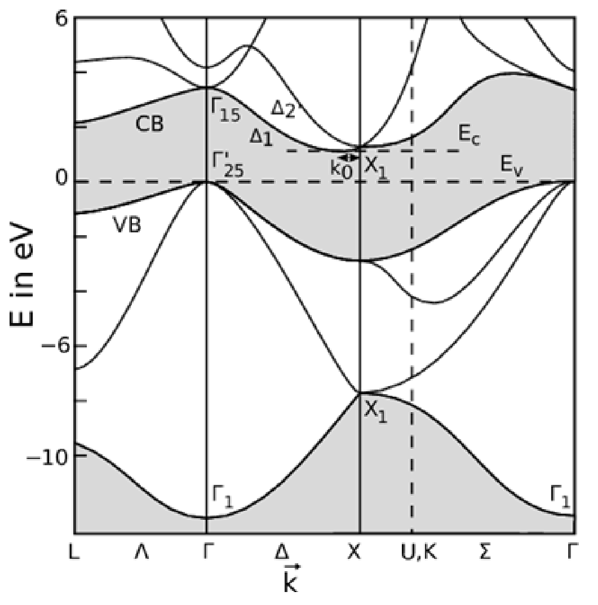

与我们讨论相关的是我们对这些高对称的 $k$ 点的本征态的标记。以 $\Gamma$ 点、X 点、K 点、L 点以及它们之间的连线为例。由于这个晶体的布里渊区如下：

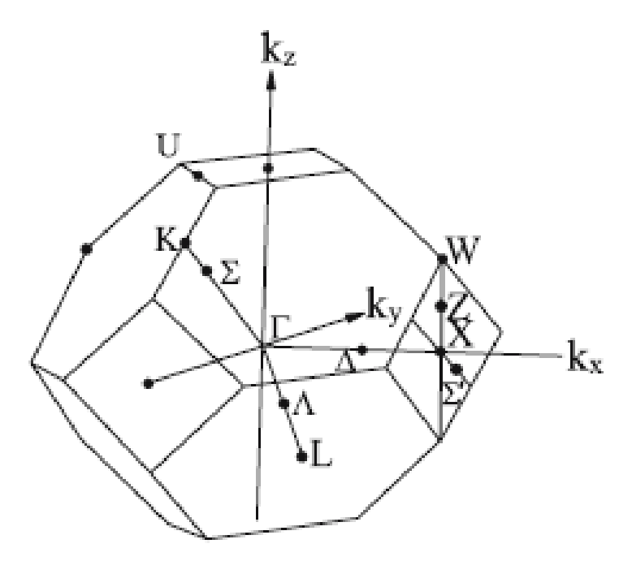

$\Gamma$ 点、X 点、K 点的点群对称性分别是：$O_h$、$D_{4h}$、和 $C_{2v}$。$\Gamma$ 点与 X 点连线上的点的点群对称性是 $C_{4v}$，X 点与 K 点连线就是 $C_1$。为什么倒空间中相差整数个倒格矢的 $k$ 点所对应的准粒子激发态相互等价，我们会在后面第六、第七节详细介绍。这里大家先接受一下。

按照我们前面讲的 $O_h = O \otimes \{E\text{、}I\}$，$O$ 有两个 1 维、一个 2 维、两个 3 维不可约表示，所以 $O_h$ 的不可约表示有四个 1 维、两个 2 维、四个 3 维的。$D_{4h} = D_4 \otimes \{E\text{、}I\}$，$D_4$ 有四个 1 维和一个 2 维不可约表示，所以 $D_{4h}$ 的不可约表示是八个 1 维和两个 2 维的。$C_{2v}$ 与 $D_2$ 同构，它的不可约表示是两个 1 维的。$C_{4v}$ 与 $D_4$ 同构，它的不可约表示是四个 1 维和一个 2 维的。$C_1$ 只有一个 1 维不可约表示。

与之相应，我们看能带上的点，基本也都能反映这些特征。比如 $\Gamma$ 点，它都是用 $O_h$ 特征标表中的不可约表示标识的：

| representation | $\{E\vert 0\}$ | $3\{C_4^2\vert 0\}$ | $6\{C_4\vert \tau_d\}$ | $6\{C_2'\vert \tau_d\}$ | $8\{C_3\vert 0\}$ | $\{i\vert \tau_d\}$ | $3\{iC_4^2\vert \tau_d\}$ | $6\{iC_4\vert 0\}$ | $6\{iC_2'\vert 0\}$ | $8\{iC_3\vert \tau_d\}$ |
|---|---|---|---|---|---|---|---|---|---|---|
| $\Gamma_1$ | 1 | 1 | 1 | 1 | 1 | 1 | 1 | 1 | 1 | 1 |
| $\Gamma_2$ | 1 | 1 | $-1$ | $-1$ | 1 | 1 | 1 | $-1$ | $-1$ | 1 |
| $\Gamma_{12}$ | 2 | 2 | 0 | 0 | $-1$ | 2 | 2 | 0 | 0 | $-1$ |
| $\Gamma_{15}$ | 3 | $-1$ | 1 | $-1$ | 0 | $-3$ | 1 | $-1$ | 1 | 0 |
| $\Gamma_{25}$ | 3 | $-1$ | $-1$ | 1 | 0 | $-3$ | 1 | 1 | $-1$ | 0 |
| $\Gamma_1'$ | 1 | 1 | 1 | 1 | 1 | $-1$ | $-1$ | $-1$ | $-1$ | $-1$ |
| $\Gamma_2'$ | 1 | 1 | $-1$ | $-1$ | 1 | $-1$ | $-1$ | 1 | 1 | $-1$ |
| $\Gamma_{12}'$ | 2 | 2 | 0 | 0 | $-1$ | $-2$ | $-2$ | 0 | 0 | 1 |
| $\Gamma_{15}'$ | 3 | $-1$ | 1 | $-1$ | 0 | 3 | $-1$ | 1 | $-1$ | 0 |
| $\Gamma_{25}'$ | 3 | $-1$ | $-1$ | 1 | 0 | 3 | $-1$ | $-1$ | 1 | 0 |

从 $\Gamma$ 到 X 连线上的点记作 $\Delta$，对称群从 $O_h$ 变成了 $C_{4v}$。$C_{4v}$ 没有三维不可约表示，特征标表为：

| representation | basis functions | $E$ | $C_4^2$ | $2C_4$ | $2iC_4^2$ | $2iC_2'$ |
|---|---|---|---|---|---|---|
| $\Delta_1$ | $1; x; 2x^2 - y^2 - z^2$ | 1 | 1 | 1 | 1 | 1 |
| $\Delta_2$ | $y^2 - z^2$ | 1 | 1 | $-1$ | 1 | $-1$ |
| $\Delta_2'$ | $yz$ | 1 | 1 | $-1$ | $-1$ | 1 |
| $\Delta_1'$ | $yz(y^2 - z^2)$ | 1 | 1 | 1 | $-1$ | $-1$ |
| $\Delta_5$ | $y, z; xy, xz$ | 2 | $-2$ | 0 | 0 | 0 |

与之相应，费米面下本来 3 重简并的点分裂为 1 个 2 重简并（上面）和 1 个 1 重简并（下面）的态。

到了 X 点，对称群变成了 $D_{4h}$，有八个 1 维与两个 2 维不可约表示，特征标

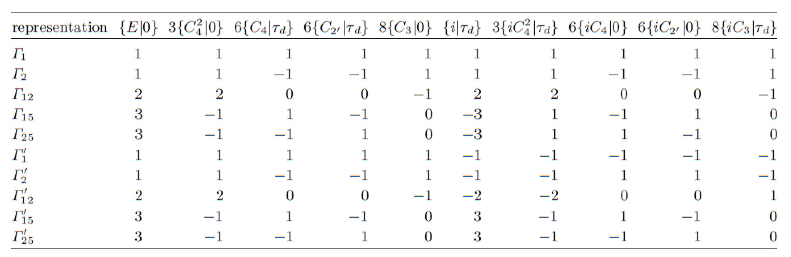

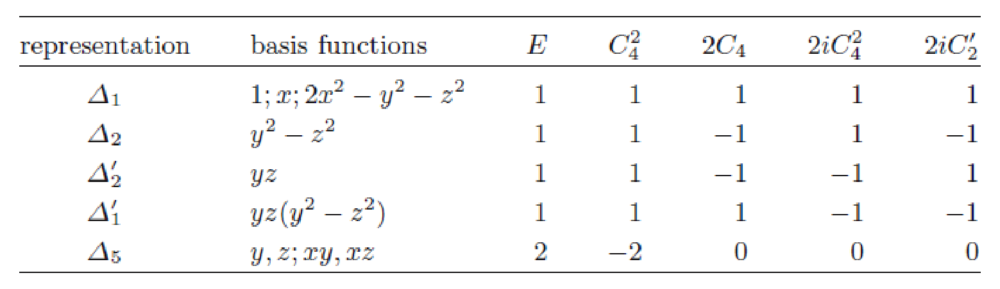

表为：

| representation | basis | $E$ | $2C_{4\perp}^2$ | $C_{4\parallel}^2$ | $2C_{4\parallel}^2$ | $2C_2$ | $i$ | $2iC_{4\perp}^2$ | $iC_{4\parallel}^2$ | $2iC_{4\parallel}$ | $2iC_2$ |
|---|---|---|---|---|---|---|---|---|---|---|---|
| $X_1$ | $1; 2x^2 - y^2 - z^2$ | 1 | 1 | 1 | 1 | 1 | 1 | 1 | 1 | 1 | 1 |
| $X_2$ | $y^2 - z^2$ | 1 | 1 | 1 | $-1$ | $-1$ | 1 | 1 | 1 | $-1$ | $-1$ |
| $X_3$ | $yz$ | 1 | $-1$ | 1 | $-1$ | 1 | 1 | $-1$ | 1 | $-1$ | 1 |
| $X_4$ | $yz(y^2 - z^2)$ | 1 | $-1$ | 1 | 1 | $-1$ | 1 | $-1$ | 1 | 1 | $-1$ |
| $X_5$ | $xy, xz$ | 2 | 0 | $-2$ | 0 | 0 | 2 | 0 | $-2$ | 0 | 0 |
| $X_1'$ | $xyz(y^2 - z^2)$ | 1 | 1 | 1 | 1 | 1 | $-1$ | $-1$ | $-1$ | $-1$ | $-1$ |
| $X_2'$ | $xyz$ | 1 | 1 | 1 | $-1$ | $-1$ | $-1$ | $-1$ | $-1$ | 1 | 1 |
| $X_3'$ | $x(y^2 - z^2)$ | 1 | $-1$ | 1 | $-1$ | 1 | $-1$ | 1 | $-1$ | 1 | $-1$ |
| $X_4'$ | $x$ | 1 | $-1$ | 1 | 1 | $-1$ | $-1$ | 1 | $-1$ | $-1$ | 1 |
| $X_5'$ | $y, z$ | 2 | 0 | $-2$ | 0 | 0 | $-2$ | 0 | 2 | 0 | 0 |

这个时候，大家可以注意。费米面一下第一个能带在 X 点，还没有劈裂开，还是一个 2 重简并。但它承载的不可约表示，却是两个 1 维不可约表示。这个时候的简并就不是由对称性强制的了，这时的简并是偶然简并。

从 X 点到 K 点，不可约表示全是一维。在 K 点对称性是 $C_{2v}$，相应的特征标表为：

| representation | $Z$ | $\Sigma$ | $G,K,U,S$ | $D$ |
|---|---|---|---|---|
| 操作的类 | $E$，$C_4^2$，$iC_4^2$，$iC_{4\perp}^2$ | $E$，$C_2$，$iC_4^2$，$iC_2$ | $E$，$C_2$，$iC_4^2$，$iC_2$ | $E$，$C_4^2$，$iC_2$，$iC_{2\perp}$ |
| $\Sigma_1$ | 1，1，1，1 | 1，1，1，1 | 1，1，1，1 | 1，1，1，1 |
| $\Sigma_2$ | 1，1，$-1$，$-1$ | 1，1，$-1$，$-1$ | 1，1，$-1$，$-1$ | 1，1，$-1$，$-1$ |
| $\Sigma_3$ | 1，$-1$，$-1$，1 | 1，$-1$，$-1$，1 | 1，$-1$，$-1$，1 | 1，$-1$，$-1$，1 |
| $\Sigma_4$ | 1，$-1$，1，$-1$ | 1，$-1$，1，$-1$ | 1，$-1$，1，$-1$ | 1，$-1$，1，$-1$ |

这里不可约表示用 $\Sigma$ 来标识，是因为 $\Sigma$、U 这些布里渊区的点对称性也都是 $C_{2v}$。对应的简并也相应的全部消除，所有的能级都不简并，承载一维不可约表示。

到这个地方，我们量子力学中的本征态与哈密顿算符群对称性的逻辑关系就讲完了。在这个逻辑关系中，偶然简并是可以存在的。但是当你遇到偶然简并的情况的时候，不要理所当然的认为它就是偶然简并。因为它同时可能意味着你的

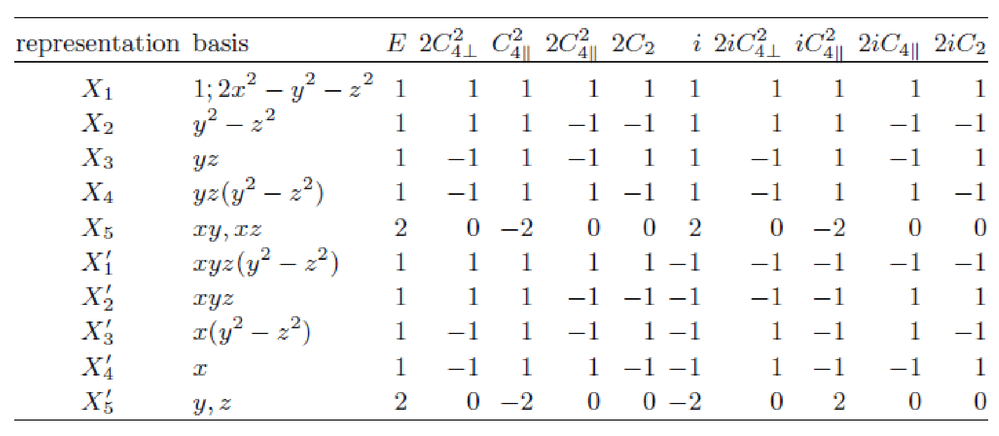

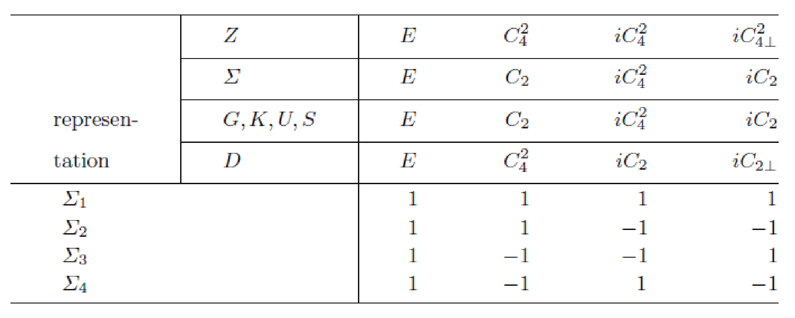

哈密顿算符群的对称性没有找全。当你的哈密顿算符群的对称性找全的时候，高维的不可约表示在新的对称群中就可以存在了。这时，如果你再回过头看你本征态之间的简并，它们经常会对应新的对称群的不可约表示。也就是说新的对称性是的可约表示变成了不可约表示，相应的偶然简并也变成了必然简并。这种情况，在我们量子力学的发展过程中是经常出现的。在 40、50 年代，当时物理学研究的前沿是求很多量子力学模型的解。往往你解出了一个好的模型，你就完成了一个很好的博士论文。在当时的这些文章中，你们会经常看到一些关于 accidental degeneracy 和 hidden symmetry 的讨论，说的就是这样一个事情。就是你原来认为的偶然简并，在你真正理解了这个量子力学系统的对称性之后，你会发现这个简并其实必然（对称性升高，其所要求的简并度增加）。

这个里面最典型的一个例子是氢原子模拟的本征态能量求解。氢原子大家去想它的对称性是什么？它与其它含有多个电子的原子去对比，对称性有不同吗？

最直接地去想，我们可能都会认为没啥不同，都是球对称。相应的哈密顿算符群是 SO(3) 群。如果是 SO(3) 群，我们下一章会讲，它的不可约表示的基是球谐函数，对一个特定的 $l$，不可约表示的简并度为 $2l+1$。我们原子物理中给出的原子轨道的分布一般也都是这样的，能量从低到高，一般原子分别是 1s、2s、2p、3s、3p、4s、3d、4p、…

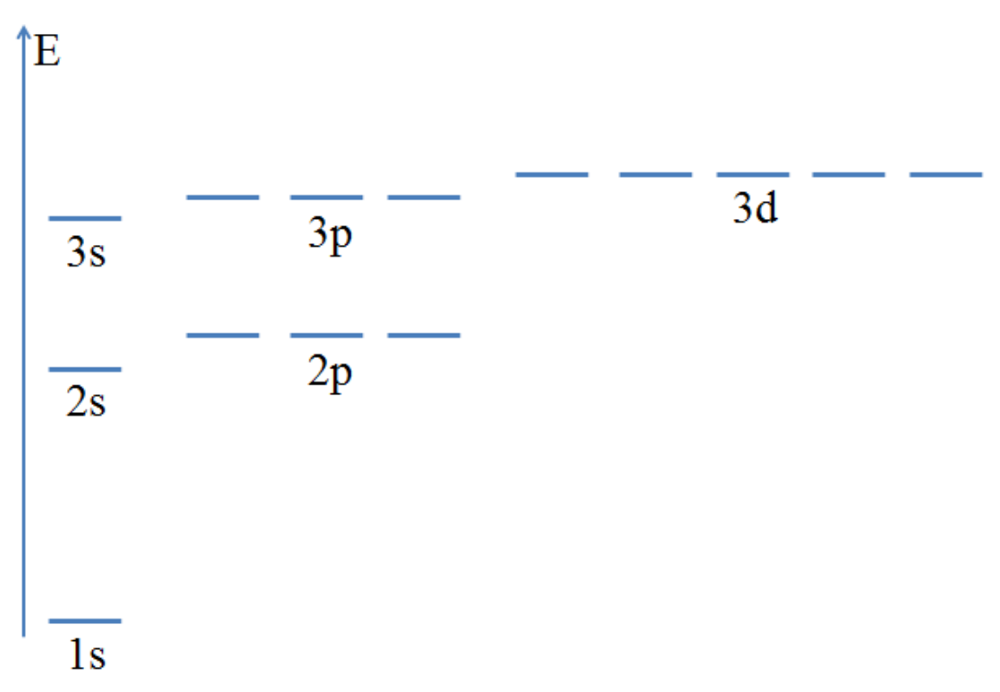

这个大家应该都很熟悉，也不会有什么疑问。

但是对于氢原子，如果我们看它的能级分布图的话，我们会看到这样的现象：

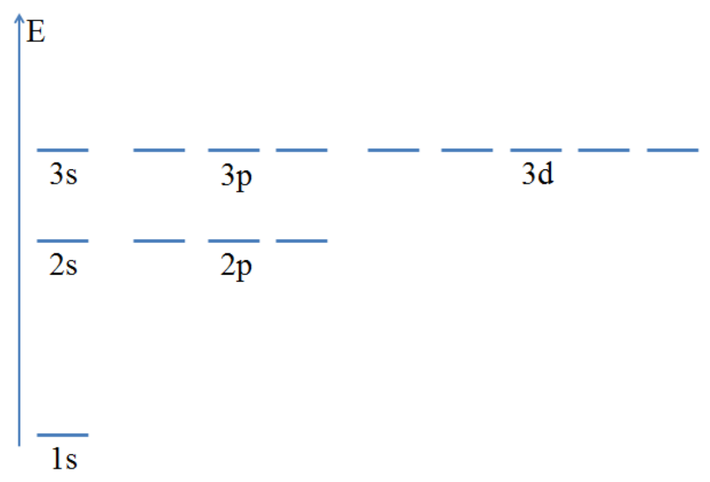

这个图和上面那个图就有很大的差别了，因为相同的 $n$ 本征能量都相同。

为什么会存在这个差别，这个在高量课上一般会讲。氢原子中库仑势是 $1/r$，这个 $1/r$ 很特别，因为早期在天文学的研究中，人们已经知道，在一个具有 $\vec{F} = -\dfrac{k}{r^2}\hat{r}$ 形式的引力场中，存在一个 Laplace-Range-Lenz 守恒量 $\vec{A} = \vec{p} \times \vec{L} - mk\hat{r}$，其中 $\vec{L} = \vec{r} \times \vec{p}$。更具体的这些向量的形式如下图：

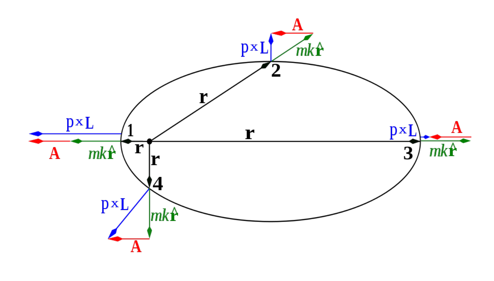

由于这个守恒量的存在，Noether 定理告诉我们它（这个守恒量）必对应一个对称性。这个导致的结果就是氢原子中，我守恒量比简单球对称体系多，所以我实际的对称性也比球对称体系高。我们把这个对称性称为一种动力学对称性，相应的氢原子的对称群是 SO(4)。而 SO(4) 群的简并就符合上面那个图的能级分布了。对其它原子，因为电子之间相互作用，这个 $1/r$ 的对称性不成立，对应的群还是 SO(3) 群[^11]。

这一节总结起来就是量子力学中的简并度与对称性息息相关。我们的研究中，经常遇到的是因为对称性的升高或降低所引起的能带的合并与劈裂。偶然简并有时可以出现，但它出现的时候我们往往要非常小心，因为它经常意味着我们对系统哈密顿量的对称性没有找全。

## 4.2 微扰引起的能级分裂

有了上一节的理论基础，这一节我们要讲的微扰引起的能级劈裂很好理解。说的是这样一个事情：本来系统不是有个哈密顿量 $\hat{H}_0(\vec{x})$，它的哈密顿算符群是 $P_{G_{H_0}}$，它的本征态我们用 $P_{G_{H_0}}$ 的不等价不可约表示来标识。

[^11]: 关于氢原子的动力学对称性的详细、严格的讨论，请阅读曾谨言老师《量子力学》卷 II 的 7.1 节。那一节，曾老师分氢原子的经典力学描述、二维氢原子的 SO(3) 对称性、三维氢原子的 SO(4) 对称性、n 维氢原子的 SO(n+1) 对称性对这个话题进行了严格的讨论。

现在我们给系统加了一个微扰 $\hat{H}'(\vec{x})$，它的哈密顿量变成了 $\hat{H}(\vec{x}) = \hat{H}_0(\vec{x}) + \hat{H}'(\vec{x})$，相应的哈密顿算符群也会发生变化，变为 $P_{G_H}$。

显然，新的本征态就需要用 $P_{G_H}$ 的不等价不可约表示来标识了。我们这部分讨论要干的事情，就是在不解薛定谔方程的情况下，看微扰 $\hat{H}'(\vec{x})$ 对能级简并情况的影响。具体情况分两种：

1. $P_{G_{H_0}}$ 的对称性比较高，加入微扰后，对称性降低了。新的哈密顿算符群 $P_{G_H}$ 是 $P_{G_{H_0}}$ 的子群。这种情况下，原来简并的能级上的态构成 $P_{G_{H_0}}$ 的不可约表示，在加入微扰之后，它们对应的 $P_{G_H}$ 的表示就不一定不可约了。相应的简并不被对称性保护，从而引起由对称性破缺诱发的能级劈裂。
2. $\hat{H}'(\vec{x})$ 的对称性大于等于 $\hat{H}_0(\vec{x})$，也就是说 $\hat{H}_0(\vec{x})$ 有的对称性 $\hat{H}'(\vec{x})$ 都有。这个时候，$P_{G_H}$ 相对于 $P_{G_{H_0}}$ 不发生变化。原来的必然简并还是必然简并。但偶然简并的破缺是可以发生变化的。

作为一个例子，我们来看一下把一个独立原子放到一个简立方的晶格场中，它的能级会发生什么样的变化？（与之相关的理论在历史上，上个世纪 40 年代之前，在物理学发展过程中曾经起过很重要的作用，有个专门的名字，叫晶格场理论 Crystal Field Theory。这个理论主要研究的是原子轨道在晶格场中的劈裂情况，手段是量子力学与群论；应用是早期激光器，一般都是把稀土元素或过渡金属元素作为杂质，掺到透明的晶体中，它的光谱由晶格场中的电子能级决定）

不考虑空间反演对称性。我们假设自旋-轨道耦合很弱，这样在没有晶格场的时候，原子轨道可以用 $n$、$l$、$m$ 三个好量子数来标识。$P_{G_{H_0}}$ 是下一章要讲的 SO(3) 群。加入晶格场之后，$P_{G_H}$ 变成了有限点群 O。

我们要讨论的是 $\hat{H}_0(\vec{x})$ 的本征态，也就是 SO(3) 群的不可约表示的基，在加入晶格场的微扰之后，发生什么样的变化？其中最重要的，就是要在 $\hat{H}_0(\vec{x})$ 的每个本征能级上（这里的简并都是必然简并），求出 $P_{G_H}$ 的表示矩阵。进而求得特征标，然后参照 O 群的特征标表。把这个表示约化为 O 群的不等价不可约表示的直和。这样就知道了必然简并在这里要发生什么样的劈裂了？

先看 O 群的对称操作，有 24 个，分五类，分别是：$\{E\}$、$8\{C_3^{(1)}\}$、$3\{C_4^{(1)2}\}$、$6\{C_4^{(1)}\}$、$6\{C_2^{(1)}\}$。我们要看的是它们这些操作在 SO(3) 群不可约表示表示空间的表示矩阵的特征标。

我们看 s、p、d、f 四个态。其中 s 态在 SO(3) 群中是个一维不可约表示，基函数的球谐部分为：

$$
Y_{00}(\theta,\varphi) = \frac{1}{2}\sqrt{\frac{1}{\pi}}
$$

由于 $\hat{P}_g$ 这些转动操作只作用到本征态的角向部分，而径向函数部分至于 $n$、$l$ 有关，所以我们在求表示矩阵的时候，可以根本就不关心这个径向函数部分。

对 s 态，O 群中的任何元素对应的表示矩阵都是 1 这个 1 阶单位矩阵，所以特征标都是 1。

对 p 态，角向部分基函数是：

$$
Y_{1-1}(\theta,\varphi) = \frac{1}{2}\sqrt{\frac{3}{2\pi}}e^{-i\varphi}\sin\theta
$$

$$
Y_{10}(\theta,\varphi) = \frac{1}{2}\sqrt{\frac{3}{2\pi}}\cos\theta
$$

$$
Y_{11}(\theta,\varphi) = \frac{1}{2}\sqrt{\frac{3}{2\pi}}e^{i\varphi}\sin\theta
$$

转动作用到类似的球谐函数基上，得到的表示矩阵的特征标只与转动角度有关。因此，我们取绕 $z$ 轴的转动，对于 O 群中的各个类，通过 $\hat{P}_g$ 作用到这些基上产生表示矩阵。这些表示矩阵的特征标分别是：

1. $\{E\}$：$\chi = 1 + 1 + 1 = 3$；
2. $8\{C_3^{(1)}\}$：$\chi = e^{i\frac{2\pi}{3}} + 1 + e^{-i\frac{2\pi}{3}} = 0$；
3. $3\{C_4^{(1)2}\}$：$\chi = e^{i\pi} + 1 + e^{-i\pi} = -1$；
4. $6\{C_4^{(1)}\}$：$\chi = e^{i\frac{\pi}{2}} + 1 + e^{-i\frac{\pi}{2}} = 1$；
5. $6\{C_2^{(1)}\}$：$\chi = e^{i\pi} + 1 + e^{-i\pi} = -1$。

对 d 态、f 态，球谐函数的普遍形式是：

$$
Y_{lm}(\theta,\varphi) = (-1)^m\sqrt{\frac{(2l+1)(l-m)!}{4\pi(l+m)!}}P_l^m(\cos\theta)e^{im\varphi}
$$

其中 $\mathrm{P}_l^m(x)$ 为 $m$ 阶 $l$ 次连带勒让德多项式，微分形式为：

$$
\mathrm{P}_l^m(x) = (1-x^2)^{\frac{m}{2}}\frac{1}{2^l l!}\frac{\mathrm{d}^{l+m}}{\mathrm{d}x^{l+m}}(x^2-1)^l
$$

以 d 态为例，O 群中的各个类所对应的哈密顿算符作用到 d 态波函数的这组基上产生的表示矩阵的特征标就是：

1. $\{E\}$：$\chi = 1 + 1 + 1 + 1 + 1 = 5$；
2. $8\{C_3^{(1)}\}$：$\chi = e^{i\frac{4\pi}{3}} + e^{i\frac{2\pi}{3}} + 1 + e^{-i\frac{2\pi}{3}} + e^{-i\frac{4\pi}{3}} = -1$；
3. $3\{C_4^{(1)2}\}$：$\chi = e^{i2\pi} + e^{i\pi} + 1 + e^{-i\pi} + e^{-i2\pi} = 1$；
4. $6\{C_4^{(1)}\}$：$\chi = e^{i\pi} + e^{i\frac{\pi}{2}} + 1 + e^{-i\frac{\pi}{2}} + e^{-i\pi} = -1$；
5. $6\{C_2^{(1)}\}$：$\chi = e^{i2\pi} + e^{i\pi} + 1 + e^{-i\pi} + e^{-i2\pi} = 1$。

f 态可同理求出。这样 O 群中的元素在球谐函数下的表示（可约表示）的特征标表就是：

| | $\{E\}$ | $8\{C_3^{(1)}\}$ | $3\{C_4^{(1)2}\}$ | $6\{C_4^{(1)}\}$ | $6\{C_2^{(1)}\}$ |
|---|---|---|---|---|---|
| s | 1 | 1 | 1 | 1 | 1 |
| p | 3 | 0 | -1 | 1 | -1 |

| | $\{E\}$ | $8\{C_3^{(1)}\}$ | $3\{C_4^{(1)2}\}$ | $6\{C_4^{(1)}\}$ | $6\{C_2^{(1)}\}$ |
|---|---|---|---|---|---|
| d | 5 | -1 | 1 | -1 | 1 |
| f | 7 | 1 | -1 | -1 | -1 |

这个时候，参考 O 群的不等价不可约表示特征标表：

| | $\{E\}$ | $8\{C_3^{(1)}\}$ | $3\{C_4^{(1)2}\}$ | $6\{C_4^{(1)}\}$ | $6\{C_2^{(1)}\}$ |
|---|---|---|---|---|---|
| A$_1$ | 1 | 1 | 1 | 1 | 1 |
| A$_2$ | 1 | 1 | 1 | -1 | -1 |
| E | 2 | -1 | 2 | 0 | 0 |
| T$_1$ | 3 | 0 | -1 | 1 | -1 |
| T$_2$ | 3 | 0 | -1 | -1 | 1 |

我们就可以得到，s 态还对应 $A_1$ 这个一维恒等表示；p 态对应 $T_1$ 这个不可约表示，也不劈裂；d 态变为：$E \oplus T_2$；f 态变为：$A_2 \oplus T_1 \oplus T_2$。

其中 d 轨道往 $E$ 和 $T_2$ 的劈裂在固体物理中经常用到，特别是关于过渡金属氧化物电子态的讨论。在这些固体中，很多过渡金属处在一个八面体的笼子里面，它的对称性就是 $O_h$。再加上空间反演对称性，这个时候我们可以看到很多文献上关于 $E_g$、$T_{2g}$ 的讨论，说的就是这个事情。

## 4.3 投影算符与久期行列式的对角化

这一节想给大家讲得具体问题是利用对称化的基函数，去简化薛定谔方程的久期行列式。为了让大家知道如何去对称化一组基，我们需要去学习一下投影算符，确切地说是哈密顿算符群的群表示投影算符。在这一节的学习中，投影算符是数学工具，久期行列式的对角化是这里的物理问题。这个物理问题是量子力学里面的一个常见问题。

除了这个物理问题，投影算符在群论这门学科本身又有什么用呢？一句话回答，就是可以简化群的表示。在求群表示过程中，我们是需要一组基的，这组基我们可以任意选。当然，如果我们任意选的话，我们得到的矩阵群一般是不具备豆腐块的特征的。我们无法判断其是否可约。我们可以通过对比特征标来进行这个判断。判断完了以后，如果它可约，我们是需要经过一个相似变换把这个矩阵群变成豆腐块的矩阵群的。但如何去找到这个相似变换，其实是很难的。

除了相似变换，另一条路是在我们建立这个群的表示矩阵的时候直接将你给我的表示空间约化为几个群不变的真子空间的直和。也就是直接将基函数对称化。这个群的群表示投影算符干的事情，就是将你给我的表示空间约化为群不变的真子空间的直和，也就是将空间中的基函数对称化。

了解了这些目的，我们就知道在简化群表示以及久期行列式的对角化中，能够理解和使用投影算符是至关重要的。学习过程我们分几步走，先看投影算符最基本的意思。

**定义 4.3** 投影算符：线性空间 V 上的线性算符 $\hat{P}$，若满足 $\hat{P}^2 = \hat{P}$，则称 $\hat{P}$ 是 V 上的一个投影算符。

$\hat{P}$ 的值域是：$R_p = \hat{P}V = \{\vec{z} \in V \mid \vec{z} = \hat{P}\vec{x},\ \vec{x} \in V\}$

$\hat{P}$ 的核是：$N_p = \{\vec{z} \in V \mid \hat{P}\vec{z}' = 0\}$

这个定义有些抽象，看一个具体的例子，V 是三维欧式空间，$\hat{P}$ 是对其 xy 平面的投影。

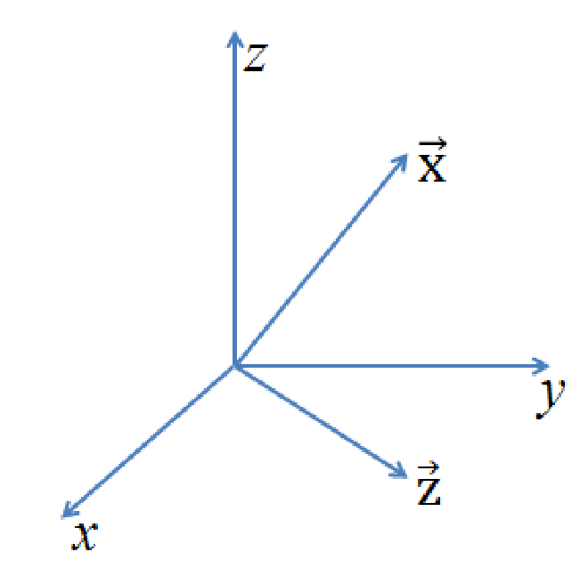

因为：$\hat{P}^2\vec{x} = \hat{P}\vec{x} = \vec{z}$，所以 $\hat{P}$ 是投影算符。$z$ 轴上所有向量都是 $\hat{P}$ 的核，$xy$ 平面是它的值域。

由这个关系，我们很容易知道：

1. 对 $\vec{z} \in R_p$，有 $\hat{P}\vec{z} = \vec{z}$；
2. $\hat{P}$ 是 V 上得投影算符，则 $\hat{E} - \hat{P}$ 也是，且有 $\hat{P}(\hat{E} - \hat{P}) = 0$；
3. 如存在 $\hat{P}$，则 V $= R_p \oplus N_p$；同时如果有一个空间 V $= W_1 \oplus W_2$，则一定存在一个相应的投影算符 $\hat{P}$。

由这个定义，我们还可以知道下面这个定理。

**定理 4.4** 若线性空间 V $= W_1 \oplus W_2 \oplus \cdots \oplus W_k$，则 V 上存在投影算符 $\hat{P}_1$、$\hat{P}_2$、$\cdots$、$\hat{P}_k$，满足：

1. $\hat{P}_i^2 = \hat{P}_i$；
2. $\hat{P}_i\hat{P}_j = 0$，当 $i \ne j$；
3. $\hat{P}_1 + \hat{P}_2 + \cdots + \hat{P}_k = \hat{E}$；
4. $\hat{P}_iV = W_i$，$i = 1\text{、}2\text{、}\cdots\text{、}k$。

同时，反之，若线性空间 V 上存在算符 $\hat{P}_1$、$\hat{P}_2$、$\cdots$、$\hat{P}_k$ 满足上面四个条件，则 V $= W_1 \oplus W_2 \oplus \cdots \oplus W_k$。

讲完了这两个定义，我们现在来看群表示投影算符，这个其实是一个定理。

**定理 4.5** 设群 G 的不可约酉表示为 $A^{(\alpha)}$，$\alpha = 1\text{、}2\text{、}\cdots\text{、}q$，维数为 $s_\alpha$。$P_G$ 为 G 对应的算符群，$P_G = \{\hat{P}_g \mid g \in G\}$。定义算符 $\hat{P}_{kj}^{(\alpha)} = \dfrac{s_\alpha}{n}\sum\limits_{g\in G}A_{kj}^{(\alpha)*}(g)\hat{P}_g$，则这些算符满足下列关系：

$$
\hat{P}_{kj}^{(\alpha)}\hat{P}_{il}^{(\beta)} = \delta_{\alpha\beta}\delta_{ij}\hat{P}_{kl}^{(\alpha)}
$$

且 $\hat{P}_{jj}^{(\alpha)}$ 为投影算符。

证明：

$$
\begin{aligned}
\hat{P}_{kj}^{(\alpha)}\hat{P}_{il}^{(\beta)} &= \frac{s_\alpha s_\beta}{n^2}\sum_{g\in G}A_{kj}^{(\alpha)*}(g)\hat{P}_g\sum_{g'\in G}A_{il}^{(\beta)*}(g')\hat{P}_{g'} \\
&= \frac{s_\alpha s_\beta}{n^2}\sum_{g\in G}\sum_{g'\in G}A_{kj}^{(\alpha)*}(g)A_{il}^{(\beta)}(g'^{-1})\hat{P}_{gg'}
\end{aligned}
$$

令 $gg' = g''$，则上式继续等于：

$$
\begin{aligned}
&= \frac{s_\alpha s_\beta}{n^2}\sum_{g\in G}\sum_{g''\in G}A_{kj}^{(\alpha)*}(g)A_{il}^{(\beta)}(g''^{-1}g)\hat{P}_{g''} \\
&= \frac{s_\alpha s_\beta}{n^2}\sum_{g\in G}\sum_{g''\in G}A_{kj}^{(\alpha)*}(g)\sum_{m=1}^{s_\beta}A_{lm}^{(\beta)}(g''^{-1})A_{mi}^{(\beta)}(g)\hat{P}_{g''} \\
&= \frac{s_\alpha}{n}\sum_{m=1}^{s_\beta}\sum_{g''\in G}\left[\frac{s_\beta}{n}\sum_{g\in G}A_{kj}^{(\alpha)*}(g)A_{mi}^{(\beta)}(g)\right]A_{lm}^{(\beta)}(g''^{-1})\hat{P}_{g''} \\
&= \frac{s_\alpha}{n}\sum_{m=1}^{s_\beta}\sum_{g''\in G}\delta_{\alpha\beta}\delta_{km}\delta_{ji}A_{lm}^{(\beta)}(g''^{-1})\hat{P}_{g''} \\
&= \delta_{\alpha\beta}\delta_{ji}\left[\frac{s_\alpha}{n}\sum_{g''\in G}A_{kl}^{(\beta)*}(g'')\hat{P}_{g''}\right] = \delta_{\alpha\beta}\delta_{ji}\hat{P}_{kl}^{(\beta)}
\end{aligned}
$$

这个是我们要证明的等式，对这样一个等式，取 $\alpha = \beta$、$i = j = k = l$ 时，有：

$$
\hat{P}_{jj}^{(\alpha)}\hat{P}_{jj}^{(\alpha)} = \hat{P}_{jj}^{(\alpha)}
$$

因此 $\hat{P}_{jj}^{(\alpha)}$ 是投影算符。

（证毕）

对这类投影算符，它满足一个性质：

**定理 4.6** $\sum\limits_{\alpha=1}^{q}\sum\limits_{i=1}^{s_\alpha}\hat{P}_{ii}^{(\alpha)} = \hat{P}_e$，其中 $\hat{P}_e$ 为恒等算符。

证明：

用到不等价不可约表示矩阵元完备定理：

$$
\sum_{\beta=1}^{q}\sum_{k,l=1}^{s_\alpha}\frac{s_\beta}{n}A_{kl}^{(\alpha)*}(g')A_{kl}^{(\alpha)}(g) = \delta_{gg'}
$$

由算符 $\hat{P}_{kl}^{(\alpha)}$ 定义，有：$\hat{P}_{kl}^{(\alpha)} = \dfrac{s_\alpha}{n}\sum\limits_{g\in G}A_{kl}^{(\alpha)*}(g)\hat{P}_g$

两边乘上 $A_{kl}^{(\alpha)}(g')$ 并对 $\alpha$、$k$、$l$ 求和，有：

$$
\begin{aligned}
\sum_{\alpha=1}^{q}\sum_{k,l=1}^{s_\alpha}A_{kl}^{(\alpha)}(g')\hat{P}_{kl}^{(\alpha)} &= \sum_{g\in G}\left[\sum_{\alpha=1}^{q}\sum_{k,l=1}^{s_\alpha}\frac{s_\alpha}{n}A_{kl}^{(\alpha)*}(g)A_{kl}^{(\alpha)}(g')\right]\hat{P}_g \\
&= \sum_{g\in G}\delta_{gg'}\hat{P}_g = \hat{P}_{g'}
\end{aligned}
$$

取 $g' = e$，上式可得：

$$
\sum_{\alpha=1}^{q}\sum_{k,l=1}^{s_\alpha}A_{kj}^{(\alpha)}(e)\hat{P}_{kl}^{(\alpha)} = \hat{P}_e
$$

由于 $A_{kl}^{(\alpha)}(e) = \delta_{kl}$，所以上式继续给出：

$$
\sum_{\alpha=1}^{q}\sum_{k,l=1}^{s_\alpha}\delta_{kl}\hat{P}_{kl}^{(\alpha)} = \hat{P}_e
$$

进而：

$$
\sum_{\alpha=1}^{q}\sum_{k=1}^{s_\alpha}\hat{P}_{kk}^{(\alpha)} = \hat{P}_e
$$

（证毕）

关于这个群表示投影算符，有两个比较重要的性质，以定理的形式给出：

**定理 4.7** 有限群不可约酉表示基函数定理 I：

设 $P_G = \{\hat{P}_g \mid g \in G\}$ 是群 G 的函数作用算符群（相当于我们前面介绍的哈密顿算符群），由它可以定义算符 $\hat{P}_{ij}^{(\alpha)}$。这时，有一个性质，就是一组基函数 $\varphi_i^{(\alpha)}$，$i = 1\text{、}2\text{、}$⋯、$s_\alpha$ 构成 $P_G$ 的第 $\alpha$ 个不可约酉表示基函数的充要条件是：

$$
\hat{P}_{ij}^{(\alpha)}\varphi_j^{(\alpha)}=\varphi_i^{(\alpha)}
$$

这里 $\varphi_i^{(\alpha)}$ 称为对称化基函数。

证明：

1. 必要性

（由 $\varphi_i^{(\alpha)}$，$i=1\text{、}2\text{、}\cdots\text{、}s_\alpha$ 构成 $P_G$ 的第 $\alpha$ 个不可约酉表示基证明 $\hat{P}_{ij}^{(\alpha)}\varphi_j^{(\alpha)}=\varphi_i^{(\alpha)}$）

设 $\varphi_i^{(\alpha)}$，$i=1\text{、}2\text{、}\cdots\text{、}s_\alpha$ 构成 $P_G$ 的第 $\alpha$ 个不可约酉表示基，则：

$$
\hat{P}_g\varphi_k^{(\alpha)}=\sum_{l=1}^{s_\alpha}A_{lk}^{(\alpha)}(g)\varphi_l^{(\alpha)}
$$

两边乘上 $A_{ij}^{(\alpha)*}(g)$ 并对群元求和，有：

$$
\begin{aligned}
\sum_{g\in G}A_{ij}^{(\alpha)*}(g)\hat{P}_g\varphi_k^{(\alpha)}
&=\sum_{g\in G}A_{ij}^{(\alpha)*}(g)\sum_{l=1}^{s_\alpha}A_{lk}^{(\alpha)}(g)\varphi_l^{(\alpha)}\\
&=\sum_{l=1}^{s_\alpha}\left[\sum_{g\in G}A_{ij}^{(\alpha)*}(g)A_{lk}^{(\alpha)}(g)\right]\varphi_l^{(\alpha)}\\
&=\sum_{l=1}^{s_\alpha}\frac{n}{s_\alpha}\delta_{il}\delta_{jk}\varphi_l^{(\alpha)}\\
&=\frac{n}{s_\alpha}\delta_{jk}\varphi_i^{(\alpha)}
\end{aligned}
$$

由定义 $\hat{P}_{ij}^{(\alpha)}=\frac{s_\alpha}{n}\sum_{g\in G}A_{ij}^{(\alpha)*}(g)\hat{P}_g$，上式等同于：

$$
\hat{P}_{ij}^{(\alpha)}\varphi_k^{(\alpha)}=\delta_{jk}\varphi_i^{(\alpha)}
$$

取 $j=k$，则有：

$$
\hat{P}_{ij}^{(\alpha)}\varphi_j^{(\alpha)}=\varphi_i^{(\alpha)}
$$

2. 充分性（已知 $\hat{P}_{ij}^{(\alpha)}\varphi_j^{(\alpha)}=\varphi_i^{(\alpha)}$，推 $\varphi_i^{(\alpha)}$，$i=1\text{、}2\text{、}\cdots\text{、}s_\alpha$ 构成 $P_G$ 的第 $\alpha$ 个不可约酉表示基）

由 $\hat{P}_{ij}^{(\alpha)}\varphi_j^{(\alpha)}=\varphi_i^{(\alpha)}$ 知：

$$
\begin{aligned}
\hat{P}_g\varphi_i^{(\alpha)}
&=\hat{P}_g\hat{P}_{ij}^{(\alpha)}\varphi_j^{(\alpha)}\\
&=\hat{P}_g\frac{s_\alpha}{n}\sum_{g'\in G}A_{ij}^{(\alpha)*}(g')\hat{P}_{g'}\varphi_j^{(\alpha)}\\
&=\sum_{g'\in G}\frac{s_\alpha}{n}A_{ij}^{(\alpha)*}(g')\hat{P}_{gg'}\varphi_j^{(\alpha)}
\end{aligned}
$$

取 $gg'=g''$，则上式可化为：

$$
\begin{aligned}
&=\sum_{g''\in G}\frac{s_\alpha}{n}A_{ij}^{(\alpha)*}(g^{-1}g'')\hat{P}_{g''}\varphi_j^{(\alpha)}\\
&=\frac{s_\alpha}{n}\sum_{g''\in G}\sum_{k=1}^{s_\alpha}A_{ik}^{(\alpha)*}(g^{-1})A_{kj}^{(\alpha)*}(g'')\hat{P}_{g''}\varphi_j^{(\alpha)}\\
&=\sum_{k=1}^{s_\alpha}A_{ik}^{(\alpha)*}(g^{-1})\left[\frac{s_\alpha}{n}\sum_{g''\in G}A_{kj}^{(\alpha)*}(g'')\hat{P}_{g''}\varphi_j^{(\alpha)}\right]\\
&=\sum_{k=1}^{s_\alpha}A_{ki}^{(\alpha)}(g)\hat{P}_{kj}^{(\alpha)}\varphi_j^{(\alpha)}\\
&=\sum_{k=1}^{s_\alpha}A_{ki}^{(\alpha)}(g)\varphi_k^{(\alpha)}
\end{aligned}
$$

这也就是说 $\varphi_i^{(\alpha)}$，$i=1\text{、}2\text{、}\cdots\text{、}s_\alpha$ 构成 $P_G$ 的第 $\alpha$ 个不可约酉表示基。

（证毕）

**定理 4.8** 有限群不等价、不可约酉表示的基函数定理 II：

有限群不等价、不可约酉表示的基函数 $\varphi_i^{(\alpha)}$，$i=1\text{、}2\text{、}\cdots\text{、}s_\alpha$，$\alpha=1\text{、}2\text{、}\cdots\text{、}q$ 满足如下正交关系：

$$
\left(\varphi_i^{(\alpha)}\middle|\varphi_j^{(\beta)}\right)=\delta_{ij}\delta_{\alpha\beta}f^{(\alpha)}
$$

其中 $f^{(\alpha)}$ 与 $i$、$j$ 无关。

证明：

设 G 是系统的对称群，$P_G$ 是 G 对应的算符群（变换群），也就是说 $P_G$ 是 G 的表示（G 到线性变换群 $P_G$ 的一一对应关系成立）。

由于这个表示是酉表示，$\hat{P}_g$ 这个线性变换群 $P_G$ 中的元素是个酉变换。这些是已知条件。

除了这个已知条件，另外一个已知条件是：$\varphi_i^{(\alpha)}$，$i=1\text{、}2\text{、}\cdots\text{、}s_\alpha$ 与 $\varphi_j^{(\beta)}$，$j=1\text{、}2\text{、}\cdots\text{、}s_\beta$ 都是线性变换群 $P_G$ 的表示空间，承载的是群 G 的第 $\alpha$ 个与第 $\beta$ 个不等价不可约酉表示。

由这些已知条件，我们可以得到：

$$
\left(\varphi_i^{(\alpha)}\middle|\varphi_j^{(\beta)}\right)=\left(\hat{P}_g\varphi_i^{(\alpha)}\middle|\hat{P}_g\varphi_j^{(\beta)}\right)
$$

因为 $\hat{P}_g$ 是酉变换（保内积）。

而这个式子的右边我们可以写成：

$$
\begin{aligned}
&\left(\sum_{k=1}^{s_\alpha}A_{ki}^{(\alpha)}(g)\varphi_k^{(\alpha)}\middle|\sum_{l=1}^{s_\beta}A_{lj}^{(\beta)}(g)\varphi_l^{(\beta)}\right)\\
&\quad=\sum_{k=1}^{s_\alpha}\sum_{l=1}^{s_\beta}A_{ki}^{(\alpha)*}(g)A_{lj}^{(\beta)}(g)\left(\varphi_k^{(\alpha)}\middle|\varphi_l^{(\beta)}\right)
\end{aligned}
$$

也就是说：

$$
\left(\varphi_i^{(\alpha)}\middle|\varphi_j^{(\beta)}\right)=\sum_{k=1}^{s_\alpha}\sum_{l=1}^{s_\beta}A_{ki}^{(\alpha)*}(g)A_{lj}^{(\beta)}(g)\left(\varphi_k^{(\alpha)}\middle|\varphi_l^{(\beta)}\right)
$$

这个式子两边都对 g 求和，左边不依赖于 g，相当于直接乘上 n，而右边有正交性定理，因此有：

$$
\begin{aligned}
n\left(\varphi_i^{(\alpha)}\middle|\varphi_j^{(\beta)}\right)
&=\sum_{k=1}^{s_\alpha}\sum_{l=1}^{s_\beta}\frac{n}{s_\alpha}\delta_{kl}\delta_{ij}\delta_{\alpha\beta}\left(\varphi_k^{(\alpha)}\middle|\varphi_l^{(\beta)}\right)\\
&=\frac{n}{s_\alpha}\delta_{ij}\delta_{\alpha\beta}\sum_{k=1}^{s_\alpha}\left(\varphi_k^{(\alpha)}\middle|\varphi_k^{(\beta)}\right)
\end{aligned}
$$

两边 n 约掉，有：

$$
\left(\varphi_i^{(\alpha)}\middle|\varphi_j^{(\beta)}\right)=\frac{1}{s_\alpha}\delta_{ij}\delta_{\alpha\beta}\sum_{k=1}^{s_\alpha}\left(\varphi_k^{(\alpha)}\middle|\varphi_k^{(\beta)}\right)
$$

正交性成立。

取：

$$
f^{(\alpha)}=\frac{1}{s_\alpha}\sum_{k=1}^{s_\alpha}\left(\varphi_k^{(\alpha)}\middle|\varphi_k^{(\beta)}\right)
$$

这个量显然与 $i$、$j$ 无关。这也就是说对一个有限群，不等价不可约表示的基函数相互正交。

（证毕）

在前面两个基函数定理中，我们讨论的是一个群的不可约表示空间基函数的性质。如果把哈密顿量的对称性同时考虑进去，我们还有另外一个定理。

**定理 4.9** 若 $\varphi_k^{(\alpha)}(\vec{r})$ 是哈密顿算符群的第 $\alpha$ 个不等价不可约表示的第 $k$ 个基，那么 $\hat{H}(\vec{r})\varphi_k^{(\alpha)}(\vec{r})$ 也按照这个群的第 $\alpha$ 个不等价不可约表示的第 $k$ 个基变化。

（换句话说，$\varphi_i^{(\alpha)}(\vec{r})$，$i=1\text{、}2\text{、}\cdots\text{、}s_\alpha$，形成哈密顿算符群第 $\alpha$ 个不等价不可约表示的一组基，则 $\hat{H}(\vec{r})\varphi_i^{(\alpha)}(\vec{r})$，$i=1\text{、}2\text{、}\cdots\text{、}s_\alpha$，也形成哈密顿算符群第 $\alpha$ 个不等价不可约表示的一组基。这两组基，次序一样）

证明：

$\hat{P}_g$ 是哈密顿算符群的一个变换算符，那么，由 $\varphi_k^{(\alpha)}(\vec{r})$ 是哈密顿算符群的第 $\alpha$ 个不等价不可约表示的第 $k$ 个基知：

$$
\hat{P}_g\varphi_k^{(\alpha)}(\vec{r})=\sum_{l=1}^{s_\alpha}A_{lk}^{(\alpha)}(g)\varphi_l^{(\alpha)}(\vec{r})
$$

由 $\hat{H}(\vec{r})\hat{P}_g=\hat{P}_g\hat{H}(\vec{r})$ 又知：

$$
\begin{aligned}
\hat{P}_g\left[\hat{H}(\vec{r})\varphi_k^{(\alpha)}(\vec{r})\right]
&=\hat{H}(\vec{r})\hat{P}_g\varphi_k^{(\alpha)}(\vec{r})\\
&=\hat{H}(\vec{r})\sum_{l=1}^{s_\alpha}A_{lk}^{(\alpha)}(g)\varphi_l^{(\alpha)}(\vec{r})\\
&=\sum_{l=1}^{s_\alpha}A_{lk}^{(\alpha)}(g)\left[\hat{H}(\vec{r})\varphi_l^{(\alpha)}(\vec{r})\right]
\end{aligned}
$$

这也就是说 $\varphi_k^{(\alpha)}(\vec{r})$，$k=1\text{、}\cdots\text{、}s_\alpha$ 是哈密顿算符群的第 $\alpha$ 个不等价不可约表示的基时，$\hat{H}(\vec{r})\varphi_k^{(\alpha)}(\vec{r})$，$k=1\text{、}\cdots\text{、}s_\alpha$ 也构成哈密顿算符群的第 $\alpha$ 个不等价不可约表示的基。

（证毕）

上面的这些基函数定理非常有用，因为它可以让很多问题简化。一个典型的例子就是解薛定谔方程的时候对久期行列式的对角化。

这个怎么一个事情呢？就是很多薛定谔方程没有解析解，我们求解的时候最重要的一个步骤用一组基来展开波函数，然后对角久期行列式。

我们设这一组基是：$\varphi_1(\vec{r})$、$\varphi_2(\vec{r})$、$\cdots$、$\varphi_n(\vec{r})$、$\cdots$，波函数的展开形式是：

$$
\Psi(\vec{r})=\sum_{p=1}^{\infty}c_p\varphi_p(\vec{r})
$$

这里 $c_p$ 为待定的展开系数。把这样一个表达式带入薛定谔方程中，并用各个基函数去做内积，我们有：

$$
\left|\left(\varphi_q(\vec{r})\middle|\hat{H}(\vec{r})\varphi_p(\vec{r})\right)-E\left(\varphi_q(\vec{r})\middle|\varphi_p(\vec{r})\right)\right|=0
$$

这样一个久期方程了。

为了求解这个久期方程，我们的基函数空间必须做个截断，因为这个 p、q 不能一直走下去，这个近似叫截断近似，这个在量子力学里面你们都接触过。当 $\varphi_p(\vec{r})$ 走遍从 $\varphi_1(\vec{r})$ 到 $\varphi_N(\vec{r})$ 的时候，久期行列式就是一个 N×N 的行列式。在这个行列式中，假如基函数本身没有什么对称性，那么它就是一个正常的 N×N 的行列式，解起来计算量随 N 的变化规律是 $N^3$。但是如果 $\varphi_p(\vec{r})$ 本身有对称性，那么根据上面两个定理，属于不同不等价不可约表示的矩阵元就正交。这样这个矩阵就会具备很好的对角化的特征，解起来就很方便了。

举个例子：

已知 $\Phi_1(\vec{r})$、$\cdots$、$\Phi_6(\vec{r})$ 这个函数组形成波函数的展开空间。由它们直接形成的哈密顿算符群的表示是可约的，但如果通过线性组合，我们是可以找到另外六个线性无关的向量，来承载不可约表示的。如果以原来的基展开波函数，那么久期行列式就是正常的 6×6 行列式。但如果用对称化的基函数，那么久期行列式就可以简单很多。

如果组合成的六个对称化的波函数是：$\varphi_{11}^{1}(\vec{r})$、$\varphi_{11}^{2}(\vec{r})$、$\varphi_{12}^{2}(\vec{r})$、$\varphi_{11}^{3}(\vec{r})$、$\varphi_{12}^{3}(\vec{r})$、$\varphi_{13}^{3}(\vec{r})$，这里我们用上标代表那个不可约表示，下标的第一个数代表这个不可约表示出现的次数，第二个数代表这个不可约表示第几个基。这种情况就是 1、2、3 维不可约表示各出现一次，共六个对称化基。

这时，由我们上面讲到的后两个定理，我们知道矩阵元：

$$
K_{jn,im}^{lk}=\left(\varphi_{jn}^{l}(\vec{r})\middle|\hat{H}(\vec{r})\varphi_{im}^{k}(\vec{r})\right)-E\left(\varphi_{jn}^{l}(\vec{r})\middle|\varphi_{im}^{k}(\vec{r})\right)
$$

直接对角，相应的行列式为：

$$
\begin{vmatrix}
K_{11,11}^{11} & 0 & 0 & 0 & 0 & 0\\
0 & K_{11,11}^{22} & 0 & 0 & 0 & 0\\
0 & 0 & K_{12,12}^{22} & 0 & 0 & 0\\
0 & 0 & 0 & K_{11,11}^{33} & 0 & 0\\
0 & 0 & 0 & 0 & K_{12,12}^{33} & 0\\
0 & 0 & 0 & 0 & 0 & K_{13,13}^{33}
\end{vmatrix}=0
$$

而如果组合成的六个对称化的波函数是：$\varphi_{11}^{1}(\vec{r})$、$\varphi_{21}^{1}(\vec{r})$、$\varphi_{11}^{2}(\vec{r})$、$\varphi_{12}^{2}(\vec{r})$、$\varphi_{21}^{2}(\vec{r})$、$\varphi_{22}^{2}(\vec{r})$，1 维、2 维不可约表示各出现两次，那么这个行列式就不能完全对角了，但还可以保持比较强的准对角特征。如果我们把它们重新排列顺序：$\varphi_{11}^{1}(\vec{r})$、$\varphi_{21}^{1}(\vec{r})$、$\varphi_{11}^{2}(\vec{r})$、$\varphi_{21}^{2}(\vec{r})$、$\varphi_{12}^{2}(\vec{r})$、$\varphi_{22}^{2}(\vec{r})$，那么行列式为：

$$
\begin{vmatrix}
K_{11,11}^{11} & K_{11,21}^{11} & 0 & 0 & 0 & 0\\
K_{21,11}^{11} & K_{21,21}^{11} & 0 & 0 & 0 & 0\\
0 & 0 & K_{11,11}^{22} & K_{11,21}^{22} & 0 & 0\\
0 & 0 & K_{21,11}^{22} & K_{21,21}^{22} & 0 & 0\\
0 & 0 & 0 & 0 & K_{12,12}^{22} & K_{12,22}^{22}\\
0 & 0 & 0 & 0 & K_{22,12}^{22} & K_{22,22}^{22}
\end{vmatrix}=0
$$

总的来说，利用对称化的基函数还是会让这个久期行列式简单很多。

既然对称化的基函数有这些优点，那么从一般的基中如何产生对称化的基函数呢？这个步骤比较规范，我们可以利用的就是前面讲的投影算符 $\hat{P}_{ii}^{(\alpha)}$。我们把投影算符作用到这个基函数，也就是向量上，得到的就是这个向量在我这个对称化的基上的投影。有了这个投影，我就可以用：

$$
\hat{P}_{ij}^{(\alpha)}\varphi_j^{(\alpha)}=\varphi_i^{(\alpha)}
$$

得到其它的基函数了。

当然，这样做的前提是我们知道所有不等价不可约表示的矩阵元，从而可以构造出来 $\hat{P}_{ij}^{(\alpha)}$。如果我们不知道这个，我们只知道特征标表，那么我们也可以通过下面的三个简单的步骤来执行：

1. 构造特征标投影算符：

$$
\hat{P}^{(\alpha)}=\frac{s_\alpha}{n}\sum_{g\in G}\chi^{(\alpha)*}(g)\hat{P}_g
$$

它和投影算符 $\hat{P}_{ii}^{(\alpha)}$ 的关系是：

$$
\hat{P}^{(\alpha)}=\sum_{i=1}^{s_\alpha}\hat{P}_{ii}^{(\alpha)}
$$

2. 然后我们把这样的一个算符作用到线性空间 V 的任意一个向量上。这个向量记为 $\Psi$，它可以分解为群的不等价不可约表示的基的线性和：

$$
\Psi=\sum_{i}\sum_{\beta}\sum_{l}a_{il}^{(\beta)}\varphi_{il}^{(\beta)}
$$

其中 $i$ 是某个不等价不可约表示重复出现的 index，$\beta$ 是不等价不可约表示的 index，$l$ 是这个不等价不可约表示中基的 index。

把 $\hat{P}^{(\alpha)}$ 作用到 $\Psi$ 上，效果为：

$$
\begin{aligned}
\hat{P}^{(\alpha)}\Psi
&=\hat{P}^{(\alpha)}\sum_{i}\sum_{\beta}\sum_{l}a_{il}^{(\beta)}\varphi_{il}^{(\beta)}\\
&=\sum_{i}\sum_{\beta}\sum_{l}a_{il}^{(\beta)}\hat{P}^{(\alpha)}\varphi_{il}^{(\beta)}\\
&=\sum_{i}\sum_{\beta}\sum_{l}a_{il}^{(\beta)}\sum_{j=1}^{s_\alpha}\hat{P}_{jj}^{(\alpha)}\varphi_{il}^{(\beta)}\\
&=\sum_{i}\sum_{\beta}\sum_{l}a_{il}^{(\beta)}\sum_{j=1}^{s_\alpha}\delta_{jl}\delta_{\alpha\beta}\varphi_{il}^{(\beta)}\\
&=\sum_{i}\sum_{\beta}\sum_{l}a_{il}^{(\beta)}\delta_{\alpha\beta}\varphi_{il}^{(\beta)}\\
&=\sum_{i}\sum_{l}a_{il}^{(\alpha)}\varphi_{il}^{(\alpha)}
\end{aligned}
$$

也就是说你任意给我一个向量，我只把它属于我的某个不等价不可约表示表示空间的部分取出来。如果我这个不可约表示就出现一次，很好办。如果出现多次，我需要在进行一个内部的对称化处理。

3. 用 $\hat{P}_g$ 对这些向量进行作用，找出其它维度上的独立向量。

我们看几个例子。

**例 1** D3 群的表示空间为 x、y、z 的二次齐次函数空间，基为：

$\varphi_1=x^2$、$\varphi_2=y^2$、$\varphi_3=z^2$、$\varphi_4=xy$、$\varphi_5=yz$、$\varphi_6=xz$

试用投影算符的方法将其组合为 6 个对称化的基函数，并验证新基下表示的对称性。

我们这里需要的是 D3 群的特征标表：

|  | $1\{e\}$ | $2\{d\}$ | $3\{a\}$ |
|---|---|---|---|
| $A_1$ | 1 | 1 | 1 |
| $A_2$ | 1 | 1 | $-1$ |
| $A_3$ | 2 | $-1$ | 0 |

解：

第一步是求出 D3 群中的元素在三维欧式空间中的表示矩阵以及它们的逆，因为我们要操作的线性空间是一个函数空间，我们依赖的基本变换关系是：

$$
\hat{P}_g\Psi(\vec{r})=\Psi(g^{-1}\vec{r})
$$

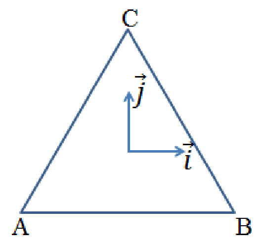

$$
A(e)=
\begin{pmatrix}
1 & 0 & 0\\
0 & 1 & 0\\
0 & 0 & 1
\end{pmatrix}
=A^{-1}(e)
$$

$$
A(d)=
\begin{pmatrix}
-1/2 & -\sqrt{3}/2 & 0\\
\sqrt{3}/2 & -1/2 & 0\\
0 & 0 & 1
\end{pmatrix}
=A^{-1}(f)
$$

$$
A(f)=
\begin{pmatrix}
-1/2 & \sqrt{3}/2 & 0\\
-\sqrt{3}/2 & -1/2 & 0\\
0 & 0 & 1
\end{pmatrix}
=A^{-1}(d)
$$

$$
A(a)=
\begin{pmatrix}
1/2 & -\sqrt{3}/2 & 0\\
\sqrt{3}/2 & -1/2 & 0\\
0 & 0 & -1
\end{pmatrix}
=A^{-1}(a)
$$

$$
A(b)=
\begin{pmatrix}
-1 & 0 & 0\\
0 & 1 & 0\\
0 & 0 & -1
\end{pmatrix}
=A^{-1}(b)
$$

$$
A(c)=
\begin{pmatrix}
1/2 & -\sqrt{3}/2 & 0\\
-\sqrt{3}/2 & -1/2 & 0\\
0 & 0 & -1
\end{pmatrix}
=A^{-1}(c)
$$

第二步是写出三个不可约表示的特征标投影算符：

$$
\hat{P}^{(1)}=\frac{1}{6}\left(\hat{P}_e+\hat{P}_d+\hat{P}_f+\hat{P}_a+\hat{P}_b+\hat{P}_c\right)
$$

$$
\hat{P}^{(2)}=\frac{1}{6}\left(\hat{P}_e+\hat{P}_d+\hat{P}_f-\hat{P}_a-\hat{P}_b-\hat{P}_c\right)
$$

$$
\hat{P}^{(3)}=\frac{2}{6}\left(2\hat{P}_e-\hat{P}_d-\hat{P}_f\right)
$$

第三步是将这些特征标投影算符作用到基函数上面，其中 $\hat{P}^{(1)}$ 作用的结果为：

$$
\begin{aligned}
\hat{P}^{(1)}x^2
&=\frac{1}{6}\left[x^2+\left(-\frac{1}{2}x+\frac{\sqrt{3}}{2}y\right)^2+\left(-\frac{1}{2}x-\frac{\sqrt{3}}{2}y\right)^2+\left(\frac{1}{2}x+\frac{\sqrt{3}}{2}y\right)^2\right.\\
&\qquad\left.+(-x)^2+\left(\frac{1}{2}x-\frac{\sqrt{3}}{2}y\right)^2\right]=\frac{1}{2}\left(x^2+y^2\right)
\end{aligned}
$$

$$
\hat{P}^{(1)}y^2=\frac{1}{2}\left(x^2+y^2\right)
$$

$$
\hat{P}^{(1)}z^2=z^2
$$

$$
\hat{P}^{(1)}xy=0
$$

$$
\hat{P}^{(1)}yz=0
$$

$$
\hat{P}^{(1)}xz=0
$$

也就是说这一组基六个函数，往 D3 群的第一个不等价不可约表示的表示空间做投影，只能生成 $\frac{1}{2}\left(x^2+y^2\right)$ 与 $z^2$ 两个向量。

把 $\hat{P}^{(2)}$ 作用到这六个函数上，结果是：

$$
\hat{P}^{(2)}x^2=0
$$

$$
\hat{P}^{(2)}y^2=0
$$

$$
\hat{P}^{(2)}z^2=0
$$

$$
\hat{P}^{(2)}xy=0
$$

$$
\hat{P}^{(2)}yz=0
$$

$$
\hat{P}^{(2)}xz=0
$$

这六个函数在 $A_2$ 这个不等价不可约表示的表示空间没有投影。

把 $\hat{P}^{(3)}$ 作用到这六个函数上，结果是：

$$
\hat{P}^{(3)}x^2=\frac{2}{6}\left[2x^2-\left(-\frac{1}{2}x+\frac{\sqrt{3}}{2}y\right)^2-\left(-\frac{1}{2}x-\frac{\sqrt{3}}{2}y\right)^2\right]=\frac{1}{2}\left(x^2-y^2\right)
$$

$$
\hat{P}^{(3)}y^2=\frac{2}{6}\left[2y^2-\left(-\frac{\sqrt{3}}{2}x-\frac{1}{2}y\right)^2-\left(\frac{\sqrt{3}}{2}x-\frac{1}{2}y\right)^2\right]=-\frac{1}{2}\left(x^2-y^2\right)
$$

$$
\hat{P}^{(3)}z^2=0
$$

$$
\hat{P}^{(3)}xy=xy
$$

$$
\hat{P}^{(3)}yz=yz
$$

$$
\hat{P}^{(3)}xz=xz
$$

这也就是说这六个函数，往 $A_3$ 这个不可约表示上作投影的话，可以产生 4 个线性无关的向量。这 4 个如何两两配对形成两组承载 $A_3$ 的基？我们还需要进行进一步的变换才知道。

我们取其中的 $\frac{1}{2}\left(x^2-y^2\right)$，用 $\hat{P}_d$ 作用到它上面，效果是：

$$
\begin{aligned}
\hat{P}_d\frac{1}{2}\left(x^2-y^2\right)
&=\frac{1}{2}\left(-\frac{1}{2}x+\frac{\sqrt{3}}{2}y\right)^2-\frac{1}{2}\left(-\frac{\sqrt{3}}{2}x-\frac{1}{2}y\right)^2\\
&=-\frac{1}{2}\left[\frac{1}{2}\left(x^2-y^2\right)\right]-\frac{\sqrt{3}}{2}xy
\end{aligned}
$$

也就是说 $\frac{1}{2}\left(x^2-y^2\right)$ 与 $xy$ 形成一组基。与之相应，我们还可以对 yz 做变换，知道它与 xz 形成一组基。最后对称化的基组就是：

$\varphi_{11}^{1}=\frac{1}{2}\left(x^2+y^2\right)$、$\varphi_{21}^{1}=z^2$、$\varphi_{11}^{3}=\frac{1}{2}\left(x^2-y^2\right)$、$\varphi_{12}^{3}=xy$、$\varphi_{21}^{3}=yz$、$\varphi_{22}^{3}=xz$。

对应的表示矩阵为：

$$
A(d)=
\begin{pmatrix}
1 & 0 & 0 & 0 & 0 & 0\\
0 & 1 & 0 & 0 & 0 & 0\\
0 & 0 & -1/2 & \sqrt{3}/2 & 0 & 0\\
0 & 0 & -\sqrt{3}/2 & -1/2 & 0 & 0\\
0 & 0 & 0 & 0 & -1/2 & \sqrt{3}/2\\
0 & 0 & 0 & 0 & -\sqrt{3}/2 & -1/2
\end{pmatrix}
$$

其它类似，用 $\hat{P}_g$ 作用到 $\varphi_{11}^{1}$、$\varphi_{21}^{1}$、$\varphi_{11}^{3}$、$\varphi_{12}^{3}$、$\varphi_{21}^{3}$、$\varphi_{22}^{3}$ 的方法推出。

**例 2** 用投影算符方法求出 D3 群的群空间中 6 个对称化的基，它们分别承载哪些不可约表示？

这道题要用到 D3 群的乘法表：

|  | $e$ | $d$ | $f$ | $a$ | $b$ | $c$ |
|---|---|---|---|---|---|---|
| $e$ | $e$ | $d$ | $f$ | $a$ | $b$ | $c$ |
| $d$ | $d$ | $f$ | $e$ | $c$ | $a$ | $b$ |
| $f$ | $f$ | $e$ | $d$ | $b$ | $c$ | $a$ |
| $a$ | $a$ | $b$ | $c$ | $e$ | $d$ | $f$ |
| $b$ | $b$ | $c$ | $a$ | $f$ | $e$ | $d$ |
| $c$ | $c$ | $a$ | $b$ | $d$ | $f$ | $e$ |

解：

第一步，取 D3 群的群空间的六个基：

$\varphi_1=e$、$\varphi_2=d$、$\varphi_3=f$、$\varphi_4=a$、$\varphi_5=b$、$\varphi_6=c$

第二步，取特征标投影算符：

$$
\hat{P}^{(1)}=\frac{1}{6}\left(\hat{P}_e+\hat{P}_d+\hat{P}_f+\hat{P}_a+\hat{P}_b+\hat{P}_c\right)
$$

$$
\hat{P}^{(2)}=\frac{1}{6}\left(\hat{P}_e+\hat{P}_d+\hat{P}_f-\hat{P}_a-\hat{P}_b-\hat{P}_c\right)
$$

$$
\hat{P}^{(3)}=\frac{2}{6}\left(2\hat{P}_e-\hat{P}_d-\hat{P}_f\right)
$$

第三步，将这些特征标投影算符作用到群空间的基上，对 $\hat{P}^{(1)}$，由重排定理，作用到 $\varphi_1$ 到 $\varphi_6$ 的任何一个得到的都是：

$$
\frac{1}{6}(e+d+f+a+b+c)
$$

它承载 D3 的一维恒等表示。在群代数中归一化为：

$$
\varphi_{11}^{1}=\frac{1}{\sqrt{6}}(e+d+f+a+b+c)
$$

对 $\hat{P}^{(2)}$，它给出的结果是：$\frac{1}{6}(e+d+f-a-b-c)$ 或 $\frac{1}{6}(a+b+c-e-d-f)$。

也就是说它们往 D3 群的 $A_2$ 表示上作投影，投影部分都是 $\frac{1}{6}(e+d+f-a-b-c)$ 这个维度上的向量。在群代数中归一化为：

$$
\varphi_{11}^{2}=\frac{1}{\sqrt{6}}(e+d+f-a-b-c)
$$

还剩下四个维度，它必然给出两个二维不可约表示。但由：

$$
\hat{P}^{(\alpha)}\Psi=\sum_{i}\sum_{l}a_{il}^{(\alpha)}\varphi_{il}^{(\alpha)}
$$

我们知道像上面这些例子那样我们直接把 $\hat{P}^{(\alpha)}$ 作用到 $\Psi$ 上就得到某个不可约表示空间中的向量的例子其实是非常幸运的。很多情况下，我们还有一个同一个不可约表示出现次数的 index 的加和。对于剩下的四个维度，如果我们直接用 $\hat{P}^{(3)}$ 作用到 $\varphi_1$ 到 $\varphi_6$ 上，我们就会得到类似的情况。

为了处理方便，我们采取的策略是：

$$
\hat{P}^{(3)}(e+a)=\frac{2}{6}(2e-d-f+2a-c-b)
$$

在群代数中归一化为：

$$
\varphi_{11}^{3}=\frac{1}{2\sqrt{3}}(2e-d-f+2a-c-b)
$$

然后，用 $\hat{P}_d$ 作用到它上面，得：

$$
\hat{P}_d\varphi_{11}^{3}=\frac{1}{2\sqrt{3}}(2d-f-e+2c-a-b)
$$

$\hat{P}_d\varphi_{11}^{3}$ 与 $\varphi_{11}^{3}$ 线性无关，但并不正交。对它们进行正交化处理，再归一化，可得：

$$
\varphi_{12}^{3}=\frac{1}{2}(d-f+c-b)
$$

同理，有：

$$
\hat{P}^{(3)}(e-a)=\frac{2}{6}(2e-d-f-2a+c+b)
$$

进而：

$$
\varphi_{21}^{3}=\frac{1}{2\sqrt{3}}(2e-d-f-2a+c+b)
$$

同样，用 $\hat{P}_d$ 作用到它上面，在与 $\varphi_{21}^{3}$ 进行正交归一处理，可得：

$$
\varphi_{22}^{3}=\frac{1}{2}(d-f+b-c)
$$

## 4.4 矩阵元定理与选择定则、电偶极跃迁

这一节说的是微扰引起的跃迁，以及跃迁矩阵元与对称性之间的关系。也就是说我系统本身有个 $\hat{H}_0$，系统处在一系列分立的本征态上，每个本征态都可以用哈密顿算符群的一个不等价不可约表示的基来标识。比如 $\Psi_\alpha$、$\Psi_\beta$，它们都是某个不可约表示的基，对应 $\hat{H}_0$ 的哈密顿算符群。

现在你给我一个扰动 $\hat{H}'$，根据微扰理论，这个系统的两个态就可能通过 $(\Psi_\alpha|\hat{H}'\Psi_\beta)$ 联系起来了。$(\Psi_\alpha|\hat{H}'\Psi_\beta)$ 是跃迁矩阵元。严格意义上，我可以把它算出来。怎么算，是量子力学、固体物理这些课程要告诉我们的事情。群论这门课程要干的事情，是通过我们已有的群论的知识，去理解这个矩阵元什么时候必须是零，什么时候可以不为零？也就是给我们一个思路去判断，这个思路是基于对称性原理的。

怎么去理解这个思路呢？很简单，就是把我这个跃迁矩阵元中的三个部分分别当成 $\hat{H}_0$ 的哈密顿算符群的表示基函数：

第一部分是 $\hat{H}'$，它可以是一个算符，也可以是个函数。在这里我们把它看作 $\hat{H}_0$ 的哈密顿算符群的一个表示（记为 $D_v$）的基（这个表示不一定不可约）。

第二部分是 $\Psi_\beta$，它承载的是 $\hat{H}_0$ 的哈密顿算符群的一个不可约表示（记为 $D_\beta$）。这两部分合起来，$\hat{H}'\Psi_\beta$ 这个函数，对应的，就是 $D_v$ 与 $D_\beta$ 的直积表示的基函数。

第三个部分是 $\Psi_\alpha$，它承载的是 $\hat{H}_0$ 的哈密顿算符群的一个不可约表示（记为 $D_\alpha$）。

这个时候，我们求跃迁矩阵元 $(\Psi_\alpha|\hat{H}'\Psi_\beta)$ 这个内积，就可以利用不可约表示基的正交关系来判断。我们要做的事就是先做 $D_v\otimes D_\beta$，然后把它分解，看是否有 $D_\alpha$ 的成分。如果有，跃迁被对称性允许；没有，被禁止。就这么简单。

为了满足跃迁被对称性允许，我们对 $\hat{H}'$ 的对称性有没有什么要求？答案是：有。我们可以想一下，假如这个 $\hat{H}'$ 的对称性很高，以至于对所有 $\hat{H}_0$ 中的对称操作，它都不变。那么它承载的是 $\hat{H}_0$ 的哈密顿算符群的什么表示？

一维恒等。这样的话 $D_v\otimes D_\beta=D_\beta$，也就是说 $\hat{H}'\Psi_\beta$ 承载的 $\hat{H}_0$ 的哈密顿算符群的表示，$\Psi_\beta$ 承载的完全相同！并且对应的表示中的基的 index 也完全相同！

这个时候，如果 $\Psi_\alpha$ 与 $\Psi_\beta$ 对应的是同一个不可约表示的同一个基的话，这个跃迁还是被允许的。不然，所以这个跃迁将完全被禁止。

同时反过来，对微扰 $\hat{H}'$ 而言，如果它的对称性比 $\hat{H}_0$ 的低，那么 $\hat{H}'\Psi_\beta$ 在进行直积后做直和分解，包含 $\Psi_\alpha$ 对应的不等价不可约表示的基的几率会大大增加。因此，从对称性的角度，我们总是希望 $\hat{H}'$ 的对称性低，这样才能尽量多的诱发出系统在 $\hat{H}_0$ 的不同本征态之间的跃迁。

有了这个认识，我们来看最常见的一种情况，扰动是个电磁场。电场：$\vec{E}=-\frac{\partial\vec{A}}{\partial t}$，磁场：$\vec{B}=\nabla\times\vec{A}$。加入电磁场后，哈密顿量变成了：

$$
\begin{aligned}
\hat{H}(\vec{r})
&=\frac{1}{2m}\left(\hat{p}-\frac{e}{c}\vec{A}\right)^2+V(\vec{r})\\
&=\frac{1}{2m}\hat{p}^2+V(\vec{r})-\frac{e}{mc}\hat{p}\cdot\vec{A}+\frac{e^2A^2}{2mc^2}
\end{aligned}
$$

在弱场下，最后一项是绝对的微扰。讨论这个跃迁问题，我们很自然的把 $\hat{H}_0$ 与 $\hat{H}'$ 选为：

$$
\begin{aligned}
\hat{H}_0&=\frac{1}{2m}\hat{p}^2+V(\vec{r})\\
\hat{H}'&=-\frac{e}{mc}\hat{p}\cdot\vec{A}
\end{aligned}
$$

这个时候，跃迁矩阵元为：$\left(\Psi_\alpha\middle|-\frac{e}{mc}\hat{p}\cdot\vec{A}\,\Psi_\beta\right)$。这里 $\hat{p}$ 是个动量算符，当我对系统进行对称操作的时候，它是会变化的。$\vec{A}$ 是外场，你对系统进行对称操作，对我而言，是你的家务事，与我无关。$-\frac{e}{mc}$ 是个常数，对称操作跟它更不相关了。

因此，从对称性的角度来说，我这个跃迁矩阵元为不为零，完全由 $(\Psi_\alpha|\hat{p}|\Psi_\beta)$ 决定。对 $(\Psi_\alpha|\hat{p}|\Psi_\beta)$ 这个矢量，我们用 $\frac{mc}{i\hbar}[\vec{r},\hat{H}]$ 来代替 $\hat{p}$，它可以进一步化为：

$$
\frac{mc}{i\hbar}(E_\alpha-E_\beta)(\Psi_\alpha|\vec{r}|\Psi_\beta)
$$

也就是说归根结底，如果我们想用对称性的语言来描述 $(\Psi_\alpha|\hat{H}'\Psi_\beta)$ 这个外界电磁场所引起的跃迁矩阵元的话（对应光子吸收过程），它的性质与 $(\Psi_\alpha|\vec{r}|\Psi_\beta)$ 这个矩阵元是完全一样的。

这里，由于电偶极算符 $\mu=-e\vec{r}$ 与它只差一个正电子电荷，我们也把这种跃迁称为电偶极跃迁。

对于这样的一个电偶极跃迁，对称性对它的选择定则有什么样的影响呢？我们可以看一个例子，晶体，对称性是 $O_h$，特征标表是：

| repr. | basis functions | $E$ | $3C_4^2$ | $6C_4$ | $6C_2'$ | $8C_3$ | $i$ | $3iC_4^2$ | $6iC_4$ | $6iC_2'$ | $8iC_3$ |
|---|---|---|---|---|---|---|---|---|---|---|---|
| $A_1^+$ | $1$ | 1 | 1 | 1 | 1 | 1 | 1 | 1 | 1 | 1 | 1 |
| $A_2^+$ | $x^4(y^2-z^2)+y^4(z^2-x^2)+z^4(x^2-y^2)$ | 1 | 1 | $-1$ | $-1$ | 1 | 1 | 1 | $-1$ | $-1$ | 1 |
| $E^+$ | $x^2-y^2$；$2z^2-x^2-y^2$ | 2 | 2 | 0 | 0 | $-1$ | 2 | 2 | 0 | 0 | $-1$ |
| $T_1^-$ | $x$、$y$、$z$ | 3 | $-1$ | 1 | $-1$ | 0 | $-3$ | 1 | $-1$ | 1 | 0 |
| $T_2^-$ | $z(x^2-y^2)\cdots$ | 3 | $-1$ | $-1$ | 1 | 0 | $-3$ | 1 | 1 | $-1$ | 0 |
| $A_1^-$ | $xyz[x^4(y^2-z^2)+y^4(z^2-x^2)+z^4(x^2-y^2)]$ | 1 | 1 | 1 | 1 | $-1$ | $-1$ | $-1$ | $-1$ | $-1$ | $-1$ |
| $A_2^-$ | $xyz$ | 1 | 1 | $-1$ | $-1$ | 1 | $-1$ | $-1$ | 1 | 1 | $-1$ |
| $E^-$ | $xyz(x^2-y^2)\cdots$ | 2 | 2 | 0 | 0 | $-1$ | $-2$ | $-2$ | 0 | 0 | 1 |
| $T_1^+$ | $xy(x^2-y^2)\cdots$ | 3 | $-1$ | 1 | $-1$ | 0 | 3 | $-1$ | 1 | $-1$ | 0 |
| $T_2^+$ | $xy$、$yz$、$zx$ | 3 | $-1$ | $-1$ | 1 | 0 | 3 | $-1$ | $-1$ | 1 | 0 |

对 $(\Psi_\alpha|\vec{r}|\Psi_\beta)$ 而言，由上表可知，$\vec{r}$ 承载的表示是 $T_1^-$，也叫 $T_{1u}$。这个时候，如果我的 $\Psi_\beta$ 为 $T_2^+$，也叫 $T_{2g}$。那么这个时候 $T_{1u}\otimes T_{2g}$ 对应的特征标就是：

| $T_{1u}\otimes T_{2g}$ | $E$ | $3C_4^2$ | $6C_4$ | $6C_2'$ | $8C_3$ | $i$ | $3iC_4^2$ | $6iC_4$ | $6iC_2'$ | $8iC_3$ |
|---|---|---|---|---|---|---|---|---|---|---|
| $\chi$ | 9 | 1 | $-1$ | $-1$ | 0 | $-9$ | $-1$ | 1 | 1 | 0 |

它可以分解为：$A_{2u}\otimes E_u\otimes T_{1u}\otimes T_{2u}$，也就是上个表中的：$A_2^-\otimes E^-\otimes T_1^-\otimes T_2^-$。

也就是说在这个电偶极跃迁中，如果初态是一个具有 $T_{2g}$ 对称性的态，那么末态的对称性只能是上面这四种。

这里大家有两个地方可以注意：

1. 在这个表中，因为 $O_h$ 属于立方系，x、y、z 三个轴等价，所以我的吸收对光的

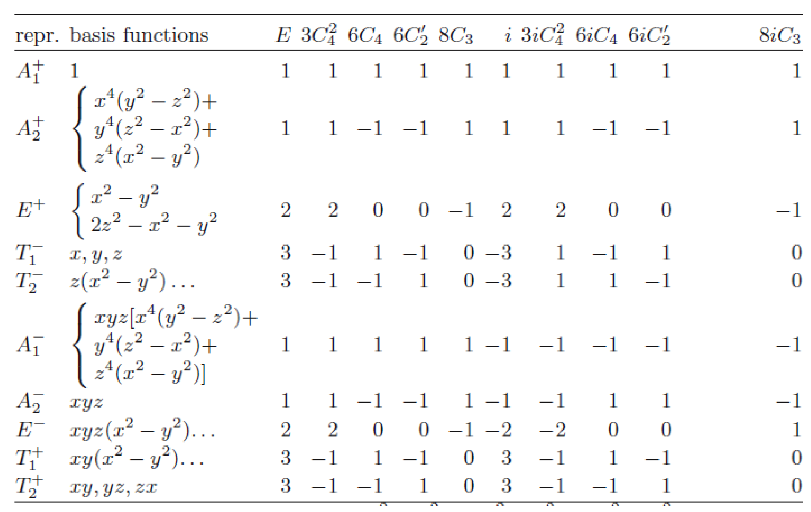

偏振方向没有选择。如果我把晶体对称性破坏为四方，比如 $D_{4h}=D_4\otimes\{E,i\}$：

**$D_4$ (422)**

| 基函数 |  | repr. | $E$ | $C_2=C_4^2$ | $2C_4$ | $2C_2'$ | $2C_2''$ |
|---|---|---|---|---|---|---|---|
| $x^2+y^2$、$z^2$ |  | $A_1$ | 1 | 1 | 1 | 1 | 1 |
|  | $R_z$、$z$ | $A_2$ | 1 | 1 | 1 | $-1$ | $-1$ |
| $x^2-y^2$ |  | $B_1$ | 1 | 1 | $-1$ | 1 | $-1$ |
| $xy$ |  | $B_2$ | 1 | 1 | $-1$ | $-1$ | 1 |
| $xz$、$yz$ | $(x,y)$、$(R_x,R_y)$ | $E$ | 2 | $-2$ | 0 | 0 | 0 |

$D_{4h}=D_4\otimes i$ ($4/mmm$) (tetragonal)

这个时候大家就会注意到 x、y 与 z 承载的不可约表示就不一样了。这个时候，光的偏振方向就会有由对称性诱发的选择性吸收了。具体你要做的，还是上面的步骤，直积，再分解。对于同一个初态，偏振光沿 z 方向的时候，我用 $A_2$ 作直积；偏振光在 xy 平面时，我用 E 来作。这样允许的末态就会不一样了。

2. 在 $A_{2u}\otimes E_u\otimes T_{1u}\otimes T_{2u}$ 这四个态中，我们有共同的下标 u，代表我的末态是奇宇称。这个是为什么？

原因很简单，我的初态是偶宇称，微扰是奇宇称，那末态必须为奇宇称，不然空间积分为零。反过来，如果我的初态是奇宇称，那么我的末态就必须是偶宇称。也就是说电偶极跃迁只能发生在两个不同宇称的态之间。

类似讨论有意义的体系是具有中心反演对称性的体系。这里，我们可以通过 $\hat{H}'$ 的对称性，展开类似讨论。如果 $\hat{H}'$ 对中心反演不变，那么跃迁应该是发生在具有相同宇称的态之间了。

在上面的讨论中，有一个很重要的细节，不知道你们注意到没有？就是我的哈密顿量里面，变量只有 $\vec{r}$，这个电子坐标。这就意味着我们所讨论的光吸收或辐射对应的必须是电子态之间的跃迁。由于电偶极算符的奇宇称，两个电子态之

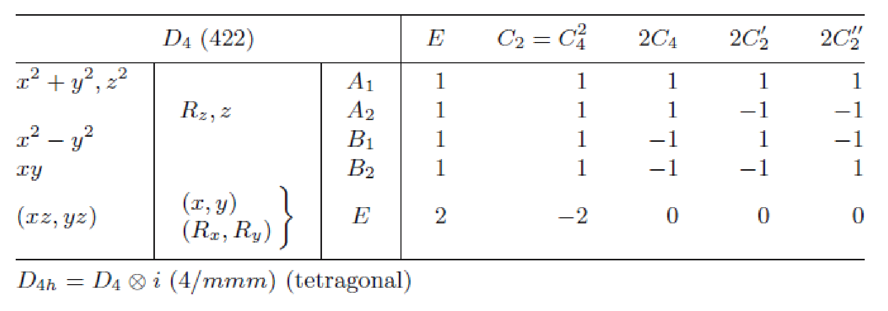

间的宇称必须相反。

但在实际的情况中，后来人们发现，被电偶极跃迁联系起来的两个电子态的宇称有时是相同的。这是为什么？这个对应的实际情况一般是跃迁过程中包含了声子的参与。这样的话我们考虑的跃迁矩阵元就必须是这样一个东西了：

$$
\left(\Psi_v'\Psi_e'\middle|\vec{\mu}\middle|\Psi_v\Psi_e\right)
$$

我们要做的，就是表示 $D_e$、$D_v$、$D_\mu$ 的直积，然后分解，看是否包含 $D_e'\otimes D_v'$ 了。

这个时候，很多在纯电子行为中被禁戒的跃迁就可以发生了。也就是说不是我们的对称性分析出了问题，而是实际情况更复杂了。对这种复杂的情况，对称性的语言依然适用，只不过复杂了一些。

## 4.5 红外、拉曼谱、和频光谱

声子本身，除了对电子态之间的跃迁起辅助作用外，它们也是可以吸收或者散射电磁波的。与之相应，有两种非常常用的实验手段，红外（IR）与拉曼（Raman）。在分析这两种谱的时候，对称性也会帮助我们理解很多东西。

这两个里面，红外比较简单，说的是这样一个事情。我们对一个样品打入一个连续的、处于红外波段的光谱。假设我们入射光的强度随频率的变化是下面图中的这个实线。那么在每个频率，我们给样品的，是一个以这个频率振荡的电磁场。

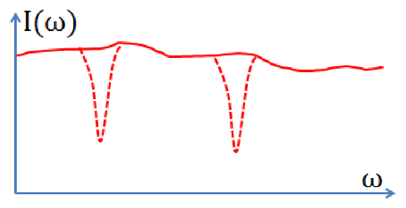

在我们的光经过样品的时候，对于有些频率，由于它与晶格或者分子的本征振动频率相同，这个能量会被声子吸收，从而使得我们在不放样品的时候得到的谱线是上图中的实线，放了样品后，得到的是虚线。如果把它们的差求出来，就是：

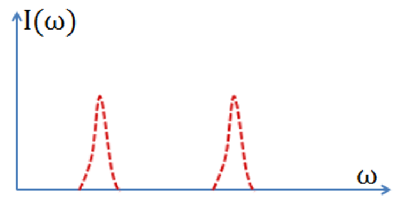

这个谱，反映的就是我们的样品在红外这个波段，由于声子振动对电磁场的吸收，因此叫红外谱。

对于这样的一个吸收，它的选择定则应该怎样理解呢？我们可以这样去想：我们加入的电磁场（光子）的电场强度为 $\vec{E}$。对于频率为 ω 的光子，它与晶格本身的处在这个频率上的一个本征振动耦合，从而损失能量，被吸收。假设这个振动所带来的样品电偶极矩的变化是 $\vec{\mu}$。这个 $\vec{\mu}$ 是由原子核偏离平衡位置而引起的电荷重新分布决定的，叫 induced dipole moment。那么由于声子与电磁场的耦合而带来的系统的能量降低就是：

$$
\hat{H}'=-\vec{E}\cdot\vec{\mu}
$$

与之相应，这个微扰所带来的跃迁矩阵元就是：

$$
\left(\Psi_v'\middle|\hat{H}'\middle|\Psi_v\right)
$$

其中 $\Psi_v$ 为振动的基态，就是原子核处于平衡位置的状态，它所对应的 $\hat{H}_0$ 的哈密顿算符群的不可约表示是一维恒等表示。

$\hat{H}'=-\vec{E}\cdot\vec{\mu}$，其中 $\vec{E}$ 是不依赖于晶体取向的外场（由光子给的），对晶体或分子进行的对称操作对它不起作用。$\vec{\mu}$ 是由振动引起的系统电偶极矩的变化，它在对称操作下的变换规律与 x、y、z 这些函数是一样的。当取一个偏振光只有 $E_x$ 的分量的时候，在振动中，只有 $\mu_x$ 对 $\hat{H}'$ 有贡献。与之相应，微扰项所承载的表示与 x 所承载的表示是相同的。

这时，在 $\hat{H}'$ 与 $\Psi_v$ 作直积的时候，由于 $\Psi_v$ 的表示为一维恒等表示，结果就是只承载一个 x 本身可以承载的表示。相应，$\Psi_v'$ 这个吸收了 IR 光子所对应的本征振动态，也必须承载这个 x 可以承载的不可约表示。这也就意味着在点群特征标表中，只有那些 x 承载的不可约表示是对应的本征振动可以被激发。

这样的话红外吸收的选择定则就简单了，以具有 $C_{2h}$ 对称性的晶体为例，它的特征标表是：

**$C_{2h}$(2/$m$)**

| 基函数 |  | repr. | $E$ | $C_2$ | $\sigma_h$ | $I$ |
|---|---|---|---|---|---|---|
| $x^2$、$y^2$、$z^2$、$xy$ | $R_z$ | $A_g$ | 1 | 1 | 1 | 1 |
|  | $z$ | $A_u$ | 1 | 1 | $-1$ | $-1$ |
| $xz$、$yz$ | $R_x$、$R_y$ | $B_g$ | 1 | $-1$ | $-1$ | 1 |
|  | $x$、$y$ | $B_u$ | 1 | $-1$ | 1 | $-1$ |

由这个特征标表，我们可以知道当偏振光沿 z 轴时，它只能激发对称性为 $A_u$ 的本征振动；当偏振光沿 x、y 轴时，它只能激发对称性为 $B_u$ 的本征振动。

当偏振方向含 z 轴分量，也含 x 或 y 轴分量的时候，它可以激发 $A_u$ 或者 $B_u$，但它怎么都不能激发 $A_g$ 与 $B_g$。

大家注意一下，这里，对下标有个选择性。u 这个奇宇称可以，g 这个偶宇称就不行。这个是为什么呢？原因很简单，我们选择的这个体系具有中心反演对称性。因此，这个系统的本征态具有特定的宇称。我们这里激发振动的时候是由基态，也就是承载一维恒等表示的状态向某本征振动态激发。基态是偶宇称，中间的微扰是奇宇称，所以末态必须是奇宇称。

当我的系统不具备中心反演对称性的时候，如何去判断一个本征振动是否具有红外活性呢？答案很简单，上个例子前半部分的讨论依然成立。也就是承载 $x$、$y$、$z$ 这些一次齐次函数的不可约表示所对应的本征振动依然具有红外活性。唯一不同的地方就是宇称不再是个好量子数了，这个不可约表示不会再有‘u’这样的下标了。

除了红外，以后你们不管做不做实验，在实际科研中都很可能接触到另一类光谱，拉曼（这个拉曼和玻色一样都是印度人，玻色没得诺奖，拉曼得了，同时拉曼还是印度科学院的缔造者，对近代物理学在印度的传播起了非常大的作用）。在拉曼谱的理解上应该说对一个真实系统电子能级与振动能级的认识是基础。大家可以看这样一个图像：

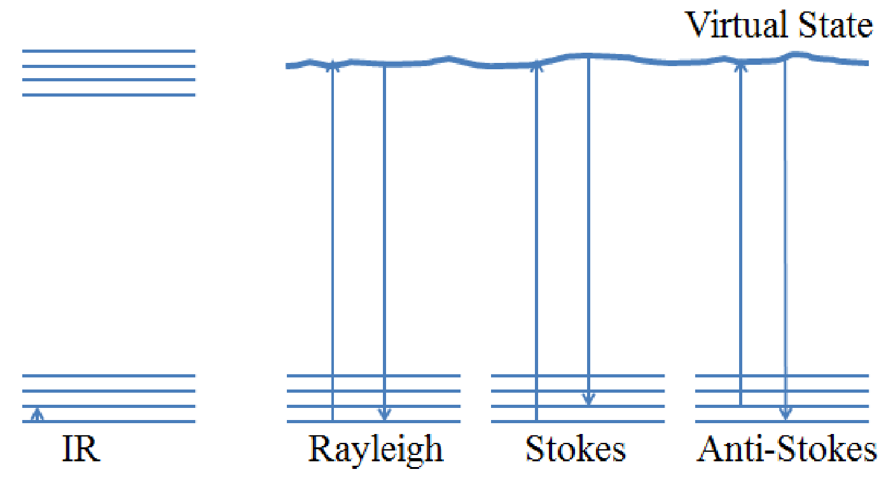

对任何多原子系统，它的能级都可分为电子能级与振动能级。在能量空间的分布一般如上图。在电子的基态上，会比较密地分布一些振动能级。它们合在一起占据了一些能量空间，对应的是电子基态，振动的基态与不同激发态。之后会有一个很大的禁区，这个禁区之后才是电子的第一激发态以及它对应的振动基态与不同激发态。

在红外吸收中，吸收谱对应的是声子的共振吸收。系统的跳跃就像左边这个图描述的。电子始终都处在基态，在吸收过程中，因为原子核动了，电子在其基态上有个重新分布，这个重新分布带来一个电偶极矩，这个电偶极矩与外场耦合产生共振。系统的状态，是从电子基态的声子基态，调到电子基态的声子激发态。

而拉曼谱，它不是吸收谱，它是散射谱。它对应的物理过程是一束光照到样品上以后，由于光子本身的电磁场，可以诱发一个样品的极化。我们把这个由光子的电磁场诱发的样品的极化描述成一个虚的吸收，也就是说电子从基态跃迁到了一个虚的激发态。当这个光子被弹性地散射（也就是瑞利散射）的时候，光子与物质相互作用后只改变动量，不改变能量，系统跳回基态。整个物理过程就像第二列描述的这样。（跟瑞利散射相关的最常见的自然现象就是晴天天是蓝的，官方解释是散射强度与波长的四次方成反比，蓝光散射的多）。

除了这个弹性散射，很自然我们还可以想到非弹性散射。在这个非弹性散射中，入射光在回到电子基态的时候，会损失或得到一定的能量。损失能量过程对应的是它回到了电子的基态，声子的激发态。光子的能量损失给声子了。这个过程叫 Stokes 散射。而得到能量的过程对应的是系统开始处在电子基态，声子的激发态。散射完了以后系统回到电子基态，声子基态。与之对应，在这个过程就就是样品的声子把能量给了光子。当时人们对声子这个东西应该说还没有很深入的理解，但这个非弹性散射过程的特性，使得拉曼在这个工作做出（1928 年）之后，很快（1930 年）就得了诺贝尔物理奖。这个背后的原因是什么，其实很值得我们回味，可能这个光子能量的改变所蕴藏的对光的粒子性支持，应该说是很重要的原因，因为那个年代是建立量子力学基本概念的年代，最热的就是这个东西。康普顿散射也是类似的东西，光子和电子的非弹性散射，1923 年的实验，1927 年就得了诺奖。现在的科研处在一个什么样的状态，有什么样的特征，这个需要大家在学习的过程中同样慢慢体会。一句话，物理学发展史上任何重要的东西，重不重要，这个要通过时间检验，看它到底对我们对这个世界的认识增加了多少东西？得不得诺奖，有时候看那些年的潮流热什么？

回到正题，基于这个对拉曼散射过程的描述，在实验里面，理想的拉曼图就是这样的：

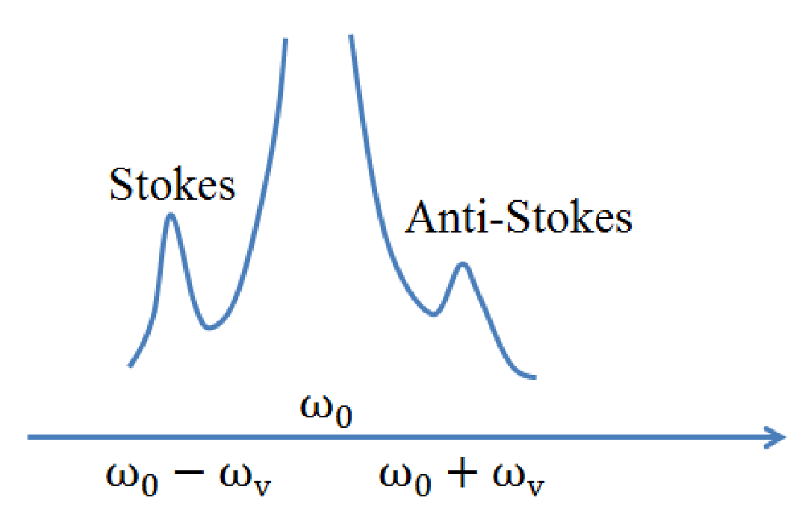

中间的大峰对应的是瑞利散射。对 Anti-Stokes 峰，由于它需要系统开始的时候就处在振动的激发态，所以低温下不明显，温度高一些比较好测。

而同时我们如果把弹性散射部分扣除，我们就可以得到纯振动部分。上面那个图只给了一个振动模式，实际情况往往是一系列。这一系列的移动，代表的就是系统的本征振动频率。

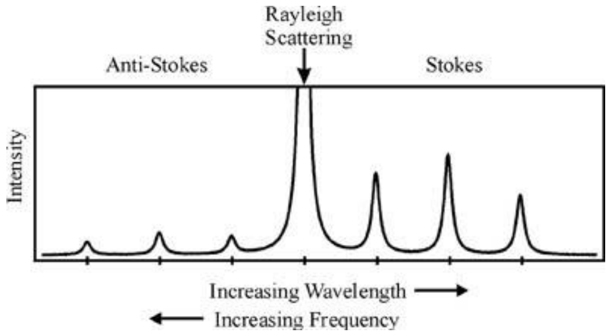

（这是另一种画法，右边是长波长，低能部分，与上图相反）

拉曼谱和红外一样，也有个选择定则，可以通过对称性的知识去理解。但和红外不同的是，在拉曼谱里面，诱导电偶极据并不是由原子核运动直接产生的。在红外里面，吸收信号反映的是声子的本征振动与外场之间的耦合。也就是说声子振动产生电偶极矩，这个电偶极矩直接与光子的电场耦合来产生吸收。这个过程是个一阶过程。

而拉曼谱里面，一般有两束光产生作用。入射光的作用是产生一个诱导电偶极矩，然后由入射光产生的诱导电偶极矩会和散射光的光场耦合。由于入射光并不激发系统的本征振动，它要产生偶极矩的话，必须通过一个极化率。这个极化率记为 $\vec{\bar{\bar{\alpha}}}$，它是个 $3\times 3$ 的张量。入射光的电场为 $\vec{E}_i\cos(\omega t)$，$\omega$ 为入射光频率。它们一起产生的诱导电偶极矩是：

$$
\vec{\mu}=\vec{\bar{\bar{\alpha}}}\cdot\vec{E}_i\cos(\omega t)
$$

这里 $\vec{\bar{\bar{\alpha}}}$ 叫拉曼极化率张量（Raman polarizability tensor）。

它是随着原子核的运动有变化的。我们把原子核在平衡位置的时候的极化率记为 $\vec{\bar{\bar{\alpha}}}_0$，把原子核的运动对它的改变记为 $\Delta\vec{\bar{\bar{\alpha}}}$，那么总的极化率就是 $\vec{\bar{\bar{\alpha}}}=\vec{\bar{\bar{\alpha}}}_0+\Delta\vec{\bar{\bar{\alpha}}}$，其中 $\vec{\bar{\bar{\alpha}}}_0$ 不随时间变化，$\Delta\vec{\bar{\bar{\alpha}}}$ 会以晶格或分子的振动频率 $\omega_v$ 随时间变化，等于 $\Delta\vec{\bar{\bar{\alpha}}}_0\cos(\omega_v t)$，$\Delta\vec{\bar{\bar{\alpha}}}_0$ 是不随时间变化的由晶格振动引起的极化率变化幅度。

这样由它们产生的诱导电偶极矩就分别为：$\vec{\bar{\bar{\alpha}}}_0\cdot\vec{E}_i\cos(\omega t)$、$\Delta\vec{\bar{\bar{\alpha}}}\cdot\vec{E}_i\cos(\omega t)$。其中 $\omega$ 为入射光频率，极矩整体是：

$$
\begin{aligned}
\vec{\mu}&=\vec{\bar{\bar{\alpha}}}\cdot\vec{E}_i\cos(\omega t)\\
&=(\vec{\bar{\bar{\alpha}}}_0+\Delta\vec{\bar{\bar{\alpha}}})\cdot\vec{E}_i\cos(\omega t)\\
&=(\vec{\bar{\bar{\alpha}}}_0+\Delta\vec{\bar{\bar{\alpha}}}_0\cos(\omega_v t))\cdot\vec{E}_i\cos(\omega t)\\
&=\vec{\bar{\bar{\alpha}}}_0\cdot\vec{E}_i\cos(\omega t)+\frac{\Delta\vec{\bar{\bar{\alpha}}}_0}{2}[\cos(\omega-\omega_v)t+\cos(\omega+\omega_v)t]\cdot\vec{E}_i
\end{aligned}
$$

其中的第一项频率与入射光相同，对应的是正常的瑞利散射的部分。第二项与第三项对应的是拉曼效应中的 Stokes 与 Anti-Stokes 移动。

这些拉曼所对应的系统哈密顿量的变化是：

$$
\hat{H}'=-\left[\frac{\Delta\bar{\bar{\alpha}}_0}{2}\cos(\omega\pm\omega_v)t\right]\cdot\vec{E}_i\cdot\vec{E}_s
$$

$\vec{E}_s$ 为散射光的电场强度。这样，拉曼谱中的微扰，所对应的跃迁矩阵元就是：

$$
\left(\Psi_v'\left|-\left[\frac{\Delta\bar{\bar{\alpha}}_0}{2}\cos(\omega\pm\omega_v)t\right]\cdot\vec{E}_i\cdot\vec{E}_s\right|\Psi_v\right)
$$

我们现在要干的事情，就是利用对称性，来分析由这个跃迁矩阵元决定的选择定则。

和红外一样，我们的初态 $|\Psi_v)$ 是振动基态，对应哈密顿算符群的一维恒等表示。微扰项 $-\left[\frac{\Delta\bar{\bar{\alpha}}_0}{2}\cos(\omega\pm\omega_v)t\right]\cdot\vec{E}_i\cdot\vec{E}_s$ 里面，$\vec{E}_i$ 与 $\vec{E}_s$ 是外场，对系统的对称操作不变。我们现在需要知道的，就是 $\Delta\bar{\bar{\alpha}}_0$ 这个由振动引起的二阶张量承载的是哈密顿算符群的那些表示。然后，与本征振动 $|\Psi_v')$ 所对应的哈密顿算符群的表示对应就行了。

而 $\Delta\bar{\bar{\alpha}}_0$ 这个二阶张量，代表的是由于原子核的运动对系统极化率的影响。它对哈密顿算符群的对称操作的变换性质与二次函数 $x^2$、$y^2$、$z^2$、$xy$、$yz$、$xz$ 相同。

因此对一个具有特定对称群的分子或晶体，我们要看它的那些本征振动是有拉曼活性的？就看它这个振动对应的不可约表示是否承载 $x^2$、$y^2$、$z^2$、$xy$、$yz$、$xz$ 这些二次函数基就可以了。还是上面得那个 $C_{2h}$ 点群，由它的特征标表，我们就可以看出对应其 $A_g$ 与 $B_g$ 不可约表示的本征振动是有拉曼活性的，对应 $A_u$ 与 $B_u$ 的没有。

前面我们讲红外的时候说过对应 $A_u$ 与 $B_u$ 的本征振动是有红外活性的。这里的下标刚好反过来了。其背后的原因，就是红外的 $\hat{H}'$ 是奇宇称的，对应的 $|\Psi_v')$ 也要是奇宇称的，所以有红外活性的振动下标都是 u。而拉曼的 $\hat{H}'$ 是偶宇称的，对应的 $|\Psi_v')$ 也要是偶宇称的，所以有拉曼活性的振动下标都是 g。这两个活性互补。需要注意的是，这种互补只对具有中心反演对称性的体系成立。当系统没有中心反演对称性时，我们无法通过‘u’、‘g’这些标示把红外和拉曼活性的振动区分开，这个时候，某个振动，是允许同时具备拉曼和红外活性的。

与这个直接相关的一个例子就是这些年很流行的一个测表面振动的方法，叫和频光谱（Sum frequency generation）。这个技术在近代非线性光学的发展里面很重要。其基本特征就是我要测量的是一个三阶过程，内部包含红外吸收这个一阶过程与拉曼吸收这个二阶过程，我们要求这个振动同时具备红外与拉曼活性。在液体内部，由于液体本身的均匀性，我们一般认为系统具备中心反演对称性。对于具备中心反演对称性的系统，由于红外与拉曼的互补，和频信号就会很弱。而液体表面，由于中心反演对称性的破缺，红外与拉曼不再互补，这样和频信号就会强很多。因此，和频光谱技术是为数不多的这样一门技术，具备液体表面敏感这样一个特征[18，19]。

最后一个需要说明的地方是上面在对跃迁矩阵元：

$$
\left(\Psi_v'\left|-\left[\frac{\Delta\bar{\bar{\alpha}}_0}{2}\cos(\omega\pm\omega_v)t\right]\cdot\vec{E}_i\cdot\vec{E}_s\right|\Psi_v\right)
$$

的讨论中，我们假定 $\vec{E}_i$、$\vec{E}_s$ 在声子波函数的变化范围内使常数。如果在这个空间尺度，这些外场也随 r 变化，那么前面讨论的选择定则失效。这个不是天方夜谭，而是通过局域场的调制来破坏一些传统实验手段的局限。针尖增强拉曼散射（Tip-enhanced Raman Scattering, TERS）技术的发展就是这方面的一个例子。这方面中国科技大学董振超老师、罗毅老师团队近期有一些合作的代表性工作，感兴趣的同学可以了解一下[20，21]。

## 4.6 平移不变性与 Bloch 定理

在空间群部分，我们讲过晶体的一个重要特性就是原子（离子、或分子）排列的周期性。这个周期性（平移对称性）可以由点阵来描述。点阵中任意一个格点可描述为一个正格矢，$\vec{R}_l$，具体形式为：

$$
\vec{R}_l=l_1\vec{a}_1+l_2\vec{a}_2+l_3\vec{a}_3
$$

其中 $l_1$、$l_2$、$l_3$ 为整数，$\vec{a}_1$、$\vec{a}_2$、$\vec{a}_3$ 为点阵的基矢，它们构成的平行六面体为原胞。这个原胞一般不反映晶体点阵的对称性，以 fcc 格子为例，它的原胞就是：

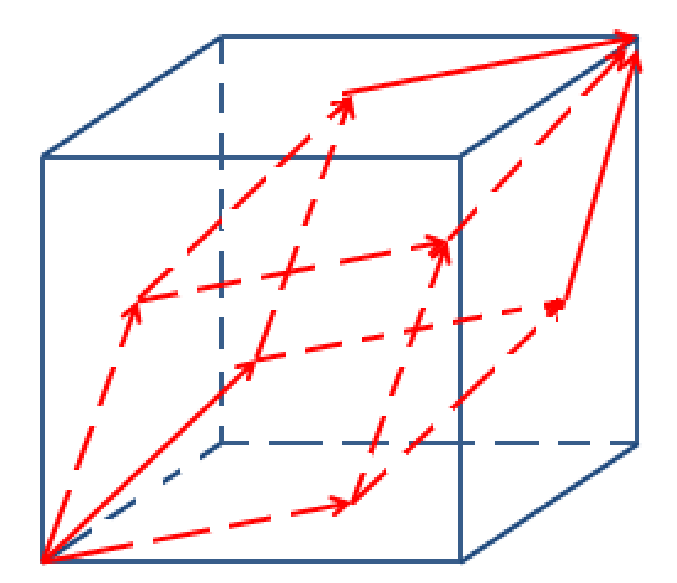

从这个平行六面体，你看不出任何点阵的对称性。

要想看出这个对称性，两种方法。一是取晶胞，就像上面图中的蓝色立方体，我的 cell 变大了，这个大的 cell 可以反映出点阵的对称性；二是对原胞做另一种取法，Wigner-Seitz Cell。以二维晶体为例，这个 cell 的取法是我相对于原点，对每个格点与原点的连线做平分线，所围出来的最小的面积，比如：

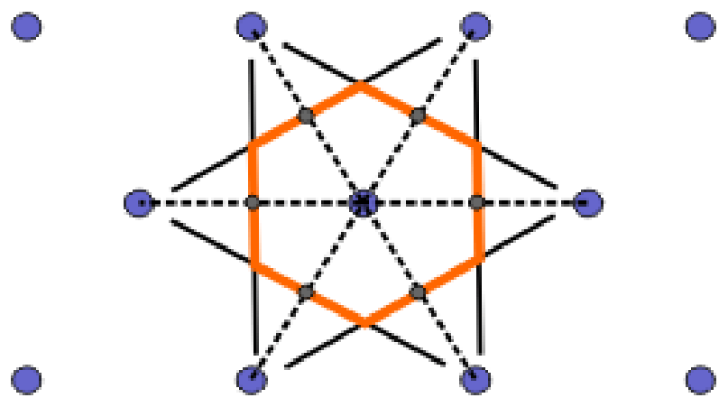

三维情况下，简立方、体心、面心的 Wigner-Seitz Cell 分别是：

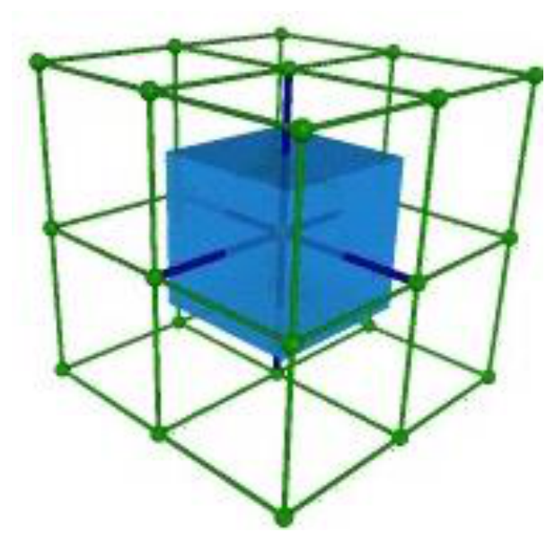

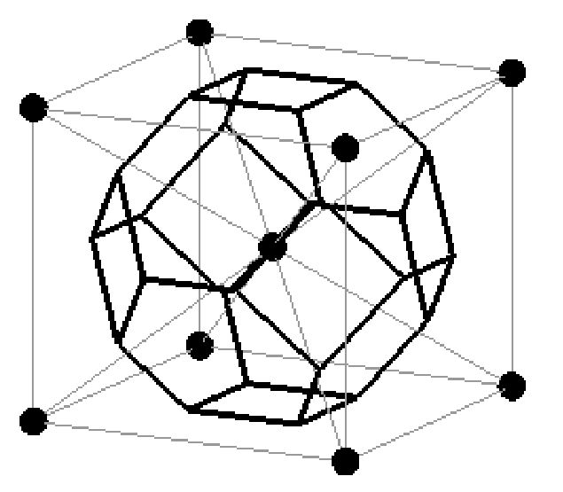

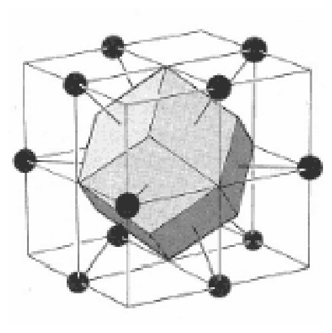

这些都是实空间的东西。

对于晶体中的元激发，它们的状态我们一般可以用波矢量来描述，波矢量对应的是倒空间。与实空间中的点阵对应，倒空间也有点阵，它们是由 $\vec{b}_1$、$\vec{b}_2$、$\vec{b}_3$ 的整数线性组合构成的，其中：

$$
\begin{aligned}
\vec{b}_1&=\frac{2\pi}{\Omega}(\vec{a}_2\times\vec{a}_3)\\
\vec{b}_2&=\frac{2\pi}{\Omega}(\vec{a}_3\times\vec{a}_1)\\
\vec{b}_3&=\frac{2\pi}{\Omega}(\vec{a}_1\times\vec{a}_2)
\end{aligned}
$$

$\Omega$ 为实空间中原胞体积。晶体是 fcc，对应倒空间点阵是 bcc；晶体是 bcc，对应倒空间点阵是 fcc。

上面是我们对固体物理中一些基础知识的回顾，现在看平移对称性。所谓平移对称性，指的是将晶体平移 $\vec{R}_l$，系统回到与原来不可分辨状态的属性。当晶体无穷大时，平移操作 $\{E|\vec{R}_l\}$ 无穷多。有限晶体，我们会使用周期性边界条件，取 $\{E|N_1\vec{a}_1\}=\{E|N_2\vec{a}_2\}=\{E|N_3\vec{a}_3\}=\{E|0\}$。这样的话由元素 $\{E|\vec{R}_l\}$ 形成的集合是构成一个群的，因为：

1. 任意两个平移的乘积仍为一个形势为 $\{E|\vec{R}_l\}$ 平移；
2. 结合律；
3. $\{E|\vec{R}_l\}$ 逆为 $\{E|-\vec{R}_l\}$；
4. 恒等操作 $\{E|0\}$。

这个群称为平移群。

现在我们知道了晶体中存在平移群，这会带来什么后果呢？答案很简单，就是布洛赫定理。在讲这个定理之前我们先明确一点，就是平移群是个阿贝尔群。因此，对于由 $\{E|N_1\vec{a}_1\}=\{E|N_2\vec{a}_2\}=\{E|N_3\vec{a}_3\}=\{E|0\}$ 这个周期性边界条件定义的晶体，平移群的阶为 $N_1\times N_2\times N_3$，类的个数也是 $N_1\times N_2\times N_3$，有 $N_1\times N_2\times N_3$ 个一维的不等价不可约表示。

以固体中的电子，这样一个处在晶格周期场中的量子的粒子为例，它的元激发对应某本征态。这个本征态，按照前面哈密顿算符群部分的讨论，它是承载固体的哈密顿算符群的一个表示的。这里平移群是固体的哈密顿算符的群，群元为 g。与之相应，有个哈密顿算符群，群元是 $\hat{P}_g$。晶体中的电子态是要承载这个哈密顿算符群的表示的。在求这个表示的过程中，只需要知道平移群基本生成元 $\{E|\vec{a}_1\}$、$\{E|\vec{a}_2\}$、$\{E|\vec{a}_3\}$ 所对应的 $\hat{P}_g$ 的表示矩阵，整个哈密顿算符群的表示矩阵就出来了。

以 $\{E|\vec{a}_1\}$ 为例，对应 $\hat{P}_g\psi(\vec{r})=\psi(\vec{r}-\vec{a}_1)=D(\{E|\vec{a}_1\})\psi(\vec{r})$。由于周期性边界条件，有 $D^{N_1}(\{E|\vec{a}_1\})\psi(\vec{r})=\psi(\vec{r}-N_1\vec{a}_1)=\psi(\vec{r})$，对 $\forall\vec{r}$ 成立。因此有 $D^{N_1}(\{E|\vec{a}_1\})=1$。对 $\{E|\vec{a}_2\}$、$\{E|\vec{a}_3\}$，同样有 $D^{N_2}(\{E|\vec{a}_2\})=1$、$D^{N_3}(\{E|\vec{a}_3\})=1$。这些是对 $D(\{E|\vec{a}_1\})$、$D(\{E|\vec{a}_2\})$、$D(\{E|\vec{a}_3\})$ 的要求。当 $D(\{E|\vec{a}_1\})$、$D(\{E|\vec{a}_2\})$、$D(\{E|\vec{a}_3\})$ 定下以后，不可约表示就定下了。

要让 $D^{N_1}(\{E|\vec{a}_1\})=1$、$D^{N_2}(\{E|\vec{a}_2\})=1$、$D^{N_3}(\{E|\vec{a}_3\})=1$，我们只需要取 $D(\{E|\vec{a}_1\})=\exp\left[2\pi i\frac{n_1}{N_1}\right]$、$D(\{E|\vec{a}_2\})=\exp\left[2\pi i\frac{n_2}{N_2}\right]$、$D(\{E|\vec{a}_3\})=\exp\left[2\pi i\frac{n_3}{N_3}\right]$，就满足要求。也就是说平移群的一维不等价、不可约表示，最终可以用 $\frac{n_1}{N_1}$、$\frac{n_2}{N_2}$、$\frac{n_3}{N_3}$ 这个数组来标识。在这个数组确定后，在这个确定的不等价不可约表示中，平移操作 $\vec{R}_l=l_1\vec{a}_1+l_2\vec{a}_2+l_3\vec{a}_3$ 所对应的表示矩阵就是：

$$
D(\{E|\vec{R}_l\})=\exp\left[2\pi i\left(\frac{n_1}{N_1}l_1+\frac{n_2}{N_2}l_2+\frac{n_3}{N_3}l_3\right)\right]
$$

这个时候，引入我们之前关于倒空间的讨论，结合 $\vec{b}_1$、$\vec{b}_2$、$\vec{b}_3$ 与 $\vec{a}_1$、$\vec{a}_2$、$\vec{a}_3$ 的关系 $\vec{a}_i\cdot\vec{b}_j=2\pi\delta_{ij}$，我们就可以用倒空间中的向量：

$$
\vec{k}=\frac{n_1}{N_1}\vec{b}_1+\frac{n_2}{N_2}\vec{b}_2+\frac{n_3}{N_3}\vec{b}_3
$$

来标识平移群的一维不等价、不可约表示，而这里的 $\vec{k}$，就是倒空间中第一布里渊区的点。相应的表示就是：

$$
D_{\vec{k}}(\{E|\vec{R}_l\})=\exp[i\vec{k}\cdot\vec{R}_l]
$$

这样的话我们用 $\vec{k}$ 来标识电子的本征态 $\psi_{\vec{k}}(\vec{r})$，这个本征态波函数就会具有下面的特征。当 $\hat{P}_{\{E|\vec{R}_l\}}$ 作用到 $\psi_{\vec{k}}(\vec{r})$ 上时，一方面有：

$$
\hat{P}_{\{E|\vec{R}_l\}}\psi_{\vec{k}}(\vec{r})=\psi_{\vec{k}}(\vec{r}-\vec{R}_l)
$$

另一方面有：

$$
\hat{P}_{\{E|\vec{R}_l\}}\psi_{\vec{k}}(\vec{r})=D_{\vec{k}}(\{E|\vec{R}_l\})\psi_{\vec{k}}(\vec{r})=\exp[i\vec{k}\cdot\vec{R}_l]\psi_{\vec{k}}(\vec{r})
$$

因此：

$$
\psi_{\vec{k}}(\vec{r}-\vec{R}_l)=\exp[i\vec{k}\cdot\vec{R}_l]\psi_{\vec{k}}(\vec{r})
$$

或：

$$
\psi_{\vec{k}}(\vec{r}+\vec{R}_l)=\exp[-i\vec{k}\cdot\vec{R}_l]\psi_{\vec{k}}(\vec{r})
$$

这个就是 Bloch 定理。

由 Bloch 定理，我们知道，如果我们把 $\psi_{\vec{k}}(\vec{r})$ 写成 $\exp[-i\vec{k}\cdot\vec{r}]u_{\vec{k}}(\vec{r})$ 的形式，那么 $\psi_{\vec{k}}(\vec{r}+\vec{R}_l)$ 一方面会等于 $\exp[-i\vec{k}\cdot(\vec{r}+\vec{R}_l)]u_{\vec{k}}(\vec{r}+\vec{R}_l)$，另一方面又等于

$$
\exp[-i\vec{k}\cdot\vec{R}_l]\psi_{\vec{k}}(\vec{r})=\exp[-i\vec{k}\cdot(\vec{r}+\vec{R}_l)]u_{\vec{k}}(\vec{r})
$$

因此：

$$
u_{\vec{k}}(\vec{r}+\vec{R}_l)=u_{\vec{k}}(\vec{r})
$$

也就是说处在晶格周期场中元激发的本征态波函数，一定可以写成 $\exp[-i\vec{k}\cdot\vec{r}]u_{\vec{k}}(\vec{r})$（其中 $u_{\vec{k}}(\vec{r})$ 为晶格周期函数）的形式。而这里的 $\vec{k}$，就是倒空间第一布里渊区中的点。换句话说，处在晶格周期场中本征元激发，都可以用倒空间第一布里渊区的点来标识，其相应的波函数，具备 $\exp[-i\vec{k}\cdot\vec{r}]u_{\vec{k}}(\vec{r})$ 的特征。这个是由晶格的平移对称性决定的。

## 4.7 布里渊区与晶格对称性

前面的讨论主要关注的是晶体中平移对称性带来的晶体中本征激发的性质。除了平移，点群空间群部分我们已经说过，晶体中还有转动对称性。这些转动对称性也会对我们晶体中的本征激发带来很多内在的属性。其中最重要的，就是前面提到标识晶格周期场中本征激发的第一布里渊区的点，可以通过转动对称性的折叠，缩小到一个很小的区域，叫不可约（irreducible）布里渊区。下面我们就来详细解释这个为什么发生？

出发点是晶体空间群的基本操作，$\{\alpha|\vec{t}\}$。这里 $\alpha=E$ 时，$\vec{t}$ 只能为 $\vec{R}_l$，这个时候它就是平移群。当 $\alpha$ 为非恒等转动时，$\vec{t}$ 可以不为 $\vec{R}_l$。它们所有的组合，形成空间群。$\{\alpha|\vec{t}\}$ 这些元素的逆、乘法满足的规律是：

$$
\{\alpha|\vec{t}\}\vec{r}=\alpha\vec{r}+\vec{t}
$$

$$
\{\alpha|\vec{t}\}\{\beta|\vec{s}\}\vec{r}=\{\alpha|\vec{t}\}(\beta\vec{r}+\vec{s})=\alpha\beta\vec{r}+\alpha\vec{s}+\vec{t}=\{\alpha\beta|\alpha\vec{s}+\vec{t}\}\vec{r}
$$

因此：

$$
\{\alpha|\vec{t}\}\{\beta|\vec{s}\}=\{\alpha\beta|\alpha\vec{s}+\vec{t}\}
$$

要想让 $\{\alpha|\vec{t}\}\{\beta|\vec{s}\}=\{E|0\}$，需要：$\{\beta|\vec{s}\}=\{\alpha^{-1}|-\alpha^{-1}\vec{t}\}$。因此

$$
\{\alpha|\vec{t}\}^{-1}=\{\alpha^{-1}|-\alpha^{-1}\vec{t}\}
$$

这些是空间群群元的性质。

这些对称元素的存在会对晶体场中的本征激发带来什么影响呢？我们还是以电子的元激发为例。$\{\alpha|\vec{t}\}$ 为对称操作，$\hat{P}_{\{\alpha|\vec{t}\}}$ 为其对应的函数变换算符。由本章第一节的讨论我们知道：

$$
\hat{P}^{-1}_{\{\alpha|\vec{t}\}}\hat{H}\hat{P}_{\{\alpha|\vec{t}\}}=\hat{H}
$$

同时，因为 $\{E|-\vec{R}_l\}\{\alpha|\vec{t}\}=\{\alpha|-\vec{R}_l+\vec{t}\}$、$\{\alpha|\vec{t}\}\{E|-\alpha^{-1}\vec{R}_l\}=\{\alpha|-\vec{R}_l+\vec{t}\}$，所以：

$$
\{E|-\vec{R}_l\}\{\alpha|\vec{t}\}=\{\alpha|\vec{t}\}\{E|-\alpha^{-1}\vec{R}_l\}
$$

基于这些性质，我们知道对 $\hat{P}_{\{\alpha|\vec{t}\}}$、$\hat{P}_{\{E|\vec{R}_l\}}$，有：

$$
\begin{aligned}
\hat{P}_{\{E|-\vec{R}_l\}}\hat{P}_{\{\alpha|\vec{t}\}}\psi_{\vec{k}}(\vec{r})&=\hat{P}_{\{\alpha|\vec{t}\}}\hat{P}_{\{E|-\alpha^{-1}\vec{R}_l\}}\psi_{\vec{k}}(\vec{r})\\
&=\hat{P}_{\{\alpha|\vec{t}\}}\exp[i\vec{k}\cdot(-\alpha^{-1}\vec{R}_l)]\psi_{\vec{k}}(\vec{r})\\
&=\hat{P}_{\{\alpha|\vec{t}\}}\exp[-i\alpha\vec{k}\cdot\vec{R}_l]\psi_{\vec{k}}(\vec{r})\\
&=\exp[-i\alpha\vec{k}\cdot\vec{R}_l]\hat{P}_{\{\alpha|\vec{t}\}}\psi_{\vec{k}}(\vec{r})
\end{aligned}
$$

这也就是说 $\hat{P}_{\{\alpha|\vec{t}\}}\psi_{\vec{k}}(\vec{r})$ 对于平移群来说，可承载 $\alpha\vec{k}$ 这个第一布里渊区的 $\vec{k}$ 点所对应的不可约表示。

而另一方面，由前面的讨论，我们知道 $\psi_{\alpha\vec{k}}(\vec{r})$ 本身是承载 $\alpha\vec{k}$ 这个第一布里渊区的 $\vec{k}$ 点所对应的不可约表示。当 band index 一样时，它们必对应相同的线性空间。因此：

$$
\psi_{\alpha\vec{k}}(\vec{r})=\lambda\hat{P}_{\{\alpha|\vec{t}\}}\psi_{\vec{k}}(\vec{r})
$$

两者都归一的话 $|\lambda|=1$。

由这个关系，我们看 $\psi_{\alpha\vec{k}}(\vec{r})$ 这个本征态的本征能量与 $\psi_{\vec{k}}(\vec{r})$ 这个本征态的本征能量存在什么样的关系？答案很简单：

$$
\begin{aligned}
E_{\alpha\vec{k}}&=(\psi_{\alpha\vec{k}}(\vec{r})|\hat{H}|\psi_{\alpha\vec{k}}(\vec{r}))\\
&=(\lambda\hat{P}_{\{\alpha|\vec{t}\}}\psi_{\vec{k}}(\vec{r})|\hat{H}|\lambda\hat{P}_{\{\alpha|\vec{t}\}}\psi_{\vec{k}}(\vec{r}))\\
&=(\hat{P}_{\{\alpha|\vec{t}\}}\psi_{\vec{k}}(\vec{r})|\hat{H}|\hat{P}_{\{\alpha|\vec{t}\}}\psi_{\vec{k}}(\vec{r}))\\
&=(\psi_{\vec{k}}(\vec{r})|\hat{P}^{-1}_{\{\alpha|\vec{t}\}}\hat{H}\hat{P}_{\{\alpha|\vec{t}\}}|\psi_{\vec{k}}(\vec{r}))=(\psi_{\vec{k}}(\vec{r})|\hat{H}|\psi_{\vec{k}}(\vec{r}))=E_{\vec{k}}
\end{aligned}
$$

也就是说对于空间群，只要存在群元 $\{\alpha|\vec{t}\}$，这里的 $\vec{t}$ 不要求为 $\vec{R}_l$（晶格矢的整数倍），都可以使 $\alpha\vec{k}$ 与 $\vec{k}$ 所对应的本征态能量相等（当然，band index ‘n’必须相同）。这也是为什么对固体能带，我们最关心的其实不是晶体的点群，而是晶体‘空间群的点群’。也就是取空间群所有元素 $\{\alpha|\vec{t}\}$，把 $\alpha$ 单独拿出来，形成的转动操作的集合。布里渊区的转动对称性，是由空间群的点群决定的。

同时，在画能带的时候，我们也不需要把布里渊区所有点都画出来。我们只需要画不可约的布里渊区就可以了。以二维系统为例，如果空间群的点群是 $D_4$，不可约布里渊区就是（阴影部分）：

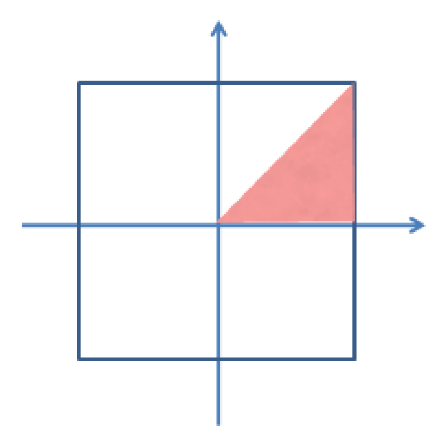

如果空间群的点群是 $C_4$，不可约布里渊区就是：

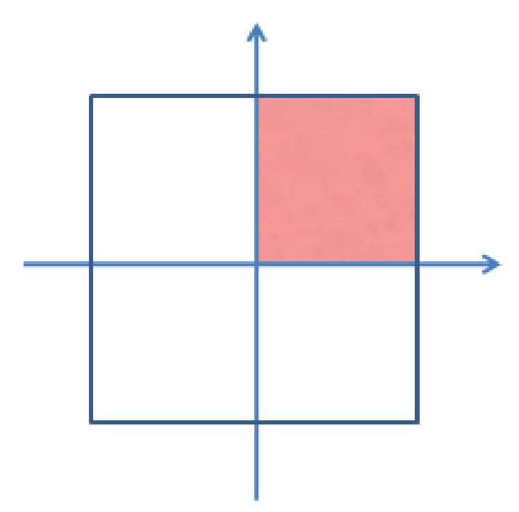

空间群的点群对称性越高，不可约布里渊区越小。

## 4.8 时间反演对称性

最后一节我们讲时间反演对称性（之前刚才不管是转动还是平移都是空间的）。这一节的内容我们先做一个概念性的整体介绍，这个整体介绍很好理解，也对你们了解一些与时间反演对称性相关的基本规律有好处。之后，我们做一个更深层次的理论层面的讲解。

先看概念性介绍。时间反演是改变时间符号的操作，它对我们系统的主要物理量带来的变化是：$t$ 变为 $-t$、$\vec{r}$ 不变、$\vec{p}$ 变为 $-\vec{p}$（或者说 $\vec{k}$ 变为 $-\vec{k}$）、$\vec{L}$ 变为 $-\vec{L}$、$\vec{\sigma}$ 变为 $-\vec{\sigma}$。在无外磁场，且系统没有固有磁序的时候，由于动能正比于 $\vec{p}^2$、势能$V(\vec{r})$ 不变，所以哈密顿量不发生变化，系统具有时间反演对称性。有外场，或者系统具有固有磁序的时候，哈密顿量中多了 $\vec{B}\cdot\vec{\sigma}$ 这一项，在时间反演操作下变化，加上其它项不变，系统不具备时间反演对称性。

对电子本征激发 Bloch 态 $\psi_{n,\vec{k},\uparrow}(\vec{r})$，它的时间反演态是 $\psi_{n,-\vec{k},\downarrow}(\vec{r})$。无外磁场，且系统没有固有磁序时，由于哈密顿量具备时间反演对称性，对于晶体能级能量，存在：

$$
E_{n,\vec{k},\uparrow}=E_{n,-\vec{k},\downarrow}
$$

这个简并是由时间反演对称性要求的。

在时间反演对称性的基础上，如果系统继续有空间反演对称性，那么继续有：

$$
E_{n,\vec{k},\uparrow}=E_{n,-\vec{k},\uparrow}
$$

这也就是说，当空间与时间反演对称性同时存在，这两个式子一结合，就有：

$$
E_{n,\vec{k},\uparrow}=E_{n,\vec{k},\downarrow}
$$

也就是说同一个波矢的两个不同自旋态相互简并，这个简并称为 Kramer 简并。

同时，由于 $E_{n,\vec{k},\uparrow}=E_{n,\vec{k},\downarrow}$、$E_{n,\vec{k},\uparrow}=E_{n,-\vec{k},\downarrow}$、$E_{n,-\vec{k},\uparrow}=E_{n,\vec{k},\downarrow}$，有：

$$
E_{n,\vec{k},\uparrow}=E_{n,\vec{k},\downarrow}=E_{n,-\vec{k},\uparrow}=E_{n,-\vec{k},\downarrow}
$$

也就是在系统同时具有时间、空间反演对称性的时候。$E_{n,\vec{k},\sigma}$ 对 $\vec{k}$、对 $\sigma$ 的正负号都有简并的特征。

因为这个原因，当一个系统既有 time-reversal symmetry，又有 iversion symmetry 的时候，它的 electronic bands 必有 spin 简并的特征。在一些关于电子结构的讨论中，你们应该经常会看到一些类似讨论句子，比如：In order to break the spin degeneracy, one has to break either the timer-reversal or the inversion symmetry，说的就是这个道理。

空间反演对称性如果去除，时间反演对称性依然要求 $E_{n,\vec{k},\uparrow}=E_{n,-\vec{k},\downarrow}$。前些年比较热的拓扑绝缘体中，一个基本特征就是存在时间反演对称性，不存在空间反演对称性，因此，文献上画出的能到总具有如下特征：

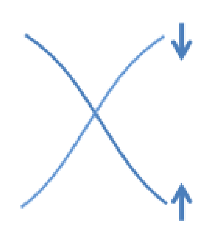

其背后原因，也是这个东西。

现在看背后更深层次的原理性的东西。如果你只想理解上面的内容的话，这个东西本来可以不讲。但前两年有细心的同学，会问我一个关于晶体点群特征标表（附录 A）的问题。对于 $C_3$、$C_4$、$C_6$、$C_{3h}$、$C_{4h}$、$C_{6h}$、$S_4$、$S_6$、$T$ 这些点群，有个有意思的情况，就是我们有时会把两个一维表示放在一起用 E 来标识。根据我们以前将的习惯，E 一般是用来标识二维不可约表示的。这里为什么要这样处理呢？这个时候，如果你再细心点，你会发现放在一起的两个一维表示是相互共轭的。相互共轭就意味着它们的表示可以写为 D 与 $D^*$。背后所对应的物理就是时间反演对称性可以让这两个不被空间的点群对称性要求简并的量子态简并。而要理解这个，我们又必须从头说起。

前面说过，时间反演是一种操作。我们可以把它记作 $\hat{T}$，它做的事情是：t 变为 $-t$、$\vec{r}$ 不变、$\vec{p}$ 变为 $-\vec{p}$（或者说 $\vec{k}$ 变为 $-\vec{k}$）、$\vec{L}$ 变为 $-\vec{L}$、$\vec{\sigma}$ 变为 $-\vec{\sigma}$。它联系起来的是两个量子态：原来的态 $\psi(\vec{r},t)$ 与它的时间反演共轭态 $\psi(\vec{r},-t)$。通过：$\psi(\vec{r},-t)=\hat{T}\psi(\vec{r},t)$。下面我们来理解 $\hat{T}$ 在数学上等效于什么？

现在先不考虑自旋，假设系统哈密顿量具有时间反演对称性，那么这个不考虑自旋的粒子的含时波函数满足的方程是：

$$
i\hbar\frac{\partial\psi(\vec{r},t)}{\partial t}=\hat{H}(\vec{r},t)\psi(\vec{r},t)
$$

$t=0$ 时刻的波函数是定态波函数，可以写成实函数 $\psi(\vec{r},0)^{12}$。这样的话，沿时间正轴方向演化的含时波函数就是：

$$
\psi(\vec{r},t)=e^{-i\hat{H}(\vec{r},t)t/\hbar}\psi(\vec{r},0)
$$

它的时间反演对称态就是：$\psi(\vec{r},-t)=\psi^*(\vec{r},t)$。这也就是说在不考虑自旋的时候，时间反演算符 $\hat{T}$ 就等于复数共轭算符 $\hat{K}$。

考虑自旋，最简单的 level，自旋轨道耦合，哈密顿量就变成了：

$$
\hat{H}(\vec{r},t)=\frac{1}{2m}\hat{p}^2+V(\vec{r})+\frac{1}{4m^2c^2}\vec{\sigma}\cdot(\nabla V(\vec{r})\times\hat{p})
$$

这个时候，为了保证这个哈密顿量在 $\hat{T}$ 下不变，就要求 $\hat{T}\vec{\sigma}=-\vec{\sigma}$。前两项不变是在不考虑自旋的时候已经讨论过的，第三项要想不变，$\hat{p}$ 变号了，$\nabla V(\vec{r})$ 没有，所以 $\vec{\sigma}$ 必须变号。这也就是说时间反演对称性要求 $\hat{T}\vec{\sigma}=-\vec{\sigma}$。

怎么才能让 $\hat{T}\vec{\sigma}=-\vec{\sigma}$ 呢？我们就需要利用泡利矩阵的性质了。取 $\hat{T}=\hat{K}\sigma_y$，看这样能不能满足 $\hat{T}\vec{\sigma}=-\vec{\sigma}$ 的要求？$\vec{\sigma}$ 是：$[\sigma_x, \sigma_y, \sigma_z]$。其中 $\sigma_x=\begin{pmatrix}0&1\\1&0\end{pmatrix}$、$\sigma_y=\begin{pmatrix}0&-i\\i&0\end{pmatrix}$、$\sigma_z=\begin{pmatrix}1&0\\0&-1\end{pmatrix}$。$\hat{T}=\hat{K}\sigma_y$ 作用到它上面的后果是：

$$
\hat{T}\vec{\sigma}=\hat{K}\sigma_y\vec{\sigma}=\hat{K}\sigma_y[\sigma_x, \sigma_y, \sigma_z]=[\hat{K}\sigma_y\sigma_x, \hat{K}\sigma_y\sigma_y, \hat{K}\sigma_y\sigma_z]
$$

下一步利用到的性质是：$\sigma_y\sigma_x=-\sigma_x\sigma_y$，进而 $\hat{K}\sigma_y\sigma_x=-\hat{K}\sigma_x\sigma_y=-\sigma_x\hat{K}\sigma_y$；$\sigma_y\sigma_y=\sigma_y\sigma_y$，进而 $\hat{K}\sigma_y\sigma_y=-\sigma_y\hat{K}\sigma_y$；$\sigma_y\sigma_z=-\sigma_z\sigma_y$，进而 $\hat{K}\sigma_y\sigma_z=-\hat{K}\sigma_z\sigma_y=-\sigma_z\hat{K}\sigma_y$。这样综合上面的式子，我们就有：

$$
\hat{T}\vec{\sigma}=\hat{K}\sigma_y\vec{\sigma}=-[\sigma_x\hat{K}\sigma_y, \sigma_y\hat{K}\sigma_y, \sigma_z\hat{K}\sigma_y]=-\vec{\sigma}\hat{K}\sigma_y=-\vec{\sigma}\hat{T}
$$

也就是 $\hat{T}$ 让 $\vec{\sigma}$ 反号了。综合一下，就是说不考虑自旋时 $\hat{T}=\hat{K}$，考虑时 $\hat{T}=\hat{K}\sigma_y$。

[^12]: 定态波函数满足 $\hat{H}(\vec{r})\psi(\vec{r},0)=E\psi(\vec{r},0)$，E 是实数。对这个方程取转置共轭，有 $\hat{H}^+(\vec{r})\psi^*(\vec{r},0)=\hat{H}(\vec{r})\psi^*(\vec{r},0)=E\psi^*(\vec{r},0)$。由这个，可知 $\hat{H}(\vec{r})[\psi(\vec{r},0)+\psi^*(\vec{r},0)]=E[\psi(\vec{r},0)+\psi^*(\vec{r},0)]$。而 $\psi(\vec{r},0)+\psi^*(\vec{r},0)$ 是实函数。这也就是说定态波函数总可以写成实函数。

前面提到的附录 A 中点群属于不考虑自旋的情况。这个时候，以 $C_4$ 这个点群为例，它的特征标表是：

| $C_4(4)$ | | | $E$ | $C_2$ | $\sigma_v$ | $\sigma_{v'}$ |
|---|---|---|---|---|---|---|
| $x^2+y^2, z^2$ | $R_z, z$ | $A$ | 1 | 1 | 1 | 1 |
| $x^2-y^2, xy$ | | $B$ | 1 | $-1$ | 1 | $-1$ |
| $(xz, yz)$ | $(x, y)$ | $E$ | 1 | $i$ | $-1$ | $-i$ |
| $(xz^2, yz^2)$ | $(R_x, R_y)$ | | 1 | $-i$ | $-1$ | $i$ |

按理说点群对称性是不要求 E 这两个不可约表示简并的，这里时间反演对称性就起作用了。因为上面那个表示我们记作 D，它的基是 $\psi$。由于有时间反演对称性，这个 $\psi$ 我们可以把它变作 $\psi^*$。D 对 $\psi$ 的那些变换也可以对应 $D^*$ 对 $\psi^*$ 的变化。这样，点群对称操作加上 $\hat{T}$，$\psi$ 与 $\psi^*$ 也就通过对称操作联系起来了，它们的能量自然简并。

## 习题与思考

1. 根据 $C_{3v}$ 群特征标表，将下面四个函数：1) $z$、2) $xy$、3) $x^2$、4) $x^2y$ 形成的线性空间，约化为 $C_{3v}$ 群的群不不变子空间的直和；

2. $D_3$ 群的表示空间为 $x$、$y$、$z$ 的六个二次齐次函数组成的六维空间。试用投影算符的方法将它们组合为六个对称化的新基，并写出 d、f 在这组对称化的新基下的表示矩阵？

3. 一个杂质原子放到一个晶体中，假设晶体场对称性为 O。不考虑自旋轨道耦合，结合 O 群特征标表讨论原子 d 轨道的劈裂情况。这里要用到下一章的一点知识，就是一个角度为 $\alpha$ 的转动，在转动群，也就是原子不考虑自旋轨道耦合的对称群中，特征标是 $\frac{\sin[(l+1/2)\alpha]}{\sin[\alpha/2]}$，对 d 轨道 $l=2$。

4. （接上题）之后，我们对此单晶沿 z 方向均匀拉伸，晶体场对称群变成了什么？这些轨道又会进行什么样的劈裂？

5. （接上题）之后，我们对此单晶沿 y 方向在进行一个不同于 z 方向的均匀拉伸，晶体场对称群又变成了什么？这些轨道又会进行什么样的劈裂？

6. 根据下图，以 a 轴为 $C_2^{(1)}$，b 轴为 $C_2^{(2)}$，c 轴为 $C_2^{(3)}$，定义 $C_{3v}$ 群。用投影算符的方法说明从 1) $z$，2) $xy$ 出发，生成的 $C_{3v}$ 群的表示空间是什么（指出几维，以及线性无关的基函数）？他们承载的是哪些不可约表示？

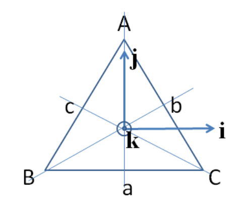

7. 小明生长出来一种晶体，为了对其结构有所了解，他做了一个红外谱实验，又做了一个拉曼谱实验。他发现在 $1700\,\mathrm{cm}^{-1}$、$1750\,\mathrm{cm}^{-1}$ 的位置（具体数字不重要），两种谱线都有明显的振动峰。基于这些观测，我们在下面四种点群中，可以排除哪些，为什么？

a) $T_h$　b) $C_{3v}$　c) $T_d$　d) $D_{3d}$

8. 晶体结构是 fcc，布里渊区如下：

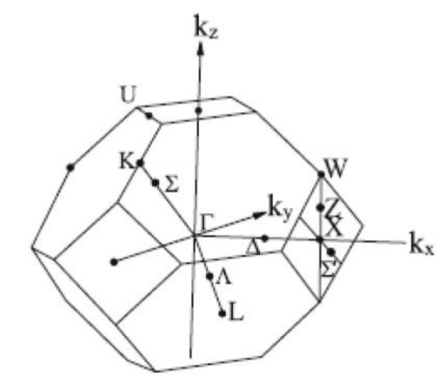

在理解 $\Gamma$、X、K 点的本征电子态时，分别应基于哪些点群的特征标表来分析？从对称性的角度考虑，从 $\Gamma$ 点向 X 点移动的过程中，简并度一般是升高还是降低？
