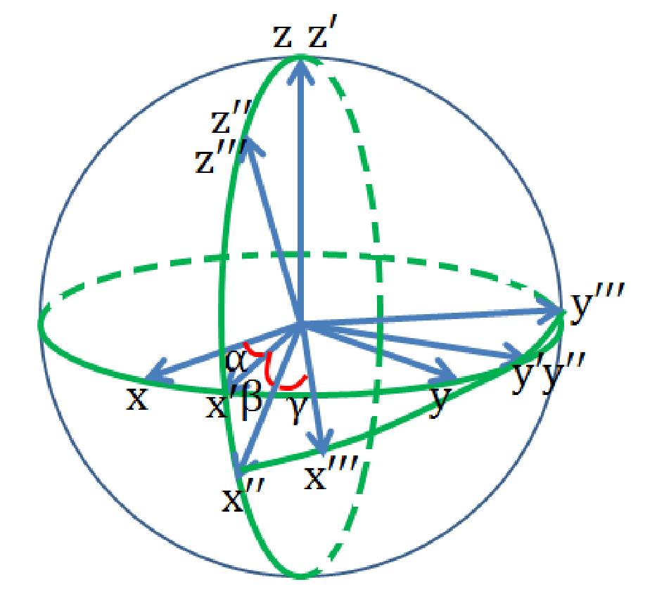
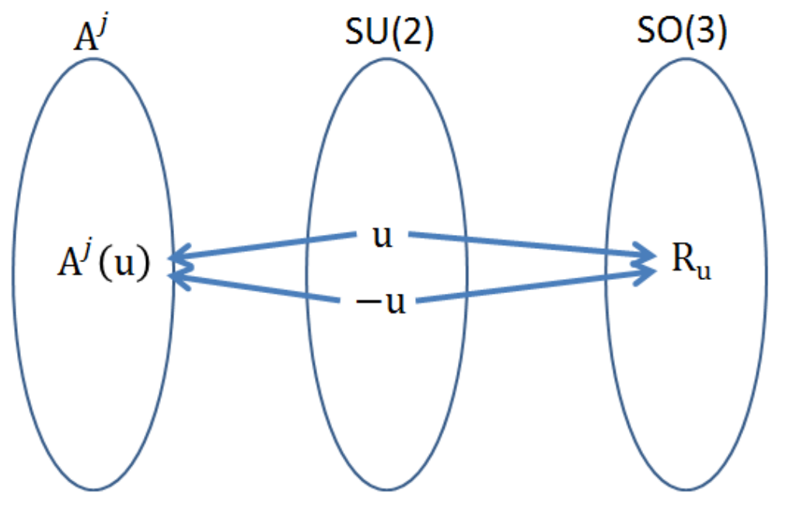
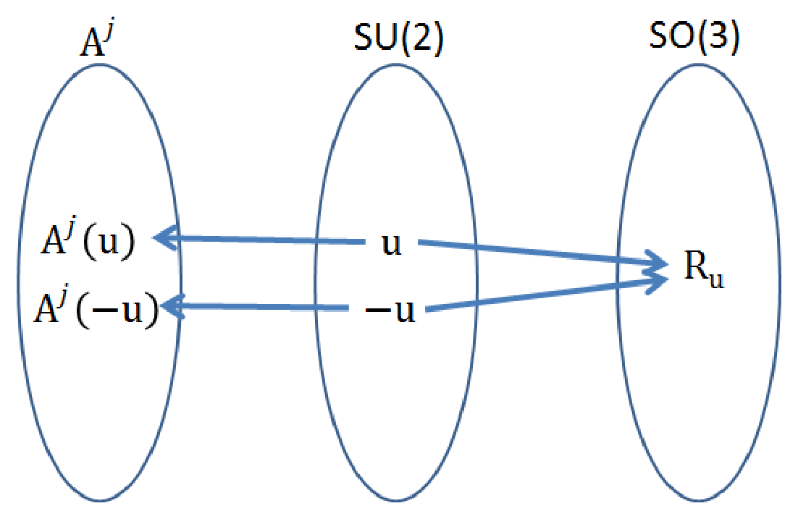
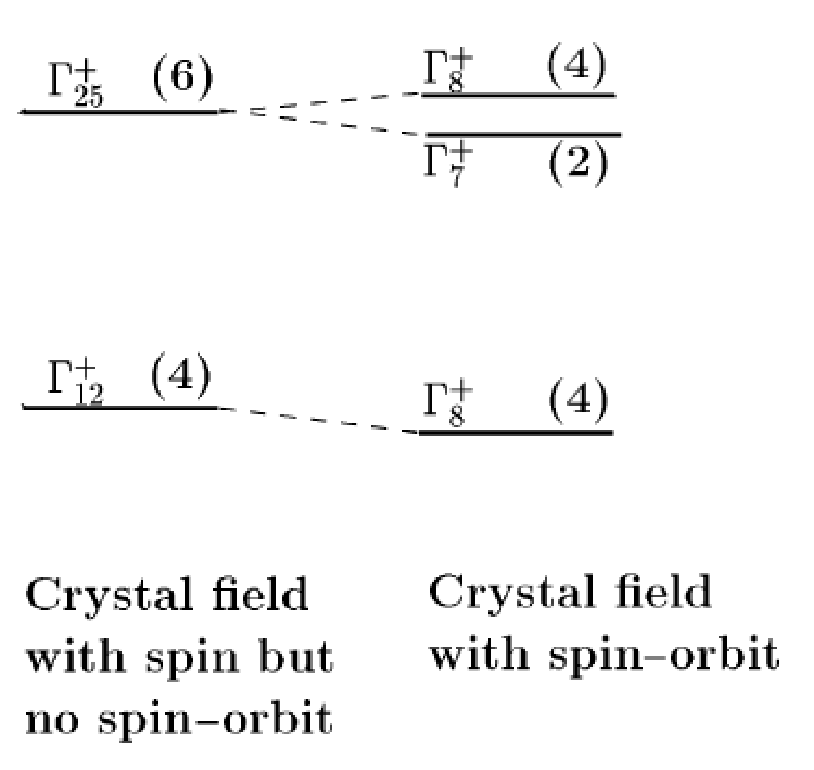
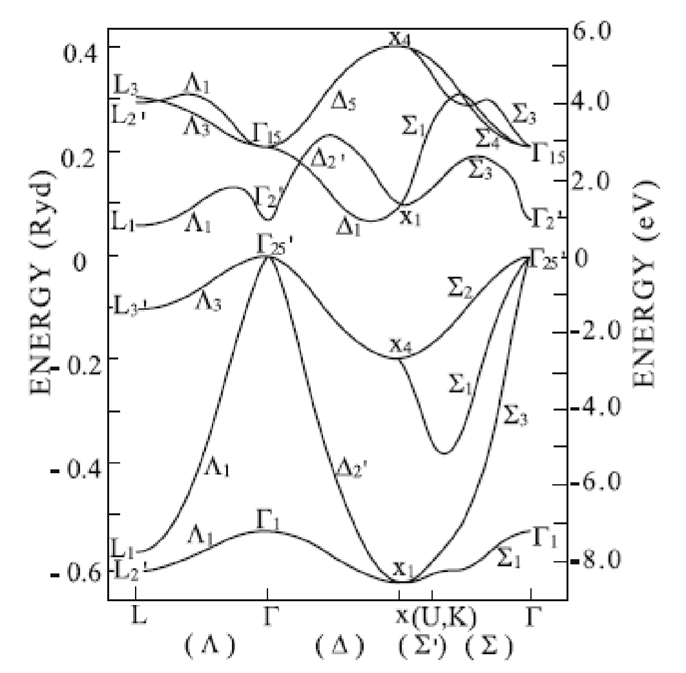
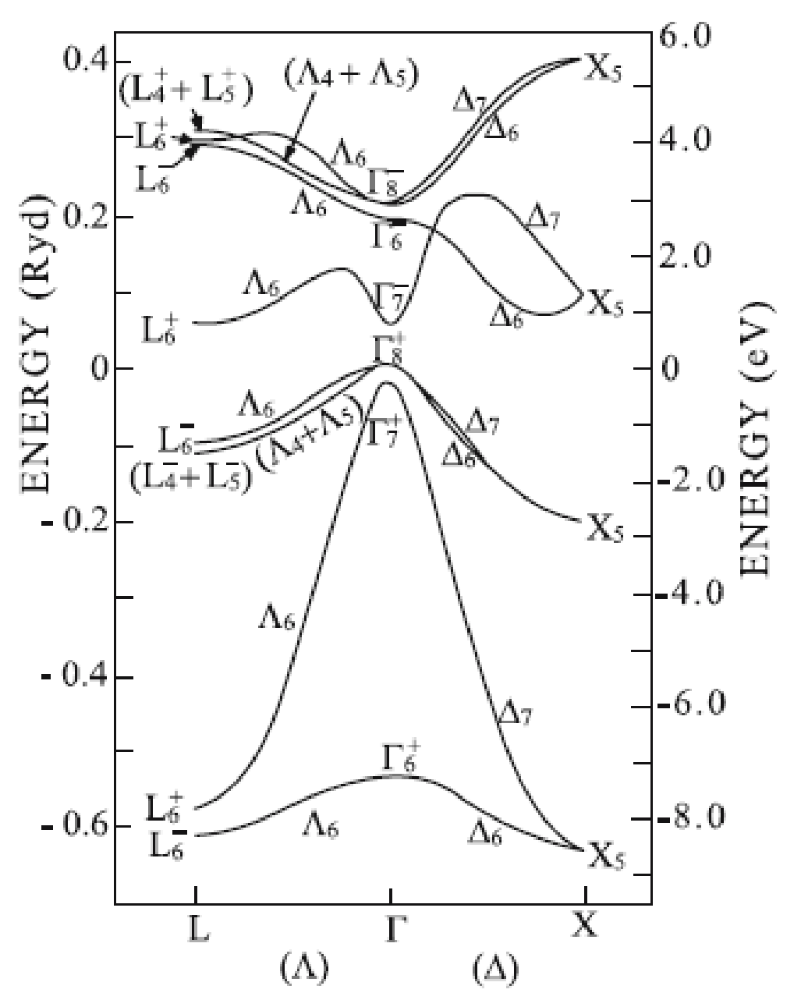

# 第五章 转动群

前面在点群部分我们曾经说过三维实正交群 O(3) 与三维实特殊正交群 SO(3)，那里的三维实特殊正交群 SO(3) 就是我们这里要讲的三维转动群，它是三维实正交群 O(3) 中行列式为 1 的部分。物理中的中心力场问题都与这样的一个群相关，它是非阿贝尔李群（群元有连续参数、参数之间有关系、关系可有解析函数表达）这种连续群的一个例子。

学习转动群这一章，我们的核心任务是三个：1) SO(3) 与 SU(2) 群是什么，它们有怎样的关系？2) SO(3) 与 SU(2) 群的不可约表示是什么？3) 在物理系统中有什么用。这三个内容我们分三节来讲。

## 5.1 SO(3) 群与二维特殊酉群 SU(2)

我们前面讲过 SO(3) 群中的元素可以用 $C_{\vec{k}}(\psi)$，其中 $\vec{k}(\theta,\varphi)$ 是转动轴，$\psi$ 是转角。当 $\vec{k}$ 为 $\hat{i}$、$\hat{j}$、$\hat{k}$ 中的 $\hat{k}$ 时，$\hat{i}$、$\hat{j}$ 与之垂直，

$$
C_{\vec{k}}(\psi)=\begin{pmatrix}
\cos\psi & -\sin\psi & 0\\
\sin\psi & \cos\psi & 0\\
0 & 0 & 1
\end{pmatrix}
$$

而 SO(3) 群中元素进行的操作，说白了，就是将一个球面转到与其重合的另一个位置，且不改变手性。从球心到球面上的三个向量在转动后夹角不变、手性不变。

由于这个原因，SO(3) 群中的元素可以用欧拉角 $\alpha$、$\beta$、$\gamma$ 来标记，记作 $R(\alpha,\beta,\gamma)$。这些欧拉角怎么定义呢？

设 $Oxyz$ 是三维欧式空间中固定的笛卡尔坐标系，$R(\alpha,\beta,\gamma)$ 是 SO(3) 群中的元素，它可以表示为三个连续转动的乘积。这三个连续转动的定义是：

1. 先绕 z 轴转 $\alpha$ 角，$0\le\alpha<2\pi$，此时坐标系由 $Oxyz$ 变为 $Ox'y'z'$；
2. 再绕 $\vec{y}'$ 转 $\beta$ 角，$0\le\beta\le\pi$，此时 $Ox'y'z'$ 变为 $Ox''y''z''$；

3. 最后绕 $\vec{z}''$ 转 $\gamma$ 角，$0\le\gamma<2\pi$，此时 $Ox''y''z''$ 变为 $Ox'''y'''z'''$。

这三个合在一起，就意味着：

$$
R(\alpha,\beta,\gamma)=C_{\vec{z}''}(\gamma)C_{\vec{y}'}(\beta)C_{\vec{z}}(\alpha)
$$

这里为什么要求 $0\le\alpha<2\pi$、$0\le\beta\le\pi$、$0\le\gamma<2\pi$ 呢？大家可以想象一个球，它有八个象限。$\beta$ 这个转动的作用，是使得上面北半球中的任意一个点，可以到达南半球。而 $\alpha$、$\gamma$ 是使得南北半球内四个象限可以互换。所以 $\beta$ 从 0 到 $\pi$ 就够了，但为了北极点能到南极点，这个 $\pi$ 是闭的。而 $\alpha$、$\gamma$ 的 $2\pi$ 开的就可以了。

除了这点，还有一点需要说明一下。就是 $\beta=0$ 的时候，$\alpha+\gamma$ 相同的操作对应的是同一个 SO(3) 群中的元素；当 $\beta=\pi$ 时，$\alpha-\gamma$ 相同的操作对应同一个 SO(3) 群中的元素。这也就是说同一个类似的特殊转动，在使用欧拉角描述的时候，存在多种欧拉角的组合对应同一个转动的情况。不过我们写成 SO(3) 群的矩阵表示的时候，这种多种组合的表示又会归一到同一个矩阵表示，这个一会儿我们会解释。

这两点说明之后，我们就来看一下在使用欧拉角表示三维转动的时候，这个表示矩阵应该是什么样子？我们取的基是 $\hat{i}$、$\hat{j}$、$\hat{k}$，沿 x、y、z 方向。之前我们说了，$R(\alpha,\beta,\gamma)=C_{\vec{z}''}(\gamma)C_{\vec{y}'}(\beta)C_{\vec{z}}(\alpha)$，因此要求 $R(\alpha,\beta,\gamma)$，知道 $C_{\vec{z}''}(\gamma)$、$C_{\vec{y}'}(\beta)$、$C_{\vec{z}}(\alpha)$ 在 $\hat{i}$、$\hat{j}$、$\hat{k}$ 下是什么就可以了。

这三个里面最简单的肯定是 $C_{\vec{z}}(\alpha)$，因为它是绕着 $\hat{k}$ 旋转 $\alpha$ 角的操作，在 $\hat{i}$、$\hat{j}$、$\hat{k}$ 下矩阵形式为：

$$
C_{\vec{z}}(\alpha)=\begin{pmatrix}
\cos\alpha & -\sin\alpha & 0\\
\sin\alpha & \cos\alpha & 0\\
0 & 0 & 1
\end{pmatrix}
$$

现在的任务就是要知道 $C_{\vec{z}''}(\gamma)$、$C_{\vec{y}'}(\beta)$ 在 $\hat{i}$、$\hat{j}$、$\hat{k}$ 下是什么？为了写出这两个矩阵，我们先进行下面一个简短的讨论。之前做过，就是相似变换。有两组基 $(\vec{e}_1,\vec{e}_2,\cdots,\vec{e}_n)$ 与 $(\vec{f}_1,\vec{f}_2,\cdots,\vec{f}_n)$，我们把前者称为旧基 B，后者称为新基 B′，两者由：

$$
(\vec{f}_1,\vec{f}_2,\cdots,\vec{f}_n)=(\vec{e}_1,\vec{e}_2,\cdots,\vec{e}_n)(P)
$$

联系起来。

对于一个线性变换 A，它在旧基 B 下的矩阵为 $[A]_B$ 与它在新基 B′ 下的矩阵形式 $[A]_{B'}$ 的关系就是：

$$
[A]_B=P[A]_{B'}P^{-1}
$$

由这个关系我们知道转动 $C_{\vec{y}'}(\beta)$ 在坐标系 $Ox'y'z'$ 下的矩阵为：

$$
\begin{pmatrix}
\cos\beta & 0 & \sin\beta\\
0 & 1 & 0\\
-\sin\beta & 0 & \cos\beta
\end{pmatrix}
$$

我们需要求出的，是它在 $Oxyz$ 这个旧基下的表示。我们知道新基 $Ox'y'z'$ 与旧基 $Oxyz$ 的联系，这个联系是：

$$
(\hat{i}',\hat{j}',\hat{k}')=(\hat{i},\hat{j},\hat{k})\begin{pmatrix}
\cos\alpha & -\sin\alpha & 0\\
\sin\alpha & \cos\alpha & 0\\
0 & 0 & 1
\end{pmatrix}
$$

套用上面的关系，$C_{\vec{y}'}(\beta)$ 在 $Oxyz$ 中的表示就是：

$$
C_{\vec{y}'}(\beta)=\begin{pmatrix}
\cos\alpha & -\sin\alpha & 0\\
\sin\alpha & \cos\alpha & 0\\
0 & 0 & 1
\end{pmatrix}\begin{pmatrix}
\cos\beta & 0 & \sin\beta\\
0 & 1 & 0\\
-\sin\beta & 0 & \cos\beta
\end{pmatrix}\begin{pmatrix}
\cos\alpha & -\sin\alpha & 0\\
\sin\alpha & \cos\alpha & 0\\
0 & 0 & 1
\end{pmatrix}^{-1}
$$

同理，$C_{\vec{z}''}(\gamma)$ 在 $Ox''y''z''$ 下的表示是：

$$
\begin{pmatrix}
\cos\gamma & -\sin\gamma & 0\\
\sin\gamma & \cos\gamma & 0\\
0 & 0 & 1
\end{pmatrix}
$$

而 $Ox''y''z''$ 的基 $(\hat{i}'',\hat{j}'',\hat{k}'')$ 与 $Oxyz$ 的基 $(\hat{i},\hat{j},\hat{k})$ 的联系是：

$$
(\hat{i}'',\hat{j}'',\hat{k}'')=(\hat{i},\hat{j},\hat{k})\begin{pmatrix}
\cos\alpha & -\sin\alpha & 0\\
\sin\alpha & \cos\alpha & 0\\
0 & 0 & 1
\end{pmatrix}\begin{pmatrix}
\cos\beta & 0 & \sin\beta\\
0 & 1 & 0\\
-\sin\beta & 0 & \cos\beta
\end{pmatrix}
$$

这样的话 $C_{\vec{z}''}(\gamma)$ 在 $Oxyz$ 下的表示就是：

$$
\begin{aligned}
C_{\vec{z}''}(\gamma)={}&\begin{pmatrix}
\cos\alpha & -\sin\alpha & 0\\
\sin\alpha & \cos\alpha & 0\\
0 & 0 & 1
\end{pmatrix}\begin{pmatrix}
\cos\beta & 0 & \sin\beta\\
0 & 1 & 0\\
-\sin\beta & 0 & \cos\beta
\end{pmatrix}\begin{pmatrix}
\cos\gamma & -\sin\gamma & 0\\
\sin\gamma & \cos\gamma & 0\\
0 & 0 & 1
\end{pmatrix}\\
&\times\begin{pmatrix}
\cos\beta & 0 & \sin\beta\\
0 & 1 & 0\\
-\sin\beta & 0 & \cos\beta
\end{pmatrix}^{-1}\begin{pmatrix}
\cos\alpha & -\sin\alpha & 0\\
\sin\alpha & \cos\alpha & 0\\
0 & 0 & 1
\end{pmatrix}^{-1}
\end{aligned}
$$

最后，$C_{\vec{z}''}(\gamma)C_{\vec{y}'}(\beta)C_{\vec{z}}(\alpha)$ 等于：

$$
\begin{aligned}
&\begin{pmatrix}
\cos\alpha & -\sin\alpha & 0\\
\sin\alpha & \cos\alpha & 0\\
0 & 0 & 1
\end{pmatrix}\begin{pmatrix}
\cos\beta & 0 & \sin\beta\\
0 & 1 & 0\\
-\sin\beta & 0 & \cos\beta
\end{pmatrix}\begin{pmatrix}
\cos\gamma & -\sin\gamma & 0\\
\sin\gamma & \cos\gamma & 0\\
0 & 0 & 1
\end{pmatrix}\\
&\quad\times\begin{pmatrix}
\cos\beta & 0 & \sin\beta\\
0 & 1 & 0\\
-\sin\beta & 0 & \cos\beta
\end{pmatrix}^{-1}\begin{pmatrix}
\cos\alpha & -\sin\alpha & 0\\
\sin\alpha & \cos\alpha & 0\\
0 & 0 & 1
\end{pmatrix}^{-1}\\
&\quad\times\begin{pmatrix}
\cos\alpha & -\sin\alpha & 0\\
\sin\alpha & \cos\alpha & 0\\
0 & 0 & 1
\end{pmatrix}\begin{pmatrix}
\cos\beta & 0 & \sin\beta\\
0 & 1 & 0\\
-\sin\beta & 0 & \cos\beta
\end{pmatrix}\begin{pmatrix}
\cos\alpha & -\sin\alpha & 0\\
\sin\alpha & \cos\alpha & 0\\
0 & 0 & 1
\end{pmatrix}^{-1}\\
&\quad\times\begin{pmatrix}
\cos\alpha & -\sin\alpha & 0\\
\sin\alpha & \cos\alpha & 0\\
0 & 0 & 1
\end{pmatrix}\\
={}&\begin{pmatrix}
\cos\alpha & -\sin\alpha & 0\\
\sin\alpha & \cos\alpha & 0\\
0 & 0 & 1
\end{pmatrix}\begin{pmatrix}
\cos\beta & 0 & \sin\beta\\
0 & 1 & 0\\
-\sin\beta & 0 & \cos\beta
\end{pmatrix}\begin{pmatrix}
\cos\gamma & -\sin\gamma & 0\\
\sin\gamma & \cos\gamma & 0\\
0 & 0 & 1
\end{pmatrix}\\
={}&\begin{pmatrix}
\cos\alpha\cos\beta\cos\gamma-\sin\alpha\sin\gamma & -\cos\alpha\cos\beta\sin\gamma-\sin\alpha\cos\gamma & \cos\alpha\sin\beta\\
\sin\alpha\cos\beta\cos\gamma+\cos\alpha\sin\gamma & -\sin\alpha\cos\beta\sin\gamma+\cos\alpha\cos\gamma & \sin\alpha\sin\beta\\
-\sin\beta\cos\gamma & \sin\beta\sin\gamma & \cos\beta
\end{pmatrix}
\end{aligned}
$$

从这个矩阵形式，大家也可以很容易看出 $\beta=0$ 时，$\alpha+\gamma$ 相同对应同一转动；

$\beta=\pi$ 时，$\alpha-\gamma$ 相同对应同一转动。

现在我们知道了 SO(3) 群一个元素在三维实空间中用欧拉角是怎么描述的了。在转动群这一章，最核心的一个地方，应该说是利用一个叫二维特殊酉群（SU(2) 群）与 SO(3) 群的同态关系，来讨论 SO(3) 群的不可约表示以及它在具体物理系统中的应用。因此，在介绍完 SO(3) 群的群元之后很自然的一个任务就是介绍这个 SU(2) 群，以及它与 SO(3) 群的同态映射关系。

这个 SU(2) 群叫二维特殊酉群，它是由行列式为 1 的二阶幺正矩阵组成的。由这个条件，如果我们假设其中元素为：

$$
u=\begin{pmatrix}
a & b\\
c & d
\end{pmatrix}
$$

其中 $a$、$b$、$c$、$d\in\mathbb{C}$（复数）。那么，由酉群这个限制，我们就会由：

$$
\begin{pmatrix}
a & b\\
c & d
\end{pmatrix}\begin{pmatrix}
a^* & c^*\\
b^* & d^*
\end{pmatrix}=E
$$

得到：

$$
\begin{aligned}
aa^*+bb^*&=1\\
cc^*+dd^*&=1\\
ac^*+bd^*&=0
\end{aligned}
$$

以及：

$$
ad-bc=1
$$

四个独立的限制条件。

再由 $ac^*+bd^*=0$，我们可得：

$$
a^*c+b^*d=0
$$

进而 $d=-a^*c/b^*$，代入 $ad-bc=1$，有：

$$
-a\frac{a^*c}{b^*}-bc=-\frac{(aa^*+bb^*)c}{b^*}=-\frac{c}{b^*}=1
$$

从而 $c=-b^*$。

这个条件，代入 $d=-a^*c/b^*$，又得：$d=a^*$。这样的话 u 这个矩阵就简化为了：

$$
\begin{pmatrix}
a & b\\
-b^* & a^*
\end{pmatrix}
$$

其中 $aa^*+bb^*=1$，$a$、$b$ 为复数。

有这个条件限制的二维幺模矩阵是否构成群呢？我们可以取任意的：

$$
u_1=\begin{pmatrix}
a_1 & b_1\\
-b_1^* & a_1^*
\end{pmatrix}
$$

$$
u_2=\begin{pmatrix}
a_2 & b_2\\
-b_2^* & a_2^*
\end{pmatrix}
$$

那么：

$$
u_1u_2=\begin{pmatrix}
a_1a_2-b_1b_2^* & a_1b_2+b_1a_2^*\\
-a_2b_1^*-a_1^*b_2^* & a_1^*a_2^*-b_1^*b_2
\end{pmatrix}
$$

这个矩阵显然具有 u 的形式，同时 $|u_1u_2|=|u_1||u_2|=1$，所以具有封闭性。

除了封闭性，结合律自然成立，有单位矩阵，同时，酉矩阵的逆矩阵还是酉矩阵（由 $u^+u=E$ 知，$(u^{-1})^+u^{-1}=uu^{-1}=E$），因此所有二维幺模酉矩阵构成一个群。这个群我们称为 SU(2) 群（二维特殊酉群）。

现在讲完了 SO(3) 群群元用欧拉角的表述方式，SU(2) 群的特性。下一个任务就是要说明这个 SU(2) 群和 SO(3) 群的关系。要理解它们之间的联系，其中最关键的地方就是理解二阶零迹厄米矩阵 $\sigma$ 与三维实空间中的向量 $\vec{r}$ 的一一对应关系。这个怎么理解呢？我们需要引入泡利矩阵（前面提到过）。

泡利矩阵，在量子力学里面大家都学过，有三个，分别是：

$$
\sigma_x=\begin{pmatrix}0 & 1\\1 & 0\end{pmatrix}\text{、}\sigma_y=\begin{pmatrix}0 & -i\\i & 0\end{pmatrix}\text{、}\sigma_z=\begin{pmatrix}1 & 0\\0 & -1\end{pmatrix}
$$

它们都是二阶、零迹，且厄米的矩阵。同时，它们包含了二阶零迹厄米矩阵的所有三个维度（零迹厄米，说明对角必须为实数，且合为零；而非对角要实部相等，虚部相反）。

这也就意味这如果我们用实的展开系数把上面那三个泡利矩阵进行线性组合的话，我们可以建立一个二阶零迹厄米矩阵：

$$
h=x\sigma_x+y\sigma_y+z\sigma_z=\vec{r}\cdot\vec{\sigma}=\begin{pmatrix}
z & x-iy\\
x+iy & -z
\end{pmatrix}
$$

其中 $\vec{\sigma}=\sigma_x\hat{i}+\sigma_y\hat{j}+\sigma_z\hat{k}$，与三维欧式空间中向量 $\vec{r}$ 的一一对应关系。也就是说一组 x、y、z 对应一个 h，也对应一个 $\vec{r}$。

之后呢？对于由 x、y、z 对应的零迹厄米矩阵 $h=\vec{r}\cdot\vec{\sigma}$，它可以由我们前面提到的二阶幺正矩阵 u 进行 $u(\vec{r}\cdot\vec{\sigma})u^{-1}$ 这样一个相似变换。这个相似变换不改变矩阵的迹，所以 $u(\vec{r}\cdot\vec{\sigma})u^{-1}$ 仍然为零迹。同时，它的转置共轭是：

$$
[u(\vec{r}\cdot\vec{\sigma})u^{-1}]^+=(u^{-1})^+(\vec{r}\cdot\vec{\sigma})^+u^+
$$

u 是幺正，$u^+=u^{-1}$；$\vec{r}\cdot\vec{\sigma}$ 厄米，$(\vec{r}\cdot\vec{\sigma})^+=\vec{r}\cdot\vec{\sigma}$，因此：

$$
[u(\vec{r}\cdot\vec{\sigma})u^{-1}]^+=u(\vec{r}\cdot\vec{\sigma})u^{-1}
$$

$u(\vec{r}\cdot\vec{\sigma})u^{-1}$ 仍然零迹厄米。

之前我们说过，零迹厄米矩阵可以与三维实空间中的一个向量联系起来，因此我们可以记 $u(\vec{r}\cdot\vec{\sigma})u^{-1}=\vec{r}'\cdot\vec{\sigma}$。这也意味着 $u(\vec{r}\cdot\vec{\sigma})u^{-1}$ 中的 u，实际上对应的是三维实空间的一个变换 $R_u$，它的作用是：$\vec{r}'=R_u\vec{r}$。

由于 u 是由 a、b 决定的，$R_u$ 也是由 a、b 决定的。这个 $R_u$ 的确定方式非常简单，利用：$u(\vec{r}\cdot\vec{\sigma})u^{-1}=\vec{r}'\cdot\vec{\sigma}$，知：

$$
\begin{pmatrix}
a & b\\
-b^* & a^*
\end{pmatrix}\begin{pmatrix}
z & x-iy\\
x+iy & -z
\end{pmatrix}\begin{pmatrix}
a^* & -b\\
b^* & a
\end{pmatrix}=\begin{pmatrix}
z' & x'-iy'\\
x'+iy' & -z'
\end{pmatrix}
$$

而：$\begin{pmatrix}x'\\y'\\z'\end{pmatrix}=R_u\begin{pmatrix}x\\y\\z\end{pmatrix}$。因此，由上式决定的 $\begin{pmatrix}x'\\y'\\z'\end{pmatrix}$ 与 $\begin{pmatrix}x\\y\\z\end{pmatrix}$ 之间的关系，可知：

$$
R_u=\begin{pmatrix}
\frac{1}{2}(a^2+a^{*2}-b^2-b^{*2}) & -\frac{i}{2}(a^2-a^{*2}+b^2-b^{*2}) & -(ab+a^*b^*)\\
\frac{i}{2}(a^2-a^{*2}-b^2+b^{*2}) & \frac{1}{2}(a^2+a^{*2}+b^2+b^{*2}) & i(a^*b^*-ba)\\
a^*b+b^*a & i(a^*b-b^*a) & aa^*-bb^*
\end{pmatrix}
$$

对这个 $R_u$，有两点需要说明：

1. 由于：

$$
\left|\vec{r}'\cdot\vec{\sigma}\right|=\begin{vmatrix}
z' & x'-iy'\\
x'+iy' & -z'
\end{vmatrix}=\left|u(\vec{r}\cdot\vec{\sigma})u^{-1}\right|=\left|\vec{r}\cdot\vec{\sigma}\right|=\begin{vmatrix}
z & x-iy\\
x+iy & -z
\end{vmatrix}
$$

所以 $|\vec{r}'|=\sqrt{x'^2+y'^2+z'^2}=\sqrt{x^2+y^2+z^2}=|\vec{r}|$。

也就是说每个 SU(2) 群中的 u，对应的 $R_u$，属于 O(3)。

2. 同时，由于 $R_u$ 是 a、b 的连续函数，取 a=1、b=0，u 为单位矩阵，行列式为 1。而实正交矩阵的行列式只能为 1 或 −1，这里已经有了它为 1 的情况，同时它对 a、b 连续，不会出现从 1 到 −1 的跳跃。所以在实正交矩阵中，我们进一步知道 $|R_u|=1$，也就是说它进一步属于 SO(3)。

这也就是说对任意 SU(2) 群中的元素 u，都有一个 SO(3) 群中的转动与之对应。这个是我们说明 SU(2) 与 SO(3) 群同态对应关系成立的第一步。之后，我们还需要说明乘法规律不变以及任意 SO(3) 群中的元素都有 SU(2) 群中的元素与之对应才可以：

1. 乘法规律不变。

对 $\forall u$、$v\in$ SU(2)，有 SO(3) 群中的元素 $R_u$、$R_v$ 与之对应，那么 uv 所对应的三维实空间中的转动 $R_{uv}$，是否等于 $R_uR_v$？

我们已知：

$$
u(\vec{r}\cdot\vec{\sigma})u^{-1}=\vec{r}'\cdot\vec{\sigma}=R_u\vec{r}\cdot\vec{\sigma}
$$

$$
v(\vec{r}\cdot\vec{\sigma})v^{-1}=\vec{r}''\cdot\vec{\sigma}=R_v\vec{r}\cdot\vec{\sigma}
$$

那么 $uv(\vec{r}\cdot\vec{\sigma})(uv)^{-1}$ 一方面等于：

$$
uv(\vec{r}\cdot\vec{\sigma})(uv)^{-1}=uv(\vec{r}\cdot\vec{\sigma})v^{-1}u^{-1}=u(R_v\vec{r}\cdot\vec{\sigma})u^{-1}=R_uR_v\vec{r}\cdot\vec{\sigma}
$$

另一方面它又直接等于：

$$
uv(\vec{r}\cdot\vec{\sigma})(uv)^{-1}=R_{uv}\vec{r}\cdot\vec{\sigma}
$$

因此：$R_uR_v=R_{uv}$。

2. 任何 SO(3) 群中的元素都可以找到 SU(2) 群中的元素与之对应（也就是满射）。

由我们之前知道的 u 与 $R_u$ 的对应关系，取：

$$
u_1(\alpha)=\begin{pmatrix}
e^{-i\alpha/2} & 0\\
0 & e^{i\alpha/2}
\end{pmatrix}
$$

它对应：

$$
R_{u_1(\alpha)}=\begin{pmatrix}
\cos\alpha & -\sin\alpha & 0\\
\sin\alpha & \cos\alpha & 0\\
0 & 0 & 1
\end{pmatrix}
$$

同样，取：

$$
v_2(\beta)=\begin{pmatrix}
\cos\frac{\beta}{2} & -\sin\frac{\beta}{2}\\
\sin\frac{\beta}{2} & \cos\frac{\beta}{2}
\end{pmatrix}
$$

它对应：

$$
R_{v_2(\beta)}=\begin{pmatrix}
\cos\beta & 0 & \sin\beta\\
0 & 1 & 0\\
-\sin\beta & 0 & \cos\beta
\end{pmatrix}
$$

取：

$$
u_1(\gamma)=\begin{pmatrix}
e^{-i\gamma/2} & 0\\
0 & e^{i\gamma/2}
\end{pmatrix}
$$

$$
R_{u_1(\gamma)}=\begin{pmatrix}
\cos\gamma & -\sin\gamma & 0\\
\sin\gamma & \cos\gamma & 0\\
0 & 0 & 1
\end{pmatrix}
$$

这样的话 $u_1(\alpha)v_2(\beta)u_1(\gamma)$ 这个 SU(2) 群中的元素，就会对应：

$$
\begin{pmatrix}
\cos\alpha & -\sin\alpha & 0\\
\sin\alpha & \cos\alpha & 0\\
0 & 0 & 1
\end{pmatrix}\begin{pmatrix}
\cos\beta & 0 & \sin\beta\\
0 & 1 & 0\\
-\sin\beta & 0 & \cos\beta
\end{pmatrix}\begin{pmatrix}
\cos\gamma & -\sin\gamma & 0\\
\sin\gamma & \cos\gamma & 0\\
0 & 0 & 1
\end{pmatrix}
$$

这个 SO(3) 群中的转动。而这里 $u_1(\alpha)v_2(\beta)u_1(\gamma)$ 等于：

$$
\begin{pmatrix}
e^{-i\alpha/2} & 0\\
0 & e^{i\alpha/2}
\end{pmatrix}\begin{pmatrix}
\cos\frac{\beta}{2} & -\sin\frac{\beta}{2}\\
\sin\frac{\beta}{2} & \cos\frac{\beta}{2}
\end{pmatrix}\begin{pmatrix}
e^{-i\gamma/2} & 0\\
0 & e^{i\gamma/2}
\end{pmatrix}=\begin{pmatrix}
\cos\frac{\beta}{2}e^{-i(\alpha+\gamma)/2} & -\sin\frac{\beta}{2}e^{-i(\alpha-\gamma)/2}\\
\sin\frac{\beta}{2}e^{i(\alpha-\gamma)/2} & \cos\frac{\beta}{2}e^{i(\alpha+\gamma)/2}
\end{pmatrix}
$$

由于 SO(3) 群中的任意一个转动都可以用一组欧拉角描述。同时需要说明的是：在 $\beta=0$ 时，$\alpha+\gamma$ 相同的组合对应同一转动；$\beta=\pi$ 时，$\alpha-\gamma$ 相同的组合对应同一转动这个性质在：

$$
\begin{pmatrix}
\cos\frac{\beta}{2}e^{-i(\alpha+\gamma)/2} & -\sin\frac{\beta}{2}e^{-i(\alpha-\gamma)/2}\\
\sin\frac{\beta}{2}e^{i(\alpha-\gamma)/2} & \cos\frac{\beta}{2}e^{i(\alpha+\gamma)/2}
\end{pmatrix}
$$

这个公式中也有体现。

结合这上面的三点（任意 SU(2) 群元有 SO(3) 群元与之对应，乘法关系不变，满射），SU(2) 与 SO(3) 同态。其中的同态核是 SO(3) 中的：

$$
\begin{pmatrix}
1 & 0 & 0\\
0 & 1 & 0\\
0 & 0 & 1
\end{pmatrix}
$$

对应的 SU(2) 群中的元素。根据上面那个：

$$
\begin{pmatrix}
\cos\alpha & -\sin\alpha & 0\\
\sin\alpha & \cos\alpha & 0\\
0 & 0 & 1
\end{pmatrix}\begin{pmatrix}
\cos\beta & 0 & \sin\beta\\
0 & 1 & 0\\
-\sin\beta & 0 & \cos\beta
\end{pmatrix}\begin{pmatrix}
\cos\gamma & -\sin\gamma & 0\\
\sin\gamma & \cos\gamma & 0\\
0 & 0 & 1
\end{pmatrix}
$$

与

$$
\begin{pmatrix}
\cos\frac{\beta}{2}e^{-i(\alpha+\gamma)/2} & -\sin\frac{\beta}{2}e^{-i(\alpha-\gamma)/2}\\
\sin\frac{\beta}{2}e^{i(\alpha-\gamma)/2} & \cos\frac{\beta}{2}e^{i(\alpha+\gamma)/2}
\end{pmatrix}
$$

的对应关系，我们知道 $\alpha+\gamma=0$，$\beta=0$ 对应的 SO(3) 群中元素是单位矩阵，SU(2) 群中元素也是单位矩阵。同时 SU(2) 群中取 $\alpha+\gamma=2\pi$，$\beta=0$，元素为：

$$
\begin{pmatrix}
-1 & 0\\
0 & -1
\end{pmatrix}
$$

根据上面的对应关系，给出的 SO(3) 群中的元素仍然为：

$$
\begin{pmatrix}
1 & 0 & 0\\
0 & 1 & 0\\
0 & 0 & 1
\end{pmatrix}
$$

这也说明同态核是：

$$
\left\{\begin{pmatrix}1 & 0\\0 & 1\end{pmatrix},\begin{pmatrix}-1 & 0\\0 & -1\end{pmatrix}\right\}
$$

再由同态核定理，同态核 $\{E,-E\}$ 为 SU(2) 群的不变子群，且其中任意一个陪集 $\{u,-u\}$ 对应 SO(3) 群中的同一个转动 $R_u$。（这个其实我们从最初 $R_u$ 作为 a、b 函数的那个表达式也可以看出，a、b 同取负号，$R_u$ 不变）

## 5.2 SO(3) 群与 SU(2) 群的不可约表示

现在如果我们把第一节的内容做个总结的话，基本上是下面三句话：

1. SU(2) 群与 SO(3) 群存在 2 对 1 的同态映射关系，SU(2) 群的两个元素 u 与 −u 对应 SO(3) 群中的一个转动 $R_u$；

2. 如已知 SU(2) 群中的元素 u，可由 $R_u$ 的表达式求出 $R_u$；

3. 如已知 SO(3) 群中的元素 $R(\alpha,\beta,\gamma)$，也可由：

$$
\begin{pmatrix}
\cos\alpha & -\sin\alpha & 0\\
\sin\alpha & \cos\alpha & 0\\
0 & 0 & 1
\end{pmatrix}\begin{pmatrix}
\cos\beta & 0 & \sin\beta\\
0 & 1 & 0\\
-\sin\beta & 0 & \cos\beta
\end{pmatrix}\begin{pmatrix}
\cos\gamma & -\sin\gamma & 0\\
\sin\gamma & \cos\gamma & 0\\
0 & 0 & 1
\end{pmatrix}
$$

对应

$$
\begin{pmatrix}
\cos\frac{\beta}{2}e^{-i(\alpha+\gamma)/2} & -\sin\frac{\beta}{2}e^{-i(\alpha-\gamma)/2}\\
\sin\frac{\beta}{2}e^{i(\alpha-\gamma)/2} & \cos\frac{\beta}{2}e^{i(\alpha+\gamma)/2}
\end{pmatrix}
$$

求出 u 与 −u。

在已知这个 SO(3) 与 SU(2) 的关系以后，下一个任务，很自然，就是求它们的不等价、不可约表示。怎么求？这个其实是困扰了我好几年的一个问题，因为不同的教材给出的做法不是很统一。我这里采取的是我认为最严格的一个做法，follow 的是马中骐老师的那本英文版的教材。它的基本思路是这样的，我们要取一个线性空间作为表示空间，这个线性空间我们记为 $\mathcal{L}^j$，它是一个函数空间。其中的基为 $\psi_m^j(\vec{x})$，其中 $\vec{x}$ 为 SU(2) 群这个线性变换群所对应的线性空间中的向量，由 $\begin{pmatrix}x_1\\x_2\end{pmatrix}$ 表示。SU(2) 群中的线性变换 u 作用到这个向量 $\begin{pmatrix}x_1\\x_2\end{pmatrix}$ 上，得到新的向量 $\begin{pmatrix}x_1'\\x_2'\end{pmatrix}$。两者之间的联系是：

$$
\begin{pmatrix}
x_1'\\
x_2'
\end{pmatrix}=u\begin{pmatrix}
x_1\\
x_2
\end{pmatrix}=\begin{pmatrix}
a & b\\
-b^* & a^*
\end{pmatrix}\begin{pmatrix}
x_1\\
x_2
\end{pmatrix}
$$

同时，既然我们说线性空间 $\mathcal{L}^j$ 由 j 来标识，那么对于一个特定的 j（非负整数或半整数），就会存在不同 $\psi_m^j(\vec{x})$，这些 $\psi_m^j(\vec{x})$ 通过线性组合形成线性空间。这里，我们取 $\psi_m^j(\vec{x})$ 的形式为：

$$
\psi_m^j(\vec{x})=\psi_m^j(x_1,x_2)=\frac{(-1)^{j-m}}{\sqrt{(j+m)!(j-m)!}}x_1^{j-m}x_2^{j+m}
$$

m 取值范围是从 j 逐次减一到 −j。

这样根据前面讲的函数空间变换规则，u 所对应的函数变换算符 $\hat{P}_u$ 作用到 $\psi_m^j(x_1,x_2)$ 上，结果应该是：

$$
\hat{P}_u\psi_m^j(\vec{x})=\psi_m^j(u^{-1}\vec{x})
$$

我们唯一需要做的，就是将 $\psi_m^j(u^{-1}\vec{x})$ 按 $\sum_{m'}\psi_{m'}^j(\vec{x})A_{m'm}^j(u)$ 展开来确定矩阵的列，从而产生表示矩阵。其中 m′、m 的取值是从 j 到 −j，排列也是按这个来排列。

明确了这些，我们就按这个步骤来看 SU(2) 群的元素 u 在线性空间 $\mathcal{L}^j$ 中的表示矩阵是什么了？前面说过由于 SO(3) 群中的转动与 SU(2) 群中的元素 $\{u,-u\}$ 的对应关系，u 本身可以用欧拉角描述为：

$$
u=\begin{pmatrix}
\cos\frac{\beta}{2}e^{-i(\alpha+\gamma)/2} & -\sin\frac{\beta}{2}e^{-i(\alpha-\gamma)/2}\\
\sin\frac{\beta}{2}e^{i(\alpha-\gamma)/2} & \cos\frac{\beta}{2}e^{i(\alpha+\gamma)/2}
\end{pmatrix}=\begin{pmatrix}
e^{-i\alpha/2} & 0\\
0 & e^{i\alpha/2}
\end{pmatrix}\begin{pmatrix}
\cos\frac{\beta}{2} & -\sin\frac{\beta}{2}\\
\sin\frac{\beta}{2} & \cos\frac{\beta}{2}
\end{pmatrix}\begin{pmatrix}
e^{-i\gamma/2} & 0\\
0 & e^{i\gamma/2}
\end{pmatrix}
$$

当 u 对应绕 z 轴转 $\alpha$ 角的转动 $R(\alpha,0,0)$ 时，$u=\begin{pmatrix}e^{-i\alpha/2}&0\\0&e^{i\alpha/2}\end{pmatrix}$。把 u 记为 $(\vec{e}_3,\alpha)$，这时，

$$
(\vec{e}_3,\alpha)^{-1}=\begin{pmatrix}
e^{i\alpha/2} & 0\\
0 & e^{-i\alpha/2}
\end{pmatrix}
$$

对应的变换

$$
\begin{aligned}
\hat{P}_{(\vec{e}_3,\alpha)}\psi_m^j(\vec{x})&=\psi_m^j\left((\vec{e}_3,\alpha)^{-1}\vec{x}\right)=\psi_m^j\left(e^{i\alpha/2}x_1,e^{-i\alpha/2}x_2\right)\\
&=\frac{(-1)^{j-m}}{\sqrt{(j+m)!(j-m)!}}x_1^{j-m}x_2^{j+m}e^{-im\alpha}=\psi_m^j(x_1,x_2)e^{-im\alpha}=\psi_m^j(\vec{x})e^{-im\alpha}
\end{aligned}
$$

而 $\hat{P}_{(\vec{e}_3,\alpha)}\psi_m^j(\vec{x})=\sum_{m'}\psi_{m'}^j(\vec{x})A_{m'm}^j\left((\vec{e}_3,\alpha)\right)$，因此相应的 $A_{m'm}^j\left((\vec{e}_3,\alpha)\right)$ 为：

$$
A_{m'm}^j\left((\vec{e}_3,\alpha)\right)=\delta_{m'm}e^{-im\alpha}
$$

同样，对与 $\begin{pmatrix}e^{-i\gamma/2}&0\\0&e^{i\gamma/2}\end{pmatrix}$ 这个绕 z 轴转 $\gamma$ 的操作 $R(0,0,\gamma)$，把 u 记为 $(\vec{e}_3,\gamma)$，也有：

$$
A_{m'm}^j\left((\vec{e}_3,\gamma)\right)=\delta_{m'm}e^{-im\gamma}
$$

最后剩下的是对 $\begin{pmatrix}\cos\frac{\beta}{2}&-\sin\frac{\beta}{2}\\ \sin\frac{\beta}{2}&\cos\frac{\beta}{2}\end{pmatrix}$ 这个绕 y 轴转 $\beta$ 角的操作 $R(0,\beta,0)$，把 u 记为 $(\vec{e}_2,\beta)$，情况会稍微复杂些，因为：

$$
(\vec{e}_2,\beta)^{-1}=\begin{pmatrix}
\cos\frac{\beta}{2} & \sin\frac{\beta}{2}\\
-\sin\frac{\beta}{2} & \cos\frac{\beta}{2}
\end{pmatrix}
$$

这样的话

$$
\begin{aligned}
\hat{P}_{(\vec{e}_2,\beta)}\psi_m^j(\vec{x})&=\psi_m^j\left((\vec{e}_2,\beta)^{-1}\vec{x}\right)\\
&=\psi_m^j\left(\cos\frac{\beta}{2}x_1+\sin\frac{\beta}{2}x_2,-\sin\frac{\beta}{2}x_1+\cos\frac{\beta}{2}x_2\right)\\
&=\frac{(-1)^{j-m}}{\sqrt{(j+m)!(j-m)!}}\left(\cos\frac{\beta}{2}x_1+\sin\frac{\beta}{2}x_2\right)^{j-m}\left(-\sin\frac{\beta}{2}x_1+\cos\frac{\beta}{2}x_2\right)^{j+m}
\end{aligned}
$$

这时，利用：

$$
(x+y)^n=\sum_{r=0}^{n}\frac{n!}{r!(n-r)!}x^r y^{n-r}
$$

$\hat{P}_{(\vec{e}_2,\beta)}\psi_m^j(\vec{x})$ 继续等于：

$$
\begin{aligned}
&\frac{(-1)^{j-m}}{\sqrt{(j+m)!(j-m)!}}\left\{\sum_{r=0}^{j-m}\frac{(j-m)!}{r!(j-m-r)!}\left(\cos\frac{\beta}{2}x_1\right)^{j-m-r}\left(\sin\frac{\beta}{2}x_2\right)^{r}\right\}\\
&\quad\times\left\{\sum_{r'=0}^{j+m}\frac{(j+m)!}{r'!(j+m-r')!}\left(-\sin\frac{\beta}{2}x_1\right)^{j+m-r'}\left(\cos\frac{\beta}{2}x_2\right)^{r'}\right\}\\
={}&(-1)^{j-m}\sum_{r=0}^{j-m}\sum_{r'=0}^{j+m}\frac{\sqrt{(j+m)!(j-m)!}}{r!(j-m-r)!r'!(j+m-r')!}\left(\cos\frac{\beta}{2}\right)^{j-m-r+r'}\left(\sin\frac{\beta}{2}\right)^{j+m-r'+r}\\
&\quad\times(-1)^{j+m-r'}(x_1)^{2j-r-r'}(x_2)^{r+r'}
\end{aligned}
$$

令 $m'=r+r'-j$，则 $x_1^{2j-r-r'}x_2^{r+r'}=x_1^{j-m'}x_2^{j+m'}$，$r'=j+m'-r$，$j+m-r'=j+m-(j+m'-r)=r+m-m'$，进而上式继续等于：

$$
\begin{aligned}
&\sum_{m'=j}^{-j}\sum_{r=0}^{j-m}\frac{\sqrt{(j+m)!(j-m)!(j+m')!(j-m')!}}{r!(j-m-r)!(j+m'-r)!(r+m-m')!}(-1)^r\left(\cos\frac{\beta}{2}\right)^{2j-m-2r+m'}\left(\sin\frac{\beta}{2}\right)^{m+2r-m'}\\
&\quad\times\frac{(-1)^{j-m'}}{\sqrt{(j+m')!(j-m')!}}x_1^{j-m'}x_2^{j+m'}\\
={}&\sum_{m'=j}^{-j}A_{m'm}^j\left((\vec{e}_2,\beta)\right)\psi_{m'}^j(\vec{x})
\end{aligned}
$$

这个里面 −1 的指数从 $(j-m)+(j+m-r')=2j-r'$ 变为 $r+j-m'$。这个变化的原因是：$r'=j+m'-r$，因此 $2j-r'=2j-(j+m'-r)=r+j-m'$。指数不发生变化。

这个表达式中，$A_{m'm}^j\left((\vec{e}_2,\beta)\right)$ 等于：

$$
\sum_{r=0}^{j-m}\frac{\sqrt{(j+m)!(j-m)!(j+m')!(j-m')!}}{r!(j-m-r)!(j+m'-r)!(r+m-m')!}(-1)^r\left(\cos\frac{\beta}{2}\right)^{2j-m-2r+m'}\left(\sin\frac{\beta}{2}\right)^{m+2r-m'}
$$

这里对加和指标 r 的要求是：

1. $r\ge0$；2. $r\le j-m$；3. $r\le j+m'$；4. $r\ge m'-m$。

而完整的一个 SU(2) 群中的元素

$$
u=\begin{pmatrix}
e^{-i\alpha/2} & 0\\
0 & e^{i\alpha/2}
\end{pmatrix}\begin{pmatrix}
\cos\frac{\beta}{2} & -\sin\frac{\beta}{2}\\
\sin\frac{\beta}{2} & \cos\frac{\beta}{2}
\end{pmatrix}\begin{pmatrix}
e^{-i\gamma/2} & 0\\
0 & e^{i\gamma/2}
\end{pmatrix}
$$

所对应的 $\mathcal{L}^j$ 中的变换矩阵就是：

$$
A_{m'm}^j(\alpha,\beta,\gamma)=\left\{A^j\left((\vec{e}_3,\alpha)\right)A^j\left((\vec{e}_2,\beta)\right)A^j\left((\vec{e}_3,\gamma)\right)\right\}_{m'm}=e^{-im'\alpha}A_{m'm}^j\left((\vec{e}_2,\beta)\right)e^{-im\gamma}
$$

这里，m′、m 的取值是从 j 到 −j，排列也是按这个顺序来排列。

这里，当 u 变为 −u 时，表示矩阵要么不变，要么反号。怎么理解？我们分特殊情况（三种）与一般情况展开讨论。

特殊情况一，$\begin{pmatrix}e^{-i\alpha/2}&0\\0&e^{i\alpha/2}\end{pmatrix}$ 与 $\begin{pmatrix}e^{-i\gamma/2}&0\\0&e^{i\gamma/2}\end{pmatrix}$ 不变，$\begin{pmatrix}\cos\frac{\beta}{2}&-\sin\frac{\beta}{2}\\ \sin\frac{\beta}{2}&\cos\frac{\beta}{2}\end{pmatrix}$ 变成了 $-\begin{pmatrix}\cos\frac{\beta}{2}&-\sin\frac{\beta}{2}\\ \sin\frac{\beta}{2}&\cos\frac{\beta}{2}\end{pmatrix}$。这时，对 $e^{-im'\alpha}A_{m'm}^j\left((\vec{e}_2,\beta)\right)e^{-im\gamma}$ 的变化，关键看 $A_{m'm}^j\left((\vec{e}_2,\beta)\right)$。由于 $2j-m-2r+m'+m+2r-m'=2j$，因此，当 j 为整数时，这个表示为偶表示；当 j 为半整数时，这个表示为奇表示。

特殊情况二和三，$\begin{pmatrix}e^{-i\alpha/2}&0\\0&e^{i\alpha/2}\end{pmatrix}$ 与 $\begin{pmatrix}e^{-i\gamma/2}&0\\0&e^{i\gamma/2}\end{pmatrix}$ 中的一个反号，另一个不变，$\begin{pmatrix}\cos\frac{\beta}{2}&-\sin\frac{\beta}{2}\\ \sin\frac{\beta}{2}&\cos\frac{\beta}{2}\end{pmatrix}$ 不变。这时 $e^{-im'\alpha}A_{m'm}^j\left((\vec{e}_2,\beta)\right)e^{-im\gamma}$ 的变化还是 j 为整数时不变，当 j 为半整数时反号。

一般情况，u 变为 −u 不能分解为上面三项中一项反号。但这种情况可以通过一个相似变换的方式和上面的特殊情况联系起来，$u_g=\alpha u_s\alpha^{-1}$。$u_g$ 代表一般情况，$u_s$ 代表上面的特殊情况。$u_g$ 变成 $-u_g$ 实际上是 $\alpha(-u_s)\alpha^{-1}$。这时：

$$
A(-u_g)=A\left(\alpha(-u_s)\alpha^{-1}\right)=A(\alpha)A(-u_s)A(\alpha)^{-1}
$$

这样，根据上面特殊情况同理。当 j 为整数时，$A(-u_s)=A(u_s)$，因此 $A(-u_g)=A(u_g)$；当 j 为半整数时，$A(-u_s)=-A(u_s)$，$A(-u_g)=-A(u_g)$。不管怎样，都是当 j 为整数时，表示为偶表示；当 j 为半整数时，表示为奇表示。

下面看一下简单的几个具体情况中表示矩阵元是什么：

1. 当 $j=0$ 时，这时 m 与 m′ 只能为零，r 也只能为零，对应的基组就一个基函数，是 1 这个常数，表示矩阵也是 1 阶的，为：

$$
A_{00}^0(\alpha,\beta,\gamma)=1
$$

一维恒等表示。

2. 当 $j=1/2$ 时，

第一个矩阵元：

$$
A_{1/2,1/2}^{1/2}(\alpha,\beta,\gamma)=\cos\frac{\beta}{2}e^{-i(\alpha+\gamma)/2}
$$

这里 $j=1/2$、$m=1/2$、$m'=1/2$，加和指标 r 的要求是：

1. $r\ge0$；2. $r\le j-m=0$；3. $r\le j+m'=1$；4. $r\ge m'-m=0$，综合就是 $r=0$。因此，

$$
A_{1/2,1/2}^{1/2}(\alpha,\beta,\gamma)=e^{-i\alpha/2}\cos\frac{\beta}{2}e^{-i\gamma/2}=\cos\frac{\beta}{2}e^{-i(\alpha+\gamma)/2}
$$

第二个矩阵元：

$$
A_{1/2,-1/2}^{1/2}(\alpha,\beta,\gamma)=-\sin\frac{\beta}{2}e^{-i(\alpha-\gamma)/2}
$$

这里 $j=1/2$、$m=-1/2$、$m'=1/2$，加和指标 r 的要求是：

1. $r\ge0$；2. $r\le j-m=1$；3. $r\le j+m'=1$；4. $r\ge m'-m=1$，综合就是 $r=1$。因此，

$$
A_{1/2,-1/2}^{1/2}(\alpha,\beta,\gamma)=e^{-i\alpha/2}\left(-\sin\frac{\beta}{2}\right)e^{i\gamma/2}=-\sin\frac{\beta}{2}e^{-i(\alpha-\gamma)/2}
$$

第三个矩阵元：

$$
A^{\frac{1}{2}}_{-1/2,1/2}(\alpha,\beta,\gamma)=\sin\frac{\beta}{2}\,e^{\frac{i(\alpha-\gamma)}{2}}
$$

这里 $j=1/2$、$m=1/2$、$m'=-1/2$，加和指标 $r$ 的要求是：1. $r\ge0$；2. $r\le j-m=0$；3. $r\le j+m'=0$；4. $r\ge m'-m=-1$，综合就是 $r=0$。因此，

$$
A^{\frac{1}{2}}_{-1/2,1/2}(\alpha,\beta,\gamma)=e^{\frac{i\alpha}{2}}\sin\frac{\beta}{2}\,e^{-\frac{i\gamma}{2}}=\sin\frac{\beta}{2}\,e^{\frac{i(\alpha-\gamma)}{2}}
$$

第四个矩阵元：

$$
A^{\frac{1}{2}}_{-1/2,-1/2}(\alpha,\beta,\gamma)=\cos\frac{\beta}{2}\,e^{\frac{i(\alpha+\gamma)}{2}}
$$

这里 $j=1/2$、$m=-1/2$、$m'=-1/2$，加和指标 $r$ 的要求是：1. $r\ge0$；2. $r\le j-m=1$；3. $r\le j+m'=0$；4. $r\ge m'-m=0$，综合就是 $r=0$。因此，

$$
A^{\frac{1}{2}}_{-1/2,-1/2}(\alpha,\beta,\gamma)=e^{-\frac{i\alpha}{2}}\cos\frac{\beta}{2}\,e^{-\frac{i\gamma}{2}}=\cos\frac{\beta}{2}\,e^{\frac{i(\alpha+\gamma)}{2}}
$$

这四个矩阵元放在一起形成的矩阵是

$$
\begin{pmatrix}
\cos\frac{\beta}{2}\,e^{-\frac{i(\alpha+\gamma)}{2}} & -\sin\frac{\beta}{2}\,e^{-\frac{i(\alpha-\gamma)}{2}}\\
\sin\frac{\beta}{2}\,e^{\frac{i(\alpha-\gamma)}{2}} & \cos\frac{\beta}{2}\,e^{\frac{i(\alpha+\gamma)}{2}}
\end{pmatrix},
$$

刚好就是 $\mathrm{SU}(2)$ 这个群中的矩阵本身。

**3.** $j$ 更大时，还是按照这个规则来，只是矩阵元的产生过程更复杂一些。

当 $j$ 走遍所有的正的整数与半整数时，$A^j$ 给出 $\mathrm{SU}(2)$ 群的所有不等价、不可约酉表示。

前面我们说过，前两节的核心任务是理解：1) $\mathrm{SO}(3)$ 与 $\mathrm{SU}(2)$ 群是什么，它们有怎样的关系？2) $\mathrm{SO}(3)$ 与 $\mathrm{SU}(2)$ 群的不可约表示是什么？现在我们第一点是完全知道了，第二点知道了 $\mathrm{SU}(2)$ 群的不可约表示，还剩 $\mathrm{SO}(3)$ 群的没有说。要说这部分，用到的知识就是 $\mathrm{SO}(3)$ 与 $\mathrm{SU}(2)$ 群的关系。

我们分两个方面来理解这种关系。一方面，在 $\mathrm{SU}(2)$ 群与 $\mathrm{SO}(3)$ 群的对应上，我们知道 $\mathrm{SU}(2)$ 群中的 $u$ 与 $-u$ 都对应 $\mathrm{SO}(3)$ 群中的转动 $R_u$，对应关系基于欧拉角。同时，在讲 $\mathrm{SU}(2)$ 群的不可约表示 $A^j$ 的时候，我们也说了当 $j$ 为整数的时候，有 $A^j(u)=A^j(-u)$，这也就意味着存在这样一个关系：

也就是说当 $j$ 为整数时，$A^j$ 也是 $\mathrm{SO}(3)$ 群的表示。同时当 $j$ 走遍所有整数的时候，$A^j$ 给出所有 $\mathrm{SO}(3)$ 群的不等价不可约酉表示。这样的话它们的不等价不可约表示的情况就清楚了。

## 5.3 双群与自旋半奇数粒子的旋量波函数

上面那些讨论给我们的信息里面，目前我们直接和真实的物理系统建立联系的是 $\mathrm{SO}(3)$ 群，它对应的物理系统是中心力场。如果我们只是为了这个目的，那么我们可以去想一下，上面关于 $\mathrm{SU}(2)$ 群的讨论有很多是不必要的，虽然我们利用它给出了 $\mathrm{SO}(3)$ 群的不可约表示 $A^j$（$j$ 为整数）。

为什么要对它进行这么多的讨论？应该说本质上的原因是 $\mathrm{SU}(2)$ 可以描述一个自旋 $1/2$ 的费米子系统在转动操作下波函数的自旋部分变换的性质。其中最根本的一个就是对这样一个系统，你在三维实空间转 $2\pi$ 角的时候，它的波函数不回到其本身，而是多了一个负号。其中，三维空间波函数回到了它本身，但电子自旋内禀空间的并没有。与之相应，我们在描述这类系统时，也就不能用 $\mathrm{SO}(3)$ 群了，而是要用它的双群 $\mathrm{SO}^{\mathrm{D}}(3)$。同时，当系统的对称性由中心力场降低为分子或晶体中的点群的时候，我们描述它的对称性的工具，也不能是前面讲的点群了，而是要用点群的双群。

在我们的日常的研究中，一个最常见的问题就是在考虑自旋轨道耦合的时候，我们的能级或能带如何劈裂？下面，我们就会以这几个概念（$\mathrm{SO}^{\mathrm{D}}(3)$、点群的双群、旋轨耦合引起的能级劈裂）为重点，来讲一下前两节的内容在这类物理系统中的应用。

先看 $\mathrm{SO}(3)$ 群的双群 $\mathrm{SO}^{\mathrm{D}}(3)$。这里的基础是一个与上节最后相似的关系，不过对应的是 $j$ 为半整数的情况。这个时候，由于 $A^j(-u)=-A^j(u)$，这样 $A^j$ 矩阵群、$\mathrm{SU}(2)$ 群、$\mathrm{SO}(3)$ 群的关系就变成了这样：

这个时候一个 $\mathrm{SO}(3)$ 群中的转动 $R(\alpha,\beta,\gamma)$ 会对应相差一个负号的两个 $\mathrm{SU}(2)$ 群中的元素 $u$ 与 $-u$，同样也对应相差一个负号的两个矩阵 $A^j(u)$ 与 $A^j(-u)=-A^j(u)$。

如果我们把“表示”这个概念中“一个群元对应一个矩阵”弱化为“一个群元对应相差一个负号的两个矩阵”；同时把保持乘法规则不变这个规定弱化为保持乘法规则在相差一个负号的情况下不变，也就是：$A^j(u_1)A^j(u_2)=\pm A^j(u_1u_2)$，这时我们可以把 $A^j(u)$，在 $j$ 为半整数时对 $\mathrm{SO}(3)$ 群的表示称为一个双值表示。

这是处理 $\mathrm{SO}(3)$ 群中的元素 $u$ 与 $A^j(u)$ 这个矩阵在 $j$ 为半整数时对应关系的一种手段。和它差不多，我们还可以采取另外一个手段，就是利用 $\mathrm{SO}(3)$ 群中元素 $R(\alpha,\beta,\gamma)=R(\alpha+2\pi,\beta,\gamma)$ 这样一个特征，把绕某轴转 $2\pi$ 角的操作定义为一个新的非恒等操作 $\overline{\mathrm{E}}$。这个 $\overline{\mathrm{E}}\ne\mathrm{E}$，但 $\overline{\mathrm{E}}\,\overline{\mathrm{E}}=\mathrm{E}$。这个时候，我们再把每个 $\mathrm{SO}(3)$ 群中的元素乘上 $\overline{\mathrm{E}}$，得到一个新的元素集合，每个 $\mathrm{SO}(3)$ 群中的元素都唯一的对应这个集合中的元素。

现在把这个集合与 $\mathrm{SO}(3)$ 放在一起，形成一个新的集合。这个新的集合，在与 $\mathrm{SO}(3)$ 群相同的乘法规则下，是形成一个群的。这个群，就与 $\mathrm{SU}(2)$ 同构，相应的，在 $j$ 为半整数时的矩阵群 $\{A^j(u)\}$，也就很自然的形成了它的一个表示。

那么我们这里的处理是保持“表示”本身的定义不变，但是把 $\mathrm{SO}(3)$ 群扩大了一倍。这样形成的一个群，称为 $\mathrm{SO}(3)$ 群的双群 $\mathrm{SO}^{\mathrm{D}}(3)$。也就是说为了描述前面两个图的差别，我们可以做两个处理。一个是用双值表示这个概念，一个是用双群。双值表示就是一个概念，很多教材会提到，但实用价值不大；双群的实用价值很大。

需要注意的是在我这个 $\mathrm{SO}^{\mathrm{D}}(3)$ 中，$\mathrm{SO}(3)$ 群元素的结合形成一个子集，但它不再是子群了。因为我规定转 $2\pi$ 不等于不转，也就是我两个 $\mathrm{SO}(3)$ 群中的元素，各转 $3\pi/2$，乘完的元素转 $3\pi$，它就不属于 $\mathrm{SO}(3)$ 这个集合了。也正是因为这个原因，$\mathrm{SO}^{\mathrm{D}}(3)$ 并不是 $\mathrm{SO}(3)$ 与 $\{\mathrm{E},\overline{\mathrm{E}}\}$ 的直积，相应的 $\mathrm{SO}^{\mathrm{D}}(3)$ 的表示就不再是 $\mathrm{SO}(3)$ 的表示乘上 $\{\mathrm{E},\overline{\mathrm{E}}\}$ 的一维恒等于一维非恒等表示那么简单了。

这样的一个双群，在物理系统中，具体对应电子的自旋态。我们学过量子力学的都知道电子并不是一个简单的具有三个自由度的粒子，它还有一个自由度必须有自旋来描述。自旋，按照曾谨言老师《量子力学》这本书第一册、第八章、第一小节、第三部分的第一段话，是这样描述的“自旋这个力学量虽然有角动量的性质，但与轨道角动量不同，它并无经典对应（当 $\hbar$ 趋于 $0$ 时，自旋效应自然消失）。自旋的系统理论属于相对论量子力学的范围，它是电子场在空间转动下的特性的反映。在非相对论量子力学中，可以唯象地根据实验上反映出来的自旋的特点，选择适当的数学工具来描述它。”很惭愧我自己到现在都没有学过相对论量子力学，就课程讲授而言，我们权且把自旋理解为这样一个东西：它是电子的内禀属性；它有相应的角动量与磁矩；在任何一个方向，它都有两个分立的值。

由于自旋轨道耦合的原因，对一个单电子问题中的单电子，它的总的角动量 $\hat{\mathbf{J}}$，就是其轨道角动量 $\hat{\mathbf{L}}$ 与自旋角动量 $\hat{\mathbf{S}}$ 的矢量和：

$$
\hat{\mathbf{J}}=\hat{\mathbf{L}}+\hat{\mathbf{S}}
$$

当我们选定一个特定轴（比如 $z$）的时候，电子本征态波函数是一个旋量波函数，形式是：

$$
\Psi_{jm}(\vec{r},t)=
\begin{pmatrix}
\Psi_{jm}(\vec{r},\hbar/2,t)\\
\Psi_{jm}(\vec{r},-\hbar/2,t)
\end{pmatrix}
$$

其中 $\Psi_{jm}(\vec{r},\hbar/2,t)$ 为该本征态自旋在 $z$ 轴投影为 $\hbar/2$ 的空间依赖部分，$\Psi_{jm}(\vec{r},-\hbar/2,t)$ 为该本征态自旋在 $z$ 轴投影为 $-\hbar/2$ 的空间依赖部分。

在该本征态下，系统自旋向上的几率为：$\int|\Psi_{jm}(\vec{r},\hbar/2,t)|^2\,d\vec{r}$，自旋向下的几率为：$\int|\Psi_{jm}(\vec{r},-\hbar/2,t)|^2\,d\vec{r}$。总的波函数归一条件是：

$$
\int\left[\left|\Psi_{jm}(\vec{r},\hbar/2,t)\right|^2+\left|\Psi_{jm}(\vec{r},-\hbar/2,t)\right|^2\right]d\vec{r}=1
$$

这里的两个好量子数是 $j$、$m$，对应的力学量期待值是：

$$
\hat{J}^2\Psi_{jm}=j(j+1)\hbar^2\Psi_{jm}
$$

$$
\hat{J}_z\Psi_{jm}=m\hbar\Psi_{jm}
$$

$\hat{J}$ 为总角动量，$\hat{J}_z$ 为它在 $z$ 方向的投影。就好量子数取值而言 $j=1/2$，$3/2$，$5/2$，$\cdots$；对一个特定的 $j$，$m=-j$，$-j+1$，$\cdots$，$j-1$，$j$。

对于这样一个旋量波函数，如果我们把一个绕 $z$ 轴转动 $\alpha$ 角的操作 $\hat{P}_{z,\alpha}=e^{-\frac{i}{\hbar}\alpha\hat{J}_z}$ 作用到它上面，效果就是：

$$
\hat{P}_{z,\alpha}\Psi_{jm}(\vec{r},t)=e^{-\frac{i}{\hbar}\alpha\hat{J}_z}\Psi_{jm}(\vec{r},t)=e^{-\frac{i}{\hbar}\alpha m\hbar}\Psi_{jm}(\vec{r},t)=e^{-i\alpha m}\Psi_{jm}(\vec{r},t)
$$

由于 $j$ 为半奇数，$m$ 也是半奇数。这也就意味着我系统转 $2\pi$ 角的时候，本征态波函数反号。只有转 $4\pi$ 的时候才回到本身。这个就和 $\mathrm{SO}(3)$ 群的双群 $\mathrm{SO}^{\mathrm{D}}(3)$ 就对应起来了。

在不考虑自旋轨道耦合的时候，由于总的角动量为整数，所以转 $2\pi$ 角之后系统到了本身。系统的对称性就是 $\mathrm{SO}(3)$ 或点群，但考虑了自旋轨道耦合之后，由于总自旋变为了半奇数，系统的对称性就变成了 $\mathrm{SO}^{\mathrm{D}}(3)$ 或双点群。相应，在本征态标注的环节，在不考虑自旋轨道耦合的时候，系统的群要么是 $\mathrm{SO}(3)$ 群，要么是某个点群，它的本征态对应的是 $\mathrm{SO}(3)$ 或者这个点群的不可约表示。在考虑了自旋轨道耦合之后，由于 $\mathrm{SO}^{\mathrm{D}}(3)$ 并不是 $\mathrm{SO}(3)$ 与 $\{\mathrm{E},\overline{\mathrm{E}}\}$ 的直积，或者说点群双群不是点群与 $\{\mathrm{E},\overline{\mathrm{E}}\}$ 的直积，那么原来对应不可约表示的本征态现在对应的就不再是不可约表示了，相应的能带或能级就会发生劈裂。

在原子物理中，这种自旋轨道耦合效应带来的一个直接后果是在研究原子光谱的时候，我们需要用总的角动量去理解这些原子谱。历史上，也正是由于要解释这些原子光谱的需求，才导致了人们发现电子自旋这个内禀属性（Uhlenbeck，Goudsmit，Kronig 这些人在薛定谔方程、狄拉克方程提出前的工作）。

就我们利用这样一个对称性来理解物性而言，我这里举两个例子，就是晶体里面考虑了自旋轨道耦合后，能带会发生怎样的变化？（这个你们以后都会遇到）

**例 1**　系统本身是 $\mathrm{D}_2$ 群，它有四个类，$\mathrm{E}$、$c_{2x}$、$c_{2y}$、$c_{2z}$。对应 4 个一维不可约表示。对它的双群 $\mathrm{D}_2^{\mathrm{D}}$，由于 $\overline{\mathrm{E}}$ 的引入，多了四个元素，现在八个元素是：$\mathrm{E}$、$c_{2x}$、$c_{2y}$、$c_{2z}$、$\overline{\mathrm{E}}$、$\overline{\mathrm{E}}c_{2x}$、$\overline{\mathrm{E}}c_{2y}$、$\overline{\mathrm{E}}c_{2z}$，这里 $\overline{\mathrm{E}}$ 为绕 $z$ 轴转 $2\pi$ 的操作。它们的阶是 1、4、4、4、2、4、4、4。

对 $c_{2z}$，它代表绕 $z$ 轴逆时针转 $\pi$ 角的操作；$\overline{\mathrm{E}}c_{2z}$，代表绕 $z$ 轴转 $3\pi$ 角的操作，它们不相等。但是由于 $c_{2x}$ 的存在，$(c_{2x})^{-1}\overline{\mathrm{E}}c_{2z}(c_{2x})$ 代表绕 $z$ 轴负方向转 $3\pi$，也就是 $z$ 轴转 $\pi$ 的操作 $c_{2z}$。即 $(c_{2x})^{-1}\overline{\mathrm{E}}c_{2z}(c_{2x})=c_{2z}$，$c_{2z}$ 与 $\overline{\mathrm{E}}c_{2z}$ 同类。

对 $c_{2x}$，它代表绕 $x$ 轴逆时针转 $\pi$ 角的操作；$\overline{\mathrm{E}}c_{2x}$，代表绕 $x$ 轴转 $3\pi$ 角的操作，它们不相等。注意，这个 $\overline{\mathrm{E}}$ 我的严格的定义是绕某轴。这个“某”，我是可以选取的。但是由于 $c_{2z}$ 的存在，$(c_{2z})^{-1}\overline{\mathrm{E}}c_{2x}(c_{2z})$ 代表绕 $x$ 轴负方向转 $3\pi$，也就是 $x$ 轴转 $\pi$ 的操作 $c_{2x}$。即 $(c_{2z})^{-1}\overline{\mathrm{E}}c_{2x}(c_{2z})=c_{2x}$，$c_{2x}$ 与 $\overline{\mathrm{E}}c_{2x}$ 同类。

对 $c_{2y}$、$\overline{\mathrm{E}}c_{2y}$，同理。这样我的 $\mathrm{D}_2^{\mathrm{D}}$ 就有五个类。$\{\mathrm{E}\}$、$\{\overline{\mathrm{E}}\}$、$\{c_{2x},\overline{\mathrm{E}}c_{2x}\}$、$\{c_{2y},\overline{\mathrm{E}}c_{2y}\}$、$\{c_{2z},\overline{\mathrm{E}}c_{2z}\}$。相应于 $\mathrm{D}_2$ 群的四个一维表示，$\mathrm{D}_2^{\mathrm{D}}$ 的 Burnside 方程就是：

$$
1^2+1^2+1^2+1^2+2^2=8
$$

它就有四个一维不可约表示，一个二维不可约表示。

$\mathrm{D}_2$ 群的特征标表是：

|  | $1\{\mathrm{E}\}$ | $1\{c_{2x}\}$ | $1\{c_{2y}\}$ | $1\{c_{2z}\}$ |
|---|---|---|---|---|
| $A^1$ | 1 | 1 | 1 | 1 |
| $A^2$ | 1 | 1 | -1 | -1 |
| $A^3$ | 1 | -1 | 1 | -1 |
| $A^4$ | 1 | -1 | -1 | 1 |

$\mathrm{D}_2^{\mathrm{D}}$ 群的特征标表是：

|  | $1\{\mathrm{E}\}$ | $1\{\overline{\mathrm{E}}\}$ | $2\{c_{2x}\}$ | $2\{c_{2y}\}$ | $2\{c_{2z}\}$ |
|---|---|---|---|---|---|
| $A^1$ | 1 | 1 | 1 | 1 | 1 |
| $A^2$ | 1 | 1 | 1 | -1 | -1 |
| $A^3$ | 1 | 1 | -1 | 1 | -1 |
| $A^4$ | 1 | 1 | -1 | -1 | 1 |
| $A^5$ | 2 | -2 | 0 | 0 | 0 |

现在考虑一个具有 $\mathrm{D}_2$ 群对称性的晶体本征态，在引入自旋轨道耦合后的能带变化情况。

在引入旋轨耦合前，总体波函数的空间依赖部分是 $\psi(\mathbf{r})$，对称群为 $\mathrm{D}_2$，表示是 $\mathrm{D}_2$ 的 $A^1$ 到 $A^4$ 中间的一个，由于这些不可约表示是一维的，轨道部分是单重态。而自旋部分，可容纳 $\uparrow$、$\downarrow$ 两个态（自旋双重态），对称群是 $\mathrm{SU}(2)$，以 $\uparrow$、$\downarrow$ 两个态为基，表示就是 $\mathrm{SU}(2)$ 这个矩阵群，具体形式是：

$$
\begin{pmatrix}
\cos\frac{\beta}{2}\,e^{-i(\alpha+\gamma)/2} & -\sin\frac{\beta}{2}\,e^{-i(\alpha-\gamma)/2}\\
\sin\frac{\beta}{2}\,e^{i(\alpha-\gamma)/2} & \cos\frac{\beta}{2}\,e^{i(\alpha+\gamma)/2}
\end{pmatrix}
$$

（请对照 $\mathrm{SU}(2)$ 群那部分的讨论进行深入理解。比如为什么在那里用到 Pauli 矩阵？为什么用 $u$ 表示对矩阵 $\mathbf{h}=\vec{r}\cdot\vec{\sigma}$ 的相似变换？）

要看考虑自旋轨耦合后的本征能级变化，说白了，就是做 $\psi(\mathbf{r})$ 承载的 $\mathrm{D}_2$ 的不可约表示与电子自旋承载的 $\mathrm{SU}(2)$ 群的二维不可约表示的直积，然后往$\mathrm{D}_2^{\mathrm{D}}$ 的不可约表示上做投影即可。如 $\psi(\mathbf{r})$ 承载的 $\mathrm{D}_2$ 群的不可约表示是 $A^1$，$\{\mathrm{E}\}$、$\{\overline{\mathrm{E}}\}$、$\{c_{2x},\overline{\mathrm{E}}c_{2x}\}$、$\{c_{2y},\overline{\mathrm{E}}c_{2y}\}$、$\{c_{2z},\overline{\mathrm{E}}c_{2z}\}$ 对应的 $\mathrm{D}_2$ 群的特征标分别是 1、1、1、1、1。而它们承载的 $\mathrm{SU}(2)$ 群的不可约表示的特征标分别是 2、-2、0、0、0。这样的话直积表示的特征标就是 2、-2、0、0、0。这个时候对应的情况是在考虑旋轨耦合之前，轨道部分承载 $\mathrm{D}_2$ 的不可约表示 $A^1$，自旋部分简并得坐着自旋向上、向下两个电子，考虑旋轨耦合之后，这两个电子的本征态变成了 $\mathrm{D}_2^{\mathrm{D}}$ 的不可约表示 $A^5$ 所对应的本征态。对称性也要进行相应的变化。

如 $\psi(\mathbf{r})$ 承载的 $\mathrm{D}_2$ 群的不可约表示是 $A^2$，$A^3$，或 $A^4$，$\{\mathrm{E}\}$、$\{\overline{\mathrm{E}}\}$、$\{c_{2x},\overline{\mathrm{E}}c_{2x}\}$、$\{c_{2y},\overline{\mathrm{E}}c_{2y}\}$、$\{c_{2z},\overline{\mathrm{E}}c_{2z}\}$ 对应的 $\mathrm{D}_2$ 群的特征标分别是 1、1、1、-1、-1，1、1、-1、1、-1，或 1、1、-1、-1、1。而它们承载的 $\mathrm{SU}(2)$ 群的不可约表示的特征标还是 2、-2、0、0、0。这样的话直积表示的特征标也还是 2、-2、0、0、0。对应的情况和上一段的讨论很类似，考虑旋轨耦合之前，轨道部分承载 $\mathrm{D}_2$ 的不可约表示 $A^2$、$A^3$、或 $A^4$，自旋部分简并得坐着自旋向上、向下两个电子，考虑旋轨耦合之后，这两个电子的本征态变成了 $\mathrm{D}_2^{\mathrm{D}}$ 的不可约表示 $A^5$ 所对应的本征态。对称性也要进行相应的变化。还是二重简并，但这个时候的那个态就不是自旋纯态了。

我们需要说明的是在上面的讨论中，由于 $c_{2x}$ 的存在，使得 $c_{2y}$ 与 $\overline{\mathrm{E}}c_{2y}$、$c_{2z}$ 与 $\overline{\mathrm{E}}c_{2z}$ 成为同一类元素。由于 $c_{2y}$ 的存在，使得 $c_{2x}$ 与 $\overline{\mathrm{E}}c_{2x}$ 也成为同一类元素。这些元素同类的条件都是有一个二次轴与这个二次轴相互垂直。这个时候由于我们上面的分析，每个二次转动与它乘上 $\overline{\mathrm{E}}$ 之后形成的元素属于同一类。

**例 2**　系统本身是 $\mathrm{D}_4$ 群，它有五个类，$\{\mathrm{E}\}$、$\{\mathrm{C}_4^1,\mathrm{C}_4^3\}$、$\{\mathrm{C}_4^2\}$、$\{\mathrm{C}_2^{(1)},\mathrm{C}_2^{(3)}\}$、$\{\mathrm{C}_2^{(2)},\mathrm{C}_2^{(4)}\}$。对应 4 个一维不可约表示、1 个二维不可约表示。对它的双群 $\mathrm{D}_4^{\mathrm{D}}$，由于 $\overline{\mathrm{E}}$ 的引入，多了八个元素，现在 16 个元素。$\mathrm{C}_4^1$ 代表 $z$ 轴正向逆时针转 $\pi/2$；$\overline{\mathrm{E}}\mathrm{C}_4^3$ 代表 $z$ 轴正向逆时针转 $7\pi/2$，相当于 $z$ 轴反向逆时针转 $\pi/2$，因此 $\mathrm{C}_4^1$ 与 $\overline{\mathrm{E}}\mathrm{C}_4^3$ 同类。同理，$\mathrm{C}_4^2$ 与 $\overline{\mathrm{E}}\mathrm{C}_4^2$ 一类；$\mathrm{C}_4^3$ 与 $\overline{\mathrm{E}}\mathrm{C}_4^1$ 一类；$\mathrm{C}_2^{(1)}$、$\overline{\mathrm{E}}\mathrm{C}_2^{(1)}$、$\mathrm{C}_2^{(3)}$、$\overline{\mathrm{E}}\mathrm{C}_2^{(3)}$ 一类；$\mathrm{C}_2^{(2)}$、$\overline{\mathrm{E}}\mathrm{C}_2^{(2)}$、$\mathrm{C}_2^{(4)}$、$\overline{\mathrm{E}}\mathrm{C}_2^{(4)}$ 一类。再加上 $\{\mathrm{E}\}$ 是一类，$\{\overline{\mathrm{E}}\}$ 是一类，一共七类。

**例 3**　$\mathrm{O}$ 群有 24 个元素 5 个类：$\{\mathrm{E}\}$、$\{3\mathrm{C}_4^2\}$、$\{6\mathrm{C}_4\}$、$\{6\mathrm{C}_2\}$、$\{8\mathrm{C}_3\}$。在加入了 $\overline{\mathrm{E}}$ 后，$\{\mathrm{E}\}$、$\{6\mathrm{C}_4\}$、$\{8\mathrm{C}_3\}$ 都是在乘上 $\overline{\mathrm{E}}$ 后，与原来 $\{\mathrm{E}\}$、$\{6\mathrm{C}_4\}$、$\{8\mathrm{C}_3\}$ 这个集合进行重组，给出：$\{\mathrm{E}\}$、$\{\overline{\mathrm{E}}\}$、$\{3\mathrm{C}_4,3\overline{\mathrm{E}}\mathrm{C}_4^3\}$、$\{3\mathrm{C}_4^3,3\overline{\mathrm{E}}\mathrm{C}_4\}$、$\{8\mathrm{C}_3\}$、$\{8\overline{\mathrm{E}}\mathrm{C}_3\}$ 六个类。对 $\{3\mathrm{C}_4^2\}$，由于这三个二次轴相互垂直，$\{3\overline{\mathrm{E}}\mathrm{C}_4^2\}$ 与它们同类，在 $\mathrm{O}^{\mathrm{D}}$ 中，这个类是：$\{3\mathrm{C}_4^2,3\overline{\mathrm{E}}\mathrm{C}_4^2\}$。同样，$\{6\mathrm{C}_2\}$ 也是，在 $\mathrm{O}^{\mathrm{D}}$ 中，这个类是：$\{6\mathrm{C}_2,6\overline{\mathrm{E}}\mathrm{C}_2\}$。

综合起来，$\mathrm{O}^{\mathrm{D}}$ 群就有 48 个元素，$\{\mathrm{E}\}$、$\{3\mathrm{C}_4,3\overline{\mathrm{E}}\mathrm{C}_4^3\}$、$\{8\mathrm{C}_3\}$、$\{\overline{\mathrm{E}}\}$、$\{3\mathrm{C}_4^3,3\overline{\mathrm{E}}\mathrm{C}_4\}$、$\{8\overline{\mathrm{E}}\mathrm{C}_3\}$、$\{3\mathrm{C}_4^2,3\overline{\mathrm{E}}\mathrm{C}_4^2\}$、$\{6\mathrm{C}_2,6\overline{\mathrm{E}}\mathrm{C}_2\}$ 八个类。对应的 Burnside 定理就是：

$$
1^2+1^2+2^2+3^2+3^2+2^2+2^2+4^2=48
$$

$\mathrm{O}^{\mathrm{D}}$ 群的不可约表示特征标表是：

|  | $1\{\mathrm{E}\}$ | $1\{\overline{\mathrm{E}}\}$ | $6\{\mathrm{C}_4^2\}$ | $6\{\mathrm{C}_4\}$ | $6\{\overline{\mathrm{E}}\mathrm{C}_4\}$ | $12\{\mathrm{C}_2\}$ | $8\{\mathrm{C}_3\}$ | $8\{\overline{\mathrm{E}}\mathrm{C}_3\}$ |
|---|---|---|---|---|---|---|---|---|
| $\Gamma_1$ | 1 | 1 | 1 | 1 | 1 | 1 | 1 | 1 |
| $\Gamma_2$ | 1 | 1 | 1 | -1 | -1 | -1 | 1 | 1 |

|  | $1\{\mathrm{E}\}$ | $1\{\overline{\mathrm{E}}\}$ | $6\{\mathrm{C}_4^2\}$ | $6\{\mathrm{C}_4\}$ | $6\{\overline{\mathrm{E}}\mathrm{C}_4\}$ | $12\{\mathrm{C}_2\}$ | $8\{\mathrm{C}_3\}$ | $8\{\overline{\mathrm{E}}\mathrm{C}_3\}$ |
|---|---|---|---|---|---|---|---|---|
| $\Gamma_{12}$ | 2 | 2 | 2 | 0 | 0 | 0 | -1 | -1 |
| $\Gamma_{15'}$ | 3 | 3 | -1 | 1 | 1 | -1 | 0 | 0 |
| $\Gamma_{25'}$ | 3 | 3 | -1 | -1 | -1 | 1 | 0 | 0 |
| $\Gamma_6$ | 2 | -2 | 0 | $\sqrt{2}$ | $-\sqrt{2}$ | 0 | 1 | -1 |
| $\Gamma_7$ | 2 | -2 | 0 | $-\sqrt{2}$ | $\sqrt{2}$ | 0 | 1 | -1 |
| $\Gamma_8$ | 4 | -4 | 0 | 0 | 0 | 0 | -1 | 1 |

上面的讨论是对应纯转动点群，在考虑反演操作的时候，如考虑的非纯转动点群包含 $\mathrm{I}$ 操作，那么对应的非纯转动点群的双群 $\mathrm{O}_{\mathrm{h}}^{\mathrm{D}}$ 的特征标表，按照我们前面讲的，就是利用上个表格，与 $\{\mathrm{E},\mathrm{I}\}$ 的一维不可约表示做直积。相应的不可约表示的标识，也会由 $\Gamma_1$ 变成 $\Gamma_1^+$、$\Gamma_1^-$ 这样的偶、奇宇称态。$\Gamma_2$ 变成 $\Gamma_2^+$、$\Gamma_2^-$；$\Gamma_{12}$ 变成 $\Gamma_{12}^+$、$\Gamma_{12}^-$，以此类推。

如果不包含 $\mathrm{I}$，就是利用同构关系依照某个纯转动点群双群的特征标表去理解物性。

这些是铺垫性讨论，现在回到能带与能级劈裂这个话题本身，还是刚才那句话，在不考虑双群的时候，$\mathrm{O}_{\mathrm{h}}$ 不可约表示的每个维度可以坐两个电子；而考虑了旋轨耦合带来的双群，$\mathrm{O}_{\mathrm{h}}^{\mathrm{D}}$ 不可约表示的每个维度就坐一个电子。

以我们之前讲过的原子轨道在晶格场中的劈裂作为例子。之前我们说过，一个 3d 过渡金属原子，在一个具备 $\mathrm{O}_{\mathrm{h}}$ 对称性的晶体中，d 轨道会劈裂为$\mathrm{E}_{\mathrm{g}}$ 与 $\mathrm{T}_{2\mathrm{g}}$，这个 E 与 T 是对点群不可约表示的一种标识，对应二维与三维，g 代表这个态是偶宇称的。

有些文献上，在 Wigner 的标识习惯中，$\mathrm{E}_{\mathrm{g}}$ 与 $\mathrm{T}_{2\mathrm{g}}$ 会被写为 $\Gamma_{12}^+$ 与 $\Gamma_{25}^+$。$\Gamma_{12}^+$ 是个二维表示，上面坐四个电子，$\Gamma_{25}^+$ 是个三维表示，上面坐六个电子。这个只是一种习惯，没有什么复杂的。

现在考虑自旋轨道耦合，$\Gamma_{12}^+$ 与 $\Gamma_{25}^+$ 这两个态就会发生劈裂了。对于电子这样的自旋 $1/2$ 的费米子，它劈裂的规则是按上面讨论的，由这个自旋 $1/2$ 费米子所对应 $\mathrm{SU}(2)$ 群二维表示与 $\Gamma_{12}^+$、$\Gamma_{25}^+$ 作直积，然后再往 $\mathrm{O}_{\mathrm{h}}^{\mathrm{D}}$ 的不可约表示做直和分解得到了。

结果，往往是这样的：

这是一个例子。对于具有 $\mathrm{O}_{\mathrm{h}}$ 点群对称性的晶体，它的能带在没有考虑旋轨耦合的时候我们可以这样标识：

考虑了旋轨耦合以后，就会是：

为什么这样？为简单起见，我们先忽略空间反演操作 $\mathrm{I}$，解释为什么 $\Gamma_{25}$ 会变成 $\Gamma_7$ 和 $\Gamma_8$ 的直和。之后 g、u（或者正、负）这些代表宇称的指标直接加上就可以了。

对于 $\mathrm{O}$ 群的 $\Gamma_{25}$ 的本征态，$\mathrm{O}^{\mathrm{D}}$ 群的下面这些类的特征标分为：

|  | $1\{\mathrm{E}\}$ | $1\{\overline{\mathrm{E}}\}$ | $6\{\mathrm{C}_4^2\}$ | $6\{\mathrm{C}_4\}$ | $6\{\overline{\mathrm{E}}\mathrm{C}_4\}$ | $12\{\mathrm{C}_2\}$ | $8\{\mathrm{C}_3\}$ | $8\{\overline{\mathrm{E}}\mathrm{C}_3\}$ |
|---|---|---|---|---|---|---|---|---|
|  | 3 | 3 | -1 | -1 | -1 | 1 | 0 | 0 |

这些类在自旋空间，$\mathrm{SU}(2)$ 群的不可约表示下的特征标根据：

$$
\begin{pmatrix}
\cos\frac{\beta}{2}\,e^{-i(\alpha+\gamma)/2} & -\sin\frac{\beta}{2}\,e^{-i(\alpha-\gamma)/2}\\
\sin\frac{\beta}{2}\,e^{i(\alpha-\gamma)/2} & \cos\frac{\beta}{2}\,e^{i(\alpha+\gamma)/2}
\end{pmatrix}
$$

又分别等于：

|  | $1\{\mathrm{E}\}$ | $1\{\overline{\mathrm{E}}\}$ | $6\{\mathrm{C}_4^2\}$ | $6\{\mathrm{C}_4\}$ | $6\{\overline{\mathrm{E}}\mathrm{C}_4\}$ | $12\{\mathrm{C}_2\}$ | $8\{\mathrm{C}_3\}$ | $8\{\overline{\mathrm{E}}\mathrm{C}_3\}$ |
|---|---|---|---|---|---|---|---|---|
|  | 2 | -2 | 0 | $\sqrt{2}$ | $-\sqrt{2}$ | 0 | 1 | $-1$ |

这两个表示做直乘，结果是：

|  | $1\{\mathrm{E}\}$ | $1\{\overline{\mathrm{E}}\}$ | $6\{\mathrm{C}_4^2\}$ | $6\{\mathrm{C}_4\}$ | $6\{\overline{\mathrm{E}}\mathrm{C}_4\}$ | $12\{\mathrm{C}_2\}$ | $8\{\mathrm{C}_3\}$ | $8\{\overline{\mathrm{E}}\mathrm{C}_3\}$ |
|---|---|---|---|---|---|---|---|---|
|  | 6 | -6 | 0 | $-\sqrt{2}$ | $\sqrt{2}$ | 0 | 0 | 0 |

这个结果，刚好分解为下面两个 $\mathrm{O}^{\mathrm{D}}$ 群的不可约表示的直和：

|  | $1\{\mathrm{E}\}$ | $1\{\overline{\mathrm{E}}\}$ | $6\{\mathrm{C}_4^2\}$ | $6\{\mathrm{C}_4\}$ | $6\{\overline{\mathrm{E}}\mathrm{C}_4\}$ | $12\{\mathrm{C}_2\}$ | $8\{\mathrm{C}_3\}$ | $8\{\overline{\mathrm{E}}\mathrm{C}_3\}$ |
|---|---|---|---|---|---|---|---|---|
| $\Gamma_7$ | 2 | -2 | 0 | $-\sqrt{2}$ | $\sqrt{2}$ | 0 | 1 | -1 |
| $\Gamma_8$ | 4 | -4 | 0 | 0 | 0 | 0 | -1 | 1 |

因为这个原因，我们在文献中看到的就是前面介绍的东西。理解这些东西，套路是用点群与自旋的 $\mathrm{SU}(2)$ 做直积，然后往点群双群做分解。需要的就是点群的特征标表与双群的特征标表。32 种晶体点群的特征标表我们在附录 A 中给出，对应双群的请参考文献 [5, 22-24]。

这些东西为什么重要？因为旋轨耦合是一种相对论效应，也是我们在研究电子结构的时候非常关注的一个课题。大家去注意近期凝聚态物理的一些新的进展，比如拓扑绝缘体、Weyl Semimetal，旋轨耦合在里面都起了最为关键的作用。这些问题应该说是近些年赋予了能带论很多新的内容，你们从事研究的时候很可能触及，因为这个原因，我相信这些会对你们中的很多人挺有用的。以后具体做研究的时候，更多细节需要你们在文献 [5, 22-24] 中挖掘。

## 5.4 Clebsch-Gordan 系数

C-G 系数这个概念最早是由两个德国数学家 Alfred Clebsh（1833-1872）与 Paul Gordan（1837-1912）提出。他们想解决的问题是两个球谐函数相乘后，如何再用球谐函数进行加和展开？[^13] 后来，人们发现它可以描述量子力学中的角动量耦合。而这个物理问题的根，又是群论中的不可约表示直积与直和分解问题。因为这个原因，这部分内容是《群论》课程需要介绍的。我们不展开，之说简单规则，出于以后使用的时候方便的考虑。

最典型的物理问题还是自旋轨道角动量耦合。比如轨道角动量为 $j_1$，对应量子力学本征态 $|j_1,m_1\rangle$，其中 $m_1$ 取值是 $-j_1$ 到 $j_1$；自旋角动量 $j_2$，对应量子力学本征态 $|j_2,m_2\rangle$，其中 $m_2$ 取值是 $-j_2$ 到 $j_2$。轨道部分的对称群是 $\mathrm{SO}(3)$ 群，自旋部分的对称群是 $\mathrm{SU}(2)$ 群。前面已经讲过，当 $j_2$ 是半整数的时候，考虑了旋轨耦合后对称群变成了 $\mathrm{SO}(3)$ 群的双群，与 $\mathrm{SU}(2)$ 群同构。对应的不可约表示是 $\mathrm{SU}(2)$ 群的不可约表示中角动量是半整数的情况。当 $j_2$ 是整数的时候，考虑了旋轨耦合后对称群与 $\mathrm{SO}(3)$ 群同构。对应的不可约表示是 $\mathrm{SU}(2)$ 群的不可约表示中角动量是整

[^13]: 略作展开讨论：这是一个纯数学问题，他们两个人也是数学家。但德国科学在 19 世纪-20 世纪的发展中，数学家、物理学家、化学家的交流使得科学在这个阶段产生了质变。Alfred Clebsh 除了学术成就，1868 年他与数学物理学家 Carl Neumann（此诺伊曼的研究与磁通量单位的那个 Weber 和温度与熵的那个 Clausius 有交集，非我们更熟悉的那个量子力学的诺伊曼）一起建立的 Mathematische Annalen 杂志对后来的数学与物理发展很关键。Paul Gordan 被称为不变量理论之王，他是雅可比的学生。C-G 系数这个早期数学上的处理，在量子力学发展起来之后，真正发挥出了价值。

数的情况。两者综合起来，对应的群论中的问题就是 $\mathrm{SU}(2)$ 群的两个由 $j_1$ 与 $j_2$ 标识的不可约表示在进行直积后，如何进行直和分解，分解为不同 $j$ 对应的 $\mathrm{SU}(2)$ 群不可约表示的直和？

空间分解情况很简单，由 $j_1$ 标识的非耦合表象空间维度是 $2j_1+1$，由 $j_2$ 标识的非耦合表象空间维度是 $2j_2+1$。两者直积空间的维度是 $(2j_1+1)\times(2j_2+1)$。耦合后，$j$ 的取值从 $j_1-j_2$ 到 $j_1+j_2$，每个 $j$ 的维度是 $2j+1$，总维度数还是 $(2j_1+1)\times(2j_2+1)$。这个问题是一个从 $(2j_1+1)\times(2j_2+1)$ 维空间向 $(2j_1+1)\times(2j_2+1)$ 维空间的约化，约化完了以后每个维度由 $j$、$m$ 进行标识。我们需要知道的，是 $|j,m\rangle$ 这个本征态是怎么由 $|j_1,m_1\rangle$ 与 $|j_2,m_2\rangle$ 的乘积通过线性组合组成的？这里要用到的式子很简单，就是：

$$
\psi_{jm}=\sum_{m_1,m_2}
\left(
\begin{matrix}
j_1 & j_2 \\
m_1 & m_2
\end{matrix}
\middle|
\begin{matrix}
j \\
m
\end{matrix}
\right)
\psi^{j_1}_{m_1}\psi^{j_2}_{m_2}
$$

其中

$$
\left(
\begin{matrix}
j_1 & \frac{1}{2} \\
m_1 & m_2
\end{matrix}
\middle|
\begin{matrix}
j \\
m
\end{matrix}
\right)
$$

对 $j_2=1/2$ 的形式最简单也最常用到，这里直接给出：

| $j$ | $m_2=1/2$ | $m_2=-1/2$ |
|---|---|---|
| $j_1+1/2$ | $\left(\dfrac{j_1+m+1/2}{2j_1+1}\right)^{\frac{1}{2}}$ | $\left(\dfrac{j_1-m+1/2}{2j_1+1}\right)^{\frac{1}{2}}$ |
| $j_1-1/2$ | $-\left(\dfrac{j_1-m+1/2}{2j_1+1}\right)^{\frac{1}{2}}$ | $\left(\dfrac{j_1+m+1/2}{2j_1+1}\right)^{\frac{1}{2}}$ |

对于 $j_2$ 是整数或其它半整数的情况，请参考曾谨言老师《量子力学》第一卷第九章。
