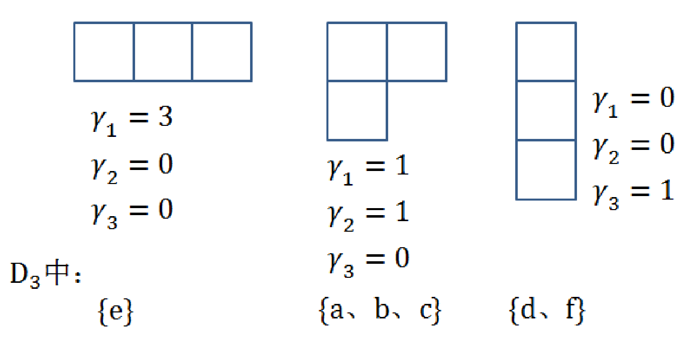
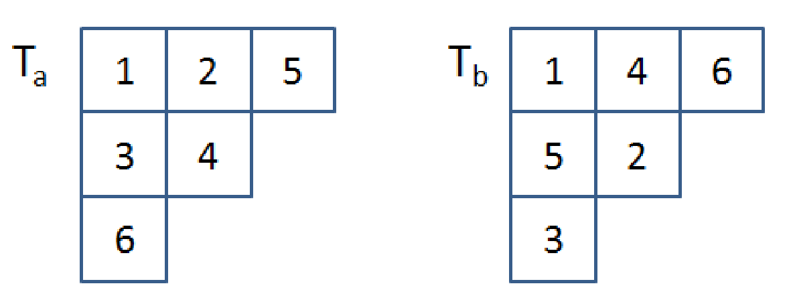
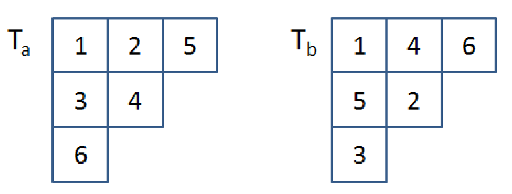
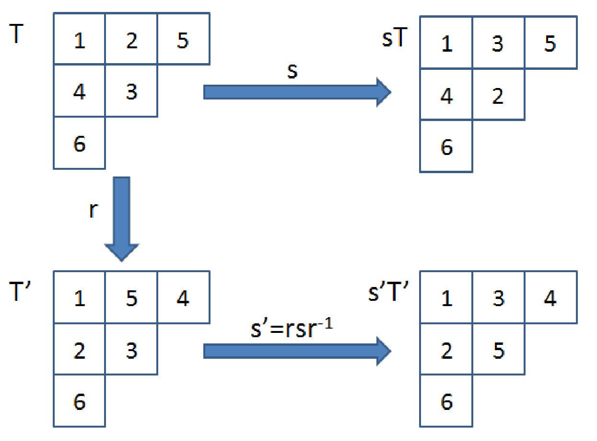
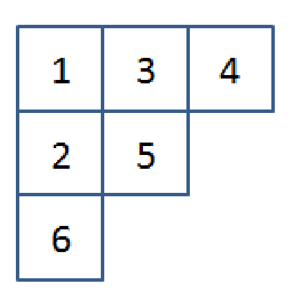
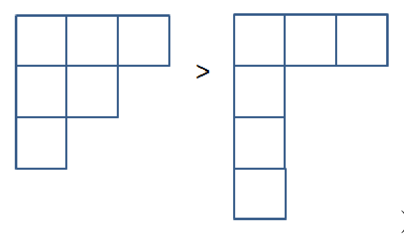
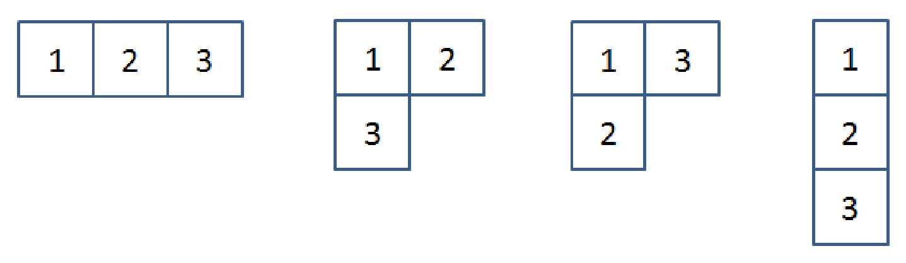
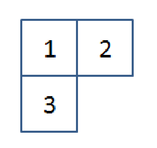
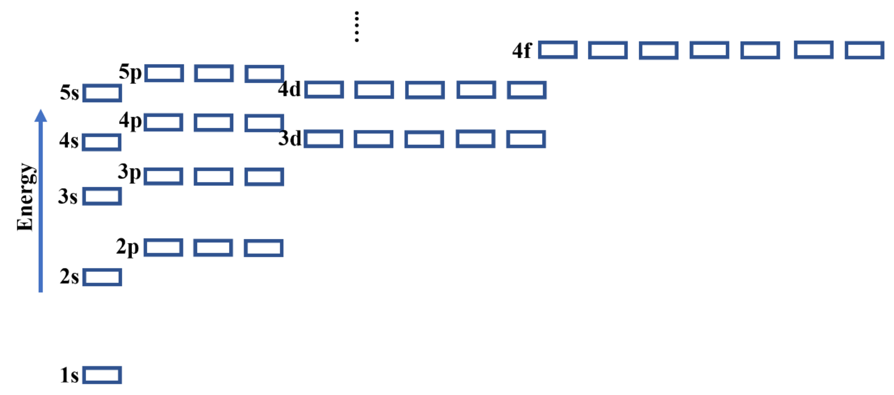

# 第六章 置换群

置换群之所以在物理中重要，一个重要的原因是真实的物理系统拥有这样的对称性，比如全同粒子系统。另外，在置换理论发展过程中发展起来的杨算符方法在近代物理的发展过程中也起到了非常重要的作用。与此同时，所有的有限群，均同构于置换群的子群（第一章的凯莱定理）。结合这些，置换群是我们《群论一》的重要组成部分。

单单把这段的第一点展开，就可以牵扯出很多内容。最直接的一个，就是我们前面讲到的点群与空间群、转动群描述的都是一个单粒子本征态的对称性；而这里的置换群，其实描述的是一个由全同粒子构成的多体系统的对称性。以多电子体系为例（这个电子体系可以是一个原子中多电子，也可以是分子或固体中多电子体系），其多粒子本征态就需要用置换群的不可约表示来标识。类似研究在 1926 年薛定谔方程针对氢原子这个单电子体系提出之后一度是一个热点（量子体系由单电子向多电子体系过渡再自然不过）。其中最直接的过渡就是除氢以外的其它原子体系。类似体系既有完全转动群，又有我们这里要讲的置换群对称性。到了上世纪 40 年代，人们在方面的研究又有了一些扩展，对象是晶体或者分子配位场中的过渡金属原子。对称性由完全转动群下降为某点群，但置换对称性保留。这方面的理论叫配位场理论 Ligand Field Theory（或称晶体场理论，Crystal Field Theory）[24]。再后来，凝聚态物理中的非线性光学问题与弹性理论发展过程中，置换群理论也有一定程度的应用[5]。

本课程中，我们如下四部分内容：1)$n$ 阶置换群；2)杨盘及其引理；3)置换群的不可约表示；4)多电子原子体系波函数。其中杨盘及其引理部分牵扯到许多证明，由于时间限制，课上主要讲解这个证明的基本逻辑，具体证明过程也放在附录 D 中。配位场理论感兴趣的同学可参考文献[24]，凝聚态体系非线性光学问题与弹性理论中的置换可参考 Dresselhaus 教材第 18 章。

最后要说明的一点是由于笔者的背景并不是理论物理，因此对置换群在粒子物理中多粒子体系的应用没有什么体会，建议选修《群论二》的同学参考文献[6、9、10、11、17]了解更多内容。

## 6.1 n 阶置换群

（首先是置换的定义）

**定义 6.1** 将 $n$ 个数字 $\{1\text{、}2\text{、}\cdots\text{、}n\}$ 的排列 $a_1$，$a_2$，$\cdots$，$a_n$（注意，是“排列”，“组合”只有一个）映为排列 $b_1$，$b_2$，$\cdots$，$b_n$ 的操作，称为一个 $n$ 阶置换，记为 $s$，$s$ 的形式为：

$$
s=\begin{pmatrix}
a_1,a_2,\cdots,a_n\\
b_1,b_2,\cdots,b_n
\end{pmatrix}
$$

这个置换干的事情，就是把 $a_1$ 变为 $b_1$，$a_2$ 变为 $b_2$，$\cdots$，$a_n$ 变为 $b_n$。它取决于诸对数码的对换，与诸对数码的排列顺序无关，比如：

$$
\begin{pmatrix}
a_1,a_2,a_3,\cdots,a_n\\
b_1,b_2,b_3,\cdots,b_n
\end{pmatrix}
=
\begin{pmatrix}
a_1,a_3,a_2,\cdots,a_n\\
b_1,b_3,b_2,\cdots,b_n
\end{pmatrix}
$$

只要配对相同即可。

**定义 6.2** 置换群：定义两个置换 $r$、$s$ 的乘积 $rs$ 为先执行置换 $s$，再执行置换 $r$，则在此乘法规则下所有的 $n$ 阶置换的集合构成一个群，这个群就称为 $n$ 阶置换群或 $n$ 阶对称群，记为 $S_n$。

在这个群中，单位元是恒等置换。对 $s=\begin{pmatrix}a_1,a_2,\cdots,a_n\\b_1,b_2,\cdots,b_n\end{pmatrix}$，逆元为 $s^{-1}=\begin{pmatrix}b_1,b_2,\cdots,b_n\\a_1,a_2,\cdots,a_n\end{pmatrix}$。置换的乘法满足封闭性与结合律，$S_n$ 群的阶为 $n!$。

**定义 6.3** 轮换：一种特殊的置换 $\begin{pmatrix}e_1,e_2,\cdots,e_m\\e_2,e_3,\cdots,e_1\end{pmatrix}$ 称为轮换，记为 $(e_1,e_2,\cdots,e_m)$，轮换数码的个数 $m$ 称为轮换的阶。

关于轮换，它的性质包括：

1. 轮换内的数码作轮换，仍代表同一个轮换，即：

$$
(e_1,e_2,\cdots,e_m)=(e_2,e_3,\cdots,e_m,e_1)=(e_m,e_1,e_2,\cdots,e_{m-1})
$$

2. 两个轮换 $(e_1,e_2,\cdots,e_m)$ 与 $(f_1,f_2,\cdots,f_n)$ 若没有公共数码，则称它们相互独立，相互独立的轮换之间的乘法满足交换律，即：

$$
\begin{aligned}
(e_1,e_2,\cdots,e_m)(f_1,f_2,\cdots,f_n)
&=\begin{pmatrix}
e_1,e_2,\cdots,e_m,f_1,f_2,\cdots,f_n\\
e_2,e_3,\cdots,e_1,f_2,f_3,\cdots,f_1
\end{pmatrix}\\
&=\begin{pmatrix}
f_1,f_2,\cdots,f_n,e_1,e_2,\cdots,e_m\\
f_2,f_3,\cdots,f_1,e_2,e_3,\cdots,e_1
\end{pmatrix}\\
&=(f_1,f_2,\cdots,f_n)(e_1,e_2,\cdots,e_m)
\end{aligned}
$$

3. 任意的 $n$ 阶置换总可以分别为相互独立的轮换的乘积，比如：

$$
\begin{pmatrix}
1,2,3,4,5,6\\
4,2,6,5,1,3
\end{pmatrix}
=(1,4,5)(2)(3,6)
$$

你要做的很简单，就是先盯上第一个数，看它变到几，再盯上那个数，依次类推，这样总能找到一个轮换；

在找到这个轮换之后，取不属于这个轮换的第一个数，重复上面操作。依次类推。这样任何一个置换都可以分解为轮换的乘积。

4. 轮换的逆，就是反过来，比如：

$$
(e_1,e_2,\cdots,e_m)^{-1}=(e_m,e_{m-1},\cdots,e_1)
$$

5. 二阶轮换 $(e_1,e_2)$ 称为对换，任意一个 $m$ 阶轮换都可以写成 $m-1$ 个对换的乘积。因为：

$$
(e_1,e_2,\cdots,e_m)
=\begin{pmatrix}
e_1,e_2,e_3,\cdots,e_m\\
e_2,e_3,e_4,\cdots,e_1
\end{pmatrix}
=\begin{pmatrix}
e_1,e_2,e_3,\cdots,e_m\\
e_2,e_1,e_3,\cdots,e_m\\
e_2,e_1,e_3,\cdots,e_m\\
e_2,e_3,e_4,\cdots,e_1
\end{pmatrix}
$$

$$
\begin{aligned}
&=(e_1,e_3,\cdots,e_m)(e_1,e_2)\\
&=(e_1,e_4,\cdots,e_m)(e_1,e_3)(e_1,e_2)\\
&=\cdots=(e_1,e_m)(e_1,e_{m-1})\cdots(e_1,e_3)(e_1,e_2)
\end{aligned}
$$

6. 上面的逻辑是一个任意置换可以写成轮换的乘积，而任意一个轮换可以写成对换的乘积。但是在这个轮换分别为对换的过程中，对换的对象不一定是相邻的数。针对这个，第 6 个性质说的是对 $\forall(e_1,e_k)$，有：

$$
(e_1,e_k)=(e_2,e_k)(e_1,e_2)(e_2,e_k)
$$

因为：

$$
(e_2,e_k)(e_1,e_2)(e_2,e_k)
=\begin{pmatrix}
e_1,e_2,e_k\\
e_1,e_k,e_2\\
e_1,e_k,e_2\\
e_2,e_k,e_1\\
e_2,e_k,e_1\\
e_k,e_2,e_1
\end{pmatrix}
=\begin{pmatrix}
e_1,e_2,e_k\\
e_k,e_2,e_1
\end{pmatrix}
=(e_1,e_k)
$$

这样一个性质，结合 3、5 两点，就一个把任意一个置换分解为相临对换的乘积了。比如：

$$
\begin{pmatrix}
1,2,3,4\\
3,2,4,1
\end{pmatrix}
=(1,3,4)=(1,4)(1,3)
$$

$$
\begin{aligned}
&=(2,4)(1,2)(2,4)(2,3)(1,2)(2,3)\\
&=(3,4)(2,3)(3,4)(1,2)(3,4)(2,3)(3,4)(2,3)(1,2)(2,3)
\end{aligned}
$$

基于上面的介绍，我们可以给出这一部分的第一个定理。

**定理 6.1** 具有相同轮换结构的置换构成置换群 $S_n$ 的一个类。

（相同的轮换结构这样的规定有两个意思，既指它们有相同个数的轮换因子，又指各轮换因子中数码个数也完全相同）

证明：

（分两个方面，一是共轭的置换有相同的轮换结构；二是具有相同轮换结构的置换共轭）

1. 先证共轭置换有相同的轮换结构。取：

$$
\forall s=\begin{pmatrix}
1,2,\cdots,n\\
c_1,c_2,\cdots,c_n
\end{pmatrix}\in S_n
$$

由 $\forall t\in S_n$，可产生一个 $s$ 的共轭置换，

$$
t=\begin{pmatrix}
1,2,\cdots,n\\
d_1,d_2,\cdots,d_n
\end{pmatrix}
$$

为了求出 $tst^{-1}$ 是多少，我们把 $(1,2,\cdots,n)$ 重排为 $(c_1,c_2,\cdots,c_n)$，这样的话 $t$ 也可以写成：

$$
t=\begin{pmatrix}
c_1,c_2,\cdots,c_n\\
f_1,f_2,\cdots,f_n
\end{pmatrix}
$$

同样，$t^{-1}$ 也可以写为：

$$
\begin{pmatrix}
f_1,f_2,\cdots,f_n\\
c_1,c_2,\cdots,c_n
\end{pmatrix}
$$

或

$$
\begin{pmatrix}
d_1,d_2,\cdots,d_n\\
1,2,\cdots,n
\end{pmatrix}
$$

而 $tst^{-1}$ 就是：

$$
\begin{pmatrix}
d_1,d_2,\cdots,d_n\\
1,2,\cdots,n\\
1,2,\cdots,n\\
c_1,c_2,\cdots,c_n\\
c_1,c_2,\cdots,c_n\\
f_1,f_2,\cdots,f_n
\end{pmatrix}
=\begin{pmatrix}
d_1,d_2,\cdots,d_n\\
f_1,f_2,\cdots,f_n
\end{pmatrix}
$$

这也就是说 $s$ 的共轭元素 $tst^{-1}$ 是由 $t$ 对 $s$ 的上下两行 $\begin{pmatrix}1,2,\cdots,n\\c_1,c_2,\cdots,c_n\end{pmatrix}$ 同时作置换得到的。这里 $t$ 既可以写成 $\begin{pmatrix}1,2,\cdots,n\\d_1,d_2,\cdots,d_n\end{pmatrix}$ 对 $s$ 上面那行操作，也可写成 $\begin{pmatrix}c_1,c_2,\cdots,c_n\\f_1,f_2,\cdots,f_n\end{pmatrix}$ 对 $s$ 下面那行操作。最终的结果是：$\begin{pmatrix}d_1,d_2,\cdots,d_n\\f_1,f_2,\cdots,f_n\end{pmatrix}$。

现在假设 $s$ 有 $k$ 个独立的轮换因子，$s=s_1s_2\cdots s_k$，那么其共轭 $tst^{-1}$ 可写为：$ts_1t^{-1}ts_2t^{-1}\cdots ts_kt^{-1}$。对 $s$ 的第 $i$ 个轮换因子，我们看 $ts_it^{-1}$ 的效果：

$$
s_i=(s_1,s_2,\cdots,s_m)=\begin{pmatrix}
s_1,s_2,\cdots,s_m,s_{m+1},s_{m+2},\cdots,s_n\\
s_2,s_3,\cdots,s_1,s_{m+1},s_{m+2},\cdots,s_n
\end{pmatrix}
$$

任意取一个 $t$，它是：

$$
\begin{pmatrix}
s_1,s_2,\cdots,s_m,s_{m+1},s_{m+2},\cdots,s_n\\
t_1,t_2,\cdots,t_m,t_{m+1},t_{m+2},\cdots,t_n
\end{pmatrix}
$$

由置换与队的排列顺序无关这个特点，我们知道 $t$ 也可写为：

$$
\begin{pmatrix}
s_2,\cdots,s_m,s_1,s_{m+1},s_{m+2},\cdots,s_n\\
t_2,\cdots,t_m,t_1,t_{m+1},t_{m+2},\cdots,t_n
\end{pmatrix}
$$

这样的话，由 * 号讨论内容，$ts_it^{-1}$ 就是利用上面两式对 $s_i$ 的上下行分别进行置换，也就是：

$$
\begin{pmatrix}
t_1,t_2,\cdots,t_m,t_{m+1},t_{m+2},\cdots,t_n\\
t_2,\cdots,t_m,t_1,t_{m+1},t_{m+2},\cdots,t_n
\end{pmatrix}
=(t_1,t_2,\cdots,t_m)
$$

也就是说 $ts_it^{-1}$ 与 $s_i$ 是同阶轮换。对其它轮换因子，做同样操作，依次类推，这样 $ts_1t^{-1}ts_2t^{-1}\cdots ts_kt^{-1}$ 就与 $s_1s_2\cdots s_k$ 有相同的轮换结构。也就是 $tst^{-1}$ 与 $s$ 有相同的轮换结构（共轭置换的轮换结构相同）。

2. 现在看第二部分，具有相同轮换因子的置换共轭，取两个这样的置换：

$$
s=(a_1,a_2,\cdots,a_{n_1})(b_1,b_2,\cdots,b_{n_2})\cdots(c_1,c_2,\cdots,c_{n_l})
$$

$$
r=(d_1,d_2,\cdots,d_{n_1})(e_1,e_2,\cdots,e_{n_2})\cdots(f_1,f_2,\cdots,f_{n_l})
$$

这个时候，一定 $\exists t\in S_n$，

$$
t=\begin{pmatrix}a_1,a_2,\cdots,a_{n_1}\\d_1,d_2,\cdots,d_{n_1}\end{pmatrix}\begin{pmatrix}b_1,b_2,\cdots,b_{n_2}\\e_1,e_2,\cdots,e_{n_2}\end{pmatrix}\cdots\begin{pmatrix}c_1,c_2,\cdots,c_{n_l}\\f_1,f_2,\cdots,f_{n_l}\end{pmatrix}
$$

使得：

$$
tst^{-1}=\begin{pmatrix}
d_1,d_2,\cdots,d_{n_1},e_1,e_2,\cdots,e_{n_2},f_1,f_2,\cdots,f_{n_l}\\
a_1,a_2,\cdots,a_{n_1},b_1,b_2,\cdots,b_{n_2},c_1,c_2,\cdots,c_{n_l}\\
a_1,a_2,\cdots,a_{n_1},b_1,b_2,\cdots,b_{n_2},c_1,c_2,\cdots,c_{n_l}\\
a_2,a_3,\cdots,a_1,b_2,b_3,\cdots,b_1,c_2,c_3,\cdots,c_1\\
a_2,a_3,\cdots,a_1,b_2,b_3,\cdots,b_1,c_2,c_3,\cdots,c_1\\
d_2,d_3,\cdots,d_1,e_2,e_3,\cdots,e_1,f_2,f_3,\cdots,f_1
\end{pmatrix}
$$

$$
=\begin{pmatrix}
d_1,d_2,\cdots,d_{n_1},e_1,e_2,\cdots,e_{n_2},f_1,f_2,\cdots,f_{n_l}\\
d_2,d_3,\cdots,d_1,e_2,e_3,\cdots,e_1,f_2,f_3,\cdots,f_1
\end{pmatrix}
$$

$$
=(d_1,d_2,\cdots,d_{n_1})(e_1,e_2,\cdots,e_{n_2})\cdots(f_1,f_2,\cdots,f_{n_l})=r
$$

具有相同轮结构的置换必共轭。

结合这两点，我们现在就知道了置换群的类与轮换结构存在一一对应的关系。

（证毕）这个性质是置换群的一个关键的性质。正是因为它的存在，我们才可以用杨图（Young Diagram）来分析置换群。与这个性质相关的置换群的其它性质还包括：

1. 可以由轮换分解来划分置换群的类别。这个很显然，因为每个置换都可以写成轮换的乘积，而轮换结构与类之间存在一一对应的关系。

这个轮换分解我们标记为：$(\gamma)$，$(\gamma)=(1^{\gamma_1},2^{\gamma_2},3^{\gamma_3},\cdots,n^{\gamma_n})$，即该类中有 $\gamma_1$ 个一阶轮换，$\gamma_2$ 个二阶轮换，$\cdots$，$\gamma_n$ 个 $n$ 阶轮换。

且由于变换对象只有 $n$ 个，所以：

$$
\gamma_1+2\gamma_2+\cdots+n\gamma_n=n
$$

这里 $\gamma_1$、$\gamma_2$、$\cdots$、$\gamma_n$ 为非负整数。

2. $S_n$ 中类 $(\gamma)$ 里的置换群元个数为：

$$
\frac{n!}{(1^{\gamma_1}\gamma_1!)(2^{\gamma_2}\gamma_2!)\cdots(n^{\gamma_n}\gamma_n!)}
$$

这是因为我们一共有 $n$ 个空要去填，填法是 $n^{\gamma_n}$ 种。但是对其中的一个 $m$ 阶轮换，

$$
(e_1,e_2,\cdots,e_m)=(e_2,e_3,\cdots,e_1)=\cdots=(e_m,e_1,\cdots,e_{m-1})
$$

这 $m$ 种填法代表同样的置换。这样如果有 $\gamma_m$ 个 $m$ 阶置换的话，类似的重复会出现 $m^{\gamma_m}$ 次。

同时对这 $\gamma_m$ 个 $m$ 阶置换，由于它们没有公共因子，排列的前后顺序不影响结果，类似重复又会出现 $\gamma_m!$ 次，所以上面的分母是那个样子。

3. 根据这样一个轮换分解的标记 $(\gamma)=(1^{\gamma_1},2^{\gamma_2},3^{\gamma_3},\cdots,n^{\gamma_n})$，我们来定义杨图，它的标记方式是：$[\lambda]=[\lambda_1,\lambda_2,\cdots,\lambda_n]$，其中：

$$
\begin{aligned}
\lambda_1&=\gamma_1+\gamma_2+\cdots+\gamma_n\\
\lambda_2&=\gamma_2+\cdots+\gamma_n\\
&\vdots\\
\lambda_n&=\gamma_n
\end{aligned}
$$

这样的话 $\lambda_n\ge\lambda_{n-1}\ge\cdots\ge\lambda_1$。且由：

$$
\gamma_1+2\gamma_2+\cdots+n\gamma_n=n
$$

我们知：

$$
\lambda_1+\lambda_2+\cdots+\lambda_n=n
$$

4. 这样的话 $S_n$ 的分类就可以用杨图来表示了。它就是 $n$ 个小方格，排列方式为第一行、第二行、$\cdots$、第 $n$ 行分别是 $\lambda_1$、$\lambda_2$、$\cdots$、$\lambda_n$ 个小方格，它们的第一列靠左对其。

例：$S_3$ 可由 $[\lambda]$ 写成 $[3]$、$[2,1]$、$[1,1,1]$。杨图为：

对杨图而言，如果一个杨图可由另一个杨图通过转置得到，则称这两个杨图共轭。如果一个杨图转置后不变，则称其自轭。杨图共轭与元素共轭是两回事。

## 6.2 杨盘及其引理

上一节我们讲的杨图，是针对置换群分类的一个工具。这节课我们要讲的杨盘（Young Tableau），针对的是置换群的不等价不可约表示。

其中最核心的地方，是杨盘定理。这个定理证明起来比较麻烦，有 7 个引理，分别都需要证明。细走这些步骤，对于不学《群论二》的同学，更多的是时间上的浪费。对于学《群论二》的同学，你们可参考附录中的内容进行理解。在课堂上，我们着重于讲解几个重要的概念：1) 什么是杨盘？2) 什么是杨算符？3) 什么是本质幂等元？4) 杨盘定理说的是什么？5)它是怎么证明的？下面，我们会根据这个逻辑展开讲解。

**定义 6.4** 杨盘：将数字 $1$、$2$、$\cdots$、$n$ 分别填到 $S_n$ 的杨图的 $n$ 个小方格中，得到的就是杨盘（填完了数的杨图）。

例：$S_6$ 的杨图 $[3\text{、}2\text{、}1]$ 的两个杨盘 $T_a$、$T_b$。

$$
T_a=\begin{array}{ccc}
\boxed{1}&\boxed{2}&\boxed{5}\\
\boxed{3}&\boxed{4}&\\
\boxed{6}&&
\end{array}
\qquad
T_b=\begin{array}{ccc}
\boxed{1}&\boxed{4}&\boxed{6}\\
\boxed{5}&\boxed{2}&\\
\boxed{3}&&
\end{array}
$$

由这个定义我们知道杨盘可以具有下面的性质：

1. 由一个杨图可以得到 $n!$ 个杨盘；

2. 一个杨盘中的数字可以由其行与列来确定；

3. 同一个杨图的不同杨盘 $T_a$、$T_b$，可通过一个置换相互转换。将 $T_a$、$T_b$ 中的数按照从左到右，从上到下的顺序排成有序对 $a_1$，$a_2$，$\cdots$，$a_n$；$b_1$，$b_2$，$\cdots$，$b_n$。则杨盘 $T_a$ 到杨盘 $T_b$ 的置换为：

$$
s=\begin{pmatrix}
a_1,a_2,\cdots,a_n\\
b_1,b_2,\cdots,b_n
\end{pmatrix}
$$

以上图为例：

$$
s=\begin{pmatrix}
1,2,5,3,4,6\\
1,4,6,5,2,3
\end{pmatrix}
=(1)(2,4)(5,6,3)
$$

$$
T_b=(1)(2,4)(5,6,3)T_a
$$

4. 由一个杨盘 $T$ 可以定义行置换 $R(T)$ 与列置换 $C(T)$。

$R(T)$ 是保持杨盘 $T$ 的各行中的数字还在其相对行上的所有置换 $\hat p$ 的集合 $\{\hat p\}$；

$C(T)$ 是保持杨盘 $T$ 的各列中的数字还在其相对列上的所有置换 $\hat q$ 的集合 $\{\hat q\}$。

显然 $R(T)$、$C(T)$ 都是 $S_n$ 这个置换群的子群，他们有唯一的公共元素 $s_0$；若杨盘 $T$ 对应的杨图为 $[\lambda]=[\lambda_1,\lambda_2,\cdots,\lambda_n]$，则 $R(T)$ 的阶为：$\lambda_1!\lambda_2!\cdots\lambda_n!$；$C(T)$ 的阶为 $\tilde\lambda_1!\tilde\lambda_2!\cdots\tilde\lambda_n!$，其中 $[\tilde\lambda]=[\tilde\lambda_1,\tilde\lambda_2,\cdots,\tilde\lambda_n]$ 为杨图 $[\lambda]$ 的共轭。

5. 由行、列置换 $\hat p$、$\hat q$ 可以定义两个算符 $\hat P(T)$ 与 $\hat Q(T)$：

$$
\hat P(T)=\sum_{\hat p\in R(T)}\hat p
$$

$$
\hat Q(T)=\sum_{\hat q\in C(T)}\delta_q\hat q
$$

其中 $\delta_q=1$ 如果 $\hat q$ 为偶置换，$\delta_q=-1$ 如果 $\hat q$ 为奇置换。这里偶置换与奇置换指的是在置换本身化为对换的乘积后，对换的个数是偶数个还是奇数个？

举个例子，前面的杨盘 $T_a$。对它来说：

$$
R(T_a)=\left\{
\begin{array}{l}
(1),(1,2),(1,5),(2,5),(1,2,5),(1,5,2);\\
(3,4),(3,4)(1,2),(3,4)(1,5),(3,4)(2,5),\\
\qquad (3,4)(1,2,5),(3,4)(1,5,2)
\end{array}
\right.
$$

$$
C(T_a)=\left\{
\begin{array}{l}
(1),(1,3),(1,6),(3,6),(1,3,6),(1,6,3);\\
(2,4),(2,4)(1,3),(2,4)(1,6),(2,4)(3,6),\\
\qquad (2,4)(1,3,6),(2,4)(1,6,3)
\end{array}
\right.
$$

而 $\hat P(T_a)$ 就是 $R(T_a)$ 中所有操作的和。$\hat Q(T_a)$ 就是 $C(T_a)$ 中所有操作乘上它的奇偶性的和。对 $(2,4)(1,3,6)$ 这个操作而言，$(1,3,6)$ 是两个对换，$(2,4)$ 是一个对换，所以总的对换数是 3，这个操作的奇偶性为奇。

由这个 $\hat P(T)$ 与 $\hat Q(T)$ 的定义，我们知道它们是置换群中群元的线性组合，这个很容易让我们联想到前面讲过的一个概念：群代数。后面，我们会通过杨算符把 $\hat P(T)$、$\hat Q(T)$ 与群代数联系起来。

6. 杨盘所具备的最后一个性质是同一个杨图的不同杨盘，其对应的行置换群相互同构，列置换群也相互同构。

这个性质很直接，以：

$$
T_a=\begin{array}{ccc}
\boxed{1}&\boxed{2}&\boxed{5}\\
\boxed{3}&\boxed{4}&\\
\boxed{6}&&
\end{array}
\qquad
T_b=\begin{array}{ccc}
\boxed{1}&\boxed{4}&\boxed{6}\\
\boxed{5}&\boxed{2}&\\
\boxed{3}&&
\end{array}
$$

为例，$R(T_a)$、$R(T_b)$ 同构，$C(T_a)$、$C(T_b)$ 同构，看一下就知道了。

有了杨图、杨盘这些概念，下一个是杨算符。

**定义 6.5** 杨算符：它是杨盘 $T$ 的算符 $\hat P(T)$ 与 $\hat Q(T)$ 的乘积，形式为：

$$
\hat E(T)=\hat P(T)\hat Q(T)=\sum_{\hat p\in R(T)}\sum_{\hat q\in C(T)}\delta_q\hat p\hat q
$$

显然杨算符是群空间 $RS_n$ 中的一个矢量。一个杨盘有一个杨算符。

与杨算符相关的性质有很多，先说两个：

1. 若 $\hat p$、$\hat p'\in R(T)$，$\hat q$、$\hat q'\in C(T)$，且 $\hat p\hat q=\hat p'\hat q'$，则必有：$\hat p=\hat p'$、$\hat q=\hat q'$。这个性质的证明用到的很重要的一点就是对 $R(T)$、$C(T)$ 这两个这两个 $S_n$ 的子群，它们的交集只有单位元素 $s_0$，这样的话由 $\hat p\hat q=\hat p'\hat q'$ 可以得出：$\hat p'^{-1}\hat p=\hat q'\hat q^{-1}$，这个等式左边 $\in R(T)$，右边 $\in C(T)$，所以只能有 $\hat p'^{-1}\hat p=\hat q'\hat q^{-1}=s_0$，这样的话就只能有：$\hat p=\hat p'$、$\hat q=\hat q'$。

2. 同时由上面一点我们也很容易知道对 $\hat E(T)=\sum_{\hat p\in R(T)}\sum_{\hat q\in C(T)}\delta_q\hat p\hat q$ 的加和，一定不会出现不同 $\hat p$、$\hat q$ 产生相同的乘积，进而由于 $\delta_q$ 的变号所带来的 $\hat p\hat q$ 相互抵消的情况。所以 $\hat E(T)$ 一定是非零的群空间中的向量。

现在是讲完了杨图、杨盘、和杨算符的概念了。再说一个幂等元，我们就可以把杨盘定理的内容讲出来了。这个幂等元，和之前讲的投影算符相关。

**定义 6.6** 幂等元：在群代数 $R_G$ 中，满足 $\vec e^{\,2}=\vec e$ 的元素 $\vec e$，称为幂等元。而满足 $\vec e^{\,2}=\lambda\vec e$ 的元素 $\vec e$，称为本质幂等元。

对本质幂等元，你可以这样理解：只要满足 $\vec e^{\,2}=\lambda\vec e$，那么这个 $\vec e$ 只要乘上一个常数，它就是幂等元，或者说它本质上就是一个幂等元。而这个常数，是 $\lambda^{-1}$，因为：$(\lambda^{-1}\vec e)^2=\lambda^{-2}\vec e^{\,2}=\lambda^{-2}\lambda\vec e=\lambda^{-1}\vec e$。

现在看这个幂等元的定义是不是和前面讲的投影算符 $\hat P_i^2=\hat P_i$ 有相似的地方？它们之间确实存在着重要的联系，这个联系是：群代数 $R_G$ 中左正则变换 $L(G)$ 的群不变的子空间及其投影算符与群代数 $R_G$ 中的幂等元一一对应。总结为下面一个定理。

**定理 6.2** 群代数 $R_G$ 中有多少个幂等元，群空间就有多少个对左正则变换不变的子空间。相应的，就有多少个投影算符。

要证明这个定理，需要另一个定理 6.3。这个定理比较好证，我们先证这个，然后回到 6.2。

**定理 6.3** 对群 $G$ 在表示空间 $V$ 上的表示 $A(g)$，若 $V$ 可分解为 $W_1\oplus W_2\oplus\cdots\oplus W_k$ 这 $k$ 个子空间的直和，则其中 $W_i$ 为群不变的子空间的充要条件为 $W_i$ 对应的投影算符 $\hat P_i$ 与任意一个 $g$ 对应的 $A(g)$ 互易，即 $A(g)\hat P_i=\hat P_iA(g)$，对 $\forall g\in G$ 成立。

证明：

必要性，由 $W_i$ 为群不变的子空间，推 $W_i$ 对应的投影算符 $\hat P_i$ 与任意一个 $g$ 对应的 $A(g)$ 互易。由于 $\hat P_i$ 为 $W_i$ 对应的投影算符，满足：$\hat P_i^2=\hat P_i$，$\hat P_i\hat P_j=0$（当 $i\neq j$），$\hat P_iV=W_i$，$\hat P_i\vec x_i=\vec x_i$，所以：

$$
A(g)\hat P_i\vec x_i=A(g)\vec x_i=\hat P_iA(g)\vec x_i
$$

对 $\forall\vec x_i$ 成立。由于 $\vec x_i$ 的任意性，$A(g)\hat P_i=\hat P_iA(g)$。

充分性，若 $V$ 上存在投影算符 $\hat P_i$ 并且有：$A(g)\hat P_i=\hat P_iA(g)$，对 $\forall g\in G$ 成立，则对$\forall\vec x_i\in W_i$，由 $\hat P_i\vec x_i=\vec x_i$，有：

$$
A(g)\vec x_i=A(g)\hat P_i\vec x_i=\hat P_i(A(g)\vec x_i)\in W_i
$$

所以 $W_i$ 为群不变的子空间。

（证毕）

现在回到定理 6.2。

证明：

要证明在群代数 $R_G$ 中，幂等元与左正则变换不变子空间的一一对应关系，需要说明两点：

1. 若 $W_i=\hat P_iR_G$ 为正则变换 $G$ 不变的子空间，则存在一个幂等元与之对应；

2. 若有一个幂等元，则存在一个与之对应的 $G$ 不变的 $R_G$ 的子空间与投影算符。

先看第一点：

有 $W_i=\hat P_iR_G$ 为正则变换 $G$ 不变的子空间，$\hat P_i$ 为投影算符。这时，群代数 $R_G$ 中有这样一个向量 $\vec e_i=\hat P_i\vec g_0$（$\vec g_0$ 为 $R_G$ 中单位元素），这个向量是幂等元。

为什么呢？这个就要用到我们刚才介绍的那个性质了。因为 $W_i$ 为对左正则变换 $L(G)$ 而言是 $G$ 不变的子空间，所以有 $L(g)\hat P_i=\hat P_iL(g)$ 对 $\forall g\in G$ 成立，也就是 $g\hat P_i=\hat P_ig$ 对 $\forall g\in G$ 成立。

这样的话对

$$
\forall\vec x=\sum_k x_k\vec g_k\in R_G
$$

有

$$
\begin{aligned}
\hat P_i\vec x&=\sum_k x_k\hat P_i\vec g_k\vec g_0=\sum_k x_k(\hat P_i\vec g_k)(\hat P_i\vec g_0)\\
&=\sum_k x_k\vec g_k\hat P_i\hat P_i\vec g_0=\sum_k x_k\vec g_k\hat P_i\vec g_0\\
&=\sum_k x_k\vec g_k\vec e_i=\vec x\vec e_i
\end{aligned}
$$

（这里用到了 $\hat P_i\vec g_k\vec g_0=(\hat P_i\vec g_k)(\hat P_i\vec g_0)$ 也就是一个算符作用到了两个向量乘积上，等于它分别作用到两个向量上，再做乘积。这个是算符操作的严格定义。就这一章的内容而言，由于投影算符与幂等元对应，投影的方式也是群代数中的向量乘法。$\hat P_i\vec g_k\vec g_0$ 也直接等于 $(\hat P_i\vec g_k)\vec g_0$。在这一章里，两者等价。）

由 $\hat P_i\vec x=\vec x\vec e_i$，进而

$$
\hat P_i^2\vec x=\hat P_i\hat P_i\vec x=\hat P_i\vec x\vec e_i=(\hat P_i\vec x)(\hat P_i\vec e_i)=\vec x\vec e_i(\hat P_i\hat P_i\vec g_0)=\vec x\vec e_i(\hat P_i\vec g_0)=\vec x\vec e_i\vec e_i
$$

而 $\hat P_i$ 为投影算符，$\hat P_i^2=\hat P_i$，所以 $\hat P_i^2\vec x=\hat P_i\vec x$。这样就有：

$$
\vec x\vec e_i=\vec x\vec e_i\vec e_i
$$

对 $\forall\vec x\in R_G$ 成立。这样的话：

$$
\vec e_i=\vec e_i^{\,2}
$$

对 $W_i=\hat P_iR_G$ 这个对正则变换 $G$ 不变的子空间，我们就找到了与之对应的幂等元 $\vec e_i$，它等于 $\hat P_i\vec g_0$。

再看第二点：

设 $\vec e_i\in R_G$ 为幂等元，要找与之对应的 $G$ 不变的子空间以及相应的投影算符。

定义算符 $\hat P_i$，为 $\hat P_i\vec x=\vec x\vec e_i$，$\vec e_i$ 就是我们已知的幂等元，$\vec x$ 为 $R_G$ 中任意向量。由这个定义，知：

$$
\hat P_i^2\vec x=\hat P_i(\hat P_i\vec x)=\hat P_i\vec x\vec e_i=(\hat P_i\vec x)(\hat P_i\vec e_i)=(\hat P_i\vec x)(\vec e_i\vec e_i)=(\hat P_i\vec x)\vec e_i=\vec x\vec e_i\vec e_i=\vec x\vec e_i=\hat P_i\vec x
$$

对 $\forall\vec x\in R_G$ 成立。因此 $\hat P_i^2=\hat P_i$，$\hat P_i$ 为投影算符。

这个 $\hat P_i$ 作用到群代数上形成的子空间是 $G$ 不变的子空间。这个好证，因为对任意置换群群元 $\vec g_k$，有：

$$
\hat P_i\vec g_k\vec x=\vec g_k\vec x\vec e_i
$$

而 $\vec g_k\hat P_i\vec x=\vec g_k\vec x\vec e_i$。因此 $\hat P_i\vec g_k\vec x=\vec g_k\hat P_i\vec x$ 对任意 $\vec x$ 成立，$\hat P_i\vec g_k=\vec g_k\hat P_i$。再由定理 6.2，知$\hat P_i$ 作用到群代数上形成的子空间是 $G$ 不变的子空间。这个与 $\hat P_i$ 是投影算符合在一起，就是我们前面说的第二个方面。

两个方面都证完了，自然就有群代数 $R_G$ 对左正则表示 $G$ 不变的子空间及其投影算符与群代数 $R_G$ 中的幂等元一一对应。

（证毕）

这里这个幂等元是：$\hat P_i\vec g_0$。我们要求 $\hat P_iR_G$ 为 $G$ 不变的 $R_G$ 的子空间，并不要求它承载不可约表示。也就是说它承载表示，但这个表示不一定不可约，幂等元与表示对应，不一定与不可约表示对应。

与不可约表示对应的幂等元称为本原幂等元。它的特点是它对应的群代数中群不变的子空间，为不可约的群不变的子空间。换句话说，它是最基本的，“本原”的。幂等元与 $R_G$ 的 $G$ 不变的子空间对应，本原幂等元与 $R_G$ 的 $G$ 不变的不可约的子空间对应。本原是其中最小的部分。

现在这些概念的积累说完了，我们看杨盘定理说的是什么？实际上，它是用 7 个引理来说明三句话。

**定理 6.4**（杨盘定理）

1. 杨盘 $T$ 的杨算符 $\hat E(T)$ 可给出置换群群空间 $RS_n$ 中的一个本原幂等元 $\hat E(T)/\theta$，其中 $\theta$ 为一个常数。也就是说一个杨盘给出置换群在其群空间 $RS_n$ 中的一个不可约表示；

2. 同一个杨图的不同杨盘给出的不可约表示相互等价；

3. 不同杨图给出的不可约表示不等价。

这七个引理分别是：

**引理 6.1** 设 $T$、$T'$ 是由置换 $r$ 联系起来的杨盘，$T'=rT$，如果置换 $s$ 作用在 $T$上，使得 $T(i,j)$ 数字变到 $sT$ 中的 $(i',j')$ 处，则 $s'=rsr^{-1}$ 也会使得 $T'(i,j)$ 中的数字变到 $s'T'$ 的 $(i',j')$ 处。

用图来理解，这个引理说的就是：

其中，

$$
r=\begin{pmatrix}
1,2,3,4,5,6\\
1,5,3,2,4,6
\end{pmatrix}
$$

$$
s=\begin{pmatrix}
1,2,3,4,5,6\\
1,3,2,4,5,6
\end{pmatrix}
$$

$$
rsr^{-1}=\begin{pmatrix}
1,5,3,2,4,6\\
1,3,5,2,4,6
\end{pmatrix}
$$

而 $rsr^{-1}T'$，等于：

$$
\begin{array}{ccc}
\boxed{1}&\boxed{3}&\boxed{4}\\
\boxed{2}&\boxed{5}&\\
\boxed{6}&&
\end{array}
$$

$s$ 干的事情，是将 $T$ 的 2、3 互换；$s'$ 干的事情，是将 $T'$ 的 3、5 互换。2、3 在 $T$ 中

的位置，和 3、5 在 $T'$ 中的位置，是相同的。

由这个引理，我们还可以知道：

$T'=rT$ 时，有 $R(T')=rR(T)r^{-1}$，$C(T')=rC(T)r^{-1}$，$\hat P(T')=r\hat P(T)r^{-1}$，$\hat Q(T')=r\hat Q(T)r^{-1}$，$\hat E(T')=r\hat E(T)r^{-1}$。

这些引理（到 6.7）与性质的详细证明，均见附录。

**引理 6.2** 设 $\hat p$、$\hat q$ 是杨盘 $T$ 的行、列置换，则 $T$ 中位于同一行的任意两个数字不可能出现在 $T'=\hat p\hat qT$ 的同一列中；反之，若 $T'=rT$ 时，$T$ 中位于同一行的任意两个数字都不出现在 $T'$ 的同一列中，则杨盘 $T$ 存在行、列置换 $\hat p$、$\hat q$，使 $r=\hat p\hat q$。

这两个引理，说的都是同一杨图的不同杨盘的性质，结合杨盘定理本身内容，我们知道它们是在后面说明同一个杨图的不同杨盘给出的不可约表示等价的时候会有用。

**引理 6.4** 设杨盘 $T$ 和 $T'$ 分别属于杨图 $[\lambda]$、$[\lambda']$，且 $[\lambda]>[\lambda']$

（这里，$[\lambda]>[\lambda']$ 是指 $[\lambda]=[\lambda_1,\lambda_2,\cdots,\lambda_n]$，$[\lambda']=[\lambda'_1,\lambda'_2,\cdots,\lambda'_n]$，第一个不等于零的 $\lambda_i-\lambda'_i$，一定满足 $\lambda_i>\lambda'_i$，比如：

）

则存在两个数码位于 $T$ 的同一行与 $T'$ 的同一列。

**引理 6.4** 若有两个数字，位于杨盘 $T$ 的同一行与杨盘 $T'$ 的同一列，则它们的杨算符 $\hat E(T')\hat E(T)=0$。

（这两个引理对应两个不同杨图的杨盘的性质，它们的杨算符 $\hat E(T')\hat E(T)=0$。这个我们把它放到杨盘定理全部内容的背景下，说的就是不同杨图的杨盘给出的杨算符对应的群空间中的子空间相互正交。相应，它们的不可约表示相互不等价。）

**引理 6.5** 设置换群 $S_n$ 的群代数 $RS_n$ 中的矢量 $\vec x=\sum_{s\in S_n}x_ns$，$T$ 为 $S_n$ 的杨盘。若 $\forall\hat p\in R(T)$，$\forall\hat q\in C(T)$，$\hat p\vec x\hat q=\delta_q\vec x$，则 $\vec x$ 与 $T$ 盘的杨算符 $\hat E(T)$ 相差一个常数因子，即 $\vec x=\theta\hat E(T)$，常数 $\theta$ 与 $\vec x$ 有关。

**引理 6.6** 杨盘 $T$ 的杨算符 $\hat E(T)$ 是置换群 $S_n$ 的群代数 $RS_n$ 中的一个本质的本原幂等元，不变子空间 $RS_n\hat E(T)$ 是置换群 $S_n$ 的一个不可约表示的表示空间，其维数是 $n!$ 的因子。

这两个引理很明显 6.6 是重点，6.5 是为了证 6.6，而引理 6.6 说的就是杨盘定理的前半部分，杨盘 $T$ 的杨算符 $\hat E(T)$ 是其置换群群代数的本质的本原幂等元，$RS_n\hat E(T)$ 给出置换群 $S_n$ 的一个不可约表示。

而引理 6.1 到 6.4，合在一起，是为了说明杨盘定理的后半部分。我们把这个后半部分归纳为引理 6.7。

**引理 6.7** 置换群 $S_n$ 的同一个杨图的不同杨盘，给出的不可约表示是等价的，不同杨盘给出的该置换群的不等价、不可约的表示。

引理 6.6 加上引理 6.7，就给出了杨盘定理。再结合杨图个数等于置换群类的个数进而等于不等价不可约表示数，我们就最终这一部分要传达的信息归结为下面三句：

1. 一个置换群的不等价、不可约表示数等于其杨图的个数；

2. 从一个杨图，我们可以基于其杨盘来求置换群的不可约表示；

3. 因为一个杨图的杨盘有很多，这个不可约表示有很多的等价形式。

具体怎么求这个不等价、不可约表示？操作过程中需要再理解一个定义，一个定理。

**定义 6.7**（标准盘，Standard Young Tableau）杨盘中，每行、每列，数字从左到右，从上到下都是逐渐增加的盘，就叫标准盘。

以三阶循环群为例，杨图有：

$$
\begin{array}{ccc}
\begin{array}{l}
\boxed{\phantom{0}}\boxed{\phantom{0}}\boxed{\phantom{0}}
\end{array}
&
\begin{array}{l}
\boxed{\phantom{0}}\boxed{\phantom{0}}\\
\boxed{\phantom{0}}
\end{array}
&
\begin{array}{l}
\boxed{\phantom{0}}\\
\boxed{\phantom{0}}\\
\boxed{\phantom{0}}
\end{array}
\end{array}
$$

它们的标准盘有：

$$
\begin{array}{cccc}
\begin{array}{l}
\boxed{1}\boxed{2}\boxed{3}
\end{array}
&
\begin{array}{l}
\boxed{1}\boxed{2}\\
\boxed{3}
\end{array}
&
\begin{array}{l}
\boxed{1}\boxed{3}\\
\boxed{2}
\end{array}
&
\begin{array}{l}
\boxed{1}\\
\boxed{2}\\
\boxed{3}
\end{array}
\end{array}
$$

**定理 6.5** 杨图 $[\lambda]$ 对应的不可约表示的维度，等于其标准盘的个数${}^{14}$。

以上面的三阶置换群为例，三个杨图所对应的不可约表示的维度，分别是 1、2、1。它们的平方和刚好满足 Burnside 定理。

**定义 6.8**（标准盘，Normal Tableau）杨盘中，数字从左到右、从上到下都是逐渐增加的盘，就叫标准盘。

还以这个为例，杨图 $[2,1]$ 的不可约表示怎么求呢？我们从标准盘

---

**14** 一个杨图可以容纳的杨盘的个数是 $n!$，其中标准盘的个数等于其对应的不可约表示的维度。

$$
\begin{array}{l}
\boxed{1}\boxed{2}\\
\boxed{3}
\end{array}
$$

出发，它所对应的 $R(T)$、$C(T)$ 分别是：

$$
R(T)=\{(1),(1,2)\}
$$

$$
C(T)=\{(1),(1,3)\}
$$

杨算符：

$$
\begin{aligned}
\hat{E}(T)&=\{(1)+(1,2)\}\{(1)-(1,3)\}\\
&=(1)+(1,2)-(1,3)-(1,2)(1,3)\\
&=(1)+(1,2)-(1,3)-(1,3,2)
\end{aligned}
$$

不可约表示空间为 $R_{S_3}\hat{E}(T)$，维度是 2。因此，我们要确定它的两个基，再作表示矩阵。如何确定这两个基呢？我们可以做：

$$
\begin{aligned}
(1)\hat{E}(T)&=(1)+(1,2)-(1,3)-(1,3,2)=\hat{E}(T)
\end{aligned}
$$

$$
\begin{aligned}
(1,2)\hat{E}(T)&=(1,2)\{(1)+(1,2)-(1,3)-(1,3,2)\}\\
&=(1,2)+(1)-(1,2)(1,3)-(1,2)(1,3,2)\\
&=(1,2)+(1)-(1,3,2)-(1,3)=\hat{E}(T)
\end{aligned}
$$

$$
\begin{aligned}
(1,3)\hat{E}(T)&=(1,3)\{(1)+(1,2)-(1,3)-(1,3,2)\}\\
&=(1,3)+(1,2,3)-(1)-(2,3)
\end{aligned}
$$

$$
\begin{aligned}
(2,3)\hat{E}(T)&=(2,3)\{(1)+(1,2)-(1,3)-(1,3,2)\}\\
&=(2,3)+(2,3)(2,1)-(2,3)(1,3)-(2,3)(1,2)(1,3)
\end{aligned}
$$

$$
\begin{aligned}
&=(2,3)+(2,1,3)-(3,2)(3,1)-(2,3)(2,1)(1,3)\\
&=(2,3)+(1,3,2)-(3,1,2)-(2,1,3)(1,3)\\
&=(2,3)+(1,3,2)-(1,2,3)-(1,3,2)(1,3)\\
&=(2,3)+(1,3,2)-(1,2,3)-(1,2)(1,3)(1,3)\\
&=(2,3)+(1,3,2)-(1,2,3)-(1,2)\\
&=-\{(1)+(1,2)-(1,3)-(1,3,2)\}\\
&\quad-\{(1,3)+(1,2,3)-(1)-(2,3)\}\\
&=-\hat{E}(T)-(1,3)\hat{E}(T)
\end{aligned}
$$

$$
(1,2,3)\hat{E}(T)=(1,3)(1,2)\hat{E}(T)=(1,3)\hat{E}(T)
$$

$$
\begin{aligned}
(1,3,2)\hat{E}(T)&=(2,1,3)\hat{E}(T)\\
&=(2,3)(2,1)\hat{E}(T)\\
&=(2,3)(1,2)\hat{E}(T)\\
&=(2,3)\hat{E}(T)\\
&=-\hat{E}(T)-(1,3)\hat{E}(T)
\end{aligned}
$$

因此 $R_{S_3}\hat{E}(T)$ 的两个基是：$\hat{E}(T)$、$(1,3)\hat{E}(T)$。以它们为基，我们可求出这个三阶置换群的表示矩阵。以群元 $(1,3,2)$ 为例：

$$
(1,3,2)\hat{E}(T)=-\hat{E}(T)-(1,3)\hat{E}(T)
$$

$$
\begin{aligned}
(1,3,2)(1,3)\hat{E}(T)&=(1,2)(1,3)(1,3)\hat{E}(T)\\
&=(1,2)\hat{E}(T)=\hat{E}(T)
\end{aligned}
$$

因此表示矩阵为：

$$
\begin{pmatrix}
-1 & 1\\
-1 & 0
\end{pmatrix}
$$

其它群元的表示矩阵求法类似。

## 6.3 多电子原子本征态波函数

现在开始基于前面的置换群基础理论讲应用。具体例子是置换对称性允许的全同粒子体系（比如 $n$ 个电子）本征态波函数。

我们用到的例子是多电子原子的本征态。在这个例子中，除了电子置换对称性，系统对称性还包含：1. 原子体系本身的 SO(3) 对称性、2. 电子自旋的 SU(2) 对称性。讨论中，我们会先从置换群对称性出发，推出的承载置换群不可约表示的多体波函数。这个多体波函数不一定会同时承载 SO(3) 与 SU(2) 的不可约表示。但由于此类系统同时具备这三种对称性，由置换群对称性推出的承载置换群不可约表示的波函数在进行线性组合后，也可构成同时承载 SO(3) 与 SU(2) 的不可约表示形式。这种组合对两电子体系很简单，但对更多电子体系会比较麻烦。因此，在两电子体系的讨论中，我们会详细说明在得到置换群的不可约表示本征态后如何线性组合同时得到 SO(3) 与 SU(2) 群的不可约表示。在三电子及以上电子数的例子中，由于这节的主要内容是置换群，我们会将讨论重点放在置换对称性，不针对 SO(3) 与 SU(2) 群的不可约表示进行特殊讨论。

这里要用到的群论知识主要是一个 $n$ 阶置换群（群元个数是 $n!$）根据 Burnside 定理得到的各不等价、不可约表示的维度以及各个置换群的特征标表，用我们本章前一节的内容可以求得，但过程会很复杂。这一节，我们用到的时候会把它们当作已知条件给出。

| 群 | 类数 | $n!=\sum_i l_i^2$ |
|:---:|:---:|---|
| $S_1$ | 1 | $1!=1=1^2$ |

| 群 | 类数 | $n!=\sum_i l_i^2$ |
|:---:|:---:|---|
| $S_2$ | 2 | $2!=2=1^2+1^2$ |
| $S_3$ | 3 | $3!=6=1^2+1^2+2^2$ |
| $S_4$ | 5 | $4!=24=1^2+1^2+2^2+3^2+3^2$ |
| $S_5$ | 7 | $5!=120=1^2+1^2+4^2+4^2+5^2+5^2+6^2$ |
| $S_6$ | 11 | $6!=720=1^2+1^2+5^2+5^2+5^2+5^2+9^2+9^2+10^2+10^2+16^2$ |
| $S_7$ | 15 | $7!=5040=1^2+1^2+6^2+6^2+14^2+14^2+14^2+14^2+15^2+15^2+21^2+21^2+35^2+35^2+20^2$ |
| $S_8$ | 22 | $8!=40320=1^2+1^2+7^2+7^2+14^2+14^2+20^2+20^2+21^2+21^2+28^2+28^2+35^2+35^2+56^2+56^2+64^2+64^2+70^2+70^2+42^2+90^2$ |
| $\cdots$ | $\cdots$ | $\cdots$ |

表6.1 置换群不等价、不可约表示维度

同时，对两电子体系，在考虑 SO(3) 与 SU(2) 对称性的时候我们还会用到上一章最后一节的一些内容（具体而言就是 C-G 系数，其对应的物理问题是角动量耦合）。但前面说过，这一节重点讨论的是置换对称性，SO(3) 与 SU(2) 对称性也只是在方便讨论的时候详细讨论。

上面是对要用到的群论知识的简单介绍。除此之外，在本节的讨论中还有两点需要说明。第一点是在本节描述多电子波函数的时候，我们把它描述为无相互作用的多体系统。也就是说我们用下面的单体哈密顿量：

$$
\hat{H}(\vec{x}_i)=\frac{\hat{p}_i^2}{2m}+V(\vec{x}_i)
$$

确定单电子态 $\psi_0(\vec{x}_i)$、$\psi_1(\vec{x}_i)$、$\cdots$。其中 $\vec{x}_i$ 是第 $i$ 个电子的坐标，包含空间部分（$\vec{r}_i$，三个连续分量）与自旋部分（两个状态 $\alpha$ 或 $\beta$，也就是自旋向上 $\uparrow$ 或自旋向下 $\downarrow$ 两个分立值）。电子之间由于其全同性，允许交换。同时，电子是费米子，其波函数必须交换反对称。我们会根据这个限制，说明在一个无相互作用的 $n$ 电子系统中，其 $n$ 阶置换群的对称性会允许或禁止什么样的多体波函数存在？

除了上面提到的第一点说明，第二点是电子的空间坐标与自旋坐标严格意义上有耦合。为简单起见，我们忽略旋轨耦合，将多电子波函数的自旋部分与轨道部分分开处理。也就是说电子间的轨道角动量 $\vec{l}_i$ 耦合为 $\vec{L}=\sum_{i=1}^{n}\vec{l}_i$，自旋角动量 $\vec{s}_i$ 耦合为 $\vec{S}=\sum_{i=1}^{n}\vec{s}_i$，但 $\vec{L}$ 与 $\vec{S}$ 之间的耦合我们不考虑，在此基础上讨论置换。在粒子物理的很多例子中，人们也会采用类似处理，把自由度分开。先讨论各个自由度本身的置换对称性，然后合在一起让其满足玻色子或费米子的性质要求。最典型的一个粒子就是标准模型中人们对 $\Delta^{++}$ 重子（Baryon）的描述。它是一个自旋 $3/2$ 粒子，由三个夸克（Quark）组成。三个夸克排列一样，自旋部分交换对称。同时，它的空间部分与味（Flavor）部分也交换对称。如果只有这三个自由度的话，就和它本身的费米子属性矛盾了。这个问题在上世纪 60 年代曾经困扰了人们一段时间。后来的处理方式是引入色（Color）这个量子数，系统在这个自由度下处在交换反对称的单重态，由此拯救费米统计。

我们讨论两电子原子与三电子原子。更复杂情况按讨论规则展开。先看两电子系统，它的置换对称群是 $S_2$，特征标表如下：

|  | $1\{E\}$ | $1\{A\}$ |  |
|:---:|:---:|:---:|:---:|
| $\Gamma_1^s$ | 1 | 1 |  |
| $\Gamma_1^a$ | 1 | $-1$ |  |
| $\Gamma_{\mathrm{permut}}(\psi_1\psi_1)$ | 1 | 1 | $\Rightarrow\Gamma_1^s$ |
| $\Gamma_{\mathrm{permut}}(\psi_1\psi_2)$ | 2 | 0 | $\Rightarrow\Gamma_1^s\oplus\Gamma_1^a$ |

表6.2 二阶置换群特征标表

这个表的前三行是前面经常用到的特征标表的正常内容。后面两行的意思是如果两个电子占据的态是 $\psi_1\psi_1$（或 $\psi_1\psi_2$）的时候，在由 $\psi_1\psi_1$（或 $\psi_1\psi_2$）形成的线性空间中，二阶置换群 $S_2$ 的表示特征标 $\Gamma_{\mathrm{permut}}(\psi_1\psi_1)$（或 $\Gamma_{\mathrm{permut}}(\psi_1\psi_2)$）是什么？

以及它可以分解为哪些不可约表示的直和？更具体来说，就是 permut 代表置换 permutation。$\Gamma_{\mathrm{permut}}(\psi_1\psi_1)$ 代表当我们可以置换的两个电子分别处在 $\psi_1$ 态与 $\psi_1$ 态时置换群的表示。$\Gamma_{\mathrm{permut}}(\psi_1\psi_2)$ 代表当我们可以置换的两个电子一个处在 $\psi_1$ 态另一个处在 $\psi_2$ 态时候置换群的表示。由于 $\Gamma_{\mathrm{permut}}(\psi_1\psi_1)$ 与 $\Gamma_{\mathrm{permut}}(\psi_1\psi_2)$ 可能是可约表示，后两行的最后一列代表它们可以约化为哪些不可约表示的直积？

在原子环境下，单电子态分别是 1s、2s、2p、3s、3p、3d、4s…。这些单电子态在能量轴的不连续分布如下：

由于忽略了电子之间的相互作用，两个单电子态组成的双电子态直接就是这个双电子系统本征态。我们对这个态的唯一要求是费米统计。在下面讨论中，我们会先确定要用到哪两个单电子态？然后讨论它们形成的双电子系统的双电子波函数的情况。当然，对双电子波函数的描述，还是将自旋部分与轨道部分分开讨论。

先看自旋部分，两个电子态分别是自旋向上 $\uparrow$ 或自旋向下 $\downarrow$，记为 $\alpha$ 或 $\beta$。当两个电子的自旋状态相同（即都是 $\alpha$ 或都是 $\beta$）的时候，根据表6.2 倒数第二行，置换群表示空间是一维的。这个一维空间承载二阶置换群 $S_2$ 的一维恒等表示 $\Gamma_1^s$。它对应的自旋构型分两种，$\alpha_1\alpha_2$、$\beta_1\beta_2$。

当两个电子的自旋处在的状态不同，也就是一个自旋向上、一个自旋向下的时候，根据表6.2 最后一行，由 $\alpha\beta$ 这种状态可形成由 $\alpha_1\beta_2$、$\alpha_2\beta_1$ 组成的二维表示空间（下标 1、2 代表是哪个电子）。这个表示空间承载二维表示，它可约化为二阶置换群的一个一维恒等与一维非恒等的直和 $\Gamma_1^s\oplus\Gamma_1^a$。其中承载一维恒等表示 $\Gamma_1^s$ 的正交归一基是 $(\alpha_1\beta_2+\alpha_2\beta_1)/\sqrt{2}$，承载一维非恒等表示 $\Gamma_1^a$ 的正交归一基是 $(\alpha_1\beta_2-\alpha_2\beta_1)/\sqrt{2}$。由于电子自旋只有两种状态，这四种情况（$\alpha_1\beta_2$、$\beta_1\alpha_2$、$(\alpha_1\beta_2+\alpha_2\beta_1)/\sqrt{2}$、$(\alpha_1\beta_2-\alpha_2\beta_1)/\sqrt{2}$）就对应了两电子体系自旋部分的所有可能。其中 $\alpha_1\beta_2$、$\beta_1\alpha_2$、$(\alpha_1\beta_2+\alpha_2\beta_1)/\sqrt{2}$ 承载二阶置换群的一维恒等表示 $\Gamma_1^s$，置换对称；$(\alpha_1\beta_2-\alpha_2\beta_1)/\sqrt{2}$ 承载置换的一维非恒等表示 $\Gamma_1^a$，置换反对称。与此同时，根据第五章第三节内容（C-G 系数展开），前三个态刚好对应一个自旋 $S=1$ 系统的自旋三重态，最后一个态对应自旋 $S=0$ 的自旋单重态。它们承载 SU(2) 的三维不可约表示与一维不可约表示。这样，自旋的部分的两个对称性：SU(2) 对称性、$S_2$ 对称性，在这个多体波函数自旋部分的描述中就同时梳理清楚了。这样的自旋部分两体波函数可同时反映 SU(2) 对称性与 $S_2$ 对称性。

再看轨道部分，如果两个电子都占 1s 轨道，那么轨道角动量耦合 $L=0$。同时两个电子的轨道部分波函数，根据表6.2，承载置换群的交换对称表示 $\Gamma_1^s$。这个时候，费米统计要求自旋部分只能选承载 $\Gamma_1^a$ 的自旋单重态。在原子物理的语言中，不考虑旋轨耦合与电子间相互作用的时候，多电子波函数经常用 ${}^{2S+1}L_M^{S_z}$ 来标识。根据前面的对称性讨论，当两个电子都坐在 1s 轨道时，允许的双电子态就只能有 ${}^{1}S_0^0$。这里的这个 $S$ 代表 $L=0$ 对应的双电子轨道态（不同电子轨道之间的耦合已经考虑）。

如果一个电子处在 1s 轨道、另一个处在 2s 轨道，轨道角动量耦合的 $L$ 依然为零。但由于 $\psi_{1s}$ 态与 $\psi_{2s}$ 态不同，和前面自旋部分讨论一样，两体波函数的轨道部分有两种可能：$(\psi_{1s}(\vec{r}_1)\psi_{2s}(\vec{r}_2)+\psi_{1s}(\vec{r}_2)\psi_{2s}(\vec{r}_1))/\sqrt{2}$、$(\psi_{1s}(\vec{r}_1)\psi_{2s}(\vec{r}_2)-\psi_{1s}(\vec{r}_2)\psi_{2s}(\vec{r}_1))/\sqrt{2}$，分别承载二阶置换群的交换对称表示 $\Gamma_1^s$ 与交换对称反表示 $\Gamma_1^a$。当轨道部分是 $(\psi_{1s}(\vec{r}_1)\psi_{2s}(\vec{r}_2)+\psi_{1s}(\vec{r}_2)\psi_{2s}(\vec{r}_1))/\sqrt{2}$ 时，由于交换对称，自旋部分必须交换反对称，对应单重态。总体两体波函数用 ${}^{2S+1}L_M^{S_z}$ 来标识就是 ${}^{1}S_0^0$，也可简单标记为 ${}^{1}S$。当轨道部分是 $(\psi_{1s}(\vec{r}_1)\psi_{2s}(\vec{r}_2)-\psi_{1s}(\vec{r}_2)\psi_{2s}(\vec{r}_1))/\sqrt{2}$ 时，由于交换反对称，自旋部分必须交换对称，对应三重态。综合轨道与自旋部分，两体波函数用 ${}^{2S+1}L_M^{S_z}$ 来标识就是 ${}^{3}S_{-1}^{0}$、${}^{3}S_{0}^{0}$、${}^{3}S_{1}^{0}$，共同标记为 ${}^{3}S$。两者综合，如果一个电子处在 1s 轨道、另一个处在 2s 轨道，允许的双电子态就是 ${}^{1}S$、${}^{3}S$。

如果一个是 s 态、一个是 p 态，轨道角动量耦合的 $L$ 是 1，用 P 来标识。由于 $\psi_{ns}$ 态与 $\psi_{n'p}$ 态不同，两体波函数的轨道部分有两种可能：$(\psi_{ns}(\vec{r}_1)\psi_{n'p}(\vec{r}_2)+\psi_{ns}(\vec{r}_2)\psi_{n'p}(\vec{r}_1))/\sqrt{2}$、$(\psi_{ns}(\vec{r}_1)\psi_{n'p}(\vec{r}_2)-\psi_{ns}(\vec{r}_2)\psi_{n'p}(\vec{r}_1))/\sqrt{2}$，分别承载二阶置换群的交换对称表示 $\Gamma_1^s$ 与交换反对称表示 $\Gamma_1^a$。当轨道部分是 $(\psi_{ns}(\vec{r}_1)\psi_{n'p}(\vec{r}_2)+\psi_{ns}(\vec{r}_2)\psi_{n'p}(\vec{r}_1))/\sqrt{2}$ 时，由于交换对称，自旋部分必须交换反对称，对应单重态。总体两体波函数用 ${}^{2S+1}L_M^{S_z}$ 来标识就是 ${}^{1}P_{-1}^{0}$、${}^{1}P_{0}^{0}$、${}^{1}P_{1}^{0}$，共同标记为 ${}^{1}P$。当轨道部分是 $(\psi_{ns}(\vec{r}_1)\psi_{n'p}(\vec{r}_2)-\psi_{ns}(\vec{r}_2)\psi_{n'p}(\vec{r}_1))/\sqrt{2}$ 时，由于交换反对称，自旋部分必须交换对称，对应三重态。总体两体波函数用 ${}^{2S+1}L_M^{S_z}$ 来标识就是 ${}^{3}P_{-1}^{-1}$、${}^{3}P_{0}^{-1}$、${}^{3}P_{1}^{-1}$、${}^{3}P_{-1}^{0}$、${}^{3}P_{0}^{0}$、${}^{3}P_{1}^{0}$、${}^{3}P_{-1}^{1}$、${}^{3}P_{0}^{1}$、${}^{3}P_{1}^{1}$，共同标记为 ${}^{3}P$。

两个电子都处在 p 态，轨道角动量耦合的 $L$ 可以是 0、1、2，用 S、P、D 来标识。$\psi_{np}$ 态有三种选择（$\psi_{np^1}$、$\psi_{np^0}$、$\psi_{np^{-1}}$），$\psi_{n'p}$ 态同样三种选择（$\psi_{n'p^1}$、$\psi_{n'p^0}$、$\psi_{n'p^{-1}}$）。但讨论要分 $n=n'$ 与 $n\ne n'$ 两个情况展开。

当 $n=n'$ 时，两体波函数基的选择有：$\psi_{np^1}(\vec{r}_1)\psi_{np^1}(\vec{r}_2)$、$\psi_{np^1}(\vec{r}_1)\psi_{np^0}(\vec{r}_2)$、$\psi_{np^1}(\vec{r}_1)\psi_{np^{-1}}(\vec{r}_2)$、$\psi_{np^0}(\vec{r}_1)\psi_{np^1}(\vec{r}_2)$、$\psi_{np^0}(\vec{r}_1)\psi_{np^0}(\vec{r}_2)$、$\psi_{np^0}(\vec{r}_1)\psi_{np^{-1}}(\vec{r}_2)$、$\psi_{np^{-1}}(\vec{r}_1)\psi_{np^1}(\vec{r}_2)$、$\psi_{np^{-1}}(\vec{r}_1)\psi_{np^0}(\vec{r}_2)$、$\psi_{np^{-1}}(\vec{r}_1)\psi_{np^{-1}}(\vec{r}_2)$ 九种（3 乘 3）。

$\psi_{np^1}(\vec{r}_1)\psi_{np^1}(\vec{r}_2)$、$\psi_{np^0}(\vec{r}_1)\psi_{np^0}(\vec{r}_2)$、$\psi_{np^{-1}}(\vec{r}_1)\psi_{np^{-1}}(\vec{r}_2)$ 三种为单粒子轨道相同的情况，对应表6.2 中倒数第二行，承载二阶置换群一维对称恒等表示。而 $\psi_{np^1}(\vec{r}_1)\psi_{np^0}(\vec{r}_2)$、$\psi_{np^1}(\vec{r}_1)\psi_{np^{-1}}(\vec{r}_2)$、$\psi_{np^0}(\vec{r}_1)\psi_{np^1}(\vec{r}_2)$、$\psi_{np^0}(\vec{r}_1)\psi_{np^{-1}}(\vec{r}_2)$、$\psi_{np^{-1}}(\vec{r}_1)\psi_{np^1}(\vec{r}_2)$、$\psi_{np^{-1}}(\vec{r}_1)\psi_{np^0}(\vec{r}_2)$ 六种为轨道不同情况，根据电子置换规则与表6.2，$\psi_{np^1}(\vec{r}_1)\psi_{np^0}(\vec{r}_2)$ 与 $\psi_{np^0}(\vec{r}_1)\psi_{np^1}(\vec{r}_2)$ 形成一个二阶置换群二维表示空间。其中，$(\psi_{np^1}(\vec{r}_1)\psi_{np^0}(\vec{r}_2)+\psi_{np^1}(\vec{r}_2)\psi_{np^0}(\vec{r}_1))/\sqrt{2}$ 承载一维不可约交换对称表示，$(\psi_{np^1}(\vec{r}_1)\psi_{np^0}(\vec{r}_2)-\psi_{np^1}(\vec{r}_2)\psi_{np^0}(\vec{r}_1))/\sqrt{2}$ 承载一维不可约交换反对称表示。$\psi_{np^1}(\vec{r}_1)\psi_{np^{-1}}(\vec{r}_2)$ 与 $\psi_{np^{-1}}(\vec{r}_1)\psi_{np^1}(\vec{r}_2)$、$\psi_{np^0}(\vec{r}_1)\psi_{np^{-1}}(\vec{r}_2)$ 与 $\psi_{np^{-1}}(\vec{r}_1)\psi_{np^0}(\vec{r}_2)$ 分别形成的二阶置换群二维表示空间的情况与前例类似。也就是说由不考虑置换对称性的基形成的 9 维空间，在进行线性变换后，可整理出六个维度（3 个相同单粒子轨道的情况，3 个不同单粒子轨道的情况）承载交换对称的一维恒等不可约表示，三个维度（都是不同单粒子轨道的情况）承载交换反对称的一维非恒等不可约表示。置换对称性的要求不会造成维度浪费。

通过上述处理，我们可以找出承载二阶置换群不可约表示的多体轨道波函数的形式。但与自旋部分不同的是这些承载二阶置换群不可约表示的波函数并不反映 SO(3) 群的对称性。要想让这些反映置换群对称性的波函数同时也反映 SO(3) 群的对称性，我们还需要再进行一些线性操作。具体而言，就是：

1. $\Psi(L=2,M=2)=\psi_{np^1}(\vec{r}_1)\psi_{np^1}(\vec{r}_2)$

2. $\Psi(L=2,M=1)=\left(\psi_{np^0}(\vec{r}_1)\psi_{np^1}(\vec{r}_2)+\psi_{np^1}(\vec{r}_1)\psi_{np^0}(\vec{r}_2)\right)/\sqrt{2}$

3. $\Psi(L=2,M=0)$

$$
=\left[\psi_{np^0}(\vec{r}_1)\psi_{np^0}(\vec{r}_2)+\left(\psi_{np^1}(\vec{r}_1)\psi_{np^{-1}}(\vec{r}_2)+\psi_{np^{-1}}(\vec{r}_1)\psi_{np^{-1}}(\vec{r}_2)\right)/\sqrt{2}\right]/\sqrt{2}
$$

4. $\Psi(L=2,M=-1)=\left(\psi_{np^0}(\vec{r}_1)\psi_{np^{-1}}(\vec{r}_2)+\psi_{np^{-1}}(\vec{r}_1)\psi_{np^0}(\vec{r}_2)\right)/\sqrt{2}$

5. $\Psi(L=2,M=-2)=\psi_{np^{-1}}(\vec{r}_1)\psi_{np^{-1}}(\vec{r}_2)$

承载一维交换对称恒等表示 $\Gamma_1^s$ 的同时，它们还承载 SO(3) 群的五维不可约表示，对应 $L=2$，也就是 D 轨道。除了这五个维度，剩下的四个维度中，有三个：

1. $\Psi(L=1,M=1)=\left(\psi_{np^0}(\vec{r}_1)\psi_{np^1}(\vec{r}_2)-\psi_{np^1}(\vec{r}_1)\psi_{np^0}(\vec{r}_2)\right)/\sqrt{2}$

2. $\Psi(L=1,M=0)=\left(\psi_{np^1}(\vec{r}_1)\psi_{np^{-1}}(\vec{r}_2)-\psi_{np^{-1}}(\vec{r}_1)\psi_{np^1}(\vec{r}_2)\right)/\sqrt{2}$

3. $\Psi(L=1,M=-1)=\left(\psi_{np^0}(\vec{r}_1)\psi_{np^{-1}}(\vec{r}_2)-\psi_{np^{-1}}(\vec{r}_1)\psi_{np^0}(\vec{r}_2)\right)/\sqrt{2}$

就二阶置换群对称性而言，承载一维交换反对称非恒等表示 $\Gamma_1^a$。就 SO(3) 群对称性而言，承载三维不可约表示，对应 $L=1$，也就是 P 轨道。最后的一个维度：

1. $\Psi(L=0,M=0)$

$$
=\left[\psi_{np^0}(\vec{r}_1)\psi_{np^0}(\vec{r}_2)+\left(\psi_{np^1}(\vec{r}_1)\psi_{np^{-1}}(\vec{r}_2)+\psi_{np^{-1}}(\vec{r}_1)\psi_{np^{-1}}(\vec{r}_2)\right)/\sqrt{2}\right]/\sqrt{2}
$$

就二阶置换群对称性而言，承载一维交换对称恒等表示 $\Gamma_1^s$。就 SO(3) 群对称性而言，承载一维不可约表示，对应 $L=0$，也就是 S 轨道。这样的化轨道波函数部分，我们也同时按二阶置换群 $S_2$、SO(3) 进行了对称化的处理。

现在我们把轨道部分与自旋部分合起来，当轨道部分是 $\Psi(L=0,M=0)$，也就是 S 态时，自旋部分只能是交换反对称的单重态。对应两体波函数用 ${}^{2S+1}L_M^{S_z}$ 来标识就是 ${}^{1}S_0^0$。当轨道部分是 $\Psi(L=1,M=0,\pm1)$，也就是 P 态时，自旋部分只能是交换对称的三重态。对应两体波函数用 ${}^{2S+1}L_M^{S_z}$ 来标识就是 ${}^{3}P_{-1}^{-1}$、${}^{3}P_{0}^{-1}$、${}^{3}P_{1}^{-1}$、${}^{3}P_{-1}^{0}$、${}^{3}P_{0}^{0}$、${}^{3}P_{1}^{0}$、${}^{3}P_{-1}^{1}$、${}^{3}P_{0}^{1}$、${}^{3}P_{1}^{1}$，共同标记为 ${}^{3}P$。当轨道部分是 $\Psi(L=2,M=0,\pm1,\pm2)$，也就是 D 态时，自旋部分只能是交换反对称的单重态。对应两体波函数用 ${}^{2S+1}L_M^{S_z}$ 来标识就是 ${}^{1}D_{-2}^{0}$、${}^{1}D_{-1}^{0}$、${}^{1}D_{0}^{0}$、${}^{1}D_{1}^{0}$、${}^{1}D_{2}^{0}$，共同标记为 ${}^{1}D$。

当占据态是 $p^2$ 的 $n\ne n'$ 时，分析与上面 $p^2(n=n')$ 类似。不同的是两体 9 组基由于 $n\ne n'$，可通过置换再产生 9 个维度。具体而言，就是相对于前面 9 个维度的情况相比，将交换对称与交换反对称的情况补全。以 $L=2$ 的情况为例，就会从原来的 5 个维度交换对称的维度，变成 10 个既包含交换对称又包含交换反对称的维度。其中：

1. $\Psi^s(L=2,M=2)=\left(\psi_{np^1}(\vec{r}_1)\psi_{n'p^1}(\vec{r}_2)+\psi_{np^1}(\vec{r}_2)\psi_{n'p^1}(\vec{r}_1)\right)/\sqrt{2}$

2. $\Psi^s(L=2,M=1)$

$$
    \begin{aligned}
    &=\left(\psi_{np^0}(\vec{r}_1)\psi_{n'p^1}(\vec{r}_2)+\psi_{np^1}(\vec{r}_1)\psi_{n'p^0}(\vec{r}_2)\right)/\sqrt{2}\\
    &\quad+\left(\psi_{np^0}(\vec{r}_2)\psi_{n'p^1}(\vec{r}_1)+\psi_{np^1}(\vec{r}_2)\psi_{n'p^0}(\vec{r}_1)\right)/\sqrt{2}
    \end{aligned}
$$

3. $\Psi^s(L=2,M=0)$

$$
    \begin{aligned}
    &=\Big\{\Big[\psi_{np^0}(\vec{r}_1)\psi_{n'p^0}(\vec{r}_2)+\left(\psi_{np^1}(\vec{r}_1)\psi_{n'p^{-1}}(\vec{r}_2)+\psi_{np^{-1}}(\vec{r}_1)\psi_{n'p^{-1}}(\vec{r}_2)\right)/\sqrt{2}\Big]\\
    &\quad+\Big[\psi_{np^0}(\vec{r}_2)\psi_{n'p^0}(\vec{r}_1)\\
    &\qquad+\left(\psi_{np^1}(\vec{r}_2)\psi_{n'p^{-1}}(\vec{r}_1)+\psi_{np^{-1}}(\vec{r}_2)\psi_{n'p^{-1}}(\vec{r}_1)\right)/\sqrt{2}\Big]\Big\}/2
    \end{aligned}
$$

4. $\Psi^s(L=2,M=-1)$

$$
    \begin{aligned}
    &=\left(\psi_{np^0}(\vec{r}_1)\psi_{n'p^{-1}}(\vec{r}_2)+\psi_{np^{-1}}(\vec{r}_1)\psi_{n'p^0}(\vec{r}_2)\right)/\sqrt{2}\\
    &\quad+\left(\psi_{np^0}(\vec{r}_2)\psi_{n'p^{-1}}(\vec{r}_1)+\psi_{np^{-1}}(\vec{r}_2)\psi_{n'p^0}(\vec{r}_1)\right)/\sqrt{2}
    \end{aligned}
$$

5. $\Psi^s(L=2,M=-2)=\left(\psi_{np^{-1}}(\vec{r}_1)\psi_{n'p^{-1}}(\vec{r}_2)+\psi_{np^{-1}}(\vec{r}_2)\psi_{n'p^{-1}}(\vec{r}_1)\right)/\sqrt{2}$

本身是承载 SO(3) 群的 $L=2$ 不可约表示的态，它们同时又交换对称。而：

1. $\Psi^a(L=2,M=2)=\left(\psi_{np^1}(\vec{r}_1)\psi_{n'p^1}(\vec{r}_2)-\psi_{np^1}(\vec{r}_2)\psi_{n'p^1}(\vec{r}_1)\right)/\sqrt{2}$

2. $\Psi^a(L=2,M=1)$

$$
    \begin{aligned}
    &=\left(\psi_{np^0}(\vec{r}_1)\psi_{n'p^1}(\vec{r}_2)+\psi_{np^1}(\vec{r}_1)\psi_{n'p^0}(\vec{r}_2)\right)/\sqrt{2}\\
    &\quad-\left(\psi_{np^0}(\vec{r}_2)\psi_{n'p^1}(\vec{r}_1)+\psi_{np^1}(\vec{r}_2)\psi_{n'p^0}(\vec{r}_1)\right)/\sqrt{2}
    \end{aligned}
$$

3. $\Psi^a(L=2,M=0)$

$$
\begin{aligned}
&=\Big\{\Big[\psi_{np^0}(\vec{r}_1)\psi_{n'p^0}(\vec{r}_2)+\left(\psi_{np^1}(\vec{r}_1)\psi_{n'p^{-1}}(\vec{r}_2)+\psi_{np^{-1}}(\vec{r}_1)\psi_{n'p^{-1}}(\vec{r}_2)\right)/\sqrt{2}\Big]\\
&\quad-\Big[\psi_{np^0}(\vec{r}_2)\psi_{n'p^0}(\vec{r}_1)\\
&\qquad+\left(\psi_{np^1}(\vec{r}_2)\psi_{n'p^{-1}}(\vec{r}_1)+\psi_{np^{-1}}(\vec{r}_2)\psi_{n'p^{-1}}(\vec{r}_1)\right)/\sqrt{2}\Big]\Big\}/2
\end{aligned}
$$

4. $\Psi^a(L=2,M=-1)$

$$
    \begin{aligned}
    &=\left(\psi_{np^0}(\vec{r}_1)\psi_{n'p^{-1}}(\vec{r}_2)+\psi_{np^{-1}}(\vec{r}_1)\psi_{n'p^0}(\vec{r}_2)\right)/\sqrt{2}\\
    &\quad-\left(\psi_{np^0}(\vec{r}_2)\psi_{n'p^{-1}}(\vec{r}_1)+\psi_{np^{-1}}(\vec{r}_2)\psi_{n'p^0}(\vec{r}_1)\right)/\sqrt{2}
    \end{aligned}
$$

5. $\Psi^a(L=2,M=-2)=\left(\psi_{np^{-1}}(\vec{r}_1)\psi_{n'p^{-1}}(\vec{r}_2)-\psi_{np^{-1}}(\vec{r}_2)\psi_{n'p^{-1}}(\vec{r}_1)\right)/\sqrt{2}$

在承载 SO(3) 群的 $L=2$ 不可约表示的态的同时，又承载置换群的一维非恒等交换反对称表示。这样的话，每个 $L$ 对应的轨道就可以即和自旋单重态结合，又和自旋三重态结合了。$L=1$、$L=0$ 的情况类似。

总结一下，在保证总体波函数的交换反对称的前提下，我们就可以知道允许下述两体态的存在：

| 构型（表示空间维度） | 态 | 不可约表示 | 最终允许的态 |
|:---:|:---:|:---:|:---:|
| $\alpha\alpha$（一维） | $S_z=1$ | $\Gamma_1^s$ |  |
| $\beta\beta$（一维） | $S_z=-1$ | $\Gamma_1^s$ |  |
| $\alpha\beta$（二维） | $S_z=0$ | $\Gamma_1^s\oplus\Gamma_1^a$ |  |
| $s^2$ | $L=0$ | $\Gamma_1^s$ | ${}^{1}S$ |
| 1s2s | $L=0$ | $\Gamma_1^s\oplus\Gamma_1^a$ | ${}^{1}S$、${}^{3}S$ |
| Sp | $L=1$ | $\Gamma_1^s\oplus\Gamma_1^a$ | ${}^{1}P$、${}^{3}P$ |
| $p^2(n=n')$ | $L=0$ | $\Gamma_1^s$ | ${}^{1}S$ |
| $p^2(n=n')$ | $L=1$ | $\Gamma_1^a$ | ${}^{3}P$ |
| $p^2(n=n')$ | $L=2$ | $\Gamma_1^s$ | ${}^{1}D$ |

| 构型（表示空间维度） | 态 | 不可约表示 | 最终允许的态 |
|:---:|:---:|:---:|:---:|
| $p^2(n\ne n')$ | $L=0$ | $\Gamma_1^s\oplus\Gamma_1^a$ | ${}^{1}S$、${}^{3}S$ |
| $p^2(n\ne n')$ | $L=1$ | $\Gamma_1^s\oplus\Gamma_1^a$ | ${}^{1}P$、${}^{3}P$ |
| $p^2(n\ne n')$ | $L=2$ | $\Gamma_1^s\oplus\Gamma_1^a$ | ${}^{1}D$、${}^{3}D$ |

表6.3 双电子体系交换反对称态

有些教材会在讲解两电子系统的时候说情况很简单，跳过很多步骤。根据这个分析，我们应该知道即使是对这样一个简单的两体系统，将对称性分析清楚，其实并不简单。

三电子系统的情况类似，但会更复杂。它的置换对称群是 $S_3$，特征标表如下：

|  | 1{E} | 3{A、B、C} | 2{D、E} |  |
|:---:|:---:|:---:|:---:|:---:|
| $S_3$ | (1)(2)(3) | (1,2)(3)、 (2,3)(1)、 (3,1)(2)、 | (1,2,3)、 (1,3,2) |  |
| $\Gamma_1^s$ | 1 | 1 | 1 |  |
| $\Gamma_1^a$ | 1 | 1 | $-1$ |  |
| $\Gamma_2$ | 2 | $-1$ | 0 |  |
| $\Gamma_{\mathrm{permut}}(\psi_1\psi_1\psi_1)$ | 1 | 1 | 1 | $\Rightarrow\Gamma_1^s$ |
| $\Gamma_{\mathrm{permut}}(\psi_1\psi_1\psi_3)$ | 3 | 1 | 0 | $\Rightarrow\Gamma_1^s\oplus\Gamma_2$ |
| $\Gamma_{\mathrm{permut}}(\psi_1\psi_2\psi_3)$ | 6 | 0 | 0 | $\Rightarrow\Gamma_1^s\oplus\Gamma_1^a\oplus2\Gamma_2$ |

表6.4 三阶置换群特征标表

这里前两行将 D3 群与 $S_3$ 群做了一个同构分析。3-5 行是正常的特征标表内容。最后三行的内容与表6.2 类似，就是如果三个电子占据的态是 $\psi_1\psi_1\psi_1$（或 $\psi_1\psi_1\psi_3$、$\psi_1\psi_2\psi_3$）的时候，在由 $\psi_1\psi_1\psi_1$（或 $\psi_1\psi_1\psi_3$、$\psi_1\psi_2\psi_3$）形成的线性空间中，三阶置换群 $S_3$ 的表示特征标 $\Gamma_{\mathrm{permut}}(\psi_1\psi_1\psi_1)$（或 $\Gamma_{\mathrm{permut}}(\psi_1\psi_1\psi_3)$、$\Gamma_{\mathrm{permut}}(\psi_1\psi_2\psi_3)$）。

最后三行表示的特征标如何确定呢？对由 $\psi_1\psi_1\psi_1$ 确定的表示，很显然线性空间是一维的。$S_3$ 群中任意一个元素作用到这个基上，都是这个向量本身，所以特征标都是 1。这个表示也是一维恒等对称表示 $\Gamma_1^s$。

由 $\psi_1\psi_1\psi_3$ 可以形成一个三维线性空间，基为 $\psi_1(\vec{x}_1)\psi_1(\vec{x}_2)\psi_3(\vec{x}_3)$、$\psi_1(\vec{x}_2)\psi_1(\vec{x}_3)\psi_3(\vec{x}_1)$、$\psi_1(\vec{x}_1)\psi_1(\vec{x}_3)\psi_3(\vec{x}_2)$。当 $S_3$ 群中元素作用到这三个基上时，(1)(2)(3) 的表示矩阵是三维单位矩阵，特征标是 3。(1,2)(3) 使 $\psi_1(\vec{x}_1)\psi_1(\vec{x}_2)\psi_3(\vec{x}_3)$ 变成其本身，$\psi_1(\vec{x}_2)\psi_1(\vec{x}_3)\psi_3(\vec{x}_1)$ 变成 $\psi_1(\vec{x}_1)\psi_1(\vec{x}_3)\psi_3(\vec{x}_2)$，$\psi_1(\vec{x}_1)\psi_1(\vec{x}_3)\psi_3(\vec{x}_2)$ 变成 $\psi_1(\vec{x}_2)\psi_1(\vec{x}_3)\psi_3(\vec{x}_1)$，矩阵为：

$$
\begin{pmatrix}
1 & 0 & 0\\
0 & 0 & 1\\
0 & 1 & 0
\end{pmatrix}
$$

特征标为 1；(1,2,3) 把 $\psi_1(\vec{x}_1)\psi_1(\vec{x}_2)\psi_3(\vec{x}_3)$ 变成 $\psi_1(\vec{x}_2)\psi_1(\vec{x}_3)\psi_3(\vec{x}_1)$，$\psi_1(\vec{x}_2)\psi_1(\vec{x}_3)\psi_3(\vec{x}_1)$ 变成 $\psi_1(\vec{x}_3)\psi_1(\vec{x}_1)\psi_3(\vec{x}_2)$，$\psi_1(\vec{x}_1)\psi_1(\vec{x}_3)\psi_3(\vec{x}_2)$ 变成 $\psi_1(\vec{x}_1)\psi_1(\vec{x}_2)\psi_3(\vec{x}_3)$，表示矩阵为：

$$
\begin{pmatrix}
0 & 0 & 1\\
1 & 0 & 0\\
0 & 1 & 0
\end{pmatrix}
$$

特征标为 0。显然这是一个可约表示，它可以约化为：$\Gamma_1^s\oplus\Gamma_2$。

基于 $\psi_1\psi_2\psi_3$ 的置换群表示空间是六维的，基于 $\psi_1(\vec{x}_1)\psi_2(\vec{x}_2)\psi_3(\vec{x}_3)$、$\psi_1(\vec{x}_1)\psi_2(\vec{x}_3)\psi_3(\vec{x}_2)$、$\psi_1(\vec{x}_2)\psi_2(\vec{x}_1)\psi_3(\vec{x}_3)$、$\psi_1(\vec{x}_2)\psi_2(\vec{x}_3)\psi_3(\vec{x}_1)$、$\psi_1(\vec{x}_3)\psi_2(\vec{x}_1)\psi_3(\vec{x}_2)$、$\psi_1(\vec{x}_3)\psi_2(\vec{x}_2)\psi_3(\vec{x}_1)$ 做表示。很容易得到其特征标为 6、0、0。这个表示也可约，它可以约化为：$\Gamma_1^s\oplus\Gamma_1^a\oplus2\Gamma_2$。

这些是特征标表给我们的信息，现在来看波函数。先看自旋部分，三个电子，每个电子自旋两个状态，一共是 8 个状态。其中 $\alpha\alpha\alpha$、$\beta\beta\beta$ 各占一个，$\alpha\alpha\beta$、$\alpha\beta\beta$ 各占三个。根据特征标表，$\alpha\alpha\alpha$、$\beta\beta\beta$ 给出的两个状态都承载交换群的一维恒等表示。$\alpha\alpha\beta$ 给出的三个承载 $\Gamma_1^s\oplus\Gamma_2$。其中，承载 $\Gamma_1^s$ 表示的基是：

$$
(\alpha_1\alpha_2\beta_3+\alpha_1\beta_2\alpha_3+\beta_1\alpha_2\alpha_3)/\sqrt{3}
$$

它承载一维恒等表示。另外两个基：

$$
(\alpha_1\alpha_2\beta_3+e^{i2\pi/3}\alpha_1\beta_2\alpha_3+e^{i4\pi/3}\beta_1\alpha_2\alpha_3)/\sqrt{3}
$$

$$
(\alpha_1\alpha_2\beta_3+e^{i4\pi/3}\alpha_1\beta_2\alpha_3+e^{i2\pi/3}\beta_1\alpha_2\alpha_3)/\sqrt{3}
$$

给出的三类的特征标是 2、0、$-1$，对应不可约表示 $\Gamma_2$。

$\alpha\beta\beta$ 的情况类似，也是三个维度，其中：

$$
(\alpha_1\beta_2\beta_3+\beta_1\alpha_2\beta_3+\beta_1\beta_2\alpha_3)/\sqrt{3}
$$

承载一维恒等表示。

$$
(\alpha_1\beta_2\beta_3+e^{i2\pi/3}\beta_1\alpha_2\beta_3+e^{i4\pi/3}\beta_1\beta_2\alpha_3)/\sqrt{3}
$$

$$
(\alpha_1\beta_2\beta_3+e^{i4\pi/3}\beta_1\alpha_2\beta_3+e^{i2\pi/3}\beta_1\beta_2\alpha_3)/\sqrt{3}
$$

承载 $\Gamma_2$。

总结一下，就是自旋部分 8 个多体态，其中 $\alpha_1\alpha_2\alpha_3$、$(\alpha_1\alpha_2\beta_3+\alpha_1\beta_2\alpha_3+\beta_1\alpha_2\alpha_3)/\sqrt{3}$、$(\alpha_1\beta_2\beta_3+\beta_1\alpha_2\beta_3+\beta_1\beta_2\alpha_3)/\sqrt{3}$、$\beta_1\beta_2\beta_3$ 四个维度对应一维置换恒等表示，它们四个刚好也形成 $S=3/2$ 对应的自旋四重态。$(\alpha_1\alpha_2\beta_3+e^{i2\pi/3}\alpha_1\beta_2\alpha_3+e^{i4\pi/3}\beta_1\alpha_2\alpha_3)/\sqrt{3}$、$(\alpha_1\alpha_2\beta_3+e^{i4\pi/3}\alpha_1\beta_2\alpha_3+e^{i2\pi/3}\beta_1\alpha_2\alpha_3)/\sqrt{3}$ 都是 $S_z=1/2$ 态，承载 $\Gamma_2$ 表示。$(\alpha_1\beta_2\beta_3+e^{i2\pi/3}\beta_1\alpha_2\beta_3+e^{i4\pi/3}\beta_1\beta_2\alpha_3)/\sqrt{3}$、$(\alpha_1\beta_2\beta_3+e^{i4\pi/3}\beta_1\alpha_2\beta_3+e^{i2\pi/3}\beta_1\beta_2\alpha_3)/\sqrt{3}$ 都是 $S_z=-1/2$ 态，承载 $\Gamma_2$。这四个态，在目前的表示中，只反映置换群对称性。它们通过线性组合，是可以写成两个同时反映 SU(2) 群对称性的自旋双重态的。具体产生过程，需要用到 C-G 系数${}^{15}$。换句话说，自旋部分的 8 个维度，可分解为：$4\Gamma_1^s\oplus2\Gamma_2$。

再看轨道部分。如果三个电子都处在同一个 s 轨道，比如 1s。这样，它们轨道部分的多体波函数根据表6.4 倒数第三行，承载置换群的 $\Gamma_1^s$ 表示。而 $\Gamma_1^s\otimes(4\Gamma_1^s\oplus2\Gamma_2)$ 怎么都不可能有 $\Gamma_1^a$ 的成分，所以这种情况不可能发生。这个分析可以说是 Pauli 不相容原理的一种群论表达。

当两个电子处在同一个 s 轨道（比如 1s），另一个电子处在另一个 s 轨道（比如 2s）时，根据表6.4 倒数第二行，它们形成的表示空间承载 $\Gamma_1^s\oplus\Gamma_2$。自旋部分

---

**15** 要用到的式子是：

$$
\psi_{jm}=\sum_{m_1,m_2}\left(\begin{array}{cc|c}
j_1 & j_2 & j\\
m_1 & m_2 & m
\end{array}\right)\psi_{m_1}^{j_1}\psi_{m_2}^{j_2}
$$

以及表6.1、表6.2。这里的 $\psi_{j=1,m=0,\pm1}$ 对应的就是前面讲到的 $\alpha_1\alpha_2$、$(\alpha_1\beta_2+\beta_1\alpha_2)/\sqrt{2}$、$\beta_1\beta_2$，$\psi_{j=0,m=0}$ 对应的是 $(\alpha_1\beta_2-\beta_1\alpha_2)/\sqrt{2}$。它们是前两个电子二维不可约表示直积的结果。这个结果再与第三个电子的二维不可约表示利用上式做直积，结果包含一个自旋四重态与一个自旋二重态。四重态是：

$$
\left|\frac{3}{2},\frac{3}{2}\right\rangle=\alpha_1\alpha_2\alpha_3
$$

$$
\left|\frac{3}{2},\frac{1}{2}\right\rangle=\frac{1}{\sqrt{3}}(\alpha_1\alpha_2\beta_3+\alpha_1\beta_2\alpha_3+\beta_1\alpha_2\alpha_3)
$$

$$
\left|\frac{3}{2},-\frac{1}{2}\right\rangle=\frac{1}{\sqrt{3}}(\alpha_1\beta_2\beta_3+\beta_1\alpha_2\beta_3+\beta_1\beta_2\alpha_3)
$$

$$
\left|\frac{3}{2},-\frac{3}{2}\right\rangle=\beta_1\beta_2\beta_3
$$

其中每个基都承载置换群的一维恒等对称表示 $\Gamma_1^s$。自旋二重态是：

$$
\left|\frac{1}{2},\frac{1}{2}\right\rangle=\frac{1}{\sqrt{6}}(2\alpha_1\alpha_2\beta_3-\alpha_1\beta_2\alpha_3-\beta_1\alpha_2\alpha_3)
$$

$$
\left|\frac{1}{2},-\frac{1}{2}\right\rangle=\frac{1}{\sqrt{6}}(\alpha_1\beta_2\beta_3+\beta_1\alpha_2\beta_3-2\beta_1\beta_2\alpha_3)
$$

它也承载三阶置换群某个表示。做 (1)(2)(3)、(1,2)(3)、(1,2,3) 的特征标，(1)(2)(3) 得到的 2。(1,2)(3) 作用到 $\left|\frac{1}{2},\frac{1}{2}\right\rangle$ 上，得到：$\frac{1}{\sqrt{6}}(2\alpha_1\alpha_2\beta_3-\alpha_2\beta_1\alpha_3+\beta_2\alpha_1\alpha_3)$，是结果是 2、$-1$、0，因此它承载置换群的不可约表示 $\Gamma_2$。

是 $4\Gamma_1^s\oplus2\Gamma_2$，$\Gamma_2$ 与 $\Gamma_2$ 直积，可分解为 $\Gamma_1^s\oplus\Gamma_1^a\oplus\Gamma_2$，有 $\Gamma_1^a$ 的情况。因此这种构型可以被置换对称性允许。我们需要注意的是虽然允许，置换对称性在这里已经帮助我们排除了很多构型。自旋部分维度为 8，轨道部分维度为 3，严格意义上三体波函数有 24 个维度。这里，要想有 $2\Gamma_2\otimes\Gamma_2$ 包含 $2\Gamma_1^a$，也就是说这 24 个构型空间的维度，只有两个是可以形成合格的三体波函数的。它们都对应 $S=1/2$ 的自旋双重态。这个态用 ${}^{2S+1}L_M^{S_z}$ 来标识的话，形式就是 ${}^{2}S$。

三电子体系的其它构型，分析类似。前面几个轨道置换对称允许的构型如下：

| 构型 | 态 | 不可约表示 | 最终允许的态 |
|:---:|:---:|:---:|:---:|
| $\left\vert\frac{1}{2},\pm\frac{1}{2}\right\rangle$ | 自旋双重态 $S=\frac{1}{2}$ | $\Gamma_2$ |  |
| $\left\vert\frac{3}{2},\pm\frac{3}{2}\right\rangle$ | 自旋四重态 $S=\frac{3}{2}$ | $\Gamma_1^s$ |  |
| $s^3$ | $L=0$ | $\Gamma_1^s$ | 无 |
| $1s^22s$ | $L=0$ | $\Gamma_1^s\oplus\Gamma_2$ | ${}^{2}S$ |
| $s^2p$ | $L=1$ | $\Gamma_1^s\oplus\Gamma_2$ | ${}^{2}P$ |
| $sp^2$ | $L=0$ | $\Gamma_1^s\oplus\Gamma_2$ | ${}^{2}S$ |
| $sp^2$ | $L=1$ | $\Gamma_1^a\oplus\Gamma_2$ | ${}^{2}P$、${}^{4}P$ |
| $sp^2$ | $L=2$ | $\Gamma_1^s\oplus\Gamma_2$ | ${}^{2}D$ |

更多电子体系，也是用同样的方法分析。需要用到的置换群特征标表，完整的内容请参考 Dresselhaus 那本教材的第 17 章，我们这里重点讲解思路。
