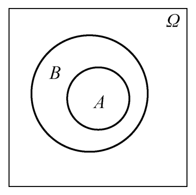
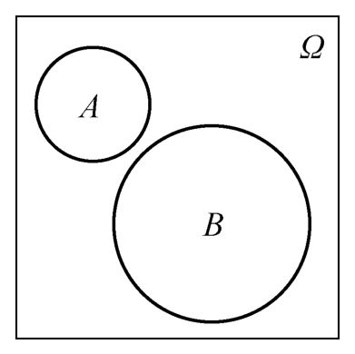
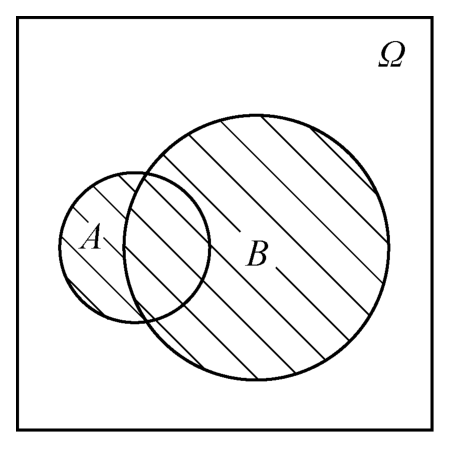
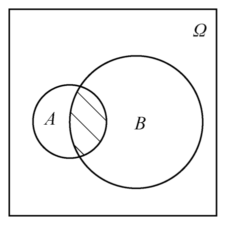
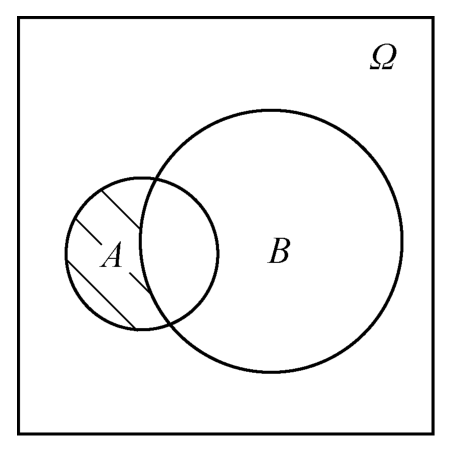
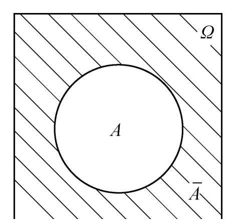
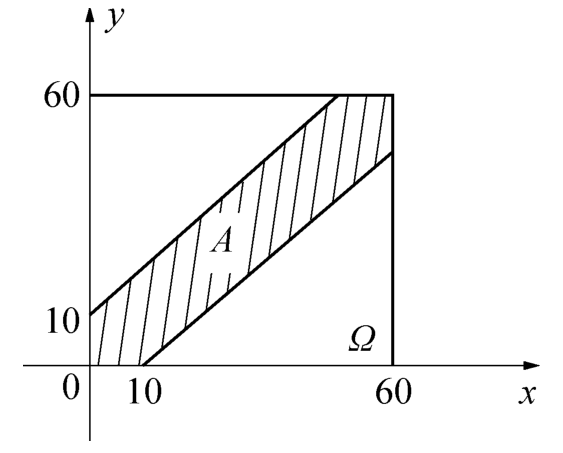
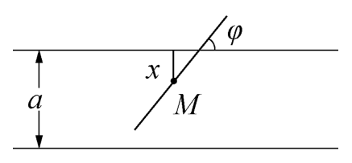
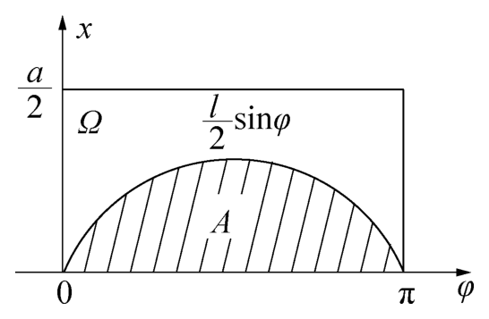
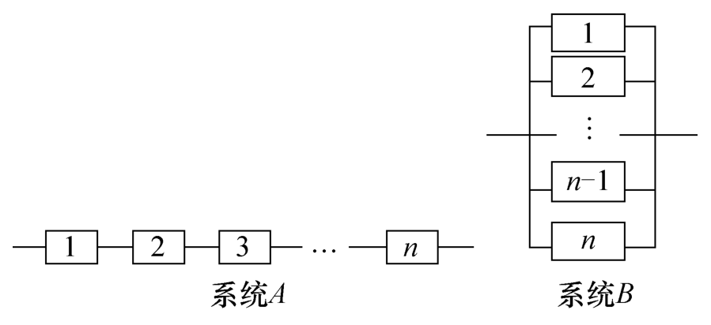

# 第一章 随机事件与概率

［课前导读］

这一章要介绍随机事件的定义，以及怎样求解随机事件发生的概率问题。正确计数对概率求解十分重要，需要回忆和计数相关的排列组合的基础知识。

加法原理：完成一件事，可以有 $n$ 类办法，在第一类办法中有 $m_1$ 种不同的方法，在第二类办法中有 $m_2$ 种不同的方法，……，在第 $n$ 类办法中有 $m_n$ 种不同的方法，那么完成这件事共有 $N=m_1+m_2+\cdots+m_n$ 种不同方法。

乘法原理：完成一件事，需要分成 $n$ 个步骤，做第一步时有 $m_1$ 种不同的方法，做第二步时有 $m_2$ 种不同的方法，……，做第 $n$ 步有 $m_n$ 种不同的方法，那么完成这件事共有 $N=m_1m_2\cdots m_n$ 种不同的方法。

组合：从 $n$ 个不同的元素中任取 $r(1\leqslant r\leqslant n)$ 个不同元素，不考虑次序将它们并成一组，称之为组合。所有不同的组合种数记为 $\dbinom{n}{r}$ 或 $\mathrm{C}_n^r$。

排列：从 $n$ 个不同的元素中任取 $r(1\leqslant r\leqslant n)$ 个不同元素，按一定的顺序排成一列，称之为排列。所有不同的排列种数记为 $\mathrm{A}_n^r$。

组合数的计算公式：

$$
\dbinom{n}{r}=\mathrm{C}_n^r=\frac{n!}{r!\,(n-r)!}
$$

排列数的计算公式：

$$
\mathrm{A}_n^r=\frac{n!}{(n-r)!}
$$

## 第一节 随机事件及其运算

### 一、随机试验

在自然界和人类活动中，发生的现象多种多样，偶数能被 2 整除，函数在间断处不存在导数，课程结束时要通过考试测评，必修课程不及格要重修等。这一类现象在一定条件下必然发生，因此称这类现象为确定性现象。一个新生婴儿可能是男孩也可能是女孩，期末考试可能及格也可能不及格，一条高速公路上一天之内经过的车辆数量等，在这些现象中，事先无法预知会出现哪个结果，因此称这类结果不确定的现象为随机现象。概率论便是一门研究随机现象的统计规律性的数学学科。随机现象在一次试验中呈现不确定的结果，而在大量重复试验中结果将呈现某种规律性，例如相对比较稳定的性别比例，这种规律性称为统计规律性。为了研究随机现象的统计规律性，就要对客观事物进行观察，观察的过程叫随机试验（简称试验）。例如，为了验证骰子是否均匀，可以将这颗骰子反复地投掷并记录其结果。本小节将讨论概率论中的随机试验，随机试验有以下三个特点。

（1）在相同的条件下试验可以重复进行；

（2）每次试验的结果不止一种，但是试验之前必须明确试验的所有可能结果；

（3）每次试验将会出现什么样的结果是事先无法预知的。

**例 1** 随机试验的例子：

（1）抛掷一枚均匀的硬币，观察其正反面出现的情形；

（2）抛掷一枚均匀的骰子，观察其出现的点数；

（3）某快餐店一天内接到的订单量；

（4）某航班起飞延误的时间；

（5）一支正常交易的 A 股股票每天的涨跌幅。

### 二、样本空间

随机试验的一切可能结果组成的集合称为**样本空间**，记为 $\Omega=\{\omega\}$，其中 $\omega$ 表示试验的每一个可能结果，又称为**样本点**，即样本空间为全体样本点的集合。

**例 2** 下面给出例 1 中随机试验的样本空间：

（1）抛掷一枚均匀硬币的样本空间为 $\Omega_1=\{H,\ T\}$，其中 $H$ 表示正面朝上，$T$ 表示反面朝上；

（2）抛掷一枚均匀骰子的样本空间为 $\Omega_2=\{1,\ 2,\ \cdots,\ 6\}$；

（3）某快餐店一天内接到的订单量的样本空间为 $\Omega_3=\{0,\ 1,\ 2,\ \cdots,\ n,\ \cdots\}$；

（4）某航班起飞延误时间的样本空间为 $\Omega_4=\{t\colon t\geqslant 0\}$；

（5）一支正常交易的 A 股股票每天涨跌幅的样本空间为 $\Omega_5=\{x\colon -10\%\leqslant x\%\leqslant 10\%\}$。

从这个例子中可以看出，样本空间中的元素可以是数，也可以不是数。从样本空间中含有样本点的个数来看，可以是有限个也可以是无限个；可以是可列个也可以是不可列个。例如，$\Omega_1$ 和 $\Omega_2$ 中样本点的个数是有限个，$\Omega_3$、$\Omega_4$ 和 $\Omega_5$ 中样本点的个数是无限个；$\Omega_1$、$\Omega_2$ 和 $\Omega_3$ 中样本点的个数是可列个，而 $\Omega_4$ 和 $\Omega_5$ 中样本点的个数是不可列个。

### 三、随机事件

当我们通过随机试验来研究随机现象时，每一次试验都只能出现 $\Omega$ 中的某一个结果 $\omega$，各个可能结果 $\omega$ 是否在一次试验中出现是随机的。在随机试验中，常常会关心其中某些结果是否出现。例如，抛掷一枚均匀的骰子，关心掷出的点数是否是奇数；航班起飞关心延误时间是否超过 3 个小时等。这些在一次试验中可能出现，也可能不出现的一类结果称为**随机事件**，简称为**事件**，随机事件通常用大写字母 $A$，$B$，$C$，$\cdots$ 表示。

如上所述，抛掷一枚均匀的骰子，关心掷出的点数是否是奇数，定义 $A=$“掷出的点数是奇数”即是一个可能发生也可能不发生的随机事件，可描述为 $A=\{1,\ 3,\ 5\}$，它是样本空间 $\Omega=\{1,\ 2,\ \cdots,\ 6\}$ 的一个子集。所以，从集合的角度来说，样本空间的部分样本点组成的集合称为随机事件。

在事件的定义中，注意以下几个概念。

（1）任一随机事件 $A$ 是样本空间 $\Omega$ 的一个子集。

（2）当试验的结果 $\omega$ 属于该子集时，就说事件 $A$ 发生了。相反地，如果试验结果 $\omega$ 不属于该子集，就说事件 $A$ 没有发生。例如，如果掷骰子掷出了 1，则事件 $A=\{1,\ 3,\ 5\}$ 发生，如果掷出 2，则事件 $A$ 不发生。

（3）仅含一个样本点的随机事件称为**基本事件**。

（4）样本空间 $\Omega$ 也是自己的一个子集，所以它也称为一个事件。由于 $\Omega$ 包含所有可能的试验结果，所以 $\Omega$ 在每一次试验中一定发生，又称为**必然事件**。

（5）空集 $\varnothing$ 也是样本空间 $\Omega$ 的一个子集，所以它也称为一个事件。由于 $\varnothing$ 中不包含任何元素，所以 $\varnothing$ 在每一次试验中一定不发生，又称为**不可能事件**。

**例 3** 抛掷一枚均匀的骰子的样本空间为 $\Omega=\{1,\ 2,\ \cdots,\ 6\}$；

随机事件 $A=$“出现 6 点”$=\{6\}$；

随机事件 $B=$“出现偶数点”$=\{2,\ 4,\ 6\}$；

随机事件 $C=$“出现的点数不超过 6”$=\{1,\ 2,\ \cdots,\ 6\}=\Omega$，即一定会发生的必然事件；

随机事件 $D=$“出现的点数超过 6”$=\varnothing$，即一定不会发生的不可能事件。

### 四、随机事件间的关系与运算

众所周知，集合之间有各种关系，是可以进行运算的。因此，在随机事件之间也可以讨论相互的关系，进行相应的运算。

**1.** 给定一个随机试验，$\Omega$ 是它的样本空间，$A$，$B$，$C$，$\cdots$ 都为 $\Omega$ 的子集，随机事件间的关系有以下几种。

（1）如果 $A\subset B$（或 $B\supset A$），则称事件 $A$ 包含在 $B$ 中（或称 $B$ 包含 $A$），如图 1.1 所示。从概率论的角度来说：事件 $A$ 发生必然导致事件 $B$ 发生。

在例 3 中，事件 $A=$“出现 6 点”的发生必然导致事件 $B=$“出现偶数点”的发生，故 $A\subset B$。

（2）如果 $A\subset B$，$B\subset A$ 同时成立，则称事件 $A$ 与 $B$ 相等，记为 $A=B$。从概率论的角度来说：事件 $A$ 发生必然导致事件 $B$ 发生，且 $B$ 发生必然导致 $A$ 发生，即 $A$ 与 $B$ 是同一个事件。

（3）如果 $A$ 与 $B$ 没有相同的样本点，则称事件 $A$ 与 $B$ **互不相容**（或称为**互斥**），如图 1.2 所示。从概率论的角度来说：事件 $A$ 与事件 $B$ 不可能同时发生。

例如，在抛掷一枚均匀骰子的试验中，“出现 6 点”与“出现奇数点”是两个互不相容的事件，因为它们不可能同时发生。

**2.** 与集合的运算一样，随机事件的运算也有并、交、差和余四种运算。

（1）事件 $A$ 与 $B$ 的并，记为 $A\cup B$，如图 1.3 所示，表示由事件 $A$ 与 $B$ 中所有样本点组成的新事件。从概率论的角度来说：事件 $A$ 与 $B$ 中至少有一个发生。

（2）事件 $A$ 与 $B$ 的交，记为 $A\cap B$（或 $AB$），如图 1.4 所示，表示由事件 $A$ 与 $B$ 中公共的样本点组成的新事件。从概率论的角度来说：事件 $A$ 与 $B$ 同时发生。

（3）事件 $A$ 与 $B$ 的差，记为 $A-B$，如图 1.5 所示，表示由在事件 $A$ 中且不在事件 $B$ 中的样本点组成的新事件。从概率论的角度来说：事件 $A$ 发生且 $B$ 不发生。

（4）事件 $A$ 的对立事件（或称为逆事件、余事件），记为 $\bar{A}$，如图 1.6 所示，表示由 $\Omega$ 中且不在事件 $A$ 中的所有样本点组成的新事件，即 $\bar{A}=\Omega-A$。从概率论的角度来说：事件 $A$ 不发生。

例如，抛掷一枚均匀骰子，记事件 $A=$“出现点数不超过 3”$=\{1,\ 2,\ 3\}$，事件 $B=$“出现偶数点”$=\{2,\ 4,\ 6\}$，则并事件 $A\cup B=\{1,\ 2,\ 3,\ 4,\ 6\}$，交事件 $A\cap B=\{2\}$，差事件 $A-B=\{1,\ 3\}$，对立事件 $\bar{A}=\{4,\ 5,\ 6\}$。

从随机事件间的关系和运算中可以看出：

（1）对立事件一定是互不相容的事件，即 $A\cap\bar{A}=\varnothing$，但互不相容事件不一定是对立事件；

（2）根据差事件和对立事件的定义，事件 $A$ 与 $B$ 的差还可以表示成 $A-B=A\bar{B}$；

（3）必然事件 $\Omega$ 与不可能事件 $\varnothing$ 互为对立事件，即 $\bar{\Omega}=\varnothing$，$\bar{\varnothing}=\Omega$。

**3.** 事件的运算性质，如集合的运算性质一样满足下述定律。

（1）交换律：$A\cup B=B\cup A$，$A\cap B=B\cap A$。

（2）结合律：$(A\cup B)\cup C=A\cup(B\cup C)$，$(AB)C=A(BC)$。

（3）分配律：$(A\cup B)\cap C=AC\cup BC$，$(A\cap B)\cup C=(A\cup C)\cap(B\cup C)$。

（4）对偶律：$\overline{A\cup B}=\bar{A}\cap\bar{B}$，$\overline{A\cap B}=\bar{A}\cup\bar{B}$。

事件运算的对偶律是非常有用的公式，且以上的定律都可以推广到任意多个事件。

**例 4** 用事件 $A$，$B$，$C$ 的运算关系式表示下列事件，则

（1）$A$ 出现，$B$，$C$ 都不发生（记为 $E_1$）；

（2）所有三个事件都发生（记为 $E_2$）；

（3）三个事件都不发生（记为 $E_3$）；

（4）三个事件中至少有一个发生（记为 $E_4$）；

（5）三个事件中至少有两个发生（记为 $E_5$）；

（6）至多一个事件发生（记为 $E_6$）；

（7）至多两个事件发生（记为 $E_7$）。

**解**（1）$E_1=A\bar{B}\bar{C}$；（2）$E_2=ABC$；

（3）$E_3=\bar{A}\bar{B}\bar{C}$；（4）$E_4=A\cup B\cup C$；

（5）$E_5=AB\cup AC\cup BC$；（6）$E_6=\bar{A}\bar{B}\bar{C}\cup A\bar{B}\bar{C}\cup\bar{A}B\bar{C}\cup\bar{A}\bar{B}C=\overline{E_5}=\overline{AB\cup AC\cup BC}$；

（7）$E_7=\overline{ABC}=\bar{A}\cup\bar{B}\cup\bar{C}$。

### 习题 1-1

**1.** 写出下列随机试验的样本空间 $\Omega$ 与随机事件 $A$：

（1）抛掷三枚均匀的硬币；事件 $A=$“至少两枚硬币是正面朝上”；

（2）对一密码进行破译，记录破译成功时总的破译次数，事件 $A=$“总次数不超过 8 次”；

（3）从一批手机中随机选取一个，测试它的电池使用时间长度；事件 $A=$“使用时间在 72 到 108 小时之间”。

**2.** 抛掷两枚均匀骰子，观察它们出现的面。

（1）试写出该试验的样本空间 $\Omega$；

（2）试写出下列事件所包含的样本点：$A=$“两枚骰子上的点数相等”，$B=$“两枚骰子上的点数之和等于 8”。

**3.** 在以原点为圆心的一单位圆内随机取一点。

（1）试描述该试验的样本空间 $\Omega$；

（2）试描述下列事件所包含的样本点：$A=$“所取的点与圆心的距离小于 0.5”，$B=$“所取的点与圆心的距离小于 0.5 且大于 0.3”。

**4.** 袋中有 10 个球，分别编有号码 1～10，从中任取 1 球，设 $A=$“取得球的号码是偶数”，$B=$“取得球的号码是奇数”，$C=$“取得球的号码小于 5”，问下列运算表示什么事件：

（1）$A\cup B$；（2）$AB$；（3）$AC$；（4）$\bar{A}C$；（5）$\bar{A}\cap\bar{C}$；（6）$\overline{B\cup C}$；（7）$A-C$。

**5.** 在区间 $[0,\ 10]$ 上任取一数，记 $A=\{x\colon 1<x\leqslant 5\}$，$B=\{x\colon 2\leqslant x\leqslant 6\}$，求下列事件的表达式：

（1）$A\cup B$；（2）$\bar{A}B$；（3）$\bar{A}\bar{B}$；（4）$A\cup\bar{B}$。

**6.** 一批产品中有合格品和废品，从中有放回地抽取三个产品，设事件 $A_i=$“第 $i$ 次抽到废品”，试用 $A_i$ 的运算表示下列各个事件：

（1）第一次、第二次中至少有一次抽到废品；

（2）只有第一次抽到废品；

（3）三次都抽到废品；

（4）至少有一次抽到合格品；

（5）只有两次抽到废品。

**7.** 试给出下列事件的对立事件：

（1）事件 $A=$“三门课程的考核成绩都为优秀”；

（2）事件 $B=$“三门课程的考核成绩至少一门为优秀”。

**8.** 证明下列等式：

（1）$B=AB\cup\bar{A}B$；

（2）$A\cup B=A\cup\bar{A}B$。

## 第二节 概率的定义及其性质

在 $n$ 次试验中如果事件 $A$ 出现了 $n_A$ 次，则称比值 $\dfrac{n_A}{n}$ 为这 $n$ 次试验中事件 $A$ 出现的频率。记为 $f_n(A)=\dfrac{n_A}{n}$，$n_A$ 称为事件 $A$ 发生的频数。概率的统计定义为：随着试验次数 $n$ 的增大，频率值逐步“稳定”到一个实数，这个实数称为事件 $A$ 发生的概率。

1933 年柯尔莫哥洛夫（苏联）首次提出了概率的公理化定义，这是概率论发展史的第一个里程碑，有了这个公理化定义后，概率论得到了迅速发展。概率的公理化定义如下。

**定义** 设任一随机试验 $E$，$\Omega$ 为相应的样本空间，若对任意事件 $A$，有唯一实数 $P(A)$ 与之对应，且满足下面条件，则数 $P(A)$ 称为事件 $A$ 的概率：

（1）**非负性公理** 对于任意事件 $A$，总有 $P(A)\geqslant 0$；

（2）**规范性公理** $P(\Omega)=1$；

（3）**可列可加性公理** 若 $A_1$，$A_2$，$\cdots$，$A_n$ 为两两互不相容的事件，则有

$$
P\left(\bigcup_{i=1}^{\infty}A_i\right)=\sum_{i=1}^{\infty}P(A_i)
$$

由概率的三条公理，可以得到以下概率的一些重要基本性质。

**性质 1** $P(\varnothing)=0$。

**证明** 由可列可加性公理，不妨取 $A_i=\varnothing$，$i=1,\ 2,\ \cdots$，则

$$
P(\varnothing)=P\left(\bigcup_{i=1}^{\infty}A_i\right)=\sum_{i=1}^{\infty}P(A_i)=\sum_{i=1}^{\infty}P(\varnothing).
$$

由非负性公理，$P(\varnothing)\geqslant 0$。因此，由上述可得 $P(\varnothing)=0$。

**性质 2（有限可加性）** 设 $A_1$，$A_2$，$\cdots$，$A_n$ 为两两互不相容的事件，则有

$$
P\left(\bigcup_{i=1}^{n}A_i\right)=\sum_{i=1}^{n}P(A_i)
$$

**证明** 在可列可加性公理中，不妨取 $A_i=\varnothing$，$i=n+1,\ n+2,\ \cdots$，则

$$
P\left(\bigcup_{i=1}^{n}A_i\right)=P\left(\bigcup_{i=1}^{\infty}A_i\right)=\sum_{i=1}^{\infty}P(A_i)=\sum_{i=1}^{n}P(A_i)+\sum_{i=n+1}^{\infty}P(\varnothing)=\sum_{i=1}^{n}P(A_i),
$$

得证。

**性质 3** 对任意事件 $A$，有 $P(\bar{A})=1-P(A)$。

**证明** 因为事件 $A$ 与 $\bar{A}$ 互不相容，且 $\Omega=A\cup\bar{A}$，由规范性公理和性质 2 可知，$P(\Omega)=P(A)+P(\bar{A})=1$，由此得证。

这个性质告诉我们，有时某些事件的概率直接求解较为复杂，而考虑其对立事件则相对比较简单，对这一类的问题可以利用该性质求解。

**例 1（生日问题）** $n(n\leqslant 365)$ 个人中至少有两个人的生日相同的概率是多少？

**解** 设一年以 365 天计，记事件 $A$ 表示“$n$ 个人中至少有两个人的生日相同”，对该事件的讨论非常复杂，故我们考虑其对立事件 $\bar{A}$，即可以表示为“$n$ 个人的生日全不相同”，事件 $\bar{A}$ 的发生过程比较单一，故其概率的求解就很简单，概率为

$$
P(\bar{A})=\frac{365\cdot 364\cdot 363\cdot\cdots\cdot(365-(n-1))}{365^n},
$$

$$
P(A)=1-P(\bar{A})=1-\frac{365\cdot 364\cdot 363\cdot\cdots\cdot(365-(n-1))}{365^n}.
$$

通过计算，我们发现有趣的是，当 $n=23$ 时，$P(A)>0.5$；当 $n=60$ 时，$n$ 个人中至少有两个人的生日相同的概率约为 0.9922。也就是说，当有随机的 60 个人聚在一起，则他们中至少有两个人的生日在同一天的可能性非常大；随着 $n$ 的增大，这个概率将更大。在这个例子中，当 $n$ 很大时，$n$ 个人的生日全不相同可以视为小概率事件，人们在长期的实践中总结得到“概率很小的事件在一次试验中实际上几乎是不发生的”（称之为实际推断原理），因此可以说，在实际情况中，虽然 $n$ 个人中至少有两个人的生日相同的概率不为 1，但几乎一定会发生。

**性质 4** 若事件 $A\subset B$，则 $P(B-A)=P(B)-P(A)$。

**证明** 因为事件 $A\subset B$，所以 $B=A\cup(B-A)$，且 $A$ 与 $B-A$ 互不相容，由性质 2 有限可加性得

$$
P(B)=P(B-A)+P(A),
$$

即得

$$
P(B-A)=P(B)-P(A).
$$

**推论** 若事件 $A\subset B$，则 $P(A)\leqslant P(B)$。

**证明** 由非负性公理得 $P(B-A)=P(B)-P(A)\geqslant 0$，因此 $P(A)\leqslant P(B)$。

值得注意的是，这个推论的逆命题不一定成立，即使 $P(A)\leqslant P(B)$，也无法判断事件 $A$ 与 $B$ 的关系。

**性质 5（减法公式）** 设 $A$，$B$ 为任意事件，则 $P(A-B)=P(A)-P(AB)$。

**证明** $A-B=A-AB$，且 $AB\subset A$，由性质 4 得

$$
P(A-B)=P(A-AB)=P(A)-P(AB).
$$

**性质 6（加法公式）** 设 $A$，$B$ 为任意事件，则 $P(A\cup B)=P(A)+P(B)-P(AB)$。

**证明** 因为 $A\cup B=A\cup(B-AB)$，且 $A$ 与 $B-AB$ 互不相容，由性质 2 有限可加性得

$$
P(A\cup B)=P(A)+P(B-AB)=P(A)+P(B)-P(AB).
$$

我们还可以将性质 6 的加法公式推广到多个事件的情况。例如，设 $A$，$B$，$C$ 为任意的三个事件，则

$$
P(A\cup B\cup C)=P(A)+P(B)+P(C)-P(AB)-P(AC)-P(BC)+P(ABC).
$$

更一般地，设 $A_1$，$A_2$，$\cdots$，$A_n$ 为任意的 $n$ 个事件，则

$$
P\left(\bigcup_{i=1}^{n}A_i\right)=\sum_{i=1}^{n}P(A_i)-\sum_{1\leqslant i<j\leqslant n}P(A_iA_j)+\sum_{1\leqslant i<j<k\leqslant n}P(A_iA_jA_k)+\cdots+(-1)^{n+1}P(A_1A_2\cdots A_n).
$$

**例 2** 已知事件 $A$，$B$，$A\cup B$ 的概率依次为 0.2，0.4，0.5，求概率 $P(\bar{A}\bar{B})$。

**解** 由性质 6 的加法公式 $P(A\cup B)=P(A)+P(B)-P(AB)$ 及已知条件可得 $0.5=0.2+0.4-P(AB)$，由此解得 $P(AB)=0.1$。

再由性质 5 的减法公式得

$$
P(\bar{A}\bar{B})=P(A-B)=P(A)-P(AB)=0.2-0.1=0.1.
$$

**例 3** 设事件 $A$、$B$、$C$ 为三个随机事件，已知 $P(A)=0.2$，$P(B)=0.3$，$P(C)=0.4$，$P(AB)=0$，$P(BC)=P(AC)=0.1$，则 $A$、$B$、$C$ 至少发生一个的概率是多少？$A$、$B$、$C$ 都不发生的概率是多少？

**解** 因为 $ABC\subset AB$，由性质 4 的推论 $P(ABC)\leqslant P(AB)=0$ 及非负性公理 $P(ABC)\geqslant 0$，可知 $P(ABC)=0$。再由加法公式，$A$、$B$、$C$ 至少发生一个的概率为

$$
\begin{aligned}
P(A\cup B\cup C)&=P(A)+P(B)+P(C)-P(AB)-P(AC)-P(BC)+P(ABC)\\
&=0.2+0.3+0.4-0-0.1-0.1+0=0.7.
\end{aligned}
$$

又因为“$A$、$B$、$C$ 都不发生”的对立事件是“$A$、$B$、$C$ 至少发生一个”，所以

$$
P(\overline{ABC})=P(\overline{A\cup B\cup C})=1-P(A\cup B\cup C)=0.3.
$$

### 习题 1-2

**1.** 已知事件 $A$，$B$ 有包含关系，$P(A)=0.4$，$P(B)=0.6$，求：

（1）$P(\bar{A})$，$P(\bar{B})$；（2）$P(A\cup B)$；（3）$P(AB)$；（4）$P(\bar{B}A)$，$P(\bar{A}B)$；（5）$P(\bar{A}\cap\bar{B})$。

**2.** 设 $A$，$B$ 是两个事件，已知 $P(A)=0.5$，$P(B)=0.7$，$P(A\cup B)=0.8$，试求：

（1）$P(AB)$；（2）$P(A-B)$；（3）$P(B-A)$。

**3.** $P(A)=0.4$，$P(B)=0.3$，分别在（1）$A$，$B$ 互不相容；（2）$A$，$B$ 有包含关系情况时，求 $P(A-B)$。

**4.** 已知 $P(A)=P(B)=P(C)=0.25$，$P(AB)=0$，$P(AC)=P(BC)=\dfrac{1}{16}$。求：

（1）$P(A\cup B)$；（2）$P(A\cup B\cup C)$；（3）$P(\bar{B}\cap\bar{C})$。

**5.** 设随机事件 $A$，$B$，$C$ 的概率都是 $1/2$，且 $P(ABC)=P(A\cap\bar{B}\cap\bar{C})$，$P(AB)=P(AC)=P(BC)=\dfrac{1}{3}$，求 $P(ABC)$。

**6.** 设 $A$，$B$ 是两个事件，已知 $P(A)=0.6$，$P(B)=0.7$，求：

（1）在什么条件下，$P(AB)$ 取最大值？最大值是多少？

（2）在什么条件下，$P(AB)$ 取最小值？最小值是多少？

**7.** 对任意的随机事件 $A$，$B$，$C$，证明：

（1）$P(AB)\geqslant P(A)+P(B)-1$；

（2）$P(AB)+P(AC)+P(BC)\geqslant P(A)+P(B)+P(C)-1$。

## 第三节 等可能概型

在概率论发展的历史上，最先研究的是一类最直观、最简单的随机现象。在这类随机现象中，样本空间中的每个基本事件发生的可能性都相等，这样的数学模型我们称之为等可能概型。其中，当样本空间只包含有限个不同的可能结果（即样本点），如抛掷一枚均匀的硬币、抛掷一枚均匀的骰子等，研究这一类随机现象的数学模型我们称之为古典概型。而当样本空间是某个区域（可以是一维区间、二维平面或三维空间），如搭乘地铁等待时间、蒲丰投针问题等，研究这一类随机现象的数学模型我们称之为几何概型。

### 一、古典概型

一般地，古典概型的基本思路如下：

（1）随机试验的样本空间只有有限个样本点，不妨记作 $\Omega=\{\omega_1,\ \omega_2,\ \cdots,\ \omega_n\}$；

（2）每个基本事件发生的可能性相等，即

$$
P(\{\omega_1\})=\cdots=P(\{\omega_n\})=\frac{1}{n},
$$

若随机事件 $A$ 中含有 $n_A$ 个样本点，则事件 $A$ 的概率为

$$
P(A)=\frac{A\ \text{中所含样本点的个数}}{\Omega\ \text{中所有样本点的个数}}=\frac{n_A}{n}.
$$

古典概型是概率论发展初期确定概率的常用方法，所得的概率又称为古典概率。在古典概型中，关键在于计算样本空间及事件 $A$ 中样本点的个数，所以在计算中经常用到排列组合的计算工具。

**例 1** 抛掷两枚均匀的骰子，观察出现的点数，设事件 $A$ 表示“两个骰子的点数一样”，求 $P(A)$。

**解** 按照定义，样本空间 $\Omega$ 是由两枚骰子可能出现的所有不同结果组成的。因此，$\Omega=\{(1,\ 1),\ (1,\ 2),\ \cdots,\ (1,\ 6),\ (2,\ 1),\ \cdots,\ (6,\ 6)\}$，共包含 36 个样本点，而 $A=\{(1,\ 1),\ (2,\ 2),\ \cdots,\ (6,\ 6)\}$，共 6 个样本点，因而 $P(A)=\dfrac{6}{36}=\dfrac{1}{6}$。

**例 2（抽样模型）** 已知 $N$ 件产品中有 $M$ 件是不合格品，其余 $N-M$ 件是合格品。今从中随机地抽取 $n$ 件。试求：

（1）不放回抽样 $n$ 件中恰有 $k$ 件不合格品的概率；

（2）有放回抽样 $n$ 件中恰有 $k$ 件不合格品的概率。

**解** 抽样方式有两种：有放回抽样和不放回抽样，有放回抽样是抽取一件后放回，再抽取下一件，如此重复至抽取 $n$ 件完成；不放回抽样是抽取一件后不放回，再抽取下一件，如此重复。

（1）先计算样本空间 $\Omega$ 中样本点的总数，因为是不放回抽样，从 $N$ 件抽取 $n$ 件，所以样本点的总数为 $\dbinom{N}{n}$，因为是随机抽样的，故这 $\dbinom{N}{n}$ 个样本点是等可能发生的。

再计算事件 $A$ 中样本点的个数，因为事件 $A$ 要求 $n$ 件中恰有 $k$ 件不合格品，即必须从 $M$ 件不合格品中选取 $k$ 件不合格品，还要从 $N-M$ 件合格品中选取 $n-k$ 件合格品，根据乘法原理，事件 $A$ 中含有 $\dbinom{M}{k}\dbinom{N-M}{n-k}$ 个样本点，因此可得事件 $A$ 的概率为

$$
P(A)=\frac{\dbinom{M}{k}\dbinom{N-M}{n-k}}{\dbinom{N}{n}}.
$$

（2）如果是有放回抽样，每一次都是从 $N$ 件抽取 1 件，共抽 $n$ 次，故样本空间 $\Omega$ 中样本点的总数为 $N^n$，因为是随机抽样的，故这 $N^n$ 样本点还是等可能发生的。

$n$ 件中恰有 $k$ 件不合格品，可以看成在 $n$ 次抽取过程中有 $k$ 次抽到不合格品，考虑到这 $k$ 次可以在总的 $n$ 次中的任何 $k$ 次抽取中得到，故有 $\dbinom{n}{k}$ 种不同的出现顺序，每次抽到不合格品都是从 $M$ 件不合格品中选取 1 件不合格品，故有 $M^k$ 种，还要从 $N-M$ 件合格品中选取 $n-k$ 次合格品，故有 $(N-M)^{n-k}$ 种，根据乘法原理和加法原理，事件 $A$ 中含有 $\dbinom{n}{k}M^k(N-M)^{n-k}$ 个样本点，因此可得事件 $A$ 的概率为

$$
P(A)=\frac{\dbinom{n}{k}M^k(N-M)^{n-k}}{N^n}.
$$

**例 3（抽奖（抓阄）模型）** 今有某公司年会的抽奖活动，设共有 $n$ 张券，其中只有一张有奖，每人只能抽一张，设事件 $A$ 表示为“第 $k$ 个人抽到有奖的券”，试在有放回、不放回两种抽样方式下，求 $P(A)$。

**解** 在有放回情形中，第 $k$ 个人抽与第 1 个人抽情况相同，因而所求概率为 $\dfrac{1}{n}$。

在不放回情形中，样本空间的样本点总数为 $n(n-1)\cdots(n-k+1)$，而事件 $A$ 的样本点个数为 $(n-1)(n-2)\cdots(n-(k-1)+1)\cdot 1$，故所求概率为

$$
P(A)=\frac{(n-1)(n-2)\cdots(n-k+1)}{n(n-1)\cdots(n-k+1)}=\frac{1}{n}.
$$

值得注意的是，此概率值与抽样次数 $k$ 无关。尽管每个人抽奖先后次序不同，但是每个人中奖的概率是一样的，大家机会相同。另外还值得注意的是，有放回抽样和不放回抽样情况下概率是一样的。

### 二、几何概型

几何概型是古典概型的推广，保留每个样本点发生的等可能性，但去掉了 $\Omega$ 中包含有限个样本点的限制，即允许试验可能结果有无穷不可列个。

一般地，几何概型的基本思路如下：

（1）随机试验的样本空间 $\Omega$ 是某个区域（可以是一维区间、二维平面区域或三维空间区域）；

（2）每个样本点发生的可能性相等。

则事件 $A$ 的概率为

$$
P(A)=\frac{m(A)}{m(\Omega)}.
$$

其中，$m(\cdot)$ 在一维情形下表示长度，在二维情形下表示面积，在三维情形下表示体积。求几何概型的关键在于用图形正确地描述样本空间 $\Omega$ 和所求事件 $A$，然后计算出相关图形的度量（一般为长度、面积或体积）。

**例 4** 在 $[0,\ 1]$ 区间内任取一个数，求：

（1）这个数落在区间 $(0,\ 0.25)$ 内的概率；

（2）这个数落在区间中点的概率；

（3）这个数落在区间 $(0,\ 1)$ 内的概率。

**解** 以 $x$ 表示取到的这个数，因为这个数都是在 $[0,\ 1]$ 区间内等可能取到，所以由等可能性可知这是一个几何概型的问题。

样本空间 $\Omega=\{x\colon 0\leqslant x\leqslant 1\}$，$m(\Omega)=1$。

（1）设事件 $A$ 表示“这个数落在区间 $(0,\ 0.25)$ 内”，即 $A=\{x\colon 0<x<0.25\}$，$m(A)=0.25$。由几何概率的计算公式，有

$$
P(A)=\frac{m(A)}{m(\Omega)}=\frac{0.25}{1}=0.25.
$$

（2）设事件 $A$ 表示“这个数落在区间中点”，即 $A=\{x\colon x=0.5\}$，$m(A)=0$，于是

$$
P(A)=\frac{m(A)}{m(\Omega)}=\frac{0}{1}=0.
$$

（3）设事件 $A$ 表示“这个数落在区间 $(0,\ 1)$ 内”，即 $A=\{x\colon 0<x<1\}$，$m(A)=1$，于是

$$
P(A)=\frac{m(A)}{m(\Omega)}=\frac{1}{1}=1.
$$

这个例子中，我们对样本空间 $\Omega$ 和事件 $A$ 的度量采用区间线段的长度来表示，这是一维的情形。此外，这个例子的（2）和（3）告诉我们，概率为零的事件未必就是不可能事件，同理，概率为 1 的事件未必就是必然事件。

**例 5（碰面问题）** 甲、乙两人约定在中午的 12 时到 13 时之间在学校咖啡屋碰面，并约定先到者等候另一人 10 分钟，过时即可离去。求两人能碰面的概率。

**解** 以 $x$ 和 $y$ 表示甲、乙两人到达咖啡屋的时间（以 min 为单位），在平面 $xOy$ 上建立直角坐标系（见图 1.7）。

因为甲、乙两人都是在 12 时到 13 时等可能到达，所以由等可能性可知这是一个几何概型的问题。样本空间

$$
\Omega=\{(x,\ y)\colon 0\leqslant x\leqslant 60,\ 0\leqslant y\leqslant 60\},\quad m(\Omega)=60^2.
$$

设事件 $A$ 表示“两人能碰面”，即

$$
A=\{(x,\ y)\colon |x-y|<10\},\quad m(A)=60^2-50^2.
$$

由几何概率的计算公式，有

$$
P(A)=\frac{m(A)}{m(\Omega)}=\frac{60^2-50^2}{60^2}=\frac{11}{36}.
$$

**例 6（蒲丰投针问题）** 蒲丰投针试验是第一个用几何形式表达概率问题的例子。假设平面上画满间距为 $a$ 的平行直线，向该平面随机投掷一枚长度为 $l(l<a)$ 的针，求针与任一平行线相交的概率。

**解** 设 $M$ 为针的中点，$x$ 为 $M$ 与最近平行线的距离，$\varphi$ 为针与平行线的交角，可得样本空间为

$$
\Omega=\left\{(x,\ \varphi)\colon 0\leqslant x\leqslant\frac{a}{2},\ 0\leqslant\varphi\leqslant\pi\right\},\quad m(\Omega)=\frac{\pi a}{2}.
$$

显然，设事件 $A$ 表示“针与平行线相交”发生的充要条件是 $x\leqslant\dfrac{l}{2}\sin\varphi$（见图 1.8），故 $A=\left\{(x,\ \varphi)\colon x\leqslant\dfrac{l}{2}\sin\varphi\right\}$，$m(A)=\displaystyle\int_{0}^{\pi}\dfrac{l}{2}\sin\varphi\,\mathrm{d}\varphi=l$（见图 1.9）。

由几何概率的计算公式，有

$$
P(A)=\frac{m(A)}{m(\Omega)}=\frac{2l}{\pi a},
$$

我们用 $n$ 表示投针总次数，$n_A$ 表示针与平行线相交的次数，可以用 $\dfrac{n_A}{n}$ 作为 $P(A)$ 的估计值，即

$$
\frac{n_A}{n}\approx P(A)=\frac{2l}{\pi a},
$$

于是有

$$
\pi\approx\frac{2nl}{an_A}.
$$

这就是用随机试验方法求 $\pi$ 值的基本公式。一般来说，试验次数越多，求得的近似解越精确。19～20 世纪，历史上有一些学者曾亲自做过这个试验，用概率的方法得到圆周率 $\pi$ 的近似值。下面是一些资料。

| 试验者 | 时间 | 投掷次数 | 相交次数 | 圆周率 $\pi$ 的估计值 |
| --- | --- | --- | --- | --- |
| Wolf | 1850 年 | 5000 | 2532 | 3.1596 |
| Smith | 1855 年 | 3204 | 1218.5 | 3.1554 |
| Lazzarini | 1901 年 | 3408 | 1808 | 3.1415929 |
| Reina | 1925 年 | 2520 | 859 | 3.1795 |

随着计算机的发展，可以实现对大量随机试验的计算机模拟，此方法即为在自然科学、社会科学各领域具有广泛应用的蒙特卡罗方法（Monte-Carlo Method）。

### 习题 1-3

**1.** 掷两枚骰子，求下列事件的概率：

（1）点数之和为 7；（2）点数之和不超过 5；（3）点数之和为偶数。

**2.** 一口袋中有 5 个红球及 2 个白球。从这袋中任取一球，看过它的颜色后放回袋中，然后，再从这袋中任取一球。设每次取球时口袋中各个球被取到的可能性相同，求：

（1）第一次、第二次都取到红球的概率；

（2）第一次取到红球、第二次取到白球的概率；

（3）两次取得的球为红、白各一的概率；

（4）第二次取到红球的概率。

**3.** 一个盒子中装有 6 只杯子，其中有 2 只是不合格品，现在作不放回抽样；接连取 2 次，每次随机地取 1 只，试求下列事件的概率：

（1）2 只都是合格品；

（2）1 只是合格品，1 只是不合格品；

（3）至少有 1 只是合格品。

**4.** 一个年级三个班级分别派出 6 位、4 位和 3 位同学代表学校参加区速算比赛。抽签决定首发 3 位同学的名单，求：

（1）首发的 3 位同学来自同一个班级的概率；

（2）首发的 3 位同学来自不同班级的概率；

（3）首发的 3 位同学来自两个班级的概率。

**5.** 一个盒子中放有编号为 1～10 的 10 个小球，随机地从这个口袋中取 3 个球，试分别在“不放回抽样”和“有放回抽样”两种方式下，求：

（1）3 个球的号码都不超过 6 的概率；（2）最大号码是 6 的概率。

**6.** 一副扑克牌将大王和小王去掉，从剩余的 52 张扑克牌中任取 5 张，求下列事件的概率：

（1）事件 $A=$“同花”（即 5 张牌都是同一花色）；

（2）事件 $B=$“顺子”（即 5 张牌号码连一起，例如：56789，但 5 张牌的花色不完全一样）；

（3）事件 $C=$“仅有一对”。

**7.** 将 $n$ 个完全相同的小球随机地放入 $N$ 个不同的盒子（$n<N$），设每个盒子都足够大，可以容纳任意多个球。求：

（1）$n$ 个球都在同一个盒子里的概率；

（2）$n$ 个球都在不同的盒子里的概率；

（3）某指定的盒子中恰好有 $k(k\leqslant n)$ 个球的概率。

**8.** 10 个女生 5 个男生排成一列，求任意两个男生都不相邻的概率。

**9.** 10 张签中分别有 4 张画圈、6 张画叉。10 个人依次抽签，抽到带圈的签为中签，求每个人的中签率。

**10.**（1）在单位圆内某一特定直径上取一点，求以该点为中心的弦长大于 $\sqrt{3}$ 的概率；

（2）在单位圆内任作一点，求以该点为中心的弦长大于 $\sqrt{3}$ 的概率。

**11.** 在圆内有一内接等边三角形，随机向圆内抛掷一个点，求该点落在等边三角形内的概率。

**12.** 在区间 $[0,\ 1]$ 上任取两个数，求：

（1）两数之和不小于 1 的概率；

（2）两数之差的绝对值不超过 0.1 的概率；

（3）两数之差的绝对值小于 0.1 的概率。

**13.** 在长度为 $T$ 的时间段内，有两个长短不等的信号随机地进入接收机，长信号持续时间为 $t_1(\ll T)$，短信号持续时间为 $t_2(\ll T)$。试求这两个信号互不干扰的概率。

**14.** 在长度为 1 的线段上任取两个点将其分成三段，求：

（1）它们可以构成一个三角形的概率；

（2）它们可以构成一个等边三角形的概率。

## 第四节 条件概率与事件的相互独立性

### 一、条件概率

条件概率是概率论中一个既重要又应用广泛的概念。例如，在购买人寿保险时，不同年龄的投保人的保费是不同的，那是因为不同年龄的投保人在未来一年内死亡的概率是有差异的。一般地，条件概率是指在某随机事件 $A$ 发生的条件下，另一随机事件 $B$ 发生的概率，记为 $P(B\mid A)$，它与 $P(B)$ 是不同的两类概率。

**例 1** 假设抛掷一枚均匀的骰子，已知掷出的点数是偶数，求点数超过 3 的概率。

**解** 该试验的样本空间是 $\Omega=\{1,\ 2,\ \cdots,\ 6\}$，随机事件 $A=$“出现偶数点”$=\{2,\ 4,\ 6\}$，随机事件 $B=$“出现的点数超过 3”$=\{4,\ 5,\ 6\}$。

现在的问题是：已知事件 $A$ 发生了，有了这一信息后，即知试验所有可能结果所构成的集合就是 $A$，只有三个样本点，即 2 点、4 点和 6 点，在这基础上观察满足事件 $B$ 的样本点只有 2 个，即为 4 点和 6 点，故事件 $B$ 发生的概率即为 $P(B\mid A)=\dfrac{2}{3}$。

如果回到原来的样本空间，易知

$$
P(A)=\frac{3}{6},\quad P(AB)=\frac{2}{6},\quad P(B\mid A)=\frac{2}{3}=\frac{2/6}{3/6}=\frac{P(AB)}{P(A)}.
$$

这个例子启发我们：可以以 $P(AB)$ 与 $P(A)$ 之比作为条件概率 $P(B\mid A)$ 的一般性定义。

**定义 1** 设 $E$ 是随机试验，$\Omega$ 是样本空间，$A$，$B$ 是随机试验 $E$ 上的两个随机事件且 $P(A)>0$，称 $P(B\mid A)=\dfrac{P(AB)}{P(A)}$ 为在事件 $A$ 发生的条件下事件 $B$ 发生的概率，称为条件概率，记为 $P(B\mid A)$。

可以验证，条件概率也满足概率的公理化定义的三条基本性质，即非负性、规范性和可列可加性。设 $P(B)>0$，则有：

（1）**非负性公理** 对于任意事件 $A$，总有 $P(A\mid B)\geqslant 0$；

（2）**规范性公理** $P(\Omega\mid B)=1$；

（3）**可列可加性公理** 若 $A_1$，$A_2$，$\cdots$ 为两两互不相容的一组事件，则有

$$
P\left(\left.\bigcup_{i=1}^{\infty}A_i\right|B\right)=\sum_{i=1}^{\infty}P(A_i\mid B).
$$

于是，第二节中关于概率的性质 1～6 对条件概率依然适用，需要注意的是，使用公式计算时必须在同一条件下进行。

**例 2** 假设一批产品中一、二、三等品各有 60 个、30 个和 10 个，从中任取一件，发现不是三等品，则取到的是一等品的概率是多少？

**解** 记事件 $A=$“取出的产品不是三等品”，随机事件 $B=$“取出的产品是一等品”，因此有

$$
P(B\mid A)=\frac{P(AB)}{P(A)}=\frac{60/100}{90/100}=\frac{2}{3}.
$$

**例 3** 设 $A$，$B$ 为两个随机事件，且已知 $P(A)=0.7$，$P(B)=0.4$，$P(A-B)=0.5$，求 $P(B\mid\bar{A})$。

**解** $P(A-B)=P(A)-P(AB)=0.5$，故 $P(AB)=P(A)-P(A-B)=0.7-0.5=0.2$，所以有

$$
P(B\mid\bar{A})=\frac{P(B\bar{A})}{P(\bar{A})}=\frac{P(B)-P(BA)}{1-P(A)}=\frac{0.4-0.2}{0.3}=\frac{2}{3}.
$$

如果对条件概率定义式两端同乘 $P(A)$，可得如下定理。

**定理 1（概率的乘法公式）** 设 $A$，$B$ 为随机试验 $E$ 上的两个事件，且 $P(A)>0$，则有

$$
P(AB)=P(A)P(B\mid A).
$$

同理，若 $P(B)>0$，有

$$
P(AB)=P(B)P(A\mid B).
$$

我们还可以将乘法公式推广到多个事件的情况。例如，设 $A$，$B$，$C$ 为任意的三个事件，且 $P(AB)>0$，则

$$
P(ABC)=P(A)P(B\mid A)P(C\mid AB).
$$

更一般地，有下面公式：

设 $A_1$，$A_2$，$\cdots$，$A_n$ 为一事件组，且 $P(A_1A_2\cdots A_{n-1})>0$，则

$$
P(A_1A_2\cdots A_n)=P(A_1)P(A_2\mid A_1)P(A_3\mid A_1A_2)\cdots P(A_n\mid A_1A_2\cdots A_{n-1}).
$$

**例 4** 一批零件共有 100 个，其中 90 个正品，10 个次品，从中不放回取三次（每次取一个），求第三次才取得正品的概率。

**解** 以 $A_i(i=1,\ 2,\ 3)$ 表示事件“第 $i$ 次取到次品”，故事件 $B=$“第三次才取到正品”可以表示成 $A_1A_2\bar{A}_3$，则

$$
P(B)=P(A_1A_2\bar{A}_3)=P(A_1)P(A_2\mid A_1)P(\bar{A}_3\mid A_1A_2)=\frac{10}{100}\cdot\frac{9}{99}\cdot\frac{90}{98}=\frac{9}{1078}.
$$

### 二、事件的相互独立性

一般来说，设 $A$，$B$ 为试验 $E$ 的两个事件，且 $P(A)>0$，则事件 $A$ 的发生对事件 $B$ 发生的概率是有影响的，这时条件概率 $P(B\mid A)\neq P(B)$；但例外的情况也不在少数，这时就会有 $P(B\mid A)=P(B)$，则可以推出

$$
P(AB)=P(A)P(B\mid A)=P(A)P(B).
$$

**例 5** 抛掷两枚均匀的硬币，记事件 $A$ 表示为“第一枚硬币出现正面”，事件 $B$ 表示为“第二枚硬币出现正面”，则有

$$
P(A)=\frac{1}{2},\quad P(B)=\frac{1}{2},\quad P(B\mid A)=\frac{1}{2},\quad P(AB)=\frac{1}{4}.
$$

可以看出 $P(B)=P(B\mid A)$，事实上还可以算出 $P(B\mid\bar{A})=\dfrac{1}{2}$，因此有

$$
P(B)=P(B\mid A)=P(B\mid\bar{A}).
$$

这说明不管事件 $A$ 发生还是不发生，都对事件 $B$ 发生的概率没有影响。我们可以从直观上认为事件 $A$ 与事件 $B$ 没有“关系”，或者称事件 $A$ 与事件 $B$ 相互独立。事实上，从该例的实际意义也容易看出，两枚硬币的抛掷结果是互不影响的。

从以上讨论可知，如对试验 $E$ 的两个事件 $A$，$B$，当 $P(A)>0$，有

$$
P(B)=P(B\mid A),
$$

则可认为 $A$，$B$ 相互独立。上式两边同乘以 $P(A)$，即得 $P(AB)=P(A)P(B)$。显然当 $P(A)=0$ 时，$P(AB)=0=P(A)P(B)$，所以这个等式也成立，故我们得如下事件相互独立性的定义。

**定义 2** 设 $A$，$B$ 为试验 $E$ 的两个事件，如果满足等式

$$
P(AB)=P(A)P(B),
$$

则称事件 $A$，$B$ 相互独立，简称 $A$，$B$ 独立。

**定理 2** 若事件 $A$ 与事件 $B$ 相互独立，则下列各对事件也相互独立：

$$
A\ \text{与}\ \bar{B},\quad \bar{A}\ \text{与}\ B,\quad \bar{A}\ \text{与}\ \bar{B}.
$$

即

$$
\begin{aligned}
&P(AB)=P(A)P(B)\\
\Leftrightarrow{}&P(\bar{A}B)=P(\bar{A})P(B)\\
\Leftrightarrow{}&P(A\bar{B})=P(A)P(\bar{B})\\
\Leftrightarrow{}&P(\bar{A}\bar{B})=P(\bar{A})P(\bar{B}).
\end{aligned}
$$

**证明** 事件 $A$ 与事件 $B$ 相互独立，即 $P(AB)=P(A)P(B)$，所以 $P(A\bar{B})=P(A)-P(AB)=P(A)-P(A)P(B)=P(A)(1-P(B))=P(A)P(\bar{B})$，因此，$A$ 与 $\bar{B}$ 相互独立。由此即可推出 $\bar{A}$ 与 $\bar{B}$ 相互独立，再由 $\bar{\bar{B}}=B$，又可推出 $\bar{A}$ 与 $B$ 相互独立。

这个定理告诉我们，以上四对事件中，只要有一对是相互独立的，则其余三对也相互独立。即直观理解为：事件 $A$ 与 $B$ 相互独立，则 $A$ 的发生不会影响 $B$ 发生的概率，那么 $A$ 的发生也不会影响 $B$ 不发生的概率，$A$ 的不发生也不会影响 $B$ 发生的概率，$A$ 的不发生也不会影响 $B$ 不发生的概率。

下面我们将相互独立性推广到三个事件的情况。

**定义 3** 设 $A$，$B$，$C$ 是试验 $E$ 的三个事件，如果满足等式

$$
P(AB)=P(A)P(B),
$$

$$
P(AC)=P(A)P(C),
$$

$$
P(BC)=P(B)P(C),
$$

则称事件 $A$，$B$，$C$ 两两相互独立。

**定义 4** 设 $A$，$B$，$C$ 是试验 $E$ 的三个事件，如果满足等式

$$
P(AB)=P(A)P(B),
$$

$$
P(AC)=P(A)P(C),
$$

$$
P(BC)=P(B)P(C),
$$

$$
P(ABC)=P(A)P(B)P(C),
$$

则称事件 $A$，$B$，$C$ 相互独立。

一般地，设 $A_1$，$A_2$，$\cdots$，$A_n$ 是试验 $E$ 的 $n\,(n\geqslant 2)$ 个事件，如果对于其中任意两个事件的积事件的概率等于各事件概率的积，则称事件 $A_1$，$A_2$，$\cdots$，$A_n$ 两两相互独立；如果对于其中任意两个事件，任意三个事件，$\cdots\cdots$，任意 $n$ 个事件的积事件的概率等于各事件概率的积，则称事件 $A_1$，$A_2$，$\cdots$，$A_n$ 相互独立。

**例 6** 把一枚硬币相互独立地掷两次，事件 $A_i$ 表示“掷第 $i$ 次时出现正面”，$i=1$，$2$；事件 $A_3$ 表示“正、反面各出现一次”。试证，$A_1$，$A_2$，$A_3$ 两两相互独立，但不相互独立。

**解** 容易算得 $P(A_1)=P(A_2)=P(A_3)=\dfrac{1}{2}$，而且 $P(A_1A_2)=P(A_1A_3)=P(A_2A_3)=\dfrac{1}{4}$，但是 $P(A_1A_2A_3)=0$，因此，三个事件 $A_1$，$A_2$，$A_3$ 两两相互独立，但不相互独立。

**例 7** 设某车间有三条相互独立工作的生产流水线，在一天内每条流水线要求工人维护的概率依次为 $0.9$、$0.8$ 和 $0.7$。求一天中三条流水线中至少有一条需要工人维护的概率。

**解** 记 $A$ 表示为“至少有一条流水线需要工人维护”，$A_i=\{$第 $i$ 条流水线需要工人维护$\}$，$i=1$，$2$，$3$。易知 $A_1$，$A_2$，$A_3$ 相互独立。事件 $A$ 可以写成

$$
A=A_1\cup A_2\cup A_3.
$$

由于事件的相互独立性只能用于积事件的概率等于各事件概率的积，因此我们使用对偶律，得到

$$
P(A)=1-P(\overline{A_1\cup A_2\cup A_3})=1-P(\overline{A_1}\cap\overline{A_2}\cap\overline{A_3})
$$

$$
=1-P(\overline{A_1})P(\overline{A_2})P(\overline{A_3})=1-0.1\cdot 0.2\cdot 0.3=0.994.
$$

也可以直接考虑事件 $A$ 的对立事件是三条流水线都不需要工人维护（即 $\overline{A_1}\,\overline{A_2}\,\overline{A_3}$），于是利用事件的相互独立性可得

$$
P(A)=1-P(\overline{A})=1-P(\overline{A_1A_2A_3})=0.994.
$$

这两种解法实际上是等价的。

**例 8**（系统可靠性问题） 设有 $n$ 个元件相互独立工作，分别按照串联、并联的方式组成两个系统 $A$ 和 $B$，如图 1.10 所示，已知每个元件正常工作的概率都为 $p$，分别求系统 $A$ 和 $B$ 的可靠性（即为系统正常工作的概率）。

**解** 记 $A_i=\{$第 $i$ 个元件正常工作$\}$ $i=1$，$2$，$\cdots$，$n$，可知事件 $A_1$，$A_2$，$\cdots$，$A_n$ 相互独

立。又记 $A$ 表示“串联系统 $A$ 正常工作”，$B$ 表示“并联系统 $B$ 正常工作”，则

$$
A=A_1\cap A_2\cap\cdots\cap A_n,
$$

$$
B=A_1\cup A_2\cup\cdots\cup A_n.
$$

所以，由相互独立的性质可知

$$
P(A)=P(A_1)P(A_2)\cdots P(A_n)=p^n,
$$

$$
P(B)=P(A_1\cup A_2\cup\cdots\cup A_n)=1-P(\overline{A_1}\cap\overline{A_2}\cap\cdots\cap\overline{A_n})
$$

$$
=1-P(\overline{A_1})P(\overline{A_2})\cdots P(\overline{A_n})=1-(1-p)^n.
$$

事实上，系统的可靠性问题一般都很复杂，很难直接分析。但通过适当的分解，将一个大系统层层分割成若干子系统，就可以简化其分析过程。而串联和关联就是所有子系统中最常见的两个基本子系统。

**例 9** 设 $P(A)=0.2$，$P(B)=0.3$，事件 $A$，$B$ 相互独立。试求 $P(A-B)$，$P(A\,|\,A\cup B)$。

**解**

$$
P(A-B)=P(A\overline{B})=P(A)P(\overline{B})=0.2\cdot 0.7=0.14,
$$

$$
P(A\,|\,A\cup B)=\frac{P(A\cap(A\cup B))}{P(A\cup B)}.
$$

利用分配律，可继续化简为

$$
P(A\,|\,A\cup B)=\frac{P(AA\cup AB)}{P(A\cup B)}=\frac{P(A)}{P(A\cup B)}
$$

$$
=\frac{P(A)}{P(A)+P(B)-P(AB)}=\frac{0.2}{0.2+0.3-0.06}=\frac{5}{11}.
$$

### 习题 1-4

**1．** 设 $A$、$B$ 为两个随机事件，$P(A)=0.5$，$P(B)=0.6$，$P(B\,|\,A)=0.8$，求 $P(AB)$ 及 $P(\overline{A}\,\overline{B})$。

**2．** 设 $A$、$B$ 为两个随机事件，$P(AB)=0.25$，$P(B)=0.3$，$P(A\cup B)=0.6$，求 $P(A-B)$ 及 $P(A\,|\,\overline{B})$。

**3．** 设 $A$、$B$ 为两个随机事件，$P(A)=0.3$，$P(B)=0.6$。试在下列两种情况：

（1）事件 $A$，$B$ 互不相容；

（2）事件 $A$，$B$ 有包含关系，分别求 $P(A\,|\,B)$ 及 $P(\overline{A}\,|\,\overline{B})$。

**4．** 一考试题库中共有 100 道考题，其中有 60 道基本题和 40 道难题，每次考试机器从 100 道题中随机选题，依次出题，求第三次才遇到难题的概率。

**5．** 某地一名研究人员在“夫妇看电视习惯”的研究中发现：有 25% 的丈夫和 30% 的妻子定期收看周六晚播出的某个电视栏目。研究还表明，在一对夫妇中如果丈夫定期收看这一栏目，则会有 80% 的妻子也会定期收看这一栏目。现从该地随机抽选一对夫妇，求：

（1）这对夫妇中丈夫和妻子都收看该栏目的概率；

（2）这对夫妇中至少有一人定期收看该栏目的概率。

**6．** 一袋中有 4 个白球和 6 个黑球，依次不放回一个个取出，直到 4 个白球都取出为止，求恰好取了 6 次的概率。

**7．** 设甲、乙、丙三人同时相互独立地向同一目标各射击一次，命中率都为 $\dfrac{2}{3}$，现已知目标被击中，求它由乙命中且甲丙都没命中的概率。

**8．** 罐中有 $m$ 个白球和 $n$ 个黑球，从中随机抽取两个，发现它们是同色的，求同为黑色的概率。

**9．** 假定生男孩或生女孩是等可能的，在一个有三个孩子的家庭里，已知有一个男孩，求至少有一个是女孩的概率。

**10．** 抛掷三枚均匀的骰子，已知掷出点数各不相同，求至少有一个是 1 点的概率。

**11．** 设 $A$、$B$、$C$ 是任意三个事件，且 $P(C)>0$，证明：

（1）$P(A\cup B\,|\,C)=P(A\,|\,C)+P(B\,|\,C)-P(AB\,|\,C)$；

（2）$P(A-B\,|\,C)=P(A\,|\,C)-P(AB\,|\,C)$；

（3）$P(\overline{A}\,|\,C)=1-P(A\,|\,C)$。

**12．** 设情报员能破译一份密码的概率为 0.6，假定各情报员能否破译这份密码是相互独立的。

（1）若共有 4 名情报员，求密码被破译的概率；

（2）至少要使用多少名情报员才能使破译一份密码的概率大于 95%？

**13．** 某人向同一目标重复相互独立射击，每次命中目标的概率为 $p\,(0<p<1)$，则此人第三次射击时恰好第二次命中目标的概率为多少？

**14．**（1）设事件 $A$、$B$ 相互独立。证明：$\overline{A}$、$B$ 相互独立，$\overline{A}$、$\overline{B}$ 相互独立；

（2）设事件 $P(A)=0$ 时，证明事件 $A$ 与任意事件相互独立；

（3）设 $A$、$B$、$C$ 是三个相互独立的随机事件，证明 $A\cup B$ 与 $C$ 也相互独立。

**15．** 设事件 $A$ 与 $B$ 相互独立，且 $P(A)=p$，$P(B)=q$。求 $P(A\cup B)$，$P(A\cup\overline{B})$，$P(\overline{A}\cup\overline{B})$。

**16．** 设事件 $A$ 与 $B$ 相互独立，且 $P(A\overline{B})=\dfrac{1}{9}$，$P(\overline{A}B)=P(AB)$。求 $P(A)$，$P(B)$。

**17．** 设事件 $A$、$B$、$C$ 两两相互独立，且 $P(A)=P(B)=P(C)=0.4$，$P(ABC)=0.1$，求 $P(A\cup B\cup C)$，$P(A\,|\,\overline{C})$，$P(C\,|\,AB)$。

**18．** 设事件 $A$、$B$、$C$ 相互独立，且 $P(A)=0.2$，$P(B)=P(C)=0.3$，求 $P(A\cup B\cup C)$，$P((A-C)\cap B)$。

**19．** 有 $2n$ 个元件，每个元件的可靠度都是 $p$。试求下列两个系统的可靠度，假定每个元件是否正常工作是相互独立的：

（1）每 $n$ 个元件串联成一个子系统，再把这两个子系统并联；

（2）每两个元件并联成一个子系统，再把这 $n$ 个子系统串联。

**20．** 设 $A$、$B$ 是两个随机事件，且 $0<P(A)<1$，$0<P(B)<1$，$P(B\,|\,A)+P(\overline{B}\,|\,\overline{A})=1$，证明事件 $A$ 与 $B$ 相互独立。

**21．** 设 $A$、$B$ 是两个随机事件，且 $P(A)>0$，$P(B)>0$，事件 $A$ 与 $B$ 相互独立，证明事件 $A$ 与 $B$ 相容。

## 第五节 全概率公式与贝叶斯公式

全概率公式是概率论中一个非常重要的公式。通常我们会遇到一些较为复杂的随机事件的概率计算问题，这时，如果将它分解成一些较容易计算的情况分别进行考虑，可以化繁为简。

**定义** 设 $E$ 是随机试验，$\Omega$ 是相应的样本空间，$A_1$，$A_2$，$\cdots$，$A_n$ 为 $\Omega$ 的一个事件组，若满足条件：

（1）$A_i\cap A_j=\varnothing\,(i\neq j)$；

（2）$A_1\cup A_2\cup\cdots\cup A_n=\Omega$。

则称事件组 $A_1$，$A_2$，$\cdots$，$A_n$ 为样本空间的一个完备事件组，完备事件组完成了对样本空间的一个分割。

例如，当 $n=2$ 时，$A$ 与 $\overline{A}$ 便构成样本空间 $\Omega$ 的一个分割。

**定理 1**（全概率公式） 设 $A_1$，$A_2$，$\cdots$，$A_n$ 为样本空间 $\Omega$ 的一个完备事件组，且 $P(A_i)>0\,(i=1,2,\cdots,n)$，$B$ 为任一事件，则

$$
P(B)=\sum_{i=1}^{n}P(A_i)P(B\,|\,A_i).
$$

**证明** 因为 $B=\Omega\cap B=(A_1\cup A_2\cup\cdots\cup A_n)\cap B=A_1B\cup A_2B\cup\cdots\cup A_nB$，且 $A_1B$，$A_2B$，$\cdots$，$A_nB$ 互不相容，所以由有限可加性及概率的乘法公式得

$$
P(B)=P(A_1B)+P(A_2B)+\cdots+P(A_nB)
$$

$$
=P(A_1)P(B\,|\,A_1)+P(A_2)P(B\,|\,A_2)+\cdots+P(A_n)P(B\,|\,A_n)
$$

$$
=\sum_{i=1}^{n}P(A_i)P(B\,|\,A_i).
$$

**定理 2**（贝叶斯公式） 设 $A_1$，$A_2$，$\cdots$，$A_n$ 为样本空间 $\Omega$ 的一个完备事件组，$P(A_i)>0\,(i=1,2,\cdots,n)$，$B$ 为满足条件 $P(B)>0$ 的任一事件，则

$$
P(A_i\,|\,B)=\frac{P(A_i)P(B\,|\,A_i)}{\sum_{i=1}^{n}P(A_i)P(B\,|\,A_i)}.
$$

**证明** 由条件概率的定义可知

$$
P(A_i\,|\,B)=\frac{P(A_iB)}{P(B)}.
$$

对上式的分子用乘法公式、分母用全概率公式得

$$
P(A_iB)=P(A_i)P(B\,|\,A_i),
$$

$$
P(B)=\sum_{i=1}^{n}P(A_i)P(B\,|\,A_i).
$$

即得

$$
P(A_i\,|\,B)=\frac{P(A_i)P(B\,|\,A_i)}{\sum_{i=1}^{n}P(A_i)P(B\,|\,A_i)}.
$$

结论得证。

**例 1** 某手机制造企业有两个生产基地，一个在 S 市，一个在 T 市，但都生产同型号手机。S 市生产的手机占总数 60%，T 市的占 40%。两个基地生产的手机都送到两地之间的一个中心仓库，且产品混合放在一起。从质量检查可知 S 市生产的手机有 5% 不合格；T 市生产的手机有 10% 不合格。求：

（1）从中心仓库随机抽出一个手机，求它是不合格品的概率；

（2）从中心仓库随机抽出一个手机发现它是不合格的，则它是 S 市生产的概率是多少？

**解** 以 $A$ 表示抽到的是 S 市生产基地生产的手机，$A$ 和 $\overline{A}$ 构成了样本空间的一个完备事件组。$B$ 表示不合格的手机，则由已知条件知

$$
P(A)=0.6,\quad P(\overline{A})=0.4,\quad P(B\,|\,A)=0.05,\quad P(B\,|\,\overline{A})=0.1.
$$

（1）由全概率公式得

$$
P(B)=P(A)P(B\,|\,A)+P(\overline{A})P(B\,|\,\overline{A})=0.6\cdot 0.05+0.4\cdot 0.1=0.07.
$$

（2）由贝叶斯公式得

$$
P(A\,|\,B)=\frac{P(A)P(B\,|\,A)}{P(B)}=\frac{0.6\cdot 0.05}{0.07}=\frac{3}{7}.
$$

**例 2** 有三只箱子，第一个箱子中有四个黑球和一个白球，第二个箱子中有三个黑球和三个白球，第三个箱子中有三个黑球和五个白球。现随机取一个箱子，再从这个箱子中取一球，已知取到的是白球，则这个白球是属于第二个箱子的概率是多少？

**解** 以 $A_i$ 表示“取到第 $i$ 个箱子”，则 $P(A_i)=\dfrac{1}{3}\,(i=1,2,3)$。这里，$A_1$、$A_2$ 和 $A_3$ 构成了样本空间的一个完备事件组。再以 $B$ 表示“取到的是白球”，则

$$
P(B\,|\,A_1)=\frac{1}{5},\quad P(B\,|\,A_2)=\frac{1}{2},\quad P(B\,|\,A_3)=\frac{5}{8}.
$$

由全概率公式得

$$
P(B)=\sum_{i=1}^{3}P(A_i)P(B\,|\,A_i)=\frac{1}{3}\cdot\left(\frac{1}{5}+\frac{1}{2}+\frac{5}{8}\right)=\frac{53}{120}.
$$

再由贝叶斯公式得

$$
P(A_2\,|\,B)=\frac{P(A_2)P(B\,|\,A_2)}{P(B)}=\frac{20}{53}.
$$

即这个白球是属于第二个箱子的概率为 $\dfrac{20}{53}$。

**例 3** 某种疾病的患病率为 0.1%，某项血液医学检查的误诊率为 1%，即非患者中有 1% 的人验血结果为阳性，患者中有 1% 的人验血结果为阴性。现知某人验血结果是阳性，求他确实患有该种疾病的概率。

**解** 以 $A$ 表示该人患此疾病，$B$ 表示验血结果为阳性，则由已知条件知

$$
P(A)=0.001,\quad P(\overline{A})=0.999,\quad P(B\,|\,A)=0.99,\quad P(B\,|\,\overline{A})=0.01.
$$

先由全概率公式得

$$
P(B)=P(A)P(B\,|\,A)+P(\overline{A})P(B\,|\,\overline{A})=0.001\cdot 0.99+0.999\cdot 0.01=0.01098.
$$

再由贝叶斯公式得

$$
P(A\,|\,B)=\frac{P(A)P(B\,|\,A)}{P(B)}=\frac{0.001\cdot 0.99}{0.01098}\approx 0.09.
$$

注意到这个概率出乎意料的小，因为“直观”上，当我们拿到阳性的化验报告时，通常直接认为就是患病了，但事实上并非如此，可能没有患病，而且没有患病的概率还不小。这归根结底在于该病的患病率很低，仅为 0.1%，误诊率虽然不高，为 1%，但总阳性人群中被误诊为阳性的几乎是真阳性患者的 10 倍多。这个事实告诉我们，当验血结果是阳性时，切莫慌张，真正患有该疾病的概率一定不等于 1，而且还不一定很大。

事实上，如果我们把血液检查为阳性看成是“结果”，而导致该结果发生的“原因”有两个：一是患者且检查正确，二是非患者检查错误。所以，可以这么说，全概率公式，就是通过已知每种“原因”发生的概率，即 $P(A)$ 和 $P(\overline{A})$ 已知，求“结果”$B$ 发生的概率 $P(B)$。这里的 $P(A)$ 和 $P(\overline{A})$ 又称为“先验概率”。而贝叶斯公式，则是从已知“结果”$B$ 发生的条件下分析是由各个可能“原因”引起的条件概率 $P(A\,|\,B)$ 和 $P(\overline{A}\,|\,B)$，所以也有人把贝叶斯公式看成是用来解决“已知结果，分析原因”的问题。这里的 $P(A\,|\,B)$ 和 $P(\overline{A}\,|\,B)$ 又称为“后验概率”。

所以在使用全概率公式时，关键是写出诱导事件 $B$ 发生的各个原因 $A_i$ 及相应的先验概率 $P(A_i)$ 和条件概率 $P(B\,|\,A_i)$。

**例 4**（敏感性问题调查） 对于考试作弊、赌博、偷税漏税、酒后驾车等一些涉及个人隐私或利害关系，不受被调查对象欢迎或感到尴尬的敏感问题，即使做无记名的直接调查，也很难消除被调查者的顾虑，他们极有可能拒绝应答或故意做出错误的回答，很难保证数据的真实性，使得调查的结果存在很大的误差。如何设计合理的调查方案，来提高应答率并降低不真实回答率呢？基于贝叶斯思想的调查方案设计就能解决这个问题。

调查方案设计的基本思想是，让被调查者从

问题 1：你在考试中作过弊吗？

问题 2：你生日的月份是奇数吗？（假设一年有 365 天）

中，随机地选答其中一个，同时调查者并不知道被调查者回答的是哪一个问题，从而保护被调查者的隐私，消除被调查者的顾虑，能够对自己所选的问题真实地回答。

调查者准备一套 13 张同一花色的扑克，在选答上述问题前，要求被调查的学生随机抽取一张，看后还原，并使调查者不能知道抽取的情况。约定如下：如果学生抽取的是不超过 10 的数则回答问题 1；反之，则回答问题 2。假定调查结果是收回 400 张有效答卷，其中有 80 个学生回答“是”，320 个学生回答“否”，求被调查的学生考试作弊的概率 $p$。

**解** 以 $A$ 表示选答问题 1，$B$ 表示回答“是”，设 $P(B\,|\,A)=p$，则由已知条件知

$$
P(A)=\frac{10}{13},\quad P(\overline{A})=\frac{3}{13},\quad P(B\,|\,\overline{A})=\frac{184}{365}.
$$

先由全概率公式得

$$
P(B)=P(A)P(B\,|\,A)+P(\overline{A})P(B\,|\,\overline{A})=\frac{10}{13}\cdot p+\frac{3}{13}\cdot\frac{184}{365}=\frac{80}{400}=\frac{1}{5}.
$$

由此可算得

$$
p=\frac{397}{3650}\approx 0.109.
$$

### 习题 1-5

**1．** 对以往数据分析结果表明，当机器运转正常时，产品的合格率为 90%；而当机器发生故障时，其合格率为 30%，机器开动时，机器运转正常的概率为 75%。

（1）求某日首件产品是合格品的概率；

（2）已知某日首件产品是合格品，求机器运转正常的概率。

**2．** 某班教师发现在考试及格的学生中有 80% 的学生按时交作业，而在考试不及格的学生中只有 30% 的学生按时交作业，现在知道有 85% 的学生考试及格，从这个班的学生中随机地抽取一位学生。

（1）求抽到的这位学生是按时交作业的概率；

（2）若已知抽到的这位学生是按时交作业的，求他考试及格的概率。

**3．** 已知甲袋中装有 6 个红球，4 个白球；乙袋中装有 7 个红球，3 个白球；丙袋中装有 5 个红球，5 个白球。

（1）随机地取一袋，再从该袋中随机地取一个球，求该球是红球的概率；

（2）已知取出的是红球，求该球是取自甲袋的概率。

**4．** 甲袋中有 4 个白球，6 个黑球，抛掷一枚均匀的骰子，掷出几点就从袋中取出几个球，求从甲袋中取到的都是黑球的概率。

**5．** 某厂生产的钢琴中有 70% 可以直接出厂，剩下的钢琴经调试后，其中 80% 可以出厂，20% 被定为不合格品不能出厂。现该厂生产 $n\,(n\geqslant 2)$ 架钢琴，假定各架钢琴的质量是相互独立的。试求：

（1）任意 1 架钢琴能出厂的概率；

（2）全部钢琴都能出厂的概率。

**6．** 甲、乙、丙 3 门高炮同时相互独立各向敌机发射 1 枚炮弹，它们命中敌机的概率依次为 0.7，0.8，0.9，飞机被击中 1 弹而坠毁的概率为 0.1，被击中 2 弹而坠毁的概率为 0.5，被击中 3 弹必定坠毁。

（1）试求飞机坠毁的概率；

（2）已知飞机坠毁，试求它在坠毁前只被击中 1 弹的概率。

**7．** 已知甲袋中装有 $a$ 个红球，$b$ 个白球；乙袋中装有 $c$ 个红球，$d$ 个白球。试求下列事件的概率：

（1）合并两个口袋，从中随机地取 1 个球，该球是红球；

（2）随机地取一个口袋，再从该袋中随机地取 1 个球，该球是红球；

（3）从甲袋中随机地取出 1 个球放入乙袋，再从乙袋中随机地取出 1 个球，该球是红球。

**8．** 发报台分别以概率 0.6 和 0.4 发出信号“\*”和“—”。由于通信系统受到干扰，当发出信号“\*”时，收报台未必收到信号“\*”，而是分别以概率 0.8 和 0.2 收到信号“\*”和“—”；同样，当发出信号“—”时，收报台分别以概率 0.9 和 0.1 收到信号“—”和“\*”。求：

（1）收报台收到信号“\*”的概率；

（2）当收报台收到信号“\*”时，发报台的确是发出信号“\*”的概率。

**9．** 玻璃杯成箱出售，每箱 20 个，假设各箱含有 0，1，2 个次品的概率分别为 0.8，0.1，0.1，一个顾客预购一箱玻璃杯，在购买时售货员随意取一箱，而顾客随机地查看 4 个，如果没有次品则买下该箱产品，否则就退回。求：

（1）顾客买下该箱的概率？

（2）在顾客买下该箱中确实没有次品的概率。

**10．** 已知甲、乙两箱中装有同种产品，其中甲箱中装有 3 件合格品和 3 件次品，乙箱中仅装有 3 件合格品。先从甲箱中任取 3 件产品放入乙箱，再从乙箱中任取 2 件产品，求从乙箱中取到 1 件合格品、1 件次品的概率。

**11．** 甲乙两人对弈，甲获胜的概率为 0.6，乙获胜的概率为 0.4。一方获胜得一分。其中一人的分数超过另一人 2 分，则对弈结束，即为最终获胜。求甲最终获胜的概率。

**12．** 有三个班级：每个班级总人数分别是 10 人、20 人、25 人，其中每个班级的女生分别为 4 人、10 人、15 人。先随机抽取一个班级，从该班级中依次抽取 2 人，求：

（1）第一次抽到女生的概率；

（2）在第一次抽到女生的条件下，第二次抽到的还是女生的概率。

**13．** 假设乒乓球在未使用前称为新球，使用后称为旧球。现在，袋中有 10 个乒乓球，其中有 8 个新球。第一次比赛时从袋中任取 2 个球作为比赛用球，比赛后把球放回袋中，第二次比赛时再从袋中任取 2 个球作为比赛用球。求：

（1）第二次比赛取出的球都是新球的概率；

（2）如果已知第二次比赛取出的球都是新球，求第一次比赛时取出的球也都是新球的概率。

**14．** 某位学生接连参加同一门课程的两次考试，第一次及格的概率为 $p$。若第一次及格则第二次也及格的概率也为 $p$；若第一次不及格，第二次及格的概率为 $p/2$。求：

（1）若至少有一次及格则他能取得某种资格，求能取得该资格的概率；

（2）已知第二次已经及格，求他第一次也及格的概率。

**\*15．** 张亮上概率统计课，在某周结束时，他可能跟得上课程也可能跟不上课程。如果某周他跟得上课程，那么，他下周跟上课程的概率为 0.9；如果某周他没跟上课程，那么，他下周跟上课程的概率仅为 0.3。现在假定，在第一周上课前，他是跟上课程的，求：

（1）经过 2 周的学习，他仍能跟上课程的概率；

（2）经过 $n$ 周的学习 $(n=1,2,\cdots)$，他仍能跟上课程的概率。

## 本章小结

|  |  |
| --- | --- |
| 随机事件 及其运算 | **了解** 随机试验的概念 **了解** 样本空间的概念 **理解** 随机事件的概念 **掌握** 随机事件的关系和运算 |
| 等可能概型 | **理解** 古典概型和几何概型的定义 **掌握** 古典概型和几何概型问题的求解 |
| 概率的定义 及其性质 | **理解** 概率的公理化定义 **掌握** 概率的基本性质 **掌握** 加法公式、减法公式的运用 |
| 条件概率及事件 的相互独立性 | **理解** 条件概率的概念 **理解** 随机事件相互独立的概念 **掌握** 用事件相互独立性进行概率计算的方法 |
| 全概率公式和 贝叶斯公式 | **理解** 全概率公式和贝叶斯公式 **掌握** 用全概率公式和贝叶斯公式进行概率计算 |

## 拓展阅读

贝叶斯公式是概率论中最重要的知识点之一，该公式的意义在于开创了统计学的一个学派——贝叶斯学派，它和经典统计学派为现代统计学的两大分支。贝叶斯公式是由英国学者贝叶斯（Thomas Bayes，1701 年—1761 年）为了解决二项分布的概率估计问题所提出的一种“逆概率”思想发展而来的。“求概率这个问题的逆概率”是指已知事件的概率为 $p$，可计算某种结果出现的概率问题；反之，给定了观察结果，则可对概率 $p$ 作出试验后的推断。即“正概率”是由原因推结果，“逆概率”是由结果推原因。贝叶斯的思想，以及其支持者对其思想的发展和在应用上的良好表现，最终发展成了贝叶斯统计理论，从而开辟了统计学发展中的一个新领域，对统计决策函数、统计推断、统计的估算等做出了贡献。贝叶斯学派与经典统计学的差别在于是否使用先验信息，先验信息是指人们对一个事物的历史认知或主观判断。众所周知，任何事物都是发展变化的，都会通过样本数据信息不断挖掘和发现新变化。经典统计学只使用样本数据信息，而贝叶斯分析则是把先验信息与样本数据结合起来进行推断。

我们来看下面的例子：

一袋中共装有 10 个球，分别为红球和白球，但是每种颜色的球有几个不是很明确，有下列三种可能：$A_1$：可能是装有 6 个红球，4 个白球；$A_2$：也可能是装有 7 个红球，3 个白球；$A_3$：还可能是装有 5 个红球，5 个白球。开始认为这三种可能性分别为

$$
P(A_1)=\frac{1}{6},\quad P(A_2)=\frac{1}{3},\quad P(A_3)=\frac{1}{2},
$$

于是我们从这个袋中任取一球，得到了红球，此时我们应该怎么来修正自己的看法呢？

在这个问题中，$P(A_1)=\dfrac{1}{6}$，$P(A_2)=\dfrac{1}{3}$，$P(A_3)=\dfrac{1}{2}$ 就是先验信息，任取出一球是红色即是试验的样本数据信息，我们记为 $B$，则

$$
P(B)=\sum_{i=1}^{3}P(A_i)P(B\,|\,A_i)=\frac{7}{12},
$$

$$
P(A_1\,|\,B)=\frac{P(A_1)P(B\,|\,A_1)}{P(B)}=\frac{6}{35}.
$$

同理可得 $P(A_2\,|\,B)=\dfrac{2}{5}$，$P(A_3\,|\,B)=\dfrac{3}{7}$。

所以，经过一次样本抽取的结果，结合先验信息，我们得到了关于 $A_1$、$A_2$ 和 $A_3$ 的后验概率（也称为后验信息）依次为 $\dfrac{6}{35}$，$\dfrac{2}{5}$，$\dfrac{3}{7}$。如果觉得这个结果不可靠，还可以再进行第二次的抽样。把刚刚得到的后验信息作为新一轮抽样前的先验信息，继续使用贝叶斯公式计算和调整，就可以得到第二次抽样后的后验概率，这个后验概率将会比第一次的后验概率更可靠。如此迭代反复，基于先验信息，随后通过诸多实践和抽样，对事物的认识会不断加深和调整，最后将对事物的认识达到一个新高度。

## 测试题一

**1．** 假设 $A$ 与 $B$ 同时发生的时候 $C$ 必发生，则（　　）。

A．$P(C)\leqslant P(A)+P(B)-1$　　B．$P(C)\geqslant P(A)+P(B)-1$

C．$P(C)=P(AB)$　　D．$P(C)=P(A\cup B)$

**2．** 对于两个随机事件 $A$，$B$ 满足 $A\subset B$，$1>P(B)>0$，则下列选项中必定成立的是（　　）。

A．$P(A)=P(A\,|\,B)$　　B．$P(A)<P(A\,|\,B)$

C．$P(A)>P(A\,|\,B)$　　D．以上三个选项都不全对

**3．** 设事件 $A$，$B$ 满足 $0<P(A)<1$，$0<P(B)<1$，$P(B\,|\,A)=P(B\,|\,\overline{A})$，则有（　　）。

A．$P(A\,|\,B)=P(\overline{A}\,|\,B)$　　B．$P(A\,|\,B)\neq P(\overline{A}\,|\,B)$

C．$P(AB)=P(A)P(B)$　　D．$P(AB)\neq P(A)P(B)$

**4．** 若 $P(B\,|\,A)=1$，则有（　　）。

A．$A$ 是必然事件　　B．$P(B\,|\,\overline{A})=0$　　C．$A\subset B$　　D．$P(A-B)=0$

**5．** 考前复习时，老师提供了 10 条提纲，某学生掌握了其中的 6 条。老师任选 3 条提纲出 3 个问题，求：

（1）考的 3 个问题恰好都是该学生已掌握了的提纲的概率；

（2）考的 3 个问题恰好有一个是该学生没有掌握了的提纲的概率。

**6．** 一英语老师准备了 10 张口语考题，10 位考生从中任取一张用完放回，求考试结束，10 张考题都被用过的概率。

**7．** 袋中有红、黄、白色球各一个，每次任取一个，有放回地取三次，求“取到的三球中没有红球或没有黄球”的概率。

**8．** 某人抛掷硬币 $2n+1$ 次，求他掷出的正面多于反面的概率。

**9．** 抛掷一枚均匀的骰子，至少需要投掷多少次，才能保证出现 6 点的概率超过 95%。

**10．**（女士品茶）一位常饮牛奶加茶的女士称：她能辨别先放茶还是先放牛奶，并且她在 10 次试验中都能正确地辨别出来。请结合“实际推断原理”解释判别该女士的说法是否可信。

**11．** 将一枚硬币相互独立投了两次，$A_1=\{$第一次出现正面$\}$，$A_2=\{$第二次出现正面$\}$，$A_3=\{$正反面各出现一次$\}$，$A_4=\{$正面出现两次$\}$，则下列选项正确的是（　　）。

A．$A_1$，$A_2$，$A_3$ 相互独立

B．$A_2$，$A_3$，$A_4$ 相互独立

C．$A_1$，$A_2$，$A_3$ 两两相互独立

D．$A_2$，$A_3$，$A_4$ 两两相互独立

**12．** 已知 $P(A)=0.3$，$P(A\cup B)=0.7$，在下列三种情形下分别求 $P(B)$：

（1）$A$，$B$ 互不相容；（2）$A$，$B$ 相互独立；（3）$A$，$B$ 有包含关系。

**13．** 设 $P(A)=0.4$，$P(B)=0.7$，事件 $A$，$B$ 相互独立。试求 $P(B-A)$；$P(\overline{A\cup B})$。

**14．** 设双胞胎中为两个男孩和两个女孩的概率分别为 $a$ 及 $b$，今已知双胞胎中一个是男孩，求另一个也是男孩的概率。

**15．** 设两两相互独立的事件 $A$ 和 $B$ 都不发生的概率为 $\dfrac{1}{9}$，$A$ 发生 $B$ 不发生的概率与 $B$ 发生 $A$ 不发生的概率相等，求 $A$ 的概率。

**16．** 现有甲乙两个口袋，甲口袋中有 1 个黑球和 2 个白球，乙口袋中有 3 个白球。每次从两个口袋中各任取一球，并将取出的球交换放入甲乙口袋。

（1）求 1 次交换后，黑球还在甲袋中的概率；

（2）求 2 次交换后，黑球还在甲袋中的概率。
