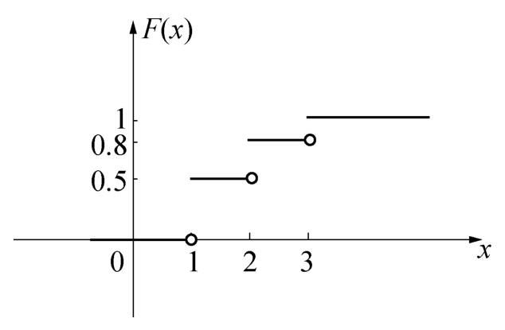
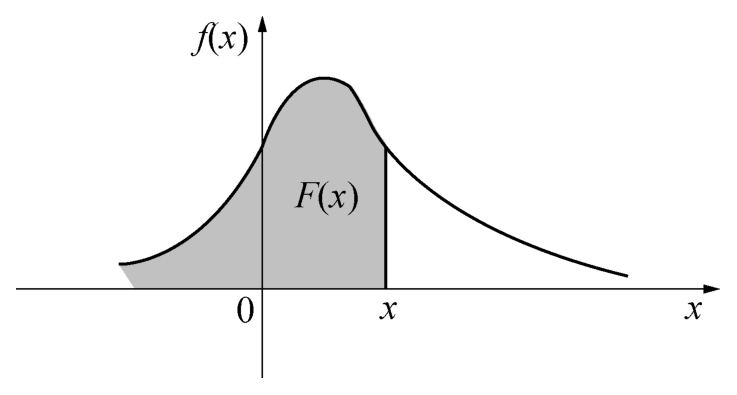
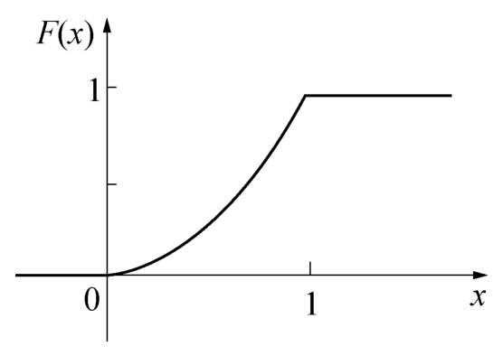
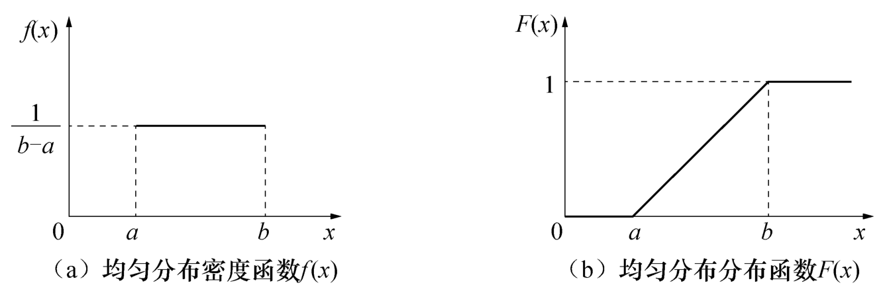
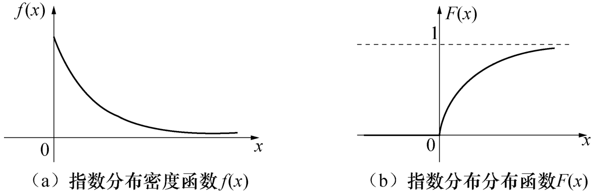
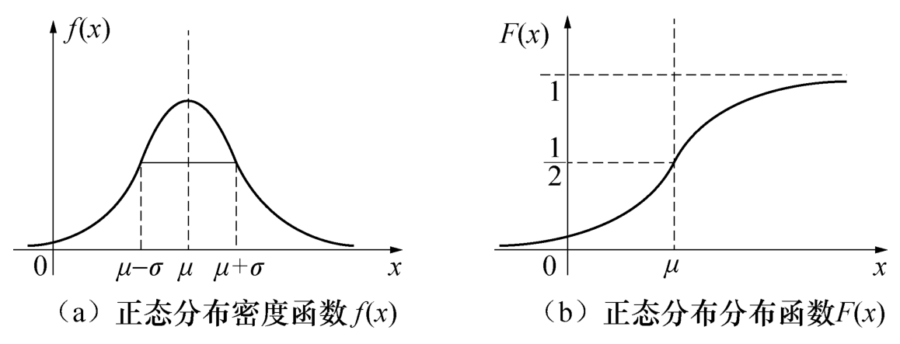
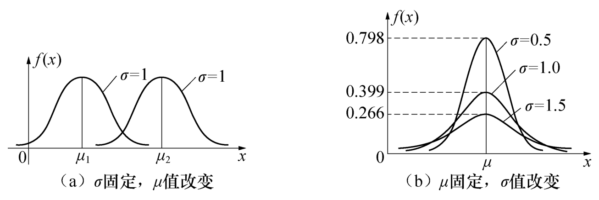
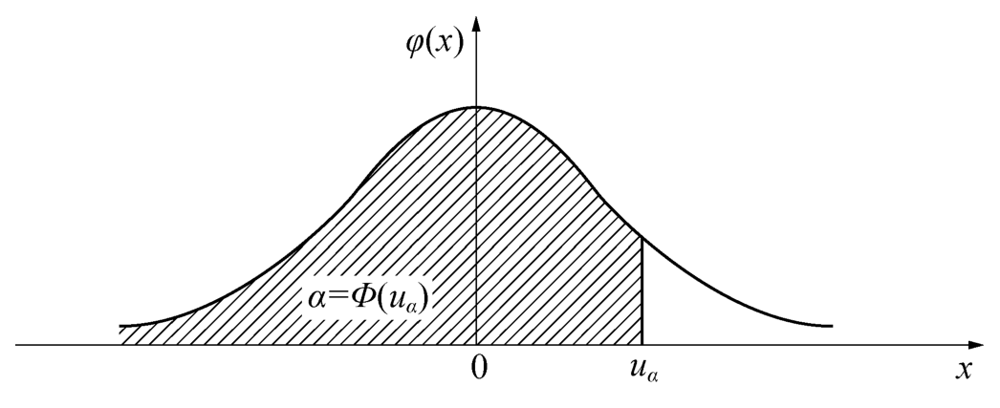
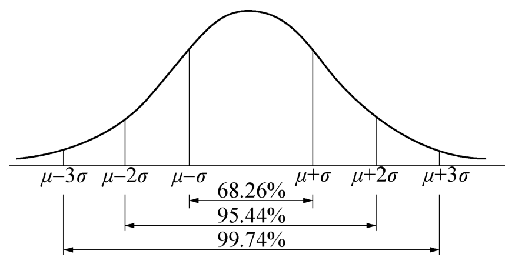

# 第二章 随机变量及其分布

[课前导读]

在第一章中，我们发现基于随机试验的样本空间去研究随机事件及其概率的过程中，有时样本空间不一定是数集，不便于用数学方法来处理。为了能进行定量的数学处理，必须要把随机试验的结果数量化。因此，通过引入随机变量，将样本空间转化为一个无量纲的数集，使得能统一地处理随机现象，而且过程会更简单直接。本章中我们将主要讨论一维随机变量及其分布。

## 第一节 随机变量及其分布

### 一、随机变量的定义

在随机试验中有很多试验结果本身就是用数量表示，例如，

（1）抛掷一枚均匀的骰子，出现的点数 $X$ 的取值；

（2）每年每辆参保的车辆会发生理赔的次数 $N$，每次理赔的金额 $Y$，这里 $N$ 和 $Y$ 的取值；

（3）测量的随机误差 $\varepsilon$ 的取值。

在随机试验中还有很多试验结果本身不是用数量表示，这时可以根据需要设置变量，例如，

（1）抛掷一枚均匀的硬币，观察其朝上的面，则样本空间 $\Omega=\{\text{正面朝上}，\text{反面朝上}\}$。这时，可按如下方式设置一个变量 $X$：

| 样本点 |  | $X$ 的取值 |
| :---: | :---: | :---: |
| 正面朝上 | $\rightarrow$ | 1 |
| 反面朝上 | $\rightarrow$ | 0 |

在这里，$X$ 的取值对应如下随机事件：

$$
\{X=1\}=\{\text{正面朝上}\}，\qquad \{X=0\}=\{\text{反面朝上}\}。
$$

（2）抛掷三枚均匀的硬币，观察其朝上的面，则样本空间 $\Omega=\{HHH，HHT，HTH，THH，HTT，THT，TTH，TTT\}$，其中 $H$ 表示正面朝上，$T$ 表示反面朝上。这时，若一个变量 $X$ 表示“三次抛掷中反面朝上的次数”，则 $X$ 的取值与样本点之间有如下对应关系：

| 样本点 |  | $X$ 的取值 |
| :---: | :---: | :---: |
| $HHH$ | $\rightarrow$ | 0 |
| $HHT$ | $\rightarrow$ | 1 |
| $HTH$ | $\rightarrow$ | 1 |
| $THH$ | $\rightarrow$ | 1 |
| $HTT$ | $\rightarrow$ | 2 |
| $THT$ | $\rightarrow$ | 2 |
| $TTH$ | $\rightarrow$ | 2 |
| $TTT$ | $\rightarrow$ | 3 |

在这里，$X$ 的取值对应如下随机事件：

$$
\{X=0\}=\{\text{反面朝上 }0\text{ 次}\}=\{HHH\}，\qquad
\{X=1\}=\{\text{反面朝上 }1\text{ 次}\}=\{HHT，HTH，THH\}，
$$

$$
\{X=2\}=\{\text{反面朝上 }2\text{ 次}\}=\{HTT，THT，TTH\}，\qquad
\{X=3\}=\{\text{反面朝上 }3\text{ 次}\}=\{TTT\}。
$$

下面，我们给出随机变量的一般定义。

**定义 1** 在随机试验 $E$ 中，$\Omega$ 是相应的样本空间，如果对 $\Omega$ 中的每一个样本点 $\omega$，有唯一一个实数 $X(\omega)$ 与它对应，那么就把这个定义域为 $\Omega$ 的单值实值函数 $X=X(\omega)$ 称为（一维）随机变量。

随机变量一般用大写字母 $X$，$Y$ 等来表示，随机变量的取值一般用小写字母 $x$，$y$ 等来表示。如果一个随机变量仅可能取有限或可列个值，则称其为离散型随机变量。如果一个随机变量的取值充满了数轴上的一个区间（或某几个区间的并），则称其为非离散型随机变量。连续型随机变量就是非离散型随机变量中最常见的一类随机变量。

随机变量的定义可直观解释为：随机变量 $X$ 是样本点的函数，这个函数的自变量是样本点，可以是数，也可以不是数，定义域是样本空间，而因变量必须是实数。这个函数可以让不同的样本点对应不同的实数，也可以让多个样本点对应于一个实数。

随机变量的引入是概率论发展走向成熟的一个标志，它弥补了随机试验下的随机事件种类繁多、不易一一总结它们发生的可能性大小的规律的缺陷，因为如果知道随机变量的分布，随机试验下任一随机事件的概率也随之可以得到；另外引入随机变量后，可以使用数学中的微积分工具讨论随机变量的分布。

### 二、随机变量的分布函数

随机变量 $X$ 是样本点 $\omega$ 的一个实值函数，为了掌握 $X$ 的统计规律性，我们需要知道 $X$ 取值于某个区间的概率。由于

$$
\begin{aligned}
\{a<X\leqslant b\}&=\{X\leqslant b\}-\{X\leqslant a\}，\\
\{X>c\}&=\Omega-\{X\leqslant c\}。
\end{aligned}
$$

因此，对于任意实数 $x$，只需知道 $\{X\leqslant x\}$ 的概率就足够了，我们用 $F(x)$ 表示这个概率值，显然这个概率值与 $x$ 有关，不同的 $x$，此概率值也不一样，下面给出分布函数的定义。

**定义 2** 设 $X$ 是一个随机变量，对于任意实数 $x$，称函数

$$
F(x)=P(X\leqslant x)，\quad -\infty<x<+\infty
$$

为随机变量 $X$ 的分布函数。

对任意的两个实数 $-\infty<a<b<+\infty$，有

$$
P(a<X\leqslant b)=F(b)-F(a)。
$$

因此，只要已知 $X$ 的分布函数，就可以知道 $X$ 落在任一区间 $(a,\ b]$ 内的概率，所以说，分布函数可以完整地描述一个随机变量的统计规律性。

从这个定义可以看出：

（1）分布函数是定义在 $(-\infty,\ +\infty)$ 上，取值在 $[0,\ 1]$ 上的一个函数；

（2）任一随机变量 $X$ 都有且仅有一个分布函数，有了分布函数，就可计算与随机变量 $X$ 相关事件的概率问题。

**例 1** 设一盒子中装有 10 个球，其中 5 个球上标有数字 1，3 个球上标有数字 2，2 个球上标有数字 3。从中任取一球，记随机变量 $X$ 表示为“取得的球上标有的数字”，求 $X$ 的分布函数 $F(x)$。

**解** 根据题意可知，随机变量 $X$ 可取 1，2，3，由古典概型的计算公式，可知对应的概率值分别为 0.5，0.3，0.2。

分布函数的定义为 $F(x)=P(X\leqslant x)$，因此

当 $x<1$ 时，概率 $P(X\leqslant x)=0$；

当 $1\leqslant x<2$ 时，概率 $P(X\leqslant x)=P(X=1)=0.5$；

当 $2\leqslant x<3$ 时，概率 $P(X\leqslant x)=P(X=1)+P(X=2)=0.5+0.3=0.8$；

当 $x\geqslant 3$ 时，随机事件 $\{X\leqslant x\}$ 为必然事件，因此 $P(X\leqslant x)=1$，即

$$
P(X\leqslant x)=P(X=1)+P(X=2)+P(X=3)=0.5+0.3+0.2=1。
$$

整理可得 $X$ 的分布函数为

$$
F(x)=\begin{cases}
0, & x<1,\\
0.5, & 1\leqslant x<2,\\
0.8, & 2\leqslant x<3,\\
1, & x\geqslant 3。
\end{cases}
$$

$F(x)$ 的图形如图 2.1 所示，它是一条阶梯形的曲线，在 $X$ 的三个可能取值 1，2，3 处有右连续的跳跃点，其每次跳跃的高度正好是 $X$ 在该取值点的概率。

从例 1 中的分布函数及其图形中可以看到分布函数具有右连续、单调不减等性质，具体来说，任一分布函数 $F(x)$ 有如下性质：

（1）对于任意实数 $x$，有 $0\leqslant F(x)\leqslant 1$，$\lim\limits_{x\to-\infty}F(x)=0$，$\lim\limits_{x\to+\infty}F(x)=1$；

（2）$F(x)$ 单调不减，即当 $x_1<x_2$ 时，有 $F(x_1)\leqslant F(x_2)$；

（3）$F(x)$ 是 $x$ 的右连续函数，即 $\lim\limits_{x\to x_0^+}F(x)=F(x_0)$；

（4）$P(X<x)=F(x^-)$。

证明略。

### 三、离散型随机变量及其分布律

设 $E$ 是随机试验，$\Omega$ 是相应的样本空间，$X$ 是 $\Omega$ 上的随机变量，若 $X$ 的值域（记为 $\Omega_X$）为有限集或可列集，此时称 $X$ 为（一维）离散型随机变量。

**定义 3** 若一维离散型随机变量 $X$ 的取值为 $x_1,\ x_2,\ \cdots,\ x_n,\ \cdots$，称相应的概率

$$
P(X=x_i)=p_i,\quad i=1,\ 2,\ \cdots
$$

为离散型随机变量 $X$ 的分布律（或分布列、概率函数）。

一维离散型随机变量的分布律也可用下表来表示。

| $X$ | $x_1$ | $x_2$ | $\cdots$ | $x_n$ | $\cdots$ |
| :---: | :---: | :---: | :---: | :---: | :---: |
| 概率 | $p_1$ | $p_2$ | $\cdots$ | $p_n$ | $\cdots$ |

且满足（1）非负性 $p_i\geqslant 0$，$i=1,\ 2,\ \cdots$；（2）规范性 $\sum\limits_{i=1}^{\infty}p_i=1$。这两条性质也是判别某一数列是否能成为分布律的充要条件。

**例 2** 设随机变量 $X$ 的分布律如下。

| $X$ | $-1$ | $0$ | $2$ |
| :---: | :---: | :---: | :---: |
| 概率 | $0.2$ | $0.4$ | $0.4$ |

求（1）$P(X\leqslant -0.7)$；（2）$X$ 的分布函数 $F(x)$。

**解** （1）$P(X\leqslant -0.7)=P(X=-1)=0.2$。

（2）$X$ 的分布函数 $F(x)$ 求解过程同例 1，可得

$$
F(x)=\begin{cases}
0, & x<-1,\\
0.2, & -1\leqslant x<0,\\
0.6, & 0\leqslant x<2,\\
1, & x\geqslant 2。
\end{cases}
$$

从这个例子中可知，已知一个离散型随机变量的分布律，就可以求得其分布函数；反之，若已知一个离散型随机变量的分布函数，也可以通过如下过程求得其分布律：

$$
\begin{aligned}
P(X=-1)&=P(X\leqslant -1)=F(-1)=0.2，\\
P(X=0)&=P(-1<X\leqslant 0)=F(0)-F(-1)=0.6-0.2=0.4，\\
P(X=2)&=P(0<X\leqslant 2)=F(2)-F(0)=1-0.6=0.4。
\end{aligned}
$$

因此可得 $X$ 的分布律如下。

| $X$ | $-1$ | $0$ | $2$ |
| :---: | :---: | :---: | :---: |
| 概率 | $0.2$ | $0.4$ | $0.4$ |

从上面的分析中可以发现，分布函数和分布律对离散型随机变量的取值规律描述是等价的，比较而言，分布律更直观、方便。

### 四、连续型随机变量及其密度函数

连续型随机变量的取值充满了数轴上的一个区间（或某几个区间的并），在这个区间里有无数不可列个实数，因此当我们描述连续型随机变量时，用来描述离散型随机变量的分布律就没法再使用了，而要改用概率密度函数来表示。

**定义 4** 设 $E$ 是随机试验，$\Omega$ 是相应的样本空间，$X$ 是 $\Omega$ 上的随机变量，$F(x)$ 是 $X$ 的分布函数，若存在非负函数 $f(x)$ 使得

$$
F(x)=\int_{-\infty}^{x}f(t)\,\mathrm{d}t，
$$

则称 $X$ 为（一维）连续型随机变量，$f(x)$ 称为 $X$ 的（概率）密度函数，满足：（1）非负性 $f(x)\geqslant 0$，$-\infty<x<+\infty$；（2）规范性 $\int_{-\infty}^{+\infty}f(x)\,\mathrm{d}x=1$。

概率密度函数 $f(x)$ 与分布函数 $F(x)$ 之间的关系如图 2.2 所示，$F(x)=P(X\leqslant x)$ 恰好是 $f(x)$ 在区间 $(-\infty,\ x]$ 上的积分，也即是图中阴影部分的面积。

连续型随机变量具有下列性质：

（1）分布函数 $F(x)$ 是连续函数，在 $f(x)$ 的连续点处，$F'(x)=f(x)$；

（2）对任意一个常数 $c$，$-\infty<c<+\infty$，$P(X=c)=0$，所以，在事件 $\{a\leqslant X\leqslant b\}$ 中剔除 $X=a$ 或剔除 $X=b$，都不影响概率的大小，即

$$
P(a\leqslant X\leqslant b)=P(a<X\leqslant b)=P(a<X<b)。
$$

需注意的是，这个性质对离散型随机变量是不成立的，恰恰相反，离散型随机变量计算的就是“点点概率”。

此外，这一性质还能帮助我们判断一个非离散型随机变量是否是连续型随机变量。如果一个非离散型随机变量不存在离散的点，它的概率不为 0，则该随机变量为连续型随机变量。

（3）对任意的两个常数 $a$，$b$，$P(a<X\leqslant b)=\int_{a}^{b}f(x)\,\mathrm{d}x$。

**例 3** 设连续型随机变量 $X$ 的密度函数为

$$
f(x)=\begin{cases}
3x^2, & 0<x<1,\\
0, & \text{其他}。
\end{cases}
$$

求（1）$P(|X|<0.5)$；（2）$X$ 的分布函数 $F(x)$。

**解** （1）$P(|X|<0.5)=P(-0.5<X<0.5)=\int_{0}^{0.5}3x^2\,\mathrm{d}x=0.125$。

（2）

$$
F(x)=\begin{cases}
0, & x<0,\\
\int_{0}^{x}3t^2\,\mathrm{d}t=x^3, & 0\leqslant x<1,\\
\int_{0}^{1}3x^2\,\mathrm{d}x=1, & x\geqslant 1。
\end{cases}
$$

显然，不难求出 $F(x)$ 的导数即为 $x$ 的密度函数。$F(x)$ 的图形如图 2.3 所示，它是一条连续的曲线，同时它也满足 $F(x)$ 的所有性质。

### 习题 2-1

**1.** 试确定常数 $c$，使得下列函数成为某个随机变量 $X$ 的分布律：

（1）$P(X=k)=ck$，$k=1,\ \cdots,\ n$；

（2）$P(X=k)=\dfrac{c\lambda^k}{k!}$，$k=1,\ 2,\ \cdots$，其中 $\lambda>0$。

**2.** 试确定常数 $c$，使 $P(X=i)=\dfrac{c}{2^i}(i=0,\ 1,\ 2,\ 3)$ 成为某个随机变量 $X$ 的分布律，并求：

（1）$P(X\geqslant 2)$；（2）$P\left(\dfrac{1}{2}<X<\dfrac{5}{2}\right)$；（3）$X$ 的分布函数 $F(x)$。

**3.** 一口袋中有 5 个球，在这 5 个球上分别标有数字 1，2，3，4 和 5。从这袋中不放回任取 3 个球，设各个球被取到的可能性相同，求取得的球上标明的最小数字 $X$ 的分布律与分布函数。

**4.** 已知随机变量 $X$ 的分布律如下。试求一元二次方程 $3t^2+2Xt+(X+1)=0$ 有实数根的概率。

| $X$ | $-2$ | $-1$ | $0$ | $1$ | $2$ | $4$ |
| :---: | :---: | :---: | :---: | :---: | :---: | :---: |
| 概率 | $0.2$ | $0.1$ | $0.3$ | $0.1$ | $0.2$ | $0.1$ |

**5.** 设随机变量 $X$ 的分布函数为

$$
F(x)=\begin{cases}
0, & x<0,\\
1-(1+x)\mathrm{e}^{-x}, & x\geqslant 0。
\end{cases}
$$

求 $X$ 的密度函数，并计算 $P(X\leqslant 1)$ 和 $P(X>2)$。

**6.** 已知连续型随机变量 $X$ 的分布函数为

$$
F(x)=\begin{cases}
0, & x<-1,\\
a+b\arcsin x, & -1\leqslant x<1,\\
1, & x\geqslant 1。
\end{cases}
$$

（1）$a$，$b$ 取何值时 $F(x)$ 为连续函数？

（2）求 $P\left(|X|<\dfrac{1}{2}\right)$；

（3）求 $X$ 的密度函数。

**7.** 设随机变量 $X$ 的密度函数为

$$
f(x)=\begin{cases}
cx^3, & 0<x<1,\\
0, & \text{其他}。
\end{cases}
$$

求（1）常数 $c$ 的值；（2）$P\left(-1<X<\dfrac{1}{2}\right)$；（3）$X$ 的分布函数 $F(x)$。

**8.** 设随机变量 $X$ 的密度函数为

$$
f(x)=\begin{cases}
2x, & 0<x<a,\ a>0,\\
0, & \text{其他}。
\end{cases}
$$

求（1）常数 $a$ 的值；（2）$P(-1<X\leqslant 2)$。

**9.** 已知随机变量 $X$ 的密度函数为

$$
f(x)=\frac{1}{2}\mathrm{e}^{-|x|}，\quad -\infty<x<+\infty。
$$

求（1）$P(0<X<1)$；（2）$X$ 的分布函数。

**10.** 设某种晶体管的寿命（单位：小时）是一个随机变量 $X$，它的密度函数为

$$
f(x)=\begin{cases}
100x^{-2}, & x>100,\\
0, & \text{其他}。
\end{cases}
$$

（1）试求该种晶体管不能工作 150 小时的概率；

（2）一台仪器中装有 4 只此种晶体管，试求该仪器工作 150 小时后至少有一只失效的概率（假定这四只晶体管是否失效是互不影响的）。

## 第二节 常用的离散型随机变量

### 一、二项分布

设对一随机试验 $E$，只关心某一事件 $A$ 发生还是不发生，即该随机试验只有两种可能的试验结果：$A$ 和 $\overline{A}$，则称这样的随机试验叫伯努利（Bernoulli）试验。设事件 $A$ 在一次试验中发生的概率 $P(A)=p(0<p<1)$，则 $P(\overline{A})=1-p$。将该随机试验独立重复地进行 $n$ 次，独立是指各次试验的结果互不影响，重复是指在每次试验中 $P(A)=p$ 保持不变，则称这 $n$ 次独立重复试验叫 $n$ 重伯努利试验。

记随机变量 $X$ 表示在 $n$ 重伯努利试验中 $A$ 事件发生的次数，可知 $X$ 的所有可能取值为 0，1，2，$\cdots$，$n$，由于各试验是相互独立的，在 $n$ 次中特定的 $k$ 次 $A$ 事件发生，在其他的 $n-k$ 次 $A$ 事件不发生的概率为

$$
p^k(1-p)^{n-k}。
$$

同时在序号 1 到 $n$ 中挑选 $k$ 个的不同方法共有 $\dbinom{n}{k}$ 种。因此，在 $n$ 重伯努利试验中 $A$ 事件发生 $k$ 次，即 $\{X=k\}$ 的概率为

$$
P(X=k)=\binom{n}{k}p^k(1-p)^{n-k}，\quad 0<p<1,\quad k=0,\ 1,\ \cdots,\ n。
$$

称随机变量 $X$ 服从参数为 $n$，$p$ 的二项分布，记为 $X\sim B(n,\ p)$。

显然

$$
P(X=k)\geqslant 0，\quad k=0,\ 1,\ \cdots,\ n。
$$

$$
\sum_{k=0}^{n}P(X=k)=\sum_{k=0}^{n}\binom{n}{k}p^k(1-p)^{n-k}=(p+1-p)^n=1。
$$

满足离散型随机变量分布律的非负性和规范性。此外，$\dbinom{n}{k}p^k(1-p)^{n-k}$ 正好是二项式 $(p+1-p)^n$ 的展开式中出现 $p^k$ 的那一项，故二项分布由此得名。

特别地，当 $n=1$ 时，$X\sim B(1,\ p)$，即有

$$
P(X=k)=\binom{1}{k}p^k(1-p)^{1-k}=p^k(1-p)^{1-k}，\quad 0<p<1,\quad k=0,\ 1。
$$

即相应的分布律为

| $X$ | $0$ | $1$ |
| :---: | :---: | :---: |
| 概率 | $1-p$ | $p$ |

表示随机变量 $X$ 只取两个值，分别为 0 和 1，故又可称随机变量 $X$ 服从参数为 $p(0<p<1)$ 的 0-1 分布（或两点分布）。

二项分布是一种常用的离散型分布，例如：

（1）相互独立抛掷一枚均匀的骰子 10 次，出现 1 点的次数 $X\sim B\left(10,\ \dfrac{1}{6}\right)$；

（2）两位段位水平相当的棋手甲和乙对弈，在 7 局对弈中，甲棋手获胜的局数 $X\sim B(7,\ 0.5)$；

（3）一座大厦有相互独立运作的同型号电梯 4 部，某一时刻能运行的电梯数 $X\sim B(4,\ p)$，其中 $p$ 为每部电梯能正常运行的概率。

**例 1** 某人向同一目标重复独立射击 5 次，每次命中目标的概率为 0.8，求（1）此人能命中 3 次的概率；（2）此人至少命中 2 次的概率。

**解** 设 $X$ 表示在 5 次重复独立射击中命中的次数，则 $X\sim B(5,\ 0.8)$。

（1）$P(X=3)=\dbinom{5}{3}\cdot 0.8^3\cdot 0.2^2=0.2048$；

（2）$P(X\geqslant 2)=1-P(X<2)=1-P(X=0)-P(X=1)=1-0.2^5-\dbinom{5}{1}\cdot 0.8\cdot 0.2^4=0.99328$。

**例 2** 某课程有两种不同的考核方式。第一种，学生在一学期内要参加 4 次相互独立的小测验，每次测验的及格率为 0.8，4 次中至少要有 3 次及格，考核才能通过。第二种，学生只需在学期末参加 1 次期末考试，考核通过率也为 0.8，试问哪种考核方式更受到学生的青睐。

**解** 记随机变量 $X$ 表示第一种考核方式中 4 次小测验及格的次数，则 $X\sim B(4,\ 0.8)$。

$$
P(X\geqslant 3)=P(X=3)+P(X=4)=\binom{4}{3}\cdot 0.8^3\cdot 0.2+0.8^4=0.8192。
$$

显然，由于第一种考核方式的通过率超过了第二种方式，故第一种考核方式更受到学生的青睐。

在这个例子中，4 次小测验，虽然每次小测验内容都不同，但由于每次的及格率都为 0.8，故可以看成是“重复”试验。

**例 3** 设随机变量 $X\sim B(2,\ p)$，$Y\sim B(4,\ p)$，若 $P(X\geqslant 1)=\dfrac{5}{9}$，求 $P(Y\geqslant 1)$。

**解** 因 $X\sim B(2,\ p)$，$P(X\geqslant 1)=\dfrac{5}{9}\Rightarrow P(X=0)=(1-p)^2=\dfrac{4}{9}\Rightarrow p=\dfrac{1}{3}$，

故

$$
P(Y\geqslant 1)=1-P(Y=0)=1-\left(\frac{2}{3}\right)^4=\frac{65}{81}。
$$

### 二、泊松分布

泊松分布是 1837 年由法国数学家泊松（Poisson，1781 年—1840 年）首次提出的。设随机变量 $X$ 的取值为 0，1，2，$\cdots$，$n$，$\cdots$，相应的分布律为

$$
P(X=k)=\frac{\lambda^k}{k!}\mathrm{e}^{-\lambda}，\quad \lambda>0,\ k=0,\ 1,\ 2,\ \cdots,\ n,\ \cdots。
$$

称随机变量 $X$ 服从参数为 $\lambda$ 的**泊松分布**，记为 $X\sim P(\lambda)$。

泊松分布也是一种常用的离散型分布，它常常与计数过程相联系，例如：

（1）某一时间段内某网站的点击量；

（2）早高峰时间段内驶入高架道路的车辆数；

（3）一本书上的印刷错误数。

**例 4** 设随机变量 $X$ 有分布律 $P(X=k)=\dfrac{c\cdot 3^k}{k!}(k=0,\ 1,\ 2,\ \cdots)$，求 $c$ 的值，并求解 $P(X\leqslant 2)$。

**解** 根据分布律的定义有 $\sum\limits_{k=0}^{\infty}\dfrac{c\cdot 3^k}{k!}=1\Rightarrow c=\mathrm{e}^{-3}$。

事实上，不难看出 $X\sim P(3)$，所以 $c=\mathrm{e}^{-3}$。

$$
\begin{aligned}
P(X\leqslant 2)&=P(X=0)+P(X=1)+P(X=2)\\
&=\frac{\mathrm{e}^{-3}\cdot 3^0}{0!}+\frac{\mathrm{e}^{-3}\cdot 3^1}{1!}+\frac{\mathrm{e}^{-3}\cdot 3^2}{2!}=\frac{17}{2}\mathrm{e}^{-3}。
\end{aligned}
$$

**例 5** 已知一购物网站每周销售的某款手表数量 $X$ 服从参数为 6 的泊松分布。问周初至少预备多少货源才能保证该周不脱销的概率不小于 0.9。假定上周没有库存，且本周不再进货。

**解** 设该款手表每周的需求量为 $X$，则有 $X\sim P(6)$；设至少需要进 $n$ 块该款手表，才能满足不脱销的概率不小于 0.9，即要满足

$$
\begin{cases}
P(X\leqslant n)\geqslant 0.9,\\
P(X\leqslant n-1)<0.9。
\end{cases}
$$

解得

$$
P(X\leqslant 8)=0.847237，\quad P(X\leqslant 9)=0.916076。
$$

所以周初预备 9 块时，才能保证该周不脱销的概率不小于 0.9。

泊松分布还有一个非常有用的性质，即它可以作为二项分布的一种近似，在二项分布计算中，当 $n$ 较大时，计算结果非常不理想，如果 $p$ 较小而 $np=\lambda$ 适中时，我们常用泊松分布的概率值近似取代二项分布的概率值，因为我们有如下的定理。

**定理（泊松定理）** 在 $n$ 重伯努利试验中，记 $A$ 事件在一次试验中发生的概率为 $p_n$，如果当 $n\to+\infty$ 时，有 $np_n\to\lambda(>0)$，则

$$
\lim_{n\to+\infty}\binom{n}{k}p_n^k(1-p_n)^{n-k}=\frac{\lambda^k}{k!}\mathrm{e}^{-\lambda}。
$$

$^{*}$**证明** 记 $np_n=\lambda_n$，则 $p_n=\dfrac{\lambda_n}{n}$，故

$$
\begin{aligned}
\binom{n}{k}p_n^k(1-p_n)^{n-k}&=\frac{n(n-1)\cdots(n-k+1)}{k!}\left(\frac{\lambda_n}{n}\right)^k\left(1-\frac{\lambda_n}{n}\right)^{n-k}\\
&=\frac{\lambda_n^k}{k!}\left(1-\frac{1}{n}\right)\left(1-\frac{2}{n}\right)\cdots\left(1-\frac{k-1}{n}\right)\left(1-\frac{\lambda_n}{n}\right)^{n-k}。
\end{aligned}
$$

对固定的 $k$ 有

$$
\begin{aligned}
&\lim_{n\to+\infty}\lambda_n=\lambda，\\
&\lim_{n\to+\infty}\left(1-\frac{\lambda_n}{n}\right)^{n-k}=\mathrm{e}^{-\lambda}，\\
&\lim_{n\to+\infty}\left(1-\frac{1}{n}\right)\left(1-\frac{2}{n}\right)\cdots\left(1-\frac{k-1}{n}\right)=1。
\end{aligned}
$$

所以，结论成立，即

$$
\lim_{n\to+\infty}\binom{n}{k}p_n^k(1-p_n)^{n-k}=\frac{\lambda^k}{k!}\mathrm{e}^{-\lambda}。
$$

对任意的 $k(k=0,\ 1,\ 2,\ \cdots)$ 都成立。

**例 6** 设某保险公司的某人寿保险险种有 1000 人投保，每个投保人在一年内死亡的概率为 0.005，且每个人在一年内是否死亡是相互独立的，试求在未来一年中这 1000 个投保人中死亡人数不超过 10 人的概率。

**解** 设在未来一年中这 1000 个投保人中死亡人数为 $X$，则有 $X\sim B(1000,\ 0.005)$，要求

$$
P(X\leqslant 10)=\sum_{k=0}^{10}\binom{1000}{k}0.005^k\ 0.995^{1000-k}。
$$

这个概率的计算量很大，由于 $n=1000$ 较大，$p=0.005$ 较小，且 $\lambda=np=5$，所以用泊松分布近似得为 $P(X\leqslant 10)\approx\sum\limits_{k=0}^{10}\mathrm{e}^{-5}\dfrac{5^k}{k!}=0.986305$。

### 三、超几何分布

设有 $N$ 件产品，其中有 $M(M\leqslant N)$ 件是不合格品。若从中不放回地抽取 $n(n\leqslant N)$ 件，设其中含有的不合格品的件数为 $X$，则 $X$ 的分布律为

$$
P(X=k)=\frac{\dbinom{M}{k}\dbinom{N-M}{n-k}}{\dbinom{N}{n}}，\quad k=\max(0,\ n+M-N),\ \cdots,\ \min(n,\ M)。
$$

称 $X$ 服从参数为 $N$、$M$ 和 $n$ 的超几何分布，记为 $X\sim H(N,\ M,\ n)$，其中 $N$、$M$ 和 $n$ 均为正整数。

若将不放回抽样改成有放回抽样，那么，这个模型就是 $n$ 重伯努利试验，即 $n$ 件被抽查的产品中含有的不合格品的件数 $X\sim B(n,\ p)$，其中 $p=\dfrac{M}{N}$，可以证明：当 $M=Np$ 时，有

$$
\lim_{N\to\infty}\frac{\dbinom{M}{k}\dbinom{N-M}{n-k}}{\dbinom{N}{n}}=\binom{n}{k}p^k(1-p)^{n-k}。
$$

即在应用中，当 $n\ll N$ 时，即抽取个数 $n$ 远小于产品总数 $N$ 时，每次抽取后，总体中的不合格品率 $p=\dfrac{M}{N}$ 改变很微小，所以不放回抽样可以近似地看成有放回抽样，这时超几何分布可用二项分布近似。

### 四、几何分布与负二项分布

### 1. 几何分布

在伯努利试验中，记每次试验中 $A$ 事件发生的概率 $P(A)=p(0<p<1)$，设随机变量 $X$ 表示 $A$ 事件首次出现时已经试验的次数，则 $X$ 的取值为 1，2，$\cdots$，$n$，$\cdots$，相应的分布律为

$$
P(X=k)=p(1-p)^{k-1}，\quad 0<p<1,\quad k=1,\ 2,\ \cdots,\ n,\ \cdots。
$$

称随机变量 $X$ 服从参数为 $p$ 的几何分布，记为 $X\sim Ge(p)$。

几何分布也是一种常用的离散型分布，例如：

（1）抛掷一枚均匀的骰子，首次出现 6 点时的投掷次数 $X\sim Ge\left(\dfrac{1}{6}\right)$；

（2）投篮首次命中时投篮的次数 $X\sim Ge(p)$，$p$ 为每次投篮时的命中率；

（3）任课教师每次上课随机抽取 10% 的学生签到，某位学生首次被老师要求签到时已经开课次数 $X\sim Ge(0.1)$。

**例 7** 设 $X\sim Ge(p)$，则对任意正整数 $m$ 和 $n$，证明

$$
P(X>m+n\mid X>m)=P(X>n)。
$$

**证明** 可以解得 $P(X>n)=\sum\limits_{i=n+1}^{\infty}(1-p)^{i-1}p=\dfrac{p(1-p)^n}{1-(1-p)}=(1-p)^n$。

故 $P(X>m+n\mid X>m)=\dfrac{P(X>m+n)}{P(X>m)}=\dfrac{(1-p)^{m+n}}{(1-p)^m}=(1-p)^n=P(X>n)$。

这个例题说明，几何分布具有无记忆性的性质，即这个条件概率值只与 $n$ 有关，与 $m$ 无关。

### 2. 负二项分布

负二项分布是几何分布的一个延伸。在伯努利试验中，记每次试验中 $A$ 事件发生的概率 $P(A)=p(0<p<1)$，设随机变量 $X$ 表示 $A$ 事件第 $r$ 次出现时已经试验的次数，则 $X$ 的取值为 $r$，$r+1$，$\cdots$，$r+n$，$\cdots$，相应的分布律为

$$
P(X=k)=\binom{k-1}{r-1}p^r(1-p)^{k-r}，\quad 0<p<1,\quad k=r,\ r+1,\ \cdots,\ r+n,\ \cdots。
$$

称随机变量 $X$ 服从参数为 $r$，$p$ 的负二项分布，记为 $X\sim NB(r,\ p)$。其中当 $r=1$ 时，即为几何分布。

### 习题 2-2

**1.** 从一批含有 10 件正品及 3 件次品的产品中一件一件地抽取。设每次抽取时，各件产品被抽到的可能性相等。在下列 3 种情形下，分别求出直到取得正品为止所需次数 $X$ 的分布律。

（1）每次取出的产品立即放回这批产品中再取下一件产品；

（2）每次取出的产品都不放回这批产品中；

（3）每次取出一件产品后总是放回一件正品。

**2.** 设随机变量 $X\sim B(n,\ p)$，已知 $P(X=1)=P(X=n-1)$。求 $p$ 与 $P(X=2)$ 的值。

**3.** 设在 3 次相互独立试验中，事件 $A$ 出现的概率相等，若已知 $A$ 至少出现 1 次的概率等于 $\dfrac{19}{27}$，求事件 $A$ 在 1 次试验中出现的概率值。

**4.** 从学校乘汽车到火车站的途中有 4 个十字路口，假设在各个十字路口遇到红灯的事件是相互独立的，并且概率都是 0.4，设 $X$ 为途中遇到红灯的次数，求随机变量 $X$ 的分布律和分布函数。

**5.** 一张试卷印有 10 道题目，每个题目都为 4 个选项的选择题，4 个选项中只有 1 项是正确的。假设某位学生在做每道题时都是随机的选择，求该位学生 1 题都不对的概率以及至少答对 6 题以上的概率。

**6.** 某地在任何长为 $t$（周）的时间内发生地震的次数 $N(t)\sim P(\lambda t)$，求

（1）相邻两周内至少发生 3 次地震的概率；

（2）在连续 8 周内无地震的情形下，在未来 8 周中仍无地震的概率。

**7.** 某工厂有 600 台车床，已知每台车床发生故障的概率为 0.005。

（1）如果该厂安排 4 名维修工人，求车床发生故障后都能得到及时维修的概率（假定每台车床只需 1 名维修工人）；

（2）该厂至少应配备多少名维修工人，才能使车床发生故障后都能得到及时维修的概率不小于 0.96？

**8.** 据统计某地区想报名参加一年一度的城市马拉松赛的长跑爱好者共有 10000 名，其中女性 4000 名，但只有 2000 名的名额。现从中随机抽取 2000 名参加比赛，求参赛者中女性数 $X$ 的分布律。

**9.** 某人投篮命中率为 40%。假定各次投篮是否命中相互独立。设 $X$ 表示他首次投中时累计已投篮的次数。求 $X$ 的分布律，并由此计算 $X$ 取偶数的概率。

**10.** 设某射手射击的命中率为 0.6，他击中目标 12 次便停止射击。以 $X$ 表示相应的射击次数，求 $X$ 的分布律。

## 第三节 常用的连续型随机变量

### 一、均匀分布

设 $X$ 为随机变量，对任意的两个实数 $a$，$b(a<b)$，概率密度函数（见图 2.4（a））为

$$
f(x)=\begin{cases}
\dfrac{1}{b-a}, & a<x<b,\\
0, & \text{其他}。
\end{cases}
$$

则称随机变量 $X$ 服从区间 $(a,\ b)$ 上的**均匀分布**，记为 $X\sim U(a,\ b)$。

若 $X\sim U(a,\ b)$，则相应的分布函数（见图 2.4（b））为

$$
F(x)=\begin{cases}
0, & x<a,\\
\dfrac{x-a}{b-a}, & a\leqslant x<b,\\
1, & x\geqslant b。
\end{cases}
$$

由此得到，若 $X\sim U(a,\ b)$，$a<c<c+d<b$，则 $P(c<X\leqslant c+d)=\int_{c}^{c+d}\dfrac{1}{b-a}\mathrm{d}x=\dfrac{d}{b-a}$。这个结论说明，均匀分布的随机变量 $X$，在其取值范围 $(a,\ b)$ 中的任何子区间取值的概率仅与该区间长度 $d$ 有关而与区间的位置 $c$ 无关。

**例 1** 设随机变量 $X\sim U(-1,\ 4)$，求（1）事件 $\{|X|<2\}$ 的概率；（2）$Y$ 表示对 $X$ 作 3 次相互独立重复观测中事件 $\{|X|<2\}$ 出现的次数，求 $P(Y=2)$。

**解** （1）根据题意，$X$ 的概率密度函数为

$$
f(x)=\begin{cases}
\dfrac{1}{5}, & -1<x<4,\\
0, & \text{其他}。
\end{cases}
$$

所以 $P(|X|<2)=P(-1<X<2)=\int_{-1}^{2}\dfrac{1}{5}\mathrm{d}x=\dfrac{3}{5}$。

（2）$Y$ 表示对 $X$ 作 3 次相互独立重复观测中事件 $\{|X|<2\}$ 出现的次数，故 $Y\sim B\left(3,\ \dfrac{3}{5}\right)$，所以 $P(Y=2)=\dbinom{3}{2}\left(\dfrac{3}{5}\right)^2\dfrac{2}{5}=\dfrac{54}{125}$。

### 二、指数分布

设 $X$ 为随机变量，概率密度函数（见图 2.5（a））为

$$
f(x)=\begin{cases}
\lambda\mathrm{e}^{-\lambda x}, & x\geqslant 0,\\
0, & \text{其他},
\end{cases}\quad \lambda>0。
$$

则称随机变量 $X$ 服从参数为 $\lambda$ 的指数分布，记为 $X\sim E(\lambda)$。

若 $X\sim E(\lambda)$，则相应的分布函数（见图 2.5（b））为

$$
F(x)=\begin{cases}
0, & x<0,\\
1-\mathrm{e}^{-\lambda x}, & x\geqslant 0。
\end{cases}
$$

由此得到，若 $X\sim E(\lambda)$，$0<a<b$，则 $P(a<X\leqslant b)=F(b)-F(a)=\mathrm{e}^{-\lambda a}-\mathrm{e}^{-\lambda b}$。

服从指数分布的随机变量只能取非负实数，它常被用作各种“寿命”分布，如电子元件的寿命、随机服务系统中的服务时间等都可以假定服从指数分布。指数分布在可靠性与排队论中有着广泛的应用。同样，指数分布同几何分布相似，也具有无记忆性，见下例。

**例 2** 设随机变量 $X\sim E(\lambda)$，则对任意实数 $s$，$t>0$，证明

$$
P(X>s+t\mid X>s)=P(X>t)。
$$

**证明** 可以解得 $P(X>t)=1-F(t)=\mathrm{e}^{-\lambda t}$。

故 $P(X>s+t\mid X>s)=\dfrac{P(X>s+t)}{P(X>s)}=\dfrac{\mathrm{e}^{-\lambda(s+t)}}{\mathrm{e}^{-\lambda s}}=\mathrm{e}^{-\lambda t}=P(X>t)$。

即该条件概率值只与持续时间长度 $t$ 有关，与起点 $s$ 无关。

### 三、正态分布

设 $X$ 为随机变量，概率密度函数为

$$
f(x)=\frac{1}{\sqrt{2\pi}\sigma}\mathrm{e}^{-\frac{(x-\mu)^2}{2\sigma^2}}，\quad -\infty<x<+\infty，
$$

则称随机变量 $X$ 服从参数为 $\mu(-\infty<\mu<+\infty)$ 和 $\sigma^2(\sigma>0)$ 的正态分布，记为 $X\sim N(\mu,\ \sigma^2)$。

若 $X\sim N(\mu,\ \sigma^2)$，则相应的分布函数为

$$
F(x)=\int_{-\infty}^{x}\frac{1}{\sqrt{2\pi}\sigma}\mathrm{e}^{-\frac{(t-\mu)^2}{2\sigma^2}}\mathrm{d}t。
$$

它是一条光滑上升的 S 形曲线。

正态分布密度函数和分布函数如图 2.6 所示。

正态分布是概率统计中最重要的一种分布，是高斯（Gauss，1777 年—1855 年）在研究误差理论时首先用正态分布来刻画误差的分布，所以正态分布又称为高斯分布。其概率密度函数 $f(x)$ 的图像如图 2.6（a）所示，有如下性质：

（1）正态分布密度函数曲线是一条对称的倒钟形曲线，中间高，两边低，左右关于直线 $x=\mu$ 对称；

（2）当 $x=\mu$ 时，$f(x)$ 取最大值 $\dfrac{1}{\sqrt{2\pi}\sigma}$，而这个值随 $\sigma$ 增大而减小；

（3）固定 $\sigma$，改变 $\mu$ 的值，则曲线沿 $x$ 轴平移，但不改变其形状，所以参数 $\mu$ 又称为位置参数。如图 2.7（a）所示；

（4）固定 $\mu$，改变 $\sigma$ 的值，则曲线的位置不变，但随着 $\sigma$ 的值越小，曲线越陡峭，所以参数 $\sigma$ 又称为尺度参数，如图 2.7（b）所示。

特别地，当 $\mu=0$，$\sigma=1$ 时，相应的正态分布称为标准正态分布，记为 $X\sim N(0,\ 1)$。其概率密度函数和分布函数分别为

$$
f(x)=\frac{1}{\sqrt{2\pi}}\mathrm{e}^{-\frac{x^2}{2}}\triangleq\varphi(x)，\quad -\infty<x<+\infty，
$$

$$
F(x)=\int_{-\infty}^{x}\frac{1}{\sqrt{2\pi}}\mathrm{e}^{-\frac{t^2}{2}}\mathrm{d}t\triangleq\Phi(x)，\quad -\infty<x<+\infty。
$$

当 $x\geqslant 0$ 时，附录 3 给出了标准正态分布的分布函数 $\Phi(x)$ 的值，利用标准正态分布的概率密度函数 $\varphi(x)$ 是偶函数的性质可知，当 $x<0$ 时，有 $\Phi(x)=1-\Phi(-x)$，因此对任意的两个实数 $a$，$b(a<b)$，有

$$
P(a<X\leqslant b)=\Phi(b)-\Phi(a)。
$$

**例 3** 设随机变量 $X\sim N(0,\ 1)$，借助于标准正态分布的分布函数表，求下列事件的概率：

（1）$P(X\leqslant 1.22)=\Phi(1.22)=0.8888$；

（2）$P(X>1.22)=1-P(X\leqslant 1.22)=1-\Phi(1.22)=1-0.8888=0.1112$；

（3）$P(X\leqslant -1.22)=\Phi(-1.22)=1-\Phi(1.22)=1-0.8888=0.1112$；

（4）$P(-1<X\leqslant 1.22)=\Phi(1.22)-\Phi(-1)=\Phi(1.22)-[1-\Phi(1)]=0.8888-[1-0.8413]=0.7301$；

（5）$P(|X|\leqslant 1.22)=P(-1.22<X\leqslant 1.22)=\Phi(1.22)-\Phi(-1.22)=\Phi(1.22)-[1-\Phi(1.22)]=0.8888-[1-0.8888]=0.7776$。

若随机变量 $X\sim N(\mu,\ \sigma^2)$，对任意的两个实数 $a$，$b(a<b)$，有

$$
P(a<X\leqslant b)=\Phi\left(\frac{b-\mu}{\sigma}\right)-\Phi\left(\frac{a-\mu}{\sigma}\right)。
$$

事实上，我们有如下定理。

**定理** 设随机变量 $X\sim N(\mu,\ \sigma^2)$，则 $\dfrac{X-\mu}{\sigma}\sim N(0,\ 1)$。

该定理的证明在第二章第四节中定理 2 给出。

**例 4** 设随机变量 $X\sim N(1,\ 4)$，借助于标准正态分布的分布函数表，求下列事件的概率：

（1）$P(X\leqslant 3)=\Phi\left(\dfrac{3-1}{2}\right)=0.8413$；

（2）$P(X>3)=1-P(X\leqslant 3)=1-\Phi\left(\dfrac{3-1}{2}\right)=1-0.8413=0.1587$；

（3）$P(X\leqslant -3)=\Phi\left(\dfrac{-3-1}{2}\right)=1-\Phi(2)=1-0.9772=0.0228$；

（4）$P(-1<X\leqslant 3)=\Phi\left(\dfrac{3-1}{2}\right)-\Phi\left(\dfrac{-1-1}{2}\right)=\Phi(1)-[1-\Phi(1)]=0.8413-[1-0.8413]=0.6826$；

（5）$P(|X|\leqslant 3)=P(-3<X\leqslant 3)=\Phi\left(\dfrac{3-1}{2}\right)-\Phi\left(\dfrac{-3-1}{2}\right)=\Phi(1)-[1-\Phi(2)]=0.8413-[1-0.9772]=0.8185$。

**例 5** 设随机变量 $X\sim N(0,\ 1)$，$c$ 为何值才能满足 $P(X\leqslant c)=0.95$？

**解** 由题意知，$P(X\leqslant c)=\Phi(c)=0.95$，从附录 4 可以查出 $\Phi(1.645)=0.95$，所以 $c=1.645$。

一般地，当 $X\sim N(0,\ 1)$ 时，满足概率表达式 $P(X\leqslant u_{\alpha})=\alpha$ 的 $u_{\alpha}$ 称为标准正态分布的 $\alpha$ 分位数，如图 2.8 所示，分位数在统计中被大量使用。在附录 4 中给出了常用的一些 $\alpha$ 取值时对应的 $u_{\alpha}$ 的值。

**例 6** 某学校规定划分考生成绩的等级方法如下：考试成绩的实际考分在前 10% 的为 A 等，考分在前 10% 以后但在前 50% 的为 B 等，考分在前 50% 以后但在前 90% 的为 C 等，考分在后 10% 的为 D 等。某次期末考试中，考生的成绩 $X$ 服从正态分布 $N(\mu,\ \sigma^2)$，经计算可知 $\mu=73$，$\sigma^2=144$，求这次期末考试等级划分的具体分数线（结果四舍五入，取整数）。

**解** 由题意可知 $X\sim N(73,\ 144)$，则

$$
P(X\geqslant a)=1-P(X<a)=1-\Phi\left(\frac{a-73}{12}\right)=0.1。
$$

所以 $\dfrac{a-73}{12}=u_{0.9}=1.282$，即 $a=88.384\approx 88$。

又

$$
P(X\geqslant b)=1-\Phi\left(\frac{b-73}{12}\right)=0.5。
$$

所以 $\dfrac{b-73}{12}=u_{0.5}=0$，即 $b=73$。

又

$$
P(X\leqslant c)=\Phi\left(\frac{c-73}{12}\right)=0.1。
$$

所以 $\dfrac{c-73}{12}=u_{0.1}=-u_{0.9}=-1.282$，即 $c=57.616\approx 58$。

综上所述可知，在此次考试中，分数在 88 以上的为等级 A；分数在 73~88 的为等级 B；分数在 58~73 的为等级 C；分数在 58 以下的，为等级 D。

### 习题 2-3

**1.** 设随机变量 $X$ 在区间 $(1,\ 6)$ 上服从均匀分布，求方程 $t^2+Xt+1=0$ 有实根的概率。

**2.** 以随机变量 $X$ 表示某游乐园内一主题商店从早晨开园起直到第一个游客到达的等待时间（单位：分钟），$X$ 的分布函数为

$$
F_X(x)=\begin{cases}
0, & x<0,\\
1-\mathrm{e}^{-0.4x}, & x\geqslant 0。
\end{cases}
$$

求（1）$P(\text{等待时间至多 }3\text{ 分钟})$；（2）$P(\text{等待时间至少 }4\text{ 分钟})$；（3）$P(\text{等待时间 }3\text{ 分钟到 }4\text{ 分钟})$；（4）$P(\text{等待时间恰好 }2.5\text{ 分钟})$；（5）$X$ 的概率密度函数。

**3.** 设某类手机通用充电宝的充电时间 $X\sim E\left(\dfrac{1}{6}\right)$（单位：小时）。

（1）任取一块这类充电宝，求 7 小时之内能完成充电的概率；

（2）某一该类充电宝，已经充电 3 小时，求能在 7 小时内完成充电的概率。

4. 设随机变量 $Y$ 服从参数为 1 的指数分布，$a$ 为常数且大于零，求 $P(Y\leqslant a+1\mid Y>a)$。

5. 设随机变量 $X$ 的密度函数为 $f(x)=A\mathrm{e}^{-x^2+2x}$，$-\infty<x<+\infty$，试利用正态分布的密度函数性质求未知参数 $A$ 的数值。

6. 设随机变量 $X$ 服从 $N(0,1)$，借助于标准正态分布的分布函数表计算：

（1）$P(X<3.17)$；（2）$P(X>2.7)$；（3）$P(X<-0.78)$；（4）$P(|X|>2.5)$。

7. 设随机变量 $X$ 服从 $N(0,1)$，将常数 $c$ 表示成分位数的形式，并借助于标准正态分布的分位数表求出常数 $c$ 的值：

（1）$P(X<c)=0.9$；（2）$P(X>c)=0.9$；（3）$P(|X|\leqslant c)=0.9$。

8. 设随机变量 $X$ 服从 $N(-1,16)$，借助于标准正态分布的分布函数表计算：

（1）$P(X<3)$；（2）$P(X>-3)$；（3）$P(X<-5)$；（4）$P(-5<X<2)$；（5）$P(|X|<2)$；

（6）确定 $a$ 使得 $P(X<a)=0.95$。

9. 设 $X_1$、$X_2$、$X_3$ 是三个随机变量，且 $X_1\sim N(0,1)$，$X_2\sim N(0,2^2)$，$X_3\sim N(0,3^2)$，$p_j=P(-2\leqslant X_j\leqslant 2)$，$j=1,2,3$，证明：$p_1>p_2>p_3$。

10. 设某人上班所需时间 $X$ 服从正态分布 $N(50,100)$（单位：分钟）且 8 点上班。（1）求他能在一小时内到达工作单位的概率；（2）已知该人早上 7 点从家出发，现在是 7 点 30 分，求他 8 点能到达工作单位的概率；（3）一周 5 个工作日，他每天早上 7 点从家出发，求一周内都不迟到的概率。

## 第四节 随机变量函数的分布

设 $X$ 是一随机变量，$g(x)$ 是一个已知函数，那么 $Y=g(X)$ 是随机变量 $X$ 的函数，它也是一个随机变量，下面分别在 $X$ 为离散型、连续型两种情形下给出新的随机变量 $Y$ 的分布。

### 一、离散型随机变量函数的分布

设离散型随机变量 $X$ 的分布律为

| $X$ | $x_1$ | $x_2$ | $\cdots$ | $x_i$ | $\cdots$ |
| --- | --- | --- | --- | --- | --- |
| 概率 | $p_1$ | $p_2$ | $\cdots$ | $p_i$ | $\cdots$ |

则 $Y=g(X)$ 的分布律为

| $Y=g(X)$ | $g(x_1)$ | $\cdots$ | $g(x_i)$ | $\cdots$ |
| --- | --- | --- | --- | --- |
| 概率 | $p_1$ | $\cdots$ | $p_i$ | $\cdots$ |

但要注意的是，与 $g(x_i)$ 取相同值对应的那些概率应合并相加。

**例 1** 设离散型随机变量 $X$ 的分布律为

| $X$ | $-2$ | $-1$ | $0$ | $2$ |
| --- | --- | --- | --- | --- |
| 概率 | 0.1 | 0.2 | 0.3 | 0.4 |求以下随机变量的分布律：（1）$Y=X+2$；（2）$W=X^2$。

**解**

| $X$ | $-2$ | $-1$ | $0$ | $2$ |
| --- | --- | --- | --- | --- |
| $Y=X+2$ | 0 | 1 | 2 | 4 |
| $W=X^2$ | 4 | 1 | 0 | 4 |
| 概率 | 0.1 | 0.2 | 0.3 | 0.4 |

所以，整理可得 $Y$ 的分布律为

| $Y=X+2$ | 0 | 1 | 2 | 4 |
| --- | --- | --- | --- | --- |
| 概率 | 0.1 | 0.2 | 0.3 | 0.4 |

求 $W$ 的分布律时，对相等的 $W$ 取值 4，概率要合并，得

| $W=X^2$ | 0 | 1 | 4 |
| --- | --- | --- | --- |
| 概率 | 0.3 | 0.2 | 0.5 |

### 二、连续型随机变量函数的分布

设连续型随机变量 $X$ 的密度函数为 $f(x)$，如何求解 $Y=g(X)$ 的分布？首先来看一个例子。

**例 2** 设连续型随机变量 $X$ 服从区间 $(1,3)$ 上的均匀分布，求随机变量 $Y=X^2$ 的分布。

**解** 随机变量 $X$ 的取值范围为 $(1,3)$，故随机变量 $Y=X^2$ 的取值范围为区间 $(1,9)$，$Y$ 仍然是一个连续型随机变量。因此首先求 $Y$ 的分布函数 $F_Y(y)$，再求导得 $Y$ 的密度函数 $f_Y(y)=F'_Y(y)$。

根据题意，$X$ 的密度函数为

$$
f(x)=\begin{cases}\frac{1}{2}, & 1<x<3,\\ 0, & \text{其他}.\end{cases}
$$

$Y$ 的分布函数为

$$
F_Y(y)=P(Y\leqslant y)=P(X^2\leqslant y).
$$

当 $y<1$ 时，$P(X^2\leqslant y)=0$；

当 $1\leqslant y<9$ 时，$P(X^2\leqslant y)=P(-\sqrt{y}\leqslant X\leqslant\sqrt{y})=\int_{1}^{\sqrt{y}}\frac{1}{2}\,\mathrm{d}x=\frac{\sqrt{y}-1}{2}$；

当 $y\geqslant 9$ 时，$P(X^2\leqslant y)=P(-\sqrt{y}\leqslant X\leqslant\sqrt{y})=\int_{1}^{3}\frac{1}{2}\,\mathrm{d}x=1$。

综上所述，整理得

$$
F_Y(y)=\begin{cases}0, & y<1,\\ \frac{\sqrt{y}-1}{2}, & 1\leqslant y<9,\\ 1, & y\geqslant 9.\end{cases}
$$

对 $F_Y(y)$ 求导，可得 $Y$ 的密度函数为

$$
f_Y(y)=F'_Y(y)=\begin{cases}\frac{1}{4\sqrt{y}}, & 1<y<9,\\ 0, & \text{其他}.\end{cases}
$$

设连续型随机变量 $X$ 的密度函数为 $f(x)$，当 $Y=g(X)$ 是连续型随机变量时，下面给出 $Y=g(X)$ 的分布函数与密度函数求解的一般步骤：

（1）由随机变量 $X$ 的取值范围 $\Omega_X$ 确定随机变量 $Y$ 的取值范围 $\Omega_Y$；

（2）对任意一个 $y\in\Omega_Y$，求出

$$
F(y)=P(Y\leqslant y)=P(g(X)\leqslant y)=P(X\in G_y)=\int_{G_y} f(x)\,\mathrm{d}x,
$$

其中 $\{X\in G_y\}$ 是与 $\{g(X)\leqslant y\}$ 相同的随机事件，而 $G_y=\{x:g(x)\leqslant y\}$ 是实数轴上的某个集合（通常是一个区间或若干个区间的并集）；

（3）按分布函数的定义写出 $F_Y(y)$，$-\infty<y<+\infty$；

（4）通过对分布函数求导，得到密度函数 $f_Y(y)=F'_Y(y)$，$-\infty<y<+\infty$。

**例 3** 设随机变量 $X$ 的密度函数为 $f(x)=\frac{1}{2}\mathrm{e}^{-|x|}$，$x\in\mathbf{R}$，求随机变量 $Y=|X|$ 的密度函数。

**解** 易得随机变量 $Y=|X|$ 的取值范围为区间 $[0,+\infty)$，$Y$ 仍然是一个连续型随机变量。

$Y$ 的分布函数为

$$
F_Y(y)=P(Y\leqslant y)=P(|X|\leqslant y).
$$

当 $y<0$ 时，$P(|X|\leqslant y)=0$；

当 $y\geqslant 0$ 时，$P(|X|\leqslant y)=P(-y\leqslant X\leqslant y)=\int_{-y}^{y}\frac{1}{2}\mathrm{e}^{-|x|}\,\mathrm{d}x=2\int_{0}^{y}\frac{1}{2}\mathrm{e}^{-x}\,\mathrm{d}x=1-\mathrm{e}^{-y}$。

整理得

$$
F_Y(y)=\begin{cases}0, & y<0,\\ 1-\mathrm{e}^{-y}, & y\geqslant 0.\end{cases}
$$

对 $F_Y(y)$ 求导，可得 $Y$ 的密度函数为

$$
f_Y(y)=F'_Y(y)=\begin{cases}0, & y<0,\\ \mathrm{e}^{-y}, & y\geqslant 0.\end{cases}
$$

即 $Y\sim E(1)$。

**例 4** 设 $X\sim N(0,1)$，求随机变量 $Y=|X|$ 的密度函数。

**解** 易得随机变量 $Y=|X|$ 的取值范围为区间 $[0,+\infty)$，$Y$ 仍然是一个连续型随机变量。

当 $y\geqslant 0$ 时，$Y$ 的分布函数为

$$
F_Y(y)=P(Y\leqslant y)=P(|X|\leqslant y)=P(-y\leqslant X\leqslant y)=\Phi(y)-\Phi(-y).
$$

直接对上式求导有

$$
f_Y(y)=F'_Y(y)=\Phi'(y)-\Phi'(-y)=\frac{2}{\sqrt{2\pi}}\mathrm{e}^{-\frac{y^2}{2}}.
$$

所以，$Y$ 的密度函数为

$$
f_Y(y)=\begin{cases}\frac{2}{\sqrt{2\pi}}\mathrm{e}^{-\frac{y^2}{2}}, & y>0,\\ 0, & \text{其他}.\end{cases}
$$

**定理 1** 设连续型随机变量 $X$ 的密度函数为 $f_X(x)$，$Y=g(X)$ 是连续型随机变量，若 $y=g(x)$ 为严格单调函数，$x=g^{-1}(y)$ 为相应的反函数，且为可导函数，则 $Y=g(X)$ 的密度函数为

$$
f_Y(y)=f_X(g^{-1}(y))\cdot\left|\left[g^{-1}(y)\right]'\right|.
$$

**证明** 若 $y=g(x)$ 为严格单增函数，它的反函数 $x=g^{-1}(y)$ 也是严格单增函数，且 $\left[g^{-1}(y)\right]'>0$。

$$
F_Y(y)=P(Y\leqslant y)=P(g(X)\leqslant y)=P(X\leqslant g^{-1}(y))=F_X(g^{-1}(y)),
$$

$$
f_Y(y)=F'_Y(y)=f_X(g^{-1}(y))\cdot\left[g^{-1}(y)\right]'.
$$

若 $y=g(x)$ 为严格单减函数，此时它的反函数 $x=g^{-1}(y)$ 也是严格单减函数，且 $\left[g^{-1}(y)\right]'<0$。

$$
F_Y(y)=P(Y\leqslant y)=P(g(X)\leqslant y)=P(X\geqslant g^{-1}(y))=1-F_X(g^{-1}(y)),
$$

$$
f_Y(y)=F'_Y(y)=-f_X(g^{-1}(y))\cdot\left[g^{-1}(y)\right]'=f_X(g^{-1}(y))\cdot\left|-\left[g^{-1}(y)\right]'\right|.
$$

综合上述两个方面，$f_Y(y)=f_X(g^{-1}(y))\cdot\left|\left[g^{-1}(y)\right]'\right|$，定理得证。

**例 5** 设 $X\sim N(\mu,\sigma^2)$，求随机变量 $Y=\mathrm{e}^X$ 的密度函数。

**解** 易见随机变量 $Y=\mathrm{e}^X$ 的值域为 $(0,+\infty)$，因 $y=\mathrm{e}^x$ 的反函数为 $x=\ln y$；当 $y>0$ 时 $x=\ln y$ 为严格单增函数，$(\ln y)'=\frac{1}{y}$，所以当 $y>0$ 时

$$
f_Y(y)=f_X(\ln y)\cdot(\ln y)'=\frac{1}{\sqrt{2\pi}\sigma y}\mathrm{e}^{-\frac{(\ln y-\mu)^2}{2\sigma^2}}.
$$

因此 $Y=\mathrm{e}^X$ 的密度函数为

$$
f_Y(y)=\begin{cases}\frac{1}{\sqrt{2\pi}\sigma y}\mathrm{e}^{-\frac{(\ln y-\mu)^2}{2\sigma^2}}, & y>0,\\ 0, & \text{其他}.\end{cases}
$$

本例中，$Y=\mathrm{e}^X$ 又被称为服从对数正态分布，记为 $Y\sim LN(\mu,\sigma^2)$，也是一个常用的分布。

**定理 2** 设 $X\sim N(\mu,\sigma^2)$，则当 $k\neq 0$ 时，$Y=kX+b\sim N(k\mu+b,k^2\sigma^2)$，特别地，$\frac{X-\mu}{\sigma}\sim N(0,1)$。

**证明** 当 $k>0$ 时，$y=kx+b$ 是严格单增函数，其反函数为 $x=\frac{y-b}{k}$，由定理 1 可得

$$
f_Y(y)=f_X\left(\frac{y-b}{k}\right)\cdot\left(\frac{y-b}{k}\right)'=\frac{1}{\sqrt{2\pi}\sigma}\mathrm{e}^{-\frac{\left(\frac{y-b}{k}-\mu\right)^2}{2\sigma^2}}\cdot\frac{1}{k}=\frac{1}{\sqrt{2\pi}k\sigma}\mathrm{e}^{-\frac{(y-(k\mu+b))^2}{2k^2\sigma^2}}.
$$

当 $k<0$ 时，

$$
f_Y(y)=-f_X\left(\frac{y-b}{k}\right)\cdot\left(\frac{y-b}{k}\right)'=-\frac{1}{\sqrt{2\pi}\sigma}\mathrm{e}^{-\frac{\left(\frac{y-b}{k}-\mu\right)^2}{2\sigma^2}}\cdot\frac{1}{k}=\frac{1}{\sqrt{2\pi}(-k)\sigma}\mathrm{e}^{-\frac{(y-(k\mu+b))^2}{2k^2\sigma^2}}.
$$

综合上述两个方面，$f_Y(y)=\frac{1}{\sqrt{2\pi}|k|\sigma}\mathrm{e}^{-\frac{(y-(k\mu+b))^2}{2k^2\sigma^2}}$，这正好是 $N(k\mu+b,k^2\sigma^2)$ 的密度函数。定理得证。

这个定理说明服从正态分布的随机变量线性函数仍然服从正态分布。

### 习题 2-4

1. 设随机变量 $X$ 服从集合 $\{-2,-1,0,1,2\}$ 上的均匀分布。试求：

（1）$Y=X-1$；（2）$Z=X^2$；（3）$W=|X|$ 的分布律。

2. 设随机变量 $X$ 服从参数 $\lambda=1$ 的泊松分布，记随机变量

$$
Y=\begin{cases}0, & X\leqslant 1,\\ 1, & X>1.\end{cases}
$$

求随机变量 $Y$ 的分布律。

3. 设 $X\sim U(0,\pi)$，试求 $Y=\sin X$ 的分布函数与密度函数。

4. 设随机变量 $X$ 的密度函数为

$$
f(x)=\begin{cases}1-|x|, & |x|<1,\\ 0, & \text{其他}.\end{cases}
$$

求随机变量 $Y=X^2+1$ 在区间 $[1,2]$ 上的密度函数 $f_Y(y)$。

5. 设随机变量 $X$ 服从参数为 1 的指数分布，求随机变量的函数 $Y=\mathrm{e}^X$ 的密度函数 $f_Y(y)$。

6. 设随机变量 $X$ 的密度函数为 $f(x)=\frac{1}{\pi(1+x^2)}(-\infty<x<+\infty)$，求随机变量 $Y=1-\sqrt[3]{X}$ 的密度函数 $f_Y(y)$。

7. 设随机变量 $X$ 的密度函数为

$$
f(x)=\begin{cases}\frac{1}{2}, & -1<x<0,\\ \frac{1}{4}, & 0\leqslant x<2,\\ 0, & \text{其他}.\end{cases}
$$

令 $Y=X^2$，求随机变量 $Y$ 的密度函数 $f_Y(y)$。

8. 设随机变量 $X$ 的密度函数为

$$
f(x)=\begin{cases}\frac{1}{9}x^2, & 0<x<3,\\ 0, & \text{其他}.\end{cases}
$$

令随机变量

$$
Y=\begin{cases}1, & X<1,\\ X, & 1\leqslant X<2,\\ 3, & X\geqslant 2.\end{cases}
$$

求 $Y$ 的分布函数，并作出它的图像。

## 本章小结

| 内容 | 学习要求 |
| --- | --- |
| 随机变量 | 理解 随机变量的定义 掌握 随机变量分布函数的定义、性质与计算 掌握 离散型随机变量分布律的定义、性质与计算 掌握 连续型随机变量密度函数的定义、性质与计算 理解 分布律或密度函数与分布函数的关系 |
| 几种常用的分布 | 掌握 二项分布、泊松分布、均匀分布、指数分布和正态分布的概率模型 掌握 上述分布相关概率问题的求解 |
| 随机变量的函数 | 掌握 离散型随机变量 $Y=g(X)$ 的分布律的求解 掌握 连续型随机变量 $Y=g(X)$ 的密度函数的求解 掌握 非离散型随机变量 $Y=g(X)$ 的分布函数的求解 |

## 拓展阅读

在企业的质量管理体系中有个非常有名的“六西格玛（$6\sigma$）法则”，其最初的统计背景就是来自于正态分布的概率问题，看下面这个例子。

设随机变量 $X\sim N(\mu,\sigma^2)$，借助于标准正态分布的分布函数表，求下列事件的概率：

（1）$P(|X-\mu|\leqslant\sigma)=P(\mu-\sigma\leqslant X\leqslant\mu+\sigma)$

$$
=\Phi\left(\frac{\mu+\sigma-\mu}{\sigma}\right)-\Phi\left(\frac{\mu-\sigma-\mu}{\sigma}\right)=\Phi(1)-\Phi(-1)
$$

$$
=2\Phi(1)-1=2\times0.8413-1=0.6826;
$$

（2）$P(|X-\mu|\leqslant2\sigma)=2\Phi(2)-1=2\times0.9772-1=0.9544$；

（3）$P(|X-\mu|\leqslant3\sigma)=2\Phi(3)-1=2\times0.9987-1=0.9974$。

如图 2.9 所示，从这个例子中可以看到，虽然正态分布随机变量的取值范围是所有实数，但它落在 $(\mu-3\sigma,\mu+3\sigma)$ 里的概率已经足够大，达到 0.9974，如图 2.9 所示，即落在 $(\mu-3\sigma,\mu+3\sigma)$ 外的概率很小，根据实际推断原理，概率很小的事件在一次试验中实际上几乎是不发生的。所以为了控制企业生产管理中的质量，假定管理质量的偏差服从正态分布，常以 $\mu+3\sigma$ 作为上控制线、$\mu-3\sigma$ 作为下控制线，要把管理质量的偏差控制在这一范围内，一旦数据超出了这个控制范围，那就有理由认为生产管理出现了偏差。

图2.9 标准正态分布的 $6\sigma$ 概率图

## 测试题二

1. 已知离散型随机变量 $X$ 可取值 $\{-1,0,1,2\}$，且取这些值的概率依次为 $\frac{1}{3b}$，$\frac{3}{4b}$，$\frac{5}{6b}$，$\frac{1}{12b}$，则 $b=$__________，$P(X\leqslant 1\mid X>0.5)=$__________。

2. 将 3 个球随机放入 4 个盒子中（假定盒子充分大），求没有球的盒子数 $X$ 的分布律。

3. 下列函数中哪一个可以作为某一随机变量的分布函数？（　　）

A. $F(x)=\frac{1}{1+x^2}$，$x\in R$

B. $F(x)=\frac{1}{\pi}\arctan x+\frac{1}{2}$，$x\in R$

C. $F(x)=\begin{cases}\frac{1}{2}(1-\mathrm{e}^{-x}), & x>0,\\ 0, & x\leqslant 0\end{cases}$

D. $F(x)=\int_{-\infty}^{x} f(t)\,\mathrm{d}t$，其中 $f(x)\geqslant 0$，$x\in R$

4. 设连续型随机变量 $X$ 的分布函数

$$
F(x)=\begin{cases}0, & x<0,\\ A+B\mathrm{e}^{-\lambda x}, & x\geqslant 0,\end{cases}\quad \lambda>0.
$$

求：

（1）$A$，$B$ 的值；

（2）$P(-1\leqslant X<1)$。

5. 设随机变量 $X$ 服从二项分布 $B(2,0.4)$，求 $X$ 的分布函数，并作出它的图像。

6. 设一强地震发生后的 48 小时内还会发生 3 级以上余震的次数 $X$ 服从参数为 8 的泊松分布，求：

（1）在接下来的 48 小时内还会发生 6 次余震的概率；

（2）余震次数不超过 5 次的概率。

7. 设随机变量 $X$ 服从区间 $(a,b)$ 上的均匀分布，且 $P(0<X<3)=\frac{1}{4}$，$P(X>4)=\frac{1}{2}$，求：

（1）$X$ 的概率密度函数；

（2）$P(1<X<5)$。

8. 设随机变量 $X$ 的概率密度函数为 $f(x)=\mathrm{e}^{-x^2+bx+c}$（$-\infty<x<+\infty$）（其中 $b$，$c$ 是常数），且在 $x=1$ 处取得最大值为 $f(1)=\frac{1}{\sqrt{\pi}}$，试计算 $P(1-\sqrt{2}<X<1+\sqrt{2})$。

9. 设 $X$ 服从正态分布 $N(\mu,4)$，且已知 $3P(X\geqslant 1.5)=2P(X<1.5)$，试求 $P(|X-1|\leqslant 2)$。

10. 设 $X\sim N(\mu,\sigma^2)$，则随着 $\sigma$ 的增大，$P(|X-\mu|<3\sigma)$ 会有什么表现？

11. 设随机变量 $X$ 的概率密度函数为

$$
f(x)=\begin{cases}\frac{3}{2}x^2, & -1<x<1,\\ 0, & \text{其他}.\end{cases}
$$

求：

（1）$Y=X^2$ 的概率密度函数；

（2）$Z=X^3$ 的概率密度函数；

（3）$P(X\leqslant 0,Y\leqslant 2)$。
