# 第三章 多维随机变量及其分布

[课前导读]

本章主要讨论多维随机变量的（概率）分布，需要高等数学二重积分的知识．二元函数及其二重积分在几何中分别表示曲面以及以该曲面为顶以积分区域为底的曲顶柱体的体积．

二重积分化为二次积分

$$
\iint_D f(x,y)\,\mathrm{d}x\mathrm{d}y=\int_a^b\left[\int_{\varphi_1(x)}^{\varphi_2(x)}f(x,y)\,\mathrm{d}y\right]\mathrm{d}x=\int_a^b \mathrm{d}x\int_{\varphi_1(x)}^{\varphi_2(x)}f(x,y)\,\mathrm{d}y,
$$

或

$$
\iint_D f(x,y)\,\mathrm{d}x\mathrm{d}y=\int_c^d\left[\int_{\psi_1(y)}^{\psi_2(y)}f(x,y)\,\mathrm{d}x\right]\mathrm{d}y=\int_c^d \mathrm{d}y\int_{\psi_1(y)}^{\psi_2(y)}f(x,y)\,\mathrm{d}x.
$$

二重积分在几何、物理、概率中的含义（见图 3.1）

$\iint\limits_D f(x,y)\,\mathrm{d}x\mathrm{d}y$ 在几何中表示以 $D$ 为底，以曲面 $f(x,y)$ 为顶的曲顶柱体的体积 $V_D$．

$\iint\limits_D f(x,y)\,\mathrm{d}x\mathrm{d}y$ 在物理中表示面密度为 $f(x,y)$ 的平面薄片在 $D$ 区域的质量，即 $M_D$．

$\iint\limits_D f(x,y)\,\mathrm{d}x\mathrm{d}y$ 在概率中表示密度函数为 $f(x,y)$ 的随机变量 $(X,Y)$ 在 $D$ 区域的概率，即 $P((X,Y)\in D)$．

一个利用正态分布密度函数规范性得到的积分公式

$$
\int_{-\infty}^{+\infty}\exp\left\{-\frac{ax^2-2bx+c}{2}\right\}\mathrm{d}x=\sqrt{\frac{2\pi}{a}}\exp\left\{-\frac{ac-b^2}{2a}\right\}.
$$

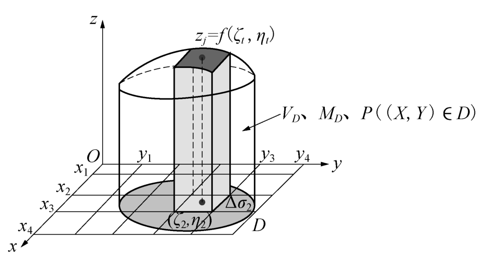

## 第一节 多维随机变量及其联合分布

### 一、多维随机变量

第二章我们学习了单个离散型和连续型随机变量的概率模型．在许多实际问题中，需要使用多个随机变量来描述随机现象．比如，一般天气预报包括：空气质量、天气实况、温度、降水、风力、风向、气压、紫外线等，天气的描述需要多个随机变量．再比如，出生的婴儿，我们最关心其身高、体重、头围，还有每分钟心跳、呼吸次数等，婴儿的发育情况需要同时使用多个随机变量来刻画．研究多维随机变量是要揭示各变量之间的相互联系和相互影响，这是研究多个一维随机变量分布时无法得到的．多维随机变量的研究方法和二维随机变量的研究思想及方法相同，为简便起见，我们着重介绍二维随机变量．

**定义 1** 设有随机试验 $E$，其样本空间为 $\Omega$．若对 $\Omega$ 中的每一个样本点 $\omega$ 都有一对有序实数 $(X(\omega),\ Y(\omega))$ 与其对应．则称 $(X,\ Y)$ 为二维随机变量或二维随机向量．称 $(X,\ Y)$ 的取值范围为它的值域，记为 $\Omega_{(X,Y)}$．

可以说二维随机变量 $(X,\ Y)$ 是一个特殊的二元函数，其定义域为样本空间 $\Omega$，值域 $\Omega_{(X,Y)}\subset R^2$．讨论随机变量的取值规律，很重要的一点是首先确定其值域．

**例 1** 现有将一枚骰子相互独立地上抛两次的随机试验 $E$，观察两次出现的点数．讨论第一次出现的点数以及两次出现点数的最小值．(1)请给出随机试验 $E$ 的样本空间 $\Omega$；(2)引入二维随机变量 $(X,\ Y)$，并写出值域 $\Omega_{(X,Y)}$．

**解** (1)由已知得随机试验 $E$ 的样本空间为

$$
\Omega=\{(1,\ 1),\ \cdots,\ (1,\ 6),\ (2,\ 1),\ \cdots,\ (2,\ 6),\ \cdots,\ (6,\ 1),\ \cdots,\ (6,\ 6)\}.
$$

(2)设 $X$ 表示"第一次出现的点数"，$Y$ 表示"两次出现点数的最小值"，并设 $\omega_i$ 为 $\Omega$ 中的第 $i$ 个样本点，那么

$$
\begin{aligned}
&\omega_1=(1,\ 1),\ (X(\omega_1),\ Y(\omega_1))=(1,\ 1);\ \cdots;\ \omega_6=(1,\ 6),\ (X(\omega_6),\ Y(\omega_6))=(1,\ 1);\\
&\omega_7=(2,\ 1),\ (X(\omega_7),\ Y(\omega_7))=(2,\ 1);\ \cdots;\ \omega_{12}=(2,\ 6),\ (X(\omega_{12}),\ Y(\omega_{12}))=(2,\ 2);\\
&\omega_{31}=(6,\ 1),\ (X(\omega_{31}),\ Y(\omega_{31}))=(6,\ 1);\ \cdots;\ \omega_{36}=(6,\ 6),\ (X(\omega_{36}),\ Y(\omega_{36}))=(6,\ 6).
\end{aligned}
$$

则 $(X,\ Y)$ 的值域为

$$
\begin{aligned}
\Omega_{(X,Y)}=\{&(1,\ 1),\\
&(2,\ 1),\ (2,\ 2),\\
&(3,\ 1),\ (3,\ 2),\ (3,\ 3),\\
&(4,\ 1),\ (4,\ 2),\ (4,\ 3),\ (4,\ 4),\\
&(5,\ 1),\ (5,\ 2),\ (5,\ 3),\ (5,\ 4),\ (5,\ 5),\\
&(6,\ 1),\ (6,\ 2),\ (6,\ 3),\ (6,\ 4),\ (6,\ 5),\ (6,\ 6)\}.
\end{aligned}
$$

通过例子，我们发现存在不同的样本点对应着相同的有序实数对的情形，如 $(X(\omega_1),\ Y(\omega_1))=(1,\ 1)$，$(X(\omega_2),\ Y(\omega_2))=(1,\ 1)$．而不同的有序实数对一定对应着不同的样本点．

可将二维随机变量的定义推广至 $n$ 维．

**定义 2** 设有随机试验 $E$，其样本空间为 $\Omega$．若对 $\Omega$ 中的每一个样本点 $\omega$ 都有一组有序实数列 $(X_1(\omega),\ X_2(\omega),\ \cdots,\ X_n(\omega))$ 与其对应．则称 $(X_1,\ X_2,\ \cdots,\ X_n)$ 为 $n$ 维随机变量或 $n$ 维随机向量．称 $(X_1,\ X_2,\ \cdots,\ X_n)$ 的取值范围为它的值域，记为 $\Omega_{(X_1,X_2,\cdots,X_n)}$．

### 二、联合分布函数

对二维随机变量同样要讨论其分布．和一维随机变量有所不同的是，$(X,\ Y)$ 的分布不仅要包含每个随机变量各自的分布信息，还要包含两者之间相互关系的信息．因此称它们的分布为联合分布．首先给出联合分布函数的定义．

**定义 3** 设 $(X,\ Y)$ 为二维随机变量，对任意的 $(x,\ y)\in R^2$，称

$$
F(x,\ y)=P(X\leqslant x,\ Y\leqslant y)
$$

为随机变量 $(X,\ Y)$ 的(联合)分布函数．

这里，$P(X\leqslant x,\ Y\leqslant y)$ 中的逗号表示对事件 $\{X\leqslant x\}$ 和事件 $\{Y\leqslant y\}$ 取积事件，$P(X\leqslant x,\ Y\leqslant y)=P(\{X\leqslant x\}\cap\{Y\leqslant y\})=P((X,\ Y)\in D_{xy})$．其中 $D_{xy}$ 区域如图 3.2 所示．

$F(x,\ y)$ 在点 $(x,\ y)$ 处的函数值，即随机变量 $(X,\ Y)$ 在区域 $D_{xy}$ 中取值的概率．注意区别 $F(x,\ y)$ 的定义域与 $(X,\ Y)$ 的值域 $\Omega_{(X,Y)}$，它们是两个不同的概念．

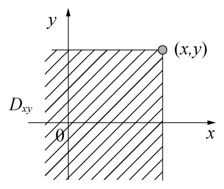

同样，可以给出 $n$ 维随机变量 $(X_1,\ X_2,\ \cdots,\ X_n)$ 的联合分布函数的定义．

**定义 4** 设 $(X_1,\ X_2,\ \cdots,\ X_n)$ 为 $n$ 维随机变量，对任意的 $(x_1,\ x_2,\ \cdots,\ x_n)\in R^n$，称

$$
F(x_1,\ x_2,\ \cdots,\ x_n)=P(X_1\leqslant x_1,\ \cdots,\ X_n\leqslant x_n)
$$

为随机变量 $(X_1,\ X_2,\ \cdots,\ X_n)$ 的(联合)分布函数．

和一维情形类似，二维随机变量的联合分布函数具有下列性质．

**定理 1（联合分布函数的性质）** 设 $F(x,\ y)$ 是二维随机变量 $(X,\ Y)$ 的联合分布函数，则

(1) $0\leqslant F(x,\ y)\leqslant 1$；

(2) 当固定 $y$ 值时，$F(x,\ y)$ 是变量 $x$ 的非减函数，

当固定 $x$ 值时，$F(x,\ y)$ 是变量 $y$ 的非减函数；

(3) $\lim\limits_{x\to-\infty}F(x,\ y)=0$，$\lim\limits_{y\to-\infty}F(x,\ y)=0$，$\lim\limits_{\substack{x\to-\infty\\ y\to-\infty}}F(x,\ y)=0$，$\lim\limits_{\substack{x\to+\infty\\ y\to+\infty}}F(x,\ y)=1$；

(4) 当固定 $y$ 值时，$F(x,\ y)$ 是变量 $x$ 的右连续函数，

当固定 $x$ 值时，$F(x,\ y)$ 是变量 $y$ 的右连续函数；

(5) $P(x_1<X\leqslant x_2,\ y_1<Y\leqslant y_2)=F(x_2,\ y_2)-F(x_2,\ y_1)-F(x_1,\ y_2)+F(x_1,\ y_1)$．

**证明**

(1) 函数 $F(x,\ y)$ 在点 $(x,\ y)$ 处的函数值是事件 $\{X\leqslant x\}\cap\{Y\leqslant y\}$ 的概率，因此有性质(1)．

(2) 固定 $y$ 值，当 $x_1<x_2$ 时，有 $\{X\leqslant x_1,\ Y\leqslant y\}\subset\{X\leqslant x_2,\ Y\leqslant y\}$．所以 $P(X\leqslant x_1,\ Y$$\leqslant y)\leqslant P(X\leqslant x_2,\ Y\leqslant y)$．同理，固定 $x$ 值，当 $y_1<y_2$ 时，有 $P(X\leqslant x,\ Y\leqslant y_1)\leqslant P(X\leqslant x,\ Y\leqslant y_2)$．即性质(2)成立．

(3) 性质(3)的证明见参考文献[1]．

(4) 性质(4)的证明见参考文献[1]．

(5) 因为

$$
\begin{aligned}
\{x_1<X\leqslant x_2\}\cap\{y_1<Y\leqslant y_2\}={}&(\{X\leqslant x_2\}\cap\{Y\leqslant y_2\})-(\{X\leqslant x_2\}\cap\{Y\leqslant y_1\}-\{X\leqslant x_1\}\cap\{Y\leqslant y_1\})-\\
&(\{X\leqslant x_1\}\cap\{Y\leqslant y_2\}).
\end{aligned}
$$

所以

$$
\begin{aligned}
P(x_1<X\leqslant x_2,\ y_1<Y\leqslant y_2)&=F(x_2,\ y_2)-(F(x_2,\ y_1)-F(x_1,\ y_1))-F(x_1,\ y_2)\\
&=F(x_2,\ y_2)-F(x_2,\ y_1)-F(x_1,\ y_2)+F(x_1,\ y_1).
\end{aligned}
$$

即性质(5)成立(见图 3.3)．

**注**：

(1) 这 5 条性质是联合分布函数的本质特征，即有一个二元函数满足这 5 条性质，那么它一定是某个二维随机变量的联合分布函数．

(2) 除了性质(5)，其他几条性质都可推广至高维随机变量的联合分布函数．

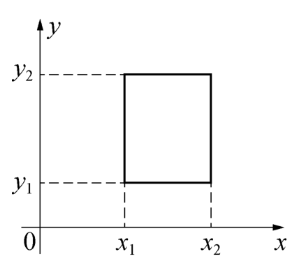

二维随机变量也分为离散型和非离散型，如果它取值于平面上的一些离散的点，就称为二维离散型随机变量．非离散型中包含连续型，我们着重讨论二维离散型随机变量和二维连续型随机变量，怎样刻画它们的统计规律性是我们主要讨论的内容．和一维的情形相似，我们用联合分布律描述二维离散型随机变量的概率分布，联合密度函数描述二维连续型随机变量的概率分布，图 3.4 及图 3.5 分别给出了二维离散型和连续型随机变量的概率分布．

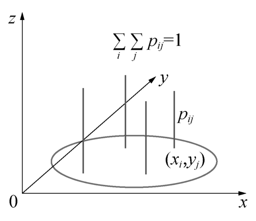

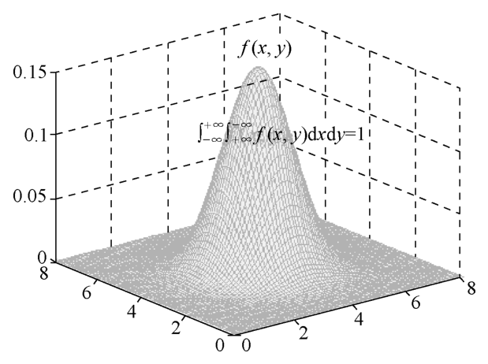

### 三、二维离散型随机变量及其联合分布律

这里先给出二维离散型随机变量及其联合分布律的定义．多维情形类似．

**定义 5** 如果二维随机变量 $(X,\ Y)$ 仅可能取有限个或可列无限个值，则称 $(X,\ Y)$ 为二维离散型随机变量．

[1] 李贤平．概率论基础(第 3 版)[M]．北京：高等教育出版社，2010．

二维离散型随机变量 $(X,\ Y)$ 的分布可用联合分布律表示．

**定义 6** 称 $P(X=x_i,\ Y=y_j)=p_{ij}$，$i,\ j=1,\ 2,\ \cdots$ 为二维随机变量 $(X,\ Y)$ 的联合分布律．其中，$p_{ij}\geqslant 0$，$i,\ j=1,\ 2,\ \cdots$，$\sum\limits_i\sum\limits_j p_{ij}=1$．

二维离散型随机变量 $(X,\ Y)$ 的联合分布律可用表格法、公式法、图像法(见图 3.4)等方法表示，其中表格法最简洁，如下表所示．表格中 $x_1,\ x_2,\ \cdots$ 和 $y_1,\ y_2,\ \cdots$ 自上而下，自左而右，按照从小到大的顺序排列．

| $X\backslash Y$ | $y_1$ | $y_2$ | $\cdots$ |
| :---: | :---: | :---: | :---: |
| $x_1$ | $p_{11}$ | $p_{12}$ | $\cdots$ |
| $x_2$ | $p_{21}$ | $p_{22}$ | $\cdots$ |
| $\vdots$ | $\vdots$ | $\vdots$ | $\vdots$ |

二维离散型随机变量联合分布律的物理解释：考虑 $xoy$ 平面上单位质量的平面薄片，在离散点 $(x_i,\ y_j)$ 处分布着质点，其质量为 $p_{ij}$，$i,\ j=1,\ 2,\ \cdots$．这刻画了平面薄片的质量分布情况．

**例 2** 为分析一个年级的成绩分布，定义随机变量

$$
X=\begin{cases}1,&\text{数学为优,}\\0,&\text{数学不为优,}\end{cases}\qquad Y=\begin{cases}1,&\text{语文为优,}\\0,&\text{语文不为优.}\end{cases}
$$

已知数学为优的占 $20\%$，语文为优的占 $10\%$，都为优的占 $8\%$．求：

(1)$(X,\ Y)$ 的联合分布律；(2)$(X,\ Y)$ 的联合分布函数；(3)概率 $P(X\leqslant Y)$．

**解** (1)由已知得，$P(Y=1)=0.1$，$P(X=1,\ Y=1)=0.08$，所以

$$
P(X=0,\ Y=1)=P(Y=1)-P(X=1,\ Y=1)=0.02.
$$

又因为，$P(X=1)=0.2$，所以

$$
P(X=1,\ Y=0)=P(X=1)-P(X=1,\ Y=1)=0.12.
$$

因为 $\sum\limits_i\sum\limits_j p_{ij}=1$，得 $P(X=0,\ Y=0)=0.78$．

故 $(X,\ Y)$ 的联合分布律为

| $X\backslash Y$ | $0$ | $1$ |
| :---: | :---: | :---: |
| $0$ | $0.78$ | $0.02$ |
| $1$ | $0.12$ | $0.08$ |

(2)$(X,\ Y)$ 的值域 $\Omega_{(X,Y)}=\{(0,\ 0),\ (0,\ 1),\ (1,\ 0),\ (1,\ 1)\}$ 中的四点所围区域将 $xoy$ 平面分割为 9 个区域，如图 3.6 所示，由 $F(x,\ y)=P(X\leqslant x,\ Y\leqslant y)$ 得联合分布函数为

$$
F(x,\ y)=\begin{cases}
0,&x<0\ \text{或}\ y<0,\\
0.78,&0\leqslant x<1,\ 0\leqslant y<1,\\
0.8,&0\leqslant x<1,\ y\geqslant 1,\\
0.9,&x\geqslant 1,\ 0\leqslant y<1,\\
1,&x\geqslant 1,\ y\geqslant 1.
\end{cases}
$$

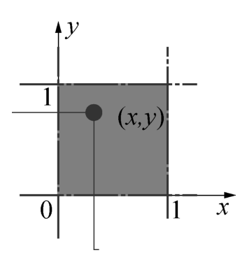

(3) $P(X\leqslant Y)=1-P(X>Y)=1-P(X=1,\ Y=0)=1-0.12=0.88$．

显然，对二维离散型随机变量使用联合分布函数刻画其统计规律是比较复杂的，通常我们使用联合分布律来描述二维离散型随机变量的取值规律．若已知二维离散型随机变量的联合分布律就可以计算任意事件的概率．

**例 1 续** 把一枚骰子相互独立地上抛两次，设 $X$ 表示第一次出现的点数，$Y$ 表示两次出现点数的最小值．试求：(1)$(X,\ Y)$ 的联合分布律；(2)$P(X=Y)$ 与 $P(X^2+Y^2<8)$．

**解** (1)由古典概率计算得 $(X,\ Y)$ 的联合分布律为

| $X\backslash Y$ | $1$ | $2$ | $3$ | $4$ | $5$ | $6$ |
| :---: | :---: | :---: | :---: | :---: | :---: | :---: |
| $1$ | $\dfrac{6}{36}$ | $0$ | $0$ | $0$ | $0$ | $0$ |
| $2$ | $\dfrac{1}{36}$ | $\dfrac{5}{36}$ | $0$ | $0$ | $0$ | $0$ |
| $3$ | $\dfrac{1}{36}$ | $\dfrac{1}{36}$ | $\dfrac{4}{36}$ | $0$ | $0$ | $0$ |
| $4$ | $\dfrac{1}{36}$ | $\dfrac{1}{36}$ | $\dfrac{1}{36}$ | $\dfrac{3}{36}$ | $0$ | $0$ |
| $5$ | $\dfrac{1}{36}$ | $\dfrac{1}{36}$ | $\dfrac{1}{36}$ | $\dfrac{1}{36}$ | $\dfrac{2}{36}$ | $0$ |
| $6$ | $\dfrac{1}{36}$ | $\dfrac{1}{36}$ | $\dfrac{1}{36}$ | $\dfrac{1}{36}$ | $\dfrac{1}{36}$ | $\dfrac{1}{36}$ |

(2)$P(X=Y)=\sum\limits_{i=1}^{6}P(X=i,\ Y=i)=\frac{6}{36}+\frac{5}{36}+\frac{4}{36}+\frac{3}{36}+\frac{2}{36}+\frac{1}{36}=\frac{7}{12}$，

$$
P(X^2+Y^2<8)=P(X=1,\ Y=1)+P(X=2,\ Y=1)=\frac{7}{36}.
$$

### 四、二维连续型随机变量及其联合密度函数

**定义 7** 设二维随机变量 $(X,\ Y)$ 的联合分布函数为 $F(x,\ y)$，如果存在一个二元非负实值函数 $f(x,\ y)$，使得对于任意 $(x,\ y)\in R^2$ 有

$$
F(x,\ y)=\int_{-\infty}^{x}\int_{-\infty}^{y}f(u,\ v)\,\mathrm{d}u\mathrm{d}v
$$

成立，则称 $(X,\ Y)$ 为二维连续型随机变量，$f(x,\ y)$ 为二维连续型随机变量 $(X,\ Y)$ 的联合(概率)密度函数．

**注**：定义 7 中 $\int_{-\infty}^{x}\int_{-\infty}^{y}f(u,\ v)\,\mathrm{d}u\mathrm{d}v$ 表示二重积分 $\iint\limits_{D_{xy}}f(u,\ v)\,\mathrm{d}u\mathrm{d}v$，其中积分区域 $D_{xy}=(-\infty,\ x]\times(-\infty,\ y]$．

图 3.7 给出了 $F(x,\ y)$ 的几何含义．

二维连续型随机变量联合密度函数的物理解释：考虑 $xoy$ 平面上单位质量的平面薄片，其在点 $(x,\ y)$ 处的面密度为 $f(x,\ y)$，它刻画了平面薄片的质量分布情况．

**定义 8** 设 $n$ 维随机变量 $(X_1,\ X_2,\ \cdots,\ X_n)$ 的联合分布函数为 $F(x_1,\ x_2,\ \cdots,\ x_n)$，如果存在一个 $n$ 元非负函数 $f(x_1,\ x_2,\ \cdots,\ x_n)$，使得对任意的 $(x_1,\ x_2,\ \cdots,\ x_n)\in R^n$ 有

$$
F(x_1,x_2,\cdots,x_n)=\int_{-\infty}^{x_1}\cdots\int_{-\infty}^{x_n}f(u_1,u_2,\cdots,u_n)\,\mathrm{d}u_1\mathrm{d}u_2\cdots\mathrm{d}u_n
$$

成立，则称 $(X_1,\ X_2,\ \cdots,\ X_n)$ 为 $n$ 维连续型随机变量，$f(x_1,\ x_2,\ \cdots,\ x_n)$ 为 $n$ 维连续型随机变量 $(X_1,\ X_2,\ \cdots,\ X_n)$ 的联合(概率)密度函数．

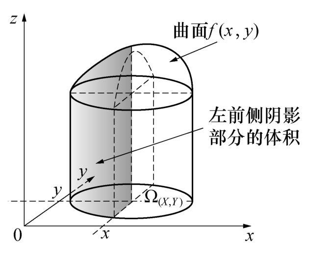

类似于一维连续型随机变量的密度函数，二维连续型随机变量的联合密度函数有下列性质．

**定理 2（联合密度函数的性质）** 设 $f(x,\ y)$ 为二维连续型随机变量 $(X,\ Y)$ 的联合密度函数，则

(1) 非负性 $f(x,\ y)\geqslant 0$，$-\infty<x,\ y<+\infty$；

(2) 规范性 $\int_{-\infty}^{+\infty}\int_{-\infty}^{+\infty}f(x,\ y)\,\mathrm{d}x\mathrm{d}y=1$．

联合密度函数的规范性意味着以曲面 $f(x,\ y)$ 为顶以整个 $xoy$ 平面与 $\Omega_{(X,Y)}$ 的交集区域为底的曲顶柱体的体积为 1．

**定理 3（连续型随机变量的性质）** 设二维连续型随机变量 $(X,\ Y)$ 的联合分布函数为 $F(x,\ y)$，联合密度函数为 $f(x,\ y)$，则

(1) 对任意一条平面曲线 $L$，有 $P((X,\ Y)\in L)=0$；

(2) $F(x,\ y)$ 为连续函数，在 $f(x,\ y)$ 的连续点处有

$$
\frac{\partial^2 F(x,\ y)}{\partial x\partial y}=f(x,\ y);
$$

(3) 对 $xoy$ 平面上任一区域 $D$(见图 3.8)有

$$
P((X,\ Y)\in D)=\iint\limits_D f(x,\ y)\,\mathrm{d}x\mathrm{d}y.
$$

性质(1)表示以曲面 $f(x,\ y)$ 为顶，投影曲线 $L$ 为底的曲顶柱体的体积，也即如图 3.8 所示阴影部分曲面的体积，显然为零．

性质(2)中，在 $f(x,\ y)$ 的非连续点处 $F(x,\ y)$ 的偏导数不存在，在这些点可以用任意一个常数定义 $f(x,\ y)$，这不影响事件的概率值．这是因为 $(X,\ Y)$ 在这些点组成的集合上取值的概率都为零．

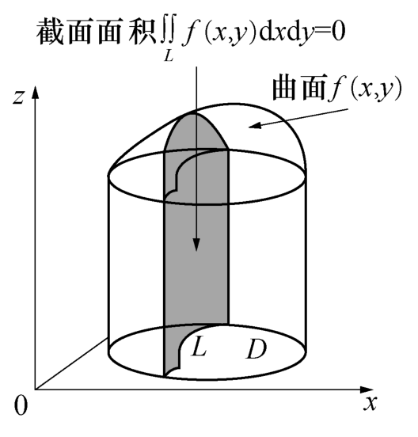

**例 3** 设二维随机变量 $(X,\ Y)$ 的联合密度函数为

$$
f(x,\ y)=\begin{cases}cy^2,&0<x<2y,\ 0<y<1,\\0,&\text{其他.}\end{cases}
$$

计算(1)常数 $c$；(2)联合分布函数 $F(x,\ y)$；(3)概率 $P(|X|\leqslant Y)$．

**解** (1)$\Omega_{(X,Y)}=\{(x,\ y):0<x<2y,\ 0<y<1\}$，如图 3.9 所示．

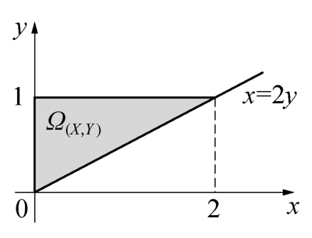由联合密度函数的规范性得

$$
1=\int_{-\infty}^{+\infty}\int_{-\infty}^{+\infty}f(x,\ y)\,\mathrm{d}x\mathrm{d}y=\int_0^1 \mathrm{d}y\int_0^{2y}cy^2\,\mathrm{d}x=\frac{c}{2}.
$$

所以 $c=2$．

(2) 由已知得，

当 $x<0$ 或 $y<0$ 时，$F(x,\ y)=0$；

当 $0\leqslant x<2y$ 且 $0\leqslant y<1$ 时，$F(x,\ y)=\int_0^x \mathrm{d}u\int_{\frac{x}{2}}^{y}2v^2\,\mathrm{d}v=\frac{2}{3}x\left(y^3-\frac{x^3}{32}\right)$；

当 $0\leqslant x<2$ 且 $y\geqslant 1$ 时，$F(x,\ y)=\int_0^x \mathrm{d}u\int_{\frac{x}{2}}^{1}2v^2\,\mathrm{d}v=\frac{2}{3}x\left(1-\frac{x^3}{32}\right)$；

当 $x\geqslant 2y$ 且 $0\leqslant y<1$ 时，$F(x,\ y)=\int_0^y \mathrm{d}v\int_0^{2v}2v^2\,\mathrm{d}u=y^4$；

当 $x\geqslant 2$ 且 $y\geqslant 1$ 时，$F(x,\ y)=1$．

所以，联合分布函数为

$$
F(x,\ y)=\begin{cases}
0,&x<0\ \text{或}\ y<0,\\
\dfrac{2}{3}x\left(y^3-\dfrac{x^3}{32}\right),&0\leqslant x<2y,\ 0\leqslant y<1,\\
\dfrac{2}{3}x\left(1-\dfrac{x^3}{32}\right),&0\leqslant x<2,\ y\geqslant 1,\\
y^4,&x\geqslant 2y,\ 0\leqslant y<1,\\
1,&x\geqslant 2,\ y\geqslant 1.
\end{cases}
$$

(3) $P(|X|\leqslant Y)=\iint\limits_{|x|\leqslant y}f(x,\ y)\,\mathrm{d}x\mathrm{d}y=\int_0^1 \mathrm{d}y\int_0^{2y}2y^2\,\mathrm{d}x=\int_0^1 2y^3\,\mathrm{d}x=\frac{1}{2}$．

显然，对二维连续型随机变量使用联合分布函数刻画其统计规律也是比较复杂的，通常我们使用联合密度函数来描述二维连续型随机变量的概率分布．已知二维连续型随机变量的联合密度函数就可以计算任意事件的概率．

### 习题 3-1

**1.** 一个箱子中装有 100 件同类产品，其中一、二、三等品分别有 70，20，10 件．现从中随机地抽取一件．试求 $(X_1,\ X_2)$ 的联合分布律．其中 $X_i=\begin{cases}1,&\text{如果抽到}\ i\ \text{等品,}\\0,&\text{如果抽到非}\ i\ \text{等品,}\end{cases}\quad i=1,\ 2.$

**2.** 两名水平相当的棋手弈棋三盘．设 $X$ 表示某名棋手获胜的盘数，$Y$ 表示他输赢盘数之差的绝对值．假定没有和棋，且每盘结果是相互独立的．试求 $(X,\ Y)$ 的联合分布律．

**3.** 设二维随机变量 $(X,\ Y)$ 的联合分布律为

| $X\backslash Y$ | $0$ | $1$ |
| :---: | :---: | :---: |
| $0$ | $0.4$ | $a$ |
| $1$ | $b$ | $0.1$ |

已知随机事件 $\{X=0\}$ 与 $\{X+Y=1\}$ 相互独立，求 $a$、$b$ 的值．

**4.** 袋中有 1 个红球、2 个黑球与 3 个白球，现有放回地从袋中取两次，每次取一个球，以 $X$，$Y$，$Z$ 分别表示两次取球所得的红球、黑球与白球的个数．求(1) 二维随机变量 $(X,\ Y)$ 的联合分布律；(2)$P(X=1|Z=0)$．

**5.** 假设随机变量 $Y$ 服从参数为 $\lambda=1$ 的指数分布，随机变量

$$
X_k=\begin{cases}0,&Y\leqslant k,\\1,&Y>k,\end{cases}\quad k=1,\ 2.
$$

求 $(X_1,\ X_2)$ 的联合分布律．

**6.** 设 $(X,\ Y)$ 的联合密度函数为

$$
f(x,\ y)=\begin{cases}c(6-x-y),&0<x<2,\ 2<y<4,\\0,&\text{其他.}\end{cases}
$$

(1)试确定常数 $c$ 的值；(2)求概率 $P(X+Y<4)$；(3)求概率 $P(X<1|X+Y<4)$．

**7.** 已知 $(X,\ Y)$ 的联合密度函数为

$$
f(x,\ y)=\begin{cases}c\mathrm{e}^{-(x+2y)},&x>0,\ y>0,\\0,&\text{其他.}\end{cases}
$$

(1)试确定常数 $c$ 的值；(2)求概率 $P(X<1,\ Y>2)$．

**8.** 设 $(X,\ Y)$ 的联合密度函数为

$$
f(x,\ y)=\begin{cases}cxy,&(x,\ y)\in G,\\0,&\text{其他.}\end{cases}
$$

其中，区域 $G=\{(x,\ y):0<y<2x\ \text{且}\ 0<x<2\}$．试求(1)常数 $c$；(2)概率 $P(X+Y<1)$．

## 第二节 常用的多维随机变量

### 一、二维均匀分布

**定义 1** 设二维随机变量 $(X,\ Y)$ 的联合密度函数为

$$
f(x,\ y)=\begin{cases}\dfrac{1}{S_G},&(x,\ y)\in G,\[6pt]0,&\text{其他.}\end{cases}
$$

其中 $G$ 是 $xoy$ 平面上的某个区域，$S_G$ 为 $G$ 的面积，则称 $(X,\ Y)$ 服从区域 $G$ 上的二维均匀分布．

**例 1** 设二维随机变量 $(X,\ Y)$ 服从区域 $G$ 上的均匀分布(见图 3.10)，$G=\{(x,\ y):0<x<1\ \text{且}\ 0<y<2x\}$．

(1) 写出 $(X,\ Y)$ 的联合密度函数；(2)计算概率 $P(Y\leqslant X)$．

**解** (1)因为 $S_G=1$，由二维均匀分布的定义得 $(X,\ Y)$ 的联合密度函数为

$$
f(x,\ y)=\begin{cases}1,&0<x<1,\ 0<y<2x,\\0,&\text{其他.}\end{cases}
$$

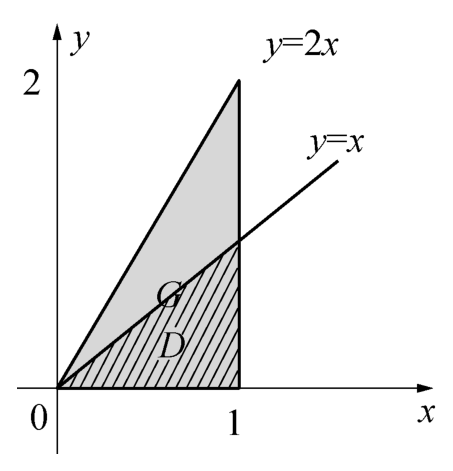(2) $P(Y\leqslant X)=P((X,\ Y)\in D)=\iint\limits_D f(x,\ y)\,\mathrm{d}x\mathrm{d}y=\iint\limits_D 1\,\mathrm{d}x\mathrm{d}y=S_D=\frac{1}{2}$．

其中区域 $D$ 见图 3.10．或 $P(Y\leqslant X)=\frac{S_D}{S_G}=\frac{1}{2}$．

### 二、二维正态分布

**定义 2** 如果 $(X,\ Y)$ 的联合密度函数为

$$
f(x,\ y)=\frac{1}{2\pi\sigma_1\sigma_2\sqrt{1-\rho^2}}\exp\left\{-\frac{1}{2(1-\rho^2)}\left[\frac{(x-\mu_1)^2}{\sigma_1^2}-2\rho\frac{(x-\mu_1)(y-\mu_2)}{\sigma_1\sigma_2}+\frac{(y-\mu_2)^2}{\sigma_2^2}\right]\right\},
$$

$-\infty<x,\ y<+\infty$，则称 $(X,\ Y)$ 服从二维正态分布，并记为 $(X,\ Y)\sim N(\mu_1,\ \mu_2,\ \sigma_1^2,\ \sigma_2^2,\ \rho)$．其中 $-\infty<\mu_1,\ \mu_2<+\infty$，$\sigma_1,\ \sigma_2>0$，$|\rho|<1$．二维正态分布联合密度函数的图像如图 3.11 所示．

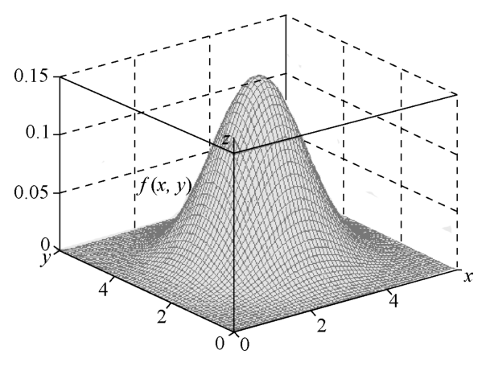

二维正态分布的 5 个参数都有具体的意义，将在后面逐一介绍．

### 习题 3-2

**1.** 设 $(X,\ Y)$ 服从以原点为圆心的单位圆上的均匀分布，记

$$
U=\begin{cases}1,&X+Y\leqslant 0,\\0,&X+Y>0,\end{cases}\qquad V=\begin{cases}1,&X-Y\leqslant 0,\\0,&X-Y>0.\end{cases}
$$

试求 $(U,\ V)$ 的联合分布律．

**2.** 设 $(X,\ Y)$ 服从区域 $G$ 上的均匀分布，其中 $G$ 由直线 $y=-x$，$y=x$ 与 $x=2$ 所围成．(1)写出 $(X,\ Y)$ 的联合密度函数；(2)求概率 $P(X+Y<2)$．

**3.** 已知 $(X,\ Y)\sim N(1,\ -1,\ 1,\ 4,\ 0.5)$，试写出 $(X,\ Y)$ 的联合密度函数．

## 第三节 边缘分布

如果已知二维随机变量 $(X,\ Y)$ 的联合分布，那么其中一个随机变量的分布肯定能够得到，其分布我们称为边缘分布．

### 一、边缘分布函数

**定义 1** 设二维随机变量 $(X,\ Y)$ 的联合分布函数为 $F(x,\ y)$，称 $F_X(x)=P(X\leqslant x)=P(X\leqslant x,\ Y<+\infty)=F(x,\ +\infty)$，$-\infty<x<+\infty$ 为随机变量 $X$ 的边缘分布函数；称 $F_Y(y)=P(Y\leqslant y)=P(X<+\infty,\ Y\leqslant y)=F(+\infty,\ y)$，$-\infty<y<+\infty$ 为随机变量 $Y$ 的边缘分布函数．

**例 1** 已知二维随机变量 $(X,\ Y)$ 的联合密度函数为

$$
f(x,\ y)=\begin{cases}cy^2,&0<x<2y,\ 0<y<1,\\0,&\text{其他.}\end{cases}
$$

分别计算 $X$ 与 $Y$ 的边缘分布函数．

**解** 在第一节例 4 中已得 $(X,\ Y)$ 的联合分布函数，由此，$X$ 与 $Y$ 的边缘分布函数分别为

$$
F_X(x)=F(x,\ +\infty)=\begin{cases}
0,&x<0,\\
\dfrac{2}{3}x\left(1-\dfrac{x^3}{32}\right),&0\leqslant x<2,\\
1,&x\geqslant 2;
\end{cases}
$$

$$
F_Y(y)=F(+\infty,\ y)=\begin{cases}
0,&y<0,\\
y^4,&0\leqslant y<1,\\
1,&y\geqslant 1.
\end{cases}
$$

### 二、二维离散型随机变量的边缘分布律

**定义 2** 设二维离散型随机变量 $(X,\ Y)$ 的联合分布律为 $P(X=x_i,\ Y=y_j)=p_{ij}$，$i,\ j=1,\ 2,\ \cdots$，称概率 $P(X=x_i)=P(X=x_i,\ \bigcup\limits_j Y=y_j)=\sum\limits_j P(X=x_i,\ Y=y_j)=\sum\limits_j p_{ij}$，$i=1,\ 2,\ \cdots$ 为随机变量 $X$ 的边缘分布律，记为 $p_{i\cdot}$，并有 $p_{i\cdot}=P(X=x_i)=\sum\limits_j p_{ij}$，$i=1,\ 2,\ \cdots$．类似地，称概率 $P(Y=y_j)$，$j=1,\ 2,\ \cdots$ 为随机变量 $Y$ 的边缘分布律，记为 $p_{\cdot j}$，并有 $p_{\cdot j}=P(Y=y_j)=\sum\limits_i p_{ij}$，$j=1,\ 2,\ \cdots$．

由定义知，求 $X$ 的边缘分布律即为求 $(X,\ Y)$ 联合分布律表格中的行和，求 $Y$ 的边缘分布律即为求 $(X,\ Y)$ 联合分布律表格中的列和．因为边缘分布律位于联合分布律表格的边缘，所以称其为边缘分布律．

**例 2** 在第一节例 3 中计算 $X$ 与 $Y$ 的边缘分布律．

**解** 直接在 $(X,\ Y)$ 联合分布律表格中计算行和、列和得

| $Y\backslash X$ | $1$ | $2$ | $3$ | $4$ | $5$ | $6$ | $p_{i\cdot}$ |
| :---: | :---: | :---: | :---: | :---: | :---: | :---: | :---: |
| $1$ | $\dfrac{6}{36}$ | $0$ | $0$ | $0$ | $0$ | $0$ | $\dfrac{1}{6}$ |
| $2$ | $\dfrac{1}{36}$ | $\dfrac{5}{36}$ | $0$ | $0$ | $0$ | $0$ | $\dfrac{1}{6}$ |
| $3$ | $\dfrac{1}{36}$ | $\dfrac{1}{36}$ | $\dfrac{4}{36}$ | $0$ | $0$ | $0$ | $\dfrac{1}{6}$ |
| $4$ | $\dfrac{1}{36}$ | $\dfrac{1}{36}$ | $\dfrac{1}{36}$ | $\dfrac{3}{36}$ | $0$ | $0$ | $\dfrac{1}{6}$ |
| $5$ | $\dfrac{1}{36}$ | $\dfrac{1}{36}$ | $\dfrac{1}{36}$ | $\dfrac{1}{36}$ | $\dfrac{2}{36}$ | $0$ | $\dfrac{1}{6}$ |
| $6$ | $\dfrac{1}{36}$ | $\dfrac{1}{36}$ | $\dfrac{1}{36}$ | $\dfrac{1}{36}$ | $\dfrac{1}{36}$ | $\dfrac{1}{36}$ | $\dfrac{1}{6}$ |
| $p_{\cdot j}$ | $\dfrac{11}{36}$ | $\dfrac{9}{36}$ | $\dfrac{7}{36}$ | $\dfrac{5}{36}$ | $\dfrac{3}{36}$ | $\dfrac{1}{36}$ | $1$ |

所以，$X$ 的边缘分布律为

| $X$ | $1$ | $2$ | $3$ | $4$ | $5$ | $6$ |
| :---: | :---: | :---: | :---: | :---: | :---: | :---: |
| 概率 | $\dfrac{1}{6}$ | $\dfrac{1}{6}$ | $\dfrac{1}{6}$ | $\dfrac{1}{6}$ | $\dfrac{1}{6}$ | $\dfrac{1}{6}$ |

$Y$ 的边缘分布律为

| $Y$ | $1$ | $2$ | $3$ | $4$ | $5$ | $6$ |
| :---: | :---: | :---: | :---: | :---: | :---: | :---: |
| 概率 | $\dfrac{11}{36}$ | $\dfrac{9}{36}$ | $\dfrac{7}{36}$ | $\dfrac{5}{36}$ | $\dfrac{3}{36}$ | $\dfrac{1}{36}$ |

### 三、二维连续型随机变量的边缘密度函数

设二维连续型随机变量 $(X,\ Y)$ 的联合分布函数为 $F(x,\ y)$，联合密度函数为 $f(x,\ y)$，根据 $F_X(x)=F(x,\ +\infty)$，$-\infty<x<+\infty$，得

$$
\int_{-\infty}^{x}f_X(u)\,\mathrm{d}u=\int_{-\infty}^{x}\left[\int_{-\infty}^{+\infty}f(u,\ y)\,\mathrm{d}y\right]\mathrm{d}u,
$$

由 $x$ 的任意性知，$f_X(x)=\int_{-\infty}^{+\infty}f(x,\ y)\,\mathrm{d}y$，因此有如下定义．

**定义 3** 设二维连续型随机变量 $(X,\ Y)$ 的联合密度函数为 $f(x,\ y)$，则 $X$ 的边缘密度函数为

$$
f_X(x)=\int_{-\infty}^{+\infty}f(x,\ y)\,\mathrm{d}y.
$$

类似地，$Y$ 的边缘密度函数为

$$
f_Y(y)=\int_{-\infty}^{+\infty}f(x,\ y)\,\mathrm{d}x.
$$

**例 3** 在第一节例 4 中，计算(1)$X$ 的边缘密度函数；(2)$Y$ 的边缘密度函数．

**解** **方法一**

首先确定 $X$ 的值域 $\Omega_X=(0,\ 2)$，当 $0<x<2$ 时，

$$
f_X(x)=\int_{-\infty}^{+\infty}f(x,\ y)\,\mathrm{d}y=\int_{\frac{x}{2}}^{1}2y^2\,\mathrm{d}y=\frac{2}{3}\left(1-\frac{x^3}{8}\right).
$$

所以 $X$ 的边缘密度函数为 $f_X(x)=\begin{cases}\dfrac{2}{3}\left(1-\dfrac{x^3}{8}\right),&0<x<2,\[6pt]0,&\text{其他.}\end{cases}$

然后，确定 $Y$ 的值域 $\Omega_Y=(0,\ 1)$，当 $0<y<1$ 时，

$$
f_Y(y)=\int_{-\infty}^{+\infty}f(x,\ y)\,\mathrm{d}x=\int_0^{2y}2y^2\,\mathrm{d}x=4y^3,
$$

所以 $Y$ 的边缘密度函数为 $f_Y(y)=\begin{cases}4y^3,&0<y<1,\\0,&\text{其他.}\end{cases}$

**方法二**

因为在 $f_X(x)$ 的连续点 $x$ 处，$f_X(x)=F_X'(x)$，所以当 $0<x<2$ 时，$f_X(x)=F_X'(x)=\frac{2}{3}\left(1-\frac{x^3}{8}\right)$，故 $X$ 的边缘密度函数为

$$
f_X(x)=\begin{cases}\dfrac{2}{3}\left(1-\dfrac{x^3}{8}\right),&0<x<2,\[6pt]0,&\text{其他.}\end{cases}
$$

同理，当 $0<y<1$ 时，$f_Y(y)=F_Y'(y)=4y^3$，故 $Y$ 的边缘密度函数为

$$
f_Y(y)=\begin{cases}4y^3,&0<y<1,\\0,&\text{其他.}\end{cases}
$$

若已知联合密度函数，边缘密度函数可以直接由定义公式计算得到；若已知联合分布函数，首先计算边缘分布函数，再对边缘分布函数求导得到边缘密度函数．第一种方法更简洁．无论使用哪种方法，首先要确定随机变量的值域，在值域上求出密度函数的表达式，值域之外密度函数都为零．

**定理 1** 如果 $(X,\ Y)\sim N(\mu_1,\ \mu_2,\ \sigma_1^2,\ \sigma_2^2,\ \rho)$，则 $X\sim N(\mu_1,\ \sigma_1^2)$，$Y\sim N(\mu_2,\ \sigma_2^2)$．

**证明** $\Omega_X=\Omega_Y=(-\infty,\ +\infty)$，由边缘密度函数的定义公式得，当 $-\infty<x<+\infty$ 时，

$$
\begin{aligned}
f_X(x)&=\int_{-\infty}^{+\infty}f(x,\ y)\,\mathrm{d}y\\
&=\int_{-\infty}^{+\infty}\frac{1}{2\pi\sigma_1\sigma_2\sqrt{1-\rho^2}}\exp\left\{-\frac{1}{2(1-\rho^2)}\left[\frac{(x-\mu_1)^2}{\sigma_1^2}-2\rho\frac{(x-\mu_1)(y-\mu_2)}{\sigma_1\sigma_2}+\frac{(y-\mu_2)^2}{\sigma_2^2}\right]\right\}\mathrm{d}y\\
&\xrightarrow[\text{令}\ u=\frac{x-\mu_1}{\sigma_1},\ v=\frac{y-\mu_2}{\sigma_2}]{}\int_{-\infty}^{+\infty}\frac{1}{2\pi\sigma_1\sqrt{1-\rho^2}}\exp\left\{-\frac{u^2-2\rho uv+v^2}{2(1-\rho^2)}\right\}\mathrm{d}v\\
&=\frac{1}{\sqrt{2\pi}\sigma_1}\mathrm{e}^{-\frac{u^2}{2}}\cdot\int_{-\infty}^{+\infty}\frac{1}{\sqrt{2\pi}\sqrt{1-\rho^2}}\exp\left\{-\frac{(v-\rho u)^2}{2(1-\rho^2)}\right\}\mathrm{d}v=\frac{1}{\sqrt{2\pi}\sigma_1}\mathrm{e}^{-\frac{(x-\mu_1)^2}{2\sigma_1^2}}.
\end{aligned}
$$

所以 $X\sim N(\mu_1,\ \sigma_1^2)$，同理 $Y\sim N(\mu_2,\ \sigma_2^2)$．

定理 1 的证明中最后一个等号用到了正态随机变量 $N(\rho\mu,\ 1-\rho^2)$ 密度函数的规范性．

**例 4** 已知 $(X,\ Y)\sim N(-1,\ 2,\ 4,\ 9,\ 0.3)$，求 $Z=-2X+3$ 的密度函数 $f_Z(z)$．

**解** 由定理 1 知 $X\sim N(-1,\ 4)$，又由正态分布的线性变换仍是正态分布知 $Z=-2X+3\sim N(5,\ 16)$．所以 $f_Z(z)=\frac{1}{4\sqrt{2\pi}}\mathrm{e}^{-\frac{(z-5)^2}{32}}$，$-\infty<z<+\infty$．

### 四、随机变量的相互独立性

将几个随机变量放在随机向量中一起讨论而不是分开讨论，这能兼顾到随机变量之间的相互关系．第一章我们介绍了事件之间一种重要的关系——相互独立性，下面将相互独立性的概念推广至随机变量的情形．

**定义 4** 设 $(X,\ Y)$ 为二维随机变量，若对任意 $x,\ y\in R$，都有

$$
F(x,\ y)=F_X(x)F_Y(y)
$$

成立，则称随机变量 $X$ 与 $Y$ 相互独立．其中 $F(x,\ y)$ 为 $(X,\ Y)$ 的联合分布函数，$F_X(x)$ 和 $F_Y(y)$ 分别为 $X$ 和 $Y$ 的边缘分布函数．

**定理 2** 设 $(X,\ Y)$ 为二维离散型随机变量，那么，$X$ 与 $Y$ 相互独立的充分必要条件是对任意的 $i,\ j=1,\ 2,\ \cdots$，都有

$$
p_{ij}=p_{i\cdot}\,p_{\cdot j}
$$

成立．其中 $p_{ij}$，$i,\ j=1,\ 2,\ \cdots$ 为 $(X,\ Y)$ 的联合分布律，$p_{i\cdot}$，$i=1,\ 2,\ \cdots$ 和 $p_{\cdot j}$，$j=1,\ 2,\ \cdots$ 分别为 $X$ 和 $Y$ 的边缘分布律．

**注**：相互独立性的直观含义是当 $X$ 取定 $x_i$ 时，$Y$ 的取值规律不受任何影响，即

$$
P(Y=y_j|X=x_i)=\frac{P(X=x_i,\ Y=y_j)}{P(X=x_i)}=\frac{p_{ij}}{p_{i\cdot}}=\frac{p_{i\cdot}p_{\cdot j}}{p_{i\cdot}}=p_{\cdot j}=P(Y=y_j).
$$

**例 5** 设二维随机变量 $(X,\ Y)$ 的联合分布律为

| $X\backslash Y$ | $0$ | $1$ |
| :---: | :---: | :---: |
| $0$ | $0.4$ | $0.4$ |
| $1$ | $0.1$ | $0.1$ |

(1) 求 $X$ 的边缘分布律与 $Y$ 的边缘分布律；(2)$X$ 与 $Y$ 是否相互独立，为什么？

**解** (1) 由二维离散型随机变量边缘分布律定义得

$$
P(X=0)=P(X=0,\ Y=0)+P(X=0,\ Y=1)=0.8,\quad P(X=1)=1-P(X=0)=0.2,
$$

$$
P(Y=0)=P(X=0,\ Y=0)+P(X=1,\ Y=0)=0.5,\quad P(Y=1)=1-P(Y=0)=0.5.
$$

所以 $X$ 和 $Y$ 的边缘分布律分别为

| $X$ | $0$ | $1$ |
| :---: | :---: | :---: |
| 概率 | $0.8$ | $0.2$ |

和

| $Y$ | $0$ | $1$ |
| :---: | :---: | :---: |
| 概率 | $0.5$ | $0.5$ |(2) 可以验证对任意的 $i,\ j=1,\ 2$ 都有 $p_{ij}=p_{i\cdot}p_{\cdot j}$，所以 $X$ 与 $Y$ 相互独立．

**定理 3** 若 $(X,\ Y)$ 为二维连续型随机变量，那么，$X$ 与 $Y$ 相互独立的充分必要条件是在 $f(x,\ y)$、$f_X(x)$ 及 $f_Y(y)$ 的一切公共连续点上都有

$$
f(x,\ y)=f_X(x)\cdot f_Y(y)
$$

成立．其中 $f(x,\ y)$ 为 $(X,\ Y)$ 的联合密度函数，$f_X(x)$ 和 $f_Y(y)$ 分别为 $X$ 和 $Y$ 的边缘密度函数．

**证明** 因为对 $\forall x,\ y\in R$ 都有 $F(x,\ y)=F_X(x)F_Y(y)$，所以

$$
\int_{-\infty}^{x}\int_{-\infty}^{y}f(u,\ v)\,\mathrm{d}u\mathrm{d}v=\int_{-\infty}^{x}f_X(u)\,\mathrm{d}u\int_{-\infty}^{y}f_Y(v)\,\mathrm{d}v=\int_{-\infty}^{x}\int_{-\infty}^{y}f_X(u)\cdot f_Y(v)\,\mathrm{d}u\mathrm{d}v.
$$

由 $x$，$y$ 的任意性知，在它们的一切公共连续点上都有 $f(x,\ y)=f_X(x)\cdot f_Y(y)$．反之也成立．

**例 6** 在第一节例 4 中，$X$ 与 $Y$ 是否相互独立？为什么？

**解** $X$ 与 $Y$ 不相互独立．因为在它们的公共连续点 $\left(\frac{1}{2},\ \frac{1}{2}\right)$ 处，$f\left(\frac{1}{2},\ \frac{1}{2}\right)=\frac{1}{2}\neq f_X\left(\frac{1}{2}\right)f_Y\left(\frac{1}{2}\right)=\frac{21}{64}$，所以 $X$ 与 $Y$ 不相互独立．

**定理 4** 设 $(X,\ Y)\sim N(\mu_1,\ \mu_2,\ \sigma_1^2,\ \sigma_2^2,\ \rho)$，那么，$X$ 与 $Y$ 相互独立的充分必要条件是 $\rho=0$．

**证明** **充分条件**

当 $\rho=0$ 时，有

$$
f(x,\ y)=\frac{1}{2\pi\sigma_1\sigma_2}\mathrm{e}^{-\frac{(x-\mu_1)^2+(y-\mu_2)^2}{2}},\quad -\infty<x,\ y<+\infty,
$$

$$
f_X(x)\cdot f_Y(y)=\frac{1}{\sqrt{2\pi}\sigma_1}\mathrm{e}^{-\frac{(x-\mu_1)^2}{2}}\cdot\frac{1}{\sqrt{2\pi}\sigma_2}\mathrm{e}^{-\frac{(y-\mu_2)^2}{2}},\quad -\infty<x<+\infty,\ -\infty<y<+\infty.
$$

所以，对任意 $x,\ y\in R$ 都有 $f(x,\ y)=f_X(x)f_Y(y)$．因此 $X$ 与 $Y$ 相互独立．

**必要条件**

当 $X$ 与 $Y$ 相互独立时，对任意 $x,\ y\in R$，有 $f(x,\ y)=f_X(x)f_Y(y)$．特别地，当 $x=\mu_1$，$y=\mu_2$ 时，该等式也成立，所以

$$
f(\mu_1,\ \mu_2)=\frac{1}{2\pi\sigma_1\sigma_2\sqrt{1-\rho^2}}=f_X(\mu_1)\cdot f_Y(\mu_2)=\frac{1}{\sqrt{2\pi}\sigma_1}\cdot\frac{1}{\sqrt{2\pi}\sigma_2}=\frac{1}{2\pi\sigma_1\sigma_2}
$$

推得 $\rho=0$．

由定理 1 和定理 4 知，二维正态分布的参数 $\mu$、$\sigma_1^2$ 描述了 $X$ 的分布，$\mu_2$、$\sigma_2^2$ 描述了 $Y$ 的分布，$\rho$ 则反映了 $X$ 与 $Y$ 之间的关系．这说明联合密度函数可以唯一确定两个边缘密度函数，反之不一定成立．

多维随机变量的相互独立性可类似定义，多维随机变量的联合分布函数等于每个随机变量的边缘分布函数之积．多维离散型随机变量及多维连续型随机变量相互独立的充要条件有与二维情形相对应的结论．

**定义 5** 设 $(X_1,\ X_2,\ \cdots,\ X_n)$ 为 $n$ 维随机变量，若对任意 $(x_1,\ x_2,\ \cdots,\ x_n)\in R^n$，都有

$$
F(x_1,\ x_2,\ \cdots,\ x_n)=\prod_{i=1}^{n}F_{X_i}(x_i)
$$

成立，则称随机变量 $X_1,\ X_2,\ \cdots,\ X_n$ 相互独立．其中 $F(x_1,\ x_2,\ \cdots,\ x_n)$ 为 $(X_1,\ X_2,\ \cdots,\ X_n)$ 的联合分布函数，$F_{X_i}(x_i)$ 为 $X_i$ 的边缘分布函数，$i=1,\ 2,\ \cdots,\ n$．

当 $(X_1,\ X_2,\ \cdots,\ X_n)$ 为离散型随机变量时，随机变量 $X_1,\ X_2,\ \cdots,\ X_n$ 相互独立的充要条件是对任意的 $x_i\in\Omega_{X_i}$，$i=1,\ 2,\ \cdots,\ n$，都有

$$
P(X_1=x_1,\ X_2=x_2,\ \cdots,\ X_n=x_n)=\prod_{i=1}^{n}P(X_i=x_i)
$$

成立，其中 $P(X_1=x_1,\ X_2=x_2,\ \cdots,\ X_n=x_n)$ 为 $(X_1,\ X_2,\ \cdots,\ X_n)$ 的联合分布律，$P(X_i=x_i)$ 为 $X_i$ 的边缘分布律，$i=1,\ 2,\ \cdots,\ n$．

当 $(X_1,\ X_2,\ \cdots,\ X_n)$ 为连续型随机变量时，随机变量 $X_1,\ X_2,\ \cdots,\ X_n$ 相互独立的充要条件是在 $f(x_1,\ x_2,\ \cdots,\ x_n)$，$f_{X_1}(x_1)$，$f_{X_2}(x_2)$，$\cdots$，$f_{X_n}(x_n)$ 的一切公共连续点上都有

$$
f(x_1,\ x_2,\ \cdots,\ x_n)=\prod_{i=1}^{n}f_{X_i}(x_i)
$$

成立．其中 $f(x_1,\ x_2,\ \cdots,\ x_n)$ 为 $(X_1,\ X_2,\ \cdots,\ X_n)$ 的联合密度函数，$f_{X_i}(x_i)$ 为 $X_i$ 的边缘密度函数 $i=1,\ 2,\ \cdots,\ n$．

### 习题 3-3

**1.** 在习题 3-1 的第 1 题中，(1)分别求 $X_1$、$X_2$ 的边缘分布律；(2)$X_1$ 与 $X_2$ 是否相互独立？为什么？

**2.** 在习题 3-1 的第 2 题中，(1)求 $X$ 与 $Y$ 的边缘分布律；(2)$X$ 与 $Y$ 是否相互独立？为什么？

**3.** 已知随机变量 $(X,\ Y)$ 的联合分布律如下．当 $\alpha$，$\beta$ 取何值时 $X$ 与 $Y$ 相互独立？

| $X\backslash Y$ | $1$ | $2$ | $3$ |
| :---: | :---: | :---: | :---: |
| $1$ | $1/6$ | $1/9$ | $1/18$ |
| $2$ | $1/3$ | $\alpha$ | $\beta$ |

**4.** 设随机变量 $X$ 与 $Y$ 相互独立，下面列出了二维随机变量 $(X,\ Y)$ 的联合分布律及关于 $X$ 和 $Y$ 的边缘分布律中的部分数值，试将其余数值填入表中空白处．

| $X\backslash Y$ | $y_1$ | $y_2$ | $y_3$ | $P(X=x_i)=p_{i\cdot}$ |
| :---: | :---: | :---: | :---: | :---: |
| $x_1$ |  | $\dfrac{1}{8}$ |  |  |
| $x_2$ | $\dfrac{1}{8}$ |  |  |  |
| $P(Y=y_j)=p_{\cdot j}$ | $\dfrac{1}{6}$ |  |  | $1$ |

**5.** 已知随机变量 $X$，$Y$ 的分布律如下，且 $P(XY=0)=1$．(1) 试求 $(X,\ Y)$ 的联合分布律；(2)$X$ 与 $Y$ 是否相互独立？为什么？

| $X$ | $-1$ | $0$ | $1$ |
| :---: | :---: | :---: | :---: |
| 概率 | $\dfrac{1}{4}$ | $\dfrac{1}{2}$ | $\dfrac{1}{4}$ |

| $Y$ | $0$ | $1$ |
| :---: | :---: | :---: |
| 概率 | $\dfrac{1}{2}$ | $\dfrac{1}{2}$ |

**6.** 在习题 3-1 的第 6 题中，(1)计算 $X$，$Y$ 的边缘密度函数；(2)$X$ 与 $Y$ 是否相互独立？为什么？

**7.** 在习题 3-1 的第 7 题中，(1)计算 $X$，$Y$ 的边缘密度函数；(2)$X$ 与 $Y$ 是否相互独立？为什么？

**8.** 在习题 3-1 的第 8 题中，(1)计算 $X$，$Y$ 的边缘密度函数；(2)$X$ 与 $Y$ 是否相互独立？为什么？

**9.** 设平面区域 $G$ 由曲线 $y=\frac{1}{x}$ 及直线 $y=0$，$x=1$，$x=\mathrm{e}^2$ 所围成，二维随机变量 $(X,\ Y)$ 在区域 $G$ 上服从均匀分布．(1)写出 $(X,\ Y)$ 的联合密度函数；(2)计算 $X$，$Y$ 的边缘密度函数；(3)$X$ 与 $Y$ 是否相互独立？为什么？

**10.** 设区域 $G$ 为：由 $(0,\ 0)$，$(1,\ 1)$，$\left(0,\ \frac{1}{2}\right)$，$\left(\frac{1}{2},\ 1\right)$ 为顶点的四边形与以 $\left(\frac{1}{2},\ 0\right)$，$(1,\ 0)$，$\left(1,\ \frac{1}{2}\right)$ 为顶点的三角形合成，而 $(X,\ Y)$ 服从区域 $G$ 上的均匀分布．(1) 写出 $(X,\ Y)$ 的联合密度函数；(2) 计算 $X$，$Y$ 的边缘密度函数；(3) $X$ 与 $Y$ 是否相互独立？为什么？

**11.** 在习题 3-2 的第 2 题中，(1) 求 $X$，$Y$ 的边缘密度函数；(2) $X$ 与 $Y$ 是否相互独立？为什么？

## 第四节 条件分布

在实际工作中，我们经常考虑这样的问题，当一个随机变量的取值确定时，另外一个随机变量的取值规律如何．比如，新生男婴的身高和体重分别用 $X$ 与 $Y$ 表示，已知 $(X,\ Y)$ 的联合分布，新生男婴平均身高为 50cm．讨论当男婴身高为 50cm 时，男婴体重的分布规律．这需要引入条件分布才能计算．下面给出二维离散型随机变量及二维连续型随机变量的条件分布函数．

### 一、二维离散型随机变量的条件分布律

**定义 1** 设二维离散型随机变量 $(X,\ Y)$ 的联合分布律为 $P(X=x_i,\ Y=y_j)=p_{ij}$，$i,\ j=1,\ 2,\ \cdots$．当 $y_j\in\Omega_Y$ 时，在给定条件 $\{Y=y_j\}$ 下随机变量 $X$ 的条件分布律为

$$
P(X=x_i|Y=y_j)=\frac{p_{ij}}{p_{\cdot j}},\quad i=1,\ 2,\ \cdots.
$$

对于固定的 $y_j\in\Omega_Y$，记在给定条件 $\{Y=y_j\}$ 下的随机变量 $X$ 为 $X|Y=y_j$，其值域记为

$$
\Omega_{X|Y=y_j}=\{x_i:P(X=x_i,\ Y=y_j)\neq 0(y_j\ \text{固定}),\ i=1,\ 2,\ \cdots\}.
$$

条件分布律 $\frac{p_{ij}}{p_{\cdot j}}$，$i=1,\ 2,\ \cdots$ 满足分布律的两条性质：

(1) $P(X=x_i|Y=y_j)=\frac{p_{ij}}{p_{\cdot j}}>0$，$x_i\in\Omega_{X|Y=y_j}$；

(2) $\sum\limits_i P(X=x_i|Y=y_j)=\sum\limits_i\frac{p_{ij}}{p_{\cdot j}}=1$．

当 $x_i\in\Omega_X$ 时，在给定条件 $\{X=x_i\}$ 下随机变量 $Y$ 的条件分布律为

$$
P(Y=y_j|X=x_i)=\frac{p_{ij}}{p_{i\cdot}},\quad j=1,\ 2,\ \cdots.
$$

对于固定的 $x_i\in\Omega_X$，记在给定条件 $\{X=x_i\}$ 下的随机变量 $Y$ 为 $Y|X=x_i$，其值域记为 $\Omega_{Y|X=x_i}=\{y_j:P(X=x_i,\ Y=y_j)\neq 0(x_i\ \text{固定}),\ j=1,\ 2,\ \cdots\}$．同理条件分布律 $\frac{p_{ij}}{p_{i\cdot}}$，$j=1,\ 2,\ \cdots$ 也满足分布律的两条性质．

**例 1** 在第一节例 3 中，求(1)给定条件 $\{Y=4\}$ 下 $X$ 的条件分布律．(2)给定条件 $\{X=3\}$ 下 $Y$ 的条件分布律．

**解** 由条件分布律的定义得

$$
P(X=x_i|Y=4)=\frac{P(X=x_i,\ Y=4)}{P(Y=4)}=\frac{p_{i4}}{p_{\cdot 4}}=\frac{p_{i4}}{\frac{5}{36}},\quad i=1,\ 2,\ \cdots,\ 6.
$$

那么

$$
P(X=1|Y=4)=0,\quad P(X=2|Y=4)=P(X=3|Y=4)=0,
$$

$$
P(X=4|Y=4)=\frac{3}{5},\quad P(X=5|Y=4)=\frac{1}{5},\quad P(X=6|Y=4)=\frac{1}{5}.
$$

所以

| $X|Y=4$ | $4$ | $5$ | $6$ |
| :---: | :---: | :---: | :---: |
| 概率 | $\dfrac{3}{5}$ | $\dfrac{1}{5}$ | $\dfrac{1}{5}$ |

同理得 $P(Y=y_j|X=3)=\frac{P(X=3,\ Y=y_j)}{P(Y=y_j)}=\frac{p_{3j}}{\frac{1}{6}}$，$j=1,\ 2,\ \cdots,\ 6$，所以

| $Y|X=3$ | $1$ | $2$ | $3$ |
| :---: | :---: | :---: | :---: |
| 概率 | $\dfrac{1}{6}$ | $\dfrac{1}{6}$ | $\dfrac{2}{3}$ |

由定义 1 知，计算 $X$(或 $Y$)的条件分布律可由联合分布律表格中列(行)上的元素除以列(行)和得到．

**例 2** 已知某高校一卡通存款途径有 3 种：窗口现金存款，通过校园圈存机银行卡充值，支付宝或微信在线充值。分别用 $X=1$，2，3 表示。3 种途径所占比例为 $\frac{1}{3}$，$\frac{1}{3}$，$\frac{1}{3}$。存款金额（单位：元）分为 3 种，“小于等于 100”“大于 100 且小于等于 500”“大于 500”，分别用 $Y=1$，2，3 表示。窗口现金存款中，3 种金额所占比例为 $\frac{1}{6}$，$\frac{2}{3}$，$\frac{1}{6}$；校园圈存机银行卡充值中，3 种金额所占比例为 $\frac{2}{5}$，$\frac{2}{5}$，$\frac{1}{5}$；支付宝或微信在线充值中，3 种金额所占比例为 $\frac{1}{2}$，$\frac{1}{3}$，$\frac{1}{6}$。求 $(X，Y)$ 的联合分布律。

解 由已知得 $X$ 的边缘分布律为

| $X$ | 1 | 2 | 3 |
| --- | --- | --- | --- |
| 概率 | $\frac{1}{3}$ | $\frac{1}{3}$ | $\frac{1}{3}$ |

以及如下条件分布律

| $Y\mid X=1$ | 1 | 2 | 3 |
| --- | --- | --- | --- |
| 概率 | $\frac{1}{6}$ | $\frac{2}{3}$ | $\frac{1}{6}$ |

| $Y\mid X=2$ | 1 | 2 | 3 |
| --- | --- | --- | --- |
| 概率 | $\frac{2}{5}$ | $\frac{2}{5}$ | $\frac{1}{5}$ |

| $Y\mid X=3$ | 1 | 2 | 3 |
| --- | --- | --- | --- |
| 概率 | $\frac{1}{2}$ | $\frac{1}{3}$ | $\frac{1}{6}$ |

那么由 $P(X=i，Y=j)=P(X=i)P(Y=j\mid X=i)$，$i，j=1，2，3$，得 $(X，Y)$ 的联合分布律为

| $X\backslash Y$ | 1 | 2 | 3 |
| --- | --- | --- | --- |
| 1 | $\frac{1}{18}$ | $\frac{2}{9}$ | $\frac{1}{18}$ |
| 2 | $\frac{2}{15}$ | $\frac{2}{15}$ | $\frac{1}{15}$ |
| 3 | $\frac{1}{6}$ | $\frac{1}{9}$ | $\frac{1}{18}$ |

由例 2 知，若已知随机变量 $X$ 的边缘分布律，并且知道 $X$ 任取一个固定值时 $Y$ 的条件分布律，那么可以唯一确定联合分布律。如果仅知道 $X$，$Y$ 的边缘分布律，一般（除 $X$ 与 $Y$ 相互独立情形）不能唯一确定 $(X，Y)$ 的联合分布律。

### 二、二维连续型随机变量的条件密度函数

二维连续型随机变量的条件密度函数的定义类似于二维离散型随机变量的条件分布律。

**定义 2** 设 $f(x，y)$ 为二维连续型随机变量 $(X，Y)$ 的联合密度函数，当 $y\in\Omega_Y$ 时，在给定 $\{Y=y\}$ 条件下 $X$ 的条件密度函数为

$$
f_{X\mid Y}(x\mid y)=\frac{f(x，y)}{f_Y(y)}，-\infty<x<+\infty，\text{其中 }f_Y(y)>0.
$$

对于固定的 $y\in\Omega_Y$，记在给定条件 $\{Y=y\}$ 下的随机变量 $X$ 为 $X\mid Y=y$，其值域记为

$$
\Omega_{X\mid Y=y}=\{x：f(x，y)\neq 0（y\text{ 固定}）\}.
$$

条件密度函数 $f_{X\mid Y}(x\mid y)$ 满足密度函数的两条性质：

（1）$f_{X\mid Y}(x\mid y)=\frac{f(x，y)}{f_Y(y)}>0，x\in\Omega_{X\mid Y=y}$；

（2）

$$
\int_{-\infty}^{+\infty}f_{X\mid Y}(x\mid y)\mathrm{d}x=\int_{-\infty}^{+\infty}\frac{f(x，y)}{f_Y(y)}\mathrm{d}x=\frac{\int_{-\infty}^{+\infty}f(x，y)\mathrm{d}x}{f_Y(y)}=1.
$$

当 $x\in\Omega_X$ 时，在给定 $\{X=x\}$ 条件下 $Y$ 的条件密度函数为

$$
f_{Y\mid X}(y\mid x)=\frac{f(x，y)}{f_X(x)}，-\infty<y<+\infty，\text{其中 }f_X(x)>0.
$$

对于固定的 $x\in\Omega_X$，记在给定条件 $\{X=x\}$ 下的随机变量 $Y$ 为 $Y\mid X=x$，其值域记为

$$
\Omega_{Y\mid X=x}=\{y：f(x，y)\neq 0（x\text{ 固定}）\}.
$$

同理可以验证 $f_{Y\mid X}(y\mid x)$ 也满足密度函数的两条性质。

下面给出条件密度函数的直观解释，由密度函数和概率之间的关系知

$$
f_{X\mid Y}(x\mid y)\Delta x\approx P(x<X\leqslant x+\Delta x\mid Y=y)，
$$

因为 $P(Y=y)=0$，所以取极限

$$
\begin{aligned}
f_{X\mid Y}(x\mid y)\Delta x&\approx\lim_{\varepsilon\to 0^+}P(x<X\leqslant x+\Delta x\mid y<Y\leqslant y+\varepsilon)\\
&=\lim_{\varepsilon\to 0^+}\frac{P(x<X\leqslant x+\Delta x，y<Y\leqslant y+\varepsilon)}{P(y<Y\leqslant y+\varepsilon)}\\
&\approx\lim_{\varepsilon\to 0^+}\frac{f(x，y)\Delta x\varepsilon}{f_Y(y)\varepsilon}=\frac{f(x，y)}{f_Y(y)}\Delta x.
\end{aligned}
$$

比较左右两边，这就是条件密度函数定义的原因。

**定义 3** 设 $f(x，y)$ 为二维连续型随机变量 $(X，Y)$ 的联合密度函数，当 $y\in\Omega_Y$ 时，在给定条件 $\{Y=y\}$ 下 $X$ 的条件分布函数为

$$
F_{X\mid Y}(x\mid y)=\int_{-\infty}^{x}f_{X\mid Y}(u\mid y)\mathrm{d}u=\int_{-\infty}^{x}\frac{f(u，y)}{f_Y(y)}\mathrm{d}u，-\infty<x<+\infty，\text{其中 }f_Y(y)>0.
$$

当 $x\in\Omega_X$ 时，在给定 $\{X=x\}$ 条件下 $Y$ 的条件分布函数为

$$
F_{Y\mid X}(y\mid x)=\int_{-\infty}^{y}f_{Y\mid X}(v\mid x)\mathrm{d}v=\int_{-\infty}^{y}\frac{f(x，v)}{f_X(x)}\mathrm{d}v，-\infty<y<+\infty，\text{其中 }f_X(x)>0.
$$

可以验证条件分布函数 $F_{X\mid Y}(x\mid y)$ 和 $F_{Y\mid X}(y\mid x)$ 满足分布函数的四条性质。

**例 3** 在第一节例 4 中，（1）写出给定条件 $\{X=1\}$ 下 $Y$ 的条件值域 $\Omega_{Y\mid X=1}$；（2）求条件密度函数 $f_{Y\mid X}(y\mid 1)$；（3）写出给定条件 $\{X=x\}$ 下 $Y$ 的条件值域 $\Omega_{Y\mid X=x}$，并求条件密度函数 $f_{Y\mid X}(y\mid x)$，其中 $0<x<2$；（4）求条件分布函数 $F_{Y\mid X}(y\mid 1)$。

解 （1）由已知得，给定条件 $\{X=1\}$ 下 $Y$ 的条件值域为 $\Omega_{Y\mid X=1}=\left(\frac{1}{2}，1\right)$，如图 3.12 所示。

（2）当 $\frac{1}{2}<y<1$ 时，$f_{Y\mid X}(y\mid 1)=\frac{f(1，y)}{f_X(1)}=\frac{2y^2}{\frac{7}{12}}=\frac{24}{7}y^2$，故

$$
f_{Y\mid X}(y\mid 1)=\begin{cases}
\frac{24}{7}y^2，& \frac{1}{2}<y<1，\\
0，& \text{其他}.
\end{cases}
$$

（3）当 $0<x<2$ 时，给定条件 $\{X=x\}$ 下 $Y$ 的条件值域为 $\Omega_{Y\mid X=x}=\left(\frac{x}{2}，1\right)$，如图 3.12 所示。那么，当 $0<x<2$ 且 $\frac{x}{2}<y<1$ 时，

$$
f_{Y\mid X}(y\mid x)=\frac{f(x，y)}{f_X(x)}=\frac{2y^2}{\frac{2}{3}\left(1-\frac{x^3}{8}\right)}=\frac{3y^2}{1-\frac{x^3}{8}}=\frac{24y^2}{8-x^3}.
$$

故当 $0<x<2$ 时，

$$
f_{Y\mid X}(y\mid x)=\frac{f(x，y)}{f_X(x)}=\begin{cases}
\frac{24y^2}{8-x^3}，& \frac{x}{2}<y<1，\\
0，& \text{其他}.
\end{cases}
$$

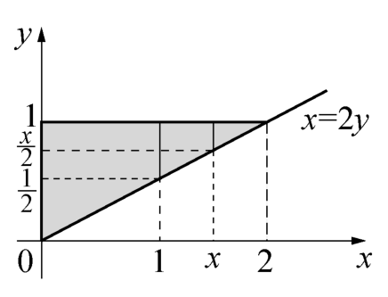

（4）因为 $\Omega_{Y\mid X=1}=\left(\frac{1}{2}，1\right)$，所以当 $\frac{1}{2}<y<1$ 时，

$$
F_{Y\mid X}(y\mid 1)=\int_{-\infty}^{y}f_{Y\mid X}(v\mid 1)\mathrm{d}v=\int_{\frac{1}{2}}^{y}\frac{24}{7}v^2\mathrm{d}v=\frac{8}{7}y^3-\frac{1}{7}.
$$

故

$$
F_{Y\mid X}(y\mid 1)=\begin{cases}
0，& y<\frac{1}{2}，\\
\frac{8}{7}y^3-\frac{1}{7}，& \frac{1}{2}\leqslant y<1，\\
1，& y\geqslant 1.
\end{cases}
$$

**例 4** 已知 $X\sim U(1，2)$，当 $1<x<2$ 时，$Y\mid X=x\sim N(x，\sigma^2)$，求 $(X，Y)$ 的联合密度函数。

解 由已知得 $f_X(x)=\begin{cases}1，& 1<x<2，\\ 0，& \text{其他}.\end{cases}$ 当 $1<x<2$ 时，

$$
f_{Y\mid X}(y\mid x)=\frac{1}{\sqrt{2\pi}\sigma}\mathrm{e}^{-\frac{(y-x)^2}{2\sigma^2}}，-\infty<y<+\infty.
$$

由条件密度函数的定义知 $f(x，y)=f_X(x)\cdot f_{Y\mid X}(y\mid x)$，所以

$$
f(x，y)=\begin{cases}
\frac{1}{\sqrt{2\pi}\sigma}\mathrm{e}^{-\frac{(y-x)^2}{2\sigma^2}}，& 1<x<2，-\infty<y<+\infty，\\
0，& \text{其他}.
\end{cases}
$$

和离散型情形相类似，知道 $X$ 的边缘密度函数及 $X$ 任取一个固定值时 $Y$ 的条件密度函数，则可唯一确定联合密度函数。

### 习题 3-4

**1.** 在习题 3-1 的第 1 题中，求：

（1）给定条件 $\{X_1=1\}$ 下 $X_2$ 的条件分布律；

（2）给定条件 $\{X_2=0\}$ 下 $X_1$ 的条件分布律；

（3）给定条件 $\{X_2=0\}$ 下 $X_1$ 的条件分布函数 $F_{X_1\mid X_2}(x_1\mid 0)$。

**2.** 在习题 3-1 的第 2 题中，求：

（1）给定条件 $\{Y=1\}$ 下 $X$ 的条件分布律；

（2）给定条件 $\{X=1\}$ 下 $Y$ 的条件分布律。

**3.** 在习题 3-2 的第 2 题中，求：

（1）条件密度函数 $f_{X\mid Y}(x\mid 1)$ 与 $f_{X\mid Y}(x\mid y)$，其中 $|y|<2$；

（2）条件概率 $P(X\leqslant\sqrt{2}\mid Y=1)$；

（3）给定条件 $\{Y=1\}$ 下 $X$ 的条件分布函数 $F_{X\mid Y}(x\mid 1)$；

（4）给定条件 $\{Y=y\}$ 下 $X$ 的条件分布函数 $F_{X\mid Y}(x\mid y)$，其中 $|y|<2$。

**4.** 已知 $(X，Y)$ 的联合密度函数为

$$
f(x，y)=\begin{cases}
2\mathrm{e}^{-(x+2y)}，& x>0，y>0，\\
0，& \text{其他}.
\end{cases}
$$

求：

（1）条件密度函数 $f_{X\mid Y}(x\mid 1)$ 与 $f_{X\mid Y}(x\mid y)$，其中 $y>0$；

（2）$(X，Y)$ 的联合分布函数；

（3）概率 $P(X<1，Y>2)$。

**5.** 设随机变量 $(X，Y)$ 服从二维正态分布，且 $X$ 与 $Y$ 相互独立，$f_X(x)$，$f_Y(y)$ 分别表示 $X$，$Y$ 的密度函数。计算给定条件 $\{Y=y\}$ 下，$X$ 的条件密度函数 $f_{X\mid Y}(x\mid y)$。

**6.** 设随机变量 $X\sim E(1)$，当已知 $X=x$ 时，$Y\sim U(0，x)$，其中 $x>0$。试求 $(X，Y)$ 的联合密度函数。

**7.** 设某班车起点站上客人数 $X$ 服从参数为 $\lambda(\lambda>0)$ 的泊松分布，每位乘客在中途下车的概率为 $p(0<p<1)$，且中途下车与否相互独立。以 $Y$ 表示中途下车的人数。

（1）求发车时上客人数为 $n$ 的条件下，中途有 $m$ 人下车的概率 $P\{Y=m\mid X=n\}$；

（2）求二维随机变量 $(X，Y)$ 的联合分布律；

（3）试证，$Y$ 服从参数为 $\lambda p$ 的泊松分布。［提示：$P(Y=m)=\sum\limits_{n=m}^{\infty}P(X=n)P(Y=m\mid X=n)$。］

## 第五节 二维随机变量函数的分布

在实际工作中，要讨论随机变量函数的分布情况。比如，某高速路收费站在早高峰时间段内到达的客车车流量和货车车流量 $(X，Y)$ 的联合分布已知，问该高速路收费站在早高峰时间段内到达的总车流量的分布。这里，就要计算 $(X，Y)$ 的函数 $Z=X+Y$ 的分布。

### 一、二维离散型随机变量函数的分布

**例 1** 在第一节例 2 中，讨论得优的科目数 $Z=X+Y$ 的分布情况，求 $Z$ 的分布律。

解 **方法一**

因为 $\Omega_Z=\{0，1，2\}$，那么

$$
P(Z=0)=P(X=0，Y=0)=0.78，
$$

$$
P(Z=1)=P(X=1，Y=0)+P(X=0，Y=1)=0.12+0.02=0.14，
$$

$$
P(Z=2)=P(X=1，Y=1)=0.08.
$$

所以

| $Z$ | 0 | 1 | 2 |
| --- | --- | --- | --- |
| 概率 | 0.78 | 0.14 | 0.08 |

**方法二**

直接在 $(X，Y)$ 的联合分布律表格中每格左上角标出 $Z$ 的取值，有

| $X\backslash Y$ | 0 | 1 |
| --- | --- | --- |
| 0 | $^{0}0.78$ | $^{1}0.02$ |
| 1 | $^{1}0.12$ | $^{2}0.08$ |

将 $Z$ 取值相同格子中的概率相加，即得

| $Z$ | 0 | 1 | 2 |
| --- | --- | --- | --- |
| 概率 | 0.78 | 0.14 | 0.08 |

因此，有如下结论。

如果二维离散型随机变量 $(X，Y)$ 的联合分布律为

$$
P(X=x_i，Y=y_j)=p_{ij}，\quad i，j=1，2，\cdots，
$$

则随机变量 $(X，Y)$ 的函数 $Z=g(X，Y)$ 的分布律为，

$$
P(Z=g(x_i，y_j))=p_{ij}，\quad i，j=1，2，\cdots，
$$

且取相同 $g(x_i，y_j)$ 值对应的那些概率应合并相加。

特别地有下面的结论：

**定理 1** （1）设 $X\sim B(m，p)$，$Y\sim B(n，p)$，且 $X$ 与 $Y$ 相互独立，则

$$
X+Y\sim B(m+n，p)；
$$

（2）设 $X\sim P(\lambda_1)$，$Y\sim P(\lambda_2)$，且 $X$ 与 $Y$ 相互独立，则

$$
X+Y\sim P(\lambda_1+\lambda_2).
$$

**证明** （1）因为 $X\sim B(m，p)$，$Y\sim B(n，p)$，那么，$X$ 与 $Y$ 分别表示 $m$ 与 $n$ 重伯努利试验中“成功”的次数。可设 $U_i=\begin{cases}1，& \text{第 }i\text{ 次试验“成功”}，\\ 0，& \text{否则}，\end{cases}$，$U_i\sim B(1，p)$，$i=1，2，\cdots，m$，$\cdots$，$m+n$，则 $X=\sum\limits_{i=1}^{m}U_i$，$Y=\sum\limits_{i=m+1}^{m+n}U_i$。由 $n$ 重伯努利试验的相互独立性及重复性可知，这里 $U_1$，$U_2$，$\cdots$，$U_m$ 相互独立并且同分布，$U_{m+1}$，$U_{m+2}$，$\cdots$，$U_{m+n}$ 也相互独立并且同分布。又因为 $X$ 与 $Y$ 相互独立，所以 $U_1$，$U_2$，$\cdots$，$U_m$，$U_{m+1}$，$U_{m+2}$，$\cdots$，$U_{m+n}$ 相互独立。那么，$X+Y=\sum\limits_{i=1}^{m+n}U_i$ 表示 $m+n$ 重伯努利试验中“成功”的次数，由此得到，$X+Y\sim B(m+n，p)$。

（2）因为

$$
\begin{aligned}
P(X+Y=k)&=\sum_{n=0}^{k}P(X=n)P(X+Y=k\mid X=n)=\sum_{n=0}^{k}P(X=n)P(Y=k-n\mid X=n)\\
&=\sum_{n=0}^{k}P(X=n)P(Y=k-n)=\sum_{n=0}^{k}\mathrm{e}^{-\lambda_1}\frac{\lambda_1^n}{n!}\cdot\mathrm{e}^{-\lambda_2}\frac{\lambda_2^{k-n}}{(k-n)!}\\
&=\frac{\mathrm{e}^{-(\lambda_1+\lambda_2)}}{k!}\sum_{n=0}^{k}\binom{k}{n}\lambda_1^n\lambda_2^{k-n}\\
&=\frac{\mathrm{e}^{-(\lambda_1+\lambda_2)}}{k!}(\lambda_1+\lambda_2)^k，\quad k=0，1，\cdots，
\end{aligned}
$$

所以，$X+Y\sim P(\lambda_1+\lambda_2)$。

定理 1 的结论可推广至相互独立的 $n$ 个随机变量之和的情形。由定理 1 可知，相互独立的“成功”概率相同的二项分布之和仍服从二项分布；相互独立的泊松分布之和仍服从泊松分布。概率论中将同类型且相互独立的随机变量之和仍服从该类型分布的性质称为该分布具有可加性。并不是所有类型的分布都具有可加性。这里要求随机变量相互独立，从证明过程中可知，若不满足这一条件，结论则不成立。

### 二、二维连续型随机变量函数的分布

同一维连续型随机变量函数的分布计算方法类似，可以采用分布函数法计算二维连续型随机变量函数的分布。

设二维连续型随机变量 $(X，Y)$ 的联合密度函数为 $f(x，y)$，则随机变量 $(X，Y)$ 的二元函数 $Z=g(X，Y)$ 的分布函数为

$$
F_Z(z)=P(Z\leqslant z)=P(g(X，Y)\leqslant z)=P((X，Y)\in D_z)=\iint_{D_z}f(x，y)\mathrm{d}x\mathrm{d}y，
$$

其中，$\{(X，Y)\in D_z\}$ 是与 $\{g(X，Y)\leqslant z\}$ 等价的随机事件，而 $D_z=\{(x，y)：g(x，y)\leqslant z\}$ 是 $xoy$ 平面上的点集（通常是一个区域或者若干个区域的并集）。则 $Z=g(X，Y)$ 的密度函数为 $f_Z(z)=F'_Z(z)$。这种计算二维连续型随机变量函数分布的方法称为分布函数法。

**例 2** 设二维随机变量 $(X，Y)$ 的联合密度函数为

$$
f(x，y)=\begin{cases}
6x，& 0\leqslant x\leqslant y<1，\\
0，& \text{其他}.
\end{cases}
$$

求 $Z=X+Y$ 的密度函数 $f_Z(z)$。

解 （1）因为 $\Omega_Z=(0，2)$，如图 3.13 所示，当 $0\leqslant z<1$ 时，

$$
F_Z(z)=P(Z\leqslant z)=P(X+Y\leqslant z)=\int_0^{\frac{z}{2}}\mathrm{d}x\int_x^{z-x}6x\mathrm{d}y=\int_0^{\frac{z}{2}}6x(z-2x)\mathrm{d}x=\frac{1}{4}z^3.
$$

当 $1\leqslant z<2$ 时，$F_Z(z)=P(Z\leqslant z)=P(X+Y\leqslant z)$

$$
1-\int_{\frac{z}{2}}^{1}\mathrm{d}y\int_{z-y}^{y}6x\mathrm{d}x=1-\int_{\frac{z}{2}}^{1}3y^2-3(z-y)^2\mathrm{d}y
$$

$$
=1-\int_{\frac{z}{2}}^{1}6zy-3z^2\mathrm{d}y=1-3\left[zy^2-z^2y\right]_{\frac{z}{2}}^{1}
$$

$$
=-\frac{3}{4}z^3+3z^2-3z+1，
$$

整理得

$$
F_Z(z)=\begin{cases}
0，& z<0，\\
\frac{1}{4}z^3，& 0\leqslant z<1，\\
-\frac{3}{4}z^3+3z^2-3z+1，& 1\leqslant z<2，\\
1，& z\geqslant 2.
\end{cases}
$$

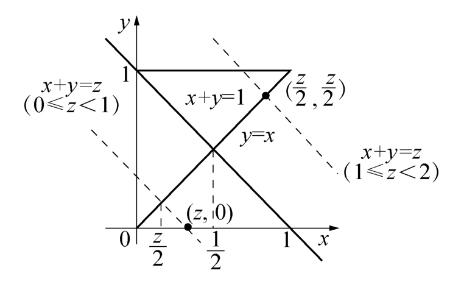

求导得

$$
f_Z(z)=\begin{cases}
\frac{3}{4}z^2，& 0<z<1，\\
-\frac{9}{4}z^2+6z-3，& 1<z<2，\\
0，& \text{其他}.
\end{cases}
$$

**定理 2** 设随机变量 $(X，Y)$ 的联合密度函数为 $f(x，y)$，且 $X$ 的边缘密度函数为 $f_X(x)$，$Y$ 的边缘密度函数为 $f_Y(y)$。则随机变量 $(X，Y)$ 的函数 $Z=X+Y$ 的密度函数为

$$
f_Z(z)=\int_{-\infty}^{+\infty}f(x，z-x)\mathrm{d}x \text{ 或 } f_Z(z)=\int_{-\infty}^{+\infty}f(z-y，y)\mathrm{d}y.
$$

特别地，当随机变量 $X$ 与 $Y$ 相互独立时，

$$
f_Z(z)=\int_{-\infty}^{+\infty}f_X(x)f_Y(z-x)\mathrm{d}x \text{ 或 } f_Z(z)=\int_{-\infty}^{+\infty}f_X(z-y)f_Y(y)\mathrm{d}y.
$$

**证明** 对任意的 $z\in R$，

$$
F_Z(z)=P(Z\leqslant z)=P(X+Y\leqslant z)=\iint_{x+y\leqslant z}f(x，y)\mathrm{d}x\mathrm{d}y=\int_{-\infty}^{+\infty}\left[\int_{-\infty}^{z-x}f(x，y)\mathrm{d}y\right]\mathrm{d}x
$$

$$
\xlongequal{\text{令 }u=x+y}\int_{-\infty}^{+\infty}\left[\int_{-\infty}^{z}f(x，u-x)\mathrm{d}u\right]\mathrm{d}x=\int_{-\infty}^{z}\left[\int_{-\infty}^{+\infty}f(x，u-x)\mathrm{d}x\right]\mathrm{d}u
$$

由 $z$ 的任意性知

$$
f_Z(z)=\int_{-\infty}^{+\infty}f(x，z-x)\mathrm{d}x.
$$

同理有 $f_Z(z)=\int_{-\infty}^{+\infty}f(z-y，y)\mathrm{d}y$。

显然，当随机变量 $X$ 与 $Y$ 相互独立时，

$$
f_Z(z)=\int_{-\infty}^{+\infty}f_X(x)f_Y(z-x)\mathrm{d}x，f_Z(z)=\int_{-\infty}^{+\infty}f_X(z-y)f_Y(y)\mathrm{d}y.
$$

这两个公式称为卷积公式。在概率论中计算相互独立的随机变量之和分布的运算称为卷积运算。

**定理 3** 设 $X\sim N(\mu_1，\sigma_1^2)$，$Y\sim N(\mu_2，\sigma_2^2)$，且 $X$ 与 $Y$ 相互独立，则 $X+Y\sim N(\mu_1+\mu_2，\sigma_1^2+\sigma_2^2)$。

**证明** 由卷积公式得

$$
f_Z(z)=\int_{-\infty}^{+\infty}f_X(x)f_Y(z-x)\mathrm{d}x
$$

$$
=\int_{-\infty}^{+\infty}\frac{1}{\sqrt{2\pi}\sigma_1}\mathrm{e}^{-\frac{(x-\mu_1)^2}{2\sigma_1^2}}\cdot\frac{1}{\sqrt{2\pi}\sigma_2}\mathrm{e}^{-\frac{(z-x-\mu_2)^2}{2\sigma_2^2}}\mathrm{d}x
$$

$$
=\int_{-\infty}^{+\infty}\frac{1}{2\pi\sigma_1\sigma_2}\exp\left\{-\frac{1}{2}\left[\frac{(x-\mu_1)^2}{\sigma_1^2}+\frac{(z-x-\mu_2)^2}{\sigma_2^2}\right]\right\}\mathrm{d}x
$$

$$
=\frac{1}{2\pi\sigma_1\sigma_2}\int_{-\infty}^{+\infty}\exp\left\{-\frac{1}{2}\left[\left(\frac{1}{\sigma_1^2}+\frac{1}{\sigma_2^2}\right)x^2-2\left(\frac{\mu_1}{\sigma_1^2}+\frac{z-\mu_2}{\sigma_2^2}\right)x+\left(\frac{\mu_1^2}{\sigma_1^2}+\frac{(z-\mu_2)^2}{\sigma_2^2}\right)\right]\right\}\mathrm{d}x.
$$

令 $a=\frac{1}{\sigma_1^2}+\frac{1}{\sigma_2^2}$，$b=\frac{\mu_1}{\sigma_1^2}+\frac{z-\mu_2}{\sigma_2^2}$，$c=\frac{\mu_1^2}{\sigma_1^2}+\frac{(z-\mu_2)^2}{\sigma_2^2}$ 代入［课前导读］中的积分公式得

$$
f_Z(z)=\frac{1}{\sqrt{2\pi(\sigma_1^2+\sigma_2^2)}}\mathrm{e}^{-\frac{[z-(\mu_1+\mu_2)]^2}{2(\sigma_1^2+\sigma_2^2)}}.
$$

所以，$X+Y\sim N(\mu_1+\mu_2，\sigma_1^2+\sigma_2^2)$。

定理 3 可推广至 $n$ 个相互独立正态分布随机变量的情形。

**例 3** 已知 $(X，Y)\sim N(1，2，3，4，0)$，求 $Z=-X+2Y+3$ 的密度函数。

解 由第三节的定理 1 得 $X\sim N(1，3)$，$Y\sim N(2，4)$。因为 $\rho=0$，由第三节的定理 4 可知，$X$ 与 $Y$ 相互独立。又由定理 3 得，$Z=-X+2Y+3\sim N(6，19)$，所以

$$
f_Z(z)=\frac{1}{\sqrt{38\pi}}\mathrm{e}^{-\frac{(z-6)^2}{38}}，-\infty<z<+\infty.
$$

**例 4** 在例 2 中，利用定理 2 求 $Z$ 的密度函数。

解 因为 $\Omega_Z=(0，2)$，由定理 2 知，$Z=X+Y$ 的密度函数为

$$
f_Z(z)=\int_{-\infty}^{+\infty}f(x，z-x)\mathrm{d}x，
$$

当 $0\leqslant x\leqslant z-x\leqslant 1$ 时，即当 $\begin{cases}0\leqslant x\leqslant\frac{z}{2}\\ x\geqslant z-1\end{cases}$ 时，$f(x，z-x)=6x$。

否则 $f(x，z-x)=0$。于是

当 $0<z<1$ 时，$f_Z(z)=\int_0^{z}6x\mathrm{d}x=\frac{3}{4}z^2$，如图 3.14 所示；

当 $1<z<2$ 时，$f_Z(z)=\int_{z-1}^{\frac{z}{2}}6x\mathrm{d}x=-\frac{9}{4}z^2+6z-3$，如图 3.14 所示。

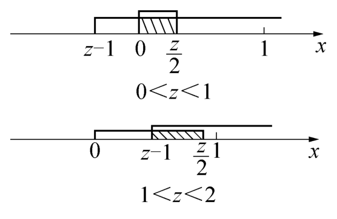所以 $f_Z(z)=\begin{cases}
\frac{3}{4}z^2，& 0<z<1，\\
-\frac{9}{4}z^2+6z-3，& 1<z<2，\\
0，& \text{其他}.
\end{cases}$

本题的解题关键之处在于对区间的讨论。

**例 5** 已知随机变量 $X$ 与 $Y$ 相互独立，且都服从 $[0，1]$ 上的均匀分布。求 $Z=\frac{Y}{X}$ 的密度函数 $f_Z(z)$。

解 因为 $\Omega_Z=[0，+\infty)$，所以当 $z\geqslant 0$ 时，$F_Z(z)=P\left(\frac{X}{Y}\leqslant z\right)=\iint\limits_{\frac{x}{y}\leqslant z}f(x，y)\mathrm{d}x\mathrm{d}y$，分情况讨论。如图 3.15 所示。

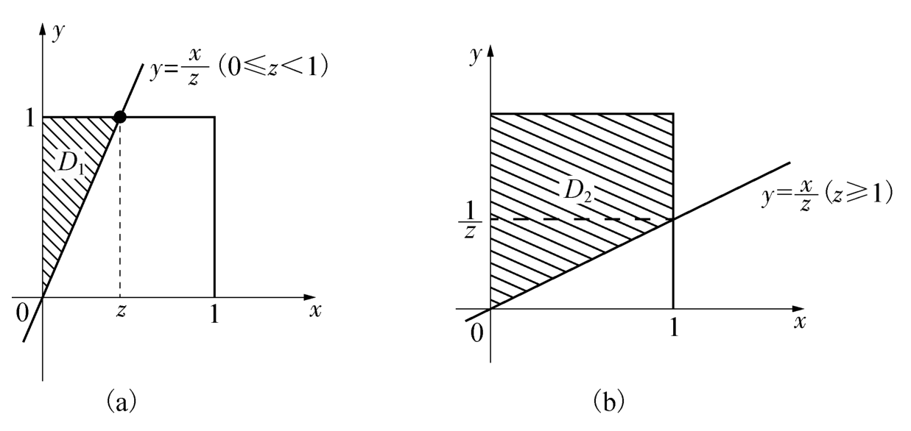

当 $0\leqslant z<1$ 时，$F_Z(z)=\iint\limits_{D_1}1\mathrm{d}x\mathrm{d}y=S_{D_1}=\frac{z}{2}$；

当 $z\geqslant 1$ 时，$F_Z(z)=\iint\limits_{D_2}1\mathrm{d}x\mathrm{d}y=S_{D_2}=1-\frac{1}{2z}$。

所以 $F_Z(z)=\begin{cases}
0，& z<0，\\
\frac{z}{2}，& 0\leqslant z<1，\\
1-\frac{1}{2z}，& z\geqslant 1.
\end{cases}$

则 $f_Z(z)=\begin{cases}
\frac{1}{2}，& 0<z<1，\\
\frac{1}{2z^2}，& z>1，\\
0，& \text{其他}.
\end{cases}$

### 三、最大值和最小值的分布

**定理 4** 设连续型随机变量 $X$ 与 $Y$ 相互独立，且 $X$ 的分布函数为 $F_X(x)$，$Y$ 的分布函数为 $F_Y(y)$。则

（1）随机变量 $U=\max(X，Y)$ 的分布函数为 $F_U(u)=F_X(u)F_Y(u)$；

（2）随机变量 $V=\min(X，Y)$ 的分布函数为 $F_V(v)=1-(1-F_X(v))(1-F_Y(v))$。

通过求导，可以求得 $U$，$V$ 的密度函数。

**证明** 由分布函数的定义及 $X$ 与 $Y$ 相互独立得

$$
F_U(u)=P(\max(X，Y)\leqslant u)=P(X\leqslant u，Y\leqslant u)
$$

$$
=P(X\leqslant u)P(Y\leqslant u)=F_X(u)F_Y(u)；
$$

$$
F_V(v)=P(\min(X，Y)\leqslant v)=1-P(\min(X，Y)>v)
$$

$$
=1-P(X>v，Y>v)=1-P(X>v)P(Y>v)
$$

$$
=1-(1-F_X(v))(1-F_Y(v)).
$$

定理 4 可推广至 $n$ 个相互独立的随机变量的情形。

设连续型随机变量 $X_1$，$X_2$，$\cdots$，$X_n$ 互相独立，且 $X_i$ 的分布函数为 $F_{X_i}(x)$，$i=1$，2，$\cdots$，$n$，则

（1）随机变量 $U=\max(X_1，X_2，\cdots，X_n)$ 的分布函数为 $F_U(u)=\prod\limits_{i=1}^{n}F_{X_i}(u)$；

（2）随机变量 $V=\min(X_1，X_2，\cdots，X_n)$ 的分布函数为 $F_V(v)=1-\prod\limits_{i=1}^{n}(1-F_{X_i}(v))$。

**例 6** 设 $X_1$ 与 $X_2$ 是相互独立的随机变量，且 $X_1\sim E(\lambda_1)$，$X_2\sim E(\lambda_2)$。记 $U=\max(X_1，X_2)$，$V=\min(X_1，X_2)$。分别求 $U$，$V$ 的密度函数 $f_U(u)$ 和 $f_V(v)$。

解 因为 $\Omega_U=[0，+\infty)$，那么由定理 4 可得

$$
F_U(u)=\begin{cases}
0，& u<0，\\
(1-\mathrm{e}^{-\lambda_1u})(1-\mathrm{e}^{-\lambda_2u})，& u\geqslant 0.
\end{cases}
$$

所以

$$
f_U(u)=\begin{cases}
\lambda_1\mathrm{e}^{-\lambda_1u}(1-\mathrm{e}^{-\lambda_2u})+\lambda_2\mathrm{e}^{-\lambda_2u}(1-\mathrm{e}^{-\lambda_1u})，& u>0，\\
0，& \text{其他}.
\end{cases}
$$

因为 $\Omega_V=[0，+\infty)$，那么由定理 4 可得

$$
F_V(v)=\begin{cases}
0，& v<0，\\
1-\mathrm{e}^{-(\lambda_1+\lambda_2)v}，& v\geqslant 0.
\end{cases}
$$

可知 $V\sim E(\lambda_1+\lambda_2)$，故

$$
f_V(v)=\begin{cases}
(\lambda_1+\lambda_2)\mathrm{e}^{-(\lambda_1+\lambda_2)v}，& v>0，\\
0，& \text{其他}.
\end{cases}
$$

由例 4 可知指数分布的最小值仍服从指数分布，这称为指数分布最小值的不变性。这个结论可推广至 $n$ 个相互独立的指数分布随机变量的情形。

若 $X$ 与 $Y$ 是离散型随机变量，$(X，Y)$ 的联合分布律为 $P(X=x_i，Y=y_j)=p_{ij}$，$i，j=1$，2，$\cdots$，则

（1）随机变量函数 $U=\max(X，Y)$ 的分布律为 $P(U=\max(x_i，y_j))=p_{ij}$，$i，j=1$，2，$\cdots$，但要注意，$\max(x_i，y_j)$ 取值相同时对应的概率应合并相加；

（2）随机变量函数 $V=\min(X，Y)$ 的分布律为 $P(V=\min(x_i，y_j))=p_{ij}$，$i，j=1$，2，$\cdots$，但要注意，$\min(x_i，y_j)$ 取值相同时对应的概率应合并相加。

### 习题 3-5

**1.** 已知 $(X，Y)$ 的联合分布律如下：

（1）分别求 $U=\max(X，Y)$，$V=\min(X，Y)$ 的分布律；

| $X\backslash Y$ | $-2$ | $-1$ | 0 | 1 | 4 |
| --- | --- | --- | --- | --- | --- |
| 0 | 0.2 | 0 | 0.1 | 0.2 | 0 |
| 1 | 0 | 0.2 | 0.1 | 0 | 0.2 |

（2）求 $(U，V)$ 的联合分布律。

**2.** 设随机变量 $X$，$Y$ 相互独立同分布，它们都服从 $0-1$ 分布 $B(1，p)$。记随机变量 $Z$ 如下：

$$
Z=\begin{cases}
1，& \text{如果 }X+Y\text{ 为零或偶数}，\\
0，& \text{如果 }X+Y\text{ 为奇数}.
\end{cases}
$$

（1）求 $Z$ 的分布律；

（2）求 $(X，Z)$ 的联合分布律；

（3）当 $p$ 取何值时，$X$ 与 $Z$ 相互独立？

**3.** 设两个相互独立的随机变量 $X$ 与 $Y$ 分别服从正态分布 $N(0，1)$ 和 $N(1，1)$。

（1）分别计算 $Z=X+Y$ 和 $W=X-Y$ 的密度函数；

（2）计算概率 $P(X+Y\leqslant 1)$。

**4.** 设 $X$ 与 $Y$ 相互独立，且 $X\sim N(2，1)$，$Y\sim N(1，2)$，试求 $Z=2X-Y+3$ 的密度函数。

**5.** 设 $X$ 与 $Y$ 是相互独立同分布的随机变量，且都服从均匀分布 $U(0，1)$，求 $Z=X+Y$ 的分布函数与密度函数。要求用分布函数法和卷积公式法两种方法进行计算。

**6.** 设 $X_1$，$X_2$，$\cdots$，$X_n$ 是相互独立同分布的随机变量，且它们都服从指数分布 $E(\lambda)$，记 $U=\max\limits_{1\leqslant i\leqslant n}X_i$，$V=\min\limits_{1\leqslant i\leqslant n}X_i$。

（1）求 $U$ 的密度函数；

（2）证明 $V\sim E(n\lambda)$。

**7.** 设随机变量 $X$ 与 $Y$ 相互独立，且 $X\sim E(1)$，$Y\sim E(2)$，求 $Z=\frac{X}{Y}$ 的密度函数 $f_Z(z)$。

**8.** 设随机变量 $(X，Y)$ 服从区域 $D=\{(x，y)\mid 1\leqslant x，y\leqslant 3\}$ 上的二维均匀分布，求 $Z=|X-Y|$ 的密度函数 $f_Z(z)$。

**9.** 设随机变量 $(X，Y)$ 的联合密度函数为

$$
f(x，y)=\begin{cases}
\mathrm{e}^{-(x+y)}，& x>0，y>0，\\
0，& \text{其他}.
\end{cases}
$$

记 $Z=X-Y$，求：

（1）概率 $P(X-Y<2)$；

（2）$Z$ 的密度函数。

**10.** 设 $X$ 与 $Y$ 相互独立，且 $X\sim U(0，2)$，$Y\sim U(0，1)$，试求 $Z=XY$ 的密度函数。

**11.** 设某商店一天的需求量是一个随机变量 $X$，它的密度函数为

$$
f(x)=\begin{cases}
x\mathrm{e}^{-x}，& x>0，\\
0，& \text{其他}.
\end{cases}
$$

试求该商店两天的需求量 $Y$ 的密度函数，假定各天的需求量相互独立。要求用分布函数法和卷积公式法两种方法进行计算。

**12.** 设随机变量 $X$ 与 $Y$ 相互独立，其中 $X$ 的分布律为

| $X$ | 1 | 2 |
| --- | --- | --- |
| 概率 | 0.3 | 0.7 |

而 $Y$ 的密度函数为 $f(y)$，求随机变量 $Z=X+Y$ 的密度函数 $f_Z(z)$。

## 本章小结

|  |  |
| --- | --- |
| 二维随机变量的定义及分布 | **理解** 二维随机变量的定义 **掌握** 二维随机变量的联合分布函数的定义、性质及计算 **掌握** 联合分布律和联合密度函数的定义、性质及计算 **掌握** 二维随机变量相关事件概率的计算 |
| 二维随机变量的边缘分布 | **掌握** 二维随机变量的边缘分布函数的定义及计算 **掌握** 二维离散型随机变量边缘分布律的定义及计算 **掌握** 二维连续型随机变量边缘密度函数的定义及计算 **熟练** 两个随机变量相互独立的定义及判别方法 **了解** $n$ 个随机变量相互独立的定义及判别方法 **理解** 随机变量相互独立的概念 **掌握** 随机变量相互独立的判断方法 |
| 二维随机变量的条件分布 | **掌握** 二维随机变量的条件分布律、条件密度函数以及条件分布函数的定义及计算 |
| 随机变量函数的分布 | **掌握** 二维随机变量函数分布的计算 **熟练** 相互独立的随机变量之和以及最大值、最小值的分布函数的计算 |
| 常用的二维随机变量 | **掌握** 二维均匀分布 **了解** 二维正态分布的密度函数 **掌握** 二维正态分布的性质 |
| 二维正态分布的结论 | **理解** 二维正态分布的边缘分布仍是正态分布 **理解** 二维正态分布的条件分布仍是正态分布 **理解** 两个相互独立正态分布的线性组合仍是正态分布 **理解** 服从二维正态分布的随机变量相互独立的充要条件是 $\rho=0$ **理解** 一个正态分布的线性变换仍是正态分布 **理解** 两个随机变量服从正态分布，但联合分布不一定是二维正态分布 |

## 拓展阅读

### 麦克斯韦速度分布函数及麦克斯韦速率分布函数

研究热现象微观理论的关键方法是统计方法，通过统计方法可建立系统状态的宏观量与相应的微观量之间的联系。而统计理论中最基础的理论是概率论，它是学习热力学时首先要掌握的。

任何宏观物理系统的温度都是组成该系统的分子和原子的运动的结果。对一个由气体构成的系统而言，气体分子的热运动是无序的，分子之间以及分子与容器内壁的随机碰撞，使单个分子的运动速度的大小和方向不断地发生随机变化，这完全是偶然的。但就大量分子的整体而言，这种无序热运动却是有统计规律可循的。在平衡状态下，分子在各个方向上运动的机会是均等的，分子按速度有确定的分布规律，处于一个特定的速度范围的粒子所占的比例几乎不变。这个规律也叫麦克斯韦速度分布律。

1859 年，J. C. 麦克斯韦（James Clerk Maxwell，1831 年—1879 年）首先用概率的方法获得气体分子速度的分布规律，然后由 L. 玻耳兹曼通过碰撞理论将其严格推导出。

设 $(V_x，V_y，V_z)^{\mathrm{T}}$ 是气体分子在三维空间中的速度分量构成的随机向量，它服从三维正态分布 $N(\boldsymbol{\mu}，\boldsymbol{C})$，其中 $\boldsymbol{\mu}=(0，0，0)^{\mathrm{T}}$，$\boldsymbol{C}=\frac{kT}{m}\boldsymbol{I}_3$，$\boldsymbol{I}_3$ 是 3 阶单位矩阵。则其联合密度函数为

$$
f(v_x，v_y，v_z)=\left(\frac{m}{2\pi kT}\right)^{\frac{3}{2}}\exp\left[-\frac{m(v_x^2+v_y^2+v_z^2)}{2kT}\right]，
$$

在物理中称其为麦克斯韦速度分布函数。其中，$k$ 是玻尔兹曼常数，$T$ 为气体温度，$m$ 为气体质量。那么，根据 $n$ 维正态分布的性质知：速度分量 $V_x$，$V_y$，$V_z$ 相互独立且都服从 $N\left(0，\frac{kT}{m}\right)$。可得分子在各个方向上运动的机会均等且互不干扰，这在物理中被称为分子的运动无择优方向。

经过如下计算可得气体分子的速率 $Z=\sqrt{V_x^2+V_y^2+V_z^2}$ 的密度函数。

因为 $\Omega_Z=[0，+\infty)$，由球面坐标变换 $x=\rho\cos\theta\sin\varphi$，$y=\rho\sin\theta\sin\varphi$，$z=\rho\cos\varphi$ 得，当 $z\geqslant 0$ 时，

$$
F_Z(z)=\iiint\limits_{\sqrt{v_x^2+v_y^2+v_z^2}\leqslant z}\left(\frac{m}{2\pi kT}\right)^{\frac{3}{2}}\exp\left[-\frac{m(v_x^2+v_y^2+v_z^2)}{2kT}\right]\mathrm{d}v_x\mathrm{d}v_y\mathrm{d}v_z
$$

$$
=\int_0^{2\pi}\mathrm{d}\theta\int_0^{\pi}\sin\varphi\mathrm{d}\varphi\int_0^{z}\left(\frac{m}{2\pi kT}\right)^{\frac{3}{2}}\exp\left(-\frac{m\rho^2}{2kT}\right)\rho^2\mathrm{d}\rho=4\pi\int_0^{z}\left(\frac{m}{2\pi kT}\right)^{\frac{3}{2}}\exp\left(-\frac{m\rho^2}{2kT}\right)\rho^2\mathrm{d}\rho，
$$

求导得

$$
f_Z(z)=\sqrt{\frac{2}{\pi}}\left(\frac{m}{kT}\right)^{\frac{3}{2}}z^2\exp\left(-\frac{mz^2}{2kT}\right).
$$

$f_Z(z)$ 即为速率的密度函数，在物理中称其为麦克斯韦速率分布函数。$Z$ 所服从的分布称为麦克斯韦分布。这种分布对物理学中的热学发展起到了推动作用。

## 测试题三

**1.** 设随机变量 $X$ 与 $Y$ 相互独立，且都服从区间 $[0，3]$ 上的均匀分布。计算概率 $P(\max(X，Y)\leqslant 1)$。

**2.** 设随机变量 $(X，Y)$ 的联合密度函数为

$$
f(x，y)=\begin{cases}
k，& 0\leqslant x^2<y<x\leqslant 1，\\
0，& \text{其他}.
\end{cases}
$$

（1）求 $k$ 的值；

（2）求 $X$，$Y$ 的边缘密度函数；

（3）计算概率 $P(X\geqslant 0.5)$，$P(Y<0.5)$。

**3.** 设随机变量 $X$ 与 $Y$ 相互独立，且 $X\sim U(0，1)$，$Y\sim E(1)$，求随机变量 $Z=2X+Y$ 的密度函数。

**4.** 设随机变量 $(X，Y)$ 的联合分布函数为

$$
F(x，y)=\begin{cases}
1-\mathrm{e}^{-2x}-\mathrm{e}^{-y}+\mathrm{e}^{-(2x+y)}，& x\geqslant 0，y\geqslant 0，\\
0，& \text{其他}.
\end{cases}
$$

（1）求 $X$ 与 $Y$ 的边缘分布函数 $F_X(x)$，$F_Y(y)$ 和边缘密度函数 $f_X(x)$，$f_Y(y)$；

（2）计算 $P(X+Y<1)$。

**5.** 设二维随机变量 $(X，Y)$ 在 $D$ 上服从均匀分布，$D$ 是由直线 $y=x$ 与曲线 $y=x^3$ 所围成的区域。

（1）分别求 $X$、$Y$ 的边缘密度函数；

（2）当 $x\in\Omega_X$ 时，求条件密度函数 $f_{Y\mid X}(y\mid x)$；

（3）$X$ 与 $Y$ 是否相互独立？为什么？

**6.** 设二维随机变量 $(X，Y)$ 的联合密度函数为

$$
f(x，y)=\begin{cases}
\mathrm{e}^{-x}，& 0<y<x，\\
0，& \text{其他}.
\end{cases}
$$

（1）当 $x\in\Omega_X$ 时，求条件密度函数 $f_{Y\mid X}(y\mid x)$；

（2）求条件概率 $P(X\leqslant 1\mid Y\leqslant 1)$。

**7.** 设平面区域 $D$ 是由坐标为 $(0，0)$，$(0，1)$，$(1，0)$，$(1，1)$ 的四个顶点围成的正方形，今向 $D$ 内随机地投入 10 个点，求这 10 个点中至少有 2 个点落在由曲线 $y=x$，$y=x^2$ 所围成的区域 $D_1$ 中的概率。

**8.** 随机变量 $X$，$Y$ 相互独立同分布，且 $X$ 分布函数为 $F(x)$，求 $Z=\max\{X，Y\}$ 的分布函数。

**9.** 设随机变量 $X$ 与 $Y$ 相互独立，且 $X$ 服从标准正态分布 $N(0，1)$，$Y$ 的概率分布为 $P(Y=0)=P(Y=1)=\frac{1}{2}$。记 $F_Z(z)$ 为随机变量 $Z=XY$ 的分布函数。

（1）求 $F_Z(z)$；

（2）问 $F_Z(z)$ 有几个间断点？

**10.** 设随机变量 $X$ 与 $Y$ 相互独立，$X$ 服从正态分布 $N(\mu，\sigma^2)$，$Y$ 服从 $[-\pi，\pi]$ 上的均匀分布，求 $Z=X+Y$ 的密度函数（计算结果用标准正态分布函数 $\Phi$ 表示，其中 $\Phi(x)=\frac{1}{\sqrt{2\pi}}\int_{-\infty}^{x}\mathrm{e}^{-\frac{t^2}{2}}\mathrm{d}t$）。

**11.** 设二维随机变量 $(X，Y)$ 的联合密度函数为

$$
f(x，y)=\begin{cases}
1，& 0<x<1，0<y<2x，\\
0，& \text{其他}.
\end{cases}
$$

（1）分别求 $X$ 和 $Y$ 的边缘密度函数 $f_X(x)$、$f_Y(y)$；

（2）求 $Z=2X-Y$ 的密度函数 $f_Z(z)$。

**12.** 设随机变量 $X$ 的密度函数为

$$
f_X(x)=\begin{cases}
\frac{1}{2}，& -1<x<0，\\
\frac{1}{4}，& 0<x<2，\\
0，& \text{其他}.
\end{cases}
$$

$Y=X^2$，$F(x，y)$ 为二维随机变量 $(X，Y)$ 的联合分布函数。求：

（1）$Y$ 的密度函数 $f_Y(y)$；

（2）$F\left(-\frac{1}{2}，4\right)$。

**13.** 设随机变量 $X$ 与 $Y$ 相互独立，$X$ 的分布律为 $P(X=i)=\frac{1}{3}(i=-1，0，1)$，$Y$ 的密度函数为 $f_Y(y)=\begin{cases}1，& 0\leqslant y<1，\\ 0，& \text{其他}，\end{cases}$ 记 $Z=X+Y$。

（1）求 $P\left(Z\leqslant\frac{1}{2}\mid X=0\right)$；

（2）求 $Z$ 的密度函数 $f_Z(z)$。

**14.** 设二维随机变量 $(X，Y)$ 的联合密度函数为 $f(x，y)=A\mathrm{e}^{-2x^2+2xy-y^2}$，$-\infty<x<+\infty$，$-\infty<y<+\infty$，求常数 $A$ 及条件密度函数 $f_{Y\mid X}(y\mid x)$，其中 $x\in\Omega_X$。
