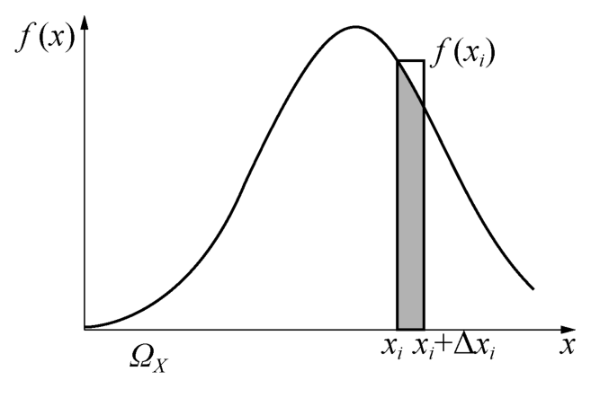
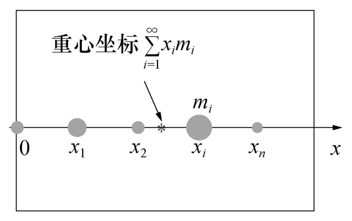
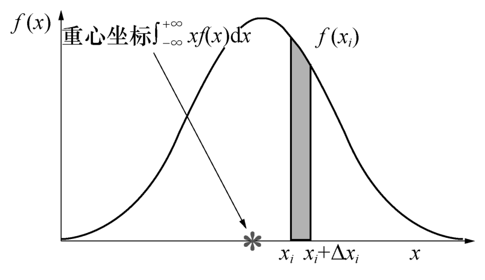
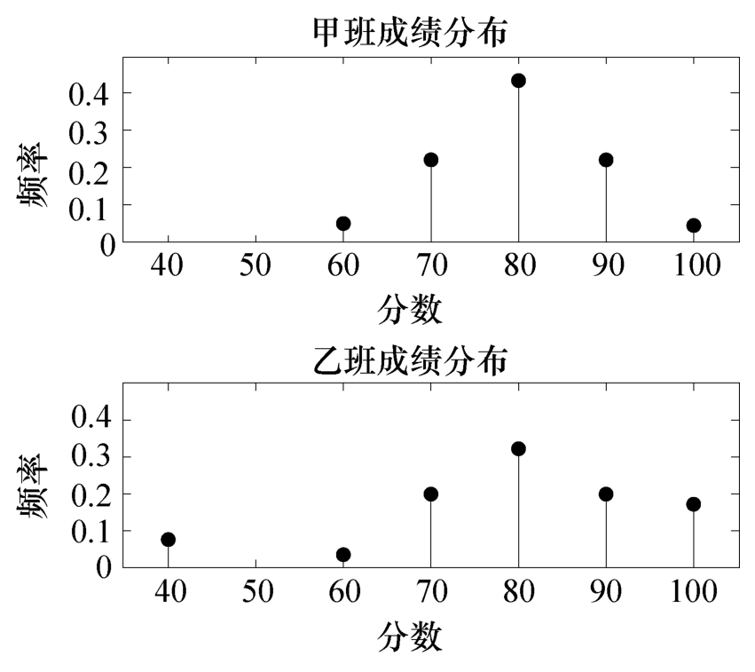
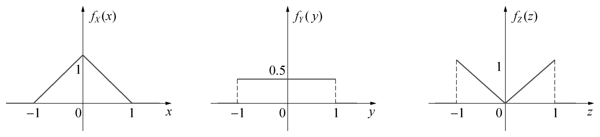
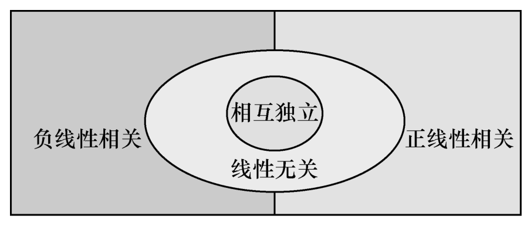

# 第四章 随机变量的数字特征

［课前导读］

求随机变量的数字特征，需要用到高等数学中积分和级数收敛的定义。下面复习常用的积分公式与级数求和的方法、公式。

绝对收敛：如果级数 $\sum\limits_{n=1}^{\infty} a_n$ 和 $\sum\limits_{n=1}^{\infty}\left|a_n\right|$ 都收敛，则称级数 $\sum\limits_{n=1}^{\infty} a_n$ 绝对收敛。

条件收敛：如果级数 $\sum\limits_{n=1}^{\infty} a_n$ 收敛，但 $\sum\limits_{n=1}^{\infty}\left|a_n\right|$ 发散，则称级数 $\sum\limits_{n=1}^{\infty} a_n$ 条件收敛。

级数求和公式 1：$\sum\limits_{n=0}^{\infty} \dfrac{x^n}{n!}=\mathrm{e}^x$，$-\infty<x<+\infty$。

级数求和公式 2：$\sum\limits_{n=1}^{\infty} n p^{n-1}=\left(\sum\limits_{n=1}^{\infty} p^n\right)'=\dfrac{1}{(1-p)^2}$，$|p|<1$。

级数求和公式 3：$\sum\limits_{n=0}^{\infty} \dfrac{p^{n+1}}{n+1}=\int_0^p \sum\limits_{n=0}^{\infty} p^n \mathrm{d}p=-\ln(1-p)$，$|p|<1$。

积分公式 1：$I_n=\int_0^{+\infty} x^n \mathrm{e}^{-\alpha x} \mathrm{d}x=\dfrac{n!}{\alpha^{n+1}}$，$n \geqslant 0$。

积分公式 2：$\int_{-\infty}^{+\infty} \mathrm{e}^{-\frac{x^2}{2}} \mathrm{d}x=\sqrt{2 \pi}$。

积分公式 3：$\int_0^1 x^2 \sqrt{1-x^2} \mathrm{d}x=\dfrac{\pi}{16}$。

在实际问题中，随机变量的分布并不能确切地知道，而我们常常关心的也只是随机变量的取值在某些方面的特征，这类特征往往通过若干个实数来反映，在概率论中称它们为随机变量的数字特征。随机变量的数字特征在解决实际问题中常常发挥重要的作用。

这一章我们就来学习随机变量的数字特征。通过数字来描述随机变量的分布特征，更直观、更能突出随机变量的分布特性，如随机变量的平均取值、分布的波动程度、最大值、最小值等。前面我们学习的常用随机变量都含有参数，如正态分布的参数，就是正态随机变量的数字特征，它们分别反映了正态随机变量的平均取值以及分布的波动程度。如果已知数字特征，那么正态分布也就完全确定了。在某些情况下，随机变量的分布类型很难确定，我们更多的是关注随机变量的分布特征。比如，顾客在购买商品时关注的是产品的平均寿命，并不需要了解产品寿命具体服从的分布；股民在炒股票时，在意的是大盘的平均走势及波动情况，具体的大盘指数服从何种分布并不关心。因此，学习随机变量的数字特征无论在理论研究还是在日常生活中都是非常重要的。

随机变量的数字特征主要包括数学期望、方差和标准差，两个随机变量的相互关系可以由协方差和相关系数来表示。这些数字特征又统称为矩，它来源于物理中的惯性矩的概念。

## 第一节 数学期望

先看一个例子。

**例 1** 设甲、乙两班各有 40 名学生，概率统计成绩及得分人数如下表所示，其中成绩以 10 的倍数表示。问：甲、乙两班概率统计的平均成绩各是多少？

| 甲班分数 | 60 | 70 | 80 | 90 | 100 |
| --- | --- | --- | --- | --- | --- |
| 人数 | 2 | 9 | 18 | 9 | 2 |
| 频率 | $\frac{2}{40}$ | $\frac{9}{40}$ | $\frac{18}{40}$ | $\frac{9}{40}$ | $\frac{2}{40}$ |

| 乙班分数 | 40 | 60 | 70 | 80 | 90 | 100 |
| --- | --- | --- | --- | --- | --- | --- |
| 人数 | 3 | 1 | 8 | 13 | 8 | 7 |
| 频率 | $\frac{3}{40}$ | $\frac{1}{40}$ | $\frac{8}{40}$ | $\frac{13}{40}$ | $\frac{8}{40}$ | $\frac{7}{40}$ |

**解** 因为班级的平均成绩 = 总分 ÷ 总人数，所以

$$
\begin{aligned}
\text{甲班的平均成绩} &= \frac{60 \cdot 2+70 \cdot 9+80 \cdot 18+90 \cdot 9+100 \cdot 2}{2+9+18+9+2} \\
&= 60 \cdot \frac{2}{40}+70 \cdot \frac{9}{40}+80 \cdot \frac{18}{40}+90 \cdot \frac{9}{40}+100 \cdot \frac{2}{40}=80(\text{分}) .
\end{aligned}
$$

同理，乙班的平均成绩 $=40 \cdot \dfrac{3}{40}+60 \cdot \dfrac{1}{40}+70 \cdot \dfrac{8}{40}+80 \cdot \dfrac{13}{40}+90 \cdot \dfrac{8}{40}+100 \cdot \dfrac{7}{40}=80(\text{分})$。

上式表明计算平均成绩也可以用各个成绩乘以相应频率求和表示，就是求成绩的加权平均，权重为相应的频率。若将成绩看作随机变量，记为 $X$，其取值为 $x_1$，$x_2$，$\cdots$，将相应的频率看作概率，为 $p_1$，$p_2$，$\cdots$，同样得到反映随机变量平均取值的数字特征 $E(X)=\sum\limits_{i=1}^{\infty} x_i p_i$，我们称之为随机变量的均值或数学期望。下面给出离散型和连续型随机变量数学期望的定义。

### 一、数学期望的定义

**定义 1** 设 $X$ 是离散型的随机变量，其分布律为 $P\left(X=x_i\right)=p_i$，$i=1,2, \cdots$。如果级数 $\sum\limits_{i=1}^{\infty} x_i p_i$ 绝对收敛，则称

$$
E(X)=\sum_{i=1}^{\infty} x_i p_i
$$

为离散型随机变量 $X$ 的数学期望，也称作期望或均值。

定义中要求级数 $\sum\limits_{i=1}^{\infty} x_i p_i$ 绝对收敛，是为了保证数学期望的唯一性。若级数 $\sum\limits_{i=1}^{\infty} x_i p_i$ 条件收敛，级数 $\sum\limits_{i=1}^{\infty} x_i p_i$ 改变项的次序后，其和不唯一。只有当级数 $\sum\limits_{i=1}^{\infty} x_i p_i$ 绝对收敛时，改变项的顺序才不影响和的唯一性，即绝对收敛级数具有可交换性。

**例 2** 设随机变量 $X$ 的分布律分别为

（1）$P\left(X=\dfrac{2^i}{i}\right)=\dfrac{1}{2^i}$，$i=1,2, \cdots$；

（2）$P\left(X=(-1)^i \dfrac{2^i}{i}\right)=\dfrac{1}{2^i}$，$i=1,2, \cdots$；

（3）$P\left(X=(-1)^i \dfrac{2^i}{i^2}\right)=\dfrac{1}{2^i}$，$i=1,2, \cdots$。

在三种情形下，试问 $E(X)$ 是否存在？为什么？

**解** （1）因为级数 $\sum\limits_{i=1}^{\infty}\left|x_i\right| p_i=\sum\limits_{i=1}^{\infty} \dfrac{2^i}{i} \cdot \dfrac{1}{2^i}=\sum\limits_{i=1}^{\infty} \dfrac{1}{i}$ 发散，所以由随机变量数学期望的定义知 $E(X)$ 不存在；

（2）尽管级数 $\sum\limits_{i=1}^{\infty} x_i p_i=\sum\limits_{i=1}^{\infty} \dfrac{(-1)^i 2^i}{i} \cdot \dfrac{1}{2^i}=\sum\limits_{i=1}^{\infty} \dfrac{(-1)^i}{i}$ 本身收敛，但 $\sum\limits_{i=1}^{\infty}\left|x_i\right| p_i=\sum\limits_{i=1}^{\infty} \dfrac{2^i}{i} \cdot \dfrac{1}{2^i}=\sum\limits_{i=1}^{\infty} \dfrac{1}{i}$ 发散，所以由数学期望的定义知 $E(X)$ 不存在；

（3）因为级数 $\sum\limits_{i=1}^{\infty}\left|x_i\right| p_i=\sum\limits_{i=1}^{\infty} \dfrac{2^i}{i^2} \cdot \dfrac{1}{2^i}=\sum\limits_{i=1}^{\infty} \dfrac{1}{i^2}$ 收敛，所以由数学期望的定义知 $E(X)$ 存在。

离散型随机变量数学期望的定义可推广至连续型随机变量的情形。首先将连续型随机变量 $X$ 的取值“离散化”，即将 $X$ 的值域 $\Omega_X$ 分割成 $n$ 份，记第 $i$ 份为 $\left[x_i, x_i+\Delta x_i\right)$，$i=1,2, \cdots, n$，在每一个小区间，$X$ 的取值近似为 $x_i$，相应的概率为 $P\left(x_i \leqslant X<x_i+\Delta x_i\right)=\int_{x_i}^{x_i+\Delta x_i} f(x) \mathrm{d}x \approx f\left(x_i\right) \Delta x_i$，如图 4.1 所示。$X$“离散化”后视为离散型随机变量，其分布律近似为

| $X$ | $x_1$ | $x_2$ | $\cdots$ | $x_n$ | $\cdots$ |
| --- | --- | --- | --- | --- | --- |
| 概率 | $f\left(x_1\right) \Delta x_1$ | $f\left(x_2\right) \Delta x_2$ | $\cdots$ | $f\left(x_n\right) \Delta x_n$ | $\cdots$ |

则 $X$ 的平均值近似为 $\sum\limits_{i=1}^{n} x_i p_i \approx \sum\limits_{i=1}^{n} x_i f\left(x_i\right) \Delta x_i$。令这 $n$ 个小区间长度的最大值 $\lambda=\max\limits_{1 \leqslant i \leqslant n}\left(\Delta x_i\right)$ $\to 0$，得到 $X$ 的平均值精确为 $\lim\limits_{\lambda \to 0} \sum\limits_{i=1}^{n} x_i p_i=\lim\limits_{\lambda \to 0} \sum\limits_{i=1}^{n} x_i f\left(x_i\right) \Delta x_i=\int_{-\infty}^{+\infty} x f(x) \mathrm{d}x$。这就是连续型随机变量的数学期望。和离散型随机变量类似，要求 $\int_{-\infty}^{+\infty} x f(x) \mathrm{d}x$ 绝对收敛。

**定义 2** 设 $X$ 是连续型随机变量，其密度函数为 $f(x)$。如果广义积分 $\int_{-\infty}^{+\infty} x f(x) \mathrm{d}x$ 绝对收敛，则称

$$
E(X)=\int_{-\infty}^{+\infty} x f(x) \mathrm{d}x
$$

为连续型随机变量 $X$ 的数学期望，也称作期望或均值。

数学期望刻画随机变量取值的平均数，有直观含义，同时它也有物理含义。若在数轴上放置一单位质量的细棒，在离散点 $x_i$ 处分布着质点其质量为 $m_i$，$i=1,2, \cdots$，则 $\sum\limits_{i=1}^{\infty} x_i m_i$ 表示该细棒的重心坐标，如图 4.2 所示；或者若在数轴上放置一单位质量的细棒，它有质量密度函数 $f(x)$，则 $\int_{-\infty}^{+\infty} x f(x) \mathrm{d}x$ 表示该细棒的重心坐标，如图 4.3 所示。

**例 3** 设随机变量 $X$ 的密度函数为 $f(x)=\dfrac{1}{\pi} \cdot \dfrac{1}{1+x^2}$，$-\infty<x<+\infty$，试问 $E(X)$ 是否存在？为什么？

**解** 因为

$$
\int_{-\infty}^{+\infty}|x| f(x) \mathrm{d}x=\int_{-\infty}^{+\infty}|x| \frac{1}{\pi} \cdot \frac{1}{1+x^2} \mathrm{d}x .
$$

而

$$
\int_0^{+\infty} \frac{|x|}{\pi\left(1+x^2\right)} \mathrm{d}x=\frac{1}{2 \pi} \int_0^{+\infty} \frac{1}{1+x^2} \mathrm{d}x^2=\left[\ln \left(1+x^2\right)\right]_0^{+\infty}=+\infty,
$$

同理

$$
\int_{-\infty}^0 \frac{|x|}{\pi\left(1+x^2\right)} \mathrm{d}x=+\infty,
$$

所以 $\int_{-\infty}^{+\infty}|x| f(x) \mathrm{d}x$ 发散。

由连续型随机变量数学期望的定义知 $E(X)$ 不存在。

由定义知，随机变量的数学期望只与其分布有关，一旦分布确定，期望也就唯一确定了。因此我们称数学期望为该分布的数学期望。下面给出常用离散型随机变量和连续型随机变量的数学期望。可以验证下列常用随机变量的数学期望都存在。

**例 4** 设有离散型随机变量 $X$，在下列三种情形下分别计算随机变量 $X$ 的数学期望 $E(X)$。

（1）$X \sim B(1, p)$；（2）$X \sim B(n, p)$；（3）$X \sim P(\lambda)$。

**解** （1）因为 $X \sim B(1, p)$，所以 $X$ 的分布律为

| $X$ | 0 | 1 |
| --- | --- | --- |
| 概率 | $q$ | $p$ |

这里 $q=1-p$，由期望的定义得

$$
E(X)=0 \cdot q+1 \cdot p=p .
$$

（2）因为 $X \sim B(n, p)$，所以 $X$ 的分布律为

$$
P(X=k)=\binom{n}{k} p^k q^{n-k}, \quad k=0,1, \cdots, n .
$$

由期望的定义得

$$
\begin{aligned}
E(X) &=\sum_{k=0}^{n} k \frac{n !}{k !(n-k) !} p^k q^{n-k}=\sum_{k=1}^{n} \frac{n !}{(k-1) !(n-k) !} p^k q^{n-k} \\
&=n p \sum_{k=1}^{n} \frac{(n-1) !}{(k-1) !(n-k) !} p^{k-1} q^{n-k} \xrightarrow{\ \text{令}\ l=k-1\ } n p \sum_{l=0}^{n-1}\binom{n-1}{l} p^l q^{n-1-l}=n p .
\end{aligned}
$$

（3）因为 $X \sim P(\lambda)$，所以 $X$ 的分布律为

$$
P(X=k)=\frac{\lambda^k}{k !} \mathrm{e}^{-\lambda}, \quad k=0,1,2, \cdots,
$$

由期望的定义得

$$
E(X)=\sum_{k=0}^{\infty} k \frac{\lambda^k}{k !} \mathrm{e}^{-\lambda}=\lambda \mathrm{e}^{-\lambda} \sum_{k=1}^{\infty} \frac{\lambda^{k-1}}{(k-1) !} \xrightarrow{\ \text{令}\ l=k-1\ } \lambda \mathrm{e}^{-\lambda} \sum_{l=0}^{\infty} \frac{\lambda^l}{l !}=\lambda \mathrm{e}^{-\lambda} \mathrm{e}^{\lambda}=\lambda .
$$

下面给出常用离散型随机变量数学期望的直观解释。0-1 分布 $B(1, p)$ 对应着概率模型一次试验的“成功”次数，其数学期望表示一次试验的平均“成功”次数，它恰好是参数 $p$。二项分布 $B(n, p)$ 对应着概率模型 $n$ 重伯努利试验的“成功”次数，由于二项分布是参数 $p$ 相同的 $n$ 个相互独立同分布的 0-1 分布之和，一次试验的平均“成功”次数为参数 $p$，那么 $n$ 次试验的平均“成功”次数就应为 $n p$。泊松分布对应着概率模型——单位时间内“稀有”事件发生的次数，其数学期望表示单位时间内“稀有”事件发生的平均次数，它恰好是参数 $\lambda$。

**例 5** 设有连续型随机变量 $X$，在下列三种情形下分别计算随机变量 $X$ 的数学期望 $E(X)$。

（1）$X \sim U(a, b)$；（2）$X \sim E(\lambda)$；（3）$X \sim N\left(\mu, \sigma^2\right)$。

**解** （1）因为 $X \sim U(a, b)$，所以 $X$ 的密度函数为

$$
f(x)=\begin{cases}\dfrac{1}{b-a}, & a<x<b, \\[2mm] 0, & \text{其他} .\end{cases}
$$

由期望的定义得

$$
E(X)=\int_{-\infty}^{+\infty} x f(x) \mathrm{d}x=\int_a^b \frac{x}{b-a} \mathrm{d}x=\frac{a+b}{2} .
$$

（2）因为 $X \sim E(\lambda)$，所以 $X$ 的密度函数为

$$
f(x)=\begin{cases}\lambda \mathrm{e}^{-\lambda x}, & x>0, \\[2mm] 0, & \text{其他} .\end{cases}
$$

由期望的定义及［课前导读］中的积分公式 1 得

$$
E(X)=\int_{-\infty}^{+\infty} x f(x) \mathrm{d}x=\int_0^{+\infty} x \lambda \mathrm{e}^{-\lambda x} \mathrm{d}x=\lambda \cdot \frac{1 !}{\lambda^2}=\frac{1}{\lambda} .
$$

（3）因为 $X \sim N\left(\mu, \sigma^2\right)$，所以 $X$ 的密度函数为

$$
f(x)=\frac{1}{\sqrt{2 \pi} \sigma} \mathrm{e}^{-\frac{(x-\mu)^2}{2 \sigma^2}} .
$$

由期望的定义得

$$
E(X)=\int_{-\infty}^{+\infty} x \frac{1}{\sqrt{2 \pi} \sigma} \mathrm{e}^{-\frac{(x-\mu)^2}{2 \sigma^2}} \mathrm{d}x \xrightarrow{\ \text{令}\ t=\frac{x-\mu}{\sigma}\ } \int_{-\infty}^{+\infty}(\sigma t+\mu) \frac{1}{\sqrt{2 \pi} \sigma} \mathrm{e}^{-\frac{t^2}{2}} \cdot \sigma \mathrm{d}t=\mu .
$$

上式使用了密度函数的规范性 $\int_{-\infty}^{+\infty} f(x) \mathrm{d}x=1$。

**注**：事实上，$\int_{-\infty}^{+\infty} t^n \cdot \dfrac{1}{\sqrt{2 \pi}} \mathrm{e}^{-\frac{t^2}{2}} \mathrm{d}t$ 绝对收敛（$n$ 为正整数）。当 $n$ 为奇数时，被积函数为奇函数，该积分为 0；当 $n$ 为偶数时，被积函数为偶函数，该积分为 $2 \int_0^{+\infty} t^n \cdot \dfrac{1}{\sqrt{2 \pi}} \mathrm{e}^{-\frac{t^2}{2}} \mathrm{d}t$。

下面给出常用连续型随机变量数学期望的直观解释。$U(a, b)$ 分布对应的物理模型即为质量在 $[a, b]$ 上均匀分布的单位质量细棒。它重心所在的位置也即它的数学期望应为区间 $[a, b]$ 的中点。指数分布与泊松分布是有联系的，泊松分布对应着单位时间内“稀有”事件发生的次数，指数分布就对应着相邻的“稀有”事件到达的时间间隔。由泊松分布的数学期望知单位时间内“稀有”事件发生的平均次数是 $\lambda$，那么平均起来每隔 $\dfrac{1}{\lambda}$ 时间会有一个“稀有”事件到来，所以相邻“稀有”事件到达的平均时间间隔应为 $\dfrac{1}{\lambda}$。这样我们从直观上得到指数分布的数学期望就是 $\dfrac{1}{\lambda}$。对正态分布而言，它的密度函数的图像关于直线 $x=\mu$ 对称，其期望存在，所以它的平均取值就为 $\mu$。

我们还得到这样一个结论，若随机变量的分布律或密度函数的图像是轴对称图形，即随机变量是对称分布的，且数学期望存在，那么，期望的大小就是对称轴所在位置的坐标值。例如，均匀分布 $U(a, b)$ 的密度函数的图像关于 $x=\dfrac{a+b}{2}$ 对称，它的期望就为 $\dfrac{a+b}{2}$。正态分布的情形类似。例 3 中，虽然随机变量的分布关于 $y$ 轴对称，但期望不存在，因此 $E(X)=0$ 是错误的结论。

### 二、随机变量函数的数学期望

实际问题中经常会碰到这一类问题，若已知 $X$ 的分布，$Y=g(X)$ 的数学期望能否得到？例如，已知圆管直径 $X$ 的分布，我们关注圆管横截面积 $Y=\dfrac{1}{4} \pi X^2$ 的数学期望。$Y$ 作为 $X$ 的函数，也是随机变量，它的数学期望可以这样得到，由 $X$ 的分布，先求出 $Y$ 的分布，再由期望的定义得到 $Y$ 的数学期望。还有一种更为简单的方法，首先我们看这样一个例子。

**例 6** 已知 $X$ 的分布律为

| $X$ | $-1$ | 1 | 2 |
| --- | --- | --- | --- |
| 概率 | $1 / 4$ | $1 / 2$ | $1 / 4$ |

计算 $E(X)$、$E\left(X^2\right)$、$E\left(X^3\right)$。

**解** 由 $X$ 的分布律可得到 $X^2$ 及 $X^3$ 的分布律为

| $X^2$ | 1 | 4 |
| --- | --- | --- |
| 概率 | $3 / 4$ | $1 / 4$ |

| $X^3$ | $-1$ | 1 | 8 |
| --- | --- | --- | --- |
| 概率 | $1 / 4$ | $1 / 2$ | $1 / 4$ |

所以

$$
E(X)=-1 \cdot \frac{1}{4}+1 \cdot \frac{1}{2}+2 \cdot \frac{1}{4}=\frac{3}{4},
$$

$$
E\left(X^2\right)=1 \cdot \frac{3}{4}+4 \cdot \frac{1}{4}=1 \frac{3}{4},
$$

$$
E\left(X^3\right)=-1 \cdot \frac{1}{4}+1 \cdot \frac{1}{2}+8 \cdot \frac{1}{4}=2 \frac{1}{4} .
$$

我们发现也可以这样计算

$$
E\left(X^2\right)=1 \cdot \frac{3}{4}+4 \cdot \frac{1}{4}=\left[(-1)^2 \cdot \frac{1}{4}+1^2 \cdot \frac{1}{2}\right]+2^2 \cdot \frac{1}{4}=\sum_{i=1}^3 x_i^2 p_i,
$$

$$
E\left(X^3\right)=-1 \cdot \frac{1}{4}+1 \cdot \frac{1}{2}+8 \cdot \frac{1}{4}=(-1)^3 \cdot \frac{1}{4}+1^3 \cdot \frac{1}{2}+2^3 \cdot \frac{1}{4}=\sum_{i=1}^3 x_i^3 p_i .
$$

不必得到 $Y=g(X)$ 的分布律，只要知道 $X$ 的分布，就能计算 $Y=g(X)$ 的数学期望。

这种方法总结为了佚名统计学家公式，即随机变量函数的期望计算公式。称之为佚名统计学家公式，是因为它首先是由统计学家提出的，但究竟是谁最早提出的已经查无考证。我们不加证明地给出该公式。

**定理 1**（随机变量一元函数的期望公式）（1）设 $X$ 是离散型随机变量，其分布律为 $P\left(X=x_i\right)=p_i$，$i=1,2, \cdots$。如果级数 $\sum\limits_{i=1}^{\infty} g\left(x_i\right) p_i$ 绝对收敛，则 $X$ 的一元函数 $Y=g(X)$ 的数学期望为

$$
E[g(X)]=\sum_{i=1}^{\infty} g\left(x_i\right) p_i .
$$

（2）设 $X$ 为连续型随机变量，其密度函数为 $f(x)$。如果广义积分 $\int_{-\infty}^{+\infty} g(x) f(x) \mathrm{d}x$ 绝对收敛，则 $X$ 的一元函数 $Y=g(X)$ 的数学期望为

$$
E[g(X)]=\int_{-\infty}^{+\infty} g(x) f(x) \mathrm{d}x .
$$

**例 7** 设随机变量 $X$ 的分布律为 $P(X=k)=\dfrac{c}{k !}$，$k=0,1,2, \cdots$。计算（1）$E(X)$；（2）$E\left(X^2\right)$。

**解** （1）由分布律的性质得

$$
1=\sum_{k=0}^{\infty} P(X=k)=\sum_{k=0}^{\infty} \frac{c}{k !}=c \sum_{k=0}^{\infty} \frac{1}{k !}=c \cdot \mathrm{e} .
$$

因此 $c=\mathrm{e}^{-1}$，于是 $P(X=k)=\mathrm{e}^{-1} \dfrac{1}{k !}$，$k=0,1,2, \cdots$。由此可知，随机变量 $X$ 服从参数为 $\lambda=1$ 的泊松分布，进而有 $E(X)=\lambda=1$。

（2）因为 $X \sim P(\lambda)$，其中 $\lambda=1$，则

$$
\begin{aligned}
E\left(X^2\right) &=\sum_{k=0}^{\infty} k^2 P(X=k)=\sum_{k=0}^{\infty} k^2 \cdot \mathrm{e}^{-\lambda} \frac{\lambda^k}{k !}=\lambda \mathrm{e}^{-\lambda} \sum_{k=1}^{\infty} \frac{k \lambda^{k-1}}{(k-1) !} \\
&=\lambda \mathrm{e}^{-\lambda}\left[\sum_{k=1}^{\infty} \frac{(k-1) \lambda^{k-1}}{(k-1) !}+\sum_{k=1}^{\infty} \frac{\lambda^{k-1}}{(k-1) !}\right]=\lambda \mathrm{e}^{-\lambda}\left[\sum_{k=2}^{\infty} \frac{\lambda^{k-2}}{(k-2) !}+\sum_{k=1}^{\infty} \frac{\lambda^{k-1}}{(k-1) !}\right] \\
&=\lambda \mathrm{e}^{-\lambda}\left[\lambda \cdot \sum_{k=2}^{\infty} \frac{\lambda^{k-2}}{(k-2) !}+\sum_{k=1}^{\infty} \frac{\lambda^{k-1}}{(k-1) !}\right]=\lambda \mathrm{e}^{-\lambda}\left(\lambda \mathrm{e}^{\lambda}+\mathrm{e}^{\lambda}\right)=\lambda^2+\lambda .
\end{aligned}
$$

将 $\lambda=1$ 代入得，$E\left(X^2\right)=2$。

**例 8** 设随机变量 $X$ 的密度函数为 $f(x)=\begin{cases}2 \mathrm{e}^{-2 x}, & x>0, \\[2mm] 0, & \text{其他} .\end{cases}$ 试求：（1）$E\left(X^2\right)$；（2）$E\left(\mathrm{e}^{-\frac{X^2}{2}+2 X}\right)$。

**解** （1）由已知得 $X \sim E(\lambda)$，其中 $\lambda=2$。那么

$$
E\left(X^2\right)=\int_0^{+\infty} x^2 \cdot \lambda \mathrm{e}^{-\lambda x} \mathrm{d}x=\lambda \cdot I_2=\lambda \cdot \frac{2 !}{\lambda^{2+1}}=\frac{2}{\lambda^2},
$$

将 $\lambda=2$ 代入得，$E\left(X^2\right)=\dfrac{1}{2}$。这里用到了［课前导读］中的积分公式 1。

（2）由随机变量函数的数学期望公式得

$$
E\left(\mathrm{e}^{-\frac{X^2}{4}+2 X}\right)=\int_0^{+\infty} \mathrm{e}^{-\frac{x^2}{4}+2 x} \cdot 2 \mathrm{e}^{-2 x} \mathrm{d}x=\int_0^{+\infty} 2 \mathrm{e}^{-\frac{x^2}{4}} \mathrm{d}x
$$

$$
\stackrel{t=\frac{x}{\sqrt{2}}}{=} \int_0^{+\infty} 2 \sqrt{2} \mathrm{e}^{-\frac{t^2}{2}} \mathrm{d}t=\sqrt{2} \int_{-\infty}^{+\infty} \mathrm{e}^{-\frac{t^2}{2}} \mathrm{d}t=2 \sqrt{\pi} .
$$

定理 1 可以推广至二维或多维情形。

**定理 2**（随机变量二元函数的期望公式）（1）设 $(X, Y)$ 是二维离散型随机变量，其联合分布律为 $P\left(X=x_i, Y=y_j\right)=p_{i j}$，$i, j=1,2, \cdots$。如果级数 $\sum\limits_{i=1}^{\infty} \sum\limits_{j=1}^{\infty} g\left(x_i, y_j\right) p_{i j}$ 绝对收敛，则 $(X, Y)$ 的二元函数 $g(X, Y)$ 的数学期望为

$$
E[g(X, Y)]=\sum_{i=1}^{\infty} \sum_{j=1}^{\infty} g\left(x_i, y_j\right) p_{i j} .
$$

特别地

$$
E(X)=\sum_{i=1}^{\infty} \sum_{j=1}^{\infty} x_i p_{i j}, \quad E(Y)=\sum_{i=1}^{\infty} \sum_{j=1}^{\infty} y_j p_{i j} .
$$

（2）设 $(X, Y)$ 是二维连续型随机变量，其联合密度函数为 $f(x, y)$。如果广义积分 $\int_{-\infty}^{+\infty} \int_{-\infty}^{+\infty} g(x, y) f(x, y) \mathrm{d}x \mathrm{d}y$ 绝对收敛，则 $(X, Y)$ 的二元函数 $g(X, Y)$ 的数学期望为

$$
E[g(X, Y)]=\int_{-\infty}^{+\infty} \int_{-\infty}^{+\infty} g(x, y) f(x, y) \mathrm{d}x \mathrm{d}y .
$$

特别地

$$
E(X)=\int_{-\infty}^{+\infty} \int_{-\infty}^{+\infty} x f(x, y) \mathrm{d}x \mathrm{d}y,
$$

$$
E(Y)=\int_{-\infty}^{+\infty} \int_{-\infty}^{+\infty} y f(x, y) \mathrm{d}x \mathrm{d}y .
$$

**例 9** 已知二维随机变量 $(X, Y)$ 的联合分布律为

| $X \backslash Y$ | 0 | 1 | 2 |
| --- | --- | --- | --- |
| 0 | $\frac{1}{3}$ | $\frac{1}{12}$ | $\frac{1}{3}$ |
| 1 | $\frac{1}{12}$ | $\frac{1}{12}$ | $\frac{1}{12}$ |

计算（1）$X$，$Y$ 的期望 $E(X)$，$E(Y)$；（2）$Z=X Y$ 的数学期望 $E(Z)$。

**解** （1）方法一

由 $(X, Y)$ 的联合分布律得 $X$ 和 $Y$ 的边缘分布律分别为

| $X$ | 0 | 1 |
| --- | --- | --- |
| 概率 | $\frac{3}{4}$ | $\frac{1}{4}$ |

| $Y$ | 0 | 1 | 2 |
| --- | --- | --- | --- |
| 概率 | $\frac{5}{12}$ | $\frac{1}{6}$ | $\frac{5}{12}$ |

由数学期望的定义得

$$
E(X)=0 \cdot \frac{3}{4}+1 \cdot \frac{1}{4}=\frac{1}{4}, \quad E(Y)=0 \cdot \frac{5}{12}+1 \cdot \frac{1}{6}+2 \cdot \frac{5}{12}=1 .
$$

方法二

不必计算 $X$ 和 $Y$ 的边缘分布律

$$
E(X)=\sum_{i=1}^{\infty} \sum_{j=1}^{\infty} x_i p_{i j}=\sum_{i=1}^{\infty} x_i \sum_{j=1}^{\infty} p_{i j}=0 \cdot\left(\frac{1}{3}+\frac{1}{12}+\frac{1}{3}\right)+1 \cdot\left(\frac{1}{12}+\frac{1}{12}+\frac{1}{12}\right)=\frac{1}{4},
$$

$$
E(Y)=\sum_{i=1}^{\infty} \sum_{j=1}^{\infty} y_j p_{i j}=\sum_{j=1}^{\infty} y_j \sum_{i=1}^{\infty} p_{i j}=0 \cdot\left(\frac{1}{3}+\frac{1}{12}\right)+1 \cdot\left(\frac{1}{12}+\frac{1}{12}\right)+2 \cdot\left(\frac{1}{3}+\frac{1}{12}\right)=1 .
$$

（2）$E(Z)=1 \cdot 1 \cdot \dfrac{1}{12}+1 \cdot 2 \cdot \dfrac{1}{12}=\dfrac{1}{4}$。

随机变量函数的期望公式非常重要。事实上，后面我们介绍的方差、协方差和相关系数等都是随机变量函数的期望，所以要求熟练掌握使用以上这些公式进行期望的计算。

### 三、数学期望的性质

对于复杂的随机变量函数的期望计算，需要使用数学期望的性质。这些性质对于讨论随机变量的数字特征非常有用。

**定理 3** 数学期望的性质：

（1）设 $c$ 为常数，则 $E(c)=c$；

（2）设 $X$ 为随机变量，且 $E(X)$ 存在，$k$，$c$ 为常数，则 $E(k X+c)=k E(X)+c$；

（3）设 $X$，$Y$ 为任意两个随机变量，且 $E(X)$ 和 $E(Y)$ 存在，则 $E(X+Y)=E(X)+E(Y)$；

（4）设 $X$ 与 $Y$ 为相互独立的随机变量，且 $E(X)$ 和 $E(Y)$ 存在，则 $E(X Y)=E(X) E(Y)$。

**证明** （1）由下面的补充说明知，$E(X)=c \cdot 1=c$。

性质（2）、（3）、（4）只给出连续型情形的证明，离散型情形类似。

（2）由随机变量一元函数的期望公式及积分的性质得

$$
E(k X+c)=\int_{-\infty}^{+\infty}(k x+c) f(x) \mathrm{d}x=k \int_{-\infty}^{+\infty} x f(x) \mathrm{d}x+c \int_{-\infty}^{+\infty} f(x) \mathrm{d}x=k E(X)+c .
$$

（3）由随机变量二元函数的期望公式及期望定义得

$$
\begin{aligned}
E(X+Y) &=\int_{-\infty}^{+\infty} \int_{-\infty}^{+\infty}(x+y) f(x, y) \mathrm{d}x \mathrm{d}y \\
&=\int_{-\infty}^{+\infty} \int_{-\infty}^{+\infty} x f(x, y) \mathrm{d}x \mathrm{d}y+\int_{-\infty}^{+\infty} \int_{-\infty}^{+\infty} y f(x, y) \mathrm{d}x \mathrm{d}y \\
&=\int_{-\infty}^{+\infty} x\left[\int_{-\infty}^{+\infty} f(x, y) \mathrm{d}y\right] \mathrm{d}x+\int_{-\infty}^{+\infty} y\left[\int_{-\infty}^{+\infty} f(x, y) \mathrm{d}x\right] \mathrm{d}y \\
&=\int_{-\infty}^{+\infty} x f_X(x) \mathrm{d}x+\int_{-\infty}^{+\infty} y f_Y(y) \mathrm{d}y \\
&=E(X)+E(Y) .
\end{aligned}
$$

（4）因为 $X$ 与 $Y$ 相互独立，由随机变量二元函数的期望公式及密度函数的规范性得

$$
\begin{aligned}
E(X Y) &=\int_{-\infty}^{+\infty} \int_{-\infty}^{+\infty} x y f(x, y) \mathrm{d}x \mathrm{d}y=\int_{-\infty}^{+\infty} x f_X(x)\left[\int_{-\infty}^{+\infty} y f_Y(y) \mathrm{d}y\right] \mathrm{d}x \\
&=E(Y) \int_{-\infty}^{+\infty} x f_X(x) \mathrm{d}x=E(X) E(Y) .
\end{aligned}
$$

性质（1）中需要补充说明的是，严格意义上的常数 $c$ 不具有随机性，从而不是随机变量。但在概率论中，为了讨论方便，将常数 $c$ 视为随机变量的一种极端情形，是一个特殊的随机变量，其分布律为 $P(X=c)=1$，称它是服从参数为 $c$ 的退化分布。同时退化分布也包含这样一种情形，我们举例说明。向单位圆内掷点子，设 $X=\begin{cases}0, & \text{点子落在圆心}, \\ 2, & \text{否则},\end{cases}$ 那么 $X$ 是通常意义上的随机变量，且 $P(X=2)=1$，这时，$X$ 也被称作是服从参数为 2 的退化分布。

性质（4）中，条件 $X$ 与 $Y$ 为相互独立的随机变量可以放宽为 $X$ 与 $Y$ 是不相关的随机变量（见第三节定义 3），这时就有 $E(X Y)=E(X) E(Y)$。特别要注意的是，当 $E(X Y)=E(X) E(Y)$ 时，$X$ 与 $Y$ 不一定相互独立。

性质（2）、（3）、（4）可推广至多维随机变量的情形。

对任意的随机变量 $X_1$，$X_2$，$\cdots$，$X_n$，当 $E\left(X_i\right)$ 存在时，$i=1,2, \cdots, n$，有

$$
E\left[\sum_{i=1}^n\left(k_i X_i+c_i\right)\right]=\sum_{i=1}^n\left[k_i E\left(X_i\right)+c_i\right],
$$

其中 $k_1$，$k_2$，$\cdots$，$k_n$，$c_1$，$c_2$，$\cdots$，$c_n$ 是常数。

当随机变量 $X_1$，$X_2$，$\cdots$，$X_n$ 相互独立且 $E\left(X_i\right)$ 存在时，$i=1,2, \cdots, n$，有

$$
E\left[\prod_{i=1}^n\left(k_i X_i+c_i\right)\right]=\prod_{i=1}^n\left[k_i E\left(X_i\right)+c_i\right] .
$$

其中 $k_1$，$k_2$，$\cdots$，$k_n$，$c_1$，$c_2$，$\cdots$，$c_n$ 是常数。

**例 10** 某公司生产的机器其无故障工作时间 $X$（单位：万小时）的密度函数为

$$
f(x)=\begin{cases}\dfrac{2}{x^2}, & x \geqslant 2, \\[2mm] 0, & \text{其他} .\end{cases}
$$

公司每售出一台机器可获利 1600 元，若机器售出后使用 2.2 万小时之内出故障，则应予以更换，这时每台亏损 1200 元；若在 2.2 到 3 万小时之间出故障，则予以维修，由公司负担维修费 400 元；在使用 3 万小时后出故障，则用户自己负责。求该公司售出每台机器的平均获利。

**解** 设 $Y$ 表示每台机器的获利（单位：百元），则

$$
Y=\begin{cases}16-12, & 2 \leqslant X<2.2, \\ 16-4, & 2.2 \leqslant X<3, \\ 16, & X \geqslant 3 .\end{cases}
$$

显然 $Y$ 是 $X$ 的函数，令 $Y=g(X)$，由随机变量函数的数学期望公式得平均获利为

$$
\begin{aligned}
E(Y)=E[g(x)] &=\int_{-\infty}^{+\infty} g(x) f(x) \mathrm{d}x=\int_2^{2.2} 4 \cdot \frac{2}{x^2} \mathrm{d}x+\int_{2.2}^3 12 \cdot \frac{2}{x^2} \mathrm{d}x+\int_3^{+\infty} 16 \cdot \frac{2}{x^2} \mathrm{d}x \\
&=13 \frac{31}{33} \approx 1394(\text{元}) .
\end{aligned}
$$

故该公司售出每台机器的平均获利为 1394 元。

### 习题 4-1

**1.** 设随机变量 $X$ 的分布律为

| $X$ | $-2$ | 0 | 1 |
| --- | --- | --- | --- |
| 概率 | 0.3 | 0.2 | 0.5 |

试求 $E(X)$、$E\left(X^2\right)$ 与 $E\left(3 X^2+5\right)$。

**2.** 设随机变量 $X$ 服从参数为 2 的指数分布，随机变量 $Y$ 服从二项分布 $B(2,0.5)$，计算 $E(X-3 Y-1)$。

**3.** 设 $X$ 表示 10 次相互独立重复射击中命中目标的次数，每次命中目标的概率为 0.6。试求 $X^2$ 的数学期望 $E\left(2 X^2+3\right)$。

**4.** 设随机变量 $X$ 的密度函数为

$$
f(x)=\begin{cases}\dfrac{3}{8} x^2, & 0<x<2, \\[2mm] 0, & \text{其他} .\end{cases}
$$

试求 $E(X)$、$E\left(X^2\right)$ 与 $E\left(\dfrac{1}{X^2}\right)$。

**5.** 设随机变量 $X$ 的密度函数为

$$
f(x)=\begin{cases}\dfrac{1}{2} \cos \dfrac{x}{2}, & 0 \leqslant x \leqslant \pi, \\[2mm] 0, & \text{其他} .\end{cases}
$$

对 $X$ 相互独立重复地观察 4 次，用 $Y$ 表示观察值大于 $\dfrac{\pi}{3}$ 的次数。求：

（1）$X$ 的数学期望 $E(X)$；

（2）$Y$ 的数学期望 $E(Y)$。

**6.** 已知某百货公司每年顾客对某种型号的电视机的需求量是一个随机变量 $X$，$X$ 服从集合 $\{1001,1002, \cdots, 2000\}$ 上的离散型均匀分布。假定每出售一台电视机可获利 300 元；如果年终库存积压，那么每台电视机带来的亏损为 100 元。试问：年初公司应进多少货，才能使年终带来的平均利润最大？假定公司年内不再进货。

**7.** 设某种商品每周的需求量是连续型随机变量 $X$，$X \sim U(10,30)$，经销商店进货数量是区间 $[10,30]$ 中的某一个整数。商店每销售一单位商品可获利 500 元；若供大于求则剩余的每单位商品带来亏损 100 元；若供不应求，则可从外部调剂供应，此时经调剂的每单位商品仅获利 300 元。为使商店所获利润期望值不少于 9280 元，试确定最少进货量。

**8.** 已知二维随机变量 $(X, Y)$ 的联合分布律为

| $X \backslash Y$ | 0 | 1 | 2 |
| --- | --- | --- | --- |
| 0 | 0.25 | 0.10 | 0.30 |
| 1 | 0.15 | 0.15 | 0.05 |

定义 $Z=\max (X, Y)$。计算：

（1）$X$、$Y$ 的期望 $E(X)$、$E(Y)$；

（2）$X^2$、$Y^2$ 的期望 $E\left(X^2\right)$、$E\left(Y^2\right)$；

（3）$Z$ 的期望 $E(Z)$。

**9.** 已知二维随机变量 $(X, Y)$ 的联合密度函数为

$$
f(x, y)=\begin{cases}1, & 0<x<1, \ 0<y<2 x, \\ 0, & \text{其他} .\end{cases}
$$

定义 $Z=\min (X, Y)$。计算：

（1）$X$、$Y$ 的期望 $E(X)$、$E(Y)$；

（2）$X^2$、$Y^2$ 和 $X Y$ 的期望 $E\left(X^2\right)$、$E\left(Y^2\right)$、$E(X Y)$；

（3）$Z$ 的期望 $E(Z)$。

**10.** 假定在自动流水线上加工的某种零件的内径（单位：mm）$X \sim N(\mu, 1)$。内径小于 10 或大于 12 为不合格品，其余为合格品。销售每件合格品获利 20 元；零件内径小于 10 或大于 12 分别带来亏损 1 元、5 元。试问，当平均内径 $\mu$ 取何值时，生产 1 个零件带来的平均利润最大？

## 第二节 方差和标准差

**第一节例 1 续** 甲、乙两班概率统计的平均成绩是一样的，现选出一个班级参加比赛，应选哪个班级？

由图 4.4 观察发现甲班的成绩更集中、更稳定，故应选甲班参加比赛。怎样刻画随机变量分布的稳定性或者波动程度？波动参照的标准选取为随机变量取值的中心位置即数学期望 $\mu$，考虑随机变量关于 $\mu$ 的偏离即 $X-\mu$，它是一个随机变量，所以取其数学期望 $E(X-\mu)$，但是求期望时正负会相互抵消，再考虑 $E(|X-\mu|)$，带绝对值的计算会复杂许多，因此改为 $E\left[(X-\mu)^2\right]$ 来衡量随机变量的波动程度。这就是随机变量另一个重要的数字特征——方差，记为 $D(X)$。为什么波动参照的标准选取为 $\mu$？原因如下。令 $f(a)=E\left[(X-a)^2\right]$，则 $f(a)=E\left[(X-\mu+\mu-a)^2\right]=E\left[(X-\mu)^2\right]+E\left[(\mu-a)^2\right]+2(\mu-a) E(X-\mu)=D(X)+(\mu-a)^2 \geqslant D(X)$。说明当波动参照的标准选取为 $\mu$ 时，波动将达到最小值。下面给出方差的严格定义。

### 一、方差和标准差的定义

**定义** 设 $X$ 是一个随机变量，如果 $E\left\{[X-E(X)]^2\right\}$ 存在，则称

$$
D(X) \triangleq E\left\{[X-E(X)]^2\right\}
$$

为随机变量 $X$ 的方差。称方差 $D(X)$ 的算术平方根

$$
\sigma_X \triangleq \sqrt{D(X)}
$$

为随机变量 $X$ 的标准差。

由于方差的单位是随机变量单位的平方，所以在实际中我们经常使用与随机变量量纲相同的标准差。但标准差必须由方差计算得到，所以理论中主要是计算方差。物理中，均值是质量分布的重心，方差则代表惯性矩。

在实际计算方差时，我们更多的是使用下列公式，这样更简便。

$$
D(X)=E\left(X^2\right)-[E(X)]^2 .
$$

这是因为

$$
\begin{aligned}
D(X) &=E\left\{[X-E(X)]^2\right\}=E\left\{X^2-2 X E(X)+[E(X)]^2\right\} \\
&=E\left(X^2\right)-2 E[X E(X)]+E[E(X)]^2 \\
&=E\left(X^2\right)-2 E(X) E(X)+[E(X)]^2 \\
&=E\left(X^2\right)-[E(X)]^2 .
\end{aligned}
$$

**例 1** 在下列四种情形下分别计算随机变量 $X$ 的方差 $D(X)$：

（1）设离散型随机变量 $X \sim P(\lambda)$；

（2）设连续型随机变量 $X \sim U(a, b)$；

（3）设连续型随机变量 $X \sim E(\lambda)$；

（4）设连续型随机变量 $X \sim N\left(\mu, \sigma^2\right)$。

**解** （1）当 $X \sim P(\lambda)$ 时，由第一节例 4 知 $E(X)=\lambda$，由第一节例 7 知 $E\left(X^2\right)=\lambda^2+\lambda$，所以

$$
D(X)=E\left(X^2\right)-[E(X)]^2=\lambda .
$$

（2）当 $X \sim U(a, b)$ 时，由第一节例 5 知 $E(X)=\dfrac{a+b}{2}$，而

$$
E\left(X^2\right)=\int_{-\infty}^{+\infty} x^2 f(x) \mathrm{d}x=\int_a^b x^2 \cdot \frac{1}{b-a} \mathrm{d}x=\frac{1}{b-a}\left[\frac{x^3}{3}\right]_a^b=\frac{b^2+a b+a^2}{3}
$$

所以

$$
D(X)=E\left(X^2\right)-[E(X)]^2=\frac{(b-a)^2}{12} .
$$

（3）当 $X \sim E(\lambda)$ 时，由第一节例 5 知 $E(X)=\dfrac{1}{\lambda}$，由第一节例 8 知 $E\left(X^2\right)=\dfrac{2}{\lambda^2}$，所以

$$
D(X)=E\left(X^2\right)-[E(X)]^2=\frac{1}{\lambda^2} .
$$

（4）当 $X \sim N\left(\mu, \sigma^2\right)$ 时，由方差的定义得

$$
\begin{aligned}
D(X) &=\int_{-\infty}^{+\infty}(x-\mu)^2 \frac{1}{\sqrt{2 \pi} \sigma} \mathrm{e}^{-\frac{(x-\mu)^2}{2 \sigma^2}} \mathrm{d}x \xrightarrow{\ \text{令}\ t=\frac{x-\mu}{\sigma}\ } \int_{-\infty}^{+\infty}(\sigma t)^2 \frac{1}{\sqrt{2 \pi} \sigma} \mathrm{e}^{-\frac{t^2}{2}} \cdot \sigma \mathrm{d}t \\
&=\frac{-2}{\sqrt{2 \pi}} \sigma^2 \int_0^{+\infty} t \mathrm{d} \mathrm{e}^{-\frac{t^2}{2}}=\frac{-2}{\sqrt{2 \pi}} \sigma^2\left(\left.t \mathrm{e}^{-\frac{t^2}{2}}\right|_0 ^{+\infty}-\int_0^{+\infty} \mathrm{e}^{-\frac{t^2}{2}} \mathrm{d}t\right) \\
&=\frac{-2}{\sqrt{2 \pi}} \sigma^2\left(0-\frac{\sqrt{2 \pi}}{2}\right)=\sigma^2 .
\end{aligned}
$$

正态分布的方差即为参数 $\sigma^2$。

下面给出一个例子，有 $[-1,1]$ 上的三个连续型随机变量 $X$，$Y$，$Z$，它们的密度函数如图 4.5 所示。称 $X$ 为三角形分布，$Z$ 为倒三角形分布。因为，三角形分布集中在中心位置，方差较小；倒三角形分布取值集中在两侧，方差较大；均匀分布介于两者之间。所以，$D(X)<D(Y)<D(Z)$。

### 二、方差的性质

**定理** 方差的性质

（1）$D(X)=0$ 的充分必要条件是 $P(X=c)=1$，即 $X$ 服从参数为 $c$ 的退化分布，其中 $c=E(X)$。特别地，若 $c$ 为常数，则 $D(c)=0$；

（2）设 $X$ 为随机变量，$k$，$c$ 为常数，则 $D(k X+c)=k^2 D(X)$；

（3）设 $X$，$Y$ 为任意两个随机变量，则

$$
D(X \pm Y)=D(X)+D(Y) \pm 2 E\{[X-E(X)][Y-E(Y)]\} ;
$$

（4）设 $X$ 与 $Y$ 为相互独立的随机变量，则 $D(X \pm Y)=D(X)+D(Y)$。

**证明** （1）证明见第五章第一节例 2。

（2）

$$
\begin{aligned}
D(k X+c) &=E\left\{[k X+c-E(k X+c)]^2\right\}=E\{k X+c-[k E(X)+c]\}^2 \\
&=k^2 E\left\{[X-E(X)]^2\right\}=k^2 D(X) .
\end{aligned}
$$

（3）

$$
\begin{aligned}
D(X \pm Y) &=E\left\{[X \pm Y-E(X \pm Y)]^2\right\} \\
&=E\{X \pm Y-[E(X) \pm E(Y)]\}^2=E\{[X-E(X)] \pm[Y-E(Y)]\}^2
\end{aligned}
$$

$$
\begin{aligned}
&=E\left\{[X-E(X)]^2+[Y-E(Y)]^2 \pm 2[X-E(X)][Y-E(Y)]\right\} \\
&=D(X)+D(Y) \pm 2 E\{[X-E(X)][Y-E(Y)]\} .
\end{aligned}
$$

（4）当 $X$ 与 $Y$ 相互独立时，$X-E(X)$ 与 $Y-E(Y)$ 也相互独立，由期望的性质（4）得

$$
E\{[X-E(X)][Y-E(Y)]\}=E[X-E(X)] E[Y-E(Y)]=0,
$$

所以 $D(X \pm Y)=D(X)+D(Y)$。

性质（2）、（3）、（4）可推广至多个随机变量的情形。对任意的随机变量 $X_1$，$X_2$，$\cdots$，$X_n$，有

$$
D\left[\sum_{i=1}^n\left(k_i X_i+c_i\right)\right]=\sum_{i=1}^n k_i^2 D\left(X_i\right)+2 \sum_{1 \leqslant i<j \leqslant n} k_i k_j E\left\{\left[X_i-E\left(X_i\right)\right]\left[X_j-E\left(X_j\right)\right]\right\}
$$

其中 $k_1$，$k_2$，$\cdots$，$k_n$，$c_1$，$c_2$，$\cdots$，$c_n$ 是常数；特别地，当随机变量 $X_1$，$X_2$，$\cdots$，$X_n$ 相互独立时有

$$
D\left[\sum_{i=1}^n\left(k_i X_i+c_i\right)\right]=\sum_{i=1}^n k_i^2 D\left(X_i\right) .
$$

**例 2** 设随机变量 $X \sim B(n, p)$。计算 $X$ 的方差 $D(X)$。

**解** 因为 $X \sim B(n, p)$，所以 $X=\sum\limits_{i=1}^n U_i$，其中 $U_1$，$U_2$，$\cdots$，$U_n$ 相互独立同分布，且 $U_i \sim B(1, p)$，$i=1,2, \cdots, n$。因为 $E\left(U_i^2\right)=0^2 \cdot(1-p)+1^2 \cdot p=p$，$D\left(U_i\right)=E\left(U_i^2\right)-\left[E\left(U_i\right)\right]^2=p(1-p)$。那么，由方差的性质得

$$
D(X)=\sum_{i=1}^n D\left(U_i\right)=n p(1-p) .
$$

同时由 $E\left(U_i\right)=p$，得 $E(X)=\sum\limits_{i=1}^n E\left(U_i\right)=n p$。显然这种方法得到二项分布的数学期望比第一节例 4（2）中的方法简便。

**例 3** 已知 $X$ 是任意的随机变量，当 $E(X)$、$D(X)$ 存在时，

（1）设 $X_{*} \triangleq X-E(X)$，试证明 $E\left(X_{*}\right)=0$ 且 $D\left(X_{*}\right)=D(X)$；

（2）当 $D(X)>0$ 时，设 $X^{*} \triangleq \dfrac{X-E(X)}{\sqrt{D(X)}}$，试证明 $E\left(X^{*}\right)=0$ 且 $D\left(X^{*}\right)=1$。

**证明** （1）由期望的性质得

$$
E\left(X_{*}\right)=E[X-E(X)]=E(X)-E[E(X)]=0,
$$

由方差的性质得

$$
D\left(X_{*}\right)=D[X-E(X)]=D(X) .
$$

（2）由期望的性质得

$$
E\left(X^{*}\right)=\frac{1}{\sqrt{D(X)}} E[X-E(X)]=0,
$$

由方差的性质得

$$
D\left(X^{*}\right)=\frac{1}{D(X)} D[X-E(X)]=\frac{D(X)}{D(X)}=1 .
$$

通常称 $X_{*}$ 为 $X$ 的中心化随机变量，$X^{*}$ 为 $X$ 的标准化随机变量。中心化随机变量将其中心平移至原点，使其分布不偏左也不偏右，其期望为 0；平移不影响分布的波动程度，方差不变。标准化随机变量将其中心平移至原点，使其分布不偏左也不偏右，其期望为 0；同时将随机变量取值压缩至原来的 $\dfrac{1}{\sqrt{D(X)}}$，使其分布不疏也不密，压缩改变了分布的波动程度，方差变为 1，这就是“标准化”的含义。例如，正态随机变量 $X \sim N\left(\mu, \sigma^2\right)$，标准化后 $\dfrac{X-\mu}{\sigma} \sim N(0,1)$，均值为 0，方差为 1。

**例 4** 已知 $X$ 与 $Y$ 相互独立，且 $X \sim N(1,2)$，$Y \sim N(5,9)$，$Z=2 X-Y+2$。求 $Z$ 的密度函数 $f(z)$。

**解** 由已知条件及正态分布的可加性得 $Z$ 服从正态分布，又由数学期望和方差的性质知

$$
E(Z)=2 E(X)-E(Y)+2=2 \cdot 1-5+2=-1,
$$

$$
D(Z)=4 D(X)+D(Y)=4 \cdot 2+9=17 .
$$

所以

$$
Z \sim N(-1,17), \quad f(z)=\frac{1}{\sqrt{2 \pi} \cdot \sqrt{17}} \mathrm{e}^{-\frac{(z+1)^2}{2 \cdot 17}}=\frac{1}{\sqrt{34 \pi}} \mathrm{e}^{-\frac{(z+1)^2}{34}}, \quad-\infty<z<+\infty .
$$

### 习题 4-2

**1.** 设随机变量 $X$ 的密度函数为

$$
f(x)=\begin{cases}\dfrac{2}{3} x, & 1<x<2, \\[2mm] 0, & \text{其他} .\end{cases}
$$

求：

（1）$X$ 的数学期望 $E(X)$ 及 $X^2$ 的数学期望 $E\left(X^2\right)$；

（2）$X$ 的方差 $D(X)$ 及 $-2 X+3$ 的方差 $D(-2 X+3)$。

**2.** 设 $X$ 服从参数为 $\lambda$ 的泊松分布。求 $E[X(X-1)]$。

**3.** 设随机变量 $X$ 服从参数为 $\lambda$ 的指数分布。求 $P(X>\sqrt{D(X)})$。

**4.** 设随机变量 $X$ 的密度函数为

$$
f(x)=\frac{1}{\sqrt{\pi}} \exp \left\{-x^2+2 x-1\right\}, \quad-\infty<x<+\infty .
$$

求 $E(X)$ 与 $D(X)$。（提示：$X \sim N\left(1, \dfrac{1}{2}\right)$。）

**5.** 设 $X \sim N\left(0, \sigma^2\right)$。求 $E(|X|)$ 与 $D(|X|)$。

**6.** 设随机变量 $X$ 与 $Y$ 的联合分布律为

| $X \backslash Y$ | $-1$ | 0 | 2 |
| --- | --- | --- | --- |
| $-1$ | $\frac{1}{6}$ | $\frac{1}{12}$ | 0 |
| 0 | $\frac{1}{4}$ | 0 | 0 |
| 1 | $\frac{1}{12}$ | $\frac{1}{4}$ | $\frac{1}{6}$ |求：
（1）$X$、$Y$ 的数学期望 $E(X)$、$E(Y)$；
（2）$X$、$Y$ 的方差 $D(X)$、$D(Y)$；
（3）$D(2Y+5)$。

**7.** 设随机变量 $X$ 与 $Y$ 相互独立，且 $E(X)=E(Y)=1$，$D(X)=2$，$D(Y)=3$。试求 $D(XY)$。

## 第三节 协方差和相关系数

前面我们介绍了刻画一个随机变量分布的数字特征，对于两个随机变量的情形，有描述两者之间相互关系的数字特征——协方差和相关系数。

### 一、协方差

**定义 1**　设 $(X, Y)$ 是二维随机变量，如果 $E\{[X-E(X)][Y-E(Y)]\}$ 存在，则称

$$
\operatorname{cov}(X, Y) \triangleq E\{[X-E(X)][Y-E(Y)]\}
$$

为随机变量 $X$ 和 $Y$ 的协方差。

在实际计算协方差时，更多的是使用以下公式

$$
\operatorname{cov}(X, Y)=E(XY)-E(X)E(Y)
$$

这是因为

$$
\begin{aligned}
\operatorname{cov}(X, Y) &= E\{[X-E(X)][Y-E(Y)]\} \\
&= E[XY-XE(Y)-YE(X)+E(X)E(Y)] \\
&= E(XY)-E[XE(Y)]-E[YE(X)]+E[E(X)E(Y)] \\
&= E(XY)-E(X)E(Y)-E(Y)E(X)+E(X)E(Y) \\
&= E(XY)-E(X)E(Y)。
\end{aligned}
$$

协方差反映了 $X$ 和 $Y$ 之间的关系，究竟是什么关系？可设 $Z=[X-E(X)][Y-E(Y)]$，$\operatorname{cov}(X, Y)=E(Z)$。若 $\operatorname{cov}(X, Y)>0$，事件 $\{Z>0\}$ 更有可能发生，即事件 $\{X>E(X)\}\cap\{Y>E(Y)\}$ 或 $\{X<E(X)\}\cap\{Y<E(Y)\}$ 发生的可能性更大，说明 $X$ 和 $Y$ 均有同时大于或同时小于各自平均值的趋势；若 $\operatorname{cov}(X, Y)<0$，事件 $\{Z<0\}$ 更有可能发生，即事件 $\{X>E(X)\}\cap\{Y<E(Y)\}$ 或 $\{X<E(X)\}\cap\{Y>E(Y)\}$ 发生的可能性更大，说明 $X$ 和 $Y$ 中有一个有大于其平均值的趋势另一个有小于其平均值的趋势。所以说协方差反映了随机变量 $X$ 和 $Y$ 之间“协同”变化的关系。当 $Y$ 就是 $X$ 时，$\operatorname{cov}(X, Y)=\operatorname{cov}(X, X)=D(X)$ 协方差即为方差，这就是我们称其为协方差的原因。

**定理 1**　协方差的性质

设 $X$，$Y$，$X_1$ 与 $X_2$ 为任意的随机变量，$c$，$k$ 和 $l$ 为常数，则有

（1）$\operatorname{cov}(X, c)=0$；

（2）$\operatorname{cov}(X, Y)=\operatorname{cov}(Y, X)$；

（3）$\operatorname{cov}(kX, lY)=kl\operatorname{cov}(X, Y)$；

（4）$\operatorname{cov}(X_1+X_2, Y)=\operatorname{cov}(X_1, Y)+\operatorname{cov}(X_2, Y)$。

利用期望的性质，不难证明定理 1。

**例 1**　设二维随机变量 $(X, Y)$ 服从单位圆 $G=\{(x, y)\mid x^2+y^2\leqslant 1\}$ 上的均匀分布。计算：
（1）$E(X)$、$E(Y)$、$D(X)$、$D(Y)$；（2）$X$ 和 $Y$ 的协方差 $\operatorname{cov}(X, Y)$；（3）$\operatorname{cov}(-3X+Y-2, 5Y)$。

解　（1）方法一　由已知得 $(X, Y)$ 的联合密度函数为

$$
f(x, y)=\begin{cases}
\dfrac{1}{\pi}, & x^2+y^2<1, \\[8pt]
0, & \text{其他}。
\end{cases}
$$

则 $X$ 的密度函数为

$$
f_X(x)=\begin{cases}
\displaystyle\int_{-\sqrt{1-x^2}}^{\sqrt{1-x^2}}\frac{1}{\pi}\,\mathrm{d}y=\frac{2}{\pi}\sqrt{1-x^2}, & -1<x<1, \\[14pt]
0, & \text{其他}。
\end{cases}
$$

由数学期望的定义、随机变量函数的期望公式和 [课前导读] 中的积分公式 3 得

$$
E(X)=\int_{-1}^{1}x\cdot\frac{2}{\pi}\sqrt{1-x^2}\,\mathrm{d}x=0,
$$

$$
E(X^2)=\int_{-1}^{1}x^2\cdot\frac{2}{\pi}\sqrt{1-x^2}\,\mathrm{d}x=\frac{4}{\pi}\int_{0}^{1}x^2\cdot\sqrt{1-x^2}\,\mathrm{d}x=\frac{4}{\pi}\cdot\frac{\pi}{16}=\frac{1}{4},
$$

$$
D(X)=E(X^2)-E^2(X)=\frac{1}{4}。
$$

同理，$Y$ 的密度函数为

$$
f_Y(y)=\begin{cases}
\dfrac{2}{\pi}\sqrt{1-y^2}, & -1<y<1, \\[8pt]
0, & \text{其他}。
\end{cases}
$$

$$
E(Y)=0,\quad D(Y)=\frac{1}{4}。
$$

方法二　利用第四章第一节定理 2 的公式得

$$
E(X)=\int_{-1}^{1}\mathrm{d}x\int_{-\sqrt{1-x^2}}^{\sqrt{1-x^2}}x\cdot\frac{1}{\pi}\,\mathrm{d}y=\int_{-1}^{1}x\cdot\frac{2}{\pi}\sqrt{1-x^2}\,\mathrm{d}x=0,
$$

$$
E(X^2)=\int_{-1}^{1}\mathrm{d}x\int_{-\sqrt{1-x^2}}^{\sqrt{1-x^2}}x^2\cdot\frac{1}{\pi}\,\mathrm{d}y=\int_{-1}^{1}x^2\cdot\frac{2}{\pi}\sqrt{1-x^2}\,\mathrm{d}x=\frac{1}{4}。
$$

所以

$$
D(X)=E(X^2)-E^2(X)=\frac{1}{4}。
$$

同理

$$
E(Y)=0,\quad D(Y)=\frac{1}{4}。
$$

（2）

$$
\begin{aligned}
\operatorname{cov}(X, Y) &= E(XY)-E(X)E(Y)=E(XY)=\iint_{x^2+y^2\leqslant 1}xy\cdot\frac{1}{\pi}\,\mathrm{d}x\mathrm{d}y \\
&= \frac{1}{\pi}\int_{-1}^{1}y\,\mathrm{d}y\int_{-\sqrt{1-x^2}}^{\sqrt{1-x^2}}x\,\mathrm{d}x=0。
\end{aligned}
$$

（3）

$$
\begin{aligned}
\operatorname{cov}(-3X+Y-2, 5Y) &= \operatorname{cov}(-3X, 5Y)+\operatorname{cov}(Y, 5Y)+\operatorname{cov}(-2, 5Y) \\
&= -3\cdot 5\operatorname{cov}(X, Y)+5\operatorname{cov}(Y, Y)+0 \\
&= 5D(Y)=\frac{5}{4}。
\end{aligned}
$$

### 二、相关系数

协方差考察了随机变量之间协同变化的关系，但在使用中存在这样一个问题。例如，要讨论新生婴儿的身高 $X$ 和体重 $Y$ 的协方差，若采用两种不同的单位，米和千克或者厘米和克，后者协方差是前者的 100000 倍！由于量纲的不同导致 $X$ 与 $Y$ 的协方差前后不同。为避免这样的情形发生，将随机变量标准化，$X^*=\dfrac{X-E(X)}{\sqrt{D(X)}}$，$Y^*=\dfrac{Y-E(Y)}{\sqrt{D(Y)}}$，再求协方差 $\operatorname{cov}(X^*, Y^*)$，这就是随机变量 $X$ 和 $Y$ 的相关系数，又称为标准化协方差。因为

$$
\operatorname{cov}(X^*, Y^*)=E(X^*Y^*)=E\left(\frac{X-E(X)}{\sqrt{D(X)}}\cdot\frac{Y-E(Y)}{\sqrt{D(Y)}}\right)=\frac{\operatorname{cov}(X, Y)}{\sqrt{D(X)}\sqrt{D(Y)}}
$$

所以有相关系数的定义如下。

**定义 2**　设 $(X, Y)$ 是二维随机变量，如果 $\operatorname{cov}(X, Y)$ 存在，且 $D(X)>0$，$D(Y)>0$，则称

$$
\rho(X, Y)\triangleq\frac{\operatorname{cov}(X, Y)}{\sqrt{D(X)}\sqrt{D(Y)}}
$$

为随机变量 $X$ 和 $Y$ 的相关系数，也记作 $\rho_{XY}$。

**第一节例 9 续**　试求 $X$ 和 $Y$ 的相关系数 $\rho_{XY}$。

解　由 0-1 分布的期望和方差公式得

$$
E(X)=\frac{1}{4},\quad D(X)=\frac{3}{16}。
$$

使用随机变量函数的期望公式得

$$
E(Y)=1,\quad E(Y^2)=1^2\cdot\frac{1}{6}+2^2\cdot\frac{5}{12}=\frac{11}{6},\quad E(XY)=1\cdot 1\cdot\frac{1}{12}+1\cdot 2\cdot\frac{1}{12}=\frac{1}{4},
$$

所以

$$
D(Y)=E(Y^2)-[E(Y)]^2=\frac{5}{6},\quad \operatorname{cov}(X, Y)=E(XY)-E(X)E(Y)=0,
$$

从而

$$
\rho_{XY}=\frac{\operatorname{cov}(X, Y)}{\sqrt{D(X)}\sqrt{D(Y)}}=0。
$$

**例 2**　当 $(X, Y)\sim N(\mu_1, \mu_2, \sigma_1^2, \sigma_2^2, \rho)$ 时，计算 $X$ 和 $Y$ 的数字特征 $E(X)$，$D(X)$，$E(Y)$，$D(Y)$，$\operatorname{cov}(X, Y)$，$\rho_{XY}$。

解　由第三章第三节定理 1 知 $X\sim N(\mu_1, \sigma_1^2)$，$Y\sim N(\mu_2, \sigma_2^2)$，所以 $E(X)=\mu_1$，$D(X)=\sigma_1^2$，$E(Y)=\mu_2$，$D(Y)=\sigma_2^2$。由协方差的定义得

$$
\begin{aligned}
\operatorname{cov}(X, Y) &= E\{[X-E(X)][Y-E(Y)]\} \\
&= \int_{-\infty}^{+\infty}\int_{-\infty}^{+\infty}\frac{(x-\mu_1)(y-\mu_2)}{2\pi\sigma_1\sigma_2\sqrt{1-\rho^2}}\cdot\exp\left\{-\frac{1}{2(1-\rho^2)}\left[\frac{(x-\mu_1)^2}{\sigma_1^2}-\right.\right. \\
&\qquad\left.\left.2\rho\frac{(x-\mu_1)(y-\mu_2)}{\sigma_1\sigma_2}+\frac{(y-\mu_2)^2}{\sigma_2^2}\right]\right\}\mathrm{d}x\mathrm{d}y
\end{aligned}
$$

$$
\begin{aligned}
&\text{令 } u=\frac{x-\mu_1}{\sigma_1},\ v=\frac{y-\mu_2}{\sigma_2} \\
&\quad = \sigma_1\sigma_2\int_{-\infty}^{+\infty}\int_{-\infty}^{+\infty}\frac{uv}{2\pi\sqrt{1-\rho^2}}\cdot\exp\left\{-\frac{1}{2(1-\rho^2)}\left[u^2-2\rho uv+v^2\right]\right\}\mathrm{d}u\mathrm{d}v \\
&\quad = \sigma_1\sigma_2\int_{-\infty}^{+\infty}\frac{v}{\sqrt{2\pi}}\mathrm{e}^{-\frac{v^2}{2}}\mathrm{d}v\int_{-\infty}^{+\infty}\frac{u}{\sqrt{2\pi}\sqrt{1-\rho^2}}\cdot\exp\left\{-\frac{(u-\rho v)^2}{2(1-\rho^2)}\right\}\mathrm{d}u \\
&\quad = \sigma_1\sigma_2\int_{-\infty}^{+\infty}\frac{v}{\sqrt{2\pi}}\mathrm{e}^{-\frac{v^2}{2}}\cdot\rho v\,\mathrm{d}v=\rho\sigma_1\sigma_2\int_{-\infty}^{+\infty}\frac{v^2}{\sqrt{2\pi}}\mathrm{e}^{-\frac{v^2}{2}}\mathrm{d}v \\
&\quad = \rho\sigma_1\sigma_2。
\end{aligned}
$$

上面用到了正态随机变量 $N(\rho v, 1-\rho^2)$ 的期望为 $\rho v$ 及标准正态随机变量平方的期望为 1 的结论。所以

$$
\rho_{XY}=\frac{\operatorname{cov}(X, Y)}{\sqrt{D(X)}\sqrt{D(Y)}}=\rho。
$$

我们得到二维正态分布 $(X, Y)\sim N(\mu_1, \mu_2, \sigma_1^2, \sigma_2^2, \rho)$ 的参数 $\rho$ 恰好是 $X$ 和 $Y$ 的相关系数。

**定义 3**　设 $(X, Y)$ 是二维随机变量。当 $\rho_{XY}=0$ 时，称 $X$ 与 $Y$（线性）无关或（线性）不相关。

利用相关系数和协方差的定义，可以很容易地证明下面的定理。

**定理 2**　当 $D(X)>0$，$D(Y)>0$ 时，下列 5 个命题是等价的：

（1）$\rho_{XY}=0$；（2）$\operatorname{cov}(X, Y)=0$；（3）$E(XY)=E(X)E(Y)$；（4）$D(X+Y)=D(X)+D(Y)$；（5）$D(X-Y)=D(X)+D(Y)$。

**定理 3**　相关系数的性质

设 $(X, Y)$ 是二维随机变量，当 $\operatorname{cov}(X, Y)$ 存在且 $D(X)>0$，$D(Y)>0$ 时，有

（1）$|\rho_{XY}|\leqslant 1$；

（2）$|\rho_{XY}|=1$ 的充要条件是 $P(Y=aX+b)=1$，其中，

当 $\rho_{XY}=1$ 时，$a=\sqrt{\dfrac{D(Y)}{D(X)}}$，$b=E(Y)-\sqrt{\dfrac{D(Y)}{D(X)}}E(X)$，

当 $\rho_{XY}=-1$ 时，$a=-\sqrt{\dfrac{D(Y)}{D(X)}}$，$b=E(Y)+\sqrt{\dfrac{D(Y)}{D(X)}}E(X)$；

（3）若随机变量 $X$ 与 $Y$ 相互独立，则 $X$ 与 $Y$ 线性无关，即 $\rho_{XY}=0$。但由 $\rho_{XY}=0$ 不能推断 $X$ 与 $Y$ 相互独立。

**证明**　（1）因为 $\operatorname{cov}(X, Y)$ 存在且 $D(X)>0$，$D(Y)>0$，所以 $\rho_{XY}$ 存在。由方差的性质及习题 4-3 的第 9 题结论得

$$
D(X^*\pm Y^*)=D(X^*)+D(Y^*)\pm 2\operatorname{cov}(X^*, Y^*)=1+1\pm 2\rho_{X^*Y^*}=2\pm 2\rho_{XY},
$$

而 $D(X^*\pm Y^*)\geqslant 0$，因此 $|\rho_{XY}|\leqslant 1$。

（2）由性质（1）的证明及方差的性质（1）知

$$
\rho_{XY}=1\Leftrightarrow D(X^*-Y^*)=0\Leftrightarrow P(X^*-Y^*=0)=1 \text{ 即 } P\left(\frac{X-E(X)}{\sqrt{D(X)}}-\frac{Y-E(Y)}{\sqrt{D(Y)}}=0\right)=1。
$$

因此$\rho_{XY}=1$ 的充分必要条件为 $P\left(Y=\sqrt{\dfrac{D(Y)}{D(X)}}X-\sqrt{\dfrac{D(Y)}{D(X)}}E(X)+E(Y)\right)=1$。

同理，可得 $\rho_{XY}=-1$ 的充分必要条件为 $P\left(Y=-\sqrt{\dfrac{D(Y)}{D(X)}}X+\sqrt{\dfrac{D(Y)}{D(X)}}E(X)+E(Y)\right)=1$。

（3）当 $X$ 与 $Y$ 相互独立时，由协方差的计算式及期望的性质（4）得

$$
\operatorname{cov}(X, Y)=E(XY)-E(X)E(Y)=E(X)E(Y)-E(X)E(Y)=0,
$$

那么，$X$ 与 $Y$ 线性无关。

由定理 3 的相关系数性质（2）知，

**定义 4**　设二维随机变量 $(X, Y)$ 的相关系数 $\rho_{XY}$ 存在，则

当 $|\rho_{XY}|=1$ 时，$(X, Y)$ 的取值 $(x, y)$ 在直线 $y=ax+b$ 上的概率为 1，称 $X$ 与 $Y$ 完全线性相关；

当 $\rho_{XY}=1$ 时，$(X, Y)$ 的取值 $(x, y)$ 在斜率大于 0 的直线 $y=ax+b$ 上的概率为 1，称 $X$ 与 $Y$ 完全正线性相关；

当 $\rho_{XY}=-1$ 时，$(X, Y)$ 的取值 $(x, y)$ 在斜率小于 0 的直线 $y=ax+b$ 上的概率为 1，称 $X$ 与 $Y$ 完全负线性相关。

当 $\rho_{XY}>0$ 时，称 $X$ 与 $Y$ 正线性相关；

当 $\rho_{XY}<0$ 时，称 $X$ 与 $Y$ 负线性相关。

随机变量相互独立和线性无关都刻画了随机变量之间的关系，相互独立时一定线性无关，但反之不一定成立，例如下面的例子。

**例 1 续**　（1）求 $X$ 和 $Y$ 的相关系数 $\rho_{XY}$，试问 $X$ 和 $Y$ 是否不相关？（2）$X$ 和 $Y$ 是否相互独立？

解　（1）由 $\operatorname{cov}(X, Y)=0$，得 $\rho_{XY}=0$，所以 $X$ 和 $Y$ 不相关。

（2）因为 $f(0, 0)=\dfrac{1}{\pi}\neq f_X(0)f_Y(0)=\dfrac{2}{\pi}\cdot\dfrac{2}{\pi}$，所以 $X$ 和 $Y$ 不相互独立。

**例 3**　设随机变量 $Z$ 服从区间 $[0, 2\pi]$ 上的均匀分布，令 $X=\sin Z$，$Y=\cos Z$，求 $\rho_{XY}$。

解　由已知得

$$
E(X)=\int_{0}^{2\pi}\sin z\cdot\frac{1}{2\pi}\mathrm{d}z=0,\quad E(Y)=\int_{0}^{2\pi}\cos z\cdot\frac{1}{2\pi}\mathrm{d}z=0,
$$

$$
E(X^2)=\int_{0}^{2\pi}\sin^2 z\cdot\frac{1}{2\pi}\mathrm{d}z=\frac{1}{2},\quad D(X)=E(X^2)-[E(X)]^2=\frac{1}{2}。
$$

同理

$$
D(Y)=\frac{1}{2},
$$

$$
E(XY)=\int_{0}^{2\pi}\sin z\cos z\cdot\frac{1}{2\pi}\mathrm{d}z=0。
$$

所以

$$
\operatorname{cov}(X, Y)=E(XY)-E(X)E(Y)=0,\quad \rho_{XY}=0。
$$

即 $X$ 与 $Y$ 不相关，但是 $X^2+Y^2=1$，因此 $X$ 与 $Y$ 不相互独立。

图 4.6 给出了两个随机变量相互独立与线性无关、线性相关之间的关系。

图 4.6　相互独立与线性无关、线性相关之间的关系

**定理 4**　如果二维随机变量 $(X, Y)$ 服从二维正态分布，那么，$X$ 与 $Y$ 相互独立等价于 $X$ 与 $Y$ 不相关。

**证明**　由第三章第三节定理 4 知，当 $(X, Y)$ 服从二维正态分布时，$X$ 与 $Y$ 相互独立的充要条件是 $\rho=0$，又由本节例 2 知，$\rho=\rho_{XY}$，所以 $X$ 与 $Y$ 相互独立的充要条件是 $\rho_{XY}=0$，即 $X$ 与 $Y$ 不相关。

定理给出了不相关与相互独立相统一的例子，这样的例子不是唯一的。可以这样说，相互独立是从整体也即分布的角度刻画随机变量之间的关系，它意味着两个随机变量无任何关系，而不相关仅仅是从数字特征角度刻画随机变量之间的关系，它意味着两个随机变量之间无线性关系，但不意味着两个随机变量之间无其他关系。因此，不相关不一定相互独立。

例如在第三节例 9（续）中，由 $\rho_{XY}=0$ 知 $X$ 与 $Y$ 不相关，但 $P(X=0, Y=0)\neq P(X=0)P(Y=0)$，所以 $X$ 与 $Y$ 不相互独立。例 3 中，同样，$X$ 与 $Y$ 不相关也不相互独立。

### 习题 4-3

**1.** 设随机变量 $X$ 与 $Y$ 的联合分布律为

| $X\backslash Y$ | $-1$ | $0$ | $2$ |
| :---: | :---: | :---: | :---: |
| $-1$ | $\frac{1}{6}$ | $\frac{1}{12}$ | $0$ |
| $0$ | $\frac{1}{4}$ | $0$ | $0$ |
| $1$ | $\frac{1}{12}$ | $\frac{1}{4}$ | $\frac{1}{6}$ |

试求（1）$E(X-Y)$，$E(XY)$；
（2）$\operatorname{cov}(X, Y)$ 与 $D(X-2Y)$；
（3）$\rho(X, Y)$。

**2.** 习题 4-1 中的第 9 题，计算：
（1）$X$、$Y$ 的方差 $D(X)$、$D(Y)$；
（2）$X$ 与 $Y$ 的协方差 $\operatorname{cov}(X, Y)$；
（3）$X$ 与 $Y$ 的相关系数 $\rho(X, Y)$。

**3.** 设 $(X, Y)$ 的联合密度函数为

$$
f(x, y)=\begin{cases}
2-x-y, & 0<x<1,\ 0<y<1, \\
0, & \text{其他}。
\end{cases}
$$

试求：

（1）$E(X)$，$E(Y)$，$D(X)$，$D(Y)$；
（2）$X$ 与 $Y$ 的协方差 $\operatorname{cov}(X, Y)$ 和相关系数 $\rho(X, Y)$。

**4.** 设 $(X, Y)$ 的联合密度函数为 $f(x, y)=\begin{cases}\dfrac{16}{5}\left(x^2+\dfrac{xy}{2}\right), & 0<y<x<1,\\ 0, & \text{其他}。\end{cases}$ 求：

（1）$E(X)$、$E(Y)$；
（2）$D(X)$、$D(Y)$；
（3）$X$ 与 $Y$ 的协方差 $\operatorname{cov}(X, Y)$；
（4）$X$ 与 $Y$ 的相关系数 $\rho_{XY}$。

**5.** 设随机变量 $X$ 与 $Y$ 的联合分布律为

| $X\backslash Y$ | $-1$ | $0$ | $1$ |
| :---: | :---: | :---: | :---: |
| $-1$ | $\alpha$ | $\frac{1}{8}$ | $\frac{1}{4}$ |
| $1$ | $\frac{1}{8}$ | $\frac{1}{8}$ | $\beta$ |

（1）试证，$E(XY)=0$；
（2）试问，当 $\alpha$、$\beta$ 取何值时，$X$ 与 $Y$ 不相关？
（3）当 $X$ 与 $Y$ 不相关时，$X$ 与 $Y$ 相互独立吗？

**6.** 设随机变量 $X$ 与 $Y$ 的联合分布律如下表所示。试证，$X$ 与 $Y$ 不相关，$X$ 与 $Y$ 不相互独立。

| $X\backslash Y$ | $-1$ | $0$ | $1$ |
| :---: | :---: | :---: | :---: |
| $-1$ | $\frac{1}{8}$ | $\frac{1}{8}$ | $\frac{1}{8}$ |
| $0$ | $\frac{1}{8}$ | $0$ | $\frac{1}{8}$ |
| $1$ | $\frac{1}{8}$ | $\frac{1}{8}$ | $\frac{1}{8}$ |

**7.** 设 $X$、$Y$ 与 $Z$ 是三个随机变量。已知 $E(X)=E(Y)=1$，$E(Z)=-1$；$D(X)=D(Y)=D(Z)=2$；$\rho(X, Y)=0$，$\rho(Y, Z)=-0.5$，$\rho(Z, X)=0.5$。记 $W=X-Y+Z$，试求 $E(W)$ 与 $D(W)$，并由此计算 $E(W^2)$。

**8.** 设 $X_1$，$X_2$，$\cdots$，$X_n(n>2)$ 相互独立同分布，且 $X_i\sim B(m, p)$，记 $\bar{X}=\dfrac{1}{n}\sum\limits_{i=1}^{n}X_i$，$Y_i=X_i-\bar{X}$，$i=1, 2, \cdots, n$。求：

（1）$\bar{X}=\dfrac{1}{n}\sum\limits_{i=1}^{n}X_i$ 的方差 $D(\bar{X})$；
（2）$Y_i$ 的方差 $D(Y_i)$，$i=1, 2, \cdots, n$；

（3）$Y_1$ 与 $Y_n$ 的协方差 $\operatorname{cov}(Y_1, Y_n)$ 和相关系数 $\rho(Y_1, Y_n)$。

**9.** 证明当 $kl\neq 0$ 时，$|\rho(kX+c,\ lY+b)|=|\rho(X, Y)|$。特别地，当 $kl>0$ 时，$\rho(kX+c,\ lY+b)=\rho(X, Y)$；当 $kl<0$ 时，$\rho(kX+c,\ lY+b)=-\rho(X, Y)$。

## 第四节 其他数字特征

这一节我们学习随机变量其他常用的数字特征，包括矩、变异系数、分位数及中位数等。首先介绍 $k$ 阶矩。

### 一、k 阶矩

**定义 1**　设 $X$，$Y$ 是随机变量，$k$，$l$ 是正整数，则称

$E(X^k)$　　　　　　　　是随机变量 $X$ 的 $k$ 阶原点矩；

$E\{[X-E(X)]^k\}$　　　是随机变量 $X$ 的 $k$ 阶中心矩；

$E(X^kY^l)$　　　　　　是随机变量 $(X, Y)$ 的 $(k, l)$ 阶联合原点矩；

$E\{[X-E(X)]^k[Y-E(Y)]^l\}$　是随机变量 $(X, Y)$ 的 $(k, l)$ 阶联合中心矩。

例如，期望 $E(X)$ 是一阶原点矩，方差 $D(X)$ 是二阶中心矩，协方差是 $(1, 1)$ 阶联合中心矩。

**例 1**　设 $X\sim N(0, 1)$，试证明

$$
E(X^k)=\begin{cases}
(k-1)(k-3)\cdots 1, & \text{当 } k \text{ 为偶数时}, \\
0, & \text{当 } k \text{ 为奇数时}。
\end{cases}
$$

**证明**　当 $k$ 为奇数时，$E(X^k)=0$；当 $k$ 为偶数时，设 $I_k=E(X^k)$

$$
\begin{aligned}
I_k &= \int_{-\infty}^{+\infty}x^k\cdot\frac{1}{\sqrt{2\pi}}\mathrm{e}^{-\frac{x^2}{2}}\mathrm{d}x=-\int_{-\infty}^{+\infty}\frac{1}{\sqrt{2\pi}}x^{k-1}\mathrm{d}\mathrm{e}^{-\frac{x^2}{2}} \\
&= -\left\{\left[\frac{1}{\sqrt{2\pi}}x^{k-1}\mathrm{e}^{-\frac{x^2}{2}}\right]_{-\infty}^{+\infty}-(k-1)\int_{-\infty}^{+\infty}x^{k-2}\frac{1}{\sqrt{2\pi}}\mathrm{e}^{-\frac{x^2}{2}}\mathrm{d}x\right\} \\
&= (k-1)I_{k-2}。
\end{aligned}
$$

所以 $I_k=(k-1)(k-3)\cdots 1\cdot I_0=(k-1)(k-3)\cdots 1=(k-1)!!$。

**例 2**　已知 $X\sim N(1, 2)$，试计算 $E[(X-1)^6]$。

解　因为 $\dfrac{X-1}{\sqrt{2}}\sim N(0, 1)$，所以 $E[(X-1)^6]=8E\left[\left(\dfrac{X-1}{\sqrt{2}}\right)^6\right]=8\cdot 5!!=120$。

为了表达更简洁，我们引入多维随机变量数字特征的向量形式。对 $n$ 维随机向量 $(X_1, X_2, \cdots, X_n)^{\mathrm{T}}$，设 $\boldsymbol{\mu}=\begin{pmatrix}E(X_1)\\ \vdots\\ E(X_n)\end{pmatrix}$ 为 $(X_1, X_2, \cdots, X_n)^{\mathrm{T}}$ 的期望向量（或均值向量），$\boldsymbol{C}=\begin{pmatrix}\operatorname{cov}(X_1, X_1) & \cdots & \operatorname{cov}(X_1, X_n)\\ \vdots & \ddots & \vdots\\ \operatorname{cov}(X_n, X_1) & \cdots & \operatorname{cov}(X_n, X_n)\end{pmatrix}$ 为 $(X_1, X_2, \cdots, X_n)^{\mathrm{T}}$ 的协方差矩阵。可以验证二维正态分布 $N(\mu_1, \mu_2, \sigma_1^2, \sigma_2^2, \rho)$ 的密度函数可表示为

$$
f(x_1, x_2)=(2\pi)^{-1}|\boldsymbol{C}|^{-\frac{1}{2}}\exp\left\{-\frac{1}{2}(\boldsymbol{x}-\boldsymbol{\mu})^{\mathrm{T}}\boldsymbol{C}^{-1}(\boldsymbol{x}-\boldsymbol{\mu})\right\}。
$$

其中 $\boldsymbol{x}=\begin{pmatrix}x_1\\x_2\end{pmatrix}$，$\boldsymbol{\mu}=\begin{pmatrix}\mu_1\\\mu_2\end{pmatrix}$，$\boldsymbol{C}=\begin{pmatrix}\sigma_1^2 & \rho\sigma_1\sigma_2\\ \rho\sigma_1\sigma_2 & \sigma_2^2\end{pmatrix}$，$\boldsymbol{C}^{-1}=\dfrac{1}{1-\rho^2}\begin{pmatrix}\dfrac{1}{\sigma_1^2} & -\dfrac{\rho}{\sigma_1\sigma_2}\\ -\dfrac{\rho}{\sigma_1\sigma_2} & \dfrac{1}{\sigma_2^2}\end{pmatrix}$，

$|\boldsymbol{C}|^{-\frac{1}{2}}=\dfrac{1}{\sigma_1\sigma_2\sqrt{1-\rho^2}}$。

下面给出 $n$ 维正态分布的联合密度函数

$$
f(x_1, x_2, \cdots, x_n)=(2\pi)^{-\frac{n}{2}}|\boldsymbol{C}|^{-\frac{1}{2}}\exp\left\{-\frac{1}{2}(\boldsymbol{x}-\boldsymbol{\mu})^{\mathrm{T}}\boldsymbol{C}^{-1}(\boldsymbol{x}-\boldsymbol{\mu})\right\}。
$$

其中 $\boldsymbol{x}=\begin{pmatrix}x_1\\ \vdots\\ x_n\end{pmatrix}$，$\boldsymbol{\mu}=\begin{pmatrix}\mu_1\\ \vdots\\ \mu_n\end{pmatrix}$，$\boldsymbol{C}=\begin{pmatrix}\operatorname{cov}(X_1, X_1) & \cdots & \operatorname{cov}(X_1, X_n)\\ \vdots & \ddots & \vdots\\ \operatorname{cov}(X_n, X_1) & \cdots & \operatorname{cov}(X_n, X_n)\end{pmatrix}$。

### 二、变异系数

由于方差、标准差受量纲的影响，所以在实际工作中，常用变异系数这个数字特征。

**定义 2**　设随机变量 $X$ 的数学期望 $E(X)\neq 0$，方差 $D(X)$ 存在，那么称

$$
\delta_X\triangleq\frac{\sqrt{D(X)}}{|E(X)|}
$$

为随机变量 $X$ 的变异系数。

变异系数无量纲，反映随机变量在单位均值上的波动程度。例如，当 $X\sim E(\lambda)$ 时，$\delta_X=1$。当 $X\sim N(\mu, \sigma^2)$ 时，$\delta_X=\dfrac{\sigma}{|\mu|}(\mu\neq 0)$。

### 三、分位数和中位数

前面第二章我们给出了正态分布的分位数概念，其实任何一种分布都有分位数。对于任意一个随机变量 $X$，当 $0<p<1$ 时，如果实数 $c$ 满足 $\begin{cases}P(X\leqslant c)\geqslant p\\ P(X\geqslant c)\geqslant 1-p\end{cases}$，那么，称 $c$ 是 $X$（或 $X$ 所服从的分布）的 $p$ 分位数，记作 $v_p$。

在离散型随机变量情形下，当 $p$ 确定时，$v_p$ 可能不唯一。例如，若 $X\sim B(1, 0.3)$，$v_{0.7}=0$ 正确，$v_{0.7}=0.9$ 也对。因此，我们主要讨论连续型随机变量的分位数。

**定义 3**　设连续型随机变量 $X$ 的分布函数为 $F(x)$，密度函数为 $f(x)$，$F(v_p)=P(X\leqslant v_p)=\int_{-\infty}^{v_p}f(x)\mathrm{d}x=p$，则称 $v_p=F^{-1}(p)$ 为 $X$ 的 $p$ 分位数。特别地，当 $p=\dfrac{1}{2}$ 时，称 $v_{\frac{1}{2}}$ 为中位数。

**例 3**　已知随机变量 $X\sim N(3, 4)$，求 $X$ 的分位数 $v_{\frac{1}{4}}$，$v_{\frac{3}{4}}$ 和中位数 $v_{\frac{1}{2}}$。

解　因为 $P(X\leqslant v_{\frac{1}{4}})=\dfrac{1}{4}$，得 $P\left(\dfrac{X-\mu}{\sigma}\leqslant\dfrac{v_{\frac{1}{4}}-\mu}{\sigma}\right)=\dfrac{1}{4}$，所以 $\dfrac{v_{\frac{1}{4}}-\mu}{\sigma}=u_{\frac{1}{4}}$，其中 $u_{\frac{1}{4}}$ 为标准正态分布的 $\dfrac{1}{4}$ 分位数。查表得 $u_{\frac{3}{4}}=0.6745$，因此 $u_{\frac{1}{4}}=-0.6745$。那么 $\dfrac{v_{\frac{1}{4}}-3}{2}=-0.6745$，所以 $v_{\frac{1}{4}}=1.651$。

同理 $v_{\frac{3}{4}}=4.349$。由正态分布密度函数图像的轴对称性知，$v_{\frac{1}{2}}=3$。

**定义 4**　当 $X$ 为离散型随机变量时，设其分布律为 $P(X=x_i)=p_i$，$i=1, 2, \cdots$。如果存在实数 $a^*$，使得 $P(X=a^*)\geqslant P(X=x_i)$，对一切 $i=1, 2, \cdots$ 成立，那么称 $a^*$ 为 $X$（或 $X$ 所服从的分布）的众数。

当 $X$ 为连续型随机变量时，设其密度函数为 $f(x)$，如果存在实数 $x^*$，使得 $f(x^*)\geqslant f(x)$，对一切 $-\infty<x<+\infty$ 成立，那么，称 $x^*$ 为 $X$（或 $X$ 所服从的分布）的众数。

例如，当 $X\sim P(3)$ 时，因为 $P(X=1)<P(X=2)=P(X=3)>P(X=4)>\cdots$，所以 $P(3)$ 的众数为 2 和 3。正态分布 $N(\mu, \sigma^2)$ 的众数为 $\mu$。

### 习题 4-4

**1.** 设 $X\sim N(0, 1)$，给定 $0<\alpha<1$，满足 $P(X\leqslant u_\alpha)=\alpha$。若 $P(|X|\geqslant x)=\alpha$，求 $x$ 的值并把它用分位数记号表示。

**2.** 设 $X_1$，$X_2$，$\cdots$，$X_n$ 为相互独立同分布的随机变量序列，且 $X_i\sim N(0, 1)$，$i=1, 2, \cdots, n$，求 $\dfrac{1}{n}\sum\limits_{i=1}^{n}X_i^2$ 的方差。

**3.** 设 $X\sim B(3, 0.2)$，求该分布的变异系数和众数。

**4.** 证明：正态分布 $N(\mu, \sigma^2)$ 的均值，中位数和众数都为 $\mu$。

**5.** 已知 $X\sim N(-3, 3)$，计算 $E[(X+3)^8]$。

## 本章小结

|  |  |
| --- | --- |
| **数学期望** | **理解**　离散型、连续型随机变量的数学期望的定义及其概率含义 **熟悉**　数学期望的性质 **掌握**　随机变量函数的期望公式 **熟练**　常用随机变量的数学期望 |
| **方差、标准差** | **理解**　随机变量方差的定义及方差的概率含义 **熟悉**　方差的性质 **掌握**　随机变量的方差计算公式 **熟练**　常用随机变量的方差 |
| **协方差、相关系数** | **理解**　随机变量协方差、相关系数的定义及概率含义 **熟悉**　协方差、相关系数的性质 **掌握**　协方差、相关系数的计算 |
| **$k$ 阶矩** | **理解**　$k$ 阶矩的定义 **掌握**　正态分布的 $k$ 阶原点矩的计算公式 |
| **期望向量、协方差矩阵** | **了解**　期望向量、协方差矩阵的定义 **了解**　期望向量、协方差矩阵的简单计算 |
| **变异系数、分位数、中位数及众数** | **了解**　变异系数、分位数、中位数及众数的定义及简单计算 |

## 拓展阅读

### 投资组合理论

现代资产组合理论由美国纽约市立大学巴鲁克学院的经济学教授马柯维茨（Markowitz）1952 年 3 月提出的，它被发表在《金融杂志》的论文《资产组合的选择》中，随后马柯维茨又进行了系统、深入的研究，在 1959 年出版的《证券组合选择》一书中详细论述了证券组合的基本原理，为现代西方证券投资理论奠定了基础。因此获得了 1990 年的诺贝尔经济学奖。

该理论包含的均值-方差分析方法，被应用于资产配置。

人们进行投资，本质上是在不确定性的收益和风险中进行选择。该理论用均值-方差来刻画这两个关键因素。均值是指投资组合的期望收益率，它是每个金融资产的期望收益率的加权平均，权重为相应的投资比例。方差是指投资组合的收益率的方差。我们把收益率的标准差称为波动率，它刻画了投资组合的风险。

人们在金融资产投资决策中怎样选择收益和风险的组合是投资组合理论研究的中心问题。通常是在给定期望风险水平下对期望收益进行最大化，或者在给定期望收益水平下对期望风险进行最小化。

设有 $n$ 个金融资产，其收益率为随机变量 $X_1$，$X_2$，$\cdots$，$X_n$，平均收益率也即收益率的期望分别为 $\mu_1$，$\mu_2$，$\cdots$，$\mu_n$，收益率的方差也即风险分别为 $\sigma_1^2$，$\sigma_2^2$，$\cdots$，$\sigma_n^2$，每种金融资产的投资比例分别为 $w_1$，$w_2$，$\cdots$，$w_n$，则资产投资组合的收益率 $X=\sum\limits_{i=1}^{n}w_iX_i$，其平均收益率为 $\mu=E(X)=\sum\limits_{i=1}^{n}w_iE(X_i)=\sum\limits_{i=1}^{n}w_i\mu_i$，投资组合的风险即投资组合收益率的方差为

$$
\begin{aligned}
\sigma^2 &= D(X)=D\left(\sum_{i=1}^{n}w_iX_i\right)=\sum_{i=1}^{n}w_i^2D(X_i)+2\sum_{1\leqslant i<j\leqslant n}w_iw_j\operatorname{cov}(X_i, X_j) \\
&= \sum_{i=1}^{n}w_i^2\sigma_i^2+2\sum_{1\leqslant i<j\leqslant n}w_iw_j\rho_{ij}\sigma_i\sigma_j。
\end{aligned}
$$

若金融资产之间的收益都是相关的，已知每种金融资产之间的相关系数，就有可能选择最低风险的投资组合。若金融资产之间都不相关，则投资组合的风险为

$$
\sigma^2=D(X)=\sum_{i=1}^{n}w_i^2\sigma_i^2。
$$

这时，最优投资组合可以表示为求解二次规划问题

$$
\min_{0\leqslant w_1, w_2, \cdots, w_n\leqslant 1}\quad \sigma^2=\sum_{i=1}^{n}w_i^2\sigma_i^2,
$$

$$
\text{s. t.}\quad \sum_{i=1}^{n}w_i=1。
$$

一般情况下，$\sigma^2$ 远远小于 $\sigma_i^2$。若取 $w_1=w_2=\cdots=w_n=\dfrac{1}{n}$，投资组合的风险为 $\sigma^2=\dfrac{1}{n^2}\sum\limits_{i=1}^{n}\sigma_i^2\leqslant\dfrac{n\cdot\max\limits_{1\leqslant i\leqslant n}(\sigma_i^2)}{n^2}=\dfrac{\max\limits_{1\leqslant i\leqslant n}(\sigma_i^2)}{n}\leqslant\max\limits_{1\leqslant i\leqslant n}(\sigma_i^2)$，也即组合可分散风险。

所谓“不要把所有鸡蛋放在一只篮子中”也就是这个道理。

## 测试题四

**1.** 设 $X$ 服从标准正态分布。求：
（1）$Y=X^2$ 的密度函数 $f_Y(y)$；
（2）$Y$ 的期望 $E(Y)$，$Y$ 的方差 $D(Y)$；
（3）$E(\mathrm{e}^X)$。

**2.** 设离散型随机变量 $X$，$Y$ 均只取 0，1 这两个值。$P(X=0, Y=0)=0.2$，$P(X=1, Y=1)=0.3$，且随机事件 $\{X=1\}$ 与 $\{X+Y=1\}$ 相互独立。求：
（1）$(X, Y)$ 的联合分布律；
（2）$X$，$Y$ 的边缘分布律；
（3）$Z=X^2+Y^2$ 的分布律和协方差 $\operatorname{cov}(X, Z)$。

**3.** 假设离散型随机变量 $X_1$ 与 $X_2$ 都只取 $-1$ 和 $1$，且满足 $P(X_1=-1)=0.5$，$P(X_2=-1\mid X_1=-1)=P(X_2=1\mid X_1=1)=\dfrac{1}{3}$。求：
（1）$(X_1, X_2)$ 的联合分布律；
（2）概率 $P(X_1+X_2=0)$；
（3）$X_1$ 与 $X_2$ 的协方差 $\operatorname{cov}(X_1, X_2)$ 和相关系数 $\rho(X_1, X_2)$。

**4.** 设随机变量 $(X, Y)$ 的联合密度函数为

$$
f(x, y)=\begin{cases}
\mathrm{e}^{-y}, & 0<x<y, \\
0, & \text{其他}。
\end{cases}
$$

（1）分别求 $X$，$Y$ 的边缘密度函数；
（2）问：$X$ 与 $Y$ 是否相互独立？请说明理由；
（3）求条件密度函数 $f_{Y\mid X}(y\mid x)$，其中 $x>0$；
（4）求 $E(X)$，$E(Y)$，$\operatorname{cov}(X, Y)$。

**5.** 设随机变量 $X$ 服从参数为 1 的指数分布，随机变量 $Y$ 服从二项分布 $B(2, 0.5)$，且 $\operatorname{cov}(X, Y)=0.5$。计算 $E(X-3Y)$、$D(X-3Y)$。

**6.** 设随机变量 $X$ 与 $Y$ 相互独立，且 $X$ 服从正态分布 $N(2, 4)$，$Y$ 服从参数为 0.5 的指数分布 $E(0.5)$。求方差 $D(XY)$ 和协方差 $\operatorname{cov}(X+Y, X-Y)$。

**7.** 设随机变量 $X\sim N(1, 4)$，$Y\sim N(0, 9)$，且 $X$ 与 $Y$ 的相关系数 $\rho_{XY}=-\dfrac{1}{2}$。记 $Z=\dfrac{X}{2}+\dfrac{Y}{3}$。求（1）$E(Z)$，$D(Z)$；（2）$\operatorname{cov}(X, Z)$。

**8.** 设随机变量 $X_1$ 与 $X_2$ 相互独立，它们均服从标准正态分布。记 $Y_1=X_1+X_2$，$Y_2=X_1-X_2$。可以证明：$(Y_1, Y_2)$ 服从二维正态分布。

（1）求 $Y_1$ 的密度函数 $f_{Y_1}(y_1)$，$Y_2$ 的密度函数 $f_{Y_2}(y_2)$；
（2）计算 $Y_1$ 和 $Y_2$ 的协方差 $\operatorname{cov}(Y_1, Y_2)$；
（3）求 $(Y_1, Y_2)$ 的联合密度函数 $f(y_1, y_2)$；
（4）求概率 $P(-\sqrt{2}\leqslant Y_1\leqslant\sqrt{2},\ -\sqrt{2}\leqslant Y_2\leqslant\sqrt{2})$。
