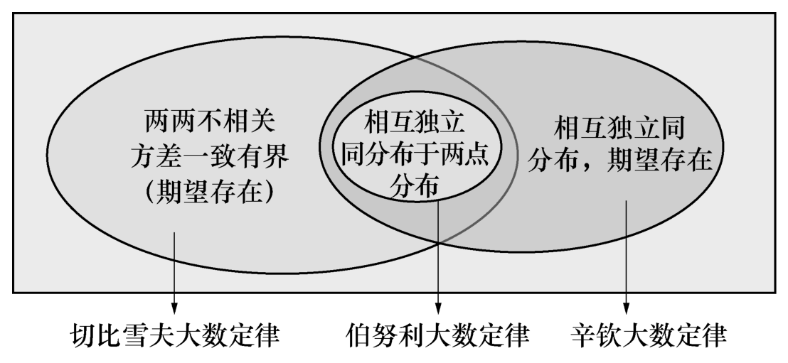
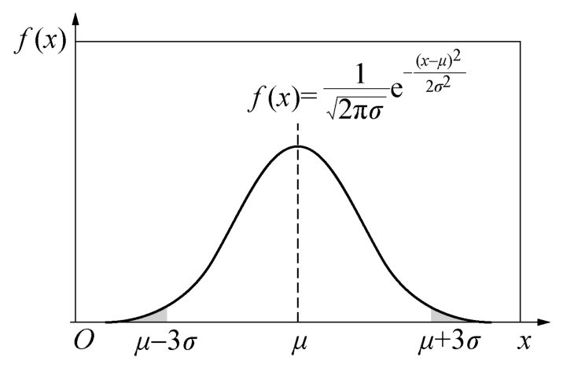
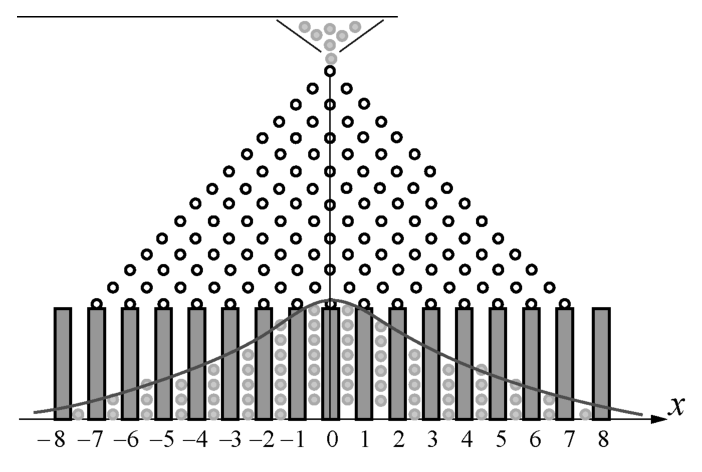
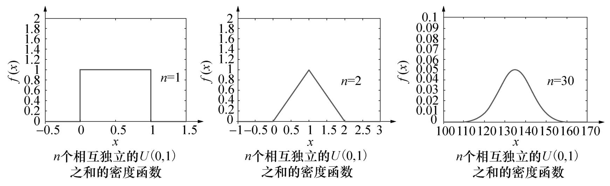

# 第五章 大数定律及中心极限定理

［课前导读］

概率论是研究大量试验后呈现出的统计规律性的一门理论，数学中研究大量的工具是极限。因此这一章我们学习概率论中的极限定理，主要有大数定律及中心极限定理。先回忆一下高等数学中数列的极限。其实在第二章我们学习过两个极限定理，超几何分布的极限是二项分布以及泊松定理，即二项分布的极限是泊松分布。

数列的极限：设 $\{x_n\}$ 为实数列，$c$ 为常数。若对任意给定的正数 $\varepsilon$，总存在正整数 $N$，使得当 $n>N$ 时，有 $|x_n-c|\leqslant\varepsilon$，则称数列 $\{x_n\}$ 收敛于 $c$。常数 $c$ 称为数列 $\{x_n\}$ 的极限，记作 $x_n\to c$，$n\to\infty$。

超几何分布的极限定理：

$$
\lim_{N\to\infty}\frac{\binom{M}{k}\binom{N-M}{n-k}}{\binom{N}{n}}=\binom{n}{k}p^k(1-p)^{n-k}.
$$

泊松定理：设 $\lambda=np_n>0$，$0<p_n<1$，对于任意一个非负整数 $k$ 有

$$
\lim_{n\to\infty}\binom{n}{k}p_n^k(1-p_n)^{n-k}=\mathrm{e}^{-\lambda}\frac{\lambda^k}{k!}.
$$

## 第一节 大数定律

在第一章学习概率的统计定义时，我们讲到随着试验次数的增大，事件的频率逐步“稳定”到事件的概率，这里的“稳定”即为收敛。它意味着随着试验次数的增多，在某种收敛意义下，频率的极限是概率。这是为什么呢？大数定律给了我们答案。首先介绍切比雪夫不等式。

### 一、切比雪夫（Chebyshev）不等式

随机变量 $X$ 的取值总是围绕着其期望变动，若 $X$ 的分布已知时，可以计算事件 $\{|X-E(X)|\geqslant\varepsilon\}$ 的概率。

**例 1** 设 $X\sim N(\mu,\sigma^2)$，求 $P(|X-\mu|\geqslant 3\sigma)$。

解 因为 $\frac{X-\mu}{\sigma}\sim N(0,1)$，所以

$$
P(|X-\mu|\geqslant 3\sigma)=P\left(\left|\frac{X-\mu}{\sigma}\right|\geqslant 3\right)=2-2\Phi(3)=0.003.
$$

若 $X$ 的分布未知时，怎样计算 $P(|X-E(X)|\geqslant\varepsilon)$ 呢？切比雪夫不等式给出了此概率的一个上限。

**定理 1（切比雪夫不等式）** 设随机变量 $X$ 的数学期望 $E(X)$ 及方差 $D(X)$ 存在，则对于任意的 $\varepsilon>0$，有

$$
P(|X-E(X)|\geqslant\varepsilon)\leqslant\frac{D(X)}{\varepsilon^2}.
$$

证明 仅给出 $X$ 为连续型随机变量的证明。

$$
P(|X-E(X)|\geqslant\varepsilon)=\int_{|x-E(X)|\geqslant\varepsilon}f(x)\,\mathrm{d}x\leqslant\int_{|x-E(X)|\geqslant\varepsilon}\left(\frac{x-E(X)}{\varepsilon}\right)^2f(x)\,\mathrm{d}x
$$

$$
\leqslant\int_{-\infty}^{+\infty}\frac{(x-E(X))^2}{\varepsilon^2}f(x)\,\mathrm{d}x=\frac{D(X)}{\varepsilon^2}.
$$

事件 $\{|X-E(X)|\geqslant\varepsilon\}$ 理解为“随机变量 $X$ 关于其期望发生了较大偏差”，不等式给出了此事件的概率上限，它与方差成正比。方差越大，此上界就越大；方差越小，$X$ 在其期望附近取值的密集程度就越高，那么远离期望的区域的概率上界就越小。它进一步说明了方差的概率意义，方差是随机变量取值与其中心位置的偏离程度的一种度量指标。

在实际问题中，当随机变量 $X$ 的分布未知时，可由 $X$ 的观测数据估计得到 $X$ 的期望和方差，然后使用切比雪夫不等式估计 $X$ 关于 $E(X)$ 的偏离程度。

**例 1 续** 设 $X\sim N(\mu,\sigma^2)$，用切比雪夫不等式估计概率 $P(|X-\mu|\geqslant 3\sigma)$。

解 因为 $\varepsilon=3\sigma$，由切比雪夫不等式得

$$
P(|X-\mu|\geqslant 3\sigma)\leqslant\frac{D(X)}{(3\sigma)^2}=\frac{1}{9}.
$$

显然利用切比雪夫不等式估计“随机变量 $X$ 关于其期望 $\mu$ 发生了较大偏差”的概率是粗糙的。这里引入切比雪夫不等式的另一个目的——它是证明大数定律的工具之一。

**例 2** 设随机变量 $X$ 的方差 $D(X)=0$，求证，$X$ 服从参数为 $c$ 的退化分布。

证明 利用切比雪夫不等式得，对任意的 $\varepsilon>0$，有

$$
0\leqslant P(|X-E(X)|\geqslant\varepsilon)\leqslant\frac{D(X)}{\varepsilon^2}=0.
$$

由 $\varepsilon$ 的任意性知

$$
P(X=E(X))=1.
$$

### 二、依概率收敛

刻画随机变量序列的极限和刻画数列的极限是不同的。随机变量序列即由随机变量构成的一个序列。前面我们复习了数列 $\{x_n\}$ 的极限定义。数列 $\{x_n\}$ 收敛于 $c$，指当 $n$ 充分大时，$x_n$ 和 $c$ 的距离任意小。对随机变量序列 $X_1$，$X_2$，$\cdots$ 不能采用这样的方式定义它的极限。因为序列中的每一个元素 $X_n$ 是随机变量，它的取值不确定，它不可能和一个常数 $c$ 的距离任意小，除非它退化为常数 $c$。那么，能否用合理的方式给出随机变量序列的极限呢？答案是肯定的，只不过这里随机变量序列极限的定义方式和数列极限的定义方式有所不同。

例如，在重复抛掷一枚硬币的试验中，设事件 $A$ 为“出现正面”。对固定的 $n$，抛掷 $n$ 次硬币，设 $f_n(A)$ 为事件 $A$ 出现的频率，它是一个随机变量。当抛掷的次数 $n$ 改变时，得到一个随机变量序列 $f_1(A)$，$f_2(A)$，$\cdots$，$f_n(A)$，$\cdots$。随着 $n$ 的增大，$f_n(A)$ 越来越接近于 $0.5$，但不能理解为“$f_n(A)$ 和 $0.5$ 的距离任意小”，这样的说法（$|f_n(A)-0.5|\leqslant\varepsilon$）是错误的。因为 $n$ 次抛掷结果都为正面是可能发生的，这时 $|f_n(A)-0.5|=|1-0.5|=0.5$，即“$f_n(A)$ 和 $0.5$ 的距离不那么小”。那么怎样刻画事件 $A$ 发生的频率 $f_n(A)$ 越来越接近于 $0.5$ 呢？我们发现，$P\{（正，正，\cdots，正）\}=1/2^n$ 随着 $n$ 的增大趋向于零。频率和 $0.5$ 出现较大偏差的可能性即 $P(|f_n(A)-0.5|\geqslant\varepsilon)$ 随着 $n$ 的增大越来越小，当 $n$ 充分大时，它趋向于零。所以，可以说事件 $A$ 发生的频率 $f_n(A)$ 收敛到 $A$ 的概率 $P(A)=0.5$。这样我们给出了如下随机变量序列极限的定义方式。

**定义** 设 $X_1$，$X_2$，$\cdots$ 是一个随机变量序列。如果存在一个常数 $c$，使得对任意一个 $\varepsilon>0$，总有 $\lim\limits_{n\to\infty}P(|X_n-c|<\varepsilon)=1$。那么，称随机变量序列 $X_1$，$X_2$，$\cdots$ 依概率收敛于 $c$，记作 $X_n\xrightarrow{P}c$。即对任意 $\varepsilon>0$，$P(|X_n-c|\geqslant\varepsilon)\to 0$，$n\to\infty$。

怎样理解依概率收敛的定义？当 $n$ 充分大时，“$X_n$ 在 $(c-\varepsilon,\ c+\varepsilon)$ 内”的概率几乎为 $1$，或“$X_n$ 和 $c$ 出现较大偏差”的可能性几乎为零（几乎不可能发生）。用这样的方式定义随机序列的极限是合理的。

**例 3** 已知 $X_1$，$X_2$，$\cdots$ 是一个随机变量序列，且 $E(X_n)=2$，$D(X_n)=\frac{1}{n}$，$n=1$，$2$，$\cdots$，问 $X_n$ 依概率收敛到什么值？

解 由切比雪夫不等式得

$$
P(|X_n-2|\geqslant\varepsilon)\leqslant\frac{D(X_n)}{\varepsilon^2}=\frac{1}{n\varepsilon^2}\to 0,\quad n\to\infty,
$$

所以 $X_n\xrightarrow{P}2$。

不加证明地给出下面定理。

**定理 2** 如果 $X_n\xrightarrow{P}a$，$Y_n\xrightarrow{P}b$，且函数 $g(x,\ y)$ 在 $(a,\ b)$ 处连续，那么

$$
g(X_n,\ Y_n)\xrightarrow{P}g(a,\ b).
$$

举个简单的例子，若 $X_n\xrightarrow{P}2$，$Y_n\xrightarrow{P}3$，那么就有 $X_n+Y_n\xrightarrow{P}5$。

### 三、大数定律

有了前面的准备，下面我们就来介绍三个大数定律，包括切比雪夫大数定律、辛钦大数定律和伯努利大数定律。学习中注意这三个大数定律的条件有什么异同。首先介绍俄国数学家切比雪夫（1821 年—1894 年）发表的切比雪夫大数定律。

**定理 3（切比雪夫大数定律）** 设随机变量序列 $X_1$，$X_2$，$\cdots$ 两两不相关，若存在常数$c$，使得 $D(X_i)=\sigma_i^2\leqslant c<+\infty$，$i=1,\ 2,\ \cdots$。则对任意 $\varepsilon>0$，有

$$
\lim_{n\to\infty}P\left(\left|\frac{1}{n}\sum_{i=1}^{n}X_i-\frac{1}{n}\sum_{i=1}^{n}E(X_i)\right|<\varepsilon\right)=1.
$$

也可以表示为 $\bar{X}=\frac{1}{n}\sum\limits_{i=1}^{n}X_i\xrightarrow{P}\frac{1}{n}\sum\limits_{i=1}^{n}E(X_i)$。

证明 因为随机序列 $X_1$，$X_2$，$\cdots$ 两两不相关，根据期望和方差的性质得

$$
E\left(\frac{1}{n}\sum_{i=1}^{n}X_i\right)=\frac{1}{n}\sum_{i=1}^{n}E(X_i),\quad D\left(\frac{1}{n}\sum_{i=1}^{n}X_i\right)=\frac{1}{n^2}\sum_{i=1}^{n}D(X_i)\leqslant\frac{c}{n},
$$

由切比雪夫不等式得，对任意 $\varepsilon>0$，当 $n\to\infty$ 时，

$$
P\left(\left|\frac{1}{n}\sum_{i=1}^{n}X_i-\frac{1}{n}\sum_{i=1}^{n}E(X_i)\right|\geqslant\varepsilon\right)\leqslant\frac{1}{\varepsilon^2}D\left(\frac{1}{n}\sum_{i=1}^{n}X_i\right)\leqslant\frac{c}{n\varepsilon^2}\to 0.
$$

**随机变量序列 $X_1$，$X_2$，$\cdots$ 相互独立指序列中的任意有限个随机变量相互独立，随机变量序列 $X_1$，$X_2$，$\cdots$ 两两不相关指序列中的任意两个随机变量线性无关。存在常数 $c$，使得 $D(X_i)=\sigma_i^2\leqslant c<+\infty$，$i=1,\ 2,\ \cdots$ 又被称作方差存在且一致有上界。**

定理表明，若随机变量序列相互独立，方差存在且一致有上界，当 $n$ 充分大时，随机序列的前 $n$ 项的算术平均值和自身的期望充分接近几乎总是发生的。

**定理 4（相互独立同分布大数定律）** 设随机变量序列 $X_1$，$X_2$，$\cdots$ 相互独立同分布，若 $E(X_i)=\mu<+\infty$，$D(X_i)=\sigma^2<+\infty$，$i=1,\ 2,\ \cdots$。则对任意 $\varepsilon>0$，有

$$
\lim_{n\to\infty}P\left(\left|\frac{1}{n}\sum_{i=1}^{n}X_i-\mu\right|<\varepsilon\right)=1.
$$

也可以表示为 $\bar{X}=\frac{1}{n}\sum\limits_{i=1}^{n}X_i\xrightarrow{P}\mu$。

**随机变量序列 $X_1$，$X_2$，$\cdots$ 相互独立同分布指随机变量序列相互独立且序列中随机变量的分布类型及参数均相同。显然相互独立同分布大数定律是切比雪夫大数定律的特例。因为切比雪夫大数定律中的 $\frac{1}{n}\sum\limits_{i=1}^{n}E(X_i)$ 在相互独立同分布大数定律的条件下即为 $\mu$。**

在许多实际问题中，方差存在不一定满足，苏联数学家辛钦（1894 年—1959 年）证明了相互独立同分布情形下，仅期望存在、方差不存在时结论仍然成立，因此相互独立同分布大数定律又称作辛钦大数定律。

相互独立同分布（辛钦）大数定律是人们日常生活中经常使用的算术平均值法则的理论依据。为了精确称量物体的质量 $\mu$，可在相同的条件下重复称 $n$ 次，结果可记为 $x_1$，$x_2$，$\cdots$，$x_n$。它们一般是不同的，可看为 $n$ 个相互独立同分布的随机变量（$X_1$，$X_2$，$\cdots$，$X_n$）的一次观测值。$X_1$，$X_2$，$\cdots$，$X_n$ 服从同一分布，它们共同的期望即为物体的真实质量 $\mu$。由相互独立同分布（辛钦）大数定律知，当 $n$ 充分大时，$\frac{1}{n}\sum\limits_{i=1}^{n}X_i\xrightarrow{P}\frac{1}{n}\sum\limits_{i=1}^{n}E(X_i)=E(X_i)=\mu$。这意味着 $\frac{1}{n}\sum\limits_{i=1}^{n}X_i$ 逐渐趋向于 $\mu$，也即随机变量的算术平均值具有稳定性。在物理实验中我们就是采用这种方法测得物体质量的。例如，为得到一颗钻石的真实质量，我们测 $n$ 次取其算术平均值即可。算术平均值法则提供了一条切实可操作的途径来得到物体的真实值。大数定律从理论上给出了这个结论的严格证明，而不是仅仅靠直觉。

历史上的首个极限定理由瑞士数学家雅各布·伯努利（1654 年—1705 年）提出的伯努利大数定律，它的出现意味着概率论由建立走向发展的阶段。

**定理 5（伯努利大数定律）** 设随机变量序列 $X_1$，$X_2$，$\cdots$ 相互独立同分布，且 $X_i\sim B(1,\ p)$，$i=1,\ 2,\ \cdots$。则对任意 $\varepsilon>0$，有

$$
\lim_{n\to\infty}P\left(\left|\frac{1}{n}\sum_{i=1}^{n}X_i-p\right|<\varepsilon\right)=1.
$$

显然伯努利大数定律是相互独立同分布大数定律的特例。这里 $\frac{1}{n}\sum\limits_{i=1}^{n}E(X_i)=p$。

在 $n$ 重伯努利试验中，设 $X_i=\begin{cases}0, & \text{第 } i \text{ 次试验 } A \text{ 不发生},\\ 1, & \text{第 } i \text{ 次试验 } A \text{ 发生},\end{cases}$ $i=1,\ 2,\ \cdots,\ n$。则 $X_1$，$X_2$，$\cdots$，$X_n$ 是相互独立同分布的随机变量，且 $X_i\sim B(1,\ p)$，$i=1,\ 2,\ \cdots,\ n$，其中 $p=P(A)$。由伯努利大数定律知，当 $n$ 充分大时，$A$ 发生的频率 $f_n(A)=\frac{1}{n}\sum\limits_{i=1}^{n}X_i=\bar{X}\xrightarrow{P}p=P(A)$。这回答了前面我们提出的问题。在概率的统计定义中，随着试验次数的增大，事件的频率逐步“稳定”到事件的概率，这里的“稳定”即为依概率收敛。

在大量相互独立重复试验中可以用某个事件 $A$ 发生的频率来近似每次试验中事件 $A$ 发生的概率。这就是伯努利大数定律的直观意义。当 $n$ 充分大时，频率与其概率能任意接近的概率趋向于 $1$。因此实际中，只要试验次数足够多，可用频率作为概率的估计。同时伯努利大数定律也解释了概率存在的客观意义。为什么“大数次”重复试验下，事件的概率是存在的。正是因为频率的这种稳定性，我们才意识到概率的存在，才有了概率论这门学科。

三个大数定律条件是不同的。切比雪夫大数定律不要求随机变量序列同分布，甚至不要求相互独立，只要两两不相关、方差一致有界即可；辛钦大数定律和伯努利大数定律都要求随机变量序列相互独立且同分布，辛钦大数定律不要求方差存在，仅期望存在即可；伯努利大数定律的共同分布限定为两点分布。三个大数定律的条件关系如图 5.1 所示。

图 5.1 三个大数定律的条件关系切比雪夫大数定律不要求随机变量序列相互独立，因而适用面更广。数学的发展从来都是循序渐进的，正因为有了伯努利大数定律，才会有辛钦大数定律进而才有切比雪夫大数定律。大数定律无论在理论上还是在实际应用中，都有举足轻重的作用，对概率论和数理统计的发展有着不可替代的作用，是现代概率论、数理统计学、理论科学和社会科学发展的基石。

**例 4** 设 $X_1$，$X_2$，$\cdots$ 是相互独立同分布的随机变量序列。在下列三种情形下，当 $n\to\infty$ 时，试问 $\bar{X}$，$\frac{1}{n}\sum\limits_{i=1}^{n}X_i^2$ 分别依概率收敛于什么值？

（1）$X_i\sim B(m,\ p)$，$i=1,\ 2,\ \cdots$；

（2）$X_i\sim E(\lambda)$，$i=1,\ 2,\ \cdots$；

（3）$X_i\sim N(\mu,\ \sigma^2)$，$i=1,\ 2,\ \cdots$。

解 在三种情形下，$X_1$，$X_2$，$\cdots$ 均是相互独立同分布的随机变量序列，且 $X_i$ 与 $X_i^2$ 具有有限的数学期望和方差，$i=1,\ 2,\ \cdots$。对 $X_1$，$X_2$，$\cdots$ 及 $X_1^2$，$X_2^2$，$\cdots$ 分别使用相互独立同分布大数定律，得

$$
\bar{X}=\frac{1}{n}\sum_{i=1}^{n}X_i\xrightarrow{P}\frac{1}{n}\sum_{i=1}^{n}E(X_i)=E(X_i),
$$

$$
\frac{1}{n}\sum_{i=1}^{n}X_i^2\xrightarrow{P}\frac{1}{n}\sum_{i=1}^{n}E(X_i^2)=E(X_i^2)=D(X_i)+E^2(X_i).
$$

因此

（1）当 $X_i\sim B(m,\ p)$ 时，$E(X_i)=mp$，$E(X_i^2)=mp(1-p)+m^2p^2$，有

$$
\bar{X}\xrightarrow{P}mp,\quad \frac{1}{n}\sum_{i=1}^{n}X_i^2\xrightarrow{P}mp(1-p)+m^2p^2.
$$

（2）当 $X_i\sim E(\lambda)$ 时，$E(X_i)=\frac{1}{\lambda}$，$E(X_i^2)=\frac{2}{\lambda^2}$，有

$$
\bar{X}\xrightarrow{P}\frac{1}{\lambda},\quad \frac{1}{n}\sum_{i=1}^{n}X_i^2\xrightarrow{P}\frac{2}{\lambda^2}.
$$

（3）当 $X_i\sim N(\mu,\ \sigma^2)$ 时，$E(X_i)=\mu$，$E(X_i^2)=\sigma^2+\mu^2$，有

$$
\bar{X}\xrightarrow{P}\mu,\quad \frac{1}{n}\sum_{i=1}^{n}X_i^2\xrightarrow{P}\sigma^2+\mu^2.
$$

类似地，若 $X_1$，$X_2$，$\cdots$ 是相互独立同分布的随机变量序列，$E(X_i^k)$ 和 $D(X_i^k)$ 存在，$i=1,\ 2,\ \cdots$，对 $X_1^k$，$X_2^k$，$\cdots$ 使用相互独立同分布大数定律，结论 $\frac{1}{n}\sum\limits_{i=1}^{n}X_i^k\xrightarrow{P}\frac{1}{n}\sum\limits_{i=1}^{n}E(X_i^k)=E(X_i^k)$ 成立。这正是数理统计中参数点估计的思想来源，用 $\frac{1}{n}\sum\limits_{i=1}^{n}X_i^k$ 的观测值 $\frac{1}{n}\sum\limits_{i=1}^{n}x_i^k$ 估计 $E(X_i^k)$。

大数定律在实际中有许多重要应用。除了算术平均值法则、用频率估计概率，还有数理统计中参数的点估计思想等。

### 习题 5-1

**1.** 设 $X_1$，$X_2$，$\cdots$，$X_n$ 是相互独立同分布的随机变量。试在下列五种情形下分别计算 $E(\bar{X})$，$D(\bar{X})$，$E\left(\sum\limits_{i=1}^{n}X_i\right)$ 与 $D\left(\sum\limits_{i=1}^{n}X_i\right)$：

（1）$X_i\sim E(\lambda)$，$i=1,\ 2,\ \cdots,\ n$；

（2）$X_i\sim N(\mu,\ \sigma^2)$，$i=1,\ 2,\ \cdots,\ n$；

（3）$X_i\sim P(\lambda)$，$i=1,\ 2,\ \cdots,\ n$；

（4）$X_i\sim U(a,\ b)$，$i=1,\ 2,\ \cdots,\ n$；

（5）$X_i\sim B(m,\ p)$，$i=1,\ 2,\ \cdots,\ n$。

**2.** 请阐述数列极限的定义与随机变量序列依概率收敛的定义的异同。

**3.** 已知 $X\sim E(3)$。（1）计算概率 $P\left(\left|X-\frac{1}{3}\right|\leqslant 2\right)$；（2）用切比雪夫不等式估计概率 $P\left(\left|X-\frac{1}{3}\right|\leqslant 2\right)$ 的下界。

**4.** 设随机变量 $X$ 和 $Y$ 的数学期望分别为 $-2$ 和 $2$，方差分别为 $1$ 和 $4$，两者的相关系数为 $-0.5$。由切比雪夫不等式估计概率 $P(|X+Y|\geqslant 6)$ 的上界。

**5.** 设 $X_1$，$X_2$，$\cdots$ 是相互独立同分布的随机变量序列。在下列两种情形下，当 $n\to\infty$ 时，试问 $\bar{X}$，$\frac{1}{n}\sum\limits_{i=1}^{n}X_i^2$ 和 $\frac{1}{n}\sum\limits_{i=1}^{n}X_i^k$ 分别依概率收敛于什么值，其中 $k$ 是一正整数。

（1）$X_i\sim U(a,\ b)$，$i=1,\ 2,\ \cdots$；

（2）$X_i\sim P(\lambda)$，$i=1,\ 2,\ \cdots$。

**\*6.** 将 $n$ 个带有号码 $1$ 至 $n$ 的球放入 $n$ 个编有号码 $1$ 至 $n$ 的盒子，并限制每一个盒子只能放入一个球。设球与盒子的号码一致的个数是 $Y_n$。试证明：$\frac{Y_n-E(Y_n)}{n}\xrightarrow{P}0$。提示：设 $X_i=\begin{cases}1, & \text{号码为 } i \text{ 的球放入号码为 } i \text{ 的盒子},\\ 0, & \text{否则},\end{cases}$ 则 $X_i\sim B\left(1,\ \frac{1}{n}\right)$，

| $X_i\backslash X_j$ | $0$ | $1$ | $p_{i\cdot}$ |
|:---:|:---:|:---:|:---:|
| $0$ | $\frac{n^2-3n+3}{n(n-1)}$ | $\frac{n-2}{n(n-1)}$ | $1-\frac{1}{n}$ |
| $1$ | $\frac{n-2}{n(n-1)}$ | $\frac{1}{n(n-1)}$ | $\frac{1}{n}$ |
| $p_{\cdot j}$ | $1-\frac{1}{n}$ | $\frac{1}{n}$ | $1$ |

$i\neq j$，$i,\ j=1,\ 2,\ \cdots,\ n$。

## 第二节 中心极限定理

自然界中有许多随机现象可以用正态分布或近似正态分布来描述，这是为什么呢？比如同龄人的身高、体重，成年人的智商以及测量误差等都可以用这样的一条优雅曲线（见图 5.2）来描述其分布特征，它们呈现出中间高两边低的特点。大部分人是中等身材，体态也是普通的，智商在平均值附近分布。像爱因斯坦、达芬奇那样的天才少之又少。中心极限定理揭示了其中的奥秘。再比如下面的高尔顿钉板实验。

**例 1（高尔顿钉板实验）** 如图 5.3 所示，有一个板上面有 $n$ 排钉子，每排相邻的两个钉子之间的距离均相等。上一排钉子的水平位置恰巧位于下一排紧邻的两个钉子水平位置的正中间。从上端入口处放入小球，在下落过程中小球碰到钉子后以相等的可能性向左或向右偏离，碰到下一排相邻的两个钉子中的一个。如此继续下去，直到落入底部隔板中的一格中。问当有大量的小球从上端依次放入，任其自由下落，小球最终在底板中堆积的形态。设钉子有 16 排。

图 5.2 正态分布的密度函数

图 5.3 高尔顿钉板

首先进行分析。小球堆积的形态取决于小球最终下落在底部隔板的位置的分布。设随机变量 $X$ 为“小球最终下落在底部隔板中的位置”。又引入随机变量

$$
X_i=\begin{cases}-1, & \text{小球碰到第 } i \text{ 排钉子向左下落},\\ 1, & \text{小球碰到第 } i \text{ 排钉子向右下落},\end{cases}\quad i=1,\ 2,\ \cdots,\ n.
$$

显然 $X=\sum\limits_{i=1}^{n}X_i$，和的分布计算很复杂，有没有其他的方法呢？经过试验我们观察发现小球堆积的形态呈现出中间高两边低的特点，能否认为 $X$ 近似地服从正态分布？答案是肯定的。这是为什么呢？中心极限定理告诉了我们答案。

中心极限定理是相互独立的随机变量之和用正态分布近似的一类定理。首先介绍最为著名的相互独立同分布情形下的中心极限定理，又称为列维-林德伯格中心极限定理。列维（1886 年—1971 年）是法国数学家，对极限理论和随机过程理论做出了杰出的贡献。林德伯格（1876 年—1932 年）是芬兰数学家因中心极限定理而闻名于世。

**定理 1（列维-林德伯格中心极限定理）** 设随机变量序列 $X_1$，$X_2$，$\cdots$ 相互独立同分布，若 $E(X_i)=\mu$，$D(X_i)=\sigma^2$，且 $0<\sigma^2<+\infty$，$i=1,\ 2,\ \cdots$。则对任意实数 $x$，有

$$
\lim_{n\to\infty}P\left(\frac{\sum\limits_{i=1}^{n}X_i-n\mu}{\sqrt{n}\sigma}\leqslant x\right)=\Phi(x).
$$

由于中心极限定理的证明需要使用其他的数学工具，因此这里不给出证明。

定理的条件要求随机变量相互独立并且服从同一分布。这里相互独立意味着随机变量之间不相互影响，同分布是指每个随机变量在随机变量序列的前 $n$ 项部分和中的地位相同。也即，每个随机变量对前 $n$ 项部分和的影响都是微小的。我们说这个条件是非常一般的，因为它并没有限定随机变量共同的分布类型，对任意类型的随机变量无论它是离散型、连续型或其他类型，都有同样的结论，前 $n$ 项部分和标准化的极限分布就是标准正态分布。

我们还有更为一般的结论，只要随机变量相互独立，每个随机变量对和的影响都是微小的，哪怕它们的分布类型不同，其和标准化后都有标准正态的极限分布。

这就解释了自然界中一些现象受到许多相互独立且微小的随机因素影响，总的影响就可以看作服从或近似服从正态分布。例如，测量误差受到许多相互独立随机因素的影响，如测量环境温度、湿度，测量工具的精密程度以及测量者的心理因素、测量的态度等的影响，而每种影响都不占主要地位，那么它们总和造成的总误差就近似地服从正态分布。

这个定理的直观意义是，当 $n$ 足够大时，可以近似地认为 $\sum\limits_{i=1}^{n}X_i\sim N(n\mu,\ n\sigma^2)$，记为 $\sum\limits_{i=1}^{n}X_i\overset{\text{近似}}{\sim}N(n\mu,\ n\sigma^2)$。$\overset{\text{近似}}{\sim}$ 表示近似服从。在实际问题中，若 $n$ 较大，可以利用正态分布近似求得概率 $P\left(\sum\limits_{i=1}^{n}X_i\leqslant a\right)\approx\Phi\left(\frac{a-n\mu}{\sqrt{n\sigma^2}}\right)$。

下面的例子说明了中心极限定理在实际中的应用。

**例 2** 已知某计算机程序进行加法运算时，要对每个加数四舍五入取整。假设所有取整的误差相互独立，并且均服从 $U(-0.5,\ 0.5)$。（1）如果将 1200 个数相加，求误差总和的绝对值超过 20 的概率；（2）要使误差总和的绝对值不超过 5 的概率超过 0.95，最多有多少个加数？

解 （1）设 $X$ 为“对每个加数四舍五入，将 1200 个数相加后的误差总和”，并设 $X_i$ 为“第 $i$ 个加数的四舍五入误差”，$i=1,\ 2,\ \cdots,\ 1200$。则 $X=\sum\limits_{i=1}^{1200}X_i$。有 $X_i\sim U(-0.5,\ 0.5)$，

$$
E(X_i)=\frac{-0.5+0.5}{2}=0,\quad D(X_i)=\frac{(0.5+0.5)^2}{12}=\frac{1}{12},\quad i=1,\ 2,\ \cdots,\ 1200,
$$

$$
E\left(\sum_{i=1}^{1200}X_i\right)=1200\cdot 0=0,\quad D\left(\sum_{i=1}^{1200}X_i\right)=1200\cdot\frac{1}{12}=100.
$$

由列维-林德伯格中心极限定理知，$X=\sum\limits_{i=1}^{1200}X_i\overset{\text{近似}}{\sim}N(0,\ 100)$。因此

$$
P\left(\left|\sum_{i=1}^{1200}X_i\right|>20\right)=P\left(\left|\frac{\sum\limits_{i=1}^{1200}X_i-0}{\sqrt{100}}\right|>\frac{20-0}{\sqrt{100}}\right)\approx 2(1-\Phi(2))=2\cdot 0.0228=0.0456.
$$

（2）设加数最多有 $n$ 个才能使误差总和的绝对值不超过 $5$ 的概率超过 $0.95$。有

$$
E\left(\sum_{i=1}^{n}X_i\right)=0,\quad D\left(\sum_{i=1}^{n}X_i\right)=\frac{n}{12}.
$$

由列维-林德伯格中心极限定理知，$\sum\limits_{i=1}^{n}X_i\overset{\text{近似}}{\sim}N\left(0,\ \frac{n}{12}\right)$。因此

$$
P\left(\left|\sum_{i=1}^{n}X_i\right|\leqslant 5\right)=P\left(\left|\frac{\sum\limits_{i=1}^{n}X_i-0}{\sqrt{\frac{n}{12}}}\right|\leqslant\frac{5}{\sqrt{\frac{n}{12}}}\right)=2\Phi\left(\frac{5}{\sqrt{\frac{n}{12}}}\right)-1\geqslant 0.95,
$$

即 $\Phi\left(\frac{5\sqrt{12}}{\sqrt{n}}\right)\geqslant 0.975$，查表得 $\frac{5\sqrt{12}}{\sqrt{n}}\geqslant u_{0.975}=1.96$，有 $n\leqslant 12\cdot\left(\frac{5}{1.96}\right)^2=78.092$，取 $n=78$。所以最多有 78 个加数，才能使误差总和的绝对值不超过 5 的概率超过 0.95。

一般说来，若随机变量 $X_1$，$X_2$，$\cdots$，$X_n$ 相互独立同分布且 $n$ 较大时，中心极限定理在实际应用中有如下三种形式。

（1）$\frac{\sum\limits_{i=1}^{n}X_i-n\mu}{\sqrt{n\sigma^2}}\overset{\text{近似}}{\sim}N(0,\ 1)$；

（2）$\left(\sum\limits_{i=1}^{n}X_i\right)\overset{\text{近似}}{\sim}N(n\mu,\ n\sigma^2)$；

（3）$\bar{X}\overset{\text{近似}}{\sim}N\left(\mu,\ \frac{\sigma^2}{n}\right)$。

**例 1（续）** 在街头赌博中，庄家在高尔顿钉板的底板两端距离原点超出 8 格的位置放置了值钱的东西来吸引顾客，试用中心极限定理来揭穿这个街头赌博中的骗术。

解 设 $X$ 为“小球在底板中的位置”，$X_i=\begin{cases}-1, & \text{小球碰到第 } i \text{ 排钉子向左下落},\\ 1, & \text{小球碰到第 } i \text{ 排钉子向右下落},\end{cases}$ $i=1,\ 2,\ \cdots,\ 16$。显然 $X_1$，$X_2$，$\cdots$，$X_{16}$ 相互独立且同分布，$X=\sum\limits_{i=1}^{16}X_i$。$X_i$ 的分布律如下表，有

| $X_i$ | $-1$ | $1$ |
|:---:|:---:|:---:|
| 概率 | $0.5$ | $0.5$ |

$$
E(X_i)=-1\cdot 0.5+1\cdot 0.5=0,
$$

$$
E(X_i^2)=(-1)^2\cdot 0.5+1^2\cdot 0.5=1,
$$

$$
D(X_i)=1,\quad i=1,\ 2,\ \cdots,\ 16,
$$

$$
E\left(\sum_{i=1}^{16}X_i\right)=16\cdot 0=0,\quad D\left(\sum_{i=1}^{16}X_i\right)=16\cdot 1=16,
$$

由列维-林德伯格中心极限定理知 $X=\sum\limits_{i=1}^{16}X_i\overset{\text{近似}}{\sim}N(0,\ 16)$。因此，

$$
P(|X|>8)=P(X>8)+P(X<-8)
$$

$$
\approx 1-\Phi\left(\frac{8-0}{\sqrt{16}}\right)+\Phi\left(\frac{-8-0}{\sqrt{16}}\right)=2\left[1-\Phi(2)\right]=0.0456.
$$

说明顾客中奖的可能性微乎其微。

我们知道，若 $X\sim U(0,\ 1)$，则 $X$ 取值落在 $[0,\ 1]$ 某一区域内的概率只与其长度成正比，与其所在位置无关，通俗地讲就是 $X$ 取值 $[0,\ 1]$ 内任意一点的可能性是一样的。那么，当 $n$ 很大时，$n$ 个相互独立的 $U(0,\ 1)$ 之和能否用正态分布近似呢？图 5.4 给出了 $n(=1,\ 2,\ 30)$ 个相互独立的 $U(0,\ 1)$ 之和的密度函数图像。随着 $n$ 的增大，和的分布呈现出中间高两边低的正态分布的特性，所以可以用正态分布近似相互独立的 $U(0,\ 1)$ 之和的分布。事实上，当 $n=12$ 时，这种近似效果就非常好了。经过叠加原本取值任意一点的可能性由相同变为了向中心位置聚拢。这和我们的直觉是多么不同。

图 5.4 $n(=1,\ 2,\ 30)$ 个相互独立的 $U(0,\ 1)$ 之和的密度函数图像

最早的中心极限定理是法国数学家棣莫弗（1667 年—1754 年）于 1733 年发现的，他使用正态分布去估计 $n$（很大）次抛掷硬币出现正面次数的分布，即二项分布 $B(n,\ 0.5)$（$p=0.5$）。这个超越时代的发现险些湮没在历史的洪流中，将近 80 年后著名法国数学家拉普拉斯（1749 年—1827 年）拯救了这个默默无名的理论。在他 1812 年发表的巨著《概率的解析理论》中拉普拉斯推广了棣莫弗的理论，指出当 $n$ 很大时二项分布 $B(n,\ p)$（$0<p<1$）都可用正态分布逼近。研究这个理论花了他将近 20 年的时间。今天我们称之为棣莫弗-拉普拉斯中心极限定理。

**定理 2（棣莫弗-拉普拉斯中心极限定理）** 设随机变量序列 $X_1$，$X_2$，$\cdots$ 相互独立同分布，且 $X_i\sim B(1,\ p)$，$i=1,\ 2,\ \cdots$。则对任意实数 $x$，有

$$
\lim_{n\to\infty}P\left(\frac{\sum\limits_{i=1}^{n}X_i-np}{\sqrt{np(1-p)}}\leqslant x\right)=\Phi(x).
$$

显然棣莫弗-拉普拉斯中心极限定理是列维-林德伯格中心极限定理的特例。因为 $\sum\limits_{i=1}^{n}X_i\sim B(n,\ p)$ 服从二项分布，所以这个定理又称为二项分布的正态近似。

前面由伯努利大数定律知 $\frac{1}{n}\sum\limits_{i=1}^{n}X_i\xrightarrow{P}p$，当 $n$ 充分大时，可以用 $\frac{1}{n}\sum\limits_{i=1}^{n}X_i$ 作为 $p$ 的近似，至于近似程度如何，不得而知。中心极限定理对近似的程度进行了注释

$$
P\left(\left|\frac{1}{n}\sum_{i=1}^{n}X_i-p\right|\leqslant\varepsilon\right)=P\left(\left|\frac{\sum\limits_{i=1}^{n}X_i-np}{\sqrt{np(1-p)}}\right|\leqslant\frac{\sqrt{n}}{\sqrt{p(1-p)}}\varepsilon\right)
$$

$$
\approx 2\Phi\left(\frac{\sqrt{n}\varepsilon}{\sqrt{p(1-p)}}\right)-1\approx 1\ (n \text{ 充分大}).
$$

所以说中心极限定理的结论更为细致。

**例 3** 某单位的局域网有 100 个终端，每个终端有 10% 的时间在使用，如果各个终端使用与否是相互独立的。（1）计算在任何时刻同时最多有 15 个终端在使用的概率；（2）用中心极限定理计算在任何时刻同时最多有 15 个终端在使用的概率的近似值；（3）用泊松定理计算在任何时刻同时最多有 15 个终端在使用的概率近似值。

解 设随机变量 $X_i=\begin{cases}1, & \text{第 } i \text{ 个终端在使用},\\ 0, & \text{否则},\end{cases}$ $i=1,\ 2,\ \cdots,\ 100$。由已知得 $X_1$，$X_2$，$\cdots$，$X_{100}$ 相互独立同分布且 $X_i\sim B(1,\ p)$，其中 $p=0.1$。同时使用的终端数 $\sum\limits_{i=1}^{100}X_i\sim B(100,\ 0.1)$。

（1）借助于计算机计算得

$$
P\left(\sum_{i=1}^{100}X_i\leqslant 15\right)=\sum_{k=0}^{15}\binom{100}{k}0.1^k\cdot 0.9^{100-k}=0.9601,
$$

即在任何时刻同时最多有 15 个终端在使用的概率为 0.9601。

（2）因为 $E\left(\sum\limits_{i=1}^{100}X_i\right)=100\cdot 0.1=10$，$D\left(\sum\limits_{i=1}^{100}X_i\right)=10\cdot 0.9=9$。运用棣莫弗-拉普拉斯中心极限定理得 $\sum\limits_{i=1}^{100}X_i\overset{\text{近似}}{\sim}N(10,\ 9)$。因此

$$
P\left(\sum_{i=1}^{100}X_i\leqslant 15\right)\approx\Phi\left(\frac{15-10}{\sqrt{9}}\right)=\Phi\left(\frac{5}{3}\right)=0.9522,
$$

即在任何时刻同时最多有 15 个终端在使用的概率的近似值为 0.9522。

（3）因为 $n\geqslant 10$，$p\leqslant 0.1$，所以 $\sum\limits_{i=1}^{100}X_i\overset{\text{近似}}{\sim}P(10)$。有

$$
P\left(\sum_{i=1}^{100}X_i\leqslant 15\right)=\sum_{k=0}^{15}\mathrm{e}^{-10}\frac{10^k}{k!}=0.9513,
$$

即在任何时刻同时最多有 15 个终端在使用的概率近似值为 0.9513。

使用泊松分布近似二项分布，受条件 $n\geqslant 10$，$p\leqslant 0.1$ 的限制，使用正态分布近似二项分布，只要 $n$ 较大即可。例 3 中，用正态分布的近似效果较好。

中心极限定理是随机变量和的分布收敛到正态分布的一类定理。不同的中心极限定理的差异就在于对随机变量序列做出了不同的假设。由于中心极限定理的有力支撑使正态分布在概率论与数理统计中占据了独特的核心地位，它是 20 世纪初概率论研究的中心内容，也是目前概率论研究非常活跃的方向，这就是“中心”二字的直观含义。

自然界是纷繁复杂的，但在这纷繁复杂中又归于和谐与统一，大数定律和中心极限定理很好地诠释了这一自然规律。在学习中请同学们注意理解大数定律和中心极限定理的实质，掌握大数定律和中心极限定理在实际问题中的应用。

### 习题 5-2

**1.** 小王自主创业，开了一家蛋糕店，店内有 A、B、C 三种蛋糕出售，其售价分别为 5 元、10 元、12 元。顾客购买 A、B、C 三种蛋糕的概率分别为 0.2、0.3、0.5。假设今天共有 700 位顾客，每位顾客各买了一个蛋糕，且各位顾客的消费是相互独立的。用中心极限定理求小王今天的营业额在 7000 元至 7140 元之间的概率的近似值。

**2.** 设我校学生概率统计成绩（百分制）$X$ 服从正态分布，平均成绩（即参数 $\mu$ 之值）为 72 分，96 分以上的人占考生总数的 2.28%。今任取 100 个学生的概率统计成绩，以 $Y$ 表示成绩在 60 分至 84 分之间的人数。用中心极限定理求 $P(Y\geqslant 60)$。假定每个学生的概率统计成绩相互独立。

**3.** 已知某厂生产的晶体管的寿命服从均值为 100 小时的指数分布。现在从该厂的产品中随机地抽取 64 只。试求这 64 只晶体管的寿命总和超过 7000 小时的概率。假定这些晶体管的寿命是相互独立的。

**4.** 在一次集体登山活动中，假设每个人意外受伤的概率是 1%，每个人是否意外受伤是相互独立的。

（1）为保证没有人意外受伤的概率大于 0.90，问：应当如何控制参加登山活动的人数？

（2）如果有 100 人参加这次登山活动，求意外受伤的人数小于等于 2 人的概率的近似值。

注，第（2）小题要求用中心极限定理解题。

**5.** 设某供电局有一万盏电灯，夜晚每盏电灯开灯的概率均为 0.1，并且彼此开闭与否相互独立。试用切比雪夫不等式和中心极限定理分别估算夜晚同时开灯数在 970 到 1030 之间的概率。

**6.** 设 $X_1$，$X_2$，$\cdots$，$X_{100}$ 相互独立且服从相同的分布，$X_i\sim U(0,\ 1)$，$i=1,\ 2,\ \cdots$，100. 用中心极限定理计算 $P(\mathrm{e}^{-110}\leqslant X_1X_2\cdots X_{100}\leqslant\mathrm{e}^{-90})$。

**7.** 设 $X_1$，$X_2$，$\cdots$，$X_n$ 相互独立且服从相同的分布，$X_1\sim P(1)$。求：

（1）$\sum\limits_{i=1}^{n}X_i$ 的分布律；

（2）利用中心极限定理求极限 $\lim\limits_{n\to\infty}\left(\mathrm{e}^{-n}+n\mathrm{e}^{-n}+\frac{n^2}{2!}\mathrm{e}^{-n}+\cdots+\frac{n^n}{n!}\mathrm{e}^{-n}\right)$。

## 本章小结

|  |  |
|:---|:---|
| 切比雪夫 不等式 | 【理解】切比雪夫不等式的意义 【掌握】用切比雪夫不等式求解概率 $P(|X-\mu|\geqslant\varepsilon)$ 的上界 |
| 大数定律 | 【理解】依概率收敛的定义 【掌握】切比雪夫大数定律 【掌握】伯努利大数定律 【掌握】辛钦大数定律 【理解】大数定律在实际中的应用 |
| 中心极限定理 | 【掌握】运用列维-林德伯格中心极限定理和棣莫弗-拉普拉斯中心极限定理求解相互独立随机变量之和的近似概率值 |

## 拓展阅读

### 保险费的制定

保险是对风险的保障，它提供一种帮助人们分散危险、分摊损失的机制，这就是保险的本质。其方法是以确定的成本支出（缴纳的保费）取代不确定的损失。保险费是投保人为转移风险、取得保险人在约定责任范围内所承担的赔偿（或给付）责任而交付的费用，也是保险人为承担约定的保险责任而向投保人收取的费用。保险费是建立保险基金的来源，也是保险人履行义务的经济基础。

大数定律是保险业保险费计算的科学理论基础。当承保标的数量（即购买保险的份数）足够大时，由切比雪夫大数定律知，被保险人缴纳的纯保费（不包含业务费、利润等部分的保费）与其所能获得赔款的期望值是相等的。这个结论反过来，可以说明保险人应如何收取纯保费。

假设有 $n$ 个被保险人购买了 $n$ 份相互独立的保险，每个人出事故的概率为 $p$，每个人可获得的赔偿金为 $a$ 元，应缴纳的纯保费为 $b$ 元。保险人收取的纯保费应等于实际赔付金额，当投保人数 $n$ 足够大时，就等于实际赔付金额的期望值。设购买该险种的被保险人出事故的人数为 $X$，由已知得 $X\sim B(n,\ p)$，则

$$
nb=a\cdot E(X)=a\cdot np\Rightarrow b=ap.
$$

以普通人寿保险为例，虽然每个人的寿命长短是无法预知的，但通过统计分析，特定年龄的人群死亡率（身故概率）却基本可以确定。假设 60 岁的人群死亡率为 10%，到 60 岁时每位身故者就可以获得 10 万元的赔付，如果有 10000 个人购买至 60 岁的定期寿险，那么每人应缴纳的纯保费应为 1 万元。

在实际制定保险费时，还应考虑业务费、利润等因素。

## 测试题五

**1.** 设随机变量 $X$ 的数学期望 $E(X)=\mu$，方差 $D(X)=\sigma^2$，请用切比雪夫不等式估计概率 $P(|X-\mu|\geqslant 3\sigma)$ 的上界。

**2.** 设 $X_1$，$X_2$，$\cdots$ 是相互独立同分布的随机变量序列，且 $X_i\sim E(2)$，$i=1,\ 2,\ \cdots$。则当 $n\to\infty$ 时，$Y_n=\frac{1}{n}\sum\limits_{i=1}^{n}X_i^2$ 依概率收敛于什么值？

**3.** 设 $X_1$，$X_2$，$\cdots$ 是相互独立同分布的随机变量序列。$X_i$ 的分布函数为

$$
F(x;\ \theta)=\begin{cases}0, & x<0,\\ 1-\mathrm{e}^{-\frac{x^2}{\theta}}, & x\geqslant 0,\end{cases}\quad i=1,\ 2,\ \cdots.
$$

（1）求 $X_i$ 的密度函数；

（2）求 $E(X_i)$ 与 $E(X_i^2)$；

（3）已知 $\frac{1}{n}\sum\limits_{i=1}^{n}X_i^2\xrightarrow{P}c$，求常数 $c$ 的值。

**4.** 设随机变量序列 $X_1$，$X_2$，$\cdots$ 相互独立同分布，且 $E(X_i)=0$，$D(X_i)=\sigma^2$，$i=1,\ 2,\ \cdots$，证明对任意正数 $\varepsilon$，有 $\lim\limits_{n\to\infty}P\left(\left|\frac{1}{n}\sum\limits_{i=1}^{n}X_i^2-\sigma^2\right|<\varepsilon\right)=1$。

**5.** 对一个学生而言来参加家长会的家长人数是一个随机变量，一个学生无家长、1 名家长、2 名家长参加会议的概率分别为 0.05、0.8、0.15。若学校共有 400 名学生，设各学生参加会议的家长数相互独立，且服从同一分布。试求：（1）参加会议的家长数 $X$ 超过 450 的概率；（2）有 1 名家长来参加会议的学生数不多于 340 的概率。

**6.** 已知男孩的出生率为 51.5%。试求刚出生的 10000 个婴儿中男孩多于女孩的概率。

**7.** 为了测定一台机床的重量，把它分解成若干部件来称量。假定每个部件的称量误差（单位：kg）服从区间 $(-2,\ 2)$ 上的均匀分布。试问，最多把这台机床分解成多少个部件才能以不低于 99% 的概率保证总重量误差的绝对值不超过 10kg。

**8.** 为确定某市成年男子中吸烟者的比例 $p$，准备调查这个城市中的 $n$ 个成年男子，记这 $n$ 个成年男子中的吸烟人数为 $X$。

（1）问：$n$ 至少为多大才能使 $P\left(\left|\frac{X}{n}-p\right|<0.02\sqrt{p(1-p)}\right)\geqslant 0.95$（要求用中心极限定理）；

（2）证明：对于（1）中求得的 $n$，$P\left(\left|\frac{X}{n}-p\right|<0.01\right)\geqslant 0.95$ 成立。

**9.** 设 $X_1$，$X_2$，$\cdots$，$X_n$，$\cdots$ 为相互独立同分布的随机变量序列，且均服从参数为 $\lambda(\lambda>1)$ 的指数分布，记 $\Phi(x)$ 为标准正态分布函数，则下面正确的是（　　）。

$$
\mathrm{A.}\ \lim_{n\to\infty}P\left(\frac{\sum\limits_{i=1}^{n}X_i-n\lambda}{\lambda\sqrt{n}}\leqslant x\right)=\Phi(x)\qquad\qquad \mathrm{B.}\ \lim_{n\to\infty}P\left(\frac{\sum\limits_{i=1}^{n}X_i-n\lambda}{\sqrt{n\lambda}}\leqslant x\right)=\Phi(x)
$$

$$
\mathrm{C.}\ \lim_{n\to\infty}P\left(\frac{\lambda\sum\limits_{i=1}^{n}X_i-n}{\sqrt{n}}\leqslant x\right)=\Phi(x)\qquad\qquad \mathrm{D.}\ \lim_{n\to\infty}P\left(\frac{\sum\limits_{i=1}^{n}X_i-\lambda}{\sqrt{n\lambda}}\leqslant x\right)=\Phi(x)
$$
