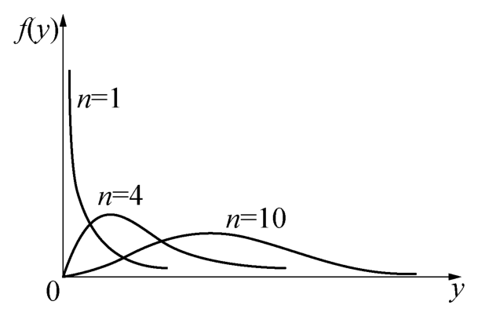
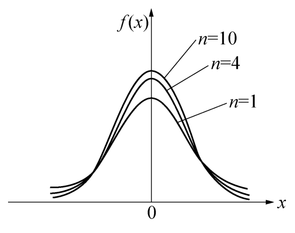
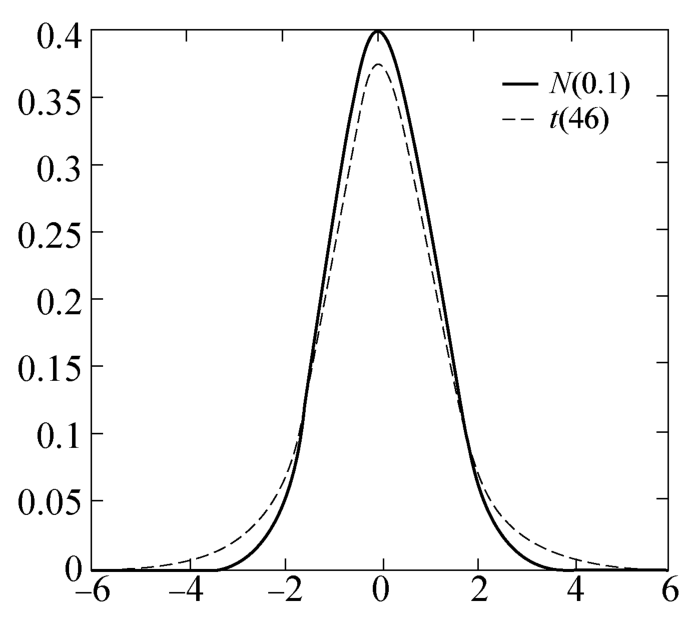
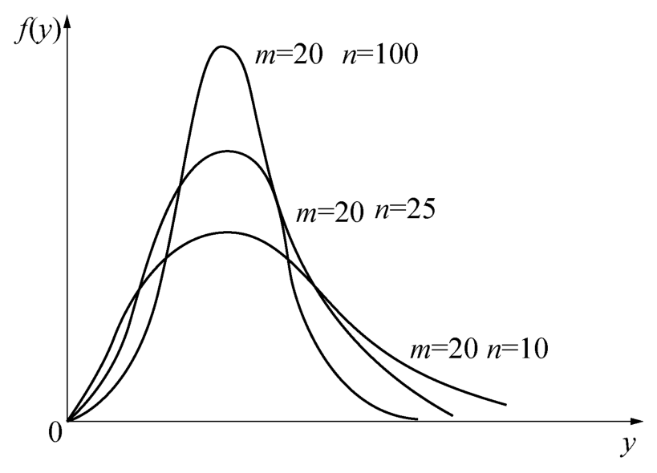

# 第六章 统计量和抽样分布

[课前导读]

离散型随机变量 $X$ 与 $Y$ 相互独立时，$X$ 与 $Y$ 的联合分布律可以由 $X$ 与 $Y$ 的分布律乘积表示，具体表示为：对一切 $(x,\,y)\in R^2$，都有

$$
P(X=x,\ Y=y)=P(X=x)P(Y=y).
$$

连续型随机变量 $X$ 与 $Y$ 相互独立时，$X$ 与 $Y$ 的联合密度函数可以由 $X$ 与 $Y$ 的密度函数乘积表示，具体表示为：对一切 $(x,\,y)\in R^2$，都有

$$
f(x,\ y)=f_X(x)f_Y(y).
$$

推广到 $n$ 维：$X_1,\,X_2,\,\cdots,\,X_n$ 相互独立，则 $n$ 维离散型随机变量 $(X_1,\,X_2,\,\cdots,\,X_n)$ 的联合分布律为

$$
P(X_1=x_1,\ X_2=x_2,\ \cdots,\ X_n=x_n)=P(X_1=x_1)P(X_2=x_2)\cdots P(X_n=x_n).
$$

$n$ 维连续型随机变量 $(X_1,\,X_2,\,\cdots,\,X_n)$ 的联合密度函数为

$$
f(x_1,\ x_2,\ \cdots,\ x_n)=f_{X_1}(x_1)f_{X_2}(x_2)\cdots f_{X_n}(x_n).
$$

（贝塔函数）积分计算公式为

$$
\int_0^1 y^{p-1}(1-y)^{q-1}\,\mathrm{d}y=\frac{(p-1)!\,(q-1)!}{(p+q-1)!}.
$$

从本章起将讲述统计的基本知识。统计是具有广泛应用的一个数学分支，它以概率论为基础，根据试验或观察得到的数据，来研究随机现象。例如，我们在购买空气净化器时，需要了解净化效率指标，一品牌声称他们的空气净化器净化效率达到 300 以上，那么实际上该产品的净化效率究竟有多少呢？厂家声称的 300 以上是否可信呢？这些问题都需要我们先通过抽样检测，再对以上问题做出合理的估计和判断。统计学就是研究如何用有效的方法收集、整理和分析带有随机性影响的数据，对研究的问题做出推断和预测，为采取某种决策提供依据和建议。

本章介绍统计的基本概念，如总体和样本、统计量和抽样分布等。内容既是由概率论向数理统计过渡的桥梁，又是今后学习统计推断（估计与检验）的必要准备。

## 第一节 总体与样本

### 一、总体

在一个统计问题中，我们把研究对象的全体称为总体，构成总体的每个成员称为个体。在实际问题中，总体中的个体是一个实在的人或物。例如，我们要研究小学生的体重情况，那么所有的小学生构成了问题的总体，每个小学生就是一个个体。可能换个研究课题，要研究小学生的视力情况，那么还是这些小学生构成了问题的总体和个体，只是研究的特征指标不一样了。所以为了讨论的简便，我们将每个小学生（个体）的数量指标值作为个体，将所有数量指标值的全体看成总体。例如，每一个小学生的身高是个体，所有人的身高是全体；每一个小学生的左右眼视力是个体，所有人的视力是全体。我们将研究对象的某个数量指标值的全体称为总体。这样的话，抛开实际背景，每一个总体都是有一组数据组成的，在这组数中，有大有小，有的出现次数多有的出现次数少，因此可以用一个概率分布描述，所以说总体数量指标就是服从一个分布的随机变量，我们不妨用大写字母 $X$ 表示总体，那么总体 $X$ 就是具有未知分布函数 $F(x)$（或未知的分布律，或未知的密度函数）的一个随机变量。

**例 1** 交通安全的一个数量指标就是交通事故发生数。所有高速公路根据省市划分成若干路段，每个路段在某一长假期间的交通事故发生数就是一个个体，所有路段的交通事故发生数构成一个总体。这个总体中有很多 0，但也有 1，2，3 等。研究表明，一个路段上的交通事故发生数 $X$ 服从泊松分布 $P(\lambda)$，但分布中的参数 $\lambda$ 是未知的，显然 $\lambda$ 的取值反映了路段的安全性，直接影响了交警部门的应对措施。

在这个例子中，我们假定总体的分布类型是已知的，但含有一个未知参数 $\lambda$，我们需要通过确定 $\lambda$ 的值，来最终确定总体的分布。我们将在第七章学习如何估计这里的未知参数 $\lambda$。而在实际中，研究发现，关于交通事故发生数为泊松分布的假定在有些情况下并不适用，那么这时候关于总体的分布就变成是分布类型都未知的了，这就是非参数统计，本书中不涉及这部分的讨论。

**例 2** 设总体 $X\sim B(1,\,p)$，求总体的分布律 $f(x;\,p)$。

**解** $f(x;\,p)=P(X=x)=(1-p)^{1-x}p^{x},\quad x=0,\ 1.$

**例 3** 设总体 $X\sim N(\mu,\,\sigma^2)$，求总体的密度函数 $f(x;\,\mu,\,\sigma^2)$。

**解** $f(x;\,\mu,\,\sigma^2)=\dfrac{1}{\sqrt{2\pi}\sigma}\mathrm{e}^{-\frac{(x-\mu)^2}{2\sigma^2}},\quad -\infty<x<+\infty.$

**注** 在统计中，为了形式上的统一，将离散型总体 $X$ 的分布律 $P(X=x)$ 也记为 $f(x)$；同时，为了突出总体分布中的未知参数 $\theta$，就将 $f(x)$ 表示为 $f(x;\,\theta)$，同样密度函数，分布函数也是如此表示，分别记为 $f(x;\,\theta)$ 和 $F(x;\,\theta)$。

按照总体中所包含的个体数量的不同，总体可以分成有限总体和无限总体，当个体数量很多时，通常也把有限总体看作无限总体，本书中只讨论无限总体的情况。

### 二、样本

在数理统计中，总体分布永远是未知的，如汽车厂商要设计一款既经济又舒适的家用小汽车的座椅宽度，那么人群的体型宽度到底服从什么分布呢？即使假定人群的体型宽度是服从正态分布的，那么均值 $\mu$ 和方差 $\sigma^2$ 这两个参数仍然未知。显然，我们无法预知哪些人群是可能购买汽车的潜在顾客，即使知道，也无法获取所有他们的体型宽度数据。所以我们希望从客观存在的总体中按一定规则选取一些个体（即抽样），通过对这些个体作观察或测试来推断关于总体分布的某些量（如总体 $X$ 的均值、方差、中位数等），被抽取出的这部分个体就组成了总体的一个样本。观测到的这些个体的值便是实际问题中常见的数据。这里所谓的“一定规则”，是指保证总体中每一个个体有同等的机会被抽到的规则。在总体中抽取样本的过程称之为抽样，抽取规则称之为抽样方案。本书中，采用简单随机抽样这种抽样方案，表示对总体的每一次抽样，总体中的所有元素都有相同的被选概率。用这种抽样方案得到的样本称为简单随机样本（简称样本），这是一个非常基本、常用的假定，本书中提到的样本都是指简单随机样本。由于在观测前，样本观测值是不确定的，所以样本是一组随机变量（或随机向量），为了体现随机性，用大写字母 $(X_1,\,X_2,\,\cdots,\,X_n)$ 表示，其中 $n$ 为样本的大小，称之为样本容量。简单随机样本具有下列两个特性。

（1）相互独立性 $X_1,\,X_2,\,\cdots,\,X_n$ 相互独立，样本中每个个体的取值不受到其他个体取值的影响。

（2）代表性 $X_i$ 同总体分布（$X_i\sim f(x_i;\,\theta)$），总体中的每一个个体都有同等机会被选入样本。

换句话说，简单随机样本表示 $X_1,\,X_2,\,\cdots,\,X_n$ 是独立同分布的随机变量，且每一个 $X_i$ 的分布都与总体 $X$ 的分布相同，$i=1,\,2,\,\cdots,\,n$。因此我们可以根据概率论中多维随机变量分布的性质得到样本的联合分布如下。

设总体 $X$ 是一个离散型随机变量，分布律为 $P(X=x;\,\theta)$。样本 $(X_1,\,X_2,\,\cdots,\,X_n)$ 的联合分布律为

$$
f(x_1,\ x_2,\ \cdots,\ x_n;\,\theta)=P(X_1=x_1,\ X_2=x_2,\ \cdots,\ X_n=x_n;\,\theta)=\prod_{i=1}^{n}P(X_i=x_i;\,\theta).
$$

设总体 $X$ 是一个连续型随机变量，密度函数为 $f(x;\,\theta)$，样本 $(X_1,\,X_2,\,\cdots,\,X_n)$ 的联合密度函数为

$$
f(x_1,\ x_2,\ \cdots,\ x_n;\,\theta)=f_{X_1}(x_1;\,\theta)f_{X_2}(x_2;\,\theta)\cdots f_{X_n}(x_n;\,\theta)=\prod_{i=1}^{n}f(x_i;\,\theta).
$$

一旦给定的简单随机抽样方案实施后，样本就是一组数据，用小写的英文字母 $(x_1,\,x_2,\,\cdots,\,x_n)$ 表示，也称之为样本观测值，事实上，样本观测值 $(x_1,\,x_2,\,\cdots,\,x_n)$ 就是样本 $(X_1,\,X_2,\,\cdots,\,X_n)$ 的一组特定的观测值。

**例 4** 设总体 $X\sim B(1,\,p)$，$(X_1,\,X_2,\,\cdots,\,X_n)$ 为取自该总体的一个样本，求样本 $(X_1,\,X_2,\,\cdots,\,X_n)$ 的联合分布律 $f(x_1,\,x_2,\,\cdots,\,x_n;\,p)$。

**解** $f(x_1,\,x_2,\,\cdots,\,x_n;\,p)=P(X_1=x_1,\ X_2=x_2,\ \cdots,\ X_n=x_n;\,p)=\prod\limits_{i=1}^{n}P(X_i=x_i;\,p)$

$$
\qquad =(1-p)^{1-x_1}p^{x_1}\cdots(1-p)^{1-x_n}p^{x_n}
$$

$$
\qquad =(1-p)^{n-\sum\limits_{i=1}^{n}x_i}p^{\sum\limits_{i=1}^{n}x_i},\quad x_i=0,\ 1;\ i=1,\,2,\,\cdots,\,n.
$$

**例 5** 设总体 $X\sim P(\lambda)$，$(X_1,\,X_2,\,\cdots,\,X_6)$ 为取自该总体的一个样本，求样本 $(X_1,\,X_2,\,\cdots,\,X_6)$ 的联合分布律 $f(x_1,\,x_2,\,\cdots,\,x_6;\,\lambda)$。

**解** $f(x_1,\,x_2,\,\cdots,\,x_6;\,\lambda)=\mathrm{e}^{-\lambda}\dfrac{\lambda^{x_1}}{x_1!}\cdot\mathrm{e}^{-\lambda}\dfrac{\lambda^{x_2}}{x_2!}\cdot\cdots\cdot\mathrm{e}^{-\lambda}\dfrac{\lambda^{x_6}}{x_6!}$

$$
\qquad =\mathrm{e}^{-6\lambda}\frac{\lambda^{\sum\limits_{i=1}^{6}x_i}}{\prod\limits_{i=1}^{6}x_i!},\quad x_i=0,\ 1,\ 2,\ \cdots;\ i=1,\,2,\,\cdots,\,6.
$$

**例 6** 设总体 $X\sim U(0,\,\theta)$，$(X_1,\,X_2,\,\cdots,\,X_n)$ 是取自该总体的一个样本，求样本 $(X_1,\,X_2,\,\cdots,\,X_n)$ 的联合密度函数。

**解** $f(x_1,\,x_2,\,\cdots,\,x_n;\,\theta)=f_{X_1}(x_1;\,\theta)f_{X_2}(x_2;\,\theta)\cdots f_{X_n}(x_n;\,\theta)$

$$
\qquad =\begin{cases}\theta^{-n}, & 0<x_1,\ x_2,\ \cdots,\ x_n<\theta,\\[2pt] 0, & \text{其他}.\end{cases}
$$

**例 7** 设总体 $X\sim N(\mu,\,\sigma^2)$，$(X_1,\,X_2,\,\cdots,\,X_n)$ 为取自该总体的一个样本，求样本 $(X_1,\,X_2,\,\cdots,\,X_n)$ 的联合密度函数。

**解** $f(x_1,\,x_2,\,\cdots,\,x_n;\,\mu,\,\sigma^2)=\dfrac{1}{(2\pi\sigma^2)^{\frac{n}{2}}}\mathrm{e}^{-\frac{\sum\limits_{i=1}^{n}(x_i-\mu)^2}{2\sigma^2}},\quad -\infty<x_i<+\infty;\ i=1,\,2,\,\cdots,\,n.$

### 习题 6-1

**1.** 某视频网站要了解某个电视类节目的收视人群的特征，于是进行了问卷调查，请问该项研究的总体是什么？个体是什么？样本是什么？

**2.** 学校关注学生的心理健康情况，特从学校中随机抽取 100 名学生进行测试。请问该项调查的总体和样本分别是什么？

**3.** 某品牌高钙牛奶声称其每 100mL 牛奶中，含钙量超过 120mg，研究人员对其进行调查，从不同批次生产的牛奶中随机抽取了 10 盒进行检测，请问该项检测的总体和样本分别是什么？

**4.** 设 $(X_1,\,X_2,\,\cdots,\,X_n)$ 是取自总体 $X$ 的一个样本，在下列三种情况下，分别写出样本 $(X_1,\,X_2,\,\cdots,\,X_n)$ 的分布律或密度函数。

（1）总体 $X$ 服从几何分布，其分布律为 $P(X=x)=p\,(1-p)^{x-1}$， $0<p<1$， $x=1,\,2,\,\cdots$；

（2）总体 $X\sim E(\lambda)$；

（3）总体 $X$ 的密度函数为 $f(x)=\dfrac{\lambda}{2}\mathrm{e}^{-\lambda|x|},\quad -\infty<x<+\infty.$

## 第二节 统计量

数理统计的基本任务之一是利用样本所提供的信息来对总体分布中未知的量进行推断，简单来说，就是由样本推断总体。但是，样本常常表现为一组数据，很难直接用来解决我们要研究的具体问题。人们常常把数据加工成若干个简单明了的数字特征，由数据加工后的数字特征就是统计量。所以说统计量综合了样本的信息，是统计推断的基础。统计量的选择和运用在统计推断中占据核心地位。

统计量的定义：设 $(X_1,\,X_2,\,\cdots,\,X_n)$ 为取自总体的一个样本，样本 $(X_1,\,X_2,\,\cdots,\,X_n)$ 的函数为 $g(X_1,\,X_2,\,\cdots,\,X_n)$，若 $g$ 中不直接包含总体分布中的任何未知参数，则称$g(X_1,\,X_2,\,\cdots,\,X_n)$ 为统计量。

在抽样前，统计量是一个随机变量。在抽样后，得样本 $(X_1,\,X_2,\,\cdots,\,X_n)$ 的一次观测值 $(x_1,\,x_2,\,\cdots,\,x_n)$，则所得的 $g(x_1,\,x_2,\,\cdots,\,x_n)$ 即为统计量的一次观测值，它是一个可以由数据算得的实数。我们构造统计量的主要目的就是去估计总体分布中的未知参数。在这一小节里，我们给出一些常用的统计量，它们包括样本均值、样本方差、样本矩和次序统计量等。

**例 1** 设 $(X_1,\,X_2,\,\cdots,\,X_n)$ 为取自区间 $(0,\,\theta)$ 上均匀分布总体的一个样本，$\theta>0$ 未知，下列样本的函数中：

$$
T_1=\frac{X_1+\cdots+X_6}{6}\ \text{是统计量，不含总体的未知参数}\ \theta;
$$

$$
T_2=X_6-\theta\ \text{不是统计量，含有未知参数}\ \theta;
$$

$$
T_3=\max(X_1,\,\cdots,\,X_6)\ \text{是统计量，不含总体的未知参数}\ \theta.
$$

### 一、样本均值和样本方差

设 $(X_1,\,X_2,\,\cdots,\,X_n)$ 为取自总体的一个样本，称

$$
\bar{X}=\frac{1}{n}\sum_{i=1}^{n}X_i
$$

为样本均值；

$$
S^2=\frac{1}{n-1}\sum_{i=1}^{n}(X_i-\bar{X})^2=\frac{1}{n-1}\Big(\sum_{i=1}^{n}X_i^2-n\bar{X}^2\Big)
$$

为样本方差；

$$
S=\sqrt{S^2}
$$

为样本标准差。

它们的观测值分别为

$$
\bar{x}=\frac{1}{n}\sum_{i=1}^{n}x_i;\quad s^2=\frac{1}{n-1}\sum_{i=1}^{n}(x_i-\bar{x})^2=\frac{1}{n-1}\Big(\sum_{i=1}^{n}x_i^2-n\bar{x}^2\Big);\quad s=\sqrt{s^2}.
$$

这些观测值仍分别称为样本均值、样本方差和样本标准差。

此外

$$
A_k=\frac{1}{n}\sum_{i=1}^{n}X_i^k,\quad k=1,\ 2,\ 3,\ \cdots.
$$

为样本的 $k$ 阶原点矩，当 $k=1$ 时，$A_1=\bar{X}$。

$$
M_k=\frac{1}{n}\sum_{i=1}^{n}(X_i-\bar{X})^k,\quad k=1,\ 2,\ 3,\ \cdots.
$$

为样本的 $k$ 阶中心矩。

当 $k=2$ 时，$M_2=\dfrac{1}{n}\sum\limits_{i=1}^{n}(X_i-\bar{X})^2\triangleq S_n^2$，$S_n=\sqrt{\dfrac{1}{n}\sum\limits_{i=1}^{n}(X_i-\bar{X})^2}$。

由于统计量是样本 $(X_1,\,X_2,\,\cdots,\,X_n)$ 的函数，因此统计量也是随机变量，接下来我们用定理的方式给出常用统计量的性质。

**定理** 设总体 $X$ 的均值 $E(X)=\mu$，方差 $D(X)=\sigma^2$，设 $(X_1,\,X_2,\,\cdots,\,X_n)$ 为取自该总体的一个样本，则：

（1）$E(\bar{X})=\mu$，$D(\bar{X})=\dfrac{\sigma^2}{n}$；

（2）$E(S^2)=\sigma^2$，$E(S_n^2)=\dfrac{n-1}{n}\sigma^2$；

（3）$\bar{X}\xrightarrow{P}\mu$，$S^2=\dfrac{1}{n-1}\sum\limits_{i=1}^{n}(X_i-\bar{X})^2\xrightarrow{P}\sigma^2$，$S_n^2=\dfrac{1}{n}\sum\limits_{i=1}^{n}(X_i-\bar{X})^2\xrightarrow{P}\sigma^2$。

**证明** （1）$E(\bar{X})=E\Big(\dfrac{1}{n}\sum\limits_{i=1}^{n}X_i\Big)=\dfrac{1}{n}\sum\limits_{i=1}^{n}E(X_i)=\mu$，

$$
D(\bar{X})=D\Big(\frac{1}{n}\sum_{i=1}^{n}X_i\Big)=\frac{1}{n^2}\sum_{i=1}^{n}D(X_i)=\frac{\sigma^2}{n}.
$$

（2）$E(S^2)=E\Big(\dfrac{1}{n-1}\sum\limits_{i=1}^{n}(X_i-\bar{X})^2\Big)=\dfrac{1}{n-1}E\Big(\sum\limits_{i=1}^{n}X_i^2-n\bar{X}^2\Big)$

$$
\qquad =\frac{1}{n-1}\Big(\sum_{i=1}^{n}E(X_i^2)-nE(\bar{X}^2)\Big).
$$

由于 $E(X_i^2)=D(X_i)+(E(X_i))^2$，$E(\bar{X}^2)=D(\bar{X})+(E(\bar{X}))^2$ 代入上式，可得

$$
E(S^2)=\frac{1}{n-1}\Big[\sum_{i=1}^{n}\big(D(X_i)+(E(X_i))^2\big)-n\big(D(\bar{X})+(E(\bar{X}))^2\big)\Big]
$$

$$
\qquad =\frac{1}{n-1}\Big[n\Big(\sigma^2+\mu^2\Big)-n\Big(\frac{\sigma^2}{n}+\mu^2\Big)\Big]=\sigma^2.
$$

因为

$$
S_n^2=\frac{1}{n}\sum_{i=1}^{n}(X_i-\bar{X})^2=\frac{n-1}{n}S^2,
$$

所以

$$
E(S_n^2)=\frac{n-1}{n}E(S^2)=\frac{n-1}{n}\sigma^2.
$$

（3）由第五章的相互独立同分布大数定律，即得 $\bar{X}\xrightarrow{P}\mu$，

$$
\frac{1}{n}\sum_{i=1}^{n}X_i^2\xrightarrow{P}\sigma^2+\mu^2,
$$

所以

$$
S_n^2=\frac{1}{n}\sum_{i=1}^{n}(X_i-\bar{X})^2=\frac{1}{n}\sum_{i=1}^{n}X_i^2-\bar{X}^2\xrightarrow{P}\sigma^2+\mu^2-\mu^2=\sigma^2,
$$

$$
S^2=\frac{n}{n-1}S_n^2\xrightarrow{P}\sigma^2.
$$

这个结论就是第七章中矩估计法的理论依据。

**例 2** 设 $(X_1,\,X_2,\,\cdots,\,X_n)$ 是取自总体 $X$ 的一个样本，在下列三种情况下，分别求 $E(\bar{X})$、$D(\bar{X})$、$E(S^2)$、$E\Big(\dfrac{1}{n}\sum\limits_{i=1}^{n}X_i^2\Big)$：

（1）$X\sim B(1,\,p)$；（2）$X\sim E(\lambda)$；（3）$X\sim U(0,\,2\theta)$，其中 $\theta>0$。

**解** （1）$X\sim B(1,\,p)$，所以

$$
E(X)=p,\quad D(X)=p(1-p).
$$

故

$$
E(\bar{X})=E(X)=p,\quad D(\bar{X})=\frac{D(X)}{n}=\frac{p(1-p)}{n},
$$

$$
E(S^2)=D(X)=p(1-p),
$$

$$
E\Big(\frac{1}{n}\sum_{i=1}^{n}X_i^2\Big)=\frac{1}{n}\sum_{i=1}^{n}E(X_i^2)=E(X^2)=p.
$$

（2）$X\sim E(\lambda)$，所以

$$
E(X)=\frac{1}{\lambda},\quad D(X)=\frac{1}{\lambda^2},
$$

故

$$
E(\bar{X})=\frac{1}{\lambda},\quad D(\bar{X})=\frac{1}{n\lambda^2},\quad E(S^2)=\frac{1}{\lambda^2},\quad E\Big(\frac{1}{n}\sum_{i=1}^{n}X_i^2\Big)=\frac{2}{\lambda^2}.
$$

（3）$X\sim U(0,\,2\theta)$，其中 $\theta>0$，所以

$$
E(X)=\theta,\quad D(X)=\frac{\theta^2}{3},
$$

故

$$
E(\bar{X})=\theta,\quad D(\bar{X})=\frac{\theta^2}{3n},\quad E(S^2)=\frac{\theta^2}{3},\quad E\Big(\frac{1}{n}\sum_{i=1}^{n}X_i^2\Big)=\frac{4}{3}\theta^2.
$$

\* **例 3** 设 $(X_1,\,X_2,\,\cdots,\,X_n)$ 是取自总体 $X$ 的一个样本，总体 $X\sim P(\lambda)$，求 $\bar{X}$ 与 $\dfrac{1}{n}\sum\limits_{i=1}^{n}X_i^2$ 分别依概率收敛于什么值？

**解** $\bar{X}\xrightarrow{P}\lambda$，$\dfrac{1}{n}\sum\limits_{i=1}^{n}X_i^2\xrightarrow{P}E(X^2)=\lambda+\lambda^2$。

### 二、次序统计量

次序统计量 $X_{(1)},\,X_{(2)},\,\cdots,\,X_{(n)}$ 是 $X_1,\,X_2,\,\cdots,\,X_n$ 由小到大排序得到的，次序统计量中加圆括号的下标使它们区别于未排序的样本。例如，$X_n$ 仅是样本中的最后一个观测值，而 $X_{(n)}$ 则表示它是样本中取值最大的观测值。故有如下定义：

设 $(X_1,\,X_2,\,\cdots,\,X_n)$ 是取自总体 $X$ 的一个样本，总体 $X$ 的密度函数为 $f_X(x)$，分布函数为 $F_X(x)$。样本中取值最小的一个记为 $X_{(1)}$，即 $X_{(1)}=\min(X_1,\,X_2,\,\cdots,\,X_n)$，称为最小次序统计量。取值最大的一个记为 $X_{(n)}$，即 $X_{(n)}=\max(X_1,\,X_2,\,\cdots,\,X_n)$，称为最大次序统计量。$X_{(i)}$ 称为第 $i$ 次序统计量，$i=1,\,\cdots,\,n$，满足

$$
X_{(1)}\leqslant X_{(2)}\leqslant\cdots\leqslant X_{(n-1)}\leqslant X_{(n)}.
$$

记 $X_{(1)}$ 和 $X_{(n)}$ 的密度函数分别为 $f_{X_{(1)}}(v)$ 和 $f_{X_{(n)}}(u)$，由第三章第五节定理 4 的推广有

$$
f_{X_{(1)}}(v)=n\,(1-F_X(v))^{n-1}f_X(v),\quad f_{X_{(n)}}(u)=n\,(F_X(u))^{n-1}f_X(u).
$$

**例 4** 设 $(X_1,\,X_2,\,\cdots,\,X_n)$ 是取自总体 $X$ 的一个样本，总体 $X\sim E(\lambda)$，分别求次序统计量 $X_{(1)}$、$X_{(n)}$ 的分布。

**解** 总体 $X\sim E(\lambda)$，所以密度函数为

$$
f(x)=\begin{cases}\lambda\mathrm{e}^{-\lambda x}, & x\geqslant 0,\\ 0, & \text{其他},\end{cases}\qquad \lambda>0,
$$

分布函数为

$$
F(x)=\begin{cases}0, & x<0,\\ 1-\mathrm{e}^{-\lambda x}, & x\geqslant 0.\end{cases}
$$

因此，根据公式 $f_{X_{(1)}}(v)=n\,(1-F_X(v))^{n-1}f_X(v)$，可得

$$
f_{X_{(1)}}(v)=\begin{cases}n\lambda\mathrm{e}^{-n\lambda v}, & v\geqslant 0,\\ 0, & \text{其他}.\end{cases}
$$

即 $X_{(1)}\sim E(n\lambda)$。

又根据公式 $f_{X_{(n)}}(u)=n\,(F_X(u))^{n-1}f_X(u)$，可得

$$
f_{X_{(n)}}(u)=\begin{cases}n\lambda\mathrm{e}^{-\lambda u}(1-\mathrm{e}^{-\lambda u})^{n-1}, & u\geqslant 0,\\ 0, & \text{其他}.\end{cases}
$$

**例 5** 设 $(X_1,\,X_2,\,\cdots,\,X_n)$ 是取自总体 $X$ 的一个样本，总体 $X\sim U(0,\,1)$。求最小次序统计量 $X_{(1)}$ 的均值和方差。

**解** 根据例 4 中 $X_{(1)}$ 的密度函数公式不难求得，$X_{(1)}$ 有密度函数 $f_{X_{(1)}}(y)=\begin{cases}n(1-y)^{n-1}, & 0<y<1,\\ 0, & \text{其他},\end{cases}$ 所以由［课前导读］的贝塔函数知

$$
E(X_{(1)})=n\int_0^1 y\,(1-y)^{n-1}\,\mathrm{d}y=n\int_0^1 y\,(1-y)^{n-1}\,\mathrm{d}y=n\cdot\frac{1}{(n+1)n}=\frac{1}{(n+1)}.
$$

又

$$
E(X_{(1)}^2)=n\int_0^1 y^2\,(1-y)^{n-1}\,\mathrm{d}y=n\int_0^1 y^2\,(1-y)^{n-1}\,\mathrm{d}y=n\cdot\frac{2}{(n+2)(n+1)n}=\frac{2}{(n+2)(n+1)},
$$

因此

$$
D(X_{(1)})=\frac{2}{(n+2)(n+1)}-\frac{1}{(n+1)^2}=\frac{n}{(n+2)(n+1)^2}.
$$

### 习题 6-2

**1.** 设 $(X_1,\,X_2,\,\cdots,\,X_n)$ 是取自总体 $X$ 的一个样本，$\bar{X}$ 与 $S^2$ 分别为样本均值与样本方差，在下列两种总体分布的假定下，分别求 $E(\bar{X})$、$D(\bar{X})$ 及 $E(S^2)$：

（1）$X\sim P(\lambda)$；

（2）$N(\mu,\,\sigma^2)$。

**2.** 设 $(X_1,\,X_2,\,\cdots,\,X_n)$ 是取自正态总体 $N(1,\,\sigma^2)$ 的一个样本，求：

（1）$E\Big(\sum\limits_{i=1}^{n}(X_i-1)^2\Big)$，$D\Big(\sum\limits_{i=1}^{n}(X_i-1)^2\Big)$；

（2）$E\Big[\Big(\sum\limits_{i=1}^{n}X_i-n\Big)^2\Big]$，$D\Big[\Big(\sum\limits_{i=1}^{n}X_i-n\Big)^2\Big]$。

**3.** 设 $(X_1,\,X_2,\,\cdots,\,X_n)$ 是取自总体 $X$ 的一个样本，总体 $X$ 的概率密度为 $f(x;\,\theta)=\begin{cases}\dfrac{2x}{3\theta^2}, & \theta<x<2\theta,\\ 0, & \text{其他},\end{cases}$ 其中 $\theta$ 是未知参数，若 $E\Big(c\sum\limits_{i=1}^{n}X_i^2\Big)=\theta^2$，求 $c$ 的值。

**4.** 设总体 $X\sim N(40,\,5^2)$，（1）抽取容量为 36 的样本，求 $P(38\leqslant\bar{X}\leqslant 43)$；（2）样本容量 $n$ 多大时，才能使 $P(|\bar{X}-40|<1)=0.95$。

**5.** 设 $(X_1,\,X_2,\,\cdots,\,X_n)$ 为取自正态总体 $N(\mu,\,\sigma^2)$ 的一个样本，试求统计量 $U=\sum\limits_{i=1}^{n}c_iX_i$ 的分布，其中 $c_1,\,c_2,\,\cdots,\,c_n$ 是不全为零的常数。

**6.** 设 $(X_1,\,X_2,\,\cdots,\,X_n)$ 是取自总体 $X$ 的一个样本，总体 $X\sim N(0,\,1)$，$\bar{X}$ 为样本均值，记 $Y_i=X_i-\bar{X}$，$i=1,\,2,\,\cdots,\,n$。求：

（1）$Y_i$ 的方差 $DY_i$，$i=1,\,2,\,\cdots,\,n$；

（2）$Y_1$ 与 $Y_n$ 的协方差 $\operatorname{cov}(Y_1,\,Y_n)$。

**7.** 设 $(X_1,\,X_2,\,\cdots,\,X_n)$ 是取自总体 $X$ 的一个样本，总体 $X\sim U(0,\,\theta)$。求最大次序统计量 $X_{(n)}$ 的均值和方差。

**8.** 设 $(X_1,\,X_2,\,\cdots,\,X_n)$ 是取自总体 $X$ 的一个样本，总体 $X$ 的概率密度为 $f(x;\,\theta)=\begin{cases}\mathrm{e}^{-(x-\theta)}, & x\geqslant\theta,\\ 0, & \text{其他},\end{cases}$ 其中 $\theta>0$。求：

（1）总体 $X$ 的分布函数 $F(x)$；

（2）最小次序统计量 $X_{(1)}$ 的均值和方差。

## 第三节 三大分布

$\chi^2$ 分布、$t$ 分布、$F$ 分布都是从正态总体中衍生出来的，之前介绍的几种常用的统计量的分布在正态总体假定下都与这三大分布有关，所以它们在正态总体的统计推断中起着重要的作用。

### 一、χ² 分布

设 $X_1,\,X_2,\,\cdots,\,X_n$ 为相互独立的标准正态分布随机变量，称随机变量 $Y=X_1^2+X_2^2+\cdots+X_n^2$ 服从自由度为 $n$ 的 $\chi^2$ 分布，记为 $Y\sim\chi^2(n)$。

$\chi^2(n)$ 分布的密度函数为

$$
f(x)=\begin{cases}\dfrac{1}{2^{\frac{n}{2}}\Gamma\Big(\dfrac{n}{2}\Big)}y^{\frac{n}{2}-1}\mathrm{e}^{-\frac{y}{2}}, & y>0,\\[10pt] 0, & \text{其他}.\end{cases}
$$

$\chi^2(n)$ 分布的密度函数图像如图 6.1 所示。

$\chi^2$ 分布具有如下性质。

**性质 1** 当 $Y\sim\chi^2(n)$ 时，$E(Y)=n$，$D(Y)=2n$。

**证明** $Y=\sum\limits_{i=1}^{n}X_i^2\sim\chi^2(n)$，

$$
E(Y)=E\Big(\sum_{i=1}^{n}X_i^2\Big)=\sum_{i=1}^{n}E(X_i^2)=n,
$$

$$
D(Y)=D\Big(\sum_{i=1}^{n}X_i^2\Big)=\sum_{i=1}^{n}D(X_i^2)=\sum_{i=1}^{n}\big[E(X_i^4)-(E(X_i^2))^2\big]=\sum_{i=1}^{n}(3-1^2)=2n.
$$

**性质 2** $\chi^2$ 分布具有可加性：设 $X\sim\chi^2(m)$，$Y\sim\chi^2(n)$，且 $X$ 与 $Y$ 相互独立，则 $X+Y\sim\chi^2(m+n)$。

**证明** 不妨记 $X=\sum\limits_{i=1}^{m}X_i^2\sim\chi^2(m)$，$Y=\sum\limits_{i=1}^{n}Y_i^2\sim\chi^2(n)$。

其中 $X_1,\,X_2,\,\cdots,\,X_m$ 相互独立同分布，都服从 $N(0,\,1)$，$Y_1,\,Y_2,\,\cdots,\,Y_n$ 相互独立同分布，都服从 $N(0,\,1)$。又因为 $X$ 与 $Y$ 相互独立，故 $X_1,\,X_2,\,\cdots,\,X_m,\,Y_1,\,Y_2,\,\cdots,\,Y_n$ 相互独立。则有

$$
X+Y=\sum_{i=1}^{m}X_i^2+\sum_{i=1}^{n}Y_i^2\sim\chi^2(m+n).
$$

**注**：类似具有可加性的分布还有二项分布、泊松分布和正态分布。

$\chi^2$ 分布的 $\alpha$ 分位数记作 $\chi_\alpha^2(n)$，它表示：对于给定的 $\alpha(0<\alpha<1)$，当 $X\sim\chi^2(n)$ 时，有 $P(X\leqslant\chi_\alpha^2(n))=\alpha$。$\chi_\alpha^2(n)$ 的值可以通过查附录 5 得到。

**例 1** 设 $(X_1,\,X_2,\,\cdots,\,X_6)$ 为取自标准正态总体 $N(0,\,1)$ 的一个样本，求下列三个统计量的分布：（1）$X_1^2+X_2^2$；（2）$X_1^2$；（3）$X_1^2+a\,(X_2+X_3)^2+b\,(X_4-X_5+X_6)^2$，并求 $a$，$b$ 的值。

**解** （1）由样本的定义可知，$X_1,\,X_2,\,\cdots,\,X_6$ 相互独立，且都服从 $N(0,\,1)$，所以根据 $\chi^2$ 分布的定义可知 $X_1^2+X_2^2\sim\chi^2(2)$；

（2）同上，$X_1^2\sim\chi^2(1)$；

（3）$X_2+X_3\sim N(0,\,2)$，即 $\dfrac{X_2+X_3}{\sqrt{2}}\sim N(0,\,1)$，

又 $X_4-X_5+X_6\sim N(0,\,3)$，即 $\dfrac{X_4-X_5+X_6}{\sqrt{3}}\sim N(0,\,1)$，

所以由 $\chi^2$ 分布的定义可知

$$
(X_1)^2+\Big(\frac{X_2+X_3}{\sqrt{2}}\Big)^2+\Big(\frac{X_4-X_5+X_6}{\sqrt{3}}\Big)^2\sim\chi^2(3),
$$

整理可得 $a=\dfrac{1}{2}$，$b=\dfrac{1}{3}$。

**例 2** 设 $(X_1,\,X_2,\,\cdots,\,X_n)$ 是取自正态总体 $N(0,\,\sigma^2)$ 的样本，试证：（1）$\dfrac{1}{\sigma^2}\sum\limits_{i=1}^{n}X_i^2\sim\chi^2(n)$；（2）$\dfrac{1}{n\sigma^2}\Big(\sum\limits_{i=1}^{n}X_i\Big)^2\sim\chi^2(1)$。

**证明** （1）由已知得 $\dfrac{X_1}{\sigma},\,\dfrac{X_2}{\sigma},\,\cdots,\,\dfrac{X_n}{\sigma}$ 相互独立同分布，都服从 $N(0,\,1)$，由 $\chi^2$ 分布的定义知，$\sum\limits_{i=1}^{n}\Big(\dfrac{X_i}{\sigma}\Big)^2\sim\chi^2(n)$，即 $\dfrac{1}{\sigma^2}\sum\limits_{i=1}^{n}X_i^2\sim\chi^2(n)$。

（2）易见，$\sum\limits_{i=1}^{n}X_i\sim N(0,\,n\sigma^2)$，即 $\dfrac{\sum\limits_{i=1}^{n}X_i}{\sqrt{n\sigma^2}}\sim N(0,\,1)$，由 $\chi^2$ 分布的定义知，$\dfrac{\Big(\sum\limits_{i=1}^{n}X_i\Big)^2}{n\sigma^2}\sim\chi^2(1)$，即 $\dfrac{1}{n\sigma^2}\Big(\sum\limits_{i=1}^{n}X_i\Big)^2\sim\chi^2(1)$。

### 二、t 分布

设随机变量 $X$ 与 $Y$ 相互独立，且 $X\sim N(0,\,1)$，$Y\sim\chi^2(n)$，则称 $T=\dfrac{X}{\sqrt{Y/n}}$ 服从自由度为 $n$ 的 $t$ 分布（又称为学生氏分布），记为 $T\sim t(n)$。

$t(n)$ 分布的概率密度函数为

$$
f(x)=\frac{\Gamma\big((n+1)/2\big)}{\sqrt{n\pi}\,\Gamma(n/2)}\Big(1+\frac{x^2}{n}\Big)^{-(n+1)/2},\quad x\in R.
$$

$t(n)$ 分布的密度函数图像（见图 6.2）关于直线 $t=0$ 对称，当 $n$ 充分大时，其图形类似于标准正态分布的密度函数图像，如图 6.3 所示。事实上，有

$$
\lim_{n\to\infty}f(x)=\frac{1}{\sqrt{2\pi}}\mathrm{e}^{-\frac{x^2}{2}}.
$$

即当 $n$ 充分大时，$t(n)$ 分布近似于 $N(0,\,1)$ 分布。

$t(n)$ 分布的 $\alpha$ 分位数记作 $t_\alpha(n)$，它表示：对于给定的 $\alpha(0<\alpha<1)$，当 $T\sim t(n)$ 时，有

$$
P(T\leqslant t_\alpha(n))=\alpha.
$$

由 $t(n)$ 分布密度函数图像（见图 6.2）的对称性知

$$
t_\alpha(n)=-t_{1-\alpha}(n).
$$

$t_\alpha(n)$ 的值可以通过查阅附录 6 得到，在实际中，当 $n>45$ 时，对于常用的 $\alpha$ 值，就用标准正态分布的分位数近似，即

$$
t_\alpha(n)\approx u_\alpha.
$$

**例 3** 设 $T\sim t(10)$，求常数 $c$ 使 $P(T>c)=0.95$。

**解** 由 $P(T>c)=0.95$ 可知，$P(T\leqslant c)=0.05$，所以 $c=t_{0.05}(10)$，由 $t$ 分布的密度函数图像对称性可知，$c=t_{0.05}(10)=-t_{0.95}(10)$，查附录 6 得 $c=-1.8125$。

### 三、F 分布

设随机变量 $X$ 与 $Y$ 相互独立，$X\sim\chi^2(m)$，$Y\sim\chi^2(n)$，则称 $F=\dfrac{X/m}{Y/n}$ 服从自由度为 $(m,\,n)$ 的 $F$ 分布，记为 $F\sim F(m,\,n)$，其中 $m$ 称为第一自由度，$n$ 称为第二自由度。

$F(m,\,n)$ 分布的概率密度函数为

$$
f(y)=\begin{cases}\dfrac{\Gamma\Big(\dfrac{m+n}{2}\Big)}{\Gamma\Big(\dfrac{m}{2}\Big)\Gamma\Big(\dfrac{n}{2}\Big)}\Big(\dfrac{m}{n}\Big)^{\frac{m}{2}}y^{\frac{m}{2}-1}\Big(1+\dfrac{m}{n}y\Big)^{-\frac{m+n}{2}}, & y>0,\\[14pt] 0, & \text{其他}.\end{cases}
$$

$F(m,\,n)$ 分布的概率密度函数图像如图 6.4 所示。

$F(m,\,n)$ 分布的 $\alpha$ 分位数记作 $F_\alpha(m,\,n)$，它表示：对于给定的 $\alpha(0<\alpha<1)$，当 $F\sim F(m,\,n)$ 时，有 $P(F\leqslant F_\alpha(m,\,n))=\alpha$。$F_\alpha(m,\,n)$ 的值可以通过查阅附录 7 得到，且具有下列性质：

$$
F_\alpha(m,\,n)=\frac{1}{F_{1-\alpha}(n,\,m)}.
$$

**证明** 设 $X\sim\chi^2(m)$，$Y\sim\chi^2(n)$，$X$ 与 $Y$ 相互独立，则

$$
F=\frac{X/m}{Y/n}\sim F(m,\,n),\quad \frac{1}{F}=\frac{Y/n}{X/m}\sim F(n,\,m).
$$

所以 $P(F\leqslant F_\alpha(m,\,n))=\alpha$，即等价于 $P\Big(\dfrac{1}{F}\geqslant\dfrac{1}{F_\alpha(m,\,n)}\Big)=\alpha$，即 $P\Big(\dfrac{1}{F}\leqslant\dfrac{1}{F_\alpha(m,\,n)}\Big)=1-\alpha$，

所以 $\dfrac{1}{F_\alpha(m,\,n)}=F_{1-\alpha}(n,\,m)$，故结论成立。

**例 4** 设随机变量 $T\sim t(n)$，$F=\dfrac{1}{T^2}$，求随机变量 $F$ 的分布。

**解** 由于 $T\sim t(n)$，不妨设 $T=\dfrac{X}{\sqrt{Y/n}}$，其中随机变量 $X$ 与 $Y$ 相互独立，且 $X\sim N(0,1)$，$Y\sim\chi^2(n)$。则 $F=\dfrac{1}{T^2}=\dfrac{Y/n}{X^2}$，因为 $X^2\sim\chi^2(1)$，且 $X^2$ 与 $Y$ 相互独立，故由 $F$ 分布的定义知，$F\sim F(n,\,1)$。

### 习题 6-3

**1.** 查表分别写出如下分位数的值：$\chi_{0.95}^2(10)$，$\chi_{0.05}^2(10)$，$t_{0.975}(8)$，$t_{0.025}(8)$，$F_{0.95}(3,\,7)$，$F_{0.05}(3,\,7)$。

**2.** （1）设 $X\sim\chi^2(8)$，求常数 $a$，$c$，使 $P(X\leqslant a)=0.05$，$P(X>c)=0.05$；

（2）设 $T\sim t(5)$，求常数 $c$ 使 $P(|T|\leqslant c)=0.9$；

（3）设 $F\sim F(6,\,9)$，求常数 $a$，$c$，使 $P(X\leqslant a)=0.05$，$P(X>c)=0.05$。

**3.** 设 $(X_1,\,X_2,\,\cdots,\,X_6)$ 是取自正态总体 $N(0,\,\sigma^2)$ 的一个样本，问：

（1）$k\,\dfrac{X_1+X_2+X_3+X_4}{\sqrt{X_5^2+X_6^2}}$ 服从什么分布？自由度是多少？$k$ 是多少？

（2）$c\,\dfrac{X_4^2+X_5^2}{(X_2+X_3)^2}$ 服从什么分布？自由度是多少？$c$ 是多少？

**4.** 设 $(X_1,\,X_2,\,\cdots,\,X_5)$ 是取自正态总体 $N(0,\,4)$ 的一个样本，

（1）给出常数 $c$，使得 $c(X_1^2+X_2^2)$ 服从 $\chi^2$ 分布，并指出它的自由度；

（2）给出常数 $d$，使得 $d\,\dfrac{X_1+X_2}{\sqrt{X_3^2+X_4^2+X_5^2}}$ 服从 $t$ 分布，并指出它的自由度；

（3）给出常数 $k$，使得 $k\,\dfrac{X_1^2+X_2^2}{X_3^2+X_4^2+X_5^2}$ 服从 $F$ 分布，并指出它的自由度。

**5.** 设 $(X_1,\,X_2,\,\cdots,\,X_n)$ 是取自总体 $\chi^2(n)$ 的一个样本，$\bar{X}$ 为样本均值，试求 $E(\bar{X})$，$D(\bar{X})$。

**6.** 设 $(X_1,\,X_2,\,\cdots,\,X_5)$ 是取自正态总体 $N(0,\,\sigma^2)$ 的一个样本，$a\,\dfrac{X_1+X_2}{|X_3-X_4-X_5|}$ 服从什么分布？$a$ 是多少？

## 第四节 正态总体的抽样分布

抽样分布，即为统计量的分布。因为统计推断是基于统计量作出的，所以研究统计量的分布是统计推断过程中一个十分重要的环节。由于正态总体的重要性，本节我们讨论在正态总体下几个常用统计量的抽样分布。

**定理 1** 设 $(X_1,\,X_2,\,\cdots,\,X_n)$ 是取自正态总体 $N(\mu,\,\sigma^2)$ 的一个样本，样本均值 $\bar{X}=\dfrac{1}{n}\sum\limits_{i=1}^{n}X_i$ 和样本方差 $S^2=\dfrac{1}{n-1}\sum\limits_{i=1}^{n}(X_i-\bar{X})^2$，则有（1）$\bar{X}\sim N\Big(\mu,\,\dfrac{\sigma^2}{n}\Big)$，即 $\dfrac{\bar{X}-\mu}{\sigma}\sqrt{n}\sim N(0,\,1)$；

（2）$\dfrac{\sum\limits_{i=1}^{n}(X_i-\bar{X})^2}{\sigma^2}\sim\chi^2(n-1)$，即 $\dfrac{(n-1)S^2}{\sigma^2}=\dfrac{nS_n^2}{\sigma^2}\sim\chi^2(n-1)$；

（3）$\bar{X}$ 与 $S^2$（或 $S_n^2$）相互独立。

定理的证明见参考文献［2］145-146，这个定理是正态总体中最基本的一个定理，后面定理 2 和定理 3 都是该定理与 $\chi^2$ 分布、$t$ 分布、$F$ 分布的应用。

**定理 2** 设 $(X_1,\,X_2,\,\cdots,\,X_n)$ 是取自正态总体 $N(\mu,\,\sigma^2)$ 的一个样本，样本均值 $\bar{X}=\dfrac{1}{n}\sum\limits_{i=1}^{n}X_i$ 和样本方差 $S^2=\dfrac{1}{n-1}\sum\limits_{i=1}^{n}(X_i-\bar{X})^2$，则有

$$
\frac{\bar{X}-\mu}{S}\sqrt{n}\sim t(n-1).
$$

**证明** 由定理 1 可知 $\dfrac{\bar{X}-\mu}{\sigma}\sqrt{n}\sim N(0,\,1)$，$\dfrac{(n-1)S^2}{\sigma^2}\sim\chi^2(n-1)$，且 $\bar{X}$ 与 $S^2$ 相互独立，根据 $t$ 分布的定义可得

$$
\frac{\dfrac{\bar{X}-\mu}{\sigma}\sqrt{n}}{\sqrt{\dfrac{(n-1)S^2}{\sigma^2}\Big/(n-1)}}=\frac{\bar{X}-\mu}{S}\sqrt{n}\sim t(n-1).
$$

在很多实际问题中，我们经常需要比较两个相互独立的正态总体的样本均值差或样本方差比的一些结果，所以针对两个相互独立的正态总体有以下的定理。

**定理 3** 设 $(X_1,\,X_2,\,\cdots,\,X_m)$ 为取自正态总体 $X\sim N(\mu_1,\,\sigma_1^2)$ 的一组样本，设 $(Y_1,\,Y_2,\,\cdots,\,Y_n)$ 为取自正态总体 $Y\sim N(\mu_2,\,\sigma_2^2)$ 的一组样本，且总体 $X$ 与总体 $Y$ 相互独立，记 $\bar{X}=\dfrac{1}{m}\sum\limits_{i=1}^{m}X_i$，$\bar{Y}=\dfrac{1}{n}\sum\limits_{i=1}^{n}Y_i$，$S_X^2=\dfrac{1}{m-1}\sum\limits_{i=1}^{m}(X_i-\bar{X})^2$，$S_Y^2=\dfrac{1}{n-1}\sum\limits_{i=1}^{n}(Y_i-\bar{Y})^2$，$S_w^2=\dfrac{1}{m+n-2}\Big[\sum\limits_{i=1}^{m}(X_i-\bar{X})^2+\sum\limits_{i=1}^{n}(Y_i-\bar{Y})^2\Big]=\dfrac{(m-1)S_X^2+(n-1)S_Y^2}{m+n-2}$，则有

（1）$\bar{X}-\bar{Y}\sim N\Big(\mu_1-\mu_2,\,\dfrac{\sigma_1^2}{m}+\dfrac{\sigma_2^2}{n}\Big)$，即 $\dfrac{\bar{X}-\bar{Y}-(\mu_1-\mu_2)}{\sqrt{\dfrac{\sigma_1^2}{m}+\dfrac{\sigma_2^2}{n}}}\sim N(0,\,1)$；

（2）$\dfrac{\sum\limits_{i=1}^{m}(X_i-\bar{X})^2}{\sigma_1^2}+\dfrac{\sum\limits_{i=1}^{n}(Y_i-\bar{Y})^2}{\sigma_2^2}\sim\chi^2(m+n-2)$；

（3）$\dfrac{S_X^2/\sigma_1^2}{S_Y^2/\sigma_2^2}\sim F(m-1,\,n-1)$；

［2］ 同济大学概率统计教研组. 概率统计第五版［M］. 同济大学出版社，2013.（4）当 $\sigma_1^2=\sigma_2^2=\sigma^2$ 时，$\dfrac{\bar{X}-\bar{Y}-(\mu_1-\mu_2)}{S_w\sqrt{\dfrac{1}{m}+\dfrac{1}{n}}}\sim t(m+n-2).$

**证明** （1）$\bar{X}\sim N\Big(\mu_1,\,\dfrac{\sigma_1^2}{m}\Big)$，$\bar{Y}\sim N\Big(\mu_2,\,\dfrac{\sigma_2^2}{n}\Big)$，且 $\bar{X}$ 与 $\bar{Y}$ 相互独立，根据独立正态分布的可加性，可得

$$
\bar{X}-\bar{Y}\sim N\Big(\mu_1-\mu_2,\,\frac{\sigma_1^2}{m}+\frac{\sigma_2^2}{n}\Big).
$$

即

$$
\frac{\bar{X}-\bar{Y}-(\mu_1-\mu_2)}{\sqrt{\dfrac{\sigma_1^2}{m}+\dfrac{\sigma_2^2}{n}}}\sim N(0,\,1).
$$

（2）$\dfrac{\sum\limits_{i=1}^{m}(X_i-\bar{X})^2}{\sigma_1^2}=\dfrac{(m-1)S_X^2}{\sigma_1^2}\sim\chi^2(m-1)$，$\dfrac{\sum\limits_{i=1}^{n}(Y_i-\bar{Y})^2}{\sigma_2^2}=\dfrac{(n-1)S_Y^2}{\sigma_2^2}\sim\chi^2(n-1)$，且 $S_X^2$ 与 $S_Y^2$ 相互独立，根据相互独立的 $\chi^2$ 分布可加性，可得

$$
\frac{\sum\limits_{i=1}^{m}(X_i-\bar{X})^2}{\sigma_1^2}+\frac{\sum\limits_{i=1}^{n}(Y_i-\bar{Y})^2}{\sigma_2^2}=\frac{(m-1)S_X^2}{\sigma_1^2}+\frac{(n-1)S_Y^2}{\sigma_2^2}\sim\chi^2(m+n-2).
$$

（3）根据 $F$ 分布的定义可知

$$
\frac{\dfrac{(m-1)S_X^2}{\sigma_1^2}\Big/(m-1)}{\dfrac{(n-1)S_Y^2}{\sigma_2^2}\Big/(n-1)}\sim F(m-1,\,n-1).
$$

即

$$
\frac{S_X^2/\sigma_1^2}{S_Y^2/\sigma_2^2}=\frac{S_X^2/S_Y^2}{\sigma_1^2/\sigma_2^2}\sim F(m-1,\,n-1).
$$

当 $\sigma_1^2=\sigma_2^2=\sigma^2$ 时，即有

$$
\frac{S_X^2}{S_Y^2}\sim F(m-1,\,n-1).
$$

（4）由（1）得

$$
\frac{\bar{X}-\bar{Y}-(\mu_1-\mu_2)}{\sigma\sqrt{\dfrac{1}{m}+\dfrac{1}{n}}}\sim N(0,\,1),
$$

当 $\sigma_1^2=\sigma_2^2=\sigma^2$ 时，由（2）得

$$
\frac{\sum\limits_{i=1}^{m}(X_i-\bar{X})^2}{\sigma^2}+\frac{\sum\limits_{i=1}^{n}(Y_i-\bar{Y})^2}{\sigma^2}=\frac{(m-1)S_X^2+(n-1)S_Y^2}{\sigma^2}=\frac{(m+n-2)S_w^2}{\sigma^2}\sim\chi^2(m+n-2).
$$

由于 $\bar{X}-\bar{Y}$ 与 $S_w^2$ 相互独立，根据 $t$ 分布的定义即可得，当 $\sigma_1^2=\sigma_2^2=\sigma^2$ 时，有

$$
\frac{\dfrac{\bar{X}-\bar{Y}-(\mu_1-\mu_2)}{\sigma\sqrt{\dfrac{1}{m}+\dfrac{1}{n}}}}{\sqrt{\dfrac{(m+n-2)S_w^2}{\sigma^2}\Big/(m+n-2)}}=\frac{\bar{X}-\bar{Y}-(\mu_1-\mu_2)}{S_w\sqrt{\dfrac{1}{m}+\dfrac{1}{n}}}\sim t(m+n-2).
$$

### 习题 6-4

**1.** 设 $(X_1,\,X_2,\,\cdots,\,X_n)$ 是取自正态总体 $N(\mu,\,\sigma^2)$ 的一个样本，求 $\dfrac{\sum\limits_{i=1}^{n}(X_i-\mu)^2}{\sigma^2}$ 的分布。

**2.** 设 $(X_1,\,X_2,\,\cdots,\,X_n)$ 是取自正态总体 $N(0,\,1)$ 的一个样本，求：

（1）$D(\bar{X}^2)$；（2）$D(S^2)$。

**3.** 设 $(X_1,\,X_2,\,\cdots,\,X_n)$ 是取自正态总体 $N(0,\,1)$ 的一个样本，$\bar{X}$ 为样本均值，$S^2$ 为样本方差，求下列统计量的分布：

（1）$\sqrt{n}\bar{X}$；（2）$(n-1)S^2$；（3）$\sqrt{n}\dfrac{\bar{X}}{S}$；（4）$\dfrac{(n-1)X_1^2}{\sum\limits_{i=2}^{n}X_i^2}$。

**4.** 设 $(X_1,\,X_2,\,\cdots,\,X_8)$ 是取自正态总体 $N(\mu_1,\,\sigma^2)$ 的一个样本，设 $(Y_1,\,Y_2,\,\cdots,\,Y_9)$ 是取自正态总体 $N(\mu_2,\,\sigma^2)$ 的一个样本，两个总体相互独立，且 $\bar{X}=\dfrac{1}{8}\sum\limits_{i=1}^{8}X_i$，$\bar{Y}=\dfrac{1}{9}\sum\limits_{j=1}^{9}Y_j$，$S_w^2=\dfrac{1}{15}\Big[\sum\limits_{i=1}^{8}(X_i-\bar{X})^2+\sum\limits_{j=1}^{9}(Y_j-\bar{Y})^2\Big]$，证明：$T=\dfrac{\bar{X}-\bar{Y}-(\mu_1-\mu_2)}{S_w\sqrt{\dfrac{1}{8}+\dfrac{1}{9}}}\sim t(15)$。

**5.** 设 $(X_1,\,X_2,\,\cdots,\,X_{10})$ 是取自正态总体 $N(0,\,\sigma^2)$ 的一个样本，求下列统计量的抽样分布：

（1）$Y=\dfrac{1}{\sigma^2}\sum\limits_{i=1}^{10}X_i^2$；（2）$T=\dfrac{\sqrt{6}\sum\limits_{i=1}^{4}X_i}{2\sqrt{\sum\limits_{i=5}^{10}X_i^2}}$；（3）$F=\dfrac{3\sum\limits_{i=1}^{4}X_i^2}{2\sum\limits_{i=5}^{10}X_i^2}$。

**6.** 设 $(X_1,\,X_2,\,\cdots,\,X_7)$ 是取自正态总体 $N(\mu,\,\sigma^2)$ 的一个样本，$T=\dfrac{X_7-\bar{X}_6}{S_6}\sqrt{\dfrac{6}{7}}$，其中 $\bar{X}_6=\dfrac{1}{6}\sum\limits_{i=1}^{6}X_i$，$S_6=\sqrt{\dfrac{1}{5}\sum\limits_{i=1}^{6}(X_i-\bar{X}_6)^2}$，证明：$T\sim t(5)$。

**7.** 设 $(X_1,\,X_2,\,\cdots,\,X_n)$ 是取自正态总体 $N(0,\,\sigma^2)$ 的一个样本，$\sigma^2>0$，$\sigma^2$ 未知。若令统计量 $Y=\dfrac{\sqrt{n}\bar{X}}{S}$，其中 $\bar{X}=\dfrac{1}{n}\sum\limits_{i=1}^{n}X_i$，$S=\sqrt{\dfrac{1}{n-1}\sum\limits_{i=1}^{n}(X_i-\bar{X})^2}$，那么 $Y^2$ 服从什么分布？

## 本章小结

| 项目 | 要求 |
| --- | --- |
| 总体与样本 | **了解** 统计学的主要内容及主要思想 **理解** 总体、个体、简单随机样本等基本概念 **掌握** 样本 $(X_1,\,X_2,\,\cdots,\,X_n)$ 的联合分布律或联合密度函数的计算 |
| 统计量 | **理解** 统计量的概念 **掌握** 常用统计量：样本均值、样本方差、样本 $k$ 阶原点矩、$k$ 阶中心矩及次序统计量 **熟悉** 常用统计量的计算方法及其相关性质 |
| 三大分布 | **掌握** $\chi^2$ 分布、$t$ 分布和 $F$ 分布的定义及性质 **理解** 分位数的概念并会通过查表计算三大分布的 $\alpha$ 分位数 |
| 正态总体的抽样分布 | **了解** 抽样分布的定义 **掌握** 运用正态分布、$\chi^2$ 分布、$t$ 分布和 $F$ 分布判断正态总体的常用统计量的分布 |

## 拓展阅读

统计（Staitistics）一词来源于拉丁语中的国家（status），最早指的是一个国家政府要求来自各个地区的资料。现在统计的含义不仅包括数据资料的收集，还扩展到是一门关于数据资料的整理、描述、分析和推断的科学，称为统计学。统计学可以分为描述性统计学和推断性统计学两大类。描述性统计学就是将原始的数据资料加工成有用的图表的方法，如数据的均值、位置、离散性度量等，直方图、折线图、累积分布函数图等。如果在研究中可以得到整个总体的所有数据，那么描述性统计学就足够了。但是，实际中往往只能得到总体中的一小部分，即样本数据，这就需要通过这些样本的有限不确定信息来确定有关总体的信息，这就是推断性统计学的研究内容，我们后续学习的两个章节内容参数估计和假设检验就属于推断性统计学最基础的知识。

统计学的理论基础就是数理统计。数理统计是数学的一个分支，由一系列的定理及其证明组成。为了能适用于不同专业领域的研究者，将统计理论简化，与不同的专业领域相结合，这就产生了相应的专业统计学，如生物统计学、医学统计学、经济统计学、交通统计学等。例如，遗传研究表明，人的遗传密码由人体中的 DNA 携带。基因则是 DNA 长链中有遗传效应的一些片段。在组成 DNA 的数量浩瀚的碱基对（或对应的脱氧核苷酸）中，有一些特定位置的单个核苷酸经常发生变异从而引起 DNA 的多态性，我们称之为位点。在 DNA 长链中，位点个数约为碱基对个数的 1/1000。由于位点在 DNA 长链中频繁出现，多态性丰富，近年来成为人们研究 DNA 遗传信息的重要载体，被称为人类研究遗传学的第三类遗传标记。生物统计学家的主要工作内容之一就是招募大量志愿者（样本），包括具有某种遗传病的人的和健康的人，通常用 1 表示遗传病患者，0 表示健康者。然后对每个样本采用编码方式来获取每个位点的信息。最后，研究人员通过对样本患有遗传疾病 A 的信息和位点的编码信息进行统计建模分析，找出某种疾病最有可能的一个或几个致病位点，从而发现遗传病或性状的遗传机理。

再例如，学生氏 $t$ 分布的由来：Gosset（1876 年—1937 年）是一位英国统计学家，曾经在爱尔兰首都都柏林的 Guinness 啤酒厂工作。在对啤酒厂进行质量控制的研究中，Gosset 发现了 $t$ 分布。当时啤酒厂有规定，禁止雇员将研究成果公开发表，于是 Gosset 在 1908 年的论文中，偷偷地以笔名“Student”发表了 $t$ 分布的发现。正是由于这个原因，$t$ 分布也称为学生氏分布。

## 测试题六

**1.** 设 $(X_1,\,X_2,\,\cdots,\,X_5)$ 是取自正态总体 $N(0,\,4)$ 的一个样本，令 $Y=c_1(X_1+2X_2)^2+c_2(X_3+3X_4-2X_5)^2$，求 $Y$ 的分布和常数 $c_1$，$c_2$ 的值。

**2.** 设 $(X_1,\,X_2,\,\cdots,\,X_{10})$ 是取自正态总体 $N(\mu,\,0.5^2)$ 的一个样本，其中 $\mu$ 未知。求概率 $P\Big(\sum\limits_{i=1}^{10}(X_i-\mu)^2\geqslant 4\Big)$ 以及 $P\Big(\sum\limits_{i=1}^{10}(X_i-\bar{X})^2\geqslant 2.85\Big)$。

**3.** 设 $(X_1,\,X_2,\,\cdots,\,X_6)$ 是取自正态总体 $N(0,\,\sigma^2)$ 的一个样本，记 $Y=\dfrac{c(X_1+X_3+X_5)}{\sqrt{X_2^2+X_4^2+X_6^2}}$，其中 $c$ 为不等于零的常数，求 $Y$ 的分布和常数 $c$ 的值。

**4.** 设 $X_1$，$X_2$ 相互独立且服从相同的分布，且 $X_1$ 服从正态分布 $N(1,\,\sigma^2)$，求 $\dfrac{X_1-1}{|X_2-1|}$ 的分布。

**5.** 设随机变量 $X\sim t(n)$，$Y\sim F(1,\,n)$，给定 $a(0<a<0.5)$，常数 $c$ 满足 $P\{X>c\}=a$，求 $P\{Y>c^2\}$ 的值。

**6.** 设 $(X_1,\,X_2,\,X_3,\,X_4)$ 为取自总体 $X$ 的一个样本，总体 $X\sim N(0,\,\sigma^2)$，确定常数 $c$，使得 $P\Big(\dfrac{(X_1+X_2)^2}{(X_1+X_2)^2+(X_3-X_4)^2}>c\Big)=0.05$。

**7.** 设 $(X_1,\,X_2,\,\cdots,\,X_{36})$ 为取自总体 $X$ 的一个样本，总体 $X\sim N(\mu,\,\sigma^2)$，$\bar{X}$，$S^2$ 分别为样本均值和样本方差，求常数 $k$ 使得 $P(\bar{X}>\mu+kS)=0.95$。

**8.** 设 $(X_1,\,X_2,\,\cdots,\,X_9)$ 和 $(Y_1,\,Y_2,\,\cdots,\,Y_{16})$ 分别是 $X\sim N(a,\,4)$ 和 $Y\sim N(b,\,4)$ 的两个相互独立的样本。记：$\theta_1=\sum\limits_{i=1}^{9}(X_i-\bar{X})^2$，$\theta_2=\sum\limits_{i=1}^{16}(Y_i-\bar{Y})^2$，求满足下列条件的常数 $\alpha_i$，$\beta_i$，$\gamma_i$，$i=1,\ 2$：$P(\theta_1<\alpha_1)=0.9$；$P(|\bar{X}-a|<\beta_1)=0.9$；$P\Big(\dfrac{|\bar{Y}-b|}{\sqrt{\theta_2}}<\beta_2\Big)=0.9$；$P\Big(\gamma_1<\dfrac{\theta_2}{\theta_1}<\gamma_2\Big)=0.9$。注，$\gamma_1$ 和 $\gamma_2$ 的解只需写出一组满足条件的答案即可。

**9.** 设 $(X_1,\,X_2,\,\cdots,\,X_n)$ 是取自总体 $X$ 的一个样本，$f(x)=\begin{cases}\dfrac{2x}{\theta^2}, & 0<x<\theta,\\ 0, & \text{其他},\end{cases}$ 求最大次序统计量 $X_{(n)}$ 的均值和方差。

