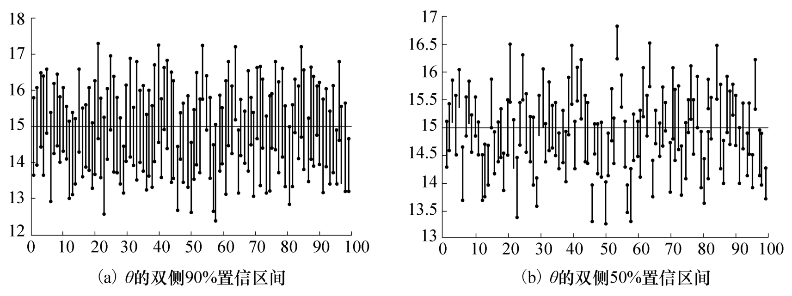
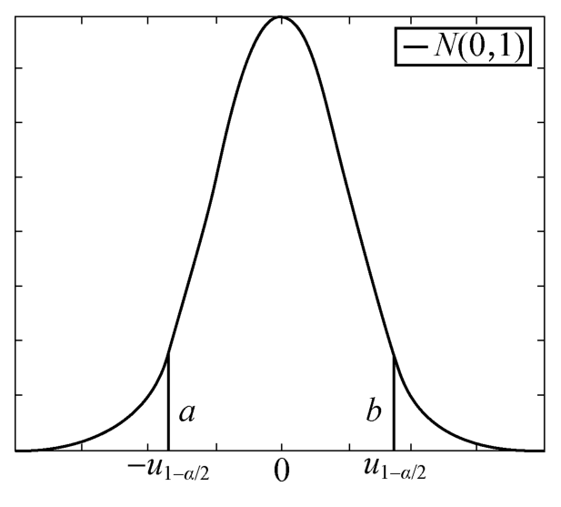
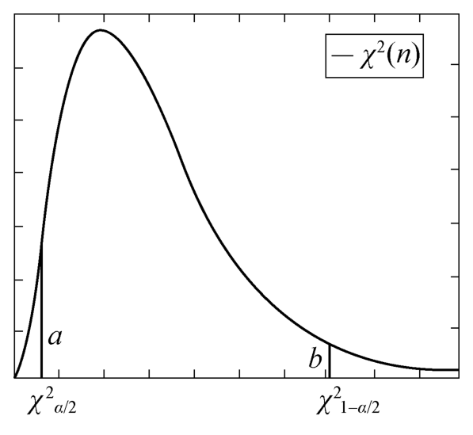

# 第七章 参数估计

［课前导读］

1. 随机变量数字特征：随机变量 $X$ 的 $k$ 阶原点矩 $\mu_k=E(X^k)$，$k=1,2,3,\cdots$.

2. 常用统计量的性质：设总体 $X$ 的均值 $E(X)=\mu$，$X$ 的方差 $D(X)=\sigma^2$，$(X_1,X_2,\cdots,X_n)$ 为取自该总体的一个样本，则有

$$
(1)\ E(\bar{X})=\mu,\ D(\bar{X})=\frac{\sigma^2}{n};\quad (2)\ E(S^2)=\sigma^2,\ E(S_n^2)=\frac{n-1}{n}\sigma^2.
$$

3. 高等数学知识点：若函数 $f(x)$ 在 $x_0$ 处可导，且在 $x_0$ 取得极值，那么 $f'(x_0)=0$.

在前一章中，我们已经了解总体这个概念，而总体 $X$ 的分布永远是未知的，通常根据实际情况假定服从某种类型的分布. 例如，假定总体 $X$ 服从正态分布，那么刻画正态分布的均值 $\mu$ 和方差 $\sigma^2$ 究竟取什么值呢？在本章中，我们将讨论参数的估计问题. 参数估计的形式有两种：点估计和区间估计. 我们从点估计开始.

## 第一节 点估计

设总体 $X$ 的分布形式已知，但它的一个或多个参数未知，借助于总体 $X$ 的一个样本来估计总体未知参数值的问题称为参数的点估计问题.

设总体 $X\sim f(x;\theta)$，其中 $f$ 的形式已知，$\theta$ 是未知参数. 例如，总体 $X\sim B(1,p)$，其中 $p$ 未知，这个 $p$ 即为标记总体分布的未知参数，简称总体参数. 总体参数虽然是未知的，但是它可能取值的范围却是已知的. 称总体参数的取值范围为参数空间，记作 $\Theta$. 例如，已知总体 $X\sim N(\mu,\sigma^2)$，其中 $\mu$ 和 $\sigma^2$ 都未知，参数空间 $\Theta=\{(\mu,\sigma^2):-\infty<\mu<+\infty,\ \sigma^2>0\}$.

设 $(X_1,X_2,\cdots,X_n)$ 是取自总体 $X$ 的一个样本，若用一个统计量 $\hat{\theta}=\hat{\theta}(X_1,X_2,\cdots,X_n)$ 来估计 $\theta$，则称 $\hat{\theta}$ 为参数 $\theta$ 的一个点估计量. 若 $\hat{\theta}$ 为 $\theta$ 的估计量，则有 $g(\hat{\theta})$ 为 $g(\theta)$ 的估计量. 在这里，构造统计量 $\hat{\theta}$ 常用的方法有两种：矩估计法和极大似然估计法.

### 一、矩估计

矩估计的思想就是替换思想：用样本原点矩替换总体原点矩. **定义**：设总体 $X$ 的 $k$ 阶原点矩：$\mu_k=E(X^k)$，样本的 $k$ 阶原点矩为：$A_k=\frac{1}{n}\sum\limits_{j=1}^{n}X_j^k$，$k=1,2,3,\cdots$. 如果未知参数 $\theta=\varphi(\mu_1,\mu_2,\cdots,\mu_m)$，则 $\theta$ 的矩估计量为 $\hat{\theta}=\varphi(A_1,A_2,\cdots,A_m)$. 这种估计总体未知参数的方法称为矩估计法.

**例 1**　设 $(X_1,X_2,\cdots,X_n)$ 是取自总体 $X$ 的一个样本. 在下列两种情形下，试求总体未知参数的矩估计量.

（1）总体 $X\sim B(1,p)$，其中 $p$ 未知，$0<p<1$；

（2）总体 $X\sim E(\lambda)$，其中 $\lambda$ 未知，$\lambda>0$.

**解**　（1）从随机变量数字特征的结论，易知 0-1 分布随机变量的期望 $E(X)=p$，换句话说，未知参数 $p$ 可表示为总体一阶原点矩，即 $p=E(X)$，用样本一阶原点矩替换总体一阶原点矩，可得 $p$ 的矩估计量为 $\hat{p}=\bar{X}$.

（2）因为 $E(X)=\frac{1}{\lambda}$，即 $\lambda=\frac{1}{E(X)}$，所以 $\lambda$ 的矩估计量为 $\hat{\lambda}=\frac{1}{\bar{X}}$.

**例 2**　设总体 $X$ 服从 $P(\lambda)$，其中 $\lambda>0$ 未知，$(X_1,X_2,\cdots,X_n)$ 是取自总体 $X$ 的一个样本，求：（1）$\lambda$ 的矩估计量；（2）$P(X=0)$ 的矩估计量.

**解**　（1）由于 $E(X)=\lambda$，故 $\lambda$ 的矩估计量为 $\hat{\lambda}=\bar{X}$.

又 $D(X)=\lambda=E(X^2)-(EX)^2$，故 $\lambda$ 的矩估计量又可写为 $\hat{\lambda}=\frac{1}{n}\sum\limits_{i=1}^{n}X_i^2-\bar{X}^2$.

这说明矩估计可能不唯一，这是矩估计的一个缺点，通常尽量采用较低阶的矩给出未知参数的估计.

（2）由于 $P(X=0)=\mathrm{e}^{-\lambda}\frac{\lambda^0}{0!}=\mathrm{e}^{-\lambda}=\mathrm{e}^{-E(X)}$，所以 $\hat{P}(X=0)=\mathrm{e}^{-\bar{X}}$.

有时，我们需要求解的并不是分布中的未知参数，而是它们的函数，所以还是采用替换原理，用样本原点矩的函数去替换相应的总体原点矩的函数.

**例 3**　设总体 $X$ 服从正态分布 $N(\mu,\sigma^2)$，$(X_1,X_2,\cdots,X_n)$ 是取自总体 $X$ 的一个样本，

（1）求 $\mu$ 的矩估计；

（2）$\mu$ 已知，$\sigma$ 未知，求 $\sigma^2$ 的矩估计；

（3）$\mu,\sigma$ 都未知，求 $\sigma^2$ 的矩估计.

**解**　（1）$\mu=E(X)$，故 $\mu$ 的矩估计 $\hat{\mu}=\bar{X}$.

（2）$\sigma^2=D(X)=E(X^2)-(EX)^2$，又因为 $\mu=E(X)$ 已知，故 $\sigma^2$ 的矩估计 $\hat{\sigma}^2=\frac{1}{n}\sum\limits_{i=1}^{n}X_i^2-\mu^2$.

（3）因为 $\mu=E(X)$ 未知，故 $\sigma^2$ 的矩估计 $\hat{\sigma}^2=\frac{1}{n}\sum\limits_{i=1}^{n}X_i^2-\bar{X}^2=\frac{1}{n}\sum\limits_{i=1}^{n}(X_i-\bar{X})^2=S_n^2$.

我们发现，当正态分布均值 $\mu$ 已知和 $\mu$ 未知时，$\sigma^2$ 的矩估计的结论不一样，事实上，不仅矩估计有这样的结论，后面即将讨论的极大似然估计也有这样的结论. 当均值 $\mu$ 和方差 $\sigma^2$ 都未知时，它们的矩估计的结论要熟记，见下面的定理，它是后面讨论置信区间和假设检验的基础.

**定理**　设一个总体 $X$ 的均值 $E(X)=\mu$ 和方差 $D(X)=\sigma^2$ 都未知，$(X_1,X_2,\cdots,X_n)$ 为取自该总体的一个样本，则 $\bar{X}$ 是 $\mu$ 的矩估计量，$S_n^2$ 是 $\sigma^2$ 的矩估计量，$S_n$ 是 $\sigma$ 的矩估计量.

**例 4**　设总体 $X$ 的密度函数为 $f(x;\theta)=\begin{cases}\mathrm{e}^{-(x-\theta)}, & x\geqslant\theta,\\ 0, & \text{其他},\end{cases}$ 其中 $\theta$ 未知，$(X_1,X_2,\cdots,X_n)$ 是取自该总体 $X$ 的一个样本，求 $\theta$ 的矩估计量.

**解**　因为

$$
E(X)=\int_{\theta}^{+\infty}x\mathrm{e}^{-(x-\theta)}\,\mathrm{d}x \xrightarrow{\ \text{令}\ t=x-\theta\ } \int_{0}^{+\infty}(t+\theta)\mathrm{e}^{-t}\,\mathrm{d}t=\int_{0}^{+\infty}t\mathrm{e}^{-t}\,\mathrm{d}t+\int_{0}^{+\infty}\theta\mathrm{e}^{-t}\,\mathrm{d}t=1+\theta,
$$

所以 $\theta=E(X)-1$，故 $\theta$ 的矩估计量 $\hat{\theta}=\bar{X}-1$.

从以上几个例子我们可以总结出如下求解总体未知参数 $\theta$ 矩估计量的一般步骤：

（1）设 $k$ 为一正整数，通常取 1 或 2，计算总体的 $k$ 阶原点矩 $\mu^k=E(X^k)=h(\theta)$；

（2）解出 $\theta=h^{-1}(E(X^k))=h^{-1}(\mu_k)$；

（3）用样本的 $k$ 阶原点矩 $A_k=\frac{1}{n}\sum\limits_{j=1}^{n}X_j^k$ 替换 $\mu^k$，得 $\theta$ 的矩估计 $\hat{\theta}=h^{-1}(A_k)$.

矩估计法是一种经典的估计方法，它比较直观，计算简单，即使不知道总体分布类型，只要知道未知参数与总体各阶原点矩的关系就能使用该方法，因此，在实际问题中，矩估计应用很广泛.

### 二、极大似然估计

极大似然估计是求总体未知参数的另一种常用的点估计方法. 为了理解极大似然估计的基本思想，我们先来看两个例子.

**例 5**　设一箱子中装有黑和白两种颜色的球，其中一种颜色的球有 99 个，另一种颜色的球只有 1 个. 但是不知道哪种颜色的球是只有 1 个. 我们随机地从这箱子里有放回地取 2 个球，结果取得的都是白球，问这个箱子中哪种颜色的球只有 1 个？

**解**　不妨设箱子中白球的比例为 $p$，事实上 $p$ 的取值就是两种可能，即 $p=0.01$ 或 $p=0.99$，不管是哪种可能，从箱子中任取 2 个球都是白球这个事件都是可能发生的. 但是

若 $p=0.01$ 时，则取得的都是白球的概率为 $p^2=0.01^2$；

若 $p=0.99$ 时，则取得的都是白球的概率为 $p^2=0.99^2$.

这个计算结果表明，当 $p=0.99$ 时，取得的 2 个球都是白球的概率大，这说明箱子中白球有 99 个，黑球只有 1 个的可能性大，即推断 $\hat{p}=0.99$.

这个例子就是对未知参数 $p$ 的极大似然推断，在 $p$ 的所有备选取值假定下，比较样本发生概率的大小，使概率最大的 $p$ 的取值即为 $p$ 的极大似然估计.

**例 6**　某电商收到供货商提供的一批产品，产品有合格和不合格两类，我们用一个随机变量 $X$ 表示其品质，

$$
X=\begin{cases}1, & \text{产品是合格的},\\ 0, & \text{产品是不合格的}.\end{cases}
$$

显然 $X$ 服从参数为 $p$ 的 0-1 分布，其中 $p$ 为未知的合格率. 现有放回抽取 $n$ 个产品看其是否合格，得到样本观测值 $(x_1,x_2,\cdots,x_n)$，则这批观测值发生的概率为

$$
P(X_1=x_1,\cdots,X_n=x_n;p)=\prod_{i=1}^{n}p^{x_i}(1-p)^{1-x_i}=p^{\sum\limits_{i=1}^{n}x_i}(1-p)^{n-\sum\limits_{i=1}^{n}x_i}.
$$

其中 $p$ 是未知的，和例 5 的推断方式相似，我们应选择一个 $p$ 的取值，使得上式表示的概率尽可能大，即将上式看作是未知参数 $p$ 的函数，我们用 $L(p)$ 表示，称作 $p$ 的似然函数，即

$$
L(p)=p^{\sum\limits_{i=1}^{n}x_i}(1-p)^{n-\sum\limits_{i=1}^{n}x_i}.
$$

对 $L(p)$ 求极大值. 由于 $\ln x$ 是 $x$ 的严格递增的上凸函数，因此使对数似然函数 $\ln L(p)$ 达到最大与使 $L(p)$ 达到最大是等价的. 故上式两端取对数并关于 $p$ 求导令其等于 0，即有

$$
\ln L(p)=n\bar{x}\ln p+n(1-\bar{x})\ln(1-p),
$$

$$
\frac{\mathrm{d}\ln L(p)}{\mathrm{d}p}=\frac{n\bar{x}}{p}-\frac{n(1-\bar{x})}{1-p}=0.
$$

这个方程的解是 $\hat{p}=\bar{x}=\frac{1}{n}\sum\limits_{i=1}^{n}X_i$. 这的确是函数的最大值，因为它是 $p$ 中唯一的一阶导数等于零的点，并且二阶导数严格小于零.

从这个例子我们可以看到求极大似然估计的基本思路. 对离散总体 $X$，其分布律为 $P(X=x;\theta)$，设 $(x_1,x_2,\cdots,x_n)$ 为取自该离散总体 $X$ 的一个样本 $(X_1,X_2,\cdots,X_n)$ 的观测值，我们写出该观测值出现的概率，它一般依赖于某个或某几个参数，用 $\theta$ 表示，将该概率看成是 $\theta$ 的函数，用 $L(\theta)$ 表示，又称为 $\theta$ 的似然函数，即

$$
L(\theta)=P(X_1=x_1,\ X_2=x_2,\ \cdots,\ X_n=x_n;\ \theta).
$$

求极大似然估计就是找 $\theta$ 的估计值 $\hat{\theta}=\hat{\theta}(x_1,x_2,\cdots,x_n)$ 使得上式的 $L(\theta)$ 达到最大. 对连续总体，我们可以用样本的联合密度函数替代上面的联合分布律，也称之为似然函数，具体可表示为，设总体 $X$ 的密度函数 $f(x;\theta)$（其中 $\theta$ 为未知参数），已知 $(x_1,x_2,\cdots,x_n)$ 为总体 $X$ 的样本 $(X_1,X_2,\cdots,X_n)$ 的观测值，则似然函数 $L(\theta)=\prod\limits_{i=1}^{n}f(x_i;\theta)$. 由此，我们给出如下定义.

**定义**　设总体 $X$ 有分布律 $P(X=x;\theta)$ 或密度函数 $f(x;\theta)$（其中 $\theta$ 为一个未知参数或几个未知参数组成的向量 $\boldsymbol{\theta}=(\theta_1,\theta_2,\cdots,\theta_k)$），已知 $\theta\in\Theta$，$\Theta$ 是参数空间. $(x_1,x_2,\cdots,x_n)$ 为取自总体 $X$ 的一个样本 $(X_1,X_2,\cdots,X_n)$ 的观测值，将样本的联合分布律或联合密度函数看成 $\theta$ 的函数，用 $L(\theta)$ 表示，又称为 $\theta$ 的似然函数，则似然函数

$$
L(\theta)=\prod_{i=1}^{n}P(X_i=x_i;\ \theta),\ \text{或}\ L(\theta)=\prod_{i=1}^{n}f(x_i;\ \theta),
$$

称满足关系式 $L(\hat{\theta})=\max\limits_{\theta\in\Theta}L(\theta)$ 的解 $\hat{\theta}$ 为 $\theta$ 的极大似然估计量.

当 $L(\theta)$ 是可微函数时，求导是求极大似然估计最常用的方法. 此时又因 $L(\theta)$ 与 $\ln L(\theta)$ 在同一个 $\theta$ 处取到极值，且对对数似然函数 $\ln L(\theta)$ 求导更简单，故我们常用如下对数似然方程（组）

$$
\frac{\mathrm{d}}{\mathrm{d}\theta}\ln L(\theta)=0\ \text{或}\ \begin{cases}\dfrac{\partial}{\partial\theta_1}\ln L(\theta)=0,\\ \quad\vdots\\ \dfrac{\partial}{\partial\theta_k}\ln L(\theta)=0.\end{cases}
$$

求 $\theta$ 的极大似然估计量. 当似然函数不可微时，也可以直接寻求使得 $L(\theta)$ 达到最大的解来求得极大似然估计量.

**例 7**　设总体 $X$ 的密度函数为 $f(x)=\begin{cases}\lambda^2x\mathrm{e}^{-\lambda x}, & x>0\\ 0, & \text{其他}\end{cases}$，其中 $\lambda\ (\lambda>0)$ 未知，$(X_1,X_2,\cdots,X_n)$ 是取自总体 $X$ 的一个样本. 求 $\lambda$ 的极大似然估计量.

**解**　似然函数

$$
L(\lambda)=\prod_{i=1}^{n}f(x_i;\lambda)=\lambda^{2n}\cdot\prod_{i=1}^{n}x_i\cdot\mathrm{e}^{-\lambda\sum\limits_{i=1}^{n}x_i},
$$

取对数似然函数

$$
\ln L=2n\ln\lambda+\sum_{i=1}^{n}\ln x_i-\lambda\sum_{i=1}^{n}x_i,
$$

对数似然方程为

$$
\frac{\mathrm{d}\ln L}{\mathrm{d}\lambda}=\frac{2n}{\lambda}-\sum_{i=1}^{n}x_i=0,
$$

解得

$$
\lambda=\frac{2n}{\sum\limits_{i=1}^{n}x_i}=\frac{2}{\dfrac{1}{n}\sum\limits_{i=1}^{n}x_i}.
$$

故 $\lambda$ 的极大似然估计量为 $\hat{\lambda}=\frac{2}{\bar{X}}$.

**例 8**　设总体 $X$ 服从正态分布 $N(\mu,\sigma^2)$，其中 $\mu,\sigma$ 未知，$(X_1,X_2,\cdots,X_n)$ 是取自该总体的一个样本，求（1）$\mu,\sigma^2$ 的极大似然估计量；（2）$\theta=P(X\geqslant2)$ 的极大似然估计量.

**解**　（1）总体 $X$ 的密度函数为 $f(x)=\frac{1}{\sqrt{2\pi\sigma^2}}\mathrm{e}^{-\frac{(x-\mu)^2}{2\sigma^2}}$，故似然函数为

$$
L(\theta)=\frac{1}{\left(\sqrt{2\pi\sigma^2}\right)^n}\mathrm{e}^{-\frac{\sum\limits_{i=1}^{n}(x_i-\mu)^2}{2\sigma^2}},
$$

对数似然函数为

$$
\ln L(\theta)=-\frac{n}{2}\ln2\pi-\frac{n}{2}\ln\sigma^2-\frac{\sum\limits_{i=1}^{n}(x_i-\mu)^2}{2\sigma^2},
$$

对数似然方程为

$$
\begin{cases}\dfrac{\partial\ln L}{\partial\mu}=\dfrac{1}{\sigma^2}\sum\limits_{i=1}^{n}(x_i-\mu)=0,\\[2mm] \dfrac{\partial\ln L}{\partial\sigma^2}=-\dfrac{n}{2\sigma^2}+\dfrac{1}{2\sigma^4}\sum\limits_{i=1}^{n}(x_i-\mu)^2=0.\end{cases}
$$

解得 $\begin{cases}\mu=\bar{x},\\ \sigma^2=\dfrac{1}{n}\sum\limits_{i=1}^{n}(x_i-\bar{x})^2,\end{cases}$ 故 $\mu,\sigma^2$ 的极大似然估计量分别为

$$
\hat{\mu}=\bar{X},\quad \hat{\sigma}^2=\frac{1}{n}\sum_{i=1}^{n}(X_i-\bar{X})^2=S_n^2.
$$

这个结论与相应的矩估计量相同.

（2）$\theta=P(X\geqslant2)=1-\Phi\left(\frac{2-\mu}{\sigma}\right)$，以 $\hat{\mu},\hat{\sigma}$ 分别代替 $\mu,\sigma$，得 $\theta$ 的极大似然估计量为

$$
\hat{\theta}=1-\Phi\left(\frac{2-\hat{\mu}}{\hat{\sigma}}\right)=1-\Phi\left(\frac{2-\bar{X}}{S_n}\right).
$$

第（2）问的解题过程用到了极大似然估计的不变性：如果 $\hat{\theta}$ 是 $\theta$ 的极大似然估计，则对任一函数 $g(\theta)$，满足当 $\theta\in\Theta$ 时，具有单值反函数，则其极大似然估计为 $g(\hat{\theta})$.

虽然求导函数是求极大似然估计的最常用的方法（我们称为对数求导法），但并不是在所有场合对数求导法都是有效的，当似然函数不可微时，也可以直接寻求使得 $L(\theta)$ 达到最大的解来求得极大似然估计量（我们称为直接观察法）.

**例 9**　设总体 $X$ 服从区间 $(0,\theta)$ 的均匀分布，其中 $\theta>0$ 未知，$(X_1,X_2,\cdots,X_n)$ 是取自总体 $X$ 的一个样本，求 $\theta$ 的极大似然估计量.

**解**　易知似然函数 $L(\theta)=\begin{cases}\dfrac{1}{\theta^n}, & 0<x_i<\theta,\ i=1,2,\cdots,n,\\ 0, & \text{其他}.\end{cases}$

因 $L(\theta)$ 作为 $\theta$ 的函数，具有不连续性，因此只能使用直接观察法，使 $L(\theta)$ 取得最大值来求解. 由 $L(\theta)$ 的表达式可知，$\theta$ 越小 $L(\theta)$ 越大，又 $\theta\geqslant\max\limits_{1\leqslant i\leqslant n}X_i$，故取 $\hat{\theta}=\max\limits_{1\leqslant i\leqslant n}X_i$ 时，$L(\hat{\theta})$ 达到最大值，即 $\theta$ 的极大似然估计量 $\hat{\theta}=\max\limits_{1\leqslant i\leqslant n}X_i=X_{(n)}$.

**例 10**　设某种元件的使用寿命 $X$ 的密度函数为 $f(x;\theta)=\begin{cases}2\mathrm{e}^{-2(x-\theta)}, & x>\theta,\\ 0, & x\leqslant\theta,\end{cases}$ 其中 $\theta>0$ 为未知参数. 又设 $(x_1,x_2,\cdots,x_n)$ 是取自总体 $X$ 的样本 $(X_1,X_2,\cdots,X_n)$ 的一组观测值，求参数 $\theta$ 的极大似然估计量.

**解**　易知似然函数 $L(\theta)=\begin{cases}2^n\exp\left\{-2\sum\limits_{i=1}^{n}(x_i-\theta)\right\}, & x_{(1)}>\theta,\\ 0, & x_{(1)}\leqslant\theta,\end{cases}$ 其中 $x_{(1)}=\min\limits_{1\leqslant i\leqslant n}x_i$，此处与例 9 相似，$L(\theta)$ 在 $\theta=x_{(1)}$ 处不连续，因此只能直接求函数 $L(\theta)$ 的极大值点. 注意到 $L(\theta)\geqslant0$，且当 $\theta<x_{(1)}$ 时，$L(\theta)=2^n\exp\left\{-2\sum\limits_{i=1}^{n}(x_i-\theta)\right\}$ 随 $\theta$ 递增而递增，因而当 $\theta=x_{(1)}$ 时，$L(\theta)$ 达到最大. 所以 $\hat{\theta}=X_{(1)}$ 是 $\theta$ 的极大似然估计量.

从以上几个例子中可以看出求解总体中未知参数的极大似然估计量的方法不唯一. 但不管用何种方法，求解极大似然估计量必须已知总体 $X$ 的分布类型. 由此可知，极大似然估计的条件比矩估计的条件要强，故极大似然估计一般优于矩估计. 最后我们再总结一下极大似然估计的基本思想：总体分布中的未知参数的取值有很多可能，找一个估计值，使得样本发生的概率最大，这个估计值就是极大似然估计值. 从上述例子我们可以总结给出如下求解总体未知参数 $\theta$ 的极大似然估计的一般步骤.

（1）由总体分布写出样本的联合分布律或联合密度函数；

（2）把 $\theta$ 看成自变量，样本联合分布律（或联合密度函数）看成是 $\theta$ 的函数，即为似然函数 $L(\theta)$；

（3）求似然函数 $L(\theta)$ 的最大值点（有时转化为求对数似然函数的最大值点）$\max\limits_{1\leqslant i\leqslant n}L(\theta)$（或 $\max\limits_{1\leqslant i\leqslant n}\ln L(\theta)$）；

（4）令 $L(\theta)$ 达到最大时 $\theta$ 的取值 $\hat{\theta}=\hat{\theta}(x_1,x_2,\cdots,x_n)$ 即为 $\theta$ 的极大似然估计值，$\hat{\theta}=\hat{\theta}(X_1,X_2,\cdots,X_n)$ 为 $\theta$ 极大似然估计量.

### 习题 7-1

**1.** 设 $(X_1,X_2,\cdots,X_n)$ 是取自总体 $X$ 的一个样本，总体 $X$ 的密度函数为

$$
f(x;a)=\begin{cases}\dfrac{2}{a^2}(a-x), & 0<x<a,\\ 0, & \text{其他}.\end{cases}
$$

求 $a$ 的矩估计量.

**2.** 设 $(X_1,X_2,\cdots,X_n)$ 是取自总体 $X$ 的一个样本，其中总体 $X$ 服从参数为 $\lambda$ 的泊松分布，其中 $\lambda$ 未知，$\lambda>0$，（1）求 $\lambda$ 的矩估计量与极大似然估计量；（2）如得到如下一组样本观测值

| $X$ | 0 | 1 | 2 | 3 | 4 |
| --- | --- | --- | --- | --- | --- |
| 频数 | 17 | 20 | 10 | 2 | 1 |

求 $\lambda$ 的矩估计值与极大似然估计值.

**3.** 设 $(X_1,X_2,\cdots,X_n)$ 是取自总体 $X$ 的一个样本，$X$ 的分布函数为

$$
F(x;\theta)=\begin{cases}0, & x<1,\\ 1-x^{-\theta}, & x\geqslant1,\end{cases}
$$

其中 $\theta$ 未知，$\theta>1$. 试求 $\theta$ 的矩估计量和极大似然估计量.

**4.** 设 $(X_1,X_2,\cdots,X_n)$ 是取自总体 $X$ 的一个样本，$X$ 的密度函数为

$$
f(x;\theta)=\begin{cases}(\theta+1)x^{\theta}, & 0<x<1,\\ 0, & \text{其他},\end{cases}
$$

其中 $\theta$ 未知，$\theta>0$，求 $\theta$ 的矩估计量和极大似然估计量.

**5.** 设 $(X_1,X_2,\cdots,X_n)$ 是取自总体 $X$ 的一个样本，$X$ 的密度函数为

$$
f(x;\theta)=\begin{cases}\dfrac{x}{\theta}\mathrm{e}^{-\frac{x^2}{2\theta}}, & x>0,\\ 0, & x\leqslant0,\end{cases}
$$

其中 $\theta$ 未知，$\theta>0$，求 $\theta$ 的矩估计量和极大似然估计量.

**6.** 设 $(X_1,X_2,\cdots,X_n)$ 是取自总体 $X$ 的一个样本，总体 $X$ 服从几何分布，其分布律为

$$
P(X=x;\ p)=p(1-p)^{x-1}\quad(x=1,2,\cdots),
$$

其中 $p$ 未知，$0<p<1$，试求 $p$ 的矩估计量.

**7.** 设 $(X_1,X_2,\cdots,X_n)$ 是取自总体 $X$ 的一个样本，总体 $X$ 的分布律如下：

| $X$ | $-1$ | $0$ | $1$ |
| --- | --- | --- | --- |
| 概率 | $\dfrac{\theta}{2}$ | $1-\theta$ | $\dfrac{\theta}{2}$ |

其中 $\theta$ 未知，$0<\theta<1$，试求 $\theta$ 的矩估计量和极大似然估计量.

**8.** 设 $(X_1,X_2,\cdots,X_n)$ 是取自总体 $X$ 的一个样本，总体 $X$ 的密度函数为

$$
f(x;\theta,\lambda)=\begin{cases}\dfrac{1}{\lambda}\mathrm{e}^{-\frac{x-\theta}{\lambda}}, & x\geqslant\theta,\\ 0, & \text{其他},\end{cases}
$$

其中 $\lambda>0$，求 $\theta$ 及 $\lambda$ 的极大似然估计量.

**9.** 设 $(X_1,X_2,\cdots,X_n)$ 是取自总体 $X$ 的一个样本，总体 $X\sim U(\theta,1)$，其中 $\theta$ 未知，$\theta<1$，求 $\theta$ 的矩估计量和极大似然估计量.

**10.** 设 $(X_1,X_2,\cdots,X_n)$ 是取自总体 $X$ 的一个样本，总体 $X$ 的密度函数为 $f(x;\theta)=\frac{|x|}{2\theta}\mathrm{e}^{-\frac{|x|}{\theta}}$，$-\infty<x<+\infty$，其中 $\theta$ 未知，$\theta>0$，求 $\theta$ 的矩估计量和极大似然估计量.

**11.** 设 $(X_1,X_2,\cdots,X_n)$ 是取自总体 $X$ 的一个样本，$X$ 的分布函数为

$$
F(x;\theta)=\begin{cases}1-\dfrac{\theta}{x}, & x\geqslant\theta,\\ 0, & x<\theta,\end{cases}
$$

其中 $\theta$ 未知，$\theta>0$. 试求 $\theta$ 的极大似然估计量.

**12.** 设 $(X_1,X_2,\cdots,X_n)$ 是取自总体 $X$ 的一个样本，总体 $X$ 的密度函数为

$$
f(x;\theta)=\begin{cases}\theta, & 0\leqslant x<1,\\ 1-\theta, & 1\leqslant x\leqslant2,\\ 0, & \text{其他},\end{cases}
$$

其中 $\theta$ 是未知参数（$0<\theta<1$），记 $N$ 为样本值 $x_1,x_2,\cdots,x_n$ 中位于 $[0,1)$ 之间的个数，位于 $[1,2]$ 之间的个数为 $n-N$ 个，求 $\theta$ 的极大似然估计量.

## 第二节 点估计的优良性评判标准

从第七章第一节中的例 2 可以看到，对于同一个参数，用不同的估计方法求出的估计量可能是不同的，那么这时候就有一个疑问，采用哪个估计量会更好些呢？评判一个估计量的好坏不能一概而论，即一个估计量的优劣不是绝对的，而是基于某一评判标准而言相对的评价结论. 在下文中介绍三种常用的评判标准：无偏性、有效性和相合性.

### 一、无偏性

**定义 1**　设 $\hat{\theta}=\hat{\theta}(X_1,X_2,\cdots,X_n)$ 是 $\theta$ 的一个估计量，$\theta$ 取值的参数空间为 $\Theta$，若对任意的 $\theta\in\Theta$，有

$$
E_\theta\left[\hat{\theta}(X_1,X_2,\cdots,X_n)\right]=\theta,
$$

则称 $\hat{\theta}=\hat{\theta}(X_1,X_2,\cdots,X_n)$ 是 $\theta$ 的一个无偏估计（量），否则称为有偏估计（量）.

如果有

$$
\lim_{n\to\infty}E_\theta\left[\hat{\theta}(X_1,X_2,\cdots,X_n)\right]=\theta,
$$

则称 $\hat{\theta}=\hat{\theta}(X_1,X_2,\cdots,X_n)$ 是 $\theta$ 的一个渐近无偏估计（量）.

估计量的无偏性是指，由估计量得到的估计值相对于未知参数真值来说，取某些样本观测值时偏大，取另一些样本观测值时偏小. 反复将这个估计量使用多次，就平均来说其偏差为 0. 如果估计量不具有无偏性，则无论使用多少次，其平均值也与真值有一定的距离，这个距离就是系统误差了.

**例 1**　设 $(X_1,X_2,\cdots,X_n)$ 是取自总体 $X$ 的一个样本，总体 $X$ 服从区间 $(0,\theta)$ 的均匀分布，其中 $\theta>0$ 未知，讨论 $\theta$ 的矩估计量 $\hat{\theta}_1$ 和极大似然估计量 $\hat{\theta}_2$ 的无偏性.

**解**　由于 $E(X)=\frac{\theta}{2}$，则 $\theta=2E(X)$，故 $\theta$ 的矩估计量 $\hat{\theta}_1=2\bar{X}$.

由上一节例 9 可知，$\theta$ 的极大似然估计量 $\hat{\theta}_2=\max\limits_{1\leqslant i\leqslant n}X_i=X_{(n)}$.

因为 $E(\hat{\theta}_1)=E(2\bar{X})=2E(\bar{X})=2E\left(\frac{1}{n}\sum\limits_{i=1}^{n}X_i\right)=\frac{2}{n}\sum\limits_{i=1}^{n}E(X_i)=\frac{2}{n}\sum\limits_{i=1}^{n}\frac{\theta}{2}=\theta$，故 $\theta$ 的矩估计量 $2\bar{X}$ 是 $\theta$ 的无偏估计.

其次，由第六章第二节次序统计量的密度函数公式可知

$$
f_{X_{(n)}}(x)=n\left(F_X(x)\right)^{n-1}f_X(x)=\begin{cases}\dfrac{nx^{n-1}}{\theta^n}, & 0<x<\theta,\\ 0, & \text{其他}.\end{cases}
$$

因此 $E(\hat{\theta}_2)=E(X_{(n)})=\int_{0}^{\theta}x\cdot\frac{nx^{n-1}}{\theta^n}\mathrm{d}x=\frac{n}{n+1}\theta\neq\theta$，即 $\theta$ 的极大似然估计量 $X_{(n)}$ 不是 $\theta$ 的无偏估计，为 $\theta$ 的有偏估计，但是注意到 $\lim\limits_{n\to\infty}E(\hat{\theta}_2)=\theta$，因此 $X_{(n)}$ 是 $\theta$ 的渐近无偏估计. 另一方面，将 $\hat{\theta}_2$ 修正为 $\hat{\theta}_2^*=\frac{n+1}{n}\hat{\theta}_2=\frac{n+1}{n}X_{(n)}$，则满足 $E(\hat{\theta}_2^*)=\theta$，即修正后的 $\frac{n+1}{n}X_{(n)}$ 是 $\theta$ 的无偏估计.

**第一节例 3 续**　设 $(X_1,X_2,\cdots,X_n)$ 是取自总体 $X$ 的一个样本，总体 $X$ 服从正态分布 $N(\mu,\sigma^2)$，已求得：当 $\mu$ 已知时，$\sigma^2$ 的矩估计量 $\hat{\sigma}_1^2=\frac{1}{n}\sum\limits_{i=1}^{n}X_i^2-\mu^2$；当 $\mu$ 未知时，$\sigma^2$ 的矩估计量 $\hat{\sigma}_2^2=S_n^2$，分别讨论 $\hat{\sigma}_1^2$ 与 $\hat{\sigma}_2^2$ 的无偏性.

**解**　这里，$E(\hat{\sigma}_1^2)=E\left(\frac{1}{n}\sum\limits_{i=1}^{n}X_i^2-\mu^2\right)=\frac{1}{n}\sum\limits_{i=1}^{n}E(X_i^2)-\mu^2=\frac{1}{n}\sum\limits_{i=1}^{n}(\sigma^2+\mu^2)-\mu^2=\sigma^2$，

所以当 $\mu$ 已知时，$\sigma^2$ 的矩估计量 $\hat{\sigma}_1^2=\frac{1}{n}\sum\limits_{i=1}^{n}X_i^2-\mu^2$ 是 $\sigma^2$ 的无偏估计.

而 $E(\hat{\sigma}_2^2)=E(S_n^2)=\frac{n-1}{n}\sigma^2\neq\sigma^2$，即当 $\mu$ 未知时，$S_n^2$ 不是 $\sigma^2$ 的无偏估计量，将 $S_n^2$ 修正为 $S^2$，满足 $E(S^2)=\sigma^2$，则 $S^2$ 是 $\sigma^2$ 的无偏估计量.

事实上，不仅正态分布有这样的结论，任一总体都有类似的结论，我们用定理的方式表达如下.

**定理 1**　设总体 $X$ 的均值 $\mu$、方差 $\sigma^2>0$ 均未知，$(X_1,X_2,\cdots,X_n)$ 为取自该总体的一个样本，则样本均值 $\bar{X}$ 是 $\mu$ 的无偏估计量，样本方差 $S^2$ 是 $\sigma^2$ 的无偏估计量，$S_n^2$ 不是 $\sigma^2$ 的无偏估计量，$S_n$ 与 $S$ 都不是 $\sigma$ 的无偏估计量.

**证明**　用第六章第二节定理 1 即得.

### 二、有效性

一个未知参数的无偏估计可以有很多，如何在无偏估计中再进行选择？由于无偏估计的标准是平均偏差为 0，所以一个很自然的想法就是每一次估计值与真值的偏差波动越小越好，偏差波动大小可以用方差来衡量，因此我们用无偏估计的方差大小作为进一步衡量无偏估计优劣的标准，这就是有效性.

**定义 2**　设 $\hat{\theta}_1,\hat{\theta}_2$ 是 $\theta$ 的两个无偏估计，若对任意的 $\theta\in\Theta$，有 $D(\hat{\theta}_1)\leqslant D(\hat{\theta}_2)$，且至少有一个 $\theta\in\Theta$ 使得上述不等式严格成立，则称 $\hat{\theta}_1$ 比 $\hat{\theta}_2$ 有效.

**例 1 续**　设 $(X_1,X_2,\cdots,X_n)$ 是取自总体 $X$ 的一个样本，总体 $X$ 服从区间 $(0,\theta)$ 上的均匀分布，其中 $\theta\ (>0)$ 未知，$\theta$ 的矩估计量 $\hat{\theta}_1=2\bar{X}$ 是 $\theta$ 的无偏估计，修正后的极大似然估计量 $\hat{\theta}_2^*=\frac{n+1}{n}X_{(n)}$ 也是 $\theta$ 的无偏估计，且

$$
D(\hat{\theta}_1)=D(2\bar{X})=4D(\bar{X})=\frac{4}{n}\cdot\frac{\theta^2}{12}=\frac{1}{3n}\theta^2,
$$

又 $E(X_{(n)}^2)=\int_{0}^{\theta}x^2\cdot\frac{nx^{n-1}}{\theta^n}\mathrm{d}x=\frac{n}{n+2}\theta^2$，

$$
D(X_{(n)})=E(X_{(n)}^2)-\left(EX_{(n)}\right)^2=\frac{n}{n+2}\theta^2-\left(\frac{n}{n+1}\theta\right)^2=\frac{n}{(n+1)^2(n+2)}\theta^2,
$$

$$
D(\hat{\theta}_2^*)=D\left(\frac{n+1}{n}X_{(n)}\right)=\left(\frac{n+1}{n}\right)^2D(X_{(n)})=\left(\frac{n+1}{n}\right)^2\cdot\frac{n}{(n+1)^2(n+2)}\theta^2=\frac{1}{n(n+2)}\theta^2.
$$

显然，当 $n\geqslant2$ 时，$D(\hat{\theta}_2^*)=\frac{1}{n(n+2)}\theta^2<D(\hat{\theta}_1)=\frac{1}{3n}\theta^2$，所以 $\hat{\theta}_2^*$ 比 $\hat{\theta}_1$ 有效.

### 三、相合性

点估计是样本的函数，故点估计仍然是一个随机变量，在样本量一定的条件下，我们不可能要求它完全等同于未知参数的真值，但如果随着样本量不断增大，它能越来越接近真值，控制在真值附近的强度（概率）越来越大，那么这就是一个好的估计，这一性质称为相合性.

**定义 3**　设 $\hat{\theta}=\hat{\theta}(X_1,X_2,\cdots,X_n)$ 是 $\theta$ 的一个估计量，若对 $\forall\,\varepsilon>0$，

$$
\lim_{n\to\infty}P\left(|\hat{\theta}-\theta|\geqslant\varepsilon\right)=0,
$$

则称估计量 $\hat{\theta}$ 具有相合性（一致性），即 $\hat{\theta}\xrightarrow{P}\theta$，或称 $\hat{\theta}$ 是 $\theta$ 的相合（一致）估计量.

相合性被视为对估计的一个很基本的要求，如果一个估计量，在样本量不断增大时，它不能把被估参数估计到任意指定的精度内，那么这个估计是不好的. 通常，不满足相合性的估计一般不予考虑.

**定理 2**　若 $\hat{\theta}$ 是 $\theta$ 的一个无偏估计，且 $\lim\limits_{n\to\infty}D(\hat{\theta})=0$，则 $\hat{\theta}$ 是 $\theta$ 的一个相合估计量.

**证明**　由题意知 $E(\hat{\theta})=\theta$，根据切比雪夫不等式，当 $n\to\infty$，对任给 $\varepsilon>0$，

$$
P\left(|\hat{\theta}-\theta|\geqslant\varepsilon\right)=P\left(|\hat{\theta}-E(\hat{\theta})|\geqslant\varepsilon\right)\leqslant\frac{D(\hat{\theta})}{\varepsilon^2},
$$

因为 $\lim\limits_{n\to\infty}D(\hat{\theta})=0$，所以 $P\left(|\hat{\theta}-\theta|\geqslant\varepsilon\right)\xrightarrow{n\to\infty}0$，即 $\hat{\theta}\xrightarrow{P}\theta$，$\hat{\theta}$ 是 $\theta$ 的一个相合估计量.

**例 3**　设 $(X_1,X_2,\cdots,X_n)$ 是取自总体 $X\sim N(0,\sigma^2)$ 的一个样本，其中 $\sigma^2>0$ 未知，令 $\hat{\sigma}^2=\frac{1}{n}\sum\limits_{i=1}^{n}X_i^2$，试证 $\hat{\sigma}^2$ 是 $\sigma^2$ 的相合估计量.

**证明**　易见 $E(\hat{\sigma}^2)=E\left(\frac{1}{n}\sum\limits_{i=1}^{n}X_i^2\right)=\frac{1}{n}\sum\limits_{i=1}^{n}E(X_i^2)=\sigma^2$. 又 $\frac{1}{\sigma^2}\sum\limits_{i=1}^{n}X_i^2\sim\chi^2(n)$，所以，$D\left(\frac{1}{\sigma^2}\sum\limits_{i=1}^{n}X_i^2\right)=2n$. 当 $n\to\infty$ 时，$D(\hat{\sigma}^2)=D\left(\frac{1}{\sigma^2}\sum\limits_{i=1}^{n}X_i^2\right)\cdot\frac{\sigma^4}{n^2}=\frac{2\sigma^4}{n}\to0$. 由定理 2 得，$\hat{\sigma}^2$ 是 $\sigma^2$ 的相合估计量.

根据第六章第二节定理 1 可知，样本均值 $\bar{X}$ 是总体 $\mu$ 的相合估计量，样本方差 $S^2$ 与 $S_n^2$ 都是 $\sigma^2$ 的相合估计量，$S_n$ 与 $S$ 都是 $\sigma$ 的相合估计量. 从上述例 3 的结论也可发现均匀分布总体 $U(0,\theta)$ 的未知参数 $\theta$ 的矩估计量 $2\bar{X}$ 和修正后的极大似然估计量 $\frac{n+1}{n}X_{(n)}$ 也都是 $\theta$ 的相合估计量. 事实上，根据大数定律，矩估计一般都具有相合性.

### 习题 7-2

**1.** 设 $(X_1,X_2,\cdots,X_n)$ 是取自总体 $X$ 的一个样本，总体 $X\sim B(1,p)$，其中 $p$ 未知，$0<p<1$，证明（1）$X_1$ 是 $p$ 的无偏估计；（2）$X_1^2$ 不是 $p^2$ 的无偏估计；（3）当 $n\geqslant2$ 时，$X_1X_2$ 是 $p^2$ 的无偏估计.

**2.** 设 $(X_1,X_2,\cdots,X_n)$ 是取自总体 $X$ 的一个样本，总体 $X$ 的密度函数为

$$
f(x;\mu)=\begin{cases}\mathrm{e}^{-(x-\mu)}, & x\geqslant\mu,\\ 0, & \text{其他},\end{cases}
$$

其中 $-\infty<\mu<+\infty$，$\mu$ 未知，易知 $\mu$ 的极大似然估计量 $\hat{\mu}_1=X_{(1)}$，问

（1）$\hat{\mu}_1$ 是 $\mu$ 的无偏估计吗？若不是，请修正.

（2）$\mu$ 的矩估计量 $\hat{\mu}_2$ 是 $\mu$ 的无偏估计吗？是相合估计吗？

**3.** 设总体 $X$ 服从均匀分布 $U(\theta,\theta+1)$，$(X_1,X_2,\cdots,X_n)$ 是取自该总体的一个样本，证：$\hat{\theta}_1=\bar{X}-\frac{1}{2}$，$\hat{\theta}_2=X_{(n)}-\frac{n}{n+1}$，$\hat{\theta}_3=X_{(1)}-\frac{1}{n+1}$ 都是 $\theta$ 的无偏估计.

**4.** 设 $(X_1,X_2,\cdots,X_n)$ 是取自总体 $X\sim N(\mu,\sigma^2)$ 的一个样本，选适当的值 $c$，使 $\hat{\sigma}^2=c\sum\limits_{i=1}^{n-1}(X_{i+1}-X_i)^2$ 是 $\sigma^2$ 的无偏估计.

**5.**（习题 7-1 第 7 题续）设 $(X_1,X_2,\cdots,X_n)$ 是取自总体 $X$ 的一个样本，总体 $X$ 的分布律如下：

| $X$ | $-1$ | $0$ | $1$ |
| --- | --- | --- | --- |
| 概率 | $\dfrac{\theta}{2}$ | $1-\theta$ | $\dfrac{\theta}{2}$ |

其中 $\theta$ 未知，$0<\theta<1$. 讨论 $\theta$ 的矩估计量 $\hat{\theta}_1$ 和极大似然估计量 $\hat{\theta}_2$ 的无偏性，若不是无偏估计，请修正为无偏估计，并比较哪个更有效.

**6.** 设 $(X_1,X_2,\cdots,X_n)$ 是取自总体 $X$ 的一个样本，总体 $X\sim B(n,p)$，$\bar{X}$ 和 $S^2$ 分别为样本均值和样本方差. 若 $\bar{X}+kS^2$ 为 $np^2$ 的无偏估计量，求 $k$ 的值.

**7.** 设总体 $X$ 的分布律为

| $X$ | $1$ | $2$ | $3$ |
| --- | --- | --- | --- |
| 概率 | $1-\theta$ | $\theta-\theta^2$ | $\theta^2$ |

其中 $\theta\in(0,1)$ 未知，以 $N_i$ 表示取自总体 $X$ 的简单随机样本（样本容量为 $n$）中等于 $i$ 的个体个数（$i=1,2,3$），试求常数 $a_1,a_2,a_3$，使 $T=\sum\limits_{i=1}^{3}a_iN_i$ 为 $\theta$ 的无偏估计量，并求 $T$ 的方差.

**8.** 设 $(X_1,X_2,X_3)$ 为总体 $X\sim N(\mu,\sigma^2)$ 的一个样本，证明

$$
\hat{\mu}_1=\frac{1}{6}X_1+\frac{1}{3}X_2+\frac{1}{2}X_3,
$$

$$
\hat{\mu}_2=\frac{2}{5}X_1+\frac{1}{5}X_2+\frac{2}{5}X_3,
$$

都是总体均值 $\mu$ 的无偏估计，并进一步判断哪一个估计有效.

**9.** 设 $(X_1,X_2,\cdots,X_n)$ 是取自总体 $X$ 的一个样本，总体 $X$ 服从区间 $[1,\theta]$ 上的均匀分布，$\theta>1$ 未知，证明 $\theta$ 的矩估计量是 $\theta$ 的相合估计.

**10.** 设 $(X_1,X_2,\cdots,X_n)$ 是取自总体 $X$ 的一个样本，$E(X)=\mu$，$D(X)=\sigma^2$. 试证 $\frac{2}{n(n+1)}\sum\limits_{i=1}^{n}iX_i$ 是未知参数 $\mu$ 的无偏估计量，也是一个相合估计量.

## 第三节 区间估计

参数的点估计是用样本观测值算出一个值去估计未知参数. 例如，估计明天 PM2.5 指数问题中，若根据一个实际样本观测值，利用极大似然估计法估计出指数值为 $13\mu\mathrm{g}/\mathrm{m}^3$，但是实际上，指数的真值可能大于 13，也可能小于 13，且可能偏差较大，若能给出一个估计区间，让我们能有较大把握地相信明天 PM2.5 指数的真值被含在这个区间内，这样的估计就显得更有实用价值，也更为可信，因为我们把可能出现的偏差也考虑在内了. 先看一个例子.

**例 1**　某新药的药效起效时间 $X\sim N(\mu,64)$（单位：$\min$），今随机抽取了 100 个实验者进行观测，观察每个实验者的起效时间值 $x_1,\cdots,x_{100}$，由此算出 $\bar{x}=75\min$，那么 $\mu$ 的点估计为 75. 由于抽样的随机性，$\mu$ 的真值和 $\bar{x}$ 的值总是可能有偏差，我们希望算得一个最大偏差，保证 $\bar{x}$ 和 $\mu$ 的真值的偏差不超过这个最大偏差的概率达到 95%，即

$$
P\left(|\bar{X}-\mu|\leqslant c\right)=0.95,
$$

其中的 $c$ 即为最大偏差. 上式可等价地转化为

$$
P\left(\bar{X}-c\leqslant\mu\leqslant\bar{X}+c\right)=0.95.
$$

这个概率表达式也表明区间 $[\bar{X}-c,\ \bar{X}+c]$ 包含真值 $\mu$ 的概率达到 0.95，因此称其为 $\mu$ 的区间估计. 下面给出区间估计的定义.

**定义 1**　设 $(X_1,X_2,\cdots,X_n)$ 是取自总体 $X$ 的一个样本，总体 $X\sim f(x;\theta)$，$\theta\in\Theta$ 未知，对于 $\forall\,0<\alpha<1$，若统计量 $\underline{\theta}=\underline{\theta}(X_1,X_2,\cdots,X_n)<\overline{\theta}(X_1,X_2,\cdots,X_n)=\overline{\theta}$，使得

$$
P(\underline{\theta}\leqslant\theta\leqslant\overline{\theta})=1-\alpha,\ \theta\in\Theta,
$$

则称 $[\underline{\theta},\ \overline{\theta}]$ 为 $\theta$ 的双侧 $1-\alpha$ 置信区间，$\underline{\theta}$，$\overline{\theta}$ 分别称为 $\theta$ 的双侧 $1-\alpha$ 置信区间的置信下限和置信上限，$1-\alpha$ 为置信水平，一旦样本有观测值 $(x_1,x_2,\cdots,x_n)$，则称相应的 $[\underline{\theta}(x_1,x_2,\cdots,x_n),\ \overline{\theta}(x_1,x_2,\cdots,x_n)]$ 为置信区间的观测值.

这里置信水平 $1-\alpha$ 的直观解释是，在大量重复使用 $\theta$ 的双侧置信区间 $[\underline{\theta},\ \overline{\theta}]$ 时，由于每次得到的样本观测值都是不同的，所以每次得到的置信区间的观测值也不同，对一次具体的置信区间观测值而言，真值 $\theta$ 可能在其中，也可能不在其中. 例如，每次抽 100 个数据，代入置信区间的计算公式，可得一个 $\theta$ 的双侧置信区间观测值. 重复试验 1000 次，可得 1000 个 $\theta$ 的双侧置信区间观测值. 平均而言，若取 $1-\alpha=0.95$，则表示在这 1000 个区间观测值中，大约至少有 950 个区间包含真值 $\theta$，大约有不到 50 个区间不包含真值 $\theta$. 图 7.1 直观地显示了这种置信水平的意义. 在图 7.1（a）中，由于置信水平为 90%，则平均来看，100 个区间观测值中只有不到 10 个区间没有包含真值 15，而在图 7.1（b）中，由于置信水平才 50%，则平均来看，100 个区间观测值中会有大约 50 个左右的区间没有包含真值 15.

在实际问题中，有时只对未知参数 $\theta$ 的上限（或下限）感兴趣. 例如，对移动存储设备的平均使用寿命，我们希望它越久越好，因此我们关心的只是它的 $1-\alpha$ 的置信下限，这个下限标志着该产品的质量. 另一方面，对某些指标我们希望它越小越好. 例如，某种药物的副作用，我们关心的是它的 $1-\alpha$ 的置信上限. 下面给出单侧置信区间的定义.

**定义 2**　若有统计量 $\overline{\theta}=\overline{\theta}(X_1,X_2,\cdots,X_n)$，使得

$$
P_\theta(\theta\leqslant\overline{\theta})=1-\alpha,\ \theta\in\Theta,
$$

则称 $(-\infty,\ \overline{\theta}(X_1,X_2,\cdots,X_n)]$ 为 $\theta$ 的单侧 $1-\alpha$ 置信区间，$\overline{\theta}(X_1,X_2,\cdots,X_n)$ 为 $\theta$ 的单侧 $1-\alpha$ 置信区间的置信上限.

**定义 3**　若有统计量 $\underline{\theta}=\underline{\theta}(X_1,X_2,\cdots,X_n)$，使得

$$
P_\theta(\theta\geqslant\underline{\theta})=1-\alpha,\ \theta\in\Theta,
$$

则称 $[\underline{\theta}(X_1,X_2,\cdots,X_n),\ +\infty)$ 为 $\theta$ 的单侧 $1-\alpha$ 置信区间，$\underline{\theta}(X_1,X_2,\cdots,X_n)$ 为 $\theta$ 的单侧 $1-\alpha$ 置信区间的置信下限.

事实上，置信上（下）限可看成特殊的置信区间 $(-\infty,\ \overline{\theta}]$（$[\underline{\theta},\ +\infty)$），只是区间的一个端点是固定的.

构造未知参数 $\theta$ 的置信区间的步骤可以概括为如下四步.

（1）先求出 $\theta$ 的一个点估计（通常为极大似然估计或无偏估计）$\hat{\theta}=\hat{\theta}(X_1,X_2,\cdots,X_n)$.

（2）构造 $\hat{\theta}$ 和 $\theta$ 的一个函数

$$
G=G(\hat{\theta},\ \theta),
$$

其中 $G$ 除包含未知参数 $\theta$ 以外，不再有其他的未知参数，且 $G$ 的分布完全已知或分位数可以确定. 这时我们又称 $G$ 为枢轴变量或主元.

（3）确定 $a<b$，使得

$$
P\left(a\leqslant G(\hat{\theta},\ \theta)\leqslant b\right)=1-\alpha.
$$

（4）将 $a\leqslant G(\hat{\theta},\ \theta)\leqslant b$ 等价变形为 $\underline{\theta}\leqslant\theta\leqslant\overline{\theta}$，其中 $\underline{\theta}(X_1,X_2,\cdots,X_n)$ 和 $\overline{\theta}(X_1,X_2,\cdots,X_n)$ 仅是样本的函数，则 $[\underline{\theta}(X_1,X_2,\cdots,X_n),\ \overline{\theta}(X_1,X_2,\cdots,X_n)]$ 就是 $\theta$ 的双侧$1-\alpha$ 置信区间.

事实上，满足 $P(a\leqslant G(\hat{\theta},\theta)\leqslant b)=1-\alpha$ 的 $a$ 和 $b$ 可以有很多组解，选择的目的是使得 $\overline{\theta}-\underline{\theta}$ 的平均长度尽可能短，如果能找到 $a$ 和 $b$，使得 $\overline{\theta}-\underline{\theta}$ 的平均长度达到最短当然是最好的，不过在大多数的场合要满足最短区间的求解过程很难，故在双侧置信区间求解时，常按使得左右两个尾部的概率各为 $\frac{\alpha}{2}$ 的方法来选择 $a$ 和 $b$，即

$$
P(G(\hat{\theta},\theta)>b)=P(G(\hat{\theta},\theta)<a)=\frac{\alpha}{2}.
$$

这样得到的置信区间称为等尾置信区间，实用的双侧置信区间大都是等尾置信区间. 这里顺便提一下，当总体为正态分布时，枢轴变量 $G(\hat{\theta},\theta)$ 的分布多是常用分布，如正态分布、$t$ 分布、$F$ 分布、$\chi^2$ 分布，因此关于 $a$ 和 $b$ 的确定可通过查常用分布分位数表，都采用等尾置信区间. 另一方面，由于最后 $a$ 和 $b$ 求解依赖于枢轴变量的分布，故构造合适的枢轴变量也是非常关键的，熟悉抽样分布对构造枢轴变量非常有帮助.

## 第四节 单正态总体下未知参数的置信区间

正态总体是实际问题中最常见的总体，本节将讨论单个正态总体中均值 $\mu$ 和方差 $\sigma^2$ 的区间估计问题. 设 $(X_1,X_2,\cdots,X_n)$ 是取自总体 $X\sim N(\mu,\sigma^2)$ 的一个样本，置信水平为 $1-\alpha$，样本均值 $\bar{X}=\frac{1}{n}\sum\limits_{i=1}^{n}X_i$，样本方差 $S^2=\frac{1}{n-1}\sum\limits_{i=1}^{n}(X_i-\bar{X})^2$.

### 一、均值的置信区间

首先，$\bar{X}$ 是 $\mu$ 的无偏估计.

（1）当 $\sigma^2$ 已知时，$\mu$ 的置信区间

有

$$
G(\bar{X},\ \mu)=\frac{\sqrt{n}\left(\bar{X}-\mu\right)}{\sigma}\sim N(0,1),
$$

设

$$
P\left(a\leqslant\frac{\sqrt{n}\left(\bar{X}-\mu\right)}{\sigma}\leqslant b\right)=1-\alpha.
$$

由于标准正态分布是单峰关于 $y$ 轴对称的，从图 7.2 中不难看出在 $\Phi(b)-\Phi(a)=1-\alpha$ 的条件下，当 $b=u_{1-\frac{\alpha}{2}}$，$a=u_{\frac{\alpha}{2}}=-u_{1-\frac{\alpha}{2}}$ 时，平均长度 $b-a$ 达到最小，即

$$
P\left(\bar{X}-u_{1-\frac{\alpha}{2}}\frac{\sigma}{\sqrt{n}}\leqslant\mu\leqslant\bar{X}+u_{1-\frac{\alpha}{2}}\frac{\sigma}{\sqrt{n}}\right)=1-\alpha,
$$

由此可得 $\mu$ 的双侧 $1-\alpha$ 置信区间为

$$
\left[\bar{X}-u_{1-\frac{\alpha}{2}}\frac{\sigma}{\sqrt{n}},\ \bar{X}+u_{1-\frac{\alpha}{2}}\frac{\sigma}{\sqrt{n}}\right].
$$

表示该置信区间是以点估计 $\bar{X}$ 为中心，以 $u_{1-\frac{\alpha}{2}}\frac{\sigma}{\sqrt{n}}$ 为半径的一个对称区间.

计算 $\mu$ 的单侧 $1-\alpha$ 置信区间：

一方面，由 $P\left(\frac{\sqrt{n}\left(\bar{X}-\mu\right)}{\sigma}\leqslant b\right)=1-\alpha$，可得 $b=u_{1-\alpha}$，即 $\mu$ 的单侧 $1-\alpha$ 置信区间的置信上限为 $\bar{X}+u_{1-\alpha}\frac{\sigma}{\sqrt{n}}$，相应的 $\mu$ 的单侧 $1-\alpha$ 置信区间为 $\left(-\infty,\ \bar{X}+u_{1-\alpha}\frac{\sigma}{\sqrt{n}}\right]$；

另一方面，由 $P\left(\frac{\sqrt{n}\left(\bar{X}-\mu\right)}{\sigma}\geqslant a\right)=1-\alpha$，可得 $a=u_\alpha=-u_{1-\alpha}$，即 $\mu$ 的单侧 $1-\alpha$ 置信区间的置信下限为 $\bar{X}-u_{1-\alpha}\frac{\sigma}{\sqrt{n}}$，相应的 $\mu$ 的单侧 $1-\alpha$ 置信区间为 $\left[\bar{X}-u_{1-\alpha}\frac{\sigma}{\sqrt{n}},\ +\infty\right)$.

**例 1**　某商店每天每百元投资的利润率服从正态分布，均值为 $\mu$，方差为 $\sigma^2$，长期以来 $\sigma^2$ 稳定为 0.4，现随机抽取五天观测，得这五天的利润率为：$-0.2$，0.1，0.8，$-0.6$，0.9，求 $\mu$ 的双侧置信水平为 95% 的置信区间.

**解**　样本均值 $\bar{X}=\frac{1}{n}\sum\limits_{i=1}^{n}X_i$ 是 $\mu$ 的无偏估计，$\sigma^2$ 已知为 0.4，故 $\mu$ 的双侧 $1-\alpha$ 置信区间为

$$
\left[\bar{X}-u_{1-\frac{\alpha}{2}}\frac{\sigma}{\sqrt{n}},\ \bar{X}+u_{1-\frac{\alpha}{2}}\frac{\sigma}{\sqrt{n}}\right].
$$

由样本观测值及查附录 4 得：$\bar{x}=0.2$，$u_{0.975}=1.96$，故 $\mu$ 的双侧置信水平为 95% 的置信区间的观测值为

$$
\left[0.2-1.96\cdot\frac{\sqrt{0.4}}{\sqrt{5}},\ 0.2+1.96\cdot\frac{\sqrt{0.4}}{\sqrt{5}}\right],
$$

即为 $[-0.354,\ 0.754]$.

（2）当 $\sigma^2$ 未知时，$\mu$ 的置信区间

之前的 $\frac{\sqrt{n}\left(\bar{X}-\mu\right)}{\sigma}$ 不符合要求，因为该变量中不仅包含未知参数 $\mu$，还包含未知参数 $\sigma$，故考虑用样本标准差 $S=\sqrt{\frac{1}{n-1}\sum\limits_{i=1}^{n}(X_i-\bar{X})^2}$ 替代 $\sigma$，根据正态总体的抽样分布易知，$\frac{\sqrt{n}\left(\bar{X}-\mu\right)}{S}\sim t(n-1)$，故取 $G(\bar{X},\mu)=\frac{\sqrt{n}\left(\bar{X}-\mu\right)}{S}$，类似于上一段落的讨论，可得 $\mu$ 的双侧 $1-\alpha$ 置信区间为

$$
\left[\bar{X}-t_{1-\frac{\alpha}{2}}(n-1)\frac{S}{\sqrt{n}},\ \bar{X}+t_{1-\frac{\alpha}{2}}(n-1)\frac{S}{\sqrt{n}}\right].
$$

$\mu$ 的单侧 $1-\alpha$ 置信区间为

$$
\left(-\infty,\ \bar{X}+t_{1-\alpha}(n-1)\frac{S}{\sqrt{n}}\right] \text{和} \left[\bar{X}-t_{1-\alpha}(n-1)\frac{S}{\sqrt{n}},\ +\infty\right).
$$

**例 2** 为了解灯泡使用时数的均值 $\mu$ 及标准差 $\sigma$，测量 10 个灯泡，得 $\bar{x}=1500\mathrm{h}$，$s=20\mathrm{h}$，如果灯泡的使用时数服从正态分布，求 $\mu$ 的双侧 95% 的置信区间。
**解** $\bar{X}$ 是 $\mu$ 的无偏估计，又 $\sigma^2$ 未知，故有 $\mu$ 的双侧 $1-\alpha$ 置信区间为

$$
\left[\bar{X}-t_{1-\frac{\alpha}{2}}(n-1)\frac{S}{\sqrt{n}},\ \bar{X}+t_{1-\frac{\alpha}{2}}(n-1)\frac{S}{\sqrt{n}}\right].
$$

由样本观测值及查附录 6 得：$\bar{x}=1500$，$s=20$，$n=10$，$t_{0.975}(9)=2.262$。
故 $\mu$ 的双侧 0.95 置信区间的观测值为 $\left[1500-2.262\cdot\frac{20}{\sqrt{10}},\ 1500+2.262\cdot\frac{20}{\sqrt{10}}\right]$，即为 $[1485.69,\ 1514.31]$。
### 二、方差的置信区间
（1）当 $\mu$ 已知时，$\sigma^2$ 的置信区间
首先，当 $\mu$ 已知时，$\sigma^2$ 的无偏估计为 $\hat{\sigma}^2=\frac{1}{n}\sum\limits_{i=1}^{n}(X_i-\mu)^2$，取 $G(\hat{\sigma}^2,\sigma^2)=\frac{1}{\sigma^2}\sum\limits_{i=1}^{n}(X_i-\mu)^2\sim\chi^2(n)$，取 $a<b$ 满足

$$
P\left\{a\leqslant\frac{1}{\sigma^2}\sum_{i=1}^{n}(X_i-\mu)^2\leqslant b\right\}=1-\alpha.
$$

这里，由于 $\chi^2$ 分布是偏态分布，寻找平均长度最短的区间不如对称分布那么容易实现，一般都改为寻找等尾置信区间，如图 7.3 所示，故取 $a=\chi^2_{\frac{\alpha}{2}}(n)$，$b=\chi^2_{1-\frac{\alpha}{2}}(n)$。

此时，对应的 $\sigma^2$ 的双侧 $1-\alpha$ 置信区间为

$$
\left[\frac{\sum\limits_{i=1}^{n}(X_i-\mu)^2}{\chi^2_{1-\frac{\alpha}{2}}(n)},\ \frac{\sum\limits_{i=1}^{n}(X_i-\mu)^2}{\chi^2_{\frac{\alpha}{2}}(n)}\right].
$$

$\sigma^2$ 的单侧 $1-\alpha$ 置信区间为

$$
\left(-\infty,\ \frac{\sum\limits_{i=1}^{n}(X_i-\mu)^2}{\chi^2_{\alpha}(n)}\right] \text{和} \left[\frac{\sum\limits_{i=1}^{n}(X_i-\mu)^2}{\chi^2_{1-\alpha}(n)},\ +\infty\right).
$$

在实际问题中，$\mu$ 已知而 $\sigma^2$ 未知的情况很少，大部分都是 $\mu$ 和 $\sigma^2$ 都未知的情况。
（2）当 $\mu$ 未知时，$\sigma^2$ 的置信区间
首先，当 $\mu$ 未知时，$\sigma^2$ 的无偏估计为样本方差 $\hat{\sigma}^2=S^2$，取 $G(\hat{\sigma}^2,\sigma^2)=\frac{(n-1)S^2}{\sigma^2}\sim\chi^2(n-1)$，类似于上一段落的讨论，可得 $\sigma^2$ 的双侧 $1-\alpha$ 置信区间为

$$
\left[\frac{(n-1)S^2}{\chi^2_{1-\frac{\alpha}{2}}(n-1)},\ \frac{(n-1)S^2}{\chi^2_{\frac{\alpha}{2}}(n-1)}\right], \text{即} \left[\frac{\sum\limits_{i=1}^{n}(X_i-\bar{X})^2}{\chi^2_{1-\frac{\alpha}{2}}(n-1)},\ \frac{\sum\limits_{i=1}^{n}(X_i-\bar{X})^2}{\chi^2_{\frac{\alpha}{2}}(n-1)}\right].
$$

$\sigma^2$ 的单侧 $1-\alpha$ 置信区间为

$$
\left(-\infty,\ \frac{(n-1)S^2}{\chi^2_{\alpha}(n-1)}\right] \text{和} \left[\frac{(n-1)S^2}{\chi^2_{1-\alpha}(n-1)},\ +\infty\right).
$$

**例 2 续** 为了解灯泡使用时数的均值 $\mu$ 及标准差 $\sigma$，测量 10 个灯泡，得 $\bar{x}=1500\mathrm{h}$，$s=20\mathrm{h}$，如果灯泡的使用时数服从正态分布，求 $\sigma^2$ 的双侧 95% 的置信区间。

**解** 由题意知 $\mu$ 未知，故 $\hat{\sigma}^2=S^2$，$\sigma^2$ 的双侧 $1-\alpha$ 置信区间为

$$
\left[\frac{(n-1)S^2}{\chi^2_{1-\frac{\alpha}{2}}(n-1)},\ \frac{(n-1)S^2}{\chi^2_{\frac{\alpha}{2}}(n-1)}\right].
$$

由样本观测值及查附录 5 得：$\chi^2_{0.025}(9)=2.7$，$\chi^2_{0.975}(9)=19.023$。

故 $\sigma^2$ 的双侧 95% 置信区间的观察值为 $\left[\frac{9\cdot20^2}{19.023},\ \frac{9\cdot20^2}{2.7}\right]$，即为 $[189.24,\ 1333.33]$。

综上，关于单正态总体中均值 $\mu$ 和方差 $\sigma^2$ 的双侧置信水平为 $1-\alpha$ 的置信区间可汇总如下表。

| 待估参数 |  | $G(\hat{\theta},\theta)$ | 双侧置信区间 |
| --- | --- | --- | --- |
| 均值 $\mu$ | $\sigma^2$ 已知 | $G=\frac{\sqrt{n}(\bar{X}-\mu)}{\sigma}\sim N(0,1)$ | $\left[\bar{X}-u_{1-\frac{\alpha}{2}}\frac{\sigma}{\sqrt{n}},\ \bar{X}+u_{1-\frac{\alpha}{2}}\frac{\sigma}{\sqrt{n}}\right]$ |
| 均值 $\mu$ | $\sigma^2$ 未知 | $G=\frac{\sqrt{n}(\bar{X}-\mu)}{S}\sim t(n-1)$ | $\left[\bar{X}-t_{1-\frac{\alpha}{2}}(n-1)\frac{S}{\sqrt{n}},\ \bar{X}+t_{1-\frac{\alpha}{2}}(n-1)\frac{S}{\sqrt{n}}\right]$ |
| 方差 $\sigma^2$ | $\mu$ 已知 | $G=\frac{1}{\sigma^2}\sum\limits_{i=1}^{n}(X_i-\mu)^2\sim\chi^2(n)$ | $\left[\frac{\sum\limits_{i=1}^{n}(X_i-\mu)^2}{\chi^2_{1-\frac{\alpha}{2}}(n)},\ \frac{\sum\limits_{i=1}^{n}(X_i-\mu)^2}{\chi^2_{\frac{\alpha}{2}}(n)}\right]$ |
| 方差 $\sigma^2$ | $\mu$ 未知 | $G=\frac{(n-1)S^2}{\sigma^2}\sim\chi^2(n-1)$ | $\left[\frac{(n-1)S^2}{\chi^2_{1-\frac{\alpha}{2}}(n-1)},\ \frac{(n-1)S^2}{\chi^2_{\frac{\alpha}{2}}(n-1)}\right]$ |

### 习题 7-4

**1.** 从应届高中毕业生中随机抽取了 9 人，其体重分别为（单位：kg）65，78，52，63，84，79，77，54，60。设体重 $X$ 服从正态分布 $N(\mu,49)$，求平均体重 $\mu$ 的双侧 0.95 的置信区间。

**2.** 从某商店一年来的发票存根中随机抽取 25 张，得到这 25 张发票的金额（单位：元）分别为 $x_1,\ x_2,\ \cdots,\ x_{25}$，并由此算出 $\bar{x}=78.5$，$s=20$，假定发票金额 $X$（单位：元）服从正态分布 $N(\mu,\ \sigma^2)$，其中 $\mu$，$\sigma^2$ 均未知，求 $\mu$ 和 $\sigma^2$ 的双侧置信水平 0.90 的置信区间。

**3.** 为研究某种汽车轮胎的磨损情况，随机选取 16 只轮胎，每只轮胎行驶到磨损为止，记录所行驶的里程（单位：km），算出 $\bar{x}=41000$，$s_n=1352$，假设汽车轮胎的行驶里程服从正态分布，均值和方差均未知。求 $\mu$ 和 $\sigma^2$ 的双侧置信水平 0.99 的置信区间。

**4.** 设某种新型塑料的抗压力 $X$ 服从正态分布 $N(\mu,\ \sigma^2)$，现对 4 个试验件做压力试验，得到试验数据（单位：10MPa），并由此算出 $\sum\limits_{i=1}^{4}x_i=32$，$\sum\limits_{i=1}^{4}x_i^2=268$，分别求 $\mu$ 和 $\sigma$ 的双侧置信水平 0.90 的置信区间。

**5.** 为考虑某种香烟的尼古丁含量（单位：mg），抽取了 10 支香烟并测得尼古丁的平均含量为 $\bar{x}=0.25$，设该香烟尼古丁含量 $X$ 服从正态分布 $N(\mu,\ 2.25)$，求 $\mu$ 的单侧 0.95 置信上限。

**6.** 设 $(X_1,\ X_2,\ \cdots,\ X_n)$ 是取自总体 $X\sim N(\mu,\ \sigma^2)$ 的一个样本，均值 $\mu$ 未知，方差 $\sigma^2$ 已知。为使 $\mu$ 的双侧 $1-\alpha$ 置信区间长度不超过 $l$，则至少需要多大的样本量才能达到？

## 第五节 两个正态总体下未知参数的置信区间

设 $(X_1,\ X_2,\ \cdots,\ X_m)$ 是取自正态总体 $X\sim N(\mu_1,\ \sigma_1^2)$ 的一个样本，$(Y_1,\ Y_2,\ \cdots,\ Y_n)$ 是取自正态总体 $Y\sim N(\mu_2,\ \sigma_2^2)$ 的一个样本，且总体 $X$ 与 $Y$ 相互独立，置信水平为 $1-\alpha$，记 $\bar{X}=\frac{1}{m}\sum\limits_{i=1}^{m}X_i$，$\bar{Y}=\frac{1}{n}\sum\limits_{i=1}^{n}Y_i$，$S_X^2=\frac{1}{m-1}\sum\limits_{i=1}^{m}(X_i-\bar{X})^2$，$S_Y^2=\frac{1}{n-1}\sum\limits_{i=1}^{n}(Y_i-\bar{Y})^2$，$S_w^2=\frac{1}{m+n-2}\left[\sum\limits_{i=1}^{m}(X_i-\bar{X})^2+\sum\limits_{i=1}^{n}(Y_i-\bar{Y})^2\right]=\frac{1}{m+n-2}\left[(m-1)S_X^2+(n-1)S_Y^2\right]$，下面讨论这两个相互独立的总体均值差和方差比的置信区间。

### 一、均值差的置信区间

（1）当 $\sigma_1^2$，$\sigma_2^2$ 已知时，$\mu_1-\mu_2$ 的置信区间

首先，$\mu_1-\mu_2$ 的无偏估计为 $\bar{X}-\bar{Y}$，取 $G(\bar{X}-\bar{Y},\ \mu_1-\mu_2)=\frac{\bar{X}-\bar{Y}-(\mu_1-\mu_2)}{\sqrt{\frac{\sigma_1^2}{m}+\frac{\sigma_2^2}{n}}}\sim N(0,\ 1)$，类似于上一节的讨论，可得 $\mu_1-\mu_2$ 的双侧 $1-\alpha$ 置信区间为

$$
\left[\bar{X}-\bar{Y}-u_{1-\frac{\alpha}{2}}\sqrt{\frac{\sigma_1^2}{m}+\frac{\sigma_2^2}{n}},\ \bar{X}-\bar{Y}+u_{1-\frac{\alpha}{2}}\sqrt{\frac{\sigma_1^2}{m}+\frac{\sigma_2^2}{n}}\right].
$$

$\mu_1-\mu_2$ 的单侧 $1-\alpha$ 置信区间为

$$
\left(-\infty,\ \bar{X}-\bar{Y}+u_{1-\alpha}\sqrt{\frac{\sigma_1^2}{m}+\frac{\sigma_2^2}{n}}\right] \text{和} \left[\bar{X}-\bar{Y}-u_{1-\alpha}\sqrt{\frac{\sigma_1^2}{m}+\frac{\sigma_2^2}{n}},\ +\infty\right).
$$

**例 1** 设 $X_1,\ X_2,\ \cdots,\ X_{2n}$ 是取自正态总体 $N(\mu_1,\ 18)$ 的一个样本，$Y_1,\ Y_2,\ \cdots,\ Y_n$ 是取自正态总体 $N(\mu_2,\ 16)$ 的一个样本，要使 $\mu_1-\mu_2$ 的双侧 95% 置信区间的长度不超过 $l$，问 $n$ 至少要取多大？

**解** $\bar{X}-\bar{Y}$ 为 $\mu_1-\mu_2$ 的点估计，由于 $\sigma_1^2$ 和 $\sigma_2^2$ 已知，故有

$$
\frac{\bar{X}-\bar{Y}-(\mu_1-\mu_2)}{\sqrt{\frac{18}{2n}+\frac{16}{n}}}\sim N(0,\ 1),
$$

故 $\mu_1-\mu_2$ 的双侧 $1-\alpha$ 置信区间为

$$
\left[\bar{X}-\bar{Y}-u_{1-\frac{\alpha}{2}}\sqrt{\frac{18}{2n}+\frac{16}{n}},\ \bar{X}-\bar{Y}+u_{1-\frac{\alpha}{2}}\sqrt{\frac{18}{2n}+\frac{16}{n}}\right].
$$

置信区间的长度

$$
2u_{0.975}\sqrt{\frac{18}{2n}+\frac{16}{n}}=\frac{19.6}{\sqrt{n}}\leqslant l,
$$

故 $n\geqslant\frac{384.16}{l^2}$，即 $n$ 至少要取 $\left[\frac{384.16}{l^2}\right]+1$。（$[a]$ 表示取 $a$ 值的整数部分。）

（2）当 $\sigma_1^2=\sigma_2^2=\sigma^2$ 未知时，$\mu_1-\mu_2$ 的置信区间

取 $G(\bar{X}-\bar{Y},\ \mu_1-\mu_2)=\frac{\bar{X}-\bar{Y}-(\mu_1-\mu_2)}{S_w\sqrt{\frac{1}{m}+\frac{1}{n}}}\sim t(m+n-2)$，故 $\mu_1-\mu_2$ 的双侧 $1-\alpha$ 置信区间为

$$
\left[\bar{X}-\bar{Y}-t_{1-\frac{\alpha}{2}}(m+n-2)S_w\sqrt{\frac{1}{m}+\frac{1}{n}},\ \bar{X}-\bar{Y}+t_{1-\frac{\alpha}{2}}(m+n-2)S_w\sqrt{\frac{1}{m}+\frac{1}{n}}\right].
$$

类似有 $\mu_1-\mu_2$ 的单侧 $1-\alpha$ 置信区间为

$$
\left(-\infty,\ \bar{X}-\bar{Y}+t_{1-\alpha}(m+n-2)S_w\sqrt{\frac{1}{m}+\frac{1}{n}}\right] \text{和} \left[\bar{X}-\bar{Y}-t_{1-\alpha}(m+n-2)S_w\sqrt{\frac{1}{m}+\frac{1}{n}},\ +\infty\right).
$$

**例 2** 设某公司所属的两个分店的月营业额分别服从 $N(\mu_i,\ \sigma^2)$，$i=1,\ 2$。先从第一分店抽取了容量为 40 的样本，求得平均月营业额为 $\bar{x}=22653$ 万元，样本标准差为 $s_X=64.8$ 万元；第二分店抽取了容量为 30 的样本，求得平均月营业额为 $\bar{y}=12291$ 万元，样本标准差为 $s_Y=62.2$ 万元。试求 $\mu_1-\mu_2$ 的双侧 0.95 置信区间。

**解** $\bar{X}-\bar{Y}$ 为 $\mu_1-\mu_2$ 的点估计，由于 $\sigma_1^2=\sigma_2^2=\sigma^2$ 未知，故 $\mu_1-\mu_2$ 的双侧 $1-\alpha$ 置信区间为

$$
\left[\bar{X}-\bar{Y}-t_{1-\frac{\alpha}{2}}(m+n-2)S_w\sqrt{\frac{1}{m}+\frac{1}{n}},\ \bar{X}-\bar{Y}+t_{1-\frac{\alpha}{2}}(m+n-2)S_w\sqrt{\frac{1}{m}+\frac{1}{n}}\right].
$$

由样本观察值得：$\bar{x}-\bar{y}=10362$，$t_{0.975}(68)\approx u_{0.975}=1.96$，

$$
S_w^2=\frac{(m-1)S_X^2+(n-1)S_Y^2}{m+n-2}=\frac{39\cdot64.8^2+29\cdot62.2^2}{40+30-2}=4058.22,\quad S_w=63.7,
$$

故 $\mu_1-\mu_2$ 的双侧 95% 置信区间观察值为

$$
\left[10362-1.96\cdot63.7\cdot\sqrt{\frac{1}{40}+\frac{1}{30}},\ 10362+1.96\cdot63.7\cdot\sqrt{\frac{1}{40}+\frac{1}{30}}\right],
$$

即为 $[10332,\ 10392]$。

### 二、方差的置信区间

（1）当 $\mu_1$，$\mu_2$ 已知时，$\frac{\sigma_1^2}{\sigma_2^2}$ 的置信区间

首先，由于 $\hat{\sigma}_1^2=\frac{1}{m}\sum\limits_{i=1}^{m}(X_i-\mu_1)^2$，$\hat{\sigma}_2^2=\frac{1}{n}\sum\limits_{i=1}^{n}(Y_i-\mu_2)^2$，不妨取 $\frac{\sigma_1^2}{\sigma_2^2}$ 的估计为 $\frac{\hat{\sigma}_1^2}{\hat{\sigma}_2^2}$，取

$$
G\left(\frac{\hat{\sigma}_1^2}{\hat{\sigma}_2^2},\ \frac{\sigma_1^2}{\sigma_2^2}\right)=\frac{\left(m\hat{\sigma}_1^2/\sigma_1^2\right)/m}{\left(n\hat{\sigma}_2^2/\sigma_2^2\right)/n}=\frac{\hat{\sigma}_1^2/\hat{\sigma}_2^2}{\sigma_1^2/\sigma_2^2}\sim F(m,\ n),
$$

故 $\frac{\sigma_1^2}{\sigma_2^2}$ 的双侧 $1-\alpha$ 置信区间为

$$
\left[\frac{\hat{\sigma}_1^2/\hat{\sigma}_2^2}{F_{1-\frac{\alpha}{2}}(m,\ n)},\ \frac{\hat{\sigma}_1^2/\hat{\sigma}_2^2}{F_{\frac{\alpha}{2}}(m,\ n)}\right],
$$

类似有 $\frac{\sigma_1^2}{\sigma_2^2}$ 的单侧 $1-\alpha$ 置信区间为

$$
\left(-\infty,\ \frac{\hat{\sigma}_1^2/\hat{\sigma}_2^2}{F_{\alpha}(m,\ n)}\right] \text{和} \left[\frac{\hat{\sigma}_1^2/\hat{\sigma}_2^2}{F_{1-\alpha}(m,\ n)},\ +\infty\right).
$$

（2）当 $\mu_1$，$\mu_2$ 未知时，$\frac{\sigma_1^2}{\sigma_2^2}$ 的置信区间

首先，由于 $\hat{\sigma}_1^2=S_X^2$，$\hat{\sigma}_2^2=S_Y^2$，不妨取 $\frac{\sigma_1^2}{\sigma_2^2}$ 的估计为 $\frac{S_X^2}{S_Y^2}$，取

$$
G\left(\frac{S_X^2}{S_Y^2},\ \frac{\sigma_1^2}{\sigma_2^2}\right)=\frac{\left((m-1)S_X^2/\sigma_1^2\right)/(m-1)}{\left((n-1)S_Y^2/\sigma_2^2\right)/(n-1)}=\frac{S_X^2/S_Y^2}{\sigma_1^2/\sigma_2^2}\sim F(m-1,\ n-1).
$$

故 $\frac{\sigma_1^2}{\sigma_2^2}$ 的双侧 $1-\alpha$ 置信区间为

$$
\left[\frac{S_X^2/S_Y^2}{F_{1-\frac{\alpha}{2}}(m-1,\ n-1)},\ \frac{S_X^2/S_Y^2}{F_{\frac{\alpha}{2}}(m-1,\ n-1)}\right],
$$

类似有 $\frac{\sigma_1^2}{\sigma_2^2}$ 的单侧 $1-\alpha$ 置信区间为

$$
\left(-\infty,\ \frac{S_X^2/S_Y^2}{F_{\alpha}(m-1,\ n-1)}\right] \text{和} \left[\frac{S_X^2/S_Y^2}{F_{1-\alpha}(m-1,\ n-1)},\ +\infty\right).
$$

**例 3** 设甲乙两个班学生的成绩都服从正态分布，甲班学生有 27 个，测得期末考试成绩的样本方差 $s_X^2=16$，乙班学生有 32 个，测得期末考试成绩的样本方差 $s_Y^2=25$，求 $\frac{\sigma_1^2}{\sigma_2^2}$ 的双侧置信水平 0.9 的置信区间。

**解** $\frac{\sigma_1^2}{\sigma_2^2}$ 的估计为 $\frac{s_X^2}{s_Y^2}=\frac{16}{25}$，由于题中未告知 $\mu_1$，$\mu_2$ 取值，故 $\frac{\sigma_1^2}{\sigma_2^2}$ 的双侧置信水平 0.9 的置信区间为

$$
\left[\frac{S_X^2/S_Y^2}{F_{1-\frac{\alpha}{2}}(m-1,\ n-1)},\ \frac{S_X^2/S_Y^2}{F_{\frac{\alpha}{2}}(m-1,\ n-1)}\right].
$$

由样本观测值得：$F_{0.95}(26,\ 31)=1.86$，$F_{0.05}(26,\ 31)=0.53$。

故 $\frac{\sigma_1^2}{\sigma_2^2}$ 的双侧置信水平 0.9 的置信区间观测值为

$$
\left[\frac{16/25}{1.86},\ \frac{16/25}{0.53}\right],
$$

即为 $[0.344,\ 1.208]$。

综上，关于双正态总体下均值差 $\mu_1-\mu_2$ 和方差比 $\frac{\sigma_1^2}{\sigma_2^2}$ 的双侧置信水平为 $1-\alpha$ 的置信区间可汇总如下表。

| 待估参数 |  | $G(\hat{\theta},\theta)$ | 双侧置信区间 |
| --- | --- | --- | --- |
| 均值差 $\mu_1-\mu_2$ | $\sigma_1^2$，$\sigma_2^2$ 已知 | $G=\frac{\bar{X}-\bar{Y}-(\mu_1-\mu_2)}{\sqrt{\frac{\sigma_1^2}{m}+\frac{\sigma_2^2}{n}}}\sim N(0,\ 1)$ | $\left[\bar{X}-\bar{Y}-u_{1-\frac{\alpha}{2}}\sqrt{\frac{\sigma_1^2}{m}+\frac{\sigma_2^2}{n}},\ \bar{X}-\bar{Y}+u_{1-\frac{\alpha}{2}}\sqrt{\frac{\sigma_1^2}{m}+\frac{\sigma_2^2}{n}}\right]$ |
| 均值差 $\mu_1-\mu_2$ | $\sigma_1^2=\sigma_2^2=\sigma^2$ 未知 | $G=\frac{\bar{X}-\bar{Y}-(\mu_1-\mu_2)}{S_w\sqrt{\frac{1}{m}+\frac{1}{n}}}\sim t(m+n-2)$ 其中 $S_w^2=\frac{1}{m+n-2}\left[\sum\limits_{i=1}^{m}(X_i-\bar{X})^2+\sum\limits_{i=1}^{n}(Y_i-\bar{Y})^2\right]$ | $\left[\bar{X}-\bar{Y}-t_{1-\frac{\alpha}{2}}(m+n-2)S_w\sqrt{\frac{1}{m}+\frac{1}{n}},\ \bar{X}-\bar{Y}+t_{1-\frac{\alpha}{2}}(m+n-2)S_w\sqrt{\frac{1}{m}+\frac{1}{n}}\right]$ |
| 方差比 $\frac{\sigma_1^2}{\sigma_2^2}$ | $\mu_1$，$\mu_2$ 已知 | $G=\frac{\hat{\sigma}_1^2/\hat{\sigma}_2^2}{\sigma_1^2/\sigma_2^2}\sim F(m,\ n)$ 其中 $\hat{\sigma}_1^2=\frac{1}{m}\sum\limits_{i=1}^{m}(X_i-\mu_1)^2$ $\hat{\sigma}_2^2=\frac{1}{n}\sum\limits_{i=1}^{n}(Y_i-\mu_2)^2$ | $\left[\frac{\hat{\sigma}_1^2/\hat{\sigma}_2^2}{F_{1-\frac{\alpha}{2}}(m,\ n)},\ \frac{\hat{\sigma}_1^2/\hat{\sigma}_2^2}{F_{\frac{\alpha}{2}}(m,\ n)}\right]$ |
| 方差比 $\frac{\sigma_1^2}{\sigma_2^2}$ | $\mu_1$，$\mu_2$ 未知 | $G=\frac{S_X^2/S_Y^2}{\sigma_1^2/\sigma_2^2}\sim F(m-1,\ n-1)$ | $\left[\frac{S_X^2/S_Y^2}{F_{1-\frac{\alpha}{2}}(m-1,\ n-1)},\ \frac{S_X^2/S_Y^2}{F_{\frac{\alpha}{2}}(m-1,\ n-1)}\right]$ |## 习题 7-5

**1.** 某灌装加工厂有甲乙两条灌装生产线。设灌装质量服从正态分布并假设甲生产线与乙生产线互不影响。从甲生产线抽取 10 只罐头测得其平均质量 $\bar{x}=501\mathrm{g}$，已知其总体标准差 $\sigma_1=5\mathrm{g}$；从乙生产线抽取 20 只罐头测得其平均质量 $\bar{y}=498\mathrm{g}$，已知其总体标准差 $\sigma_2=4\mathrm{g}$，求甲乙两条灌装生产线生产罐头质量的均值差 $\mu_1-\mu_2$ 的双侧 0.9 置信区间。

**2.** 为了比较甲、乙两种摄影柔光灯泡的使用寿命 $X$ 和 $Y$，随机的抽取甲、乙两种灯泡各 10 只，得数据 $x_1,\ x_2,\ \cdots,\ x_{10}$ 和 $y_1,\ y_2,\ \cdots,\ y_{10}$（单位：$10^3\mathrm{h}$），且由此算得 $\bar{x}=2.33$，$\bar{y}=2.75$，$\sum\limits_{i=1}^{10}(x_i-\bar{x})^2=27.5$，$\sum\limits_{i=1}^{10}(y_i-\bar{y})^2=19.2$，假定两种灯泡的使用寿命都服从正态分布，且由生产过程知道它们的方差相等。试求两个总体均值之差 $\mu_1-\mu_2$ 的双侧 0.95 置信区间。

**3.** 设从总体 $N(\mu_1,\ \sigma_1^2)$ 和总体 $N(\mu_2,\ \sigma_2^2)$ 分别抽取 $(X_1,\ X_2,\ \cdots,\ X_9)$ 和 $(Y_1,\ Y_2,\ \cdots,\ Y_{16})$ 两组相互独立样本，计算得 $\bar{x}=81$，$\bar{y}=72$，$s_X^2=56$，$s_Y^2=52$。

（1）若已知 $\sigma_1^2=64$，$\sigma_2^2=49$，求 $\mu_1-\mu_2$ 的双侧 0.99 置信区间；

（2）若 $\sigma_1^2=\sigma_2^2$ 未知，求 $\mu_1-\mu_2$ 的双侧 0.99 置信区间；

（3）若 $\mu_1$ 和 $\mu_2$ 都未知，求 $\frac{\sigma_1^2}{\sigma_2^2}$ 的双侧 0.99 置信区间。

## 本章小结

|  |  |
| --- | --- |
| 点估计 | **理解** 点估计的概念 **熟练掌握** 求点估计的两种方法：矩估计法（一阶、二阶）和极大似然估计法 **掌握** 评价点估计的无偏性、有效性和相合性的方法 |
| 区间估计 | **理解** 参数区间估计的概念和置信水平、置信区间的概念及其意义 **掌握** 正态总体参数的置信区间的求法及结论 |## 拓展阅读

### 第二次世界大战中的德国坦克数量问题（German tank problem）

在战争时期，军事情报的关键在于掌握敌方装备的数量，第二次世界大战（二战）时期，同盟国军队希望能够准确估计德国坦克的数量，采用两种不同的方法：传统情报采集法和统计学估计法。后来发现，统计学方法比传统情报采集的结果更为精准，后来经过修正，传统情报采集与统计学估计方法协同合作对德国坦克的数量进行了精确的估计。

统计学的方法不仅用在估计德国坦克的数量上，而且更多地帮助了盟军了解德国工业产量，分析工厂数量、工厂重要性排序、供应链的长度、产量的变化和原料（如橡胶）的使用与分布等。

传统的盟军情报收集可以估计德国的坦克产量，从 1940 年 6 月到 1942 年 9 月，每月约产出 1400 辆坦克，但是通过统计学方法估计的产量平均每月才 256 辆。战争结束后，从捕获的德国产量记录中可以看到每月产量的平均值为 255 辆。

具体来讲，在战场上盟军缴获并击毁一部分的德国坦克，他们发现这些德国坦克是经过编号的，而且从大到小所有的编号是连续的，即如果战场上德国坦克的最小编号是 1，所有的坦克进行编号后，最大的编号就应该是战场上德国坦克数量的总数。

例如，一次战斗中随机地击毁了 $n=4$ 辆坦克，它们的编号分别为 2，6，7，14，则观察到的最大编号为 $m=14$，问总共有多少坦克？

**解** 可设德国坦克的编号为 $X$，则 $X$ 的分布律为

| $X$ | 1 | 2 | $\cdots$ | $N$ |
| --- | --- | --- | --- | --- |
| 概率 | $\frac{1}{N}$ | $\frac{1}{N}$ | $\cdots$ | $\frac{1}{N}$ |

其中 $N$ 为德国坦克产量数。

现抽取样本 $(X_1,\ X_2,\ \cdots,\ X_n)$，最大次序统计量 $X_{(n)}=\max(X_1,\ X_2,\ \cdots,\ X_n)$，有似然函数为

$$
L(N)=\begin{cases}\dfrac{1}{N^n}, & 1\leqslant x_1\leqslant x_{(2)}\leqslant\cdots\leqslant x_{(n)}\leqslant N,\\[2mm] 0, & \text{其他}.\end{cases}
$$

由直接观察法知 $\begin{cases}N\ \text{尽可能小},\\ N\geqslant x_{(n)},\end{cases}$ 所以 $\hat{N}_{\text{极大}}=X_{(n)}$。

而 $P(X_{(n)}=k)=\frac{k^n-k^{n-1}}{N^n}$，$E(X_{(n)})=\frac{n}{n+1}(N+1)$，$E\left(\frac{n+1}{n}X_{(n)}-1\right)=N$，

故 $X_{(n)}$ 是 $N$ 的有偏估计，修正后 $\frac{n+1}{n}X_{(n)}-1$ 为 $N$ 的无偏估计。

得德国坦克产量数 $N$ 的估计值为

$$
\hat{N}=\frac{n+1}{n}x_{(n)}-1=\frac{4+1}{4}\cdot14-1=16.5\ (\text{辆}).
$$

## 测试题七

**1.** 设 $(X_1,\ X_2,\ \cdots,\ X_n)$ 是取自总体 $X$ 的一个简单随机样本，$X$ 的密度函数为

$$
f(x;\ \theta)=\begin{cases}\lambda\mathrm{e}^{-\lambda(x-\theta)}, & x\geqslant\theta,\\[2mm] 0, & \text{其他},\end{cases}
$$

其中 $\theta$ 未知，$\lambda$ 是一指定的正数。

（1）证明 $\theta$ 的极大似然估计量为 $X_{(1)}$；

（2）证明 $X_{(1)}$ 不是 $\theta$ 的无偏估计，是 $\theta$ 的渐近无偏估计，而 $X_{(1)}-\frac{1}{n\lambda}$ 是 $\theta$ 的无偏估计；

（3）证明 $X_{(1)}-\frac{1}{n\lambda}$ 是 $\theta$ 的相合估计。

**2.** 设 $(X_1,\ X_2,\ \cdots,\ X_n)$ 是取自总体 $X$ 的一个简单随机样本，$X$ 的密度函数为

$$
f(x;\ \theta)=\begin{cases}\dfrac{kx^{k-1}}{\theta^k}, & 0\leqslant x\leqslant\theta,\\[2mm] 0, & \text{其他},\end{cases}
$$

其中 $\theta$ 未知，$\theta>1$，$k$ 是一指定的正整数。

（1）求 $\theta$ 的矩估计；

（2）求 $\theta$ 的极大似然估计并讨论无偏性；

（3）求常数 $c$，使得 $c\sum\limits_{i=1}^{n}X_i^2$ 成为 $\theta^2$ 的无偏估计；

（4）求 $P(X<\sqrt{\theta})$ 的矩估计，并证明当 $n=1$ 时它不具有无偏性。

**3.** 设随机变量 $X$ 与 $Y$ 相互独立且分别服从正态分布 $N(\mu,\ \sigma^2)$ 与 $N(\mu,\ 2\sigma^2)$，其中 $\sigma$ 是未知参数且 $\sigma>0$，设 $Z=X-Y$。

（1）求 $Z$ 的概率密度 $f(z;\ \sigma^2)$；

（2）设 $(Z_1,\ Z_2,\ \cdots,\ Z_n)$ 为取自总体 $Z$ 的一个简单随机样本，求 $\sigma^2$ 的极大似然估计量 $\hat{\sigma}^2$；

（3）证明 $\hat{\sigma}^2$ 为 $\sigma^2$ 的无偏估计量。

**4.** 设 $(X_1,\ X_2,\ \cdots,\ X_n)$ 是取自总体 $X$ 的一个简单随机样本，$X$ 服从对数正态分布，即 $X$ 的密度函数为

$$
f(x;\ \mu,\ \sigma)=\begin{cases}\dfrac{1}{\sqrt{2\pi}\sigma x}\mathrm{e}^{-(\ln x-\mu)^2/(2\sigma^2)}, & x>0,\\[2mm] 0, & \text{其他},\end{cases}
$$

其中 $\mu$，$\sigma^2$ 未知，求：

（1）未知参数 $\mu$ 和 $\sigma^2$ 的极大似然估计量；

（2）在（1）中求得的 $\mu$ 的极大似然估计量是否为 $\mu$ 的无偏估计量？请说明理由。

**5.** 设 $(X_1,\ X_2,\ \cdots,\ X_n)$ 是总体为 $N(\mu,\ \sigma^2)$ 的一个简单随机样本。记 $\bar{X}=\frac{1}{n}\sum\limits_{i=1}^{n}X_i$，$S^2=\frac{1}{n-1}\sum\limits_{i=1}^{n}(X_i-\bar{X})^2$，$T=\bar{X}^2-\frac{1}{n}S^2$，证明 $T$ 是 $\mu^2$ 的无偏估计量。

**6.** 已知为了得到某种鲜牛奶的冰点，对其冰点进行了 21 次相互独立重复测量，得到数据 $x_1,\ x_2,\ \cdots,\ x_{21}$（单位：℃）。并由此算出样本均值 $\bar{x}=-0.546$，样本方差 $s^2=0.0015$。设鲜牛奶的冰点服从正态分布 $N(\mu,\ \sigma^2)$。（计算结果保留四位小数。）

（1）若已知 $\sigma^2=0.0048$，求 $\mu$ 的双侧置信水平为 0.95 的置信区间；

（2）若 $\sigma^2$ 未知，分别求 $\mu$ 和 $\sigma^2$ 的双侧置信水平为 0.95 的置信区间。

**7.** 设 $(0.5,\ 1.25,\ 0.8,\ 2)$ 是取自总体 $X$ 的一个简单随机样本观测值，已知 $Y=\ln X$ 服从正态总体 $N(\mu,\ 1)$，

（1）求 $X$ 的数学期望 $E(X)=b$；

（2）求 $\mu$ 的双侧置信水平为 0.95 的置信区间；

（3）利用上述结果求 $b$ 的双侧置信水平为 0.95 的置信区间。

**8.** 从正态总体 $N(4,\ 36)$ 中抽取容量为 $n$ 的样本，如果要求其样本均值位于区间（2，6）内的概率不小于 0.95，问样本容量 $n$ 至少应取多大？

**9.** 设 $(X_1,\ X_2,\ \cdots,\ X_n)$ 为取自总体 $X\sim N(\mu,\ \sigma^2)$ 的一个简单随机样本，样本均值 $\bar{x}=9.5$。参数 $\mu$ 的双侧置信水平为 0.95 的置信区间的上限为 10.8，求 $\mu$ 的双侧置信水平为 0.95 的置信区间。
