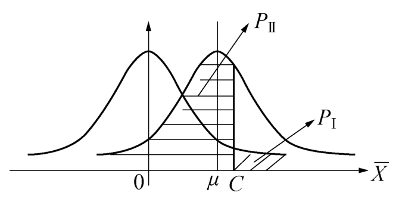
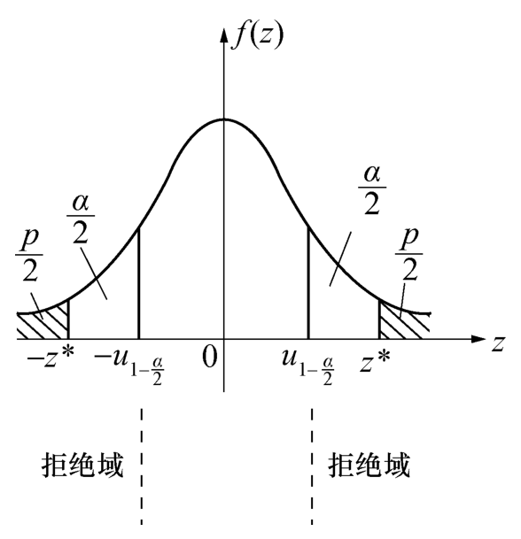
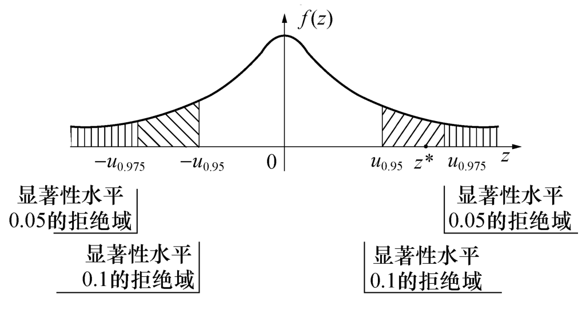
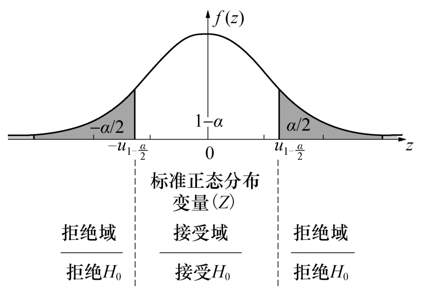
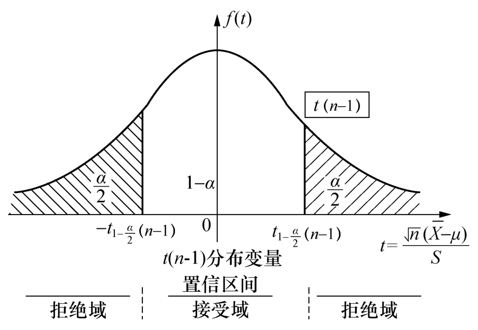

# 第八章 假设检验

**[课前导读]**

统计推断的另一类重要问题是假设检验问题。前面参数估计的主要任务是找参数值等于多少，或在哪个范围内取值。而假设检验则主要是看参数的值是否等于某个特定的值。通常进行假设检验即选定一个假设，确定用以决策的拒绝域的形式，构造一个检验统计量，求出拒绝域或检验统计量的 $p$ 值，查看结果是否落在拒绝域内或 $p$ 值是否小于显著性水平，做出决策的一个过程。

## 第一节 检验的基本原理

历史上有个女士品茶的例子，有位常饮牛奶加茶的女士称：她能从一杯冲好的饮料中辨别出先放茶还是先放牛奶。并且她在 10 次试验中都正确地辨别出来了，问这个女士的说法是否可信？显然，我们有两种决策选择：一种是承认她的说法是真的；另一种是否认她的说法，而认为她只是运气比较好，都蒙对了。这个问题，我们通过下面的方法来分析。

不妨假设她不具备辨别能力，每次都是蒙的，即假设每次蒙对的概率为 0.5，那么 10 次都蒙对的概率为 $0.5^{10}=0.0009766$，这是一个“小概率事件”，即平均来讲，1000 粒黑豆中刚好有 1 粒白豆，而我们从 1000 粒豆子中随机地抽取一粒，抽取出来的这粒恰好是那粒白豆子，我们会有这么好的运气吗？直观上来看我们知道这是不大可能的，当然从严谨的角度来说这样的事情也不是绝对不可能发生，所以比较科学的说法是，我们宁愿冒着 0.0009766 的风险（这就是后面说的第一类错误）也要否定“她不具备辨别能力”的说法。

这就是假设检验的统计思想，它有些类似初等数学中的“反证法”，即不妨先认为某一假设（记为 $H_0$）是成立的，通过样本数据，结果得到一个与之相矛盾的结果，于是认为假设 $H_0$ 不成立，而接受与之对立的另外一个假设（记为 $H_1$）。

我们通过下面的一个例子来介绍假设检验的一些基本概念。

**例 1** 一条高速公路上有一段弯曲的下坡路段，限速 60km/h，但是事故率仍然较之其他路段高，路政管理局正在研究这一路段是否需要提高限速要求至限速 50km/h，我们想知道在这一路段经过的车辆速度是否比 50km/h 显著快，用雷达仪测量了经过该路段中点的 100 辆汽车的行驶速度，得到平均速度 $\bar{x}=54.7\mathrm{km/h}$，问该路段上车辆速度是否比 50km/h 显著快。

**分析** 在这个问题中，我们要讨论的是实际车辆行驶速度有没有超过 50km/h，因此，我们用一对假设：

$$
H_0:\ \text{原假设（零假设）}\qquad H_1:\ \text{备择假设（对立假设）}
$$

来表达，即

$$
H_0:\ \text{车速不超过}\ 50\mathrm{km/h}\qquad H_1:\ \text{车速超过}\ 50\mathrm{km/h}
$$

我们的任务是利用样本数据信息 100 辆汽车的平均行驶速度 $\bar{x}=54.7\mathrm{km/h}$ 去判断原假设是否成立。通过样本对原假设做出“拒绝”或“不拒绝”的具体判断就称为该假设的一个检验。若原假设和备择假设是关于参数的，称为参数假设检验，否则称为非参数假设检验。

假设检验的基本步骤如下所述。

### 一、建立假设

对要检验的问题提出一个原假设 $H_0$ 和备择假设 $H_1$，在参数假设检验问题中原假设 $H_0$ 一般是关于总体未知参数 $\theta$ 等于某个特殊常数值，即

$$
H_0:\ \theta=\theta_0
$$

备择假设 $H_1$ 是关于 $\theta$ 的不同于 $H_0$ 的假设，通常备择假设有下列三种常用的形式。

（1）$H_1:\ \theta\neq\theta_0$，在 $\theta_0$ 的两侧讨论与 $\theta$ 的可能不同，这样的检验问题也称为双侧检验；

（2）$H_1:\ \theta>\theta_0$，在 $\theta_0$ 的右侧讨论与 $\theta$ 的可能不同，这样的检验问题也称为单侧（右侧）检验；

（3）$H_1:\ \theta<\theta_0$，在 $\theta_0$ 的左侧讨论与 $\theta$ 的可能不同，这样的检验问题也称为单侧（左侧）检验。

在上面的三种形式中，备择假设（1）是与原假设完全对立的，故又称为对立假设；备择假设（2）和（3）与原假设则可以不是完全对立的。

### 二、给出拒绝域的形式

根据样本提供的信息，由样本给出未知参数 $\theta$ 的点估计量 $\hat\theta=\hat\theta(X_1,\ X_2,\ \cdots,\ X_n)$，当有了具体样本数据后，比较 $\hat\theta$ 的观测值与 $\theta_0$ 的距离，如果距离很近，那么就不拒绝原假设 $H_0$；如果距离远了，就拒绝原假设 $H_0$。那么怎么来定量刻画这里的所谓“远近”呢？我们用拒绝域 $W$ 的形式来给出。在给出拒绝域的形式前，还需要说明：在假设检验问题中，是关于原假设 $H_0$ 的检验，但是在构造拒绝域的形式时，却总是从备择假设开始的。即

若检验是 $H_0:\ \theta=\theta_0\leftrightarrow H_1:\ \theta\neq\theta_0$

则拒绝域 $W=\{\,|\hat\theta-\theta_0|>c\,\}$

若检验是 $H_0:\ \theta=\theta_0\leftrightarrow H_1:\ \theta>\theta_0$

则拒绝域 $W=\{\,|\hat\theta-\theta_0|>c\,\}$

若检验是 $H_0:\ \theta=\theta_0\leftrightarrow H_1:\ \theta<\theta_0$

则拒绝域 $W=\{\,|\hat\theta-\theta_0|<c\,\}$

其中临界值 $c$ 待定。此外，$\overline{W}$ 称为接受域。所以，一旦拒绝域确定了，那么检验的判断准则也就确定了，当有了具体的样本观测值后：

（1）如果 $(x_1,\ x_2,\ \cdots,\ x_n)\in W$，则拒绝 $H_0$；

（2）如果 $(x_1,\ x_2,\ \cdots,\ x_n)\in\overline{W}$，则不拒绝 $H_0$（通常也简单地理解为接受 $H_0$）。

### 三、确定显著性水平

一个假设检验通过拒绝域的方式将样本数据进行了划分，通过这种划分，做出一个决策：接受 $H_0$ 或拒绝 $H_0$。但是，这一决策是基于样本提供的不完全信息对未知的总体参数做出的推断，因此总会存在不正确决策的风险。所以借助于样本来进行的假设检验可能有四种结果，具体内容如下表所示。

| 检验带来的后果 | 总体分布的实际情况（未知） | 当 $(x_1,\ x_2,\ \cdots,\ x_n)\in\overline{W}$，接受 $H_0$ | 当 $(x_1,\ x_2,\ \cdots,\ x_n)\in W$，拒绝 $H_0$ |
|---|---|---|---|
| | $H_0$ 成立 | 判断正确 | 犯第一类错误 |
| | $H_0$ 不成立 | 犯第二类错误 | 判断正确 |

其中第一类错误概率（又称为弃真概率）是原假设 $H_0$ 成立，而最终错误地拒绝 $H_0$ 的概率，即 $P((X_1,\ X_2,\ \cdots,\ X_n)\in W\mid H_0\ \text{成立})$，记为 $P_{\mathrm{I}}$；第二类错误概率是原假设 $H_0$ 不成立，而错误地接受它的概率（又称为采伪概率），即 $P((X_1,\ X_2,\ \cdots,\ X_n)\in\overline{W}\mid H_1\ \text{成立})$，记为 $P_{\mathrm{II}}$。

一般地说，当第一类错误概率小时，第二类错误概率就显得大，我们以正态总体 $N(\mu,1)$ 的参数 $\mu$ 的检验为例：检验 $H_0:\ \mu=0\leftrightarrow H_1:\ \mu>0$，拒绝域 $W=\{\bar{X}>C\}$。其两类错误概率如图 8.1 所示，其中左边的倒钟型曲线是 $H_0$ 成立时 $\bar{X}$ 的密度函数曲线，而右边曲线是 $H_1$ 成立时 $\bar{X}$ 的密度函数曲线。显然，当 $C$ 变大，即第一类错误概率 $P_{\mathrm{I}}=P(\bar{X}>C\mid\mu=0)$ 变小时，第二类错误概率 $P_{\mathrm{II}}=P(\bar{X}<C\mid\mu>0)$ 就会变大；反之亦然。从这个例子我们能看出：在样本量给定的条件下，第一类错误概率和第二类错误概率这两类概率一个减小必然导致另一个增大，也就是说不可能找到一个能使 $P_{\mathrm{I}}$，$P_{\mathrm{II}}$ 都小的检验方案。

从上面两类错误的分析我们知道，在样本量一定的条件下，不可能同时控制一个检验的两类错误概率。所以，在此基础上，我们采用折中方案，仅限制犯第一类错误的概率不超过事先设定的值 $\alpha\ (0<\alpha<1\ \text{通常很小})$，再尽量减小犯第二类错误的概率。称该拒绝域所代表的检验为显著性水平 $\alpha$ 的检验，称 $\alpha$ 为显著性水平。最常用的选择是 $\alpha=0.05$，有时也选择 $\alpha=0.1$，$\alpha=0.01$。由定义可知，所谓显著性水平 $\alpha$ 的检验就是控制第一类错误概率的检验。所以从这个地方我们看出，在假设检验中，通常将不想轻易被拒绝的假设作为原假设。例如，有两个假设：“该病人为肺癌患者”和“该病人为肺炎患者”。由于把一个肺癌患者误判成肺炎患者的危害程度要远远超过把一个肺炎患者误判成肺癌患者，因此我们通常把“该病人为肺癌患者”作为 $H_0$。

**例 2** 设购进 6 台同型号电视机，原假设 $H_0$：只有 1 台有质量问题$\leftrightarrow H_1$：2 台有质量问题，今有放回随机抽取 2 台测试其质量，用 $X$ 表示 2 台中有质量问题的台数，拒绝域 $W=\{X:\ X\geqslant 1\}$，求出此检验的两类错误概率的大小。

**解** 设 $\theta$ 表示 6 台中有质量问题的台数，则

$$
H_0:\ \theta=1\leftrightarrow H_1:\ \theta=2.
$$

第一类错误概率

$$
P((X_1,\ X_2,\ \cdots,\ X_n)\in W\mid H_0\ \text{成立})=P(X\geqslant 1\mid\theta=1)=1-P(X=0\mid\theta=1)=1-\left(\frac{5}{6}\right)^2=\frac{11}{36}.
$$

第二类错误概率

$$
P((X_1,\ X_2,\ \cdots,\ X_n)\in\overline{W}\mid H_1\ \text{成立})=P(X=0\mid\theta=2)=\left(\frac{4}{6}\right)^2=\frac{4}{9}.
$$

### 四、建立检验统计量，给出拒绝域

在确定了显著性水平后，我们就可以来确定拒绝域中的临界值 $c$ 了。我们通过下面的例子来介绍具体步骤。

**例 3** 设一个成年男子身高的总体 $X$ 服从正态分布 $N(\mu,11)$（单位：cm），其中 $\mu$ 为未知参数，$(X_1,\ X_2,\ \cdots,\ X_n)$ 是取自该总体的一个样本，对于假设检验问题 $H_0:\ \mu=170\leftrightarrow H_1:\ \mu\neq 170$，在显著性水平 $\alpha=0.05$ 下，求该检验问题的拒绝域。

**解** 首先，给出未知参数 $\mu$ 的一个估计量，通常 $\hat\mu=\bar{X}$。

根据备择假设的形式，$\mu\neq 170$，即平均身高不是 170cm，那么如果样本均值作为 $\mu$ 的估计与 170 偏差足够大，则拒绝 $H_0$，因此我们构造拒绝域的形式为

$$
W=\{\,|\bar{X}-170|>c\,\}.
$$

对给定显著性水平 $\alpha=0.05$，即第一类错误概率不超过 0.05 则

$$
P((X_1,\ X_2,\ \cdots,\ X_n)\in W\mid H_0\ \text{成立})=P(\,|\bar{X}-170|>c\mid H_0\ \text{成立})\leqslant\alpha=0.05.
$$

考虑当 $H_0$ 成立时，$\bar{X}\sim N\left(170,\ \dfrac{1}{n}\right)$，将 $\bar{X}$ 改造 $Z=\sqrt{n}\,(\bar{X}-170)\sim N(0,\ 1)$，则 $c=u_{1-\alpha/2}$，故最终的拒绝域为

$$
W=\{\,|Z|>u_{1-\alpha/2}\,\}.
$$

在这里，为了求出临界值 $c$ 的值，我们构造了一个统计量 $Z$，它在原假设下的分布是完全已知的或分位数可以计算，我们称符合这个要求的统计量为检验统计量，在本例中，检验统计量 $Z$ 服从标准正态分布，故该检验又称为 $Z$-检验（又可称为 $U$-检验）。

综上所述，在给定显著性水平 $\alpha$ 下，求拒绝域 $W$ 的一般步骤如下。

（1）建立针对未知参数 $\theta$ 的某个假设；

（2）给出未知参数 $\theta$ 的一个点估计；

（3）构造检验统计量 $Z=\varphi(X_1,\ X_2,\ \cdots,\ X_n)$，要求当 $H_0$ 时可以求解 $Z$ 的分位数；

（4）以 $Z$ 为基础，根据备择假设 $H_1$ 的实际意义，构造一个拒绝域 $W$ 的表达形式；

（5）确定拒绝域 $W$ 中的临界值，要求 $W$ 满足显著性水平 $\alpha$。

### 五、p 值和 p 值检验法

假设检验的 $p$ 值是在原假设 $H_0$ 成立的条件下，检验统计量 $Z$ 出现给定观测值或者比之更极端值的概率，直观上用以描述抽样结果与理论假设的吻合程度，因而也称 $p$ 值为拟合优度。例如，正态总体参数检验 $H_0:\ \mu=\mu_0\leftrightarrow H_1:\ \mu\neq\mu_0$ 的情况，检验统计量为 $Z$，即由样本数据得到检验统计量 $Z$ 的观测值为 $z^*$，则 $p$ 值为 $p=P(\,|Z|\geqslant z^*\mid H_0\ \text{成立})$。

$p$ 值检验法的原则是当 $p$ 值小到一定程度时拒绝 $H_0$。

（1）如果 $p\leqslant\alpha$（如图 8.2 所示），即检验统计量 $Z$ 的观测值 $z^*$ 在拒绝域内，则在显著性水平 $\alpha$ 下拒绝原假设 $H_0$；

（2）如果 $p>\alpha$，则在显著性水平 $\alpha$ 下接受原假设 $H_0$。

通常约定：$p\leqslant 0.05$ 称结果为显著；$p\leqslant 0.01$ 则称结果为高度显著。

**例 4** 一美国汽车厂商声称他们生产的某节能型汽车耗油量低于 29（单位：英里/加仑，简称 mpg），另一汽车厂商表示怀疑，他抽取了一组同是这一型号的不同汽车的行驶记录共 16 条，得到平均耗油量观测值为 28，假设该节能型汽车的耗油量 $X\sim N(\mu,\ 9)$，请问在显著性水平 $\alpha=0.05$ 假定下，能否接受耗油量低于 29 的假设；若显著性水平为 $\alpha=0.1$，则结论会有变化吗？

**解** 建立假设 $H_0:\ \mu\geqslant 29\leftrightarrow H_1:\ \mu<29$，给出未知参数 $\mu$ 的估计 $\hat\mu=\bar{x}=28$，则

$$
\begin{aligned}
p&=P(\bar{X}<28\mid H_0\ \text{成立})=P\left(\frac{\bar{X}-\mu}{3}\sqrt{16}\leqslant\frac{28-\mu}{3}\sqrt{16}\right)\leqslant P\left(\frac{\bar{X}-\mu}{3}\sqrt{16}\leqslant\frac{28-29}{3}\sqrt{16}\right)\\
&=P\left(\frac{\bar{X}-\mu}{3}\sqrt{16}\leqslant-1.33\right)=0.0918.
\end{aligned}
$$

当显著性水平 $\alpha=0.05$ 时，$0.0918>0.05$，故不能拒绝 $H_0$，认为耗油量不低于 29mpg。

当显著性水平 $\alpha=0.1$ 时，$0.0918<0.1$，故拒绝 $H_0$，认为耗油量低于 29mpg。

这个例子告诉我们，在一个较小的显著性水平（$\alpha=0.05$）下得到不能拒绝原假设 $H_0$ 的结论，而在一个较大的显著性水平（$\alpha=0.1$）下，同一组样本数据却得到了相反的结论。原因在于，当显著性水平变大时，会导致检验的拒绝域变大，原本落在接受域内的数据可能落到拒绝域内，因而更容易拒绝 $H_0$（如图 8.3 所示）。这就给实际工作带来一

定的麻烦，可能同一个问题，在不同的显著性水平假定下得到不同的结论，换一个角度，给出 $p$ 值，由使用者自己决策以多大的显著性水平来拒绝原假设。所以，在实际应用中，当我们进行假设检验时，更常见的是给出 $p$ 值，因为 $p$ 值比拒绝域提供更多信息，使用也更灵活。

### 习题 8-1

**1.** 假设你在处理一个假设检验问题 $H_0:\ \mu=4.5\leftrightarrow H_1:\ \mu>4.5$，基于样本数据，请判断下列决策是否有错误，分别是哪一类错误？

（1）最后做出拒绝原假设，而事实上，真值 $\mu=4.5$；

（2）最后做出接受原假设，而事实上，真值 $\mu=4.7$。

**2.** 设 $(X_1,\ X_2,\ X_3,\ X_4)$ 是取自正态总体 $N(\mu,\ 1)$ 的一个样本，检验假设

$$
H_0:\ \mu=0\leftrightarrow H_1:\ \mu=1
$$

拒绝域为 $W=\{\bar{X}\geqslant 0.98\}$。

（1）求此检验的两类错误概率；

（2）如果要使检验犯第一类错误的概率 $\leqslant 0.01$，样本容量最少取多少？

（3）该检验的 $p$ 值有多大？

**3.** 请问第一类错误概率与显著性水平的关系。

**4.** $p$ 值和显著性水平有什么区别？

**5.** 求证：设 $(X_1,\ X_2,\ \cdots,\ X_n)$ 是取自正态总体 $N(\mu,\ 1)$ 的一个样本，对于假设 $H_0:\ \mu=0\leftrightarrow H_1:\ \mu>0$，显著性水平 $\alpha$ 下的拒绝域可表示为 $W=\left\{\sum\limits_{i=1}^{n}X_i>\sqrt{n}\mu_{1-\alpha}\right\}$，其中 $\mu_{1-\alpha}$ 满足 $\Phi(\mu_{1-\alpha})=1-\alpha$，$\Phi(\,\cdot\,)$ 为标准正态分布的分布函数。

**6.** 计算第 5 题的检验在备用假设为“$\mu=\mu_1(>0)$”时的第二类错误概率，并证明此概率小于 $1-\alpha$。

## 第二节 正态总体参数的假设检验

### 一、单正态总体均值的假设检验

假定总体 $X\sim N(\mu,\ \sigma^2)$，设 $(X_1,\ X_2,\ \cdots,\ X_n)$ 是取自总体 $X$ 的一个样本，考虑如下三种关于均值 $\mu$ 的检验问题：

$$
H_0:\ \mu=\mu_0\leftrightarrow H_1:\ \mu\neq\mu_0;
$$

$$
H_0:\ \mu=\mu_0\leftrightarrow H_1:\ \mu>\mu_0;
$$

$$
H_0:\ \mu=\mu_0\leftrightarrow H_1:\ \mu<\mu_0,
$$

其中 $\mu_0$ 是已知常数。同置信区间求解过程相似，由于正态分布中有两个参数 $\mu$ 和 $\sigma^2$，$\sigma^2$是否已知对检验是有影响的，下面我们分 $\sigma^2$ 已知和未知两种情况展开讨论。

### 1. 方差 σ² 已知时的均值 μ 检验

（1）列出问题，即明确原假设和备择假设。以如下双侧检验为例

$$
H_0:\ \mu=\mu_0\leftrightarrow H_1:\ \mu\neq\mu_0,
$$

其中 $\mu_0$ 已知。

（2）基于 $\mu$ 的估计 $\bar{X}$，提出检验统计量

$$
Z=\frac{\sqrt{n}\,(\bar{X}-\mu_0)}{\sigma},
$$

$Z$ 满足如下要求：

①在 $H_0$ 成立时，$Z$ 的分布完全已知，此处 $Z\sim N(0,\ 1)$；

②从直观上看，由于备择假设 $H_1:\ \mu\neq\mu_0$，分散在两侧，故当 $|Z|$ 偏大到一定程度时与 $H_0$ 背离，应该拒绝原假设，假设存在一个临界值 $c$，拒绝域的形式为

$$
W=\{\,|Z|>c\,\}.
$$

（3）对给定显著性水平 $\alpha$，则

$$
P(\,|Z|>c\mid H_0\ \text{成立})\leqslant\alpha,
$$

所以 $c=u_{1-\alpha/2}$，拒绝域为

$$
W=\{\,|Z|>u_{1-\alpha/2}\,\},
$$

其中 $u_\alpha$ 为标准正态分布的 $\alpha$ 分位数。

（4）基于数据，算出 $Z$ 的观察值 $z$，如 $z\in W$ 则拒绝 $H_0$，否则只能接受 $H_0$（见图 8.4）。

在上述过程中，检验的原假设与备择假设构成一个双侧检验问题，换成如下单侧（右侧）检验问题：

$$
H_0:\ \mu=\mu_0;\ H_1:\ \mu>\mu_0.
$$

检验的讨论过程完全相似，检验统计量仍为 $Z=\dfrac{\sqrt{n}\,(\bar{X}-\mu_0)}{\sigma}$，但在构造拒绝域时，由于备择假设是 $H_1:\ \mu>\mu_0$，故只考虑当 $Z$ 偏大到一定程度时与 $H_0$ 背离，应该拒绝原假设，假设存在一个临界值 $c$，则拒绝域的形式为

$$
W=\{Z>c\}.
$$

对给定显著性水平 $\alpha$，则

$$
P(Z>c\mid H_0\ \text{成立})\leqslant\alpha,
$$

所以 $c=u_{1-\alpha}$，拒绝域为

$$
W=\{Z>u_{1-\alpha}\}.
$$

同理，可得当检验的原假设与备择假设为

$$
H_0:\ \mu=\mu_0\leftrightarrow H_1:\ \mu<\mu_0
$$

时，拒绝域为

$$
W=\{Z<-u_{1-\alpha}\},
$$

在这个检验问题中，如果我们将原假设与备择假设替换成

$$
H_0:\ \mu\geqslant\mu_0\leftrightarrow H_1:\ \mu<\mu_0
$$

则拒绝域仍为 $W=\{Z<-u_{1-\alpha}\}$，结论不变。所有单侧检验问题都具有类似的结论。

**例 1** 某纤维的强力服从正态分布 $N(\mu,\ 1.19^2)$，原设计的平均强力为 6g，现改进工艺后，测得 100 个强力数据，其样本均值为 6.35g，假定总体标准差不变，试问改进工艺后，强力是否有显著提高（$\alpha=0.05$）？

**解** 设原假设与备择假设分别为

$$
H_0:\ \mu\leqslant 6\leftrightarrow H_1:\ \mu>6.
$$

由于 $\sigma^2=1.19^2$ 已知，所以构造检验统计量 $Z=\dfrac{10(\bar{X}-6)}{1.19}$，根据备择假设，这是个单侧检验，故拒绝域为 $W=\{Z>u_{1-\alpha}\}$。临界值 $u_{0.95}=1.645$，拒绝域为 $W=\{Z>1.645\}$。

今计算检验统计量 $Z$ 的观测值为

$$
z=\frac{10(6.35-6)}{1.19}=2.941>1.645.
$$

因而拒绝 $H_0$，即认为改进工艺后强力有显著提高。

### 2. 方差 σ² 未知时的均值 μ 检验

首先考虑双侧检验问题

$$
H_0:\ \mu=\mu_0\leftrightarrow H_1:\ \mu\neq\mu_0.
$$

当 $\sigma^2$ 未知时，该检验统计量

$$
T=\frac{\sqrt{n}\,(\bar{X}-\mu_0)}{S}.
$$

当 $H_0$ 成立时，$T\sim t(n-1)$。

拒绝域的形式为

$$
W=\{\,|T|>c\,\}.
$$

对给定显著性水平 $\alpha$，则

$$
P(\,|T|>c\mid H_0\ \text{成立})\leqslant\alpha.
$$

所以 $c=t_{1-\alpha/2}(n-1)$，相应的拒绝域为

$$
W=\{\,|T|>t_{1-\alpha/2}(n-1)\,\},
$$

由于该检验中的检验统计量服从 $t$ 分布，故又称之为 $t$-检验。

检验改为单侧检验问题时，检验步骤完全相似。

检验问题为 $H_0:\ \mu=\mu_0\leftrightarrow H_1:\ \mu>\mu_0$。

拒绝域为 $W=\{T>t_{1-\alpha}(n-1)\}$。

检验问题为 $H_0:\ \mu=\mu_0\leftrightarrow H_1:\ \mu<\mu_0$。

拒绝域为 $W=\{T<-t_{1-\alpha}(n-1)\}$。

**例 2** 从某厂生产的电子元件中随机地抽取了 25 个作寿命测试，得数据（单位：h）：$x_1,\ x_2,\ \cdots,\ x_{25}$，并由此算得 $\bar{x}=100$，$\sum\limits_{i=1}^{25}x_i^2=4.9\cdot 10^5$，已知这种电子元件的使用寿命服从 $N(\mu,\ \sigma^2)$，且出厂标准为 90h 以上，试在显著性水平 $\alpha=0.05$ 下，检验该厂生产的电子元件是否符合出厂标准，即检验假设 $H_0:\ \mu\leqslant 90\leftrightarrow H_1:\ \mu>90$。

**解** 首先这是一个关于正态总体均值的单侧（右侧）假设检验问题。由于 $\sigma$ 未知，故采用 $t$-检验，拒绝域为 $W=\{T>t_{1-\alpha}(n-1)\}$。

$$
s^2=\frac{1}{n-1}\left(\sum_{i=1}^{n}x_i^2-n\bar{x}^2\right)=\frac{1}{24}(4.9\cdot 10^5-25\cdot 10^4)=\frac{24\cdot 10^4}{24}=10^4,
$$

所以样本标准差的观察值 $s=100$，$t$ 检验统计量的观察值为

$$
t=\frac{5(\bar{x}-90)}{s}=\frac{5\cdot 10}{100}=0.5.
$$

临界值 $c=t_{1-\alpha}(n-1)=t_{0.95}(24)=1.7109$。因 $t<c$，不落入拒绝域，故不能拒绝 $H_0$，即该厂生产的电子元件不符合出厂标准。

综上所述，关于单正态总体均值的假设检验问题如下表所示。

| 检验参数 | | 原假设与备择假设 | 检验统计量 | 拒绝域 $W$ |
|---|---|---|---|---|
| 均值 $\mu$ | $\sigma^2$ 已知 | $H_0:\ \mu=\mu_0\leftrightarrow H_1:\ \mu\neq\mu_0$ | 当 $\mu=\mu_0$ 时，$Z=\dfrac{\sqrt{n}\,(\bar{X}-\mu_0)}{\sigma}\sim N(0,\ 1)$ | $\left\lvert\sqrt{n}\,\dfrac{\bar{X}-\mu_0}{\sigma}\right\rvert>u_{1-\alpha/2}$ |
| | | $H_0:\ \mu=\mu_0\leftrightarrow H_1:\ \mu>\mu_0$ | | $\sqrt{n}\,\dfrac{\bar{X}-\mu_0}{\sigma}>u_{1-\alpha}$ |
| | | $H_0:\ \mu=\mu_0\leftrightarrow H_1:\ \mu<\mu_0$ | | $\sqrt{n}\,\dfrac{\bar{X}-\mu_0}{\sigma}<-u_{1-\alpha}$ |
| | $\sigma^2$ 未知 | $H_0:\ \mu=\mu_0\leftrightarrow H_1:\ \mu\neq\mu_0$ | 当 $\mu=\mu_0$ 时，$T=\dfrac{\sqrt{n}\,(\bar{X}-\mu_0)}{S}\sim t(n-1)$ | $\left\lvert\sqrt{n}\,\dfrac{\bar{X}-\mu_0}{S}\right\rvert>t_{1-\alpha/2}(n-1)$ |
| | | $H_0:\ \mu=\mu_0\leftrightarrow H_1:\ \mu>\mu_0$ | | $\sqrt{n}\,\dfrac{\bar{X}-\mu_0}{S}>t_{1-\alpha}(n-1)$ |
| | | $H_0:\ \mu=\mu_0\leftrightarrow H_1:\ \mu<\mu_0$ | | $\sqrt{n}\,\dfrac{\bar{X}-\mu_0}{S}<-t_{1-\alpha}(n-1)$ |

### 二、单正态总体方差的假设检验

假定总体 $X\sim N(\mu,\ \sigma^2)$，设 $(X_1,\ X_2,\ \cdots,\ X_n)$ 是取自总体 $X$ 的一个样本，考虑如下三种关于方差 $\sigma^2$ 的检验问题：

双侧检验 $H_0:\ \sigma^2=\sigma_0^2\leftrightarrow H_1:\ \sigma^2\neq\sigma_0^2$；

单侧（右侧）检验 $H_0:\ \sigma^2=\sigma_0^2\leftrightarrow H_1:\ \sigma^2>\sigma_0^2$；

单侧（左侧）检验 $H_0:\ \sigma^2=\sigma_0^2\leftrightarrow H_1:\ \sigma^2<\sigma_0^2$。

其中 $\sigma_0$ 是已知常数。同置信区间求解过程相似，由于正态分布中有两个参数 $\mu$ 和 $\sigma^2$，$\mu$ 是否已知对检验是有影响的。但是实际情况中，我们通常假定 $\mu$ 是未知的，$\sigma^2$ 的估计通常用样本方差 $S^2$ 表示。构造检验统计量

$$
\chi^2=\frac{(n-1)S^2}{\sigma_0^2}=\left.\frac{\sum\limits_{i=1}^{n}(X_i-\bar{X})^2}{\sigma_0^2}\right|_{H_0\text{成立}}\sim\chi^2(n-1).
$$

针对第一个双侧假设检验问题，考虑当 $H_0$ 成立时，$S^2$ 作为 $\sigma^2$ 的估计不应与 $\sigma^2$ 相差太大，根据备择假设 $\sigma^2\neq\sigma_0^2$ 的形式，显然，如果 $\dfrac{S^2}{\sigma_0^2}$ 过大或过小，都应拒绝 $H_0$。因此构造拒绝域的形式为

$$
W=\left\{\frac{(n-1)S^2}{\sigma_0^2}<c_1\ \text{或}\ \frac{(n-1)S^2}{\sigma_0^2}>c_2\right\},
$$

对第二个和第三个单侧假设检验问题，用类似的方法可构造拒绝域的形式为

单侧（右侧）检验 $W=\left\{\dfrac{(n-1)S^2}{\sigma_0^2}>c\right\}$，

单侧（左侧）检验 $W=\left\{\dfrac{(n-1)S^2}{\sigma_0^2}<c\right\}$。

在给定显著性水平 $\alpha$ 下，给出相应的拒绝域为

$$
W=\left\{\frac{\sum\limits_{i=1}^{n}(X_i-\bar{X})^2}{\sigma_0^2}<\chi^2_{\alpha/2}(n-1)\ \text{或}\ \frac{\sum\limits_{i=1}^{n}(X_i-\bar{X})^2}{\sigma_0^2}>\chi^2_{1-\alpha/2}(n-1)\right\},
$$

$$
W=\left\{\frac{\sum\limits_{i=1}^{n}(X_i-\bar{X})^2}{\sigma_0^2}>\chi^2_{1-\alpha}(n-1)\right\},
$$

$$
W=\left\{\frac{\sum\limits_{i=1}^{n}(X_i-\bar{X})^2}{\sigma_0^2}<\chi^2_{\alpha}(n-1)\right\}.
$$

**例 3** 设 $(X_1,\ X_2,\ \cdots,\ X_n)$ 是取自正态总体 $X\sim N(\mu,\ \sigma^2)$ 的一个样本，$\mu$，$\sigma^2$ 均未知，在显著性水平 $\alpha$ 下，求下列假设检验问题的拒绝域 $W$：

$$
H_0:\ \sigma^2=\sigma_0^2\leftrightarrow H_1:\ \sigma^2<\sigma_0^2.
$$

**解** 这是一个单侧（左侧）检验问题，仿照求显著性检验的拒绝域的一般步骤求解。

$\sigma^2$ 的无偏估计是 $S^2$，构造检验统计量

$$
\chi^2=\frac{(n-1)S^2}{\sigma_0^2}=\frac{\sum\limits_{i=1}^{n}(X_i-\bar{X})^2}{\sigma_0^2}.
$$

当 $H_0$ 成立时，$\chi^2\sim\chi^2(n-1)$，由

$$
P(\chi^2<\chi^2_\alpha(n-1)\mid H_0\ \text{成立})\leqslant\alpha
$$

可得拒绝域为

$$
W=\{\chi^2<\chi^2_\alpha(n-1)\}.
$$

**例 4** 一位生物学家研究生活在高原上的某一甲虫，从高原上采集了 $n=20$ 个高山甲虫，以考察高山上的该甲虫是否不同于平原上的该甲虫，其中度量方法之一是翅膀上黑斑的长度。已知平原甲虫黑斑长度服从期望 $\mu_0=3.14\mathrm{mm}$，方差 $\sigma_0^2=0.0505\mathrm{mm}^2$ 的正态分布，从高山上甲虫样本得到的黑斑长度 $\bar{x}=3.23\mathrm{mm}$，$s=0.4\mathrm{mm}$，假定高山甲虫黑斑长度服从正态分布 $N(\mu,\ \sigma^2)$，在显著性水平 $\alpha=0.05$ 下分别进行下列检验：

（1）$H_0:\ \mu=3.14\leftrightarrow H_1:\ \mu\neq 3.14$；

（2）$H_0:\ \sigma^2=0.0505\mathrm{mm}^2\leftrightarrow H_1:\ \sigma^2\neq 0.0505\mathrm{mm}^2$。

**解** （1）取检验统计量 $T=\dfrac{\sqrt{n}\,(\bar{X}-3.14)}{S}$，拒绝域为

$$
W=\{\,|T|>t_{1-\alpha/2}(n-1)\,\}.
$$

今 $t_{1-\alpha/2}(n-1)=t_{0.975}(19)=2.093$。计算 $t$ 检验统计量的观测值为

$$
t=\frac{\sqrt{20}\,(3.23-3.14)}{0.4}=0.98<2.093.
$$

因而不能拒绝 $H_0$，认为在显著水平 $\alpha=0.05$ 下，高山甲虫的黑斑长度的均值是 3.14mm。

（2）取检验统计量 $\chi^2=\dfrac{(n-1)S^2}{0.0505}$，拒绝域为

$$
W=\{\chi^2>\chi^2_{1-\alpha/2}(n-1)\ \text{或}\ \chi^2<\chi^2_{\alpha/2}(n-1)\},
$$

查附录 5 可得 $\chi^2_{0.975}(19)=32.852$，$\chi^2_{0.025}(19)=8.907$，计算 $\chi^2$ 检验统计量的观测值为

$$
\chi^2=\frac{19\cdot 0.4^2}{0.0505}=60.1980>32.852.
$$

因而拒绝 $H_0$，认为在显著性水平 $\alpha=0.05$ 下，高山甲虫的黑斑长度的方差不再是 $0.0505\mathrm{mm}^2$。

综上所述，关于单正态总体方差的假设检验问题如下表所示。

| 检验参数 | | 原假设与备择假设 | 检验统计量 | 拒绝域 $W$ |
|---|---|---|---|---|
| 方差 $\sigma^2$ | $\mu$ 已知 | $H_0:\ \sigma^2=\sigma_0^2\leftrightarrow H_1:\ \sigma^2\neq\sigma_0^2$ | 当 $\sigma^2=\sigma_0^2$ 时，$\chi^2=\dfrac{\sum\limits_{i=1}^{n}(X_i-\mu)^2}{\sigma_0^2}\sim\chi^2(n)$ | $\dfrac{\sum\limits_{i=1}^{n}(X_i-\mu)^2}{\sigma_0^2}<\chi^2_{\alpha/2}(n)$ 或 $\dfrac{\sum\limits_{i=1}^{n}(X_i-\mu)^2}{\sigma_0^2}>\chi^2_{1-\alpha/2}(n)$ |
| | | $H_0:\ \sigma^2=\sigma_0^2\leftrightarrow H_1:\ \sigma^2>\sigma_0^2$ | | $\dfrac{\sum\limits_{i=1}^{n}(X_i-\mu)^2}{\sigma_0^2}>\chi^2_{1-\alpha}(n)$ |
| | | $H_0:\ \sigma^2=\sigma_0^2\leftrightarrow H_1:\ \sigma^2<\sigma_0^2$ | | $\dfrac{\sum\limits_{i=1}^{n}(X_i-\mu)^2}{\sigma_0^2}<\chi^2_{\alpha}(n)$ |
| | $\mu$ 未知 | $H_0:\ \sigma^2=\sigma_0^2\leftrightarrow H_1:\ \sigma^2\neq\sigma_0^2$ | 当 $\sigma^2=\sigma_0^2$ 时，$\chi^2=\dfrac{\sum\limits_{i=1}^{n}(X_i-\bar{X})^2}{\sigma_0^2}\sim\chi^2(n-1)$ | $\dfrac{\sum\limits_{i=1}^{n}(X_i-\bar{X})^2}{\sigma_0^2}<\chi^2_{\alpha/2}(n-1)$ 或 $\dfrac{\sum\limits_{i=1}^{n}(X_i-\bar{X})^2}{\sigma_0^2}>\chi^2_{1-\alpha/2}(n-1)$ |
| | | $H_0:\ \sigma^2=\sigma_0^2\leftrightarrow H_1:\ \sigma^2>\sigma_0^2$ | | $\dfrac{\sum\limits_{i=1}^{n}(X_i-\bar{X})^2}{\sigma_0^2}>\chi^2_{1-\alpha}(n-1)$ |
| | | $H_0:\ \sigma^2=\sigma_0^2\leftrightarrow H_1:\ \sigma^2<\sigma_0^2$ | | $\dfrac{\sum\limits_{i=1}^{n}(X_i-\bar{X})^2}{\sigma_0^2}<\chi^2_{\alpha}(n-1)$ |

### 三、两个正态总体均值差的假设检验

设 $(X_1,\ X_2,\ \cdots,\ X_m)$ 是取自正态总体 $X\sim N(\mu_1,\ \sigma_1^2)$ 的一个样本，$(Y_1,\ Y_2,\ \cdots,\ Y_n)$ 是取自正态总体 $Y\sim N(\mu_2,\ \sigma_2^2)$ 的一个样本，且总体 $X$ 与 $Y$ 相互独立，显著性水平为 $\alpha$，记 $\bar{X}=\dfrac{1}{m}\sum\limits_{i=1}^{m}X_i$，$\bar{Y}=\dfrac{1}{n}\sum\limits_{i=1}^{n}Y_i$，$S_X^2=\dfrac{1}{m-1}\sum\limits_{i=1}^{m}(X_i-\bar{X})^2$，$S_Y^2=\dfrac{1}{n-1}\sum\limits_{i=1}^{n}(Y_i-\bar{Y})^2$，$S_w^2=\dfrac{1}{m+n-2}\left[\sum\limits_{i=1}^{m}(X_i-\bar{X})^2+\sum\limits_{i=1}^{n}(Y_i-\bar{Y})^2\right]=\dfrac{1}{m+n-2}\left[(m-1)S_X^2+(n-1)S_Y^2\right]$。

同单正态总体的假设检验一样，两个总体的未知参数的检验问题都有一对原假设和备择假设，同样也存在双侧和单侧假设检验，单侧检验根据备择假设可以分成右侧检验和左侧检验。在两个相互独立总体的假设检验问题中，我们通常感兴趣的是两个总体的均值 $\mu_1$，$\mu_2$ 是否有差别，因此考虑如下三个关于 $\mu_1$，$\mu_2$ 的假设检验问题：

双侧检验 $H_0:\ \mu_1=\mu_2\leftrightarrow H_1:\ \mu_1\neq\mu_2$，即 $H_0:\ \mu_1-\mu_2=0\leftrightarrow H_1:\ \mu_1-\mu_2\neq 0$；

单侧（右侧）检验 $H_0:\ \mu_1=\mu_2\leftrightarrow H_1:\ \mu_1>\mu_2$，

即 $H_0:\ \mu_1-\mu_2=0\leftrightarrow H_1:\ \mu_1-\mu_2>0$；

单侧（左侧）检验 $H_0:\ \mu_1=\mu_2\leftrightarrow H_1:\ \mu_1<\mu_2$，

即 $H_0:\ \mu_1-\mu_2=0\leftrightarrow H_1:\ \mu_1-\mu_2<0$。

同置信区间求解过程相似，由于正态分布中有两个参数 $\mu$ 和 $\sigma^2$，$\sigma_1^2$、$\sigma_2^2$ 是否已知对 $\mu_1$ 和 $\mu_2$ 的检验是有影响的。后续的讨论也将分成两种不同的情况加以展开。

### 1. 两方差已知时均值差的 Z 检验

首先，取 $\mu_1-\mu_2$ 的无偏估计 $\bar{X}-\bar{Y}$，根据备择假设的具体内容，拒绝域的形式分别为

双侧检验 $W=\{\,|\bar{X}-\bar{Y}|>c\,\}$；

单侧（右侧）检验 $W=\{\bar{X}-\bar{Y}>c\}$；

单侧（左侧）检验 $W=\{\bar{X}-\bar{Y}<c\}$。

取检验统计量

$$
Z=\frac{\bar{X}-\bar{Y}-(\mu_1-\mu_2)}{\sqrt{\dfrac{\sigma_1^2}{m}+\dfrac{\sigma_2^2}{n}}}\sim N(0,\ 1),
$$

当 $H_0:\ \mu_1=\mu_2$ 成立时

$$
Z=\frac{\bar{X}-\bar{Y}}{\sqrt{\dfrac{\sigma_1^2}{m}+\dfrac{\sigma_2^2}{n}}}\sim N(0,\ 1).
$$

可得

双侧检验的拒绝域为

$$
W=\left\{\,|\bar{X}-\bar{Y}|>u_{1-\alpha/2}\sqrt{\frac{\sigma_1^2}{m}+\frac{\sigma_2^2}{n}}\right\},
$$

单侧（右侧）检验的拒绝域为

$$
W=\left\{\bar{X}-\bar{Y}>u_{1-\alpha}\sqrt{\frac{\sigma_1^2}{m}+\frac{\sigma_2^2}{n}}\right\},
$$

单侧（左侧）检验的拒绝域为

$$
W=\left\{\bar{X}-\bar{Y}<-u_{1-\alpha}\sqrt{\frac{\sigma_1^2}{m}+\frac{\sigma_2^2}{n}}\right\}.
$$

**例 5** 某厂铸造车间为提高缸体的耐磨性而试制了一种镍合金铸件以取代一种铜合金铸件，现从两种铸件中各抽一个样本进行硬度测试，其结果如下。

镍合金铸件（$X$）：72.0，69.5，74.0，70.5，71.8。

铜合金铸件（$Y$）：69.8，70.0，72.0，68.5，73.0，70.0。

根据以往经验知，硬度 $X\sim N(\mu_1,\ \sigma_1^2)$，$Y\sim N(\mu_2,\ \sigma_2^2)$，且 $\sigma_1=\sigma_2=2$，试在显著性水平 $\alpha=0.05$ 下，比较镍合金铸件硬度有无显著提高。

**解** 根据题意假设 $H_0:\ \mu_1=\mu_2\leftrightarrow H_1:\ \mu_1>\mu_2$，这是一个单侧（右侧）检验问题，检验统计量

$$
Z=\frac{\bar{X}-\bar{Y}}{\sqrt{\dfrac{4}{5}+\dfrac{4}{6}}},
$$

拒绝域为 $W=\{Z>u_{0.95}\}$。

今 $u_{0.95}=1.645$，$\bar{x}=71.56$，$\bar{y}=70.55$，代入得检验统计量的观测值为

$$
z=\frac{71.56-70.55}{2\sqrt{0.367}}\approx\frac{1.01}{1.21}\approx 0.8347<u_{0.95}=1.645.
$$

因此不能拒绝 $H_0$，即不能认为镍合金铸件的硬度有显著提高。

### 2. 两方差未知但相等时均值差的 t 检验

由第六章的讨论可知，当 $\sigma_1^2=\sigma_2^2=\sigma^2$ 时，

$$
T=\frac{\bar{X}-\bar{Y}-(\mu_1-\mu_2)}{S_w\sqrt{\dfrac{1}{m}+\dfrac{1}{n}}}\sim t(m+n-2),
$$

当 $H_0:\ \mu_1=\mu_2$ 成立时，取检验统计量

$$
T=\frac{\bar{X}-\bar{Y}}{S_w\sqrt{\dfrac{1}{m}+\dfrac{1}{n}}}\sim t(m+n-2).
$$

所以同前面当 $\sigma_1^2$，$\sigma_2^2$ 已知时求解拒绝域的过程类似，可得以上三种假设检验的具体拒绝域分别为

双侧检验 $W=\left\{\left|\frac{\bar{X}-\bar{Y}}{S_w\sqrt{\dfrac{1}{m}+\dfrac{1}{n}}}\right|>t_{1-\alpha/2}(m+n-2)\right\}$，

单侧（右侧）检验 $W=\left\{\frac{\bar{X}-\bar{Y}}{S_w\sqrt{\dfrac{1}{m}+\dfrac{1}{n}}}>t_{1-\alpha}(m+n-2)\right\}$，

单侧（左侧）检验 $W=\left\{\frac{\bar{X}-\bar{Y}}{S_w\sqrt{\dfrac{1}{m}+\dfrac{1}{n}}}<-t_{1-\alpha}(m+n-2)\right\}$。

**例 6** 用两种不同方法冶炼的某种金属材料，分别取样测定某种杂质的含量，所得数据如下（单位为万分率）。

原方法（$X$）：26.9，25.7，22.3，26.8，27.2，24.5，22.8，23.0，24.2，26.4，30.5，29.5，25.1。

新方法（$Y$）：22.6，22.5，20.6，23.5，24.3，21.9，20.6，23.2，23.4。

由观测值求得 $\bar{x}=25.76$，$\bar{y}=22.51$，$S_X^2=6.2634$，$S_Y^2=1.6975$，$S_w^2=4.437$。假设这两种方法冶炼时杂质含量均服从正态分布，且已知方差相同，问这两种方法冶炼时杂质的平均含量有无显著差异？取显著水平为 0.05。

**解** 设 $X\sim N(\mu_1,\ \sigma^2)$，$Y\sim N(\mu_2,\ \sigma^2)$，检验假设为 $H_0:\ \mu_1=\mu_2\leftrightarrow H_1:\ \mu_1\neq\mu_2$，检验统计量为

$$
T=\frac{(\bar{X}-\bar{Y})}{S_w\sqrt{\dfrac{1}{m}+\dfrac{1}{n}}},
$$

拒绝域为

$$
W=\left\{\left|\frac{\bar{X}-\bar{Y}}{S_w\sqrt{\dfrac{1}{m}+\dfrac{1}{n}}}\right|>t_{1-\alpha/2}(m+n-2)\right\},
$$

其中 $t_{0.975}(13+9-2)=2.086$，所以

$$
t=\frac{25.76-22.51}{2.1064\cdot\sqrt{0.077+0.111}}=\frac{3.25}{0.9133}=3.559>2.086.
$$

因此拒绝 $H_0$，即认为这两种方法冶炼时杂质的平均含量有显著差异。

**例 7** 设从两个正态总体 $X\sim N(\mu_1,\ \sigma_1^2)$，$Y\sim N(\mu_2,\ \sigma_2^2)$ 中分别抽取两个样本 $(X_1,\ X_2,\ \cdots,\ X_m)$ 和 $(Y_1,\ Y_2,\ \cdots,\ Y_n)$，其中 $\mu_1$，$\mu_2$，$\sigma_1^2$，$\sigma_2^2$ 均未知。假定 $\sigma_1^2=\sigma_2^2$，在显著性水平 $\alpha$ 下，检验

$$
H_0:\ \mu_1=\mu_2+\delta\leftrightarrow H_1:\ \mu_1\neq\mu_2+\delta,
$$

其中，$\delta$ 是已知常数。试求拒绝域 $W$。

**解** 记 $\theta=\mu_1-\mu_2$，要检验

$$
H_0:\ \mu_1=\mu_2+\delta\leftrightarrow H_1:\ \mu_1\neq\mu_2+\delta,
$$

即检验

$$
H_0:\ \theta=\delta\leftrightarrow H_1:\ \theta\neq\delta
$$

$\theta$ 的点估计不妨取成 $\bar{X}-\bar{Y}$，构造检验统计量

$$
T=\frac{(\bar{X}-\bar{Y})-\delta}{S_w\sqrt{\dfrac{1}{m}+\dfrac{1}{n}}}.
$$

当 $H_0$ 成立时，$T\sim t(m+n-2)$，因此拒绝域为

$$
W=\left\{\frac{\left|(\bar{X}-\bar{Y})-\delta\right|}{S_w\sqrt{\dfrac{1}{m}+\dfrac{1}{n}}}>t_{1-\alpha/2}(m+n-2)\right\}.
$$

本例中如果取 $\delta=0$ 便是求检验 $H_0:\ \mu_1=\mu_2\leftrightarrow H_1:\ \mu_1\neq\mu_2$ 的拒绝域。

综上所述，关于两个正态总体均值差的假设检验问题如下表所示。

| 检验参数 | | 原假设与备择假设 | 检验统计量 | 拒绝域 $W$ |
|---|---|---|---|---|
| 均值差 $\mu_1-\mu_2$ | $\sigma_1^2$，$\sigma_2^2$ 已知 | $H_0:\ \mu_1=\mu_2\leftrightarrow H_1:\ \mu_1\neq\mu_2$ | 当 $\mu_1=\mu_2$ 时，$Z=\dfrac{\bar{X}-\bar{Y}}{\sqrt{\dfrac{\sigma_1^2}{m}+\dfrac{\sigma_2^2}{n}}}\sim N(0,\ 1)$ | $\left\lvert\bar{X}-\bar{Y}\right\rvert>u_{1-\alpha/2}\sqrt{\dfrac{\sigma_1^2}{m}+\dfrac{\sigma_2^2}{n}}$ |
| | | $H_0:\ \mu_1=\mu_2\leftrightarrow H_1:\ \mu_1>\mu_2$ | | $\bar{X}-\bar{Y}>u_{1-\alpha}\sqrt{\dfrac{\sigma_1^2}{m}+\dfrac{\sigma_2^2}{n}}$ |
| | | $H_0:\ \mu_1=\mu_2\leftrightarrow H_1:\ \mu_1<\mu_2$ | | $\bar{X}-\bar{Y}<-u_{1-\alpha}\sqrt{\dfrac{\sigma_1^2}{m}+\dfrac{\sigma_2^2}{n}}$ |
| | $\sigma_1^2=\sigma_2^2=\sigma^2$ 未知 | $H_0:\ \mu_1=\mu_2\leftrightarrow H_1:\ \mu_1\neq\mu_2$ | 当 $\mu_1=\mu_2$ 时，$T=\dfrac{\bar{X}-\bar{Y}}{S_w\sqrt{\dfrac{1}{m}+\dfrac{1}{n}}}\sim t(m+n-2)$ | $\left\lvert\dfrac{\bar{X}-\bar{Y}}{S_w\sqrt{\dfrac{1}{m}+\dfrac{1}{n}}}\right\rvert>t_{1-\alpha/2}(m+n-2)$ |
| | | $H_0:\ \mu_1=\mu_2\leftrightarrow H_1:\ \mu_1>\mu_2$ | | $\dfrac{\bar{X}-\bar{Y}}{S_w\sqrt{\dfrac{1}{m}+\dfrac{1}{n}}}>t_{1-\alpha}(m+n-2)$ |
| | | $H_0:\ \mu_1=\mu_2\leftrightarrow H_1:\ \mu_1<\mu_2$ | | $\dfrac{\bar{X}-\bar{Y}}{S_w\sqrt{\dfrac{1}{m}+\dfrac{1}{n}}}<-t_{1-\alpha}(m+n-2)$ |

### 四、两个正态总体方差比的假设检验

设 $(X_1,\ X_2,\ \cdots,\ X_m)$ 是取自正态总体 $N(\mu_1,\ \sigma_1^2)$ 的一个样本，$(Y_1,\ Y_2,\ \cdots,\ Y_n)$ 是取自正态总体 $N(\mu_2,\ \sigma_2^2)$ 的一个样本，且 $(X_1,\ X_2,\ \cdots,\ X_m)$ 与 $(Y_1,\ Y_2,\ \cdots,\ Y_n)$ 相互独立，显著性水平为 $\alpha$，记 $\bar{X}=\dfrac{1}{m}\sum\limits_{i=1}^{m}X_i$，$\bar{Y}=\dfrac{1}{n}\sum\limits_{i=1}^{n}Y_i$，$S_X^2=\dfrac{1}{m-1}\sum\limits_{i=1}^{m}(X_i-\bar{X})^2$，$S_Y^2=\dfrac{1}{n-1}\sum\limits_{i=1}^{n}(Y_i-\bar{Y})^2$，同置信区间求解过程相似，由于正态分布中有两个参数 $\mu$ 和 $\sigma^2$，$\mu_1$，$\mu_2$ 是否已知对检验是有影响的。但是实际情况中，我们通常假定 $\mu_1$，$\mu_2$ 均是未知的，考虑如下三个关于 $\sigma_1^2$，$\sigma_2^2$ 的假设检验问题：

双侧检验 $H_0:\ \sigma_1^2=\sigma_2^2\leftrightarrow H_1:\ \sigma_1^2\neq\sigma_2^2$，

即 $H_0:\ \sigma_1^2/\sigma_2^2=1\leftrightarrow H_1:\ \sigma_1^2/\sigma_2^2\neq 1$；

单侧（右侧）检验 $H_0:\ \sigma_1^2=\sigma_2^2\leftrightarrow H_1:\ \sigma_1^2>\sigma_2^2$，

即 $H_0:\ \sigma_1^2/\sigma_2^2=1\leftrightarrow H_1:\ \sigma_1^2/\sigma_2^2>1$；

单侧（左侧）检验 $H_0:\ \sigma_1^2=\sigma_2^2\leftrightarrow H_1:\ \sigma_1^2<\sigma_2^2$，

即 $H_0:\ \sigma_1^2/\sigma_2^2=1\leftrightarrow H_1:\ \sigma_1^2/\sigma_2^2<1$。

首先，$\sigma_1^2$，$\sigma_2^2$ 的无偏估计分别为样本方差 $S_X^2$，$S_Y^2$。不妨取 $\dfrac{S_X^2}{S_Y^2}$ 作为 $\dfrac{\sigma_1^2}{\sigma_2^2}$ 的点估计。取检验统计量

$$
F=\frac{\sum\limits_{i=1}^{m}(X_i-\bar{X})^2/(m-1)\sigma_1^2}{\sum\limits_{i=1}^{n}(Y_i-\bar{Y})^2/(n-1)\sigma_2^2}=\frac{S_X^2/\sigma_1^2}{S_Y^2/\sigma_2^2}=\frac{S_X^2/S_Y^2}{\sigma_1^2/\sigma_2^2}\sim F(m-1,\ n-1).
$$

当 $H_0:\ \sigma_1^2=\sigma_2^2$ 成立时，

$$
F=\frac{\dfrac{\sum\limits_{i=1}^{m}(X_i-\bar{X})^2}{m-1}}{\dfrac{\sum\limits_{i=1}^{n}(Y_i-\bar{Y})^2}{n-1}}=\frac{S_X^2}{S_Y^2}\sim F(m-1,\ n-1).
$$

根据备择假设的具体内容，拒绝域的形式分别为

双侧检验 $W=\left\{\dfrac{S_X^2}{S_Y^2}<c_1\ \text{或}\ \dfrac{S_X^2}{S_Y^2}>c_2\right\}$，

单侧（右侧）检验 $W=\left\{\dfrac{S_X^2}{S_Y^2}>c\right\}$，

单侧（左侧）检验 $W\left\{\dfrac{S_X^2}{S_Y^2}<c\right\}$。

可得以上三种假设检验的具体拒绝域分别为

双侧检验 $W=\left\{\dfrac{S_X^2}{S_Y^2}<F_{\alpha/2}(m-1,\ n-1)\ \text{或}\ \dfrac{S_X^2}{S_Y^2}>F_{1-\alpha/2}(m-1,\ n-1)\right\}$，单侧（右侧）检验

$$
W=\left\{\frac{S_X^2}{S_Y^2}>F_{1-\alpha}(m-1,\ n-1)\right\},
$$

单侧（左侧）检验

$$
W=\left\{\frac{S_X^2}{S_Y^2}<F_{\alpha}(m-1,\ n-1)\right\}.
$$

**例 8**　为比较新老品种的肥料对作物的效用有无显著差别，选用了各方面条件相同的 10 个地块种上此作物．随机选用其中 5 块施上新肥料，而剩下的 5 块施上老肥料．等到收获时观察施新肥的地块，平均年产 333（单位：千斤），年产量的方差为 32（单位：千斤$^2$），施老肥的地块平均年产 330（单位：千斤），年产量的方差为 40（单位：千斤$^2$）．假设作物产量服从正态分布，检验新肥是否比老肥效用上有显著提高（显著性水平 $\alpha=0.10$）．

解　设 $X$ 为施新肥地块的产量，$Y$ 为施老肥地块的产量，$(X_1,\ \cdots,\ X_5)$ 和 $(Y_1,\ \cdots,\ Y_5)$ 分别是取自 $X$ 及 $Y$ 的样本，$X\sim N(\mu_1,\ \sigma_1^2)$，$Y\sim N(\mu_2,\ \sigma_2^2)$，$H_0:\mu_1=\mu_2\leftrightarrow H_1:\mu_1>\mu_2$．这是单侧（右侧）检验问题，但还不能直接进行两样本的 $t$-检验，因为我们还不知道 $\sigma_1^2=\sigma_2^2$ 是否成立．

为此先要做一个关于两个总体的方差相等的假设检验，即检验

$$
H_0:\ \sigma_1^2=\sigma_2^2\leftrightarrow H_1:\ \sigma_1^2\neq\sigma_2^2.
$$

只有当该检验的原假设没有被拒绝的前提下，才能继续用 $t$-检验的方法进行均值差的假设检验．为了避免当 $\sigma_1^2\neq\sigma_2^2$ 成立时而错误地认为 $\sigma_1^2=\sigma_2^2$，即希望第二类错误概率小一些，由于两类错误概率的此消彼长性，不妨将该检验的显著性水平 $\alpha$ 取大一些，比如取 $\alpha=0.5$．

注意到，关于方差是否相等的双侧检验的拒绝域为

$$
W=\left\{\frac{S_X^2}{S_Y^2}<F_{\alpha/2}(m-1,\ n-1)\ \text{或}\ \frac{S_X^2}{S_Y^2}>F_{1-\alpha/2}(m-1,\ n-1)\right\}.
$$

不妨取显著性水平 $\alpha=0.5$，则 $F_{0.75}(4,\ 4)=2.06$，$F_{0.25}(4,\ 4)=0.4854$，今计算 $F$ 检验统计量 $\dfrac{S_X^2}{S_Y^2}$ 的观测值为 $f=\dfrac{32}{40}=0.8$，显然 $2.06>0.8>0.4854$，因而不能拒绝 $H_0$，即可以认为 $\sigma_1^2=\sigma_2^2$．

现在回到关于均值差的假设检验问题：取检验统计量

$$
T=\frac{\bar{X}-\bar{Y}}{S_w\sqrt{\dfrac{1}{m}+\dfrac{1}{n}}},
$$

其中 $S_w^2=\dfrac{1}{m+n-2}\left[(m-1)S_X^2+(n-1)S_Y^2\right]$．

拒绝域为

$$
W=\{|T|>c\},
$$

其中 $c=t_{1-\alpha}(m+n-2)=t_{0.9}(8)=1.3968$．今计算 $t$ 检验统计量的观测值为

$$
S_w^2=\frac{1}{8}(4\cdot 32+4\cdot 40)=36,
$$

$$
t=\frac{333-330}{6\sqrt{\dfrac{1}{5}+\dfrac{1}{5}}}=\frac{\sqrt{5}}{2\sqrt{2}}\approx 0.7906<1.3968.
$$

因而不能拒绝 $H_0$，即新肥没有比老肥在效用上有显著提高．

本例主要是关于均值 $\mu_1=\mu_2$ 的检验，但是检验统计量要求 $\sigma_1^2=\sigma_2^2$，所以在对均值差进行检验之前，需先对两个总体的方差是否相等做检验．

**例 9**　设从两个正态总体 $X\sim N(\mu_1,\ \sigma_1^2)$，$Y\sim N(\mu_2,\ \sigma_2^2)$ 中分别抽取样本 $(X_1,\ X_2,\ \cdots,\ X_m)$ 和 $(Y_1,\ Y_2,\ \cdots,\ Y_n)$，其中 $\mu_1$，$\mu_2$，$\sigma_1^2$，$\sigma_2^2$ 均未知．在显著性水平 $\alpha$ 下，要检验

$$
H_0:\ \sigma_1^2=\delta\sigma_2^2\leftrightarrow H_1:\ \sigma_1^2\neq\delta\sigma_2^2,
$$

其中，$\delta$ 是已知常数．试求拒绝域 $W$．

解　由于 $\delta$ 是已知常数，故该检验也可改写成 $H_0:\ \sigma_1^2/\delta\sigma_2^2=1\leftrightarrow H_1:\ \sigma_1^2/\delta\sigma_2^2\neq1$，不妨取 $S_X^2/\delta S_Y^2$ 作为 $\sigma_1^2/\delta\sigma_2^2$ 的估计值，根据备择假设的具体内容，在 $H_0$ 成立的假定下，给定显著性水平 $\alpha$，故拒绝域为

$$
W=\left\{S_X^2/\delta S_Y^2<F_{\alpha/2}(m-1,\ n-1)\ \text{或}\ S_X^2/\delta S_Y^2>F_{1-\alpha/2}(m-1,\ n-1)\right\}.
$$

综上所述，关于两个正态总体方差比的假设检验问题如下表所示．

| 检验参数 | 原假设与备择假设 | 检验统计量 | 拒绝域 $W$ |
| :---: | :---: | :---: | :--- |
| 方差比 $\dfrac{\sigma_1^2}{\sigma_2^2}$ $\mu_1$、$\mu_2$ 已知 | $H_0:\sigma_1^2=\sigma_2^2$ $H_1:\sigma_1^2\neq\sigma_2^2$ | 当 $\sigma_1^2=\sigma_2^2$ 时， $F=\dfrac{\sum\limits_{i=1}^{m}(X_i-\mu_1)^2/m}{\sum\limits_{i=1}^{n}(Y_i-\mu_2)^2/n}\sim F(m,n)$ | $\dfrac{\sum\limits_{i=1}^{m}(X_i-\mu_1)^2/m}{\sum\limits_{i=1}^{n}(Y_i-\mu_2)^2/n}>F_{1-\alpha/2}(m,n)$ 或 $\dfrac{\sum\limits_{i=1}^{m}(X_i-\mu_1)^2/m}{\sum\limits_{i=1}^{n}(Y_i-\mu_2)^2/n}<F_{\alpha/2}(m,n)$ |
| | $H_0:\sigma_1^2=\sigma_2^2$ $H_1:\sigma_1^2>\sigma_2^2$ | | $\dfrac{\sum\limits_{i=1}^{m}(X_i-\mu_1)^2/m}{\sum\limits_{i=1}^{n}(Y_i-\mu_2)^2/n}>F_{1-\alpha}(m,n)$ |
| | $H_0:\sigma_1^2=\sigma_2^2$ $H_1:\sigma_1^2<\sigma_2^2$ | | $\dfrac{\sum\limits_{i=1}^{m}(X_i-\mu_1)^2/m}{\sum\limits_{i=1}^{n}(Y_i-\mu_2)^2/n}<F_{\alpha}(m,n)$ |
| 方差比 $\dfrac{\sigma_1^2}{\sigma_2^2}$ $\mu_1$、$\mu_2$ 未知 | $H_0:\sigma_1^2=\sigma_2^2$ $H_1:\sigma_1^2\neq\sigma_2^2$ | 当 $\sigma_1^2=\sigma_2^2$ 时， $F=\dfrac{\sum\limits_{i=1}^{m}(X_i-\bar{X})^2/(m-1)}{\sum\limits_{i=1}^{n}(Y_i-\bar{Y})^2/(n-1)}$ $=\dfrac{S_X^2}{S_Y^2}\sim F(m-1,\ n-1)$ | $\dfrac{\sum\limits_{i=1}^{m}(X_i-\bar{X})^2/(m-1)}{\sum\limits_{i=1}^{n}(Y_i-\bar{Y})^2/(n-1)}>F_{1-\alpha/2}(m-1,\ n-1)$ 或 $\dfrac{\sum\limits_{i=1}^{m}(X_i-\bar{X})^2/(m-1)}{\sum\limits_{i=1}^{n}(Y_i-\bar{Y})^2/(n-1)}<F_{\alpha/2}(m-1,\ n-1)$ |
| | $H_0:\sigma_1^2=\sigma_2^2$ $H_1:\sigma_1^2>\sigma_2^2$ | | $\dfrac{\sum\limits_{i=1}^{m}(X_i-\bar{X})^2/(m-1)}{\sum\limits_{i=1}^{n}(Y_i-\bar{Y})^2/(n-1)}>F_{1-\alpha}(m-1,\ n-1)$ |
| | $H_0:\sigma_1^2=\sigma_2^2$ $H_1:\sigma_1^2<\sigma_2^2$ | | $\dfrac{\sum\limits_{i=1}^{m}(X_i-\bar{X})^2/(m-1)}{\sum\limits_{i=1}^{n}(Y_i-\bar{Y})^2/(n-1)}<F_{\alpha}(m-1,\ n-1)$ |

### 习题 8-2

**1.**　设总体 $X$ 服从正态分布 $N(\mu,\ 1)$，其中 $\mu$ 为未知参数，$(X_1,\ X_2,\ \cdots,\ X_n)$ 是取自该总体的一个样本，对于假设检验问题 $H_0:\mu=0\leftrightarrow H_1:\mu>0$．求在显著性水平 $\alpha=0.1$ 下，该检验问题的拒绝域．

**2.**　设总体 $X\sim N(\mu,\ \sigma^2)$，$(X_1,\ X_2,\ \cdots,\ X_{10})$ 是取自总体 $X$ 的一个样本，经观测得样本观测值为 10，30，40，48，49，50，51，52，70，90．假设 $H_0:\mu=52\leftrightarrow H_1:\mu>52$，显著性水平取为 0.05，分别在下列两种情况下，检验是否能拒绝原假设 $H_0$．（1）$\sigma^2=100$ 已知；（2）$\sigma^2>0$ 未知．

**3.**　在正态总体 $N(\mu,\ 1)$ 中抽取了 100 个样品，计算得 $\bar{x}=5.2$，

（1）试检验假设 $H_0:\mu=5\leftrightarrow H_1:\mu<5$（取显著性水平 $\alpha=0.01$）；

（2）计算上述检验在 $\mu=4.8$ 时犯第二类错误的概率．

**4.**　某灯泡厂对某批试制灯泡的使用寿命进行抽样测定，假定灯泡的使用寿命服从正态分布，现共抽取了 81 只灯泡，其平均使用寿命为 2990 小时，标准差为 54 小时．假设该灯泡厂商声称其生产的灯泡平均使用寿命至少为 3000 小时．试检验该厂商的声称是否合理（显著性水平 $\alpha=0.05$）．

**5.**　设某次考试考生的成绩服从分布 $N(\mu,\ \sigma^2)$，从中随机抽取 36 位考生的成绩，算出 $\bar{x}=66.5$（分），$s=15$（分），在显著水平 $\alpha=0.05$ 下分别检验：（1）$H_0:\mu=70\leftrightarrow H_1:\mu\neq70$；（2）$H_0:\sigma=18\leftrightarrow H_1:\sigma\neq18$．

**6.**　某钢筋的抗拉强度 $X\sim N(\mu,\ \sigma^2)$，$\mu$，$\sigma^2$ 均未知，今从一批钢筋中随机抽出 10 根，测得 $\bar{x}=140(\mathrm{kg})$，$s_n=30(\mathrm{kg})$，按标准当抗拉强度 $\geqslant 120(\mathrm{kg})$ 时为合格，试检验该批钢筋是否合格（显著性水平 $\alpha=0.05$）．

**7.**　某农场对甜瓜的培育引入了新方法，声称他们培育出来的甜瓜平均含糖量达到了 6g/100g．有人从该农场一批成熟的甜瓜中随机抽取了 25 个进行了含糖量测试．由测试结果算得 $\bar{x}=5.7\mathrm{g}/100\mathrm{g}$，$s=1.2\mathrm{g}/100\mathrm{g}$，假定甜瓜的含糖量服从分布 $N(\mu,\ \sigma^2)$，$\mu$ 和 $\sigma^2$ 均未知，能否断言这种培育是有效的？

（1）如果你是农场主，要求第一类错误不超过 5%；

（2）如果你是消费者，要求第一类错误不超过 5%．

**8.**　某研究所为了研究某种化肥对农作物的效力，在若干小区进行试验，得到单位面积农作物的产量（$\mathrm{kg}$）为

| 施肥 | 34 | 35 | 39 | 32 | 33 | 34 |
| :---: | :---: | :---: | :---: | :---: | :---: | :---: |
| 未施肥 | 29 | 27 | 32 | 33 | 28 | 31 |

设施肥和未施肥时单位面积农作物的产量分别服从正态分布 $N(\mu_1,\ \sigma^2)$ 和 $N(\mu_2,\ \sigma^2)$．试在显著性水平 $\alpha=0.05$ 下检验假设

$$
H_0:\ \mu_1=\mu_2+1\leftrightarrow H_1:\ \mu_1>\mu_2+1.
$$

**9.**　设随机变量 $X$ 与 $Y$ 相互独立，都服从正态分布，分别为 $N(\mu_1,\ \sigma_1^2)$，$N(\mu_2,\ \sigma_2^2)$，$\mu_1$，$\mu_2$，$\sigma_1^2$，$\sigma_2^2$ 都未知，现有样本观测值 $(x_1,\ x_2,\ \cdots,\ x_{16})$ 和 $(y_1,\ y_2,\ \cdots,\ y_{10})$，由数据算得：$\sum\limits_{i=1}^{16}x_i=84$，$\sum\limits_{i=1}^{10}y_i=18$，$\sum\limits_{i=1}^{16}x_i^2=563$，$\sum\limits_{i=1}^{10}y_i^2=72$，在显著性水平 $\alpha=0.05$ 下，检验 $H_0:\ \sigma_1^2=\sigma_2^2$，$H_1:\ \sigma_1^2>\sigma_2^2$．

## 第三节　拟合优度检验

第七章的参数估计是假定总体的分布类型是已知的，需要通过样本来估计刻画总体分布的一个或若干个参数．但是，在实际问题中，经常不知道总体服从什么分布，这时只能假定其为某种分布，那么就需要根据样本数据来检验假设是否合理，即检验假设的总体分布是否可以被接受，又称为分布的拟合检验，常用的方法有 $\chi^2$ 拟合优度检验．

**例 1**　检验一枚骰子是否均匀的，首先抛掷一枚骰子 120 次，得到如下结果记录：

| $i$ 点面朝上 | 1 | 2 | 3 | 4 | 5 | 6 |
| :---: | :---: | :---: | :---: | :---: | :---: | :---: |
| 出现次数 | 23 | 26 | 21 | 20 | 15 | 15 |

在显著性水平 $\alpha=0.01$ 水平下，请问，这枚骰子是否均匀的？

分析　设 $X$ 为骰子出现的点数，根据题意可以假设 $X$ 的分布为

$$
H_0:\ P(X=i)=p_i=\frac{1}{6},\ i=1,\ 2,\ \cdots,\ 6.
$$

如果骰子是均匀的，即在 $H_0$ 成立的假定下，投掷 120 次，平均来说每个点面应该都出现 $np_i=120\cdot\dfrac{1}{6}=20$ 次，这称为理论频数，如果每个点面实际出现次数与 20 次相差不大，那么可以说骰子是均匀的，如果相差太大，例如有些点面严重偏多，而另外一些点面严重偏少，那么可以说骰子是不均匀的．由于有正偏差就一定有负偏差，所以用偏差平方的方式来计算每一个点面出现的偏差，并计算所有点面累积的总偏差，如果总偏差太大，超过了容忍的最大值 $c$，就拒绝原假设，即认为骰子是不均匀的，反之，则不拒绝骰子是均匀的原假设．

根据上述分析，我们构造拒绝域的形式为 $W=\left\{\sum\limits_{i=1}^{k}(N_i-np_i)^2>c\right\}$，其中 $N_i$ 表示第 $i$ 个点面实际出现的次数，又称为实际频数；当我们有了一组样本观测值以后，$N_i$ 的观测值记为 $n_i$．其中的 $k$ 表示总体分布取值分组的组数，例如在例 1 中，$k$ 取 6．

那么这里的容忍最大值 $c$ 取何值呢？

根据显著性水平的定义，容忍最大值 $c$ 需满足

$$
P\left((X_1,\ X_2,\ \cdots,\ X_n)\in W\right)=P\left(\sum_{i=1}^{k}(N_i-np_i)^2>c\ \middle|\ H_0\ \text{成立}\right)\leqslant\alpha.
$$

统计学家 K·皮尔逊基于上述拒绝域的形式构造了一个检验统计量

$$
\chi^2=\sum_{i=1}^{k}\frac{(N_i-np_i)^2}{np_i},\qquad (8\text{-}1)
$$

并证明了如下重要的结论，我们以定理的方式不加证明地给出．

**定理 1**　如果原假设 $H_0:\ P(X=i)=p_i,\ i=1,\ 2,\ \cdots,\ k$ 成立，则当样本量 $n\to\infty$ 时，$\chi^2=\sum\limits_{i=1}^{k}\dfrac{(N_i-np_i)^2}{np_i}$ 的极限分布是自由度为 $k-1$ 的 $\chi^2$ 分布，即

$$
\chi^2=\sum_{i=1}^{k}\frac{(N_i-np_i)^2}{np_i}\sim\chi^2(k-1),
$$

所以

$$
P\left((X_1,\ X_2,\ \cdots,\ X_n)\in W\right)=P\left(\sum_{i=1}^{k}\frac{(N_i-np_i)^2}{np_i}>\chi_{1-\alpha}^2(k-1)\ \middle|\ H_0\ \text{成立}\right)\leqslant\alpha.
$$

即拒绝域为

$$
W=\left\{\sum_{i=1}^{k}\frac{(N_i-np_i)^2}{np_i}>\chi_{1-\alpha}^2(k-1)\right\}.
$$

在例 1 中，$\chi^2$ 检验统计量的观测值，

$$
\begin{aligned}
\chi^2&=\sum_{i=1}^{k}\frac{(n_i-np_i)^2}{np_i}\\
&=\frac{(23-20)^2}{20}+\frac{(26-20)^2}{20}+\frac{(21-20)^2}{20}+\frac{(20-20)^2}{20}+\frac{(15-20)^2}{20}+\frac{(15-20)^2}{20}\\
&=4.8.
\end{aligned}
$$

查附录 5 可得，$\chi_{0.99}^2(5)=15.0863>4.8$，所以，在显著性水平 $\alpha=0.01$ 下接受原假设，即可以认为这枚骰子是均匀的．

在上面这个例子中，我们假定每一组 $\{X=i\}$ 的概率值 $p_i$ 都是已知的 $i=1,\ 2,\ \cdots,\ k$，但在实际问题中，有时 $p_i$ 还依赖于 $r$ 个未知参数，而这 $r$ 个未知参数需要利用样本来估计，这时，我们先利用点估计法估计出这 $r$ 个未知参数，然后再算出 $p_i$ 的估计值 $\hat{p}_i$．类似于式（8-1），定义检验统计量

$$
\chi^2=\sum_{i=1}^{k}\frac{(N_i-n\hat{p}_i)^2}{n\hat{p}_i},\qquad (8\text{-}2)
$$

当样本量 $n\to\infty$ 时，费希尔在 1924 年证明了，式（8-2）还是渐近服从 $\chi^2$ 分布，但是自由度为 $k-r-1$，即

$$
\chi^2=\sum_{i=1}^{k}\frac{(N_i-n\hat{p}_i)^2}{n\hat{p}_i}\sim\chi^2(k-r-1).
$$

故此时，拒绝域为

$$
W=\left\{\sum_{i=1}^{k}\frac{(N_i-n\hat{p}_i)^2}{n\hat{p}_i}>\chi_{1-\alpha}^2(k-r-1)\right\}.
$$

**例 2**　在某细纱机上进行断点率测定，测验锭子总数为 440，测得断头次数记录如下：

| 每锭断头数 | 0 | 1 | 2 | 3 | 4 | 5 | 6 | 7 | 8 |
| :---: | :---: | :---: | :---: | :---: | :---: | :---: | :---: | :---: | :---: |
| 锭数（实测） | 264 | 112 | 38 | 19 | 3 | 1 | 0 | 0 | 3 |

试问在显著性水平 $\alpha=0.01$ 下能否认为锭子的断头数服从泊松分布？

解　建立检验假设

$$
H_0:\ \text{锭子的断头数}\ X\ \text{服从泊松分布}\ P(\lambda).
$$

首先估计泊松分布中的参数 $\lambda$，由极大似然估计法得 $\hat{\lambda}=\bar{X}$，即

$$
\hat{\lambda}=\bar{x}=\frac{0\cdot 264+1\cdot 112+2\cdot 38+3\cdot 19+\cdots+8\cdot 3}{440}=0.65.
$$

其次，计算泊松分布的概率估计值，为了满足每一类出现的样本观测次数都不小于 5，我们把 $X\geqslant 4$ 归为一类，并将计算结果都列在下表中．

| 类别 | 观测值 | 实际频数 | 概率估计 | 理论频数 | $\sum\limits_{i=1}^{k}\dfrac{(n_i-n\hat{p}_i)^2}{n\hat{p}_i}$ |
| :---: | :---: | :---: | :---: | :---: | :---: |
| 1 | 0 | 264 | 0.522046 | 229.7001 | 5.121809 |
| 2 | 1 | 112 | 0.33933 | 149.3051 | 9.320981 |
| 3 | 2 | 38 | 0.110282 | 48.52415 | 2.28253 |
| 4 | 3 | 19 | 0.023894 | 10.51357 | 6.850153 |
| 5 | $\geqslant 4$ | 7 | 0.004448 | 1.957044 | 12.9948 |
| 总和 | | 440 | 1 | 440 | 36.57028 |

$$
\chi^2=\sum_{i=1}^{k}\frac{(n_i-n\hat{p}_i)^2}{n\hat{p}_i}=36.57028.
$$

对显著性水平 $\alpha=0.01$，$k=5$，$r=1$，查附录 5 可得临界值 $\chi_{0.99}^2(5-1-1)=11.3449$，即拒绝域为 $W=\{\chi^2>11.3449\}$．观测结果 $\chi^2=36.57028$ 落在拒绝域内，因此拒绝 $H_0$，即认为锭子的断头数 $X$ 的分布不服从泊松分布．

上述两个例题中总体的分布都是离散型的，如果总体 $X$ 是连续型随机变量，分布函数为 $F(x)$，这时情况稍微有些复杂，一般采用下列方法：选 $k-1$ 个实数 $a_1<a_2<\cdots<a_{k-1}$，将实数轴分为 $k$ 个区间

$$
(-\infty,\ a_1],\ (a_1,\ a_2],\ \cdots,\ (a_{k-1},\ +\infty).
$$

当观测值落在第 $i$ 个区间内，就把这个观测值看作是属于第 $i$ 组，因此，这 $k$ 个区间就相当于是 $k$ 个组．在 $H_0$ 成立时，记

$$
p_i=P(a_{i-1}<X\leqslant a_i)=F(a_i)-F(a_{i-1}),\ i=1,\ 2,\ \cdots,\ k.
$$

其中 $a_0=-\infty$，$a_k=+\infty$，以 $n_i$ 表示样本观测值 $x_1$，$x_2$，$\cdots$，$x_n$ 落在区间 $(a_{i-1},\ a_i]$ 内的个数（$i=1,\ 2,\ \cdots,\ k$），接下来的求解过程与总体只取有限个值的情况一样．

**例 3**　某高校研究在校学生的体重，现随机抽取了 100 位学生，测得他们的体重（单位：kg）如下：

86.62　62.92　53.92　78.24　73.63　75.47　79.58　80.10　74.21

61.44　61.62　57.89　83.34　82.44　72.70　79.45　59.38　53.74

59.27　86.47　76.22　70.70　67.37　71.96　66.15　61.63　67.47

70.81　66.24　75.14　53.06　77.84　58.22　81.19　65.25　82.16

67.17　51.89　61.06　57.45　68.09　63.28　74.91　58.30

57.36　64.37　70.67　67.17　58.31　75.69　75.47　75.51

70.09　62.65　76.33　76.90　72.50　81.11　82.91　56.0693.18　51.49　84.75　74.91　74.83　83.66　93.02　73.70

48.39　51.14　79.16　62.75　75.11　66.26　85.43　59.33

66.03　68.08　68.15　75.95　81.35　70.79　64.73　83.34

53.62　79.11　61.86　81.45　60.57　64.03　71.44　80.86

72.41　61.17　63.69　54.18　84.89　67.72　66.71　73.83

问该高校学生体重是否服从正态分布？

解　设该高校学生体重为 $X$，建立假设检验

$$
H_0:\ X\ \text{服从正态分布}\ N(\mu,\ \sigma^2).
$$

首先正态分布的参数 $\mu$，$\sigma^2$ 的无偏估计值分别为 $\hat{\mu}=\bar{x}=69.92$，$\hat{\sigma}^2=s^2=10.17^2$，根据实际取值的特点，我们按下表中第二列分组表示，将数据分成 6 组．

| 类别 | 观测值 | 实际频数 | 概率估计 $\hat{p}_i=\Phi\left(\dfrac{a_i-\hat{\mu}}{\hat{\sigma}}\right)-\Phi\left(\dfrac{a_{i-1}-\hat{\mu}}{\hat{\sigma}}\right)$ | 理论频数 $n\hat{p}_i$ | $\sum\limits_{i=1}^{k}\dfrac{(n_i-n\hat{p}_i)^2}{n\hat{p}_i}$ |
| :---: | :---: | :---: | :---: | :---: | :---: |
| 1 | $(0,\ 55]$ | 9 | 0.07118 | 7.12 | 0.496404 |
| 2 | $(55,\ 63]$ | 20 | 0.176935 | 17.69 | 0.301645 |
| 3 | $(63,\ 71]$ | 24 | 0.294171 | 29.42 | 0.998518 |
| 4 | $(71,\ 79]$ | 24 | 0.271738 | 27.17 | 0.369853 |
| 5 | $(79,\ 87]$ | 21 | 0.139444 | 13.95 | 3.575581 |
| 6 | $(87,\ +\infty)$ | 2 | 0.046532 | 4.65 | 1.510215 |
| 总和 | | 100 | 1 | 100 | 7.252216 |

若取显著性水平 $\alpha=0.05$，$k=6$，$r=2$，则检验统计量的观测值

$$
\chi^2=\sum_{i=1}^{6}\frac{(n_i-n\hat{p}_i)^2}{n\hat{p}_i}=7.252216.
$$

查附录 5 可得临界值为 $\chi_{0.95}^2(6-2-1)=7.8147$，显然 $7.252216<7.8147$．故不能拒绝 $H_0$，即认为该高校学生体重服从正态分布．

### 习题 8-3

**1.**　一开心农场 10 年前在鱼塘里按比例 $20:15:40:25$ 投放了 4 种鱼：鲑鱼、鲈鱼、多宝鱼和鲣鱼的鱼苗，现在鱼塘里获得一样本如下：

| 种类 | 鲑鱼 | 鲈鱼 | 多宝鱼 | 鲣鱼 |
| :---: | :---: | :---: | :---: | :---: |
| 数量（条） | 132 | 100 | 200 | 168 |

在显著性水平 0.05 下，检验各类鱼数量的比例较 10 年前有无显著改变．

**2.**　按孟德尔的遗传定律，让开粉红花的豌豆随机交配，子代可分为红花、粉红花和白花豆类，其比例为 $1:2:1$，为检验这一理论，安排了一个试验：100 株开粉红花的豌豆随机交配后的子代中，开红花的 30 株，粉红花的 48 株，白花的 22 株．在显著性水平 $\alpha=0.05$ 下检验孟德尔遗传定律是否成立．

**3.**　为了确定维修工人的人数，某小区物业要了解一天内接收到的维修次数，该小区共有住户 1000 户，假设每户至多一天保修一次，现随机地抽取了 50 天的维修次数记录，测得它们（单位：次）如下：

1　2　2　2　2

1　1　0　1　0

2　0　2　4　1

5　5　3　4　3

2　5　3　5　3

0　2　5　0　1

1　1　2　3　3

4　3　2　3　3

4　1　1　2　0

2　2　1　2　3

试问在显著性水平 $\alpha=0.05$ 下能否认为维修次数服从二项分布？

**4.**　在一批灯泡中抽取了 300 只进行寿命试验，得结果如下：

| 寿命（单位：小时） | $<100$ | $[100,\ 200)$ | $[200,\ 300)$ | $\geqslant 300$ |
| :---: | :---: | :---: | :---: | :---: |
| 灯泡数 | 120 | 80 | 40 | 60 |

试问在显著性水平 $\alpha=0.05$ 下能否认为灯泡寿命服从指数分布？

## 本章小结

| 知识点 | 学习要求 |
| :--- | :--- |
| 假设检验的 基本概念 | **了解** 原假设和备择假设的概念 **理解** 显著水平检验法的基本思想 **掌握** 假设检验的基本步骤 **了解** 假设检验可能产生的两类错误 **了解** $p$ 值法的基本思想 |
| 正态总体参数 的假设检验 | **掌握** 单正态总体参数假设检验的基本步骤 **了解** 两个正态总体的均值差和方差比的假设检验 |
| 拟合优度检验 | **了解** 总体分布的检验 |

## 拓展阅读

### 假设检验与区间估计的关系

在为总体未知参数构造置信区间时，如果置信水平为 95%，则说明总体未知参数位于两个限值之间的概率达到 95%．而显著性水平反映了总体未知参数将位于某个限值外的概率．例如，显著性水平为 5%，则意味着拒绝域的概率为 0.05．

假设检验和区间估计的关系如下．

假定总体 $X\sim N(\mu,\ \sigma^2)$，$\mu$ 和 $\sigma^2$ 均未知，设 $(X_1,\ X_2,\ \cdots,\ X_n)$ 是取自总体 $X$ 的一个样本，给定置信水平为 $1-\alpha$，显著性水平为 $\alpha$，则 $\mu$ 的双侧 $1-\alpha$ 置信区间为

$$
\left[\bar{X}-t_{1-\alpha/2}(n-1)\frac{S}{\sqrt{n}},\ \bar{X}+t_{1-\alpha/2}(n-1)\frac{S}{\sqrt{n}}\right],
$$

也可表达成为

$$
\left|\frac{\sqrt{n}(\bar{X}-\mu)}{S}\right|\leqslant t_{1-\alpha/2}(n-1).
$$

考虑如下关于均值 $\mu$ 的双侧检验问题

$$
H_0:\ \mu=\mu_0;\ H_1:\ \mu\neq\mu_0.
$$

可知相应的拒绝域为

$$
W=\left\{\left|\frac{\sqrt{n}(\bar{X}-\mu_0)}{S}\right|\geqslant t_{1-\alpha/2}(n-1)\right\}.
$$

对比置信区间和假设检验的拒绝域，我们可以发现在单正态总体中，假设 $\sigma^2$ 未知的情况下，$\mu$ 的双侧 $1-\alpha$ 置信区间即为 $\mu$ 的双侧检验问题的接受域，如图 8.5 所示．

图 8.5　双侧置信区间与双侧检验拒绝域的关系

同理，$\mu$ 的单侧 $1-\alpha$ 置信下限区间为

$$
\left[\bar{X}-t_{1-\alpha}(n-1)\frac{S}{\sqrt{n}},\ +\infty\right],
$$

也可表达成为

$$
\frac{\sqrt{n}(\bar{X}-\mu)}{S}\leqslant t_{1-\alpha}(n-1).
$$

考虑如下关于均值 $\mu$ 的单侧（左侧）检验问题：

$$
H_0:\ \mu=\mu_0\leftrightarrow H_1:\ \mu>\mu_0,
$$

可知相应的拒绝域为

$$
W=\left\{\frac{\sqrt{n}(\bar{X}-\mu_0)}{S}>t_{1-\alpha}(n-1)\right\}.
$$

$\mu$ 的单侧 $1-\alpha$ 置信下限区间即为 $\mu$ 的单侧（左侧）检验问题的接受域．类似可得其他所有情况时的结论．

## 测试题八

**1.**　设总体 $X\sim N(\mu,\ \sigma^2)$，$(X_1,\ X_2,\ \cdots,\ X_n)$ 是取自该总体的一个样本，对于检验 $H_0:\ \mu=\mu_0\leftrightarrow H_1:\ \mu>\mu_0$，其中 $\mu_0$ 是已知常数．

（1）当 $\sigma^2$ 已知时，写出拒绝域 $W$；（2）当 $\sigma^2$ 未知时，写出拒绝域 $W$．

**2.**　设某次概率统计的期末考试学生的成绩服从分布 $N(\mu,\ \sigma^2)$，从中随机抽取 36 位考生的成绩，算出 $\bar{x}=66.5$（分），$s=15$（分），问在显著水平 $\alpha=0.05$ 下可否认为考生的平均成绩 $\mu=70$？

**3.**　某化工厂为了提高化工产品的得率，提出甲乙两种方案，为比较它们的好坏，分别用两种方案各进行了 10 次试验，得到如下数据：

| 甲方案得率/% | 68.1 | 62.4 | 64.3 | 64.7 | 68.4 | 66.0 | 65.5 | 66.7 | 67.3 | 66.2 |
| :---: | :---: | :---: | :---: | :---: | :---: | :---: | :---: | :---: | :---: | :---: |
| 乙方案得率/% | 69.1 | 71.0 | 69.1 | 70.0 | 69.1 | 69.1 | 67.3 | 70.2 | 72.1 | 67.3 |

假设得率服从正态分布，问：方案乙是否比甲有显著提高（显著水平 $\alpha=0.01$）？

**4.**　设样本 $X$（容量为 1）取自具有概率密度 $f(x)$ 的总体，今有关于总体的假设：

$$
H_0:\ f(x)=\begin{cases}1, & 0<x<1,\\ 0, & \text{其他},\end{cases}\qquad\leftrightarrow\qquad H_1:\ f(x)=\begin{cases}2x, & 0<x<1,\\ 0, & \text{其他}.\end{cases}
$$

检验的拒绝域为 $W=\left\{X>\dfrac{2}{3}\right\}$，试求该检验的第一类错误概率 $P_{\mathrm{I}}$ 及第二类错误概率 $P_{\mathrm{II}}$．

**5.**　设 $(X_1,\ X_2,\ \cdots,\ X_n)$ 是取自总体 $X\sim B(1,\ p)$ 的一个样本，$p$ 未知，对于检验 $H_0:\ p\geqslant p_0\leftrightarrow H_1:\ p<p_0$，（1）取显著性水平 $\alpha$，写出拒绝域 $W$；（2）对于给定一组样本观测值 $(x_1,\ x_2,\ \cdots,\ x_n)$，若在水平 $\alpha=0.05$ 下不能拒绝 $H_0$，问在水平 $\alpha=0.01$ 下能否拒绝 $H_0$？请说明理由．

