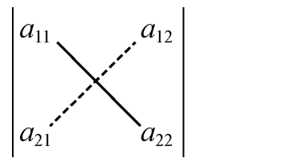
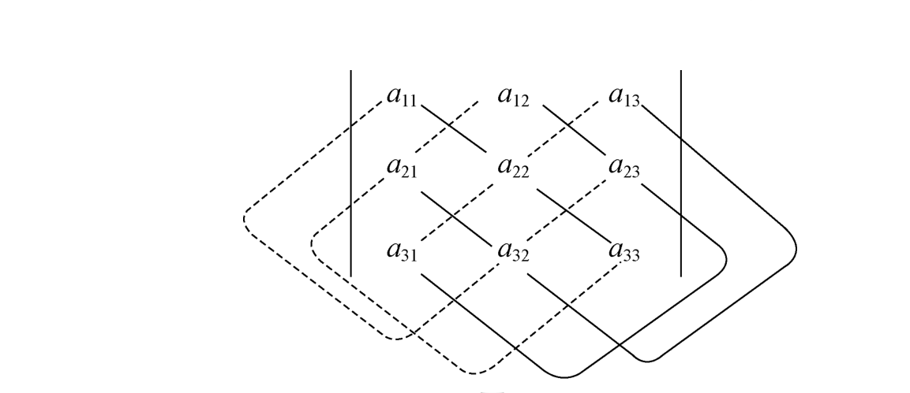

# 第二章 方阵的行列式

## 第一节 行列式的定义

[课前导读]
这一节我们要介绍方阵的行列式的定义，并用定义得到一些特殊行列式的值。在学习这一节之前，先回忆在中学代数学过的二元线性方程组有唯一解的讨论。对于二元线性方程组

$$
\begin{cases}
a_{11}x_1+a_{12}x_2=b_1, \\
a_{21}x_1+a_{22}x_2=b_2,
\end{cases}
$$

当 $a_{11}a_{22}-a_{12}a_{21}\neq 0$ 时，有唯一解：

$$
x_1=\frac{b_1a_{22}-b_2a_{12}}{a_{11}a_{22}-a_{12}a_{21}},\quad x_2=\frac{b_2a_{11}-b_1a_{21}}{a_{11}a_{22}-a_{12}a_{21}}.
$$

### 一、排列

作为定义 n 阶行列式的预备知识，我们先来介绍一下排列及其逆序数。

### 1. 排列及其逆序数

**定义 1** 从 1，2，$\cdots$，$n$ 中任意选取 $r$ 个不同的数排成一列，称为排列。

**定义 2** 将 1，2，$\cdots$，$n$ 这 $n$ 个不同的数排成一列，称为 n 阶全排列，也简称为全排列。

例如，设有 1，2，3，4，5 五个元素，则 31 是五个元素的一个排列，312 是五个元素的一个排列，312 也可以看成是 1，2，3 三个元素的一个全排列；4215 是五个元素的一个排列，而 42153 是五个元素的一个全排列。

n 阶全排列的总数为 $n!=n\cdot(n-1)\cdots 3\cdot 2\cdot 1$。例如，$4!=4\times 3\times 2\times 1=24$，$5!=5\times 4\times 3\times 2\times 1=120$。

显然，$12\cdots n$ 也是 $n$ 个数的全排列，而且元素是按从小到大的自然顺序排列的，这样的排列称为标准排列。而其他的 n 阶全排列都或多或少地破坏了自然顺序，如全排列 42153 中，4 和 2、2 和 1、5 和 3 的顺序都与自然顺序相反。

**定义 3** 在一个排列中，如果一对数的排列顺序与自然顺序相反，即排在左边的数比排在它右边的数大，那么它们就称为一个逆序，一个排列中逆序的总数就称为这个排列的逆序数。排列 $i_1i_2\cdots i_n$ 的逆序数记为 $\tau(i_1i_2\cdots i_n)$。

例如，全排列 42153 中，42、41、43、21、53 都是逆序，从而 42153 的逆序数为 $\tau(42153)=5$。

标准排列的逆序数为 0。例如，$\tau(12345)=0$。

### 2. 奇排列与偶排列

**定义 4** 逆序数为偶数的排列，称为偶排列；逆序数为奇数的排列，称为奇排列。

例如，$\tau(213)=1$，所以 213 是一个奇排列；而 $\tau(312)=2$，所以 312 是一个偶排列。

**定义 5** 只交换排列中某两个数的位置，其他的数保持不动而得到一个新排列的变换，称为一个对换。若交换的是相邻位置的两个元素，则称该对换为相邻对换。

例如，经过 2、1 对换，排列 42153 就变成了排列 41253，而且这个对换是相邻对换；经过 2、5 对换，排列 42153 就变成了排列 45123，但这个对换不是相邻对换。显然，连续实施两次相同的对换，则排列就还原了。另外，排列 42153 的逆序数是 $\tau(42153)=5$，但是排列 41253 和 45123 的逆序数分别是 $\tau(41253)=4$ 和 $\tau(45123)=6$。可见，对换会改变排列的逆序数，进一步地，我们有下面的事实。

**定理 1** 对换改变排列的奇偶性。

**\* 证明** 先证相邻对换的情况。排列

$$
i_1\cdots i_kab\cdots j_1\cdots j_s,\qquad (1-1)
$$

经过 $a$，$b$ 相邻对换变成排列

$$
i_1\cdots i_kba\cdots j_1\cdots j_s.\qquad (1-2)
$$

显然，$a$，$b$ 与其他数构成的逆序在排列（1-1）和排列（1-2）中是一样的，不同的只是 $a$，$b$ 的次序。当 $a<b$ 时，$ab$ 原来是标准序，对换后 $ba$ 构成一个逆序，于是排列（1-2）的逆序数是排列（1-1）的逆序数增加 1；当 $a>b$ 时，$ab$ 原来是逆序，对换后 $ba$ 是标准序，于是排列（1-2）的逆序数是排列（1-1）的逆序数减少 1。所以无论增加还是减少 1，相邻对换都改变了排列的奇偶性。

对于不相邻的对换，不妨假设原排列为

$$
\cdots ai_1\cdots i_sb\cdots,
$$

经过 $a$，$b$ 对换后变为排列

$$
\cdots bi_1\cdots i_sa\cdots,
$$

这个改变过程实际上就是通过先将 $a$ 依次与其后面相邻的元素作 $s+1$ 次相邻对换变为

$$
\cdots i_1\cdots i_sba\cdots,
$$

再通过将 $b$ 依次与前面相邻的元素作 $s$ 次相邻对换而得到。一共进行了 $2s+1$ 次相邻对换，所以改变了排列的奇偶性。

关于全排列中奇排列和偶排列的个数，我们有下面的定理（不给予证明）。

**定理 2** 在 n 阶排列中，偶排列和奇排列各占一半，即各有 $\dfrac{n!}{2}$ 个。

**\* 证明** 记 $P_n(S_n,\ T_n)$ 为所有 n 阶（奇、偶）排列构成的集合，则 $P_n=S_n\cup T_n$ 且 $S_n\cap T_n=\varnothing$，于是 $|P_n|=|S_n|+|T_n|$。任意取定一个对换 $\sigma$：$P_n\to P_n$，显然映射 $\sigma$ 是单射且 $\sigma(S_n)\subseteq T_n$、$\sigma(T_n)\subseteq S_n$，于是有 $|S_n|\leqslant|T_n|$、$|T_n|\leqslant|S_n|$，所以 $|S_n|=|T_n|=\dfrac{1}{2}|P_n|=\dfrac{1}{2}n!$。

### 二、n 阶行列式

### 1. n 阶行列式的定义

由 $n^2$ 个元素 $a_{ij}(i,\ j=1,\ 2,\ \cdots,\ n)$ 排成 $n$ 行 $n$ 列的正方形的数表：

$$
\begin{matrix}
a_{11} & a_{12} & \cdots & a_{1n}\\
a_{21} & a_{22} & \cdots & a_{2n}\\
\vdots & \vdots & & \vdots\\
a_{n1} & a_{n2} & \cdots & a_{nn}
\end{matrix}
$$

由这个数表所决定的数

$$
\sum_{p_1p_2\cdots p_n}(-1)^{\tau(p_1p_2\cdots p_n)}a_{1p_1}a_{2p_2}\cdots a_{np_n}
$$

称为由 $n^2$ 个元素 $a_{ij}(i,\ j=1,\ 2,\ \cdots,\ n)$ 构成的 n 阶行列式，记为

$$
D_n=
\begin{vmatrix}
a_{11} & a_{12} & \cdots & a_{1n}\\
a_{21} & a_{22} & \cdots & a_{2n}\\
\vdots & \vdots & & \vdots\\
a_{n1} & a_{n2} & \cdots & a_{nn}
\end{vmatrix},
$$

即

$$
D_n=
\begin{vmatrix}
a_{11} & a_{12} & \cdots & a_{1n}\\
a_{21} & a_{22} & \cdots & a_{2n}\\
\vdots & \vdots & & \vdots\\
a_{n1} & a_{n2} & \cdots & a_{nn}
\end{vmatrix}
=\sum_{p_1p_2\cdots p_n}(-1)^{\tau(p_1p_2\cdots p_n)}a_{1p_1}a_{2p_2}\cdots a_{np_n}.
$$

其中 $\sum\limits_{p_1p_2\cdots p_n}$ 表示对所有的 n 阶全排列 $p_1p_2\cdots p_n$ 求和。数 $a_{ij}(i,\ j=1,\ 2,\ \cdots,\ n)$ 称为行列式的 $(i,\ j)$ 元素，其中第一个下标 $i$ 称为元素 $a_{ij}$ 的行标，第二个下标 $j$ 称为元素 $a_{ij}$ 的列标。

记矩阵

$$
\boldsymbol{A}=
\begin{pmatrix}
a_{11} & a_{12} & \cdots & a_{1n}\\
a_{21} & a_{22} & \cdots & a_{2n}\\
\vdots & \vdots & & \vdots\\
a_{n1} & a_{n2} & \cdots & a_{nn}
\end{pmatrix},
$$

则行列式通常也称为方阵 $\boldsymbol{A}$ 的行列式，记为 $|\boldsymbol{A}|$。有时为了表明行列式是由元素 $a_{ij}$ 构成的，也简记为 $|\boldsymbol{A}|=\det(a_{ij})$、$|a_{ij}|_{n\times n}$ 或 $|a_{ij}|_n$。

由定义可知，n 阶行列式具有以下 3 个特点。

（1）$\sum\limits_{p_1p_2\cdots p_n}$ 是对所有的 n 阶全排列 $p_1p_2\cdots p_n$ 求和，所以展开式中共有 $n!$ 项；

（2）每一项 $a_{1p_1}a_{2p_2}\cdots a_{np_n}$ 是取自不同行不同列的 $n$ 个元素的乘积；

（3）每一项 $a_{1p_1}a_{2p_2}\cdots a_{np_n}$ 的行标排成一个标准排列，列标排列 $p_1p_2\cdots p_n$ 的奇偶性决定了乘积 $a_{1p_1}a_{2p_2}\cdots a_{np_n}$ 前的符号。

需要注意的是，1 阶行列式就是这个数本身，即 $|a|=a$。为了避免与绝对值记号混淆，很少提及 1 阶行列式。

### 2. 2 阶行列式和 3 阶行列式

当 $n=2$ 时，由方阵 $\begin{pmatrix}a_{11}&a_{12}\\a_{21}&a_{22}\end{pmatrix}$ 所确定的 2 阶行列式为

$$
\begin{vmatrix}
a_{11} & a_{12}\\
a_{21} & a_{22}
\end{vmatrix}
=\sum_{p_1p_2}(-1)^{\tau(p_1p_2)}a_{1p_1}a_{2p_2}=a_{11}a_{22}-a_{12}a_{21}.\qquad (1-3)
$$

2 阶行列式也可借助对角线法则来记忆。如图 2-1 所示，元素 $a_{11}$ 和 $a_{22}$ 所在的位置称为行列式的主对角线（黑实线位置），元素 $a_{12}$ 和 $a_{21}$ 所在的位置称为行列式的副对角线（黑虚线位置），于是 2 阶行列式就是主对角线上元素之积减去副对角线上元素之积。

当 $n=3$ 时，3 阶方阵 $\boldsymbol{A}=\begin{pmatrix}a_{11}&a_{12}&a_{13}\\a_{21}&a_{22}&a_{23}\\a_{31}&a_{32}&a_{33}\end{pmatrix}$ 所确定的 3 阶行列式为

$$
\begin{aligned}
|\boldsymbol{A}|&=\begin{vmatrix}
a_{11} & a_{12} & a_{13}\\
a_{21} & a_{22} & a_{23}\\
a_{31} & a_{32} & a_{33}
\end{vmatrix}
=\sum_{p_1p_2p_3}(-1)^{\tau(p_1p_2p_3)}a_{1p_1}a_{2p_2}a_{3p_3}\\
&=a_{11}a_{22}a_{33}+a_{13}a_{21}a_{32}+a_{12}a_{23}a_{31}-a_{13}a_{22}a_{31}-a_{12}a_{21}a_{33}-a_{11}a_{23}a_{32}.
\end{aligned}
$$

对于 3 阶行列式，我们也可以按“对角线”法则展开，其展开式等于 6 项的代数和，展开的规律如图 2-2 所示，实线位置上三元素乘积前冠以正号，虚线位置上三元素乘积前冠以负号。

**注** 4 阶及更高阶的行列式不再适用对角线法则。

**例 1** 设 $\boldsymbol{A}=\begin{pmatrix}1&2&-2\\-3&3&1\\1&2&-1\end{pmatrix}$，求 $|\boldsymbol{A}|$。

解

$$
\begin{aligned}
|\boldsymbol{A}|&=\begin{vmatrix}
1 & 2 & -2\\
-3 & 3 & 1\\
1 & 2 & -1
\end{vmatrix}\\
&=1\times 3\times(-1)+2\times 1\times 1+(-2)\times(-3)\times 2-(-2)\times 3\times 1-1\times 1\times 2-2\times(-3)\times(-1)\\
&=(-3)+2+12-(-6)-2-6=9.
\end{aligned}
$$

**例 2** 证明 $a_{52}a_{16}a_{41}a_{64}a_{23}a_{35}$ 是 6 阶行列式 $D_6=|a_{ij}|_{6\times 6}$ 的一项，并求这项应带的符号。

**证明** 调换 $a_{52}a_{16}a_{41}a_{64}a_{23}a_{35}$ 中元素的位置，使得调换后的乘积中元素的行标是标准序，即

$$
a_{52}a_{16}a_{41}a_{64}a_{23}a_{35}=a_{16}a_{23}a_{35}a_{41}a_{52}a_{64},
$$

这时，乘积中元素的列标排列为 635124，是一个 6 阶全排列，因而 $a_{52}a_{16}a_{41}a_{64}a_{23}a_{35}$ 是位于 $D_6=|a_{ij}|_{6\times 6}$ 的不同行、不同列的 6 个元素的乘积，因此是这个 6 阶行列式的一项。由于 $\tau(635124)=10$，所以这项前面带正号。

### 三、几类特殊的 n 阶行列式的值

**例 3** 计算下三角方阵 $\boldsymbol{A}=\begin{pmatrix}a_{11}&0&\cdots&0\\a_{21}&a_{22}&\cdots&0\\\vdots&\vdots&&\vdots\\a_{n1}&a_{n2}&\cdots&a_{nn}\end{pmatrix}$ 的行列式 $|\boldsymbol{A}|$（这样的行列式称为下三角行列式）。

解 根据行列式定义

$$
|\boldsymbol{A}|=
\begin{vmatrix}
a_{11} & 0 & \cdots & 0\\
a_{21} & a_{22} & \cdots & 0\\
\vdots & \vdots & & \vdots\\
a_{n1} & a_{n2} & \cdots & a_{nn}
\end{vmatrix}
=\sum_{p_1p_2\cdots p_n}(-1)^{\tau(p_1p_2\cdots p_n)}a_{1p_1}a_{2p_2}\cdots a_{np_n},
$$

该行列式中有较多的元素为零，要使得乘积项 $a_{1p_1}a_{2p_2}\cdots a_{np_n}$ 不等于零，元素 $a_{1p_1}$ 只能取 $a_{11}$；元素 $a_{2p_2}$ 只能取 $a_{22}$；$\cdots\cdots$；元素 $a_{np_n}$ 只能取 $a_{nn}$，从而行列式的展开式中只有 $a_{11}a_{22}\cdots a_{nn}$ 这一项可能不是零，其他项全为零。而 $a_{11}a_{22}\cdots a_{nn}$ 的列标是标准排列，逆序数为零，所以 $|\boldsymbol{A}|=a_{11}a_{22}\cdots a_{nn}$。

也就是说，下三角形行列式的值等于主对角线上 $n$ 个元素的乘积，而与主对角线下方元素无关。

**例 4** 计算上三角方阵 $\boldsymbol{A}=\begin{pmatrix}a_{11}&a_{12}&\cdots&a_{1n}\\0&a_{22}&\cdots&a_{2n}\\\vdots&\vdots&&\vdots\\0&0&\cdots&a_{nn}\end{pmatrix}$ 的行列式 $|\boldsymbol{A}|$（这样的行列式称为上三角行列式）。

解 类似于例 3，要使得乘积项 $a_{1p_1}a_{2p_2}\cdots a_{np_n}$ 不等于零，元素 $a_{np_n}$ 只能取 $a_{nn}$；元素 $a_{n-1,p_{n-1}}$ 只能取 $a_{n-1,n-1}$；$\cdots\cdots$；元素 $a_{1p_1}$ 只能取 $a_{11}$，于是行列式的展开式中只有 $a_{11}a_{22}\cdots a_{nn}$ 这一项可能不是零，其他项全为零。而 $a_{11}a_{22}\cdots a_{nn}$ 的列标是标准排列，逆序数为零，所以

$$
|\boldsymbol{A}|=
\begin{vmatrix}
a_{11} & a_{12} & \cdots & a_{1n}\\
0 & a_{22} & \cdots & a_{2n}\\
\vdots & \vdots & & \vdots\\
0 & 0 & \cdots & a_{nn}
\end{vmatrix}
=a_{11}a_{22}\cdots a_{nn}.
$$

由此可见，无论上三角方阵还是下三角方阵，其行列式的值都等于其主对角线上 $n$ 个元素的乘积，而与其他位置的非零元素没有关系。

由于对角矩阵

$$
\boldsymbol{A}=
\begin{pmatrix}
a_{11} & 0 & \cdots & 0\\
0 & a_{22} & \cdots & 0\\
\vdots & \vdots & \ddots & \vdots\\
0 & 0 & \cdots & a_{nn}
\end{pmatrix}
$$

既是上三角方阵同时也是下三角方阵，所以

$$
\begin{vmatrix}
a_{11} & 0 & \cdots & 0\\
0 & a_{22} & \cdots & 0\\
\vdots & \vdots & \ddots & \vdots\\
0 & 0 & \cdots & a_{nn}
\end{vmatrix}
=a_{11}a_{22}\cdots a_{nn}.
$$

对角矩阵的行列式称为对角行列式。

上三角（下三角）行列式是我们今后计算方阵的行列式的基础，在下一节讲完行列式的性质之后，我们会利用行列式的性质，将行列式的计算归结为上三角（下三角）行列式的计算。

**例 5** 设斜下三角方阵 $\boldsymbol{A}=\begin{pmatrix}0&\cdots&0&a_{1n}\\0&\cdots&a_{2,n-1}&a_{2n}\\\vdots&\ddots&\vdots&\vdots\\a_{n1}&\cdots&a_{n,n-1}&a_{nn}\end{pmatrix}$，证明：$|\boldsymbol{A}|=(-1)^{\frac{n(n-1)}{2}}a_{1n}a_{2,n-1}\cdots a_{n1}$。

**证明** 由行列式的定义

$$
|\boldsymbol{A}|=
\begin{vmatrix}
0 & \cdots & 0 & a_{1n}\\
0 & \cdots & a_{2,n-1} & a_{2n}\\
\vdots & \ddots & \vdots & \vdots\\
a_{n1} & \cdots & a_{n,n-1} & a_{nn}
\end{vmatrix}
=\sum_{p_1p_2\cdots p_n}(-1)^{\tau(p_1p_2\cdots p_n)}a_{1p_1}a_{2p_2}\cdots a_{np_n},
$$

要使得乘积项 $a_{1p_1}a_{2p_2}\cdots a_{np_n}$ 不等于零，元素 $a_{1p_1}$ 只能取 $a_{1n}$；元素 $a_{2p_2}$ 只能取 $a_{2,n-1}$；$\cdots\cdots$；元素 $a_{np_n}$ 只能取 $a_{n1}$，于是行列式的展开式中只有 $a_{1n}a_{2,n-1}\cdots a_{n1}$ 这一项可能不是零，其他项全为零。而 $a_{1n}a_{2,n-1}\cdots a_{n1}$ 的列标排列 $n(n-1)\cdots 21$ 的逆序数为 $\tau(n(n-1)\cdots 21)=\dfrac{n(n-1)}{2}$，所以 $|\boldsymbol{A}|=(-1)^{\frac{n(n-1)}{2}}a_{1n}a_{2,n-1}\cdots a_{n1}$。

易知，当 $n=4k$，$4k-1$ 时，$\tau(n(n-1)\cdots 21)=\dfrac{n(n-1)}{2}$ 为偶数，此时 $|\boldsymbol{A}|=a_{1n}a_{2,n-1}\cdots a_{n1}$；当 $n=4k-2$，$4k-3$ 时，$\tau(n(n-1)\cdots 21)=\dfrac{n(n-1)}{2}$ 为奇数，此时 $|\boldsymbol{A}|=-a_{1n}a_{2,n-1}\cdots a_{n1}$。

## 习题 2-1

1. 求下列全排列的逆序数：

（1）634521；（2）53142；（3）123454321；（4）$135\cdots(2n-1)(2n)(2n-2)\cdots 42$。

2. 用行列式的定义计算 $D_5=\begin{vmatrix}0&0&a_{13}&0&0\\0&0&0&a_{24}&0\\0&0&0&0&a_{35}\\a_{41}&0&0&0&0\\0&a_{52}&0&0&0\end{vmatrix}$。

3. 求多项式 $f(x)=\begin{vmatrix}2x&1&1&2\\3&2&x&1\\x&x&1&2\\2&1&1&3x\end{vmatrix}$ 中 $x^3$ 和 $x^4$ 的系数。

4. 用对角线法则求下列 3 阶行列式：

$$
(1)\ \begin{vmatrix}1&2&1\\3&1&0\\2&3&2\end{vmatrix};\qquad
(2)\ \begin{vmatrix}2&5&3\\0&4&7\\-2&-2&3\end{vmatrix};\qquad
(3)\ \begin{vmatrix}a&b&c\\b&c&a\\c&a&b\end{vmatrix};\qquad
(4)\ \begin{vmatrix}1&1&1\\2a&a+b&2b\\a^2&ab&b^2\end{vmatrix}.
$$

## 第二节 行列式的性质

[课前导读]
从 n 阶行列式的定义我们知道，当 $n\geqslant 4$ 时，利用定义来计算一般的行列式是一件非常辛苦的事情，但是上（下）三角行列式的计算却非常简单。这一节我们先介绍行列式的性质，然后利用性质将一般的行列式化为上（下）三角行列式来计算，最后给出一个利用方阵的行列式来判断方阵可逆的充分必要条件。学习这一节所需的预备知识就是行列式的定义，关于对换和奇、偶排列的一些结论以及上（下）三角行列式的计算。这些知识在本章第一节中都有介绍。

### 一、行列式的性质

**定义 1** 将行列式 $D_n=\begin{vmatrix}a_{11}&a_{12}&\cdots&a_{1n}\\a_{21}&a_{22}&\cdots&a_{2n}\\\vdots&\vdots&&\vdots\\a_{n1}&a_{n2}&\cdots&a_{nn}\end{vmatrix}$ 的各行元素换为同序号的列元素，所得到的行列式 $D_n^{\mathrm{T}}=\begin{vmatrix}a_{11}&a_{21}&\cdots&a_{n1}\\a_{12}&a_{22}&\cdots&a_{n2}\\\vdots&\vdots&&\vdots\\a_{1n}&a_{2n}&\cdots&a_{nn}\end{vmatrix}$ 称为行列式 $D_n$ 的转置行列式。

**性质 1** 行列式 $D_n$ 与它的转置行列式 $D_n^{\mathrm{T}}$ 相等。

该性质的证明利用行列式的定义即可得证。

性质 1 说明，行列式中的行和列具有同等的地位。因此，行列式中的有关性质凡是对行成立的，对列也成立。

**性质 2** 互换行列式的两行（或两列），行列式变号。

**证明** 以交换两行的情形来证明。根据行列式定义

$$
\begin{aligned}
&\begin{vmatrix}
a_{11} & a_{12} & \cdots & a_{1n}\\
\vdots & \vdots & & \vdots\\
a_{i1} & a_{i2} & \cdots & a_{in}\\
\vdots & \vdots & & \vdots\\
a_{j1} & a_{j2} & \cdots & a_{jn}\\
\vdots & \vdots & & \vdots\\
a_{n1} & a_{n2} & \cdots & a_{nn}
\end{vmatrix}
=\sum_{p_1\cdots p_i\cdots p_j\cdots p_n}(-1)^{\tau(p_1\cdots p_i\cdots p_j\cdots p_n)}a_{1p_1}\cdots a_{ip_i}\cdots a_{jp_j}\cdots a_{np_n}\\
&=\sum_{p_1\cdots p_i\cdots p_j\cdots p_n}(-1)^{\tau(p_1\cdots p_j\cdots p_i\cdots p_n)}a_{1p_1}\cdots a_{jp_j}\cdots a_{ip_i}\cdots a_{np_n}\\
&=-\sum_{p_1\cdots p_j\cdots p_i\cdots p_n}(-1)^{\tau(p_1\cdots p_j\cdots p_i\cdots p_n)}a_{1p_1}\cdots a_{jp_j}\cdots a_{ip_i}\cdots a_{np_n}\\
&=-\begin{vmatrix}
a_{11} & a_{12} & \cdots & a_{1n}\\
\vdots & \vdots & & \vdots\\
a_{j1} & a_{j2} & \cdots & a_{jn}\\
\vdots & \vdots & & \vdots\\
a_{i1} & a_{j2} & \cdots & a_{jn}\\
\vdots & \vdots & & \vdots\\
a_{n1} & a_{n2} & \cdots & a_{nn}
\end{vmatrix}.
\end{aligned}
$$

以 $r_i$ 表示行列式的第 $i$ 行，以 $c_i$ 表示行列式的第 $i$ 列，交换第 $i$、$j$ 行记为 $r_i\leftrightarrow r_j$，交换第 $i$、$j$ 列记为 $c_i\leftrightarrow c_j$。

**推论 1** 若行列式中有两行（或两列）对应元素相等，则行列式等于零。

**证明** 把行列式 $D$ 中有相同元素的两行（或两列）互换，则有 $D=-D$，因此 $D=0$。

**性质 3** 若行列式的某一行（或列）有公因子 $k$，则公因子 $k$ 可以提到行列式记号外面；或者说，用 $k$ 乘行列式的某一行（或某一列），等于用 $k$ 乘以该行列式，即

$$
\begin{vmatrix}
a_{11} & a_{12} & \cdots & a_{1n}\\
\vdots & \vdots & & \vdots\\
ka_{i1} & ka_{i2} & \cdots & ka_{in}\\
\vdots & \vdots & & \vdots\\
a_{n1} & a_{n2} & \cdots & a_{nn}
\end{vmatrix}
=k
\begin{vmatrix}
a_{11} & a_{12} & \cdots & a_{1n}\\
\vdots & \vdots & & \vdots\\
a_{i1} & a_{i2} & \cdots & a_{in}\\
\vdots & \vdots & & \vdots\\
a_{n1} & a_{n2} & \cdots & a_{nn}
\end{vmatrix}.
$$

**证明** 根据行列式定义

$$
\begin{aligned}
\text{左}&=\sum_{p_1p_2\cdots p_n}(-1)^{\tau(p_1p_2\cdots p_n)}a_{1p_1}a_{2p_2}\cdots(ka_{ip_i})\cdots a_{np_n}\\
&=k\sum_{p_1p_2\cdots p_n}(-1)^{\tau(p_1p_2\cdots p_n)}a_{1p_1}a_{2p_2}\cdots a_{ip_i}\cdots a_{np_n}=\text{右}.
\end{aligned}
$$

**例 1**
$$
\begin{vmatrix}
1 & 2 & 1\\
2 & 4 & 6\\
6 & 9 & 12
\end{vmatrix}
=\begin{vmatrix}
1 & 2 & 1\\
1\times 2 & 2\times 2 & 3\times 2\\
2\times 3 & 3\times 3 & 4\times 3
\end{vmatrix}
=2\cdot 3\cdot
\begin{vmatrix}
1 & 2 & 1\\
1 & 2 & 3\\
2 & 3 & 4
\end{vmatrix}
=6
\begin{vmatrix}
1 & 2 & 1\\
1 & 2 & 3\\
2 & 3 & 4
\end{vmatrix}.
$$

第 $i$ 行（或列）乘以数 $k$ 记作 $kr_i$（或 $kc_i$），第 $i$ 行（或列）提取公因子 $k$ 记作 $\dfrac{1}{k}r_i$（或 $\dfrac{1}{k}c_i$）。

**定理 1** 设 $\boldsymbol{A}$ 是 n 阶方阵，则等式 $|k\boldsymbol{A}|=k^n|\boldsymbol{A}|$ 成立。

该定理由矩阵数乘的定义和性质 3 立即可得。

**推论 2** 若行列式的某一行（或某一列）元素全为零，则行列式的值为零。

**推论 3** 若行列式某两行（或两列）元素对应成比例，则行列式为零。

**性质 4** 行列式的拆分定理

$$
\begin{vmatrix}
a_{11} & a_{12} & \cdots & a_{1n}\\
\vdots & \vdots & & \vdots\\
b_{k1}+c_{k1} & b_{k2}+c_{k2} & \cdots & b_{kn}+c_{kn}\\
\vdots & \vdots & & \vdots\\
a_{n1} & a_{n2} & \cdots & a_{nn}
\end{vmatrix}
=\begin{vmatrix}
a_{11} & a_{12} & \cdots & a_{1n}\\
\vdots & \vdots & & \vdots\\
b_{k1} & b_{k2} & \cdots & b_{kn}\\
\vdots & \vdots & & \vdots\\
a_{n1} & a_{n2} & \cdots & a_{nn}
\end{vmatrix}
+\begin{vmatrix}
a_{11} & a_{12} & \cdots & a_{1n}\\
\vdots & \vdots & & \vdots\\
c_{k1} & c_{k2} & \cdots & c_{kn}\\
\vdots & \vdots & & \vdots\\
a_{n1} & a_{n2} & \cdots & a_{nn}
\end{vmatrix}.
$$

**证明**

$$
\begin{aligned}
\text{左边}&=\sum_{p_1p_2\cdots p_n}(-1)^{\tau(p_1p_2\cdots p_n)}a_{1p_1}a_{2p_2}\cdots(b_{kp_k}+c_{kp_k})\cdots a_{np_n}\\
&=\sum_{p_1p_2\cdots p_n}(-1)^{\tau(p_1p_2\cdots p_n)}a_{1p_1}a_{2p_2}\cdots b_{kp_k}\cdots a_{np_n}+\sum_{p_1p_2\cdots p_n}(-1)^{\tau(p_1p_2\cdots p_n)}a_{1p_1}a_{2p_2}\cdots c_{kp_k}\cdots a_{np_n}\\
&=\text{右边}.
\end{aligned}
$$

**例 2**
$$
\begin{aligned}
&\begin{vmatrix}
a_1+b_1 & a_2+b_2 & a_3+b_3\\
a_2+b_2 & a_3+b_3 & a_1+b_1\\
a_3+b_3 & a_1+b_1 & a_2+b_2
\end{vmatrix}\\
={}&\begin{vmatrix}
a_1+b_1 & a_2 & a_3+b_3\\
a_2+b_2 & a_3 & a_1+b_1\\
a_3+b_3 & a_1 & a_2+b_2
\end{vmatrix}
+\begin{vmatrix}
a_1+b_1 & b_2 & a_3+b_3\\
a_2+b_2 & b_3 & a_1+b_1\\
a_3+b_3 & b_1 & a_2+b_2
\end{vmatrix}\\
={}&\begin{vmatrix}
a_1 & a_2 & a_3+b_3\\
a_2 & a_3 & a_1+b_1\\
a_3 & a_1 & a_2+b_2
\end{vmatrix}
+\begin{vmatrix}
b_1 & a_2 & a_3+b_3\\
b_2 & a_3 & a_1+b_1\\
b_3 & a_1 & a_2+b_2
\end{vmatrix}
+\begin{vmatrix}
a_1 & b_2 & a_3+b_3\\
a_2 & b_3 & a_1+b_1\\
a_3 & b_1 & a_2+b_2
\end{vmatrix}
+\begin{vmatrix}
b_1 & b_2 & a_3+b_3\\
b_2 & b_3 & a_1+b_1\\
b_3 & b_1 & a_2+b_2
\end{vmatrix}.
\end{aligned}
$$

$$
\begin{aligned}
={}&\begin{vmatrix}
a_1 & a_2 & a_3\\
a_2 & a_3 & a_1\\
a_3 & a_1 & a_2
\end{vmatrix}
+\begin{vmatrix}
a_1 & a_2 & b_3\\
a_2 & a_3 & b_1\\
a_3 & a_1 & b_2
\end{vmatrix}
+\begin{vmatrix}
b_1 & a_2 & a_3\\
b_2 & a_3 & a_1\\
b_3 & a_1 & a_2
\end{vmatrix}
+\begin{vmatrix}
b_1 & a_2 & b_3\\
b_2 & a_3 & b_1\\
b_3 & a_1 & b_2
\end{vmatrix}+\\
&\begin{vmatrix}
a_1 & b_2 & a_3\\
a_2 & b_3 & a_1\\
a_3 & b_1 & a_2
\end{vmatrix}
+\begin{vmatrix}
a_1 & b_2 & b_3\\
a_2 & b_3 & b_1\\
a_3 & b_1 & b_2
\end{vmatrix}
+\begin{vmatrix}
b_1 & b_2 & a_3\\
b_2 & b_3 & a_1\\
b_3 & b_1 & a_2
\end{vmatrix}
+\begin{vmatrix}
b_1 & b_2 & b_3\\
b_2 & b_3 & b_1\\
b_3 & b_1 & b_2
\end{vmatrix}.
\end{aligned}
$$

**性质 5** 行列式某一行（或某一列）的 $k$ 倍加到另一行（或另一列）的对应元素上去，行列式的值不变。即

$$
\begin{vmatrix}
a_{11} & a_{12} & \cdots & a_{1n}\\
\vdots & \vdots & & \vdots\\
a_{i1} & a_{i2} & \cdots & a_{in}\\
\vdots & \vdots & & \vdots\\
a_{j1}+ka_{i1} & a_{j2}+ka_{i2} & \cdots & a_{jn}+ka_{in}\\
\vdots & \vdots & & \vdots\\
a_{n1} & a_{n2} & \cdots & a_{nn}
\end{vmatrix}
=\begin{vmatrix}
a_{11} & a_{12} & \cdots & a_{1n}\\
\vdots & \vdots & & \vdots\\
a_{i1} & a_{i2} & \cdots & a_{in}\\
\vdots & \vdots & & \vdots\\
a_{j1} & a_{j2} & \cdots & a_{jn}\\
\vdots & \vdots & & \vdots\\
a_{n1} & a_{n2} & \cdots & a_{nn}
\end{vmatrix}.
$$

**证明** 对第 $j$ 行进行拆分，再利用推论 3，有

$$
\begin{aligned}
&\begin{vmatrix}
a_{11} & a_{12} & \cdots & a_{1n}\\
\vdots & \vdots & & \vdots\\
a_{i1} & a_{i2} & \cdots & a_{in}\\
\vdots & \vdots & & \vdots\\
a_{j1}+ka_{i1} & a_{j2}+ka_{i2} & \cdots & a_{jn}+ka_{in}\\
\vdots & \vdots & & \vdots\\
a_{n1} & a_{n2} & \cdots & a_{nn}
\end{vmatrix}\\
={}&\begin{vmatrix}
a_{11} & a_{12} & \cdots & a_{1n}\\
\vdots & \vdots & & \vdots\\
a_{i1} & a_{i2} & \cdots & a_{in}\\
\vdots & \vdots & & \vdots\\
a_{j1} & a_{j2} & \cdots & a_{jn}\\
\vdots & \vdots & & \vdots\\
a_{n1} & a_{n2} & \cdots & a_{nn}
\end{vmatrix}
+\begin{vmatrix}
a_{11} & a_{12} & \cdots & a_{1n}\\
\vdots & \vdots & & \vdots\\
a_{i1} & a_{i2} & \cdots & a_{in}\\
\vdots & \vdots & & \vdots\\
ka_{i1} & ka_{i2} & \cdots & ka_{in}\\
\vdots & \vdots & & \vdots\\
a_{n1} & a_{n2} & \cdots & a_{nn}
\end{vmatrix}\\
={}&\begin{vmatrix}
a_{11} & a_{12} & \cdots & a_{1n}\\
\vdots & \vdots & & \vdots\\
a_{i1} & a_{i2} & \cdots & a_{in}\\
\vdots & \vdots & & \vdots\\
a_{j1} & a_{j2} & \cdots & a_{jn}\\
\vdots & \vdots & & \vdots\\
a_{n1} & a_{n2} & \cdots & a_{nn}
\end{vmatrix}.
\end{aligned}
$$

第 $i$ 行（或第 $i$ 列）乘以数 $k$ 到第 $j$ 行（或第 $j$ 列）上记作 $r_j+kr_i$（或 $c_j+kc_i$）。

对于给定的 n 阶方阵 $\boldsymbol{A}$，在第一章中我们已经讨论了如何利用矩阵的初等行变换将方阵 $\boldsymbol{A}$ 化为阶梯形矩阵 $\boldsymbol{R}$。因为方阵的阶梯形矩阵一定是上三角矩阵，从而 $|\boldsymbol{R}|$ 就等于其主对角线上元素之积。另外，由行列式的性质 2、性质 3 和性质 5 可以看到，方阵的三类初等变换刚好对应行列式的这三个基本性质。设 $\boldsymbol{M}$、$\boldsymbol{N}$ 都是 n 阶方阵，

如果 $\boldsymbol{M}\xrightarrow{r_i\leftrightarrow r_j}\boldsymbol{N}$，或 $\boldsymbol{M}\xrightarrow{c_i\leftrightarrow c_j}\boldsymbol{N}$，则有 $|\boldsymbol{M}|\xrightarrow{r_i\leftrightarrow r_j}|\boldsymbol{N}|$，或 $|\boldsymbol{M}|\xrightarrow{c_i\leftrightarrow c_j}|\boldsymbol{N}|$，从而 $|\boldsymbol{N}|=-|\boldsymbol{M}|$或 $|\boldsymbol{M}|=-|\boldsymbol{N}|$；

如果 $\boldsymbol{M}\xrightarrow{kr_i}\boldsymbol{N}$，或 $\boldsymbol{M}\xrightarrow{kc_i}\boldsymbol{N}$，则有 $|\boldsymbol{M}|\xrightarrow{kr_i}|\boldsymbol{N}|$，或 $|\boldsymbol{M}|\xrightarrow{kc_i}|\boldsymbol{N}|$，从而 $|\boldsymbol{N}|=k|\boldsymbol{M}|$ 或 $|\boldsymbol{M}|=\dfrac{1}{k}|\boldsymbol{N}|$；

如果 $\boldsymbol{M}\xrightarrow{r_j+kr_i}\boldsymbol{N}$，或 $\boldsymbol{M}\xrightarrow{c_j+kc_i}\boldsymbol{N}$，则 $|\boldsymbol{M}|\xrightarrow{r_j+kr_i}|\boldsymbol{N}|$，或 $|\boldsymbol{M}|\xrightarrow{c_j+kc_i}|\boldsymbol{N}|$，从而 $|\boldsymbol{N}|=|\boldsymbol{M}|$。

因此，行列式 $|\boldsymbol{A}|$ 与 $|\boldsymbol{R}|$ 之间一定满足关系式 $|\boldsymbol{A}|=\lambda|\boldsymbol{R}|$，其中 $\lambda$ 是反复利用行列式性质 2、性质 3 和性质 5 进行计算的过程中产生的某个非零常数。这就是行列式计算中的所谓“化三角形法”。

### 二、行列式的计算举例

**例 3** 计算行列式

$$
\begin{vmatrix}
0 & 2 & -2 & 2\\
1 & 3 & 0 & 4\\
-2 & -11 & 3 & -16\\
0 & -7 & 3 & 1
\end{vmatrix}.
$$

解

$$
\begin{aligned}
&\begin{vmatrix}
0 & 2 & -2 & 2\\
1 & 3 & 0 & 4\\
-2 & -11 & 3 & -16\\
0 & -7 & 3 & 1
\end{vmatrix}
\xrightarrow{r_1\leftrightarrow r_2}
\begin{vmatrix}
1 & 3 & 0 & 4\\
0 & 2 & -2 & 2\\
-2 & -11 & 3 & -16\\
0 & -7 & 3 & 1
\end{vmatrix}\\
&\xrightarrow{r_3+2r_1}
\begin{vmatrix}
1 & 3 & 0 & 4\\
0 & 2 & -2 & 2\\
0 & -5 & 3 & -8\\
0 & -7 & 3 & 1
\end{vmatrix}
\xrightarrow{\frac{1}{2}r_2}
-2\begin{vmatrix}
1 & 3 & 0 & 4\\
0 & 1 & -1 & 1\\
0 & -5 & 3 & -8\\
0 & -7 & 3 & 1
\end{vmatrix}\\
&\xrightarrow[r_4+7r_2]{r_3+5r_2}
-2\begin{vmatrix}
1 & 3 & 0 & 4\\
0 & 1 & -1 & 1\\
0 & 0 & -2 & -3\\
0 & 0 & -4 & 8
\end{vmatrix}
\xrightarrow{r_4+(-2)r_3}
-2\begin{vmatrix}
1 & 3 & 0 & 4\\
0 & 1 & -1 & 1\\
0 & 0 & -2 & -3\\
0 & 0 & 0 & 14
\end{vmatrix}=56.
\end{aligned}
$$

在计算这个行列式时，做变换 $r_1\leftrightarrow r_2$，$\dfrac{1}{2}r_2$ 的目的是为了使 $a_{11}$、$a_{22}$ 位置的元素变成 1，这样，在后面的计算中可以避免分数的出现。

计算行列式时，要仔细观察行列式的特点。虽然行列式的值唯一的，但计算过程不唯一。根据行列式的特点合理利用性质，可简化计算。

**例 4** 计算行列式 $D=\begin{vmatrix}2&1&1&1\\1&2&1&1\\1&1&2&1\\1&1&1&2\end{vmatrix}$。

解 注意到行列式的每一列元素之和都是 5，将行列式的第二、三、四行都加到第一行，得

$$
\begin{aligned}
D&=\begin{vmatrix}
5 & 5 & 5 & 5\\
1 & 2 & 1 & 1\\
1 & 1 & 2 & 1\\
1 & 1 & 1 & 2
\end{vmatrix}
=5\begin{vmatrix}
1 & 1 & 1 & 1\\
1 & 2 & 1 & 1\\
1 & 1 & 2 & 1\\
1 & 1 & 1 & 2
\end{vmatrix}
\xrightarrow[r_3+(-1)r_1,\ r_4+(-1)r_1]{r_2+(-1)r_1}
5\begin{vmatrix}
1 & 1 & 1 & 1\\
0 & 1 & 0 & 0\\
0 & 0 & 1 & 0\\
0 & 0 & 0 & 1
\end{vmatrix}=5.
\end{aligned}
$$

**例 5** 计算行列式 $D=\begin{vmatrix}7&1&1&1\\1&4&1&1\\1&1&-2&1\\1&1&1&-5\end{vmatrix}$。

解

$$
\begin{aligned}
D&=\begin{vmatrix}
7 & 1 & 1 & 1\\
1 & 4 & 1 & 1\\
1 & 1 & -2 & 1\\
1 & 1 & 1 & -5
\end{vmatrix}
\xrightarrow[r_3+(-1)r_1,\ r_4+(-1)r_1]{r_2+(-1)r_1}
\begin{vmatrix}
7 & 1 & 1 & 1\\
-6 & 3 & 0 & 0\\
-6 & 0 & -3 & 0\\
-6 & 0 & 0 & -6
\end{vmatrix}\\
&\xrightarrow[c_1+(-2)c_3,\ c_1+(-1)c_4]{c_1+2c_2}
\begin{vmatrix}
6 & 1 & 1 & 1\\
0 & 3 & 0 & 0\\
0 & 0 & -3 & 0\\
0 & 0 & 0 & -6
\end{vmatrix}=324.
\end{aligned}
$$

**例 6** 设矩阵 $\boldsymbol{A}=\begin{pmatrix}a_{11}&\cdots&a_{1k}\\\vdots&\ddots&\vdots\\a_{k1}&\cdots&a_{kk}\end{pmatrix}$，$\boldsymbol{B}=\begin{pmatrix}b_{11}&\cdots&b_{1t}\\\vdots&\ddots&\vdots\\b_{t1}&\cdots&b_{tt}\end{pmatrix}$，$\boldsymbol{C}=\begin{pmatrix}c_{11}&\cdots&c_{1t}\\\vdots&\ddots&\vdots\\c_{k1}&\cdots&c_{kt}\end{pmatrix}$，若矩阵 $\boldsymbol{D}=\begin{pmatrix}\boldsymbol{A}&\boldsymbol{C}\\\boldsymbol{O}&\boldsymbol{B}\end{pmatrix}$，证明：$|\boldsymbol{D}|=|\boldsymbol{A}|\cdot|\boldsymbol{B}|$。

**证明** 对行列式 $|\boldsymbol{A}|$ 做运算 $r_j+kr_i$，将 $|\boldsymbol{A}|$ 化为上三角行列式得

$$
|\boldsymbol{A}|\xrightarrow{r_j+kr_i}
\begin{vmatrix}
p_{11} & \cdots & p_{1k}\\
& \ddots & \vdots\\
& & p_{kk}
\end{vmatrix}
=p_{11}p_{22}\cdots p_{kk}.
$$

对行列式 $|\boldsymbol{B}|$ 做运算 $r_j+kr_i$，将 $|\boldsymbol{B}|$ 化为上三角行列式得

$$
|\boldsymbol{B}|\xrightarrow{r_j+kr_i}
\begin{vmatrix}
q_{11} & \cdots & q_{1t}\\
& \ddots & \vdots\\
& & q_{tt}
\end{vmatrix}
=q_{11}q_{22}\cdots q_{tt}.
$$

对行列式 $|\boldsymbol{D}|$ 的前 $k$ 行做与行列式 $|\boldsymbol{A}|$ 相同的运算，对行列式 $|\boldsymbol{D}|$ 的后 $t$ 行做与行列式 $|\boldsymbol{B}|$ 相同的运算，可以将行列式 $|\boldsymbol{D}|$ 化为上三角行列式：

$$
|\boldsymbol{D}|=
\begin{vmatrix}
a_{11} & \cdots & a_{1k} & c_{11} & \cdots & c_{1t}\\
\vdots & \ddots & \vdots & \vdots & & \vdots\\
a_{k1} & \cdots & a_{kk} & c_{k1} & \cdots & c_{kt}\\
& & & b_{11} & \cdots & b_{1t}\\
& \boldsymbol{O} & & \vdots & \ddots & \vdots\\
& & & b_{t1} & \cdots & b_{tt}
\end{vmatrix}
=
\begin{vmatrix}
p_{11} & \cdots & p_{1k} & d_{11} & \cdots & d_{1t}\\
& \ddots & \vdots & \vdots & & \vdots\\
& & p_{kk} & d_{k1} & \cdots & d_{kt}\\
& & & b_{11} & \cdots & b_{1t}\\
& \boldsymbol{O} & & \vdots & \ddots & \vdots\\
& & & b_{t1} & \cdots & b_{tt}
\end{vmatrix}
$$

$$
=\begin{vmatrix}
p_{11} & \cdots & p_{1k} & d_{11} & \cdots & d_{1t}\\
& \ddots & \vdots & \vdots & & \vdots\\
& & p_{kk} & d_{k1} & \cdots & d_{kt}\\
& & & q_{11} & \cdots & q_{1t}\\
& \boldsymbol{O} & & & \ddots & \vdots\\
& & & & & q_{tt}
\end{vmatrix},
$$

因此，$|\boldsymbol{D}|=p_{11}p_{22}\cdots p_{kk}\cdot q_{11}q_{22}\cdots q_{tt}=|\boldsymbol{A}|\cdot|\boldsymbol{B}|$。

可以类似地证明，

$$
|\boldsymbol{D}|=
\begin{vmatrix}
a_{11} & \cdots & a_{1k} & & & & \\
\vdots & \ddots & \vdots & & \boldsymbol{O} & & \\
a_{k1} & \cdots & a_{kk} & & & & \\
c_{11} & \cdots & c_{1k} & b_{11} & \cdots & b_{1t}\\
\vdots & & \vdots & \vdots & \ddots & \vdots\\
c_{t1} & \cdots & c_{tk} & b_{t1} & \cdots & b_{tt}
\end{vmatrix}
=\begin{vmatrix}
a_{11} & \cdots & a_{1k}\\
\vdots & \ddots & \vdots\\
a_{k1} & \cdots & a_{kk}
\end{vmatrix}
\cdot\begin{vmatrix}
b_{11} & \cdots & b_{1t}\\
\vdots & \ddots & \vdots\\
b_{t1} & \cdots & b_{tt}
\end{vmatrix}.
$$

**例 7** 计算行列式

$$
D_{2n}=
\begin{vmatrix}
a & & & & & b\\
& \ddots & & & \ddots & \\
& & a & b & & \\
& & c & d & & \\
& \ddots & & & \ddots & \\
c & & & & & d
\end{vmatrix},
$$

其中未写出的元素为 0。

解 把 $D_{2n}$ 中的第 $2n$ 行依次与第 $2n-1$ 行、第 $2n-2$ 行、$\cdots$、第 3 行、第 2 行交换，共交换了 $2n-2$ 次；再将第 $2n$ 列依次与第 $2n-1$ 列、第 $2n-2$ 列、$\cdots$、第 3 列、第 2 列交换，也共交换了 $2n-2$ 次，得

$$
D_{2n}=(-1)^{2n-2}(-1)^{2n-2}
\begin{vmatrix}
a & b & 0 & & \cdots & & 0\\
c & d & 0 & & \cdots & & 0\\
0 & 0 & a & & & & b\\
& & & \ddots & & \ddots & \\
\vdots & \vdots & & & a & b & \\
& & & & c & d & \\
& & & \ddots & & \ddots & \\
0 & 0 & c & & & & d
\end{vmatrix}.
$$

根据例 6，$D_{2n}=\begin{vmatrix}a&b\\c&d\end{vmatrix}D_{2(n-1)}=(ad-bc)D_{2(n-1)}$。同样的做法可得 $D_{2(n-1)}=(ad-bc)D_{2(n-2)}$，于是有

$$
\begin{aligned}
D_{2n}&=(ad-bc)D_{2(n-1)}=(ad-bc)^2D_{2(n-2)}=\cdots=(ad-bc)^{n-1}D_2\\
&=(ad-bc)^{n-1}\begin{vmatrix}a&b\\c&d\end{vmatrix}=(ad-bc)^n.
\end{aligned}
$$

### 三、方阵可逆的充要条件

**定理 2** n 阶方阵 $\boldsymbol{A}$ 可逆的充分必要条件是 $|\boldsymbol{A}|\neq 0$。

**证明** 根据第一章第四节的内容，n 阶方阵 $\boldsymbol{A}$ 可逆，则方阵 $\boldsymbol{A}$ 行等价于单位阵 $\boldsymbol{E}$，即 $\boldsymbol{A}$ 可通过初等行变换化为单位阵 $\boldsymbol{E}$。根据矩阵的初等变换与行列式性质的关系（参见例 3 之前的文字说明），一定存在一个数 $\lambda\neq 0$，使得 $|\boldsymbol{A}|=\lambda|\boldsymbol{E}|$，而 $|\boldsymbol{E}|=1$，因此 $|\boldsymbol{A}|=\lambda\neq 0$。

反之，设 $|\boldsymbol{A}|\neq 0$。由于 n 阶方阵 $\boldsymbol{A}$ 可通过初等行变换化为行最简形矩阵 $\boldsymbol{R}$，因此存在一个数 $\lambda\neq 0$，使得 $|\boldsymbol{A}|=\lambda|\boldsymbol{R}|$。由 $|\boldsymbol{A}|\neq 0$ 可得 $|\boldsymbol{R}|\neq 0$，

因此 $\boldsymbol{R}$ 中没有全零行，从而 $\boldsymbol{R}=\boldsymbol{E}$。也就是说，方阵 $\boldsymbol{A}$ 行等价于单位阵 $\boldsymbol{E}$，所以方阵 $\boldsymbol{A}$ 可逆。

在不需要求出逆矩阵的情况下，定理 2 给了一个简易的判断矩阵可逆的方法。

**例 8** 判断下列矩阵是否可逆：

（1）$\boldsymbol{A}=\begin{pmatrix}-1&1&-1\\1&-1&-1\\-1&-1&1\end{pmatrix}$；

（2）$\boldsymbol{B}=\begin{pmatrix}2&1&-3\\-1&0&1\\1&-2&1\end{pmatrix}$。

解 （1）因为 $|\boldsymbol{A}|=\begin{vmatrix}-1&1&-1\\1&-1&-1\\-1&-1&1\end{vmatrix}=\begin{vmatrix}-1&1&-1\\0&0&-2\\0&-2&2\end{vmatrix}=-\begin{vmatrix}-1&1&-1\\0&-2&2\\0&0&-2\end{vmatrix}=4\neq 0$，所以矩阵 $\boldsymbol{A}$ 可逆。

（2）因为 $|\boldsymbol{B}|=\begin{vmatrix}2&1&-3\\-1&0&1\\1&-2&1\end{vmatrix}=\begin{vmatrix}-1&0&1\\2&1&-3\\1&-2&1\end{vmatrix}=-\begin{vmatrix}-1&0&1\\0&1&-1\\0&-2&2\end{vmatrix}=0$，所以矩阵 $\boldsymbol{B}$ 不可逆。

根据例 6，分块矩阵 $\boldsymbol{D}=\begin{pmatrix}\boldsymbol{A}&\boldsymbol{C}\\\boldsymbol{O}&\boldsymbol{B}\end{pmatrix}$ 可逆的充分必要条件是 $\boldsymbol{A}$、$\boldsymbol{B}$ 均可逆。特别地，设 $\boldsymbol{A}_1$，$\boldsymbol{A}_2$，$\cdots$，$\boldsymbol{A}_s$ 分别是 $n_i(i=1,\ 2,\ \cdots,\ s)$ 阶方阵，则分块对角阵 $\boldsymbol{D}=\begin{pmatrix}\boldsymbol{A}_1&\boldsymbol{O}&\cdots&\boldsymbol{O}\\\boldsymbol{O}&\boldsymbol{A}_2&\cdots&\boldsymbol{O}\\\vdots&\vdots&\ddots&\vdots\\\boldsymbol{O}&\boldsymbol{O}&\cdots&\boldsymbol{A}_s\end{pmatrix}$ 可逆的充分必要条件是 $\boldsymbol{A}_i(i=1,\ 2,\ \cdots,\ s)$ 均可逆。且在 $\boldsymbol{A}_i(i=1,\ 2,\ \cdots,\ s)$ 均可逆的条件下，由

$$
\begin{aligned}
&\begin{pmatrix}
\boldsymbol{A}_1 & \boldsymbol{O} & \cdots & \boldsymbol{O}\\
\boldsymbol{O} & \boldsymbol{A}_2 & \cdots & \boldsymbol{O}\\
\vdots & \vdots & \ddots & \vdots\\
\boldsymbol{O} & \boldsymbol{O} & \cdots & \boldsymbol{A}_s
\end{pmatrix}
\begin{pmatrix}
\boldsymbol{A}_1^{-1} & \boldsymbol{O} & \cdots & \boldsymbol{O}\\
\boldsymbol{O} & \boldsymbol{A}_2^{-1} & \cdots & \boldsymbol{O}\\
\vdots & \vdots & \ddots & \vdots\\
\boldsymbol{O} & \boldsymbol{O} & \cdots & \boldsymbol{A}_s^{-1}
\end{pmatrix}\\
={}&\begin{pmatrix}
\boldsymbol{A}_1^{-1} & \boldsymbol{O} & \cdots & \boldsymbol{O}\\
\boldsymbol{O} & \boldsymbol{A}_2^{-1} & \cdots & \boldsymbol{O}\\
\vdots & \vdots & \ddots & \vdots\\
\boldsymbol{O} & \boldsymbol{O} & \cdots & \boldsymbol{A}_s^{-1}
\end{pmatrix}
\begin{pmatrix}
\boldsymbol{A}_1 & \boldsymbol{O} & \cdots & \boldsymbol{O}\\
\boldsymbol{O} & \boldsymbol{A}_2 & \cdots & \boldsymbol{O}\\
\vdots & \vdots & \ddots & \vdots\\
\boldsymbol{O} & \boldsymbol{O} & \cdots & \boldsymbol{A}_s
\end{pmatrix}\\
={}&\begin{pmatrix}
\boldsymbol{E}_1 & & & \\
& \boldsymbol{E}_2 & & \\
& & \ddots & \\
& & & \boldsymbol{E}_s
\end{pmatrix},
\end{aligned}
$$

其中 $\boldsymbol{E}_i(i=1,\ 2,\ \cdots,\ s)$ 是 $n_i(i=1,\ 2,\ \cdots,\ s)$ 阶单位矩阵，可知

$$
\boldsymbol{D}^{-1}=
\begin{pmatrix}
\boldsymbol{A}_1^{-1} & \boldsymbol{O} & \cdots & \boldsymbol{O}\\
\boldsymbol{O} & \boldsymbol{A}_2^{-1} & \cdots & \boldsymbol{O}\\
\vdots & \vdots & \ddots & \vdots\\
\boldsymbol{O} & \boldsymbol{O} & \cdots & \boldsymbol{A}_s^{-1}
\end{pmatrix}.
$$

**例 9** 设矩阵 $\boldsymbol{D}=\begin{pmatrix}\boldsymbol{A}&\boldsymbol{C}\\\boldsymbol{O}&\boldsymbol{B}\end{pmatrix}$，其中 $\boldsymbol{A}$、$\boldsymbol{B}$ 分别为 $m$ 阶、n 阶可逆阵，求 $\boldsymbol{D}^{-1}$。

解 由例 6 可知，若 $\boldsymbol{A}$、$\boldsymbol{B}$ 均可逆，则 $\boldsymbol{D}=\begin{pmatrix}\boldsymbol{A}&\boldsymbol{C}\\\boldsymbol{O}&\boldsymbol{B}\end{pmatrix}$ 一定可逆。于是，存在矩阵 $\boldsymbol{D}^{-1}=\begin{pmatrix}\boldsymbol{X}_1&\boldsymbol{X}_2\\\boldsymbol{X}_3&\boldsymbol{X}_4\end{pmatrix}$，使得

$$
\begin{pmatrix}\boldsymbol{A}&\boldsymbol{C}\\\boldsymbol{O}&\boldsymbol{B}\end{pmatrix}
\begin{pmatrix}\boldsymbol{X}_1&\boldsymbol{X}_2\\\boldsymbol{X}_3&\boldsymbol{X}_4\end{pmatrix}
=\begin{pmatrix}\boldsymbol{E}_1&\boldsymbol{O}\\\boldsymbol{O}&\boldsymbol{E}_2\end{pmatrix},\quad
\text{且}
\begin{pmatrix}\boldsymbol{X}_1&\boldsymbol{X}_2\\\boldsymbol{X}_3&\boldsymbol{X}_4\end{pmatrix}
\begin{pmatrix}\boldsymbol{A}&\boldsymbol{C}\\\boldsymbol{O}&\boldsymbol{B}\end{pmatrix}
=\begin{pmatrix}\boldsymbol{E}_1&\boldsymbol{O}\\\boldsymbol{O}&\boldsymbol{E}_2\end{pmatrix},
$$

其中，$\boldsymbol{X}_1$ 是 $m$ 阶方阵，$\boldsymbol{X}_4$ 是 n 阶方阵，$\boldsymbol{X}_2$ 是 $m\times n$ 阶矩阵，$\boldsymbol{X}_3$ 是 $n\times m$ 阶矩阵。即

$$
\begin{pmatrix}\boldsymbol{A}\boldsymbol{X}_1+\boldsymbol{C}\boldsymbol{X}_3&\boldsymbol{A}\boldsymbol{X}_2+\boldsymbol{C}\boldsymbol{X}_4\\\boldsymbol{O}\boldsymbol{X}_1+\boldsymbol{B}\boldsymbol{X}_3&\boldsymbol{O}\boldsymbol{X}_2+\boldsymbol{B}\boldsymbol{X}_4\end{pmatrix}
=\begin{pmatrix}\boldsymbol{E}_1&\boldsymbol{O}\\\boldsymbol{O}&\boldsymbol{E}_2\end{pmatrix},\quad
\text{且}
\begin{pmatrix}\boldsymbol{X}_1\boldsymbol{A}+\boldsymbol{X}_2\boldsymbol{O}&\boldsymbol{X}_1\boldsymbol{C}+\boldsymbol{X}_2\boldsymbol{B}\\\boldsymbol{X}_3\boldsymbol{A}+\boldsymbol{X}_4\boldsymbol{O}&\boldsymbol{X}_3\boldsymbol{C}+\boldsymbol{X}_4\boldsymbol{B}\end{pmatrix}
=\begin{pmatrix}\boldsymbol{E}_1&\boldsymbol{O}\\\boldsymbol{O}&\boldsymbol{E}_2\end{pmatrix},
$$

应用矩阵相等的概念，得到如下方程组：

$$
\begin{cases}
\boldsymbol{A}\boldsymbol{X}_1+\boldsymbol{C}\boldsymbol{X}_3=\boldsymbol{E}_1,\\
\boldsymbol{A}\boldsymbol{X}_2+\boldsymbol{C}\boldsymbol{X}_4=\boldsymbol{O},\\
\boldsymbol{B}\boldsymbol{X}_3=\boldsymbol{O},\\
\boldsymbol{B}\boldsymbol{X}_4=\boldsymbol{E}_2.
\end{cases}
\quad\text{且}\quad
\begin{cases}
\boldsymbol{X}_1\boldsymbol{A}=\boldsymbol{E}_1,\\
\boldsymbol{X}_1\boldsymbol{C}+\boldsymbol{X}_2\boldsymbol{B}=\boldsymbol{O},\\
\boldsymbol{X}_3\boldsymbol{A}=\boldsymbol{O},\\
\boldsymbol{X}_3\boldsymbol{C}+\boldsymbol{X}_4\boldsymbol{B}=\boldsymbol{E}_2.
\end{cases}
$$

解第一个方程组如下（解第二个方程组可得同样的结果）：

由于 $\boldsymbol{A}$、$\boldsymbol{B}$ 均可逆，$\boldsymbol{B}\boldsymbol{X}_3=\boldsymbol{O}$ 等号两端同时左乘 $\boldsymbol{B}^{-1}$ 得 $\boldsymbol{B}^{-1}\boldsymbol{B}\boldsymbol{X}_3=\boldsymbol{B}^{-1}\boldsymbol{O}$，即 $\boldsymbol{X}_3=\boldsymbol{O}$；

$\boldsymbol{B}\boldsymbol{X}_4=\boldsymbol{E}_2$ 等号两端同时左乘 $\boldsymbol{B}^{-1}$ 得 $\boldsymbol{B}^{-1}\boldsymbol{B}\boldsymbol{X}_4=\boldsymbol{B}^{-1}\boldsymbol{E}_2$，即 $\boldsymbol{X}_4=\boldsymbol{B}^{-1}$；

将 $\boldsymbol{X}_3=\boldsymbol{O}$ 代入 $\boldsymbol{A}\boldsymbol{X}_1+\boldsymbol{C}\boldsymbol{X}_3=\boldsymbol{E}_1$ 得 $\boldsymbol{A}\boldsymbol{X}_1=\boldsymbol{E}_1$，等号两端同时左乘 $\boldsymbol{A}^{-1}$ 得 $\boldsymbol{A}^{-1}\boldsymbol{A}\boldsymbol{X}_1=\boldsymbol{A}^{-1}\boldsymbol{E}_1$，即 $\boldsymbol{X}_1=\boldsymbol{A}^{-1}$；

将 $\boldsymbol{X}_4=\boldsymbol{B}^{-1}$ 代入 $\boldsymbol{A}\boldsymbol{X}_2+\boldsymbol{C}\boldsymbol{X}_4=\boldsymbol{O}$ 得 $\boldsymbol{A}\boldsymbol{X}_2=-\boldsymbol{C}\boldsymbol{B}^{-1}$，等号两端同时左乘 $\boldsymbol{A}^{-1}$ 得 $\boldsymbol{A}^{-1}\boldsymbol{A}\boldsymbol{X}_2=-\boldsymbol{A}^{-1}\boldsymbol{C}\boldsymbol{B}^{-1}$，即 $\boldsymbol{X}_2=-\boldsymbol{A}^{-1}\boldsymbol{C}\boldsymbol{B}^{-1}$。

因此，$\boldsymbol{D}^{-1}=\begin{pmatrix}\boldsymbol{A}^{-1}&-\boldsymbol{A}^{-1}\boldsymbol{C}\boldsymbol{B}^{-1}\\\boldsymbol{O}&\boldsymbol{B}^{-1}\end{pmatrix}$。

**定理 3** 设 $\boldsymbol{A}$、$\boldsymbol{B}$ 是两个 n 阶方阵，则 $|\boldsymbol{A}\boldsymbol{B}|=|\boldsymbol{A}|\cdot|\boldsymbol{B}|$。

**证明** （1）若 $\boldsymbol{A}=\boldsymbol{P}(i,\ j)$，由于 $|\boldsymbol{P}(i,\ j)|=-|\boldsymbol{E}|=-1$，于是

$$
|\boldsymbol{A}\boldsymbol{B}|=|\boldsymbol{P}(i,\ j)\boldsymbol{B}|=-|\boldsymbol{B}|=|\boldsymbol{P}(i,\ j)|\cdot|\boldsymbol{B}|=|\boldsymbol{A}|\cdot|\boldsymbol{B}|;
$$

若 $\boldsymbol{A}=\boldsymbol{P}(i(k))$，由于 $|\boldsymbol{P}(i(k))|=k|\boldsymbol{E}|=k$，于是

$$
|\boldsymbol{A}\boldsymbol{B}|=|\boldsymbol{P}(i(k))\boldsymbol{B}|=k|\boldsymbol{B}|=|\boldsymbol{P}(i(k))|\cdot|\boldsymbol{B}|=|\boldsymbol{A}|\cdot|\boldsymbol{B}|;
$$

若 $\boldsymbol{A}=\boldsymbol{P}(i(k),\ j)$，由于 $|\boldsymbol{P}(i(k),\ j)|=|\boldsymbol{E}|=1$，于是

$$
|\boldsymbol{A}\boldsymbol{B}|=|\boldsymbol{P}(i(k),\ j)\boldsymbol{B}|=|\boldsymbol{B}|=|\boldsymbol{P}(i(k),\ j)|\cdot|\boldsymbol{B}|=|\boldsymbol{A}|\cdot|\boldsymbol{B}|.
$$

因此，当 $\boldsymbol{A}$ 是初等矩阵时，有 $|\boldsymbol{A}\boldsymbol{B}|=|\boldsymbol{A}|\cdot|\boldsymbol{B}|$。

（2）若 $\boldsymbol{A}$ 是一般的可逆方阵，则存在若干个初等矩阵 $\boldsymbol{P}_1$，$\boldsymbol{P}_2$，$\cdots$，$\boldsymbol{P}_s$，使得 $\boldsymbol{A}=\boldsymbol{P}_1\cdot\boldsymbol{P}_2\cdots\boldsymbol{P}_s$。于是由（1）有

$$
\begin{aligned}
|\boldsymbol{A}\boldsymbol{B}|&=|\boldsymbol{P}_1\cdot\boldsymbol{P}_2\cdots\boldsymbol{P}_s\cdot\boldsymbol{B}|=|\boldsymbol{P}_1|\cdot|\boldsymbol{P}_2\cdots\boldsymbol{P}_s\cdot\boldsymbol{B}|=|\boldsymbol{P}_1|\cdot|\boldsymbol{P}_2|\cdot|\boldsymbol{P}_3\cdots\boldsymbol{P}_s\cdot\boldsymbol{B}|\\
&=\cdots=|\boldsymbol{P}_1|\cdot|\boldsymbol{P}_2\cdots\boldsymbol{P}_s|\cdot|\boldsymbol{B}|=|\boldsymbol{P}_1|\cdot|\boldsymbol{P}_2\cdots\boldsymbol{P}_{s-2}|\cdot|\boldsymbol{P}_{s-1}\boldsymbol{P}_s|\cdot|\boldsymbol{B}|\\
&=|\boldsymbol{P}_1|\cdot|\boldsymbol{P}_2\cdots\boldsymbol{P}_{s-3}|\cdot|\boldsymbol{P}_{s-2}\boldsymbol{P}_{s-1}\boldsymbol{P}_s|\cdot|\boldsymbol{B}|=\cdots=|\boldsymbol{P}_1\boldsymbol{P}_2\cdots\boldsymbol{P}_s|\cdot|\boldsymbol{B}|\\
&=|\boldsymbol{A}|\cdot|\boldsymbol{B}|.
\end{aligned}
$$

（3）若 $\boldsymbol{A}$ 不是可逆方阵，则存在若干个初等矩阵 $\boldsymbol{P}_1$，$\boldsymbol{P}_2$，$\cdots$，$\boldsymbol{P}_s$，使得 $\boldsymbol{P}_s\cdots\boldsymbol{P}_2\cdot\boldsymbol{P}_1\boldsymbol{A}=\boldsymbol{R}$，其中 $\boldsymbol{R}$ 是 $\boldsymbol{A}$ 的行最简形矩阵，且 $\boldsymbol{R}$ 的最后一行是全零行。由于初等矩阵的逆矩阵仍旧是初等矩阵，于是

$$
\begin{aligned}
|\boldsymbol{A}\boldsymbol{B}|&=|\boldsymbol{P}_1^{-1}\boldsymbol{P}_2^{-1}\cdots\boldsymbol{P}_s^{-1}\boldsymbol{R}\boldsymbol{B}|=|\boldsymbol{P}_1^{-1}|\cdot|\boldsymbol{P}_2^{-1}\cdots\boldsymbol{P}_s^{-1}\boldsymbol{R}\boldsymbol{B}|=|\boldsymbol{P}_1^{-1}|\cdot|\boldsymbol{P}_2^{-1}|\cdot|\boldsymbol{P}_3^{-1}\cdots\boldsymbol{P}_s^{-1}\boldsymbol{R}\boldsymbol{B}|\\
&=\cdots=|\boldsymbol{P}_1^{-1}|\cdot|\boldsymbol{P}_2^{-1}\cdots\boldsymbol{P}_s^{-1}|\cdot|\boldsymbol{R}\boldsymbol{B}|.
\end{aligned}
$$

由于 $\boldsymbol{R}\boldsymbol{B}$ 的最后一行也是全零行，从而 $|\boldsymbol{R}\boldsymbol{B}|=0$，因此 $|\boldsymbol{A}\boldsymbol{B}|=0$。另一方面，由于 $\boldsymbol{A}$ 不是可逆方阵，由定理 1 可知 $|\boldsymbol{A}|=0$，于是 $|\boldsymbol{A}|\cdot|\boldsymbol{B}|=0$。

因此，当 $\boldsymbol{A}$ 不是可逆方阵时，$|\boldsymbol{A}\boldsymbol{B}|=|\boldsymbol{A}|\cdot|\boldsymbol{B}|$ 也成立。

对于 n 阶方阵 $\boldsymbol{A}$、$\boldsymbol{B}$，一般来说 $\boldsymbol{A}\boldsymbol{B}\neq\boldsymbol{B}\boldsymbol{A}$，但总有 $|\boldsymbol{A}\boldsymbol{B}|=|\boldsymbol{A}|\cdot|\boldsymbol{B}|$。

由定理 2 和定理 3，我们可以得到如下的推论。

**推论 4** 设 $\boldsymbol{A}$ 是 n 阶方阵，如果存在 n 阶方阵 $\boldsymbol{B}$ 满足 $\boldsymbol{A}\boldsymbol{B}=\boldsymbol{E}$（或者 $\boldsymbol{B}\boldsymbol{A}=\boldsymbol{E}$），则 n 阶方阵 $\boldsymbol{A}$ 可逆，且 $\boldsymbol{A}^{-1}=\boldsymbol{B}$。

**证明** 由 $\boldsymbol{A}\boldsymbol{B}=\boldsymbol{E}$ 及定理 3 得

$$
1=|\boldsymbol{E}|=|\boldsymbol{A}\boldsymbol{B}|=|\boldsymbol{A}|\cdot|\boldsymbol{B}|,
$$

于是 $|\boldsymbol{A}|\neq 0$，从而由定理 2 知，方阵 $\boldsymbol{A}$ 可逆。

**例 10** 设 n 阶方阵 $\boldsymbol{A}$ 满足 $\boldsymbol{A}^2=2\boldsymbol{E}$，证明矩阵 $\boldsymbol{A}+\boldsymbol{E}$ 可逆，并求 $(\boldsymbol{A}+\boldsymbol{E})^{-1}$。

**证明** 因为

$$
\boldsymbol{A}^2=2\boldsymbol{E}\Rightarrow\boldsymbol{A}^2-\boldsymbol{E}=\boldsymbol{E}\Rightarrow(\boldsymbol{A}-\boldsymbol{E})(\boldsymbol{A}+\boldsymbol{E})=\boldsymbol{E},
$$

所以由推论 4 可知，矩阵 $\boldsymbol{A}+\boldsymbol{E}$ 可逆，且 $(\boldsymbol{A}+\boldsymbol{E})^{-1}=\boldsymbol{A}-\boldsymbol{E}$。

## 习题 2-2

1. 求下列行列式：

$$
(1)\ \begin{vmatrix}1&2&1\\2&1&-1\\3&4&2\end{vmatrix};\qquad
(2)\ \begin{vmatrix}2&1&4&3\\4&2&3&11\\3&0&9&2\\1&-1&-1&4\end{vmatrix};\qquad
(3)\ \begin{vmatrix}a&b&b&b\\a&a&b&b\\a&b&a&b\\b&b&b&a\end{vmatrix};
$$

（4）$D_n=\begin{vmatrix}2&a&a&\cdots&a\\a&2&a&\cdots&a\\a&a&2&\cdots&a\\\vdots&\vdots&\vdots&\ddots&\vdots\\a&a&a&\cdots&2\end{vmatrix}$；（5）$D_n=\begin{vmatrix}1+a&1&1&\cdots&1\\2&2+a&2&\cdots&2\\3&3&3+a&\cdots&3\\\vdots&\vdots&\vdots&\ddots&\vdots\\n&n&n&\cdots&n+a\end{vmatrix}$。

2. 利用行列式的性质证明下列等式成立：

（1）$\begin{vmatrix}a^2&(a+1)^2&(a+2)^2\\b^2&(b+1)^2&(b+2)^2\\c^2&(c+1)^2&(c+2)^2\end{vmatrix}=4(a-b)(a-c)(b-c)$；

（2）$\begin{vmatrix}a_1&1&1&\cdots&1\\1&a_2&0&\cdots&0\\1&0&a_3&\cdots&0\\\vdots&\vdots&\vdots&\ddots&\vdots\\1&0&0&\cdots&a_n\end{vmatrix}=a_2a_3\cdots a_n\left(a_1-\sum_{i=2}^{n}\frac{1}{a_i}\right)$，其中 $a_2a_3\cdots a_n\neq0$；

（3）$\begin{vmatrix}a_1-b_1&a_1-b_2&\cdots&a_1-b_n\\a_2-b_1&a_2-b_2&\cdots&a_2-b_n\\\vdots&\vdots&\ddots&\vdots\\a_n-b_1&a_n-b_2&\cdots&a_n-b_n\end{vmatrix}=0$。

3. 设 $\boldsymbol{A}$、$\boldsymbol{B}$ 是 3 阶方阵，且 $|\boldsymbol{A}|=4$，$|\boldsymbol{B}|=3$，求 $|3\boldsymbol{A}^{\mathrm{T}}\boldsymbol{B}^2|$。

4. 设 $\boldsymbol{A}$、$\boldsymbol{B}$ 分别是 $m$ 阶、n 阶可逆阵，证明分块矩阵 $\boldsymbol{M}=\begin{pmatrix}\boldsymbol{O}&\boldsymbol{A}\\\boldsymbol{B}&\boldsymbol{O}\end{pmatrix}$、$\boldsymbol{D}=\begin{pmatrix}\boldsymbol{A}&\boldsymbol{O}\\\boldsymbol{C}&\boldsymbol{B}\end{pmatrix}$、$\boldsymbol{N}=\begin{pmatrix}\boldsymbol{O}&\boldsymbol{A}\\\boldsymbol{B}&\boldsymbol{C}\end{pmatrix}$ 均可逆，并求 $\boldsymbol{M}^{-1}$、$\boldsymbol{D}^{-1}$、$\boldsymbol{N}^{-1}$。

5. 设 n 阶方阵 $\boldsymbol{A}$ 满足 $\boldsymbol{A}^2-\boldsymbol{A}-2\boldsymbol{E}=\boldsymbol{O}$，证明矩阵 $\boldsymbol{A}$ 和 $\boldsymbol{A}+2\boldsymbol{E}$ 均可逆，并求 $\boldsymbol{A}^{-1}$ 和 $(\boldsymbol{A}+2\boldsymbol{E})^{-1}$。

## 第三节 行列式按行（列）展开

[课前导读]

将 3 阶行列式

$$
|\boldsymbol{A}|=\begin{vmatrix}a_{11}&a_{12}&a_{13}\\a_{21}&a_{22}&a_{23}\\a_{31}&a_{32}&a_{33}\end{vmatrix}=a_{11}a_{22}a_{33}+a_{13}a_{21}a_{32}+a_{12}a_{23}a_{31}-a_{13}a_{22}a_{31}-a_{12}a_{21}a_{33}-a_{11}a_{23}a_{32}
$$

的结果进行改写，得到

$$
|\boldsymbol{A}|=a_{11}(a_{22}a_{33}-a_{23}a_{32})-a_{12}(a_{21}a_{33}-a_{23}a_{31})+a_{13}(a_{21}a_{32}-a_{22}a_{31})
$$

$$
=a_{11}\begin{vmatrix}a_{22}&a_{23}\\a_{32}&a_{33}\end{vmatrix}-a_{12}\begin{vmatrix}a_{21}&a_{23}\\a_{31}&a_{33}\end{vmatrix}+a_{13}\begin{vmatrix}a_{21}&a_{22}\\a_{31}&a_{32}\end{vmatrix}.
$$

由此可见，3 阶行列式可由 2 阶行列式的代数和来表示。那么，n 阶行列式与 $n-1$ 阶行列式是否也有类似的关系呢？这一节我们就来讨论这个问题。

### 一、余子式与代数余子式

设 $|\boldsymbol{A}|$ 是 n 阶方阵 $\boldsymbol{A}=(a_{ij})_{n\times n}$ 的行列式。对任意的 $1\leqslant i,\,j\leqslant n$，在 $|\boldsymbol{A}|$ 中划去第 $i$ 行和第 $j$ 列后剩下的 $n-1$ 阶行列式称为 $(i,\,j)$ 元素 $a_{ij}$ 的余子式，记为 $M_{ij}$；记

$$
A_{ij}=(-1)^{i+j}M_{ij},
$$

$A_{ij}$ 称为 $(i,\,j)$ 元素 $a_{ij}$ 的代数余子式。这里，我们强调 $(i,\,j)$ 位置的余子式和代数余子式，是由于它们与 $|\boldsymbol{A}|$ 的（被划去的）第 $i$ 行和第 $j$ 列的元素没有关系。

例如，设矩阵

$$
\boldsymbol{A}=\begin{pmatrix}4&2&1&3\\2&-1&3&0\\-2&3&2&1\\1&-1&0&-3\end{pmatrix},
$$

则 $|\boldsymbol{A}|$ 的 $(3,\,2)$ 元素的余子式和代数余子式分别为

$$
M_{32}=\begin{vmatrix}4&1&3\\2&3&0\\1&0&-3\end{vmatrix},\quad A_{32}=(-1)^{3+2}M_{32}=-M_{32};
$$

$|\boldsymbol{A}|$ 的 $(1,\,3)$ 元素的余子式和代数余子式分别为

$$
M_{13}=\begin{vmatrix}2&-1&0\\-2&3&1\\1&-1&-3\end{vmatrix},\quad A_{13}=(-1)^{1+3}M_{13}=M_{13}.
$$

### 二、行列式按行（列）展开

**定理** 设行列式

$$
|\boldsymbol{A}|=\begin{vmatrix}a_{11}&a_{12}&\cdots&a_{1n}\\a_{21}&a_{22}&\cdots&a_{2n}\\\vdots&\vdots&\ddots&\vdots\\a_{n1}&a_{n2}&\cdots&a_{nn}\end{vmatrix},
$$

则有

$$
|\boldsymbol{A}|=a_{i1}A_{i1}+a_{i2}A_{i2}+\cdots+a_{in}A_{in}=\sum_{k=1}^{n}a_{ik}A_{ik}\ (i=1,\,2,\,\cdots,\,n)\qquad (3-1)
$$

和

$$
|\boldsymbol{A}|=a_{1j}A_{1j}+a_{2j}A_{2j}+\cdots+a_{nj}A_{nj}=\sum_{k=1}^{n}a_{kj}A_{kj}\ (j=1,\,2,\,\cdots,\,n).\qquad (3-2)
$$

式（3-1）和式（3-2）分别称为 $|\boldsymbol{A}|$ 按第 $i$ 行展开的展开式及按第 $j$ 列展开的展开式。

\* **证明** 式（3-2）可由结论 $|\boldsymbol{A}^{\mathrm{T}}|=|\boldsymbol{A}|$ 及式（3-1）得到，所以我们只证明式（3-1）。

（1）先考虑一个特殊情况。设

$$
|\boldsymbol{A}|=\begin{vmatrix}a_{11}&0&\cdots&0\\a_{21}&a_{22}&\cdots&a_{2n}\\\vdots&\vdots&\ddots&\vdots\\a_{n1}&a_{n2}&\cdots&a_{nn}\end{vmatrix},\qquad (3-3)
$$

则由本章第二节例 6 得

$$
|\boldsymbol{A}|=\begin{vmatrix}a_{11}&0&\cdots&0\\a_{21}&a_{22}&\cdots&a_{2n}\\\vdots&\vdots&\ddots&\vdots\\a_{n1}&a_{n2}&\cdots&a_{nn}\end{vmatrix}=a_{11}\begin{vmatrix}a_{22}&\cdots&a_{2n}\\\vdots&\ddots&\vdots\\a_{n2}&\cdots&a_{nn}\end{vmatrix}=a_{11}M_{11},
$$

而

$$
A_{11}=(-1)^{1+1}M_{11}=M_{11},
$$

于是

$$
|\boldsymbol{A}|=a_{11}A_{11}.
$$

（2）再考虑如下形式的行列式

$$
|\boldsymbol{A}|=\begin{vmatrix}a_{11}&\cdots&a_{1j}&\cdots&a_{1n}\\\vdots&\ddots&\vdots&\ddots&\vdots\\a_{i-1,1}&\cdots&a_{i-1,j}&\cdots&a_{i-1,n}\\0&\cdots&a_{ij}&\cdots&0\\a_{i+1,1}&\cdots&a_{i+1,j}&\cdots&a_{i+1,n}\\\vdots&\ddots&\vdots&\ddots&\vdots\\a_{n1}&\cdots&a_{nj}&\cdots&a_{nn}\end{vmatrix}.\qquad (3-4)
$$

将行列式 $|\boldsymbol{A}|$ 的第 $i$ 行依次与第 $i-1$ 行，第 $i-2$ 行，$\cdots$，第 2 行，第 1 行交换，使第 $i$ 行换到第 1 行，这样共交换了 $i-1$ 次。然后，再将所得行列式的第 $j$ 列依次与第 $j-1$ 列，第 $j-2$ 列，$\cdots$，第 2 列，第 1 列交换，使第 $j$ 列换到第 1 列，这样共交换了 $j-1$ 次。此时，有

$$
|\boldsymbol{A}|=(-1)^{i-1}(-1)^{j-1}\begin{vmatrix}a_{ij}&0&\cdots&0&0&\cdots&0\\a_{1j}&a_{11}&\cdots&a_{1,j-1}&a_{1,j+1}&\cdots&a_{1n}\\\vdots&\vdots&\ddots&\vdots&\vdots&\ddots&\vdots\\a_{i-1,j}&a_{i-1,1}&\cdots&a_{i-1,j-1}&a_{i-1,j+1}&\cdots&a_{i-1,n}\\a_{i+1,j}&a_{i+1,1}&\cdots&a_{i+1,j-1}&a_{i+1,j+1}&\cdots&a_{i+1,n}\\\vdots&\vdots&\ddots&\vdots&\vdots&\ddots&\vdots\\a_{nj}&a_{n1}&\cdots&a_{n,j-1}&a_{n,j+1}&\cdots&a_{nn}\end{vmatrix}.
$$

等式右端的行列式是形如式（3-3）的行列式，由（1）有

$$
|\boldsymbol{A}|=(-1)^{i-1}(-1)^{j-1}a_{ij}M_{ij}=(-1)^{i+j}a_{ij}M_{ij}=a_{ij}A_{ij}.
$$

（3）对任意的 n 阶方阵 $\boldsymbol{A}$，它的第 $i$ 行 $(a_{i1},\,a_{i2},\,\cdots,\,a_{in})$ 可以写成

$$
(a_{i1},\,a_{i2},\,\cdots,\,a_{in})=(a_{i1}+0+\cdots+0,\ 0+a_{i2}+0+\cdots+0,\ \cdots,\ 0+\cdots+0+a_{in}),
$$

于是由行列式的拆分（性质 4）可知

$$
|\boldsymbol{A}|=|\boldsymbol{D}_{i1}|+|\boldsymbol{D}_{i2}|+\cdots+|\boldsymbol{D}_{in}|,\qquad (3-5)
$$

其中，$|\boldsymbol{D}_{ij}|\,(j=1,\,2,\,\cdots,\,n)$ 是形如式（3-4）中的行列式，即第 $i$ 行中只有 $(i,\,j)$ 元素 $a_{ij}\neq0$，而其余位置上的元素均为零。因此由式（3-5）可得

$$
|\boldsymbol{A}|=a_{i1}A_{i1}+a_{i2}A_{i2}+\cdots+a_{in}A_{in}=\sum_{k=1}^{n}a_{ik}A_{ik}\ (i=1,\,2,\,\cdots,\,n).
$$

定理给出的行列式按一行（列）展开法，将 n 阶行列式的计算问题转化为较低阶数的行列式的计算。这就是行列式的“降阶”。

**例 1** 计算行列式

$$
\begin{vmatrix}3&-1&1&-1\\1&4&2&2\\0&3&0&0\\0&-3&1&2\end{vmatrix}.
$$

**解**

$$
\begin{vmatrix}3&-1&1&-1\\1&4&2&2\\0&3&0&0\\0&-3&1&2\end{vmatrix}
\xrightarrow{\text{按第一列展开}}
3\times(-1)^{1+1}\begin{vmatrix}4&2&2\\3&0&0\\-3&1&2\end{vmatrix}
+1\times(-1)^{2+1}\begin{vmatrix}-1&1&-1\\3&0&0\\-3&1&2\end{vmatrix}
$$

（每个行列式均按第二行展开）

$$
=3\times3\times(-1)^{2+1}\begin{vmatrix}2&2\\1&2\end{vmatrix}+(-1)\times3\times(-1)^{2+1}\begin{vmatrix}1&-1\\1&2\end{vmatrix}=-9.
$$

若将所给行列式直接按第三行展开，则有

$$
\begin{vmatrix}3&-1&1&-1\\1&4&2&2\\0&3&0&0\\0&-3&1&2\end{vmatrix}
\xrightarrow{\text{按第三行展开}}
3\times(-1)^{3+2}\begin{vmatrix}3&1&-1\\1&2&2\\0&1&2\end{vmatrix}
\xrightarrow{c_3+(-2)c_2}
(-3)\begin{vmatrix}3&1&-3\\1&2&-2\\0&1&0\end{vmatrix}
$$

$$
\xrightarrow{\text{按第三行展开}}(-3)\times1\times(-1)^{3+2}\begin{vmatrix}3&-3\\1&-2\end{vmatrix}=-9.
$$

从上面的计算可以看出，行列式中某一行（列）的元素“0”越多，按这一行（列）展开就越方便。如果“0”较少，还可以先利用行列式的性质，将行列式的某行（列）除一个元素外全变为“0”，再按这一行（列）展开。

**例 2** 计算行列式

$$
\begin{vmatrix}1&-1&1&-1\\2&0&1&1\\1&-5&3&3\\-5&1&1&2\end{vmatrix}.
$$

**解**

$$
\begin{vmatrix}1&-1&1&-1\\2&0&1&1\\1&-5&3&3\\-5&1&1&2\end{vmatrix}
\xrightarrow{\substack{c_2+c_1\\c_3+(-1)c_1\\c_4+c_1}}
\begin{vmatrix}1&0&0&0\\2&2&-1&3\\1&-4&2&4\\-5&-4&6&-3\end{vmatrix}
\xrightarrow{\text{按第一行展开}}
1\times(-1)^{1+1}\begin{vmatrix}2&-1&3\\-4&2&4\\-4&6&-3\end{vmatrix}
$$

$$
\xrightarrow{\substack{r_2+2r_1\\r_3+2r_1}}
\begin{vmatrix}2&-1&3\\0&0&10\\0&4&3\end{vmatrix}
\xrightarrow{\text{按第一列展开}}
2\times(-1)^{1+1}\begin{vmatrix}0&10\\4&3\end{vmatrix}=-80.
$$

**例 3** 证明范德蒙德（Vandermonde）行列式

$$
|\boldsymbol{V}_n|=\begin{vmatrix}1&1&\cdots&1\\x_1&x_2&\cdots&x_n\\x_1^2&x_2^2&\cdots&x_n^2\\\vdots&\vdots&\ddots&\vdots\\x_1^{n-1}&x_2^{n-1}&\cdots&x_n^{n-1}\end{vmatrix}=\prod_{1\leqslant i<j\leqslant n}(x_j-x_i).\qquad (3-6)
$$

其中记号“$\prod$”表示连乘积。

**证明** 用数学归纳法证明。因为

$$
|\boldsymbol{V}_2|=\begin{vmatrix}1&1\\x_1&x_2\end{vmatrix}=x_2-x_1=\prod_{1\leqslant i<j\leqslant2}(x_j-x_i),
$$

所以 $n=2$ 时式（3-6）成立。现在假设式（3-6）对于 $n-1$ 阶范德蒙德行列式成立，下面证明式（3-6）对 n 阶范德蒙德行列式也成立。

对 n 阶范德蒙德行列式 $|\boldsymbol{V}_n|$ 做如下计算：第 $n$ 行减去第 $n-1$ 行的 $x_1$ 倍，第 $n-1$ 行减去第 $n-2$ 行的 $x_1$ 倍，$\cdots$，第 2 行减去第 1 行的 $x_1$ 倍，得

$$
|\boldsymbol{V}_n|=\begin{vmatrix}1&1&1&\cdots&1\\0&x_2-x_1&x_3-x_1&\cdots&x_n-x_1\\0&x_2(x_2-x_1)&x_3(x_3-x_1)&\cdots&x_n(x_n-x_1)\\\vdots&\vdots&\vdots&\ddots&\vdots\\0&x_2^{n-2}(x_2-x_1)&x_3^{n-2}(x_3-x_1)&\cdots&x_n^{n-2}(x_n-x_1)\end{vmatrix}
$$

$$
\xrightarrow{\text{按第一列展开}}
\begin{vmatrix}x_2-x_1&x_3-x_1&\cdots&x_n-x_1\\x_2(x_2-x_1)&x_3(x_3-x_1)&\cdots&x_n(x_n-x_1)\\\vdots&\vdots&\ddots&\vdots\\x_2^{n-2}(x_2-x_1)&x_3^{n-2}(x_3-x_1)&\cdots&x_n^{n-2}(x_n-x_1)\end{vmatrix},
$$

再提取各列的公因子 $(x_i-x_1)$，有

$$
|\boldsymbol{V}_n|=(x_2-x_1)(x_3-x_1)\cdots(x_n-x_1)\begin{vmatrix}1&1&\cdots&1\\x_2&x_3&\cdots&x_n\\\vdots&\vdots&\ddots&\vdots\\x_2^{n-2}&x_3^{n-2}&\cdots&x_n^{n-2}\end{vmatrix}.
$$

上式右端就是 $n-1$ 阶范德蒙德行列式，按归纳法假设，有

$$
\begin{vmatrix}1&1&\cdots&1\\x_2&x_3&\cdots&x_n\\\vdots&\vdots&\ddots&\vdots\\x_2^{n-2}&x_3^{n-2}&\cdots&x_n^{n-2}\end{vmatrix}=\prod_{2\leqslant i<j\leqslant n}(x_j-x_i),
$$

因此

$$
|\boldsymbol{V}_n|=(x_2-x_1)(x_3-x_1)\cdots(x_n-x_1)\prod_{2\leqslant i<j\leqslant n}(x_j-x_i)=\prod_{1\leqslant i<j\leqslant n}(x_j-x_i).
$$

由定理，我们可得到下面的重要推论。

**推论** 设 $A_{ij}\,(i,\,j=1,\,2,\,\cdots,\,n)$ 是行列式 $|\boldsymbol{A}|$ 中元素 $a_{ij}$ 的代数余子式，则

$$
a_{i1}A_{j1}+a_{i2}A_{j2}+\cdots+a_{in}A_{jn}=0,\ i\neq j\qquad (3-7)
$$

或

$$
a_{1i}A_{1j}+a_{2i}A_{2j}+\cdots+a_{ni}A_{nj}=0,\ i\neq j.\qquad (3-8)
$$

**证明** 因为 $|\boldsymbol{A}^{\mathrm{T}}|=|\boldsymbol{A}|$，所以只要证明式（3-7）即可。

将 $|\boldsymbol{A}|$ 按第 $j$ 行展开，有

$$
|\boldsymbol{A}|=\begin{vmatrix}a_{11}&\cdots&a_{1n}\\\vdots&\ddots&\vdots\\a_{i1}&\cdots&a_{in}\\\vdots&\ddots&\vdots\\a_{j1}&\cdots&a_{jn}\\\vdots&\ddots&\vdots\\a_{n1}&\cdots&a_{nn}\end{vmatrix}=a_{j1}A_{j1}+a_{j2}A_{j2}+\cdots+a_{jn}A_{jn},
$$

把上式中 $a_{j1},\,a_{j2},\,\cdots,\,a_{jn}$ 换成 $a_{i1},\,a_{i2},\,\cdots,\,a_{in}$，可得

$$
a_{i1}A_{j1}+a_{i2}A_{j2}+\cdots+a_{in}A_{jn}=\begin{vmatrix}a_{11}&\cdots&a_{1n}\\\vdots&\ddots&\vdots\\a_{i1}&\cdots&a_{in}\\\vdots&\ddots&\vdots\\a_{i1}&\cdots&a_{in}\\\vdots&\ddots&\vdots\\a_{n1}&\cdots&a_{nn}\end{vmatrix}.
$$

当 $i\neq j$ 时，上式右端行列式中有两行元素对应相等，故行列式等于零，即

$$
a_{i1}A_{j1}+a_{i2}A_{j2}+\cdots+a_{in}A_{jn}=0\ (i\neq j).
$$

综合定理与推论，有如下关于代数余子式的重要性质：

$$
\sum_{k=1}^{n}a_{ik}A_{jk}=|\boldsymbol{A}|\delta_{ij}=\begin{cases}|\boldsymbol{A}|,&i=j\\0,&i\neq j\end{cases}
$$

或

$$
\sum_{k=1}^{n}a_{ki}A_{kj}=|\boldsymbol{A}|\delta_{ij}=\begin{cases}|\boldsymbol{A}|,&i=j\\0,&i\neq j\end{cases}
$$

其中 $\delta_{ij}=\begin{cases}1,&i=j\\0,&i\neq j\end{cases}$ 是克罗内克（Kronecker）符号。

## 习题 2-3

1. 设函数 $f(x)=\begin{vmatrix}1&x&x^2&x^3\\1&a&a^2&a^3\\1&b&b^2&b^3\\1&c&c^2&c^3\end{vmatrix}$，求方程 $f(x)=0$ 的根。

2. 求下列行列式：

（1）$\begin{vmatrix}2&2&2&2\\0&-3&0&0\\1&0&-1&1\\3&2&0&4\end{vmatrix}$；

（2）$\begin{vmatrix}1&-1&1&-1\\1&-1&2&1\\2&1&-1&1\\0&1&1&2\end{vmatrix}$；

（3）$\begin{vmatrix}x&1&0&0\\0&x&1&0\\0&0&x&1\\a_0&a_1&a_2&a_3\end{vmatrix}$；

（4）$\begin{vmatrix}1&-1&1&x-1\\1&-1&x+1&-1\\1&x-1&1&-1\\x+1&-1&1&-1\end{vmatrix}$。

3. 计算下列 n 阶行列式：

（1）$\begin{vmatrix}x&y&0&0&\cdots&0&0\\0&x&y&0&\cdots&0&0\\0&0&x&y&\cdots&0&0\\\vdots&\vdots&\vdots&\vdots&&\vdots&\vdots\\0&0&0&0&\cdots&x&y\\y&0&0&0&\cdots&0&x\end{vmatrix}$；

（2）$\begin{vmatrix}a&b&b&\cdots&b\\b&a&b&\cdots&b\\b&b&a&\cdots&b\\\vdots&\vdots&\vdots&\ddots&\vdots\\b&b&b&\cdots&a\end{vmatrix}$；

（3）$\begin{vmatrix}a_1+b&a_2&a_3&\cdots&a_n\\a_1&a_2+b&a_3&\cdots&a_n\\a_1&a_2&a_3+b&\cdots&a_n\\\vdots&\vdots&\vdots&\ddots&\vdots\\a_1&a_2&a_3&\cdots&a_n+b\end{vmatrix}$；

（4）$\begin{vmatrix}x+1&x&x&\cdots&x\\x&x+2&x&\cdots&x\\x&x&x+3&\cdots&x\\\vdots&\vdots&\vdots&\ddots&\vdots\\x&x&x&\cdots&x+n\end{vmatrix}$；

（5）$\begin{vmatrix}0&1&1&\cdots&1&1\\1&0&1&\cdots&1&1\\1&1&0&\cdots&1&1\\\vdots&\vdots&\vdots&\ddots&\vdots&\vdots\\1&1&1&\cdots&0&1\\1&1&1&\cdots&1&0\end{vmatrix}$；

（6）$\begin{vmatrix}1&2&3&\cdots&n\\-1&0&3&\cdots&n\\-1&-2&0&\cdots&n\\\vdots&\vdots&\vdots&\ddots&\vdots\\-1&-2&-3&\cdots&0\end{vmatrix}$。

## 第四节 矩阵求逆公式与克莱默法则

[课前导读]

这一节我们先给出矩阵的伴随矩阵的概念，然后再利用伴随矩阵，给出在矩阵可逆时求逆矩阵的公式。最后，我们给出利用行列式解线性方程组的克莱默法则。在学习本节前，需要读者熟练矩阵与矩阵的乘法运算，以及利用方阵的行列式判断方阵是否可逆（即：n 阶方阵 $\boldsymbol{A}$ 可逆的充分必要条件是 $|\boldsymbol{A}|\neq0$）。

### 一、伴随矩阵与矩阵的求逆公式

**定义** 设 $\boldsymbol{A}=(a_{ij})$ 是 n 阶方阵，$A_{ij}$ 是 $|\boldsymbol{A}|$ 的 $(i,\,j)$ 元素 $a_{ij}$ 的代数余子式，则矩阵

$$
\boldsymbol{A}^{*}=\begin{pmatrix}A_{11}&A_{21}&\cdots&A_{n1}\\A_{12}&A_{22}&\cdots&A_{n2}\\\vdots&\vdots&\ddots&\vdots\\A_{1n}&A_{2n}&\cdots&A_{nn}\end{pmatrix}
$$

称为矩阵 $\boldsymbol{A}$ 的伴随矩阵。

**引理** 设方阵 $\boldsymbol{A}^{*}$ 是 n 阶方阵 $\boldsymbol{A}$ 的伴随矩阵，则必有

$$
\boldsymbol{A}\boldsymbol{A}^{*}=\boldsymbol{A}^{*}\boldsymbol{A}=\begin{pmatrix}|\boldsymbol{A}|&&&\\&|\boldsymbol{A}|&&\\&&\ddots&\\&&&|\boldsymbol{A}|\end{pmatrix}=|\boldsymbol{A}|\boldsymbol{E}.
$$

**证明** 由矩阵乘法及行列式按行（列）展开定理可知，乘积矩阵 $\boldsymbol{A}\boldsymbol{A}^{*}$ 的第 $i$ 行第 $j$ 列元素为

$$
a_{i1}A_{j1}+a_{i2}A_{j2}+\cdots+a_{in}A_{jn}=\delta_{ij}|\boldsymbol{A}|.
$$

即 $\boldsymbol{A}\boldsymbol{A}^{*}=|\boldsymbol{A}|\boldsymbol{E}$。类似可得，$\boldsymbol{A}^{*}\boldsymbol{A}=|\boldsymbol{A}|\boldsymbol{E}$。

**定理 1** 如果 n 阶方阵 $\boldsymbol{A}$ 可逆，则有求逆公式 $\boldsymbol{A}^{-1}=\dfrac{1}{|\boldsymbol{A}|}\boldsymbol{A}^{*}$。

**证明** 由本章第二节定理 1 可知，如果 n 阶方阵 $\boldsymbol{A}$ 可逆，则有 $|\boldsymbol{A}|\neq0$。于是在公式

$$
\boldsymbol{A}\boldsymbol{A}^{*}=\boldsymbol{A}^{*}\boldsymbol{A}=|\boldsymbol{A}|\boldsymbol{E}
$$

两端同除以 $|\boldsymbol{A}|$ 得

$$
\boldsymbol{A}\left(\frac{1}{|\boldsymbol{A}|}\boldsymbol{A}^{*}\right)=\left(\frac{1}{|\boldsymbol{A}|}\boldsymbol{A}^{*}\right)\boldsymbol{A}=\boldsymbol{E}.
$$

因此有 $\boldsymbol{A}^{-1}=\dfrac{1}{|\boldsymbol{A}|}\boldsymbol{A}^{*}$。

**例 1** 设 2 阶矩阵 $\boldsymbol{A}=\begin{pmatrix}a&b\\c&d\end{pmatrix}$，因为 $|\boldsymbol{A}|=\begin{vmatrix}a&b\\c&d\end{vmatrix}=ad-bc$，所以当 $ad-bc\neq0$ 时，矩阵$\boldsymbol{A}$ 可逆。且由于 $\boldsymbol{A}$ 的伴随矩阵 $\boldsymbol{A}^{*}=\begin{pmatrix}d&-b\\-c&a\end{pmatrix}$，所以 $\boldsymbol{A}^{-1}=\dfrac{1}{|\boldsymbol{A}|}\boldsymbol{A}^{*}=\dfrac{1}{ad-bc}\begin{pmatrix}d&-b\\-c&a\end{pmatrix}$。

**例 2** 判断矩阵 $\boldsymbol{A}=\begin{pmatrix}1&2&3\\2&3&1\\3&1&2\end{pmatrix}$ 是否可逆，若可逆，用求逆公式求逆矩阵。

**解** 因为 $|\boldsymbol{A}|=-18\neq0$，所以 $\boldsymbol{A}$ 可逆，且

$$
A_{11}=(-1)^{1+1}\begin{vmatrix}3&1\\1&2\end{vmatrix}=5,\quad A_{12}=(-1)^{1+2}\begin{vmatrix}2&1\\3&2\end{vmatrix}=-1,\quad A_{13}=(-1)^{1+3}\begin{vmatrix}2&3\\3&1\end{vmatrix}=-7,
$$

$$
A_{21}=(-1)^{2+1}\begin{vmatrix}2&3\\1&2\end{vmatrix}=-1,\quad A_{22}=(-1)^{2+2}\begin{vmatrix}1&3\\3&2\end{vmatrix}=-7,\quad A_{23}=(-1)^{2+3}\begin{vmatrix}1&2\\3&1\end{vmatrix}=5,
$$

$$
A_{31}=(-1)^{3+1}\begin{vmatrix}2&3\\3&1\end{vmatrix}=-7,\quad A_{32}=(-1)^{3+2}\begin{vmatrix}1&3\\2&1\end{vmatrix}=5,\quad A_{33}=(-1)^{3+3}\begin{vmatrix}1&2\\2&3\end{vmatrix}=-1,
$$

于是 $\boldsymbol{A}$ 的伴随矩阵为

$$
\boldsymbol{A}^{*}=\begin{pmatrix}5&-1&-7\\-1&-7&5\\-7&5&-1\end{pmatrix},
$$

$\boldsymbol{A}$ 的逆矩阵为

$$
\boldsymbol{A}^{-1}=\frac{1}{|\boldsymbol{A}|}\boldsymbol{A}^{*}=-\frac{1}{18}\begin{pmatrix}5&-1&-7\\-1&-7&5\\-7&5&-1\end{pmatrix}=\begin{pmatrix}-\dfrac{5}{18}&\dfrac{1}{18}&\dfrac{7}{18}\\\dfrac{1}{18}&\dfrac{7}{18}&-\dfrac{5}{18}\\\dfrac{7}{18}&-\dfrac{5}{18}&\dfrac{1}{18}\end{pmatrix}.
$$

从例 2 可以看出，当方阵的阶数 $n\geqslant3$ 时，用公式法求逆矩阵比较烦琐，需要求 $n^2$ 个 $n-1$ 阶行列式 $A_{ij}=(-1)^{i+j}M_{ij}$。在这种情况下，我们一般是用矩阵的初等行变换来求矩阵的逆矩阵。然而，求逆公式 $\boldsymbol{A}^{-1}=\dfrac{1}{|\boldsymbol{A}|}\boldsymbol{A}^{*}$ 适用于理论证明。例如，借助于求逆公式可以得到解线性方程组的克莱默法则。

### 二、克莱默法则

设有一个含有 $n$ 个未知数 $x_1,\,x_2,\,\cdots,\,x_n$，$n$ 个线性方程的方程组

$$
\begin{cases}a_{11}x_1+a_{12}x_2+\cdots+a_{1n}x_n=b_1,\\a_{21}x_1+a_{22}x_2+\cdots+a_{2n}x_n=b_2,\\\cdots\cdots\cdots\cdots\\a_{n1}x_1+a_{n2}x_2+\cdots+a_{nn}x_n=b_n,\end{cases}
$$

借助于矩阵乘法，该线性方程组可以写成 $\boldsymbol{A}\boldsymbol{x}=\boldsymbol{\beta}$，其中

$$
\boldsymbol{A}=\begin{pmatrix}a_{11}&a_{12}&\cdots&a_{1n}\\a_{21}&a_{22}&\cdots&a_{2n}\\\vdots&\vdots&\ddots&\vdots\\a_{n1}&a_{n2}&\cdots&a_{nn}\end{pmatrix},\quad \boldsymbol{x}=\begin{pmatrix}x_1\\x_2\\\vdots\\x_n\end{pmatrix},\quad \boldsymbol{\beta}=\begin{pmatrix}b_1\\b_2\\\vdots\\b_n\end{pmatrix}.
$$

**定理 2** （Cramer（克莱默）法则）：如果线性方程组 $\boldsymbol{A}\boldsymbol{x}=\boldsymbol{\beta}$ 的系数行列式不等于零，即 $|\boldsymbol{A}|\neq0$，则方程组有唯一解

$$
x_1=\frac{D_1}{|\boldsymbol{A}|},\ x_2=\frac{D_2}{|\boldsymbol{A}|},\ \cdots,\ x_n=\frac{D_n}{|\boldsymbol{A}|},
$$

其中，$D_j\,(j=1,\,2,\,\cdots,\,n)$ 是把系数行列式的第 $j$ 列元素用 $\boldsymbol{\beta}$ 的元素代替后得到的行列式。

**证明** 因为 $|\boldsymbol{A}|\neq0$，所以 $\boldsymbol{A}^{-1}$ 存在。令 $\boldsymbol{x}=\boldsymbol{A}^{-1}\boldsymbol{\beta}$，则有 $\boldsymbol{A}\boldsymbol{x}=\boldsymbol{A}(\boldsymbol{A}^{-1}\boldsymbol{\beta})=\boldsymbol{\beta}$，即 $\boldsymbol{x}=\boldsymbol{A}^{-1}\boldsymbol{\beta}$ 是线性方程组的解，且由 $\boldsymbol{A}^{-1}$ 的唯一性可知，线性方程组的解是唯一的。由求逆公式 $\boldsymbol{A}^{-1}=\dfrac{1}{|\boldsymbol{A}|}\boldsymbol{A}^{*}$ 可得

$$
\boldsymbol{x}=\boldsymbol{A}^{-1}\boldsymbol{\beta}=\frac{1}{|\boldsymbol{A}|}\boldsymbol{A}^{*}\boldsymbol{\beta},
$$

即

$$
\boldsymbol{x}=\begin{pmatrix}x_1\\x_2\\\vdots\\x_n\end{pmatrix}=\frac{1}{|\boldsymbol{A}|}\begin{pmatrix}A_{11}&A_{21}&\cdots&A_{n1}\\A_{12}&A_{22}&\cdots&A_{n2}\\\vdots&\vdots&\ddots&\vdots\\A_{1n}&A_{2n}&\cdots&A_{nn}\end{pmatrix}\begin{pmatrix}b_1\\b_2\\\vdots\\b_n\end{pmatrix}=\frac{1}{|\boldsymbol{A}|}\begin{pmatrix}\sum\limits_{k=1}^{n}b_kA_{k1}\\\sum\limits_{k=1}^{n}b_kA_{k2}\\\vdots\\\sum\limits_{k=1}^{n}b_kA_{kn}\end{pmatrix}.
$$

于是 $x_j=\dfrac{1}{|\boldsymbol{A}|}\sum\limits_{k=1}^{n}b_kA_{kj}=\dfrac{1}{|\boldsymbol{A}|}(b_1A_{1j}+b_2A_{2j}+\cdots+b_nA_{nj})\ (j=1,\,2,\,\cdots,\,n)$。而将 $D_j$ 按第 $j$ 列展开，有

$$
D_j=\begin{vmatrix}a_{11}&\cdots&a_{1,j-1}&b_1&a_{1,j+1}&\cdots&a_{1n}\\a_{21}&\cdots&a_{2,j-1}&b_2&a_{2,j+1}&\cdots&a_{2n}\\\vdots&\ddots&\vdots&\vdots&\vdots&\ddots&\vdots\\a_{n1}&\cdots&a_{n,j-1}&b_n&a_{n,j+1}&\cdots&a_{nn}\end{vmatrix}=b_1A_{1j}+b_2A_{2j}+\cdots+b_nA_{nj}\ (j=1,\,2,\,\cdots,\,n),
$$

所以 $x_j=\dfrac{D_j}{|\boldsymbol{A}|}\ (j=1,\,2,\,\cdots,\,n)$。

**例 3** 用克莱默法则求解线性方程组 $\begin{cases}x_1-x_2-x_3=-1,\\-2x_1+2x_2+x_3=1,\\2x_1-x_2+3x_3=1.\end{cases}$

**解**

$$
|\boldsymbol{A}|=\begin{vmatrix}1&-1&-1\\-2&2&1\\2&-1&3\end{vmatrix}=\begin{vmatrix}1&-1&-1\\0&0&-1\\0&1&5\end{vmatrix}=-\begin{vmatrix}1&-1&-1\\0&1&5\\0&0&-1\end{vmatrix}=1\neq0,
$$

$$
D_1=\begin{vmatrix}-1&-1&-1\\1&2&1\\1&-1&3\end{vmatrix}=\begin{vmatrix}-1&-1&-1\\0&1&0\\0&0&2\end{vmatrix}=-2,
$$

$$
D_2=\begin{vmatrix}1&-1&-1\\-2&1&1\\2&1&3\end{vmatrix}=\begin{vmatrix}1&-1&-1\\0&-1&-1\\0&0&2\end{vmatrix}=-2,
$$

$$
D_3=\begin{vmatrix}1&-1&-1\\-2&2&1\\2&-1&1\end{vmatrix}=\begin{vmatrix}1&-1&-1\\0&0&-1\\0&1&3\end{vmatrix}=1,
$$

因此

$$
x_1=\frac{D_1}{|\boldsymbol{A}|}=-2,\quad x_2=\frac{D_2}{|\boldsymbol{A}|}=-2,\quad x_3=\frac{D_3}{|\boldsymbol{A}|}=1.
$$

需要说明的是，虽然在线性方程组有唯一解时，克莱默法则给出了具体的求解公式，但是由于较大的计算量（对于 $n$ 个变量 $n$ 个线性方程的方程组，要计算 $n+1$ 个 n 阶行列式），我们在真正求解线性方程组的时候，很少用克莱默法则，而是采取对线性方程组的增广矩阵施行初等行变换的方法解线性方程组。但是从克莱默法则，我们可以得到与线性方程组的解有关的一些重要结论。

**定理 3** 如果线性方程组 $\boldsymbol{A}\boldsymbol{x}=\boldsymbol{\beta}$ 的系数行列式不等于零，即 $|\boldsymbol{A}|\neq0$，则方程组一定有解，且解是唯一的。

该定理的逆否定理为定理 4。

**定理 4** 如果线性方程组 $\boldsymbol{A}\boldsymbol{x}=\boldsymbol{\beta}$ 无解或有无数多解，则它的系数行列式必等于零，即 $|\boldsymbol{A}|=0$。

将定理 3 和定理 4 应用到齐次线性方程组 $\boldsymbol{A}\boldsymbol{x}=\boldsymbol{0}$，则有如下的结论。

**定理 5** 如果齐次线性方程组 $\boldsymbol{A}\boldsymbol{x}=\boldsymbol{0}$ 的系数行列式不等于零，即 $|\boldsymbol{A}|\neq0$，则它只有零解 $x_1=x_2=\cdots=x_n=0$。

**定理 6** 如果齐次线性方程组 $\boldsymbol{A}\boldsymbol{x}=\boldsymbol{0}$ 有非零解，则它的系数行列式必等于零，即 $|\boldsymbol{A}|=0$。

**例 4** 问 $\lambda$ 取何值时，下面的齐次线性方程组有非零解？

$$
\begin{cases}\lambda x_1+x_2+3x_3=0,\\x_1+(\lambda-1)x_2+x_3=0,\\x_1+x_2+(\lambda-1)x_3=0.\end{cases}
$$

**解** 由定理 6 可知，若所给齐次线性方程组有非零解，则它的系数行列式 $|\boldsymbol{A}|=0$。即

$$
|\boldsymbol{A}|=\begin{vmatrix}\lambda&1&3\\1&\lambda-1&1\\1&1&\lambda-1\end{vmatrix}=\begin{vmatrix}\lambda&1&3\\1&\lambda-1&1\\0&2-\lambda&\lambda-2\end{vmatrix}=\begin{vmatrix}\lambda&1&4\\1&\lambda-1&\lambda\\0&2-\lambda&0\end{vmatrix}
$$

$$
=(2-\lambda)(-1)^{3+2}\begin{vmatrix}\lambda&4\\1&\lambda\end{vmatrix}=(\lambda-2)^2(\lambda+2)=0.
$$

所以当 $\lambda=-2$ 或 $\lambda=2$ 时，该齐次线性方程组有非零解。

## 习题 2-4

1. 用克莱默法则求解下列线性方程组：

（1）$\begin{cases}x_1-2x_2+2x_3=-1,\\-2x_1+3x_2+4x_3=2,\\2x_1-4x_2+3x_3=1;\end{cases}$

（2）$\begin{cases}x_1-2x_2+x_3=-2,\\x_1+x_2-2x_3=4,\\-2x_1+x_2+2x_3=1.\end{cases}$

2. 已知二次曲线 $f(x)=a+bx+cx^2$ 在点 $x=1$、$x=2$、$x=3$ 处的值为 $f(1)=2$、$f(2)=3$、$f(3)=-2$，试确定这条二次曲线。

3. 用求逆公式求矩阵 $\boldsymbol{A}=\begin{pmatrix}1&-1&1\\1&1&0\\2&1&1\end{pmatrix}$ 的逆矩阵。

4. 问 $\lambda$ 为何值时，线性方程组

$$
\begin{cases}x_1-x_2+2x_3=-4,\\x_1+x_2+\lambda x_3=4,\\-x_1+\lambda x_2+x_3=\lambda^2\end{cases}
$$

有唯一解？无解？无穷多解？有无穷多解时，求其解。

5. 设 n 阶矩阵 $\boldsymbol{A}$ 的伴随矩阵为 $\boldsymbol{A}^{*}$，证明：

（1）若 $|\boldsymbol{A}|=0$，则 $|\boldsymbol{A}^{*}|=0$；

（2）$|\boldsymbol{A}^{*}|=|\boldsymbol{A}|^{n-1}$。

6. 设 n 阶矩阵 $\boldsymbol{A}$ 的伴随矩阵为 $\boldsymbol{A}^{*}$，若矩阵 $\boldsymbol{A}$ 可逆，证明 $\boldsymbol{A}^{*}$ 也可逆，并求 $(\boldsymbol{A}^{*})^{-1}$。

## 本章小结

|  |  |
| --- | --- |
| n 阶行列式的定义 | **理解** n 阶行列式的定义，熟悉一些特殊行列式的值 **会用** 对角线法则计算 2 阶、3 阶行列式 |
| n 阶行列式的性质 | **理解** n 阶行列式的性质，会利用 n 阶行列式的性质计算简单的 n 阶行列式 **理解** 利用行列式判断方阵可逆的充分必要条件 |
| 行列式按行（列）展开 | **理解** 余子式、代数余子式的概念和性质 **理解** 行列式按行（列）展开的法则 **会用** n 阶行列式的性质及行列式按行（列）展开的法则计算简单的 n 阶行列式 |
| 矩阵求逆公式与克莱默法则 | **理解** 伴随矩阵的概念和性质 **熟悉** 矩阵的求逆公式，会用伴随矩阵求逆矩阵 **理解** 克莱默法则 |

## 拓展阅读

### 行列式的发展

行列式出现于对线性方程组的求解过程，坐标变换、多重积分中的变量替换、二次型化为标准型等问题也都有行列式应用的身影。

行列式这个词是 Cauchy 在他的一篇论文中明确提出的。在这篇论文中，Cauchy 把行列式的元素排成方阵，并采用双重下标来标记元素在行列式中的位置。例如，一个 3 阶的行列式写成（两条竖线是在 1841 年引进的）

$$
\begin{vmatrix}a_{11}&a_{12}&a_{13}\\a_{21}&a_{22}&a_{23}\\a_{31}&a_{32}&a_{33}\end{vmatrix}.
$$

也是在这篇论文中，Cauchy 给出了行列式的第一个系统的、几乎是近代的处理，主要结果之一是行列式的乘法定理。在这之前，Lagrange 已经对 3 阶行列式给出了这个定理，但由于他的行列式的行是一个四面体的顶点的坐标，所以他的定理没有一般化。Cauchy 给出的乘法定理（用现代记号表达）为

$$
\left|a_{ij}\right|\left|b_{ij}\right|=\left|c_{ij}\right|.
$$

这里 $\left|a_{ij}\right|$ 和 $\left|b_{ij}\right|$ 代表 n 阶行列式，而 $c_{ij}=\sum\limits_{k}a_{ik}b_{kj}$，就是说，在乘积的第 $i$ 行第 $j$ 列的项是 $\left|a_{ij}\right|$ 的第 $i$ 行和 $\left|b_{ij}\right|$ 的第 $j$ 列的对应元素的乘积之和。这个定理在 1812 年曾由 Jacques P. M. Binet 叙述过但没有得到令人满意的证明。

Heinrich F. Scherk 于 1825 年在他的数学论文中给出了行列式的几个新的性质。他建立了只有一行（或列）不同的两个行列式相加的规则和一个常数乘行列式的规则。另外，他还叙述了当一个方阵的某一行是另两行或几行的线性组合时，其行列式为零，以及三角行列式（主对角线以上或以下的所有元素是零）的值是主对角线上的元。

## 测试题二

### 一、填空题

1. 排列 35214 与 41253 的逆序数之和为 ______。

2. $\begin{vmatrix}a&b&c\\a&a+b&a+b+c\\a&2a+b&3a+2b+c\end{vmatrix}=$ ______。

3. 设行列式 $D=\begin{vmatrix}1&2&2&3\\1&2&-4&-1\\0&3&-1&2\\-2&1&-3&1\end{vmatrix}$，则 $-A_{12}-A_{22}+A_{32}+3A_{42}=$ ______。

4. 5 阶行列式 $D=\begin{vmatrix}1-a&a&0&0&0\\-1&1-a&a&0&0\\0&-1&1-a&a&0\\0&0&-1&1-a&a\\0&0&0&-1&1-a\end{vmatrix}=$ ______。

5. 设矩阵 $\boldsymbol{A}=\begin{pmatrix}3&2\\1&3\end{pmatrix}$，$\boldsymbol{E}$ 为 2 阶单位矩阵，矩阵 $\boldsymbol{B}$ 满足 $\boldsymbol{B}\boldsymbol{A}=\boldsymbol{B}+2\boldsymbol{E}$，则 $|\boldsymbol{B}|=$ ______。

### 二、选择题

1. 4 阶行列式 $\begin{vmatrix}a_1&0&0&b_1\\0&a_2&b_2&0\\0&b_3&a_3&0\\b_4&0&0&a_4\end{vmatrix}$ 的值等于（　　）。

A. $a_1a_2a_3a_4-b_1b_2b_3b_4$

B. $a_1a_2a_3a_4+b_1b_2b_3b_4$

C. $(a_1a_2-b_1b_2)(a_3a_4-b_3b_4)$

D. $(a_2a_3-b_2b_3)(a_1a_4-b_1b_4)$

2. 若 $\boldsymbol{\alpha}_1,\,\boldsymbol{\alpha}_2,\,\boldsymbol{\alpha}_3,\,\boldsymbol{\beta}_1,\,\boldsymbol{\beta}_2$ 都是 4 维列向量，且 4 阶行列式 $|\boldsymbol{\alpha}_1,\,\boldsymbol{\alpha}_2,\,\boldsymbol{\alpha}_3,\,\boldsymbol{\beta}_1|=m$，$|\boldsymbol{\alpha}_1,\,\boldsymbol{\alpha}_2,\,\boldsymbol{\beta}_2,\,\boldsymbol{\alpha}_3|=n$，则 4 阶行列式 $|\boldsymbol{\alpha}_3,\,\boldsymbol{\alpha}_2,\,\boldsymbol{\alpha}_1,\,\boldsymbol{\beta}_1+\boldsymbol{\beta}_2|=$（　　）。

A. $m-n$

B. $n-m$

C. $m+n$

D. $-(m+n)$

3. 设 $\boldsymbol{A}$、$\boldsymbol{B}$ 均为 n 阶方阵，且 $|\boldsymbol{A}|=\dfrac{1}{2}$，$|\boldsymbol{B}|=-2$，则 $|2\boldsymbol{A}^{*}\boldsymbol{B}^{-1}|=$（　　）。

A. 1

B. $-1$

C. 2

D. $\dfrac{1}{2}$

4. 设 $\boldsymbol{A}$、$\boldsymbol{B}$ 为 3 阶方阵，且 $|\boldsymbol{A}|=3$，$|\boldsymbol{B}|=2$，$|\boldsymbol{A}^{-1}+\boldsymbol{B}|=2$，则 $|\boldsymbol{A}+\boldsymbol{B}^{-1}|=$（　　）。

A. 2

B. $-2$

C. 3

D. $-3$

5. 设 $\boldsymbol{\alpha}_1,\,\boldsymbol{\alpha}_2,\,\boldsymbol{\alpha}_3$ 都是 3 维列向量，记矩阵 $\boldsymbol{A}=(\boldsymbol{\alpha}_1,\,\boldsymbol{\alpha}_2,\,\boldsymbol{\alpha}_3)$，$\boldsymbol{B}=(\boldsymbol{\alpha}_1+\boldsymbol{\alpha}_2+\boldsymbol{\alpha}_3,\,\boldsymbol{\alpha}_1+2\boldsymbol{\alpha}_2+4\boldsymbol{\alpha}_3,\,\boldsymbol{\alpha}_1+3\boldsymbol{\alpha}_2+9\boldsymbol{\alpha}_3)$，如果 $|\boldsymbol{A}|=1$，则 $|\boldsymbol{B}|=$（　　）。

A. 2

B. $-2$

C. $\dfrac{1}{2}$

D. $-\dfrac{1}{2}$

### 三、解答题

1. 设 $\boldsymbol{\alpha}=\begin{pmatrix}1\\0\\-1\end{pmatrix}$，矩阵 $\boldsymbol{A}=\boldsymbol{\alpha}\boldsymbol{\alpha}^{\mathrm{T}}$，$n$ 为正整数，求行列式 $|\boldsymbol{\alpha}\boldsymbol{E}-\boldsymbol{A}^n|$ 的值。

2. 设 $\boldsymbol{A}$ 为 n 阶非零矩阵，$\boldsymbol{A}^{*}$ 是 $\boldsymbol{A}$ 的伴随矩阵，$\boldsymbol{A}^{\mathrm{T}}$ 是 $\boldsymbol{A}$ 的转置矩阵，当 $\boldsymbol{A}^{*}=\boldsymbol{A}^{\mathrm{T}}$ 时，证明 $|\boldsymbol{A}|\neq0$。

3. 设 $\boldsymbol{A}$、$\boldsymbol{B}$ 为 2 阶方阵，$\boldsymbol{A}^{*}$、$\boldsymbol{B}^{*}$ 分别是 $\boldsymbol{A}$、$\boldsymbol{B}$ 的伴随矩阵，若 $|\boldsymbol{A}|=3$，$|\boldsymbol{B}|=2$，求分块矩阵 $\begin{pmatrix}\boldsymbol{O}&\boldsymbol{A}\\\boldsymbol{B}&\boldsymbol{O}\end{pmatrix}$ 的伴随矩阵。

4. 设 $\boldsymbol{A}$、$\boldsymbol{B}$、$\boldsymbol{A}+\boldsymbol{B}$、$\boldsymbol{A}^{-1}+\boldsymbol{B}^{-1}$ 均为 n 阶可逆矩阵，求 $(\boldsymbol{A}^{-1}+\boldsymbol{B}^{-1})^{-1}$。

5. 已知 $\boldsymbol{A}=\begin{pmatrix}1&1&-1\\-1&1&1\\1&-1&1\end{pmatrix}$，矩阵 $\boldsymbol{X}$ 满足 $\boldsymbol{A}^{*}\boldsymbol{X}=\boldsymbol{A}^{-1}+2\boldsymbol{X}$，其中 $\boldsymbol{A}^{*}$ 是 $\boldsymbol{A}$ 的伴随矩阵，求矩阵 $\boldsymbol{X}$。

6. 当 $\lambda$ 取何值时，线性方程组

$$
\begin{cases}\lambda x_1+x_2+x_3=\lambda-3,\\x_1+\lambda x_2+x_3=-2,\\x_1+x_2+\lambda x_3=-2\end{cases}
$$

无解？有唯一解？有无穷多解？在方程组有无穷多解时求其解。
