# 第一章 函数、极限与连续

## 第一节 集合与函数

［课前导读］

在中学数学中，我们学习了集合和函数的概念。本节在此基础上进一步介绍函数的定义域、表达式、分类及其性质，同时给出初等函数的概念。

集合：具有某种确定性质的对象之全体称为集合（简称集），组成集合的个别对象称为集合的元素。习惯上，用大写英文字母$A$，$B$，$C$，$\cdots$表示集合，用小写英文字母$a$，$b$，$c$，$\cdots$表示集合的元素。$a\in A$表示$a$是集$A$的元素（读作$a$属于$A$），$a\notin A$表示$a$不是集$A$的元素（读作$a$不属于$A$）。集合按照元素的个数分为有限集和无限集，不含任何元素的集合称为空集，记为$\varnothing$。

函数：设$x$和$y$是两个变量，$D$是一个非空数集。如果按照某个法则$f$，对每个数$x\in D$，变量$y$总有唯一确定的值与之对应，则称此对应法则$f$为定义在$D$上的函数，与$x$对应的值$y$称为$f$在$x$处的函数值，记作$f(x)$，即$y=f(x)$。变量$x$称为自变量，$y$称为因变量。数集$D$称为定义域，$W=\{y\,|\,y=f(x),\ x\in D\}$称为函数的值域。

### 一、集合的概念

设$A$，$B$是两个集合，若$A$的每个元素都是$B$的元素（见图1-1），则称$A$是$B$的子集，记作$A\subset B$（或$B\supset A$），读作“$A$包含于$B$”（或“$B$包含$A$”）；若$A\subset B$且$B\supset A$，则称$A$与$B$相等，记作$A=B$；对于任何集合$A$，规定$\varnothing\subset A$。

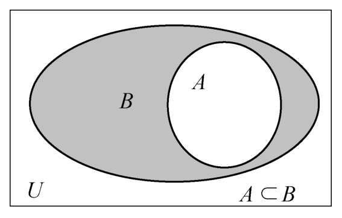

在本书中，我们把自然数的全体组成的集合称为自然数集，记作$\mathbf{N}$。由整数的全体构成的集合称为整数集，记为$\mathbf{Z}$。用$\mathbf{Q}$表示全体有理数构成的有理数集，$\mathbf{R}$表示全体实数构成的实数集。显然有$\mathbf{N}\subset\mathbf{Z}\subset\mathbf{Q}\subset\mathbf{R}$。

一般地，如果是正整数集，则记为$\mathbf{Z}^{+}$，负整数集记为$\mathbf{Z}^{-}$，以此类推。

**注**　在本书中所讨论的数集除特别说明外均为实数集。

### 1. 集合及其运算

集合的基本运算有四种：交、并、差、补。

设$A$，$B$是两个集合。

由同时包含于$A$与$B$的元素构成的集合（见图1-2），称为$A$与$B$的交集（简称交），记作$A\cap B$，即$A\cap B=\{x\,|\,x\in A\ \text{且}\ x\in B\}$；

由包含于$A$或包含于$B$的所有元素构成的集合（见图1-3），称为$A$与$B$的并集（简称并），记作$A\cup B$，即$A\cup B=\{x\,|\,x\in A\ \text{或}\ x\in B\}$；

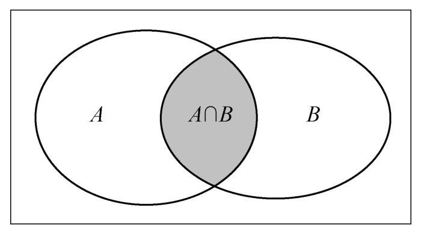

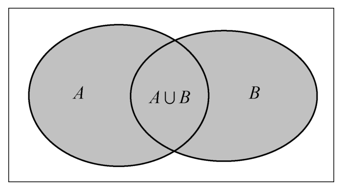

由包含于$A$但不包含于$B$的元素构成的集合（见图1-4），称为$A$与$B$的差集（简称差），记作$A\backslash B$，即$A\backslash B=\{x\,|\,x\in A\ \text{且}\ x\notin B\}$；

特别地，若我们所讨论的问题在某个集合（称为基本集或全集，一般记为$U$）中进行，集合$A$是$U$的子集（见图1-5），此时称$U\backslash A$为$A$的余集（或补集），记作$C_U A$或$A^C$。

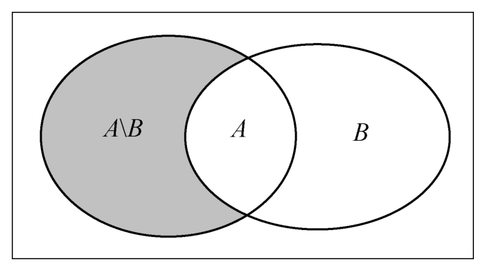

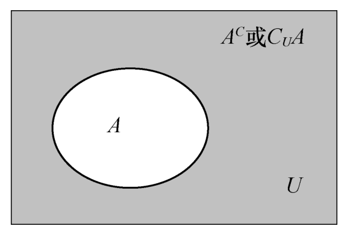

关于集合的余集，我们有如下性质。

**性质 1（对偶性质）**　设$U$是一个基本集，$A$，$B$是它的两个子集，则

（1）$(A\cup B)^C=A^C\cap B^C$；

（2）$(A\cap B)^C=A^C\cup B^C$。

除了集合的四种基本运算，我们还可以定义两个集合的乘积。

设$A$，$B$是两个非空的集合，则由有序数对$(x, y)$组成的集合

$$
A\times B=\{(x, y)\,|\,x\in A,\ y\in B\}
$$

称为$A$与$B$的直积。

例如，设$A=[0, 1]$，$B=[0, 2]$，则$A\times B=\{(x, y)\,|\,0\leqslant x\leqslant 1,\ 0\leqslant y\leqslant 2\}$，如图1-6所示。

$\mathbf{R}\times\mathbf{R}=\{(x, y)\,|\,x, y\in\mathbf{R}\}$即为$xOy$面上全体点的集合，$\mathbf{R}\times\mathbf{R}$常记作$\mathbf{R}^2$。

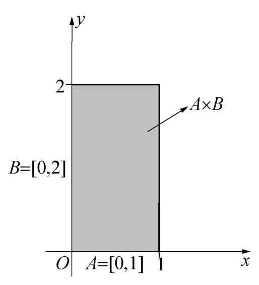

### 2. 区间

区间是高等数学课程中用得较多的一类数集。设$a$和$b$都是实数，且$a<b$，数集$\{x\,|\,a<x<b\}$称为开区间，记作$(a, b)$（见图1-7），即

$$
(a, b)=\{x\,|\,a<x<b\}.
$$

$a$和$b$称为开区间$(a, b)$的端点，其中$a$为左端点，$b$为右端点，且$a\notin(a, b)$，$b\notin(a, b)$。

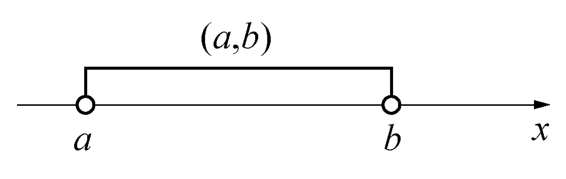

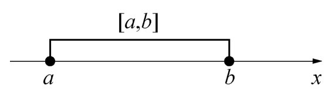

类似地，数集$\{x\,|\,a\leqslant x\leqslant b\}$称为闭区间，记作$[a, b]$（见图1-8），即

$$
[a, b]=\{x\,|\,a\leqslant x\leqslant b\}.
$$

$a$和$b$也称为闭区间$[a, b]$的端点，且$a\in[a, b]$，$b\in[a, b]$。

数集$\{x\,|\,a\leqslant x<b\}$及$\{x\,|\,a<x\leqslant b\}$称为半开区间，分别记作$[a, b)$和$(a, b]$（见图1-9和图1-10）。

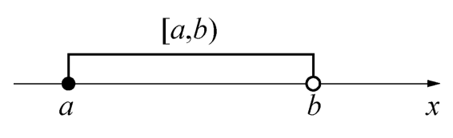

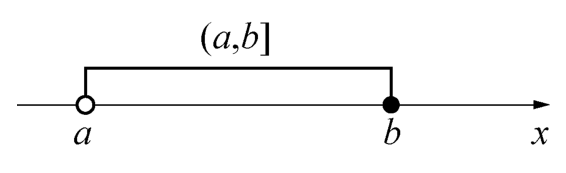

以上这些区间都称为有限区间，数$b-a$称为这些区间的长度。从数轴上看，这些区间是长度为有限的线段。

此外，对于这样的集合：$\{x\,|\,x\geqslant a\}$，$\{x\,|\,x>a\}$，$\{x\,|\,x\leqslant b\}$，$\{x\,|\,x<b\}$，我们引进记号$+\infty$（读作正无穷大）及$-\infty$（读作负无穷大），则可用类似于有限区间的记号来表示无限的半开区间或开区间：

$$
[a, +\infty)=\{x\,|\,x\geqslant a\},
(a, +\infty)=\{x\,|\,x>a\},
(-\infty, b]=\{x\,|\,x\leqslant b\},
(-\infty, b)=\{x\,|\,x<b\}.
$$

这些区间在数轴上表示长度无限的半直线，如图1-11～图1-14所示。

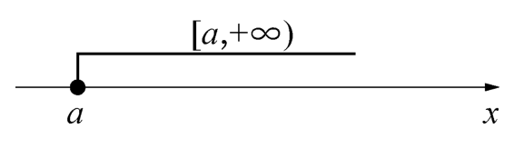

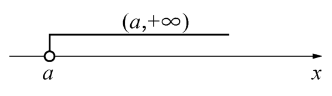

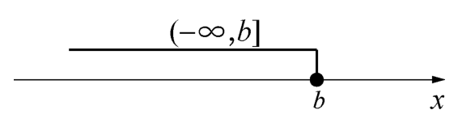

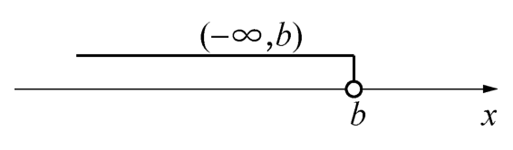

全体实数的集合$\mathbf{R}$也记作$(-\infty, +\infty)$，它也是无限的开区间。

以后如果不需要辨明所讨论的区间是开区间还是闭区间，是有限区间还是无限区间，我们就简单地称其为区间，用“$I$”代表各种类型的区间。

### 3. 邻域

设$a$与$\delta$为两个实数，且$\delta>0$，数集$\{x\,|\,|x-a|<\delta\}$称为点$a$的$\delta$邻域，记作$U(a, \delta)$，即

$$
U(a, \delta)=\{x\,|\,|x-a|<\delta\},
$$

其中$a$称作$U(a, \delta)$的中心，$\delta$称作$U(a, \delta)$的半径。

在数轴上，$|x-a|$表示点$x$与点$a$的距离，因此点$a$的$\delta$邻域$U(a, \delta)=\{x\,|\,|x-a|<\delta\}$在数轴上就表示与点$a$的距离小于$\delta$的点$x$的全体。由于$|x-a|<\delta$等价于$-\delta<x-a<\delta$，即$a-\delta<x<a+\delta$，所以

$$
U(a, \delta)=\{x\,|\,a-\delta<x<a+\delta\}.
$$

因此，$U(a, \delta)$也就是开区间$(a-\delta, a+\delta)$（见图1-15）。显然，这个开区间以点$a$为中心，长度为$2\delta$。

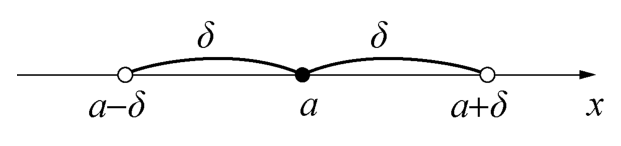

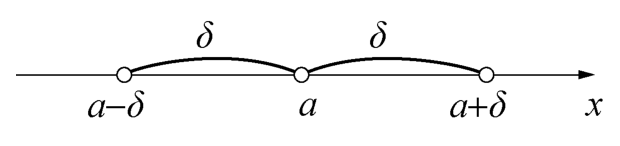

有时用到的邻域需要将邻域中心去掉（见图1-16），点$a$的$\delta$邻域去掉中心$a$后，称为点$a$的去心$\delta$邻域，记作$\mathring{U}(a, \delta)$，即

$$
\mathring{U}(a, \delta)=\{x\,|\,0<|x-a|<\delta\},
$$

这里，$0<|x-a|$就表示$x\neq a$。

为了方便，有时将开区间$(a-\delta, a)$称为$a$的左邻域，而将开区间$(a, a+\delta)$称为$a$的右邻域。

如果不强调半径，以点$a$为中心的任一开区间称为点$a$的邻域，记作$U(a)$。

### 二、常用函数

### 1. 基本初等函数

中学时我们已经学过的许多函数，比如幂函数、指数函数、对数函数、三角函数及反三角函数等，统称为**基本初等函数**。这些函数在高等数学课程中也将大量出现，我们在这里复习一下中学学过的相关知识，便于我们开始高等数学的学习。

（1）幂函数：$y=x^{\alpha}$（$\alpha$是常数）

当$\alpha\in\mathbf{Z}^{+}$时，$y=x^{\alpha}$的定义域是$\mathbf{R}$；当$\alpha\in\mathbf{Z}^{-}$时，$y=x^{\alpha}$的定义域是$\mathbf{R}\backslash\{0\}$（见图1-17）。

当$\alpha=\dfrac{1}{2}$时，$y=x^{\frac{1}{2}}=\sqrt{x}$的定义域是$[0, +\infty)$；当$\alpha=-\dfrac{1}{2}$时，$y=x^{-\frac{1}{2}}=\dfrac{1}{\sqrt{x}}$的定义域是$(0, +\infty)$。幂函数的最小定义域是$(0, +\infty)$。

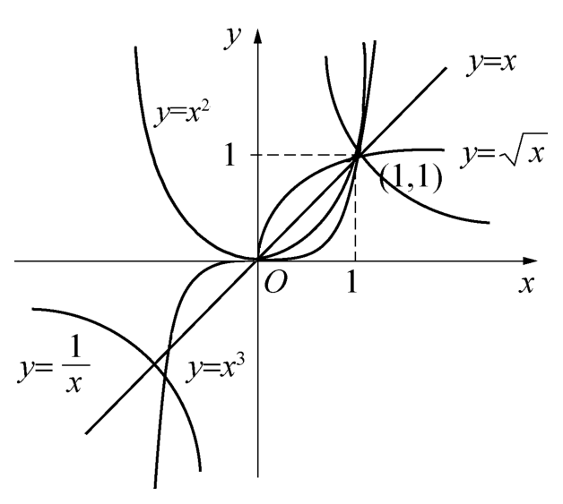

（2）指数函数：$y=a^{x}$（$a>0$，$a\neq 1$）

如图1-18、图1-19所示，由于对任意$x$，$a^{x}>0$，且$a^{0}=1$，故指数函数的图像在$x$轴的上方，且通过点$(0, 1)$。

当$a>1$时，$y=a^{x}$是单调增加函数；当$0<a<1$时，$y=a^{x}$是单调减少函数。

以$\mathrm{e}=2.718\ 281\ 8\cdots$为底的指数函数记为$y=\mathrm{e}^{x}$，在工程技术上经常用到这个指数函数。

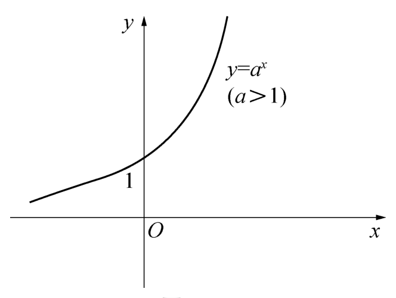

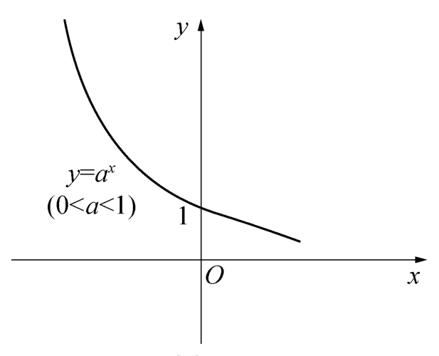

（3）对数函数：$y=\log_{a}x$（$a>0$，$a\neq 1$）

对数函数$y=\log_{a}x$（$a>0$，$a\neq 1$）的定义域是$(0, +\infty)$，其图像位于$y$轴的右方且通过点$(1, 0)$。当$a>1$时，$y=\log_{a}x$是单调增加函数（见图1-20）；当$0<a<1$时，$y=\log_{a}x$是单调减少函数（见图1-21）。当$a=\mathrm{e}$时的对数函数记为$y=\ln x$，称为自然对数函数。

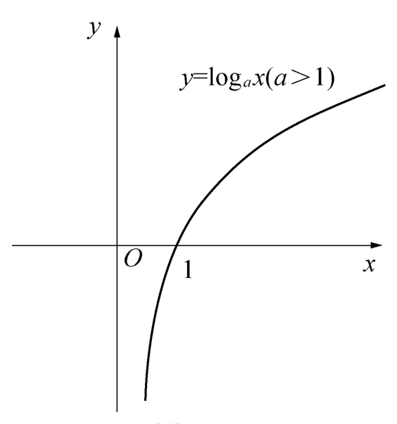

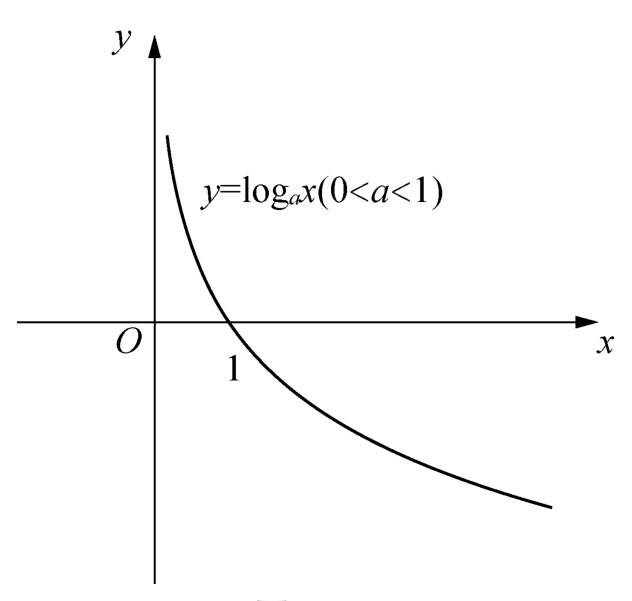

对数具有以下运算性质：对任意的$x$，$y\in\mathbf{R}^{+}$，$a>0$，$a\neq 1$，$b\in\mathbf{R}$，

（ⅰ）$\log_{a}x+\log_{a}y=\log_{a}xy$；

（ⅱ）$\log_{a}x-\log_{a}y=\log_{a}\dfrac{x}{y}$；

（ⅲ）$\log_{a}x^{b}=b\log_{a}x$。

$y=\log_{a}x$和$y=a^{x}$互为反函数，它们的图像关于直线$y=x$对称，且有$a^{\log_{a}x}=x$。进一步，我们在以后的计算中经常会用到

$$
\mathrm{e}^{\ln x}=x\ \text{和}\ \mathrm{e}^{a\ln x}=\mathrm{e}^{\ln x^{a}}=x^{a}.
$$

（4）三角函数

正弦函数$y=\sin x$，余弦函数$y=\cos x$，正切函数$y=\tan x$，余切函数$y=\cot x$，正割函数$y=\sec x$和余割函数$y=\csc x$统称为**三角函数**。

$y=\sin x$的定义域是$\mathbf{R}$，值域是$[-1, 1]$，最小正周期是$2\pi$，它是奇函数（见图1-22）；

$y=\cos x$的定义域是$\mathbf{R}$，值域是$[-1, 1]$，最小正周期是$2\pi$，它是偶函数（见图1-23）；

$y=\tan x$的定义域是$\left\{x\,|\,x\neq\dfrac{\pi}{2}+k\pi,\ k=0, \pm 1, \pm 2, \cdots\right\}$，值域是$(-\infty, +\infty)$，最小正周期是$\pi$，在定义域上是奇函数（见图1-24）；

$y=\cot x$的定义域是$\{x\,|\,x\neq k\pi,\ k=0, \pm 1, \pm 2, \cdots\}$，值域是$(-\infty, +\infty)$，最小正周期是$\pi$，它是奇函数（见图1-25）；

正割、余割函数与余弦、正弦函数的关系式为

$$
y=\sec x=\frac{1}{\cos x},\qquad y=\csc x=\frac{1}{\sin x}.
$$

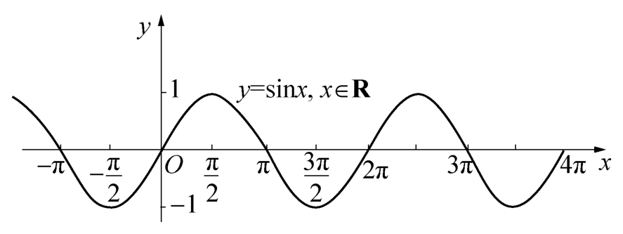

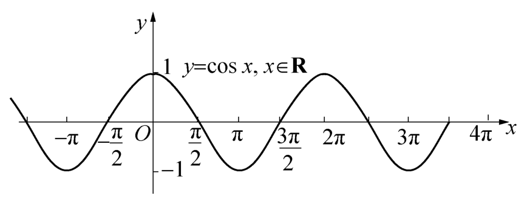

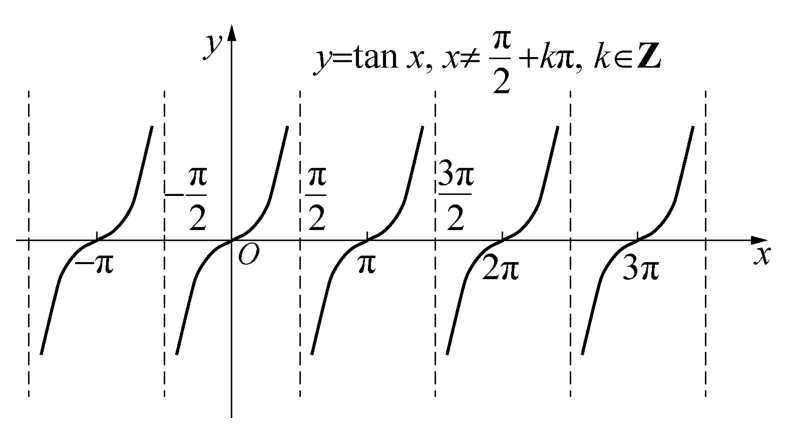

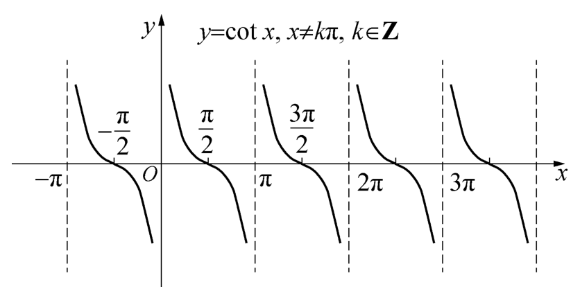

（5）反三角函数

**定义 1**　在区间$\left[-\dfrac{\pi}{2}, \dfrac{\pi}{2}\right]$上的正弦函数的反函数记作$y=\arcsin x$，定义域为$[-1, 1]$，值域为$\left[-\dfrac{\pi}{2}, \dfrac{\pi}{2}\right]$，称为反正弦函数（见图1-26）；

**定义 2**　在区间$[0, \pi]$上的余弦函数的反函数记作$y=\arccos x$，定义域为$[-1, 1]$，值域为$[0, \pi]$，称为反余弦函数（见图1-27）；

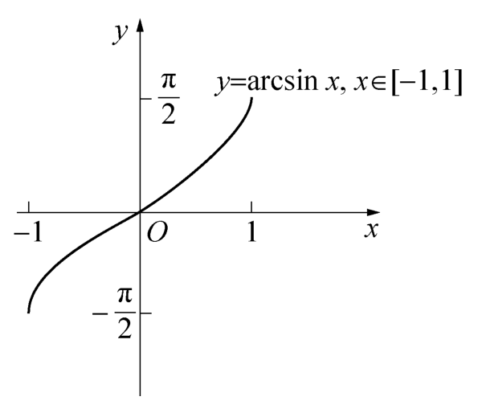

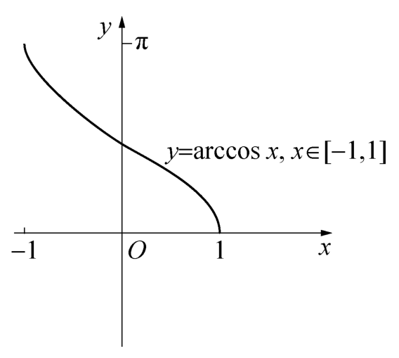

**定义 3**　在区间$\left(-\dfrac{\pi}{2}, \dfrac{\pi}{2}\right)$上的正切函数$y=\tan x$的反函数记作$y=\arctan x$，定义域是$(-\infty, +\infty)$，值域为$\left(-\dfrac{\pi}{2}, \dfrac{\pi}{2}\right)$，称为反正切函数，在整个定义域上是单调递增函数（见图1-28）；定义在区间$(0, \pi)$上的余切函数$y=\cot x$的反函数为$y=\text{arccot}\,x$，定义域是$(-\infty, +\infty)$，值域为$(0, \pi)$，称为反余切函数，在整个定义域上是单调递减函数（见图1-29）。

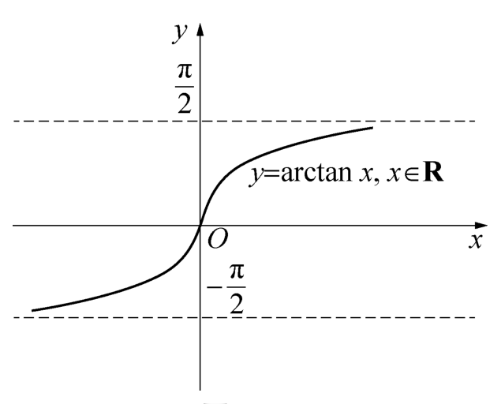

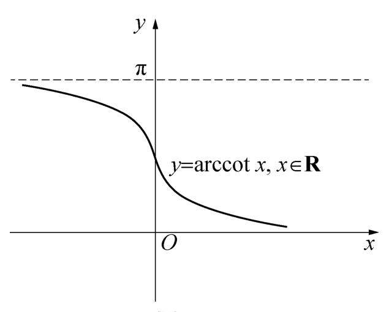

三角函数的反函数统称为反三角函数。

### 2. 几类特殊的函数

除五类基本函数以外，我们还需要了解下列函数。

**例 1**　函数$y=C$，其中$C$为某确定的常数。它的定义域为$D=(-\infty, +\infty)$，值域为$W=\{C\}$，它的图形是一条平行于$x$轴的直线（见图1-30），这个函数称为常数函数。

**例 2**　函数$y=|x|=\begin{cases}x, & x\geqslant 0,\\ -x, & x<0\end{cases}$的定义域为$D=(-\infty, +\infty)$，值域$W=[0, +\infty)$，它的图形如图1-31所示，这个函数称为绝对值函数。

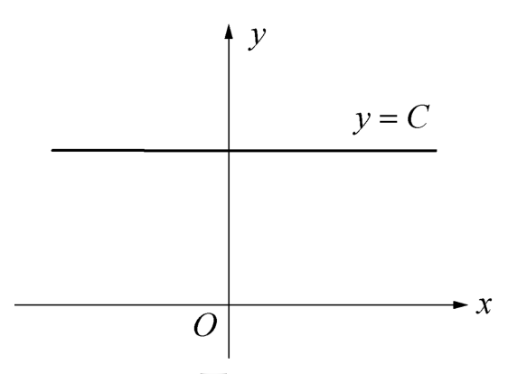

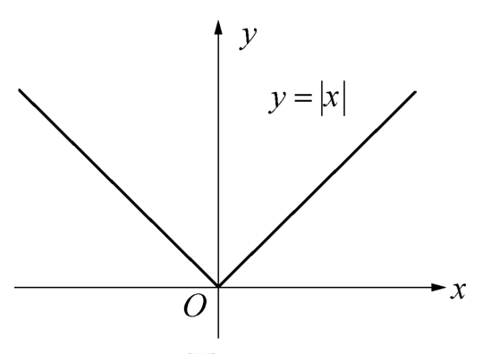

**例 3**　函数$y=\mathrm{sgn}\,x=\begin{cases}1, & x>0,\\ 0, & x=0,\\ -1, & x<0\end{cases}$的定义域为$D=(-\infty, +\infty)$，值域$W=\{-1, 0, 1\}$，它的图形如图1-32所示，这个函数称为符号函数。

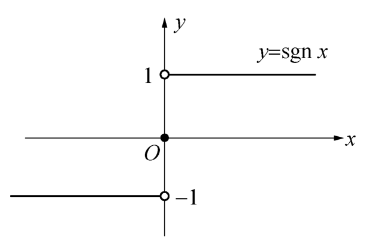

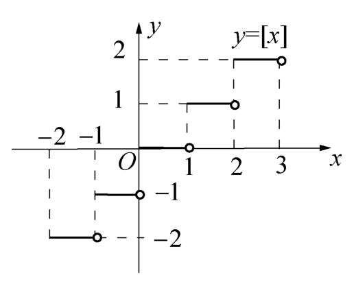

对于任何实数$x$，关系式$x=\mathrm{sgn}\,x\cdot|x|$恒成立。

**例 4**　设$x$为任一实数，不超过$x$的最大整数称为$x$的整数部分，记作$[x]$。函数$y=[x]$的定义域为$D=(-\infty, +\infty)$，值域为整数集$\mathbf{Z}$，它的图形如图1-33所示。可以看出，它的图形在$x$的整数值处出现跳跃，而跃度为1，这个函数称为取整函数。

比如，$[0.5]=0$，$[\sqrt{3}]=1$，$[-0.5]=-1$，一般地，有

$$
[x]=n,\ \text{当}\ x\in[n, n+1),\ n=0, \pm 1, \pm 2, \cdots.
$$

在例2、例3等例子中看到，有时一个函数要用几个式子表示，这种自变量在不同变化范围中，对应法则用不同的式子来表示的函数称为分段函数。分段函数在实际问题中经常出现，我们应重视对它的研究。

**例 5**　函数$f(x)=\begin{cases}x^{3}, & x\geqslant 1,\\ x-1, & x<1\end{cases}$是一个分段函数，它的定义域$D=(-\infty, +\infty)$。当$x\in(-\infty, 1)$时，对应的函数值$f(x)=x-1$；当$x\in[1, +\infty)$时，对应的函数值$f(x)=x^{3}$。它的图形如图1-34所示。

例如，$-1\in(-\infty, 1)$，则$f(-1)=-1-1=-2$；$1\in[1, +\infty)$，则$f(1)=1^{3}=1$。

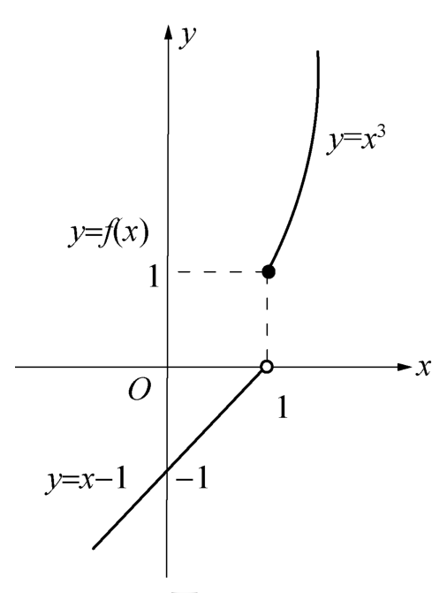

### 3. 初等函数

我们把由常数和基本初等函数经过有限次的四则运算和有限次函数复合所构成的，并可以用一个算式表示的函数统称为**初等函数**。例如，$y=\sin\dfrac{1}{x}$，$y=\sqrt{x^{2}-1}$都是初等函数，本书中讨论的函数基本上都是初等函数。对于初等函数，我们来研究一下它们的表达式和定义域。

**例 6**　设$f(x)=2^{x}$，$g(x)=\dfrac{1}{1-x}$，$x\neq 0$，$x\neq 1$，求$f[g(x)]$，$g[f(x)]$和$f[f(x)]$。

**解**　$f[g(x)]=2^{g(x)}=2^{\frac{1}{1-x}}(x\neq 1)$。

$$
g[f(x)]=\frac{1}{1-f(x)}=\frac{1}{1-2^{x}}(x\neq 0).
f[f(x)]=2^{f(x)}=2^{2^{x}}(x\in\mathbf{R}).
$$

**例 7**　求函数$y=\sqrt{\ln(x^{2}-3)}$的定义域。

**解**　所给函数由$y=\sqrt{u}$，$u=\ln v$，$v=x^{2}-3$复合而成。$y=\sqrt{u}$的定义域是$[0, +\infty)$，即$\ln v\geqslant 0$，从而$v=x^{2}-3\geqslant 1$。解这个关于$x$的不等式，得$|x|\geqslant 2$。因此，函数$y=\sqrt{\ln(x^{2}-3)}$的定义域为$(-\infty, -2]\cup[2, +\infty)$。

**例 8**　设$f(x)$的定义域是$(0, 1)$，求$f(\sin x)$的定义域。

**解**　函数$f(\sin x)$由$f(u)$，$u=\sin x$复合而成。因为$f(u)$的定义域为$(0, 1)$，故必有$u=\sin x$的值域是$(0, 1)$，即$\sin x\in(0, 1)$。因此，开区间$(2n\pi, (2n+1)\pi)(n\in\mathbf{Z})$的并即为$f(\sin x)$的定义域。

### 习题 1-1

1. 设$A$，$B$分别为下列两个给定的集合：

（1）$A=\{1, 2, 3, 4, 5\}$，$B=\{2, 4, 6, 8\}$；

（2）$A=\mathbf{Z}^{+}$，$B=\mathbf{N}$；

（3）$A=\{x\,|\,3<x<5\}$，$B=\{x\,|\,x>4\}$；

（4）$A=\{x\,|\,x^{2}+x-6<0\}$，$B=\{x\,|\,x^{2}-2x-3\leqslant 0\}$；

试求$A\cup B$，$A\cap B$，$A\backslash B$，$B\backslash A$。

2. 设$U=\{1, 2, 3, 4, 5, 6, 7\}$，$A=\{2, 3, 4\}$，$B=\{3, 6, 7\}$，求$A^{C}$，$B^{C}$，$A^{C}\cap B^{C}$，$(A\cup B)^{C}$。

3. 设$A$，$B$都是集合$U=\{1, 2, 3, 4, 5, 6, 7, 8, 9\}$的子集，且$A^{C}\cap B^{C}=\{1, 3, 7, 9\}$，试求$A\cup B$。

4. 用区间表示适合下列不等式的变量$x$的变化范围：

（1）$2<x\leqslant 6$；　　　　　　　　（2）$|x|<3$；

（3）$|x-2|<\dfrac{1}{10}$；　　　　　　（4）$|x|>100$；

（5）$0<|x-1|<0.01$；　　　　　　（6）$0<|x-2|\leqslant 5$。

5. 设$x\in U(1, \delta)$时，$|2x-2|<\varepsilon$，当$\varepsilon$分别等于$0.1$和$0.01$时，求邻域半径$\delta$各等于多少。

6. 求下列函数的定义域：

（1）$y=\dfrac{x+3}{\sqrt{x^{2}-5x+6}}$；　　　　　　（2）$y=4\sqrt{3x+2}+2\arcsin\dfrac{x-1}{2}$；

（3）$y=\sqrt{x}+\sqrt[3]{\dfrac{1}{x-2}}$；　　　　　　（4）$y=\ln\dfrac{1}{1-x}+\sqrt{x+2}$；

（5）$y=\dfrac{2}{|x|-x}+\sqrt{\ln(3+x)}$；　　　　　　（6）$y=\dfrac{1}{[x+1]}$；

（7）$y=f(x^{2}+1)$，其中$f(x)$的定义域是$[1, 2]$；

（8）$y=f(\sin x)+f(\ln x)$，其中$f(x)$的定义域是$[0, 1)$。

7. 设$f(x)=\begin{cases}\sin x, & -2<x<0,\\ 1+x^{2}, & 0\leqslant x<2,\end{cases}$求$f(1)$，$f\left(\dfrac{\pi}{2}\right)$，$f\left(-\dfrac{\pi}{4}\right)$，$f(-3)$。

8. 设$f(x)=\sqrt{\sin x+2\cos^{2}x}$，求$f\left(\dfrac{\pi}{2}\right)$，$f\left(-\dfrac{\pi}{2}\right)$。

9. 设$f(x)=\sqrt{x^{2}-1}$，$g(x)=\sqrt{1-x^{2}}$，求$f[g(x)]$，$g[f(x)]$。

10. 设$f(x)=\dfrac{1}{1-x}(x\neq 0,\ x\neq 1)$，求$f[f(x)]$和$f\{f[f(x)]\}$。

11. 设$f\left(\dfrac{1-x}{x}\right)=\dfrac{1}{x}+\dfrac{x^{2}}{2x^{2}-2x+1}-1(x\neq 0)$，求$f(x)$。

12. 设$f(x)=3x^{2}+4x$，$\varphi(t)=\lg(1+t)$，求$f[\varphi(t)]$，$\varphi[f(x)]$及其定义域。

13. 已知函数$f(x)=\begin{cases}x^{2}, & 0\leqslant x<1,\\ 1, & 1\leqslant x<2,\\ 4-x, & 2\leqslant x\leqslant 4.\end{cases}$

（1）写出$f(x)$的定义域，并画出函数$f(x)$的图形；

（2）求$f(0)$，$f(1.2)$，$f(3)$，$f(4)$。

14. 设$f(x)=\begin{cases}1+x, & x<0,\\ \mathrm{e}^{x}, & x\geqslant 0,\end{cases}$求复合函数$f[f(x)]$。

15. 试将函数$f(x)=2|x-2|+|x-1|$表示成分段函数，并画出它的图像。

## 第二节 数列极限的定义与计算

［课前导读］

极限的概念是为求某些实际问题的精确解答而产生的。有许多实际问题的精确解，仅仅通过有限次的算术运算是求不出的，而需要考察一个无限变化过程，由此产生了极限的理论与方法。这一节介绍数列极限的定义，怎样用定义来证明极限，以及数列极限的计算方法。在正式介绍极限的定义之前，需要回顾一下数列的相关知识。

数列$\{x_n\}$：$x_1$，$x_2$，$x_3$，$\cdots$，$x_n$，$\cdots$，我们把这无穷多个数排成的序列称为数列，其中$x_1$称为数列的首项，$x_n$称为数列的第$n$项，或称为数列的一般项（通项）。

等差数列$\{x_n\}$：公差$d=x_n-x_{n-1}\in\mathbf{R}$，通项公式为$x_n=x_1+(n-1)d$，

$$
\text{前}\ n\ \text{项求和公式为}\ S_n=\frac{n(x_1+x_n)}{2}.
$$

等比数列$\{x_n\}$：公比$q=\dfrac{x_n}{x_{n-1}}$，通项公式为$x_n=x_1\cdot q^{n-1}$，

$$
\text{前}\ n\ \text{项求和公式为}\ S_n=\frac{x_1(1-q^{n})}{1-q}.
$$

### 一、数列极限的概念

### 1. 数列极限的引入

> 一尺之棰，日取其半，万世不竭。
>
> ——《庄子·天下篇》

一尺长的木棍，每天截掉一半，每天截取的长度按照天数可排成一个数列：

$$
\frac{1}{2},\ \frac{1}{2^{2}},\ \frac{1}{2^{3}},\ \cdots,\ \frac{1}{2^{n}},\ \cdots,
$$

数列的通项为$\dfrac{1}{2^{n}}$。当$n$无限增大（记作$n\to\infty$，读作$n$趋于无穷大）时，$\dfrac{1}{2^{n}}$无限接近一个确定的数0。在数学上称这个确定的数0是数列$\left\{\dfrac{1}{2^{n}}\right\}$当$n\to\infty$时的极限。

解决实际问题时，经常用到极限方法。极限方法作为高等数学中的一种基本方法，很有必要做进一步详细的讨论。先看下面的4个数列。

（1）$1$，$\dfrac{1}{2}$，$\dfrac{1}{3}$，$\cdots$，$\dfrac{1}{n}$，$\cdots$；

（2）$1$，$3$，$3^{2}$，$\cdots$，$3^{n-1}$，$\cdots$；

（3）$1$，$-1$，$1$，$\cdots$，$(-1)^{n-1}$，$\cdots$；

（4）$2$，$\dfrac{1}{2}$，$\dfrac{4}{3}$，$\cdots$，$\dfrac{n+(-1)^{n+1}}{n}$，$\cdots$。

它们的一般项依次为

$$
\frac{1}{n},\ 3^{n-1},\ (-1)^{n-1},\ \frac{n+(-1)^{n+1}}{n}.
$$

在几何上，数列$\{x_n\}$可看作数轴上的一个动点，如图1-35所示，它依次取数轴上的点$x_1$，$x_2$，$x_3$，$\cdots$，$x_n$，$\cdots$。

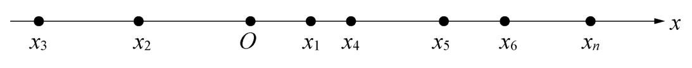

按函数的定义，数列$\{x_n\}$可看作自变量为正整数$n$的函数，即

$$
x_n=f(n),
$$

它的定义域是全体正整数。当自变量$n$依次取$1, 2, 3, \cdots$时，对应的函数值就排列成数列$\{x_n\}$。

现在我们所关心的问题是：

（1）给定一个数列后，该数列的变化趋势如何？随着$n$的无限增大，$x_n$能否无限接近某个常数？

（2）如果能无限接近某个确定的数，则该常数是多少？

可以看出，在前面所列的4个数列中，当$n\to\infty$时，数列（1）的一般项$x_n=\dfrac{1}{n}$将无限接近于常数0。数列（4）的一般项$x_n=\dfrac{n+(-1)^{n+1}}{n}=1+\dfrac{(-1)^{n+1}}{n}$将无限接近于常数1。而数列（2）的一般项$x_n=3^{n-1}$却在无限增大，它不接近于任何确定的数值。数列（3）的一般项$x_n=(-1)^{n-1}$始终交替地取值为1和$-1$，不接近于任何确定的数值。据此，我们可以认为，数列（1）和（4）是“有极限”的，而数列（2）和（3）是“无极限”的。

从上述各例观察可以看到，数列的一般项变化趋势有两种情况：无限接近于某个确定的常数和不接近于任何确定的常数。这样就可以得到数列的描述性定义。

如果当数列$\{x_n\}$的项数$n$无限增大时，它的一般项$x_n$无限接近于一个确定的常数$a$，则称$a$为数列$\{x_n\}$的极限。此时也称数列$\{x_n\}$收敛于$a$，记作$\lim\limits_{n\to\infty}x_n=a$，或$x_n\to a(n\to\infty)$。例如，$\lim\limits_{n\to\infty}\dfrac{n+(-1)^{n+1}}{n}=1$。

如果当数列$\{x_n\}$的项数$n$无限增大时，它的一般项$x_n$不接近于任何确定的常数，则称数列$\{x_n\}$没有极限，或称数列$\{x_n\}$发散，习惯上记作$\lim\limits_{n\to\infty}x_n$不存在。例如，$\lim\limits_{n\to\infty}(-1)^{n-1}$不存在。

当数列$\{x_n\}$的项数$n$无限增大时，如果$|x_n|$也无限增大，则数列$\{x_n\}$没有极限。此时，习惯上也称数列$\{x_n\}$的极限是无穷大，记作$\lim\limits_{n\to\infty}x_n=\infty$。例如，$\lim\limits_{n\to\infty}3^{n-1}=\infty$。

### 2. 数列极限的定义

在上述极限的描述性定义中，我们都是用“无限增大”和“无限接近”来描述极限概念的。为了给极限一个精确的定义，关键是要给予“无限增大”和“无限接近”以定量的刻画。

一般来说，两个数$a$、$b$的接近程度可用$|b-a|$来度量。

我们以数列$\{x_n\}$：$x_n=\dfrac{n+(-1)^{n+1}}{n}=1+\dfrac{(-1)^{n+1}}{n}$为例。

考虑$|x_n-1|=\left|\dfrac{(-1)^{n+1}}{n}\right|=\dfrac{1}{n}$，显然，$n$越大，$x_n$就越“接近”1。只要$n$足够大，$|x_n-1|$就可以小于任何给定的正数。如果要求$|x_n-1|<\dfrac{1}{100}$，即$\dfrac{1}{n}<\dfrac{1}{100}$，只要$n>100$，这时$x_{101}$，$x_{102}$，$\cdots$均能使不等式$|x_n-1|<\dfrac{1}{100}$成立。同样，如果要求$|x_n-1|<\dfrac{1}{10\ 000}$，即$\dfrac{1}{n}<\dfrac{1}{10\ 000}$，只要$n>10\ 000$，这时$x_{10\ 001}$，$x_{10\ 002}$，$\cdots$均能使不等式$|x_n-1|<\dfrac{1}{10\ 000}$成立。

一般地，不论给定的正数$\varepsilon$多么小，总存在一个正整数$N$，使得对于$n>N$时的一切$n$，不等式$|x_n-1|<\varepsilon$均成立，这就是数列$x_n=\dfrac{n+(-1)^{n+1}}{n}$当$n\to\infty$时无限“接近”于1的精确刻画，这个数1就是$x_n$的极限。

**定义**　设$\{x_n\}$为一数列，如果存在一个常数$a\in\mathbf{R}$，对于任意给定的正数$\varepsilon$，总存在一个正整数$N$，使得对于$n>N$时的一切$n$，不等式$|x_n-a|<\varepsilon$均成立，则称常数$a$是数列$\{x_n\}$的极限，或者称数列$\{x_n\}$收敛于$a$，记作

$$
\lim_{n\to\infty}x_n=a,\ \text{或}\ x_n\to a(n\to\infty).
$$

如果这样的常数$a$不存在，就称数列没有极限，或称数列发散。

我们用“$\forall$”表示“任意的”，用“$\exists$”表示“存在”，就可以用更简洁的语言来描述数列的极限。

如果$\forall\varepsilon>0$，$\exists N\in\mathbf{Z}^{+}$，当$n>N$时，恒有$|x_n-a|<\varepsilon$，则$\lim\limits_{n\to\infty}x_n=a$。

**注**　（1）定义中，$\varepsilon$刻画了$x_n$和$a$的接近程度，$\varepsilon$的“任意”性极其重要。只有这样，$|x_n-a|<\varepsilon$才能体现$x_n$和$a$的“无限接近”；

（2）正整数$N$与任意给定的正数$\varepsilon$有关。对于给定的$\varepsilon$，相应的$N$不是唯一的，即只要其存在，并没有要求其达到最小；

（3）由定义也可看出，$\{x_n\}$的极限是否存在仅与它的发展趋势有关。只要从某项$N$开始，$|x_n-a|<\varepsilon$即可，与前有限项的变化无关。

下面给出“数列$\{x_n\}$的极限为$a$”的几何解释。

若在数轴上标出$x_1$，$x_2$，$\cdots$，$x_n$，$\cdots$及$a$，再作$a$的$\varepsilon$邻域$(a-\varepsilon, a+\varepsilon)$（见图1-36），就会发现，当$n>N$时，点$x_n$均落在$(a-\varepsilon, a+\varepsilon)$内，至多有有限个（$N$个）落在$(a-\varepsilon, a+\varepsilon)$外。

必须指出，数列的定义可用于验证$a$是数列$\{x_n\}$的极限，但却无法用于求极限。

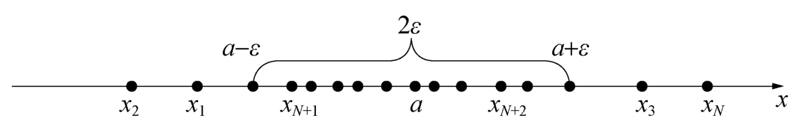

**例 1**　已知$x_n=\dfrac{1}{n}$，证明$\lim\limits_{n\to\infty}x_n=0$。

**证明**　$\forall\varepsilon>0$，要使

$$
|x_n-0|=\left|\frac{1}{n}-0\right|=\frac{1}{n}<\varepsilon,
$$

即$n>\dfrac{1}{\varepsilon}$，取$N=\left[\dfrac{1}{\varepsilon}\right]+1$，则当$n>N$时，恒有$|x_n-0|<\varepsilon$，故数列$\left\{\dfrac{1}{n}\right\}$的极限为0，即

$$
\lim_{n\to\infty}\frac{1}{n}=0.
$$

**例 2**　已知$x_n=\dfrac{1}{2^{n}}$，证明$\lim\limits_{n\to\infty}x_n=0$。

**证明**　$\forall\varepsilon>0$，（不妨设$\varepsilon<1$，想想为什么可以这样假设。）要使

$$
|x_n-0|=\left|\frac{1}{2^{n}}-0\right|=\frac{1}{2^{n}}<\varepsilon,
$$

即$2^{n}>\dfrac{1}{\varepsilon}$，等式两端同时取对数，$n\ln 2>\ln\dfrac{1}{\varepsilon}$，从而$n>\dfrac{\ln\frac{1}{\varepsilon}}{\ln 2}$，取$N=\left[\dfrac{\ln\frac{1}{\varepsilon}}{\ln 2}\right]+1$，则当$n>N$时，恒有$|x_n-0|<\varepsilon$，故数列$\left\{\dfrac{1}{2^{n}}\right\}$的极限为0，即

$$
\lim_{n\to\infty}\frac{1}{2^{n}}=0.
$$

由例2的证明可以发现，对于任意的$0<|q|<1$，都有$\lim\limits_{n\to\infty}q^{n}=0$。请感兴趣的读者自行证明。

### 二、数列极限的计算

极限的定义只能用来验证极限，而不能计算数列的极限，所以下面给出数列极限的运算法则。

**定理（数列极限的运算法则）**　若$\lim\limits_{n\to\infty}x_n=a$，$\lim\limits_{n\to\infty}y_n=b$，则

（1）$\lim\limits_{n\to\infty}(x_n\pm y_n)=\lim\limits_{n\to\infty}x_n\pm\lim\limits_{n\to\infty}y_n=a\pm b$；（加减法则）（2）$\lim\limits_{n\to\infty}(x_n\cdot y_n)=\lim\limits_{n\to\infty}x_n\cdot\lim\limits_{n\to\infty}y_n=a\cdot b$；（乘法法则）

（3）$\lim\limits_{n\to\infty}\sqrt{x_n}=\sqrt{\lim\limits_{n\to\infty}x_n}=\sqrt{a}(x_n\geqslant 0,\ a\geqslant 0)$；（交换法则）

（4）$\lim\limits_{n\to\infty}\dfrac{x_n}{y_n}=\dfrac{\lim\limits_{n\to\infty}x_n}{\lim\limits_{n\to\infty}y_n}=\dfrac{a}{b}(\lim\limits_{n\to\infty}y_n=b\neq 0)$。（除法法则）

定理的证明见第一章第四节。

**例 3**　求下列函数的极限：

（1）$\lim\limits_{n\to\infty}\dfrac{4-7n^{2}}{n^{2}+3}$；　　　　　　（2）$\lim\limits_{n\to\infty}\dfrac{1+2+3+\cdots+n}{n^{2}}$；

（3）$\lim\limits_{n\to\infty}\sqrt{\dfrac{n+1}{n}}$；　　　　　　（4）$\lim\limits_{n\to\infty}\left(\dfrac{1}{1\cdot 2}+\dfrac{1}{2\cdot 3}+\dfrac{1}{3\cdot 4}+\cdots+\dfrac{1}{(n-1)\cdot n}\right)$；

（5）$\lim\limits_{n\to\infty}(\sqrt{n+1}-\sqrt{n})$；　　　　　　（6）$\lim\limits_{n\to\infty}\left(1+\dfrac{1}{3}+\dfrac{1}{3^{2}}+\cdots+\dfrac{1}{3^{n-1}}\right)$。

**解**　（1）将分子、分母同时除以$n^{2}$，则有

$$
\lim_{n\to\infty}\frac{4-7n^{2}}{n^{2}+3}=\lim_{n\to\infty}\frac{\left(\frac{4}{n^{2}}\right)-7}{1+\left(\frac{3}{n^{2}}\right)}=\frac{0-7}{1+0}=-7.
$$

（2）利用等差数列求和公式，可得

$$
\lim_{n\to\infty}\frac{1+2+3+\cdots+n}{n^{2}}=\lim_{n\to\infty}\frac{\frac{n(n+1)}{2}}{n^{2}}=\lim_{n\to\infty}\frac{n(n+1)}{2n^{2}}=\frac{1}{2}.
$$

（3）利用数列的交换法则，可得

$$
\lim_{n\to\infty}\sqrt{\frac{n+1}{n}}=\sqrt{\lim_{n\to\infty}\left(1+\frac{1}{n}\right)}=\sqrt{1+0}=1.
$$

（4）由$\dfrac{1}{(n-1)n}=\dfrac{1}{n-1}-\dfrac{1}{n}$，可知

$$
\lim_{n\to\infty}\left(\frac{1}{1\cdot 2}+\frac{1}{2\cdot 3}+\frac{1}{3\cdot 4}+\cdots+\frac{1}{(n-1)\cdot n}\right)
=\lim_{n\to\infty}\left[\left(1-\frac{1}{2}\right)+\left(\frac{1}{2}-\frac{1}{3}\right)+\left(\frac{1}{3}-\frac{1}{4}\right)+\cdots+\left(\frac{1}{n-1}-\frac{1}{n}\right)\right]
=\lim_{n\to\infty}\left(1-\frac{1}{n}\right)=1.
$$

（5）先将分子有理化，再利用数列极限的运算法则，可得

$$
\lim_{n\to\infty}(\sqrt{n+1}-\sqrt{n})=\lim_{n\to\infty}\frac{(\sqrt{n+1}-\sqrt{n})(\sqrt{n+1}+\sqrt{n})}{\sqrt{n+1}+\sqrt{n}}=\lim_{n\to\infty}\frac{1}{\sqrt{n+1}+\sqrt{n}}=0.
$$

（6）利用等比数列求和公式，可得

$$
\lim_{n\to\infty}\left(1+\frac{1}{3}+\frac{1}{3^{2}}+\cdots+\frac{1}{3^{n-1}}\right)=\lim_{n\to\infty}\frac{1\cdot\left[1-\left(\frac{1}{3}\right)^{n}\right]}{1-\frac{1}{3}}=\frac{3}{2}\lim_{n\to\infty}\left[1-\left(\frac{1}{3}\right)^{n}\right]=\frac{3}{2}.
$$

### 习题 1-2

1. 下列各题中的数列$\{x_n\}$，哪些收敛？哪些发散？对于收敛数列，通过观察得出数列的极限：

（1）$x_n=\dfrac{1}{a^{n}}(a>1)$；　　　　　　（2）$x_n=2^{\frac{1}{n}}$；

（3）$x_n=(-1)^{n}n$；　　　　　　（4）$x_n=\dfrac{n+2}{n+3}$；

（5）$x_n=\dfrac{n}{2^{n}}$；　　　　　　（6）$x_n=\ln\dfrac{1}{n}$；

（7）$x_n=\dfrac{n}{n^{2}+1}$；　　　　　　（8）$x_n=\dfrac{\sqrt{n^{2}+1}}{n}$；

（9）$x_n=0.\underbrace{999\cdots 9}_{n}$；　　　　　　（10）$x_n=\dfrac{\sin n}{(n+1)^{2}}$。

2. 计算下列极限：

（1）$\lim\limits_{n\to\infty}\dfrac{n^{2}-1}{2n^{2}+3n}$；　　　　　　（2）$\lim\limits_{n\to\infty}\dfrac{(n+1)(n+2)(n+3)}{2n^{3}}$；

（3）$\lim\limits_{n\to\infty}\dfrac{2^{n}+1}{3^{n}-1}$；　　　　　　（4）$\lim\limits_{n\to\infty}\dfrac{1^{2}+2^{2}+\cdots+n^{2}}{n^{3}}$；

（5）$\lim\limits_{n\to\infty}\left(\dfrac{1+2+\cdots+n}{n}-\dfrac{n}{2}\right)$；　　　　　　（6）$\lim\limits_{n\to\infty}(\sqrt{n^{2}+n}-\sqrt{n^{2}+1})$；

（7）$\lim\limits_{n\to\infty}(\sqrt{n^{2}+1}-n)$；　　　　　　（8）$\lim\limits_{n\to\infty}\left(\sqrt[n^{2}]{2}\cdot\sqrt[n^{2}]{2^{2}}\cdot\sqrt[n^{2}]{2^{3}}\cdot\cdots\cdot\sqrt[n^{2}]{2^{n}}\right)$；

（9）$\lim\limits_{n\to\infty}\left[\sqrt{1+2+\cdots+n}-\sqrt{1+2+\cdots+(n-1)}\right]$；

（10）$\lim\limits_{n\to\infty}\left(\sqrt{n+3\sqrt{n}}-\sqrt{n-\sqrt{n}}\right)$。

3. 已知$\lim\limits_{n\to\infty}\dfrac{n^{2016}}{n^{k}-(n-1)^{k}}=A\neq 0$，求$k$的值。

\*4. 下列说法作为$a$是数列$\{x_n\}$的极限，哪些是对的？哪些是错的？如果是对的，试说明理由；如果是错的，试给出一个反例。

（1）对于无穷多个$\varepsilon>0$，存在$N\in\mathbf{Z}^{+}$，当$n>N$时，使得不等式$|x_n-a|<\varepsilon$成立；

（2）对于任给的$\varepsilon>0$，任给$N\in\mathbf{Z}^{+}$，存在$n>N$，使得不等式$|x_n-a|<\varepsilon$成立；

（3）对于任给的$\varepsilon>0$，存在$N\in\mathbf{Z}^{+}$，当$n\geqslant N$时，使得不等式$|x_n-a|<\varepsilon$成立；

（4）对于任给的$\varepsilon>0$，存在$N\in\mathbf{Z}^{+}$，当$n>N$时，使得不等式$|x_n-a|<k\varepsilon$，$k\in\mathbf{R}^{+}$成立；

（5）对于任给的$m\in\mathbf{Z}^{+}$，存在$N\in\mathbf{Z}^{+}$，当$n>N$时，使得不等式$|x_n-a|<\dfrac{1}{m}$成立。

\*5. 下列结论是否成立？若成立，给出证明；若不成立，请举出反例。

（1）若$\lim\limits_{n\to\infty}x_n=a$，则$\lim\limits_{n\to\infty}|x_n|=|a|$；

（2）若$\lim\limits_{n\to\infty}|x_n|=|a|$，则$\lim\limits_{n\to\infty}x_n=a(a\neq 0)$；

（3）若$\lim\limits_{n\to\infty}x_n$不存在，$\lim\limits_{n\to\infty}y_n$不存在，则$\lim\limits_{n\to\infty}(x_n+y_n)$必不存在；

（4）若$\lim\limits_{n\to\infty}x_n$不存在，$\lim\limits_{n\to\infty}y_n$存在，则$\lim\limits_{n\to\infty}(x_n+y_n)$必不存在；

（5）若$\lim\limits_{n\to\infty}x_n$存在，$\lim\limits_{n\to\infty}y_n$不存在，则$\lim\limits_{n\to\infty}(x_n\cdot y_n)$必不存在；

（6）若$\lim\limits_{n\to\infty}x_n=a$，则$\lim\limits_{n\to\infty}\dfrac{x_{n+1}}{x_n}=1$。

## 第三节 函数极限的定义与计算

［课前导读］

这一节介绍函数极限的定义。在前一节，我们探讨了数列的极限。数列的通项可以看成一类特殊的函数$x_n=f(n)$，那么数列极限就变成了$\lim\limits_{n\to\infty}x_n=\lim\limits_{n\to\infty}f(n)=a$，这里$n\in\mathbf{Z}^{+}$。如果我们把函数的定义域扩充到$\mathbf{R}$，那么就变成了函数的极限$\lim\limits_{x\to\infty}f(x)=a$。

本节将介绍自变量趋于无穷大$(x\to\infty)$和自变量趋于固定值$(x\to x_0)$时的两种函数的极限。

### 一、自变量趋于无穷大时的极限

自变量趋于无穷大，包括三种情况：$x>0$且$|x|$无限增大，则记作$x\to+\infty$；$x<0$且$|x|$无限增大，则记作$x\to-\infty$；如果$x$既可以取正值，又可以取负值且$|x|$无限增大，则记作$x\to\infty$。

我们先观察函数$y=\dfrac{1}{x}$和$y=\arctan x$的图像。

对于函数$y=\dfrac{1}{x}$的图像（见图1-37），$|x|$无限增大时，曲线无限接近于$x$轴，即$y=0$。对于函数$y=\arctan x$的图像（见图1-38），当$x>0$且$|x|$无限增大时，曲线无限接近于直线$y=\dfrac{\pi}{2}$；而当$x<0$且$|x|$无限增大时，曲线无限接近于直线$y=-\dfrac{\pi}{2}$。

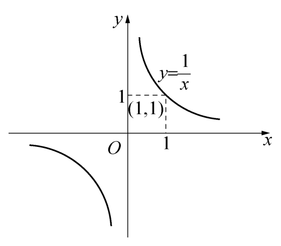

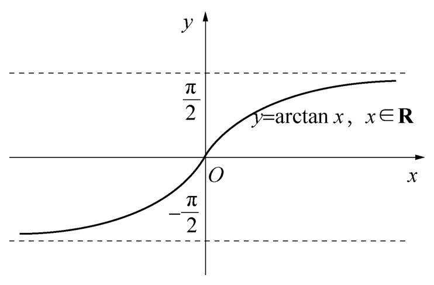

一般地，我们假设函数$f(x)$在$x>X$（$X$为某一正数）时有定义，如果在$x\to+\infty$过程中，对应的函数值$f(x)$无限接近确定的常数$A$，则称$A$为函数$f(x)$当$x\to+\infty$时的极限。精确地说，就有如下定义。

**定义 1** 设函数$f(x)$当$x$大于某一正数时有定义，如果存在常数$A$，对于任意给定的正数$\varepsilon$（不论它多么小），总存在正数$X$，使得当$x$满足不等式$x>X$时，对应的函数值$f(x)$都满足不等式$|f(x)-A|<\varepsilon$，则$A$就叫做函数$f(x)$当$x\to+\infty$时的极限，记作

$$
\lim_{x\to+\infty}f(x)=A\text{，或 }f(x)\to A\ (x\to+\infty).
$$

定义 1 也可简述为以下形式。

若$\forall\varepsilon>0$，$\exists X>0$，当$x>X$时，恒有$|f(x)-A|<\varepsilon$，则$\lim_{x\to+\infty}f(x)=A$。

同样，我们也可以定义当$x\to-\infty$时的函数$f(x)$的极限。

若$x<0$且$x\to\infty$，即$x\to-\infty$时，有$f(x)\to A$，或记为$\lim_{x\to-\infty}f(x)=A$，即

如果$\forall\varepsilon>0$，$\exists X>0$，当$x<-X$时，恒有$|f(x)-A|<\varepsilon$，则$\lim_{x\to-\infty}f(x)=A$。

当$\lim_{x\to-\infty}f(x)=A$且$\lim_{x\to+\infty}f(x)=A$时，我们就得到$x\to\infty$时的函数$f(x)$的极限定义。

如果$\forall\varepsilon>0$，$\exists X>0$，当$|x|>X$时，恒有$|f(x)-A|<\varepsilon$，则$\lim_{x\to\infty}f(x)=A$。

下面看一下极限$\lim_{x\to\infty}f(x)=A$的几何解释。

对任意给定的$\varepsilon>0$，作直线$y=A-\varepsilon$及$y=A+\varepsilon$，总存在$X>0$，当$|x|>X$时，$y=f(x)$的图形必位于这两直线之间（见图 1-39）。

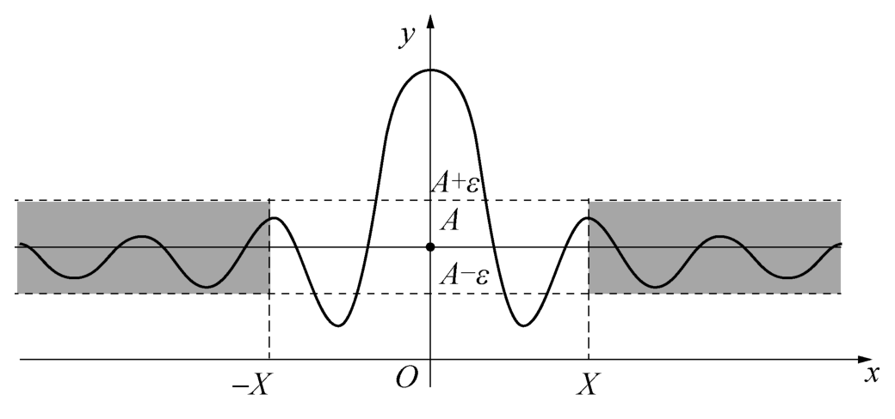

显然可以得到下面的结论。

**定理 1** $\lim_{x\to\infty}f(x)=A\Leftrightarrow\lim_{x\to+\infty}f(x)=A$且$\lim_{x\to-\infty}f(x)=A$。

很容易看出，

$$
\lim_{x\to+\infty}\frac{1}{x}=\lim_{x\to-\infty}\frac{1}{x}=\lim_{x\to\infty}\frac{1}{x}=0,
$$

直线$y=0$称为函数$y=\frac{1}{x}$图形的水平渐近线。

同理，$\lim_{x\to\infty}\arctan x$不存在，因为

$$
\lim_{x\to+\infty}\arctan x=\frac{\pi}{2}\text{，}\lim_{x\to-\infty}\arctan x=-\frac{\pi}{2}.
$$

直线$y=\frac{\pi}{2}$和$y=-\frac{\pi}{2}$称为函数$y=\arctan x$图形的水平渐近线。

**注** 一般地，如果$\lim_{x\to+\infty}f(x)=A$或$\lim_{x\to-\infty}f(x)=A$，那么称直线$y=A$为函数$y=f(x)$图形的水平渐近线。

**例 1** 证明$\lim_{x\to\infty}\frac{\sin x}{x}=0$。

**证明** $|f(x)-A|=\left|\frac{\sin x}{x}-0\right|=\frac{|\sin x|}{|x|}<\frac{1}{|x|}$。

对$\forall\varepsilon>0$，要使

$$
|f(x)-A|<\varepsilon,
$$

只需

$$
\frac{1}{|x|}<\varepsilon,
$$

即$|x|>\frac{1}{\varepsilon}$。取$X=\frac{1}{\varepsilon}$，则当$|x|>X$时，恒有

$$
\left|f(x)-A\right|=\left|\frac{\sin x}{x}-0\right|<\varepsilon,
$$

即

$$
\lim_{x\to\infty}\frac{\sin x}{x}=0.
$$

### 二、自变量趋于有限值时的极限

我们先看两个实例，再给出当$x\to x_0$（$x_0$为有限值）时函数极限的定义。

观察以下两个函数的图像，可以发现，对于函数$f(x)=x+1$，当$x$越来越接近 1 时，$f(x)$无限接近于常数 2，即当$x$从 1 的左侧或右侧趋向于 1 时，$|(x+1)-2|$可以无限接近于零（见图 1-40）；类似地，对$f(x)=\frac{x^2-1}{x-1}$，尽管$f(x)$在$x=1$处无定义，但当$x$从 1 的左侧或右侧趋向于 1 时，$f(x)$仍无限接近于常数 2，即$\left|\frac{x^2-1}{x-1}-2\right|$可以无限接近于零（见图 1-41）。

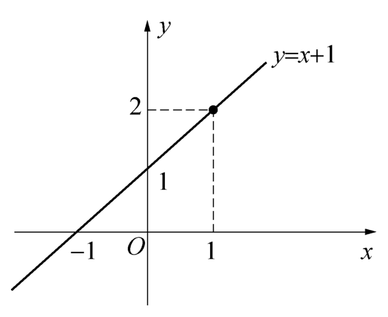

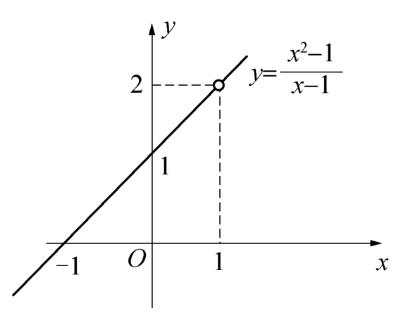

一般地，当$x\to x_0$时，$f(x)$无限接近于确定的数值$A$，则称$A$为$f(x)$在$x\to x_0$时的极限。所谓“$f(x)$无限接近于确定的数值”，实质上等价要求$|f(x)-A|$能任意小，而这“任意小”又可用$|f(x)-A|<\varepsilon$（其中$\varepsilon$为任给的正数）来刻画。又由于这“任意小”是在$x\to x_0$的过程中实现的，也就是仅要求$x$充分接近$x_0$时，使$|f(x)-A|<\varepsilon$就行了。

综上所述，得到$x\to x_0$时函数极限的定义。

**定义 2** 设函数$f(x)$在点$x_0$的某一去心邻域内有定义，如果存在常数$A$，对于任意给定的正数$\varepsilon$（不论它多么小），总存在正数$\delta$，使得当$x$满足不等式$0<|x-x_0|<\delta$时，对应的函数值$f(x)$都满足不等式$|f(x)-A|<\varepsilon$，则称$A$为函数$f(x)$在$x\to x_0$时函数的极限，记作

$$
\lim_{x\to x_0}f(x)=A\text{ 或 }f(x)\to A\ (x\to x_0).
$$

定义 2 也可简述为

$\forall\varepsilon>0$，$\exists\delta>0$，当$0<|x-x_0|<\delta$时，恒有$|f(x)-A|<\varepsilon$，那么$\lim_{x\to x_0}f(x)=A$。

**注** 这里$\delta$与$\varepsilon$、$x_0$有关。

$\lim_{x\to x_0}f(x)=A$的几何解释如下。

任意给定一正数$\varepsilon$，作平行于$x$轴的两直线：$y=A+\varepsilon$及$y=A-\varepsilon$。存在$\delta>0$，当$x\in(x_0-\delta,\ x_0+\delta)$（$x\ne x_0$）时，曲线$y=f(x)$位于两条直线$y=A+\varepsilon$及$y=A-\varepsilon$之间（见图 1-42）。

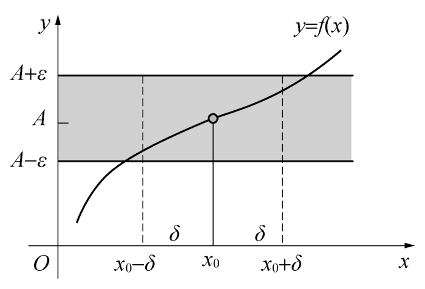

**例 2** 证明$\lim_{x\to x_0}x=x_0$。

**证明** $\forall\varepsilon>0$，要使

$$
|f(x)-A|=|x-x_0|<\varepsilon,
$$

只要取$\delta=\varepsilon$，则当$0<|x-x_0|<\delta$时，有$|f(x)-A|<\varepsilon$，因此$\lim_{x\to x_0}x=x_0$。

这个例子告诉我们，$y=x$当$x\to x_0$时的极限就是这一点的函数值$x_0$。比如，当$x\to 2$时，$y=x$的极限就是 2。

**例 3** 证明当$a>1$时，$\lim_{x\to 0}a^x=1$。

**证明** $\forall\varepsilon>0$，不妨设$\varepsilon<1$，要使$|a^x-1|<\varepsilon$，即$1-\varepsilon<a^x<1+\varepsilon$，只要

$$
-\log_a\frac{1}{1-\varepsilon}<x<\log_a(1+\varepsilon).
$$

取$\delta=\min\left\{\log_a\frac{1}{1-\varepsilon},\ \log_a(1+\varepsilon)\right\}$，则当$0<|x|<\delta$时，恒有

$$
|a^x-1|<\varepsilon,
$$

即

$$
\lim_{x\to 0}a^x=1.
$$

**注** 一般地，我们有$\lim_{x\to x_0}a^x=a^{x_0}$。

**例 4** 证明$\lim_{x\to x_0}\sqrt{x}=\sqrt{x_0}$（$x_0>0$）。

**证明** $\forall\varepsilon>0$，要使

$$
|f(x)-A|=|\sqrt{x}-\sqrt{x_0}|=\left|\frac{x-x_0}{\sqrt{x}+\sqrt{x_0}}\right|\leqslant\frac{1}{\sqrt{x_0}}|x-x_0|<\varepsilon,
$$

即

$$
|x-x_0|<\sqrt{x_0}\,\varepsilon,
$$

又要求$x\geqslant0$，即$|x-x_0|\leqslant x_0$，取$\delta=\min\{x_0,\ \sqrt{x_0}\,\varepsilon\}$，则当$0<|x-x_0|<\delta$时，恒有

$$
|f(x)-A|=|\sqrt{x}-\sqrt{x_0}|<\varepsilon.
$$

**注** 用同样的方法可以证明$\lim_{x\to x_0}\sqrt[3]{x}=\sqrt[3]{x_0}$。（这个结论可以推广到更一般的$n$次根式。）

上述$\lim_{x\to x_0}f(x)=A$中的“$x\to x_0$”是指$x$可以取$x_0$左侧的点（$x<x_0$）而趋于$x_0$，也可以取$x_0$右侧的点（$x>x_0$）而趋于$x_0$。有时我们只需考虑$x$从$x_0$的一侧（左侧或右侧）趋于$x_0$，这时就需要将上述情况分别讨论。

如果$x$仅从$x_0$的右侧趋于$x_0$（记作$x\to x_0^+$）时，$f(x)$趋于$A$，则称$A$为$f(x)$在$x\to x_0$时的右极限，记作

$$
f(x_0^+)=\lim_{x\to x_0^+}f(x)=\lim_{\substack{x\to x_0\\ x>x_0}}f(x)=A.
$$

如果$x$仅从$x_0$的左侧趋于$x_0$（记作$x\to x_0^-$）时，$f(x)$趋于$A$，则称$A$为$f(x)$在$x\to x_0$时的左极限，记作

$$
f(x_0^-)=\lim_{x\to x_0^-}f(x)=\lim_{\substack{x\to x_0\\ x<x_0}}f(x)=A.
$$

显然有$\lim_{x\to x_0}f(x)=A\Leftrightarrow f(x_0^+)=f(x_0^-)=A$。

因此如果$f(x_0^+)$、$f(x_0^-)$中有一个不存在，或两个虽存在但不相等，则$\lim_{x\to x_0}f(x)$不存在。

例如，函数

$$
f(x)=\begin{cases}
x-1, & x<0,\\
0, & x=0,\\
x+1, & x>0.
\end{cases}
$$

由于$f(0^+)=\lim_{x\to 0^+}f(x)=\lim_{x\to 0^+}(x+1)=1$，

$f(0^-)=\lim_{x\to 0^-}f(x)=\lim_{x\to 0^-}(x-1)=-1$，

则$\lim_{x\to 0}f(x)$不存在（见图 1-43）；

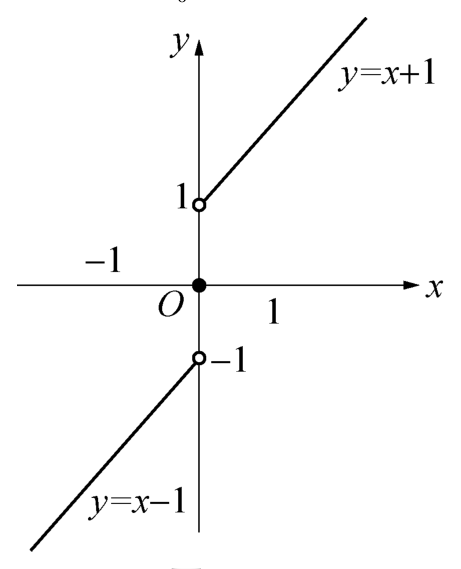

再比如，$\lim_{x\to 0}\frac{|x|}{x}$不存在，因为

$$
\lim_{x\to 0^+}\frac{|x|}{x}=\lim_{x\to 0^+}\frac{x}{x}=1,
\lim_{x\to 0^-}\frac{|x|}{x}=\lim_{x\to 0^-}\frac{-x}{x}=-1.
$$

### 三、函数极限的计算方法

极限的定义只能用来验证函数的已知极限，那么如何计算（求）函数的极限呢？要讨论极限的求法，首先要建立相关的一些运算规则，比如极限的四则运算法则、复合函数的极限运算法则等。有了这些工具，我们就可求函数的极限了。我们以$x\to x_0$为例，讨论函数极限的性质。

**定理 2（函数极限的四则运算法则）** 设$\lim_{x\to x_0}f(x)=A$，$\lim_{x\to x_0}g(x)=B$，则

（1）$\lim_{x\to x_0}[f(x)\pm g(x)]=A\pm B=\lim_{x\to x_0}f(x)\pm\lim_{x\to x_0}g(x)$；

（2）$\lim_{x\to x_0}[f(x)\cdot g(x)]=A\cdot B=\lim_{x\to x_0}f(x)\cdot\lim_{x\to x_0}g(x)$；

（3）$\lim_{x\to x_0}\frac{f(x)}{g(x)}=\frac{A}{B}=\frac{\lim_{x\to x_0}f(x)}{\lim_{x\to x_0}g(x)}$（$B\ne0$）。

定理 2 的证明见第一章第四节。

**推论** 若$\lim_{x\to x_0}f(x)$，$\lim_{x\to x_0}g(x)$存在，则

（1）$\lim_{x\to x_0}[\alpha f(x)+\beta g(x)]=\alpha\lim_{x\to x_0}f(x)+\beta\lim_{x\to x_0}g(x)$；

（2）$\lim_{x\to x_0}[f(x)]^n=[\lim_{x\to x_0}f(x)]^n$（$n\in\mathbf{Z}^+$）；

（3）若$f(x)\geqslant0$，则$\lim_{x\to x_0}\sqrt{f(x)}=\sqrt{\lim_{x\to x_0}f(x)}$。

上述极限中，将“$x\to x_0$”改为“$x\to\infty$”，结论仍然成立。（证明过程有所差别）

按照四则运算法则，我们很容易计算下列极限。

（1）$\lim_{x\to1}(2x+1)=2\lim_{x\to1}x+\lim_{x\to1}1=2+1=3$；

（2）$\lim_{x\to2}\frac{x^3-1}{x^2-5x+3}=\frac{\lim_{x\to2}x^3-\lim_{x\to2}1}{\lim_{x\to2}x^2-5\lim_{x\to2}x+3\lim_{x\to2}1}=\frac{8-1}{4-10+3}=-\frac{7}{3}$；

（3）$\lim_{x\to\infty}\frac{3x^3+4x^2+2}{7x^3+5x^2-3}=\lim_{x\to\infty}\frac{3+\frac{4}{x}+\frac{2}{x^3}}{7+\frac{5}{x}-\frac{3}{x^3}}=\frac{3}{7}$。

**注** （1）设$P_n(x)=a_0x^n+a_1x^{n-1}+a_2x^{n-2}+\cdots+a_n$，则

$$
\begin{aligned}
\lim_{x\to x_0}P_n(x)&=\lim_{x\to x_0}(a_0x^n+a_1x^{n-1}+a_2x^{n-2}+\cdots+a_n)\\
&=\left(a_0\lim_{x\to x_0}x^n+a_1\lim_{x\to x_0}x^{n-1}+a_2\lim_{x\to x_0}x^{n-2}+\cdots+a_n\lim_{x\to x_0}1\right)\\
&=a_0x_0^n+a_1x_0^{n-1}+a_2x_0^{n-2}+\cdots+a_n=P_n(x_0);
\end{aligned}
$$

（2）设$f(x)=\frac{P_n(x)}{Q_m(x)}$，其中$P_n(x)$、$Q_m(x)$为多项式，$Q_m(x_0)\ne0$，则

$$
\lim_{x\to x_0}f(x)=\frac{\lim_{x\to x_0}P_n(x)}{\lim_{x\to x_0}Q_m(x)}=\frac{P_n(x_0)}{Q_m(x_0)}=f(x_0).
$$

**例 5** 求$\lim_{x\to1}\frac{x^2-1}{x^2+2x-3}$。

**解** 因为$\lim_{x\to1}x^2+2x-3=1^2+2\times1-3=0$，即分母的极限为零，所以不能直接应用极限运算法则。我们先利用多项式的因式分解，约去公因式后，再利用函数极限的四则运算法则进行运算。

$$
\lim_{x\to1}\frac{x^2-1}{x^2+2x-3}=\lim_{x\to1}\frac{(x+1)(x-1)}{(x+3)(x-1)}=\lim_{x\to1}\frac{x+1}{x+3}=\frac{1}{2}.
$$

**例 6** 计算$\lim_{x\to1}\frac{(1-\sqrt{x})(1-\sqrt[3]{x})}{(1-x)^2}$。

**解** 因分母的极限为零，要先对函数做必要的变形；因分子中含有根式，通常用根式有理化，然后约去分子、分母中的公因子。

$$
\begin{aligned}
\lim_{x\to1}\frac{(1-\sqrt{x})(1-\sqrt[3]{x})}{(1-x)^2}&=\lim_{x\to1}\frac{(1-x)(1-x)}{(1-x)^2(1+\sqrt{x})(1+\sqrt[3]{x}+\sqrt[3]{x^2})}\\
&=\lim_{x\to1}\frac{1}{(1+\sqrt{x})(1+\sqrt[3]{x}+\sqrt[3]{x^2})}\\
&=\frac{1}{6}.
\end{aligned}
$$

**定理 3（复合函数的极限运算法则）** 设函数$y=f[g(x)]$是由函数$u=g(x)$与$y=f(u)$复合而成的，$f[g(x)]$在点$x_0$的去心邻域内有定义，若$\lim_{x\to x_0}g(x)=u_0$，$\lim_{u\to u_0}f(u)=A$，且存在$\delta_0>0$，当$x\in\mathring{U}(x_0,\ \delta_0)$时，有$g(x)\ne u_0$，则

$$
\lim_{x\to x_0}f[g(x)]=\lim_{u\to u_0}f(u)=A.
$$

证明见第一章第四节。

**例 7** 求极限$\lim_{x\to0}e^{x+1}$。

**解** 记$u=x+1$，由于$\lim_{x\to0}(x+1)=0+1=1$，故$\lim_{x\to0}e^{x+1}=\lim_{u\to1}e^u=e^1=e$。

**例 8** 求极限$\lim_{x\to0}(\sqrt{x^2+4}+2)$。

**解** 记$u=x^2+4$，由于$\lim_{x\to0}(x^2+4)=0+4=4$，故

$$
\lim_{x\to0}(\sqrt{x^2+4}+2)=\lim_{u\to4}(\sqrt{u}+2)=\sqrt{4}+2=4.
$$

**例 9** 求极限$\lim_{x\to1}\sqrt{\frac{x^2-1}{2(x-1)}}$。

**解一** 令$u=\frac{x^2-1}{2(x-1)}$，则当$x\to1$时，$u=\frac{x^2-1}{2(x-1)}=\frac{x+1}{2}\to1$，故原式$=\lim_{u\to1}\sqrt{u}=1$。

**解二** $\lim_{x\to1}\sqrt{\frac{x^2-1}{2(x-1)}}=\sqrt{\lim_{x\to1}\frac{x^2-1}{2(x-1)}}=\sqrt{\lim_{x\to1}\frac{x+1}{2}}=\sqrt{1}=1$。

**例 10** （1）求极限$\lim_{x\to0}\frac{x^2}{\sqrt{x^2+4}-2}$；（2）求极限$\lim_{x\to+\infty}\frac{x}{\sqrt{x^2+4}-2}$。

**解** （1）当$x\to0$时，分母$\sqrt{x^2+4}-2$的极限为零，故不能直接应用商的极限运算法则。但若采取将分母有理化，即将分子与分母同时乘$\sqrt{x^2+4}+2$，则得

$$
\lim_{x\to0}\frac{x^2}{\sqrt{x^2+4}-2}=\lim_{x\to0}\frac{x^2(\sqrt{x^2+4}+2)}{(x^2+4)-4}=\lim_{x\to0}(\sqrt{x^2+4}+2)=2+2=4.
$$

（2）当$x\to+\infty$时，分子与分母都没有极限，故也不能直接应用商的极限运算法则，需先将分子、分母同时除以$x$。

$$
\lim_{x\to+\infty}\frac{x}{\sqrt{x^2+4}-2}=\lim_{x\to+\infty}\frac{1}{\frac{\sqrt{x^2+4}}{x}-\frac{2}{x}}=\lim_{x\to+\infty}\frac{1}{\sqrt{\frac{x^2+4}{x^2}}-\frac{2}{x}}=\lim_{x\to+\infty}\frac{1}{\sqrt{1+\frac{4}{x^2}}-\frac{2}{x}}=1.
$$

**例 11** 已知$\lim_{x\to+\infty}(5x-\sqrt{ax^2-bx+c})=2$，求$a$，$b$的值。

**解** 因

$$
\begin{aligned}
\lim_{x\to+\infty}(5x-\sqrt{ax^2-bx+c})&=\lim_{x\to+\infty}\frac{(5x-\sqrt{ax^2-bx+c})(5x+\sqrt{ax^2-bx+c})}{5x+\sqrt{ax^2-bx+c}}\\
&=\lim_{x\to+\infty}\frac{(25-a)x^2+bx-c}{5x+\sqrt{ax^2-bx+c}}\\
&=\lim_{x\to+\infty}\frac{(25-a)x+b-\frac{c}{x}}{5+\sqrt{a-\frac{b}{x}+\frac{c}{x^2}}}=2
\end{aligned}
$$

故

$$
\begin{cases}
25-a=0\\
\frac{b}{5+\sqrt{a}}=2
\end{cases}
$$

解得

$$
a=25,\ b=20.
$$

### 习题 1-3

1\. 计算下列极限：

（1）$\lim_{x\to-1}\frac{x^2+2x+1}{x-1}$；

（2）$\lim_{x\to2}\frac{x-1}{\sqrt{x+1}}$；

（3）$\lim_{x\to1}\frac{x^2-3x+2}{x-1}$；

（4）$\lim_{x\to\infty}\frac{x^2+2x+1}{x^4-3x+1}$；

（5）$\lim_{x\to1}\frac{\sqrt{x}-1}{x^2+5x-6}$；

（6）$\lim_{h\to0}\frac{(x+h)^2-x^2}{h}$；

（7）$\lim_{x\to1}\sqrt[3]{x-1}$；

（8）$\lim_{x\to1}\frac{\sqrt[3]{x}-1}{x-1}$；

（9）$\lim_{x\to1}\left(\frac{1}{1-x}-\frac{3}{1-x^3}\right)$；

（10）$\lim_{x\to+\infty}x(\sqrt{x^2+1}-x)$；

（11）$\lim_{x\to0}\frac{x}{\sqrt{2+x}-\sqrt{2-x}}$；

（12）$\lim_{x\to0}\frac{\sqrt[n]{1+x}-1}{x}$（$n\in\mathbf{Z}^+$）；

（13）$\lim_{x\to+\infty}(\sqrt{4x^2+3x+1}-\sqrt{4x^2-3x-2})$；

（14）$\lim_{x\to+\infty}(\sqrt{x+\sqrt{x}}-\sqrt{x})$。

2\. 下列函数是否有水平渐近线？若有水平渐近线，写出其方程。

（1）$y=\frac{3x+1}{x}$；

（2）$y=\frac{1}{x^2+1}$；

（3）$y=\frac{x^2-3x+2}{x^2-1}$；

（4）$y=\frac{x^2+x-1}{x+1}$。

3\. 试求常数$a$与$b$的值，使得$\lim_{x\to+\infty}(\sqrt{3x^2+4x+1}-ax-b)=0$。

4\. 设$\lim_{x\to1}\frac{x^3-ax^2-x+4}{x+1}$存在且为$l$，求$a$与$l$的值。

\*5\. 证明：$\lim_{x\to\infty}f(x)=A$的充要条件是$\lim_{x\to+\infty}f(x)=\lim_{x\to-\infty}f(x)=A$。

## 第四节 极限性质

[课前导读]

这一节介绍数列及函数极限性质，读者可以深入理解和熟悉极限的定义，同时为引入新的极限计算方式打下基础。本节可作为对极限要求较高的专业的选学内容。

### ＊一、利用极限定义证明

**例 1** 已知$x_n=\frac{n+(-1)^{n+1}}{n}$，证明数列$\{x_n\}$的极限为 1。

**证明** $\forall\varepsilon>0$，要使$|x_n-1|=\left|1+\frac{(-1)^{n+1}}{n}-1\right|=\frac{1}{n}<\varepsilon$，即$n>\frac{1}{\varepsilon}$，取$N=\left[\frac{1}{\varepsilon}\right]+1$，则当$n>N$时，恒有$|x_n-1|<\varepsilon$，故数列$\{x_n\}$的极限为 1。

**例 2** 证明$\lim_{x\to\infty}\frac{2x^2}{x^2+2}=2$。

**证明** $\forall\varepsilon>0$，要使

$$
|f(x)-A|=\left|\frac{2x^2}{x^2+2}-2\right|=\frac{4}{x^2+2}<\frac{4}{|x|}<\varepsilon\ (|x|>1),
$$

即$|x|>\frac{4}{\varepsilon}$，

取$X=\max\left\{1,\ \frac{4}{\varepsilon}\right\}$，则当$|x|>X$时，恒有

$$
|f(x)-A|=\left|\frac{2x^2}{x^2+2}-2\right|<\varepsilon,
$$

即$\lim_{x\to\infty}\frac{2x^2}{x^2+2}=2$。

**例 3** 证明$\lim_{x\to1}(4x-1)=3$。

**证明** $\forall\varepsilon>0$，要使

$$
|f(x)-A|=|4x-1-3|=4|x-1|<\varepsilon,
$$

只要$|x-1|<\frac{\varepsilon}{4}$。取$\delta=\frac{\varepsilon}{4}$，则当$0<|x-1|<\delta$时，有

$$
|f(x)-A|=|4x-1-3|<\varepsilon,
$$

因此

$$
\lim_{x\to1}(4x-1)=3.
$$

### 二、数列极限的性质

**定理 1（极限的唯一性）** 数列$\{x_n\}$不能收敛于两个不同的极限。

**\*证明（反证法）** 假设同时有$x_n\to a(n\to\infty)$及$x_n\to b(n\to\infty)$，不妨设$a<b$，取$\varepsilon=\frac{b-a}{2}>0$。

由$x_n\to a$可知，$\exists N_1>0$，当$n>N_1$时，恒有$|x_n-a|<\varepsilon=\frac{b-a}{2}\left(x_n<\frac{a+b}{2}\right)$。

由$x_n\to b$可知，$\exists N_2>0$，当$n>N_2$时，恒有$|x_n-b|<\varepsilon=\frac{b-a}{2}\left(x_n>\frac{a+b}{2}\right)$。

取$N=\max\{N_1,\ N_2\}$，当$n>N$时，$x_n<\frac{a+b}{2}$，$x_n>\frac{a+b}{2}$同时成立，矛盾。因此，数列$\{x_n\}$不能收敛于两个不同的极限。

数列$\{x_n\}$有界是指存在$M>0$，使一切$x_n$满足$|x_n|\leqslant M$。

**定理 2（收敛数列的有界性）** 如果数列$\{x_n\}$收敛，则该数列一定有界。

**\*证明** 不妨设$x_n\to a(n\to\infty)$，则$\forall\varepsilon>0$，$\exists N>0$，当$n>N$时，恒有$|x_n-a|<\varepsilon$。取$\varepsilon=1$，则对任何$n>N$，有$|x_n|=|(x_n-a)+a|\leqslant|x_n-a|+|a|<1+|a|$。因此，取$M=\max\{|a_1|,\ |a_2|,\ \cdots,\ |a_N|,\ 1+|a|\}$，则对一切$n$，均有$|x_n|\leqslant M$，即数列$\{x_n\}$有界。

如果数列无界，则其一定发散；如果数列有界，则其未必收敛。例如，数列$\{(-1)^n\}$有界（$|x_n|=1$），但发散。

**定理 3（收敛级数的保号性）** 如果$x_n\to a(n\to\infty)$且$a>0$（或$a<0$），则存在$N>0$，当$n>N$时，均有$x_n>0$（或$x_n<0$）。

**证明** 设$a>0$，由$x_n\to a(n\to\infty)$，对$\varepsilon=\frac{a}{2}$，

$$
\exists N>0\text{，当 }n>N\text{ 时，恒有 }|x_n-a|<\frac{\varepsilon}{2},
$$

即

$$
x_n>a-\frac{a}{2}=\frac{a}{2}>0.
$$

同理可证$a<0$的情景。

**推论** 如果$\{x_n\}$满足：$\exists N_1>0$，当$n>N_1$时，$x_n\geqslant0$（或$x_n\leqslant0$），且$\lim_{n\to\infty}x_n=a$，则$a\geqslant0$（或$a\leqslant0$）。

在数列$\{x_n\}$中任意抽取无限项并保持这些项在原数列$\{x_n\}$中的先后次序，由此得到的一个新数列称为$\{x_n\}$的**子数列**（子列），记作$\{x_{n_k}\}$（$n_k\geqslant k$）。

**\*定理 4** 如果数列$\{x_n\}$收敛于$a$，则它的子数列$\{x_{n_k}\}$也收敛于$a$。

**证明** 由于数列$\{x_n\}$收敛于$a$，则

$$
\forall\varepsilon>0,\ \exists N>0,\ \text{当 }n>N\text{ 时，恒有 }|x_n-a|<\varepsilon.
$$

取$K=N$，则当$k>K$时，$n_k>n_K=n_N>N$，有

$$
|x_{n_k}-a|<\varepsilon,
$$

故子数列$\{x_{n_k}\}$也收敛于$a$。

由定理 4 可以得到，若数列$\{x_n\}$的某个子列发散或某两个子列收敛于两个不同的数值，则数列$\{x_n\}$必发散。

例如，$\{(-1)^n\}$的奇数子列$\{(-1)^{2n+1}\}=\{-1\}$收敛于$-1$，偶数子列$\{(-1)^{2n}\}=\{1\}$收敛于 1，可知数列$\{(-1)^n\}$发散。

可以证明：若数列$\{x_n\}$的奇数子列$\{x_{2n+1}\}$和偶数子列$\{x_{2n}\}$均收敛于$a$，则数列$\{x_n\}$收敛且极限为$a$；反之亦然。

### 三、函数极限的性质

我们仅就$x\to x_0$的情况给出性质。

**定理 5（函数极限的唯一性）** 如果$\lim_{x\to x_0}f(x)$存在，那么该极限唯一。

证明过程与数列极限的唯一性的证明相似，略。

**定理 6（函数极限的局部有界性）** 如果$\lim_{x\to x_0}f(x)$存在，那么存在常数$M>0$和$\delta>0$，使得当$0<|x-x_0|<\delta$时，有$|f(x)|\leqslant M$。

**\*证明** 设$\lim_{x\to x_0}f(x)=A$，则

$$
\forall\varepsilon>0,\ \exists\delta>0,\ \text{当 }0<|x-x_0|<\delta\text{ 时，恒有 }|f(x)-A|<\varepsilon.
$$

取$\varepsilon=1$，则

$$
|f(x)|=|f(x)-A+A|\leqslant|f(x)-A|+|A|<1+|A|,
$$

记$M=1+|A|$，则$|f(x)|\leqslant M$。

**定理 7（函数极限的局部保号性）** 如果$\lim_{x\to x_0}f(x)=A$，且$A>0$（或$A<0$），那么存在$\delta>0$，使得当$0<|x-x_0|<\delta$时，有$f(x)>0$（或$f(x)<0$）。

**证明** 设$\lim_{x\to x_0}f(x)=A$，$A>0$，取

$$
\varepsilon=\frac{A}{2}\text{，则 }\exists\delta>0\text{，当 }0<|x-x_0|<\delta\text{ 时，恒有 }|f(x)-A|<\frac{A}{2}.
$$

则

$$
f(x)>A-\frac{A}{2}=\frac{A}{2}>0.
$$

同理可证$A<0$的情形。

从定理 7 的证明中可知，在其条件下，还可有更强的结论：

**推论 1** 如果$\lim_{x\to x_0}f(x)=A$（$A\ne0$），那么存在$\delta>0$，使得当$0<|x-x_0|<\delta$时，有

$$
|f(x)|>\frac{|A|}{2}.
$$

同时有下述结论。

**推论 2** 如果函数$f(x)$满足：存在$\delta>0$，使得当$0<|x-x_0|<\delta$时，$f(x)\geqslant0$（或$f(x)\leqslant0$），且$\lim_{x\to x_0}f(x)=A$，那么必有$A\geqslant0$（或$A\leqslant0$）。

**证明（反证法）** 略。

**\*定理 8（函数极限与数列极限的关系）** 若$\lim_{x\to x_0}f(x)$存在，$\{x_n\}$为$f(x)$的定义域内的任一收敛于$x_0$的数列，且$x_n\ne x_0(n\in\mathbf{N})$，则$\{f(x_n)\}$收敛，且$\lim_{n\to\infty}f(x_n)=\lim_{x\to x_0}f(x)$。

**证明** 设$\lim_{x\to x_0}f(x)=A$，则

$$
\forall\varepsilon>0,\ \exists\delta>0,\ \text{当 }0<|x-x_0|<\delta\text{ 时，恒有 }|f(x)-A|<\varepsilon.
$$

又$\lim_{n\to\infty}x_n=x_0$，则

$$
\text{对上述 }\delta>0,\ \exists N>0,\ \text{当 }n>N\text{ 时，恒有 }|x_n-x_0|<\delta.
$$

故$\forall\varepsilon>0$，$\exists N>0$，当$n>N$时，恒有$|x_n-x_0|<\delta$，且$x_n\ne x_0(n\in\mathbf{N})$，即$0<|x_n-x_0|<\delta$，从而有

$$
|f(x_n)-A|<\varepsilon.
$$

进而得到

$$
\lim_{n\to\infty}f(x_n)=A=\lim_{x\to x_0}f(x).
$$

**注** 根据本定理，可知取一数列$x_n\to x_0(n\to\infty)$，若$f(x_n)$的极限不存在，则$\lim_{x\to x_0}f(x)$不存在，或取两数列$x_n'\to x_0(n\to\infty)$，$x_n''\to x_0(n\to\infty)$，若$f(x_n')$与$f(x_n'')$的极限不相同，则$\lim_{x\to x_0}f(x)$不存在。

**例 4** 证明函数$f(x)=\sin\frac{1}{x}$当$x\to0$时极限不存在（见图 1-44）。

**证明** 取$x_n'=\frac{1}{2n\pi+\frac{\pi}{2}}\to0(n\to\infty)$，$\lim_{n\to\infty}f(x_n')=1$；

取$x_n''=\frac{1}{2n\pi}\to0(n\to\infty)$，$\lim_{n\to\infty}f(x_n'')=0$。

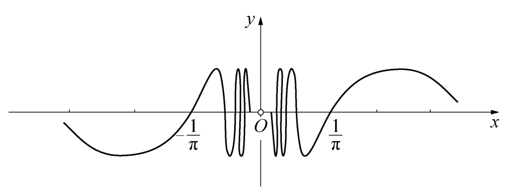

因此，函数$f(x)=\sin\frac{1}{x}$当$x\to0$时极限不存在。

### ＊四、极限运算法则的证明

**定理 9（数列极限的运算法则）** 若$\lim_{n\to\infty}x_n=a$，$\lim_{n\to\infty}y_n=b$，则

（1）$\lim_{n\to\infty}(x_n\pm y_n)=\lim_{n\to\infty}x_n\pm\lim_{n\to\infty}y_n=a\pm b$；（加减法则）

（2）$\lim_{n\to\infty}(x_n\cdot y_n)=\lim_{n\to\infty}x_n\cdot\lim_{n\to\infty}y_n=a\cdot b$；（乘法法则）

（3）$\lim_{n\to\infty}\sqrt{x_n}=\sqrt{\lim_{n\to\infty}x_n}=\sqrt{a}$（$x_n\geqslant0$，$a\geqslant0$）；（交换法则）

（4）$\lim_{n\to\infty}\frac{x_n}{y_n}=\frac{\lim_{n\to\infty}x_n}{\lim_{n\to\infty}y_n}=\frac{a}{b}$（$\lim_{n\to\infty}y_n=b\ne0$）。（除法法则）

**证明** 我们仅证明（1）；其余的法则请感兴趣的读者自行证明。$\forall\varepsilon>0$，

由于$\lim_{n\to\infty}x_n=a$，取$\frac{\varepsilon}{2}>0$，$\exists N_1\in\mathbf{Z}^+$，当$n>N_1$时，恒有

$$
|x_n-a|<\frac{\varepsilon}{2};
$$

再由$\lim_{n\to\infty}y_n=b$，取$\frac{\varepsilon}{2}>0$，$\exists N_2\in\mathbf{Z}^+$，当$n>N_2$时，恒有

$$
|y_n-b|<\frac{\varepsilon}{2}.
$$

令$N=\max\{N_1,\ N_2\}$，于是，当$n>N$时，

$$
|x_n-a|<\frac{\varepsilon}{2}\ \text{和}\ |y_n-b|<\frac{\varepsilon}{2}
$$

同时成立。于是，当$n>N$时，

$$
|(x_n\pm y_n)-(a\pm b)|=|(x_n-a)\pm(y_n-b)|\leqslant|x_n-a|+|y_n-b|<\frac{\varepsilon}{2}+\frac{\varepsilon}{2}=\varepsilon.
$$

因此有（1）式成立。

**定理 10（函数极限的四则运算法则）** 设$\lim_{x\to x_0}f(x)=A$，$\lim_{x\to x_0}g(x)=B$，则（1）$\lim_{x\to x_0}[f(x)\pm g(x)]=A\pm B=\lim_{x\to x_0}f(x)\pm\lim_{x\to x_0}g(x)$；

（2）$\lim_{x\to x_0}[f(x)\cdot g(x)]=A\cdot B=\lim_{x\to x_0}f(x)\cdot\lim_{x\to x_0}g(x)$；

（3）$\lim_{x\to x_0}\frac{f(x)}{g(x)}=\frac{A}{B}=\frac{\lim_{x\to x_0}f(x)}{\lim_{x\to x_0}g(x)}$（$B\ne0$）。

我们仅证明（2）。

**证明** 对$\forall\varepsilon>0$，

由$\lim_{x\to x_0}g(x)=B$可知，$\exists M>0$，$\exists\delta_1>0$，当$0<|x-x_0|<\delta_1$时，必有

$$
|g(x)|\leqslant M.
$$

若$\lim_{x\to x_0}f(x)=A\ne0$，则取$\frac{\varepsilon}{2M}>0$，$\exists\delta_2>0$，当$0<|x-x_0|<\delta_2$时，恒有

$$
|f(x)-A|<\frac{\varepsilon}{2M}.
$$

又已知$\lim_{x\to x_0}g(x)=B$，则对$\frac{\varepsilon}{2|A|}>0$，$\exists\delta_3>0$，当$0<|x-x_0|<\delta_3$时，恒有

$$
|g(x)-B|<\frac{\varepsilon}{2|A|}.
$$

因此，$\forall\varepsilon>0$，取$\delta=\min\{\delta_1,\ \delta_2,\ \delta_3\}$，当$0<|x-x_0|<\delta$时，恒有

$$
\begin{aligned}
|f(x)\cdot g(x)-A\cdot B|&\leqslant|f(x)g(x)-Ag(x)+Ag(x)-AB|\\
&\leqslant|f(x)-A||g(x)|+|A||g(x)-B|\\
&\leqslant\frac{\varepsilon}{2M}\cdot M+|A|\cdot\frac{\varepsilon}{2|A|}=\varepsilon,
\end{aligned}
$$

故

$$
\lim_{x\to x_0}[f(x)\cdot g(x)]=\lim_{x\to x_0}f(x)\cdot\lim_{x\to x_0}g(x).
$$

若$\lim_{x\to x_0}f(x)=0$，则$\forall\varepsilon>0$，$\exists\delta_4>0$，当$0<|x-x_0|<\delta_4$时，恒有$|f(x)|<\frac{\varepsilon}{M}$。

$$
|f(x)\cdot g(x)-0|\leqslant|f(x)|\cdot|g(x)|<\frac{\varepsilon}{M}\cdot M=\varepsilon.
$$

这就证明了（2）。

**定理 11（复合函数的极限运算法则）** 设函数$y=f[g(x)]$是由函数$u=g(x)$与$y=f(u)$复合而成的，$f[g(x)]$在点$x_0$的去心邻域内有定义，若$\lim_{x\to x_0}g(x)=u_0$，$\lim_{u\to u_0}f(u)=A$，且存在$\delta_0>0$，当$x\in\mathring{U}(x_0,\ \delta_0)$时，有$g(x)\ne u_0$，则

$$
\lim_{x\to x_0}f[g(x)]=\lim_{u\to u_0}f(u)=A.
$$

**证明** 对于$\forall\varepsilon>0$，由于$\lim_{u\to u_0}f(u)=A$，故$\exists\eta>0$，当$0<|u-u_0|<\eta$时，恒有

$$
|f(u)-A|<\varepsilon.
$$

又$\lim_{x\to x_0}g(x)=u_0$，则对上述$\eta>0$，$\exists\delta_1>0$，当$0<|x-x_0|<\delta_1$时，恒有

$$
|g(x)-u_0|<\eta.
$$

因此，取$\delta=\min\{\delta_0,\ \delta_1\}$，当$0<|x-x_0|<\delta$时，$|u-u_0|=|g(x)-u_0|<\eta$及$|g(x)-u_0|\ne0$同时成立，从而

$$
|f[g(x)]-A|=|f(u)-A|<\varepsilon.
$$

则

$$
\lim_{x\to x_0}f[g(x)]=\lim_{u\to u_0}f(u)=A.
$$

### 习题 1-4

1\. 已知$x_n=\frac{(-1)^n}{(n+1)^2}$，证明数列$\{x_n\}$的极限为 0。

2\. 证明$\lim_{x\to1}\frac{x^2-1}{x-1}=2$。

3\. 用函数极限的定义证明$\lim_{x\to+\infty}\arctan x=\frac{\pi}{2}$。

4\. 用数列极限定义证明：

（1）如果$\lim_{n\to\infty}x_n=a$，则$\lim_{k\to\infty}x_{2k}=a$，$\lim_{k\to\infty}x_{2k+1}=a$；

（2）如果$\lim_{k\to\infty}x_{2k}=a$，$\lim_{k\to\infty}x_{2k+1}=a$，则$\lim_{n\to\infty}x_n=a$。

5\. 证明函数极限的唯一性：如果$\lim_{x\to x_0}f(x)$存在，那么该极限唯一。

6\. 证明函数极限的唯一性：如果$\lim_{x\to+\infty}f(x)$存在，那么该极限唯一。

7\. 证明函数的局部有界性：如果$\lim_{x\to\infty}f(x)$存在，那么存在常数$M>0$和$X>0$，使得$|x|>X$时，有$|f(x)|\leqslant M$。

8\. 若$\lim_{n\to\infty}x_n=a$，$\lim_{n\to\infty}y_n=b$，证明：

（1）$\lim_{n\to\infty}(x_n\cdot y_n)=\lim_{n\to\infty}x_n\cdot\lim_{n\to\infty}y_n=a\cdot b$；

（2）$\lim_{n\to\infty}\frac{x_n}{y_n}=\frac{\lim_{n\to\infty}x_n}{\lim_{n\to\infty}y_n}=\frac{a}{b}$（$\lim_{n\to\infty}y_n=b\ne0$）。

9\. 设$\lim_{x\to x_0}f(x)=A$，$\lim_{x\to x_0}g(x)=B$，证明：

（1）$\lim_{x\to x_0}[f(x)\pm g(x)]=A\pm B=\lim_{x\to x_0}f(x)\pm\lim_{x\to x_0}g(x)$；

（2）$\lim_{x\to x_0}\frac{f(x)}{g(x)}=\frac{A}{B}=\frac{\lim_{x\to x_0}f(x)}{\lim_{x\to x_0}g(x)}$（$B\ne0$）。

## 第五节 两个重要极限

[课前导读]

这一节介绍两个重要极限的计算方法。在正式介绍极限之前，我们需要回忆一下三角函数的相关公式及二项式定理。

倍角公式：$\sin2x=2\sin x\cos x$，

$$
\cos2x=\cos^2x-\sin^2x=1-2\sin^2x=2\cos^2x-1.
$$

半角公式：$\sin x=2\sin\frac{x}{2}\cos\frac{x}{2}$，

$$
\cos x=\cos^2\frac{x}{2}-\sin^2\frac{x}{2}=1-2\sin^2\frac{x}{2}=2\cos^2\frac{x}{2}-1.
$$

和差化积公式：

$$
\sin x+\sin y=2\sin\frac{x+y}{2}\cos\frac{x-y}{2},
\sin x-\sin y=2\cos\frac{x+y}{2}\sin\frac{x-y}{2},
\cos x+\cos y=2\cos\frac{x+y}{2}\cos\frac{x-y}{2},
\cos x-\cos y=-2\sin\frac{x+y}{2}\sin\frac{x-y}{2}.
$$

二项式定理：

$$
\begin{aligned}
(a+b)^n&=\mathrm{C}_n^0a^nb^0+\mathrm{C}_n^1a^{n-1}b^1+\mathrm{C}_n^2a^{n-2}b^2+\cdots+\mathrm{C}_n^ka^{n-k}b^k+\cdots+\mathrm{C}_n^na^0b^n\\
&=a^nb^0+\frac{n}{1!}a^{n-1}b^1+\frac{n(n-1)}{2!}a^{n-2}b^2+\cdots+\frac{n(n-1)\cdot\cdots\cdot(n-k+1)}{k!}a^{n-k}b^k\\
&\quad+\cdots+a^0b^n.
\end{aligned}
$$

在介绍两个重要极限之前，需要先介绍两个推导重要极限的夹逼准则和单调有界收敛准则。

### 一、夹逼准则

**准则 1** 如果数列$\{x_n\}$、$\{y_n\}$及$\{z_n\}$满足

（1）$\exists N_0\in\mathbf{N}$，当$n>N_0$时，$y_n\leqslant x_n\leqslant z_n$；

（2）$\lim_{n\to\infty}y_n=a$，$\lim_{n\to\infty}z_n=a$，

那么数列$\{x_n\}$的极限存在，且$\lim_{n\to\infty}x_n=a$。

**\*证明** $\forall\varepsilon>0$，

由$\lim_{n\to\infty}y_n=a$可知，$\exists N_1>0$，当$n>N_1$时，恒有$|y_n-a|<\varepsilon$，即

$$
a-\varepsilon<y_n<a+\varepsilon.
$$

又由$\lim_{n\to\infty}z_n=a$，$\exists N_2>0$，当$n>N_2$时，恒有$|z_n-a|<\varepsilon$，即

$$
a-\varepsilon<z_n<a+\varepsilon.
$$

因此，$\forall\varepsilon>0$，取$N=\max\{N_0,\ N_1,\ N_2\}$，当$n>N$时，有

$$
a-\varepsilon<y_n\leqslant x_n\leqslant z_n<a+\varepsilon,
$$

即$|x_n-a|<\varepsilon$，故$\lim_{n\to\infty}x_n=a$。

利用数列收敛的夹逼准则，可以计算某些数列的极限。

**例 1** $\lim_{n\to\infty}\left[\frac{1}{n^2}+\frac{1}{(n+1)^2}+\cdots+\frac{1}{(n+n)^2}\right]$。

**解** 设$x_n=\frac{1}{n^2}+\frac{1}{(n+1)^2}+\cdots+\frac{1}{(n+n)^2}$，则可知$x_n$为$n+1$项之和。我们需要先对数列$\{x_n\}$的通项进行适当的“放缩”。

$$
\underbrace{\frac{1}{(n+n)^2}+\frac{1}{(n+n)^2}+\cdots+\frac{1}{(n+n)^2}}_{n+1}<\frac{1}{n^2}+\frac{1}{(n+1)^2}+\cdots+\frac{1}{(n+n)^2}<\underbrace{\frac{1}{n^2}+\frac{1}{n^2}+\cdots+\frac{1}{n^2}}_{n+1},
$$

即有

$$
\frac{n+1}{4n^2}=\frac{n+1}{(n+n)^2}<\frac{1}{n^2}+\frac{1}{(n+1)^2}+\cdots+\frac{1}{(n+n)^2}<\frac{n+1}{n^2}=\frac{1}{n}+\frac{1}{n^2}.
$$

因为$\lim_{n\to\infty}\frac{n+1}{4n^2}=0$，$\lim_{n\to\infty}\left(\frac{1}{n}+\frac{1}{n^2}\right)=0$，由夹逼准则得

$$
\lim_{n\to\infty}\left[\frac{1}{n^2}+\frac{1}{(n+1)^2}+\cdots+\frac{1}{(n+n)^2}\right]=0.
$$

准则 1 可以推广到函数的极限。

**准则 1′** 如果函数$f(x)$，$g(x)$，$h(x)$满足：

（1）当$x\in\mathring{U}(x_0,\ r)$（或$|x|>X$）时，$g(x)\leqslant f(x)\leqslant h(x)$；

（2）$\lim_{\substack{x\to x_0\\ x\to\infty}}g(x)=A$，$\lim_{\substack{x\to x_0\\ x\to\infty}}h(x)=A$，（见图 1-45）

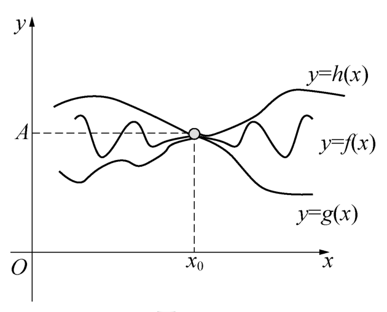

则$\lim_{\substack{x\to x_0\\ x\to\infty}}f(x)$存在，且$\lim_{\substack{x\to x_0\\ x\to\infty}}f(x)=A$。

准则 1′ 的证明留作习题。

**例 2** 已知$\lim_{x\to x_0}|f(x)|=0$，证明$\lim_{x\to x_0}f(x)=0$。

**解** 由于$-|f(x)|\leqslant f(x)\leqslant|f(x)|$，且

$$
\lim_{x\to x_0}|f(x)|=0,\ \lim_{x\to x_0}[-|f(x)|]=-\lim_{x\to x_0}|f(x)|=0,
$$

由准则 1′ 可得$\lim_{x\to x_0}f(x)=0$。

**例 3** 求极限$\lim_{x\to0}x\left[\frac{1}{x}\right]$。

**解** 当$x\ne0$时，$\frac{1}{x}-1<\left[\frac{1}{x}\right]\leqslant\frac{1}{x}$。

因此，当$x>0$时，$1-x<x\left[\frac{1}{x}\right]\leqslant1$，由夹逼定理可得$\lim_{x\to0^+}x\left[\frac{1}{x}\right]=1$。

当$x<0$时，有$1-x>x\left[\frac{1}{x}\right]\geqslant1$，由夹逼定理可得$\lim_{x\to0^-}x\left[\frac{1}{x}\right]=1$，

从而

$$
\lim_{x\to0}x\left[\frac{1}{x}\right]=1.
$$

### 二、第一重要极限

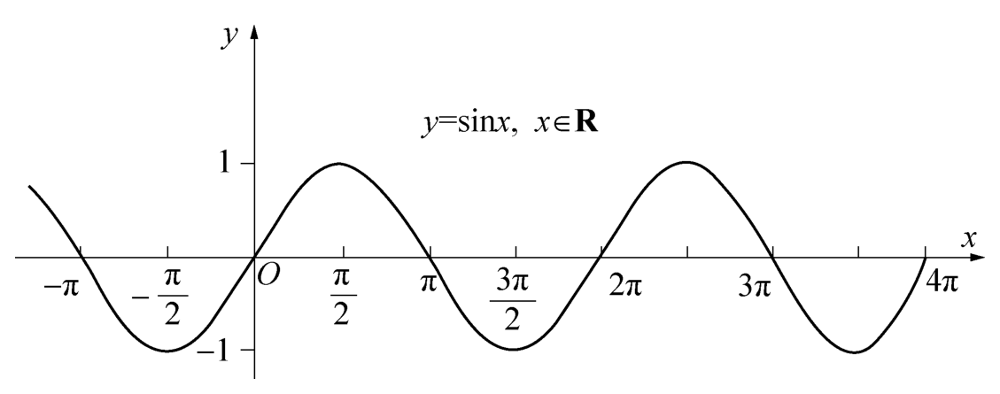

观察正弦函数的图像（见图1-46），可知当$x\to 0$时，$\sin x\to 0$，那么这两个函数的比值$\frac{\sin x}{x}$的极限是否存在？结果如何？下面就用函数的夹逼准则来证明一个重要的结论：

$$
\lim_{x\to 0}\frac{\sin x}{x}=1.
$$

**证明**　$x\ne 0$时，函数$\frac{\sin x}{x}$均有定义。

首先，建立一单位圆（见图1-47），

设圆心角$\angle AOB=x\left(0<x<\frac{\pi}{2}\right)$。

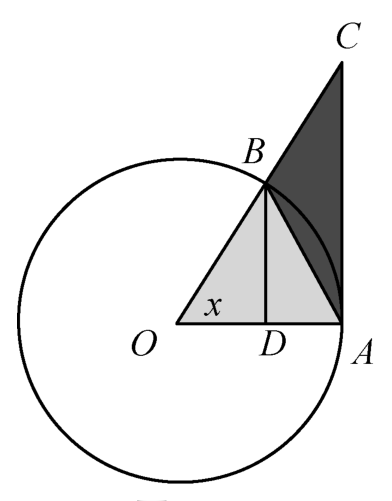

这样，$\sin x=DB$，$x=\widehat{AB}$，$\tan x=AC$。

由$S_{\triangle AOB}<S_{\text{扇形}AOB}<S_{\triangle AOC}$，得$\frac{1}{2}\sin x<\frac{1}{2}x<\frac{1}{2}\tan x$。

等式两端除以$\frac{1}{2}\sin x$，得$1<\frac{x}{\sin x}<\frac{1}{\cos x}$。

因此，$\cos x<\frac{\sin x}{x}<1$。

上式若用“$-x$”代替“$x$”，则上式形式不变，表明$x\in\left(-\frac{\pi}{2},0\right)$时，上式仍成立。

因为$0<|\cos x-1|=1-\cos x=2\sin^2\frac{x}{2}<2\left(\frac{x}{2}\right)^2=\frac{x^2}{2}$，

$\lim_{x\to 0}\frac{x^2}{2}=0$，由函数夹逼准则得$\lim_{x\to 0}(1-\cos x)=0$，故$\lim_{x\to 0}\cos x=1$。

且当$0<|x|<\frac{\pi}{2}$时，$\cos x<\frac{\sin x}{x}<1$，由夹逼定理可得$\lim_{x\to 0}\frac{\sin x}{x}=1$。

**注**　由以上证明过程可推得结论$\lim_{x\to x_0}\cos x=\cos x_0$，类似地还可以得到$\lim_{x\to x_0}\sin x=\sin x_0$。

我们由第一重要极限很容易得到下列结果（可以作为公式使用）。

（1）$\lim_{x\to 0}\frac{x}{\sin x}=\lim_{x\to 0}\frac{1}{\frac{\sin x}{x}}=1$；

（2）$\lim_{x\to 0}\frac{\tan x}{x}=\lim_{x\to 0}\frac{\sin x}{x}\cdot\frac{1}{\cos x}=1$，$\lim_{x\to 0}\frac{x}{\tan x}=\lim_{x\to 0}\frac{1}{\frac{\tan x}{x}}=1$；

（3）$\lim_{x\to 0}\frac{1-\cos x}{x^2}=\lim_{x\to 0}\frac{2\sin^2\frac{x}{2}}{x^2}=\lim_{x\to 0}\frac{1}{2}\left(\frac{\sin\frac{x}{2}}{\frac{x}{2}}\right)^2=\frac{1}{2}$；

（4）$\lim_{x\to 0}\frac{\arcsin x}{x}=\lim_{u\to 0}\frac{u}{\sin u}=1$（令$u=\arcsin x$，则$x=\sin u$）；

（5）$\lim_{x\to 0}\frac{\arctan x}{x}=\lim_{u\to 0}\frac{u}{\tan u}=1$（令$u=\arctan x$，则$x=\tan u$）。

**例 4**　计算下列极限：

（1）$\lim_{x\to\infty}x\sin\frac{1}{x}$；　　　　（2）$\lim_{x\to 3}\frac{\sin(x^2-9)}{x-3}$；

（3）$\lim_{x\to 0}\frac{2\sin x-\sin 2x}{x^3}$；　　　（4）$\lim_{x\to a}\frac{\sin x-\sin a}{x-a}$。

**解**　（1）令$t=\frac{1}{x}$，当$x\to\infty$时，$t\to 0$，因此

$$
\lim_{x\to\infty}x\sin\frac{1}{x}=\lim_{x\to\infty}\frac{\sin\frac{1}{x}}{\frac{1}{x}}=\lim_{t\to 0}\frac{\sin t}{t}=1;
$$

（2）$\frac{\sin(x^2-9)}{x-3}$可以先变形为$\frac{\sin(x^2-9)}{x^2-9}(x+3)$，再由$x\to 3$时$(x^2-9)\to 0$，可得

$$
\lim_{x\to 3}\frac{\sin(x^2-9)}{x-3}=\lim_{x\to 3}\frac{\sin(x^2-9)}{x^2-9}\lim_{x\to 3}(x+3)=1\cdot 6=6;
$$

（3）利用二倍角公式$\sin 2x=2\sin x\cos x$可得

$$
\lim_{x\to 0}\frac{2\sin x-\sin 2x}{x^3}=\lim_{x\to 0}\frac{2\sin x-2\sin x\cos x}{x^3}
=2\lim_{x\to 0}\left(\frac{\sin x}{x}\cdot\frac{1-\cos x}{x^2}\right)
=2\cdot 1\cdot\frac{1}{2}=1;
$$

（4）利用和差化积公式可得

$$
\lim_{x\to a}\frac{\sin x-\sin a}{x-a}=\lim_{x\to a}\frac{2\cos\left(\frac{x+a}{2}\right)\sin\left(\frac{x-a}{2}\right)}{x-a}
=\lim_{x\to a}\cos\left(\frac{x+a}{2}\right)\cdot\frac{\sin\left(\frac{x-a}{2}\right)}{\frac{x-a}{2}}=\cos a.
$$

**注**　最后一个等号应用了结论$\lim_{u\to u_0}\cos u=\cos u_0$。

### 三、单调有界收敛准则

如果数列$\{x_n\}$满足条件

$$
x_1\le x_2\le\cdots\le x_n\le x_{n+1}\le\cdots,
$$

则称数列$\{x_n\}$是单调增加的；

如果数列$\{x_n\}$满足条件

$$
x_1\ge x_2\ge\cdots\ge x_n\ge x_{n+1}\ge\cdots,
$$

则称数列$\{x_n\}$是单调减少的。

单调增加或单调减少的数列简称单调数列。

在讨论数列极限的性质时曾指出，收敛数列必有界，但有界数列未必收敛，有界是数列收敛的必要条件，但如果是单调有界数列呢？这就得到了单调有界收敛准则。

**准则 2**　单调有界数列必有极限。

如果详细地说，则有下列性质。

（1）如果数列$\{x_n\}$单调增加且有上界，即存在数$M$，使得

$$
x_n\le M\quad (n=1,2,3,\cdots),
$$

那么$\lim_{n\to\infty}x_n$必存在（且极限$\le M$）。

（2）如果数列$\{x_n\}$单调减少且有下界，即存在数$m$，使得

$$
x_n\ge m\quad (n=1,2,3,\cdots),
$$

那么$\lim_{n\to\infty}x_n$必存在（且极限$\ge m$）。

对准则2我们不予证明，仅给出其几何解释。

在数轴上看（见图1-48），由于数列$\{x_n\}$为单调的，故对应数列的点$x_n$只可能向一个方向移动（单调增加数列只向右方移动，单调减少数列只向左方移动），所以只有两种可能：点$x_n$或移向无穷远处，或趋于某个确定的值。但又由于数列有界，因此数列不能趋于无穷，这样，只能使数列$\{x_n\}$趋于某个确定的值，也就是数列的极限。

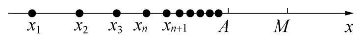

**例 5**　设$x_n=\sqrt{3+\sqrt{3+\sqrt{\cdots+\sqrt{3}}}}$（$n$重根式），证明数列$\{x_n\}$的极限存在，并求出极限。

**证明**　由$x_n$的表达式可知$x_{n+1}=\sqrt{3+x_n}$，且$x_{n+1}=\sqrt{3+x_n}>\sqrt{3+x_{n-1}}=x_n$，因此可知$\{x_n\}$是单调递增的。

因为$x_1=\sqrt{3}<3$，假定$x_k<3$，则$x_{k+1}=\sqrt{3+x_k}<\sqrt{3+3}<3$，所以$\{x_n\}$是有界的。从而$\lim_{n\to\infty}x_n$存在，设$\lim_{n\to\infty}x_n=A$。

由递推关系$x_{n+1}=\sqrt{3+x_n}$，得$x_{n+1}^2=3+x_n$。等式两边取极限，故

$$
\lim_{n\to\infty}x_{n+1}^2=\lim_{n\to\infty}(3+x_n),
$$

即$A^2=3+A$，

解得

$$
A=\frac{1+\sqrt{13}}{2}\ \text{或}\ A=\frac{1-\sqrt{13}}{2}\text{（舍去）}.
$$

所以

$$
\lim_{n\to\infty}x_n=\frac{1+\sqrt{13}}{2}.
$$

### 四、第二重要极限

现在我们利用单调有界收敛准则来讨论另一个重要极限：$\lim_{x\to\infty}\left(1+\frac{1}{x}\right)^x$。

先考虑$x>0$且$x=n$时的情形。

设$x_n=\left(1+\frac{1}{n}\right)^n$，利用二项式定理，则有

$$
x_n=\left(1+\frac{1}{n}\right)^n
=1+\frac{n}{1!}\cdot\frac{1}{n}+\frac{n(n-1)}{2!}\cdot\frac{1}{n^2}+\frac{n(n-1)(n-2)}{3!}\cdot\frac{1}{n^3}+\cdots+\frac{n(n-1)\cdots(n-n+1)}{n!}\cdot\frac{1}{n^n}
=1+1+\frac{1}{2!}\left(1-\frac{1}{n}\right)+\frac{1}{3!}\left(1-\frac{1}{n}\right)\left(1-\frac{2}{n}\right)+\cdots+\frac{1}{n!}\left(1-\frac{1}{n}\right)\left(1-\frac{2}{n}\right)\cdots\left(1-\frac{n-1}{n}\right).
$$

类似地，

$$
x_{n+1}=1+1+\frac{1}{2!}\left(1-\frac{1}{n+1}\right)+\frac{1}{3!}\left(1-\frac{1}{n+1}\right)\left(1-\frac{2}{n+1}\right)+\cdots+\frac{1}{n!}\left(1-\frac{1}{n+1}\right)\left(1-\frac{2}{n+1}\right)
\cdots\left(1-\frac{n-1}{n+1}\right)+\frac{1}{(n+1)!}\left(1-\frac{1}{n+1}\right)\left(1-\frac{2}{n+1}\right)\cdots\left(1-\frac{n-1}{n+1}\right)\left(1-\frac{n}{n+1}\right).
$$

比较$x_n$与$x_{n+1}$，则有$x_n\le x_{n+1}$，即$\{x_n\}$单调增加。

又由

$$
x_n=1+1+\frac{1}{2!}\left(1-\frac{1}{n}\right)+\frac{1}{3!}\left(1-\frac{1}{n}\right)\left(1-\frac{2}{n}\right)+\cdots+\frac{1}{n!}\left(1-\frac{1}{n}\right)\left(1-\frac{2}{n}\right)\cdots\left(1-\frac{n-1}{n}\right)
$$

得

$$
x_n\le 1+1+\frac{1}{2!}+\frac{1}{3!}+\cdots+\frac{1}{n!}<1+1+\frac{1}{2}+\frac{1}{2^2}+\cdots+\frac{1}{2^{n-1}}=1+\frac{1-\frac{1}{2^n}}{1-\frac{1}{2}}=3-\frac{1}{2^{n-1}}<3,
$$

即$\{x_n\}$有上界，因此由单调有界准则知$\lim_{n\to\infty}\left(1+\frac{1}{n}\right)^n$存在，不妨记

$$
\lim_{n\to\infty}\left(1+\frac{1}{n}\right)^n=\mathrm{e}.
\mathrm{e}=2.718\ 281\ 828\ 459\ 045\cdots.
$$

设$x$为实数，当$x>0$时，则有$n=[x]\le x<[x]+1=n+1$，因此

$$
\left(1+\frac{1}{n+1}\right)^n<\left(1+\frac{1}{x}\right)^x<\left(1+\frac{1}{n}\right)^{n+1}.
$$

由

$$
\lim_{n\to\infty}\left(1+\frac{1}{n+1}\right)^n=\lim_{n\to\infty}\frac{\left(1+\frac{1}{n+1}\right)^{n+1}}{1+\frac{1}{n+1}}=\mathrm{e},
\lim_{n\to\infty}\left(1+\frac{1}{n}\right)^{n+1}=\lim_{n\to\infty}\left[\left(1+\frac{1}{n}\right)^n\cdot\left(1+\frac{1}{n}\right)\right]=\mathrm{e},
$$

并注意到$x\to+\infty\Leftrightarrow n\to\infty$，则由夹逼准则得$\lim_{x\to+\infty}\left(1+\frac{1}{x}\right)^x=\mathrm{e}$。

当$x<0$时，令$x=-(t+1)$，则当$x\to-\infty$时，$t\to+\infty$，因此

$$
\lim_{x\to-\infty}\left(1+\frac{1}{x}\right)^x=\lim_{t\to+\infty}\left(1-\frac{1}{t+1}\right)^{-(t+1)}=\lim_{t\to+\infty}\left[\left(\frac{t}{t+1}\right)^{-1}\right]^{t+1}
=\lim_{t\to+\infty}\left(1+\frac{1}{t}\right)^{t+1}
=\lim_{t\to+\infty}\left[\left(1+\frac{1}{t}\right)^t\left(1+\frac{1}{t}\right)\right]=\mathrm{e}.
$$

由$\lim_{x\to+\infty}\left(1+\frac{1}{x}\right)^x=\mathrm{e}$及$\lim_{x\to-\infty}\left(1+\frac{1}{x}\right)^x=\mathrm{e}$，则得

$$
\lim_{x\to\infty}\left(1+\frac{1}{x}\right)^x=\mathrm{e}.
$$

我们还可以得到第二重要极限的另一种形式。

利用代换$u=\frac{1}{x}$，则当$x\to\infty$时，$u\to 0$，于是有

$$
\lim_{u\to 0}(1+u)^{\frac{1}{u}}=\lim_{x\to\infty}\left(1+\frac{1}{x}\right)^x=\mathrm{e}.
$$

习惯上写作

$$
\lim_{x\to 0}(1+x)^{\frac{1}{x}}=\mathrm{e}.
$$

**注**　在求函数极限时，常用到形如$[f(x)]^{g(x)}(f(x)>0,f(x)\ne 1)$的函数（通常称为幂指函数）的极限，我们有下面的计算公式。

**性质**　如果$\lim f(x)=A>0$，$\lim g(x)=B$，那么

$$
\lim[f(x)]^{g(x)}=A^B.
$$

**例 6**　求下列函数的极限：

（1）$\lim_{x\to\infty}\left(1-\frac{1}{x}\right)^x$；　　　　（2）$\lim_{x\to 0}(1+2x)^{\frac{1}{x}}$；

（3）$\lim_{n\to\infty}\left(1+\frac{3}{n}\right)^{n+2}$；　　　（4）$\lim_{x\to 0}(1+\sin x)^{\frac{1}{x}}$；

（5）$\lim_{x\to 0}(\cos x)^{\frac{1}{x^2}}$；　　　　（6）$\lim_{x\to\infty}\left(\frac{3x+4}{3x-1}\right)^{x+1}$。

**解**　（1）利用重要极限$\lim_{x\to\infty}\left(1+\frac{1}{x}\right)^x$求极限，要注意函数指数中变量$x$与底数中变量$x$是相同的，正负号也相同，且自变量$x\to\infty$。

本题$\left(1-\frac{1}{x}\right)^x=\left(1+\frac{1}{-x}\right)^x$，底数中变量为$-x$，指数中变量是$x$，两者相差一个负号，求解时，可按下述两种方法之一计算。

（Ⅰ）做变换：令$x=-t$，当$x\to\infty$时，$t\to\infty$，于是

$$
\lim_{x\to\infty}\left(1-\frac{1}{x}\right)^x=\lim_{t\to\infty}\left(1+\frac{1}{t}\right)^{-t}=\lim_{t\to\infty}\frac{1}{\left(1+\frac{1}{t}\right)^t}=\frac{1}{\mathrm{e}};
$$

（Ⅱ）适当变形：$\lim_{x\to\infty}\left(1-\frac{1}{x}\right)^x=\lim_{x\to\infty}\left(1-\frac{1}{x}\right)^{(-x)(-1)}=\lim_{x\to\infty}\left[\left(1+\frac{1}{-x}\right)^{-x}\right]^{-1}=\mathrm{e}^{-1}=\frac{1}{\mathrm{e}}$。

（2）$\lim_{x\to 0}(1+2x)^{\frac{1}{x}}=\lim_{x\to 0}\left[(1+2x)^{\frac{1}{2x}}\right]^2=\mathrm{e}^2$。

（3）$\lim_{n\to\infty}\left(1+\frac{3}{n}\right)^{n+2}=\lim_{n\to\infty}\left(1+\frac{3}{n}\right)^n\cdot\left(1+\frac{3}{n}\right)^2$

$$
=\lim_{n\to\infty}\left[\left(1+\frac{3}{n}\right)^{\frac{n}{3}}\right]^3\cdot\left(1+\frac{3}{n}\right)^2=\mathrm{e}^3\cdot 1^2=\mathrm{e}^3.
$$

（4）$\lim_{x\to 0}(1+\sin x)^{\frac{1}{x}}=\lim_{x\to 0}\left[(1+\sin x)^{\frac{1}{\sin x}}\right]^{\frac{\sin x}{x}}=\mathrm{e}^{\lim_{x\to 0}\frac{\sin x}{x}}=\mathrm{e}$。

（5）$\lim_{x\to 0}(\cos x)^{\frac{1}{x^2}}=\lim_{x\to 0}\left[(1+\cos x-1)^{\frac{1}{\cos x-1}}\right]^{\frac{\cos x-1}{x^2}}=\mathrm{e}^{-\frac{1}{2}}$。

（6）$\lim_{x\to\infty}\left(\frac{3x+4}{3x-1}\right)^{x+1}=\lim_{x\to\infty}\left[\left(1+\frac{5}{3x-1}\right)^{\frac{3x-1}{5}}\right]^{\frac{5}{3x-1}\cdot(x+1)}=\mathrm{e}^{\lim_{x\to\infty}\frac{5(x+1)}{3x-1}}=\mathrm{e}^{\frac{5}{3}}$。

### 习题 1-5

1. 求下列函数的极限：

（1）$\lim_{x\to 0}\frac{\sin\frac{x}{2}}{x}$；　　　　（2）$\lim_{x\to 0}\frac{\tan 4x}{x}$；

（3）$\lim_{x\to 0}\frac{\sin 2x}{\tan 3x}$；　　　　（4）$\lim_{x\to 0}x\cdot\cot 2x$；

（5）$\lim_{x\to 0}\frac{1-\cos 2x}{x\sin x}$；　　　　（6）$\lim_{n\to\infty}5^n\sin\frac{x}{5^n}$；

（7）$\lim_{x\to a}\frac{\cos x-\cos a}{x-a}$；　　　　（8）$\lim_{x\to 0}\frac{x-\sin x}{x+\sin x}$；

（9）$\lim_{x\to 0}\frac{\arcsin 2x}{\sin 3x}$；　　　　（10）$\lim_{x\to\pi}\frac{\sin x}{\pi-x}$；

（11）$\lim_{x\to 0}\frac{\tan x-\sin x}{\sin^3 x}$；　　　　（12）$\lim_{x\to 1}(1-x)\tan\frac{\pi x}{2}$。

2. 求下列函数的极限：

（1）$\lim_{x\to\infty}\left(1+\frac{2}{x}\right)^x$；　　　　（2）$\lim_{x\to 0}(1+3x)^{\frac{1}{x}}$；

（3）$\lim_{x\to 0}(1-4x)^{\frac{1}{x}}$；　　　　（4）$\lim_{x\to\infty}\left(1-\frac{1}{2x}\right)^x$；

（5）$\lim_{x\to\infty}\left(\frac{1+x}{x}\right)^{2x+1}$；　　　　（6）$\lim_{x\to\infty}\left(\frac{2x+1}{2x-3}\right)^x$；

（7）$\lim_{x\to 0}(1+3\tan^2 x)^{\cot^2 x}$；　　　　（8）$\lim_{x\to\frac{\pi}{2}}(1+\cos x)^{2\sec x}$；

（9）$\lim_{x\to\infty}\left(1-\frac{1}{x}\right)^{\frac{1}{\sin\frac{1}{x}}}$；　　　　（10）$\lim_{n\to\infty}\left(1+\frac{2}{3^n}\right)^{3^n}$；

（11）$\lim_{x\to\infty}\left(\frac{3x-1}{3x+1}\right)^{3x-1}$；　　　　（12）$\lim_{x\to 1}(2-x)^{\sec\frac{\pi x}{2}}$；

（13）$\lim_{x\to 0^+}(\cos\sqrt{x})^{\frac{1}{x}}$；　　　　（14）$\lim_{x\to\frac{\pi}{2}}(\sin x)^{\tan x}$。

3. 利用夹逼准则证明：

（1）$\lim_{n\to\infty}\left(\frac{1}{\sqrt{n^2+1}}+\frac{1}{\sqrt{n^2+2}}+\cdots+\frac{1}{\sqrt{n^2+n}}\right)=1$；

（2）$\lim_{n\to\infty}\frac{2^n}{n!}=0$；

（3）$\lim_{n\to\infty}(1+2^n+3^n)^{\frac{1}{n}}=3$。

\* 4. 如果函数$f(x)$，$g(x)$，$h(x)$满足：

（1）当$x\in\mathring{U}(x_0,r)$（或$|x|>X_0$）时，$g(x)\le f(x)\le h(x)$；

（2）$\lim_{\substack{x\to x_0\\ x\to\infty}}g(x)=A$，$\lim_{\substack{x\to x_0\\ x\to\infty}}h(x)=A$，证明$\lim_{\substack{x\to x_0\\ x\to\infty}}f(x)$存在，且$\lim_{\substack{x\to x_0\\ x\to\infty}}f(x)=A$。

## 第六节 无穷小与无穷大

[课前导读]

如果$\lim f(x)=A$，那么$\lim[f(x)-A]=0$，即任何一个极限存在的函数都可以转化为极限为零的函数。这一类极限为零的函数具有非常重要的性质，所以我们需要把它们单独拿出来进行讨论。

### 一、无穷小

在讨论数列和函数的极限时，经常遇到以零为极限的变量。例如，变量$\frac{1}{n}$，当$n\to\infty$时，其极限为0；函数$\frac{1}{x^2}$，当$x\to\infty$时，其极限为0；函数$x-1$，当$x\to 1$时，其极限为0……这些在自变量某一变化过程中以零为极限的变量统称为无穷小量（简称为无穷小）。

我们以$x\to x_0$为例，来定义函数$f(x)$无穷小的概念。

**定义 1**　设$f(x)$在$\mathring{U}(x_0)$内有定义，若$\lim_{x\to x_0}f(x)=0$，则称函数$f(x)$为$x\to x_0$时的无穷小。

此定义也可用“$\varepsilon-\delta$”语言描述：

如果

$$
\forall\varepsilon>0,\ \exists\delta>0,\ \text{当}\ 0<|x-x_0|<\delta\ \text{时，恒有}\ |f(x)|<\varepsilon,
$$

那么称函数$f(x)$为$x\to x_0$时的无穷小。

例如，由$\lim_{x\to 1}(x^2-1)=0$，知$f(x)=x^2-1$为$x\to 1$时的无穷小；

由$\lim_{x\to\infty}\frac{1}{x}=0$，知$f(x)=\frac{1}{x}$为$x\to\infty$时的无穷小；

由$\lim_{n\to\infty}\frac{1}{\sqrt[3]{n}}=0$，知$x_n=\frac{1}{\sqrt[3]{n}}$为$n\to\infty$时的无穷小。

**注**　（1）无穷小与一个很小的确定的常数（如$\frac{1}{10^8}$）不能混为一谈。这是因为无穷小是个变量（函数），自变量在某一变化过程中，其绝对值能小于任意给定的正数$\varepsilon$。但是$\frac{1}{10^8}$做不到这一点。

（2）讨论无穷小的时候，要注意自变量的变化过程。例如$f(x)=\frac{1}{x}$，当$x\to\infty$时是无穷小，而当$x\to 1$时极限却是一个常数。

（3）零是无穷小中唯一的常数。

由数列和函数四则运算性质可知，在自变量的同一变化过程中，有限个无穷小的和，差，积都是无穷小，下面我们给出无穷小的另一个重要性质：

**定理 1（无穷小运算性质）**　在自变量的同一变化过程中，有界函数与无穷小的乘积是无穷小。

**例 1**　求极限$\lim_{x\to\infty}\frac{\sin x}{x}$。

**解**　由于$x\to\infty$时$\frac{1}{x}$的极限为零，故$\frac{1}{x}$是当$x\to\infty$时的无穷小。而$|\sin x|\le 1$是有界函数，因此由无穷小运算性质可知，$\frac{\sin x}{x}$是当$x\to\infty$时的无穷小（见图1-49），即

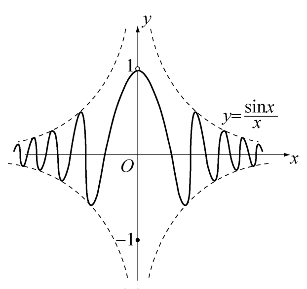

$$
\lim_{x\to\infty}\frac{\sin x}{x}=0.
$$

### 二、无穷大

我们仅就$x\to x_0$的情形来定义无穷大。

设$f(x)$在$\mathring{U}(x_0)$内有定义，如果当$x\to x_0$时，对应的函数的绝对值$|f(x)|$无限增大，就说$f(x)$是当$x\to x_0$时的无穷大量。

精确地说，有下述定义。

**定义 2**　如果

$$
\forall M>0,\ \exists\delta>0,\ \text{当}\ 0<|x-x_0|<\delta\ \text{时，恒有}\ |f(x)|>M,
$$

则称函数$f(x)$为$x\to x_0$时的无穷大量，简称无穷大，记作$\lim_{x\to x_0}f(x)=\infty$。

若将上述“$|f(x)|>M$”改成$f(x)>M$或$f(x)<-M$，则有

$\lim_{x\to x_0}f(x)=+\infty$，称$f(x)$为当$x\to x_0$时的正无穷大；

$\lim_{x\to x_0}f(x)=-\infty$，称$f(x)$为当$x\to x_0$时的负无穷大。

**注**　这里$\lim_{x\to x_0}f(x)=\infty$只是借用了极限的符号，并不意味着函数$f(x)$存在极限，因为无穷大$\infty$不是数，不可与绝对值很大的常数混淆，无穷大是绝对值无限增大的变量。

**例 2**　证明$\lim_{x\to 1}\frac{1}{x-1}=\infty$。

**证明**　$\forall M>0$，要使$\left|\frac{1}{x-1}\right|>M$，即$|x-1|<\frac{1}{M}$，取$\delta=\frac{1}{M}$，

则当$0<|x-1|<\delta$时，恒有$\left|\frac{1}{x-1}\right|>M$，因此$\lim_{x\to 1}\frac{1}{x-1}=\infty$。

直线$x=1$是函数$y=f(x)$图形的铅直渐近线（见图1-50）。

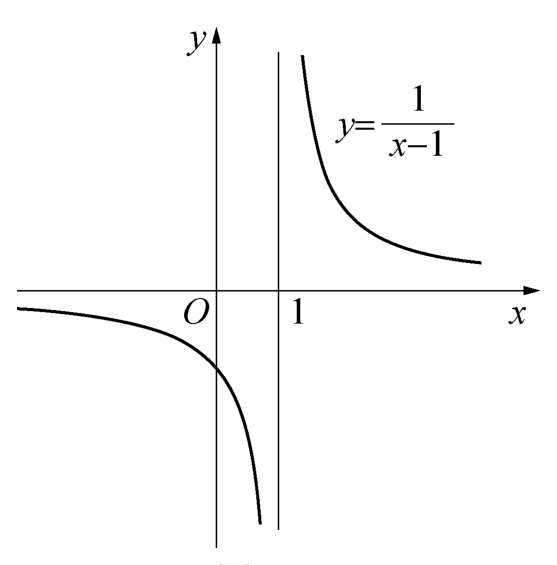

**注**　若$\lim_{x\to x_0^+}f(x)=\infty$或$\lim_{x\to x_0^-}f(x)=\infty$，则直线$x=x_0$称为函数$y=f(x)$图形的铅直渐近线。

**例 3**　求曲线$y=\frac{4x-1}{(x-1)^2}$的渐近线方程。

**解**　因为$\lim_{x\to 1}\frac{4x-1}{(x-1)^2}=\infty$，所以$x=1$是曲线的铅直渐近线；

因为$\lim_{x\to\infty}\frac{4x-1}{(x-1)^2}=0$，所以$y=0$是曲线的水平渐近线。

\* **注**　若$\lim_{\substack{x\to+\infty\\ x\to-\infty}}\frac{f(x)}{x}=a\ne 0$且$\lim_{\substack{x\to+\infty\\ x\to-\infty}}[f(x)-ax]=b$，则直线$y=ax+b$是函数$y=f(x)$图形的斜渐近线。

### 三、无穷小与无穷大的关系

无穷小和无穷大之间存在密切的关系。

**定理 2**　在自变量的同一变化过程中，

（1）如果$f(x)$为无穷大，则$\frac{1}{f(x)}$为无穷小；

（2）如果$f(x)$为无穷小，且$f(x)\ne 0$，则$\frac{1}{f(x)}$为无穷大。

**证明**　我们仅就$x\to x_0$的情形进行证明，其他情形类似。

$\forall\varepsilon>0$，由于$\lim_{x\to x_0}f(x)=\infty$，取$M=\frac{1}{\varepsilon}>0$，则$\exists\delta>0$，当$0<|x-x_0|<\delta$时，$|f(x)|>M$，即

$$
\left|\frac{1}{f(x)}\right|<\frac{1}{M}=\varepsilon,
$$

故

$$
\lim_{x\to x_0}\frac{1}{f(x)}=0;
$$

反之，$\forall M>0$，若$\lim_{x\to x_0}f(x)=0$，$f(x)\ne 0$，则取$\varepsilon=\frac{1}{M}$，那么$\exists\delta>0$，当$0<|x-x_0|<\delta$时，$|f(x)|<\varepsilon$，

即

$$
\left|\frac{1}{f(x)}\right|>\frac{1}{\varepsilon}=M,
$$

故

$$
\lim_{x\to x_0}\frac{1}{f(x)}=\infty.
$$

**例 4**　求$\lim_{x\to 1}\frac{2x+5}{3x^2-2x-1}$。

**解**　$\lim_{x\to 1}\frac{3x^2-2x-1}{2x+5}=\frac{3\cdot 1^2-2\cdot 1-1}{2\cdot 1+5}=0$。

由无穷小与无穷大的关系，有

$$
\lim_{x\to 1}\frac{2x+5}{3x^2-2x-1}=\infty.
$$

### 四、无穷小的比较

由无穷小的运算可知，两个无穷小的和、差是无穷小，两个无穷小的乘积是无穷小。那么两个无穷小的商又会出现什么情形呢？

比如，当$x\to 0$时，$x$，$2x$，$\sin x$，$x^2$，$x\sin\frac{1}{x}$均为无穷小，但$\lim_{x\to 0}\frac{x}{2x}=\frac{1}{2}$，$\lim_{x\to 0}\frac{x^2}{\sin x}=0$，$\lim_{x\to 0}\frac{2x}{x^2}=\infty$及$\lim_{x\to 0}\frac{\sin x}{x}=1$，而$\lim_{x\to 0}\frac{x\sin\frac{1}{x}}{x}=\lim_{x\to 0}\sin\frac{1}{x}$不存在。由此可见，在自变量的同一变化过程中，两个无穷小的商的极限可能为零，可能是非零常数，也可能不存在。

一般情况下，两个无穷小的商的极限由于不遵循极限的运算法则，且不能立刻判断其极限是否存在，因此，这类极限通常称为“$\frac{0}{0}$”型未定式极限。未定式极限各不相同，反映了作为分子、分母的两个无穷小趋于零的“快慢”程度不同。当$x\to 0$时，$x^2$趋于零的速度比$x$“快”，$x$趋于零的速度比$x^2$“慢”，而$\sin x$与$x$趋于零的速度“差不多”。

如果用精确的数学语言来描述这“快”与“慢”的程度，则有

**定义 3**　设$\alpha$，$\beta$为自变量的同一变化过程中的无穷小，且$\alpha\ne 0$。

若$\lim\frac{\beta}{\alpha}=0$，则称$\beta$是比$\alpha$高阶的无穷小，记作$\beta=o(\alpha)$；

若$\lim\frac{\beta}{\alpha}=\infty$，则称$\beta$是比$\alpha$低阶的无穷小；

若$\lim\frac{\beta}{\alpha}=C\ne 0$，则称$\beta$是$\alpha$的同阶无穷小；

特别当$C=1$时，则称$\beta$和$\alpha$是等价无穷小，记作$\alpha\sim\beta$；

若$\lim\frac{\beta}{\alpha^k}=C\ne 0(k>0)$，则称$\beta$是$\alpha$的$k$阶无穷小。

由此定义可以得到一些常见的无穷小比较的例子。

例如，由$\lim_{x\to 0}\frac{x^2}{3x}=0$知，当$x\to 0$时，$x^2$是比$3x$高阶的无穷小，记作$x^2=o(3x)(x\to 0)$；

由$\lim_{x\to 0}\frac{\sin x}{x}=1$知，当$x\to 0$时，$\sin x$与$x$是等价无穷小，记作$\sin x\sim x(x\to 0)$；

由$\lim_{x\to 1}\frac{x^2-1}{x-1}=\lim_{x\to 1}(x+1)=2$知，当$x\to 1$时，$x^2-1$是$x-1$的同阶无穷小；

由$\lim_{n\to\infty}\frac{\frac{1}{n}}{\frac{1}{n^2}}=\infty$知，当$n\to\infty$时，$\frac{1}{n}$是比$\frac{1}{n^2}$低阶的无穷小；

由$\lim_{x\to 0}\frac{1-\cos x}{x^2}=\frac{1}{2}$知，当$x\to 0$时，$1-\cos x$是关于$x$的二阶无穷小，也称$1-\cos x$和$x^2$是同阶无穷小。

**例 5**　证明：当$x\to 0$时，$\sqrt{x+1}-1\sim\frac{1}{2}x$。

**证明**　$\lim_{x\to 0}\frac{\sqrt{1+x}-1}{\frac{1}{2}x}=\lim_{x\to 0}\frac{2(\sqrt{1+x}-1)(\sqrt{1+x}+1)}{x(\sqrt{1+x}+1)}$

$$
=\lim_{x\to 0}\frac{2[(1+x)-1]}{x(\sqrt{1+x}+1)}=\lim_{x\to 0}\frac{2}{\sqrt{1+x}+1}=1.
$$

我们还可以得到一个更一般的结论：

$x\to 0$时，$(1+x)^\alpha-1\sim\alpha x(\alpha\in\mathbf{R},\alpha\ne 0)$。

### 五、等价无穷小的应用

我们先看关于等价无穷小的两个定理。

**定理 3**　设$\alpha$，$\beta$为自变量的同一变化过程中的无穷小，则

$\beta$与$\alpha$是等价无穷小的充分必要条件为$\beta=\alpha+o(\alpha)$。

**证明**　必要性：设$\alpha\sim\beta$，则

$$
\lim\frac{\beta-\alpha}{\alpha}=\lim\left(\frac{\beta}{\alpha}-1\right)=0,
$$

因此，$\beta-\alpha=o(\alpha)$，即$\beta=\alpha+o(\alpha)$。

充分性：设$\beta=\alpha+o(\alpha)$，则

$$
\lim\frac{\beta}{\alpha}=\lim\frac{\alpha+o(\alpha)}{\alpha}=\lim\left[1+\frac{o(\alpha)}{\alpha}\right]=1,
$$

因此，$\alpha\sim\beta$。

因为$\sin x\sim x(x\to 0)$，所以$\sin x=x+o(x)$。

**定理 4**　设$\alpha$，$\beta$，$\alpha'$，$\beta'$为自变量的同一变化过程中的无穷小，又

$\alpha\sim\alpha'$，$\beta\sim\beta'$，且$\lim\frac{\beta'}{\alpha'}$存在，则$\lim\frac{\beta}{\alpha}=\lim\frac{\beta'}{\alpha'}$。

**证明**　$\lim\frac{\beta}{\alpha}=\lim\frac{\beta}{\beta'}\cdot\frac{\beta'}{\alpha'}\cdot\frac{\alpha'}{\alpha}=\lim\frac{\beta}{\beta'}\cdot\lim\frac{\beta'}{\alpha'}\cdot\lim\frac{\alpha'}{\alpha}=\lim\frac{\beta'}{\alpha'}$。

通过以上学习，我们已掌握了以下等价无穷小：

当$x\to 0$时，

$$
x\sim\sin x\sim\tan x\sim\arcsin x\sim\arctan x;
1-\cos x\sim\frac{x^2}{2},\quad (1+x)^\alpha-1\sim\alpha x(\alpha\ne 0).
$$

除了以上等价无穷小外，我们还可以得到：

当$x\to 0$时，

$$
x\sim\ln(1+x)\sim\mathrm{e}^x-1,\quad a^x-1\sim x\ln a(a>0,\ a\ne 1).
$$

这几个无穷小的等价证明会用到函数的连续性，我们留待下节再证。

**注**　在上述等价无穷小中，用无穷小量$\alpha(x)$代替$x$也成立。例如，当$x\to 0$时，$\sin 3x\sim 3x$。

**例 6**　利用等价无穷小替换求下列极限：

（1）$\lim_{x\to 0}\frac{\tan 2x}{\tan 5x}$；　　　　（2）$\lim_{x\to 0}\frac{\sin x}{x^2+2x}$；

（3）$\lim_{x\to 0}\frac{\ln^2(1+x)}{1-\cos x}$；　　　　（4）求$\lim_{x\to 0}\frac{\sqrt{1+x}-1}{\arctan x}$。

**解**　（1）当$x\to 0$时，$\tan 2x\sim 2x$，$\tan 5x\sim 5x$，所以

$$
\lim_{x\to 0}\frac{\tan 2x}{\tan 5x}=\lim_{x\to 0}\frac{2x}{5x}=\frac{2}{5};
$$

（2）当$x\to 0$时，$\sin x\sim x$，所以

$$
\lim_{x\to 0}\frac{\sin x}{x^2+2x}=\lim_{x\to 0}\frac{x}{x^2+2x}=\lim_{x\to 0}\frac{x}{x(x+2)}=\lim_{x\to 0}\frac{1}{x+2}=\frac{1}{2};
$$

（3）当$x\to 0$时，$\ln(1+x)\sim x$，$1-\cos x\sim\frac{1}{2}x^2$，所以

$$
\lim_{x\to 0}\frac{\ln^2(1+x)}{1-\cos x}=\lim_{x\to 0}\frac{x^2}{\frac{x^2}{2}}=2;
$$

（4）当$x\to 0$时，$\sqrt{1+x}-1\sim\frac{1}{2}x$，$\arctan x\sim x$，所以

$$
\lim_{x\to 0}\frac{\sqrt{1+x}-1}{\arctan x}=\lim_{x\to 0}\frac{\frac{1}{2}x}{x}=\frac{1}{2}.
$$

**例 7**　求$\lim_{x\to a}\frac{\mathrm{e}^x-\mathrm{e}^a}{x-a}$。

**解**　$\lim_{x\to a}\frac{\mathrm{e}^x-\mathrm{e}^a}{x-a}=\lim_{x\to a}\frac{\mathrm{e}^a(\mathrm{e}^{x-a}-1)}{x-a}=\mathrm{e}^a\lim_{x\to a}\frac{\mathrm{e}^{x-a}-1}{x-a}=\mathrm{e}^a\cdot 1=\mathrm{e}^a$，

其中$\mathrm{e}^{x-a}-1\sim x-a\quad (x\to a)$。

**例 8**　当$x\to 0$时，$(1+\alpha x^2)^{\frac{1}{3}}-1$与$\cos x-1$为等价无穷小，求常数$\alpha$的值。

**解**　由$\lim_{x\to 0}\frac{(1+\alpha x^2)^{\frac{1}{3}}-1}{\cos x-1}=\lim_{x\to 0}\frac{\frac{1}{3}\alpha x^2}{-\frac{1}{2}x^2}=-\frac{2}{3}\alpha=1$，得$\alpha=-\frac{3}{2}$。

### 习题 1-6

1. 判断下列各题中，哪些是无穷小？哪些是无穷大？

（1）$3x^2-2x-1(x\to 1)$；　　　　（2）$\frac{x^2}{\sqrt{x^3}+1}(x\to+\infty)$；

（3）$\ln x(x\to+\infty)$；　　　　（4）$\mathrm{e}^{\frac{1}{x}}(x\to 0^-)$；

（5）$x^2\left(3-\sin\frac{1}{x}\right)(x\to 0)$；　　　　（6）$\mathrm{e}^{\frac{1}{x}}(x\to 0^+)$。

2. 当$x\to 0(x\to 0^+)$时，下列哪些是$x$的高阶无穷小？哪些是$x$的同阶或等价无穷小？哪些是$x$的低阶无穷小？并指出无穷小的阶数。

（1）$\mathrm{e}^{\sqrt{x}}-1$；　　　　（2）$x+2x^2$；　　　　（3）$1-\cos x^2$；

（4）$x^4+\sin 2x$；　　　　（5）$\sqrt{x(1-x)}$；　　　　（6）$\frac{2}{\pi}\cos\frac{\pi}{2}(1-x)$；

（7）$\ln\left(1+\frac{3}{x^2}\right)$；　　　　（8）$\sin(\tan^2 x)$；　　　　（9）$\csc x-\cot x$。

3. 下列计算是否正确？如有错误，请指出错在何处。

$\lim_{x\to 0}\frac{\tan x-\sin x}{x^3}=\lim_{x\to 0}\frac{x-x}{x^3}=0$。

4. 计算下列极限：

（1）$\lim_{x\to\infty}\frac{x^2+x}{x^3-2x+1}$；　　　　（2）$\lim_{x\to -2}\frac{x-2}{\sqrt{x+2}}$；

（3）$\lim_{x\to+\infty}\frac{x}{\sqrt{x^3}-2x+1}$；　　　　（4）$\lim_{x\to 3}\frac{x+2}{x^2-9}$；

（5）$\lim_{x\to 0}\frac{\sin(x^3)}{\sin^2 x}$；　　　　（6）$\lim_{x\to 0}\frac{\tan x-\sin x}{x^3}$；

（7）$\lim_{x\to 0}\frac{x^3}{\ln(1+2x^3)}$；　　　　（8）$\lim_{x\to 0}\frac{\arctan 3x}{\ln(1-2x)}$；

（9）$\lim_{x\to 0}\frac{\mathrm{e}^{3x}-1}{\sqrt{1+x}-1}$；　　　　（10）$\lim_{x\to 0}\frac{\sin(\sin x)}{x}$；

（11）$\lim_{n\to\infty}n[\ln(n+1)-\ln n]$；　　　　（12）$\lim_{x\to e}\frac{\ln x-1}{x-\mathrm{e}}$；

（13）$\lim_{x\to 0}\frac{(\mathrm{e}^x-1)\sin x}{1-\cos x}$；　　　　（14）$\lim_{x\to\infty}x^2\left(1-\cos\frac{1}{x}\right)$；

（15）$\lim_{x\to 0}\frac{\sqrt{1+\sin x^2}-1}{x\tan x}$；　　　　（16）$\lim_{x\to 0}\frac{\tan(x\tan x)}{\sin 2x}$。

5. 证明：

（1）有限个无穷小的和与差都是无穷小；

（2）有界函数与无穷小的乘积是无穷小，有限个无穷小的积是无穷小。

\* 6. 根据定义证明：

（1）当$x\to 0$时，$y=\frac{1+x}{x}$为无穷大；

（2）当$x\to 0^+$时，$y=x\sin\frac{1}{\sqrt{x}}$为无穷小。

\* 7. 函数$y=x\cos x$在$(-\infty,+\infty)$上是否有界？又当$x\to\infty$时，函数是否为无穷大？为什么？

\* 8. 求曲线$f(x)=\frac{x^2+1}{x+1}(x\ne -1)$的斜渐近线方程。

## 第七节 函数的连续性及其性质

[课前导读]

对于函数$y=\frac{x^2-1}{x-1}$，$\lim_{x\to 1}\frac{x^2-1}{x-1}=2$，当$x\to 1$时极限是存在的，但是函数$y=\frac{x^2-1}{x-1}$在$x=1$处是没有定义的，所以在$x=1$处曲线是“断”的（见图1-51）。而对于函数$y=x+1$，$\lim_{x\to 1}x+1=2$，这时函数的曲线就是“不断”的（见图1-52），这样的函数称为“连续”函数。

### 一、连续的概念

“连续性”这个概念在日常生活中处处存在，如气温的变化、地球的转动、动植物的生长等均是连续变化的。这种现象在函数关系上的反映，就是“函数的连续性”。例如，就植物的生长来看，当时间变化很微小时，植物也相应发生微小的变化，这种特点就是所谓的连续性。

### 1. 函数在一点处的连续性

**定义 1**　设函数$y=f(x)$在点$x_0$的某个邻域内有定义，如果$\lim_{x\to x_0}f(x)=f(x_0)$，则称$y=f(x)$在点$x_0$处连续。

或者可以表示为

$\forall\varepsilon>0$，$\exists\delta>0$，当$|x-x_0|<\delta$时，恒有$|f(x)-f(x_0)|<\varepsilon$，则称$f(x)$在$x_0$处连续。

我们也可以用增量来定义连续。设变量$u$从初值$u_1$变到终值$u_2$：$u_1\to u_2$，则$u_2-u_1$就叫作变量$u$的增量，记作$\Delta u=u_2-u_1$。

**注**　$\Delta u$可正可负。当$\Delta u>0$时，$u_2=\Delta u+u_1$，变量$u$是增大的（见图1-53）；当$\Delta u<0$时，$u_2=\Delta u+u_1$，变量$u$是减小的（见图1-54）。

设$y=f(x)$在$x_0$的某个邻域内有定义，当自变量$x$从$x_0$变化到$x_0+\Delta x$时，相应地，函数$f(x)$也发生变化：$f(x_0)\to f(x_0+\Delta x)$，此时函数$y$的对应增量（见图1-55）为

$$
\Delta y=f(x_0+\Delta x)-f(x_0).
$$

若$x_0$固定不动，而让$\Delta x$发生变动，这样$\Delta y$也将随$\Delta x$变化而变化。如果$\Delta x\to 0$时，$\Delta y$也趋于零，即$\lim_{\Delta x\to 0}\Delta y=0$，或$\lim_{\Delta x\to 0}[f(x_0+\Delta x)-f(x_0)]=0$，则称函数$y=f(x)$在点$x_0$处是连续的。

**定义 2**　设函数$y=f(x)$在点$x_0$的某个邻域内有定义，如果

$$
\lim_{\Delta x\to 0}\Delta y=\lim_{\Delta x\to 0}[f(x_0+\Delta x)-f(x_0)]=0,
$$

则称$y=f(x)$在点$x_0$处连续。

和极限概念中有左、右极限一样，函数也有左、右连续的概念。

若$f(x_0^+)=\lim_{x\to x_0^+}f(x)=f(x_0)$，则称$f(x)$在$x_0$处右连续；

若$f(x_0^-)=\lim_{x\to x_0^-}f(x)=f(x_0)$，则称$f(x)$在$x_0$处左连续。

显然有

$$
\lim_{x\to x_0}f(x)=f(x_0)\Leftrightarrow f(x_0^-)=f(x_0^+)=f(x_0),
$$

即函数$f(x)$在$x_0$处连续的充分必要条件是$f(x)$在$x_0$处左连续且右连续。

从上述性质可以看出，函数$f(x)$在$x_0$处连续，等价于其在$x_0$处的左极限、右极限存在且相等并等于该点的函数值。其中只要有一条不成立，则函数$f(x)$在$x_0$处不连续。

**例 1**　用连续性定义证明$y=x^2$在$x_0$处连续。

**证明**　当自变量$x$的增量为$\Delta x$时，函数$y=x^2$对应的增量为

$$
\Delta y=(x_0+\Delta x)^2-x_0^2=2x_0\Delta x+(\Delta x)^2.
$$

由于$\lim_{\Delta x\to 0}\Delta y=\lim_{\Delta x\to 0}[2x_0\Delta x+(\Delta x)^2]=0$，

因此$y=x^2$在$x_0$处连续。

我们也很容易知道，$y=\sqrt{x}$在$x=0$处右连续（请读者自行证明）。

### 2. 区间上的连续函数

若函数$f(x)$在开区间$(a,b)$（或$(-\infty,+\infty)$）内处处连续（每一点处均连续），则称函数$f(x)$在开区间$(a,b)$（或$(-\infty,+\infty)$）内连续。

若函数$f(x)$在开区间$(a,b)$内连续，且在$x=a$处右连续，在$x=b$处左连续，则称函数$f(x)$在闭区间$[a,b]$上连续。

连续函数$y=f(x)$的图形是一条连续不断的曲线。

由于基本初等函数在其各自定义域内每点处的极限都存在，且等于该点处的函数值，由连续函数的定义可知，基本初等函数都是各自定义域内的连续函数。

设函数$f(x)=P_n(x)$为$n$阶多项式（$P_n(x)=a_0x^n+a_1x^{n-1}+\cdots+a_n$），由极限运算法则可知，$f(x)$在$(-\infty,+\infty)$内连续，即对$\forall x_0\in(-\infty,+\infty)$，

$$
\lim_{x\to x_0}f(x)=\lim_{x\to x_0}P_n(x)=P_n(x_0)=f(x_0).
$$

设$F(x)=\frac{P(x)}{Q(x)}$，其中$P(x)$、$Q(x)$为多项式，若$Q(x_0)\ne 0$，则有$\lim_{x\to x_0}F(x)=\lim_{x\to x_0}\frac{P(x)}{Q(x)}$

$=\frac{P(x_0)}{Q(x_0)}=F(x_0)$，即其在定义域内的每一点处都连续。

例如，设$y=\sqrt{x}$，由$\lim_{x\to x_0}\sqrt{x}=\sqrt{x_0}(x_0>0)$及$\lim_{x\to 0^+}\sqrt{x}=0$，可知其在$[0,+\infty)$内连续。

为了进一步说明连续性的概念，再举一例.

**例 2**　证明 $y=\sin x$ 在 $(-\infty,+\infty)$ 内连续.

**证明**　$\forall x\in(-\infty,+\infty)$，当 $x$ 有增量 $\Delta x$ 时，对应的函数增量是

$$
\Delta y=\sin(x+\Delta x)-\sin x=2\sin\frac{\Delta x}{2}\cos\left(x+\frac{\Delta x}{2}\right).
$$

由于

$$
\left|\cos\left(x+\frac{\Delta x}{2}\right)\right|\leqslant 1,
$$

因此

$$
|\Delta y|=\left|2\sin\frac{\Delta x}{2}\cos\left(x+\frac{\Delta x}{2}\right)\right|\leqslant 2\left|\sin\frac{\Delta x}{2}\right|\leqslant 2\cdot\left|\frac{\Delta x}{2}\right|=|\Delta x|,
$$

即

$$
0\leqslant|\Delta y|\leqslant|\Delta x|.
$$

当 $\Delta x\to 0$ 时，由夹逼准则知 $|\Delta y|\to 0$，从而 $\Delta y\to 0$，
故 $y=\sin x$ 在 $(-\infty,+\infty)$ 内连续.
同理可证 $y=\cos x$ 在 $(-\infty,+\infty)$ 内连续.

### 二、函数的间断点

按函数在一点处连续的定义，函数 $f(x)$ 在点 $x_0$ 处连续，是指 $\lim_{x\to x_0}f(x)=f(x_0)$，即需要 $f(x_0)$ 有定义；而要考虑极限 $\lim_{x\to x_0}f(x)$，则需 $f(x)$ 在 $x_0$ 的某去心邻域内有定义作为前提条件. 设 $f(x)$ 在点 $x_0$ 的某空心邻域内有定义，且函数 $f(x)$ 有下列三种情形之一：

（1）在 $x=x_0$ 处没有定义；

（2）虽然在 $x=x_0$ 处有定义，但 $\lim_{x\to x_0}f(x)$ 不存在（$f(x_0^+)$，$f(x_0^-)$ 之一不存在，或两者存在但不相等）；

（3）虽在 $x=x_0$ 处有定义，$\lim_{x\to x_0}f(x)$ 存在，但 $\lim_{x\to x_0}f(x)\neq f(x_0)$，

则称函数 $f(x)$ 在 $x=x_0$ 处间断（不连续）. $x_0$ 称为 $f(x)$ 的间断点，或不连续点.

例如，函数 $f(x)=\frac{1}{x}$ 在 $x=0$ 处没有定义，即知 $x=0$ 是它的间断点（见图1-56）.

函数 $f(x)=\begin{cases}|x|, & x\neq 0,\\ 1, & x=0\end{cases}$ 在 $x=0$ 处 $\lim_{x\to 0}|x|=0\neq f(0)$，即知 $x=0$ 是它的间断点（见图1-57）.

假设 $x=x_0$ 为函数 $f(x)$ 的间断点，按其单侧极限是否存在，分为第一间断点与第二间断点，具体分法如下.

（1）若 $f(x_0^+)$、$f(x_0^-)$ 存在，则称 $x=x_0$ 为函数 $f(x)$ 的第一类间断点.

如果 $f(x_0^+)=f(x_0^-)$（$\lim_{x\to x_0}f(x)$ 存在），则称 $x=x_0$ 为函数 $f(x)$ 的可去间断点. 这时可能出现的情况为，函数 $f(x)$ 在 $x=x_0$ 处无定义，或有定义但 $\lim_{x\to x_0}f(x)\neq f(x_0)$，故可通过补充或修改该点的函数值，使函数在该点处连续.

**例 3**　$f(x)=\frac{\sin x}{x}$ 在 $x=0$ 处无定义，但 $\lim_{x\to 0}\frac{\sin x}{x}=1$，因此 $x=0$ 为 $f(x)$ 的第一类间断点（见图1-58），为可去间断点.

若补充 $f(0)=1$，则 $f(x)=\begin{cases}\frac{\sin x}{x}, & x\neq 0,\\ 1, & x=0\end{cases}$ 在 $x=0$ 处连续.

如果 $f(x_0^+)\neq f(x_0^-)$，则称 $x=x_0$ 为函数 $f(x)$ 的跳跃间断点.

**例 4**　函数 $f(x)=\begin{cases}\frac{x^2-9}{x-3}, & x>3,\\ x-1, & x\leqslant 3\end{cases}$
在 $x=3$ 处有定义，$f(3)=2$，

$$
\lim_{x\to 3^+}f(x)=\lim_{x\to 3^+}\frac{x^2-9}{x-3}=\lim_{x\to 3^+}(x+3)=6,
\lim_{x\to 3^-}f(x)=\lim_{x\to 3^-}(x-1)=2,
$$

$f(3^+)\neq f(3^-)$，

知 $x=3$ 为函数 $f(x)$ 的第一类间断点（见图1-59），为跳跃间断点.

（2）若 $f(x_0^+)$、$f(x_0^-)$ 中至少有一个不存在，则称 $x=x_0$ 为函数 $f(x)$ 的第二类间断点. 不是第一类间断点的，均是第二类间断点.

如果 $\lim_{x\to x_0^+}f(x)=\infty$ 或 $\lim_{x\to x_0^-}f(x)=\infty$，则称 $x=x_0$ 为函数 $f(x)$ 的无穷间断点.

**例 5**　$f(x)=\tan x$ 在 $x=\frac{\pi}{2}$ 处无定义，又 $\lim_{x\to\frac{\pi}{2}}f(x)=\lim_{x\to\frac{\pi}{2}}\tan x=\infty$，则 $x=\frac{\pi}{2}$ 为函数的第二类间断点（见图1-60），为无穷间断点.

**例 6**　$f(x)=\sin\frac{1}{x}$ 在 $x=0$ 处无定义，又当 $x\to 0$ 时，$\sin\frac{1}{x}$ 在 $[-1,1]$ 之间变动无限多次，故 $x=0$ 为 $f(x)=\sin\frac{1}{x}$ 的第二类间断点（见图1-61），为振荡间断点.

**例 7**　讨论 $f(x)=\lim_{n\to\infty}\frac{x^n}{1+x^n}$（$x\geqslant 0$）的连续性.

**解**　当 $x\in[0,1)$ 时，$\lim_{n\to\infty}x^n=0$，$f(x)=\lim_{n\to\infty}\frac{x^n}{1+x^n}=0$；

当 $x=1$ 时，$f(x)=\frac{1}{2}$；

当 $x\in(1,+\infty)$ 时，$f(x)=\lim_{n\to\infty}\frac{x^n}{1+x^n}=\lim_{n\to\infty}\frac{1}{1+\frac{1}{x^n}}=1$，即

$$
f(x)=\begin{cases}0, & x\in[0,1),\\ \frac{1}{2}, & x=1,\\ 1, & x\in(1,+\infty).\end{cases}
$$

因此 $f(x)$ 在 $[0,1)$，$(1,+\infty)$ 内连续. $x=1$ 是 $f(x)$ 的跳跃间断点.

**例 8**　讨论函数 $f(x)=\begin{cases}\cos\frac{\pi}{2}x, & |x|\leqslant 1,\\ |x-1|, & |x|>1\end{cases}$ 的间断点.

**解**　在 $x=-1$ 处，$f(-1^-)=\lim_{x\to -1^-}f(x)=\lim_{x\to -1^-}|x-1|=2$，

$$
f(-1^+)=\lim_{x\to -1^+}f(x)=\lim_{x\to -1^+}\cos\frac{\pi}{2}x=0,
$$

因此 $x=-1$ 是 $f(x)$ 的跳跃间断点；

在 $x=1$ 处，$f(1^-)=\lim_{x\to 1^-}f(x)=\lim_{x\to 1^-}\cos\frac{\pi}{2}x=0$，$f(1^+)=\lim_{x\to 1^+}f(x)=\lim_{x\to 1^+}|x-1|=0$，因此 $x=1$ 是 $f(x)$ 的连续点.

### 三、初等函数的连续性

由函数在一点处的连续性定义和极限的四则运算法则，可以得到

**定理 1（连续函数的四则运算）**　设函数 $f(x)$ 和 $g(x)$ 在点 $x=x_0$ 处连续，则

（1）和 $f(x)+g(x)$；

（2）差 $f(x)-g(x)$；

（3）积 $f(x)\cdot g(x)$；

（4）商 $\frac{f(x)}{g(x)}$（$g(x_0)\neq 0$）

都在点 $x=x_0$ 处连续.

根据定理 1 可知，由于 $\sin x$，$\cos x$ 在 $(-\infty,+\infty)$ 内连续，则 $\tan x=\frac{\sin x}{\cos x}$，$\cot x=\frac{\cos x}{\sin x}$，$\csc x=\frac{1}{\sin x}$ 和 $\sec x=\frac{1}{\cos x}$ 在其定义域内是连续的，即三角函数在其定义域内是连续的.

**定理 2（反函数的连续性）**　如果函数 $y=f(x)$ 在区间 $I_x$ 上单调增加（或单调减少）且连续，那么它的反函数 $x=f^{-1}(y)$ 也在对应的区间 $I_y=\{y|y=f(x),\ x\in I_x\}$ 上单调增加（或单调减少）且连续.

从几何上看，曲线 $y=f(x)$ 与 $y=f^{-1}(x)$ 关于直线 $y=x$ 对称（见图1-62）. 因此，如果曲线 $y=f(x)$ 为连续曲线，那么曲线 $y=f^{-1}(x)$ 也是连续曲线.

由此可知，由于 $y=\sin x$ 在 $\left[-\frac{\pi}{2},\frac{\pi}{2}\right]$ 上单调增加且连续，故 $y=\arcsin x$ 在 $[-1,1]$ 上单调增加且连续.

由于 $y=\cos x$ 在 $[0,\pi]$ 上单调减少且连续，故 $y=\arccos x$ 在 $[-1,1]$ 上单调减少且连续.

由于 $y=\tan x$ 在 $\left(-\frac{\pi}{2},\frac{\pi}{2}\right)$ 内单调增加且连续，故 $y=\arctan x$ 在 $(-\infty,+\infty)$ 内单调增加且连续；同理可得 $y=\operatorname{arccot}x$ 在 $(-\infty,+\infty)$ 内单调减少且连续.

因此，反三角函数在其定义域内是连续的.

当 $a>0$，$a\neq 1$ 时，$\lim_{x\to x_0}a^x=\lim_{x\to x_0}a^{x_0}a^{x-x_0}=a^{x_0}\lim_{x\to x_0}a^{x-x_0}$，令 $u=x-x_0$，则当 $x\to x_0$ 时，$u\to 0$，故由极限复合运算法则知

$$
\lim_{x\to x_0}a^x=a^{x_0}\lim_{u\to 0}a^u=a^{x_0},
$$

从而 $y=a^x$ 在 $(-\infty,+\infty)$ 内连续，因此它的反函数 $y=\log_a x$ 在 $(0,+\infty)$ 内连续.

因此，指数函数与对数函数在其定义域内是连续的.

**定理 3（复合函数的连续性）**　设函数 $y=f[g(x)]$ 由函数 $u=g(x)$ 与函数 $y=f(u)$ 复合而成，$\mathring{U}(x_0)\subset D_{f\circ g}$，若 $\lim_{x\to x_0}g(x)=u_0$，而函数 $y=f(u)$ 在 $u=u_0$ 处连续，则

$$
\lim_{x\to x_0}f[g(x)]=\lim_{u\to u_0}f(u)=f(u_0).
$$

定理 3 的结论又可写成：$\lim_{x\to x_0}f[g(x)]=f\left[\lim_{x\to x_0}g(x)\right].$

（2）式表示，在定理 3 的条件下，求复合函数 $y=f[g(x)]$ 的极限时，函数符号 $f$ 与极限号 $\lim_{x\to x_0}$ 可交换次序.

例如，求 $\lim_{x\to 3}\sqrt{\frac{x-3}{x^2-9}}$，$y=\sqrt{\frac{x-3}{x^2-9}}$ 可看作 $y=\sqrt{u}$ 与 $u=\frac{x-3}{x^2-9}$ 复合而成. 因为 $\lim_{x\to 3}\frac{x-3}{x^2-9}=\frac{1}{6}$，而函数 $y=\sqrt{u}$ 在点 $u=\frac{1}{6}$ 处连续，因此

$$
\lim_{x\to 3}\sqrt{\frac{x-3}{x^2-9}}=\sqrt{\lim_{x\to 3}\frac{x-3}{x^2-9}}=\sqrt{\frac{1}{6}}=\frac{\sqrt{6}}{6}.
$$

将定理 3 的条件做些修改，则可得到：

**定理 4**　设函数 $y=f[g(x)]$ 由函数 $u=g(x)$ 与函数 $y=f(u)$ 复合而成，$U(x_0)\subset D_{f\circ g}$，若函数 $u=g(x)$ 在 $x=x_0$ 处连续，且 $g(x_0)=u_0$，而函数 $y=f(u)$ 在 $u=u_0$ 处连续，则复合函数 $y=f[g(x)]$ 在 $x=x_0$ 处连续.

例如，对于函数 $f(x)=\sin\frac{1}{x}$，$u=\frac{1}{x}$ 在 $(-\infty,0)$ 及 $(0,+\infty)$ 内连续，又 $f(u)=\sin u$ 在 $(-\infty,+\infty)$ 内连续，因此，函数 $f(x)=\sin\frac{1}{x}$ 在 $(-\infty,0)$ 及 $(0,+\infty)$ 内连续.

再比如，幂函数 $y=x^\mu$ 的定义域随 $\mu$ 的值而异，但无论 $\mu$ 为何值，在 $(0,+\infty)$ 内，$y=x^\mu$ 均有定义. 由 $y=x^\mu=a^{\mu\log_a x}$（$a>0$，$a\neq 1$），将幂函数 $y=x^\mu$ 看成是指数函数 $y=a^u$ 与对数函数 $u=\mu\log_a x$ 复合而成的. $y=a^u$ 在 $(-\infty,+\infty)$ 内连续，$u=\mu\log_a x$ 在 $(0,+\infty)$ 内连续，因此幂函数 $y=x^\mu$ 在 $(0,+\infty)$ 内总是连续的.

如果对不同的 $\mu$，分别讨论幂函数 $y=x^\mu$ 的连续性，可以证明幂函数 $y=x^\mu$ 在其定义域内是连续的.

总结本节在前面的各类讨论，可以得到：

幂函数 $y=x^\mu$ 在其定义域内是连续的；指数函数与对数函数在其定义域内是连续的；三角函数及反三角函数在其定义域内是连续的. 因此，基本初等函数在其定义域内是连续的.

根据初等函数的定义及连续函数的和、差、积及商的连续性，以及复合函数的连续性的相关结论，可以得到：一切初等函数在其定义区间内是连续的.

**注 1**　定义区间是指包含在定义域内的区间.

**注 2**　分段函数不作为初等函数处理，它在分界点的连续性一般需按定义加以讨论.

**注 3**　若函数 $f(x)$ 在 $x=x_0$ 处连续，则有 $\lim_{x\to x_0}f(x)=f(x_0)$. 因此，此时若求 $\lim_{x\to x_0}f(x)$，则只需求出函数值 $f(x_0)$ 就可以了.

例如，$\lim_{x\to 0}\sqrt{1-x^2}=\sqrt{1-0^2}=1$.

对于形如 $u(x)^{v(x)}$（$u(x)>0$，$u(x)\neq 1$）的幂指函数，如果 $\lim u(x)=a>0$，$\lim v(x)=b$，则 $\lim u(x)^{v(x)}=a^b$. 这个结论在前面的章节中已经用到，若细细想一想，这里有连续函数的运算在其中.

**例 9**　求 $\lim_{x\to 0}\frac{\ln(1+x)}{x}$.

**解**　$\lim_{x\to 0}\frac{\ln(1+x)}{x}=\lim_{x\to 0}\ln(1+x)^{\frac{1}{x}}=\ln\left[\lim_{x\to 0}(1+x)^{\frac{1}{x}}\right]=\ln\mathrm{e}=1.$

更一般地，$\lim_{x\to 0}\frac{\log_a(1+x)}{x}=\lim_{x\to 0}\log_a(1+x)^{\frac{1}{x}}=\log_a\mathrm{e}=\frac{1}{\ln a}.$

**例 10**　求 $\lim_{x\to 0}\frac{a^x-1}{x}$.

**解**　令 $a^x-1=y$，则 $x=\log_a(1+y)=\frac{\ln(1+y)}{\ln a}$.

易见当 $x\to 0$ 时，$y\to 0$，所以

$$
\lim_{x\to 0}\frac{a^x-1}{x}=\lim_{y\to 0}\frac{y\ln a}{\ln(1+y)}=\lim_{y\to 0}\frac{\ln a}{\ln(1+y)^{\frac{1}{y}}}=\ln a.
$$

**例 11**　求 $\lim_{x\to\infty}\cos(\sqrt{x+1}-\sqrt{x})$.

**解**　$\lim_{x\to\infty}\cos(\sqrt{x+1}-\sqrt{x})=\cos\left[\lim_{x\to\infty}\frac{(\sqrt{x+1}-\sqrt{x})(\sqrt{x+1}+\sqrt{x})}{\sqrt{x+1}+\sqrt{x}}\right]$

$$
=\cos\left[\lim_{x\to\infty}\frac{1}{\sqrt{x+1}+\sqrt{x}}\right]=\cos 0=1.
$$

### 四、闭区间上连续函数的性质

闭区间上连续函数有很多重要的性质，这些性质的几何直观是比较明显的，但某些证明却超出了本书的范围，所以下面以定理的形式把这些性质叙述出来，略去证明.

**1. 最大值和最小值定理**

设函数 $f(x)$ 在区间 $I$ 上有定义，若存在 $x_0\in I$，使对任何不等于 $x_0$ 的 $x\in I$，有 $f(x)\leqslant f(x_0)$，则称 $f(x_0)$ 为 $f(x)$ 在区间 $I$ 上的最大值；若存在 $x_0'\in I$，使对任何不等于 $x_0'$ 的 $x\in I$，有 $f(x)\geqslant f(x_0')$，则称 $f(x_0')$ 为 $f(x)$ 在区间 $I$ 上的最小值.

例如，函数 $f(x)=1+\sin x$ 在 $[0,2\pi]$ 上有 $f_{\max}=2$，$f_{\min}=0$；

函数 $f(x)=\operatorname{sgn}x$ 在 $(-\infty,+\infty)$ 内有 $f_{\max}=1$，$f_{\min}=-1$；

函数 $f(x)=x$ 在 $(-1,1)$ 内无最大值、最小值，但有界.

那么在什么条件下，函数 $f(x)$ 必有最大值、最小值，或必有界呢？

**定理 5（最大值和最小值定理）**　若函数 $f(x)$ 在闭区间上连续，则该函数在该闭区间上必有界，且有最大值和最小值.

定理 5 也可叙述为，若函数 $f(x)$ 在 $[a,b]$ 上连续，则至少存在一点 $\xi_1\in[a,b]$，使 $f(\xi_1)=M=\max_{x\in[a,b]}f(x)$；至少存在一点 $\xi_2\in[a,b]$，使 $f(\xi_2)=m=\min_{x\in[a,b]}f(x)$（见图1-63）.

从而有 $m\leqslant f(x)\leqslant M$，则取 $K=\max\{|m|,|M|\}$，使 $|f(x)|\leqslant K$，$x\in[a,b]$，即 $f(x)$ 在 $[a,b]$ 上有界.

**2. 介值定理**

方程 $f(x)=0$ 的根称为函数 $f(x)$ 的零点. 是不是所有的函数都有零点呢？

如图1-64 所示，函数 $f(x)$ 在 $[a,b]$ 上恒大于零，所以无零点；而在图1-65 中，虽然 $f(a)>0$，$f(b)<0$，但是 $f(x)$ 在 $[a,b]$ 上也没有零点. 那么需要什么条件才能使函数必有零点？

**定理 6（零点定理）**　若函数 $f(x)$ 在 $[a,b]$ 上连续，且 $f(a)\cdot f(b)<0$，则至少存在一点 $\xi\in(a,b)$，使 $f(\xi)=0$.

从几何上看，如果连续曲线弧 $y=f(x)$ 的两个端点位于 $x$ 轴的不同侧，那么这段曲线弧与 $x$ 轴至少有一个交点（见图1-66）.

**定理 7（介值定理）**　若函数 $f(x)$ 在 $[a,b]$ 上连续，且 $f(a)=A$，$f(b)=B$（$A\neq B$），则对于 $A$、$B$ 之间的任意一个数 $C$，在 $(a,b)$ 内至少存在一点 $\xi$，使 $f(\xi)=C$. 进一步，函数必取得介于最小值 $m$ 和最大值 $M$ 之间的任何值（见图1-67）.

介值定理由零点定理即得，证明留作作业.

**例 12**　试证方程 $x\cdot 2^x=1$ 至少有一个小于 1 的正根.

**证明**　设 $f(x)=x\cdot 2^x-1$，$f(x)$ 在 $[0,1]$ 上连续，且 $f(0)=-1<0$，$f(1)=2-1=1>0$，即 $f(0)\cdot f(1)<0$. 由零点定理，知至少存在一点 $\xi\in(0,1)$，使 $f(\xi)=0$，即方程 $x\cdot 2^x=1$ 至少有一个小于 1 的正根.

**例 13**　估计方程 $x^3-6x+2=0$ 的根的位置.

**解**　令 $f(x)=x^3-6x+2$，

$f(-3)=-7<0$，$f(-2)=6>0$，$f(-1)=7>0$，$f(0)=2>0$，$f(1)=-3<0$，

$f(2)=-2<0$，$f(3)=11>0$.

由于三次方程至多有三个实根，因此方程 $x^3-6x+2=0$ 在 $(-3,-2)$，$(0,1)$，$(2,3)$ 内各有一实根.

**例 14**　如果函数 $f(x)$ 在 $[a,b]$ 上连续，且 $f(a)<a$，$f(b)>b$，证明在 $(a,b)$ 内至少有一点 $c$，使 $f(c)=c$.

**证明**　令 $g(x)=f(x)-x$，$g(x)$ 在 $[a,b]$ 上连续，且 $g(a)=f(a)-a<0$，$g(b)=f(b)-b>0$. 由零点定理，知至少存在一点 $c\in(a,b)$，使 $g(c)=0$，即 $f(c)=c$.

### 习题 1-7

1. 选择题：

（1）函数 $f(x)=\frac{1}{x(x-3)(x+5)}$ 在区间（　　）上连续；

A. $(-4,3)$　　　B. $(-4,-1)$　　　C. $(-8,-4)$　　　D. $(1,4)$

（2）若 $\lim_{x\to\infty}x^k\arctan\frac{2}{x^2}=2$，则 $k=$（　　）；

A. $2$　　　B. $0$　　　C. $\frac{1}{2}$　　　D. $1$

（3）$\lim_{n\to\infty}\frac{\sqrt{4n^2+n}+n}{n+2}=$（　　）；

A. $\infty$　　　B. $0$　　　C. $2$　　　D. $3$

（4）函数 $f(x)=\sqrt{x+1}+\frac{x^2-1}{(x-1)(x+3)}$ 的间断点的个数为（　　）；

A. $1$　　　B. $2$　　　C. $3$　　　D. $4$

（5）函数 $f(x)=\begin{cases}1+\mathrm{e}^{\frac{1}{x}}, & x>0,\\ x+1, & x\leqslant 0\end{cases}$ 在点 $x=0$ 处间断是因为（　　）；

A. $f(x)$ 在点 $x=0$ 无定义

B. $\lim_{x\to 0^-}f(x)$ 和 $\lim_{x\to 0^+}f(x)$ 都不存在

C. $\lim_{x\to 0}f(x)$ 不存在

D. $\lim_{x\to 0}f(x)\neq f(0)$（6）设 $f(x)=\begin{cases}\frac{\mathrm{e}^{2x}-1}{kx}, & x>0,\\ 1-x, & x\leqslant 0\end{cases}$，在点 $x=0$ 处连续，则 $k=$（　　）.

A. $-1$　　　B. $1$　　　C. $-2$　　　D. $2$

2. 研究下列函数的连续性，并画出函数的图形：

（1）$f(x)=\begin{cases}x^2, & 0\leqslant x\leqslant 1,\\ 2-x, & 1<x\leqslant 2;\end{cases}$　　（2）$f(x)=\begin{cases}x, & -1\leqslant x\leqslant 1,\\ 1, & x<-1,\ x>1;\end{cases}$

（3）$f(x)=\begin{cases}|x|, & |x|\leqslant 1,\\ \frac{x}{|x|}, & 1<|x|\leqslant 3;\end{cases}$　　（4）$f(x)=\begin{cases}2x, & 0\leqslant x<1,\\ 3-x, & 1<x\leqslant 2.\end{cases}$

3. 下列函数在指出的点处是否间断？如果间断，说明这些间断点属于哪一类型. 如果是可去间断点，则补充或改变函数的定义，使其连续.

（1）$f(x)=\frac{x^2-1}{x^2-3x+2}$，$x=1$，$x=2$；　　（2）$f(x)=\frac{x}{\tan x}$，$x=0$，$x=\frac{\pi}{2}$，$x=\pi$；

（3）$f(x)=\begin{cases}x-1, & x\leqslant 1,\\ 3-x, & x>1,\end{cases}$，$x=1$；　　（4）$f(x)=\frac{\sqrt{1+x}-\sqrt{1-x}}{x}$，$x=0$；

（5）$f(x)=\sin x\cos\frac{1}{x}$，$x=0$；

（6）$f(x)=\ln(1+kx)^{\frac{m}{x}}$，$k$，$m\in\mathbf{R}\backslash\{0\}$，$x=0$，$x=1$.

4. 设函数

$$
f(x)=\begin{cases}\mathrm{e}^x, & x<0,\\ a+x, & x\geqslant 0\end{cases}
$$

应选择什么样的常数 $a$，使得 $f(x)$ 成为在 $(-\infty,+\infty)$ 内的连续函数？

5. 设函数

$$
f(x)=\begin{cases}\frac{1}{x}\sin x, & x<0,\\ a, & x=0,\\ x\sin\frac{1}{x}+1, & x>0\end{cases}
$$

应选择什么样的常数 $a$，使得 $f(x)$ 成为在 $(-\infty,+\infty)$ 内的连续函数？

6. 设分段函数

$$
f(x)=\begin{cases}\frac{\cos x}{x+2}, & x\geqslant 0,\\ \frac{\sqrt{a}-\sqrt{a-x}}{x}, & x<0\ (a>0).\end{cases}
$$

（1）$a$ 取什么值时，$x=0$ 是 $f(x)$ 的连续点？

（2）$a=2$ 时，求 $f(x)$ 的连续区间.

7. 讨论函数

$$
f(x)=\begin{cases}\frac{\mathrm{e}^{\frac{1}{x}}-1}{\mathrm{e}^{\frac{1}{x}}+1}, & x\neq 0,\\ 1, & x=0\end{cases}
$$

在 $x=0$ 处的连续性.

8. 求函数 $f(x)=\frac{x|x-2|}{(x^2-4)\sin x}$ 的间断点，并判断其类型.

9. 讨论下列函数的连续性，若有间断点，判断其所属类型.

（1）$f(x)=\lim_{n\to\infty}\frac{1-x^{2n}}{1+x^{2n}}x$；　　（2）$f(x)=\lim_{n\to\infty}\sqrt[n]{1+x^{2n}}$.

10. 证明：方程 $x^5-3x-1=0$ 至少有一个实根介于 1 与 2 之间.

11. 证明：方程 $x-a\sin x-b=0$（其中 $a>0$，$b>0$）至少有一个不超过 $a+b$ 的正根.

12. 设函数 $f(x)$ 在 $[0,2a]$ 上连续，且 $f(0)=f(2a)$，证明至少存在一点 $\xi\in[0,a]$，使 $f(\xi)=f(a+\xi)$.

*13. 设 $f(x)$ 在开区间 $(a,b)$ 内连续，并且 $\lim_{x\to a^+}f(x)=-\infty$，$\lim_{x\to b^-}f(x)=+\infty$，证明在 $(a,b)$ 内有零点.

## 本章小结

|  |  |
| --- | --- |
| 函数概念与性质 | 了解 函数的定义域和表达式（集合的交、并、补） 熟悉 几类常见函数性质和图形（基本初等函数、复合函数、分段函数、初等函数） |
| 极限 | 掌握 数列的极限与计算 了解 函数极限存在性与左右极限之间的关系 熟练 有理函数无理函数极限的计算 了解 夹逼定理和单调有界定理 熟练 三角函数极限和幂指函数极限的计算 了解 无穷小阶的概念，会用等价无穷小性质求极限 |
| 连续 | 了解 函数连续（左、右连续）与间断，会判定间断点类型 理解 并会应用闭区间上连续函数的性质（最值、有界、介值） |

## 章节测试一

### 一、填空选择题

1. 描述极限 $\lim_{x\to 1}f(x)=2$ 的定义：$\forall$ ______，$\exists$ ______，当 ______，有 ______.

2. 极限 $\lim_{x\to 0}\frac{\arctan 2x}{x}=$ ______.

3. 极限 $\lim_{x\to 0}\frac{1-\cos 2x}{x^k}=a\neq 0$，则 $k=$ ______，$a=$ ______.

4. 极限 $\lim_{x\to+\infty}x\left(\mathrm{e}^{\frac{2}{x}}-1\right)=$ ______.

5. 在 $(-\infty,+\infty)$ 内连续、有界且有零点，但没有最大值及最小值的函数是（　　）.

A. $\sin x$　　　B. $\cos x$　　　C. $\arctan x$　　　D. $\frac{2x}{1+x^2}$

6. 当 $x\to 0$ 时，$f(x)=2^x+5^x-2$ 是 $x$ 的（　　）无穷小.

A. 同阶但非等价　　　B. 等价　　　C. 高阶　　　D. 低价

7. 下列函数中，在 $(-\infty,+\infty)$ 内连续的是（　　）.

A. $f(x)=\begin{cases}\frac{x}{|x|}, & x\neq 0,\\ 1, & x=0\end{cases}$　　　B. $f(x)=\begin{cases}\frac{1}{x}, & x\neq 0,\\ 1, & x=0\end{cases}$

C. $f(x)=\begin{cases}\frac{\sin x}{x}, & x\neq 0,\\ 1, & x=0\end{cases}$　　　D. $f(x)=\begin{cases}\frac{\cos x}{x}, & x\neq 0,\\ 1, & x=0\end{cases}$

8. 设函数 $f(x)=\frac{\ln(1+x^2)}{a-\mathrm{e}^{bx}}$ 在 $(-\infty,+\infty)$ 上连续，$\lim_{x\to+\infty}f(x)=0$，则 $a$，$b$ 满足（　　）.

A. $a>0$，$b<0$　　　B. $a>0$，$b>0$　　　C. $a\leqslant 0$，$b>0$　　　D. $a\leqslant 0$，$b<0$

### 二、计算下列极限.

1. $\lim_{x\to 1}\frac{x^2-3x+2}{x^2+2x-3}$；

2. $\lim_{n\to\infty}n[\ln(n+2)-\ln n]$；

3. $\lim_{x\to\infty}\frac{2x^2+1}{x+2}\sin\frac{2}{x}$；

4. $\lim_{x\to-\infty}\frac{\ln(1+3^x)}{\ln(1+2^x)}$；

5. $\lim_{x\to 0}\frac{1-\sqrt{1+3x}}{x^2+\sin 2x}$；

6. $\lim_{x\to 1}\left(\frac{2}{x^2-1}-\frac{1}{x-1}\right)$.

### 三、

设 $f(x)=\begin{cases}(1-x)^{\frac{1}{2x}}+a, & x>0,\\ 2, & x=0,\\ \frac{\sin bx}{x}+\mathrm{e}^{\frac{1}{x}}, & x<0\end{cases}$，在 $(-\infty,+\infty)$ 内连续，求 $a$，$b$ 的值.

### 四、

画出函数 $y=\lim_{n\to\infty}x^2\frac{1-x^{2n}}{1+x^{2n}}$ 的草图.

### 五、

求函数 $f(x)=\frac{1}{2-2^{\frac{1}{x-1}}}$，$x\in(0,+\infty)$ 的间断点及间断点处的左、右极限，并指出它们是第几类间断点.

### 六、

求极限 $\lim_{x\to 1}\left(\frac{3x}{2+x}\right)^{\frac{x}{1-x}}$.

### 七、

设 $f(x)$ 在 $[a,b]$ 上连续，且 $a<x_1<x_2<\cdots<x_n<b$，$c_i$（$i=1,2,3,\cdots,n$）为任意正数，则在 $(a,b)$ 内至少存在一点 $\xi$，使

$$
f(\xi)=\frac{c_1f(x_1)+c_2f(x_2)+\cdots+c_nf(x_n)}{c_1+c_2+\cdots+c_n}.
$$

## 拓展阅读

### 天文学家与数学

在中国古代灿烂的文明中，天文历法有着相当重要的地位.《尚书·尧典》中曾记载：尧曾组织了一批天文官员到东南西北四个地方去观测天象，以编制历法，预报季节.

下面介绍几位中国古代天文学家在天文研究中应用数学的故事.

东汉天文学家张衡（78—139，图1）从小在数学、地理、文学等诸多方面，就表现出了非凡的才能和广博的学识. 他在担任太史令时主持观测天象、编订历法、候望气象、调理钟律（计量和音律）等事务. 张衡在天文学方面有两项重要贡献，即发表著作《灵宪》和制作浑天仪. 《灵宪》中记载了日、月角直径为整个天周的“七百三十六分之一，地广二百四十二分之一”。“七百三十六分之一”，换作现代通用角度单位即为 29′21″，如此得到日、月的角直径当为 29′35.3″. 这和近代天文测量所得的结果误差只有 2′ 左右.

南北朝数学家、天文学家祖冲之（429—500，图2）经过多年的观测和推算，发现过去使用的《元嘉历》存在很大误差. 于是祖冲之着手制定新的历法，在公元 462 年编制成了《大明历》，并于公元 510 年开始正式颁布施行.

唐朝天文学家张遂（僧一行，673—727，图3）青年时代到长安，研究天文和数学，成为著名学者. 为修订历法，测量日、月、星辰在其轨道上的位置并掌握其运动规律，他改进了张衡的“浑天仪”，制造出“浑天铜仪”. 他使用“浑天铜仪”和“黄道游仪”观测天象时，可以直接测量出日、月、星辰在轨道上的坐标位置. 他推断出天体上的恒星是移动的，这比英国天文学家哈雷（1656—1742）早了一千多年. 张遂修订的《大衍历》是一部具有创新精神的历法，他采用不等间距二次内插法推算出每两个节气之间，黄经差相同，而时间距却不同. 这种算法基本符合天文实际，这在天文学上是一个巨大的进步.

元朝天文学家、数学家郭守敬（1231—1316，图4）在授时历中对天文数据进行重新测定. 他改革的天文计算方法可以归纳为两点：一是全面用内插法三次差计算，即所谓“垛叠招差”；二是引进了球面直角三角形法，即所谓“立浑比量”.

