# 第二章 一元函数微分学及其应用

## 第一节 导数的概念及基本求导公式

[课前导读]

我们首先来看几个函数的图像.

大家会发现，在$x=x_0$处它们都是连续的，但是前两个函数的图像和后一个函数的图像相比，$x=x_0$处有“角点”或“尖点”出现（见图2-1、图2-2），破坏了图形的美感和润滑度，而第三个函数相对来说$x=x_0$处比较“光滑”（见图2-3）. 那么究竟是什么原因会使图形有这样的差别呢？这就是这一章要研究的内容. 前面两个函数在$x=x_0$处“导数”不存在，即不可导，而第三个函数在$x=x_0$处是“可导”的.

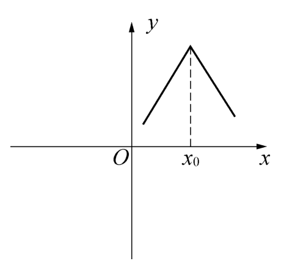

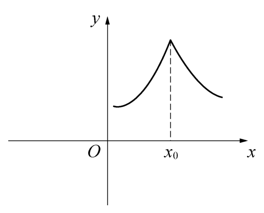

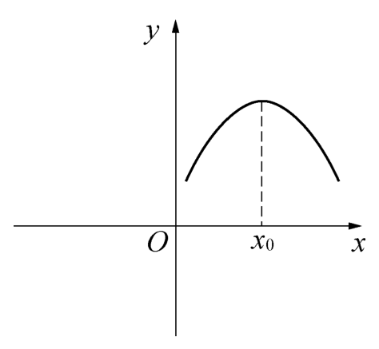

### 一、割线与切线

在中学数学中，圆的切线可以定义为“与圆只有一个交点的直线”（见图2-4）. 但对于一般曲线，这样定义是不合适的. 例如，直线$x=1$与抛物线$y=x^2$只有一个交点（见图2-5），但显然不是实际意义下的切线. 下面我们用极限的思想给出一般曲线的切线的定义.

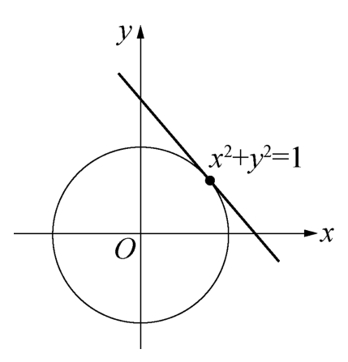

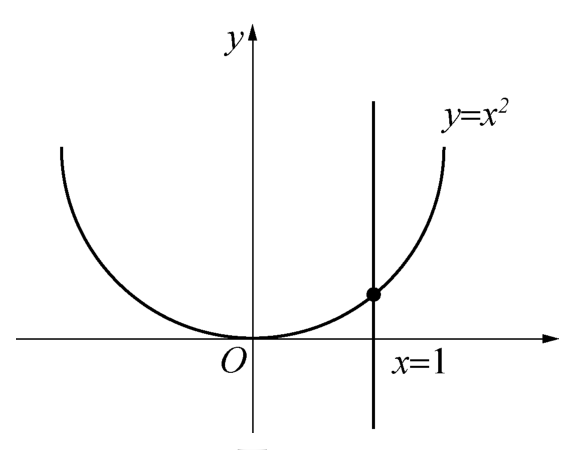

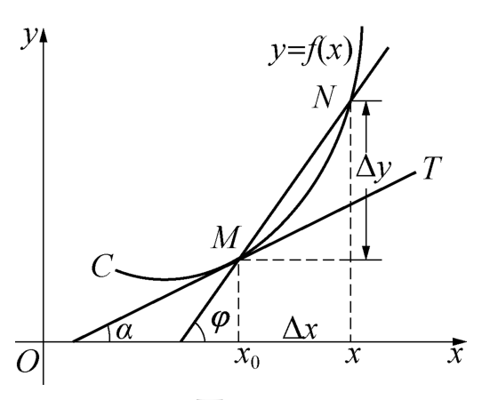

设曲线$C: y=f(x)$，$x\in I$，在曲线$C$上取点$M(x_0,y_0)$及点$N(x,y)$，连接$MN$，则$MN$为过点$M$的割线，割线的倾角为$\varphi$（见图2-6）. 则割线$MN$的斜率为

$$
\tan\varphi=\frac{y-y_0}{x-x_0}=\frac{f(x)-f(x_0)}{x-x_0}.
$$

当$N\to M$，即$x\to x_0$时，如果割线趋于一极限位置，我们就把此极限位置上的直线$MT$称为曲线在$M$点处的切线. 此刻切线的斜率即为

$$
k=\lim_{x\to x_0}\frac{y-y_0}{x-x_0}=\lim_{x\to x_0}\frac{f(x)-f(x_0)}{x-x_0}.
$$

从上面的例子可以看出，在求切线斜率的过程中，需要用到极限$\lim\limits_{x\to x_0}\frac{f(x)-f(x_0)}{x-x_0}$.

在自然科学和工程技术领域中，甚至在经济领域和社会科学的研究中，还有许多实际问题会用到如上极限的形式. 正是由于这些问题求解的需要，促使人们研究此极限，从而导致微分学的诞生. 我们抛开这些量的具体意义，抓住它们数量关系上的共性，得出函数导数的概念.

### 二、导数的定义

**定义**　设函数$y=f(x)$在$x_0$的某个邻域内有定义，当$x$在$x_0$处增量$\Delta x$（$x_0+\Delta x$在该邻域内）时，相应地，函数有增量$\Delta y=f(x_0+\Delta x)-f(x_0)$. 如果

$$
\lim_{\Delta x\to 0}\frac{\Delta y}{\Delta x}=\lim_{\Delta x\to 0}\frac{f(x_0+\Delta x)-f(x_0)}{\Delta x}=\lim_{x\to x_0}\frac{f(x)-f(x_0)}{x-x_0}
$$

存在，则称该极限为$y=f(x)$在点$x_0$处的导数，记为

$$
f'(x_0),\quad \left.y'\right|_{x=x_0},\quad \left.\frac{\mathrm{d}y}{\mathrm{d}x}\right|_{x=x_0}\ \text{或}\ \left.\frac{\mathrm{d}f(x)}{\mathrm{d}x}\right|_{x=x_0}.
$$

这时也称函数$y=f(x)$在点$x_0$处可导. 如果该极限不存在，称函数$y=f(x)$在点$x_0$处不可导.

特别地，如果$\lim\limits_{\Delta x\to 0}\frac{\Delta y}{\Delta x}=\infty$时，也称函数$y=f(x)$在点$x_0$处的导数为无穷大.

例如，对于函数$y=x^2$，在点$x=0$处（见图2-7），

$$
\lim_{\Delta x\to 0}\frac{\Delta y}{\Delta x}=\lim_{\Delta x\to 0}\frac{(0+\Delta x)^2-0}{\Delta x}=\lim_{\Delta x\to 0}\Delta x=0，\text{极限存在}.
$$

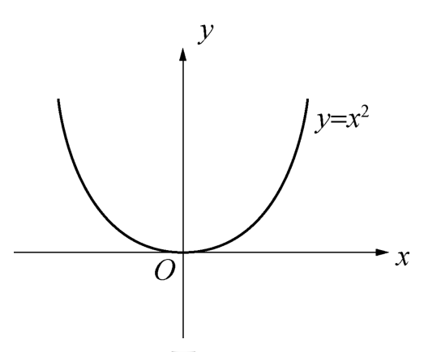

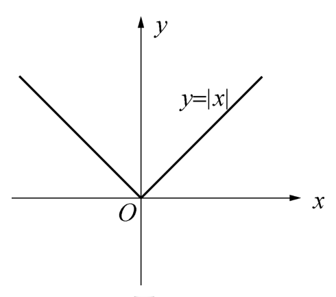

而对于函数$y=|x|$，在点$x=0$处（见图2-8），

$$
\lim_{\Delta x\to 0}\frac{\Delta y}{\Delta x}=\lim_{\Delta x\to 0}\frac{|0+\Delta x|-|0|}{\Delta x}=\lim_{\Delta x\to 0}\frac{|\Delta x|}{\Delta x}，\text{极限不存在}.
$$

由此可知，函数$y=|x|$在$x=0$处不可导，而$y=x^2$在$x=0$处导数为零，即$\left.\frac{\mathrm{d}y}{\mathrm{d}x}\right|_{x=0}=0$.

导数是一种特殊的极限，是概括了各种各样的变化率概念而得出的一个更一般性、也更抽象的概念. $\frac{\Delta y}{\Delta x}$是函数$y=f(x)$在$[x_0,x_0+\Delta x]$上的平均变化率，而导数$\left.\frac{\mathrm{d}y}{\mathrm{d}x}\right|_{x=x_0}$则反映函数$y=f(x)$在点$x_0$处的瞬时变化率，它实际反映函数随自变量变化而变化的“快慢程度”.

如果$y=f(x)$在$(a,b)$内的每一点处均可导，则称$y=f(x)$在$(a,b)$内可导. 这时$(a,b)$内的每一点都对应一个导数值，由函数的定义就可以得到一个新函数，则称这个函数为原来函数的导函数，简称为导数，记作$f'(x)$，$y'$，$\frac{\mathrm{d}y}{\mathrm{d}x}$或$\frac{\mathrm{d}f(x)}{\mathrm{d}x}$，即有

$$
f'(x)=\lim_{\Delta x\to 0}\frac{\Delta y}{\Delta x}=\lim_{\Delta x\to 0}\frac{f(x+\Delta x)-f(x)}{\Delta x}.
$$

显然，函数$y=f(x)$在$x_0$处的导数，就是导函数$f'(x)$在$x_0$处的函数值

$$
f'(x_0)=\left.f'(x)\right|_{x=x_0}.
$$

**例 1**　求函数$y=x^3$在$x=1$处的导数$f'(1)$.

**解**　当$x$由$1$变到$1+\Delta x$时，函数相应的增量为

$$
\Delta y=(1+\Delta x)^3-1^3=3\cdot\Delta x+3\cdot(\Delta x)^2+(\Delta x)^3,
\frac{\Delta y}{\Delta x}=3+3\Delta x+(\Delta x)^2,
$$

所以

$$
f'(1)=\lim_{\Delta x\to 0}\frac{\Delta y}{\Delta x}=\lim_{\Delta x\to 0}\left[3+3\Delta x+(\Delta x)^2\right]=3.
$$

**例 2**　设$f'(0)$存在，试求下列各极限：

（1）$\lim\limits_{x\to 0}\frac{f(2x)-f(0)}{x}$；　　　　（2）$\lim\limits_{x\to 0}\frac{f(x)}{x}$，其中$f(0)=0$.

**解**　（1）$\lim\limits_{x\to 0}\frac{f(2x)-f(0)}{x}=\lim\limits_{2x\to 0}\frac{f(2x)-f(0)}{\frac{1}{2}\cdot(2x-0)}$

$$
=2\cdot\lim_{2x\to 0}\frac{f(2x)-f(0)}{2x-0}=2f'(0);
$$

（2）因为$f(0)=0$，于是

$$
\lim_{x\to 0}\frac{f(x)}{x}=\lim_{x\to 0}\frac{f(x)-f(0)}{x-0}=f'(0).
$$

### 三、简单函数的求导

下面根据导数的定义求一些简单函数的导数.

**例 3**　求$f(x)=C$（$C$为常数）的导数.

**解**　$(C)'=\lim\limits_{\Delta x\to 0}\frac{C-C}{\Delta x}=0$.

**例 4**　求$f(x)=x^n$（$n$为正整数）的导数.

**解**　$(x^n)'=\lim\limits_{\Delta x\to 0}\frac{(x+\Delta x)^n-x^n}{\Delta x}=\lim\limits_{\Delta x\to 0}\left(nx^{n-1}+\frac{n(n-1)}{2}x^{n-2}\Delta x+\cdots+(\Delta x)^{n-1}\right)=nx^{n-1}$，即$(x^n)'=nx^{n-1}$.

一般地，当$x\neq 0$时，$y=x^\mu$有定义时，

$$
(x^\mu)'=\lim_{\Delta x\to 0}\frac{(x+\Delta x)^\mu-x^\mu}{\Delta x}=x^\mu\lim_{\Delta x\to 0}\frac{\left(1+\frac{\Delta x}{x}\right)^\mu-1}{\Delta x}=x^\mu\lim_{\Delta x\to 0}\frac{\mu\cdot\frac{\Delta x}{x}}{\Delta x}=\mu x^{\mu-1}.
$$

当$x=0$时，$y=x^\mu$有定义时也有上式成立.

例如，取$\mu=\frac{1}{2}$，则有$(\sqrt{x})'=\frac{1}{2\sqrt{x}}$；取$\mu=-1$，则有$\left(\frac{1}{x}\right)'=-\frac{1}{x^2}$.

**例 5**　求$f(x)=\sin x$的导数.

**解**　$(\sin x)'=\lim\limits_{\Delta x\to 0}\frac{\sin(x+\Delta x)-\sin x}{\Delta x}=\lim\limits_{\Delta x\to 0}\frac{2\cos\left(x+\frac{\Delta x}{2}\right)\sin\frac{\Delta x}{2}}{\Delta x}$

$$
=\lim_{\Delta x\to 0}\cos\left(x+\frac{\Delta x}{2}\right)\frac{\sin\frac{\Delta x}{2}}{\frac{\Delta x}{2}}=\cos x.
$$

同理，$(\cos x)'=-\sin x$.

**例 6**　求$f(x)=a^x$（$a>0$，$a\neq 1$）的导数.

**解**　$(a^x)'=\lim\limits_{\Delta x\to 0}\frac{a^{x+\Delta x}-a^x}{\Delta x}=a^x\lim\limits_{\Delta x\to 0}\frac{a^{\Delta x}-1}{\Delta x}=a^x\ln a$.

特别地，当$a=\mathrm{e}$时，有

$$
(\mathrm{e}^x)'=\mathrm{e}^x\ln\mathrm{e}=\mathrm{e}^x,
$$

即以$\mathrm{e}$为底的指数函数的导数就是它本身.

**例 7**　求$f(x)=\log_a x$（$a>0$，$a\neq 1$）的导数.

**解**　$(\log_a x)'=\lim\limits_{\Delta x\to 0}\frac{\log_a(x+\Delta x)-\log_a x}{\Delta x}=\lim\limits_{\Delta x\to 0}\frac{\log_a\left(1+\frac{\Delta x}{x}\right)}{\Delta x}=\lim\limits_{\Delta x\to 0}\frac{\frac{\Delta x}{x}}{\Delta x\cdot\ln a}=\frac{1}{x\ln a}$.

特别地，$(\ln x)'=\frac{1}{x}$.

### 四、左、右导数

下面我们来看$y=|x|$点$x=0$处的导数.

$$
\lim_{x\to 0}\frac{f(x)-f(0)}{x-0}=\lim_{x\to 0}\frac{|x|-|0|}{x-0}=\lim_{x\to 0}\frac{|x|}{x},
$$

我们发现这个极限不存在，但是它的左极限

$$
\lim_{x\to 0^-}\frac{|x|}{x}=\lim_{x\to 0^-}\frac{-x}{x}=-1
$$

和右极限

$$
\lim_{x\to 0^+}\frac{|x|}{x}=\lim_{x\to 0^+}\frac{x}{x}=1
$$

都是存在的. 所以就像左、右连续的概念一样，我们需引入左、右导数的概念.

若

$$
\lim_{\Delta x\to 0^+}\frac{\Delta y}{\Delta x}=\lim_{\Delta x\to 0^+}\frac{f(x_0+\Delta x)-f(x_0)}{\Delta x}=\lim_{x\to x_0^+}\frac{f(x)-f(x_0)}{x-x_0}
$$

存在，则称其为函数$f(x)$在$x_0$处的右导数，记作$f'_+(x_0)$；

若

$$
\lim_{\Delta x\to 0^-}\frac{\Delta y}{\Delta x}=\lim_{\Delta x\to 0^-}\frac{f(x_0+\Delta x)-f(x_0)}{\Delta x}=\lim_{x\to x_0^-}\frac{f(x)-f(x_0)}{x-x_0}
$$

存在，则称其为函数$f(x)$在$x_0$处的左导数，记作$f'_-(x_0)$.

因此，如同左、右连续概念中的充要条件一样，我们有下列结论：

函数$f(x)$在$x=x_0$处可导的充要条件是$f(x)$在$x=x_0$处左、右导数存在且相等.

现在，我们可回答函数$y=|x|$在$x=0$处不可导的原因：$f'_+(0)\neq f'_-(0)$.

**例 8**　已知$f(x)=\begin{cases}\sin x, & x<0,\\ x, & x\geq 0,\end{cases}$求$f'_+(0)$，$f'_-(0)$及$f'(0)$.

**解**　$f'_+(0)=\lim\limits_{x\to 0^+}\frac{f(x)-f(0)}{x}=\lim\limits_{x\to 0^+}\frac{x}{x}=1$，

$$
f'_-(0)=\lim_{x\to 0^-}\frac{f(x)-f(0)}{x}=\lim_{x\to 0^-}\frac{\sin x}{x}=1,
$$

故$f'(0)=1$.

### 五、切线与法线方程

函数$f(x)$在点$x_0$处的导数在几何上表示曲线$y=f(x)$在点$M(x_0,f(x_0))$处切线的斜率

$$
k=\tan\alpha=f'(x_0).
$$

相应地，切线方程为

$$
y-f(x_0)=f'(x_0)(x-x_0),
$$

法线方程为

$$
y-f(x_0)=-\frac{1}{f'(x_0)}(x-x_0)\ (f'(x_0)\neq 0).
$$

法线即为过切点$M(x_0,f(x_0))$且与切线垂直的直线.

**例 9**　求曲线$y=\frac{1}{x}$在点$\left(\frac{1}{2},2\right)$处的切线斜率，并写出切线及法线方程.

**解**　$y'=\left(\frac{1}{x}\right)'=-\frac{1}{x^2}$，曲线$y=\frac{1}{x}$在点$\left(\frac{1}{2},2\right)$处的切线斜率为

$$
k=\left.y'\right|_{x=\frac{1}{2}}=-4.
$$

因此，切线方程为

$$
y-2=-4\left(x-\frac{1}{2}\right)，\text{即}\ 4x+y-4=0;
$$

法线方程为

$$
y-2=\frac{1}{4}\left(x-\frac{1}{2}\right)，\text{即}\ 2x-8y+15=0.
$$

### 六、函数的可导性与连续性的关系

**定理 1**　若函数$f(x)$在$x_0$处可导，则函数$f(x)$在$x_0$处必连续.

**证明**　若函数$f(x)$在$x_0$处可导，由定义得$\lim\limits_{\Delta x\to 0}\frac{\Delta y}{\Delta x}=f'(x_0)$，因此，

$$
\lim_{\Delta x\to 0}\Delta y=\lim_{\Delta x\to 0}\frac{\Delta y}{\Delta x}\cdot\Delta x=f'(x_0)\cdot 0=0,
$$

故函数$f(x)$在$x_0$处必连续.

**注**　函数连续未必可导，这说明连续是可导的必要条件.

例如，函数$f(x)=\sqrt[3]{x}$在$(-\infty,+\infty)$上连续，但在点$x=0$处不可导. 这是因为在点$x=0$处有

$$
\lim_{\Delta x\to 0}\frac{f(0+\Delta x)-f(0)}{\Delta x}=\lim_{\Delta x\to 0}\frac{\sqrt[3]{\Delta x}-0}{\Delta x}=\lim_{\Delta x\to 0}(\Delta x)^{-\frac{2}{3}}=+\infty，
$$

即导数为无穷大（导数不存在）. 从图形上看（见图2-9），在该点处有与$x$轴垂直的切线$x=0$.

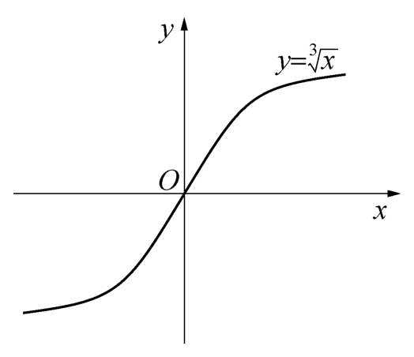

再比如，

$$
f(x)=\begin{cases}x\sin\frac{1}{x}, & x\neq 0,\\ 0, & x=0,\end{cases}
$$

由

$$
\lim_{x\to 0}f(x)=\lim_{x\to 0}x\sin\frac{1}{x}=0,
$$

得$f(x)$在$x=0$处连续. 由

$$
\lim_{x\to 0}\frac{f(x)-f(0)}{x-0}=\lim_{x\to 0}\frac{x\sin\frac{1}{x}-0}{x-0}=\lim_{x\to 0}\sin\frac{1}{x}\ \text{不存在},
$$

得$f(x)$在$x=0$处不可导. 由图形可知（见图2-10），曲线在$x=0$附近无限次震荡.

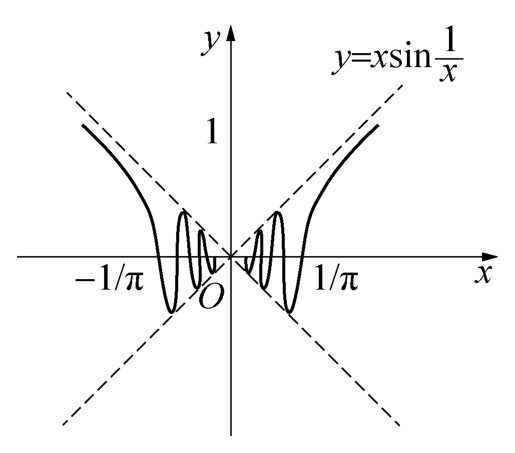

### 七、函数的和、差、积、商的求导法则

**定理 2**　若$u(x)$、$v(x)$在点$x$处的导数均存在，则它们的和、差、积、商的导数都存在，且有

（1）$[u(x)\pm v(x)]'=u'(x)\pm v'(x)$；

（2）$[u(x)\cdot v(x)]'=u'(x)v(x)+u(x)v'(x)$；

（3）$\left[\frac{u(x)}{v(x)}\right]'=\frac{u'(x)v(x)-u(x)v'(x)}{v^2(x)}\ (v(x)\neq 0)$.

**证明**　我们仅证（2）.

$$
\begin{aligned}
[u(x)\cdot v(x)]'&=\lim_{\Delta x\to 0}\frac{u(x+\Delta x)\cdot v(x+\Delta x)-u(x)\cdot v(x)}{\Delta x}\\
&=\lim_{\Delta x\to 0}\frac{u(x+\Delta x)v(x+\Delta x)-u(x)v(x+\Delta x)+u(x)v(x+\Delta x)-u(x)v(x)}{\Delta x}\\
&=\lim_{\Delta x\to 0}\left[\frac{u(x+\Delta x)-u(x)}{\Delta x}v(x+\Delta x)+u(x)\frac{v(x+\Delta x)-v(x)}{\Delta x}\right]\\
&=\lim_{\Delta x\to 0}\frac{u(x+\Delta x)-u(x)}{\Delta x}v(x+\Delta x)+\lim_{\Delta x\to 0}u(x)\frac{v(x+\Delta x)-v(x)}{\Delta x}\\
&=u'(x)v(x)+u(x)v'(x).
\end{aligned}
$$

**注**　（1）$[Cu(x)]'=Cu'(x)$，由此可得$[\alpha u(x)+\beta v(x)]'=\alpha u'(x)+\beta v'(x)$.

（2）若$u'(x)$、$v'(x)$、$w'(x)$均存在，则$[u(x)\cdot v(x)\cdot w(x)]'$存在，且

$$
[u(x)\cdot v(x)\cdot w(x)]'=u'(x)v(x)w(x)+u(x)v'(x)w(x)+u(x)v(x)w'(x).
$$

（3）上述公式可简记为

$$
(u\pm v)'=u'\pm v';\quad (u\cdot v)'=u'\cdot v+u\cdot v';\quad \left(\frac{u}{v}\right)'=\frac{u'\cdot v-u\cdot v'}{v^2}\ (v\neq 0).
$$

利用商的导数公式可以得到另外四个三角函数的计算公式.

$$
(\tan x)'=\left(\frac{\sin x}{\cos x}\right)'=\frac{\cos x\cdot\cos x-\sin x\cdot(-\sin x)}{\cos^2 x}=\frac{1}{\cos^2 x}=\sec^2 x;
(\cot x)'=\left(\frac{\cos x}{\sin x}\right)'=\frac{-\sin x\cdot\sin x-\cos x\cdot\cos x}{\sin^2 x}=\frac{-1}{\sin^2 x}=-\csc^2 x;
(\sec x)'=\left(\frac{1}{\cos x}\right)'=\frac{0-(-\sin x)}{\cos^2 x}=\sec x\tan x;
(\csc x)'=\left(\frac{1}{\sin x}\right)'=\frac{-\cos x}{\sin^2 x}=-\csc x\cot x.
$$

**例 10**　计算下列函数的导数：

（1）$y=3^x-\ln x+\sin x+\mathrm{e}$；　　　　（2）$f(x)=x^3+4\cos x-\sin\frac{\pi}{7}$；

（3）$y=(x^2+3a^x)(\sin x-1)$；　　　　（4）$y=(2x+3)(1-x)(x+2)$；

（5）$y=\frac{x+1}{\ln x}$；　　　　（6）$f(x)=\frac{2\sqrt{x}\tan x}{1+x^2}$.

**解**　（1）$y'=(3^x-\ln x+\sin x+\mathrm{e})'=(3^x)'-(\ln x)'+(\sin x)'+(\mathrm{e})'=3^x\ln 3-\frac{1}{x}+\cos x$

（2）$f'(x)=\left(x^3+4\cos x-\sin\frac{\pi}{7}\right)'=(x^3)'+(4\cos x)'-\left(\sin\frac{\pi}{7}\right)'=3x^2-4\sin x$.

（3）$y'=[(x^2+3a^x)(\sin x-1)]'$

$$
\begin{aligned}
&=(x^2+3a^x)'(\sin x-1)+(x^2+3a^x)(\sin x-1)'\\
&=(2x+3a^x\ln a)(\sin x-1)+(x^2+3a^x)\cos x.
\end{aligned}
$$

（4）$y'=(2x+3)'(1-x)(x+2)+(2x+3)(1-x)'(x+2)+(2x+3)(1-x)(x+2)'$

$$
\begin{aligned}
&=2(1-x)(x+2)+(2x+3)(-1)(x+2)+(2x+3)(1-x)\\
&=-6x^2-10x+1.
\end{aligned}
$$

（5）$y'=\frac{(x+1)'\ln x-(x+1)(\ln x)'}{(\ln x)^2}=\frac{\ln x-(x+1)\frac{1}{x}}{(\ln x)^2}=\frac{x\ln x-(x+1)}{x(\ln x)^2}$.

（6）$f'(x)=2\cdot\frac{(\sqrt{x}\tan x)'(1+x^2)-\sqrt{x}\tan x(1+x^2)'}{(1+x^2)^2}$

$$
\begin{aligned}
&=2\cdot\frac{\left(\frac{1}{2\sqrt{x}}\tan x+\sqrt{x}\sec^2 x\right)(1+x^2)-\sqrt{x}\tan x\cdot 2x}{(1+x^2)^2}\\
&=\frac{2x(1+x^2)\sec^2 x+(1-3x^2)\tan x}{\sqrt{x}(1+x^2)^2}.
\end{aligned}
$$

### 八、反函数的求导法则

**定理 3**　如果单调函数$x=\varphi(y)$在某一区间$I_y$内可导，且$\varphi'(y)\neq 0$，则它的反函数$y=f(x)$在对应的区间$I_x=\{x|x=\varphi(y),\ y\in I_y\}$内也可导，且

$$
f'(x)=\left.\frac{1}{\varphi'(y)}\right|_{y=f(x)}.
$$

**证明**　由反函数存在定理可知$f(x)$是单调、连续的，当$x$取得增量$\Delta x$时，$\Delta y=f(x+\Delta x)-f(x)\neq 0$（$f(x)$单调）. 当$\Delta x\to 0$时，有$\Delta y\to 0$（$f(x)$连续）.

因为$x=\varphi(y)$可导，且$\varphi'(y)\neq 0$，即$\lim\limits_{\Delta y\to 0}\frac{\Delta x}{\Delta y}\neq 0$，因此，

$$
f'(x)=\lim_{\Delta x\to 0}\frac{\Delta y}{\Delta x}=\lim_{\Delta y\to 0}\frac{1}{\frac{\Delta x}{\Delta y}}=\frac{1}{\lim_{\Delta y\to 0}\frac{\Delta x}{\Delta y}}=\frac{1}{\varphi'(y)}.
$$

本定理也可简单叙述为：反函数的导数等于直接函数导数的倒数.

利用反函数的求导法则则可以求出四个反三角函数的导数.

$y=\arcsin x$是$x=\sin y$的反函数，$x=\sin y\left(-\frac{\pi}{2}<y<\frac{\pi}{2}\right)$在$I_y=\left(-\frac{\pi}{2},\frac{\pi}{2}\right)$内单调、可导，且$(\sin y)'_y=\cos y>0$，因此，在对应的$I_x=(-1,1)$内，有

$$
(\arcsin x)'=\frac{1}{(\sin y)'}=\frac{1}{\cos y}=\frac{1}{\sqrt{1-\sin^2 y}}=\frac{1}{\sqrt{1-x^2}}
$$

（由于$\cos y$在$\left(-\frac{\pi}{2},\frac{\pi}{2}\right)$内大于零，故取正号）；

同理可得

$$
(\arccos x)'=\frac{1}{(\cos y)'}=-\frac{1}{\sin y}=-\frac{1}{\sqrt{1-\cos^2 y}}=-\frac{1}{\sqrt{1-x^2}}
$$

（由于$\sin y$在$(0,\pi)$内大于零，故取正号）；

$y=\arctan x$是$x=\tan y\left(-\frac{\pi}{2}<y<\frac{\pi}{2}\right)$的反函数，$x=\tan y$在$I_y=\left(-\frac{\pi}{2},\frac{\pi}{2}\right)$内单调、可导，且$(\tan y)'=\sec^2 y\neq 0$，因此，在对应的$I_x=(-\infty,+\infty)$内，有

$$
(\arctan x)'=\frac{1}{(\tan y)'}=\frac{1}{\sec^2 y}=\frac{1}{1+\tan^2 y}=\frac{1}{1+x^2};
$$

同理可得

$$
(\arccot x)'=\frac{1}{(\cot y)'}=-\frac{1}{\csc^2 y}=-\frac{1}{1+\cot^2 y}=-\frac{1}{1+x^2}.
$$

### 九、求导公式与基本求导法则

至此，我们已经求出了所有基本初等函数的导数，且推出了函数的和、差、积、商的求导法则.

### 1. 基本求导公式：

（1）$(C)'=0$；

（2）$(x^\mu)'=\mu x^{\mu-1}$；

（3）$(\sin x)'=\cos x$；

（4）$(\cos x)'=-\sin x$；

（5）$(\tan x)'=\sec^2 x$；

（6）$(\cot x)'=-\csc^2 x$；

（7）$(\sec x)'=\sec x\tan x$；

（8）$(\csc x)'=-\csc x\cot x$；

（9）$(a^x)'=a^x\ln a\ (a>0,\ a\neq 1)$；

（10）$(\mathrm{e}^x)'=\mathrm{e}^x$；

（11）$(\log_a x)'=\frac{1}{x\ln a}\ (a>0,\ a\neq 1)$；

（12）$(\ln|x|)'=\frac{1}{x}$；

（13）$(\arcsin x)'=\frac{1}{\sqrt{1-x^2}}$；

（14）$(\arccos x)'=-\frac{1}{\sqrt{1-x^2}}$；

（15）$(\arctan x)'=\frac{1}{1+x^2}$；

（16）$(\arccot x)'=-\frac{1}{1+x^2}$.

### 2. 求导法则

若$u$、$v$可导，则

$$
(u\pm v)'=u'\pm v';\quad (u\cdot v)'=u'\cdot v+u\cdot v';\quad \left(\frac{u}{v}\right)'=\frac{u'\cdot v-u\cdot v'}{v^2}\ (v\neq 0).
$$

**例 11**　求函数$f(x)=\begin{cases}2x, & 0<x\leq 1,\\ x^2+1, & 1<x<2\end{cases}$的导数.

**解**　求分段函数的导数时，在每一段区间内的导数可按一般求导法则计算，但在分段点处的导数要用左、右导数的定义求之.

当$0<x<1$时，$f'(x)=(2x)'=2$；当$1<x<2$时，$f'(x)=(x^2+1)'=2x$；

当$x=1$时，$f'_-(1)=\lim\limits_{x\to 1^-}\frac{f(x)-f(1)}{x-1}=\lim\limits_{x\to 1^-}\frac{2x-2}{x-1}=2$，

$$
f'_+(1)=\lim_{x\to 1^+}\frac{f(x)-f(1)}{x-1}=\lim_{x\to 1^+}\frac{x^2+1-2}{x-1}=\lim_{x\to 1^+}\frac{x^2-1}{x-1}=\lim_{x\to 1^+}(x+1)=2,
$$

由$f'_+(1)=f'_-(1)=2$知，$f'(1)=2$. 所以$f'(x)=\begin{cases}2, & 0<x\leq 1,\\ 2x, & 1<x<2.\end{cases}$

### 习题 2-1

1. 填空选择题：

（1）设函数$f(x)$在$x=0$处可导，则$\lim\limits_{h\to 0}\frac{f(-h)-f(0)}{h}=$________；

（2）设$f(x)=\begin{cases}x, & x<0,\\ \ln(1+x), & x\geq 0,\end{cases}$则$f(0)=$________，$f'(0)=$________；

（3）设$y=\frac{1-x}{1+x}$，则$y'=$________；

（4）设函数$f(x)=\frac{2}{\sqrt[3]{x^2}}-\frac{1}{x\sqrt{x}}$，则$f'(1)=$________；

（5）设函数$f(x)=x(x-1)(x-2)(x-3)$，则$f'(0)=$________，$[f(0)]'=$________；

（6）过曲线$y=x^2$上点$(2,4)$处的切线斜率为________；

（7）函数$f(x)=\begin{cases}x+2, & 0\leq x<1,\\ 3x-1, & x\geq 1,\end{cases}$则$f(x)$在$x=1$处（　）；

A. 可导　　　　B. 连续但不可导　　　　C. 不连续　　　　D. 无定义

（8）函数$f(x)$在点$x_0$处连续是在该点处可导的（　）；

A. 充分条件　　　　B. 必要条件　　　　C. 充要条件　　　　D. 无关条件

2. 求下列函数的导数：

（1）$y=x^5$；　　（2）$y=\sqrt[3]{x}$；　　（3）$y=x\sqrt{x}$；

（4）$y=\frac{1}{\sqrt{x}}$；　　（5）$y=\frac{1}{x^2}$；　　（6）$y=\frac{\sqrt[3]{x^5}}{\sqrt{x}}$.

3. 已知$f(0)=0$且$f'(0)=2$，求$\lim\limits_{x\to 0}\frac{f(x)}{x}$和$\lim\limits_{x\to 0}\frac{f(x)}{\sin 3x}$.

4. 讨论下列函数在$x=0$处的连续性和可导性：

（1）$y=x^3$；　　（2）$y=|x^3|$；　　（3）$y=\sin x$；　　（4）$y=|\sin x|$.

5. 求下列函数在定点处的导数：

（1）$y=\sin x-\cos x$，求$\left.y'\right|_{x=\frac{\pi}{6}}$，$\left.y'\right|_{x=\frac{\pi}{4}}$；

（2）$f(x)=\frac{3}{5-x}+\frac{x^2}{5}$，求$f'(0)$，$f'(2)$；

（3）$f(t)=\frac{1-\sqrt{t}}{1+\sqrt{t}}$，求$f'(4)$；

（4）$y=\arctan x+3\arccot x$，求$f'(1)$，$f'(-1)$；

（5）设$f(x)=\frac{(x-1)(x-2)}{(x+1)(x+2)}$，求$f'(1)$.

6. 讨论下列函数在$x=0$处的可导性：

（1）$y=\begin{cases}-x, & x<0,\\ x^2, & x\geq 0;\end{cases}$　　　　（2）$y=\begin{cases}\mathrm{e}^x+1, & x\leq 0,\\ x+2, & x>0.\end{cases}$

7. 求下列函数的导数（$a\in\mathbf{R}$）：

（1）$y=a^x\cdot\mathrm{e}^x$；　　　　（2）$y=x^a+a^x+a^a$；

（3）$y=x^2\cos x$；　　　　（4）$y=x\tan x-2\sec x$；

（5）$y=\frac{\sin x}{x^2}$；　　　　（6）$y=\sqrt{x}(x-\cot x)\cos x$；

（7）$y=\ln(3x)+3\lg x$；　　　　（8）$y=x^3\ln x$；

（9）$y=x^2\mathrm{e}^x\cos x$；　　　　（10）$y=\frac{\mathrm{e}^x}{x^2+2x+1}$.

8. 在抛物线$y=x^2$上取横坐标为$x_1=1$，$x_2=3$的两点，作过这两点的割线，求抛物线上哪一点的切线平行于这条割线，并写出这条切线的方程.

9. 求曲线$y=\cos x$在点$\left(\frac{\pi}{3},\frac{1}{2}\right)$处的切线与法线方程.

10. 求曲线$y=x^3+x$上，其切线与直线$y=4x$平行的点.

11. 证明：双曲线$xy=a^2$上任意一点处的切线与两坐标轴构成的三角形的面积都等于$2a^2$.

## 第二节 导数的计算法则

[课前导读]

这一节介绍复合函数的求导法则，高阶导数、隐函数和参数方程的求导法则. 为了学习这些知识，我们要先熟悉下列内容.

（1）复合函数的正确分解：$y=f[g(x)]$由内函数$u=g(x)$和外函数$y=f(u)$复合而成. 例如，$y=\sin^2 x$由$u=\sin x$和$y=u^2$复合而成，$y=\ln\frac{x^2-1}{x^2+1}$由$u=\frac{x^2-1}{x^2+1}$和$y=\ln u$复合而成.

（2）函数的表示方式：函数$y=f(x)$表示变量$y$与$x$之间的对应关系，这种对应关系可以用不同的方式表达. 例如，$y=\sin x$，$y=\ln(x+\sqrt{1+x^2})$，用这种方式表达的函数叫作显函数. 但也有些函数的表达方式不是这样，如$x\mathrm{e}^y-y+1=0$，$x+y^3+1=0$，通过一个方程确定变量$y$与$x$之间的对应关系，这样的函数称为隐函数.

（3）由参数确定的方程：在实际问题中，函数$y$与自变量$x$可能不是直接由$y=f(x)$表示，而是通过一参变量$t$来表示，即

$$
\begin{cases}x=\varphi(t),\\ y=\psi(t).\end{cases}
$$

### 一、复合函数的求导法则

前面讨论的求导问题，仅限于基本初等函数和一些较简单的函数. 对于在实际中经常用到的复合函数来说，我们不知道它们是否可导？如果可导，又该怎样计算. 我们需要引进下面的重要法则来解决这一问题，从而扩大函数求导的范围.

**定理 1（复合函数的求导法则）**　如果$y=f(u)$在点$u$处可导，$u=g(x)$在点$x$处可导，则复合函数$y=f[g(x)]$在点$x$处可导，且有

$$
\frac{\mathrm{d}y}{\mathrm{d}x}=\frac{\mathrm{d}y}{\mathrm{d}u}\cdot\frac{\mathrm{d}u}{\mathrm{d}x}\ (\text{即}\ y'(x)=f'(u)\cdot g'(x)).
$$

$^{*}$**证明**　因为$y=f(u)$在点$u$处可导，故$f'(u)=\lim\limits_{\Delta u\to 0}\frac{\Delta y}{\Delta u}$，即

$$
\frac{\Delta y}{\Delta u}=f'(u)+\alpha，\text{其中}\lim_{\Delta u\to 0}\alpha=0.
$$

当$\Delta u\neq 0$时，用$\Delta u$乘上式两边，得$\Delta y=f'(u)\Delta u+\alpha\Delta u$；　　　　（1）

当$\Delta u=0$时，规定$\alpha=0$，此时由于$\Delta y=f(u+\Delta u)-f(u)=0$，（1）式也成立.

故当$\Delta x\neq 0$时，由（1）式除以$\Delta x$，得$\frac{\Delta y}{\Delta x}=f'(u)\frac{\Delta u}{\Delta x}+\alpha\frac{\Delta u}{\Delta x}$.

由$u=g(x)$在点$x$处连续（可导$\Rightarrow$连续）知，当$\Delta x\to 0$时，$\Delta u=g(x+\Delta x)-g(x)\to 0$，故$\lim\limits_{\Delta x\to 0}\alpha=\lim\limits_{\Delta u\to 0}\alpha=0$，因此，

$$
\frac{\mathrm{d}y}{\mathrm{d}x}=\lim_{\Delta x\to 0}\frac{\Delta y}{\Delta x}=\lim_{\Delta x\to 0}\left[f'(u)\frac{\Delta u}{\Delta x}+\alpha\frac{\Delta u}{\Delta x}\right]=f'(u)g'(x),
$$

即

$$
\frac{\mathrm{d}y}{\mathrm{d}x}=\frac{\mathrm{d}y}{\mathrm{d}u}\cdot\frac{\mathrm{d}u}{\mathrm{d}x}.
$$

复合函数的求导法则也称为链式法则，它可推广到有限个函数复合的情形. 比如，若$y=f(u)$，$u=g(v)$和$v=h(x)$可导，则$y=f\{g[h(x)]\}$可导，且

$$
\frac{\mathrm{d}y}{\mathrm{d}x}=\frac{\mathrm{d}y}{\mathrm{d}u}\cdot\frac{\mathrm{d}u}{\mathrm{d}v}\cdot\frac{\mathrm{d}v}{\mathrm{d}x}=f'(u)\cdot g'(v)\cdot h'(x).
$$

**例 1**　求下列函数的导数：

（1）$y=\mathrm{e}^{2x}$；　　　　（2）$y=\sin x^2$；

（3）$y=(x^2+1)^{10}$；　　　　（4）$y=\sqrt{1-x^2}$；

（5）$y=\ln(\sin x)$；　　　　（6）$y=\cos^2 x$；

（7）$y=\mathrm{e}^{\sin\frac{1}{x}}$；　　　　（8）$y=(x+\sin^2 x)^3$.

**解**　（1）设$y=\mathrm{e}^u$，$u=2x$，则

$$
\frac{\mathrm{d}y}{\mathrm{d}x}=\frac{\mathrm{d}y}{\mathrm{d}u}\cdot\frac{\mathrm{d}u}{\mathrm{d}x}=(\mathrm{e}^u)'\cdot(2x)'=\mathrm{e}^u\cdot 2=2\mathrm{e}^u=2\mathrm{e}^{2x}.
$$

（2）设$y=\sin u$，$u=x^2$，则

$$
\frac{\mathrm{d}y}{\mathrm{d}x}=\frac{\mathrm{d}y}{\mathrm{d}u}\cdot\frac{\mathrm{d}u}{\mathrm{d}x}=(\sin u)'\cdot(x^2)'=\cos u\cdot 2x=2x\cos x^2.
$$

（3）设$y=u^{10}$，$u=x^2+1$，则

$$
\frac{\mathrm{d}y}{\mathrm{d}x}=\frac{\mathrm{d}y}{\mathrm{d}u}\cdot\frac{\mathrm{d}u}{\mathrm{d}x}=10u^9\cdot 2x=10(x^2+1)^9\cdot 2x=20x(x^2+1)^9.
$$

（4）函数$y=\sqrt{1-x^2}$可以看作由$y=\sqrt{u}$和$u=1-x^2$复合而成，故

$$
y'=\frac{\mathrm{d}y}{\mathrm{d}x}=\frac{\mathrm{d}y}{\mathrm{d}u}\cdot\frac{\mathrm{d}u}{\mathrm{d}x}=(\sqrt{u})'\cdot(1-x^2)'=\frac{1}{2\sqrt{u}}\cdot(-2x)=-\frac{x}{\sqrt{1-x^2}}.
$$

熟悉复合函数的求导公式后，可以省去中间变量.

（5）$y'=\frac{1}{\sin x}\cdot(\sin x)'=\frac{1}{\sin x}\cdot\cos x=\cot x$.

（6）$y'=2\cos x\cdot(\cos x)'=2\cos x\cdot(-\sin x)=-\sin 2x$.

（7）函数$y=\mathrm{e}^{\sin\frac{x}{2}}$由$y=\mathrm{e}^u$和$u=\sin v$及$v=\frac{x}{2}$复合而成，故

$$
y'=(\mathrm{e}^u)'\cdot(\sin v)'\cdot\left(\frac{x}{2}\right)'=\mathrm{e}^u\cdot\cos v\cdot\frac{1}{2}=\frac{1}{2}\mathrm{e}^{\sin\frac{x}{2}}\cos\frac{x}{2}.
$$

（8）$y'=[(x+\sin^2 x)^3]'=3(x+\sin^2 x)^2(x+\sin^2 x)'$

$$
\begin{aligned}
&=3(x+\sin^2 x)^2[1+2\sin x\cdot(\sin x)']\\
&=3(x+\sin^2 x)^2(1+\sin 2x).
\end{aligned}
$$

**例 2**　求$y=\sqrt{\frac{1-x}{1+x}}$的导数.

**解**　$y'=\frac{1}{2\sqrt{\frac{1-x}{1+x}}}\cdot\left(\frac{1-x}{1+x}\right)'=\frac{1}{2\sqrt{\frac{1-x}{1+x}}}\cdot\frac{-(1+x)-(1-x)}{(1+x)^2}=\frac{1}{(1+x)\sqrt{1-x^2}}$.

**例 3**　求函数$y=\ln\sqrt{x^2+1}$的导数.

**解**　因为$y=\frac{1}{2}\ln(x^2+1)$，所以

$$
y'=\frac{1}{2}\cdot\frac{1}{x^2+1}\cdot(x^2+1)'=\frac{1}{2}\cdot\frac{1}{x^2+1}\cdot 2x=\frac{x}{x^2+1}.
$$

**例 4**　求幂指函数$y=x^{\frac{1}{x}}$（$x>0$，$x\neq 1$）的导数.

**解**　由对数的性质可知，$y=x^{\frac{1}{x}}=\mathrm{e}^{\ln x^{\frac{1}{x}}}=\mathrm{e}^{\frac{\ln x}{x}}$，因此

$$
y'=\left(x^{\frac{1}{x}}\right)'=\left(\mathrm{e}^{\frac{\ln x}{x}}\right)'=\mathrm{e}^{\frac{\ln x}{x}}\cdot\left(\frac{\ln x}{x}\right)'=x^{\frac{1}{x}}\frac{1-\ln x}{x^2}.
$$

**例 5**　已知$f(u)$可导，求函数$y=f(\tan x)$的导数.

**解**　$y=f(\tan x)$由$y=f(u)$和$u=\tan x$复合而成. 由复合函数的求导法则可知，

$$
y'=[f(\tan x)]'=f'(u)\cdot(\tan x)'，\text{即}
y'=[f(\tan x)]'=f'(\tan x)\cdot(\tan x)'=f'(\tan x)\cdot\sec^2 x.
$$

**注**　求此类含抽象函数的导数时，应特别注意记号表示的真实含义. 此例中，$f'(\tan x)$表示对$\tan x$求导，而$[f(\tan x)]'$表示对$x$求导.

### 二、高阶导数

### 1. 二阶导数的概念

如果函数$y=f(x)$的导数$y'=f'(x)$仍是$x$的可导函数，那么就称$y'=f'(x)$的导数为函数$y=f(x)$的二阶导数，记作

$$
y'',\ f''(x),\ \frac{\mathrm{d}^2 y}{\mathrm{d}x^2}\ \text{或}\ \frac{\mathrm{d}^2 f}{\mathrm{d}x^2},
$$

即$y''=(y')'$，$f''(x)=[f'(x)]'$，$\frac{\mathrm{d}^2 y}{\mathrm{d}x^2}=\frac{\mathrm{d}}{\mathrm{d}x}\left(\frac{\mathrm{d}y}{\mathrm{d}x}\right)$或$\frac{\mathrm{d}^2 f}{\mathrm{d}x^2}=\frac{\mathrm{d}}{\mathrm{d}x}\left(\frac{\mathrm{d}f}{\mathrm{d}x}\right)$.

例如，$(\sin x)'=\cos x$，$(\sin x)''=(\cos x)'=-\sin x$.

**例 6**　设$f(x)=x^2+\ln x$，求$y''$.

**解**　$y'=2x+\frac{1}{x}$，$y''=2-\frac{1}{x^2}$.

**例 7**　设$y=\arctan x$，求$f''(0)$.

**解**　$f'(x)=\frac{1}{1+x^2}$，$f''(x)=\left(\frac{1}{1+x^2}\right)'=\frac{-2x}{(1+x^2)^2}$，

$$
f''(0)=\left.\frac{-2x}{(1+x^2)^2}\right|_{x=0}=0.
$$

**例 8**　证明$y=\mathrm{e}^x\sin x$满足关系式$y''-2y'+2y=0$.

**证明**　$y'=(\mathrm{e}^x\sin x)'=\mathrm{e}^x\sin x+\mathrm{e}^x\cos x=\mathrm{e}^x(\sin x+\cos x)$，

$$
y''=\mathrm{e}^x(\sin x+\cos x)+\mathrm{e}^x(\cos x-\sin x)=2\mathrm{e}^x\cos x,
$$

所以$y''-2y'+2y=2\mathrm{e}^x\cos x-2\mathrm{e}^x(\sin x+\cos x)+2\mathrm{e}^x\sin x=0$，

故$y=\mathrm{e}^x\sin x$满足关系式$y''-2y'+2y=0$.

### 2. 二阶导数的物理意义

设质点沿直线运动，在直线上给定原点和单位点（表示实数$1$的点），使直线成为数轴. 另外，再取定一个时刻为计时的零点. 质点于时刻$t$在直线上的位置的坐标记为$s$，这样，质点的运动完全由某个函数$s=s(t)$所确定.

在最简单的匀速直线运动的情形中，质点经过的路程与所用的时间成正比，即$v=\frac{s}{t}$.

如果是非匀速直线运动，取从$t_0$时刻到$t_0+\Delta t$这样一段时间间隔，在$[t_0,t_0+\Delta t]$上质点所走过的路程$s$有相应增量$\Delta s=s(t_0+\Delta t)-s(t_0)$，这段区间上的平均速度

$$
\bar{v}=\frac{s(t_0+\Delta t)-s(t_0)}{\Delta t}.
$$

若令$t\to t_0$，即$\Delta t\to 0$，那么$\bar{v}$的极限值就精确地反映了质点在时刻这一瞬间运动的快慢程度. 因此在$t=t_0$时，瞬时速度即为

$$
v(t_0)=\lim_{\Delta t\to 0}\frac{s(t_0+\Delta t)-s(t_0)}{\Delta t}=s'(t_0).
$$

一般地，变速直线运动的速度$v(t)$就是位置函数$s(t)$对时间$t$的导数，即

$$
v(t)=\frac{\mathrm{d}s}{\mathrm{d}t}，\text{或}\ v=s'.
$$

而加速度$a(t)$是速度函数$v(t)$对时间$t$的变化率，即速度函数$v(t)$对时间$t$的导数，即

$$
a=\frac{\mathrm{d}v}{\mathrm{d}t}=\frac{\mathrm{d}}{\mathrm{d}t}\left(\frac{\mathrm{d}s}{\mathrm{d}t}\right)，\text{或}\ a=(s')'=s''=\frac{\mathrm{d}^2 s}{\mathrm{d}t^2}.
$$

### 3. n阶导数的计算

一般地，设$n\in\mathbf{Z}^+$，$n\geq 2$，如果$f(x)$的$n-1$阶导数仍可导，便称为$f(x)$的$n$阶导数. 其中，三阶导数的记号

$$
y''',\ f'''(x),\ \frac{\mathrm{d}^3 y}{\mathrm{d}x^3}\ \text{或}\ \frac{\mathrm{d}^3 f}{\mathrm{d}x^3};
$$

$n\geq 4$时，$n$阶导数的记号是$y^{(n)}$，$f^{(n)}(x)$，$\frac{\mathrm{d}^n y}{\mathrm{d}x^n}$或$\frac{\mathrm{d}^n f}{\mathrm{d}x^n}$.

二阶及二阶以上的导数均称为高阶导数，称$f'(x)$为一阶导数. 函数$y=f(x)$具有$n$阶导数时，也称$f(x)$为$n$阶可导. 如果函数$f(x)$具有$n$阶导数，则$f(x)$的一切低于$n$阶的导数均存在.

**例 9**　求$y=x^\mu$的$n$阶导数.

**解**　$y'=\mu x^{\mu-1}$，$y''=\mu(\mu-1)x^{\mu-2}$，

$$
y'''=\mu(\mu-1)(\mu-2)x^{\mu-3},
y^{(4)}=\mu(\mu-1)(\mu-2)(\mu-3)x^{\mu-4},
$$

一般地，

$$
y^{(n)}=(x^\mu)^{(n)}=\mu(\mu-1)(\mu-2)\cdots(\mu-n+1)x^{\mu-n}.
$$

当$\mu=n$时（$n\in\mathbf{Z}^+$），$(x^n)^{(n)}=n!$，$(x^n)^{(n+1)}=0$.

**例 10**　设$y=\frac{1}{1+x}$，求$y^{(n)}$.

**解**　$y'=-\frac{1}{(1+x)^2}$，$y''=\frac{2!}{(1+x)^3}$，$y'''=-\frac{3!}{(1+x)^4}$，$y^{(4)}=\frac{4!}{(1+x)^5}$，$\cdots$，

$$
y^{(n)}=(-1)^n\frac{n!}{(1+x)^{n+1}}\ (n\geq 1,\ 0!=1).
$$

**例 11**　求$\cos x$的$n$阶导数.

**解**　令$y=\cos x$，$y'=(\cos x)'=-\sin x=\cos\left(x+\frac{\pi}{2}\right)$，

$$
y''=\left[\cos\left(x+\frac{\pi}{2}\right)\right]'=-\sin\left(x+\frac{\pi}{2}\right)=\cos\left(x+\frac{2\pi}{2}\right),
y'''=\left[\cos\left(x+\frac{2\pi}{2}\right)\right]'=-\sin\left(x+\frac{2\pi}{2}\right)=\cos\left(x+\frac{3\pi}{2}\right).
$$

若$y^{(k-1)}=\cos\left[x+\frac{(k-1)\pi}{2}\right]$，则

$$
y^{(k)}=\left\{\cos\left[x+\frac{(k-1)\pi}{2}\right]\right\}'=-\sin\left[x+\frac{(k-1)\pi}{2}\right]=\cos\left(x+\frac{k\pi}{2}\right),
$$

因此，

$$
(\cos x)^{(n)}=\cos\left(x+\frac{n\pi}{2}\right).
$$

同样可得$\sin x$的$n$阶导数$(\sin x)^{(n)}=\sin\left(x+\frac{n\pi}{2}\right)$.

以上这些例子都可作为公式使用，因此，最好熟记它们.

**例 12**　求$f(x)=\frac{1}{x^2+5x+6}$的$n$阶导数.

**解**　$f(x)=\frac{1}{x^2+5x+6}=\frac{1}{(x+2)(x+3)}=\frac{1}{x+2}-\frac{1}{x+3}$，

因此

$$
\left(\frac{1}{x^2+5x+6}\right)^{(n)}=\left(\frac{1}{x+2}-\frac{1}{x+3}\right)^{(n)}=\frac{(-1)^n n!}{(x+2)^{n+1}}-\frac{(-1)^n n!}{(x+3)^{n+1}}.
$$

$^{*}$**定理 2（高阶导数的运算法则）**　若$f(x)$，$g(x)$具有$n$阶导数，则

（1）$[f(x)\pm g(x)]^{(n)}=f^{(n)}(x)\pm g^{(n)}(x)$，

（2）$[f(x)\cdot g(x)]^{(n)}=fg^{(n)}+\mathrm{C}_n^1 f'g^{(n-1)}+\cdots+\mathrm{C}_n^k f^{(k)}g^{(n-k)}+\cdots+f^{(n)}g$，

其中$\mathrm{C}_n^k=\frac{n(n-1)\cdots(n-k+1)}{k!}$.

公式（2）称为莱布尼茨（Leibniz）公式. 这个公式在形式上与二项式展开式相仿，可以这样来记：

在二项展开式$(f+g)^n=\sum\limits_{k=0}^{n}\mathrm{C}_n^k f^{n-k}g^k$中，把函数的幂次改为导数的阶数，即得

$$
(f\cdot g)^{(n)}=\sum_{k=0}^{n}\mathrm{C}_n^k f^{(n-k)}g^{(k)}.
$$

$^{*}$**例 13**　求$y=x^2\sin x$的50阶导数.

**解**　$(x^2)'=2x$，$(x^2)''=2$，$(x^2)'''=0$，即$(x^2)^{(n)}=0\ (n\geq 3)$，

$$
(\sin x)^{(n)}=\sin\left(x+\frac{n\pi}{2}\right),
$$

故

$$
\begin{aligned}
(x^2\sin x)^{(50)}&=x^2(\sin x)^{(50)}+50\cdot(2x)(\sin x)^{(49)}+\frac{50\cdot 49}{2}\cdot 2\cdot(\sin x)^{(48)}\\
&=x^2\sin\left(x+\frac{50\pi}{2}\right)+50\cdot(2x)\sin\left(x+\frac{49\pi}{2}\right)+\frac{50\cdot 49}{2}\cdot 2\cdot\sin\left(x+\frac{48\pi}{2}\right)\\
&=x^2\sin x-100x\cos x-2\,450\sin x\\
&=(x^2-2\,450)\sin x-100x\cos x.
\end{aligned}
$$

### 三、隐函数的导数

设变量$x$和$y$满足方程$F(x,y)=0$，如果在一定条件下，当$x$取某区间内的任一值时，相应地，总有满足这个方程的唯一的$y$值存在，那么称方程$F(x,y)=0$在该区间内确定了一个隐函数，记为$y=y(x)$.

将一个隐函数转化成显函数，叫作隐函数的显化. 比如，将$x+y^3-1=0$写成$y=\sqrt[3]{1-x}$就是指这个过程. 但有些函数显化却很困难，甚至不可能，比如$\mathrm{e}^x-\mathrm{e}^y+\sin xy-1=0$，那么如何对隐函数求导呢？

设方程$F(x,y)=0$确定了一个函数$y=y(x)$，将$y=y(x)$“代入”方程，便得到恒等式$F(x,y(x))\equiv 0$. 在等式$F(x,y(x))\equiv 0$两边关于$x$求导，且将$y$看作$x$的函数，即可解得$\frac{\mathrm{d}y}{\mathrm{d}x}$.

**例 14**　设方程$y=1+x\mathrm{e}^y$所确定的隐函数为$y=y(x)$，求$\left.y'\right|_{x=0}$.

**解**　将$y=1+x\mathrm{e}^y$两端对$x$求导数，得

$$
y'=0+(x\mathrm{e}^y)'=\mathrm{e}^y+x\mathrm{e}^y y',
$$

故

$$
y'=\frac{\mathrm{e}^y}{1-x\mathrm{e}^y}.
$$

在上式中，令$x=0$，由$y=1+x\mathrm{e}^y$知$\left.y\right|_{x=0}=1$，故$\left.y'\right|_{x=0}=\mathrm{e}$.

**例 15**　求由方程$xy+\ln y=1$所确定的函数$y=y(x)$在点$M(1,1)$处的切线方程.

**解**　在题设方程两边同时对自变量$x$求导，得

$$
y+xy'+\frac{1}{y}y'=0,
$$

解得$y'=-\frac{y^2}{xy+1}$.

在点$M(1,1)$处，$\left.y'\right|_{\substack{x=1\\y=1}}=-\frac{1^2}{1\times 1+1}=-\frac{1}{2}$.

于是，在点$M(1,1)$处的切线方程为

$$
y-1=-\frac{1}{2}(x-1)，\text{即}\ x+2y-3=0.
$$

对隐函数也可以求高阶导数. 只要在求导过程中始终将$y$、$y'$、$y''$等看成$x$的函数即可.

**例 16**　设$x^4-xy+y^4=1$，求$y''$在点$(0,1)$处的值.

**解**　方程两边对$x$求导，得

$$
4x^3-y-xy'+4y^3y'=0, \qquad (3)
$$

代入$x=0$，$y=1$得$\left.y'\right|_{\substack{x=0\\y=1}}=\frac{1}{4}$；

将方程（3）两边再对$x$求导得　$12x^2-2y'-xy''+12y^2(y')^2+4y^3y''=0$，

代入$x=0$，$y=1$，$\left.y'\right|_{\substack{x=0\\y=1}}=\frac{1}{4}$得$\left.y''\right|_{\substack{x=0\\y=1}}=-\frac{1}{16}$.

**例 17**　求由方程$x^y=y^x$（$x$，$y>0$，$x$，$y\neq 1$）所确定的隐函数$y$对$x$的导数$\frac{\mathrm{d}y}{\mathrm{d}x}$.

**解**　先将方程取对数，得$y\ln x=x\ln y$，然后两边关于$x$求导，即

$$
y'\ln x+\frac{y}{x}=\ln y+x\frac{y'}{y},
$$

得

$$
y'=\frac{xy\ln y-y^2}{xy\ln x-x^2}\ (xy\ln x-x^2\neq 0),
$$

其中$y=y(x)$是由方程$x^y=y^x$所确定的隐函数.

**注**　对于幂指函数$y=u(x)^{v(x)}$，可将其写成$y=\mathrm{e}^{v(x)\ln u(x)}$再求导，也就是复合函数求导；也可两边取对数：

$$
\ln y=v(x)\ln u(x),
$$

将其视为隐函数$y$对$x$求导，这种求导的方法称为对数求导法. 对数求导法还适用于下列形式的函数.

**例 18**　设$y=\frac{(x+1)\sqrt[3]{x-1}}{(x+4)^2\mathrm{e}^x}$，求$y'$.

**解**　等式两边取对数得

$$
\ln y=\ln(x+1)+\frac{1}{3}\ln(x-1)-2\ln(x+4)-x,
$$

上式两边对$x$求导得

$$
\frac{y'}{y}=\frac{1}{x+1}+\frac{1}{3(x-1)}-\frac{2}{x+4}-1,
$$

故

$$
y'=\frac{(x+1)\sqrt[3]{x-1}}{(x+4)^2\mathrm{e}^x}\left[\frac{1}{x+1}+\frac{1}{3(x-1)}-\frac{2}{x+4}-1\right].
$$

### 四、由参数方程确定的函数的导数

考虑由参数方程$\begin{cases}x=\varphi(t),\\ y=\psi(t)\end{cases}$（其中$t$为参数）确定的函数$y=y(x)$的导数$\frac{\mathrm{d}y}{\mathrm{d}x}$. 如果能从$x=\varphi(t)$中解出$t=\varphi^{-1}(x)$，则由$y=\psi[\varphi^{-1}(x)]$求得导数$\frac{\mathrm{d}y}{\mathrm{d}x}$. 这个方法实质是消去参数$t$，但这项工作是困难的（有时是不可能的，如$\begin{cases}x=\sin t+\mathrm{e}^t,\\ y=t^2+\cos t.\end{cases}$）. 现在我们希望有一种方法，能直接由参数方程$\begin{cases}x=\varphi(t),\\ y=\psi(t)\end{cases}$算出它们所确定的函数的导数. 下面就来讨论这种求导数的方法.

如果$x=\varphi(t)$的反函数为$t=\varphi^{-1}(x)$，且它满足反函数的求导条件，则可将$y=\psi[\varphi^{-1}(x)]$看作$y=\psi(t)$与$t=\varphi^{-1}(x)$的复合函数. 利用反函数的求导法则，得

$$
\frac{\mathrm{d}y}{\mathrm{d}x}=\frac{\mathrm{d}y}{\mathrm{d}t}\cdot\frac{\mathrm{d}t}{\mathrm{d}x}=\frac{\mathrm{d}y}{\mathrm{d}t}\cdot\frac{1}{\frac{\mathrm{d}x}{\mathrm{d}t}}=\frac{\psi'(t)}{\varphi'(t)},
$$

这里$\varphi'(t)\ne 0$是反函数的求导法则中的条件之一.

如果$x=\varphi(t)$、$y=\psi(t)$二阶可导，则有二阶导数

$$
\frac{\mathrm{d}^2 y}{\mathrm{d}x^2}=\frac{\mathrm{d}}{\mathrm{d}x}\left(\frac{\mathrm{d}y}{\mathrm{d}x}\right)=\frac{\frac{\mathrm{d}}{\mathrm{d}t}\left(\frac{\mathrm{d}y}{\mathrm{d}x}\right)}{\frac{\mathrm{d}x}{\mathrm{d}t}}=\frac{\frac{\varphi'(t)\psi''(t)-\varphi''(t)\psi'(t)}{[\varphi'(t)]^2}}{\varphi'(t)}
=\frac{\varphi'(t)\psi''(t)-\varphi''(t)\psi'(t)}{[\varphi'(t)]^3}.
$$

类似地，我们可求得更高阶的导数.

**例 19** 已知圆的参数方程为$\begin{cases}x=a\cos t,\\ y=a\sin t\end{cases}$（$a>0$），求$\frac{\mathrm{d}y}{\mathrm{d}x}$.

解

$$
\frac{\mathrm{d}y}{\mathrm{d}x}=\frac{\frac{\mathrm{d}y}{\mathrm{d}t}}{\frac{\mathrm{d}x}{\mathrm{d}t}}=\frac{(a\sin t)'}{(a\cos t)'}=\frac{a\cos t}{-a\sin t}=-\cot t.
$$

**例 20** 设参数方程为$\begin{cases}x=a\cos^3\varphi,\\ y=b\sin^3\varphi\end{cases}$（$a$，$b>0$），求$\frac{\mathrm{d}y}{\mathrm{d}x}$.

解

$$
\frac{\mathrm{d}y}{\mathrm{d}x}=\frac{\frac{\mathrm{d}y}{\mathrm{d}\varphi}}{\frac{\mathrm{d}x}{\mathrm{d}\varphi}}=\frac{3b\sin^2\varphi\cos\varphi}{3a\cos^2\varphi(-\sin\varphi)}=-\frac{b}{a}\tan\varphi.
$$

**例 21** 设参数方程为$\begin{cases}x=\ln(1+t^2),\\ y=t-\arctan t,\end{cases}$求$\frac{\mathrm{d}^2 y}{\mathrm{d}x^2}$.

解

$$
\frac{\mathrm{d}y}{\mathrm{d}x}=\frac{\frac{\mathrm{d}y}{\mathrm{d}t}}{\frac{\mathrm{d}x}{\mathrm{d}t}}=\frac{1-\frac{1}{1+t^2}}{\frac{2t}{1+t^2}}=\frac{t}{2};
\frac{\mathrm{d}^2 y}{\mathrm{d}x^2}=\frac{\mathrm{d}}{\mathrm{d}x}\left(\frac{\mathrm{d}y}{\mathrm{d}x}\right)=\frac{\frac{\mathrm{d}}{\mathrm{d}t}\left(\frac{\mathrm{d}y}{\mathrm{d}x}\right)}{\frac{\mathrm{d}x}{\mathrm{d}t}}=\frac{\frac{1}{2}}{\frac{2t}{1+t^2}}=\frac{1+t^2}{4t}.
$$

**例 22** 设参数方程为$\begin{cases}x=a(t-\sin t),\\ y=-a\cos t\end{cases}$，求$\frac{\mathrm{d}^2 y}{\mathrm{d}x^2}$.

解

$$
\frac{\mathrm{d}y}{\mathrm{d}x}=\frac{\frac{\mathrm{d}y}{\mathrm{d}t}}{\frac{\mathrm{d}x}{\mathrm{d}t}}=\frac{a\sin t}{a(1-\cos t)}=\frac{\sin t}{1-\cos t};
\frac{\mathrm{d}^2 y}{\mathrm{d}x^2}=\frac{\mathrm{d}}{\mathrm{d}x}\left(\frac{\mathrm{d}y}{\mathrm{d}x}\right)=\frac{\frac{\mathrm{d}}{\mathrm{d}t}\left(\frac{\mathrm{d}y}{\mathrm{d}x}\right)}{\frac{\mathrm{d}x}{\mathrm{d}t}}=\frac{\frac{\cos t(1-\cos t)-\sin t\cdot\sin t}{(1-\cos t)^2}}{a(1-\cos t)}=-\frac{1}{a(1-\cos t)^2}.
$$

或直接运用公式求二阶导数：

由$\frac{\mathrm{d}x}{\mathrm{d}t}=a(1-\cos t)$，$\frac{\mathrm{d}y}{\mathrm{d}t}=a\sin t$，$\frac{\mathrm{d}^2 x}{\mathrm{d}t^2}=a\sin t$，$\frac{\mathrm{d}^2 y}{\mathrm{d}t^2}=a\cos t$得

$$
\frac{\mathrm{d}^2 y}{\mathrm{d}x^2}=\frac{\varphi'(t)\psi''(t)-\varphi''(t)\psi'(t)}{[\varphi'(t)]^3}
=\frac{a(1-\cos t)a\cos t-a^2\sin^2 t}{a^3(1-\cos t)^3}=-\frac{1}{a(1-\cos t)^2}.
$$

### ＊五、相关变化率

设$x=\varphi(t)$、$y=\psi(t)$均可导，且由$\begin{cases}x=\varphi(t),\\ y=\psi(t)\end{cases}$确定了$x$与$y$之间存在着某种关系，这样$\frac{\mathrm{d}x}{\mathrm{d}t}$与$\frac{\mathrm{d}y}{\mathrm{d}t}$（变化率）之间也存在一定的关系，这两个相互依赖的变化率称为相关变化率. 我们研究这种关系，就是希望从一个已知的变化率求出另一个未知的变化率.

**例 23** 一长为$5\ \mathrm{m}$的梯子斜靠在墙上. 如果梯子下端以$0.5\ \mathrm{m/s}$的速率滑离墙壁，试求梯子下端离墙$3\ \mathrm{m}$时，梯子上端向下滑落的速率.

解 如图2-11所示，$x$表示梯子下端离墙的距离，$y$表示梯子上端到地面的距离，这里$x$，$y$都是时间$t$的函数，于是$x^2+y^2=25$.

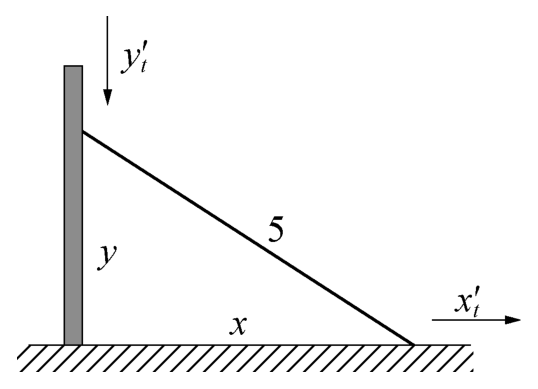

两边对$t$求导，得

$$
2x\frac{\mathrm{d}x}{\mathrm{d}t}+2y\frac{\mathrm{d}y}{\mathrm{d}t}=0,
$$

即

$$
\frac{\mathrm{d}y}{\mathrm{d}t}=-\frac{x}{y}\cdot\frac{\mathrm{d}x}{\mathrm{d}t}.
$$

注意到$x=3$，$y=4$以及$\frac{\mathrm{d}x}{\mathrm{d}t}=0.5$，代入得

$$
\frac{\mathrm{d}y}{\mathrm{d}t}=-\frac{3}{8},
$$

即梯子上端向下滑落的速率为$\frac{3}{8}\ \mathrm{m/s}$.

### 习题 2-2

1. 选择题：

（1）设$y=f(-2x)$，则$y'=(\quad)$；

A. $f'(2x)$　　　B. $-f'(-2x)$　　　C. $f'(-2x)$　　　D. $-2f'(-2x)$（2）设$f(x)=\arctan e^x$，则$f'(x)=(\quad)$；

A. $\frac{e^x}{1+e^{2x}}$　　　B. $\frac{1}{1+e^{2x}}$　　　C. $\frac{1}{\sqrt{1+e^{2x}}}$　　　D. $\frac{e^x}{\sqrt{1-e^{2x}}}$

（3）设$y=\ln x$，则$y''=(\quad)$；

A. $\frac{1}{x}$　　　B. $-\frac{1}{x^2}$　　　C. $\frac{1}{x^2}$　　　D. $-\frac{2}{x}$

（4）设$f(x)=x^3-x^2+x+1$，则$f''(0)=(\quad)$；

A. 0　　　B. 1　　　C. 2　　　D. $-2$

（5）设$y=x^n+e^x$，则$y^{(n)}=(\quad)$；

A. $e^x$　　　B. $n!$　　　C. $n!+ne^x$　　　D. $n!+e^x$

（6）设$y=e^{ax}$，则$y^{(n)}=(\quad)$.

A. $ae^{ax}$　　　B. $a^n e^{ax}$　　　C. $e^{ax}$　　　D. $a^2e^{ax}$

2. 填空题：

（1）设曲线$y=\frac{1}{1+x^2}$在点$M$处的切线平行于$x$轴，则点$M$的坐标为______；

（2）过曲线$y=\frac{4+x}{4-x}$上点$(2,3)$处的切线的斜率为______；

（3）设$f(x)=a_0x^n+a_1x^{n-1}+\cdots+a_{n-1}x+a_n$，则$[f(0)]'=$______；

（4）一物体按规律$s(t)=3t-t^2$做直线运动，速度$v\left(\frac{3}{2}\right)=$______；

（5）设$f(x)=x(x-1)(x-2)(x-3)(x-4)$，则$f'(0)=$______.

3. 求下列各复合函数的导数：

（1）$y=\sin 2x$；

（2）$y=e^{-2x}$；

（3）$y=(2x+1)^2$；

（4）$y=\ln(1+3x)$；

（5）$y=\sqrt{\ln x}$；

（6）$y=3^{\sqrt{x}}$；

（7）$y=(2x^2-1)^2$；

（8）$y=\sin(4x+1)$；

（9）$y=\ln(x^3+1)$；

（10）$y=\sin^2x$；

（11）$y=\ln(\ln x)$；

（12）$y=\sqrt{x^2-2x+3}$；

（13）$y=\ln\sqrt{x}+\sqrt{\ln x}$；

（14）$y=e^{\cos x+x}$；

（15）$y=2^{\sin x}$；

（16）$y=(x^2-4x+5)^3$.

4. 求下列各复合函数的导数：

（1）$y=(4x+1)^5$；

（2）$y=5e^{3x}+x^2$；

（3）$y=\sin 3^x$；

（4）$y=5^{\sin 2x}$；

（5）$y=\tan^2x$；

（6）$y=\cot\sqrt{x}$；

（7）$y=\arcsin\frac{1}{x}$；

（8）$y=\operatorname{arccot}2x$；

（9）$y=\cos x^2+2\sin 2x$；

（10）$y=x\sqrt{1-x^2}$；

（11）$y=x^2\sin\frac{1}{x}$；

（12）$y=x\arctan\frac{x}{3}$；

（13）$y=\sqrt{1+\ln^2x}$；

（14）$y=\sqrt{\frac{1+\sin x}{1-\sin x}}$；

（15）$y=e^{\frac{x}{\ln x}}$；

（16）$y=\sin\sqrt{x^2+1}$；

（17）$y=2\tan^2\frac{1}{\sqrt{x}}$；

（18）$y=\ln(x+\sqrt{x^2-1})$.

5. 求下列函数的导数：

（1）$y=\ln(2x^2+1)$；

（2）$y=\sin(3x^2+1)^3$；

（3）$y=e^{\arctan\sqrt{x}}$；

（4）$y=\sin^n x\cos nx$；

（5）$y=\sqrt{x+\sqrt{x}}$；

（6）$y=\arcsin(1-2x)$；

（7）$y=\arccos\frac{1}{x}$；

（8）$y=\frac{1-\ln x}{1+\ln x}$；

（9）$y=e^{\frac{x}{2}}\sin 3x$；

（10）$y=\left(\arcsin\frac{x}{2}\right)^2$；

（11）$y=\ln\tan\frac{x}{2}$；

（12）$y=e^{-x}(x^2-2x)$；

（13）$y=\ln\ln\ln x$；

（14）$y=\arctan\frac{x+1}{x-1}$；

（15）$y=e^{-\sin^2\frac{1}{x}}$；

（16）$y=\sin^2x\cdot\sin(x^2)$；

（17）$y=\ln(\sec x+\tan x)$；

（18）$y=\ln(\csc x-\cot x)$.

6. 设$f(u)$可导，求下列函数的导数$\frac{\mathrm{d}y}{\mathrm{d}x}$：

（1）$y=f(e^{x^2})$；

（2）$y=f(\sin^2x)+f(\cos^2x)$；

（3）$y=\arctan f(x)$；

（4）$y=f(e^{2x}+2\ln x)$.

7. 求下列函数的二阶导数：

（1）$y=x\ln x$；

（2）$y=\cos x+\tan x$；

（3）$y=e^{1-2x}$；

（4）$y=\ln(1-x^3)$；

（5）$y=(1+x^2)\arctan x$；

（6）$y=\frac{\tan x}{x}$；

（7）$y=x[\sin(\ln x)+\cos(\ln x)]$；

（8）$y=\ln(x+\sqrt{1+x^2})$；

（9）$y=\cos^2x\ln x$；

（10）$y=\ln(\sqrt{2+x^2}-x)$.

8. 求下列函数的高阶导数：

（1）$y=e^x\cos x$，求$y'''$；

（2）$y=\sin 2x$，求$y^{(n)}$；

（3）$y=\frac{1-x}{1+x}$，求$y''$；

（4）$y=2^x$，求$y^{(n)}$.

9. 设$y=\ln(1+2x-3x^2)$，求$y^{(4)}$.

10. 求下列方程所确定的隐函数$y=y(x)$的一阶导数$\frac{\mathrm{d}y}{\mathrm{d}x}$：

（1）$x^2+y^2-xy=\ln 2$；

（2）$y=x+x\ln y$；

（3）$y=\cos(x+y)$；

（4）$\sqrt{x}+\sqrt{y}=\sqrt{a}$；

（5）$\arctan\frac{y}{x}=\ln\sqrt{x^2+y^2}$；

（6）$xy=e^{x+y}$；

（7）$y=1+ye^x$；

（8）$y=x^{\frac{1}{y}}$；

（9）$x^y+y^x=1$.

11. 设方程$e^x-e^y=xy$确定$y$是$x$的函数，求$\left.\frac{\mathrm{d}y}{\mathrm{d}x}\right|_{x=0}$.

12. 设方程$xy^3=2y-1$确定$y$是$x$的函数，则$y$为整数时，求$\left.\frac{\mathrm{d}y}{\mathrm{d}x}\right|_{x=1}$.

13. 求由方程所确定的隐函数$y=y(x)$的二阶导数$\frac{\mathrm{d}^2 y}{\mathrm{d}x^2}$：

（1）$y^2+\ln y+x=0$；

（2）$y=\ln(x-y)$；

14. 利用对数求导法求下列函数的导数：

（1）$y=x^x$；

（2）$(\cos y)^x=(\sin x)^y$；

（3）$y=\frac{\sqrt{x+1}(2-x)^3}{(x-1)^4}$；

（4）$y=\sqrt{x\sqrt{x\sqrt{1-\sin x}}}$.

15. 求椭圆$\frac{x^2}{a^2}+\frac{y^2}{b^2}=1$在点$M(x_0,y_0)$处的切线方程.

16. 已知下列参数方程，求$\frac{\mathrm{d}y}{\mathrm{d}x}$，$\frac{\mathrm{d}^2 y}{\mathrm{d}x^2}$.

（1）$\begin{cases}x=t^4,\\ y=4t;\end{cases}$

（2）$\begin{cases}x=a(t-\sin t),\\ y=a(1-\cos t);\end{cases}$

（3）$\begin{cases}x=\frac{1}{1+t},\\ y=\frac{t}{1+t};\end{cases}$

（4）$\begin{cases}x=at+b,\\ y=\frac{1}{2}at^2.\end{cases}$

17. 求曲线$\begin{cases}x=1+t^2,\\ y=t^3\end{cases}$在$t=2$处的切线方程.

18. 求$\begin{cases}x=\sqrt{2}\cos t,\\ y=\sin t\end{cases}$在$t=\frac{\pi}{4}$处的切线方程和法线方程.

19. 设$\begin{cases}x=\ln t+e^2,\\ y=\frac{1}{1-t},\end{cases}$求$\left.\frac{\mathrm{d}y}{\mathrm{d}x}\right|_{t=\frac{1}{2}}$.

\*20. 一飞机在离地面$2\ \mathrm{km}$的高度，以每小时$200\ \mathrm{km}$的速度水平飞行到某目标上空，以便进行航空摄影，试求飞机至该目标正上方时摄影机转动的角速度.

\*21. 河水以$8\ \mathrm{m^3/s}$的体流量流入水库中，水库形状是长为$4000\ \mathrm{m}$、顶角为$120^\circ$的水槽，问：水深$20\ \mathrm{m}$时，水面每小时上升几米？

\*22. 溶液从深$18\ \mathrm{cm}$、顶直径$12\ \mathrm{cm}$的正圆锥形容器中抽出一直径为$10\ \mathrm{cm}$的圆柱形筒中，开始时圆锥容器中盛满了溶液，已知当溶液在容器中深为$12\ \mathrm{cm}$时，其表面下降的速率为$1\ \mathrm{cm/min}$，问：此时圆柱形筒中溶液表面上升的速率为多少？

\*23. 落在平静水面上的石头，产生同心波纹，若最外一圈波半径的增大率总是$6\ \mathrm{m/s}$，问：在$2\ \mathrm{s}$末扰动水面面积的增大率为多少？

## 第三节 微分的概念与应用

[课前导读]

我们先来试着计算这样的两组数：

$$
\Delta y=\sin\left(\frac{\pi}{3}+\Delta x\right)-\sin\frac{\pi}{3},\ \Delta x=0.1,\ 0.01,\ 0.001,\ 0.000\ 1,\ 0.000\ 01,\ 0.000\ 001,
\mathrm{d}y=(\sin x)'\big|_{x=\frac{\pi}{3}}\cdot\Delta x,\ \Delta x=0.1,\ 0.01,\ 0.001,\ 0.000\ 1,\ 0.000\ 01,\ 0.000\ 001.
$$

通过计算可以发现什么规律呢？

（1）计算$\mathrm{d}y$比计算$\Delta y$容易得多；

（2）当$\Delta x$越来越小时，$\mathrm{d}y$和$\Delta y$越接近.

所以，有些时候，我们可以用$\mathrm{d}y$来近似替代$\Delta y$，因为它极容易计算，误差又小.

### 一、微分的定义

在理论研究和实际应用中，常常会遇到这样的问题：当自变量$x$有微小变化$\Delta x$时，求函数$y=f(x)$的微小改变量

$$
\Delta y=f(x+\Delta x)-f(x).
$$

这个问题初看起来似乎只要做减法运算就可以了，然而，对于较复杂的函数$f(x)$，差值$f(x+\Delta x)-f(x)$却是一个更复杂的表达式，不易求出其值. 一个想法是：我们设法将$\Delta y$表示成$\Delta x$的线性函数，即线性化，从而把复杂问题化为简单问题. 微分就是实现这种线性化的一种数学模型.

首先看一个实例.

**例 1** 一块正方形金属薄片因温度变化的影响，其边长由$x_0$变到$x_0+\Delta x$，问：此薄片的面积改变了多少？

解 设此薄片的边长为$x_0$，面积为$A$，则$A=x_0^2$. 薄片受温度变化的影响，当自变量$x$从$x_0$变到$x_0+\Delta x$取得增量$\Delta x$时，面积的改变量可以看成是因变量$A$取得相应的增量$\Delta A$，即

$$
\Delta A=(x_0+\Delta x)^2-x_0^2=2x_0\Delta x+(\Delta x)^2.
$$

从上式可以看出，$\Delta A$由两部分组成：第一部分$2x_0\Delta x$是$\Delta x$的线性函数，即图2-12中灰色的两个矩形面积之和，而第二部分$(\Delta x)^2$在图中是黑色的小正方形面积. 当$\Delta x\to 0$时，第二部分$(\Delta x)^2$是比$\Delta x$高阶的无穷小，即$(\Delta x)^2=o(\Delta x)(\Delta x\to 0)$. 由此可见，如果边长改

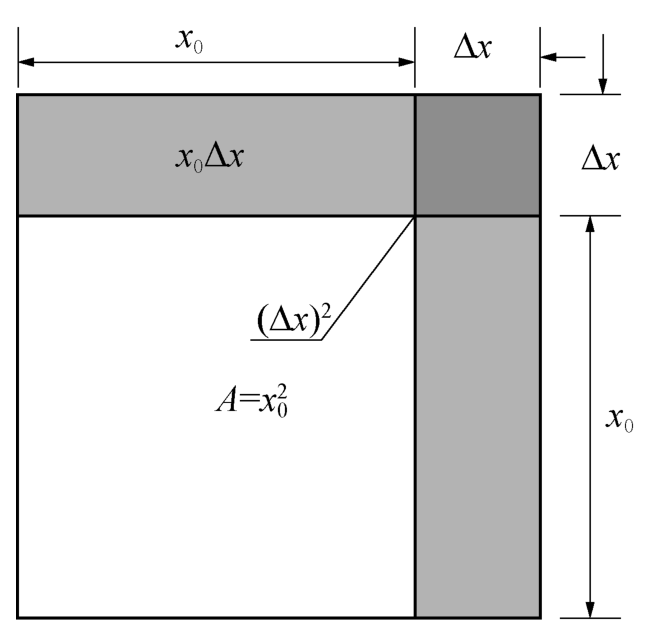

变很微小，即$|\Delta x|$很小时，面积的改变量$\Delta A$可近似地用第一部分来代替.

一般地，如果函数$y=f(x)$满足一定条件，则因变量的增量$\Delta y$可表示为

$$
\Delta y=A\Delta x+o(\Delta x),
$$

其中$A$是不依赖于$\Delta x$的常数，因此$A\Delta x$是$\Delta x$的线性函数，且它与$\Delta y$的差

$$
\Delta y-A\Delta x=o(\Delta x)
$$

是比$\Delta x$高阶的无穷小. 所以，当$A\ne 0$，且$|\Delta x|$很小时，我们就可以近似地用$A\Delta x$来代替$\Delta y$.

抛开上述例子的实际背景，即得到微分的定义.

**定义** 设函数$f(x)$在某区间$I$内有定义，$x_0$，$x_0+\Delta x\in I$，如果函数的增量$\Delta y=f(x_0+\Delta x)-f(x_0)$可表示成

$$
\Delta y=A\Delta x+o(\Delta x),
$$

其中$A$为不依赖于$\Delta x$的常数，而$o(\Delta x)$是比$\Delta x$高阶的无穷小，那么称函数$y=f(x)$在点$x_0$处是可微的，而$A\Delta x$叫作函数$y=f(x)$在点$x_0$相应于自变量增量$\Delta x$的微分，记作$\left.\mathrm{d}y\right|_{x=x_0}$，即$\left.\mathrm{d}y\right|_{x=x_0}=A\Delta x$.

**定理** 函数$f(x)$在$x=x_0$处可微的充分必要条件是$f(x)$在$x=x_0$处可导.

**证明** 设函数$f(x)$在$x=x_0$处可微，则有$\Delta y=A\Delta x+o(\Delta x)$.

当$\Delta x\ne 0$时，$\frac{\Delta y}{\Delta x}=A+\frac{o(\Delta x)}{\Delta x}$，因此，

$$
\left.\frac{\mathrm{d}y}{\mathrm{d}x}\right|_{x=x_0}=\lim_{\Delta x\to 0}\frac{\Delta y}{\Delta x}=\lim_{\Delta x\to 0}\left[A+\frac{o(\Delta x)}{\Delta x}\right]=A,
$$

即$f(x)$在$x=x_0$处可导.

反之，若$f(x)$在$x=x_0$处可导，则有$\frac{\mathrm{d}y}{\mathrm{d}x}=\lim_{\Delta x\to 0}\frac{\Delta y}{\Delta x}$存在. 因此$\frac{\Delta y}{\Delta x}=\frac{\mathrm{d}y}{\mathrm{d}x}+\alpha$，其中$\lim_{\Delta x\to 0}\alpha=0$，即

$$
\Delta y=\frac{\mathrm{d}y}{\mathrm{d}x}\cdot\Delta x+\alpha\cdot\Delta x.
$$

由$\lim_{\Delta x\to 0}\frac{\alpha\Delta x}{\Delta x}=0$，知$\alpha\Delta x=o(\Delta x)$，即

$$
\Delta y=\frac{\mathrm{d}y}{\mathrm{d}x}\cdot\Delta x+o(\Delta x),
$$

即函数$f(x)$在$x=x_0$处可微.

由上述证明可知，若函数$f(x)$在$x=x_0$处可微，其微分

$$
\left.\mathrm{d}y\right|_{x=x_0}=A\Delta x=f'(x_0)\Delta x.
$$

**例 2** 设$y=x^2$，求：（1）$\left.\mathrm{d}y\right|_{x=x_0}$；（2）$\left.\mathrm{d}y\right|_{x=1}$及$\left.\mathrm{d}y\right|_{x=0.01}$.

解 （1）$\left.\mathrm{d}y\right|_{x=x_0}=(x^2)'\Big|_{x=x_0}\Delta x=(2x)\Big|_{x=x_0}\Delta x=2x_0\Delta x$；

（2）$\left.\mathrm{d}y\right|_{x=1}=2\Delta x$，$\left.\mathrm{d}y\right|_{x=0.01}=0.02\Delta x$.

**例 3** 求函数$y=x^3$在$x=1$时，$\Delta x$分别等于0.01和0.000 1时的增量与微分.

解 当$x=1$，$\Delta x=0.01$时，

$$
\Delta y=(x+\Delta x)^3-x^3=(1.01)^3-1^3=1.030\ 301-1=0.030\ 301,
\left.\mathrm{d}y\right|_{x=1}=3x^2\Delta x\Big|_{x=1,\ \Delta x=0.01}=3\times 0.01=0.03;
$$

当$x=1$，$\Delta x=0.000\ 1$时，

$$
\Delta y=(x+\Delta x)^3-x^3=(1.000\ 1)^3-1^3=1.000\ 300\ 030\ 001-1=0.000\ 300\ 030\ 001,
\left.\mathrm{d}y\right|_{x=1}=3x^2\Delta x\Big|_{x=1,\ \Delta x=0.000\ 1}=3\times 0.000\ 1=0.000\ 3.
$$

通过计算可以发现，

当$\Delta x=0.01$时，$\Delta y-\mathrm{d}y=0.000\ 3$；当$\Delta x=0.000\ 1$时，$\Delta y-\mathrm{d}y=0.000\ 000\ 030\ 001$.

这时，用$\mathrm{d}y$的值近似替代$\Delta y$的值，误差是非常小的.

### 二、基本初等函数的微分公式及微分法则

如果函数$y=f(x)$在区间$(a,b)$内每一点处都可微，则称$f(x)$是$(a,b)$内的可微函数. 函数$f(x)$在任意一点$x$处的微分就称为函数的微分，记为$\mathrm{d}y$，即有

$$
\mathrm{d}y=f'(x)\Delta x.
$$

我们规定$\mathrm{d}x=\Delta x$，这样微分可记为

$$
\mathrm{d}y=f'(x)\mathrm{d}x,
$$

并且有

$$
y'=\frac{\mathrm{d}y}{\mathrm{d}x}.
$$

在引入微分概念前，我们将导数$\frac{\mathrm{d}y}{\mathrm{d}x}$看作一个整体记号. 现在引入微分概念后，可将导数看作是两个微分（函数微分与自变量微分）的商，因此也称导数为“微商”.

当$\Delta x\to 0$时，$\Delta y$，$\mathrm{d}y$都是无穷小，当$y'(x)\ne 0$时

$$
\lim_{\Delta x\to 0}\frac{\Delta y-\mathrm{d}y}{\Delta y}=\lim_{\Delta x\to 0}\frac{\Delta y-y'\Delta x}{\Delta y}=\lim_{\Delta x\to 0}\left[\frac{y'}{1-\frac{\Delta y}{\Delta x}}\right]=0,
$$

这表明在$y'(x)\ne 0$的条件下，当$\Delta x\to 0$时，$\Delta y-\mathrm{d}y$不仅为$o(\Delta x)$，还是$o(\Delta y)$，因此称$\mathrm{d}y$是$\Delta y$的主部. 又由$\mathrm{d}y=f'(x)\Delta x$是$\Delta x$的线性函数，则称$\mathrm{d}y$是$\Delta y$的线性主部（当$\Delta x\to 0$时）.

又因为当$\Delta x\to 0$时，$\Delta y$，$\mathrm{d}y$都是无穷小，且

$$
\lim_{\Delta x\to 0}\frac{\mathrm{d}y}{\Delta y}=\lim_{\Delta x\to 0}\frac{y'\Delta x}{\Delta y}=\lim_{\Delta x\to 0}\frac{y'}{\frac{\Delta y}{\Delta x}}=1\ (y'\ne 0),
$$

故当$|\Delta x|$很小时，可以用$\mathrm{d}y$代替$\Delta y$，即$\Delta y\approx\mathrm{d}y$.

由于导数可看作微商$y'=\frac{\mathrm{d}y}{\mathrm{d}x}$，即$\mathrm{d}y=y'\mathrm{d}x$，故由导数的公式和求导法则很容易得到微分公式及微分法则.

（1）$\mathrm{d}(C)=0(C\in\mathbf{R})$；

（2）$\mathrm{d}(x^\alpha)=\alpha x^{\alpha-1}\mathrm{d}x(\alpha\in\mathbf{R})$；

（3）$\mathrm{d}(a^x)=a^x\ln a\,\mathrm{d}x$（$a>0$且$a\ne 1$）；

（4）$\mathrm{d}e^x=e^x\mathrm{d}x$；

（5）$\mathrm{d}(\log_a x)=\frac{1}{x}\cdot\frac{1}{\ln a}\mathrm{d}x$（$a>0$且$a\ne 1$）；

（6）$\mathrm{d}(\ln x)=\frac{1}{x}\mathrm{d}x$；

（7）$\mathrm{d}(\sin x)=\cos x\mathrm{d}x$；

（8）$\mathrm{d}(\cos x)=-\sin x\mathrm{d}x$；

（9）$\mathrm{d}(\tan x)=\sec^2x\mathrm{d}x$；

（10）$\mathrm{d}(\cot x)=-\csc^2x\mathrm{d}x$；

（11）$\mathrm{d}(\sec x)=\sec x\tan x\mathrm{d}x$；

（12）$\mathrm{d}(\csc x)=-\csc x\cot x\mathrm{d}x$；

（13）$\mathrm{d}(\arcsin x)=\frac{1}{\sqrt{1-x^2}}\mathrm{d}x$；

（14）$\mathrm{d}(\arccos x)=-\frac{1}{\sqrt{1-x^2}}\mathrm{d}x$；

（15）$\mathrm{d}(\arctan x)=\frac{1}{1+x^2}\mathrm{d}x$；

（16）$\mathrm{d}(\operatorname{arccot}x)=-\frac{1}{1+x^2}\mathrm{d}x$.

（17）$\mathrm{d}(u\pm v)=(u\pm v)'\mathrm{d}x=u'\mathrm{d}x\pm v'\mathrm{d}x=\mathrm{d}u\pm\mathrm{d}v$；

（18）$\mathrm{d}(u\cdot v)=(u\cdot v)'\mathrm{d}x=u'\mathrm{d}xv+uv'\mathrm{d}x=v\mathrm{d}u+u\mathrm{d}v$；

（19）$\mathrm{d}\left(\frac{u}{v}\right)=\left(\frac{u}{v}\right)'\mathrm{d}x=\left(\frac{u'v-uv'}{v^2}\right)\mathrm{d}x=\frac{vu'\mathrm{d}x-uv'\mathrm{d}x}{v^2}=\frac{v\mathrm{d}u-u\mathrm{d}v}{v^2}$；

（20）设$y=f(u)$、$u=\varphi(x)$可微，则复合函数$y=f[\varphi(x)]$可微，且它的微分为

$$
\mathrm{d}y=y'\mathrm{d}x=f'[\varphi(x)]\varphi'(x)\mathrm{d}x,
$$

由$\mathrm{d}u=\varphi'(x)\mathrm{d}x$，得$\mathrm{d}y=f'(u)\mathrm{d}u$.

由此可见，不管$u$是自变量，还是中间变量（另一变量的可微函数），微分形式$\mathrm{d}y=f'(u)\mathrm{d}u$保持不变，这一性质称为微分形式的不变性.

**例 4** 设$y=\cos\sqrt{x}$，求$\mathrm{d}y$.

解 $\mathrm{d}y=f'(x)\mathrm{d}x=(\cos\sqrt{x})'\mathrm{d}x=(-\sin\sqrt{x})\cdot\frac{1}{2\sqrt{x}}\mathrm{d}x=-\frac{\sin\sqrt{x}}{2\sqrt{x}}\mathrm{d}x$.

**例 5** 设$y=e^{\cos^2x}$，求$\mathrm{d}y$.

解 应用微分形式的不变性有（视$\cos^2x$为中间变量）

$$
\mathrm{d}y=e^{\cos^2x}\mathrm{d}(\cos^2x)=e^{\cos^2x}\cdot 2\cos x\mathrm{d}(\cos x)
=e^{\cos^2x}\cdot 2\cos x(-\sin x)\mathrm{d}x
=-(\sin 2x)e^{\cos^2x}\mathrm{d}x.
$$

**例 6** 设$y=\ln(1-x)\sin x$，求$\mathrm{d}y$.

解一

$$
\mathrm{d}y=y'\mathrm{d}x=[\ln(1-x)\sin x]'\mathrm{d}x=\left[\frac{(-1)\sin x}{1-x}-\ln(1-x)\cos x\right]\mathrm{d}x
=\frac{\sin x+(1-x)\ln(1-x)\cos x}{x-1}\mathrm{d}x;
$$

解二

$$
\mathrm{d}y=\mathrm{d}[\ln(1-x)\sin x]=\sin x\mathrm{d}[\ln(1-x)]+\ln(1-x)\mathrm{d}(\sin x)
=\frac{\sin x}{1-x}\mathrm{d}(1-x)+\ln(1-x)\cos x\mathrm{d}x
=\frac{\sin x}{1-x}(-1)\mathrm{d}x-\ln(1-x)\cos x\mathrm{d}x
=\frac{\sin x+(1-x)\ln(1-x)\cos x}{x-1}\mathrm{d}x.
$$

**例 7** 设$y=y(x)$是由方程$x^2y+xy^2=1$确定的隐函数，求$\mathrm{d}y$.

解 我们用微分法来计算这个问题.

由$\mathrm{d}(x^2y+xy^2)=\mathrm{d}(1)=0$，得

$$
2x\mathrm{d}x\cdot y+x^2\mathrm{d}y+\mathrm{d}x\cdot y^2+x\cdot 2y\mathrm{d}y=0,
$$

即$(2xy+y^2)\mathrm{d}x+(x^2+2xy)\mathrm{d}y=0$，因此

$$
\mathrm{d}y=-\frac{2xy+y^2}{x^2+2xy}\mathrm{d}x.\ (x^2+2xy\ne 0)
$$

### 三、微分的几何意义

在曲线$y=f(x)$上取相邻的两点$M_1(x,y)$和$M_2(x+\Delta x,y+\Delta y)$，过点$M_1$作曲线的切线$M_1T$，设$M_1T$的倾角为$\alpha$，则$M_1T$的斜率为$\tan\alpha=f'(x)$.

从图2-13可知

$$
M_1N=\Delta x,\ NM_2=\Delta y,
NT=M_1N\cdot\tan\alpha=f'(x)\Delta x=\mathrm{d}y.
$$

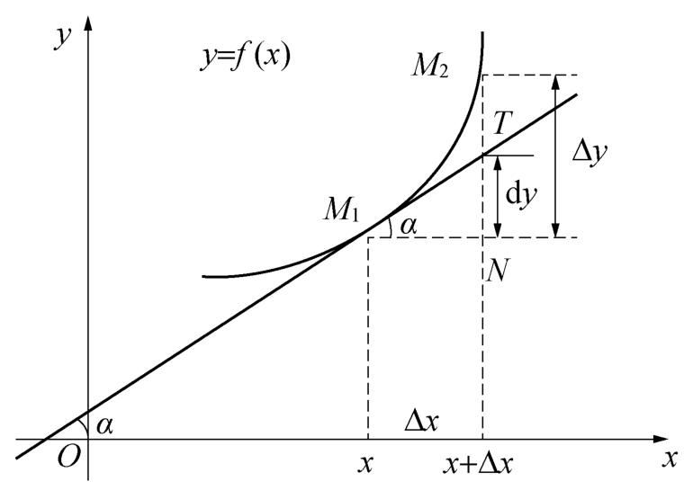

因此，当$\Delta y$是曲线对应于点$x$的函数增量时，$\mathrm{d}y$即是过点$M_1(x,y)$的切线的纵坐标增量. 图中线段$TM_2$是$\Delta y$与$\mathrm{d}y$之差，是比$\Delta x$更高阶的无穷小.

由此可见，对于可微函数$y=f(x)$而言，当$\Delta y$是曲线$y=f(x)$上的点的纵坐标的增量时，$\mathrm{d}y$就是曲线的切线上点的纵坐标的相应增量. 当$|\Delta x|$很小时，$|\Delta y-\mathrm{d}y|$比$|\Delta x|$小得多. 因此在点$M_1$的邻近，我们可用切线段来近似代替曲线段.

### 四、近似计算

在工程问题中，经常会遇到一些复杂的计算公式，如果直接用这些公式进行计算，既费力又费时. 利用微分往往可以把一些复杂的计算公式改用简单的近似公式来代替.

如果$f(x)$在$x_0$处可微，且（1）$f'(x_0)\ne 0$，（2）$|\Delta x|$很小，则

$$
\Delta y\approx\mathrm{d}y=f'(x_0)\Delta x,
$$

即若记$x=x_0+\Delta x$，则有

$$
f(x)\approx f(x_0)+f'(x_0)(x-x_0),
$$

即在$x_0$附近可用$x$的线性代数$f(x_0)+f'(x_0)(x-x_0)$来近似表达函数$f(x)$.

**例 8** 利用微分计算$\sin 30^\circ 30'$的近似值.

解 $30^\circ 30'=\frac{\pi}{6}+\frac{\pi}{360}$，取$f(x)=\sin x$，$x_0=\frac{\pi}{6}$，$\Delta x=\frac{\pi}{360}$，

因此$\sin 30^\circ 30'\approx\sin\frac{\pi}{6}+\cos\frac{\pi}{6}\cdot\frac{\pi}{360}=\frac{1}{2}+\frac{\sqrt{3}}{2}\cdot\frac{\pi}{360}\approx 0.507\ 6$.

在工程中常用的几种近似公式有

（一般取$x_0=0$，$\Delta x=x$，$|\Delta x|$很小，$f(x)\approx f(0)+f'(0)x$）

（1）$\sqrt[n]{1+x}\approx 1+\frac{1}{n}x$；

（2）$\sin x\approx x$；

（3）$\tan x\approx x$；

（4）$e^x\approx 1+x$；

（5）$\ln(1+x)\approx x$.

**例 9** 计算$\sqrt[6]{65}$的近似值.

解 $\sqrt[6]{65}=\sqrt[6]{1+64}=2\sqrt[6]{1+\frac{1}{64}}\approx 2\left(1+\frac{1}{6}\cdot\frac{1}{64}\right)\approx 2.005\ 2$.

### 习题 2-3

1. 填空选择题：

（1）$f(x)$在点$x_0$处可导是$f(x)$在点$x_0$处连续的______，$f(x)$在点$x_0$处连续是$f(x)$在点$x_0$处可导的______，$f(x)$在点$x_0$处可导是$f(x)$在点$x_0$处可微的______；

A. 必要条件　　　　B. 充分条件

C. 充要条件　　　　D. 无关条件

（2）设函数$f(x)$可导，则当$x$在$x=2$处有微小增量$\Delta x$时，函数的增量约为______；

A. $f'(2)$　　　　B. $\lim_{x\to 2}f(x)$　　　　C. $f(2+\Delta x)$　　　　D. $f'(2)\Delta x$

（3）设$f(x)$可微，则$\mathrm{d}[e^{f(x)}]=$______；

（4）设函数$f(x)$可导，$y=f(-x^2)$，则$\mathrm{d}y=$______；

（5）$\frac{\mathrm{d}(\ln x)}{\mathrm{d}(\sqrt{x})}=$______；

（6）设$f(x)$为可微的偶函数，且对任意的$x_0(x_0\ne 0)$，$f'(x_0)=\frac{1}{2}$，则$f'(-x_0)=$______.

2. 试在图A、B、C、D中分别标出函数$y=f(x)$在点$x_0$处的$\mathrm{d}y$、$\Delta y$及$\Delta y-\mathrm{d}y$，并说明其正负.

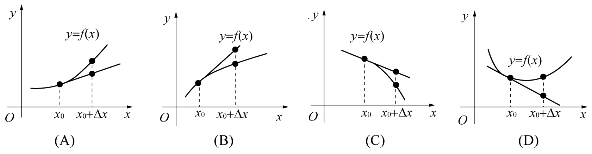

3. 已知$y=x^2-x$，计算在$x=2$处当$\Delta x$分别等于0.1，0.01时的$\Delta y$及$\mathrm{d}y$.

4. 函数$y=f(x)$在点$x_0$处有增量$\Delta x=0.2$，对应的函数增量和线性主部都等于0.8，求点$x_0$处的导数.

5. 求下列函数的微分：

（1）$y=x\ln x-x^2$；

（2）$y=\arcsin\sqrt{x}$；

（3）$y=x\arctan\sqrt{x}$；

（4）$y=\ln\left(\tan\frac{x}{2}\right)$；

（5）$y=1+xe^y$；

（6）$y^2\cos x=\sin 3x$；

（7）$y=\frac{x}{\sqrt{1+x^2}}$；

（8）$y=\frac{x^3-1}{x^3+1}$；

（9）$y=\tan^2(1+2x^2)$；

（10）$y=3^{\ln(\tan x)}$；

（11）$y=x^{5x}$；

（12）$e^{\frac{x}{y}}-xy=0$；

（13）$y^2+\ln y=x^4$；

（14）$y=\cos(xy)-x$.

6. 将适当的函数填入括号内，使等式成立：

（1）$\mathrm{d}(\quad)=2\mathrm{d}x$；

（2）$\mathrm{d}(\quad)=3x\mathrm{d}x$；

（3）$\mathrm{d}(\quad)=\cos 2x\mathrm{d}x$；

（4）$\mathrm{d}(\quad)=\sin\frac{x}{2}\mathrm{d}x$；

（5）$\mathrm{d}(\quad)=\frac{1}{1-x}\mathrm{d}x$；

（6）$\mathrm{d}(\quad)=\frac{x}{1-x^2}\mathrm{d}x$；

（7）$\mathrm{d}(\quad)=\frac{1}{\sqrt{x}}\mathrm{d}x$；

（8）$\mathrm{d}(\quad)=\frac{1}{\sqrt{x}(1+x)}\mathrm{d}x$；

（9）$\mathrm{d}(\quad)=\sin x\cos x\mathrm{d}x$；

（10）$\mathrm{d}(\quad)=\frac{\sin x}{\cos^2x}\mathrm{d}x$.

7. 若$f(x)$在$x_0$可导，且$f'(x_0)=\frac{1}{2}$，试问：$\Delta x\to 0$，则$\left.\mathrm{d}y\right|_{x=x_0}$与$\Delta x$是否是等价无穷小？或同阶无穷小？是比$\Delta x$高阶的无穷小还是低阶的无穷小？

8. 当$|x|$很小时，证明：

（1）$\sqrt[n]{1+x}\approx 1+\frac{1}{n}$；

（2）$\sin x\approx x$；

（3）$\tan x\approx x$；

（4）$e^x\approx 1+x$；

（5）$\ln(1+x)\approx x$；

（6）$\sqrt{a^2+x}\approx a+\frac{x}{2a}(a>0,\ |x|\ll a^2)$.

9. 利用微分求近似值：

（1）$e^{1.01}$；

（2）$\cos 151^\circ$；

（3）$\sqrt[3]{1.02}$；

（4）$\lg 11$；

（5）$\arcsin 0.500\ 2$；

（6）$\tan 45'$.

10. 水管壁的正截面是一个圆环，设它的内径为$R_0$，壁厚为$d$，利用微分计算这个圆环面积的近似值（$d$相当小）.

11. 半径为$15\ \mathrm{cm}$的球，半径伸长$2\ \mathrm{mm}$，球的体积约增加多少？

12. 设扇形的圆心角$\alpha=60^\circ$，半径$R=100\ \mathrm{cm}$. 如果$R$不变，$\alpha$减少$30'$，问：扇形面积大约改变多少？又如果$\alpha$不变，$R$增加$1\ \mathrm{cm}$，问：扇形面积大约改变多少？

13. 扩音器插头为圆柱形，截面半径$r$为$0.15\ \mathrm{cm}$，长度$l$为$4\ \mathrm{cm}$. 为了提高它的导电性能，要在这个圆柱的侧面镀上一层厚为$0.001\ \mathrm{cm}$的纯铜，问：每个插头约需多少纯铜？

## 第四节 微分中值定理及其应用

[课前导读]

上一节给出了微分的近似计算：

$$
f(x)\approx f(x_0)+f'(x_0)\cdot(x-x_0)=f(x_0)+f'(x_0)\cdot\Delta x,
$$

即当$\Delta x=x-x_0$“很小”时，$f(x)$可以由线性函数$f(x_0)+f'(x_0)\cdot(x-x_0)$来近似替代.

但这个公式有两大缺陷：

（1）公式要求$\Delta x$“很小”；

（2）公式只是一个近似替代，而不是一个精确值.

本节旨在改进这个近似式，使得对于任何$\Delta x$的值，均有等式成立. 那么如何改进呢？

现在将该近似公式改写成

$$
\frac{f(x)-f(x_0)}{x-x_0}\approx f'(x_0),
$$

从图形上看（见图2-14）将过点$M_0(x_0,f(x_0))$及$M(x,f(x))$的直线的斜率近似用曲线$y=f(x)$上点$M_0$处的切线的斜率表示，它们一般不相等. 逐渐移动点的切线，就会发现，有一点$\xi\in(x_0,x)$能够使这一点处的切线平行于连接端点的弦（见图2-15）.

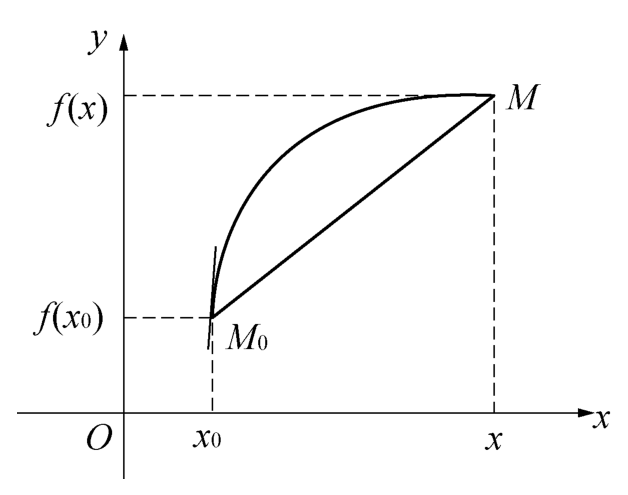

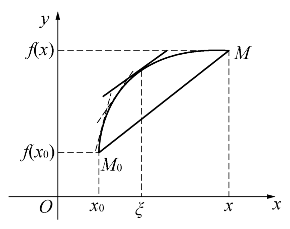

### 一、罗尔定理

如图2-16所示，连续曲线弧$AB$是函数$y=f(x)(x\in[a,b])$的图形. 此图形的两个端点的纵坐标相等，即$f(a)=f(b)$，且除了端点外处处有不垂直于$x$轴的切线. 可以发现，在曲线弧的最高点或最低点处，曲线有水平的切线. 如果记$C$点的横坐标为$\xi$，那么就有$f'(\xi)=0$.

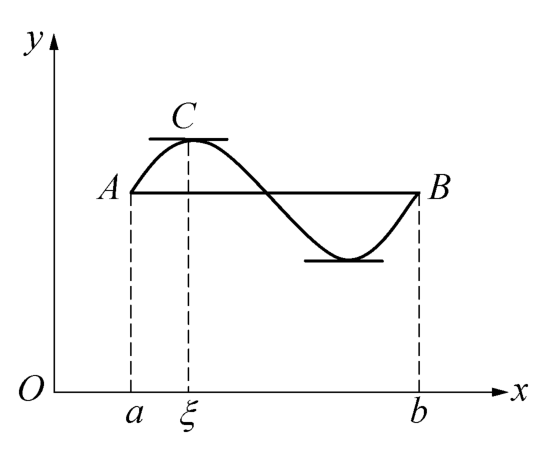

如果把这种几何现象描述出来，就可得到下面的罗尔定理. 为方便讨论，先介绍费马定理.

**引理（费马定理）** 设函数$f(x)$在点$x_0$的某个邻域$U(x_0)$内有定义并且在$x_0$处可导，对任意的$x\in U(x_0)$，恒有

$$
f(x)\le f(x_0)\ (\text{或}\ f(x)\ge f(x_0)),
$$

那么$f'(x_0)=0$.（见图2-17）

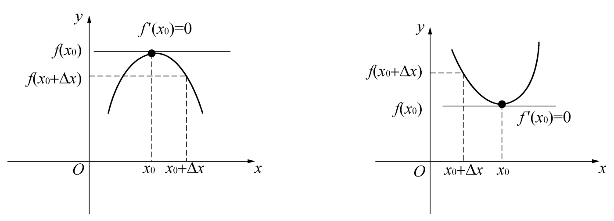

\* **证明** 不妨设$x\in U(x_0)$时，$f(x)\le f(x_0)$（如果$f(x)\ge f(x_0)$，可以完全类似地证明），于是对于$x_0+\Delta x\in U(x_0)$，有$f(x_0+\Delta x)-f(x_0)\le 0$.

从而，当$\Delta x>0$时

$$
\frac{f(x_0+\Delta x)-f(x_0)}{\Delta x}\le 0;
$$

当$\Delta x<0$时

$$
\frac{f(x_0+\Delta x)-f(x_0)}{\Delta x}\ge 0.
$$

根据函数$f(x)$在$x_0$处可导的条件，再由极限的保号性，便得到

$$
f'(x_0)=f'_+(x_0)=\lim_{\Delta x\to 0^+}\frac{f(x_0+\Delta x)-f(x_0)}{\Delta x}\le 0,
f'(x_0)=f'_-(x_0)=\lim_{\Delta x\to 0^-}\frac{f(x_0+\Delta x)-f(x_0)}{\Delta x}\ge 0,
$$

所以$f'(x_0)=0$. 证毕.

通常称导数等于零的点为函数的驻点（或称为稳定点、临界点）.

**定理 1（罗尔定理）** 如果函数$y=f(x)$满足（1）在闭区间$[a,b]$上连续；

（2）在开区间$(a,b)$内可导；

（3）在区间端点处的函数值相等，即$f(a)=f(b)$，那么在$(a,b)$内至少有一点$\xi(a<\xi<b)$，使函数$y=f(x)$在该点处的导数等于零：$f'(\xi)=0$.

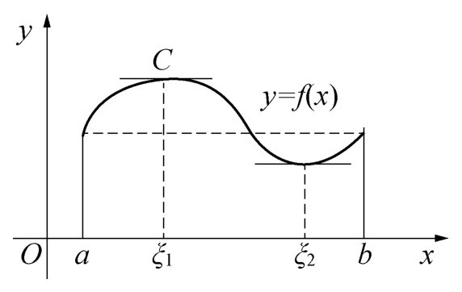

\* **证明** 由于$y=f(x)$在闭区间$[a,b]$上连续，根据闭区间上连续函数的最大值和最小值定理，$f(x)$在闭区间$[a,b]$上必定取得最大值$M$和最小值$m$.

情况1 $M=m$. 这时$y=f(x)$在区间$[a,b]$上必为常数：$y\equiv M$. 于是$f'(x)\equiv 0$. 因此任取一点$\xi\in(a,b)$，都有$f'(\xi)=0$.

情况2 $M>m$. 这时$M$和$m$这两个数中至少有一个不等于$f(a)$. 不妨设$M\ne f(a)$（如果设$m\ne f(a)$，证明完全类似）. 由于$f(a)=f(b)$，因此$M\ne f(b)$. 于是存在$\xi\in(a,b)$，使$f(\xi)=M$. 因此对区间$[a,b]$上的任意$x$，有$f(\xi)\ge f(x)$，从而由费马定理可知$f'(\xi)=0$，证毕.

**罗尔定理的几何意义** 如果曲线段$y=f(x)(x\in[a,b])$是连续不断的、光滑的，且两端纵坐标相等，则该曲线段在$[a,b]$上至少有一条水平切线.

需要指出的是，定理的三个条件是十分重要的. 如果某一个条件不满足，定理的结论就可能不成立. 下面举三个例子，并结合图像进行考察.

**例 1** $f(x)=\begin{cases}1,&x=0,\\ x,&0<x\le 1.\end{cases}$

函数$f(x)$在$[0,1]$的左端点$x=0$处间断（见图2-19），不满足在闭区间上连续的条件. 此时虽然满足定理的另外两个条件，但显然没有水平切线.

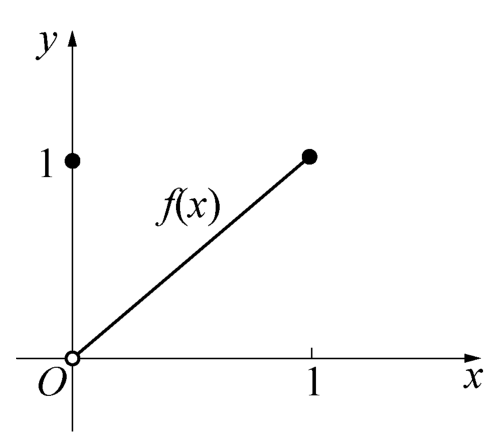

**例 2** $f(x)=|x|$，$x\in[-1,1]$.

函数$f(x)$在$x=0$处不可导，因而不满足在开区间内可导的条件. 此时虽满足定理的另外两个条件，显然也没有水平切线（见图2-20）.

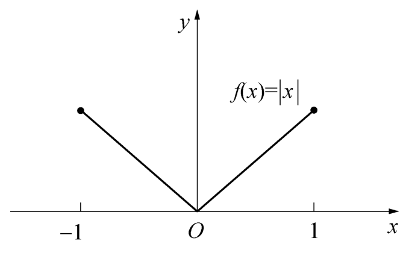

**例 3** $f(x)=x$，$x\in[0,1]$.

显然函数$f(x)$在$[0,1]$上连续，在$(0,1)$内可导，但$f(0)=0\ne f(1)=1$，即在两端点处函数值相等的条件不满足，显然也没有水平切线（见图2-21）.

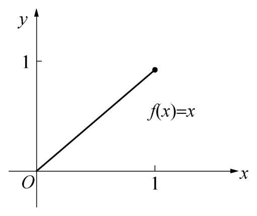

由此可见，应用这个定理时，一定要仔细验证是否满足定理的三个条件，否则容易产生错误.

其次，要说明定理的三个条件是充分的，而非必要的. 也就是说，若满足定理的三个条件，则定理的结论必定成立. 如果定理的三个条件不完全满足的话，则定理的结论可能成立，也可能不成立.

**例 4** 验证函数$f(x)=x^3+4x^2-7x-10$在区间$[-1,2]$上满足罗尔定理的三个条件，并求出满足$f'(\xi)=0$的点$\xi$.

解 因为$f(x)=x^3+4x^2-7x-10$是多项式，所以在$(-\infty,+\infty)$上可导，故它在$[-1,2]$上连续，且在$(-1,2)$内可导. 容易验证$f(-1)=f(2)=0$. 因此，$f(x)$满足罗尔定理的三个条件. $f'(x)=3x^2+8x-7$，令$f'(x)=0$，即$3x^2+8x-7=0$，解之得

$$
x_1=\frac{-4+\sqrt{37}}{3},\ x_2=\frac{-4-\sqrt{37}}{3}.
$$

显然，$x_2$不在$[-1,2]$内，应舍去. 而$x_1\in[-1,2]$，因而可把$x_1$取作$\xi$，就有$f'(\xi)=0$.

**例 5** 证明$f(x)=x^3-3x+a$在$[0,1]$上不可能有两个零点.

**证明**（反证法）若$f(x)$在$[0,1]$上有两个零点$x_1$，$x_2$，不妨设$x_1<x_2$，即

$$
f(x_1)=f(x_2)=0.
$$

因此$f(x)$在$[x_1,x_2]$上满足罗尔定理的条件，故存在$\xi\in(x_1,x_2)$，使得

$$
f'(\xi)=0.
$$

由于$\xi\in(x_1,x_2)\subset[0,1]$，故$f'(\xi)=3\xi^2-3<0$，矛盾. 从而$f(x)$在$[0,1]$上不可能有两个零点.

### 二、拉格朗日（Lagrange）中值定理

**定理 2（拉格朗日中值定理）** 如果函数$y=f(x)$满足

（1）在闭区间$[a,b]$上连续；（2）在开区间$(a,b)$内可导；

则至少存在一点$\xi\in(a,b)$，使

$$
f'(\xi)=\frac{f(b)-f(a)}{b-a},
$$

即$f(b)-f(a)=f'(\xi)(b-a)$.

\* **证明** 作辅助函数

$$
F(x)=f(x)-\frac{f(b)-f(a)}{b-a}(x-a)-f(a).
$$

如图2-22所示，$F(x)$即为曲线$y=f(x)$与直线$y=f(a)+\frac{f(b)-f(a)}{b-a}(x-a)$的纵坐标之差.

$F(x)$在$[a,b]$上连续，在$(a,b)$内可导，且$F(a)=F(b)=0$，则由罗尔定理知至少存在一点$\xi\in(a,b)$，使$F'(\xi)=0$，即$f'(\xi)=\frac{f(b)-f(a)}{b-a}$.

若函数$f(x)$在区间$[x,x+\Delta x]$（或$[x+\Delta x,x]$）上满足拉格朗日中值定理的条件，则有$\Delta y=f(x+\Delta x)-f(x)=f'(x+\theta\Delta x)\cdot\Delta x$，其中$\xi=x+\theta\Delta x(0<\theta<1)$.

当$\Delta x$为有限时，增量$\Delta y=f'(x+\theta\Delta x)\cdot\Delta x$是准确值，因此它有时也称为有限增量公式. 它与用微分$\Delta y\approx\mathrm{d}y=f'(x)\Delta x$来表示函数的增量的近似值是不同的.

**拉格朗日中值定理的几何意义** 如果曲线段$y=f(x)(x\in[a,b])$是连续不断的、光滑的，且除端点外处处具有不垂直于横坐标轴的切线，则该曲线段在$[a,b]$上至少有一点，使曲线在该点处的切线与两端点的连线（弦）平行（见图2-22）.

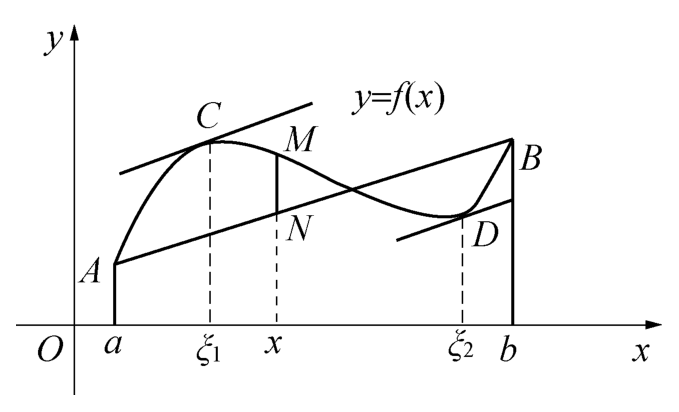

**推论 1** 若函数$f(x)$在区间$I$内满足$f'(x)$恒为零，则在区间$I$内恒有$f(x)=C$（常数）.

**证明** 对于$I$内任意两点$x_1$，$x_2$，不妨设$x_1<x_2$，在$[x_1,x_2]$上应用拉格朗日中值定理，得

$$
f(x_2)-f(x_1)=f'(\xi)(x_2-x_1),
$$

其中$\xi\in(x_1,x_2)$. 因为$f'(x)$恒为零，故有$f(x_2)=f(x_1)$. 由$x_1$、$x_2$的任意性，得$f(x)=C$（常数）.

**推论 2** 若函数$f(x)$，$g(x)$在区间$I$内满足$f'(x)=g'(x)$，则在区间$I$内恒有$f(x)=g(x)+C$，其中$C$为任意常数.

**证明** 取$F(x)=f(x)-g(x)$，则函数$F(x)$在区间$I$内满足$F'(x)=0$，故有$F(x)=C$，即$f(x)=g(x)+C$，其中$C$为任意常数.

**例 6** 对于函数$f(x)=\ln x$，在闭区间$[1,e]$上验证拉格朗日中值定理的正确性.

**证明** $f(x)=\ln x$显然在$[1,e]$上连续，在$(1,e)$内可导.

又

$$
f(1)=\ln 1=0,\ f(e)=\ln e=1,\ f'(x)=\frac{1}{x},
$$

设

$$
\frac{\ln e-\ln 1}{e-1}=\frac{1}{\xi},
$$

从而解得

$$
\xi=e-1\in(1,e).
$$

故可取$\xi=e-1$，使$f'(\xi)=\frac{f(e)-f(1)}{e-1}$成立.

**例 7** 证明恒等式$\arcsin x+\arccos x=\frac{\pi}{2}(-1\le x\le 1)$.

**证明** 设$f(x)=\arcsin x+\arccos x$，$x\in[-1,1]$，

因为$f'(x)=\frac{1}{\sqrt{1-x^2}}+\left(-\frac{1}{\sqrt{1-x^2}}\right)=0$，所以$f(x)=C$，$x\in[-1,1]$.

又因为$f(0)=\arcsin 0+\arccos 0=0+\frac{\pi}{2}=\frac{\pi}{2}$，即$C=\frac{\pi}{2}$，

从而$\arcsin x+\arccos x=\frac{\pi}{2}$.

**例 8** 证明当$x>0$时，$\frac{x}{1+x}<\ln(1+x)<x$.

**证明** 设$f(x)=\ln(1+x)$，则$f(x)$在$[0,x]$上满足拉格朗日中值定理的条件. 故

$$
f(x)-f(0)=f'(\xi)(x-0)\quad(0<\xi<x).
$$

因为$f(0)=0$，$f'(x)=\frac{1}{1+x}$，从而$\ln(1+x)=\frac{x}{1+\xi}(0<\xi<x)$.

又因为$1<1+\xi<1+x\Rightarrow\frac{1}{1+x}<\frac{1}{1+\xi}<1$，

所以$\frac{x}{1+x}<\frac{x}{1+\xi}<x$，即$\frac{x}{1+x}<\ln(1+x)<x$.

### 三、柯西中值定理

**定理 3（柯西中值定理）** 设函数$f(x)$、$F(x)$满足

（1）在$[a,b]$上连续；

（2）在$(a,b)$内可导；

（3）当$x\in(a,b)$时，$F'(x)\ne 0$（见图2-23），

则至少存在一点$\xi\in(a,b)$，使

$$
\frac{f(b)-f(a)}{F(b)-F(a)}=\frac{f'(\xi)}{F'(\xi)}.
$$

证明从略，几何意义如图2-23所示.

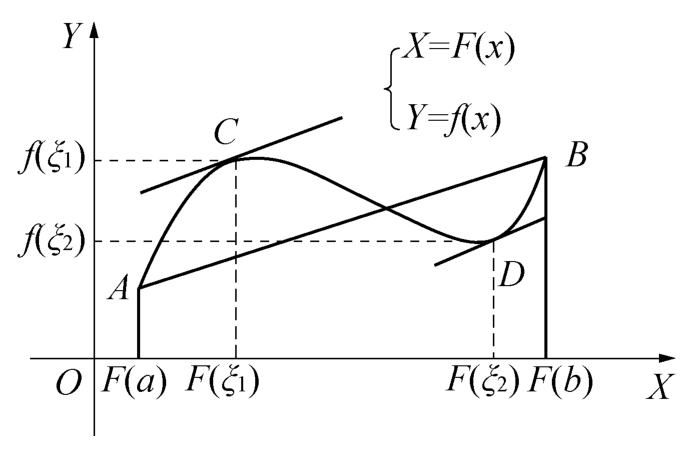

**例 9** 设函数$f(x)$在$[0,1]$上连续，在$(0,1)$内可导. 试证明至少存在一点$\xi\in(0,1)$，使

$$
f'(\xi)=2\xi[f(1)-f(0)].
$$

**证明** 作辅助函数$g(x)=x^2$，则$f(x)$，$g(x)$在$[0,1]$上满足柯西中值定理的条件，故在$(0,1)$内至少存在一点$\xi$，使

$$
\frac{f(1)-f(0)}{1-0}=\frac{f'(\xi)}{2\xi},
$$

即$f'(\xi)=2\xi[f(1)-f(0)]$.

### 四、洛必达（L'Hospital）法则

我们在求极限时常常遇到两个函数都是无穷小或都是无穷大，求它们的商的极限记为$\frac{0}{0}$、$\frac{\infty}{\infty}$型极限. 例如，比较两个无穷小的阶时就出现了这样的极限. 这种极限可能存在，也可能不存在. 通常称这种比值的极限为未定式. 例如，重要极限$\lim_{x\to 0}\frac{\sin x}{x}$就是$\frac{0}{0}$型未定式，而$\lim_{x\to+\infty}\frac{\ln x}{x}$就是$\frac{\infty}{\infty}$型未定式. 这类极限不能直接使用极限的商的运算法则来计算. 本节将根据柯西中值定理来推导求这种极限的一种简便、重要且又很有效的方法——洛必达法则.

**1.** $x\to x_0$时$\frac{0}{0}$型极限

**定理 4（洛必达法则）** 设

（1）当$x\to x_0$时，函数$f(x)$，$F(x)$都趋于零；

（2）在点$x_0$的某邻域内（点$x_0$本身可以除外），$f'(x)$，$F'(x)$都存在，且$F'(x)\ne 0$；

（3）$\lim\limits_{x\to x_0}\frac{f'(x)}{F'(x)}$存在（或为无穷大），

则

$$
\lim_{x\to x_0}\frac{f(x)}{F(x)}=\lim_{x\to x_0}\frac{f'(x)}{F'(x)}\text{（或为无穷大）}.
$$

**例 10**　求极限$\lim\limits_{x\to 0}\frac{\mathrm{e}^{3x}-1}{\sin x}$.

**解**　$\lim\limits_{x\to 0}\frac{\mathrm{e}^{3x}-1}{\sin x}=\lim\limits_{x\to 0}\frac{3\mathrm{e}^{3x}}{\cos x}=\frac{3\mathrm{e}^0}{\cos 0}=3$.

如果$\lim\limits_{x\to x_0}\frac{f'(x)}{F'(x)}$仍属于$x\to x_0$时$\frac{0}{0}$型极限，且$f'(x)$、$F'(x)$满足上述定理条件，则有

$$
\lim_{x\to x_0}\frac{f'(x)}{F'(x)}=\lim_{x\to x_0}\frac{f''(x)}{F''(x)}\text{（或为无穷大）}.
$$

以此类推，可得

$$
\lim_{x\to x_0}\frac{f(x)}{F(x)}=\lim_{x\to x_0}\frac{f'(x)}{F'(x)}=\lim_{x\to x_0}\frac{f''(x)}{F''(x)}=\lim_{x\to x_0}\frac{f'''(x)}{F'''(x)}=\cdots\text{（或为无穷大）}.
$$

**例 11**　求$\lim\limits_{x\to 0}\frac{\mathrm{e}^x-\mathrm{e}^{-x}-2x}{x-\sin x}$.

**解**　$\lim\limits_{x\to 0}\frac{\mathrm{e}^x-\mathrm{e}^{-x}-2x}{x-\sin x}=\lim\limits_{x\to 0}\frac{\mathrm{e}^x+\mathrm{e}^{-x}-2}{1-\cos x}=\lim\limits_{x\to 0}\frac{\mathrm{e}^x-\mathrm{e}^{-x}}{\sin x}=\lim\limits_{x\to 0}\frac{\mathrm{e}^x+\mathrm{e}^{-x}}{\cos x}=2$.

**2. $x\to\infty$时$\frac{0}{0}$型极限**

**定理 4′**　如果（1）当$x\to\infty$时，函数$f(x)$，$F(x)$都趋于零；

（2）存在$X>0$，当$|x|>X$时，$f'(x)$，$F'(x)$都存在，且$F'(x)\neq 0$；

（3）$\lim\limits_{x\to\infty}\frac{f'(x)}{F'(x)}$存在（或为无穷大），

则

$$
\lim_{x\to\infty}\frac{f(x)}{F(x)}=\lim_{x\to\infty}\frac{f'(x)}{F'(x)}\text{（或为无穷大）}.
$$

类似地，对$x\to x_0$时$\frac{\infty}{\infty}$型的情形和$x\to\infty$时$\frac{\infty}{\infty}$型的情形都有类似的结论.

**例 12**　求$\lim\limits_{x\to+\infty}\frac{\frac{\pi}{2}-\arctan x}{\frac{1}{x}}\left(\frac{0}{0}\right)$.

**解**　$\lim\limits_{x\to+\infty}\frac{\frac{\pi}{2}-\arctan x}{\frac{1}{x}}=\lim\limits_{x\to+\infty}\frac{-\frac{1}{1+x^2}}{-\frac{1}{x^2}}=\lim\limits_{x\to+\infty}\frac{x^2}{1+x^2}=1$.

**例 13**　求$\lim\limits_{x\to 0^+}\frac{\ln(\cot x)}{\ln x}\left(\frac{\infty}{\infty}\right)$.

**解**　$\lim\limits_{x\to 0^+}\frac{\ln(\cot x)}{\ln x}=\lim\limits_{x\to 0^+}\frac{\frac{1}{\cot x}\cdot\left(-\frac{1}{\sin^2 x}\right)}{\frac{1}{x}}=-\lim\limits_{x\to 0^+}\frac{x}{\sin x\cos x}=-\lim\limits_{x\to 0^+}\frac{x}{\sin x}\cdot\lim\limits_{x\to 0^+}\frac{1}{\cos x}=-1$.

**例 14**　求极限$\lim\limits_{x\to+\infty}\frac{\ln x}{x^n}\left(\frac{\infty}{\infty}\right)(n\in\mathbf{Z}^+)$.

**解**　$\lim\limits_{x\to+\infty}\frac{\ln x}{x^n}=\lim\limits_{x\to+\infty}\frac{\frac{1}{x}}{nx^{n-1}}=\lim\limits_{x\to+\infty}\frac{1}{nx^n}=0$.

**例 15**　求极限$\lim\limits_{x\to+\infty}\frac{x^n}{\mathrm{e}^x}\left(\frac{\infty}{\infty}\right)(n\in\mathbf{Z}^+)$.

**解**　$\lim\limits_{x\to+\infty}\frac{x^n}{\mathrm{e}^x}=\lim\limits_{x\to+\infty}\frac{nx^{n-1}}{\mathrm{e}^x}=\lim\limits_{x\to+\infty}\frac{n(n-1)x^{n-2}}{\mathrm{e}^x}=\cdots=\lim\limits_{x\to+\infty}\frac{n!}{\mathrm{e}^x}=0$.

**注**　对数函数$\ln x$、幂函数$x^n$、指数函数$\mathrm{e}^x$均为当$x\to+\infty$时的无穷大，但它们增大的速度很不一样.

在求极限时，我们还会遇到$\infty-\infty$，$0\cdot\infty$，$0^0$，$1^\infty$，$\infty^0$等形式的未定型，一般是先通过恒等变换等措施，将其变换为$\frac{0}{0}$或$\frac{\infty}{\infty}$型，再使用洛必达法则求出极限.

**例 16**　求极限$\lim\limits_{x\to 0^+}x^2\ln x\ (0\cdot\infty)$.

**解**　$\lim\limits_{x\to 0^+}x^2\ln x=\lim\limits_{x\to 0^+}\frac{\ln x}{\frac{1}{x^2}}=\lim\limits_{x\to 0^+}\frac{\frac{1}{x}}{-\frac{2}{x^3}}=-\lim\limits_{x\to 0^+}\frac{x^2}{2}=0$.

**例 17**　求极限$\lim\limits_{x\to 0}\left(\frac{1}{\sin x}-\frac{1}{x}\right)(\infty-\infty)$.

**解**　$\lim\limits_{x\to 0}\left(\frac{1}{\sin x}-\frac{1}{x}\right)=\lim\limits_{x\to 0}\frac{x-\sin x}{x\sin x}=\lim\limits_{x\to 0}\frac{x-\sin x}{x^2}=\lim\limits_{x\to 0}\frac{1-\cos x}{2x}=\lim\limits_{x\to 0}\frac{\sin x}{2}=0$.

**例 18**　求$\lim\limits_{x\to 0^+}x^x\left(0^0\right)$.

**解**　将它变形为$\lim\limits_{x\to 0^+}x^x=\mathrm{e}^{\lim\limits_{x\to 0^+}x\ln x}$.

由于

$$
\lim_{x\to 0^+}x\ln x=\lim_{x\to 0^+}\frac{\ln x}{\frac{1}{x}}=\lim_{x\to 0^+}\frac{\frac{1}{x}}{-\frac{1}{x^2}}=-\lim_{x\to 0^+}x=0,
$$

故

$$
\lim_{x\to 0^+}x^x=\mathrm{e}^0=1.
$$

**例 19**　求$\lim\limits_{x\to 0}\frac{3x-\sin 3x}{(1-\cos x)\ln(1+2x)}$.

**解**　当$x\to 0$时，$1-\cos x\sim\frac{1}{2}x^2$，$\ln(1+2x)\sim 2x$，故

$$
\lim_{x\to 0}\frac{3x-\sin 3x}{(1-\cos x)\ln(1+2x)}=\lim_{x\to 0}\frac{3x-\sin 3x}{x^3}
=\lim_{x\to 0}\frac{3-3\cos 3x}{3x^2}=\lim_{x\to 0}\frac{3\sin 3x}{2x}=\frac{9}{2}.
$$

**注**　洛必达法则虽然是求未定式的一种有效方法，但若能与其他求极限的方法结合使用，效果则更好. 例如，能化简时应尽可能先化简，可以应用等价无穷小替换或重要极限时应尽可能应用，以使运算尽可能简捷.

**例 20**　求$\lim\limits_{x\to 0}\frac{x^2\sin\frac{1}{x}}{\sin x}$.

**解**　所求极限属于$\frac{0}{0}$型未定式. 分子、分母分别求导数后，将化为

$$
\lim_{x\to 0}\frac{2x\sin\frac{1}{x}-\cos\frac{1}{x}}{\cos x},
$$

此式无极限，故洛必达法则失效，不能使用. 但原极限是存在的，可用下面的方法求得.

$$
\lim_{x\to 0}\frac{x^2\sin\frac{1}{x}}{\sin x}=\lim_{x\to 0}\left(\frac{x}{\sin x}\cdot x\sin\frac{1}{x}\right)
=\frac{\lim\limits_{x\to 0}x\sin\frac{1}{x}}{\lim\limits_{x\to 0}\frac{\sin x}{x}}=\frac{0}{1}=0.
$$

### 习题 2-4

1. 罗尔定理对下列函数是否成立？

（1）$f(x)=\ln(\sin x)$，$\left[\frac{\pi}{6},\ \frac{5\pi}{6}\right]$；

（2）$f(x)=\frac{3}{x^2+1}$，$[-1,\ 1]$；

（3）$f(x)=x\sqrt{3-x}$，$[0,\ 3]$.

2. 下列函数在给定区间上是否满足拉格朗日定理的所有条件？如满足，求出定理中的$\xi$.

（1）$f(x)=2x^3$，$[-1,\ 1]$；

（2）$f(x)=\arctan x$，$[0,\ 1]$；

（3）$f(x)=x^3+2x^2+x-2$，$[-1,\ 0]$.

3. 试对下列函数写出柯西公式$\frac{f(b)-f(a)}{F(b)-F(a)}=\frac{f'(\xi)}{F'(\xi)}$，并求$\xi$.

（1）$f(x)=x^2$，$F(x)=\sqrt{x}$，$[1,\ 4]$；

（2）$f(x)=\sin x$，$F(x)=\cos x$，$\left[0,\ \frac{\pi}{2}\right]$.

4. 已知函数$f(x)=(x-1)(x-2)(x-3)(x-4)$，不求$f(x)$的导数，讨论方程$f'(x)=0$的实根数量并指出它们所在的区间.

5. 试用拉格朗日中值定理证明：

（1）若$0<b\leqslant a$，则$\frac{a-b}{a}\leqslant\ln\frac{a}{b}\leqslant\frac{a-b}{b}$；

（2）若$a>b>0$，$n>1$，则$nb^{n-1}(a-b)<a^n-b^n<na^{n-1}(a-b)$；

（3）$\frac{1}{n+1}<\ln\left(1+\frac{1}{n}\right)<\frac{1}{n}$；

（4）当$x>1$时，$\mathrm{e}^x>\mathrm{e}x$.

6. 若方程$a_0x^n+a_1x^{n-1}+\cdots+a_{n-1}x=0$有一个正根$x=x_0$，证明方程$a_0nx^{n-1}+a_1(n-1)x^{n-2}+\cdots+a_{n-1}=0$必有一个小于$x_0$的正根.

7. 设函数$f(x)$在$[-2,\ 2]$上连续，在$(-2,\ 2)$内可导，且$f(-2)=f(2)=0$，$f(0)=2$，证明曲线段$C:y=f(x)\ (-2\leqslant x\leqslant 2)$上至少有一点处的切线平行于直线$x-2y+1=0$.

8. 设$f(x)$在$[a,\ b]$上连续，在$(a,\ b)$内可导，证明至少存在一点$\xi\in(a,\ b)$，使$2\xi[f(a)-f(b)]=(a^2-b^2)f'(\xi)$.

9. 设$f(x)$、$g(x)$在$[a,\ b]$上连续，在$(a,\ b)$内可导，证明至少存在一点$\xi\in(a,\ b)$，使

$$
\begin{vmatrix}f(a)&f(b)\\g(a)&g(b)\end{vmatrix}=(b-a)\begin{vmatrix}f(a)&f'(\xi)\\g(a)&g'(\xi)\end{vmatrix}.
$$

10. 利用洛必达法则求极限：

（1）$\lim\limits_{x\to 0}\frac{\sin 5x}{x}$；

（2）$\lim\limits_{x\to 0}\frac{x^3+x^2-5x}{x^3-4x^2+5x}$；

（3）$\lim\limits_{x\to 0}\frac{\mathrm{e}^x-\mathrm{e}^{-x}}{\sin x}$；

（4）$\lim\limits_{x\to 0}\frac{1-\cos^2x}{x^2}$；

（5）$\lim\limits_{x\to\frac{\pi}{2}}\frac{\ln(\sin x)}{(\pi-2x)^2}$；

（6）$\lim\limits_{x\to\frac{\pi}{4}}\frac{\tan x-1}{\sin 4x}$；

（7）$\lim\limits_{x\to 0}\frac{\tan 5x}{\tan 2x}$；

（8）$\lim\limits_{x\to 2}\frac{x^4-16}{x^3+5x^2-6x-16}$；

（9）$\lim\limits_{x\to 0}\frac{\tan x-x}{x-\sin x}$；

（10）$\lim\limits_{x\to 0}\frac{2x\mathrm{e}^x-\mathrm{e}^x+1}{6\left(\mathrm{e}^x-1\right)\cdot\mathrm{e}^x}$；

（11）$\lim\limits_{x\to 1}\frac{x^3-3x+2}{x^3-x^2-x+1}$；

（12）$\lim\limits_{x\to 0}\frac{\mathrm{e}^x-\cos x}{\sin x}$；

（13）$\lim\limits_{x\to+\infty}\frac{\frac{2}{x}}{\pi-2\arctan x}$；

（14）$\lim\limits_{x\to 0^+}\frac{\ln(\sin 3x)}{\ln(\sin 2x)}$；

（15）$\lim\limits_{x\to+\infty}\frac{\ln(1+\mathrm{e}^x)}{x^2}$；

（16）$\lim\limits_{x\to 0}\left(\frac{1}{x}-\frac{1}{\mathrm{e}^x-1}\right)$；

（17）$\lim\limits_{x\to 1}\left(\frac{x}{x-1}-\frac{1}{\ln x}\right)$；

（18）$\lim\limits_{x\to 0}x\cot 2x$；

（19）$\lim\limits_{x\to 0^+}\sin x\ln x$；

（20）$\lim\limits_{x\to+\infty}\left(\frac{2}{\pi}\arctan x\right)^x$；

（21）$\lim\limits_{x\to+\infty}x^{-2}\mathrm{e}^x$；

（22）$\lim\limits_{x\to\frac{\pi}{2}}(\sec x-\tan x)$；

（23）$\lim\limits_{x\to 0}\left(\frac{1}{x^2}-\cot^2x\right)$；

（24）$\lim\limits_{x\to 0}(\cot x)^{\sin x}$；

（25）$\lim\limits_{x\to 0}x^{\sin x}$；

（26）$\lim\limits_{x\to 1}x^{\frac{1}{1-x}}$；

（27）$\lim\limits_{x\to 0}\left(\frac{\sin x}{x}\right)^{\frac{1}{1-\cos x}}$；

（28）$\lim\limits_{x\to 0^+}(\cos\sqrt{x})^{\frac{\pi}{x}}$.

## 第五节 泰勒中值定理

**[课前导读]**

对一些较复杂的函数，为了便于研究，我们往往希望用一些简单的函数来近似表达. 比如，当$x\to 0$时，$\sin x\sim x$，即$\sin x=x+o(x)$. 对于$o(x)$，我们非常好奇，它究竟是$x$的几阶无穷小？能不能再精确一些？如果我们事先约定允许的误差范围，能不能找到对应的简单函数（比如多项式），使得$\sin x=a_1x+a_2x^2+a_3x^3+\cdots+a_nx^n+o(x^n)$？其中$n\in\mathbf{Z}^+$. 如果这个多项式存在，那么这个多项式的系数和函数之间存在什么关系？这一节就来探讨这个问题. 此节内容可作为对导数要求较高的专业的选学内容.

### 一、多项式逼近函数

假设函数$f(x)$在含有$x_0$的开区间内具有直到$(n+1)$阶的导数，取一个关于$x-x_0$的$n$次多项式

$$
P_n(x)=a_0+a_1(x-x_0)+a_2(x-x_0)^2+\cdots+a_n(x-x_0)^n
$$

来近似表达函数$f(x)$，要求$f(x)-P_n(x)=o\left((x-x_0)^n\right)$.

假设$P_n(x_0)=f(x_0)$，$P'_n(x_0)=f'(x_0)$，$P''_n(x_0)=f''(x_0)$，$\cdots$，$P_n^{(n)}(x_0)=f^{(n)}(x_0)$. 则可按这些条件来确定多项式中的系数$a_0$，$a_1$，$\cdots$，$a_n$.

由$P_n(x_0)=f(x_0)$得$a_0=f(x_0)$；

对$P_n(x)=a_0+a_1(x-x_0)+a_2(x-x_0)^2+\cdots+a_n(x-x_0)^n$求各阶导数，有

$$
P'_n(x)=a_1+2a_2(x-x_0)+3a_3(x-x_0)^2+\cdots+na_n(x-x_0)^{n-1},
$$

故

$$
P'_n(x_0)=a_1=f'(x_0);
P''_n(x)=2a_2+2\cdot 3a_3(x-x_2)+\cdots+n(n-1)a_n(x-x_0)^{n-2},
$$

故

$$
P''_n(x_0)=2a_2=f''(x_0),
$$

即

$$
a_2=\frac{1}{2!}f''(x_0),\ \cdots,\ a_n=\frac{1}{n!}f^{(n)}(x_0).
$$

因此，

$$
P_n(x)=f(x_0)+f'(x_0)(x-x_0)+\frac{f''(x_0)}{2!}(x-x_0)^2+\cdots+\frac{f^{(n)}(x_0)}{n!}(x-x_0)^n.
$$

下面的定理告诉我们，上述确定的多项式正是我们要找的$n$次多项式.

**定理 1（泰勒中值定理）**　设函数$f(x)$在含有$x_0$的开区间$(a,\ b)$内具有直到$(n+1)$阶的导数，则当$x\in(a,\ b)$时，$f(x)$可以表示为$(x-x_0)$的一个$n$次多项式与一个余项$R_n(x)$之和：

$$
f(x)=f(x_0)+f'(x_0)(x-x_0)+\frac{f''(x_0)}{2!}(x-x_0)^2+\cdots+\frac{f^{(n)}(x_0)}{n!}(x-x_0)^n+R_n(x),
$$

其中$R_n(x)=\frac{f^{(n+1)}(\xi)}{(n+1)!}(x-x_0)^{n+1}$，这里$\xi$介于$x_0$，$x$之间.

\* **证明**　记$R_n(x)=f(x)-P_n(x)$，其中

$$
P_n(x)=f(x_0)+f'(x_0)(x-x_0)+\frac{f''(x_0)}{2!}(x-x_0)^2+\cdots+\frac{f^{(n)}(x_0)}{n!}(x-x_0)^n,
$$

只要证明$R_n(x)=\frac{f^{(n+1)}(\xi)}{(n+1)!}(x-x_0)^{n+1}$，其中$\xi$介于$x_0$，$x$之间即可.

由于$P_n(x)$，$f(x)$在$(a,\ b)$内具有直到$(n+1)$阶的导数，则$R_n(x)$在$(a,\ b)$内也具有直到$(n+1)$阶的导数，且

$$
R_n(x_0)=R'_n(x_0)=R''_n(x_0)=\cdots=R_n^{(n)}(x_0)=0.
$$

函数$R_n(x)$与$(x-x_0)^n$在$[x_0,\ x]$或$[x,\ x_0]$上满足柯西中值定理条件，运用柯西中值定理得

$$
\frac{R_n(x)}{(x-x_0)^{n+1}}=\frac{R_n(x)-0}{(x-x_0)^{n+1}-0}=\frac{R_n(x)-R_n(x_0)}{(x-x_0)^{n+1}-(x_0-x_0)^{n+1}}=\frac{R'_n(\xi_1)}{(n+1)(\xi_1-x_0)^n},
$$

其中$\xi_1$介于$x_0$，$x$之间.

再对$R'_n(x)$，$(n+1)(x-x_0)^n$在$[x_0,\ \xi_1]$或$[\xi_1,\ x_0]$上运用柯西中值定理得

$$
\frac{R'_n(\xi_1)}{(n+1)(\xi_1-x_0)^n}=\frac{R'_n(\xi_1)-R'_n(x_0)}{(n+1)\left[(\xi_1-x_0)^n-(x_0-x_0)^n\right]}=\frac{R''_n(\xi_2)}{(n+1)n(\xi_2-x_0)^{n-1}},
$$

其中$\xi_2$介于$x_0$、$\xi_1$之间.

依此类推，经过$n+1$次，则得$\frac{R_n(x)}{(x-x_0)^{n+1}}=\frac{R_n^{(n+1)}(\xi)}{(n+1)!}$，其中$\xi$介于$x_0$，$\xi_n$之间，当然也介于$x_0$，$x$之间.

由于$R_n^{(n+1)}(x)=f^{(n+1)}(x)-P_n^{(n+1)}(x)=f^{(n+1)}(x)-0=f^{(n+1)}(x)$，因此

$$
R_n(x)=\frac{f^{(n+1)}(\xi)}{(n+1)!}(x-x_0)^{n+1},
$$

其中$\xi$介于$x_0$，$x$之间.

**注**　$\xi$可写成$\xi=x_0+\theta(x-x_0)$，其中$0<\theta<1$.

我们称多项式

$$
P_n(x)=f(x_0)+f'(x_0)(x-x_0)+\frac{f''(x_0)}{2!}(x-x_0)^2+\cdots+\frac{f^{(n)}(x_0)}{n!}(x-x_0)^n
$$

为$f(x)$按$x-x_0$的幂展开的$n$次近似多项式. 称

$$
f(x)=f(x_0)+f'(x_0)(x-x_0)+\frac{f''(x_0)}{2!}(x-x_0)^2+\cdots+\frac{f^{(n)}(x_0)}{n!}(x-x_0)^n+R_n(x)
$$

为$f(x)$按$x-x_0$的幂展开到$n$次的泰勒公式，称$R_n(x)=\frac{f^{(n+1)}(\xi)}{(n+1)!}(x-x_0)^{n+1}$为拉格朗日型余项.

当取$n=0$时，泰勒公式为$f(x)=f(x_0)+f'(\xi)(x-x_0)$，其中$\xi$介于$x_0$，$x$之间，即为拉格朗日中值定理. 因此可以说，泰勒中值定理是拉格朗日中值定理的推广.

若存在$M>0$，使$\left|f^{(n+1)}(x)\right|\leqslant M$，$x\in(a,\ b)$，则

$$
\left|R_n(x)\right|=\left|\frac{f^{(n+1)}(\xi)}{(n+1)!}(x-x_0)^{n+1}\right|\leqslant\frac{M}{(n+1)!}\left|x-x_0\right|^{n+1},
$$

故

$$
0\leqslant\left|\frac{R_n(x)}{(x-x_0)^n}\right|=\left|\frac{f^{(n+1)}(\xi)}{(n+1)!}(x-x_0)\right|\leqslant\frac{M}{(n+1)!}\left|x-x_0\right|\to 0\ (x\to x_0),
$$

即

$$
\lim_{x\to x_0}\frac{R_n(x)}{(x-x_0)^n}=0,\ \text{即}\ R_n(x)=o\left((x-x_0)^n\right),
$$

从而

$$
f(x)-P_n(x)=o\left((x-x_0)^n\right).
$$

这样泰勒公式也可写成

$$
f(x)=f(x_0)+f'(x_0)(x-x_0)+\frac{f''(x_0)}{2!}(x-x_0)^2+\cdots+\frac{f^{(n)}(x_0)}{n!}(x-x_0)^n+o\left((x-x_0)^n\right),
$$

这个公式也可称为带有皮亚诺型余项的泰勒公式.

**注**　对于带有皮亚诺型余项的泰勒公式的推导，条件还可以减弱.

**定理 2**　若函数$f(x)$在含有$x_0$的开区间$(a,\ b)$内具有直到$n$阶的连续导数，则当$x\in(a,\ b)$时，有

$$
f(x)=f(x_0)+f'(x_0)(x-x_0)+\frac{f''(x_0)}{2!}(x-x_0)^2+\cdots+\frac{f^{(n)}(x_0)}{n!}(x-x_0)^n+o\left((x-x_0)^n\right).
$$

\* **证明**　由于带有拉格朗日型余项的泰勒公式为

$$
f(x)=f(x_0)+f'(x_0)(x-x_0)+\frac{f''(x_0)}{2!}(x-x_0)^2+
\cdots+\frac{f^{(n-1)}(x_0)}{(n-1)!}(x-x_0)^{n-1}+\frac{f^{(n)}(\xi)}{n!}(x-x_0)^n,
$$

其中$\xi$介于$x_0$，$x$之间.

由于$f^{(n)}(x)$在$x_0$处连续，故$f^{(n)}(\xi)=f^{(n)}(x_0)+\alpha$，其中$\lim\limits_{x\to x_0}\alpha=0$，因此，

$$
f(x)=f(x_0)+f'(x_0)(x-x_0)+\frac{f''(x_0)}{2!}(x-x_0)^2+\cdots+\frac{f^{(n)}(x_0)}{n!}(x-x_0)^n+\frac{\alpha}{n!}(x-x_0)^n.
$$

由$\lim\limits_{x\to x_0}\frac{\frac{\alpha}{n!}(x-x_0)^n}{(x-x_0)^n}=\lim\limits_{x\to x_0}\frac{\alpha}{n!}=0$，得$\frac{\alpha}{n!}(x-x_0)^n=o\left((x-x_0)^n\right)$，因此

$$
f(x)=f(x_0)+f'(x_0)(x-x_0)+\frac{f''(x_0)}{2!}(x-x_0)^2+\cdots+\frac{f^{(n)}(x_0)}{n!}(x-x_0)^n+o\left((x-x_0)^n\right).
$$

在泰勒公式中若取$x_0=0$，则有

$$
f(x)=f(0)+f'(0)x+\frac{f''(0)}{2!}x^2+\cdots+\frac{f^{(n)}(0)}{n!}x^n+\frac{f^{(n+1)}(\theta x)}{(n+1)!}x^{n+1},
$$

其中$0<\theta<1$，称为麦克劳林公式.

由此可得近似公式

$$
f(x)\approx f(0)+f'(0)x+\frac{f''(0)}{2!}x^2+\cdots+\frac{f^{(n)}(0)}{n!}x^n.
$$

其误差为$\left|R_n(x)\right|\leqslant\frac{M}{(n+1)!}\left|x\right|^{n+1}$（若存在$M>0$，使$\left|f^{(n+1)}(x)\right|\leqslant M$）.

### 二、麦克劳林公式

**例 1**　写出函数$f(x)=\mathrm{e}^x$带有拉格朗日型余项的$n$阶麦克劳林公式.

**解**　由$f^{(n)}(x)=\mathrm{e}^x$，得$f^{(n)}(0)=\mathrm{e}^0=1$，$n=1,\ 2,\ \cdots$. 又$f^{(n+1)}(\theta x)=\mathrm{e}^{\theta x}$，得

$$
\mathrm{e}^x=1+x+\frac{x^2}{2!}+\cdots+\frac{x^n}{n!}+\frac{\mathrm{e}^{\theta x}}{(n+1)!}x^{n+1},
$$

其中$0<\theta<1$.

**注**　近似公式

$$
\mathrm{e}^x\approx 1+x+\frac{x^2}{2!}+\cdots+\frac{x^n}{n!},\ \left|R_n(x)\right|\leqslant\frac{\mathrm{e}^x}{(n+1)!}\left|x\right|^{n+1};
$$

特别地取$x=1$，则有$\mathrm{e}\approx 1+1+\frac{1}{2!}+\cdots+\frac{1}{n!}$，$\left|R_n\right|\leqslant\frac{3}{(n+1)!}$.

**例 2**　证明$\ln(1+x)=x-\frac{x^2}{2}+\frac{x^3}{3}-\frac{x^4}{4}+\cdots+(-1)^{n-1}\frac{x^n}{n}+o(x^n)$.

**证明**　取$f(x)=\ln(1+x)$，$f^{(n)}(x)=\frac{(-1)^{n-1}(n-1)!}{(1+x)^n}$，$f^{(n)}(0)=(-1)^{n-1}(n-1)!$，$n=1,\ 2,\ \cdots$，因此

$$
\ln(1+x)=x-\frac{x^2}{2}+\frac{x^3}{3}-\frac{x^4}{4}+\cdots+(-1)^{n-1}\frac{x^n}{n}+o(x^n).
$$

**例 3**　证明$\sin x=x-\frac{x^3}{3!}+\frac{x^5}{5!}-\frac{x^7}{7!}+\cdots+(-1)^{m-1}\frac{x^{2m-1}}{(2m-1)!}+R_{2m}(x)$，

其中

$$
R_{2m}(x)=\frac{\sin\left[\frac{(2m+1)\pi}{2}+\theta x\right]}{(2m+1)!}x^{2m+1}\ (0<\theta<1).
$$

**证明**　取$f(x)=\sin x$，$f^{(n)}(x)=\sin\left(x+\frac{n\pi}{2}\right)$，则$f^{(n)}(0)=\sin\left(\frac{n\pi}{2}\right)$且$f(0)=0$，$f^{(n)}(0)$依次循环取四个数$1$，$0$，$-1$，$0$. 因此

$$
\sin x=x-\frac{x^3}{3!}+\frac{x^5}{5!}-\frac{x^7}{7!}+\cdots+(-1)^{m-1}\frac{x^{2m-1}}{(2m-1)!}+R_{2m}(x),
$$

其中$R_{2m}(x)=\frac{\sin\left[\frac{(2m+1)\pi}{2}+\theta x\right]}{(2m+1)!}x^{2m+1}\ (0<\theta<1)$.

同理，$\cos x=1-\frac{x^2}{2!}+\frac{x^4}{4!}-\frac{x^6}{6!}+\cdots+(-1)^m\frac{x^{2m}}{(2m)!}+\frac{\cos\left[\theta x+(m+1)\pi\right]}{(2m+2)!}x^{2m+2}$.

几个常用初等函数的带拉格朗日型余项或皮亚诺型余项的麦克劳林公式：（其中$0<\theta<1$）.

$$
\mathrm{e}^x=1+x+\frac{x^2}{2!}+\cdots+\frac{x^n}{n!}+\frac{\mathrm{e}^{\theta x}}{(n+1)!}x^{n+1};
\sin x=x-\frac{x^3}{3!}+\frac{x^5}{5!}-\cdots+(-1)^{n-1}\frac{x^{2n-1}}{(2n-1)!}+\frac{\sin\left[\theta x+(2n+1)\frac{\pi}{2}\right]}{(2n+1)!}x^{2n+1};
\cos x=1-\frac{x^2}{2!}+\frac{x^4}{4!}-\frac{x^6}{6!}+\cdots+(-1)^n\frac{x^{2n}}{(2n)!}+\frac{\cos\left[\theta x+(n+1)\pi\right]}{(2n+2)!}x^{2n+2};
\ln(1+x)=x-\frac{x^2}{2}+\frac{x^3}{3}-\cdots+(-1)^n\frac{x^{n+1}}{n+1}+o(x^{n+1});
\frac{1}{1-x}=1+x+x^2+\cdots+x^n+o(x^n);
(1+x)^{\alpha}=1+\alpha x+\frac{\alpha(\alpha-1)}{2!}x^2+\cdots+\frac{\alpha(\alpha-1)\cdots(\alpha-n+1)}{n!}x^n+o(x^{n+1})\ (\alpha\in\mathbf{R}).
$$

### 三、泰勒公式的应用

在实际应用中，上述已知初等函数的麦克劳林公式常用于间接地展开一些更复杂的函数的麦克劳林公式，以及求某些函数的极限等.

**例 4**　写出函数$f(x)=x^3\ln x$在$x=1$处带有拉格朗日型余项的四阶泰勒公式.

**解**

$$
\begin{aligned}
f(x)&=x^3\ln x, & f(1)&=0,\\
f'(x)&=3x^2\ln x+x^2, & f'(1)&=1,\\
f''(x)&=6x\ln x+5x, & f''(1)&=5,
\end{aligned}
f'''(x)=6\ln x+11,\quad f'''(1)=11,
f^{(4)}(x)=\frac{6}{x},\quad f^{(4)}(1)=6,
f^{(5)}(x)=-\frac{6}{x^2},\quad f^{(5)}(\xi)=-\frac{6}{\xi^2}.
$$

于是

$$
x^3\ln x=(x-1)+\frac{5}{2!}(x-1)^2+\frac{11}{3!}(x-1)^3+\frac{6}{4!}(x-1)^4-\frac{6}{5!\ \xi^2}(x-1)^5,
$$

其中$\xi$在$1$与$x$之间.

**例 5**　求$y=\frac{1}{3-x}$在$x=1$处带有皮亚诺型余项的$n$阶泰勒展开式.

**解**　$y=\frac{1}{3-x}=\frac{1}{2-(x-1)}=\frac{1}{2}\cdot\frac{1}{1-\frac{x-1}{2}}$

$$
=\frac{1}{2}\cdot\left[1+\frac{x-1}{2}+\left(\frac{x-1}{2}\right)^2+\cdots+\left(\frac{x-1}{2}\right)^n+o\left(\left(\frac{x-1}{2}\right)^n\right)\right]
=\frac{1}{2}+\frac{x-1}{2^2}+\frac{(x-1)^2}{2^3}+\cdots+\frac{(x-1)^n}{2^{n+1}}+o\left[(x-1)^n\right].
$$

**例 6**　求函数$f(x)=x\mathrm{e}^{-x}$的带有皮亚诺型余项的$n$阶麦克劳林公式.

**解**　因为

$$
\mathrm{e}^{-x}=1+(-x)+\frac{(-x)^2}{2!}+\cdots+\frac{(-x)^{n-1}}{(n-1)!}+o(x^{n-1}),
$$

所以

$$
x\mathrm{e}^{-x}=x-x^2+\frac{x^3}{2!}-\cdots+\frac{(-1)^{n-1}x^n}{(n-1)!}+o(x^n).
$$

**例 7**　利用带有皮亚诺型余项的麦克劳林展开式计算极限$\lim\limits_{x\to 0}\frac{\mathrm{e}^{x^2}+2\cos x-3}{x^4}$.

**解**　因为$\mathrm{e}^{x^2}=1+x^2+\frac{1}{2!}x^4+o(x^4)$，$\cos x=1-\frac{x^2}{2!}+\frac{x^4}{4!}+o(x^4)$，

所以

$$
\mathrm{e}^{x^2}+2\cos x-3=\left(\frac{1}{2!}+2\cdot\frac{1}{4!}\right)x^4+o(x^4),
$$

从而

$$
\lim_{x\to 0}\frac{\mathrm{e}^{x^2}+2\cos x-3}{x^4}=\lim_{x\to 0}\frac{\frac{7}{12}x^4+o(x^4)}{x^4}=\frac{7}{12}.
$$

### 习题 2-5

1. 设多项式$p(x)=x^6-2x^2-x+3$，

（1）将$p(x)$按$(x-1)$的乘幂展开；

（2）将$p(x)$按$(x+1)$的乘幂展开.

2. 求函数$f(x)=\frac{1}{x}$按$(x+1)$的幂展开的带有拉格朗日型余项的$n$阶泰勒公式.

3. 利用带有皮亚诺型余项的麦克劳林公式求下列极限：

（1）$\lim\limits_{x\to 0}\frac{\cos x-\mathrm{e}^{-\frac{x^2}{2}}}{x^2\left[x+\ln(1-x)\right]}$；

（2）$\lim\limits_{x\to 0}\frac{\mathrm{e}^x\sin x-x(1+x)}{x^3}$；

（3）$\lim\limits_{x\to 0}\frac{\sin x-x+\frac{1}{6}x^3}{x^5}$.

4. 试确定常数$a$和$b$，使$f(x)=x-(a+b\cos x)\sin x$为当$x\to 0$时关于$x$的$5$阶无穷小.

5. 用泰勒公式验证：当$0<x\leqslant\frac{1}{2}$时，若按公式$\mathrm{e}^x\approx 1+x+\frac{x^2}{2}+\frac{x^3}{6}$计算$\mathrm{e}^x$的近似值时，所产生误差小于$0.01$，并求$\sqrt{\mathrm{e}}$的近似值，使误差小于$0.01$.

6. 设函数$f(x)$在$(a,\ b)$内有二阶导数，且$f''(x)>0$，证明：对于$(a,\ b)$内任意两点$x_1$，$x_2$，恒有$\frac{1}{2}\left[f(x_1)+f(x_2)\right]>f\left(\frac{x_1+x_2}{2}\right)$（提示：令$x_0=\frac{x_1+x_2}{2}$，分别将$f(x_1)$与$f(x_2)$用$x_0$处的一阶泰勒公式来表示）.

## 第六节 函数的性态与图形

**[课前导读]**

我们已经会用初等数学的方法研究一些函数的单调性和某些简单函数的性质，但这些方法使用范围狭小，有些需要借助某些特殊的技巧，因而不具有一般性. 本节将以导数为工具，介绍判断函数单调性和凹凸性的简便且具有一般性的方法.

设函数$f(x)$的定义域为$D$，区间$I\subset D$，如果对于区间$I$上任意两点$x_1$、$x_2$，当$x_1<x_2$时，恒有$f(x_1)<f(x_2)$，则称函数$f(x)$在区间$I$上单调增加（见图 2-24）；当$x_1<x_2$时，恒有$f(x_1)>f(x_2)$，则称函数$f(x)$在区间$I$上单调减少（见图 2-25）. 单调增加或单调减少的函数统称单调函数.

有时我们还需要研究曲线的弯曲方向，如果曲线上任意弧段位于所张弦的下方，这样的曲线称为凹弧（见图 2-26）；如果曲线上任意弧段位于所张弦的上方，这样的曲线称为凸弧（见图 2-27）.

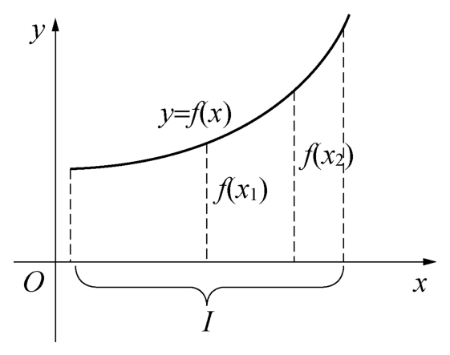

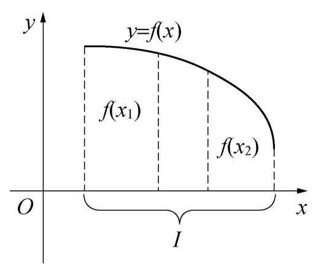

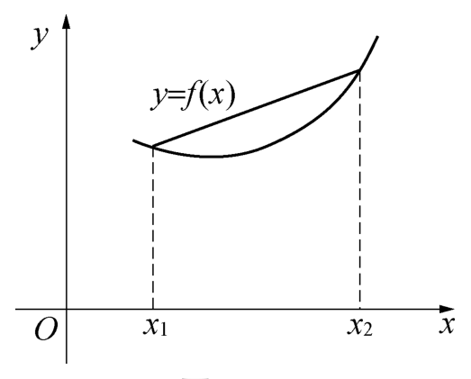

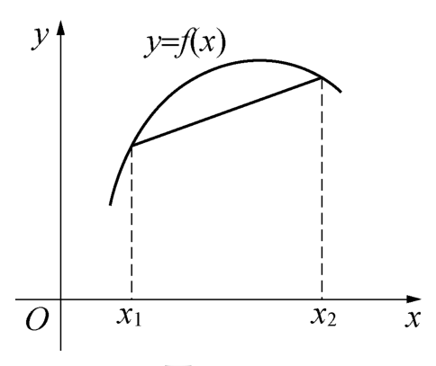

### 一、函数单调性的判别

先从函数图形来观察单调函数有什么特点.

由图 2-28 可知，（1）曲线沿$x$轴正向上升；（2）曲线的切线的斜率均非负，即$f'(x)\geqslant 0$；

由图 2-29 可知，（1）曲线沿$x$轴正向下降；（2）曲线的切线的斜率均非正，即$f'(x)\leqslant 0$.

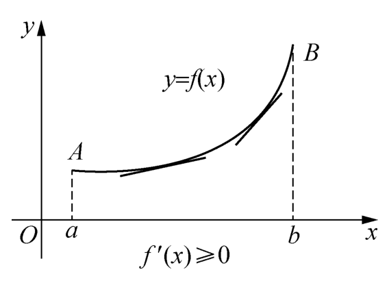

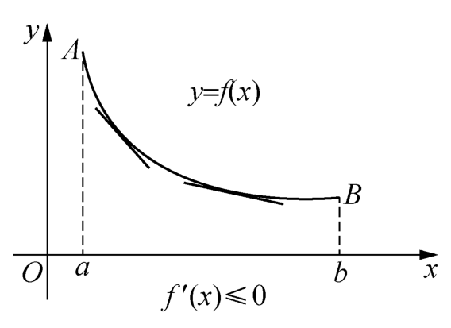

因此可得到，函数的单调性与函数的导数符号之间有着密切的关系. 能否用一个区间上的导数符号来判定函数在该区间上的单调性呢？

拉格朗日中值定理建立了函数与导数之间的联系，利用中值定理可以得出函数单调性的判别法.

**定理 1（单调性的判别法）**　设函数$f(x)$在区间$I$上连续，且在$I$内可导，若在$I$内$f'(x)>0$，则$f(x)$在$I$上单调增加；若在$I$内$f'(x)<0$，则$f(x)$在$I$上单调减少.

**证明**　任取$x_1$，$x_2\in I$，不妨设$x_1<x_2$，$f(x)$在$[x_1,\ x_2]$上满足拉格朗日中值定理的条件，则有

$$
f(x_2)-f(x_1)=f'(\xi)(x_2-x_1),\ \text{其中}\ \xi\in(x_1,\ x_2).
$$

因此，若在$I$内$f'(x)>0$，则$f(x_2)-f(x_1)>0$，即在区间$I$上$f(x)$单调增加；

若在$I$内$f'(x)<0$，则$f(x_2)-f(x_1)<0$，即在区间$I$上$f(x)$单调减少.

**例 1**　讨论函数$y=\arctan x-x$的单调性.

**解**　$y'=\frac{1}{1+x^2}-1=-\frac{x^2}{1+x^2}$，在$(-\infty,\ +\infty)$内，除$x=0$时$y'=0$外，恒有$\frac{x^2}{1+x^2}>0$，所以在$(-\infty,\ 0)$及$(0,\ +\infty)$内恒有$y'<0$，因此$y=\arctan x-x$在$(-\infty,\ +\infty)$内是单调减少的（见图 2-30）.

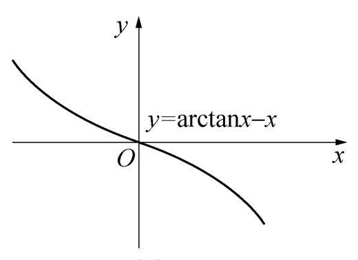

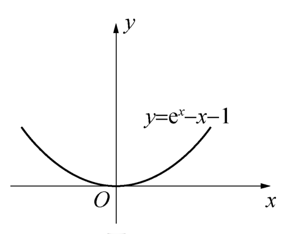

**例 2**　讨论函数$y=\mathrm{e}^x-x-1$在$(-\infty,\ +\infty)$内的单调性.

**解**　$y'=\mathrm{e}^x-1$，当$x\in(-\infty,\ 0]$时，$y'<0$，即函数$y=\mathrm{e}^x-x-1$在$(-\infty,\ 0]$上单调减少；当$x\in[0,\ +\infty)$时，$y'>0$，即函数$y=\mathrm{e}^x-x-1$在$(-\infty,\ 0]$上单调增加（见图 2-31）. 其中$x=0$是函数$y=\mathrm{e}^x-x-1$的单调区间$(-\infty,\ 0]$，$[0,\ +\infty)$的分界点.

**注**　当$x=0$时，$y'=0$，也可以看出使$y'=0$的点可能是划分函数单调区间的分界点，它使原来在定义域内不单调的函数在各个部分区间内是单调的.

下面讨论一下如何划分一个函数的单调区间. 哪些点可能成为单调区间的分界点？使$y'=0$的点、导数不存在的点、函数不连续的点都可能成为单调区间的分界点. 由此划分函数的单调区间可分下列步骤：

（1）找出函数的不连续点；

（2）求导数，找出使$f'(x)=0$及导数不存在的点；

（3）确定各个划分区间内导数的符号，由此得到函数的单调区间.

**例 3**　讨论函数$y=\ln(1-x^2)$的单调性.

**解**　函数的定义域为$(-1,\ 1)$，$y'=-\frac{2x}{1-x^2}$.

令$y'=0$，则有$x=0$.

当$-1<x<0$时，$y'>0$，

故$\ln(1-x^2)$在$(-1,\ 0)$上单调增加；

当$0<x<1$时，$y'<0$，

故$\ln(1-x^2)$在$[0,\ 1)$上单调减少（见图 2-32）.

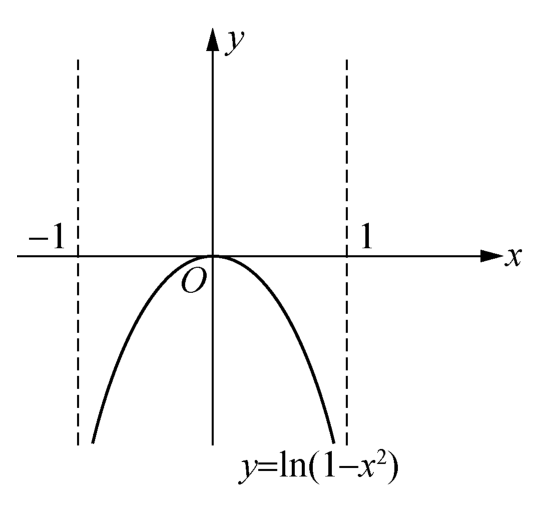

**例 4**　判定函数$y=x^3-3x^2-9x+14$的单调区间.

**解**　$y'=3x^2-6x-9=3(x^2-2x-3)=3(x+1)(x-3)$，

故$x_1=-1$，$x_2=3$使$y'=0$. 用这两点把定义域$(-\infty,\ +\infty)$分成区间$(-\infty,\ -1)$，$(-1,\ 3)$及$(3,\ +\infty)$，其讨论结果列表如下：

| 区间 | $(-\infty,\ -1)$ | $(-1,\ 3)$ | $(3,\ +\infty)$ |
| :---: | :---: | :---: | :---: |
| $y'$ | $+$ | $-$ | $+$ |
| $y$ | ↗ | ↘ | ↗ |

所以，函数在$(-\infty,\ -1)$和$(3,\ +\infty)$内单调增加，在$(-1,\ 3)$内单调减少（见图 2-33）.

由这些例子可以看到，函数$f(x)$单调区间分界点是$f'(x)=0$的点，而$f'(x)$不存在的点也可能是单调区间的分界点.

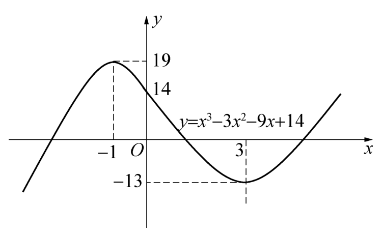

**例 5**　函数$y=|x|$在$x=0$处导数不存在，显然函数在$(-\infty,\ 0)$内单调减少，在$(0,\ +\infty)$内单调增加（见图 2-34）.

**例 6**　函数$y=\begin{cases}1+x, & x\in[-1,\ 0),\\1-x, & x\in[0,\ 1]\end{cases}$，在$x=0$处导数不存在，而$x=0$也是单调区间的一个分界点. 事实上，该函数在$[-1,\ 0)$内单调增加，在$[0,\ 1]$内单调减少（见图 2-35）.

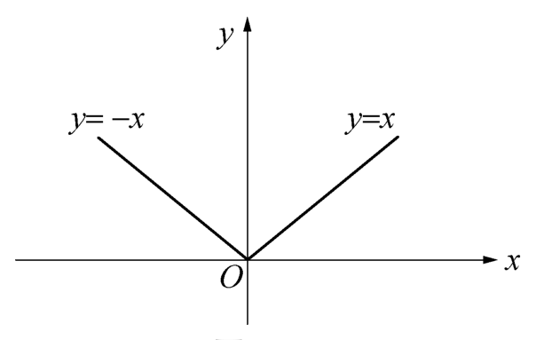

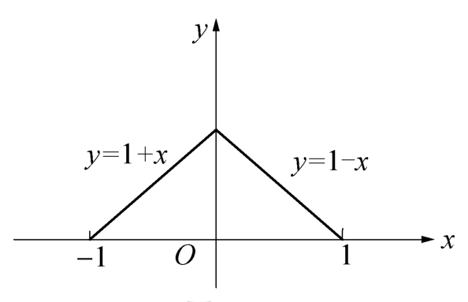

单调性可以用来证明不等式.

**例 7**　试证明当$x>1$时，有$2\sqrt{x}>3-\frac{1}{x}$.

**证明**　考虑函数$f(x)=2\sqrt{x}-\left(3-\frac{1}{x}\right)$，只要证$f(x)>0\ (x>1)$即可.

$$
f'(x)=\frac{1}{\sqrt{x}}-\frac{1}{x^2}=\frac{\sqrt{x^3}-1}{x^2}.
$$

当$x>1$时，$f'(x)>0$，所以$f(x)$严格单调增加. 而$f(1)=0$，因此，当$x>1$时，$f(x)>f(1)=0$，即当$x>1$时，$2\sqrt{x}-\left(3-\frac{1}{x}\right)>0$，$2\sqrt{x}>3-\frac{1}{x}$.

**例 8**　证明方程$x^5+x+1=0$在区间$(-1,\ 0)$内有且只有一个实根.

**证明**　令$f(x)=x^5+x+1$，因$f(x)$在闭区间$[-1,\ 0]$上连续，且$f(-1)=-1<0$，$f(0)=1>0$，根据零点定理，$f(x)$在$(-1,\ 0)$内至少有一个零点.

另一方面，对于任意实数$x$，有$f'(x)=5x^4+1>0$，所以$f(x)$在$(-\infty,\ +\infty)$内单调增加，因此曲线$y=f(x)$与$x$轴至多有一个交点.

综上所述，可知方程$x^5+x+1=0$在区间$(-1,\ 0)$内有且只有一个实根.

### 二、函数的极值及其求法

**定义 1**　设函数$f(x)$在$(a,\ b)$内有定义，$x_0\in(a,\ b)$，如果存在点$x_0$的一个邻域$U(x_0)$，当$x\in\mathring{U}(x_0)$时，恒有$f(x)<f(x_0)$（或$f(x)>f(x_0)$），则称$f(x_0)$为$f(x)$的极大值（或极小值），$x_0$称为$f(x)$的极大值点（或极小值点）.

函数的极大值、极小值统称为**极值**，使函数取得极值的点称为极值点.

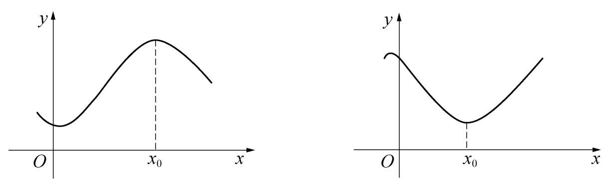

下面先考虑函数可导的情况下的极值的求法.

**定理 2（极值的必要条件）**　设函数$f(x)$在点$x_0$处可导，且在点$x_0$处取得极值，则必有$f'(x_0)=0$.

**证明**　不妨设$f(x_0)$是函数$f(x)$的极小值. 由定义知，存在点$x_0$的一个邻域$U(x_0)$，当$x\in\mathring{U}(x_0)$时，恒有$f(x)>f(x_0)$，故

当$x<x_0$时，$\frac{f(x)-f(x_0)}{x-x_0}<0$，因此$f'_-(x_0)=\lim\limits_{x\to x_0^-}\frac{f(x)-f(x_0)}{x-x_0}\leqslant 0$；

当$x>x_0$时，$\frac{f(x)-f(x_0)}{x-x_0}>0$，因此$f'_+(x_0)=\lim\limits_{x\to x_0^+}\frac{f(x)-f(x_0)}{x-x_0}\geqslant 0$.

函数$f(x)$在点$x_0$处可导，则$f'(x_0)=f'_-(x_0)=f'_+(x_0)=0$.

使$f'(x)=0$的实根$x_0$称为$f(x)$的**驻点**.

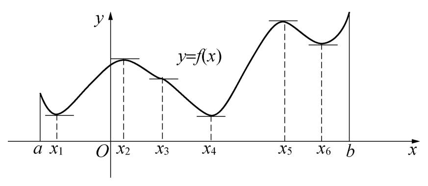

由此可得，若函数$f(x)$在点$x_0$处可导，$x_0$是极值点，则$x_0$必是驻点. 反之不然，例如$y=x^3$在$x=0$处有$y'=0$，但$x=0$并不是极值点. 极值点必是驻点的前提是函数在该点处可导，例如$y=|x|$在$x=0$处有极小值，但该点（不可导）不是驻点.

**定理 3（极值第一充分条件）**　设函数$f(x)$在$x_0$的邻域$U(x_0)$内连续，在$\mathring{U}(x_0)$内可导.

（1）如果$x$在$x_0$的左邻域内有$f'(x)>0$，在$x_0$的右邻域内有$f'(x)<0$，则$f(x)$在点$x_0$处取得极大值（见图 2-38）；

（2）如果$x$在$x_0$的左邻域内有$f'(x)<0$，在$x_0$的右邻域内有$f'(x)>0$，则$f(x)$在点$x_0$处取得极小值（见图 2-39）；

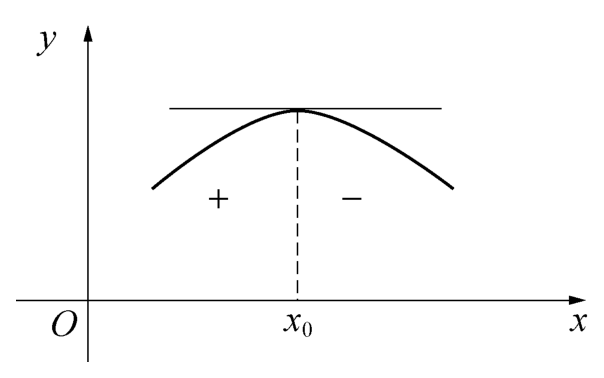

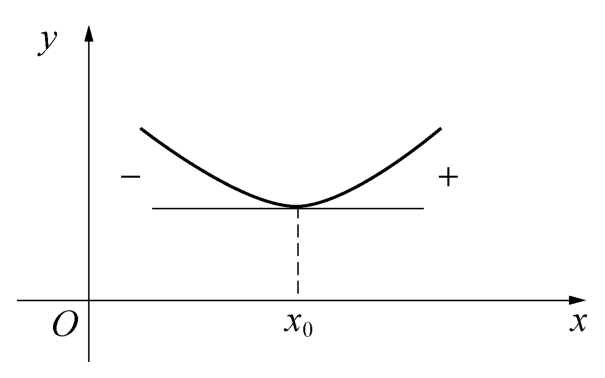

（3）如果$x\in\mathring{U}(x_0)$，$f'(x)$恒正或恒负，则函数$f(x)$在点$x_0$处无极值（见图 2-40）.

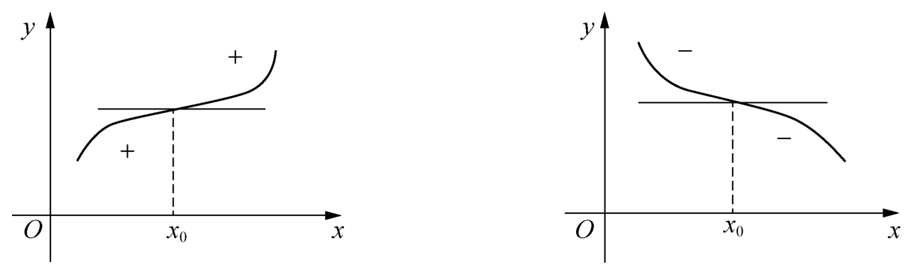

**证明**　（1）如果$x$在$x_0$的左邻域内有$f'(x)>0$，在$x_0$的右邻域内有$f'(x)<0$，则$f(x)$在$x_0$的左邻域内单调增加，在$x_0$的右邻域内单调减少，即当$x\in\mathring{U}(x_0)$时，恒有$f(x)<f(x_0)$，因此$f(x)$在点$x_0$处取得极大值.

（2）、（3）同理可证.

由定理 3 可得下列求极值的步骤：

（1）求导数$f'(x)$；

（2）找出所有驻点和不可导的点；

（3）在这些点的两侧确定$f'(x)$的符号；

（4）确定极值点，求出极值.

**例 9**　求出函数$f(x)=x^3-3x^2-9x+5$的单调区间和极值.

**解**　$f'(x)=3x^2-6x-9=3(x+1)(x-3)$，令$f'(x)=0$，得$x_1=-1$，$x_2=3$，如表 2-1 所示，可得$f(x)$的单调增区间为$(-\infty,\ -1)$和$(3,\ +\infty)$，单调减区间为$(-1,\ 3)$；

$f(x)$在$x=-1$处取得极大值$f(-1)=10$；在$x=3$处取得极小值$f(3)=-22$. 图形如图 2-41 所示.

表 2-1

| $x$ | $(-\infty,\ -1)$ | $-1$ | $(-1,\ 3)$ | $3$ | $(3,\ +\infty)$ |
| :---: | :---: | :---: | :---: | :---: | :---: |
| $f'(x)$ | $+$ | $0$ | $-$ | $0$ | $+$ |
| $f(x)$ | ↗ | $f(-1)=10$ | ↘ | $f(3)=-22$ | ↗ |

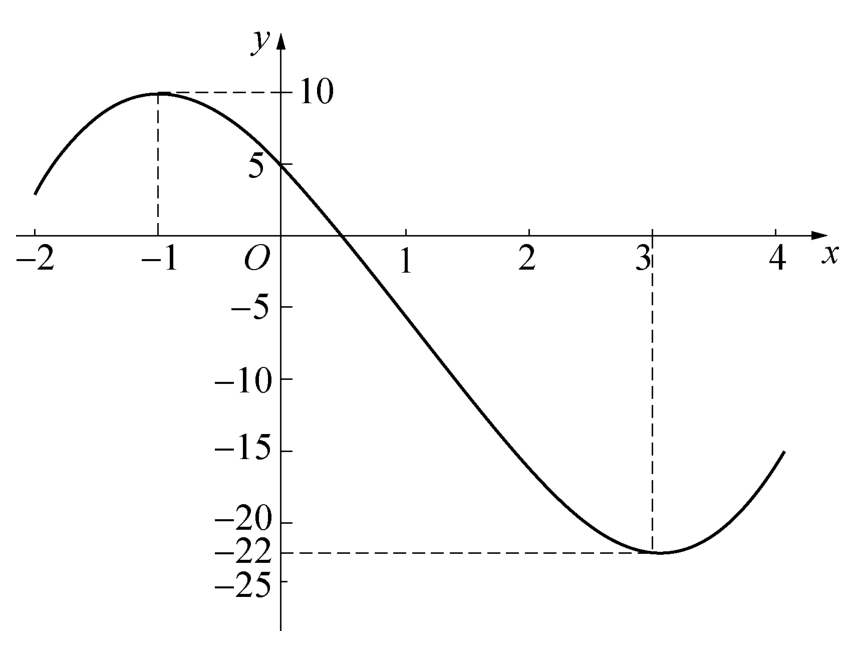

**例 10**　求函数$f(x)=1-(x-2)^{\frac{2}{3}}$的极值.

**解**　$f(x)$在$(-\infty,\ +\infty)$内连续. 当$x\neq 2$时，

$$
f'(x)=-\frac{2}{3\sqrt[3]{x-2}};
$$

当$x=2$时，$f'(x)$不存在.

在$(-\infty,\ 2)$内，$f'(x)>0$，函数$f(x)$在$(-\infty,\ 2)$上单调增加；在$(2,\ +\infty)$内，$f'(x)<0$，函数$f(x)$在$(2,\ +\infty)$上单调减少. 因此$f(2)=1$是函数$f(x)$的极大值. 函数的图形如图 2-42 所示.

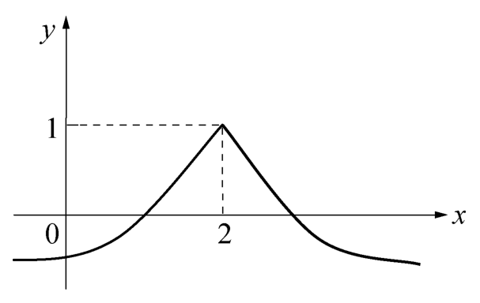

**定理 4（极值第二充分条件）**　设函数$f(x)$在点$x_0$处具有二阶导数，且$f'(x_0)=0$，$f''(x_0)\neq 0$，则当$f''(x_0)<0$时，函数$f(x)$在点$x_0$处取得极大值；当$f''(x_0)>0$时，函数$f(x)$在点$x_0$处取得极小值.

**证明**　若$f''(x_0)<0$，即$\lim\limits_{x\to x_0}\frac{f'(x)-f'(x_0)}{x-x_0}=\lim\limits_{x\to x_0}\frac{f'(x)}{x-x_0}<0$，则存在$\mathring{U}(x_0)$，当$x\in\mathring{U}(x_0)$时，$\frac{f'(x)}{x-x_0}<0$. 因此，当$x<x_0$时，$f'(x)>0$；当$x>x_0$时，$f'(x)<0$. 故函数$f(x)$在点$x_0$处取得极大值. 同理可证$f''(x_0)>0$时的情形.

**注**　条件$f''(x_0)\neq 0$不可缺.

如取$f_1(x)=-x^4$，$f_2(x)=x^4$，$f_3(x)=x^3$，显然$f'_1(0)=f'_2(0)=f'_3(0)=0$，且$f''_1(0)=f''_2(0)=f''_3(0)=0$，可以看出$f_1(x)$在$x=0$处取得极大值，$f_2(x)$在$x=0$处取得极小值，$f_3(x)$在$x=0$处无极值（见图 2-43）.

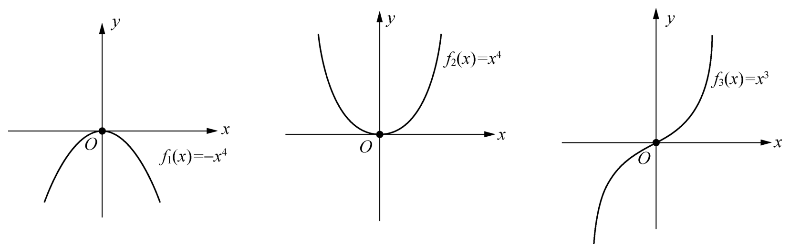

**例 11**　求函数$f(x)=\mathrm{e}^x\cos x$在区间$[0,\ 2\pi]$上的极值.

**解**　$f'(x)=\mathrm{e}^x(\cos x-\sin x)$，$f''(x)=-2\mathrm{e}^x\sin x$.

令$f'(x)=0$，因为$\mathrm{e}^x>0$，故$\cos x-\sin x=0$，得驻点

$$
x=\frac{\pi}{4}\ \text{及}\ x=\frac{5\pi}{4}.
$$

又

$$
f''\left(\frac{\pi}{4}\right)<0,\ f''\left(\frac{5\pi}{4}\right)>0,
$$

故在$x=\frac{\pi}{4}$处取得极大值$f\left(\frac{\pi}{4}\right)=\frac{1}{\sqrt{2}}\mathrm{e}^{\frac{\pi}{4}}$；在$x=\frac{5\pi}{4}$处取极小值$f\left(\frac{5\pi}{4}\right)=-\frac{1}{\sqrt{2}}\mathrm{e}^{\frac{5\pi}{4}}$.

在判定驻点$x_0$是否为极值点时，若在驻点$x_0$处$f''(x_0)=0$，则第二充分条件失效. 此时仍需用第一充分条件.

**例 12**　求函数$f(x)=3x^4-8x^3+6x^2+1$的极值.

**解**　$f'(x)=12x^3-24x^2+12x=12x(x-1)^2$，

$$
f''(x)=12(3x^2-4x+1)=12x(3x-1)(x-1).
$$

令$f'(x)=0$，求得驻点$x=0$，$x=1$，得$f''(0)=12>0$，$f''(1)=0$.

由第二充分条件知，$f(0)=1$是函数$f(x)$的极小值.

因为$f''(0)=0$，需用第一充分条件判定驻点的情形. 在$x=1$的两侧，由于当$0<x<1$及$x>1$时皆有$f'(x)>0$，故$x=1$不是极值点.

### 三、曲线的凹凸性与拐点

研究了函数的单调性与极值后，对函数的变化情况有了一定的了解，对描述函数的图形有很大的帮助. 但仅仅如此还不够，比如图 2-44 中的曲线弧$ABC$整体是单调上升的，但是弧段$\overset{\frown}{AB}$是凸的，而弧段$\overset{\frown}{BC}$是凹的，所以不仅要考虑增减性，还需要研究曲线的弯曲方向，下面给出曲线的凹凸性的定义.

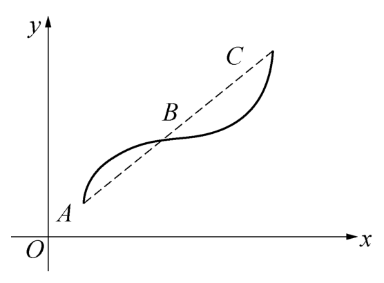

**定义 2**　设函数$f(x)$在区间$I$上连续，如果对区间$I$上的任意两点$x_1$、$x_2$，恒有

$$
f\left(\frac{x_1+x_2}{2}\right)<\frac{1}{2}[f(x_1)+f(x_2)],
$$

则称$f(x)$的图形（曲线$y=f(x)$）是凹的（或凹弧）（见图2-45）；

如果对区间$I$上的任意两点$x_1$、$x_2$，恒有

$$
f\left(\frac{x_1+x_2}{2}\right)>\frac{1}{2}[f(x_1)+f(x_2)],
$$

则称$f(x)$的图形（曲线$y=f(x)$）是凸的（或凸弧）（见图2-46）.

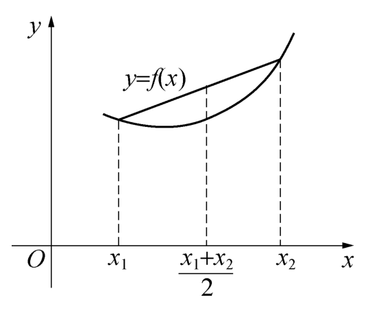

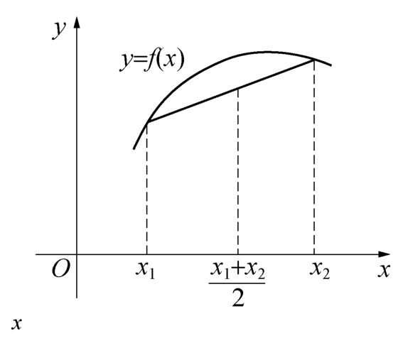

如何确定函数图形的凹凸性呢？

从以下两图可以看出，随着横坐标$x$的增加，凹弧上各点处的切线斜率逐渐增大，即$f'(x)$是单调增加的（见图2-47）；而凸弧上各点处的切线斜率逐渐减小，即$f'(x)$是单调减少的（见图2-48）. 对于$f'(x)$的增减性，可由$f'(x)$的导数，即$f''(x)$来判定.

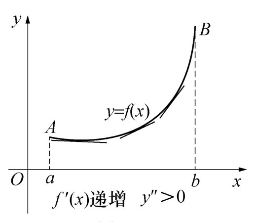

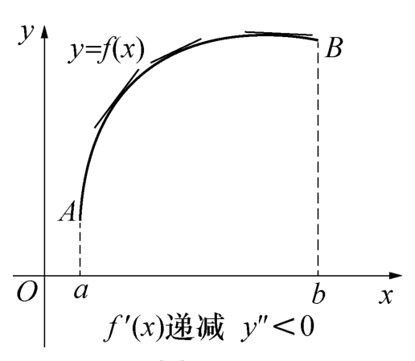

如果函数具有二阶导数，就可利用二阶导数的符号来确定函数图形的凹凸性.

**定理 5**　设函数$f(x)$在区间$I$上连续，在$I$内具有一阶及二阶导数，则

（1）若在$I$内$f''(x)>0$，则$f(x)$在$I$上的图形是凹的；

（2）若在$I$内$f''(x)<0$，则$f(x)$在$I$上的图形是凸的.

**例 13**　判断曲线$y=\mathrm{e}^x$的凹凸性.

解　$y=\mathrm{e}^x$在$(-\infty,+\infty)$内具有二阶导数，$y'=\mathrm{e}^x$，$y''=\mathrm{e}^x>0$，$x\in(-\infty,+\infty)$，因此曲线$y=\mathrm{e}^x$在$(-\infty,+\infty)$内是凹的（见图2-49）.

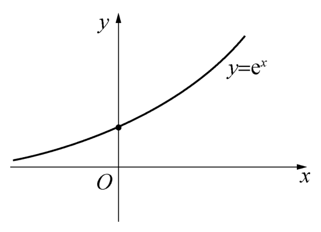

**例 14**　判断曲线$y=x^3$的凹凸性.

解　$y=x^3$在$(-\infty,+\infty)$内具有二阶导数，$y'=3x^2$，$y''=6x$.

当$x\in(-\infty,0]$时，$y''<0$，故曲线$y=x^3$在$(-\infty,0]$上是凸的；当$x\in[0,+\infty)$时，$y''>0$，故曲线$y=x^3$在$[0,+\infty)$上是凹的（见图2-50）.

**注**　点$(0,0)$为凹弧与凸弧的分界点.

连续曲线$y=f(x)$上凹弧与凸弧的分界点称为该曲线的拐点.

判断曲线$y=f(x)$的凹凸性与求拐点的一般步骤如下.

（1）求出$f''(x)$；

（2）找出方程$f''(x)=0$的实根；

（3）$f''(x)=0$的实根将函数$y=f(x)$的定义域分为若干区间，在每个区间上确定$f''(x)$的符号，从而确定曲线$y=f(x)$的凹凸区间；

（4）若在$f''(x)=0$的实根$x_0$的两侧，$f''(x)$的符号相反，则$(x_0,f(x_0))$是曲线$y=f(x)$的拐点.

**例 15**　指出曲线$y=3x^4-4x^3+1$的拐点及凹凸区间.

解　$y=3x^4-4x^3+1$的定义域为$(-\infty,+\infty)$，

$y'=12x^3-12x^2$，

$$
y''=12(3x^2-2x)=12x(3x-2)=36x\left(x-\frac{2}{3}\right).
$$

令$y''=0$，得$x_1=0$，$x_2=\frac{2}{3}$.

表 2-2

| $x$ | $(-\infty,0)$ | $0$ | $\left(0,\frac{2}{3}\right)$ | $\frac{2}{3}$ | $\left(\frac{2}{3},+\infty\right)$ |
| --- | --- | --- | --- | --- | --- |
| $f''(x)$ | $+$ | $0$ | $-$ | $0$ | $+$ |
| $f(x)$ | 凹弧 | 拐点$(0,1)$ | 凸弧 | 拐点$\left(\frac{2}{3},\frac{11}{27}\right)$ | 凹弧 |

因此，曲线$y=3x^4-4x^3+1$的拐点为$(0,1)$、$\left(\frac{2}{3},\frac{11}{27}\right)$；

凹区间为$(-\infty,0)$、$\left(\frac{2}{3},+\infty\right)$；凸区间为$\left(0,\frac{2}{3}\right)$（见图2-51）.

**例 16**　证明曲线$y=x^4$没有拐点.

证明　$y=x^4$的定义域为$(-\infty,+\infty)$，$y'=4x^3$，$y''=12x^2$. 当$x=0$时，$y''=0$，而当$x\neq 0$时，$y''>0$，因此曲线$y=x^4$在$(-\infty,+\infty)$内是凹的，点$(0,0)$并不是拐点（见图2-52）.

**注**　从本例也可看出，使$y''=0$的点未必是拐点. 而从下例可以看出，导数不存在的点也有可能是拐点.

**例 17**　求曲线$y=\sqrt[3]{x}$的拐点.

解　该函数在定义区间$(-\infty,+\infty)$内连续，当$x\neq 0$时，

$$
y'=\frac{1}{3\sqrt[3]{x^2}},\quad y''=-\frac{2}{9x\sqrt[3]{x^2}}.
$$

当$x=0$时，$y'$、$y''$都不存在，故二阶导数在$(-\infty,+\infty)$内没有零点. $x=0$是$y''$不存在的点，它把$(-\infty,+\infty)$分成两个部分区间：$(-\infty,0)$，$[0,+\infty)$. 在$(-\infty,0)$内，$y''>0$，这部分曲线在$(-\infty,0)$上是凹的；在$(0,+\infty)$内，$y''<0$，这部分曲线在$[0,+\infty)$上是凸的. $x=0$时，$y=0$，点$(0,0)$是该曲线的一个拐点（见图2-53）.

### 四、曲线的渐近线

在平面上，当曲线伸向无穷远处时，一般很难把它画准确. 但如果曲线伸向无穷远处，且能渐渐靠近一条直线，那么就可以既快又好地画出趋于无穷远处这条曲线的走向趋势.

例如，双曲线$\frac{x^2}{a^2}-\frac{y^2}{b^2}=1$，当$x\to\infty$时就渐渐靠近两条直线（见图2-54）：$y=\frac{b}{a}x$和$y=-\frac{b}{a}x$.

对于一般的曲线，有时也能找到这样的直线.

例如，极限$\lim_{x\to\infty}f(x)=A$表明当$|x|$无限增大时，对应的函数值$f(x)$与数值$A$无限接近. 几何上描述为：当曲线$y=f(x)$沿$x$轴正、负向伸展到无穷远时，曲线上的点与直线$y=A$上的点无限接近，也就是直线$y=A$为曲线$y=f(x)$的水平渐近线（见图2-55）.

同理，若$\lim_{x\to+\infty}f(x)=A$或$\lim_{x\to-\infty}f(x)=A$，则直线$y=A$也是曲线$y=f(x)$的水平渐近线. 与以上不同的是，这时的渐近线仅仅限于曲线$y=f(x)$在$x\to+\infty$的一侧或$x\to-\infty$的一侧.

$\lim_{x\to x_0}f(x)=\infty$表明当$x$充分接近$x_0$时，函数值$f(x)$的绝对值$|f(x)|$无限增大. 几何上描述为：当$x$接近$x_0$时，曲线$y=f(x)$要伸展到无穷远，也就是直线$x=x_0$为曲线$y=f(x)$的铅直渐近线（见图2-56）.

同理，若$\lim_{x\to x_0^+}f(x)=\infty$或$\lim_{x\to x_0^-}f(x)=\infty$，则直线$x=x_0$也是曲线$y=f(x)$的铅直渐近线. 与以上不同的是，这时渐近线仅仅限于曲线$y=f(x)$在$x>x_0$的一侧或$x<x_0$的一侧.

例如，曲线$y=\ln x$，由于$\lim_{x\to 0^+}\ln x=-\infty$，所以直线$x=0$是曲线$y=\ln x$的铅直渐近线（见图2-57）.

曲线$y=\mathrm{e}^x$，由于$\lim_{x\to-\infty}\mathrm{e}^x=0$，所以直线$y=0$是曲线$y=\mathrm{e}^x$的水平渐近线（见图2-58）.

**例 18**　求曲线$y=\frac{\mathrm{e}^x}{x^2-1}$的渐近线.

解　$\lim_{x\to-\infty}\frac{\mathrm{e}^x}{x^2-1}=0$，$\lim_{x\to 1}\frac{\mathrm{e}^x}{x^2-1}=\infty$，$\lim_{x\to-1}\frac{\mathrm{e}^x}{x^2-1}=\infty$.

故直线$y=0$是水平渐近线，直线$x=1$及$x=-1$是两条铅直渐近线.

### 五、函数图形的描绘

对于一个函数，若能作出其图形，就能从直观上了解该函数的性态特征，并可从其图形清楚地看出因变量与自变量之间的相互依赖关系. 在中学阶段，我们利用描点法作函数的图形. 这种方法常会遗漏曲线的一些关键点，如极值点、拐点等，使得曲线的单调性、凹凸性等函数的一些重要性质难以准确显示出来. 本节我们要利用导数描绘函数$y=f(x)$的图形，其一般步骤如下.

**第一步**　确定函数$f(x)$的定义域，研究函数特性，如奇偶性、周期性、有界性等，求出函数的一阶导数$f'(x)$和二阶导数$f''(x)$；

**第二步**　求出一阶导数$f'(x)$和二阶导数$f''(x)$在函数定义域内的全部零点，并求出函数$f(x)$的间断点以及导数$f'(x)$和$f''(x)$不存在的点，用这些点把函数定义域划分成若干个部分区间；

**第三步**　确定在这些部分区间内$f'(x)$和$f''(x)$的符号，并由此确定函数的增减性和凹凸性、极值点和拐点；

**第四步**　确定函数图形的水平、铅直渐近线以及其他变化趋势；

**第五步**　算出$f'(x)$和$f''(x)$的零点以及不存在的点所对应的函数值，并在坐标平面上定出图形上相应的点；有时还需适当补充一些辅助作图点（如与坐标轴的交点和曲线的端点等）；然后根据第三步、第四步中得到的结果，用平滑曲线联接而画出函数的图形.

**例 19**　作函数$f(x)=x^3-x^2-x+1$的图形.

解　定义域为$(-\infty,+\infty)$，无奇偶性及周期性.

$f'(x)=(3x+1)(x-1)$，$f''(x)=2(3x-1)$.

令$f'(x)=0$，得$x=-\frac{1}{3}$或$x=1$. 令$f''(x)=0$，得$x=\frac{1}{3}$.

列表，如表2-3所示。

表 2-3

| $x$ | $\left(-\infty,-\frac{1}{3}\right)$ | $-\frac{1}{3}$ | $\left(-\frac{1}{3},\frac{1}{3}\right)$ | $\frac{1}{3}$ | $\left(\frac{1}{3},1\right)$ | $1$ | $(1,+\infty)$ |
| --- | --- | --- | --- | --- | --- | --- | --- |
| $f'(x)$ | $+$ | $0$ | $-$ |  | $-$ | $0$ | $+$ |
| $f''(x)$ | $-$ |  | $-$ |  | $+$ |  | $+$ |
| $f(x)$ | $\rightarrow$ | 极大值$\frac{32}{27}$ | $\downarrow$ | 拐点$\left(\frac{1}{3},\frac{16}{27}\right)$ | $\rightarrow$ | 极小值$0$ | $\uparrow$ |

补充点：$A(-1,0)$，$B(0,1)$，$C\left(\frac{3}{2},\frac{5}{8}\right)$. 综合作出图形，如图2-59所示.

**例 20**　作函数$f(x)=\frac{4(x+1)}{x^2}-2$的图形.

解　$D:\{x|x\neq 0\}$，非奇非偶函数，且无对称性.

$$
f'(x)=-\frac{4(x+2)}{x^3},\quad f''(x)=\frac{8(x+3)}{x^4}.
$$

令$f'(x)=0$，得$x=-2$；令$f''(x)=0$，得$x=-3$.

$$
\lim_{x\to\infty}f(x)=\lim_{x\to\infty}\left[\frac{4(x+1)}{x^2}-2\right]=-2,
$$

得水平渐近线$y=-2$；

$$
\lim_{x\to 0}f(x)=\lim_{x\to 0}\left[\frac{4(x+1)}{x^2}-2\right]=+\infty,
$$

得铅直渐近线$x=0$.

列表，如表2-4所示。

表 2-4

| $x$ | $(-\infty,-3)$ | $-3$ | $(-3,-2)$ | $-2$ | $(-2,0)$ | $0$ | $(0,+\infty)$ |
| --- | --- | --- | --- | --- | --- | --- | --- |
| $f'(x)$ | $-$ |  | $-$ | $0$ | $+$ | 不存在 | $-$ |
| $f''(x)$ | $-$ | $0$ | $+$ |  | $+$ |  | $+$ |
| $f(x)$ | $\downarrow$ | 拐点$\left(-3,\frac{26}{9}\right)$ | $\rightarrow$ | 极值点 | $\uparrow$ | 间断点 | $\rightarrow$ |

补充点：$(1-\sqrt{3},0)$，$(1+\sqrt{3},0)$；$A(-1,-2)$，$B(1,6)$，$C(2,1)$. 作出图形，如图2-60所示.

### 习题 2-6

1. 确定下列函数的单调区间：

（1）$y=2+x-x^2$；　　（2）$y=\frac{2x}{1+x^2}$；

（3）$y=2x+\frac{8}{x}(x>0)$；　　（4）$y=2x^2-\ln x$；

（5）$y=\frac{\sqrt{x}}{x+100}(x\geqslant 0)$；　　（6）$y=x+\sin x$；

（7）$f(x)=x-\arctan x$；　　（8）$y=x^2-\ln x^2$.

2. 试证明下列不等式：

（1）当$x>0$时，$x-\frac{x^2}{2}<\ln(1+x)<x$；

（2）当$0<x<\frac{\pi}{2}$时，$\frac{2}{\pi}x<\sin x<x$；

（3）当$0<x<\frac{\pi}{2}$时，$\sin x+\tan x>2x$；

（4）当$x>4$时，$2^x>x^2$；

（5）当$x>0$时，$\ln(1+x)>\frac{\arctan x}{1+x}$；

（6）当$x\geqslant 0$时，$\arctan x\leqslant x$.

3. 求下列函数的极值：

（1）$y=2x^3-6x^2-18x+7$；　　（2）$y=x^2\ln x$；

（3）$y=2-(x-1)^{\frac{2}{3}}$；　　（4）$y=x^2\mathrm{e}^{-x^2}$；

（5）$y=x+\frac{1}{x}$；　　（6）$y=3-2(x+1)^{\frac{1}{3}}$；

（7）$y=\arctan x-\frac{1}{2}\ln(1+x^2)$；　　（8）$y=2x-\ln(4x)^2$.

4. 讨论方程$\ln x=ax$（其中$a>0$）有几个实根.

5. 证明方程$x^3+5x-2=0$只有一个正根.

6. 试问：$a$为何值时，函数$f(x)=a\sin x+\frac{1}{3}\sin 3x$在$x=\frac{\pi}{3}$处取得极值？它是极小值还是极大值？

7. 若函数$f(x)$有$\lim_{x\to+\infty}f(x)=0$，$\lim_{x\to-\infty}\frac{f(x)}{x}=1$，$\lim_{x\to-\infty}[f(x)-x]=2$，$\lim_{x\to+\infty}\frac{f(x)}{x}=0$，$\lim_{x\to 2}f(x)=\infty$，并且当$x\in(0,1)$时，$f'(x)<0$，否则$f'(x)>0$（$x\neq 2$），当$x\in\left(\frac{1}{2},2\right)$时，$f''(x)>0$，否则$f''(x)<0$（$x\neq 0$），则

（1）函数$f(x)$的单调区间（注明增减）是______.

（2）函数曲线的凹区间______、凸区间______和拐点是______.

（3）当$x=$______时，函数取得极大值______.

（4）函数的渐近线有______.

8. 判断下列曲线的凹凸性：

（1）$y=4x-x^2$；　　（2）$y=x\arctan x$.

9. 求下列曲线的拐点及凹、凸区间：

（1）$y=x^3-5x^2+3x+5$；　　（2）$y=\ln(x^2+1)$.

10. 求函数$y=\mathrm{e}^{\arctan x}$图形的拐点及凹或凸的区间.

11. 求函数$y=x^4(12\ln x-7)$图形的拐点及凹或凸的区间.

12. 试决定曲线$y=ax^3+bx^2+cx+d$中的$a$、$b$、$c$、$d$，使得曲线在$x=-2$所对应的点处有水平切线，$(1,-10)$为曲线的拐点，且点$(-2,44)$在曲线上.

13. 求曲线$x=t^2$，$y=3t+t^3$的拐点.

14. 求下列曲线的渐近线：

（1）$y=\frac{1}{x^2-4x-5}$；　　（2）$y=\frac{1}{(x+2)^3}$；

（3）$y=x\mathrm{e}^{x^{-2}}$；　　（4）$y=-(x+1)+\sqrt{x^2+1}$；

（5）$y=x\sin\frac{1}{x}$；　　（6）$y=\frac{\mathrm{e}^x}{x^2-1}$.

15. 作下列函数的图形：

（1）$y=\frac{1}{1+x^2}$；　　（2）$y=x\mathrm{e}^{-x}$；

（3）$y=x\sqrt{3-x}$；　　（4）$y=\sqrt[3]{x^2}+2$；

（5）$y=x^2+\frac{1}{x}$；　　（6）$y=\frac{3x}{(x+1)^2}-2$.

\*16. 利用曲线的凹凸性证明不等式：$x\ln x+y\ln y>(x+y)\ln\frac{x+y}{2}$，其中$x>0$，$y>0$且$x\neq y$.

## 第七节 微分学的实际应用

[课前导读]

在实际工程中常会遇到这样一类问题：在一定条件下，怎样使“产品最多”“用料最省”“成本最低”“效率最高”……这类问题可归结为建立一个目标函数，求这个函数的最大值、最小值问题（设计最佳方案）. 该类问题的难点在于，如何利用已知的信息，建立既符合实际又易运算的函数（模型）.

### 一、最大值、最小值

极值的概念是局部性的，是描述函数在某一点邻域内的性态. 这一节研究函数在一个区间上的最大值、最小值问题. 由闭区间上连续函数的性质知，若$f(x)$在$[a,b]$上连续，$f(x)$在$[a,b]$上一定取得最大值和最小值.

**1. 函数在闭区间上的最大值与最小值**

如何求出连续函数$f(x)$在闭区间$[a,b]$上的最大值和最小值呢？$f(x)$的最大值与最小值可以在区间$[a,b]$的内部取得，也可以在区间端点$x=a$或$x=b$处取得. 若$f(x)$在开区间$(a,b)$内$x_0$处取得最大值（最小值），则$f(x_0)$必是函数$f(x)$的极大值（极小值）. $f'(x_0)$可能不存在，也可能存在. 若$f'(x_0)$存在，则$x_0$必为$f(x)$的驻点. 由此知$f(x)$在区间$[a,b]$上的最大值与最小值必在$f(x)$的驻点、导数不存在的点或区间端点处取得.

从数学的角度看问题，可以由下列过程求最大值和最小值.

（1）找出$(a,b)$内所有驻点及不可导点$x_i(i=1,2,\cdots,m)$；

（2）比较$f(x_i)(i=1,2,\cdots,m)$及$f(a)$与$f(b)$的大小；

（3）最大值$M=\max\{f(x_1),f(x_2),\cdots,f(x_m),f(a),f(b)\}$，

最小值$m=\min\{f(x_1),f(x_2),\cdots,f(x_m),f(a),f(b)\}$.

**例 1**　求函数$f(x)=x^4-2x^2+5$在区间$[-2,2]$上的最大值和最小值.

解　由$f'(x)=4x^3-4x=4x(x-1)(x+1)$.

令$f'(x)=0$，解得函数在$(-2,2)$内的驻点为$x_1=-1$，$x_2=0$，$x_3=1$. 在驻点的函数值为$f(-1)=4$，$f(0)=5$，$f(1)=4$；在端点的函数值为$f(-2)=f(2)=13$. 比较上述5个点的函数值，可得在区间$[-2,2]$上的最大值为$f(-2)=f(2)=13$，最小值为$f(-1)=f(1)=4$.

**例 2**　求函数$f(x)=\frac{x}{1+x^2}$在区间$[0,2]$上的最大值和最小值.

解　由$f'(x)=\frac{1\cdot(1+x^2)-x\cdot 2x}{(1+x^2)^2}=\frac{(1-x)(1+x)}{(1+x^2)^2}$.

令$f'(x)=0$，解得函数在$(0,2)$内的驻点为$x=1$. 在驻点的函数值为$f(1)=\frac{1}{2}$，在端点的函数值为$f(0)=0$，$f(2)=\frac{2}{5}$，故在区间$[0,2]$上的最大值为$f(1)=\frac{1}{2}$，最小值为$f(0)=0$.

**2. 应用问题举例**

若$f(x)$在$(a,b)$内有唯一驻点，且此驻点为极大（小）值，则此极大（小）值必为最大（小）值.

**例 3**　由直线$y=0$，$x=8$及抛物线$y=x^2$围成一个曲边三角形，在曲边$y=x^2$上求一点，使曲线在该点处的切线与直线$y=0$及$x=8$所围成的三角形面积最大.

解　设$P(x_0,y_0)$为抛物线$y=x^2$上任意一点，该点处的切线斜率$k=2x_0$，过该点的切线为$y-y_0=2x_0(x-x_0)$，即$y=2x_0x-x_0^2$，则此切线与$x$轴的交点为$A\left(\frac{x_0}{2},0\right)$，与直线$x=8$的交点为$B\left(8,16x_0-x_0^2\right)$（见图2-62）. 根据几何分析，所求三角形面积为

$$
S=\frac{1}{2}\left(8-\frac{1}{2}x_0\right)(16x_0-x_0^2)\quad(0\leqslant x_0\leqslant 8).
$$

由$S'=\frac{1}{4}(3x_0^2-64x_0+16\cdot 16)=0$，解得区间$(0,8)$内的唯一驻点$x_0=\frac{16}{3}$.

因为$S''\left(\frac{16}{3}\right)=-8<0$，所以$S\left(\frac{16}{3}\right)=\frac{4096}{27}$为极大值.

故$x_0=\frac{16}{3}$时所围成的三角形面积最大.

在很多实际问题中，上述求最大值、最小值的方法还可进一步简化. 如果根据问题的性质，我们可以断定可导函数$f(x)$确有最大值（或最小值），而且该最大值（或最小值）一定在定义区间的内部取得. 这时，如果方程$f'(x)=0$在定义区间内部只有一个根$x_0$（函数$f(x)$在定义区间内部只有唯一驻点$x_0$），那么不必讨论$f(x_0)$是否是极值，就可以断定$f(x_0)$必为所求的最大值（或最小值）.

**例 4**　某工厂需要围建一个面积为$512\ \mathrm{m}^2$的矩形堆料场，一边可以利用原有的墙壁，其他三边需要砌新的墙壁. 问：堆料场的长和宽各为多少时，才能使砌墙所用的材料最省？

解　要求原料最省，就是要求新砌的墙壁总长度最短. 如图2-63所示，设场地的宽为$x\ \mathrm{m}$，为使场地面积等于$512\ \mathrm{m}^2$，则长为$\frac{512}{x}\ \mathrm{m}$. 因此新墙的总长度为$l=2x+\frac{512}{x}(x>0)$，这就是目标函数. 下面讨论$x$为何值时，$l$取得最小值. 为此，求$l$对$x$的导数$l'=2-\frac{512}{x^2}$. 解方程$l'=0$，得$x=16$.

目标函数在区间$(0,+\infty)$内只有一个驻点$x=16$，故当$x=16$时，$l$取得极小值，从而这个极小值也是目标函数在区间$(0,+\infty)$内的最小值. 因此，当堆料场的宽为$16\ \mathrm{m}$、长为$\frac{512}{16}=32\ \mathrm{m}$时，可以使砌墙所用的材料最省.

**例 5**　某房地产公司有50套公寓要出租，当租金定为每月180元时，公寓会全部租出去. 当租金每月增加10元时，就有一套公寓租不出去，而租出去的房子每月需花费20元的整修维护费. 试问：房租定为多少可获得最高收入？

解　设房租为每月$x$元，租出去的房子有$50-\left(\frac{x-180}{10}\right)$套，每月总收入为

$$
R(x)=(x-20)\left(50-\frac{x-180}{10}\right)=(x-20)\left(68-\frac{x}{10}\right).
R'(x)=\left(68-\frac{x}{10}\right)+(x-20)\left(-\frac{1}{10}\right)=70-\frac{x}{5}.
$$

解$R'(x)=0$，得$x=350$（唯一驻点）.

故每月每套租金为350元时，收入最高. 最高收入为$R(350)=10890$（元）.

### 二、曲率

工程技术与生产实践中常常要考虑曲线的弯曲程度，如公路、铁路的弯道（见图2-64），机床与土木建筑中的轴或梁在荷载作用下产生的弯曲变形. 在设计时对它们的弯曲程度都有一定的限制，因此要讨论如何定量地描述曲线的弯曲程度. 这就引出了曲率的概念.

在介绍曲率之前，需要先引进弧微分的概念.

**1. 弧微分的概念**

若函数$y=f(x)$在区间$(a,b)$内具有一阶连续导数，其图形为一条处处有切线的曲线，且切线随切点的移动而连续转动，通常这样的曲线必为光滑曲线. 在曲线$y=f(x)(x\in(a,b))$上取固定点$M_0(x_0,f(x_0))$作为度量弧长的基点，并规定：

（1）以$x$增大的方向作为曲线的正向；

（2）对曲线上任意点$M(x,f(x))$，有向线段$\overset{\frown}{M_0M}$的长度为$s=|s|\operatorname{sgn}(x-x_0)$，称为弧$s$. 由此可知弧$s$是$x$的函数：$s=s(x)$，且它是单调增加的（见图2-65）.

现在考虑$\lim_{\Delta x\to 0}\frac{\Delta s}{\Delta x}$，$\Delta s=\overset{\frown}{M_0M'}-\overset{\frown}{M_0M}=\overset{\frown}{MM'}$.

由

$$
\left(\frac{\Delta s}{\Delta x}\right)^2=\left(\frac{\overset{\frown}{MM'}}{\Delta x}\right)^2=\left(\frac{\overset{\frown}{MM'}}{MM'}\right)^2\left(\frac{MM'}{\Delta x}\right)^2=\left(\frac{\overset{\frown}{MM'}}{MM'}\right)^2\cdot\frac{(\Delta x)^2+(\Delta y)^2}{(\Delta x)^2}=\left(\frac{\overset{\frown}{MM'}}{MM'}\right)^2\left[1+\left(\frac{\Delta y}{\Delta x}\right)^2\right],
$$

得

$$
\frac{\Delta s}{\Delta x}=\pm\sqrt{\left(\frac{\overset{\frown}{MM'}}{MM'}\right)^2\left[1+\left(\frac{\Delta y}{\Delta x}\right)^2\right]}=\pm\frac{\overset{\frown}{MM'}}{MM'}\sqrt{1+\left(\frac{\Delta y}{\Delta x}\right)^2}.
$$

由于当$\Delta x\to 0$时，$M'\to M$，$\lim_{M'\to M}\frac{\overset{\frown}{MM'}}{MM'}=1$，$\lim_{\Delta x\to 0}\left(\frac{\Delta y}{\Delta x}\right)^2=y'^2$，注意到$s=s(x)$单调增加，即$y'\geqslant 0$，因此$\frac{\mathrm{d}s}{\mathrm{d}x}=\lim_{\Delta x\to 0}\frac{\Delta s}{\Delta x}=\sqrt{1+y'^2}$.

由此可得弧微分公式为

$$
\mathrm{d}s=\sqrt{1+y'^2}\,\mathrm{d}x.
$$

若曲线由参数方程$\begin{cases}x=\varphi(t),\\y=\psi(t)\end{cases}$给出，则有

$$
\mathrm{d}s=\sqrt{\varphi'^2(t)+\psi'^2(t)}\,\mathrm{d}t;
$$

若曲线方程为极坐标形式$r=r(\theta)$（极坐标系内容详见第三章第七节），则有

$$
\mathrm{d}s=\sqrt{r^2(\theta)+r'^2(\theta)}\,\mathrm{d}\theta.
$$

**2. 曲率及其计算公式**

现在研究如何描述曲线弧的弯曲程度.

从几何直观上容易看出，直线不弯曲，抛物线在顶点处弯曲最厉害，当抛物线上的点越远离顶点，弯曲程度越低（见图2-66）；圆上各点的弯曲程度是相同的（见图2-67），半径越小，弯曲越厉害.

如图2-68所示，在曲线$L$上点从$M_1$移动到$M_2$时，切线转过的角度（简称转角）$\Delta\alpha$很小；但点从$M_2$移动到$M_3$时，切线转过的角度（转角）$\Delta\alpha'$很大. 但是单用转角来衡量曲线的弯曲程度是不完全的. 如图2-69所示，当点从$M$沿$L_1$移动到$M'$时（弧长为$\Delta s$），与点从$N$沿$L_2$移动到$N'$时（弧长为$\Delta s'$），它们有相同的转角，但显然$\overset{\frown}{MM'}$比$\overset{\frown}{NN'}$的弯曲程度要小. 从图中也可看出，弯曲程度既与转角$\Delta\alpha$有关（成正比），也与经过的弧长$\Delta s$有关（成反比）.

综合以上分析，我们引入曲率的概念.

**定义**　设曲线$C:y=f(x)$是光滑的，在$C$上任取一点$M_0(x_0,y_0)$作为度量弧长的基点. 设曲线$C$上点$M(x,y)$对应弧$s$，点$M$处曲线的切线倾斜角为$\alpha$. 点$M'(x+\Delta x,y+\Delta y)$是$C$上邻近$M$的另一个点，对应弧$s+\Delta s$，点$M'$处曲线的倾斜角为$\alpha+\Delta\alpha$（见图2-70）. 当动点由点$M$沿$C$移动到点$M'$时，切线转过的角度为$|\Delta\alpha|$，比值$\frac{|\Delta\alpha|}{\Delta s}$称为弧段$\overset{\frown}{MM'}$的平均曲率，记作$\overline{K}$，即

$$
\overline{K}=\left|\frac{\Delta\alpha}{\Delta s}\right|,
$$

（单位弧段上切线转角的大小）.

当$M'\to M$时，$\Delta s\to 0$，将平均曲率取极限（若极限存在），称该极限值为曲线$C$在点$M$处的曲率，记作$K$.

$$
K=\lim_{M'\to M}\overline{K}=\lim_{\Delta s\to 0}\left|\frac{\Delta\alpha}{\Delta s}\right|.
$$

在$\lim_{\Delta s\to 0}\frac{\Delta\alpha}{\Delta s}=\frac{\mathrm{d}\alpha}{\mathrm{d}s}$存在的条件下，$K$可以表示为

$$
K=\left|\frac{\mathrm{d}\alpha}{\mathrm{d}s}\right|.
$$

**例 6**　求直线上各点的曲率.

解　直线上各点处切线的倾斜角$\alpha$是常量，$\Delta\alpha=0$，因此

$$
K=\lim_{\Delta s\to 0}\left|\frac{\Delta\alpha}{\Delta s}\right|=0.
$$

这与我们直观认识到的“直线没有弯曲”一致.

**例 7**　求半径为$R$的圆上任意一点处的曲率.

解　在圆周上任意两点$M$、$M'$处圆的切线所夹角$\Delta\alpha$等于中心角$MAM'$（见图2-71），且$\angle MAM'=\frac{\Delta s}{R}$，因此$\frac{\Delta\alpha}{\Delta s}=\frac{\frac{\Delta s}{R}}{\Delta s}=\frac{1}{R}$，即$K=\frac{1}{R}$.

这表明圆上各点处的曲率都等于半径$R$的倒数$\frac{1}{R}$，这与我们直观认识到的“圆的弯曲程度处处一样（且弯曲程度与半径成反比）”一致.

**3. 曲率的计算方法**

设曲线$y=f(x)$，其中$f(x)$具二阶导数，由导数的几何意义知$y'=\tan\alpha$，显然$\alpha=\alpha(x)$. 由$y'=\tan\alpha$两边求导得

$$
y''=\sec^2\alpha\cdot\frac{\mathrm{d}\alpha}{\mathrm{d}x}=(1+\tan^2\alpha)\frac{\mathrm{d}\alpha}{\mathrm{d}x}=(1+y'^2)\frac{\mathrm{d}\alpha}{\mathrm{d}s}\cdot\frac{\mathrm{d}s}{\mathrm{d}x}.
$$

又$\frac{\mathrm{d}s}{\mathrm{d}x}=\sqrt{1+y'^2}$，因此$\frac{\mathrm{d}\alpha}{\mathrm{d}s}=\frac{y''}{(1+y'^2)^{\frac{3}{2}}}$，这样

$$
K=\left|\frac{\mathrm{d}\alpha}{\mathrm{d}s}\right|=\frac{|y''|}{(1+y'^2)^{\frac{3}{2}}}.
$$

特别地，当$|y'|\ll 1$时，$K\approx|y''|$.

当曲线方程由参数方程$\begin{cases}x=\varphi(t),\\y=\psi(t)\end{cases}$给出时，由$y'=\frac{\psi'(t)}{\varphi'(t)}$，$y''=\frac{\varphi'(t)\psi''(t)-\varphi''(t)\psi'(t)}{\varphi'^3(t)}$，得到

$$
K=\frac{|\varphi'(t)\psi''(t)-\varphi''(t)\psi'(t)|}{[\varphi'^2(t)+\psi'^2(t)]^{\frac{3}{2}}}.
$$

**例 8**　抛物线$y=x^2+2x$上哪一点处的曲率最大？

解　由$y'=2x+2$，$y''=2$，得$K=\frac{2}{[1+(2x+2)^2]^{\frac{3}{2}}}$. 显然，当$x=-1$时，$K_{\max}=2$，此时，$(-1,-1)$为抛物线的顶点，可知抛物线的顶点处曲率最大.

**例 9**　求正弦曲线$y=\sin x$在区间$[0,\pi]$上各点处的曲率.

解　由$y'=\cos x$，$y''=-\sin x$，得

$$
K=\frac{|\sin x|}{(1+\cos^2x)^{\frac{3}{2}}}=\frac{\sin x}{(1+\cos^2x)^{\frac{3}{2}}},\quad 0\leqslant x\leqslant\pi.
$$

在$x=0$及$x=\pi$处，$K=0$，即在点$(0,0)$及点$(\pi,0)$的附近，正弦曲线接近直线. 在$x=\frac{\pi}{2}$处，$\cos x=0$，分母最小且分子$\sin x=1$取最大值. 所以曲率取最大值1，也就是正弦曲线在点$\left(\frac{\pi}{2},1\right)$处弯曲最厉害.

**例 10**　求椭圆$\begin{cases}x=a\cos t,\\y=b\sin t\end{cases}$在点$(0,b)$处的曲率.

解　点$(0,b)$对应的参数$t=\frac{\pi}{2}$，由于

$\varphi'(t)=\frac{\mathrm{d}x}{\mathrm{d}t}=-a\sin t$，$\varphi''(t)=-a\cos t$，

$\psi'(t)=\frac{\mathrm{d}y}{\mathrm{d}t}=b\cos t$，$\psi''(t)=-b\sin t$，

故将$t=\frac{\pi}{2}$代入得

$$
\varphi'\left(\frac{\pi}{2}\right)=\frac{\mathrm{d}x}{\mathrm{d}t}=-a,\quad \varphi''\left(\frac{\pi}{2}\right)=0,
\psi'\left(\frac{\pi}{2}\right)=\frac{\mathrm{d}y}{\mathrm{d}t}=0,\quad \psi''\left(\frac{\pi}{2}\right)=-b.
$$

由曲率公式，有

$$
K=\frac{|\varphi'(t)\psi''(t)-\varphi''(t)\psi'(t)|}{[\varphi'^2(t)+\psi'^2(t)]^{\frac{3}{2}}}\Bigg|_{t=\frac{\pi}{2}}=\frac{b}{a^2}.
$$

**4. 曲率半径与曲率圆**

设曲线$y=f(x)$在点$M(x,y)$处的曲率为$K(K\neq 0)$，在点$M$处的曲线的法线上凹的一侧取一点$D$，使$|DM|=\frac{1}{K}=\rho$，以$D$为圆心、$\rho$为半径作圆，称这个圆为曲线在点$M$处的曲率圆，曲率圆的圆心$D$叫作曲线在点$M$处的曲率中心，曲率圆的半径$\rho$叫作曲线在点$M$处的曲率半径（见图2-72）.

由上述定义可知：

（1）曲率圆与曲线在点$M$处有相同的切线与曲率，且在点$M$的邻近有相同的凹向，因此，往往可用曲率圆在点$M$附近的一段弧来近似代替曲线弧，而使问题得到简化.

（2）$\rho=\frac{1}{K}$，$K=\frac{1}{\rho}$.

**例 11**　求曲线$y=\tan x$在点$\left(\frac{\pi}{4},1\right)$处的曲率与曲率半径.

解　$y'=\sec^2x$，$y''=2\sec^2x\tan x=\frac{2\sin x}{\cos^3x}$，曲率$K$及曲率半径$\rho$分别为

$$
K=\frac{|y''|}{(1+y'^2)^{\frac{3}{2}}},\quad \rho=\frac{1}{K}=\frac{(1+y'^2)^{\frac{3}{2}}}{|y''|}.
$$

由$y'\big|_{x=\frac{\pi}{4}}=2$及$y''\big|_{x=\frac{\pi}{4}}=4$，得点$\left(\frac{\pi}{4},1\right)$处的曲率与曲率半径分别为$K=\frac{4\sqrt{5}}{25}$，$\rho=\frac{5\sqrt{5}}{4}$.

**例 12**　设一工件上的椭圆孔形$\overset{\frown}{CBD}$为椭圆$\frac{x^2}{40^2}+\frac{y^2}{50^2}=1$上的一段弧（见图2-73）. 若用砂轮磨削其内表面，问：砂轮的直径最大可选为多少？

解　求弧$\overset{\frown}{CBD}$在$B$点处的曲率. 弧$\overset{\frown}{CBD}$的方程为

$$
y=-50\sqrt{1-\frac{x^2}{40^2}}=-\frac{5}{4}\sqrt{1600-x^2}.
y'=\frac{5}{4}\cdot\frac{x}{\sqrt{1600-x^2}},\quad y''=\frac{2000}{(1600-x^2)^{\frac{3}{2}}}.
$$

在点$x=0$处，$y'=0$，$y''=\frac{1}{32}$，代入曲率公式得$B$点处的曲率$K=\frac{1}{32}$，曲率半径$\rho=32$. 所以砂轮的直径不得超过64个单位.

### 习题 2-7

1. 求下列函数在给定区间上的最大值和最小值：

（1）$y=x^4-2x^2+5$，$[-2,2]$；　　（2）$y=\sqrt{x(10-x)}$，$[0,10]$；

（3）$y=x+\sqrt{1-x}$，$[-5,1]$；　　（4）$y=\frac{x^2}{1+x}$，$\left[-\frac{1}{2},1\right]$.

2. 求函数$y=\sin 2x-x$在$\left[-\frac{\pi}{2},\frac{\pi}{2}\right]$上的最大值及最小值.

3. 已知铁路$AB$长为100 km，工厂$C$距$A$20 km，现要在铁路线上选一点$D$，向工厂修筑公路. 已知铁路与公路每千米费用之比为$3:5$，为使货物从$B$到$C$的运费最省，求$D$的位置.

4. 求内接于椭圆$\frac{x^2}{a^2}+\frac{y^2}{b^2}=1$的面积最大的矩形的各边之长.

5. 欲做一个底面为长方形的带盖的箱子，其体积为$72\ \mathrm{cm}^3$，其底边成$1:2$关系，问：各边的长为多少时，才能使表面积最小？

6. 某车间靠墙壁要盖一间面积为$64\ \mathrm{m}^2$的长方形小屋，而现有存砖只够砌$24\ \mathrm{m}$长的墙壁，问：这些存砖是否足够围成小屋？

7. 在直线$3x-y-3=0$上求一点，使它与点$A(1,1)$和$B(6,4)$的距离平方和最小.

8. 若直角三角形的一个直角边与斜边之和为常数$a$，求具有最大面积的直角三角形.

9. 从半径为$R$的圆上截下中心角为$\theta$的扇形，卷成一圆锥形漏斗，问：$\theta$为何值时，漏斗的容积最大.

10. 在椭圆 $x^{2}+\frac{y^{2}}{4}=1$ 上找一点 $P(x,y)$，使椭圆在该点处的切线与两坐标轴围成的三角形的面积最小。

11. 某工厂要建造一个容积为 300 m³ 的带盖圆桶，问：半径 $r$ 和桶高 $h$ 如何确定，才能使所用材料最省？

12. 生产某种商品 $x$ 单位的利润是 $L(x)=5000+x-0.00001x^{2}$（元），问：生产多少个单位时获利润最大？

13. 某厂每批生产 $A$ 商品 $x$ 台的费用为 $C(x)=5x+200$（万元），得到的收入为 $R(x)=10x-0.01x^{2}$（万元），问：每批生产多少台，才能使利润最大？

14. 求圆 $x^{2}+y^{2}=R^{2}$ 上任一点处的弧微分。

15. 求抛物线 $y=x^{2}+x$ 上任一点处的弧微分及在点 $(0,0)$ 处的曲率。

16. 求双曲线 $xy=4$ 在点 $(2,2)$ 处的曲率。

17. 求立方抛物线 $y=x^{3}$ 在点 $(0,0)$ 及点 $(2,8)$ 处的曲率。

18. 曲线 $y=\mathrm{e}^{x}$ 在哪一点处的曲率最大？最大曲率是多少？

19. 椭圆 $x=2\cos t$，$y=3\sin t$ 上哪些点处曲率最大？

20. 求椭圆

$$
\begin{cases}
x=a\cos t, \\
y=b\sin t
\end{cases}
$$

在点 $(0,b)$ 处的曲率及曲率半径。

21. 求椭圆 $4x^{2}+y^{2}=4$ 在点 $(0,2)$ 处的曲率。

22. 对数曲线 $y=\ln x$ 上哪一点处的曲率半径最小？求出该点处的曲率半径。

23. 求摆线

$$
\begin{cases}
x=a(t-\sin t), \\
y=a(1-\cos t)
\end{cases}
$$

$(a>0)$，$t\in(0,2\pi)$ 的曲率，$t$ 为何值时，曲率最小？求最小曲率和该点处的曲率半径。

24. 若抛物线 $y=ax^{2}+bx+c$ 在点 $x=0$ 处与曲线 $y=\mathrm{e}^{x}$ 相切且有相同的曲率半径，试确定系数 $a$，$b$，$c$。

25. 设 $y=f(x)$ 为过原点的一条曲线，$f'(0)$，$f''(0)$ 存在，有一条抛物线 $y=g(x)$ 与曲线 $y=f(x)$ 在原点相切，在该点处有相同的曲率，且在该点附近这两条曲线有相同的凹向，求 $g(x)$。

26. 汽车连同载重共 5 t，在抛物线拱桥上行驶，速度为 21.6 km/h，桥的跨度为 10 m，拱的矢高为 0.25 m，求汽车越过桥顶时对桥的压力（见图 2-74）。

27. 飞机沿抛物线 $y=x^{2}/4000$（单位为 m）俯冲飞行，在原点处速度为 $v=400$ m/s，飞行员体重为 70 kg。求俯冲到原点时，飞行员对座椅的压力。

## 本章小结

|  |  |
| --- | --- |
| **导数与微分** | **理解** 导数与微分的概念、几何意义、物理意义 **会求导** 基本公式、四则运算、复合函数隐函数、反函数、参数方程求导及高阶导数 **会求** 平面曲线的切线与法线方程 |
| **微分中值定理** | **理解** Roll、Lagrange、Cauchy、Taylor 定理 **会用** 定理证明相关问题 **会用** 洛必达法则求不定式的极限 |
| **应用** | **会用** 导数求单调性与极值、最值、凹凸性、渐近线等问题，能画简图 **会计算** 曲率（半径） |

## 章节测试二

### 一、填空选择题：

1. 函数 $f(x)$ 在 $[a,b]$ 上连续是在 $[a,b]$ 上可导的（　　）条件。

A. 充分　　B. 必要　　C. 充分必要　　D. 无关

2. 设 $f(x)$ 在点 $x=1$ 处可导，则 $\lim\limits_{\Delta x\to 0}\frac{f(1-2\Delta x)-f(1)}{\Delta x}=$ ______。

3. 已知 $y=x\sin^{2}x$，则 $y'=$ ______，$y'\left(\frac{\pi}{4}\right)=$ ______。

4. 若 $f''(x)$ 存在，$y=f(\sin x)$，则 $\frac{\mathrm{d}y}{\mathrm{d}x}=$ ______，$\frac{\mathrm{d}^{2}y}{\mathrm{d}x^{2}}=$ ______。

5. $\left(\frac{\cos x}{1+x^{2}}\right)'=$ ______。

6. 叙述拉格朗日中值定理的条件和结论：________________________；

对函数 $f(x)=x^{3}+2x-1$，$x\in[-2,2]$，验证结论成立的点 $\xi=$ ______。

7. $y=\mathrm{e}^{3x}$ 的 $n$ 阶导数为 ______。

### 二、解答题：

1. 函数

$$
f(x)=
\begin{cases}
\dfrac{\ln(1-4x^{2})}{x}, & x>0, \\
ax+b, & x\le 0
\end{cases}
$$

在 $x=0$ 处可导，试求常数 $a$，$b$。

2. 设 $y$ 为 $x$ 的函数是由方程 $\sin y=\ln(x+y)$ 确定的，求 $y'$。

3. 函数 $y=y(x)$ 由

$$
\begin{cases}
x=\ln(1+t^{2}), \\
y=t^{3}
\end{cases}
$$

确定，求 $\frac{\mathrm{d}y}{\mathrm{d}x}$，$\frac{\mathrm{d}^{2}y}{\mathrm{d}x^{2}}$。

4. 求极限 $\lim\limits_{x\to+\infty}\left(\frac{2}{\pi}\arctan x\right)^{x}$。

三、已知函数 $y=\frac{x^{3}}{(x-1)^{2}}$，求：

（1）函数的单调区间；（2）函数图形的凹凸区间；（3）函数图形的拐点。

四、证明当 $x>1$ 时，$\frac{\ln(1+x)}{\ln x}>\frac{x}{1+x}$。

五、求 $y=\sqrt{1-x}$ 的切线与 $x$ 轴及 $y$ 轴所围图形面积的最小值。

六、求证：方程 $\mathrm{e}^{x}+\mathrm{e}^{-x}=4+\cos x$ 在 $(-\infty,+\infty)$ 内恰有两个根。

## 拓展阅读

### 一些有趣的数学定理

谁说数学是枯燥的？在数学里，有很多欢乐而又深刻的数学定理。这些充满生活气息的数学定理，不但深受数学家们的喜爱，在数学迷的圈子里也广为流传。

**1. 喝醉的小鸟**

**定理**

喝醉的酒鬼总能找到回家的路，喝醉的小鸟则可能永远也回不了家。

假设有一条水平直线，从某个位置出发，每次有 50% 的概率向左走 1 m，有 50% 的概率向右走 1 m。按照这种方式无限地随机游走下去，最终能回到出发点的概率是多少？答案是 100%。在一维随机游走过程中，只要时间足够长，最终总能回到出发点。

现在考虑一个喝醉的酒鬼，他在街道上随机游走。假设整个城市的街道呈网格状分布，酒鬼每走到一个十字路口，都会概率均等地选择一条路（包括自己来时的那条路）继续走下去。那么他最终能够回到出发点的概率是多少呢？答案也还是 100%。刚开始，这个酒鬼可能会越走越远，但最后他总能找到回家的路。

不过，醉酒的小鸟就没有这么幸运了。假如一只小鸟飞行时，每次都从上、下、左、右、前、后中概率均等地选择一个方向，那么它很有可能永远也回不到出发点。事实上，在三维网格中随机游走，最终能回到出发点的概率大约只有 34%。

这个定理是著名数学家波利亚（George Pólya）在 1921 年证明的。随着维度的增加，回到出发点的概率将变得越来越低。在四维网格中随机游走，最终能回到出发点的概率是 19.3%；而在八维空间中，这个概率只有 7.3%。

**2. 你在这里**

**定理**

把一张当地的地图平铺在地上，则总能在地图上找到一点，这个点下面的地上的点正好就是它在地图上所表示的位置。

也就是说，如果在商场的地板上画了一张整个商场的地图，那么你总能在地图上精确地作一个“你在这里”的标记。

1912 年，荷兰数学家布劳威尔（Luitzen Brouwer）证明了这样一个定理：假设 $D$ 是某个圆盘中的点集，$f$ 是一个从 $D$ 到它自身的连续函数，则一定有一个点 $x$，使得 $f(x)=x$。换句话说，让一个圆盘里的所有点做连续的运动，则总有一个点可以正好回到运动之前的位置。这个定理叫作布劳威尔不动点定理（Brouwer Fixed Point Theorem）。

除了上面的“地图定理”，布劳威尔不动点定理还有很多其他奇妙的推论。如果取两张大小相同的纸，把其中一张纸揉成一团之后放在另一张纸上，根据布劳威尔不动点定理，纸团上一定存在一点，它正好位于下面那张纸的同一个点的正上方。

这个定理也可以扩展到三维空间中去：当你搅拌完咖啡后，一定能在咖啡中找到一个点，它在搅拌前后的位置相同（尽管这个点在搅拌过程中可能到过别的地方）。

**3. 不能抚平的毛球**

**定理**

你永远不能理顺椰子上的毛。

想象一个表面长满毛的球体，你能把所有的毛全部梳平，不留下任何像鸡冠一样的一撮毛或者像头发一样的旋吗？拓扑学告诉你，这是办不到的。这叫作毛球定理（Hairy Ball Theorem）。它也是由布劳威尔首先证明的。用数学语言来说就是，在一个球体表面，不可能存在连续的单位向量场。这个定理可以推广到更高维的空间：对于任意一个偶数维的球面，连续的单位向量场都是不存在的。

毛球定理在气象学上有一个有趣的应用：由于地球表面的风速和风向都是连续的，因此由毛球定理，地球上总会有一个风速为 0 的地方。也就是说，气旋和风眼是不可避免的。

**4. 气候完全相同的另一端**

**定理**

在任意时刻，地球上总存在对称的两点，它们的温度和大气压的值正好都相同。

波兰数学家乌拉姆（Stanisław Marcin Ulam）曾经猜想，任意给定一个从 $n$ 维球面到 $n$ 维空间的连续函数，总能在球面上找到两个与球心相对称的点，它们的函数值是相同的。1933 年，波兰数学家博苏克（Karol Borsuk）证明了这个猜想，这就是拓扑学中的博苏克-乌拉姆定理（Borsuk-Ulam Theorem）。

博苏克-乌拉姆定理有很多推论，其中一个推论就是在地球上总存在对称的两点，它们的温度和大气压的值正好都相同（假设地球表面各地的温度差异和大气压差异是连续变化的）。这是因为，我们可以把温度值和大气压值所有可能的组合看成平面直角坐标系上的点，于是地球表面各点的温度和大气压变化情况就可以看作二维球面到二维平面的函数。由博苏克-乌拉姆定理便可推出，一定存在两个函数值相等的对称点。

当 $n=1$ 时，博苏克-乌拉姆定理则可以表述为，在任一时刻，地球的赤道上总存在温度相等的两个点。对于这个弱化版的推论，我们有一个非常直观的证明方法：假设赤道上有 $A$、$B$ 两个人，他们站在关于球心对称的位置上。如果此时他们所在地方的温度相同，问题就已经解决了。下面我们只需要考虑他们所在地点的温度一高一低的情况。不妨假设 $A$ 所在的地方是 10℃，$B$ 所在的地方是 20℃。现在，让两人以相同的速度、相同的方向沿着赤道旅行，保持两人始终在对称的位置上。假设在此过程中，各地的温度均不变。旅行过程中，两人不断报出当地的温度。等到两人都环行赤道半周后，$A$ 就到了原来 $B$ 的位置，$B$ 也到了 $A$ 刚开始时的位置。在整个旅行过程中，$A$ 所报的温度从 10℃ 开始连续变化（有可能上下波动甚至超出 10℃ 到 20℃ 的范围），最终变成了 20℃；而 $B$ 经历的温度则从 20℃ 出发，最终连续变化到了 10℃。那么，他们所报的温度值在中间一定有“相交”的一刻。这样一来，我们也就找到了赤道上两个温度相等的对称点。

**5. 平分火腿三明治**

**定理**

任意给定一个火腿三明治，总有一刀能把它切开，使得火腿、奶酪和面包均被分成两份。

更有趣的是，这个定理的名字真的就叫作“火腿三明治定理”（Ham Sandwich Theorem）。它是由数学家亚瑟·斯通（Arthur Stone）和约翰·图基（John Tukey）在 1942 年证明的，在测度论中有着非常重要的意义。

火腿三明治定理可以扩展到 $n$ 维的情况：如果在 $n$ 维空间中有 $n$ 个物体，那么总存在一个 $n-1$ 维的超平面，它能把每个物体都分成“体积”相等的两份。这些物体可以是任何形状，还可以是不连通的（比如面包片），甚至可以是一些奇形怪状的点集，只要满足点集可测就行了。

