# 第三章 一元函数积分学及其应用

## 第一节 不定积分的概念与性质

［课前导读］

上一章介绍了导数的概念，例如，已知函数$y=\sin 2x$，求其导函数，即

$$
y'=(\sin 2x)'=2\cos 2x.
$$

现在我们来做一件相反的事情：已知某个函数的导函数是$\cos 2x$，即$(\qquad)'=\cos 2x$，问：这个函数是什么？

利用导数公式可以猜到，这个函数可以是$y=\frac{1}{2}\sin 2x$，也可以是$y=\frac{1}{2}\sin 2x+1$，答案并不唯一。

这种已知函数的导数或微分，求该函数的运算称为“积分”运算。本节将介绍不定积分的概念及其计算方法。

### 一、原函数

**定义 1**　已知$f(x)$是定义在某区间$I$内的函数，若存在函数$F(x)$，使得

$$
F'(x)=f(x)\ \text{或者}\ \mathrm{d}F(x)=f(x)\,\mathrm{d}x,\ x\in I,
$$

则称$F(x)$为区间$I$上$f(x)$的原函数。

可以证明，若函数$f(x)$在某区间上连续，则在该区间上$f(x)$的原函数一定存在，即在区间$I$上存在可导函数$F(x)$，使$F'(x)=f(x)$。也就是说，连续函数一定有原函数。

另外，若$F(x)$为$f(x)$的一个原函数，因

$$
[F(x)+C]'=f(x)\ (C\text{为任意常数}),
$$

故$F(x)+C$也为$f(x)$的原函数。由于$C$的任意性，故$f(x)$有无穷多个原函数。

假设$F(x)$和$G(x)$都是$f(x)$在区间$I$上的原函数，因为$F'(x)=G'(x)=f(x)$，故由拉格朗日中值定理的推论可知，$G(x)$和$F(x)$只相差一个常数，即$G(x)=F(x)+C$。

因此，若$F(x)$为$f(x)$的一个原函数，则$f(x)$的全部原函数可以表示为

$$
F(x)+C\ (C\text{为任意常数}).
$$

### 二、不定积分

**定义 2**　在区间$I$上，函数$f(x)$的带有任意常数项的原函数称为$f(x)$在区间$I$上的不定积分，记作$\int f(x)\,\mathrm{d}x$，即

$$
\int f(x)\,\mathrm{d}x=F(x)+C.
$$

其中，符号$\int$称为积分号，称$f(x)$为被积函数，$f(x)\,\mathrm{d}x$称为被积表达式，$x$称为积分变量，$F(x)$是$f(x)$的一个原函数。

由定义知，求函数$f(x)$的不定积分，就是求$f(x)$的全部原函数。在$\int f(x)\,\mathrm{d}x$中，积分号$\int$表示对函数$f(x)$施行求原函数的运算，故求不定积分的运算实质上就是求导（求微分）运算的逆运算。

按照定义，一个函数的原函数或不定积分都有相应的定义区间。为了简便起见，如无特别的说明，今后就不再注明。

**例 1**　设$f(x)$和$f'(x)$均连续，问：$\frac{\mathrm{d}}{\mathrm{d}x}\left[\int f(x)\,\mathrm{d}x\right]$与$\int f'(x)\,\mathrm{d}x$是否相等？

解　不相等。

设$F'(x)=f(x)$，则

$$
\frac{\mathrm{d}}{\mathrm{d}x}\left[\int f(x)\,\mathrm{d}x\right]=\frac{\mathrm{d}}{\mathrm{d}x}[F(x)+C]=F'(x)+0=f(x).
$$

而由不定积分定义$\int f'(x)\,\mathrm{d}x=f(x)+C$，知

$$
\frac{\mathrm{d}}{\mathrm{d}x}\left[\int f(x)\,\mathrm{d}x\right]\neq\int f'(x)\,\mathrm{d}x.
$$

**例 2**　求$\int x^{\alpha}\,\mathrm{d}x\ (\alpha\neq-1)$。

解　因为$(x^{\alpha+1})'=(\alpha+1)x^{\alpha}$，所以$\left(\frac{1}{\alpha+1}x^{\alpha+1}\right)'=x^{\alpha}$，即$\frac{1}{\alpha+1}x^{\alpha+1}$是$x^{\alpha}$的一个原函数。故

$$
\int x^{\alpha}\,\mathrm{d}x=\frac{1}{\alpha+1}x^{\alpha+1}+C.
$$

**例 3**　求$\int\frac{1}{x}\,\mathrm{d}x\ \left(\int x^{-1}\,\mathrm{d}x\right)$。

解　当$x>0$时，$(\ln x)'=\frac{1}{x}$；

当$x<0$时，即$-x>0$时，$[\ln(-x)]'=\frac{1}{-x}\cdot(-1)=\frac{1}{x}$。

故$\ln x$为$\frac{1}{x}$在$(0,+\infty)$上的一个原函数，$\ln(-x)$为$\frac{1}{x}$在$(-\infty,0)$上的一个原函数。

故当$x\neq0$时，$\ln|x|$为$\frac{1}{x}$的一个原函数，从而

$$
\int\frac{1}{x}\,\mathrm{d}x=\ln|x|+C\ (x\neq0).
$$

**例 4**　求$\int a^x\,\mathrm{d}x\ (a\neq1,\ a>0)$。

解　因$(a^x)'=a^x\ln a$，$\left(\frac{a^x}{\ln a}\right)'=a^x$，故$\frac{a^x}{\ln a}$是$a^x$的一个原函数，从而

$$
\int a^x\,\mathrm{d}x=\frac{a^x}{\ln a}+C.
$$

**例 5**　设曲线通过点$(1,1)$，且其上任意一点处的切线斜率等于这点横坐标的平方，求此曲线的方程。

解　设所求的曲线方程为$y=f(x)$。根据题意知曲线上任意一点$(x,y)$处的切线斜率为$\frac{\mathrm{d}y}{\mathrm{d}x}=x^2$。由$\int x^2\,\mathrm{d}x=\frac{1}{3}x^3+C$，得曲线方程$y=\frac{1}{3}x^3+C$。

又$y|_{x=1}=1$，故$C=\frac{2}{3}$，因此所求的曲线方程为

$$
y=\frac{1}{3}x^2+\frac{2}{3}.
$$

以$\int x^2\,\mathrm{d}x=\frac{x^3}{3}+C$为例，我们来看关于不定积分的几何意义。

$y=\frac{x^3}{3}+C$的图形为$y=\frac{x^3}{3}$的图形沿$y$轴方向移动一段距离$|C|$得到的。$C>0$时向上移，$C<0$时向下移（见图3-1）。通常称$f(x)$的一个原函数$F(x)$的图形为函数$f(x)$的积分曲线，不定积分$\int f(x)\,\mathrm{d}x$在几何上表示积分曲线族。在积分曲线族上，横坐标相同的点处的切线是相互平行的。

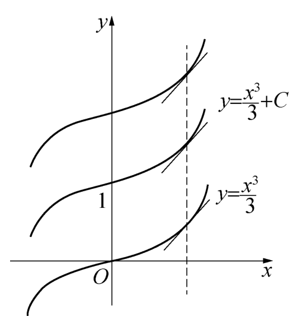

### 三、基本积分公式

由于积分运算是微分运算的逆运算，所以由基本求导公式可以直接得到基本积分公式。

(1) $\int 0\,\mathrm{d}x=C$；

(2) $\int k\,\mathrm{d}x=kx+C$；

(3) $\int x^{\mu}\,\mathrm{d}x=\frac{x^{\mu+1}}{\mu+1}+C\ (\mu\neq-1)$；

(4) $\int\frac{\mathrm{d}x}{x}=\ln|x|+C$；

(5) $\int\frac{\mathrm{d}x}{1+x^2}=\arctan x+C=-\operatorname{arccot} x+C$；

(6) $\int\frac{\mathrm{d}x}{\sqrt{1-x^2}}=\arcsin x+C=-\arccos x+C$；

(7) $\int\cos x\,\mathrm{d}x=\sin x+C$；

(8) $\int\sin x\,\mathrm{d}x=-\cos x+C$；

(9) $\int\sec^2 x\,\mathrm{d}x=\tan x+C$；

(10) $\int\csc^2 x\,\mathrm{d}x=-\cot x+C$；

(11) $\int\sec x\tan x\,\mathrm{d}x=\sec x+C$；

(12) $\int\csc x\cot x\,\mathrm{d}x=-\csc x+C$；

(13) $\int \mathrm{e}^x\,\mathrm{d}x=\mathrm{e}^x+C$；

(14) $\int a^x\,\mathrm{d}x=\frac{a^x}{\ln a}+C$。

### 四、不定积分的性质

**性质 1**（积分与求导的关系）　设函数$f(x)$及$f'(x)$的原函数存在，则

(1) $\frac{\mathrm{d}}{\mathrm{d}x}\left[\int f(x)\,\mathrm{d}x\right]=f(x)$；

(2) $\int f'(x)\,\mathrm{d}x=f(x)+C$。

由此可见，求导运算与不定积分的运算（简称积分运算，以记号$\int$表示）是“互逆”的。

**性质 2**　设函数$f(x)$及$g(x)$的原函数存在，则

$$
\int[\alpha f(x)+\beta g(x)]\,\mathrm{d}x=\alpha\int f(x)\,\mathrm{d}x+\beta\int g(x)\,\mathrm{d}x,
$$

其中$\alpha,\beta$为不全为零常数。

利用上述性质及基本积分公式表，可以求出一些简单函数的不定积分。

**例 6**　求下列不定积分。

(1) $\int\left(x^4+3^x+\frac{2}{x}+2\sin x-3\cos x\right)\mathrm{d}x$；

(2) $\int(1+\sqrt{x})^2\,\mathrm{d}x$；

(3) $\int\frac{(x-1)^3}{x^2}\,\mathrm{d}x$；

(4) $\int\frac{\sqrt{1+x^2}}{\sqrt{1-x^4}}\,\mathrm{d}x$；

(5) $\int\frac{1+x+x^2}{x(1+x^2)}\,\mathrm{d}x$；

(6) $\int\frac{x^4}{1+x^2}\,\mathrm{d}x$；

(7) $\int 2^x\mathrm{e}^x\,\mathrm{d}x$；

(8) $\int\frac{2^x-3^x}{5^x}\,\mathrm{d}x$；

(9) $\int\tan^2 x\,\mathrm{d}x$；

(10) $\int\sin^2\frac{x}{2}\,\mathrm{d}x$；

(11) $\int\frac{1}{\sin^2\frac{x}{2}\cos^2\frac{x}{2}}\,\mathrm{d}x$；

(12) $\int\frac{\cos 2x}{\cos^2 x\sin^2 x}\,\mathrm{d}x$。

解　(1) $\int\left(x^4+3^x+\frac{2}{x}+2\sin x-3\cos x\right)\mathrm{d}x=\int x^4\,\mathrm{d}x+\int 3^x\,\mathrm{d}x+2\int\frac{1}{x}\,\mathrm{d}x+2\int\sin x\,\mathrm{d}x-3\int\cos x\,\mathrm{d}x$

$$
=\frac{1}{5}x^5+\frac{3^x}{\ln 3}+2\ln|x|-2\cos x-3\sin x+C.
$$

**注**　上式中的五个不定积分常数合并为一个任意常数$C$。

(2) 因为$(1+\sqrt{x})^2=1+2\sqrt{x}+x$，故

$$
\int(1+\sqrt{x})^2\,\mathrm{d}x=\int(1+2\sqrt{x}+x^2)\,\mathrm{d}x=\int\mathrm{d}x+2\int x^{\frac{1}{2}}\,\mathrm{d}x+\int x\,\mathrm{d}x=x+\frac{4}{3}x^{\frac{3}{2}}+\frac{1}{2}x^2+C.
$$

**注**　其中$\int 1\,\mathrm{d}x=\int\mathrm{d}x$。

(3) 先将$(x-1)^3$展开，然后利用公式。

$$
\int\frac{(x-1)^3}{x^2}\,\mathrm{d}x=\int\frac{x^3-3x^2+3x-1}{x^2}\,\mathrm{d}x=\int\left(x-3+\frac{3}{x}-\frac{1}{x^2}\right)\mathrm{d}x
=\frac{x^2}{2}-3x+3\ln|x|+\frac{1}{x}+C.
$$

(4) $\displaystyle\int\frac{\sqrt{1+x^2}}{\sqrt{1-x^4}}\,\mathrm{d}x=\int\frac{\sqrt{1+x^2}}{\sqrt{1-x^2}\sqrt{1+x^2}}\,\mathrm{d}x=\int\frac{1}{\sqrt{1-x^2}}\,\mathrm{d}x=\arcsin x+C.$

(5) 将分子重新组合后，分解被积表达式。

$$
\int\frac{1+x+x^2}{x(1+x^2)}\,\mathrm{d}x=\int\frac{x+(1+x^2)}{x(1+x^2)}\,\mathrm{d}x=\int\left(\frac{1}{1+x^2}+\frac{1}{x}\right)\mathrm{d}x
=\arctan x+\ln|x|+C.
$$

(6) 分子部分减一项加一项后，分解被积表达式。

$$
\int\frac{x^4}{1+x^2}\,\mathrm{d}x=\int\frac{x^4-1+1}{1+x^2}\,\mathrm{d}x=\int\frac{(x^2-1)(x^2+1)+1}{1+x^2}\,\mathrm{d}x
=\int\left(x^2-1+\frac{1}{1+x^2}\right)\mathrm{d}x=\frac{x^3}{3}-x+\arctan x+C.
$$

(7) $\int 2^x\mathrm{e}^x\,\mathrm{d}x=\int(2\mathrm{e})^x\,\mathrm{d}x=\frac{(2\mathrm{e})^x}{\ln(2\mathrm{e})}+C=\frac{2^x\mathrm{e}^x}{1+\ln 2}+C.$

(8) $\displaystyle\int\frac{2^x-3^x}{5^x}\,\mathrm{d}x=\int\left[\left(\frac{2}{5}\right)^x-\left(\frac{3}{5}\right)^x\right]\mathrm{d}x=\frac{1}{\ln 2-\ln 5}\left(\frac{2}{5}\right)^x-\frac{1}{\ln 3-\ln 5}\left(\frac{3}{5}\right)^x+C.$

(9) 利用三角函数关系式$\sec^2 x=\tan^2 x+1$。

$$
\int\tan^2 x\,\mathrm{d}x=\int(\sec^2 x-1)\,\mathrm{d}x=\tan x-x+C.
$$

(10) 利用半角公式$\sin^2\frac{x}{2}=\frac{1-\cos x}{2}$。

$$
\int\sin^2\frac{x}{2}\,\mathrm{d}x=\int\frac{1}{2}(1-\cos x)\,\mathrm{d}x=\frac{1}{2}(x-\sin x)+C.
$$

(11) 利用正弦函数的二倍角公式$\sin 2x=2\sin x\cos x$。

$$
\int\frac{1}{\sin^2\frac{x}{2}\cos^2\frac{x}{2}}\,\mathrm{d}x=\int\frac{4}{\sin^2 x}\,\mathrm{d}x=4\int\csc^2 x\,\mathrm{d}x=-4\cot x+C.
$$

(12) 利用余弦函数的二倍角公式$\cos 2x=\cos^2 x-\sin^2 x$。

$$
\int\frac{\cos 2x}{\cos^2 x\sin^2 x}\,\mathrm{d}x=\int\frac{\cos^2 x-\sin^2 x}{\cos^2 x\sin^2 x}\,\mathrm{d}x=\int(\csc^2 x-\sec^2 x)\,\mathrm{d}x
=-\cot x-\tan x+C.
$$

**例 7**　已知$F'(x)=\frac{1+x}{1+\sqrt[3]{x}}$，$F(0)=1$。求满足条件的函数$F(x)$。

解　由立方和公式可知，$1+x=1+(\sqrt[3]{x})^3=(1+\sqrt[3]{x})(1-\sqrt[3]{x}+\sqrt[3]{x^2})$。根据题设条件，有

$$
F(x)=\int F'(x)\,\mathrm{d}x=\int\frac{1+x}{1+\sqrt[3]{x}}\,\mathrm{d}x=\int(1-\sqrt[3]{x}+\sqrt[3]{x^2})\,\mathrm{d}x
=\int 1\,\mathrm{d}x-\int\sqrt[3]{x}\,\mathrm{d}x+\int\sqrt[3]{x^2}\,\mathrm{d}x=x-\frac{3}{4}x^{\frac{4}{3}}+\frac{3}{5}x^{\frac{5}{3}}+C.
$$

又$F(0)=1$，得$C=1$。所以

$$
F(x)=x-\frac{3}{4}x^{\frac{4}{3}}+\frac{3}{5}x^{\frac{5}{3}}+1.
$$

### 习题 3-1

1. 下列等式中成立的是（　　）。

A. $\mathrm{d}\int f(x)\,\mathrm{d}x=f(x)$

B. $\frac{\mathrm{d}}{\mathrm{d}x}\int f(x)\,\mathrm{d}x=f(x)\,\mathrm{d}x$

C. $\frac{\mathrm{d}}{\mathrm{d}x}\int f(x)\,\mathrm{d}x=f(x)+C$

D. $\mathrm{d}\int f(x)\,\mathrm{d}x=f(x)\,\mathrm{d}x$

2. 求下列不定积分：

(1) $\int(x^2+5\sqrt{x}+\ln 3)\,\mathrm{d}x$；

(2) $\int x\sqrt{x}\,\mathrm{d}x$；

(3) $\int\left(1+\frac{1}{x}\right)\mathrm{d}x$；

(4) $\int\left(\frac{2}{x^2}+\frac{3}{1+x^2}\right)\mathrm{d}x$；

(5) $\int\left(x^2+2^x+\frac{2}{x}\right)\mathrm{d}x$；

(6) $\int\left(a^{\frac{2}{3}}+x^{\frac{2}{3}}\right)\mathrm{d}x$；

(7) $\int(2x^3-\sin x+5\sqrt{x})\,\mathrm{d}x$；

(8) $\int\frac{\sqrt{x}-x+x^2\mathrm{e}^x}{x^2}\,\mathrm{d}x$；

(9) $\int(\sqrt{x}+1)(x-\sqrt{x}+1)\,\mathrm{d}x$；

(10) $\int\left(1-\sqrt[3]{x^2}\right)^2\,\mathrm{d}x$；

(11) $\int\frac{x^2}{1+x^2}\,\mathrm{d}x$；

(12) $\int\frac{x^2}{1-x^2}\,\mathrm{d}x$；

(13) $\int\frac{1+2x^2}{x^2(1+x^2)}\,\mathrm{d}x$；

(14) $\int\frac{3x^4+3x^2+1}{x^2+1}\,\mathrm{d}x$；

(15) $\int\frac{1+x}{\sqrt[3]{x}}\,\mathrm{d}x$；

(16) $\int\mathrm{e}^{-x}\left[\mathrm{e}^{2x}-\frac{\mathrm{e}^x(x+1)}{x^2}\right]\mathrm{d}x$；

(17) $\int(2^x+3^x)^2\,\mathrm{d}x$；

(18) $\int\frac{2\cdot3^x-5\cdot2^x}{3^x}\,\mathrm{d}x$；

(19) $\int\left(1-\frac{1}{x^2}\right)\sqrt{x\sqrt{x}}\,\mathrm{d}x$；

(20) $\int\left(\frac{3}{1+x^2}-\frac{2}{\sqrt{1-x^2}}\right)\mathrm{d}x$；

(21) $\int\frac{\cos 2x}{\cos x-\sin x}\,\mathrm{d}x$；

(22) $\int\frac{1+\cos^2 x}{1+\cos 2x}\,\mathrm{d}x$；

(23) $\int\left(\sin\frac{x}{2}+\cos\frac{x}{2}\right)^2\mathrm{d}x$；

(24) $\int\frac{\mathrm{d}x}{\cos^2 x\sin^2 x}$；

(25) $\int\mathrm{e}^{x+2}\,\mathrm{d}x$；

(26) $\int 3^{2x}\mathrm{e}^x\,\mathrm{d}x$。

3. 已知平面曲线$y=f(x)$上任意一点$M(x,y)$处的切线斜率为$k=4x^3-1$，且曲线经过点$P(1,3)$，求该曲线方程。

4. 一曲线上任意一点$(x,y)$处的切线斜率为$\frac{1}{x}-\frac{1}{x^2}$，且$x=1$时，$y=0$，求曲线$y=f(x)$的方程。

5. 一曲线通过$(\mathrm{e}^2,3)$，且在任意一点处的切线的斜率等于该点横坐标的倒数，求该曲线的方程。

6. 已知$f'(x)=1+x^2$，且$f(0)=1$，求$f(x)$。

7. 设函数$F(x)$满足$F'(x)=\frac{\cos 2x}{\sin^2 2x}$，$F\left(\frac{\pi}{4}\right)=-1$，求$F(x)$。

## 第二节 不定积分的换元法与分部法

［课前导读］

本节主要讨论复合函数和乘积函数的积分。在学习换元法和分部法之前，我们要先复习一下本节会用到的微分公式和三角函数的积化和差公式。

微分计算：$k\,\mathrm{d}x=\mathrm{d}(kx)$；$x\,\mathrm{d}x=\mathrm{d}\left(\frac{x^2}{2}\right)$；

$\frac{1}{x}\,\mathrm{d}x=\mathrm{d}(\ln|x|)$；$\mathrm{e}^x\,\mathrm{d}x=\mathrm{d}(\mathrm{e}^x)$；

$\frac{1}{2\sqrt{x}}\,\mathrm{d}x=\mathrm{d}(\sqrt{x})$；$\frac{1}{1+x^2}\,\mathrm{d}x=\mathrm{d}(\arctan x)$；

$\sin x\,\mathrm{d}x=\mathrm{d}(-\cos x)$；$\cos x\,\mathrm{d}x=\mathrm{d}(\sin x)$。

积化和差：$\cos\alpha\cos\beta=\frac{1}{2}[\cos(\alpha+\beta)+\cos(\alpha-\beta)]$；

$\sin\alpha\cos\beta=\frac{1}{2}[\sin(\alpha+\beta)+\sin(\alpha-\beta)]$；

$\sin\alpha\sin\beta=-\frac{1}{2}[\cos(\alpha+\beta)-\cos(\alpha-\beta)]$。

### 一、第一类换元法（凑微分法）

利用上节介绍的不定积分的性质及基本积分公式表，所能计算的不定积分是很有限的，必须进一步研究不定积分的求法。本节把复合函数的微分法反过来用于求不定积分，利用中间变量的代换，得到复合函数的积分法，称为换元积分法，简称换元法。换元法通常分为两类，即第一类换元法与第二类换元法。

**定理 1**　设$f(u)$具有原函数$F(u)$，$u=\varphi(x)$可导，则$F[\varphi(x)]$是$f[\varphi(x)]\varphi'(x)$的原函数，即有换元公式

$$
\int f[\varphi(x)]\varphi'(x)\,\mathrm{d}x=\left[\int f(u)\,\mathrm{d}u\right]_{u=\varphi(x)}.
$$

**证明**　因为$F(u)$是$f(u)$的原函数，故$\int f(u)\,\mathrm{d}u=F(u)+C$。又$u=\varphi(x)$可微，故由复合函数微分法，有$\mathrm{d}u[\varphi(x)]=f[\varphi(x)]\varphi'(x)\,\mathrm{d}x$，

从而由不定积分定义得

$$
\int f[\varphi(x)]\varphi'(x)\,\mathrm{d}x=F[\varphi(x)]+C=\left[\int f(u)\,\mathrm{d}u\right]_{u=\varphi(x)}.
$$

**注**　第一类换元法的关键是在求$\int g(x)\,\mathrm{d}x$时，如何将$g(x)$化为$g(x)=f[\varphi(x)]\varphi'(x)$的形式。其具体做法可按如下步骤进行。

(1) 变换积分形式（或称凑微分），即$\int g(x)\,\mathrm{d}x=\int f[\varphi(x)]\varphi'(x)\,\mathrm{d}x$；

(2) 作变量代换$u=\varphi(x)$，有$\int g(x)\,\mathrm{d}x=\int f(u)\,\mathrm{d}u$；

(3) 利用常用的积分公式求出$f(u)$的原函数$F(u)$，即得$\int f(u)\,\mathrm{d}u=F(u)+C$，从而$\int g(x)\,\mathrm{d}x=F(u)+C$；

(4) 回到原来的变量，将$u=\varphi(x)$代入即得$\int g(x)\,\mathrm{d}x=F[\varphi(x)]+C$。

读者在熟练了这四个步骤以后，也可不必引入中间变量$u=\varphi(x)$。这和我们学习过的复合函数求导法则相类似。请看下面的例题。

**例 1**　求$\int(3x+2)^5\,\mathrm{d}x$。

解　(1) 变换积分形式：因为$3\,\mathrm{d}x=\mathrm{d}(3x)=\mathrm{d}(3x+2)$，所以

$$
\int(3x+2)^5\,\mathrm{d}x=\frac{1}{3}\int(3x+2)^5\cdot3\,\mathrm{d}x=\frac{1}{3}\int(3x+2)^5\,\mathrm{d}(3x+2);
$$

(2) 设变量代换：令$u=3x+2$，得$\mathrm{d}u=\mathrm{d}(3x+2)=3\,\mathrm{d}x$，即有

$$
\int(3x+2)^5\,\mathrm{d}x=\frac{1}{3}\int u^5\,\mathrm{d}u;
$$

(3) 利用基本积分公式求上式右端积分：$\frac{1}{3}\int u^5\,\mathrm{d}u=\frac{1}{3}\cdot\frac{1}{6}u^6+C$，从而

$$
\int(3x+2)^5\,\mathrm{d}x=\frac{1}{18}u^6+C;
$$

(4) 回到原来变量，将$u=3x+2$代入上式，得所求积分为

$$
\int(3x+2)^5\,\mathrm{d}x=\frac{1}{18}(3x+2)^6+C.
$$

一般地，当被积函数形式为$f(ax+b)$时，可作变换$u=ax+b$，即若$f(x)$有原函数$F(x)$，则

$$
\int f(ax+b)\,\mathrm{d}x=\frac{1}{a}F(ax+b)+C.
$$

**例 2**　求不定积分$\int\frac{1}{1+2x}\,\mathrm{d}x$。

解　$\int\frac{1}{1+2x}\,\mathrm{d}x=\frac{1}{2}\int\frac{1}{1+2x}\cdot2\,\mathrm{d}x=\frac{1}{2}\int\frac{1}{1+2x}\cdot(1+2x)'\,\mathrm{d}x$

$$
=\frac{1}{2}\int\frac{1}{1+2x}\mathrm{d}(1+2x)\xrightarrow{1+2x=u}\frac{1}{2}\int\frac{1}{u}\,\mathrm{d}u
=\frac{1}{2}\ln|u|+C\xrightarrow{u=1+2x}\frac{1}{2}\ln|1+2x|+C.
$$

**例 3**　求不定积分：

(1) $\int\frac{\ln x}{x}\,\mathrm{d}x$；

(2) $\int\frac{1}{x\ln x\ln(\ln x)}\,\mathrm{d}x$。

解　(1) 因为$\frac{1}{x}\,\mathrm{d}x=\mathrm{d}(\ln x)$，故

$$
\int\frac{\ln x}{x}\,\mathrm{d}x=\int\ln x\,\mathrm{d}(\ln x)\xrightarrow{\ln x=u}\int u\,\mathrm{d}u=\frac{1}{2}u^2+C\xrightarrow{u=\ln x}\frac{1}{2}\ln^2 x+C.
$$

**注**　$f(\ln x)\frac{1}{x}\,\mathrm{d}x=f(\ln x)\,\mathrm{d}(\ln x)$。

(2) $\int\frac{1}{x\ln x\ln(\ln x)}\,\mathrm{d}x=\int\frac{1}{\ln x\ln(\ln x)}\mathrm{d}(\ln x)$

$$
=\int\frac{1}{\ln(\ln x)}\mathrm{d}[\ln(\ln x)]=\ln|\ln(\ln x)|+C.
$$

**例 4**　求：(1) $\int 2x\sin x^2\,\mathrm{d}x$；

(2) $\int x\sqrt{x^2+3}\,\mathrm{d}x$。

解　(1) $2x\,\mathrm{d}x=(x^2)'\,\mathrm{d}x=\mathrm{d}(x^2)$，故

$$
\int 2x\sin x^2\,\mathrm{d}x=\int\sin x^2\,\mathrm{d}x^2=-\cos x^2+C.
$$

(2) 因为$x\,\mathrm{d}x=\left(\frac{1}{2}x^2\right)'\mathrm{d}x=\frac{1}{2}(x^2)'\mathrm{d}x=\frac{1}{2}\mathrm{d}(x^2)=\frac{1}{2}\mathrm{d}(x^2+3)$，故

$$
\int x\sqrt{x^2+3}\,\mathrm{d}x=\frac{1}{2}\int\sqrt{x^2+3}\,\mathrm{d}(x^2+3)=\frac{1}{3}(x^2+3)^{\frac{3}{2}}+C.
$$

**注**　若$f(x)$有原函数$F(x)$，则

$$
\int f(x^2)2x\,\mathrm{d}x=F(x^2)+C.
$$

**例 5**　求下列不定积分：

(1) $\int\frac{1}{1+\mathrm{e}^x}\,\mathrm{d}x$；

(2) $\int\frac{\sin\frac{1}{x}}{x^2}\,\mathrm{d}x$。

解　(1) 原式$=\int\frac{1+\mathrm{e}^x-\mathrm{e}^x}{1+\mathrm{e}^x}\mathrm{d}x=\int\left(1-\frac{\mathrm{e}^x}{1+\mathrm{e}^x}\right)\mathrm{d}x$

$$
=\int\mathrm{d}x-\int\frac{\mathrm{e}^x}{1+\mathrm{e}^x}\mathrm{d}x=\int\mathrm{d}x-\int\frac{1}{1+\mathrm{e}^x}\mathrm{d}(1+\mathrm{e}^x)
=x-\ln(1+\mathrm{e}^x)+C.
$$

(2) $\int\frac{\sin\frac{1}{x}}{x^2}\mathrm{d}x=\int\sin\left(\frac{1}{x}\right)\cdot\left(-\frac{1}{x}\right)'\mathrm{d}x=-\int\sin\left(\frac{1}{x}\right)\cdot\mathrm{d}\left(\frac{1}{x}\right)=\cos\left(\frac{1}{x}\right)+C.$

**注**　$\int f(\mathrm{e}^x)\mathrm{e}^x\,\mathrm{d}x=\int f(\mathrm{e}^x)\mathrm{d}(\mathrm{e}^x)$；$\int f\left(\frac{1}{x}\right)\frac{1}{x^2}\mathrm{d}x=-\int f\left(\frac{1}{x}\right)\mathrm{d}\left(\frac{1}{x}\right)$。

**例 6**　求：(1) $\int\frac{1}{a^2+x^2}\mathrm{d}x\ (a>0)$；

(2) $\int\frac{1}{\sqrt{a^2-x^2}}\mathrm{d}x\ (a>0)$。

解　(1) $\int\frac{1}{a^2+x^2}\mathrm{d}x=\frac{1}{a^2}\int\frac{1}{1+\left(\frac{x}{a}\right)^2}\mathrm{d}x=\frac{1}{a}\int\frac{1}{1+\left(\frac{x}{a}\right)^2}\mathrm{d}\left(\frac{x}{a}\right)=\frac{1}{a}\arctan\frac{x}{a}+C.$

(2) $\int\frac{1}{\sqrt{a^2-x^2}}\mathrm{d}x=\frac{1}{a}\int\frac{\mathrm{d}x}{\sqrt{1-\left(\frac{x}{a}\right)^2}}=\int\frac{\mathrm{d}\left(\frac{x}{a}\right)}{\sqrt{1-\left(\frac{x}{a}\right)^2}}=\arcsin\frac{x}{a}+C.$

**例 7**　求$\int\frac{1}{x^2-a^2}\mathrm{d}x\ (a>0)$。

解　先作分解：$\frac{1}{x^2-a^2}=\frac{1}{2a}\left(\frac{1}{x-a}-\frac{1}{x+a}\right)$，然后积分。

$$
\int\frac{1}{x^2-a^2}\mathrm{d}x=\int\frac{1}{2a}\left(\frac{1}{x-a}-\frac{1}{x+a}\right)\mathrm{d}x
=\frac{1}{2a}\left[\int\frac{1}{x-a}\mathrm{d}(x-a)-\int\frac{1}{x+a}\mathrm{d}(x+a)\right]
=\frac{1}{2a}(\ln|x-a|-\ln|x+a|)=\frac{1}{2a}\ln\left|\frac{x-a}{x+a}\right|+C.
$$

**例 8**　求不定积分$\int\frac{1}{\sqrt{2x+3}+\sqrt{2x-1}}\mathrm{d}x$。

解　将分母有理化：

原式$=\int\frac{\sqrt{2x+3}-\sqrt{2x-1}}{(\sqrt{2x+3}+\sqrt{2x-1})(\sqrt{2x+3}-\sqrt{2x-1})}\mathrm{d}x=\frac{1}{4}\int(\sqrt{2x+3}-\sqrt{2x-1})\,\mathrm{d}x$

$$
=\frac{1}{4}\int\sqrt{2x+3}\,\mathrm{d}x-\frac{1}{4}\int\sqrt{2x-1}\,\mathrm{d}x
=\frac{1}{8}\int\sqrt{2x+3}\,\mathrm{d}(2x+3)-\frac{1}{8}\int\sqrt{2x-1}\,\mathrm{d}(2x-1)
=\frac{1}{12}(\sqrt{2x+3})^3-\frac{1}{12}(\sqrt{2x-1})^3+C.
$$

**注**　利用平方差公式进行根式有理化是化简积分计算的常用手段之一。

**例 9**　求下列不定积分：

(1) $\int\frac{\mathrm{e}^{3\sqrt{x}}}{\sqrt{x}}\mathrm{d}x$；

(2) $\int\frac{\tan\sqrt{x}}{\sqrt{x}}\mathrm{d}x$。

解　(1) $\int\frac{\mathrm{e}^{3\sqrt{x}}}{\sqrt{x}}\mathrm{d}x=2\int\mathrm{e}^{3\sqrt{x}}\mathrm{d}(\sqrt{x})=\frac{2}{3}\int\mathrm{e}^{3\sqrt{x}}\mathrm{d}(3\sqrt{x})=\frac{2}{3}\mathrm{e}^{3\sqrt{x}}+C$；

(2) $\int\frac{\tan\sqrt{x}}{\sqrt{x}}\mathrm{d}x=2\int\tan\sqrt{x}\,\mathrm{d}(\sqrt{x})=2\int\frac{\sin\sqrt{x}}{\cos\sqrt{x}}\mathrm{d}(\sqrt{x})$

$$
=-2\int\frac{1}{\cos\sqrt{x}}\mathrm{d}(\cos\sqrt{x})=-2\ln|\cos\sqrt{x}|+C.
$$

**注**　$\int f(\sqrt{x})\frac{1}{\sqrt{x}}\mathrm{d}x=2\int f(\sqrt{x})\,\mathrm{d}(\sqrt{x})$。

**例 10**　求$\int\frac{\arctan\sqrt{x}}{\sqrt{x}(1+x)}\mathrm{d}x$。

解　注意到$\mathrm{d}\sqrt{x}=\frac{1}{2\sqrt{x}}\mathrm{d}x$即可。

$$
\int\frac{\arctan\sqrt{x}}{\sqrt{x}(1+x)}\mathrm{d}x=\int\frac{2\arctan\sqrt{x}}{1+(\sqrt{x})^2}\mathrm{d}\sqrt{x}=\int 2\arctan\sqrt{x}\,\mathrm{d}(\arctan\sqrt{x})
=(\arctan\sqrt{x})^2+C.
$$

**例 11**　求不定积分$\int\sin 2x\,\mathrm{d}x$。

解一　原式$=\frac{1}{2}\int\sin 2x\,\mathrm{d}(2x)=-\frac{1}{2}\cos 2x+C$；

解二　原式$=2\int\sin x\cos x\,\mathrm{d}x=2\int\sin x\,\mathrm{d}(\sin x)=(\sin x)^2+C$；

解三　原式$=2\int\sin x\cos x\,\mathrm{d}x=-2\int\cos x\,\mathrm{d}(\cos x)=-(\cos x)^2+C$。

在这里我们可以发现，一个函数的原函数可以有不同的表现形式。

**注**　$f(\sin x)\cos x\,\mathrm{d}x=f(\sin x)\,\mathrm{d}(\sin x)$；

$f(\cos x)\sin x\,\mathrm{d}x=-f(\cos x)\,\mathrm{d}(\cos x)$。

**例 12**　求：(1) $\int\tan x\,\mathrm{d}x$；

(2) $\int\cot x\,\mathrm{d}x$。

解　(1) $\int\tan x\,\mathrm{d}x=\int\frac{\sin x}{\cos x}\mathrm{d}x=-\int\frac{1}{\cos x}\mathrm{d}(\cos x)=-\ln|\cos x|+C.$

(2) 同理可得$\int\cot x\,\mathrm{d}x=\ln|\sin x|+C.$

**例 13**　求：(1) $\int\sin^3 x\,\mathrm{d}x$；

(2) $\int\sin^2 x\cos^3 x\,\mathrm{d}x$；

(3) $\int\cos^2 x\,\mathrm{d}x$；

(4) $\int\sec^4 x\,\mathrm{d}x$。

解　(1) 因为$\sin^3 x=\sin^2 x\cdot\sin x=\sin^2 x\cdot(-\cos x)'=(1-\cos^2 x)\cdot(-\cos x)'$，所以

$$
\int\sin^3 x\,\mathrm{d}x=-\int(1-\cos^2 x)\mathrm{d}(\cos x)=-\cos x+\frac{1}{3}\cos^3 x+C.
$$

(2) 因为$\sin^2 x\cos^3 x=\sin^2 x\cos^2 x\cdot\cos x=\sin^2 x(1-\sin^2 x)\cdot\cos x$，所以

$$
\int\sin^2 x\cos^3 x\,\mathrm{d}x=\int\sin^2 x(1-\sin^2 x)\cdot\cos x\,\mathrm{d}x=\int\sin^2 x(1-\sin^2 x)\mathrm{d}(\sin x)
=\int(\sin^2 x-\sin^4 x)\mathrm{d}(\sin x)
=\frac{1}{3}\sin^3 x-\frac{1}{5}\sin^5 x+C.
$$

(3) $\int\cos^2 x\,\mathrm{d}x=\int\frac{1+\cos 2x}{2}\mathrm{d}x=\int\frac{1}{2}(1+\cos 2x)\mathrm{d}x=\frac{1}{2}\int(1+\cos 2x)\mathrm{d}x$

$$
=\frac{1}{2}\left(x+\frac{1}{2}\sin 2x\right)+C=\frac{1}{2}x+\frac{1}{4}\sin 2x+C.
$$

(4) $\int\sec^4 x\,\mathrm{d}x=\int\sec^2 x\cdot\sec^2 x\,\mathrm{d}x=\int\sec^2 x\,\mathrm{d}(\tan x)=\int(1+\tan^2 x)\mathrm{d}(\tan x)$

$$
=\tan x+\frac{1}{3}\tan^3 x+C.
$$

**例 14**　求：(1) $\int\csc x\,\mathrm{d}x$；

(2) $\int\sec x\,\mathrm{d}x$。

解　(1) $\int\csc x\,\mathrm{d}x=\int\frac{1}{\sin x}\mathrm{d}x=\int\frac{1}{2\sin\frac{x}{2}\cos\frac{x}{2}}\mathrm{d}x$

$$
=\int\frac{1}{2}\cdot\frac{\sec^2\frac{x}{2}}{\tan\frac{x}{2}}\mathrm{d}x=\int\frac{1}{\tan\frac{x}{2}}\mathrm{d}\left(\tan\frac{x}{2}\right)
=\ln\left|\tan\frac{x}{2}\right|+C,
$$

又$\tan\frac{x}{2}=\frac{\sin\frac{x}{2}}{\cos\frac{x}{2}}=\frac{2\sin^2\frac{x}{2}}{\sin x}=\frac{1-\cos x}{\sin x}=\csc x-\cot x$，故

$$
\int\csc x\,\mathrm{d}x=\ln|\csc x-\cot x|+C.
$$

(2) $\int\sec x\,\mathrm{d}x=\int\frac{1}{\cos x}\mathrm{d}x=\int\frac{\mathrm{d}\left(x+\frac{\pi}{2}\right)}{\sin\left(x+\frac{\pi}{2}\right)}$

$$
=\ln\left|\csc\left(x+\frac{\pi}{2}\right)-\cot\left(x+\frac{\pi}{2}\right)\right|+C
=\ln|\sec x+\tan x|+C.
$$

也可用下列方法解决。

$$
\int\sec x\,\mathrm{d}x=\int\frac{1}{\cos x}\mathrm{d}x=\int\frac{\cos x}{1-\sin^2 x}\mathrm{d}x
=\int\frac{1}{2}\left[\frac{1}{1-\sin x}+\frac{1}{1+\sin x}\right]\mathrm{d}(\sin x)=\frac{1}{2}\ln\left|\frac{1+\sin x}{1-\sin x}\right|+C
=\frac{1}{2}\ln\left|\frac{(1+\sin x)^2}{\cos^2 x}\right|+C=\ln\left|\frac{1+\sin x}{\cos x}\right|+C
=\ln|\sec x+\tan x|+C.
$$

**例 15**　求：(1) $\int\cos 3x\cos x\,\mathrm{d}x$；

(2) $\int\sin 3x\cos x\,\mathrm{d}x$。

解　(1) 利用三角函数的积化和差公式

$$
\cos\alpha\cos\beta=\frac{1}{2}[\cos(\alpha+\beta)+\cos(\alpha-\beta)],
$$

可得

$$
\int\cos 3x\cos x\,\mathrm{d}x=\int\frac{1}{2}(\cos 4x+\cos 2x)\,\mathrm{d}x=\frac{1}{2}\left(\frac{1}{4}\sin 4x+\frac{\sin 2x}{2}\right)+C
=\frac{1}{8}\sin 4x+\frac{1}{4}\sin 2x+C.
$$

(2) 利用三角函数的积化和差公式

$$
\sin\alpha\cos\beta=\frac{1}{2}[\sin(\alpha+\beta)+\sin(\alpha-\beta)],
$$

可得

$$
\int\sin 3x\cos x\,\mathrm{d}x=\int\frac{1}{2}(\sin 4x+\sin 2x)\,\mathrm{d}x=\frac{1}{2}\left(-\frac{\cos 4x}{4}-\frac{\cos 2x}{2}\right)+C
=-\frac{\cos 4x}{8}-\frac{\cos 2x}{4}+C.
$$

**注**　第一类换元法也称凑微分法，有时也需要一定的技巧，这需要读者进一步练习。

### 二、第二类换元法

如果在积分$\int f(x)\,\mathrm{d}x$中，令$x=\varphi(t)$，且$\varphi(t)$可导，$\varphi'(t)\neq0$，则有

$$
\int f(x)\,\mathrm{d}x=\int f[\varphi(t)]\varphi'(t)\,\mathrm{d}t.
$$

若上式右端易求出原函数$\Phi(t)$，则得第二类换元积分公式$\int f(x)\,\mathrm{d}x=\Phi[\varphi^{-1}(x)]+C$，其中$\varphi^{-1}(x)$为$x=\varphi(t)$的反函数，即$t=\varphi^{-1}(x)$。

其具体做法可按如下步骤进行。

(1) 变换积分形式，即直接或间接地令$x=\varphi(t)$，且保证$\varphi(t)$可导及$\varphi'(t)\neq0$，于是有

$$
\int f(x)\,\mathrm{d}x=\int f[\varphi(t)]\varphi'(t)\,\mathrm{d}t;
$$

(2) 求出$f[\varphi(t)]\varphi'(t)$的原函数$\Phi(t)$，即得$\int f[\varphi(t)]\varphi'(t)\,\mathrm{d}t=\Phi(t)+C$，从而

$$
\int f(x)\,\mathrm{d}x=\Phi(t)+C;
$$

(3) 回到原来变量，即由$x=\varphi(t)$解出$t=\varphi^{-1}(x)$，从而得所求的积分

$$
\int f(x)\,\mathrm{d}x=\Phi[\varphi^{-1}(x)]+C.
$$

**定理 2**　设$x=\varphi(t)$是可导的函数，且$\varphi'(t)\neq0$，又$f[\varphi(t)]\varphi'(t)$具有原函数$\Phi(t)$，则$\Phi[\varphi^{-1}(x)]$是$f(x)$的原函数，即有换元公式

$$
\int f(x)\,\mathrm{d}x=\Phi[\varphi^{-1}(x)]+C=\left\{\int f[\varphi(t)]\varphi'(t)\,\mathrm{d}t\right\}_{t=\varphi^{-1}(x)}.
$$

**证明**　设$f[\varphi(t)]\varphi'(t)$的原函数为$\Phi(t)$，记$\Phi[\varphi^{-1}(x)]=F(x)$。由于

$$
F'(x)=\frac{\mathrm{d}\Phi}{\mathrm{d}t}\cdot\frac{\mathrm{d}t}{\mathrm{d}x}=f[\varphi(t)]\varphi'(t)\cdot\frac{1}{\varphi'(t)}=f[\varphi(t)]=f(x),
$$

即$F(x)$是$f(x)$的原函数，所以有

$$
\int f(x)\,\mathrm{d}x=F(x)+C=\Phi[\varphi^{-1}(x)]+C=\left\{\int f[\varphi(t)]\varphi'(t)\,\mathrm{d}t\right\}_{t=\varphi^{-1}(x)}.
$$

**例 16**　求$\int\frac{\sqrt{x-1}}{x}\mathrm{d}x$。

解　令$t=\sqrt{x-1}$，则$t^2=x-1$，即$x=t^2+1$，$\mathrm{d}x=2t\,\mathrm{d}t$。

$$
\int\frac{\sqrt{x-1}}{x}\mathrm{d}x=\int\frac{t}{t^2+1}\cdot2t\,\mathrm{d}t=2\int\frac{t^2}{t^2+1}\mathrm{d}t=2\int\left(1-\frac{1}{t^2+1}\right)\mathrm{d}t=2(t-\arctan t)+C
=2(\sqrt{x-1}-\arctan\sqrt{x-1})+C.
$$

**例 17**　求$\int\frac{\mathrm{d}x}{1+\sqrt[3]{x+2}}$。

解　令$\sqrt[3]{x+2}=t$，则$t^3=x+2$，即$x=t^3-2$，$\mathrm{d}x=3t^2\,\mathrm{d}t$。

$$
\int\frac{\mathrm{d}x}{1+\sqrt[3]{x+2}}=\int\frac{3t^2\,\mathrm{d}t}{1+t}=3\int\frac{t^2-1+1}{1+t}\mathrm{d}t=3\int\left(t-1+\frac{1}{1+t}\right)\mathrm{d}t
=3\left(\frac{t^2}{2}-t+\ln|1+t|\right)+C
=\frac{3}{2}\sqrt[3]{(x+2)^2}-3\sqrt[3]{x+2}+3\ln|1+\sqrt[3]{x+2}|+C.
$$

**注**　当被积函数中含有$\sqrt[n]{ax+b}$时，可令$\sqrt[n]{ax+b}=t$。

**例 18**　求$\int\frac{\mathrm{d}x}{(1+\sqrt[3]{x})\sqrt{x}}$。

解　令$\sqrt[6]{x}=t$，则$t^6=x$，即$\mathrm{d}x=6t^5\,\mathrm{d}t$。

$$
\int\frac{\mathrm{d}x}{(1+\sqrt[3]{x})\sqrt{x}}=\int\frac{6t^5\,\mathrm{d}t}{(1+t^2)t^3}=6\int\frac{t^2}{1+t^2}\mathrm{d}t
=6(t-\arctan t)+C=6(\sqrt[6]{x}-\arctan\sqrt[6]{x})+C.
$$

**例 19**　求不定积分$\int\sqrt{4-x^2}\,\mathrm{d}x$。

解　令$x=2\sin t\Rightarrow\mathrm{d}x=2\cos t\,\mathrm{d}t$，$t\in\left(-\frac{\pi}{2},\frac{\pi}{2}\right)$。

$$
\int\sqrt{4-x^2}\,\mathrm{d}x=\int\sqrt{4-4\sin^2 t}\cdot2\cos t\,\mathrm{d}t
=4\int\cos^2 t\,\mathrm{d}t=4\int\frac{1+\cos 2t}{2}\mathrm{d}t
=2\int(1+\cos 2t)\,\mathrm{d}t=2t+\sin 2t+C.
$$

因为$\sin 2t=2\sin t\cos t$，而$\cos t=\sqrt{1-\sin^2 t}$，

又$x=2\sin t$，即$\sin t=\frac{x}{2}$，$t=\arcsin\frac{x}{2}$，从而

$$
\cos t=\sqrt{1-\sin^2 t}=\sqrt{1-\left(\frac{x}{2}\right)^2}=\frac{\sqrt{4-x^2}}{2},
$$

则

$$
\int\sqrt{4-x^2}\,\mathrm{d}x=2t+\sin 2t+C=2t+2\sin t\cos t+C
=2\arcsin\frac{x}{2}+2\cdot\frac{x}{2}\cdot\frac{\sqrt{4-x^2}}{2}+C
=2\arcsin\frac{x}{2}+\frac{x\sqrt{4-x^2}}{2}+C.
$$

**例 20**　求：(1) $\int\frac{\mathrm{d}x}{\sqrt{x^2+9}}$；

(2) $\int\frac{\mathrm{d}x}{\sqrt{x^2-1}}$。

解　(1) 令$x=3\tan t$，$t\in\left(-\frac{\pi}{2},\frac{\pi}{2}\right)$，

$$
\int\frac{\mathrm{d}x}{\sqrt{x^2+9}}=\int\frac{3\sec^2 t\,\mathrm{d}t}{3\sec t}=\int\sec t\,\mathrm{d}t=\ln|\sec t+\tan t|+C.
$$

由$\tan t=\frac{x}{3}$知$\sec t=\sqrt{1+\tan^2 t}=\sqrt{1+\left(\frac{x}{3}\right)^2}=\frac{\sqrt{x^2+9}}{3}$，故

$$
\int\frac{\mathrm{d}x}{\sqrt{x^2+9}}=\ln\left|\frac{\sqrt{x^2+9}}{3}+\frac{x}{3}\right|+C=\ln\left|x+\sqrt{x^2+9}\right|+C.
$$

(2) 令$x=\sec t$，$t\in\left(0,\frac{\pi}{2}\right)$，（设$x>1$，当$x<-1$时同理可证）

$$
\int\frac{\mathrm{d}x}{\sqrt{x^2-1}}=\int\frac{\sec t\tan t}{\tan t}\mathrm{d}t=\int\sec t\,\mathrm{d}t=\ln|\sec t+\tan t|+C
=\ln|x+\sqrt{x^2-1}|+C=\ln\left|x+\sqrt{x^2-1}\right|+C.
$$

一般地，当被积函数中含有$\sqrt{a^2-x^2}$、$\sqrt{x^2\pm a^2}$等因子时，可作三角代换。比如

当被积函数中含有因子$\sqrt{a^2-x^2}$时，可作三角代换：$x=a\sin t$，$t\in\left(-\frac{\pi}{2},\frac{\pi}{2}\right)$；

当被积函数中含有因子$\sqrt{x^2+a^2}$时，可作三角代换：$x=a\tan t$，$t\in\left(-\frac{\pi}{2},\frac{\pi}{2}\right)$；

当被积函数中含有因子$\sqrt{x^2-a^2}$时，可作三角代换：$x=a\sec t$，$t\in\left(0,\frac{\pi}{2}\right)$。

**例 21**　求$\int\frac{\mathrm{d}x}{x^8+x}$。

解　被积函数的分母次数较高，我们通常采取“倒代换”的方法。

令$x=\frac{1}{t}$，则$\mathrm{d}x=-\frac{1}{t^2}\mathrm{d}t$，于是

$$
\int\frac{\mathrm{d}x}{x^8+x}=\int\frac{-\frac{1}{t^2}\mathrm{d}t}{\frac{1}{t^8}+\frac{1}{t}}=-\int\frac{t^6}{1+t^7}\mathrm{d}t=-\frac{1}{7}\int\frac{\mathrm{d}(t^7)}{1+t^7}
=-\frac{1}{7}\ln|1+t^7|+C=-\frac{1}{7}\ln\left|\frac{x^7+1}{x^7}\right|+C.
$$

在本节的例子中，有几个积分的类型是以后经常用到的，通常也可以当作公式使用，于是又多了几个积分公式。（其中$a>0$）

(1) $\int\tan x\,\mathrm{d}x=-\ln|\cos x|+C$；

(2) $\int\cot x\,\mathrm{d}x=\ln|\sin x|+C$；

(3) $\int\sec x\,\mathrm{d}x=\ln|\sec x+\tan x|+C$；

(4) $\int\csc x\,\mathrm{d}x=\ln|\csc x-\cot x|+C$；

(5) $\int\frac{1}{a^2+x^2}\mathrm{d}x=\frac{1}{a}\arctan\frac{x}{a}+C$；

(6) $\int\frac{1}{\sqrt{a^2-x^2}}\mathrm{d}x=\arcsin\frac{x}{a}+C$；

(7) $\int\frac{1}{x^2-a^2}\mathrm{d}x=\frac{1}{2a}\ln\left|\frac{x-a}{x+a}\right|+C$；

(8) $\int\frac{\mathrm{d}x}{\sqrt{x^2\pm a^2}}=\ln\left|x+\sqrt{x^2\pm a^2}\right|+C$。

### 三、分部积分法

分部积分法是针对解决某些被积函数是两类不同函数乘积的不定积分，它是由两个函数的乘积的微分运算法则推得的一种求积分的基本方法。

若$u=u(x)$，$v=v(x)$具有连续导数，则$(uv)'=u'v+uv'$，即$uv'=(uv)'-u'v$。两边积分，得$\int uv'\,\mathrm{d}x=\int(uv)'\mathrm{d}x-\int u'v\,\mathrm{d}x$，即$\int uv'\,\mathrm{d}x=uv-\int u'v\,\mathrm{d}x$，也可写作

$$
\int u\,\mathrm{d}v=uv-\int v\,\mathrm{d}u.
$$

**例 22**　求下列积分：(1) $\int x\cos x\,\mathrm{d}x$；

(2) $\int x^2\mathrm{e}^x\,\mathrm{d}x$。

解　(1) 本题没有基本积分公式可以直接套用，两类换元法也无能为力。本题特点是被积函数为幂函数和三角函数这两类函数的乘积，可用分部积分法求解。

取$u=x$，$\mathrm{d}v=\cos x\,\mathrm{d}x$。

$$
\int x\cos x\,\mathrm{d}x=\int x\,\mathrm{d}(\sin x)=x\sin x-\int\sin x\,\mathrm{d}x=x\sin x+\cos x+C.
$$

**注**　分部积分法的关键是正确选择$u$和$\mathrm{d}v$，并最终使积分$\int v\,\mathrm{d}u$能够求得。本例若改变$u$和$\mathrm{d}v$的选择，设$u=\cos x$，而$\mathrm{d}v=x\,\mathrm{d}x=\mathrm{d}\left(\frac{x^2}{2}\right)$，则

$$
\int x\cos x\,\mathrm{d}x=\int\cos x\,\mathrm{d}\left(\frac{1}{2}x^2\right)=\frac{1}{2}x^2\cos x-\int\frac{1}{2}x^2(-\sin x)\,\mathrm{d}x,
$$

等式右端的积分结果反而比原积分更复杂。

(2) 取$u=x^2$，$\mathrm{d}v=\mathrm{e}^x\,\mathrm{d}x$。

$$
\int x^2\mathrm{e}^x\,\mathrm{d}x=\int x^2\,\mathrm{d}(\mathrm{e}^x)=x^2\mathrm{e}^x-\int\mathrm{e}^x\cdot2x\,\mathrm{d}x=x^2\mathrm{e}^2-2\int x\mathrm{e}^x\,\mathrm{d}x
=x^2\mathrm{e}^2-2\int x\,\mathrm{d}(\mathrm{e}^x)\ (\text{再一次分部积分，取}\ u=x,\ \mathrm{d}v=\mathrm{e}^x\mathrm{d}x)
=x^2\mathrm{e}^x-2\left(x\mathrm{e}^x-\int\mathrm{e}^x\mathrm{d}x\right)
=x^2\mathrm{e}^x-2x\mathrm{e}^x+2\mathrm{e}^x+C.
$$

**注**　从此例可知，通常总是把三角函数和指数函数选作$u$，幂函数选作$u'$。如果需要，可以多次使用分部积分法。

**例 23**　求：(1) $\int\ln x\,\mathrm{d}x$；

(2) $\int x^3\ln x\,\mathrm{d}x$。

解　(1) 取$u=\ln x$，$\mathrm{d}v=\mathrm{d}x$，

$$
\int\ln x\,\mathrm{d}x=x\ln x-\int x\,\mathrm{d}(\ln x)=x\ln x-\int x\cdot\frac{1}{x}\mathrm{d}x=x\ln x-x+C.
$$

(2) 取$u=\ln x$，$\mathrm{d}v=x^3\,\mathrm{d}x$，

$$
\int x^3\ln x\,\mathrm{d}x=\frac{1}{4}\int\ln x\,\mathrm{d}(x^4)=\frac{1}{4}\left(x^4\ln x-\int x^4\cdot\frac{1}{x}\mathrm{d}x\right)
=\frac{1}{4}x^4\ln x-\frac{1}{4}\int x^3\,\mathrm{d}x
=\frac{1}{4}x^4\ln x-\frac{1}{16}x^4+C.
$$

**例 24**　求：(1) $\int\arcsin x\,\mathrm{d}x$；

(2) $\int x\arctan x\,\mathrm{d}x$。

解　(1) 取$u=\arcsin x$，$\mathrm{d}v=\mathrm{d}x$，

$$
\int\arcsin x\,\mathrm{d}x=x\arcsin x-\int x\,\mathrm{d}(\arcsin x)
=x\arcsin x-\int x\cdot\frac{1}{\sqrt{1-x^2}}\mathrm{d}x
=x\arcsin x+\int\frac{1}{2\sqrt{1-x^2}}\mathrm{d}(1-x^2)
=x\arcsin x+\sqrt{1-x^2}+C.
$$

(2) 取$u=\arctan x$，$\mathrm{d}v=x\,\mathrm{d}x=\frac{1}{2}\mathrm{d}(x^2+1)$，

$$
\int x\arctan x\,\mathrm{d}x=\frac{1}{2}\int\arctan x\,\mathrm{d}(x^2+1)
=\frac{1}{2}(x^2+1)\arctan x-\frac{1}{2}\int(x^2+1)\mathrm{d}(\arctan x)
=\frac{1}{2}(x^2+1)\arctan x-\frac{1}{2}\int(x^2+1)\frac{1}{x^2+1}\mathrm{d}x
=\frac{1}{2}(x^2+1)\arctan x-\frac{1}{2}x+C.
$$

**注**　从以上两例可知，通常总是把对数函数和反三角函数选作$u$，幂函数选作$u'$。

**例 25**　求$\int\mathrm{e}^x\sin x\,\mathrm{d}x$。

解　$\int\mathrm{e}^x\sin x\,\mathrm{d}x=\int\sin x\,\mathrm{d}(\mathrm{e}^x)=\mathrm{e}^x\sin x-\int\mathrm{e}^x\,\mathrm{d}(\sin x)$

$$
=\mathrm{e}^x\sin x-\int\mathrm{e}^x\cos x\,\mathrm{d}x=\mathrm{e}^x\sin x-\int\cos x\,\mathrm{d}(\mathrm{e}^x)
=\mathrm{e}^x\sin x-\left[\mathrm{e}^x\cos x-\int\mathrm{e}^x\,\mathrm{d}(\cos x)\right]
=\mathrm{e}^x\sin x-\mathrm{e}^x\cos x-\int\mathrm{e}^x\sin x\,\mathrm{d}x,
$$

将上式右端的$\int\mathrm{e}^x\sin x\,\mathrm{d}x$移到等号的左端，得

$$
2\int\mathrm{e}^x\sin x\,\mathrm{d}x=\mathrm{e}^x(\sin x-\cos x),
$$

故

$$
\int\mathrm{e}^x\sin x\,\mathrm{d}x=\frac{1}{2}\mathrm{e}^x(\sin x-\cos x)+C.
$$

**注**　两次分部积分后，又回到原来的积分，且两式系数不同，可移项得到积分结果，这是在分部积分中一种常用的技巧。除了三角函数和指数函数乘积的不定积分可以采取如此方法，下面的题目也可以。

$^*$**例 26**　求：(1) $\int\sec^3 x\,\mathrm{d}x$；

(2) $\int\cos(\ln x)\,\mathrm{d}x$。

解　(1) $\int\sec^3 x\,\mathrm{d}x=\int\sec x\,\mathrm{d}(\tan x)=\sec x\tan x-\int\tan x\cdot\sec x\tan x\,\mathrm{d}x$

$$
=\sec x\tan x-\int\sec x(\sec^2 x-1)\mathrm{d}x
=\sec x\tan x-\int\sec^3 x\,\mathrm{d}x+\int\sec x\,\mathrm{d}x
=\sec x\tan x+\ln|\sec x+\tan x|-\int\sec^3 x\,\mathrm{d}x.
$$

将上式右端的$\int\sec^3 x\,\mathrm{d}x$移到等号的左端，得

$$
\int \sec^3 x\,\mathrm{d}x = \frac{1}{2}(\sec x\tan x + \ln|\sec x + \tan x|) + C.
$$

（2）$\displaystyle\int \cos(\ln x)\,\mathrm{d}x = x\cos(\ln x) - \int x\cdot\left[-\sin(\ln x)\cdot\frac{1}{x}\right]\mathrm{d}x$

$\displaystyle\qquad\qquad\qquad\quad = x\cos(\ln x) + \int \sin(\ln x)\,\mathrm{d}x$

$\displaystyle\qquad\qquad\qquad\quad = x\cos(\ln x) + x\sin(\ln x) - \int x\cos(\ln x)\cdot\frac{1}{x}\,\mathrm{d}x,$

因此

$$
\int \cos(\ln x)\,\mathrm{d}x = \frac{x}{2}\left[\cos(\ln x) + \sin(\ln x)\right] + C.
$$

在求不定积分的过程中往往要兼用换元法和分部积分法．

**例 27** 求 $\displaystyle\int e^{\sqrt{x}}\,\mathrm{d}x$．

解 令 $t=\sqrt{x}$，则 $x=t^2$，$\mathrm{d}x = 2t\,\mathrm{d}t$，

故

$$
\int e^{\sqrt{x}}\,\mathrm{d}x = 2\int te^t\,\mathrm{d}t = 2e^t(t-1) + C = 2e^{\sqrt{x}}(\sqrt{x}-1) + C.
$$

**例 28** 求不定积分 $\displaystyle\int \ln(1+\sqrt{x})\,\mathrm{d}x$．

解 令 $t=\sqrt{x}$，则 $x=t^2$，

$$
\int \ln(1+\sqrt{x})\,\mathrm{d}x = \int \ln(1+t)\,\mathrm{d}(t^2) = t^2\ln(1+t) - \int t^2\,\mathrm{d}[\ln(1+t)]
= t^2\ln(1+t) - \int \frac{t^2}{1+t}\,\mathrm{d}t
= t^2\ln(1+t) - \int (t-1)\,\mathrm{d}t - \int \frac{\mathrm{d}t}{1+t}
= t^2\ln(1+t) - \frac{t^2}{2} + t - \ln(1+t) + C
= (x-1)\ln(1+\sqrt{x}) + \sqrt{x} - \frac{x}{2} + C.
$$

### 习题 3-2

1．在下列各式等号的右端加上适当的系数，使等式成立．

（1）$\mathrm{d}x = \underline{\qquad\qquad}\ \mathrm{d}(2x)$；

（2）$\mathrm{d}x = \underline{\qquad\qquad}\ \mathrm{d}(5x-2)$；

（3）$x\,\mathrm{d}x = \underline{\qquad\qquad}\ \mathrm{d}(x^3)$；

（4）$x\,\mathrm{d}x = \underline{\qquad\qquad}\ \mathrm{d}(3x^2)$；

（5）$x\,\mathrm{d}x = \underline{\qquad\qquad}\ \mathrm{d}(3-2x^2)$；

（6）$x^3\,\mathrm{d}x = \underline{\qquad\qquad}\ \mathrm{d}(5x^4-2)$；

（7）$e^{2x}\,\mathrm{d}x = \underline{\qquad\qquad}\ \mathrm{d}(e^{2x})$；

（8）$e^{-\frac{x}{3}}\,\mathrm{d}x = \underline{\qquad\qquad}\ \mathrm{d}(1+e^{-\frac{x}{3}})$；

（9）$\sin\frac{3}{4}x\,\mathrm{d}x = \underline{\qquad\qquad}\ \mathrm{d}\left(\cos\frac{3}{4}x\right)$；

（10）$\frac{\mathrm{d}x}{x} = \underline{\qquad\qquad}\ \mathrm{d}(3\ln|x|)$；

（11）$\frac{\mathrm{d}x}{x} = \underline{\qquad\qquad}\ \mathrm{d}(3-5\ln|x|)$；

（12）$\frac{\mathrm{d}x}{1+9x^2} = \underline{\qquad\qquad}\ \mathrm{d}(\arctan 3x)$．

2．用换元法求下列不定积分：

（1）$\displaystyle\int \sin 3x\,\mathrm{d}x$；

（2）$\displaystyle\int \cos 5x\,\mathrm{d}x$；

（3）$\displaystyle\int e^{2-3x}\,\mathrm{d}x$；

（4）$\displaystyle\int \frac{1}{1+x}\,\mathrm{d}x$；

（5）$\displaystyle\int \sqrt{1-2x}\,\mathrm{d}x$；

（6）$\displaystyle\int \frac{1}{\sqrt{2-3x}}\,\mathrm{d}x$；

（7）$\displaystyle\int (1-3x)^9\,\mathrm{d}x$；

（8）$\displaystyle\int \frac{1}{(1-x)^2}\,\mathrm{d}x$；

（9）$\displaystyle\int xe^{x^2}\,\mathrm{d}x$；

（10）$\displaystyle\int x^2\sin x^3\,\mathrm{d}x$；

（11）$\displaystyle\int \frac{x}{3-2x^2}\,\mathrm{d}x$；

（12）$\displaystyle\int \frac{x}{\sqrt{1-x^2}}\,\mathrm{d}x$；

（13）$\displaystyle\int \frac{\ln x}{x}\,\mathrm{d}x$；

（14）$\displaystyle\int \frac{1}{x\ln x}\,\mathrm{d}x$；

（15）$\displaystyle\int \frac{\sin(\ln x)}{x}\,\mathrm{d}x$；

（16）$\displaystyle\int \frac{\cos(\ln x)}{x}\,\mathrm{d}x$；

（17）$\displaystyle\int e^{\sin x}\cos x\,\mathrm{d}x$；

（18）$\displaystyle\int \frac{e^{\frac{1}{x}}}{x^2}\,\mathrm{d}x$；

（19）$\displaystyle\int \sin^3 x\,\mathrm{d}x$；

（20）$\displaystyle\int \cos^4 x\,\mathrm{d}x$；

（21）$\displaystyle\int \frac{1}{4+9x^2}\,\mathrm{d}x$；

（22）$\displaystyle\int \frac{1}{5-x}\,\mathrm{d}x$；

（23）$\displaystyle\int \frac{\arctan x}{1+x^2}\,\mathrm{d}x$；

（24）$\displaystyle\int \frac{\arcsin x}{\sqrt{1-x^2}}\,\mathrm{d}x$；

（25）$\displaystyle\int \frac{1}{1+x^2}e^{\arctan x}\,\mathrm{d}x$；

（26）$\displaystyle\int \frac{1}{\sqrt{1-x^2}\arcsin x}\,\mathrm{d}x$；

（27）$\displaystyle\int \frac{1}{x^2+2x+2}\,\mathrm{d}x$；

（28）$\displaystyle\int \frac{1}{x^2-x+1}\,\mathrm{d}x$；

（29）$\displaystyle\int \frac{1}{x^2+3x+4}\,\mathrm{d}x$；

（30）$\displaystyle\int \frac{1}{x^2+2x+4}\,\mathrm{d}x$；

（31）$\displaystyle\int \frac{6x}{2+3x}\,\mathrm{d}x$；

（32）$\displaystyle\int \frac{x^2}{x+1}\,\mathrm{d}x$；

（33）$\displaystyle\int e^x\sin e^x\,\mathrm{d}x$；

（34）$\displaystyle\int e^x\sqrt{1+e^x}\,\mathrm{d}x$；

（35）$\displaystyle\int \frac{e^{2x}}{1+e^{2x}}\,\mathrm{d}x$；

（36）$\displaystyle\int \frac{e^x}{1+e^{2x}}\,\mathrm{d}x$；

（37）$\displaystyle\int \frac{1}{\sqrt{x}(1+\sqrt{x})}\,\mathrm{d}x$；

（38）$\displaystyle\int \frac{1}{\sqrt{x}(1+x)}\,\mathrm{d}x$；

（39）$\displaystyle\int \frac{1}{\sqrt{16-9x^2}}\,\mathrm{d}x$；

（40）$\displaystyle\int \frac{x+1}{\sqrt{1-x^2}}\,\mathrm{d}x$；

（41）$\displaystyle\int \frac{1}{x^2}\cos\frac{1}{x}\,\mathrm{d}x$；

（42）$\displaystyle\int \frac{e^{\frac{1}{x}}}{x^2}\,\mathrm{d}x$；

（43）$\displaystyle\int \sin 3x\sin 5x\,\mathrm{d}x$；

（44）$\displaystyle\int \sin 3x\cos 4x\,\mathrm{d}x$；

（45）$\displaystyle\int x(5x-1)^{15}\,\mathrm{d}x$；

（46）$\displaystyle\int \frac{x}{(3-x)^7}\,\mathrm{d}x$；

（47）$\displaystyle\int x\sqrt{x-3}\,\mathrm{d}x$；

（48）$\displaystyle\int \frac{\sqrt{x}}{1+x}\,\mathrm{d}x$；

（49）$\displaystyle\int \frac{x^2}{\sqrt[3]{2-x}}\,\mathrm{d}x$；

（50）$\displaystyle\int \frac{1}{1-\sqrt{2x+1}}\,\mathrm{d}x$；

（51）$\displaystyle\int \frac{\sqrt{1-x^2}}{x^2}\,\mathrm{d}x$；

（52）$\displaystyle\int \frac{\sqrt{1-x^2}}{x}\,\mathrm{d}x$；

（53）$\displaystyle\int \frac{\sqrt{x^2-1}}{x}\,\mathrm{d}x$；

（54）$\displaystyle\int \frac{1}{x^2\sqrt{1+x^2}}\,\mathrm{d}x$．

\*3．用换元法计算下列不定积分：

（1）$\displaystyle\int \frac{x}{(1+x)^3}\,\mathrm{d}x$；

（2）$\displaystyle\int \frac{x+2}{x^2+3x+4}\,\mathrm{d}x$；

（3）$\displaystyle\int \left(1-\frac{1}{x^2}\right)e^{x+\frac{1}{x}}\,\mathrm{d}x$；

（4）$\displaystyle\int \sqrt{\frac{\ln\left(x+\sqrt{1+x^2}\right)}{1+x^2}}\,\mathrm{d}x$；

（5）$\displaystyle\int \frac{\sin x+\cos x}{\sqrt[3]{\sin x-\cos x}}\,\mathrm{d}x$；

（6）$\displaystyle\int \frac{\cos x}{\sqrt{2+\cos 2x}}\,\mathrm{d}x$；

（7）$\displaystyle\int \frac{x^2-1}{x^4+1}\,\mathrm{d}x$；

（8）$\displaystyle\int \frac{1}{1-x^2}\ln\frac{1+x}{1-x}\,\mathrm{d}x$；

（9）$\displaystyle\int \frac{\sqrt{x+2}}{1+\sqrt{x+2}}\,\mathrm{d}x$；

（10）$\displaystyle\int \sqrt{5-4x-x^2}\,\mathrm{d}x$．

4．用分部积分法求下列不定积分：

（1）$\displaystyle\int x\ln x\,\mathrm{d}x$；

（2）$\displaystyle\int \frac{\ln x}{x^2}\,\mathrm{d}x$；

（3）$\displaystyle\int xe^{-x}\,\mathrm{d}x$；

（4）$\displaystyle\int x^2e^{2x}\,\mathrm{d}x$；

（5）$\displaystyle\int x\sin x\,\mathrm{d}x$；

（6）$\displaystyle\int x\sin 2x\,\mathrm{d}x$；

（7）$\displaystyle\int x^2\cos x\,\mathrm{d}x$；

（8）$\displaystyle\int x\cos 3x\,\mathrm{d}x$；

（9）$\displaystyle\int \frac{x}{\cos^2 x}\,\mathrm{d}x$；

（10）$\displaystyle\int (x-1)5^x\,\mathrm{d}x$；

（11）$\displaystyle\int \arcsin x\,\mathrm{d}x$；

（12）$\displaystyle\int \arctan\sqrt{x}\,\mathrm{d}x$；

（13）$\displaystyle\int \frac{\arcsin\sqrt{x}}{\sqrt{x}}\,\mathrm{d}x$；

（14）$\displaystyle\int (\arcsin x)^2\,\mathrm{d}x$；

（15）$\displaystyle\int e^{-x}\sin x\,\mathrm{d}x$；

（16）$\displaystyle\int \ln\left(x+\sqrt{1+x^2}\right)\mathrm{d}x$；

（17）$\displaystyle\int \frac{\arcsin\sqrt{x}}{\sqrt{1-x}}\,\mathrm{d}x$；

（18）$\displaystyle\int \frac{x\arctan x}{\sqrt{1+x^2}}\,\mathrm{d}x$；

（19）$\displaystyle\int x\sin^2 x\,\mathrm{d}x$；

（20）$\displaystyle\int e^{-x}\sin 2x\,\mathrm{d}x$；

（21）$\displaystyle\int \ln(1+\sqrt[3]{x})\,\mathrm{d}x$；

（22）$\displaystyle\int \sin(\ln x)\,\mathrm{d}x$．

5．已知 $f(x)$ 的一个原函数是 $e^{-x^2}$，求 $\displaystyle\int xf'(x)\,\mathrm{d}x$．

6．利用分部积分法计算 $\displaystyle\int \frac{x^2e^x}{(x+2)^2}\,\mathrm{d}x$．

## ＊第三节 有理函数的不定积分

**[课前导读]**

这一节要讲述有理函数（可化为有理函数）的积分，在此之前我们需要一些多项式的知识．对积分要求较高的专业可选学此节内容．

**有理函数：**有理函数是指由两个多项式的商所表示的函数，例如

$$
\frac{x-1}{1+x^2},\quad \frac{x^3}{1-x},\quad \frac{x^2}{x^3-x^2+x-1}.
$$

都是有理函数，其中$\frac{x-1}{1+x^2}$、$\frac{x^2}{x^3-x^2+x-1}$称为真分式，$\frac{x^3}{1-x^2}$称为假分式．利用多项式的除法，可将一个假分式化为一个多项式和一个真分式之和的形式，比如

$$
\frac{x^3}{1-x} = \frac{x^3-1+1}{1-x} = \frac{(x-1)(x^2+x+1)+1}{1-x} = -(x^2+x+1) + \frac{1}{1-x}.
$$

**最简分式：**下列四类分式称为最简分式，其中$n$为大于或等于$2$的正整数，$A$、$M$、$N$、$a$、$p$、$q$均为常数，且$x^2+px+q$为二次质因式．

（1）$\dfrac{A}{x-a}$；　（2）$\dfrac{A}{(x-a)^n}$；　（3）$\dfrac{Mx+N}{x^2+px+q}$；　（4）$\dfrac{Mx+N}{(x^2+px+q)^n}$．

### 一、真分式的分解

如果一个真分式的分母不是质因式，我们总可以通过因式分解把它写成一次因式或二次质因式的乘积，进而把真分式表示成最简分式的和．

**例 1** 把分式$\frac{x+3}{x^2-5x+6}$分解为最简分式之和．

解　$\displaystyle\frac{x+3}{x^2-5x+6} = \frac{x+3}{(x-2)(x-3)} = \frac{A}{x-2} + \frac{B}{x-3} = \frac{A(x-3)+B(x-2)}{(x-2)(x-3)}$，

其中$A$和$B$为待定的系数．

比较分子部分$x+3 = A(x-3)+B(x-2) = (A+B)x - (3A+2B)$，得

$$
\begin{cases}
A+B=1, \\
-(3A+2B)=3,
\end{cases}
$$

故$A=-5$，$B=6$．因此

$$
\frac{x+3}{x^2-5x+6} = -\frac{5}{x-2} + \frac{6}{x-3}.
$$

**例 2** 把分式$\frac{1}{x(x-1)^2}$分解为最简分式之和．

解　$\displaystyle\frac{1}{x(x-1)^2} = \frac{A}{x} + \frac{B}{(x-1)^2} + \frac{C}{x-1} = \frac{A(x-1)^2+Bx+Cx(x-1)}{x(x-1)^2}$，

比较分子部分　　　　　　　　$1 = A(x-1)^2 + Bx + Cx(x-1)$，

令$x=0$，得$A=1$；令$x=1$，得$B=1$；将$A=1$，$B=1$及$x=2$代入上式得$C=-1$．

因此

$$
\frac{1}{x(x-1)^2} = \frac{1}{x} + \frac{1}{(x-1)^2} - \frac{1}{x-1}.
$$

**例 3** 分解有理分式$\frac{1}{(1+2x)(1+x^2)}$．

解　设$\displaystyle\frac{1}{(1+2x)(1+x^2)} = \frac{A}{1+2x} + \frac{Bx+C}{1+x^2}$，

从而得

$$
1 = A(1+x^2) + (Bx+C)(1+2x),
$$

整理得

$$
1 = (A+2B)x^2 + (B+2C)x + C + A,
$$

即$A+2B=0$，$B+2C=0$，$A+C=1$，

计算得$A=\frac{4}{5}$，$B=-\frac{2}{5}$，$C=\frac{1}{5}$，

从而

$$
\frac{1}{(1+2x)(1+x^2)} = \frac{\frac{4}{5}}{1+2x} + \frac{-\frac{2}{5}x+\frac{1}{5}}{1+x^2}.
$$

### 二、有理函数的不定积分

**例 4** 求$\displaystyle\int \frac{x+3}{x^2-5x+6}\,\mathrm{d}x$．

解　由于$\frac{x+3}{x^2-5x+6} = -\frac{5}{x-2} + \frac{6}{x-3}$，故

$$
\int \frac{x+3}{x^2-5x+6}\,\mathrm{d}x = -5\int \frac{\mathrm{d}x}{x-2} + 6\int \frac{\mathrm{d}x}{x-3} = -5\ln|x-2| + 6\ln|x-3| + C.
$$

**例 5** 求$\displaystyle\int \frac{x-2}{x^2+2x+3}\,\mathrm{d}x$．

解　由于$x-2 = \frac{1}{2}(2x+2) - 3$，故

$$
\frac{x-2}{x^2+2x+3} = \frac{1}{2}\cdot\frac{2x+2}{x^2+2x+3} - 3\cdot\frac{1}{(x+1)^2+(\sqrt{2})^2}.
\int \frac{x-2}{x^2+2x+3}\,\mathrm{d}x = \frac{1}{2}\int \frac{2x+2}{x^2+2x+3}\,\mathrm{d}x - 3\int \frac{\mathrm{d}x}{(x+1)^2+(\sqrt{2})^2}
= \frac{1}{2}\int \frac{\mathrm{d}(x^2+2x+3)}{x^2+2x+3} - 3\int \frac{\mathrm{d}(x+1)}{(x+1)^2+(\sqrt{2})^2}
= \frac{1}{2}\ln|x^2+2x+3| - \frac{3}{\sqrt{2}}\arctan\frac{x+1}{\sqrt{2}} + C.
$$

**例 6** 求$\displaystyle\int \frac{1}{x(x-1)^2}\,\mathrm{d}x$．

解　由于$\frac{1}{x(x-1)^2} = \frac{1}{x} + \frac{1}{(x-1)^2} - \frac{1}{x-1}$，

故　　　　　$\displaystyle\int \frac{\mathrm{d}x}{x(x-1)^2} = \int \frac{1}{x}\,\mathrm{d}x + \int \frac{1}{(x-1)^2}\,\mathrm{d}x - \int \frac{1}{x-1}\,\mathrm{d}x$

$$
\qquad = \ln|x| - \frac{1}{x-1} - \ln|x-1| + C.
$$

**例 7** 求$\displaystyle\int \frac{1}{(1+2x)(1+x^2)}\,\mathrm{d}x$．

解　由于$\displaystyle\frac{1}{(1+2x)(1+x^2)} = \frac{4}{5}\cdot\frac{1}{1+2x} + \left(-\frac{2}{5}x+\frac{1}{5}\right)\cdot\frac{1}{1+x^2}$

$$
= \frac{2}{5}\cdot\frac{2}{1+2x} - \frac{1}{5}\cdot\frac{2x}{1+x^2} + \frac{1}{5}\cdot\frac{1}{1+x^2},
$$

故　　　　　$\displaystyle\int \frac{1}{(1+2x)(1+x^2)}\,\mathrm{d}x = \frac{2}{5}\int \frac{2}{1+2x}\,\mathrm{d}x - \frac{1}{5}\int \frac{2x}{1+x^2}\,\mathrm{d}x + \frac{1}{5}\int \frac{1}{1+x^2}\,\mathrm{d}x$

$$
\qquad = \frac{2}{5}\ln|1+2x| - \frac{1}{5}\ln(1+x^2) + \frac{1}{5}\arctan x + C.
$$

### 三、三角函数的有理式的不定积分

**例 8** 求不定积分$\displaystyle\int \frac{1}{3\sin x+4\cos x}\,\mathrm{d}x$．

解　令$u=\tan\frac{x}{2}\ (-\pi<x<\pi)$，则$\sin x = \frac{2u}{1+u^2}$，$\cos x = \frac{1-u^2}{1+u^2}$，$\mathrm{d}x = \frac{2\,\mathrm{d}u}{1+u^2}$，

$$
\text{原式} = \int \frac{\dfrac{2}{1+t^2}\,\mathrm{d}t}{3\cdot\dfrac{2t}{1+t^2}+4\cdot\dfrac{1-t^2}{1+t^2}} = \int \frac{2\,\mathrm{d}t}{4+6t-4t^2}
= \int \frac{\mathrm{d}t}{(2t+1)(2-t)} = \frac{1}{5}\int \left(\frac{2}{2t+1}+\frac{1}{2-t}\right)\mathrm{d}t
= \frac{1}{5}\ln\left|\frac{2t+1}{2-t}\right| + C = \frac{1}{5}\ln\left|\frac{2\tan\frac{x}{2}+1}{2-\tan\frac{x}{2}}\right| + C.
$$

这里所用的变量代换$u=\tan\frac{x}{2}$对三角函数的有理式都可以应用，因此也称它为万能置换．

**例 9** 求不定积分$\displaystyle\int \frac{1}{\sin^4 x}\,\mathrm{d}x$．

解一　利用万能置换公式，

$$
\sin x = \frac{2u}{1+u^2},\quad \cos x = \frac{1-u^2}{1+u^2},\quad \mathrm{d}x = \frac{2}{1+u^2}\,\mathrm{d}u,
\text{原式} = \int \frac{1+3u^2+3u^4+u^6}{8u^4}\,\mathrm{d}u = \frac{1}{8}\left(-\frac{1}{3u^3}-\frac{3}{u}+3u+\frac{u^3}{3}\right) + C
= -\frac{1}{24\left(\tan\frac{x}{2}\right)^3} - \frac{3}{8\tan\frac{x}{2}} + \frac{3}{8}\tan\frac{x}{2} + \frac{1}{24}\left(\tan\frac{x}{2}\right)^3 + C.
$$

解二　修改万能置换公式，令$u=\tan x$，

$$
\sin x = \frac{u}{\sqrt{1+u^2}},\quad \cos x = \frac{1}{\sqrt{1+u^2}},\quad \mathrm{d}x = \frac{1}{1+u^2}\,\mathrm{d}u,
\text{原式} = \int \frac{1}{\left(\dfrac{u}{\sqrt{1+u^2}}\right)^4}\cdot\frac{1}{1+u^2}\,\mathrm{d}u = \int \frac{1+u^2}{u^4}\,\mathrm{d}u = -\frac{1}{3u^3}-\frac{1}{u}+C = -\frac{1}{3}\cot^3 x - \cot x + C.
$$

解三　不用万能置换公式，

$$
\text{原式} = \int \csc^2 x(1+\cot^2 x)\,\mathrm{d}x = \int \csc^2 x\,\mathrm{d}x + \int \cot^2 x\csc^2 x\,\mathrm{d}x = -\frac{1}{3}\cot^3 x - \cot x + C.
$$

比较以上三种解法，便知万能置换不一定是最佳方法，故三角函数有理式的计算中先考虑其他手段，不得已才用万能置换．

### 四、可化为有理函数的简单无理根式的不定积分

考虑下列形式的简单无理根式的不定积分：

$$
\int f\left(x,\sqrt[n]{\frac{ax+b}{cx+d}}\right)\mathrm{d}x.
$$

令$\sqrt[n]{\frac{ax+b}{cx+d}}=t$，这样上述形式的简单无理根式的不定积分可化为有理函数的不定积分．

**例 10** 求$\displaystyle\int \frac{1}{x}\sqrt{\frac{1+x}{x}}\,\mathrm{d}x$．

解　令$\sqrt{\frac{1+x}{x}}=t$，则$t^2=\frac{1+x}{x}$，即$x=\frac{1}{t^2-1}$，$\mathrm{d}x=-\frac{2t\,\mathrm{d}t}{(t^2-1)^2}$，

$$
\int \frac{1}{x}\sqrt{\frac{1+x}{x}}\,\mathrm{d}x = \int (t^2-1)t\cdot\frac{-2t}{(t^2-1)^2}\,\mathrm{d}t = -2\int\frac{t^2}{t^2-1}\,\mathrm{d}t = -2\int\left(1+\frac{1}{t^2-1}\right)\mathrm{d}t
= -2t-\ln\left|\frac{t-1}{t+1}\right|+C = -2t+2\ln(t+1)-\ln|t^2-1|+C
= -2\sqrt{\frac{1+x}{x}} + 2\ln\left(\sqrt{\frac{1+x}{x}}+1\right)+\ln|x|+C.
$$

除了上述基本换元形式外，应根据所给被积函数的特点，进行适当的变量替换，转化为便于求不定积分的形式．

**例 11** 求$\displaystyle\int \frac{1}{\sqrt{e^x+1}}\,\mathrm{d}x$．

解　令$\sqrt{e^x+1}=t$，则$x=\ln(t^2-1)$，$\mathrm{d}x=\frac{2t\,\mathrm{d}t}{t^2-1}$，于是

$$
\int \frac{1}{\sqrt{e^x+1}}\,\mathrm{d}x = \int \frac{1}{t}\cdot\frac{2t}{t^2-1}\,\mathrm{d}t = \int \frac{2}{t^2-1}\,\mathrm{d}t
= \int\left(\frac{1}{t-1}-\frac{1}{t+1}\right)\mathrm{d}t = \int\frac{1}{t-1}\,\mathrm{d}(t-1) - \int\frac{1}{t+1}\,\mathrm{d}(t+1)
= \ln|t-1|-\ln|t+1|+C = \ln\left|\frac{t-1}{t+1}\right|+C
= \ln\left|\frac{\sqrt{e^x+1}-1}{\sqrt{e^x+1}+1}\right|+C.
$$

### 习题 3-3

1．求下列有理函数的积分．

（1）$\displaystyle\int \frac{1}{x(x-3)}\,\mathrm{d}x$；

（2）$\displaystyle\int \frac{1}{x^2-4}\,\mathrm{d}x$；

（3）$\displaystyle\int \frac{2x+1}{x^2+2x-15}\,\mathrm{d}x$；

（4）$\displaystyle\int \frac{1}{4x^2+4x+10}\,\mathrm{d}x$；

（5）$\displaystyle\int \frac{x-2}{x^2+2x+3}\,\mathrm{d}x$；

（6）$\displaystyle\int \frac{1}{x(x^2+1)}\,\mathrm{d}x$；

（7）$\displaystyle\int \frac{x}{x^3-1}\,\mathrm{d}x$；

（8）$\displaystyle\int \frac{1}{x^4-1}\,\mathrm{d}x$；

（9）$\displaystyle\int \frac{2x-5}{(x-1)^2(x+2)}\,\mathrm{d}x$；

（10）$\displaystyle\int \frac{x^3+2x^2+12x+11}{x^2+2x+10}\,\mathrm{d}x$；

（11）$\displaystyle\int \frac{x^2+x}{(x-2)^2}\,\mathrm{d}x$；

（12）$\displaystyle\int \frac{x^4}{(1+x^2)^2}\,\mathrm{d}x$．

2．求下列三角函数有理式的积分．

（1）$\displaystyle\int \frac{1}{3+5\cos x}\,\mathrm{d}x$；

（2）$\displaystyle\int \cos^5 x\,\mathrm{d}x$；

（3）$\displaystyle\int \sin^2 x\cos^4 x\,\mathrm{d}x$；

（4）$\displaystyle\int \frac{\sin^3 x}{\cos^4 x}\,\mathrm{d}x$；

（5）$\displaystyle\int \frac{\sin^5 x}{\cos^4 x}\,\mathrm{d}x$；

（6）$\displaystyle\int \cos 4x\cos 6x\,\mathrm{d}x$；

（7）$\displaystyle\int \frac{1}{1+\sin x}\,\mathrm{d}x$；

（8）$\displaystyle\int \frac{1+\sin x}{1+\cos x}\,\mathrm{d}x$；

（9）$\displaystyle\int \frac{\sin x}{\sin^2 x+5\cos^2 x}\,\mathrm{d}x$；

（10）$\displaystyle\int \frac{1+\tan x}{\sin 2x}\,\mathrm{d}x$．

3．求下列无理函数的不定积分．

（1）$\displaystyle\int \frac{1}{x}\sqrt{\frac{x+1}{x-1}}\,\mathrm{d}x$；

（2）$\displaystyle\int \frac{\mathrm{d}x}{\sqrt{(x-a)(b-x)}}\ (a\neq b)$；

（3）$\displaystyle\int \frac{\mathrm{d}x}{\sqrt{1+e^x}}$；

（4）$\displaystyle\int \frac{\ln x}{x\sqrt{1+\ln x}}\,\mathrm{d}x$；

（5）$\displaystyle\int \frac{\mathrm{d}x}{\sqrt[3]{(x-1)(x+1)^2}}$；

（6）$\displaystyle\int \frac{1}{\sqrt{x+1}+\sqrt[3]{x+1}}\,\mathrm{d}x$；

（7）$\displaystyle\int \frac{\mathrm{d}x}{\sqrt{1+x-x^2}}$．

## 第四节 定积分的概念与性质

**[课前导读]**

本章要介绍的定积分起源于求图形的面积和体积等实际问题．古希腊的阿基米德用“穷竭法”，我国的刘徽用“割圆术”，都曾计算过一些几何体的面积和体积，这些均为定积分的雏形．直到$17$世纪中叶，牛顿和莱布尼茨先后提出了定积分的概念，并发现了积分与微分之间的内在联系，给出了计算定积分的一般方法，从而使定积分成为解决有关实际问题的有力工具，并使各自独立的微分学与积分学联系在一起，构成完整的理论体系——微积分学．

### 一、实例分析

在平面几何中，我们会计算三角形、矩形、梯形等由直线围成的图形的面积，以及圆、椭圆、扇形等特殊曲线所围成图形的面积．

现在我们来计算由曲线$y=x^2$、$x$轴和直线$x=1$所围平面图形的面积（见图 3-2），这样的图形称为曲边梯形．

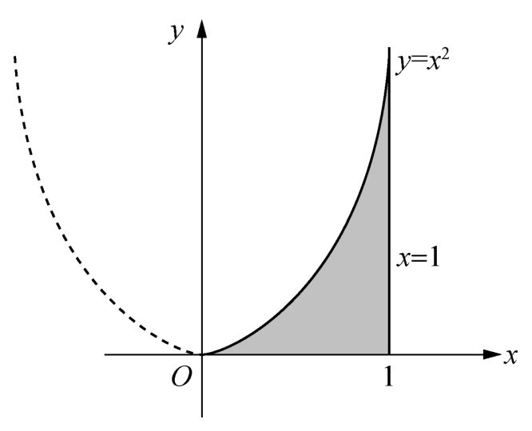

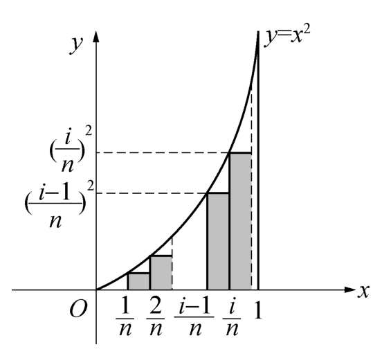

将区间$[0,1]$作$n$等分，分点分别为$\frac{1}{n}$，$\frac{2}{n}$，$\cdots$，$\frac{n-1}{n}$，过这些分点作平行于$y$轴的直线，把平面图形分割成$n$个小窄条，每个小窄条都是小的曲边梯形，但是我们仍无法用初等数学的方法求得它们的面积．现在分别以$y=x^2$分点上的值

$$
0,\ \left(\frac{1}{n}\right)^2,\ \left(\frac{2}{n}\right)^2,\ \cdots,\ \left(\frac{i}{n}\right)^2,\ \cdots,\ \left(\frac{n-1}{n}\right)^2
$$

为高，以$\frac{1}{n}$为底作$n$个小矩形，则可用每个小矩形的面积近似替代作为对应的小窄边梯形的面积$\Delta A_i(i=1,2,3,\cdots,n)$（见图 3-3），即

$$
\Delta A_1 \approx \frac{1}{n}\cdot\left(\frac{0}{n}\right)^2,\ \Delta A_2 \approx \frac{1}{n}\cdot\left(\frac{1}{n}\right)^2,\ \cdots,\ \Delta A_i \approx \frac{1}{n}\cdot\left(\frac{i-1}{n}\right)^2,\ \cdots,\ \Delta A_n \approx \frac{1}{n}\cdot\left(\frac{n-1}{n}\right)^2.
$$

于是，整个曲边梯形的面积$A$的近似值为

$$
A = \Delta A_1+\Delta A_2+\cdots+\Delta A_i+\cdots+\Delta A_n
\approx \frac{1}{n}\cdot\left(\frac{0}{n}\right)^2+\frac{1}{n}\cdot\left(\frac{1}{n}\right)^2+\cdots+\frac{1}{n}\cdot\left(\frac{i-1}{n}\right)^2+\cdots+\frac{1}{n}\cdot\left(\frac{n-1}{n}\right)^2
= \frac{1}{n^3}\cdot\sum_{i=1}^{n}(i-1)^2 = \frac{1}{n^3}\cdot\frac{1}{6}n(n-1)(2n-1).
$$

当这些分点无限增加，即$n\to\infty$时，这个近似值的极限就是曲边梯形面积的精确值

$$
A = \lim_{n\to\infty}\frac{1}{n^3}\sum_{i=1}^{n}(i-1)^2 = \lim_{n\to\infty}\frac{1}{n^3}\cdot\frac{n(n-1)(2n-1)}{6}
= \lim_{n\to\infty}\frac{1}{6}\left(1-\frac{1}{n}\right)\left(2-\frac{1}{n}\right) = \frac{2}{6} = \frac{1}{3}.
$$

一般地，设函数$y=f(x)$在区间$[a,b]$上非负且连续，由曲线$y=f(x)$及直线$x=a$，$x=b$和$y=0$四条线围成的平面图形$AabB$称为曲边梯形（见图 3-4）．为求其面积，可采取以下步骤．

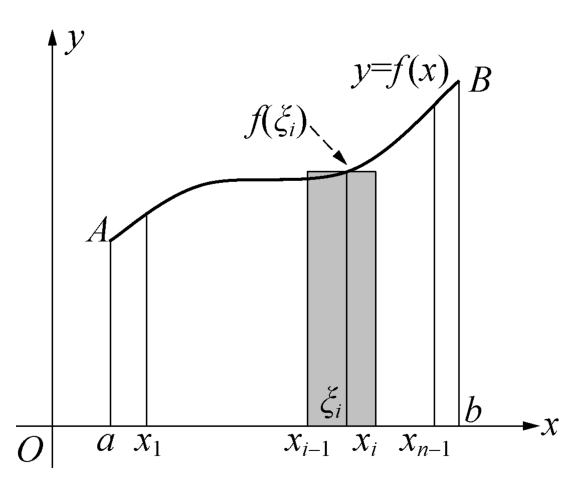

第一步“分割”．在区间$[a,b]$上任意插入$n-1$个分点$x_1$，$x_2$，$\cdots$，$x_{n-1}$，将$[a,b]$分成$n$个小区间$[x_0,x_1]$，$[x_1,x_2]$，$\cdots$，$[x_{i-1},x_i]$，$\cdots$，$[x_{n-1},x_n]$，其中$a=x_0<x_1<x_2<\cdots<x_{n-1}<x_n=b$，且每个小区间的长度为$\Delta x_i=x_i-x_{i-1}(i=1,2,\cdots,n)$；相应地，把曲边梯形$AabB$分为$n$个小曲边梯形．

第二步“以直代曲近似”．在每个小区间$[x_{i-1},x_i]$内任取一点$\xi_i(i=1,2,\cdots,n)$，并以$\Delta x_i$为底边，$f(\xi_i)$为高作小矩形，其面积用$\Delta S_i$表示，则有$\Delta S_i=f(\xi_i)\Delta x_i$，且当$\Delta x_i$很小时，有$\Delta S_i\approx\Delta A_i(i=1,2,\cdots,n)$．

第三步“求和”．设小矩形面积的总和为$S_n$，则$\displaystyle S_n=\sum_{i=1}^{n}\Delta S_i=\sum_{i=1}^{n}f(\xi_i)\Delta x_i$，此为曲边梯形面积的近似值．

第四步“取极限”．如果用$\lambda=\max\limits_{1\le i\le n}\{|\Delta x_i|\}$表示所有小区间中的最大区间长度，当分点数$n$无限增大且$\lambda$趋于零时，$S_n$便趋近于曲边梯形$AabB$的面积$S$，即

$$
S = \lim_{\lambda\to 0}\sum_{i=1}^{n}f(\xi_i)\Delta x_i.
$$

由上述曲边梯形的求解过程，可以给出定积分的定义．

### 二、定积分的定义

**定义**　设函数$f(x)$在$[a,b]$上有界，在区间$[a,b]$上任意插入$n-1$个点

$$
a=x_0<x_1<x_2<\cdots<x_{i-1}<x_i<\cdots<x_n=b,
$$

得到$n$个小区间$[x_0,x_1]$，$[x_1,x_2]$，$\cdots$，$[x_{i-1},x_i]$，$\cdots$，$[x_{n-1},x_n]$，对应的区间长度分别为

$$
\Delta x_1=x_1-x_0,\ \Delta x_2=x_2-x_1,\ \cdots,\ \Delta x_i=x_i-x_{i-1},\ \cdots,\ \Delta x_n=x_n-x_{n-1},
$$

记$\lambda=\max\limits_{1\le i\le n}\{|\Delta x_i|\}$，在每个小区间$[x_{i-1},x_i](i=1,2,\cdots,n)$上任取一点$\xi_i(x_{i-1}\le\xi_i\le x_i)(i=1,2,\cdots,n)$，作和$\displaystyle\sum_{i=1}^{n}f(\xi_i)\Delta x_i$，如果不论分法如何、$\xi_i$如何选取，总有

$$
\lim_{\lambda\to 0}\sum_{i=1}^{n}f(\xi_i)\Delta x_i=I\ (I\text{为常数}),
$$

则称$I$为$f(x)$在$[a,b]$上的定积分（简称积分），记作

$$
I = \int_a^b f(x)\,\mathrm{d}x,
$$

即

$$
\int_a^b f(x)\,\mathrm{d}x = \lim_{\lambda\to 0}\sum_{i=1}^{n}f(\xi_i)\Delta x_i.
$$

其中，$x$称为积分变量，$[a,b]$称为积分区间，$a$，$b$分别称为积分的下限和上限，$f(x)$为被积函数，$f(x)\mathrm{d}x$为被积表达式．

对于定积分的定义，还应注意以下几点：

（1）在上述定义中，分法是任意的，$\xi_i$的选取是任意的．

（2）定积分是一种和式的极限，其值是一个实数，它的大小仅与被积函数$f(x)$和积分区间$[a,b]$有关，而与积分变量的记法无关，即

$$
\int_a^b f(x)\,\mathrm{d}x = \int_a^b f(t)\,\mathrm{d}t = \int_a^b f(u)\,\mathrm{d}u.
$$

如果函数$f(x)$在$[a,b]$上的定积分存在，则称$f(x)$在$[a,b]$上可积．那么在什么条件下，$f(x)$在$[a,b]$上可积呢？

**定理 1**　若函数$f(x)$在$[a,b]$上连续，则$f(x)$在$[a,b]$上可积．（连续$\Rightarrow$可积）

**定理 2**　若函数$f(x)$在$[a,b]$上有界，且只有有限个间断点，则$f(x)$在$[a,b]$上可积．

**注**　按定积分定义，若函数$f(x)$在$[a,b]$上可积，则$f(x)$在$[a,b]$上有界．

**\*例 1**　利用定积分的定义，计算定积分$\displaystyle\int_0^1 e^x\,\mathrm{d}x$．

解　由于$e^x$为$[0,1]$上的连续函数，故其定积分存在．因而可以把区间$[0,1]$分为$n$等份，即$x_i=\frac{i}{n}$，$\Delta x_i=\frac{1}{n}(i=1,2,\cdots,n)$．

取$\xi_i=x_i=\frac{i}{n}(i=1,2,\cdots,n)$．由定积分的定义得

$$
S = \int_0^1 e^x\,\mathrm{d}x = \lim_{\lambda\to 0}\sum_{i=1}^{n}f(\xi_i)\Delta x_i = \lim_{n\to\infty}\sum_{i=1}^{n}e^{\frac{i}{n}}\cdot\frac{1}{n}
= \lim_{n\to\infty}\frac{1}{n}\cdot\left(e^{\frac{1}{n}}+e^{\frac{2}{n}}+\cdots+e^{\frac{n}{n}}\right) = \lim_{n\to\infty}\frac{1}{n}\cdot\frac{e^{\frac{1}{n}}\left(1-e^{\frac{n}{n}}\right)}{1-e^{\frac{1}{n}}}
= \lim_{n\to\infty}\frac{e^{\frac{1}{n}}(e-1)}{\dfrac{e^{\frac{1}{n}}-1}{1}} = e-1,
$$

其中$\displaystyle\lim_{n\to\infty}\frac{e^{\frac{1}{n}}-1}{\frac{1}{n}} = \lim_{x\to 0}\frac{e^x-1}{x} = 1.$

该例表明，用定义计算定积分，将积分区间采用等距离划分较为简便，但即便如此，其计算过程仍很烦琐，所以应寻求其他计算定积分的简便方法．

### 三、定积分的几何意义

设$f(x)$在闭区间$[a,b]$上连续．

若在$[a,b]$上$f(x)\ge 0$，则$\displaystyle\int_a^b f(x)\,\mathrm{d}x$的值表示以$y=f(x)$为曲边，与直线$x=a$、$x=b$、$y=0$所围曲边梯形的面积（见图 3-5）；

若在$[a,b]$上$f(x)\le 0$，则$\displaystyle\int_a^b f(x)\,\mathrm{d}x$为负值，其绝对值表示以$y=f(x)$为曲边，与直线$x=a$、$x=b$、$y=0$所围曲边梯形的面积（见图 3-6）；

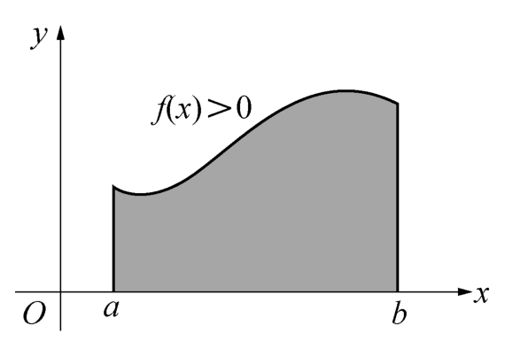

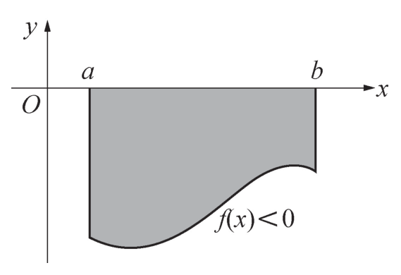

若在$[a,b]$上$f(x)$有正有负，则$\displaystyle\int_a^b f(x)\,\mathrm{d}x$表示由$y=f(x)$、$x=a$、$x=b$、$y=0$所围图形在$x$轴上方的面积减去在$x$轴下方的面积（见图 3-7）．

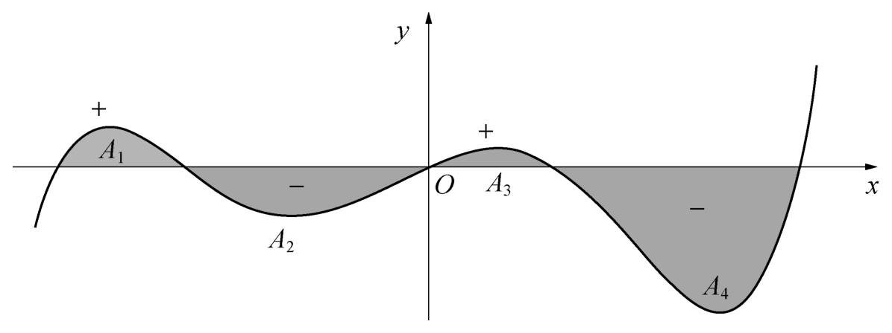

**例 2** 由定积分的几何意义，求

$$
\int_1^2 (x-3)\,\mathrm{d}x.
$$

解　由于在区间$[1,2]$上，$f(x)=x-3<0$，因此按照定积分的几何意义，该定积分表示由曲边$y=x-3$和直线$x=1$，$x=2$，$y=0$所围图形面积的负值．该图形是底为$1$和$2$、高为$1$的梯形（见图 3-8），其面积为$\frac{1}{2}(1+2)\cdot 1=\frac{3}{2}$，故

$$
\int_1^2 (x-3)\,\mathrm{d}x = -\frac{3}{2}.
$$

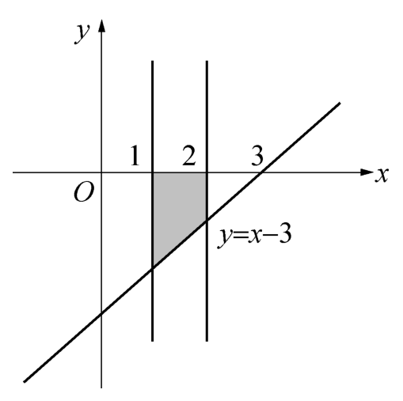

**\*例 3**　利用定积分表示极限

$$
\lim_{n\to\infty}\frac{\pi}{n}\left(\frac{1}{n}\cos\frac{1}{n}+\frac{2}{n}\cos\frac{2}{n}+\cdots+\frac{n-1}{n}\cos\frac{n-1}{n}+\cos 1\right).
$$

解　原极限$\displaystyle=\lim_{n\to\infty}\pi\sum_{i=1}^{n}\left(\frac{i}{n}\cos\frac{i}{n}\right)\cdot\frac{1}{n}.$

易见，若取$x_i=\frac{i}{n}$，则$\Delta x_i=\frac{1}{n}$，$\xi_i=\frac{i}{n}\in[x_{i-1},x_i]$，原极限$\displaystyle=\lim_{n\to\infty}\pi\sum_{i=1}^{n}\xi_i\cos\xi_i\Delta x_i$．

由此可见，被积函数应取为$f(x)=x\cos x$．注意到$f(x)$在$[0,1]$上连续，因而是可积的．故有

$$
\text{原极限} = \pi\int_0^1 x\cos x\,\mathrm{d}x.
$$

**注**　今后可直接计算出上述积分结果为$\pi(\sin 1+\cos 1-1)$．

### 四、定积分的性质

按定积分的定义，即通过积分和的极限求定积分是十分困难的，必须寻求定积分的有效计算方法．下面介绍的定积分的基本性质有助于计算定积分，也有助于理解定积分．假定函数在所讨论的区间上可积，则有以下性质．

在定积分定义中$a<b$，这一限制给定积分的应用带来不便，因此规定：

（1）$\displaystyle\int_a^a f(x)\,\mathrm{d}x=0$；

（2）设$a>b$，则$\displaystyle\int_a^b f(x)\,\mathrm{d}x=-\int_b^a f(x)\,\mathrm{d}x$．

**1．被积函数性质**

（1）若$f(x)$在$[a,b]$上可积，则$|f(x)|$在$[a,b]$上也可积；（$\displaystyle\int_a^b f(x)\,\mathrm{d}x$存在，则$\displaystyle\int_a^b|f(x)|\,\mathrm{d}x$也存在．）

（2）若$f(x)$在$[a,b]$上可积，则$f(x)$在$[a,b]$的任何子区间$[\alpha,\beta]\subset[a,b]$上也可积．（$\displaystyle\int_a^b f(x)\,\mathrm{d}x$存在，则$\displaystyle\int_\alpha^\beta f(x)\,\mathrm{d}x$也存在，其中$[\alpha,\beta]\subset[a,b]$．）

（3）$\displaystyle\int_a^b 1\,\mathrm{d}x=\int_a^b \mathrm{d}x=b-a$．

**2．线性性质**

若$\displaystyle\int_a^b f(x)\,\mathrm{d}x$、$\displaystyle\int_a^b g(x)\,\mathrm{d}x$均存在，则$\displaystyle\int_a^b[\alpha f(x)+\beta g(x)]\,\mathrm{d}x$也存在，且$\displaystyle\int_a^b[\alpha f(x)+\beta g(x)]\,\mathrm{d}x=\alpha\int_a^b f(x)\,\mathrm{d}x+\beta\int_a^b g(x)\,\mathrm{d}x$，其中$\alpha$，$\beta$是常数．

**3．区间的有限可加性**

$$
\int_a^b f(x)\,\mathrm{d}x = \int_a^c f(x)\,\mathrm{d}x+\int_c^b f(x)\,\mathrm{d}x.
$$

只要$\displaystyle\int_a^b f(x)\,\mathrm{d}x$、$\displaystyle\int_a^c f(x)\,\mathrm{d}x$、$\displaystyle\int_c^b f(x)\,\mathrm{d}x$均存在，无论$a$、$b$、$c$所对应的位置如何，上式恒成立．

**注**　当$c$不在$[a,b]$上时，如$c<a<b$，则$\displaystyle\int_c^b f(x)\,\mathrm{d}x=\int_c^a f(x)\,\mathrm{d}x+\int_a^b f(x)\,\mathrm{d}x$，因此也有

$$
\int_a^b f(x)\,\mathrm{d}x = \int_c^b f(x)\,\mathrm{d}x-\int_c^a f(x)\,\mathrm{d}x = \int_c^b f(x)\,\mathrm{d}x+\int_a^c f(x)\,\mathrm{d}x.
$$

**4．保序性**

设$f(x)\le g(x)$，$x\in[a,b]$，且$\displaystyle\int_a^b f(x)\,\mathrm{d}x$、$\displaystyle\int_a^b g(x)\,\mathrm{d}x$均存在，则

$$
\int_a^b f(x)\,\mathrm{d}x \le \int_a^b g(x)\,\mathrm{d}x.
$$

**推论 1**　设$f(x)\ge 0$，$x\in[a,b]$，且$\displaystyle\int_a^b f(x)\,\mathrm{d}x$均存在，则$\displaystyle\int_a^b f(x)\,\mathrm{d}x\ge 0$．

**推论 2**　$\displaystyle\left|\int_a^b f(x)\,\mathrm{d}x\right|\le \int_a^b|f(x)|\,\mathrm{d}x$．

**证明**　由$-|f(x)|\le f(x)\le|f(x)|$，$x\in[a,b]$，得

$$
-\int_a^b|f(x)|\,\mathrm{d}x \le \int_a^b f(x)\,\mathrm{d}x \le \int_a^b|f(x)|\,\mathrm{d}x,
$$

即

$$
\left|\int_a^b f(x)\,\mathrm{d}x\right| \le \int_a^b|f(x)|\,\mathrm{d}x.
$$

**5．估值性质**

设$M=\max\limits_{[a,b]}f(x)$，$m=\min\limits_{[a,b]}f(x)$，则

$$
m(b-a)\le \int_a^b f(x)\,\mathrm{d}x \le M(b-a).
$$

**证明**　由$m\le f(x)\le M$，$x\in[a,b]$，得

$$
m(b-a) = \int_a^b m\,\mathrm{d}x \le \int_a^b f(x)\,\mathrm{d}x \le \int_a^b M\,\mathrm{d}x = M(b-a),
$$

即$\displaystyle m(b-a)\le\int_a^b f(x)\,\mathrm{d}x\le M(b-a)$．

**6．积分中值定理**

设函数$f(x)$在$[a,b]$上连续，则至少存在一点$\xi\in[a,b]$，使

$$
\int_a^b f(x)\,\mathrm{d}x = f(\xi)(b-a).
$$

**证明**　因为$f(x)$在$[a,b]$上连续，所以$f(x)$在$[a,b]$上有最大值$M$与最小值$m$．故由估值性质有$\displaystyle m(b-a)\le\int_a^b f(x)\,\mathrm{d}x\le M(b-a)$，从而有

$$
m \le \frac{1}{b-a}\int_a^b f(x)\,\mathrm{d}x \le M,
$$

即$\displaystyle\frac{1}{b-a}\int_a^b f(x)\,\mathrm{d}x$介于$f(x)$的最小值和最大值之间．由连续函数的介值定理，至少有一点$\xi$（$a\le\xi\le b$），使下式成立：

$$
f(\xi) = \frac{1}{b-a}\int_a^b f(x)\,\mathrm{d}x,
$$

即

$$
\int_a^b f(x)\,\mathrm{d}x = f(\xi)(b-a).
$$

中值定理表明平均值可以在某一点取得．其几何意义如下．

设$f(x)\ge 0$，则由曲线$y=f(x)$、直线$x=a$、$x=b$及$x$轴所围成的曲边梯形的面积等于以区间$[a,b]$为底、以$f(\xi)$为高的矩形$abcd$的面积（见图 3-9）．

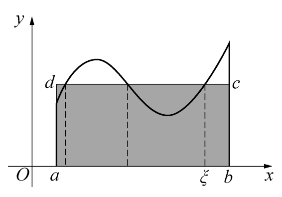

**例 4** 不计算积分，试比较下面两个积分值的大小：$\displaystyle\int_0^{\frac{\pi}{2}}x\,\mathrm{d}x$与$\displaystyle\int_0^{\frac{\pi}{2}}\sin x\,\mathrm{d}x$．

解　当$0\le x\le\frac{\pi}{2}$时，有$x\ge\sin x$，故由保序性得

$$
\int_0^{\frac{\pi}{2}}x\,\mathrm{d}x \ge \int_0^{\frac{\pi}{2}}\sin x\,\mathrm{d}x.
$$

**例 5** 不计算积分，比较积分值$\displaystyle\int_0^{-2}e^x\,\mathrm{d}x$和$\displaystyle\int_0^{-2}x\,\mathrm{d}x$的大小．

解　令$f(x)=e^x-x$，$x\in[-2,0]$．

因为$f(x)\ge 0$，所以$\displaystyle\int_{-2}^0(e^x-x)\,\mathrm{d}x\ge 0$，从而$\displaystyle\int_{-2}^0 e^x\,\mathrm{d}x\ge\int_{-2}^0 x\,\mathrm{d}x$，

于是

$$
\int_0^{-2}e^x\,\mathrm{d}x \le \int_0^{-2}x\,\mathrm{d}x.
$$

**例 6** 估计积分$\displaystyle\int_0^{\pi}\frac{1}{3+\sin^3 x}\,\mathrm{d}x$的值．

解　$f(x)=\frac{1}{3+\sin^3 x}$，$x\in[0,\pi]$，因为$0\le\sin^3 x\le 1$，所以$\frac{1}{4}\le\frac{1}{3+\sin^3 x}\le\frac{1}{3}$，

$$
\int_0^{\pi}\frac{1}{4}\,\mathrm{d}x \le \int_0^{\pi}\frac{1}{3+\sin^3 x}\,\mathrm{d}x \le \int_0^{\pi}\frac{1}{3}\,\mathrm{d}x,
$$

于是

$$
\frac{\pi}{4} \le \int_0^{\pi}\frac{1}{3+\sin^3 x}\,\mathrm{d}x \le \frac{\pi}{3}.
$$

**例 7** 试求$y=x^2$在区间$[0,1]$上满足积分中值定理的$\xi$的值．

解　由定积分的几何意义可知，由曲线$y=x^2$，$x$轴和直线$x=1$所围的图形面积即为$\displaystyle\int_0^1 x^2\,\mathrm{d}x$的值．从引例可知，$\displaystyle\int_0^1 x^2\,\mathrm{d}x=\frac{1}{3}$．再由积分中值定理得

$$
\xi^2\cdot(1-0) = \int_0^1 x^2\,\mathrm{d}x = \frac{1}{3},
$$

于是

$$
\xi = \frac{\sqrt{3}}{3}.
$$

### 习题 3-4

\*1．利用定积分的定义计算下列定积分：

（1）$\displaystyle\int_0^4 (2x+3)\,\mathrm{d}x$；

（2）$\displaystyle\int_0^1 x^3\,\mathrm{d}x$（提示：把区间$n$等分，取$\xi_i$为小区间右端点，并注意到$1^3+2^3+\cdots+n^3=\frac{1}{4}n^2(n+1)^2$）．

\*2．将和式极限$\displaystyle\lim_{n\to\infty}\frac{1}{n}\left[\sin\frac{\pi}{n}+\sin\frac{2\pi}{n}+\cdots+\sin\frac{(n-1)\pi}{n}\right]$表示成定积分．

3．利用定积分的几何意义，求下列各式的值：

（1）$\displaystyle\int_0^a\sqrt{a^2-x^2}\,\mathrm{d}x\ (a>0)$；

（2）$\displaystyle\int_{-\frac{\pi}{2}}^{\frac{\pi}{2}}\sin x\,\mathrm{d}x$；

4．试用定积分表示如图 3-10 所示的平面图形的面积．

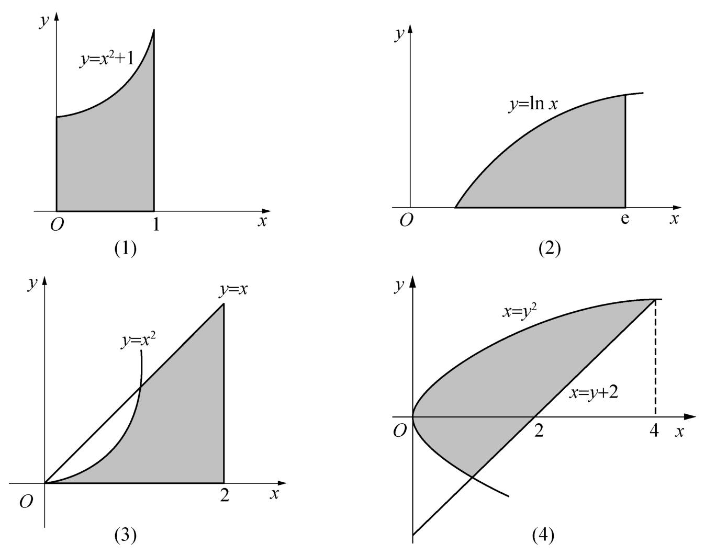

5．不计算积分，直接比较下列各组积分值的大小．

（1）$\displaystyle\int_0^1 x\,\mathrm{d}x$与$\displaystyle\int_0^1 x^2\,\mathrm{d}x$；

（2）$\displaystyle\int_2^4 x\,\mathrm{d}x$与$\displaystyle\int_2^4 x^2\,\mathrm{d}x$；

（3）$\displaystyle\int_0^1 e^x\,\mathrm{d}x$与$\displaystyle\int_0^1 e^{x^2}\,\mathrm{d}x$；

（4）$\displaystyle\int_0^{-1} e^x\,\mathrm{d}x$与$\displaystyle\int_0^{-1} e^{-x}\,\mathrm{d}x$；

（5）$\displaystyle\int_{-\frac{\pi}{2}}^0\sin x\,\mathrm{d}x$与$\displaystyle\int_0^{\frac{\pi}{2}}\sin x\,\mathrm{d}x$；

（6）$\displaystyle\int_0^{\pi}\sin x\,\mathrm{d}x$与$\displaystyle\int_0^{\pi}\cos x\,\mathrm{d}x$；

（7）$\displaystyle\int_1^e \ln x\,\mathrm{d}x$与$\displaystyle\int_1^e \ln^2 x\,\mathrm{d}x$；

（8）$\displaystyle\int_0^{\pi}e^{x^2}\,\mathrm{d}x$与$\displaystyle\int_{\pi}^{2\pi}e^{x^2}\,\mathrm{d}x$．

6．估计下列定积分值的范围：

（1）$\displaystyle\int_0^1\frac{1}{1+x^2}\,\mathrm{d}x$；

（2）$\displaystyle\int_0^{\frac{\pi}{2}}(1+\cos^4 x)\,\mathrm{d}x$．

7．证明不等式$\displaystyle\int_2^3\sqrt{x^2-x}\,\mathrm{d}x\ge\sqrt{2}$．

8．求极限$\displaystyle\lim_{n\to\infty}\int_0^{\frac{\pi}{4}}\sin^n x\,\mathrm{d}x$．

\*9．曲边梯形由曲线$x=g(y)$、直线$y=c$、$y=d$和$y$轴所围（见图 3-11），试用定积分定义导出其面积的定积分表示式．

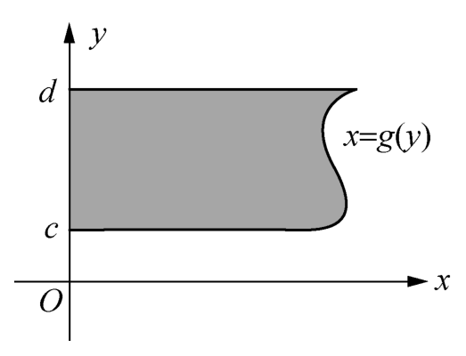

## 第五节 微积分基本定理

**[课前导读]**

积分学中要解决两个问题：第一个问题是原函数的求法问题，前文已经对它做了讨论；第二个问题就是定积分的计算问题．如果按定积分的定义来计算定积分，那将是十分困难的．因此寻求一种计算定积分的有效方法便成为积分学发展的关键．我们知道，不定积分作为原函数的概念与定积分作为积分和的极限的概念是完全不相干的两个概念．但是，牛顿和莱布尼茨不仅发现而且找到了这两个概念之间存在的深刻的内在联系，即所谓的“微积分基本定理”，并由此巧妙地开辟了求定积分的新途径——牛顿-莱布尼茨公式，从而使积分学与微分学一起构成变量数学的基础学科——微积分学．牛顿和莱布尼茨也因此作为微积分学的奠基人而载入史册．

### 一、变速直线运动的路程

设物体做直线运动，已知速度$v=v(t)$是时间间隔$[0,T]$上$t$的连续函数，且$v(t)\ge 0$．对于匀速直线运动，有公式：路程＝速度×时间，现在速度是随着时间变化的变量，因此不能直接按匀速直线运动的路径公式来计算．

将时间$[0,T]$任意地分成$n$小段$[t_{i-1},t_i]$（其中$i=1,2,\cdots,n$，$t_0=0$，$t_n=T$），任取$\tau_i\in[t_{i-1},t_i]$（$i=1,2,\cdots,n$），则$\Delta S_i\approx v(\tau_i)\Delta t_i$（$i=1,2,\cdots,n$），$\lambda=\max\limits_{1\le i\le n}\{\Delta t_i\}$，因此得到变速（$v=v(t)$，$t\in[0,T]$）直线运动的路程

$$
S=\sum_{i=1}^{n}\Delta S_i=\lim_{\lambda\to 0}\sum_{i=1}^{n}v(\tau_i)\Delta t_i=\int_0^T v(t)\,\mathrm{d}t;
$$

另一方面，这段路程又可通过位置函数$S(t)$在时间$[0,T]$上的增量来表示：$S(T)-S(0)$，因此有$\displaystyle\int_0^T v(t)\,\mathrm{d}t=S(T)-S(0)$，且$S'(t)=v(t)$，从而有

$$
\int_0^T v(t)\,\mathrm{d}t=\int_0^T S'(t)\,\mathrm{d}t=S(t)\bigg|_0^T=\left[\int v(t)\,\mathrm{d}t\right]_0^T.
$$

此公式揭示了速度函数的定积分和不定积分的关系．这是一种偶然的巧合，还是一种具有一般意义的计算公式呢？答案是肯定的．下面就来推导一般的结果，通过求原函数的方法来计算定积分，该结果称为微积分基本定理．

### 二、积分上限函数

设函数$f(x)$在区间$[a,b]$上连续，$x$为$[a,b]$上的任意一点（见图3-12），则积分$\displaystyle\int_a^x f(x)\,\mathrm{d}x$存在，这里上限$x$是$[a,b]$上的任意取定的一点，当$x$在$[a,b]$上变化时，$\displaystyle\int_a^x f(x)\,\mathrm{d}x$的值也随之变化．由于积分值与积分变量用什么字母表示无关，故原来的$\displaystyle\int_a^x f(x)\,\mathrm{d}x$用$\displaystyle\int_a^x f(t)\,\mathrm{d}t$表示更妥，故$\displaystyle\int_a^x f(t)\,\mathrm{d}t$为$[a,b]$上变量$x$的函数，称为$f(x)$的积分上限的函数．记为$\Phi(x)=\displaystyle\int_a^x f(t)\,\mathrm{d}t$，（$a\le x\le b$）．同理，$\displaystyle\int_x^b f(t)\,\mathrm{d}t$也是$x$的函数（$a\le x\le b$），称为$f(x)$的积分下限的函数．

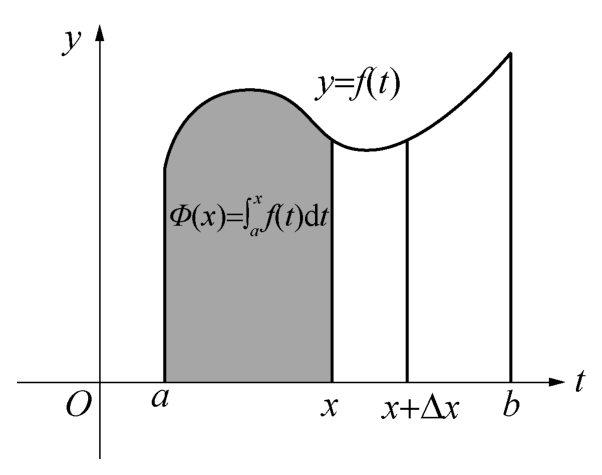

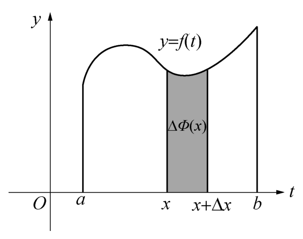

由定积分的几何意义，可以看到$\displaystyle\int_a^b f(x)\,\mathrm{d}x$表示区间$[a,b]$上整块曲边梯形的面积，而$\Phi(x)=\displaystyle\int_a^x f(t)\,\mathrm{d}t$表示区间$[a,x]$上对应的曲边梯形的面积．对于$\Phi(x)$，有下列性质．

**定理 1**　若函数$f(x)$在$[a,b]$上连续，则$\Phi(x)=\displaystyle\int_a^x f(t)\,\mathrm{d}t$在$[a,b]$上可导，且

$$
\Phi'(x)=\frac{\mathrm{d}}{\mathrm{d}x}\int_a^x f(t)\,\mathrm{d}t=f(x).
$$

**证明**　考虑$\Delta\Phi(x)$并利用积分中值定理（见图3-13），有

$$
\Delta\Phi(x)=\Phi(x+\Delta x)-\Phi(x)=\int_a^{x+\Delta x}f(t)\,\mathrm{d}t-\int_a^x f(t)\,\mathrm{d}t=\int_x^{x+\Delta x}f(t)\,\mathrm{d}t=f(\xi)\Delta x,
$$

其中$\xi$介于$x$、$x+\Delta x$之间．当$\Delta x\to 0$时，$\xi\to x$，因此

$$
\lim_{\Delta x\to 0}\frac{\Delta\Phi(x)}{\Delta x}=\lim_{\Delta x\to 0}f(\xi)=f(x),
$$

即

$$
\Phi'(x)=\frac{\mathrm{d}}{\mathrm{d}x}\int_a^x f(t)\,\mathrm{d}t=f(x).
$$

**注**　从定理的结论可以看出，$\Phi(x)$是$f(x)$的一个原函数，因此有以下定理．

**定理 2**　若函数$f(x)$在$[a,b]$上连续，则$\Phi(x)=\displaystyle\int_a^x f(t)\,\mathrm{d}t$是$f(x)$在$[a,b]$上的一个原函数，即

$$
\Phi'(x)=f(x),\quad x\in[a,b].
$$

定理 2 的意义在于：

（1）连续函数的原函数是存在的，这样就解决了不定积分中连续函数的原函数的存在性的证明；

（2）指出了获得连续函数的原函数的具体方法．

**推论**　若函数$f(x)$在$[a,b]$上连续，$\Phi(x)=\displaystyle\int_{a(x)}^{b(x)}f(t)\,\mathrm{d}t$，$a\le a(x)<b(x)\le b$，$a(x)$，$b(x)$在$[a,b]$上可导，则

$$
\Phi'(x)=\frac{\mathrm{d}}{\mathrm{d}x}\int_{a(x)}^{b(x)}f(t)\,\mathrm{d}t=f[b(x)]b'(x)-f[a(x)]a'(x).
$$

**证明**　$\Phi(x)=\displaystyle\int_{a(x)}^{b(x)}f(t)\,\mathrm{d}t=\int_{a(x)}^{c}f(t)\,\mathrm{d}t+\int_c^{b(x)}f(t)\,\mathrm{d}t=\int_c^{b(x)}f(t)\,\mathrm{d}t-\int_c^{a(x)}f(t)\,\mathrm{d}t$，其中$c\in[a,b]$，考虑$F(x)=\displaystyle\int_c^{b(x)}f(t)\,\mathrm{d}t=\int_c^u f(t)\,\mathrm{d}t\bigg|_{u=b(x)}$，则

$$
F'(x)=f'(u)\bigg|_{u=b(x)}\cdot b'(x)=f[b(x)]b'(x),
$$

因此，

$$
\Phi'(x)=\frac{\mathrm{d}}{\mathrm{d}x}\int_{a(x)}^{b(x)}f(t)\,\mathrm{d}t=f[b(x)]b'(x)-f[a(x)]a'(x).
$$

特别地，若$a(x)\equiv a\in\mathbf{R}$，则

$$
\Phi'(x)=\frac{\mathrm{d}}{\mathrm{d}x}\int_a^{b(x)}f(t)\,\mathrm{d}t=f[b(x)]b'(x).
$$

若$b(x)\equiv b\in\mathbf{R}$，则

$$
\Phi'(x)=\frac{\mathrm{d}}{\mathrm{d}x}\int_{a(x)}^{b}f(t)\,\mathrm{d}t=-f[a(x)]a'(x).
$$

**例 1**　求$\frac{\mathrm{d}}{\mathrm{d}x}\left(\displaystyle\int_0^x\cos^2 t\,\mathrm{d}t\right)$．

**解**　$\frac{\mathrm{d}}{\mathrm{d}x}\left(\displaystyle\int_0^x\cos^2 t\,\mathrm{d}t\right)=\cos^2 x$．

**例 2**　求$\frac{\mathrm{d}}{\mathrm{d}x}\left(\displaystyle\int_1^{x^3}e^{t^2}\,\mathrm{d}t\right)$．

**解**　根据定理2的推论，有

$$
\frac{\mathrm{d}}{\mathrm{d}x}\left(\int_1^{x^3}e^{t^2}\,\mathrm{d}t\right)=e^{(x^3)^2}\cdot(x^3)'=3x^2e^{x^6}.
$$

**例 3**　求下列函数的导数：

（1）$y=\displaystyle\int_0^{x^2}\sin(t+1)\,\mathrm{d}t$；

（2）$y=\displaystyle\int_{x^3}^2\frac{e^t}{t}\,\mathrm{d}t$（$x>0$）．

**解**　（1）$y'=\sin(x^2+1)\cdot(x^2)'=2x\sin(x^2+1)$；

（2）$y'=-\left(\frac{e^{x^3}}{x^3}\right)\cdot(x^3)'=-3\cdot\frac{e^{x^3}}{x}$．

**例 4**　设$f(x)$是连续函数，试求以下函数的导数．

（1）$F(x)=\displaystyle\int_{\cos x}^{\sin x}e^{f(t)}\,\mathrm{d}t$；

（2）$F(x)=\displaystyle\int_0^x xf(t)\,\mathrm{d}t$．

**解**　（1）$F'(x)=e^{f(\sin x)}\cos x+e^{f(\cos x)}\sin x$．

（2）因为$F(x)=x\displaystyle\int_0^x f(t)\,\mathrm{d}t$，所以$F'(x)=xf(x)+\displaystyle\int_0^x f(t)\,\mathrm{d}t$．

**例 5**　设函数$y=f(x)$由方程$\displaystyle\int_0^{y^2}e^{t^2}\,\mathrm{d}t+\int_x^0\sin t\,\mathrm{d}t=0$所确定．求$\frac{\mathrm{d}y}{\mathrm{d}x}$．

**解**　在方程两边同时对$x$求导，得

$$
\frac{\mathrm{d}}{\mathrm{d}x}\left(\int_0^{y^2}e^{t^2}\,\mathrm{d}t\right)+\frac{\mathrm{d}}{\mathrm{d}x}\left(\int_x^0\sin t\,\mathrm{d}t\right)=0,
$$

于是

$$
\frac{\mathrm{d}}{\mathrm{d}y}\left(\int_0^{y^2}e^{t^2}\,\mathrm{d}t\right)\cdot\frac{\mathrm{d}y}{\mathrm{d}x}+\frac{\mathrm{d}}{\mathrm{d}x}\left(\int_x^0\sin t\,\mathrm{d}t\right)=0,
$$

即

$$
e^{y^4}\cdot(2y)\cdot\frac{\mathrm{d}y}{\mathrm{d}x}+(-\sin x)=0,
$$

故

$$
\frac{\mathrm{d}y}{\mathrm{d}x}=\frac{\sin x}{2ye^{y^4}}.
$$

**例 6**　求$\lim\limits_{x\to 0}\frac{\displaystyle\int_{\cos x}^1 e^{-t^2}\,\mathrm{d}t}{x^2}$．

**分析：**这是$\frac{0}{0}$型不定式，应用洛必达法则．

**解**　$\frac{\mathrm{d}}{\mathrm{d}x}\left(\displaystyle\int_{\cos x}^1 e^{-t^2}\,\mathrm{d}t\right)=-\frac{\mathrm{d}}{\mathrm{d}x}\left(\int_1^{\cos x}e^{-t^2}\,\mathrm{d}t\right)=-e^{-\cos^2 x}\cdot(\cos x)'=\sin x\cdot e^{-\cos^2 x}$，

故$\lim\limits_{x\to 0}\frac{\displaystyle\int_{\cos x}^1 e^{-t^2}\,\mathrm{d}t}{x^2}=\lim\limits_{x\to 0}\frac{-(-\sin x)e^{-\cos^2 x}}{2x}=\frac{1}{2e}$．

### 三、微积分基本定理

**定理 3（牛顿-莱布尼茨公式）**　若函数$F(x)$是连续函数$f(x)$在$[a,b]$上的一个原函数，则

$$
\int_a^b f(x)\,\mathrm{d}x=F(b)-F(a)=F(x)\bigg|_a^b.
$$

**证明**　已知$\Phi(x)=\displaystyle\int_a^x f(t)\,\mathrm{d}t$是$f(x)$在$[a,b]$上的一个原函数，故$F(x)-\Phi(x)=C$，即$F(x)-\displaystyle\int_a^x f(t)\,\mathrm{d}t=C$．令$x=a$，则$F(a)=C$，即

$$
\int_a^x f(t)\,\mathrm{d}t=F(x)-F(a).
$$

因此，令$x=b$，则有$\displaystyle\int_a^b f(t)\,\mathrm{d}t=F(b)-F(a)$．

这个公式揭示了不定积分与定积分之间的关系．由于我们已经熟悉了不定积分的计算方法，因此，利用该公式计算定积分将会大大降低计算定积分的难度．由于它的重要性，故也称其为微积分基本定理．

**例 7**　求定积分$\displaystyle\int_0^1 e^x\,\mathrm{d}x$．

**解**　$e^x$的一个原函数是$e^x$，由牛顿-莱布尼茨公式得

$$
\int_0^1 e^x\,\mathrm{d}x=e^x\bigg|_0^1=e^1-e^0=e-1.
$$

**注**　上一节曾经用定积分的定义求过此积分的值．很明显，用牛顿-莱布尼茨公式计算简便得多．

**例 8**　求$\displaystyle\int_{-2}^{-1}\frac{1}{x}\,\mathrm{d}x$．

**解**　当$x<0$时，$y=\frac{1}{x}$的一个原函数是$y=\ln|x|$，

$$
\int_{-2}^{-1}\frac{1}{x}\,\mathrm{d}x=\ln|x|\bigg|_{-2}^{-1}=\ln 1-\ln 2=-\ln 2.
$$

**例 9**　设$f(x)=\begin{cases}2x,&0\le x\le 1,\\5,&1<x\le 2,\end{cases}$求$\displaystyle\int_0^2 f(x)\,\mathrm{d}x$．

**解**　如图3-14所示，在$[1,2]$上规定：当$x=1$时，$f(x)=5$，则由定积分性质得

$$
\int_0^2 f(x)\,\mathrm{d}x=\int_0^1 f(x)\,\mathrm{d}x+\int_1^2 f(x)\,\mathrm{d}x=\int_0^1 2x\,\mathrm{d}x+\int_1^2 5\,\mathrm{d}x=6.
$$

**例 10**　计算$\displaystyle\int_0^1|2x-1|\,\mathrm{d}x$．

**解**　因为$|2x-1|=\begin{cases}1-2x,&x\le\frac{1}{2},\\2x-1,&x>\frac{1}{2}\end{cases}$（见图3-15），所以

$$
\int_0^1|2x-1|\,\mathrm{d}x=\int_0^{\frac{1}{2}}(1-2x)\,\mathrm{d}x+\int_{\frac{1}{2}}^1(2x-1)\,\mathrm{d}x=(x-x^2)\bigg|_0^{\frac{1}{2}}+(x^2-x)\bigg|_{\frac{1}{2}}^1=\frac{1}{2}.
$$

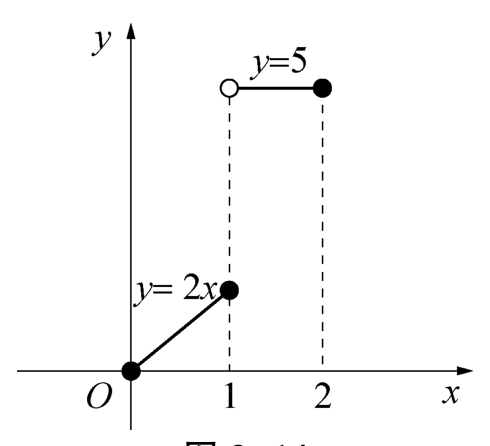

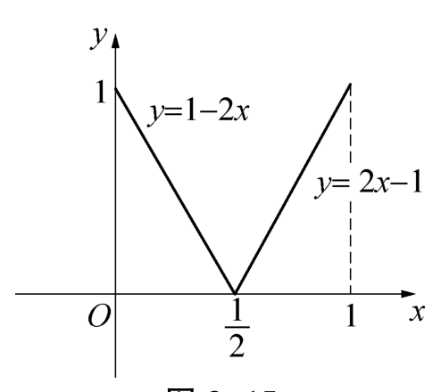

**例 11**　求定积分$\displaystyle\int_{-\frac{\pi}{2}}^{\frac{\pi}{3}}\sqrt{1-\cos^2 x}\,\mathrm{d}x$．

**解**　$\displaystyle\int_{-\frac{\pi}{2}}^{\frac{\pi}{3}}\sqrt{1-\cos^2 x}\,\mathrm{d}x=\int_{-\frac{\pi}{2}}^{\frac{\pi}{3}}\sqrt{\sin^2 x}\,\mathrm{d}x$

$$
=\int_{-\frac{\pi}{2}}^{\frac{\pi}{3}}|\sin x|\,\mathrm{d}x
=-\int_{-\frac{\pi}{2}}^{0}\sin x\,\mathrm{d}x+\int_0^{\frac{\pi}{3}}\sin x\,\mathrm{d}x
=\cos x\bigg|_{-\frac{\pi}{2}}^{0}-\cos x\bigg|_0^{\frac{\pi}{3}}=\frac{3}{2}\ \text{（见图3-16）}.
$$

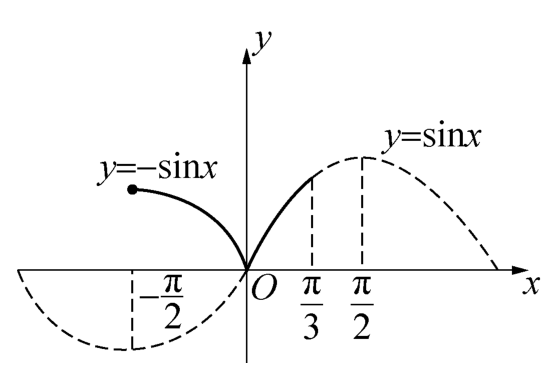

**例 12**　求$\displaystyle\int_{-2}^2\max\{x,x^2\}\,\mathrm{d}x$．

**解**　由图3-17可知

$$
f(x)=\max\{x,x^2\}=\begin{cases}x^2,&-2\le x<0,\\x,&0\le x<1,\\x^2,&1\le x\le 2,\end{cases}
$$

所以$\displaystyle\int_{-2}^2\max\{x,x^2\}\,\mathrm{d}x=\int_{-2}^0 x^2\,\mathrm{d}x+\int_0^1 x\,\mathrm{d}x+\int_1^2 x^2\,\mathrm{d}x=\frac{11}{2}$．

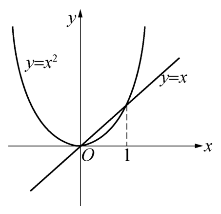

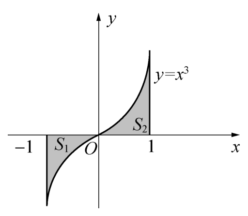

**例 13**　计算由曲线$y=x^3$在$x=-1$、$x=1$之间及$x$轴所围成的图形的面积．

**解**　根据定积分的几何意义（见图3-18），所求面积为

$$
S=\int_{-1}^1|x^3|\,\mathrm{d}x=\int_{-1}^0(-x^3)\,\mathrm{d}x+\int_0^1 x^3\,\mathrm{d}x=-\frac{x^4}{4}\bigg|_{-1}^0+\frac{x^4}{4}\bigg|_0^1=\frac{1}{2}.
$$

**例 14**　汽车以每小时36 km速度行驶，到某处需要减速停车．设汽车以等加速度$a=-5\ \mathrm{m/s^2}$刹车．问：从开始刹车到停车，汽车驶过了多少距离？

**解**　首先要算出从开始刹车到停车经过的时间．设开始刹车的时刻为$t=0$，此时汽车速度为$v_0=36\ \mathrm{km/h}=\frac{36\times 1\,000}{3\,600}\ \mathrm{m/s}=10\ \mathrm{m/s}$．

刹车后汽车减速行驶，其速度为$v(t)=v_0+at=10-5t$．

当汽车停住时，速度$v(t)=0$，故由

$$
v(t)=10-5t=0\Rightarrow t=\frac{10}{5}=2\ \mathrm{s}.
$$

于是这段时间内，汽车所驶过的距离为

$$
s=\int_0^2 v(t)\,\mathrm{d}t=\int_0^2(10-5t)\,\mathrm{d}t=\left(10t-5\cdot\frac{t^2}{2}\right)\bigg|_0^2=10\ \mathrm{m},
$$

即在刹车后，汽车需驶过10 m才能停住．

**\*例 15**　求极限$\lim\limits_{n\to\infty}\left(\frac{1}{n+1}+\frac{1}{n+2}+\cdots+\frac{1}{n+n}\right)$．

**解**

$$
\lim_{n\to\infty}\left(\frac{1}{n+1}+\frac{1}{n+2}+\cdots+\frac{1}{n+n}\right)=\lim_{n\to\infty}\sum_{i=1}^{n}\frac{1}{1+\frac{i}{n}}\cdot\frac{1}{n}.
$$

取函数$f(x)=\frac{1}{1+x}$，$f(x)$在$[0,1]$上连续，则$\displaystyle\int_0^1\frac{1}{1+x}\,\mathrm{d}x$存在，故

$$
\int_0^1\frac{1}{1+x}\,\mathrm{d}x=\lim_{\lambda\to 0}\sum_{i=1}^{n}\frac{1}{1+\xi_i}\Delta x_i.
$$

对$[0,1]$ $n$等分：$\Delta x_i=\frac{1}{n}$，取$\xi_i=\frac{i}{n}$，则

$$
\lim_{n\to\infty}\sum_{i=1}^{n}\frac{1}{1+\frac{i}{n}}\cdot\frac{1}{n}=\int_0^1\frac{1}{1+x}\,\mathrm{d}x=\ln(1+x)\bigg|_0^1=\ln 2.
$$

### 习题 3-5

1．设$f(x)$在$[a,b]$上连续，则$\displaystyle\int_a^x f(t)\,\mathrm{d}t$与$\displaystyle\int_x^b f(u)\,\mathrm{d}u$是$x$的函数还是$t$或$u$的函数？它们的导数存在吗？如果存在，等于什么？

2．求下列函数的导数：

（1）$y=\displaystyle\int_0^x e^{t^2-t}\,\mathrm{d}t$；

（2）$y=\displaystyle\int_0^{\sqrt{x}}\cos t^2\,\mathrm{d}t$；

（3）$y=\displaystyle\int_{x^2}^5\frac{\sin t}{t}\,\mathrm{d}t$；

（4）$y=\displaystyle\int_{2x}^{x^2}\sqrt{1+t^3}\,\mathrm{d}t$；

（5）$y=\displaystyle\int_{\sqrt{x}}^{\sqrt[3]{x}}\ln(1+t^6)\,\mathrm{d}t$；

（6）$y=\displaystyle\int_{\sin x}^{\cos x}\cos(\pi t^2)\,\mathrm{d}t$．

3．设$g(x)$是连续函数，且$\displaystyle\int_0^{x^2-1}g(t)\,\mathrm{d}t=-x$，求$g(3)$．

4．设$f(x)=\displaystyle\int_{-x}^{\sin x}\arctan(1+t^2)\,\mathrm{d}t$，求$f'(0)$．

5．求由参数表达式$x=\displaystyle\int_0^t\sin u^2\,\mathrm{d}u$，$y=\displaystyle\int_0^t\cos u^2\,\mathrm{d}u$所确定的函数对$x$的导数$\frac{\mathrm{d}y}{\mathrm{d}x}$．

6．设$y(x)$是由方程$\displaystyle\int_0^y e^{-t^2}\,\mathrm{d}t+\int_0^x\cos(t^2)\,\mathrm{d}t=0$所确定的隐函数，求$\frac{\mathrm{d}y}{\mathrm{d}x}$．

7．求函数$f(x)=\displaystyle\int_0^x(1+t)\arctan t\,\mathrm{d}t$的极小值．

8．求下列极限：

（1）$\lim\limits_{x\to 0}\frac{\displaystyle\int_0^x\sin t^2\,\mathrm{d}t}{x^3}$；

（2）$\lim\limits_{x\to 1}\frac{\displaystyle\int_1^x e^{t^2}\,\mathrm{d}t}{\ln x}$；

（3）$\lim\limits_{x\to 0}\frac{\displaystyle\int_0^x 2t\cos t\,\mathrm{d}t}{1-\cos x}$；

（4）$\lim\limits_{x\to 0}\frac{\displaystyle\int_0^x\cos(t^2)\,\mathrm{d}t}{\ln(1+x)}$；

（5）$\lim\limits_{x\to+\infty}\frac{\displaystyle\int_0^x(\arctan t)^2\,\mathrm{d}t}{\sqrt{1+x^2}}$；

（6）$\lim\limits_{x\to 0}\frac{\displaystyle\int_0^{\sin x}\sqrt{\tan t}\,\mathrm{d}t}{\displaystyle\int_0^{\tan x}\sqrt{\sin t}\,\mathrm{d}t}$；

（7）$\lim\limits_{x\to 0^+}\frac{\displaystyle\int_0^{x^2}t^{\frac{3}{2}}\,\mathrm{d}t}{\displaystyle\int_0^x t(t-\sin t)\,\mathrm{d}t}$；

（8）$\lim\limits_{x\to 0}\frac{\left(\displaystyle\int_0^x e^{t^2}\,\mathrm{d}t\right)^2}{\displaystyle\int_0^x te^{2t^2}\,\mathrm{d}t}$．

9．计算下列定积分：

（1）$\displaystyle\int_0^1\frac{\mathrm{d}h}{\sqrt{2gh}}$（$g$为常量）；

（2）$\displaystyle\int_1^{\sqrt{e}}\frac{1}{x}\,\mathrm{d}x$；

（3）$\displaystyle\int_{\frac{1}{\sqrt{3}}}^{\sqrt{3}}\frac{1}{1+x^2}\,\mathrm{d}x$；

（4）$\displaystyle\int_0^1\frac{x^2}{1+x^2}\,\mathrm{d}x$；

（5）$\displaystyle\int_{-\frac{1}{2}}^{\frac{1}{2}}\frac{1}{\sqrt{1-x^2}}\,\mathrm{d}x$；

（6）$\displaystyle\int_0^2(4-2x)(4-x^2)\,\mathrm{d}x$；

（7）$\displaystyle\int_0^{\frac{\pi}{4}}\tan^2\theta\,\mathrm{d}\theta$；

（8）$\displaystyle\int_{-1}^0\frac{3x^4+3x^2+1}{x^2+1}\,\mathrm{d}x$；

（9）$\displaystyle\int_0^2|1-x|\,\mathrm{d}x$；

（10）$\displaystyle\int_0^{2\pi}|\sin x|\,\mathrm{d}x$；

（11）$\displaystyle\int_{-3}^3(|x-1|+|x-2|)\,\mathrm{d}x$；

（12）$\displaystyle\int_{-3}^2\min\{1,e^x\}\,\mathrm{d}x$．

10．设$f(x)=\begin{cases}\sin x,&0\le x<\frac{\pi}{2},\\x,&\frac{\pi}{2}\le x\le\pi,\end{cases}$求$\displaystyle\int_0^\pi f(x)\,\mathrm{d}x$．

11．设函数$f(x)=\begin{cases}\frac{1-\cos x}{x^2},&x<0,\\2,&x=0,\\\frac{\displaystyle\int_0^{x^2}\cos x^2\,\mathrm{d}x}{2x^2},&x>0,\end{cases}$求（1）$\lim\limits_{x\to 0}f(x)$；（2）$f(x)$在$x=0$处连续吗？为什么？

12．已知$f'(x)\cdot\displaystyle\int_0^2 f(x)\,\mathrm{d}x=50$，且$f(0)=0$，试求$f(x)$．

13．设$f(x)$在$(-\infty,+\infty)$内连续，且$f(x)>0$．证明函数$F(x)=\frac{\displaystyle\int_0^x tf(t)\,\mathrm{d}t}{\displaystyle\int_0^x f(t)\,\mathrm{d}t}$在$(0,+\infty)$内为单调增加函数．

## 第六节 定积分的换元法和分部法

**[课前导读]**

牛顿-莱布尼茨公式告诉我们，计算连续函数$f(x)$的定积分$\displaystyle\int_a^b f(x)\,\mathrm{d}x$的有效简便方法是计算$f(x)$的原函数$F(x)$在$[a,b]$上的增量$F(b)-F(a)$．只要求出原函数$F(x)$，就能求得$\displaystyle\int_a^b f(x)\,\mathrm{d}x$，即

$$
\int_a^b f(x)\,\mathrm{d}x=F(x)\bigg|_a^b=\left[\int f(x)\,\mathrm{d}x\right]_a^b.
$$

这说明不定积分的计算与定积分的计算有着密切关系．很自然地想到，在定积分计算中，也可以尝试换元法与分部法．

### 一、定积分的换元法

在不定积分中，我们已掌握了换元法和分部积分法．现在我们来计算定积分

$$
\int_0^a\sqrt{a^2-x^2}\,\mathrm{d}x\ (a>0).
$$

令$x=a\sin t$，$t\in\left(-\frac{\pi}{2},\frac{\pi}{2}\right)$，则

$$
t=\arcsin\frac{x}{a},\quad\sin t=\frac{x}{a},\quad\cos t=\sqrt{1-\sin^2 t}=\sqrt{1-\left(\frac{x}{a}\right)^2}=\frac{\sqrt{a^2-x^2}}{a}.
\int\sqrt{a^2-x^2}\,\mathrm{d}x=a^2\int\cos^2 t\,\mathrm{d}t=\frac{a^2}{2}\int(1+\cos 2t)\,\mathrm{d}t=\frac{a^2}{2}\left(t+\frac{1}{2}\sin 2t\right)+C
=\frac{a^2}{2}(t+\sin t\cos t)+C
=\frac{a^2}{2}\left(\arcsin\frac{x}{a}+\frac{x}{a}\cdot\frac{\sqrt{a^2-x^2}}{a}\right)+C,
$$

因此$\displaystyle\int_0^a\sqrt{a^2-x^2}\,\mathrm{d}x=\frac{a^2}{2}\left(\arcsin\frac{x}{a}+\frac{x}{a}\cdot\frac{\sqrt{a^2-x^2}}{a}\right)\bigg|_0^a=\frac{a^2}{2}\left(\frac{\pi}{2}-0\right)=\frac{\pi a^2}{4}$．

显然，我们已有能力用不定积分的换元法解决该类问题了，但其过程比较复杂，要经历换元、求原函数、回代、取值四个过程．有没有比较简单的方法呢？让我们来研究一下定积分的换元法．

**定理**　设

（1）函数$f(x)$在$[a,b]$上连续；

（2）$x=\varphi(t)$在$[\alpha,\beta]$或$[\beta,\alpha]$上单调且具有连续导数，且$R_\varphi=[a,b]$；

（3）$t$在$[\alpha,\beta]$或$[\beta,\alpha]$上变化时，$\varphi(t)=x$在$[a,b]$上变化，且$\varphi(\alpha)=a$，$\varphi(\beta)=b$，

则$\displaystyle\int_a^b f(x)\,\mathrm{d}x=\int_\alpha^\beta f[\varphi(t)]\varphi'(t)\,\mathrm{d}t$．

**\*证明**　由条件（1）函数$f(x)$在$[a,b]$上连续，知$\displaystyle\int_a^b f(x)\,\mathrm{d}x$存在，且有原函数$F(x)$存在．由微积分基本公式，得$\displaystyle\int_a^b f(x)\,\mathrm{d}x=F(b)-F(a)$．

因为$f[\varphi(t)]\varphi'(t)$在$[\alpha,\beta]$或$[\beta,\alpha]$上连续，故$\displaystyle\int_\alpha^\beta f[\varphi(t)]\varphi'(t)\,\mathrm{d}t$存在，且在$[\alpha,\beta]$或$[\beta,\alpha]$上有原函数$\Phi(t)$．由微积分基本公式，得$\displaystyle\int_\alpha^\beta f[\varphi(t)]\varphi'(t)\,\mathrm{d}t=\Phi(\beta)-\Phi(\alpha)$．

现只要证明$F(b)-F(a)=\Phi(\beta)-\Phi(\alpha)$．

由于$\frac{\mathrm{d}F}{\mathrm{d}t}=\frac{\mathrm{d}F}{\mathrm{d}x}\cdot\frac{\mathrm{d}x}{\mathrm{d}t}=f[\varphi(t)]\varphi'(t)$，而$\Phi'(t)=f[\varphi(t)]\varphi'(t)$，故$\Phi(t)=F[\varphi(t)]+C$，即$\Phi(\beta)=F[\varphi(\beta)]+C_0$，$\Phi(\alpha)=F[\varphi(\alpha)]+C_0$，因此

$$
\int_\alpha^\beta f[\varphi(t)]\varphi'(t)\,\mathrm{d}t=\Phi(\beta)-\Phi(\alpha)=F[\varphi(\beta)]-F[\varphi(\alpha)]
=F(b)-F(a)=\int_a^b f(x)\,\mathrm{d}x.
$$

**注**　（1）作$x=\varphi(t)$时，相应的积分上下限也应变更作新变量的上下限．

（2）求出新变量的原函数后，不必回代，只需把新变量的上下限直接代入计算．

我们可以用定积分的换元法来计算刚才的定积分．

令$x=a\sin t$，则$\mathrm{d}x=\mathrm{d}(a\sin t)=a\cos t\,\mathrm{d}t$．当$x=0$时，$t=0$；当$x=a$时，$t=\frac{\pi}{2}$．

$$
\int_0^a\sqrt{a^2-x^2}\,\mathrm{d}x=a^2\int_0^{\frac{\pi}{2}}\cos^2 t\,\mathrm{d}t=\frac{a^2}{2}\int_0^{\frac{\pi}{2}}(1+\cos 2t)\,\mathrm{d}t=\frac{a^2}{2}\left(t+\frac{1}{2}\sin 2t\right)\bigg|_0^{\frac{\pi}{2}}=\frac{\pi a^2}{4}.
$$

**例 1**　计算$\displaystyle\int_0^1(2x-1)^{2016}\,\mathrm{d}x$．

**解**　令$t=2x-1$，则$\mathrm{d}t=2\,\mathrm{d}x$，$x=0\Rightarrow t=-1$，$x=1\Rightarrow t=1$，

$$
\int_0^1(2x-1)^{2016}\,\mathrm{d}x=\frac{1}{2}\int_{-1}^1 t^{2016}\,\mathrm{d}t=\frac{1}{2}\cdot\frac{t^{2017}}{2017}\bigg|_{-1}^1=\frac{1}{2017}.
$$

**注**　本例中，如果不明显写出新变量$t$，则定积分的上、下限就不要变，重新计算如下．

$$
\int_0^1(2x-1)^{2016}\,\mathrm{d}x=\frac{1}{2}\int_0^1(2x-1)^{2016}\,\mathrm{d}(2x-1)
=\frac{1}{2}\left[\frac{(2x-1)^{2017}}{2017}\right]\bigg|_0^1=\frac{1}{2017}.
$$

**例 2**　求定积分$\displaystyle\int_1^e\frac{\ln^2 x}{x}\,\mathrm{d}x$．

**解**　$\displaystyle\int_1^e\frac{\ln^2 x}{x}\,\mathrm{d}x=\int_1^e\ln^2 x\,\mathrm{d}(\ln x)=\frac{1}{3}\ln^3 x\bigg|_1^e=\frac{1}{3}(\ln^3 e-\ln^3 1)=\frac{1}{3}$．

**例 3**　求定积分$\displaystyle\int_{-\frac{\pi}{2}}^{\frac{\pi}{2}}\sqrt{\cos x-\cos^3 x}\,\mathrm{d}x$．

**解**　因为$\sqrt{\cos x-\cos^3 x}=\sqrt{\cos x(1-\cos^2 x)}=\sqrt{\cos x\cdot\sin^2 x}=\sqrt{\cos x}\,|\sin x|$，所以

$$
\int_{-\frac{\pi}{2}}^{\frac{\pi}{2}}\sqrt{\cos x-\cos^3 x}\,\mathrm{d}x=-\int_{-\frac{\pi}{2}}^0\sqrt{\cos x}\sin x\,\mathrm{d}x+\int_0^{\frac{\pi}{2}}\sqrt{\cos x}\sin x\,\mathrm{d}x
=\int_{-\frac{\pi}{2}}^0\sqrt{\cos x}\,\mathrm{d}(\cos x)-\int_0^{\frac{\pi}{2}}\sqrt{\cos x}\,\mathrm{d}(\cos x)
=\left(\frac{2}{3}\cos^{\frac{3}{2}}x\right)\bigg|_{-\frac{\pi}{2}}^0-\left(\frac{2}{3}\cos^{\frac{3}{2}}x\right)\bigg|_0^{\frac{\pi}{2}}=\frac{2}{3}-\left(-\frac{2}{3}\right)=\frac{4}{3}.
$$

**例 4**　求定积分$\displaystyle\int_{-1}^1\frac{x}{\sqrt{5-4x}}\,\mathrm{d}x$．

**解**　令$\sqrt{5-4x}=t$，即$x=\frac{5-t^2}{4}$，$\mathrm{d}x=-\frac{1}{2}t\,\mathrm{d}t$．

当$x=-1$时，$t=3$；当$x=1$时，$t=1$．从而

$$
\int_{-1}^1\frac{x}{\sqrt{5-4x}}\,\mathrm{d}x=\int_3^1\frac{5-t^2}{4}\cdot\frac{1}{t}\cdot\left(-\frac{1}{2}t\right)\mathrm{d}t
=\int_3^1\frac{1}{8}(t^2-5)\,\mathrm{d}t=\left[\frac{1}{8}\left(\frac{t^3}{3}-5t\right)\right]\bigg|_3^1
=\frac{1}{6}.
$$

**例 5**　求$\displaystyle\int_0^{\ln 2}\sqrt{e^x-1}\,\mathrm{d}x$．

**解**　令$\sqrt{e^x-1}=t$，则$x=\ln(t^2+1)$．

当$x=0$时，$t=0$；当$x=\ln 2$时，$t=1$．从而

$$
\int_0^{\ln 2}\sqrt{e^x-1}\,\mathrm{d}x=\int_0^1 t\cdot\frac{2t}{1+t^2}\,\mathrm{d}t=2\int_0^1\frac{t^2+1-1}{1+t^2}\,\mathrm{d}t
=2\int_0^1\left(1-\frac{1}{1+t^2}\right)\mathrm{d}t=(2t-2\arctan t)\bigg|_0^1
=2-\frac{\pi}{2}.
$$

**例 6**　求$\displaystyle\int_{\frac{1}{2}}^{\frac{\sqrt{2}}{2}}\frac{1}{x^2\sqrt{1-x^2}}\,\mathrm{d}x$．

**解**　令$x=\sin t$，则$t=\arcsin x$，$\mathrm{d}x=\mathrm{d}(\sin t)=\cos t\,\mathrm{d}t$．

当$x=\frac{1}{2}$时，$t=\frac{\pi}{6}$；当$x=\frac{\sqrt{2}}{2}$时，$t=\frac{\pi}{4}$．从而

$$
\int_{\frac{1}{2}}^{\frac{\sqrt{2}}{2}}\frac{1}{x^2\sqrt{1-x^2}}\,\mathrm{d}x=\int_{\frac{\pi}{6}}^{\frac{\pi}{4}}\frac{\cos t}{\sin^2 t\cos t}\,\mathrm{d}t
=\int_{\frac{\pi}{6}}^{\frac{\pi}{4}}\frac{1}{\sin^2 t}\,\mathrm{d}t=\int_{\frac{\pi}{6}}^{\frac{\pi}{4}}\csc^2 t\,\mathrm{d}t=(-\cot t)\bigg|_{\frac{\pi}{6}}^{\frac{\pi}{4}}=\sqrt{3}-1.
$$

**例 7**　设$f(x)$在$[-a,a]$上连续，

（1）若$f(x)$在区间$[-a,a]$（$a>0$）上连续且为奇函数，则

$$
\int_{-a}^a f(x)\,\mathrm{d}x=0;
$$

（2）若$f(x)$在区间$[-a,a]$（$a>0$）上连续且为偶函数，则

$$
\int_{-a}^a f(x)\,\mathrm{d}x=2\int_0^a f(x)\,\mathrm{d}x;
$$

（3）若$f(x)=f(x+T)$（$f(x)$是以$T$为周期的周期函数），则

$$
\int_a^{a+T}f(x)\,\mathrm{d}x=\int_0^T f(x)\,\mathrm{d}x;
$$

（4）$\displaystyle\int_0^{\frac{\pi}{2}}f(\sin x)\,\mathrm{d}x=\int_0^{\frac{\pi}{2}}f(\cos x)\,\mathrm{d}x$；

（5）$\displaystyle\int_0^\pi f(\sin x)\,\mathrm{d}x=2\int_0^{\frac{\pi}{2}}f(\sin x)\,\mathrm{d}x$；

（6）$\displaystyle\int_0^\pi xf(\sin x)\,\mathrm{d}x=\frac{\pi}{2}\int_0^\pi f(\sin x)\,\mathrm{d}x$．

**证明**　我们仅证（1）和（4），其余的留作习题．

（1）已知$f(x)=-f(-x)$，$x\in[-a,a]$，则令$x=-t$，得

$$
\int_{-a}^0 f(x)\,\mathrm{d}x=\int_a^0 f(-t)\,\mathrm{d}(-t)=-\int_0^a f(t)\,\mathrm{d}t=-\int_0^a f(x)\,\mathrm{d}x,
$$

因此$\displaystyle\int_{-a}^a f(x)\,\mathrm{d}x=\int_{-a}^0 f(x)\,\mathrm{d}x+\int_0^a f(x)\,\mathrm{d}x=-\int_0^a f(x)\,\mathrm{d}x+\int_0^a f(x)\,\mathrm{d}x=0$．

（4）令$x=\frac{\pi}{2}-t$，则$\mathrm{d}x=\mathrm{d}\left(\frac{\pi}{2}-t\right)=-\mathrm{d}t$，$x=0\Rightarrow t=\frac{\pi}{2}$；$x=\frac{\pi}{2}\Rightarrow t=0$．

$$
\int_0^{\frac{\pi}{2}}f(\sin x)\,\mathrm{d}x=\int_{\frac{\pi}{2}}^0 f\left[\sin\left(\frac{\pi}{2}-t\right)\right]\mathrm{d}(-t)=\int_0^{\frac{\pi}{2}}f(\cos t)\,\mathrm{d}t=\int_0^{\frac{\pi}{2}}f(\cos x)\,\mathrm{d}x.
$$

**例 8**　计算$\displaystyle\int_{-1}^1(|x|+\sin x)x^2\,\mathrm{d}x$．

**解**　因为积分区间关于原点对称，且$|x|x^2$为偶函数，$\sin x\cdot x^2$为奇函数，所以

$$
\int_{-1}^1(|x|+\sin x)x^2\,\mathrm{d}x=\int_{-1}^1|x|x^2\,\mathrm{d}x=2\int_0^1 x^3\,\mathrm{d}x=2\cdot\frac{x^4}{4}\bigg|_0^1=\frac{1}{2}.
$$

**例 9**　计算$\displaystyle\int_{-1}^1\frac{2x^2+x\cos x}{1+\sqrt{1-x^2}}\,\mathrm{d}x$．

**解**　原式$=\displaystyle\int_{-1}^1\frac{2x^2}{1+\sqrt{1-x^2}}\,\mathrm{d}x+\int_{-1}^1\frac{x\cos x}{1+\sqrt{1-x^2}}\,\mathrm{d}x$

（偶函数）　　（奇函数）

$$
=4\int_0^1\frac{x^2}{1+\sqrt{1-x^2}}\,\mathrm{d}x=4\int_0^1\frac{x^2(1-\sqrt{1-x^2})}{1-(1-x^2)}\,\mathrm{d}x
=4\int_0^1(1-\sqrt{1-x^2})\,\mathrm{d}x=4-4\int_0^1\sqrt{1-x^2}\,\mathrm{d}x=4-\pi.
$$

（单位圆的面积）

**例 10**　计算$\displaystyle\int_0^\pi\frac{x\sin x}{1+\cos^2 x}\,\mathrm{d}x$．

**解**　$\displaystyle\int_0^\pi\frac{x\sin x}{1+\cos^2 x}\,\mathrm{d}x=\frac{\pi}{2}\int_0^\pi\frac{\sin x}{1+\cos^2 x}\,\mathrm{d}x=-\frac{\pi}{2}\int_0^\pi\frac{1}{1+\cos^2 x}\,\mathrm{d}(\cos x)$

$$
=-\frac{\pi}{2}\left[\arctan(\cos x)\right]_0^\pi
=-\frac{\pi}{2}\left(-\frac{\pi}{4}-\frac{\pi}{4}\right)=\frac{\pi^2}{4}.
$$

### 二、定积分的分部法

设函数$u(x)$、$v(x)$在区间$[a,b]$上具有连续导数$u'(x)$、$v'(x)$，由于$(uv)'=u'v+uv'$，即$uv'=(uv)'-u'v$，因此

$$
\int_a^b uv'\,\mathrm{d}x=\int_a^b(uv)'\,\mathrm{d}x-\int_a^b u'v\,\mathrm{d}x,
$$

即

$$
\int_a^b uv'\,\mathrm{d}x=uv\bigg|_a^b-\int_a^b u'v\,\mathrm{d}x
$$

或

$$
\int_a^b u\,\mathrm{d}v=uv\bigg|_a^b-\int_a^b v\,\mathrm{d}u.
$$

称上式为定积分的分部积分公式．

**例 11**　求$\displaystyle\int_0^1 x\ln(1+x)\,\mathrm{d}x$．

**解**　$\displaystyle\int_0^1 x\ln(1+x)\,\mathrm{d}x=\frac{1}{2}\int_0^1\ln(1+x)\,\mathrm{d}x^2$

$$
=\frac{1}{2}x^2\ln(1+x)\bigg|_0^1-\frac{1}{2}\int_0^1\frac{x^2}{1+x}\,\mathrm{d}x
=\frac{1}{2}\ln 2-\frac{1}{2}\int_0^1\left(x-1+\frac{1}{1+x}\right)\mathrm{d}x
=\frac{1}{2}\ln 2-\frac{1}{2}\left[\frac{1}{2}x^2-x+\ln(1+x)\right]\bigg|_0^1
=\frac{1}{2}\ln 2-\frac{1}{2}\left(\frac{1}{2}-1+\ln 2\right)=\frac{1}{4}.
$$

**例 12**　计算$\displaystyle\int_0^1\arctan x\,\mathrm{d}x$．

**解**　令$u=\arctan x$，$v=x$，则$\mathrm{d}u=\frac{\mathrm{d}x}{1+x^2}$，$\mathrm{d}v=\mathrm{d}x$，

$$
\int_0^1\arctan x\,\mathrm{d}x=x\arctan x\bigg|_0^1-\int_0^1\frac{x\,\mathrm{d}x}{1+x^2}
=1\cdot\frac{\pi}{4}-\frac{1}{2}\int_0^1\frac{1}{1+x^2}\,\mathrm{d}(1+x^2)
=\frac{\pi}{4}-\frac{1}{2}\ln(1+x^2)\bigg|_0^1
=\frac{\pi}{4}+\frac{\ln 2}{2}.
$$

**例 13**　求$\displaystyle\int_{\frac{1}{e}}^e|\ln x|\,\mathrm{d}x$．

**解**　$\displaystyle\int_{\frac{1}{e}}^e|\ln x|\,\mathrm{d}x=-\int_{\frac{1}{e}}^1\ln x\,\mathrm{d}x+\int_1^e\ln x\,\mathrm{d}x$

$$
=-(x\ln x-x)\bigg|_{\frac{1}{e}}^1+(x\ln x-x)\bigg|_1^e
=1-\frac{2}{e}+1=2\left(1-\frac{1}{e}\right).
$$

**例 14**　求$\displaystyle\int_0^{\frac{\pi}{2}}x^2\sin x\,\mathrm{d}x$．

**解**　由分部积分公式得

$$
\int_0^{\frac{\pi}{2}}x^2\sin x\,\mathrm{d}x=\int_0^{\frac{\pi}{2}}x^2\,\mathrm{d}(-\cos x)=x^2(-\cos x)\bigg|_0^{\frac{\pi}{2}}+\int_0^{\frac{\pi}{2}}\cos x\,\mathrm{d}x^2=2\int_0^{\frac{\pi}{2}}x\cos x\,\mathrm{d}x;
$$

再用一次分部积分公式得

$$
\int_0^{\frac{\pi}{2}}x\cos x\,\mathrm{d}x=\int_0^{\frac{\pi}{2}}x\,\mathrm{d}\sin x=x\sin x\bigg|_0^{\frac{\pi}{2}}-\int_0^{\frac{\pi}{2}}\sin x\,\mathrm{d}x=\frac{\pi}{2}+\cos x\bigg|_0^{\frac{\pi}{2}}=\frac{\pi}{2}-1;
$$

从而

$$
\int_0^{\frac{\pi}{2}}x^2\sin x\,\mathrm{d}x=2\int_0^{\frac{\pi}{2}}x\cos x\,\mathrm{d}x=\pi-2.
$$

**例 15**　求$\displaystyle\int_0^{\frac{\pi}{2}}e^x\sin x\,\mathrm{d}x$．

**解**　$\displaystyle\int_0^{\frac{\pi}{2}}e^x\sin x\,\mathrm{d}x=\int_0^{\frac{\pi}{2}}\sin x\,\mathrm{d}e^x=e^x\sin x\bigg|_0^{\frac{\pi}{2}}-\int_0^{\frac{\pi}{2}}e^x\,\mathrm{d}\sin x$

$$
=e^{\frac{\pi}{2}}-\int_0^{\frac{\pi}{2}}e^x\cos x\,\mathrm{d}x=e^{\frac{\pi}{2}}-\int_0^{\frac{\pi}{2}}\cos x\,\mathrm{d}e^x
=e^{\frac{\pi}{2}}-e^x\cos x\bigg|_0^{\frac{\pi}{2}}+\int_0^{\frac{\pi}{2}}e^x\,\mathrm{d}\cos x
=e^{\frac{\pi}{2}}+1-\int_0^{\frac{\pi}{2}}e^x\sin x\,\mathrm{d}x,
$$

即

$$
\int_0^{\frac{\pi}{2}}e^x\sin x\,\mathrm{d}x=e^{\frac{\pi}{2}}+1-\int_0^{\frac{\pi}{2}}e^x\sin x\,\mathrm{d}x,
$$

故

$$
2\int_0^{\frac{\pi}{2}}e^x\sin x\,\mathrm{d}x=e^{\frac{\pi}{2}}+1,
$$

从而

$$
\int_0^{\frac{\pi}{2}}e^x\sin x\,\mathrm{d}x=\frac{1}{2}\left(e^{\frac{\pi}{2}}+1\right).
$$

**例 16**　计算$\displaystyle\int_{\frac{1}{2}}^1 e^{-\sqrt{2x-1}}\,\mathrm{d}x$．

**解**　令$\sqrt{2x-1}=t$，则$x=\frac{t^2+1}{2}$，$t\,\mathrm{d}t=\mathrm{d}x$．当$x=\frac{1}{2}$时，$t=0$；当$x=1$时，$t=1$．

于是有$\displaystyle\int_{\frac{1}{2}}^1 e^{-\sqrt{2x-1}}\,\mathrm{d}x=\int_0^1 te^{-t}\,\mathrm{d}t$．

再使用分部积分法，令$u=t$，$\mathrm{d}v=e^{-t}\,\mathrm{d}t$，则$\mathrm{d}u=\mathrm{d}t$，$v=-e^{-t}$．

从而$\displaystyle\int_0^1 te^{-t}\,\mathrm{d}t=-te^{-t}\bigg|_0^1+\int_0^1 e^{-t}\,\mathrm{d}t=-\frac{1}{e}-(e^{-t})\bigg|_0^1=1-\frac{2}{e}$．

**\*例 17**　导出$I_n=\displaystyle\int_0^{\frac{\pi}{2}}\sin^n x\,\mathrm{d}x$（$n$为非负整数）的递推公式，并计算$\displaystyle\int_0^\pi\sin^5\frac{x}{2}\,\mathrm{d}x$．

**解**　易见$I_0=\displaystyle\int_0^{\frac{\pi}{2}}\mathrm{d}x=\frac{\pi}{2}$，$I_1=\displaystyle\int_0^{\frac{\pi}{2}}\sin x\,\mathrm{d}x=1$．当$n\ge 2$时，

$$
I_n=\int_0^{\frac{\pi}{2}}\sin^n x\,\mathrm{d}x=-\int_0^{\frac{\pi}{2}}\sin^{n-1}x\,\mathrm{d}\cos x
=\left(-\sin^{n-1}x\cos x\right)\bigg|_0^{\frac{\pi}{2}}+(n-1)\int_0^{\frac{\pi}{2}}\sin^{n-2}x\cos^2 x\,\mathrm{d}x
=(n-1)\int_0^{\frac{\pi}{2}}\sin^{n-2}x(1-\sin^2 x)\,\mathrm{d}x
=(n-1)\int_0^{\frac{\pi}{2}}\sin^{n-2}x\,\mathrm{d}x-(n-1)\int_0^{\frac{\pi}{2}}\sin^n x\,\mathrm{d}x
=(n-1)I_{n-2}-(n-1)I_n,
$$

从而得到递推公式$I_n=\frac{n-1}{n}I_{n-2}$．

反复用此公式，直到下标为0或1，得

$$
I_n=\begin{cases}\frac{2m-1}{2m}\cdot\frac{2m-3}{2m-2}\cdot\cdots\cdot\frac{5}{6}\cdot\frac{3}{4}\cdot\frac{1}{2}\cdot\frac{\pi}{2},&n=2m,\\\frac{2m}{2m+1}\cdot\frac{2m-2}{2m-1}\cdot\cdots\cdot\frac{6}{7}\cdot\frac{4}{5}\cdot\frac{2}{3},&n=2m+1,\end{cases}
$$

其中$m$为自然数．

令$\frac{x}{2}=t$，则$\mathrm{d}x=2\,\mathrm{d}t$，于是，

$$
\int_0^\pi\sin^5\frac{x}{2}\,\mathrm{d}x=2\int_0^{\frac{\pi}{2}}\sin^5 t\,\mathrm{d}t=2\cdot\frac{4}{5}\cdot\frac{2}{3}=\frac{16}{15}.
$$

### 习题 3-6

1．用定积分的换元法计算下列积分：

（1）$\displaystyle\int_0^1(2x^2-\sqrt[3]{x}+1)\,\mathrm{d}x$；

（2）$\displaystyle\int_{-\frac{1}{2}}^{\frac{1}{2}}\frac{1}{\sqrt{1-x^2}}\,\mathrm{d}x$；

（3）$\displaystyle\int_0^{\frac{\pi}{2}}\sin\varphi\cos^3\varphi\,\mathrm{d}\varphi$；

（4）$\displaystyle\int_0^{\frac{T}{2}}\sin\left(\frac{2\pi}{T}t-\varphi_0\right)\mathrm{d}t$；

（5）$\displaystyle\int_{-2}^{-1}\frac{1}{x^2+4x+5}\,\mathrm{d}x$；

（6）$\displaystyle\int_0^1\frac{1}{9x^2+6x+1}\,\mathrm{d}x$；

（7）$\displaystyle\int_{-\frac{\pi}{2}}^{\frac{\pi}{2}}\frac{1}{1+\cos\theta}\,\mathrm{d}\theta$；

（8）$\displaystyle\int_0^\pi\sqrt{1+\cos 2x}\,\mathrm{d}x$；

（9）$\displaystyle\int_0^{\frac{\pi}{2}}(1-\cos x)\sin^2 x\,\mathrm{d}x$；

（10）$\displaystyle\int_{\frac{1}{\pi}}^{\frac{2}{\pi}}\frac{1}{x^2}\sin\frac{1}{x}\,\mathrm{d}x$；

（11）$\displaystyle\int_0^{\frac{\pi}{4}}\tan^2\theta\,\mathrm{d}\theta$；

（12）$\displaystyle\int_{\frac{\pi}{6}}^{\frac{\pi}{2}}\cot^2 t\,\mathrm{d}t$；

（13）$\displaystyle\int_0^\pi(1-\sin^3\theta)\,\mathrm{d}\theta$；

（14）$\displaystyle\int_0^2\left(1+xe^{\frac{x^2}{4}}\right)\mathrm{d}x$；

（15）$\displaystyle\int_0^1\frac{1}{\sqrt{4-x^2}}\,\mathrm{d}x$；

（16）$\displaystyle\int_{-1}^0\frac{x}{\sqrt{4-x^2}}\,\mathrm{d}x$；

（17）$\displaystyle\int_0^1\frac{1}{e^x+1}\,\mathrm{d}x$；

（18）$\displaystyle\int_{-1}^1\frac{e^x}{e^x+1}\,\mathrm{d}x$；

（19）$\displaystyle\int_{-\frac{\pi}{2}}^{\frac{\pi}{2}}\frac{e^x}{e^{2x}+1}\,\mathrm{d}x$；

（20）$\displaystyle\int_1^{e^2}\frac{1}{x\sqrt{\ln x+1}}\,\mathrm{d}x$．

2．用定积分的换元法计算下列积分：

（1）$\displaystyle\int_1^5\frac{\sqrt{x-1}}{x}\,\mathrm{d}x$；

（2）$\displaystyle\int_0^4\frac{\mathrm{d}u}{1+\sqrt{u}}$；

（3）$\displaystyle\int_0^1\frac{x^2}{(1+x^2)^3}\,\mathrm{d}x$；

（4）$\displaystyle\int_0^2\frac{1}{\sqrt{x+1}+\sqrt{(x+1)^3}}\,\mathrm{d}x$；

（5）$\displaystyle\int_1^{\sqrt{3}}\frac{1}{x^2\sqrt{1+x^2}}\,\mathrm{d}x$；

（6）$\displaystyle\int_0^1 x^2\sqrt{1-x^2}\,\mathrm{d}x$；

（7）$\displaystyle\int_{-2}^{-1}\frac{\mathrm{d}x}{x\sqrt{x^2-1}}$；

（8）$\displaystyle\int_1^2\frac{\sqrt{x^2-1}}{x}\,\mathrm{d}x$；

（9）$\displaystyle\int_0^1(1+x^2)^{-\frac{3}{2}}\,\mathrm{d}x$；

（10）$\displaystyle\int_{\sqrt{e}}^e\frac{1}{x\sqrt{\ln x(1-\ln x)}}\,\mathrm{d}x$（提示：令$t=\ln x$）．

3．用定积分的分部积分法求下列积分：

（1）$\displaystyle\int_0^{e-1}\ln(x+1)\,\mathrm{d}x$；

（2）$\displaystyle\int_0^{\frac{\sqrt{3}}{2}}\arccos x\,\mathrm{d}x$；

（3）$\displaystyle\int_0^1 xe^{-x}\,\mathrm{d}x$；

（4）$\displaystyle\int_0^{\frac{\pi}{2}}\arctan 2x\,\mathrm{d}x$；

（5）$\displaystyle\int_{\frac{\pi}{4}}^{\frac{\pi}{3}}\frac{x}{\sin^2 x}\,\mathrm{d}x$；

（6）$\displaystyle\int_0^{2\pi}e^{2x}\cos x\,\mathrm{d}x$；

（7）$\displaystyle\int_0^1(\arcsin x)^2\,\mathrm{d}x$；

（8）$\displaystyle\int_0^{\frac{\pi}{4}}\frac{x\,\mathrm{d}x}{1+\cos 2x}$；

（9）$\displaystyle\int_0^4\cos(\sqrt{x}-1)\,\mathrm{d}x$；

（10）$\displaystyle\int_0^{\frac{\pi}{8}}x\sin x\cos x\cos 2x\,\mathrm{d}x$；

（11）$\displaystyle\int_1^e\sin(\ln x)\,\mathrm{d}x$；

（12）$\displaystyle\int_0^3\arcsin\sqrt{\frac{x}{1+x}}\,\mathrm{d}x$；

\*（13）$J_m=\displaystyle\int_0^\pi x\sin^m x\,\mathrm{d}x$（$m\in\mathbf{Z}^+$）．

4．计算下列定积分：

（1）$\displaystyle\int_{-1}^1\left(\frac{x^4\sin^4 x}{1+x^8}+3x^2|x|\right)\mathrm{d}x$；

（2）$\displaystyle\int_{-2}^2\max\{1,x^2\}\,\mathrm{d}x$；

（3）$\displaystyle\int_0^4|t^2-3t+2|\,\mathrm{d}t$；

（4）$\displaystyle\int_{-\frac{1}{2}}^{\frac{1}{2}}\sqrt{\ln^2(1-x)}\,\mathrm{d}x$；

（5）$\displaystyle\int_0^{n\pi}\sqrt{1-\sin 2x}\,\mathrm{d}x$；

（6）$\displaystyle\int_0^\pi\frac{x\sin x}{1+\cos^2 x}\,\mathrm{d}x$．

5．设$f''(x)$在$[0,1]$上连续，且$f(0)=1$，$f(2)=3$，$f'(2)=5$，求$\displaystyle\int_0^1 xf''(2x)\,\mathrm{d}x$．

6．已知$\displaystyle\int_x^{2\ln 2}\frac{\mathrm{d}t}{\sqrt{e^t-1}}=\frac{\pi}{6}$，求$x$．

7．已知$f(x)$满足方程

$$
f(x)=3x-\sqrt{1-x^2}\int_0^1 f^2(x)\,\mathrm{d}x,
$$

求$f(x)$．

8．求函数$I(x)=\displaystyle\int_1^x t(1+2\ln t)\,\mathrm{d}t$在$[1,e]$上的最大值与最小值．

9．设$f(x)=\begin{cases}xe^{-x^2},&x\ge 0,\\\frac{1}{1+\cos x},&-1<x<0,\end{cases}$求$\displaystyle\int_1^4 f(x-2)\,\mathrm{d}x$．

10．计算$\displaystyle\int_0^1 xf(x)\,\mathrm{d}x$，其中$f(x)=\displaystyle\int_1^{x^2}\frac{\sin t}{t}\,\mathrm{d}t$．

11．设$f(x)$在$[-a,a]$上连续，证明以下结论成立．

（1）若$f(x)$在区间$[-a,a]$（$a>0$）上连续且为偶函数，则$\displaystyle\int_{-a}^a f(x)\,\mathrm{d}x=2\int_0^a f(x)\,\mathrm{d}x$；

（2）若$f(x)=f(x+T)$（$f(x)$是以$T$为周期的周期函数），则

$$
\int_a^{a+T}f(x)\,\mathrm{d}x=\int_0^T f(x)\,\mathrm{d}x;
$$

（3）$\displaystyle\int_0^\pi f(\sin x)\,\mathrm{d}x=2\int_0^{\frac{\pi}{2}}f(\sin x)\,\mathrm{d}x$；

（4）$\displaystyle\int_0^\pi xf(\sin x)\,\mathrm{d}x=\frac{\pi}{2}\int_0^\pi f(\sin x)\,\mathrm{d}x$．

## 第七节 定积分的几何应用与物理应用

**[课前导读]**

定积分是求某种总量的数学模型，它在几何学、物理学、经济学、社会学等方面都有着广泛的应用，显示了巨大的魅力．也正是这些广泛的应用，推动着积分学的不断发展和完善．因此，在学习的过程中，我们不仅要掌握计算某些实际问题的公式，更重要的还在于深刻领会用定积分解决实际问题的基本思想和方法——微元法，不断积累和提高数学的应用能力．

求曲边梯形面积经历了分割、近似、求和、取极限四步，导出了定积分的定义，即$\displaystyle\int_a^b f(x)\,\mathrm{d}x=\lim_{\lambda\to 0}\sum_{i=1}^{n}f(\xi_i)\Delta x_i$．若将积分元素$f(\xi_i)\Delta x_i$对应于被积表达式$f(x)\,\mathrm{d}x$，积分和$\displaystyle\sum_{i=1}^{n}f(\xi_i)\Delta x_i$的极限对应于$f(x)\,\mathrm{d}x$从$a$到$b$的定积分，则定积分的定义可简化为以下两步．

第一步　写出$f(x)\,\mathrm{d}x$（相当于写出$f(\xi_i)\Delta x_i$）；

第二步　求定积分$\displaystyle\int_a^b f(x)\,\mathrm{d}x$（相当于求$\displaystyle\sum_{i=1}^{n}f(\xi_i)\Delta x_i$的极限）．

从而可以利用定积分的有关运算解决一些几何和物理的问题．

### 一、平面图形的面积

**1. 直角坐标系下的方程**

根据定积分的几何意义，可以求出下面几种类型的平面图形的面积．

（1）由曲线$y=f(x)$，直线$x=a$、$x=b$及$x$轴所围成的平面图形的面积．

① 若$f(x)\ge 0$，则其面积为$S=\displaystyle\int_a^b f(x)\,\mathrm{d}x$（见图3-19）；

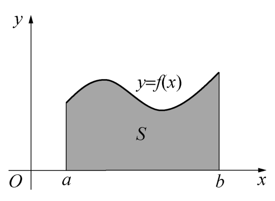

② 若$f(x)\le 0$，则其面积为$S=-\displaystyle\int_a^b f(x)\,\mathrm{d}x$（见图3-20）；

③ 若$f(x)$在积分区间$[a,b]$上既有取正值的部分，也有取负值的部分（见图3-21），则其面积为$S=\displaystyle\int_a^{c_1}f(x)\,\mathrm{d}x-\int_{c_1}^{c_2}f(x)\,\mathrm{d}x+\int_{c_2}^b f(x)\,\mathrm{d}x$．

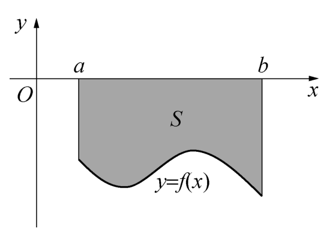

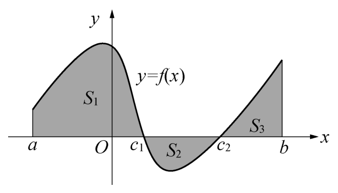

综上所述，由曲线$y=f(x)$，直线$x=a$、$x=b$及$x$轴所围成的平面图形的面积为

$$
S=\int_a^b|f(x)|\,\mathrm{d}x.
$$

我们利用定积分求面积的公式来验证一个已知的结果．

**例 1**　求椭圆$\frac{x^2}{a^2}+\frac{y^2}{b^2}=1$的面积．

**解**　由$\frac{x^2}{a^2}+\frac{y^2}{b^2}=1$，得

$$
y=\pm\frac{b}{a}\sqrt{a^2-x^2}.
$$

其中，若$y$取正号，即表示上半椭圆的方程，若$y$取负号，即表示下半椭圆的方程（见图3-22）．

又设椭圆的面积为$S$，它在第一象限的面积为$S_1$．由于椭圆关于两坐标轴对称，因而其面积为

$$
S=4S_1=4\int_0^a y\,\mathrm{d}x=4\int_0^a\frac{b}{a}\sqrt{a^2-x^2}\,\mathrm{d}x
=\frac{4b}{a}\int_0^a\sqrt{a^2-x^2}\,\mathrm{d}x.
$$

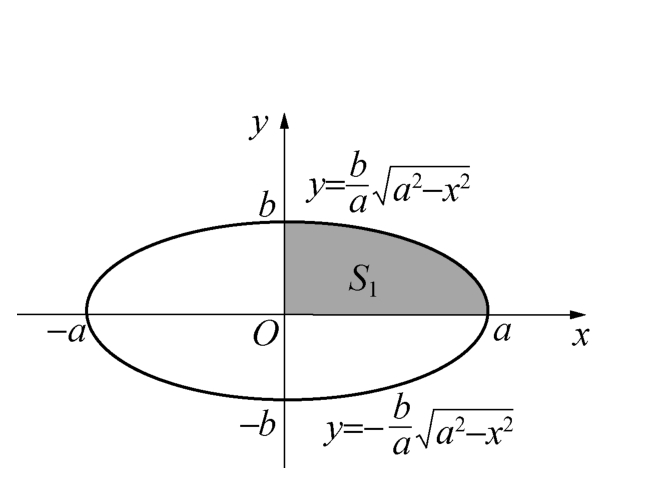

已知$\displaystyle\int_0^a\sqrt{a^2-x^2}\,\mathrm{d}x=\frac{\pi}{4}a^2$，从而有$S=\frac{4b}{a}\cdot\frac{\pi}{4}a^2=\pi ab$．

椭圆$\frac{x^2}{a^2}+\frac{y^2}{b^2}=1$也可表示成参数方程

$$
\begin{cases}x=a\cos t,\\y=b\sin t\end{cases}(0\le t\le 2\pi),
$$

因此也可以有

$$
S=4S_1=4\int_0^a y\,\mathrm{d}x=4\int_{\frac{\pi}{2}}^0 b\sin t\cdot a(-\sin t)\,\mathrm{d}t
=4ab\int_0^{\frac{\pi}{2}}\sin^2 t\,\mathrm{d}t=4ab\cdot\frac{1}{2}\cdot\frac{\pi}{2}=\pi ab.
$$

特别地，若$a=b=R$，则得到圆的面积$S=\pi R^2$．

（2）由曲线$y=f(x)$、$y=g(x)$及直线$x=a$、$x=b$所围成的平面图形的面积．

设曲线$y=f(x)$位于曲线$y=g(x)$的上方（见图 3-23），则其面积为

$$
S=\int_a^b [f(x)-g(x)]\,\mathrm{d}x.
$$

（3）由曲线$x=\varphi(y)$、$x=\psi(y)$及直线$y=a$、$y=b$所围成的平面图形的面积

设曲线$x=\varphi(y)$位于曲线$x=\psi(y)$的左侧（见图 3-24），则其面积为

$$
S=\int_a^b [\psi(y)-\varphi(y)]\,\mathrm{d}y.
$$

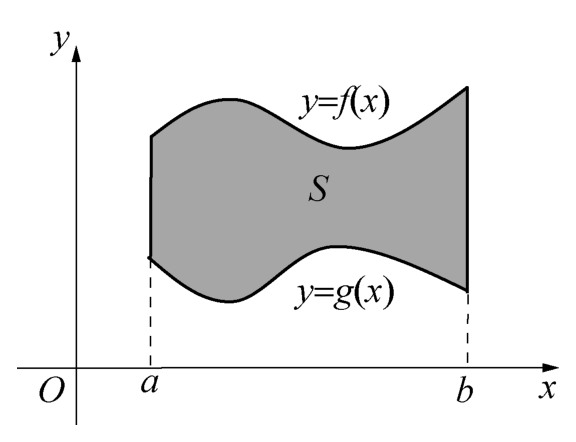

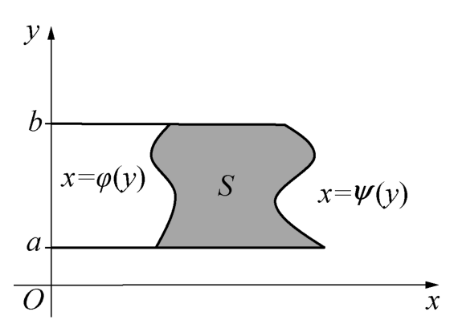

**例 2** 求由两条曲线$y^2=ax$和$ay=x^2(a>0)$围成的平面图形的面积。

**解** （1）求两曲线的交点：解方程组

$$
\begin{cases} y^2=ax, \\ ay=x^2, \end{cases}
$$

交点为$(0,0)$，$(a,a)$。

（2）画出两条曲线的图形（见图 3-25），它们均为抛物线，并将它们的方程变形为

$$
y=\sqrt{ax} \text{ 和 } y=\frac{x^2}{a}.
$$

（3）求面积：利用平面图形求面积公式，有

$$
S=\int_0^a\left(\sqrt{ax}-\frac{x^2}{a}\right)\mathrm{d}x=\sqrt{a}\int_0^a x^{\frac{1}{2}}\mathrm{d}x-\frac{1}{a}\int_0^a x^2\mathrm{d}x
=\sqrt{a}\cdot\frac{2}{3}x^{\frac{3}{2}}\bigg|_0^a-\frac{1}{a}\cdot\frac{1}{3}x^3\bigg|_0^a=\frac{1}{3}a^2.
$$

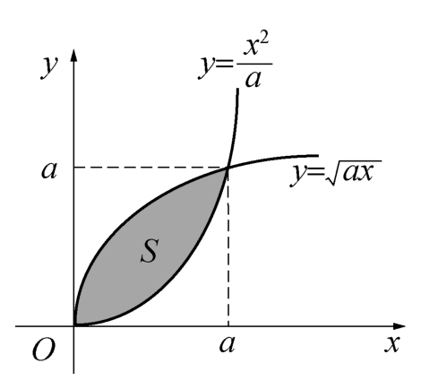

**例 3** 求抛物线$y^2=2x$与直线$y=x-4$所围成的平面图形的面积。

**解** 求曲线与直线的交点，即解方程组

$$
\begin{cases} y^2=2x, \\ y=x-4, \end{cases} \text{ 得 } \begin{cases} x=8, \\ y=4 \end{cases} \text{ 或 } \begin{cases} x=2, \\ y=-2, \end{cases}
$$

故交点为$A(8,4)$和$B(2,-2)$。

若选择$x$为积分变量，则该平面图形可视为由两部分$S_1$和$S_2$组成（见图 3-26），并将抛物线方程变形为$y=\pm\sqrt{2x}$，则由求平面图形面积的公式，有

$$
S=S_1+S_2=\int_0^2 \sqrt{2x}-(-\sqrt{2x})\,\mathrm{d}x+\int_2^8 [\,\sqrt{2x}-(x-4)\,]\,\mathrm{d}x
=2\sqrt{2}\cdot\frac{2}{3}x^{\frac{3}{2}}\bigg|_0^2+\sqrt{2}\cdot\frac{2}{3}x^{\frac{3}{2}}\bigg|_2^8-\frac{1}{2}(x-4)^2\bigg|_2^8
=\frac{16}{3}+\frac{64}{3}-\frac{8}{3}-6=18.
$$

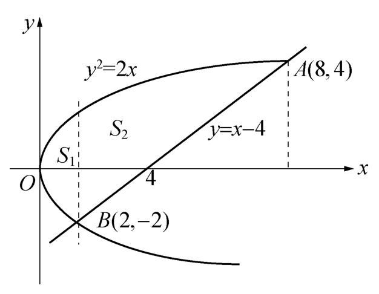

若选择$y$作为积分变量，则将曲线方程变为$x=\frac{y^2}{2}$，直线方程变为$x=y+4$（见图 3-27），则由求平面图形面积的公式，有

$$
S=\int_{-2}^4\left(y+4-\frac{y^2}{2}\right)\mathrm{d}y=\left(\frac{y^2}{2}+4y-\frac{1}{6}y^3\right)\bigg|_{-2}^4=18.
$$

上述两种解法中，显然第二种解法较为简便。在求平面图形的面积时，应注意对公式的适当选择。

**2. 微元法**

如果某一实际问题中所求量$U$符合下列条件：

（1）$U$是与某一个变量（比如$x$）的变化范围（比如$[a,b]$）有关的量；

（2）$U$对于区间$[a,b]$具有可加性，即若将$[a,b]$分成若干部分区间，则$U$相应地分成若干个部分量$\Delta U$，而$U$等于所有部分量$\Delta U$之和：$U=\sum \Delta U$；

（3）部分量$\Delta U$的近似值可表示为$f(x)\Delta x$，即$\Delta U\approx f(x)\Delta x$。

那么就可考虑用定积分来表示这个量$U$。通常写出这个量$U$的积分表达式的步骤为：

（1）根据问题的具体情况，选取一个变量（比如$x$）作为积分变量，并确定它的变化区间（比如$[a,b]$）。

（2）设想将区间$[a,b]$分成$n$个小区间，取其中任一小区间并记作$[x,x+\mathrm{d}x]$，求出相应于这个小区间的部分量$\Delta U$的近似值。如果$\Delta U$能近似地表示为区间$[a,b]$上的一个连续函数在$x$处的值$f(x)$与$\mathrm{d}x$的乘积，就将$f(x)\mathrm{d}x$称为量$U$的元素，记作$\mathrm{d}U$，即$\mathrm{d}U=f(x)\mathrm{d}x$。

（3）以所求量$U$的元素$f(x)\mathrm{d}x$为被积表达式，在区间$[a,b]$上积分，得$U=\int_a^b f(x)\mathrm{d}x$。我们称上述步骤为定积分的微元分析。

我们可以利用微元法来求解例 3（见图 3-27）。

（1）选择$y$为积分变量，$y\in[-2,4]$；

（2）任选区间微元$[y,y+\mathrm{d}y]$，面积微元$\mathrm{d}S=\left(y+4-\frac{y^2}{2}\right)\mathrm{d}y$；

（3）面积的值即为在积分区间$[-2,4]$上，以面积微元$\mathrm{d}S$为被积函数的定积分：

$$
S=\int_{-2}^4\left(y+4-\frac{y^2}{2}\right)\mathrm{d}y=18.
$$

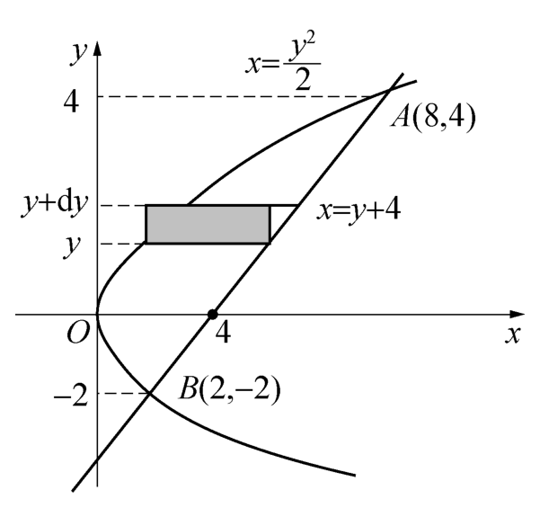

**3. 极坐标系下平面图形的面积**

某些平面图形，用极坐标计算它的面积比较方便。

在平面内取一个定点$O$，叫作极点，引一条射线$Ox$，叫作极轴，再选一个长度单位和角度的正方向（通常取逆时针方向）。对于平面内的任意一点$M$，用$r$表示线段$OM$的长度，$\theta$表示从$Ox$到$OM$的角，$r$叫作点$M$的极径，$\theta$叫作点$M$的极角，有序数对$(r,\theta)$就叫作点$M$的极坐标。这样建立的坐标系叫作极坐标系（见图 3-28）。

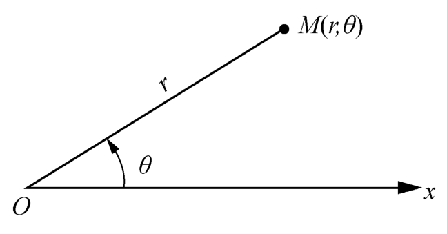

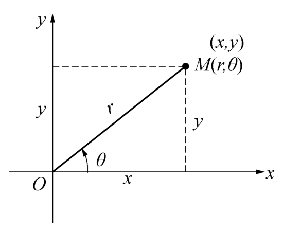

如果让直角坐标系的原点和极坐标的极点重合，极轴和直角坐标系的$x$轴正半轴重合，设$M$在直角坐标系下的坐标为$(x,y)$，对应的极坐标系下的坐标为$(r,\theta)$（见图 3-29），则可以得到两个坐标系的坐标之间的变量互化关系式：

$$
\begin{cases} x=r\cos\theta, \\ y=r\sin\theta, \end{cases} \quad \text{或} \quad \begin{cases} x^2+y^2=r^2, \\ \frac{y}{x}=\tan\theta.\end{cases}
$$

设由曲线$r=r(\theta)$及$\theta=\alpha$、$\theta=\beta$围成一图形（简称曲边扇形），这里$r(\theta)$在$[\alpha,\beta]$上连续，且$r(\theta)\ge 0$。由于当$\theta$在$[\alpha,\beta]$上变化时，$r=r(\theta)$也在变动（见图 3-30），现用微元法求曲边扇形的面积。

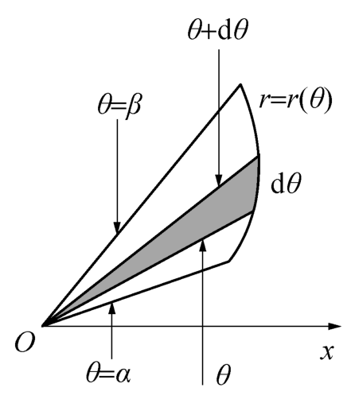

取$\theta$为积分变量，它的变化区间为$[\alpha,\beta]$，相应于$[\theta,\theta+\mathrm{d}\theta]$的窄曲边扇形面积可以用以$r(\theta)$为半径、$\mathrm{d}\theta$为圆心角的扇形面积近似代替，即面积微元为$\mathrm{d}S=\frac{1}{2}[r(\theta)]^2\mathrm{d}\theta$，因此曲边扇形的面积为以面积微元作为被积表达式，在区间$[\alpha,\beta]$上的定积分：

$$
S=\frac{1}{2}\int_\alpha^\beta [r(\theta)]^2\,\mathrm{d}\theta.
$$

**注** （1）如果图形由内含极点的封闭曲线$r=r(\theta)$所围成（见图 3-31），则

$$
S=\frac{1}{2}\int_0^{2\pi}[r(\theta)]^2\,\mathrm{d}\theta;
$$

（2）如果图形由曲线$r=r_1(\theta)$，$r=r_2(\theta)$及射线$\theta=\alpha$，$\theta=\beta$（$\alpha<\beta$）所围成（见图 3-32），则

$$
S=\frac{1}{2}\int_\alpha^\beta [r_2^2(\theta)-r_1^2(\theta)]\,\mathrm{d}\theta.
$$

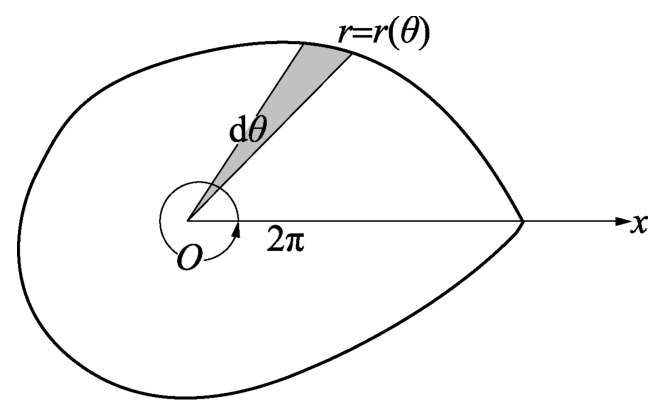

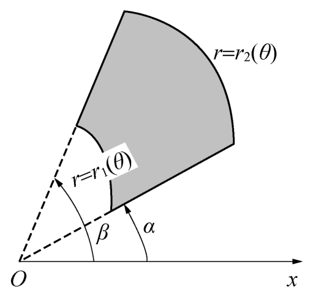

**例 4** 计算阿基米德螺线$r=a\theta(a>0)$上相应于$\theta$从$0$到$2\pi$的一段弧与极轴所围成的图形的面积（见图 3-33）。

**解**

$$
S=\frac{1}{2}\int_\alpha^\beta [r(\theta)]^2\mathrm{d}\theta=\frac{1}{2}\int_0^{2\pi} a^2\theta^2\mathrm{d}\theta=\frac{a^2}{2}\left[\frac{\theta^3}{3}\right]\bigg|_0^{2\pi}=\frac{4a^2\pi^3}{3}.
$$

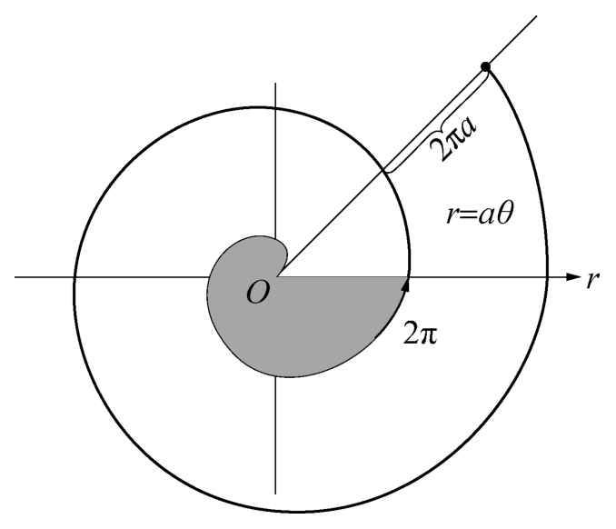

**例 5** 计算心形线$r=a(1+\cos\theta)(a>0)$所围成的图形的面积（见图 3-34）。

**解** 图形关于极轴对称。对于极轴以上部分图形，$\theta$的变化区间为$[0,\pi]$，

$$
S=2\cdot\frac{1}{2}\int_0^\pi a^2(1+\cos\theta)^2\mathrm{d}\theta=a^2\int_0^\pi (1+2\cos\theta+\cos^2\theta)\mathrm{d}\theta
=\frac{a^2}{2}\int_0^\pi (3+4\cos\theta+\cos 2\theta)\mathrm{d}\theta=\frac{a^2}{2}\left(3\theta+4\sin\theta+\frac{1}{2}\sin 2\theta\right)\bigg|_0^\pi
=\frac{3\pi a^2}{2}.
$$

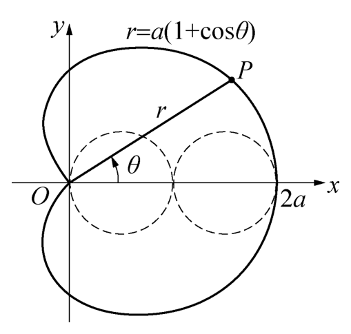

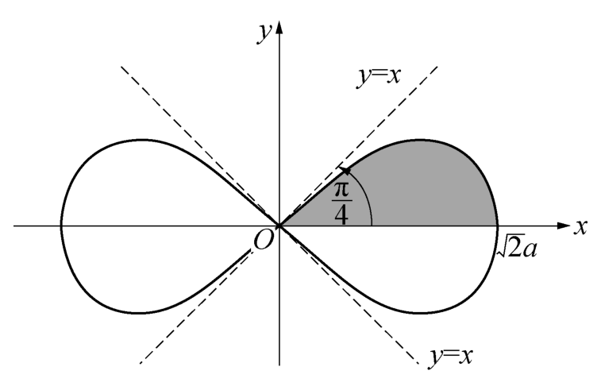

**例 6** 计算由双纽线$r^2=2a^2\cos 2\theta$所围成的区域的面积（见图 3-35）。

**解** 由$r^2=2a^2\cos 2\theta=0$知$\theta=\pm\frac{\pi}{4}$。由图形的对称性得

$$
S=4\left(\frac{1}{2}\int_0^{\frac{\pi}{4}} 2a^2\cos 2\theta\,\mathrm{d}\theta\right)=2a^2.
$$

### 二、空间立体的体积

**1. 旋转体**

由一个平面图形绕该平面内一条直线旋转一周而成的立体，称为旋转体。其中该条直线就称为旋转轴。圆柱、圆锥、圆台均可当作旋转体（见图 3-36）。

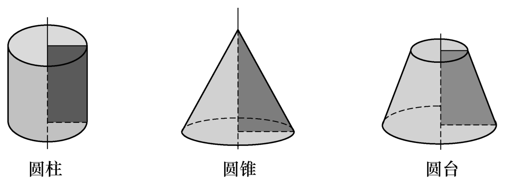

建立直角坐标系（见图 3-37），平面图形$A$由曲线$y=f(x)(f(x)>0)$、直线$x=a$、$x=b(a<b)$及$x$轴所围成，$\Omega$为$A$绕$x$轴旋转一周而成的立体，选$x$为积分变量，$x\in[a,b]$，任取$[x,x+\mathrm{d}x]$，则在$[x,x+\mathrm{d}x]$上的小旋转体体积可以近似等于底面积为$\pi f^2(x)$、以$\mathrm{d}x$为高的薄柱体体积，即体积元素为

$$
\mathrm{d}V_x=\pi f^2(x)\,\mathrm{d}x,
$$

故$[a,b]$上的旋转体体积为

$$
V_x=\pi\int_a^b f^2(x)\,\mathrm{d}x.
$$

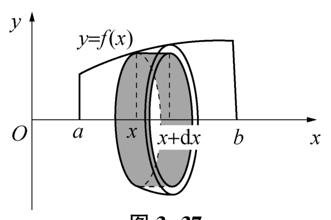

若$\Omega'$为$A$绕$y$轴旋转一周而成的立体，则选$x$为积分变量，$x\in[a,b]$，任取$[x,x+\mathrm{d}x]$（见图 3-38），则在$[x,x+\mathrm{d}x]$上的小旋转体体积可以近似等于内表面积为$2\pi f(x)$、厚为$\mathrm{d}x$的薄柱壳体积（见图 3-39），即体积元素为

$$
\mathrm{d}V_y=2\pi x f(x)\,\mathrm{d}x,
$$

故$[a,b]$上的旋转体体积为

$$
V_y=2\pi\int_a^b x f(x)\,\mathrm{d}x.
$$

类似地，若平面图形$A$由曲线$x=g(y)(g(y)>0)$，直线$y=c$、$y=d(c<d)$及$y$轴所围成，$\Omega$为$A$绕$y$轴旋转一周而成的立体，其体积为$V_y=\pi\int_c^d g^2(y)\mathrm{d}y$（见图 3-40）；绕$x$轴旋转一周而成的立体体积为$V_x=2\pi\int_c^d yg(y)\mathrm{d}y$。

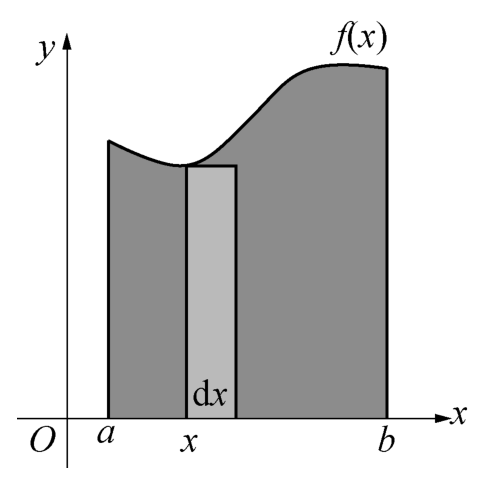

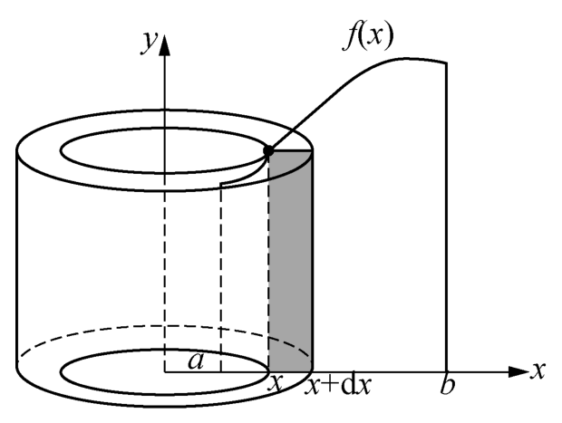

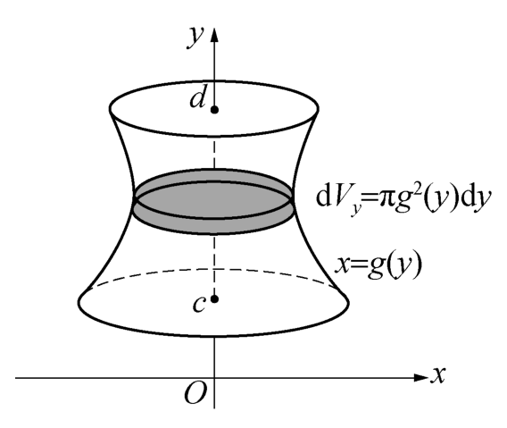

**例 7** 求椭圆$\frac{x^2}{a^2}+\frac{y^2}{b^2}=1$分别绕$x$轴与$y$轴旋转而得的旋转体的体积。

**解** 先求椭圆绕$x$轴旋转而得的旋转体的体积$V_x$。由椭圆的方程$\frac{x^2}{a^2}+\frac{y^2}{b^2}=1$得$y=\pm\frac{b}{a}\sqrt{a^2-x^2}$，如图 3-41 所示。

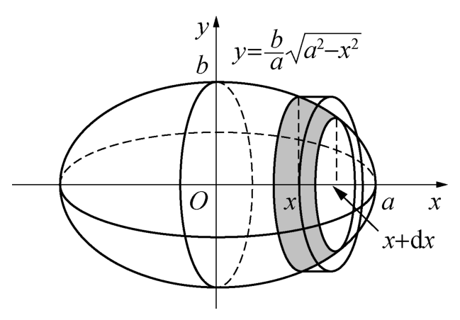

上半椭圆绕$x$轴旋转与下半椭圆绕$x$轴旋转而得的结果相同，故绕$x$轴旋转而得的旋转体的体积为

$$
V_x=\int_{-a}^a \pi y^2\mathrm{d}x=\pi\int_{-a}^a \frac{b^2}{a^2}(a^2-x^2)\,\mathrm{d}x
=2\pi\cdot\frac{b^2}{a^2}\int_0^a (a^2-x^2)\,\mathrm{d}x
=2\pi\cdot\frac{b^2}{a^2}\left(a^2x-\frac{1}{3}x^3\right)\bigg|_0^a=\frac{4}{3}\pi ab^2.
$$

同理得椭圆绕$y$轴旋转而得的旋转体的体积为

$$
V_y=\int_{-b}^b \pi x^2\mathrm{d}y=2\pi\frac{a^2}{b^2}\int_0^b (b^2-y^2)\,\mathrm{d}y
=2\pi\frac{a^2}{b^2}\left(b^2y-\frac{1}{3}y^3\right)\bigg|_0^b=\frac{4}{3}\pi a^2b.
$$

特别地，令$a=b=R$，即得球体的体积公式为$V=\frac{4}{3}\pi R^3$。

**例 8** 求星形线$x^{\frac{2}{3}}+y^{\frac{2}{3}}=a^{\frac{2}{3}}(a>0)$（见图 3-42）绕$x$轴旋转构成的旋转体的体积。

**解** 体积微元为

$$
\mathrm{d}V=\pi\left(a^{\frac{2}{3}}-x^{\frac{2}{3}}\right)^3\mathrm{d}x,
$$

所求体积为

$$
V=\int_{-a}^a \pi\left(a^{\frac{2}{3}}-x^{\frac{2}{3}}\right)^3\mathrm{d}x=\frac{32}{105}\pi a^3.
$$

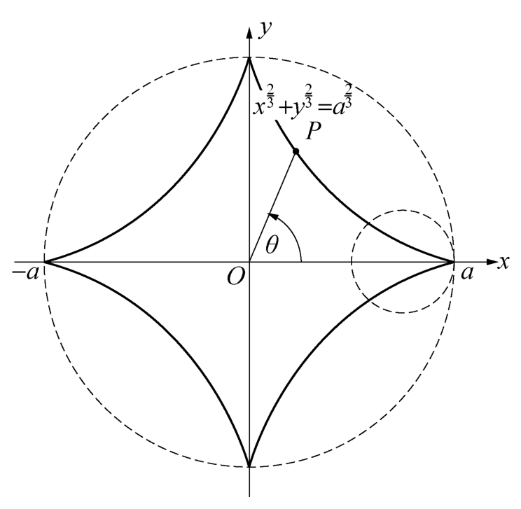

**例 9** 求曲线$xy=4$，直线$y=1$、$y=2$所围成的图形（见图 3-43）绕$y$轴旋转构成的旋转体的体积。

**解** 体积微元为

$$
\mathrm{d}V=\pi x^2\mathrm{d}y=\pi\frac{16}{y^2}\mathrm{d}y,
$$

所求体积为

$$
V=\pi\int_1^2 \frac{16}{y^2}\mathrm{d}y=\pi\left(-\frac{16}{y}\right)\bigg|_1^2=8\pi.
$$

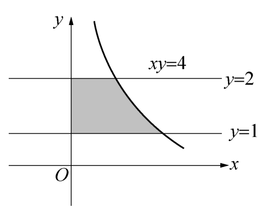

**例 10** 求由摆线$\begin{cases} x=a(t-\sin t), \\ y=a(1-\cos t) \end{cases}$的一拱，$x$轴所围成的图形（见图 3-44）分别绕$x$轴、$y$轴旋转一周而成的旋转体的体积。

**解**

$$
V_x=\pi\int_0^{2\pi a} y^2\mathrm{d}x=\pi\int_0^{2\pi} a^2(1-\cos t)^2 a(1-\cos t)\mathrm{d}t=\pi a^3\int_0^{2\pi}(1-3\cos t+3\cos^2 t-\cos^3 t)\mathrm{d}t=5\pi^2 a^3,
V_y=2\pi\int_0^{2\pi a} xy\mathrm{d}x=2\pi\int_0^{2\pi} a(t-\sin t)\,a(1-\cos t)\,a(1-\cos t)\mathrm{d}t=6\pi^3 a^3.
$$

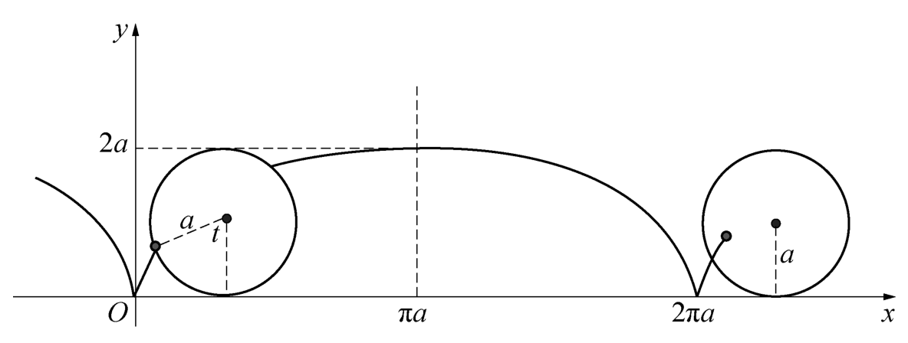

**2. 平行截面面积已知的立体的体积**

由曲线$y=f(x)(f(x)>0)$，直线$x=a$、$x=b(a<b)$及$x$轴所围成的图形绕$x$轴旋转一周而成的立体体积为$V_x=\pi\int_a^b f^2(x)\mathrm{d}x$，其中被积函数$\pi f^2(x)$即为立体过点$x$且垂直于$x$轴的截面面积，记为$S(x)$（见图 3-45）。故旋转体的体积公式可写为$V_x=\int_a^b S(x)\mathrm{d}x$。现将此结果推广到一般的已知截面面积的立体体积。

设有一个立体，它被垂直于某条直线（如$x$轴）的平面所截的截面面积$S(x)$为$x$的连续函数，且此物体的位置在平面$x=a$与$x=b$之间（见图 3-46），求其体积$V$。

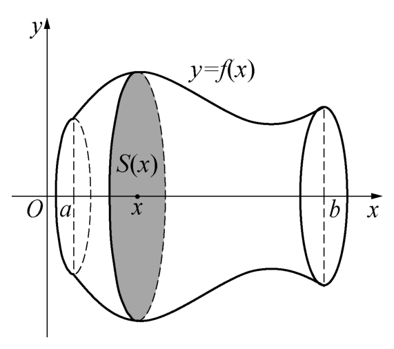

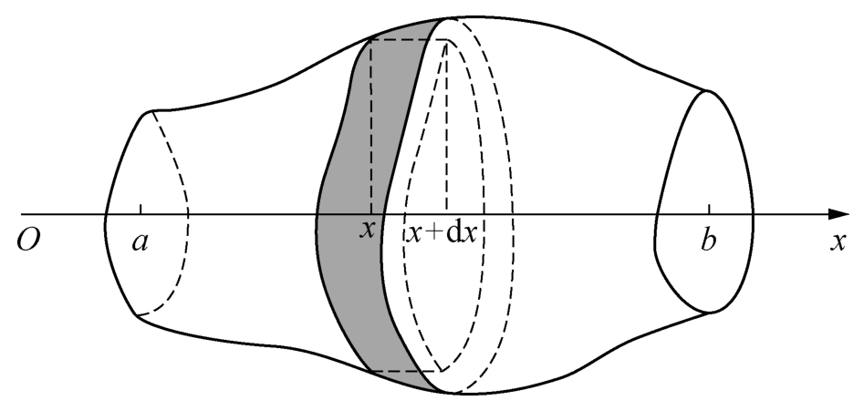

若取定轴为$x$轴，设$S(x)(a\le x\le b)$表示过点$x$且垂直于$x$轴的截面面积，取$x$为积分变量，它的变化区间为$[a,b]$；立体中相应于$[a,b]$上任一小区间$[x,x+\mathrm{d}x]$的薄片体积，近似等于底面积为$S(x)$、高为$\mathrm{d}x$的柱体体积，即体积元素为

$$
\mathrm{d}V=S(x)\,\mathrm{d}x,
$$

则

$$
V=\int_a^b S(x)\,\mathrm{d}x.
$$

**例 11** 一平面经过半径为$R$的圆柱体的底圆中心并与底面交成角$\alpha$（见图 3-47），计算该平面截圆柱体所得的立体的体积。

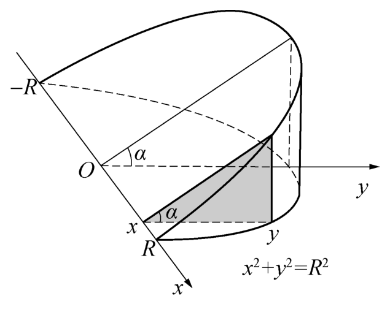

**解** 若设底圆的方程为$x^2+y^2=R^2$，则立体中过点$x$且垂直于$x$轴的截面是一个直角三角形，其两条直角边长分别为$y$、$y\tan\alpha$，即$\sqrt{R^2-x^2}$、$\sqrt{R^2-x^2}\tan\alpha$，故

$$
S(x)=\frac{1}{2}y\cdot y\tan\alpha=\frac{1}{2}(R^2-x^2)\tan\alpha,
$$

因此

$$
V=\int_{-R}^R S(x)\,\mathrm{d}x=\frac{1}{2}\tan\alpha\int_{-R}^R (R^2-x^2)\,\mathrm{d}x=\tan\alpha\cdot\left(R^2x-\frac{1}{3}x^3\right)\bigg|_0^R=\frac{2}{3}R^3\tan\alpha.
$$

**例 12** 求$x^2+y^2=a^2$，$y^2+z^2=a^2$两柱面所围立体的体积（见图 3-48）。

**解** 由对称性，知$V=8V_1$（其中$V_1$为在第一象限内部分的体积），

$$
S(x)=\sqrt{a^2-x^2}\cdot\sqrt{a^2-x^2}=(a^2-x^2),\quad x\in[0,a],
V=8V_1=8\int_0^a (a^2-x^2)\mathrm{d}x=8\left(a^2x-\frac{1}{3}x^3\right)\bigg|_0^a=\frac{16}{3}a^3.
$$

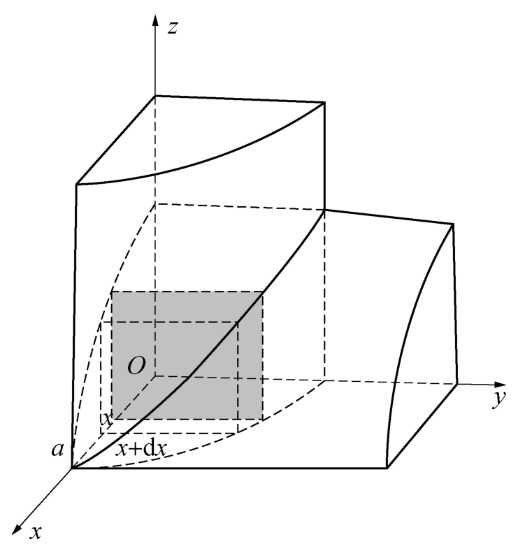

### 三、曲线的弧长

在平面几何中，直线的长度容易计算，而除了圆弧以外的曲线长度的计算就比较困难，现在将讨论这一问题。

圆周长是用圆内接多边形的周长，当边数无限增加时的极限来确定的。一般平面曲线弧长的计算也可运用这一思想。

**1. 平面曲线的弧长的概念**

设$AB$为曲线弧$\overset{\frown}{AB}$上的两个端点，任取分点$A=M_0$，$M_1$，$\cdots$，$M_n=B\in\overset{\frown}{AB}$，并依次连接相邻分点得内接折线（见图 3-49），其长度为$\sum_{i=1}^{n}|M_{i-1}M_i|$。

当分点无限增多时，和式$\sum_{i=1}^{n}|M_{i-1}M_i|$的极限存在，则称此极限为曲线弧$\overset{\frown}{AB}$的弧长。此时称$\overset{\frown}{AB}$是可求长的。对此，我们有如下结论。

**定理** 光滑曲线弧是可求长的。

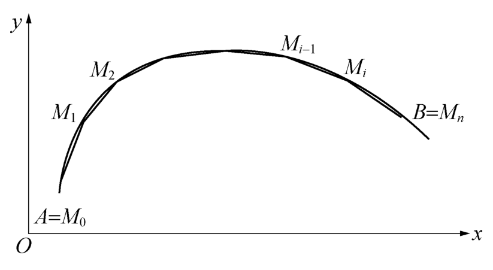

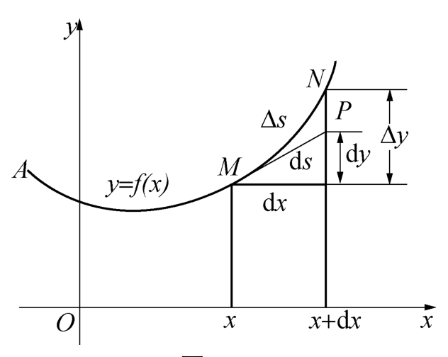

下面就来探讨光滑曲线弧长的计算公式。

**2. 直角坐标系中的弧长公式**

设函数$f(x)$具有一阶连续导数，曲线弧由$y=f(x)(a\le x\le b)$给出，任取$x\in[a,b]$，过$x$作曲线的切线，设$x$对应曲线上的点$M(x,y)$，$x+\Delta x(x+\mathrm{d}x)$对应曲线上的点$N(x+\Delta x,y+\Delta y)$，对应切线上的点$P(x+\mathrm{d}x,y+\mathrm{d}y)$，区间$[x,x+\Delta x]$对应小弧段$\overset{\frown}{MN}$，记小弧段$\overset{\frown}{MN}$长度为$\Delta s$，记切线$\overline{MP}$的长度为$\mathrm{d}s$（见图 3-50）。由微分的几何意义可知，当$\Delta x$足够小时，可以用切线段$\overline{MP}$近似替代弧段$\overset{\frown}{MN}$，所以$\Delta s$的近似值即为弧长微元

$$
\mathrm{d}s=\sqrt{(\mathrm{d}x)^2+(\mathrm{d}y)^2}=\sqrt{1+f'^2(x)}\,\mathrm{d}x,
$$

因此所求弧长为

$$
s=\int_a^b \sqrt{1+f'^2(x)}\,\mathrm{d}x.
$$

由于$s\ge 0$，故要求$a<b$。

**例 13** 求曲线$y=\frac{2}{3}x^{\frac{3}{2}}$上相应于$x$从 1 到 2 的一段弧的长度。

**解** 曲线由直角坐标方程给出，取$x$为积分变量，$y'=x^{\frac{1}{2}}$，弧长微元为

$$
\mathrm{d}s=\sqrt{1+y'^2}\,\mathrm{d}x=\sqrt{1+x}\,\mathrm{d}x,
$$

所求弧长为

$$
s=\int_0^1 \sqrt{1+x}\,\mathrm{d}x=\frac{2}{3}\left(2^{\frac{3}{2}}-1\right).
$$

**3. 由参数方程表示的弧长公式**

设曲线弧由参数方程$\begin{cases} x=\varphi(t), \\ y=\psi(t) \end{cases}$（$\alpha\le t\le\beta$）给出，其中$\varphi(t)$，$\psi(t)$在$[\alpha,\beta]$上具有连续导数。由弧微分可知$\mathrm{d}s=\sqrt{\varphi'^2(t)+\psi'^2(t)}\,\mathrm{d}t$，因此$s=\int_\alpha^\beta \sqrt{\varphi'^2(t)+\psi'^2(t)}\,\mathrm{d}t$。

**注** 由于$s\ge 0$，故要求$\alpha<\beta$。

**例 14** 求圆$x^2+y^2=R^2$的周长。

**解** 将圆的方程化为参数方程：

$$
\begin{cases} x=R\cos\theta, \\ y=R\sin\theta, \end{cases} \quad (0\le\theta\le 2\pi),
$$

则所求圆周长

$$
s=\int_0^{2\pi}\sqrt{(x'_\theta)^2+(y'_\theta)^2}\,\mathrm{d}\theta=\int_0^{2\pi}\sqrt{(-R\sin\theta)^2+(R\cos\theta)^2}\,\mathrm{d}\theta=R\int_0^{2\pi}\mathrm{d}\theta=2\pi R.
$$

**例 15** 求星形线$\begin{cases} x=a\cos^3 t, \\ y=a\sin^3 t \end{cases}$的全长。

**解** 由对称性可知，星形线的全长为它在第一象限部分的 4 倍，则由弧长公式得

$$
s=\int_\alpha^\beta \sqrt{\varphi'^2(t)+\psi'^2(t)}\,\mathrm{d}t=4\int_0^{\frac{\pi}{2}}\sqrt{9a^2\cos^4 t\sin^2 t+9a^2\sin^4 t\cos^2 t}\,\mathrm{d}t
=4\int_0^{\frac{\pi}{2}} 3a|\sin t\cos t|\,\mathrm{d}t=4\int_0^{\frac{\pi}{2}} 3a\sin t\,\mathrm{d}(\sin t)=6a\left(\sin^2 t\right)\bigg|_0^{\frac{\pi}{2}}
=6a.
$$

**例 16** 求摆线$\begin{cases} x=a(t-\sin t), \\ y=a(1-\cos t) \end{cases}$（$a>0$，$0\le t\le 2\pi$）一拱的弧长。

**解** $x'(t)=a(1-\cos t)$，$y'(t)=a\sin t$。

由弧长计算公式，得

$$
s=\int_0^{2\pi}\sqrt{[x'(t)]^2+[y'(t)]^2}\,\mathrm{d}t=\int_0^{2\pi} a\sqrt{2(1-\cos t)}\,\mathrm{d}t
=2a\int_0^{2\pi}\left|\sin\frac{t}{2}\right|\mathrm{d}t=2a\int_0^\pi \sin\frac{t}{2}\,\mathrm{d}t-2a\int_\pi^{2\pi}\sin\frac{t}{2}\,\mathrm{d}t
=8a.
$$

**4. 极坐标系下的弧长公式**

设曲线弧由极坐标方程$r=r(\theta)(\alpha\le\theta\le\beta)$给出，其中$r(\theta)$在$[\alpha,\beta]$上具有连续导数。由弧微分可知$\mathrm{d}s=\sqrt{r^2(\theta)+r'^2(\theta)}\,\mathrm{d}\theta$，因此$s=\int_\alpha^\beta \sqrt{r^2(t)+r'^2(\theta)}\,\mathrm{d}\theta$。

**注** 由于$s\ge 0$，故要求$\alpha<\beta$。

**例 17** 计算阿基米德螺线$r=a\theta(a>0)$上相应于$\theta$从$0$到$2\pi$一段的弧长。

**解** $s=\int_0^{2\pi}\sqrt{(a\theta)^2+a^2}\,\mathrm{d}\theta=a\int_0^{2\pi}\sqrt{\theta^2+1}\,\mathrm{d}\theta$

$$
=\frac{a}{2}\left[\theta\sqrt{\theta^2+1}+\ln\left(\theta+\sqrt{\theta^2+1}\right)\right]\bigg|_0^{2\pi}
=\frac{a}{2}\left[2\pi\sqrt{4\pi^2+1}+\ln\left(2\pi+\sqrt{4\pi^2+1}\right)\right].
$$

**例 18** 求心形线$r=a(1+\cos\theta)$的全长。

**解** 由对称性，知$s=2\int_0^\pi \sqrt{a^2(1+\cos\theta)^2+a^2\sin^2\theta}\,\mathrm{d}\theta=2a\int_0^\pi \sqrt{2(1+\cos\theta)}\,\mathrm{d}\theta$

$$
=4a\int_0^\pi \cos\frac{\theta}{2}\,\mathrm{d}\theta=8a\sin\frac{\theta}{2}\bigg|_0^\pi=8a.
$$

### ＊四、定积分在物理上的应用举例

本小节内容供对物理知识要求较高的专业选学。

定积分在物理上的应用相当广泛，如求具有均匀质量分布的平面曲线和平面图形的重心，变速直线运动物体在某时间区间内经过的距离，物体的转动惯量和变力做功等。下面通过实例加以说明。

本节仅介绍应用定积分来计算变力做功和水压力。

**1. 变力沿直线所做的功**

**例 19** 设$40\ \mathrm{N}$的力使弹簧从自然长度$10\ \mathrm{cm}$拉长成$15\ \mathrm{cm}$，问：需要做多大的功才能克服弹性恢复力，将伸长的弹簧从$15\ \mathrm{cm}$处再拉长$3\ \mathrm{cm}$？

**解** 取弹簧的平衡点作为原点建立坐标系，如图 3-51 所示。

由物理学知道，弹簧在拉伸过程中需要的力$F(x)$与伸长量$x$成正比，即$F(x)=kx$，其中$k$为比例系数。当弹簧从$10\ \mathrm{cm}$拉长到$15\ \mathrm{cm}$时，它的伸长量为$5\ \mathrm{cm}=0.05\ \mathrm{m}$。

因有$F(0.05)=40$，即$0.05k=40$，故得$k=800\ \mathrm{N/m}$。于是$F(x)=800x$。

弹簧从$15\ \mathrm{cm}$拉长到$18\ \mathrm{cm}$，即变化区间为$[0.05,0.08]$。

由于拉力随着伸长量的变化而不断变化，所以拉力所做的功不能直接用“力×位移”来计算。也就是说，压力在区间上分布是不均匀的。把伸缩区间进行分割，分割成许多小区间。由于小区间上点的距离非常近，我们认为在每个小区间上的弹簧拉力近似相等，就可以用恒力做功的计算公式算出拉力对在每个小区上所做功的近似值。并且拉力所做功关于区间具有可加性，因此拉力所做的功可以用定积分来计算，就得到整个区间上拉力所做的功。

在积分区间$[0.05,0.08]$中任取$x$，作微元区间$[x,x+\Delta x]$，在微元区间上拉力所做的功即为功的微元

$$
\mathrm{d}W=F(x)\mathrm{d}x=800x\,\mathrm{d}x,
$$

于是拉力使弹簧拉长$3\ \mathrm{cm}=0.03\ \mathrm{m}$所做的功为

$$
W=\int_{0.05}^{0.08}800x\,\mathrm{d}x=400x^2\bigg|_{0.05}^{0.08}=400(0.0064-0.0025)=1.56\ \mathrm{J}.
$$

**例 20** 设有一直径为$20\ \mathrm{m}$的半球形水池，池内贮满水。若要把水抽尽，至少做多少功？

**解** 如图 3-52 所示，建立直角坐标系，

池壁与面的交线为半圆周$x^2+y^2=100(x\ge 0)$。选取$x$为积分变量，$x\in[0,10]$，与微元区间$[x,x+\mathrm{d}x]$对应的是厚度为$\mathrm{d}x$的一层水，微元上的这层水的体积

$$
\Delta V\approx\pi y^2\Delta x=\pi(100-x^2)\Delta x\ \mathrm{m^3},
$$

其所受的重力为$\mathrm{d}F\approx\rho g\mathrm{d}V=g\pi\rho(100-x^2)\mathrm{d}x\ \mathrm{kN}$。

把这层水抽出，至少需要提升$x(\mathrm{m})$距离。

故需做的功为

$$
\Delta W\approx g\rho\pi(100-x^2)\Delta x\cdot x=g\pi\rho x(100-x^2)\Delta x\ \mathrm{J},
$$

其中$\rho=1\,000\ \mathrm{kg/m^3}$是水的密度，$g=9.8\ \mathrm{m/s^2}$是重力加速度。故做功微元

$$
\mathrm{d}W=g\pi\rho x(100-x^2)\mathrm{d}x.
$$

所求功为

$$
W=\int_0^{10} g\pi\rho x(100-x^2)\,\mathrm{d}x=g\pi\rho\int_0^{10}x(100-x^2)\,\mathrm{d}x
=g\cdot\frac{\pi\rho}{4}\times 10^4=2\,500\pi\rho g\approx 7.693\times 10^7\ \mathrm{J}.
$$

**2. 水压力**

从物理学知识可以知道，在水深为$h$处的压强为$p=\nu h$（$\nu$是水的比重）。如果有一面积为$A$的平板水平地放置在水深为$h$处，则平板一侧所受的水压力为$F=pA$。如果平板垂直地放置在水中，则由于水深不同的点的压强不同，则计算平板的水压力需要使用定积分。

**例 21** 一个三角形薄板铅直地沉没在水中，底在上且与水面相接，底边长为$a$，高为$h$，求薄板每侧所受的压力（设水的比重为$\nu$）。

**解** 建立直角坐标系，如图 3-53 所示，则三角形的一条腰边的方程为$\frac{2y}{a}=\frac{h-x}{h}$，即$y=\frac{a}{2h}(h-x)$。

因为压强与水深成正比，同一深度的压强是相同的，于是将闸门水平分割成小横条，取积分变量为$x$，$x\in[0,h]$，任取$[x,x+\mathrm{d}x]\subset[0,h]$，闸门上有高为$\mathrm{d}x$的小条，其面积为

$$
2y\mathrm{d}x=a\left(1-\frac{x}{h}\right)\mathrm{d}x,
$$

其上的压强近似等于$\nu x$。

故其上所受的水压力

$$
\mathrm{d}F=2\nu xy\mathrm{d}x=\frac{\nu a}{h}x(h-x)\,\mathrm{d}x,
$$

因此

$$
F=\frac{\nu a}{h}\int_0^h x(h-x)\,\mathrm{d}x=\frac{1}{6}\nu ah^2.
$$

### 习题 3-7
1. 求下列平面图形的面积：
（1）由$y^2=x$和$y=x^2$所围成的图形；
（2）由抛物线$y+1=x^2$与直线$y=1+x$所围成的图形；
（3）由抛物线$y=x^2$与直线$x+y=2$所围成的图形；
（4）由抛物线$y=2x-x^2$与直线$x+y=0$所围成的图形；
（5）由$y^2=2x$和$y=x-4$所围成的图形；
（6）由$y=\mathrm{e}^x$，$y=\mathrm{e}^{-x}$和$x=1$所围成的图形；
（7）由曲线$y=x^3-6x$和$y=x^2$所围成的图形；
（8）由三次抛物线$y=x^3$与直线$y=2x$所围成的平面图形；
（9）由曲线$xy=1$及直线$y=x$和$y=2$所围成的平面图形；
（10）由曲线$y=|\ln x|$与直线$x=\frac{1}{\mathrm{e}}$，$x=\mathrm{e}$和$x$轴所围成的平面图形。
2. 求抛物线$y=-x^2+4x-3$及其在点$(0,-3)$和$(3,0)$处的切线所围平面图形的面积。
3. 求下列平面图形的面积：
（1）由摆线$\begin{cases} x=a(t-\sin t), \\ y=a(1-\cos t) \end{cases}$的一拱（$0\le t\le 2\pi$）与横轴所围成的图形；
（2）星形线$\begin{cases} x=a\cos^3 t, \\ y=a\sin^3 t \end{cases}$（$a>0$）所围成的图形；
\*（3）由曲线$\rho=\sqrt{2}\sin\theta$（圆周）和$\rho^2=\cos 2\theta$（双纽线）所围成图形的公共部分；
\*（4）由$\rho=1$和$\rho^2=2\cos 2\theta$所围成图形的公共部分。
4. 求下列旋转体的体积：
（1）曲线$y=\sqrt{x}$与直线$x=1$，$x=4$和$x$轴所围成的平面图形绕$x$轴和$y$轴旋转而得的旋转体；
（2）曲线$y=\mathrm{e}^{-x}$与直线$y=0$，$x=1$所围成的位于第一象限内的平面图形绕$x$轴旋转而得的旋转体；
（3）曲线$y=\sin x$和$y=\cos x$与$x$轴在区间$\left[0,\frac{\pi}{2}\right]$上所围成的平面图形绕$x$轴旋转而得的旋转体；
（4）曲线$y=x^2$和$x=y^2$所围成的平面图形分别绕$x$轴和$y$轴旋转而得的旋转体；
（5）曲线$y=x^2$和$y=2-x^2$所围成的平面图形绕$x$轴旋转而得的旋转体；
（6）已知抛物线$y^2=8x$，求
① 抛物线在点$(2,4)$处的法线方程，
② 抛物线$y\ge 0$的部分及其在$(2,4)$处的法线和$x$轴所围成图形绕$y$轴旋转而得的旋转体；
（7）试用两种方法计算由$y=(x-1)(x-2)$和$y=0$所围成的平面图形绕$y$轴旋转而得的旋转体。
5. 一物体，其底面是半径为$r$的圆，用垂直于底圆某一直径的平面截该物体，所得截面都是正方形，求该物体的体积。
6. 立体底面为抛物线$y=x^2$与直线$y=1$围成的图形，而任一垂直于轴的截面分别为（1）正方形，（2）等边三角形，（3）半圆形，求对应情况下立体的体积。
7. 求下列曲线的弧长。
（1）曲线$x=a(\cos t+t\sin t)$，$y=a(\sin t-t\cos t)$（$a>0$，$0\le t\le 2\pi$）；
（2）抛物线$y^2=2px$从顶点到该曲线上的一点$M(x,y)$的弧；
（3）曲线$y=x^{\frac{2}{3}}$在$0\le x\le 4$一段的弧；
（4）曲线$y=\ln(\cos x)$在$0\le x\le\frac{\pi}{4}$一段的弧；
（5）曲线$x=\frac{1}{4}y^2-\frac{1}{2}\ln y$在$1\le y\le \mathrm{e}$一段的弧；
（6）曲线$x=\arctan t$，$y=\frac{1}{2}\ln(1+t^2)$自$t=0$到$t=1$的一段弧；
（7）阿基米德螺线$r=a\theta$（$a>0$）上相应于$\theta$从$0$到$2\pi$的弧；
（8）极坐标系下曲线$r=a\left(\sin\frac{\theta}{3}\right)^3$（$a>0$，$0\le\theta\le 3\pi$）。
8. 在摆线$x=a(t-\sin t)$，$y=a(1-\cos t)$上求分摆线第一拱成$1:3$的点的坐标。
\*9. 一圆锥形容器，上底半径为$1\ \mathrm{m}$，高$3\ \mathrm{m}$，锥中盛水深$2\ \mathrm{m}$，如将水全部抽出，需做功多少？
\*10. 一圆柱形的容器高为$5\ \mathrm{m}$，底圆半径为$3\ \mathrm{m}$，容器内盛满水，若将其中的水全部抽出，需做多少功？
\*11. 弹性体所受压缩之力$F$与缩短距离$x$之间的关系按胡克定律$F=kx$计算，现有一个弹簧，原长为$1\ \mathrm{m}$，每压缩$1\ \mathrm{cm}$，需力$5\ \mathrm{N}$，若自$80\ \mathrm{cm}$压缩至$60\ \mathrm{cm}$，则做了多少功？
\*12. 一横截面为等腰梯形的贮水池，梯形上底长$6\ \mathrm{m}$，下底长$4\ \mathrm{m}$，深$2\ \mathrm{m}$，长$8\ \mathrm{m}$，要把满池水全部抽到距水池上方$20\ \mathrm{m}$的水塔中，需做功多少？
\*13. 一块底为$4\ \mathrm{m}$、高为$3\ \mathrm{m}$的等腰三角形平板铅直地置于水中，底边在上，平行于水面，位于水面下$1\ \mathrm{m}$，求该平板的一侧受到的水压力。
\*14. 某下水道的横截面是直径为$3\ \mathrm{m}$的圆，水平铺设，下水道内水深$1.5\ \mathrm{m}$，求与下水道垂直的闸门所受的压力。
## 第八节 反常积分
[课前导读]
定积分$\int_a^b f(x)\mathrm{d}x$对被积函数和积分区间都有要求。
（1）积分区间为$[a,b]$，是有限区间；
（2）被积函数$f(x)$在$[a,b]$上是有界的，一般还要求是连续的。
然而，在实际问题中往往会遇到不满足上述条件的情形。例如，将火箭发射到远离地球的太空中，要计算克服地心引力所做的功，就需要考虑积分区间为无限的积分。因此有必要推广定积分的概念，即把积分区间扩展到无穷区间，比如$(-\infty,b]$、$[a,+\infty)$或$(-\infty,+\infty)$，或者被积函数$f(x)$在积分区间内是无界时的情形，从而形成“反常积分”（广义积分）的概念，而原来的定积分可以称为常义积分。
### 一、无限区间上的反常积分
先看几个定积分：

$$
\int_0^1\frac{1}{1+x^2}\mathrm{d}x=\arctan x\bigg|_0^1=\arctan 1=\frac{\pi}{4},
$$

$$
\int_0^b\frac{1}{1+x^2}\mathrm{d}x=\arctan x\bigg|_0^b=\arctan b;
$$

$$
\int_1^2\frac{1}{x}\mathrm{d}x=\ln x\bigg|_1^2=\ln 2,
$$

$$
\int_1^b\frac{1}{x}\mathrm{d}x=\ln b\bigg|_1^2=\ln b.
$$

定积分的几何意义是在对应区间上曲边梯形面积的代数和。现在让$b\to+\infty$，取对应的定积分的极限，则有

$$
\lim_{b\to+\infty}\int_0^b\frac{1}{1+x^2}\mathrm{d}x=\lim_{b\to+\infty}\arctan x\bigg|_0^b=\lim_{b\to+\infty}\arctan b=\frac{\pi}{2};
$$

$$
\lim_{b\to+\infty}\int_1^b\frac{1}{x}\mathrm{d}x=\lim_{b\to+\infty}\ln b\bigg|_1^2=\lim_{b\to+\infty}\ln b=+\infty.
$$

这两个极限的几何意义也十分明显。
曲线$y=\frac{1}{1+x^2}$与$y$轴、$x$轴正半轴所“围”的图形可以向$x$轴正方向无限延伸（见图 3-54），且有“有限”面积$\frac{\pi}{2}$，对应的积分极限存在；而曲线$y=\frac{1}{x}$与直线$x=1$、$x$轴正半轴所“围”的图形也可以向$x$轴正方向无限延伸（见图 3-55），同时“面积”也无限增大，故对应的极限不存在。这就是这一节要讨论的反常积分的“几何意义”。下面给出反常积分的定义。

**定义 1** 设函数$f(x)$在区间$(-\infty,b]$上连续，取$a<b$，如果极限$\lim_{a\to-\infty}\int_a^b f(x)\mathrm{d}x$存在，则称此极限为函数$f(x)$在无穷区间$(-\infty,b]$上的反常积分，记作$\int_{-\infty}^b f(x)\mathrm{d}x$，即

$$
\int_{-\infty}^b f(x)\mathrm{d}x=\lim_{a\to-\infty}\int_a^b f(x)\mathrm{d}x.
$$

这时也称反常积分$\int_{-\infty}^b f(x)\mathrm{d}x$收敛。如果这个极限不存在，则称反常积分$\int_{-\infty}^b f(x)\mathrm{d}x$发散。
从定义中看出一个反常积分化为计算定积分与取极限两部分，这都是我们熟悉的知识；同时$a$是任意取的，因此$\lim_{a\to-\infty}\int_a^b f(x)\mathrm{d}x=A$必须对任意一种趋近方式都成立。
当反常积分$\int_{-\infty}^b f(x)\mathrm{d}x$收敛时，$\int_{-\infty}^b f(x)\mathrm{d}x$表示一个数；而当反常积分$\int_{-\infty}^b f(x)\mathrm{d}x$发散时，$\int_{-\infty}^b f(x)\mathrm{d}x$仅是一个符号。
同样可以定义区间$[a,+\infty)$或$(-\infty,+\infty)$上的反常积分。
**定义 2** 设函数$f(x)$在区间$[a,+\infty)$上连续，取$b>a$，如果极限$\lim_{b\to+\infty}\int_a^b f(x)\mathrm{d}x$存在，则称此极限为函数$f(x)$在无穷区间$[a,+\infty)$上的反常积分，记作$\int_a^{+\infty} f(x)\mathrm{d}x$，即

$$
\int_a^{+\infty} f(x)\mathrm{d}x=\lim_{b\to+\infty}\int_a^b f(x)\mathrm{d}x.
$$

这时也称反常积分$\int_a^{+\infty} f(x)\mathrm{d}x$收敛。如果这个极限不存在，则称反常积分$\int_a^{+\infty} f(x)\mathrm{d}x$发散。
**定义 3** 设函数$f(x)$在区间$(-\infty,+\infty)$上连续，若$\int_{-\infty}^c f(x)\mathrm{d}x$，$\int_c^{+\infty} f(x)\mathrm{d}x$均收敛，则称上述两反常积分之和为函数$f(x)$在无穷区间$(-\infty,+\infty)$内的反常积分，记作$\int_{-\infty}^{+\infty} f(x)\mathrm{d}x$，即$\int_{-\infty}^{+\infty} f(x)\mathrm{d}x=\int_{-\infty}^c f(x)\mathrm{d}x+\int_c^{+\infty} f(x)\mathrm{d}x$，也称反常积分$\int_{-\infty}^{+\infty} f(x)\mathrm{d}x$收敛，否则就称反常积分$\int_{-\infty}^{+\infty} f(x)\mathrm{d}x$发散。
若$F'(x)=f(x)$，则$\int_a^x f(x)\mathrm{d}x=\int_a^x f(t)\mathrm{d}t=F(x)-F(a)$。
记$F(+\infty)=\lim_{x\to+\infty}F(x)$，$F(-\infty)=\lim_{x\to-\infty}F(x)$，则广义积分可表示为

$$
\int_a^{+\infty} f(x)\mathrm{d}x=F(+\infty)-F(a)=[F(x)]\bigg|_a^{+\infty},
$$

$$
\int_{-\infty}^b f(x)\mathrm{d}x=F(b)-F(-\infty)=[F(x)]\bigg|_{-\infty}^b.
$$

如果$F(+\infty)$、$F(-\infty)$均存在，则

$$
\int_{-\infty}^{+\infty} f(x)\mathrm{d}x=F(+\infty)-F(-\infty).
$$

**例 1** 分别计算$\int_0^{+\infty}\frac{1}{1+x^2}\mathrm{d}x$，$\int_{-\infty}^0\frac{1}{1+x^2}\mathrm{d}x$和$\int_{-\infty}^{+\infty}\frac{1}{1+x^2}\mathrm{d}x$。
**解** $\int_0^{+\infty}\frac{1}{1+x^2}\mathrm{d}x=\arctan x\bigg|_0^{+\infty}=\frac{\pi}{2}-0=\frac{\pi}{2}$；

$$
\int_{-\infty}^0\frac{1}{1+x^2}\mathrm{d}x=\arctan x\bigg|_{-\infty}^0=0-\frac{\pi}{2}=-\frac{\pi}{2};
$$

$$
\int_{-\infty}^{+\infty}\frac{1}{1+x^2}\mathrm{d}x=\arctan x\bigg|_{-\infty}^{+\infty}=\frac{\pi}{2}-\left(-\frac{\pi}{2}\right)=\pi.
$$

**例 2** 讨论反常积分$\int_1^{+\infty}\frac{\mathrm{d}x}{x^p}$的敛散性。
**解** 当$p=1$时，$\int_1^{+\infty}\frac{\mathrm{d}x}{x}=\ln x\bigg|_1^{+\infty}=+\infty$，故反常积分发散；
当$p\ne 1$时，$\int_1^{+\infty}\frac{\mathrm{d}x}{x^p}=\frac{x^{1-p}}{1-p}\bigg|_1^{+\infty}=\begin{cases}+\infty, & p<1, \\ \frac{1}{p-1}, & p>1. \end{cases}$
因此，反常积分$\int_1^{+\infty}\frac{\mathrm{d}x}{x^p}$当$p\le 1$时发散，当$p>1$时收敛。
这是一个非常重要的反常积分，应记住它的结果。
**例 3** 讨论反常积分$\int_{-\infty}^{+\infty}\cos x\mathrm{d}x$的敛散性。
**解** $\int_{-\infty}^{+\infty}\cos x\mathrm{d}x=\int_{-\infty}^0\cos x\mathrm{d}x+\int_0^{+\infty}\cos x\mathrm{d}x$。
由于$\int_{-\infty}^0\cos x\mathrm{d}x=[\sin x]\bigg|_{-\infty}^0$，且$\lim_{x\to-\infty}\sin x$不存在，故反常积分$\int_{-\infty}^0\cos x\mathrm{d}x$发散，从而反常积分$\int_{-\infty}^{+\infty}\cos x\mathrm{d}x$也发散。
**例 4** 计算反常积分$\int_0^{+\infty}\frac{\ln(x+1)}{(x+1)^2}\mathrm{d}x$。
**解** 用分部积分法，有

$$
\int_0^{+\infty}\frac{\ln(x+1)}{(x+1)^2}\mathrm{d}x=-\int_0^{+\infty}\ln(x+1)\,\mathrm{d}\left(\frac{1}{x+1}\right)
=\left[-\frac{\ln(x+1)}{x+1}\right]\bigg|_0^{+\infty}+\int_0^{+\infty}\frac{1}{x+1}\cdot\frac{1}{x+1}\,\mathrm{d}x
=\left[-\lim_{x\to+\infty}\frac{\ln(x+1)}{x+1}-0\right]+\int_0^{+\infty}\frac{1}{(x+1)^2}\mathrm{d}x
=0-\left(\frac{1}{x+1}\right)\bigg|_0^{+\infty}=-\left(\lim_{x\to+\infty}\frac{1}{x+1}-1\right)=1.
$$

### 二、无界函数的反常积分（瑕积分）
如果函数$f(x)$在点$x=a$的任一邻域内都无界，则称点$a$为函数$f(x)$的瑕点（也称为无界间断点）。无界函数的反常积分也称瑕积分。
**定义 4** 设函数$f(x)$在$(a,b]$上连续，点$a$为函数$f(x)$的瑕点，任取$\varepsilon>0$，如果极限$\lim_{\varepsilon\to 0^+}\int_{a+\varepsilon}^b f(x)\mathrm{d}x$存在，则称此极限为函数$f(x)$在$(a,b]$上的反常积分，仍记作$\int_a^b f(x)\mathrm{d}x$，即

$$
\int_a^b f(x)\mathrm{d}x=\lim_{\varepsilon\to 0^+}\int_{a+\varepsilon}^b f(x)\mathrm{d}x,
$$

也称反常积分$\int_a^b f(x)\mathrm{d}x$收敛。如果极限$\lim_{\varepsilon\to 0^+}\int_{a+\varepsilon}^b f(x)\mathrm{d}x$不存在，则称反常积分$\int_a^b f(x)\mathrm{d}x$发散。
**定义 5** 设函数$f(x)$在$[a,b)$上连续，点$b$为函数$f(x)$的瑕点，任取$\varepsilon>0$，如果极限$\lim_{\varepsilon\to 0^+}\int_a^{b-\varepsilon} f(x)\mathrm{d}x$存在，则称此极限为函数$f(x)$在$[a,b)$上的反常积分，仍记作$\int_a^b f(x)\mathrm{d}x$，即

$$
\int_a^b f(x)\mathrm{d}x=\lim_{\varepsilon\to 0^+}\int_a^{b-\varepsilon} f(x)\mathrm{d}x,
$$

也称反常积分$\int_a^b f(x)\mathrm{d}x$收敛。如果极限$\lim_{\varepsilon\to 0^+}\int_a^{b-\varepsilon} f(x)\mathrm{d}x$不存在，则称反常积分$\int_a^b f(x)\mathrm{d}x$发散。
**定义 6** 设函数$f(x)$在$[a,c)$，$(c,b]$上连续，点$c$为函数$f(x)$的瑕点，如果$\int_a^c f(x)\mathrm{d}x$及$\int_c^b f(x)\mathrm{d}x$均收敛，则定义

$$
\int_a^b f(x)\mathrm{d}x=\int_a^c f(x)\mathrm{d}x+\int_c^b f(x)\mathrm{d}x,
$$

否则称$\int_a^b f(x)\mathrm{d}x$发散。
无界函数的反常积分在形式上与定积分没有区别，故需要注意对它的识别。
若 $F'(x)=f(x)$，$x\in(a,b)$，则 $\int_a^b f(x)\,\mathrm{d}x=F(b)-F(a)$。其中
当 $a$ 为函数 $f(x)$ 的瑕点且 $F'(a)=f(a)$ 时，$F(a)=\lim\limits_{x\to a^+}F(x)$；
当 $b$ 为函数 $f(x)$ 的瑕点且 $F'(b)=f(b)$ 时，$F(b)=\lim\limits_{x\to b^-}F(x)$。
**例 5** 计算反常积分 $\int_0^1\ln x\,\mathrm{d}x$。
**解**

$$
\int_0^1\ln x\,\mathrm{d}x=x\ln x\bigg|_0^1-\int_0^1\mathrm{d}x=(x\ln x-x)\bigg|_0^1=-1,
$$

其中 $\lim\limits_{x\to0^+}x\ln x=\lim\limits_{x\to0^+}\frac{\ln x}{1/x}=\lim\limits_{x\to0^+}\frac{1/x}{-1/x^2}=\lim\limits_{x\to0^+}(-x)=0$。
**例 6** 讨论反常积分 $\int_0^1\frac{1}{x^q}\,\mathrm{d}x$ 的敛散性。
**解** 当 $q=1$ 时，$\int_0^1\frac{1}{x}\,\mathrm{d}x=\ln|x|\bigg|_0^1=\ln1-\lim\limits_{x\to0^+}\ln|x|$。
由于

$$
\lim\limits_{x\to0^+}\ln|x|=\lim\limits_{x\to0^+}\ln x=-\infty,
$$

极限不存在，故反常积分 $\int_0^1\frac{1}{x}\,\mathrm{d}x$ 发散。
当 $q\ne1$ 时，

$$
\int_0^1\frac{1}{x^q}\,\mathrm{d}x=\frac{x^{1-q}}{1-q}\bigg|_0^1=\begin{cases}+\infty,&q>1,\\\frac{1}{1-q},&q<1,\end{cases}
$$

因此，$\int_0^1\frac{1}{x^q}\,\mathrm{d}x$ 当 $q\ge1$ 时发散，当 $q<1$ 时收敛。
**注** 由例 6 可知，$\int_0^{+\infty}\frac{1}{x^q}\,\mathrm{d}x$ 发散（对任何 $q$）。
**例 7** 计算反常积分 $\int_0^{+\infty}\frac{1}{\sqrt{x}}\mathrm{e}^{-\sqrt{x}}\,\mathrm{d}x$。
**解** 这个反常积分既是无穷限的，又有瑕点，故需要分开讨论。

$$
\int_0^{+\infty}\frac{1}{\sqrt{x}}\mathrm{e}^{-\sqrt{x}}\,\mathrm{d}x=\int_0^1\frac{1}{\sqrt{x}}\mathrm{e}^{-\sqrt{x}}\,\mathrm{d}x+\int_1^{+\infty}\frac{1}{\sqrt{x}}\mathrm{e}^{-\sqrt{x}}\,\mathrm{d}x
=-2\mathrm{e}^{-\sqrt{x}}\bigg|_0^1-2\mathrm{e}^{-\sqrt{x}}\bigg|_1^{+\infty}=-2(0-1)=2.
$$

**例 8** 讨论反常积分 $\int_{-1}^1\frac{1}{x^2}\,\mathrm{d}x$ 的敛散性。
**解** 由于 $\int_{-1}^0\frac{1}{x^2}\,\mathrm{d}x=-\frac{1}{x}\bigg|_{-1}^0$（或 $\int_0^1\frac{1}{x^2}\,\mathrm{d}x=-\frac{1}{x}\bigg|_0^1$）发散，故 $\int_{-1}^1\frac{1}{x^2}\,\mathrm{d}x$ 发散。
**注** 如果忽视瑕点 $x=0$，则会出现错误结果：

$$
\int_{-1}^1\frac{1}{x^2}\,\mathrm{d}x=-\frac{1}{x}\bigg|_{-1}^1=-1-1=-2.
$$

**例 9** 讨论反常积分 $\int_0^2\frac{\mathrm{d}x}{x^2-4x+3}$ 的敛散性。
**解** 由

$$
\int_0^2\frac{\mathrm{d}x}{x^2-4x+3}=\int_0^2\frac{\mathrm{d}x}{(x-3)(x-1)},
$$

知$x=1$为瑕点，因此先考虑$\int_0^1\frac{\mathrm{d}x}{x^2-4x+3}$。由于

$$
\int_0^1\frac{\mathrm{d}x}{x^2-4x+3}=\int_0^1\frac{\mathrm{d}x}{(x-3)(x-1)}=\frac{1}{2}\int_0^1\left(\frac{1}{x-3}-\frac{1}{x-1}\right)\mathrm{d}x
=\frac{1}{2}\ln\left|\frac{x-3}{x-1}\right|\bigg|_0^1=\frac{1}{2}\left(\lim\limits_{x\to1^-}\ln\left|\frac{x-3}{x-1}\right|-\ln3\right)
$$

因为 $\lim\limits_{x\to1^-}\ln\left|\frac{x-3}{x-1}\right|$ 不存在，故 $\int_0^1\frac{\mathrm{d}x}{x^2-4x+3}$ 发散，因此 $\int_0^2\frac{\mathrm{d}x}{x^2-4x+3}$ 发散。

### 习题 3-8

1. 讨论下列广义积分的敛散性，若收敛，求出其值：

(1) $\int_1^{+\infty}\frac{1}{x^2}\,\mathrm{d}x$；

(2) $\int_0^{+\infty}x\mathrm{e}^{-x^2}\,\mathrm{d}x$；

(3) $\int_5^{+\infty}\frac{1}{x(x+5)}\,\mathrm{d}x$；

(4) $\int_{-\infty}^{+\infty}\frac{1}{x^2+x+1}\,\mathrm{d}x$；

(5) $\int_0^{+\infty}\sin x\,\mathrm{d}x$；

(6) $\int_1^{+\infty}\frac{1}{x\sqrt{x^2-1}}\,\mathrm{d}x$；

(7) $\int_1^{+\infty}\frac{1}{x\sqrt{1+x^2}}\,\mathrm{d}x$；

(8) $\int_0^{+\infty}\frac{1}{x\sqrt{x+1}}\,\mathrm{d}x$。

2. 讨论下列广义积分的敛散性，若收敛，求出其值：

(1) $\int_1^2\frac{1}{x\ln x}\,\mathrm{d}x$；

(2) $\int_0^2\frac{1}{(1-x)^3}\,\mathrm{d}x$；

(3) $\int_{-1}^1\frac{1}{\sqrt{1-x^2}}\,\mathrm{d}x$；

(4) $\int_0^1\frac{1}{(2-x)\sqrt{1-x}}\,\mathrm{d}x$；

(5) $\int_0^{\frac{\pi}{2}}\frac{1}{\sin x}\,\mathrm{d}x$；

(6) $\int_0^1\frac{x^3\arcsin x}{\sqrt{1-x^2}}\,\mathrm{d}x$；

(7) $\int_0^{+\infty}\frac{\arctan x}{x^2}\,\mathrm{d}x$；

(8) $\int_{-1}^1\sqrt{\frac{1-x}{1+x}}\,\mathrm{d}x$。

3. 设反常积分 $I=\int_2^{+\infty}\frac{\mathrm{d}x}{x(\ln x)^k}$，问：$k$ 为何值时，(1) $I$ 发散，(2) $I$ 收敛，(3) $I$ 取得最小值？

## 本章小结

|  |  |
| --- | --- |
| 不定积分 | **理解** 原函数和不定积分的概念、性质，积分与微分的关系 **会求** 不定积分（基本公式、线性运算、凑微分法、换元技巧、分部积分） |
| 定积分 | **理解** 定积分的概念与性质 **理解** 变上限积分是其上限的函数及其导数求法 **会求** 定积分、广义积分 |
| 定积分应用 | **会用** 定积分求几何问题（面积、体积、弧长） **会用** 定积分求物理问题（变力做功、侧压力） |

## 章节测试三

### 一、填空选择题：

1. 若 $\int \mathrm{d}[f(x)]=\int \mathrm{d}[g(x)]$，则下列各式中不成立的是（　　）；

A. $f(x)=g(x)$

B. $f'(x)=g'(x)$

C. $\mathrm{d}[f(x)]=\mathrm{d}[g(x)]$

D. $\mathrm{d}\left[\int f'(x)\mathrm{d}x\right]=\mathrm{d}\left[\int g'(x)\mathrm{d}x\right]$

2. 下列各式中成立的是（　　）；

A. $\int_{-a}^a f(x)\,\mathrm{d}x=\int_a^{-a}f(-x)\,\mathrm{d}x$

B. $\int_0^{\frac{\pi}{2}}\sin^n x\,\mathrm{d}x=\int_0^{\frac{\pi}{2}}\cos^n x\,\mathrm{d}x$（$n$ 为正整数）

C. $\int_0^{\pi}\sin2x\,\mathrm{d}x=2\int_0^{\frac{\pi}{2}}\sin x\,\mathrm{d}x$

D. $\int_0^{\pi}\cos x\,\mathrm{d}x=2\int_0^{\frac{\pi}{2}}\cos x\,\mathrm{d}x$

3. 若反常积分 $\int_2^{+\infty}\frac{\mathrm{d}x}{x(\ln x)^p}$ 收敛，则（　　）；

A. $p>1$

B. $p\ge1$

C. $0<p<1$

D. $p>0$

4. 设 $f(x)$ 为 $(-\infty,+\infty)$ 内连续的偶函数，$F'(x)=f(x)$，则原函数 $F(x)$（　　）；

A. 均为奇函数

B. 均为偶函数

C. 只有一个是奇函数

D. 既非奇函数也非偶函数

5. 设在 $[a,b]$ 上 $f(x)>0$，$f'(x)>0$，$f''(x)<0$，则（　　）；

A. $\displaystyle\frac{f(a)+f(b)}{2}<\frac{\int_a^b f(x)\mathrm{d}x}{b-a}<f(a)$

B. $\displaystyle\frac{f(a)+f(b)}{2}<\frac{\int_a^b f(x)\mathrm{d}x}{b-a}<f(b)$

C. $\displaystyle f(a)<\frac{\int_a^b f(x)\mathrm{d}x}{b-a}<\frac{f(a)+f(b)}{2}$

D. $\displaystyle f(b)<\frac{\int_a^b f(x)\mathrm{d}x}{b-a}f<\frac{f(a)+f(b)}{2}$

6. 记 $I_1=\int_{-\pi}^{\pi}\sin^4x\,\mathrm{d}x$，$I_2=\int_{-\pi}^{\pi}\sin^2x\,\mathrm{d}x$，$I_3=\int_{-\pi}^{\pi}x^2\,\mathrm{d}x$，$I_4=\int_{-\pi}^{\pi}x\sin^2x\,\mathrm{d}x$，则这 4 项积分的大小关系为（　　）；

A. $I_2>I_1>I_3>I_4$

B. $I_3>I_2>I_1>I_4$

C. $I_4>I_1>I_3>I_2$

D. $I_1>I_2>I_4>I_3$

7. 将 $x\to0^+$ 时的无穷小量 $\alpha=\int_0^x\sin t\,\mathrm{d}t$，$\beta=\int_0^{\sqrt{x}}\tan t\,\mathrm{d}t$，$\gamma=\int_0^{x^2}(\mathrm{e}^t-1)\,\mathrm{d}t$ 按低阶到高阶的顺序排列为______；

8. 光滑曲线 $\begin{cases}x=\varphi(t),\\y=\psi(t)\end{cases}$（$a\le t\le b$）的弧长计算公式为 $s=$______。

### 二、计算下列积分：

1. $\int\sin^2x\cos^2x\,\mathrm{d}x$；

2. $\int\frac{\sqrt{x}}{1+\sqrt{x}}\,\mathrm{d}x$；

3. $\int\frac{1}{\mathrm{e}^x+\mathrm{e}^{-x}}\,\mathrm{d}x$；

4. $\int_{-1}^1\left(x^2\mathrm{e}^{x^3}+\frac{x^3\sin^4x}{1+x^2}\right)\mathrm{d}x$；

5. $\int_1^{\mathrm{e}}\frac{\mathrm{d}x}{x\sqrt{1+\ln x}}$；

6. $\int_{\frac{1}{\mathrm{e}}}^{\mathrm{e}}|\ln x|\,\mathrm{d}x$。

三、计算极限 $\lim\limits_{x\to0}\frac{\sin x-x}{\int_0^x\mathrm{e}^{t^2}\mathrm{d}t-x}$。

四、若 $f(x)=\begin{cases}\frac{1}{1+x^2},&x\le0,\\\frac{1}{\sqrt{x}(1+x)},&x>0,\end{cases}$ 求 $\int_{-\infty}^x f(t)\,\mathrm{d}t$。

五、求由 $x$ 轴、曲线 $y=\sqrt{x-1}$ 及曲线 $y=\sqrt{x-1}$ 过原点的切线所围成图形的面积，并求该图形分别绕 $x$ 轴与 $y$ 轴旋转所得旋转体的体积。

六、计算三叶玫瑰线 $\rho=a\sin3\theta$（$a>0$）所围图形的面积（见图 3-56）。

*七、一块等腰梯形的板，上底为 4 m，下底为 10 m，高 10 m，将它垂直放在水中，设下底沉浸于水面下 20 m 处，求水对该板的压力。

## 拓展阅读

### 一、微积分的由来

17 世纪下半叶，英国数学家、物理学家牛顿从物理学的角度研究微积分，他为了解决运动问题，创立了一种和物理概念直接联系的数学理论，即“流数术”的理论，实际上这就是微积分理论。牛顿指出，“流数术”基本上包括三类问题：

（1）已知流量之间的关系，求它们的流数的关系，这相当于微分学。

（2）已知表示流数之间关系的方程，求相应的流量间的关系。这相当于积分学，牛顿的积分法不仅包括求原函数，还包括解微分方程。

（3）“流数术”应用范围包括计算曲线的极大值、极小值，求曲线的切线和曲率，求曲线长度及计算曲边梯形面积等。

牛顿已完全清楚上述（1）与（2）两类问题中的运算是互逆的运算，于是建立起微分学和积分学之间的联系。而德国数学家莱布尼茨则是从几何方面独立发现了微积分。在牛顿和莱布尼茨之前至少有数十位数学家研究过，他们为微积分的诞生做出了开创性的贡献。但是，他们这些工作是零散的，不连贯的，缺乏统一性。莱布尼茨创立微积分的途径与方法与牛顿是不同的。莱布尼茨是经过研究曲线的切线和曲线包围的面积，运用分析学方法引进微积分概念，得出运算法则的。牛顿在微积分的应用上更多地结合了运动学，造诣较莱布尼茨高一等，但莱布尼茨的表达形式是采用数学符号却又远远优于牛顿一筹，既简洁又准确地揭示了微积分的实质，强有力地促进了高等数学的发展。

莱布尼茨创造的微积分符号，正像阿拉伯数字促进了算术与代数的发展一样，促进了微积分学的发展。莱布尼茨是数学史上最杰出的符号创造者之一。莱布尼茨比别人更早更明确地认识到，好的符号能大大节省思维劳动，运用符号的技巧是数学成功的关键之一。

### 二、常用积分拓展表

#### （一）有理函数的积分

**1.** $\displaystyle\int(ax+b)^\mu\,\mathrm{d}x=\frac{(ax+b)^{\mu+1}}{a(\mu+1)}+C\quad(\mu\ne-1)$

**2.** $\displaystyle\int\frac{1}{ax+b}\,\mathrm{d}x=\frac{1}{a}\ln|ax+b|+C$

**3.** $\displaystyle\int\frac{x}{ax+b}\,\mathrm{d}x=\frac{1}{a^2}(ax+b-b\ln|ax+b|)+C$

**4.** $\displaystyle\int\frac{x^2}{ax+b}\,\mathrm{d}x=\frac{1}{a^3}\left[\frac{1}{2}(ax+b)^2-2b(ax+b)+b^2\ln|ax+b|\right]+C$

**5.** $\displaystyle\int\frac{1}{x(ax+b)}\,\mathrm{d}x=-\frac{1}{b}\ln\left|\frac{ax+b}{x}\right|+C$

**6.** $\displaystyle\int\frac{1}{x^2(ax+b)}\,\mathrm{d}x=-\frac{1}{bx}+\frac{a}{b^2}\ln\left|\frac{ax+b}{x}\right|+C$

**7.** $\displaystyle\int\frac{1}{a^2x^2+1}\,\mathrm{d}x=\frac{1}{a}\arctan ax+C\quad(a>0)$

**8.** $\displaystyle\int\frac{1}{a^2x^2+b^2}\,\mathrm{d}x=\frac{1}{ab}\arctan\frac{a}{b}x+C\quad(a,\ b>0)$

**9.** $\displaystyle\int\frac{x}{x^2+a^2}\,\mathrm{d}x=\frac{1}{2}\ln|x^2+a^2|+C\quad(a>0)$

**10.** $\displaystyle\int\frac{x^2}{x^2+a^2}\,\mathrm{d}x=x-a^2\int\frac{1}{x^2+a^2}\,\mathrm{d}x+C\quad(a>0)$

**11.** $\displaystyle\int\frac{1}{x(x^2+a^2)}\,\mathrm{d}x=\frac{1}{2a^2}\ln\frac{x^2}{|x^2+a^2|}$

**12.** $\displaystyle\int\frac{1}{ax^2+bx+c}\,\mathrm{d}x=\frac{2}{\sqrt{4ac-b^2}}\arctan\frac{2ax+b}{\sqrt{4ac-b^2}}+C\quad(a>0,\ b^2<4ac)$

#### （二）无理函数的积分（其中 a>0）

**13.** $\displaystyle\int\sqrt{ax+b}\,\mathrm{d}x=\frac{2}{3a}\sqrt{(ax+b)^3}+C$

**14.** $\displaystyle\int x\sqrt{ax+b}\,\mathrm{d}x=\frac{2}{15a^2}(3ax-2b)\sqrt{(ax+b)^3}+C$

**15.** $\displaystyle\int\frac{x}{\sqrt{ax+b}}\,\mathrm{d}x=\frac{2}{3a^2}(ax-2b)\sqrt{ax+b}+C$

**16.** $\displaystyle\int\frac{1}{x\sqrt{ax+b}}\,\mathrm{d}x=\frac{1}{\sqrt{b}}\ln\left|\frac{\sqrt{ax+b}-\sqrt{b}}{\sqrt{ax+b}+\sqrt{b}}\right|+C\quad(b>0)$

**17.** $\displaystyle\int\frac{1}{x\sqrt{ax-b}}\,\mathrm{d}x=\frac{2}{\sqrt{b}}\arctan\sqrt{\frac{ax-b}{b}}+C\quad(b>0)$

**18.** $\displaystyle\int\frac{\sqrt{ax+b}}{x}\,\mathrm{d}x=2\sqrt{ax+b}+b\int\frac{1}{x\sqrt{ax+b}}\,\mathrm{d}x$

**19.** $\displaystyle\int\frac{\sqrt{ax+b}}{x^2}\,\mathrm{d}x=-\frac{\sqrt{ax+b}}{x}+\frac{a}{2}\int\frac{1}{x\sqrt{ax+b}}\,\mathrm{d}x$

**20.** $\displaystyle\int\sqrt{\frac{x-a}{x-b}}\,\mathrm{d}x=(x-b)\sqrt{\frac{x-a}{x-b}}+(b-a)\ln\left(\sqrt{|x-a|}+\sqrt{|x-b|}\right)+C$

**21.** $\displaystyle\int\sqrt{\frac{x-a}{b-x}}\,\mathrm{d}x=(x-b)\sqrt{\frac{x-a}{b-x}}+(b-a)\arcsin\sqrt{\frac{x-a}{b-a}}+C$

**22.** $\displaystyle\int\frac{1}{\sqrt{(x-a)(b-x)}}\,\mathrm{d}x=2\arcsin\sqrt{\frac{x-a}{b-a}}+C\quad(a<b)$

**23.** $\displaystyle\int\sqrt{(x-a)(b-x)}\,\mathrm{d}x=\frac{2x-a-b}{4}\sqrt{(x-a)(b-x)}+\frac{(b-a)^2}{4}\arcsin\sqrt{\frac{x-a}{b-a}}+C\quad(a<b)$

**24.** $\displaystyle\int\frac{1}{\sqrt{x^2+a^2}}\,\mathrm{d}x=\ln\left(x+\sqrt{x^2+a^2}\right)+C$

**25.** $\displaystyle\int\frac{x}{\sqrt{x^2+a^2}}\,\mathrm{d}x=\sqrt{x^2+a^2}+C$

**26.** $\displaystyle\int\frac{1}{x\sqrt{x^2+a^2}}\,\mathrm{d}x=\frac{1}{a}\ln\left|\frac{\sqrt{x^2+a^2}-a}{x}\right|+C$

**27.** $\displaystyle\int\sqrt{x^2+a^2}\,\mathrm{d}x=\frac{x}{2}\sqrt{x^2+a^2}+\frac{a^2}{2}\ln\left(x+\sqrt{x^2+a^2}\right)+C$

**28.** $\displaystyle\int x\sqrt{x^2+a^2}\,\mathrm{d}x=\frac{1}{3}\sqrt{(x^2+a^2)^3}+C$

**29.** $\displaystyle\int\frac{\sqrt{x^2+a^2}}{x}\,\mathrm{d}x=\sqrt{x^2+a^2}+a\ln\left|\frac{\sqrt{x^2+a^2}-a}{x}\right|+C$

**30.** $\displaystyle\int\frac{1}{\sqrt{x^2-a^2}}\,\mathrm{d}x=\ln\left|x+\sqrt{x^2-a^2}\right|+C$

**31.** $\displaystyle\int\frac{x}{\sqrt{x^2-a^2}}\,\mathrm{d}x=\sqrt{x^2-a^2}+C$

**32.** $\displaystyle\int\frac{1}{x\sqrt{x^2-a^2}}\,\mathrm{d}x=\frac{1}{a}\arccos\frac{a}{|x|}+C$

**33.** $\displaystyle\int\sqrt{x^2-a^2}\,\mathrm{d}x=\frac{x}{2}\sqrt{x^2-a^2}-\frac{a^2}{2}\ln\left|x+\sqrt{x^2-a^2}\right|+C$

**34.** $\displaystyle\int x\sqrt{x^2-a^2}\,\mathrm{d}x=\frac{1}{3}\sqrt{(x^2-a^2)^3}+C$

**35.** $\displaystyle\int\frac{\sqrt{x^2-a^2}}{x}\,\mathrm{d}x=\sqrt{x^2-a^2}-a\arccos\frac{a}{|x|}+C$

**36.** $\displaystyle\int\frac{x}{\sqrt{a^2-x^2}}\,\mathrm{d}x=-\sqrt{a^2-x^2}+C$

**37.** $\displaystyle\int\frac{1}{x\sqrt{a^2-x^2}}\,\mathrm{d}x=\frac{1}{a}\ln\left|\frac{a-\sqrt{a^2-x^2}}{x}\right|+C$

**38.** $\displaystyle\int\sqrt{a^2-x^2}\,\mathrm{d}x=\frac{x}{2}\sqrt{a^2-x^2}+\frac{a^2}{2}\arcsin\frac{x}{a}+C$

**39.** $\displaystyle\int x\sqrt{a^2-x^2}\,\mathrm{d}x=-\frac{1}{3}\sqrt{(a^2-x^2)^3}+C$

**40.** $\displaystyle\int\frac{\sqrt{a^2-x^2}}{x}\,\mathrm{d}x=\sqrt{a^2-x^2}-a\ln\left|\frac{a-\sqrt{a^2-x^2}}{x}\right|+C$

**41.** $\displaystyle\int\frac{1}{\sqrt{ax^2+bx+c}}\,\mathrm{d}x=\frac{1}{\sqrt{a}}\ln\left|2ax+b+2\sqrt{a(ax^2+bx+c)}\right|+C$

#### （三）含有三角函数的积分

**42.** $\displaystyle\int\sin^2x\,\mathrm{d}x=\frac{x}{2}-\frac{1}{4}\sin2x+C$

**43.** $\displaystyle\int\cos^2x\,\mathrm{d}x=\frac{x}{2}+\frac{1}{4}\sin2x+C$

**44.** $\displaystyle\int\sin^nx\,\mathrm{d}x=-\frac{1}{n}\sin^{n-1}x\cos x+\frac{n-1}{n}\int\sin^{n-2}x\,\mathrm{d}x$

**45.** $\displaystyle\int\cos^nx\,\mathrm{d}x=\frac{1}{n}\cos^{n-1}x\sin x+\frac{n-1}{n}\int\cos^{n-2}x\,\mathrm{d}x$

**46.** $\displaystyle\int\frac{1}{\sin^nx}\,\mathrm{d}x=-\frac{1}{n-1}\frac{\cos x}{\sin^{n-1}x}+\frac{n-2}{n-1}\int\frac{1}{\sin^{n-2}x}\,\mathrm{d}x$

**47.** $\displaystyle\int\frac{1}{\cos^nx}\,\mathrm{d}x=\frac{1}{n-1}\frac{\sin x}{\cos^{n-1}x}+\frac{n-2}{n-1}\int\frac{1}{\cos^{n-2}x}\,\mathrm{d}x$

**48.** $\displaystyle\int x\sin ax\,\mathrm{d}x=\frac{1}{a^2}\sin ax-\frac{1}{a}x\cos ax+C$

**49.** $\displaystyle\int x^2\sin ax\,\mathrm{d}x=-\frac{1}{a}x^2\cos ax+\frac{2}{a^2}x\sin ax+\frac{2}{a^3}\cos ax+C$

**50.** $\displaystyle\int x\cos ax\,\mathrm{d}x=\frac{1}{a^2}\cos ax+\frac{1}{a}x\sin ax+C$

**51.** $\displaystyle\int x^2\cos ax\,\mathrm{d}x=\frac{1}{a}x^2\sin ax+\frac{2}{a^2}x\cos ax-\frac{2}{a^3}\sin ax+C$

#### （四）含有反三角函数的积分（其中 a>0）

**52.** $\displaystyle\int\arcsin\frac{x}{a}\,\mathrm{d}x=x\arcsin\frac{x}{a}+\sqrt{a^2-x^2}+C$

**53.** $\displaystyle\int x\arcsin\frac{x}{a}\,\mathrm{d}x=\left(\frac{x^2}{2}-\frac{a^2}{4}\right)\arcsin\frac{x}{a}+\frac{x}{4}\sqrt{a^2-x^2}+C$

**54.** $\displaystyle\int x^2\arcsin\frac{x}{a}\,\mathrm{d}x=\frac{x^3}{3}\arcsin\frac{x}{a}+\frac{1}{9}(x^2+2a^2)\sqrt{a^2-x^2}+C$

**55.** $\displaystyle\int\arccos\frac{x}{a}\,\mathrm{d}x=x\arccos\frac{x}{a}-\sqrt{a^2-x^2}+C$

**56.** $\displaystyle\int x\arccos\frac{x}{a}\,\mathrm{d}x=\left(\frac{x^2}{2}-\frac{a^2}{4}\right)\arccos\frac{x}{a}-\frac{x}{4}\sqrt{a^2-x^2}+C$

**57.** $\displaystyle\int x^2\arccos\frac{x}{a}\,\mathrm{d}x=\frac{x^3}{3}\arccos\frac{x}{a}-\frac{1}{9}(x^2+2a^2)\sqrt{a^2-x^2}+C$

**58.** $\displaystyle\int\arctan\frac{x}{a}\,\mathrm{d}x=x\arctan\frac{x}{a}-\frac{a}{2}\ln(a^2+x^2)+C$

**59.** $\displaystyle\int x\arctan\frac{x}{a}\,\mathrm{d}x=\frac{1}{2}(a^2+x^2)\arctan\frac{x}{a}-\frac{a}{2}x+C$

**60.** $\displaystyle\int x^2\arctan\frac{x}{a}\,\mathrm{d}x=\frac{x^3}{3}\arctan\frac{x}{a}-\frac{a}{6}x^2+\frac{a^3}{6}\ln(a^2+x^2)+C$

#### （五）含有指数函数的积分

**61.** $\displaystyle\int x\mathrm{e}^{ax}\,\mathrm{d}x=\frac{1}{a^2}(ax-1)\mathrm{e}^{ax}+C$

**62.** $\displaystyle\int x^n\mathrm{e}^{ax}\,\mathrm{d}x=\frac{1}{a}x^n\mathrm{e}^{ax}-\frac{n}{a}\int x^{n-1}\mathrm{e}^{ax}\,\mathrm{d}x$

**63.** $\displaystyle\int xa^x\,\mathrm{d}x=\frac{x}{\ln a}a^x-\frac{1}{(\ln a)^2}a^x+C$

**64.** $\displaystyle\int x^na^x\,\mathrm{d}x=\frac{x^n}{\ln a}a^x-\frac{n}{\ln a}\int x^{n-1}a^x\,\mathrm{d}x$

**65.** $\displaystyle\int\mathrm{e}^{ax}\sin bx\,\mathrm{d}x=\frac{1}{a^2+b^2}\mathrm{e}^{ax}(a\sin bx-b\cos bx)+C$

**66.** $\displaystyle\int\mathrm{e}^{ax}\cos bx\,\mathrm{d}x=\frac{1}{a^2+b^2}\mathrm{e}^{ax}(b\sin bx+a\cos bx)+C$

#### （六）含有对数函数的积分

**67.** $\displaystyle\int x^n\ln x\,\mathrm{d}x=\frac{1}{n+1}x^{n+1}\left(\ln x-\frac{1}{n+1}\right)+C$

**68.** $\displaystyle\int(\ln x)^n\,\mathrm{d}x=x(\ln x)^n-n\int(\ln x)^{n-1}\,\mathrm{d}x$
