# 第四章 微分方程

## 第一节 微分方程的概念

［课前导读］

微积分研究的对象是函数关系，但在实际问题中，往往很难直接得到所研究的变量之间的函数关系，而比较容易建立起这些变量与它们的导数或微分之间的联系，从而得到一个关于未知函数的导数或微分的方程，即微分方程。通过求解这种方程，同样可以找到指定未知量之间的函数关系。比如，已知$y'=\cos 2x$，由不定积分的计算很容易知道$y$的表达式：

$$
y=\int \cos 2x \mathrm{d}x=\frac{1}{2}\sin 2x+C.
$$

但是如果已知$y'+y=\cos 2x$，仅仅是求原函数的公式是不够的，它需要利用微分方程自己的一些方法和技巧才能得到$y$的表达式。

### 一、微分方程的引例

在初等数学中，含有未知量的等式称为方程，它表达了未知量所必须满足的某种条件，比如一元二次方程$ax^2+bx+c=0$，分式方程$\frac{1}{1+x}+\frac{4x}{1-x^2}=\frac{2}{x+2}$，三角方程$\sin 3x-3\cos 2x-\tan^2 x+1=0$。而我们现在要介绍的是含有未知函数的导数的方程，例如

$$
y'+y\tan x=\cos x,
$$

$$
\frac{\mathrm{d}y}{\mathrm{d}x}=\frac{4x}{y(x-3)},
$$

$$
y''-3y'+2y=\mathrm{e}^{3x}.
$$

下面通过几个具体的例子来说明微分方程的基本概念。

**例 1**　一曲线通过点$(1,2)$（见图 4-1），且在该曲线上任意一点$M(x,y)$处的切线的斜率为$2x$，求该曲线的方程。

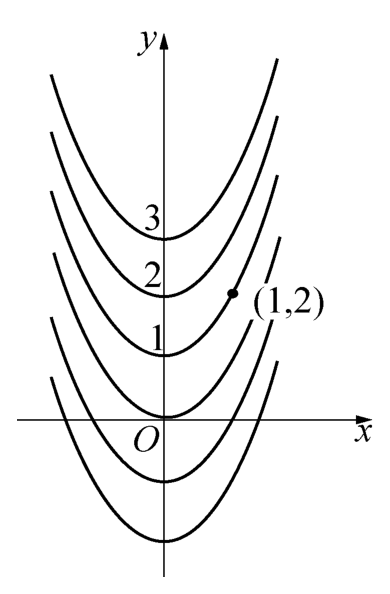

**解**　设所求曲线的方程为$y=y(x)$。根据导数的几何意义，可知未知函数$y=y(x)$应满足关系式

$$
\frac{\mathrm{d}y}{\mathrm{d}x}=2x.\qquad \text{（称为一阶微分方程）} \qquad (1)
$$

此外，未知函数$y=y(x)$还应满足下列条件：$x=1$时，$y=2$，简记为$y\,|_{x=1}=2\qquad (2)$。（称为初始条件）把(1)式两端积分，得

$$
y=\int 2x \mathrm{d}x,\quad \text{即}\ y=x^2+C,\quad \text{（称为微分方程的通解）} \qquad (3)
$$

其中$C$是任意常数。

把条件“$x=1$时$y=2$”代入(3)式，得

$$
2=1^2+C.
$$

由此定出$C=1$。把$C=1$代入(3)式，得所求曲线方程

$$
y=x^2+1.\quad \text{（称为微分方程满足初始条件}\ y\,|_{x=1}=2\ \text{的特解）}
$$

**例 2**　列车在公路上以$20\ \mathrm{m/s}$（相当于$72\ \mathrm{km/h}$）的速度行驶，当制动时列车获得加速度$-0.4\ \mathrm{m/s^2}$。开始制动后多长时间列车才能停住？列车在这段时间里行驶了多少路程？

**解**　设列车在开始制动后$t$时行驶的距离为$s$。根据题意，反映制动阶段列车运动规律的函数$s=s(t)$应满足关系式

$$
\frac{\mathrm{d}^2 s}{\mathrm{d}t^2}=-0.4.\qquad \text{（称为二阶微分方程）} \qquad (4)
$$

此外，未知函数$s=s(t)$还应满足下列条件：

$$
t=0\ \text{时},\ s=0,\ v=\frac{\mathrm{d}s}{\mathrm{d}t}=20.
$$

简记为$s\,|_{t=0}=0,\ s'\,|_{t=0}=20\qquad (5)$。（两个初始条件）

把(4)式两端积分一次，得

$$
v=\frac{\mathrm{d}s}{\mathrm{d}t}=-0.4t+C_1; \qquad (6)
$$

再积分一次，得

$$
s=-0.2t^2+C_1 t+C_2. \qquad (7)
$$

这里$C_1,\ C_2$都是任意常数。

把条件$v\,|_{t=0}=20$代入(6)式，得

$$
20=C_1.
$$

把条件$s\,|_{t=0}=0$代入(7)式，得$0=C_2$。

把$C_1,\ C_2$的值代入(6)式、(7)式，得

$$
v=-0.4t+20, \qquad (8)
$$

$$
s=-0.2t^2+20t. \qquad (9)
$$

在(8)式中令$v=0$，得到列车从开始制动到完全停住所需的时间

$$
t=\frac{20}{0.4}=50\ \mathrm{s}.
$$

再把$t=50$代入(9)式，得到列车在制动阶段行驶的路程

$$
s=-0.2\times 50^2+20\times 50=500\ \mathrm{m}.
$$

**例 3**　已知放射性物质镭的裂变规律是裂变速度与余存量成比例。记在某一时刻$t=t_0$，镭的余存量为$R_0\ \mathrm{g}$，试确定镭在任意时刻$t$的余存量$R(t)$。

**解**　由于$\frac{\mathrm{d}R(t)}{\mathrm{d}t}$是镭的增长速度，因此裂变速度（减少速度）应为$-\frac{\mathrm{d}R(t)}{\mathrm{d}t}$。从而按裂变规律，有$-\frac{\mathrm{d}R(t)}{\mathrm{d}t}=kR(t)$，其中$k$为比例系数。要解决上述问题，就要确定$R(t)$。

上式可写成$\frac{\mathrm{d}t}{\mathrm{d}R}=-\frac{1}{kR}$，两边对$R$积分：$\int \frac{\mathrm{d}t}{\mathrm{d}R}\mathrm{d}R=-\int \frac{1}{kR}\mathrm{d}R$，得$t=-\frac{1}{k}\ln R+C_1$，其中$C_1$为任意常数。从而$R=\mathrm{e}^{-kt+kC_1}=C\mathrm{e}^{-kt}$，其中$C=\mathrm{e}^{kC_1}$为任意常数。

由$R(t_0)=R_0$，得$C=R_0\mathrm{e}^{kt_0}$，因此$R=R_0\mathrm{e}^{-k(t-t_0)}$即为所求。

**注**　式子$-\frac{\mathrm{d}R(t)}{\mathrm{d}t}=kR(t)$即为微分方程，它表示函数$R(t)$的一个变化规律，即其减少速度$-\frac{\mathrm{d}R(t)}{\mathrm{d}t}$与其本身$R(t)$成比例。尽管我们是从镭的裂变这一特殊问题导出此方程，但此方程应用远不止于此。只要某物理量的变化服从同样的规律，就可用此方程来确定。

上面的几个例子尽管实际意义不同，但是解决问题的方法都是首先建立一个含有未知函数的导数的方程，然后通过这个方程求满足所给的条件的未知函数。

### 二、微分方程的基本概念

**1. 微分方程**

含有未知函数及其导数与自变量的等式称为微分方程（其中自变量、未知函数可以在方程中不出现，但未知函数的导数必须出现）。

**2. 微分方程的阶**

微分方程中出现的未知函数的导数的最高阶数称为微分方程的阶。

一阶微分方程的一般形式为

$$
F(x,\ y,\ y')=0.
$$

例如，方程$y'-y-x^2=0$，$(y')^2-x^3y^4=0$，$x\left(\frac{\mathrm{d}y}{\mathrm{d}x}\right)^2-2y\cdot\frac{\mathrm{d}y}{\mathrm{d}x}=0$都是一阶微分方程。

二阶微分方程的一般形式为

$$
F(x,\ y,\ y',\ y'')=0.
$$

例如，方程$(y'')^2-y-x^2=0$，$\frac{\mathrm{d}^2 y}{\mathrm{d}x^2}-2y\cdot\frac{\mathrm{d}y}{\mathrm{d}x}+\sin x=0$都是二阶微分方程。

$n$阶微分方程的一般形式是

$$
F(x,\ y,\ y',\ y'',\ \cdots,\ y^{(n)})=0, \qquad (10)
$$

其中，$x$为自变量，$y=y(x)$是未知函数。在方程(10)中，$y^{(n)}$必须出现，而其他变量可以不出现，如$n$阶方程$y^{(n)}=\mathrm{e}^x$。

如果能从方程(10)中解出最高阶导数，就得到微分方程

$$
y^{(n)}=f(x,\ y,\ y',\ \cdots,\ y^{(n-1)}). \qquad (11)
$$

以后我们讨论的微分方程组主要是形如(11)式的微分方程，并且假设(11)式右端的表达式$f$在所讨论的范围内连续。

如果方程(11)可表示为如下形式：

$$
y^{(n)}+a_1(x)y^{(n-1)}+\cdots+a_{n-1}(x)y'+a_n(x)y=g(x),\qquad (12)
$$

则称方程(12)为$n$阶线性微分方程。其中，$a_1(x),\ a_2(x),\ \cdots,\ a_n(x)$和$g(x)$均为自变量$x$的已知函数。

不能表示成形如(12)式的微分方程，统称为非线性方程。

**3. 微分方程的解**

在研究实际问题时，首先要建立属于该问题的微分方程，然后找出满足该微分方程的函数（解微分方程），也就是说，把这个函数代入微分方程能使方程成为恒等式，称这个函数为该微分方程的解。更确切地说，设函数$y=\varphi(x)$在区间$I$上有$n$阶连续导数，如果在区间$I$上，有

$$
F(x,\ \varphi(x),\ \varphi'(x),\ \varphi''(x),\ \cdots,\ \varphi^{(n)}(x))\equiv 0,
$$

则称函数$y=\varphi(x)$为微分方程(10)在区间$I$上的解。

微分方程的解可能含有也可能不含有任意常数。含有相互独立的任意常数，且任意常数的个数与微分方程的阶数相等的解称为微分方程的**通解**（一般解）。一般地，微分方程的不含有任意常数的解称为微分方程的**特解**。方程的通解是一类解，而不是指方程的“全部解”。实际上，我们在求解方程时得到一些解，很难说明这些解是否构成了方程的“全部解”，这种工作有时会比求解方程本身还困难，而实际工作中又告诉我们无须去做这样的工作，因此我们将关注点放在求方程的通解和特解上。

**注**　这里所说的相互独立的任意常数，是指它们不能通过合并而使得通解中的任意常数的个数减少。

**4. 微分方程的初值问题**

许多实际问题都要求寻找满足某些附加条件的解，此时，这类附加条件就可以用来确定通解中的任意常数，这类附加条件称为**初始条件**。例如，条件(2)和(5)分别是微分方程(1)和(4)的初始条件。

带有初始条件的微分方程称为微分方程的初值问题。

**5. 微分方程的积分曲线**

微分方程的解的图形是一条曲线，称为微分方程的**积分曲线**。由于通解中含有任意常数，所以它的图形是具有某种共同性质的积分曲线族。例如，例 1 中的通解$y=x^2+C$是抛物线族，这些图形的共性是每一条抛物线上任意一点$M(x,y)$处的斜率均为$2x$。而该方程的特解是过点$(1,2)$的一条抛物线，也就是说，特解是积分曲线中满足初始条件的某一条特定的积分曲线（见图 4-1）。

**例 4**　设一物体的温度为$100\ \mathrm{^\circ C}$，将其放置在空气温度为$20\ \mathrm{^\circ C}$的环境中冷却。根据冷却定律：物体温度的变化率与物体和当时空气温度之差成正比，设物体的温度$T$与时间$t$的函数关系为$T=T(t)$，则可建立起函数$T(t)$满足的微分方程：

$$
\frac{\mathrm{d}T}{\mathrm{d}t}=-k(T-20), \qquad (13)
$$

其中$k(k>0)$为比例常数。这就是**物体冷却的数学模型**。

根据题意，$T=T(t)$还需满足条件

$$
T\,|_{t=0}=100. \qquad (14)
$$

**例 5**　设一质量为$m$的物体只受重力的作用由静止开始自由垂直降落。根据牛顿第二定律：物体所受的力$F$等于物体的质量$m$与物体运动的加速度$a$成正比，即$F=ma$，若取物体降落的铅垂线为$x$轴，其正向朝下，物体下落的起点为原点，并设开始下落的时间是$t=0$，物体下落的距离$x$与时间$t$的函数关系为$x=x(t)$（见图 4-2），则可建立起函数$x(t)$满足的微分方程：

$$
\frac{\mathrm{d}^2 x}{\mathrm{d}t^2}=g,
$$

其中$g$为重力加速度常数。这就是**自由落体运动的数学模型**。

根据题意，$x=x(t)$还需满足条件

$$
x(0)=0,\quad \left.\frac{\mathrm{d}x}{\mathrm{d}t}\right|_{t=0}=0.
$$

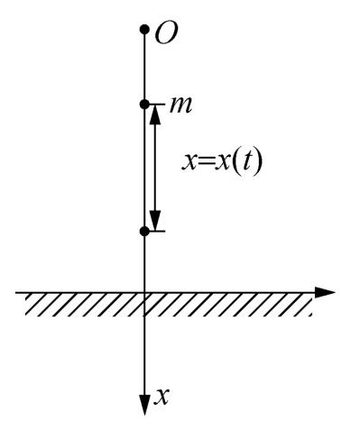

**例 6**　试指出下列方程是什么方程，并指出微分方程的阶数。

(1) $\frac{\mathrm{d}y}{\mathrm{d}x}=x^2+y$；

(2) $x\left(\frac{\mathrm{d}y}{\mathrm{d}x}\right)^2-2\frac{\mathrm{d}y}{\mathrm{d}x}+4x=0$；

(3) $x\frac{\mathrm{d}^2 y}{\mathrm{d}x^2}-2\left(\frac{\mathrm{d}y}{\mathrm{d}x}\right)^3+5xy=0$；

(4) $\cos(y'')+\ln y=x+1$。

**解**　（1）该方程是一阶线性微分方程，因方程中含有的$\frac{\mathrm{d}y}{\mathrm{d}x}$和$y$都是一次方。

（2）该方程是一阶非线性微分方程，因方程中含有$\frac{\mathrm{d}y}{\mathrm{d}x}$的平方项。

（3）该方程是二阶非线性微分方程，因方程中含有$\frac{\mathrm{d}y}{\mathrm{d}x}$的三次方。

（4）该方程是二阶非线性微分方程，因方程中含有非线性函数$\cos(y'')$和$\ln y$。

**例 7**　验证函数$y=(x^2+C)\sin x$（$C$为任意常数）是方程

$$
\frac{\mathrm{d}y}{\mathrm{d}x}-y\cot x-2x\sin x=0
$$

的通解，并求满足初始条件$y\,|_{x=\frac{\pi}{2}}=0$的特解。

**解**　要验证一个函数是否是方程的通解，只要将函数代入方程，看是否恒等，再看函数式中所含的独立的任意常数的个数是否与方程的阶数相同。对$y=(x^2+C)\sin x$求一阶导数，得

$$
\frac{\mathrm{d}y}{\mathrm{d}x}=2x\sin x+(x^2+C)\cos x.
$$

把$y$和$\frac{\mathrm{d}y}{\mathrm{d}x}$代入方程左边得

$$
\frac{\mathrm{d}y}{\mathrm{d}x}-y\cot x-2x\sin x=2x\sin x+(x^2+C)\cos x-(x^2+C)\sin x\cot x-2x\sin x\equiv 0.
$$

因方程两边恒等，且$y$中含有一个任意常数，故$y=(x^2+C)\sin x$是题设方程的通解。

将初始条件$y\,|_{x=\frac{\pi}{2}}=0$代入通解$y=(x^2+C)\sin x$中，

$$
0=\frac{\pi^2}{4}+C,\quad \text{从而}\ C=-\frac{\pi^2}{4}.
$$

从而所求特解为

$$
y=\left(x^2-\frac{\pi^2}{4}\right)\sin x.
$$

### 习题 4-1

**1. 选择题**

（1）微分方程$xy'''+(y'')^2=x^5$的阶数是（　　）；

A. 2　　　　B. 3　　　　C. 4　　　　D. 5

（2）微分方程$3y^2\mathrm{d}y+3x^2\mathrm{d}x=0$的阶数是（　　）；

A. 1　　　　B. 3　　　　C. 2　　　　D. 0

（3）下列方程中，不是微分方程的是（　　）；

A. $(y')^2+3y=0$　　　　B. $\mathrm{d}y+\frac{1}{x}\mathrm{d}x=2\mathrm{d}x$　　　　C. $y''=\mathrm{e}^{x-y}$　　　　D. $x^2+y^2=K^2$

（4）下列函数中，（　　）是微分方程$\mathrm{d}y-2x\mathrm{d}x=0$的解；

A. $y=2x$　　　　B. $y=-2x$　　　　C. $y=-x$　　　　D. $y=x^2$

（5）方程$\frac{\mathrm{d}^3 y}{\mathrm{d}x^3}+3\frac{\mathrm{d}^2 y}{\mathrm{d}x^2}+\frac{\mathrm{d}y}{\mathrm{d}x}+\mathrm{e}^x=1$的通解应该包含的常数的个数为（　　）。

A. 2　　　　B. 3　　　　C. 1　　　　D. 0

**2. 指出下列方程哪些是微分方程，并指出方程的阶数。**

（1）$xyy''+x(y')^3-y^4y'=0$；

（2）$\frac{\mathrm{d}y}{\mathrm{d}x}\cos x+y\sin x=0$；

（3）$y^2-\frac{y}{x}=\frac{x}{y}$；

（4）$3y^2\mathrm{d}y+3x^2\mathrm{d}x=1$；

（5）$(x-2y)y'''=2x^4-y$；

（6）$y'=3y^{\frac{2}{3}}$。

**3.** 验证函数$x=C_1\cos kt+C_2\sin kt$是微分方程$\frac{\mathrm{d}^2 x}{\mathrm{d}t^2}+k^2x=0$的解。并求满足初始条件$x\,|_{t=0}=A$，$\left.\frac{\mathrm{d}x}{\mathrm{d}t}\right|_{t=0}=0$的特解。

**4.** 确定下列函数中$C_1,\ C_2$的值，使得函数满足所给定的条件。

（1）$y=C_1\cos x+C_2\sin x,\ y\,|_{x=0}=1,\ y'\,|_{x=0}=3$；

（2）$y=(C_1+xC_2)\mathrm{e}^{2x},\ y\,|_{x=0}=0,\ y'\,|_{x=0}=1$。

**5.** 试求下列微分方程在指定形式下的解。

（1）$y''+3y'+2y=0$，形如$y=\mathrm{e}^{rx}$的解；

（2）$x^2y''+6xy'+4y=0$，形如$y=x^{\lambda}$的解。

**6.** 写出由下列条件确定的曲线所满足的微分方程。

（1）曲线在点$(x,y)$处的切线的斜率等于该点的横坐标的平方；

（2）曲线在点$P(x,y)$处的法线与$x$轴的交点为$Q$，且线段$PQ$被$y$轴平分；

（3）曲线在点$M(x,y)$处的切线与$x$轴、$y$轴的交点分别为$P$、$Q$，线段$PQ$被点$M$平分，且曲线通过点$(3,1)$。

**7.** 已知曲线过点$(1,2)$，且在该曲线上任意点$(x,y)$处的切线斜率为$3x^2$，求此曲线方程。

## 第二节 一阶微分方程

［课前导读］

微分方程的类型是多种多样的，它们的解法也各不相同。本节将根据一阶微分方程的不同类型给出相应的解法，主要介绍可分离变量的微分方程、齐次方程、一阶线性微分方程。

### 一、可分离变量的微分方程

设有一阶微分方程$\frac{\mathrm{d}y}{\mathrm{d}x}=F(x,y)$，如果其右端表达式能分解成$F(x,y)=f(x)g(y)$，即有$\frac{\mathrm{d}y}{\mathrm{d}x}=f(x)g(y)$，从而能够写成

$$
\frac{\mathrm{d}y}{g(y)}=f(x)\mathrm{d}x \qquad (1)
$$

的微分方程称为可分离变量的微分方程。

微分方程(1)的特征是左端只含有$y$的函数和$y$的微分$\mathrm{d}y$，右端只含有$x$的函数和$x$的微分$\mathrm{d}x$。设函数$g(y)$，$f(x)$是连续的，两边同时积分，即有

$$
\int \frac{\mathrm{d}y}{g(y)}=\int f(x)\mathrm{d}x.
$$

方程两边同时求原函数便得到关于$x$，$y$的方程，它便是微分方程(1)的通解。

**例 1**　求微分方程$\frac{\mathrm{d}y}{\mathrm{d}x}=2xy$的通解。

**解**　所给方程是可分离变量的微分方程。

分离变量得

$$
\frac{\mathrm{d}y}{y}=2x\mathrm{d}x\ (y\neq 0),
$$

两端积分，

$$
\int \frac{\mathrm{d}y}{y}=\int 2x\mathrm{d}x,
$$

则有

$$
\ln|y|=x^2+C_1.
$$

两边取指数函数，

$$
y=\pm \mathrm{e}^{x^2+C_1}=\pm \mathrm{e}^{C_1}\cdot \mathrm{e}^{x^2}.
$$

记$C=\pm \mathrm{e}^{C_1}$，它仍然是任意常数，则得到题设方程的通解$y=C\mathrm{e}^{x^2}$（这个通解包含$y=0$时的情形）。

**注**　为了书写方便，可以不必先取绝对值$\ln|y|$，再去掉绝对值符号后令$C=\pm \mathrm{e}^{C_1}$，而在两边积分时就写成$\ln y$，把常数$C_1$写成$\ln C$，这样方程$\int \frac{\mathrm{d}y}{y}=\int 2x\mathrm{d}x$的解为$\ln y=x^2+\ln C$，即可得到$y=C\mathrm{e}^{x^2}$。但要记住，最后得到的常数$C$是可以取负值的任意常数。以后遇到这种情况，均可以这样表示。

**例 2**　求微分方程$\mathrm{d}x+xy\mathrm{d}y=y^2\mathrm{d}x+y\mathrm{d}y$的通解。

**解**　先合并$\mathrm{d}x$及$\mathrm{d}y$的各项，得$y(x-1)\mathrm{d}y=(y^2-1)\mathrm{d}x$。

设$y^2-1\neq 0$，$x-1\neq 0$，分离变量得

$$
\frac{y}{y^2-1}\mathrm{d}y=\frac{1}{x-1}\mathrm{d}x.
$$

两端积分，$\int \frac{y}{y^2-1}\mathrm{d}y=\int \frac{1}{x-1}\mathrm{d}x$，得

$$
\frac{1}{2}\ln(y^2-1)=\ln(x-1)+\ln C,
$$

则得到题设方程的通解：$y^2-1=C(x-1)^2$。

**注**　在用分离变量法解可分离变量的微分方程的过程中，我们在假定$g(y)\neq 0$的前提下，用它除方程两边，这样得到的通解不包含使$g(y)=0$的特解。但是，有时如果扩大任意常数$C$的取值范围，则其失去的解仍包含在通解中。如例 2 中得到的通解中应该满足$C\neq 0$，但这样方程就失去特解$y=\pm 1$；而如果允许$C=0$，则$y=\pm 1$仍包含在通解$y^2-1=C(x-1)^2$中。

**例 3**　求$(1+\mathrm{e}^x)yy'=\mathrm{e}^x$满足$y\,|_{x=0}=0$的特解。

**解**　方程属于可分离变量的微分方程。分离变量，可得

$$
y\mathrm{d}y=\frac{\mathrm{e}^x}{1+\mathrm{e}^x}\mathrm{d}x,
$$

积分：

$$
\int y\mathrm{d}y=\int \frac{\mathrm{e}^x}{1+\mathrm{e}^x}\mathrm{d}x,
$$

所以通解为

$$
\frac{y^2}{2}=\ln(1+\mathrm{e}^x)+\ln C=\ln C(1+\mathrm{e}^x).
$$

再由$y\,|_{x=0}=0$，得

$$
0=\ln(2C),\quad \text{即}\ C=\frac{1}{2}.
$$

故所求特解为

$$
\frac{y^2}{2}=\ln\frac{1+\mathrm{e}^x}{2}.
$$

**例 4**　已知$f'(\sin^2 x)=\cos 2x+\tan^2 x$，当$0<x<1$时，求$f(x)$。

**解**　设$y=\sin^2 x$，则$\cos 2x=1-2\sin^2 x=1-2y$，

$$
\tan^2 x=\frac{\sin^2 x}{\cos^2 x}=\frac{\sin^2 x}{1-\sin^2 x}=\frac{y}{1-y}.
$$

所以原方程变为$f'(y)=1-2y+\frac{y}{1-y}$，即$f'(y)=-2y+\frac{1}{1-y}$。

所以

$$
f(y)=\int\left(-2y+\frac{1}{1-y}\right)\mathrm{d}y=-y^2-\ln(1-y)+C,
$$

故

$$
f(x)=-[x^2+\ln(1-x)]+C\ (0<x<1).
$$

### 二、齐次方程

有的微分方程通过适当的变量代换后，也可以转化为可分离变量的方程。

**例 5**　求微分方程$x(\ln x-\ln y)\mathrm{d}y-y\mathrm{d}x=0$的通解。

**解**　原方程变形为$\ln\frac{y}{x}\mathrm{d}y+\frac{y}{x}\mathrm{d}x=0$。

令$u=\frac{y}{x}$，则$\frac{\mathrm{d}y}{\mathrm{d}x}=u+x\frac{\mathrm{d}u}{\mathrm{d}x}$。

代入原方程并整理，得$\frac{\ln u}{u(\ln u+1)}\mathrm{d}u=-\frac{\mathrm{d}x}{x}$。

两边积分得

$$
\int \frac{\ln u}{u(\ln u+1)}\mathrm{d}u=-\int \frac{\mathrm{d}x}{x}
$$

即

$$
\int \frac{\ln u}{\ln u+1}\mathrm{d}\ln u=-\int \frac{\mathrm{d}x}{x}
$$

从而

$$
\int\left(1-\frac{1}{\ln u+1}\right)\mathrm{d}\ln u=-\int \frac{\mathrm{d}x}{x}
$$

故方程通解为

$$
\ln u-\ln(\ln u+1)=-\ln x+\ln C,
$$

即

$$
y=C(\ln u+1),
$$

变量回代得所求通解：

$$
y=C\left(\ln\frac{y}{x}+1\right).
$$

由例 5 可知，如果一阶微分方程$\frac{\mathrm{d}y}{\mathrm{d}x}=f(x,y)$中的表达式$f(x,y)$可化为$\varphi\left(\frac{y}{x}\right)$，则通过变量替换$u=\frac{y}{x}$或转化为可分离变量方程求解。我们称形如$\frac{\mathrm{d}y}{\mathrm{d}x}=\varphi\left(\frac{y}{x}\right)$的微分方程为齐次方程。

在齐次方程$\frac{\mathrm{d}y}{\mathrm{d}x}=\varphi\left(\frac{y}{x}\right)$中，令$u=\frac{y}{x}$，即$y=ux$，有

$$
u+x\frac{\mathrm{d}u}{\mathrm{d}x}=\varphi(u).
$$

分离变量，得

$$
\frac{\mathrm{d}u}{\varphi(u)-u}=\frac{\mathrm{d}x}{x}.
$$

两端积分，得

$$
\int \frac{\mathrm{d}u}{\varphi(u)-u}=\int \frac{\mathrm{d}x}{x}.
$$

求出积分后，再用$\frac{y}{x}$代替$u$，便得所给齐次方程的通解。

**例 6**　求解微分方程$\frac{\mathrm{d}y}{\mathrm{d}x}=\frac{y}{x}+\tan\frac{y}{x}$满足初始条件$y\,|_{x=1}=\frac{\pi}{6}$的特解。

**解**　所求方程为齐次方程，设$u=\frac{y}{x}$，则$\frac{\mathrm{d}y}{\mathrm{d}x}=u+x\frac{\mathrm{d}u}{\mathrm{d}x}$。

代入原方程得

$$
u+x\frac{\mathrm{d}u}{\mathrm{d}x}=u+\tan u,
$$

分离变量得

$$
\cot u\,\mathrm{d}u=\frac{1}{x}\mathrm{d}x,
$$

两边积分得

$$
\ln(\sin u)=\ln x+\ln C,
$$

即

$$
\sin u=Cx.
$$

将$u=\frac{y}{x}$回代，则得到题设方程的通解为$\sin\frac{y}{x}=Cx$。

利用初始条件$y\,|_{x=1}=\frac{\pi}{6}$，得到$C=\frac{1}{2}$，

从而所求题设方程的特解为$\sin\frac{y}{x}=\frac{1}{2}x$。

**例 7**　求解微分方程$\frac{\mathrm{d}x}{x^2-xy+y^2}=\frac{\mathrm{d}y}{2y^2-xy}$。

**解**　原方程变形为$\frac{\mathrm{d}y}{\mathrm{d}x}=\frac{2y^2-xy}{x^2-xy+y^2}=\frac{2\left(\frac{y}{x}\right)^2-\frac{y}{x}}{1-\frac{y}{x}+\left(\frac{y}{x}\right)^2}$。

令$u=\frac{y}{x}$，则$\frac{\mathrm{d}y}{\mathrm{d}x}=u+x\frac{\mathrm{d}u}{\mathrm{d}x}$，方程化为$u+x\frac{\mathrm{d}u}{\mathrm{d}x}=\frac{2u^2-u}{1-u+u^2}$，

分离变量得$\left[\frac{1}{2}\left(\frac{1}{u-2}-\frac{1}{u}\right)-\frac{2}{u-2}+\frac{1}{u-1}\right]\mathrm{d}u=\frac{\mathrm{d}x}{x}$，

两边积分得

$$
\ln(u-1)-\frac{3}{2}\ln(u-2)-\frac{1}{2}\ln u=\ln x+\ln C,
$$

整理得

$$
\frac{u-1}{\sqrt{u}(u-2)^{\frac{3}{2}}}=Cx.
$$

所求微分方程的解为$(y-x)^2=Cy(y-2x)^3$。

**例 8**　利用变量代换法求方程$\frac{\mathrm{d}y}{\mathrm{d}x}=(x+y)^2$的通解。

**解**　令$x+y=u$，则$\frac{\mathrm{d}y}{\mathrm{d}x}=\frac{\mathrm{d}u}{\mathrm{d}x}-1$，代入原方程得$\frac{\mathrm{d}u}{\mathrm{d}x}=1+u^2$，

分离变量得$\frac{\mathrm{d}u}{1+u^2}=\mathrm{d}x$，两边积分得$\arctan u=x+C$，回代得$\arctan(x+y)=x+C$，

故原方程的通解为$y=\tan(x+C)-x$。

### 三、一阶线性微分方程

形如

$$
\frac{\mathrm{d}y}{\mathrm{d}x}+P(x)y=Q(x)\qquad (2)
$$

的方程称为一阶线性微分方程。其中函数$P(x)$，$Q(x)$是某一区间$I$上的连续函数。当$Q(x)\equiv 0$时，方程(2)成为

$$
\frac{\mathrm{d}y}{\mathrm{d}x}+P(x)y=0, \qquad (3)
$$

这个方程称为一阶齐次线性微分方程。相应地，当$Q(x)\not\equiv 0$时，方程(2)称为一阶非齐次线性微分方程。方程(3)称为方程(2)所对应的齐次方程。

先求一阶齐次线性微分方程(3)的通解。

方程(3)是一个可分离变量的方程。分离变量，有

$$
\frac{\mathrm{d}y}{y}=-P(x)\mathrm{d}x.
$$

两端积分，得

$$
\ln y=-\int P(x)\mathrm{d}x+\ln C,
$$

故一阶齐次线性微分方程(3)的通解为

$$
y=C\mathrm{e}^{-\int P(x)\mathrm{d}x}.
$$

其中$C$为任意常数。

容易验证，不论$C$取什么值，$y=C\mathrm{e}^{-\int P(x)\mathrm{d}x}$只能是齐次线性方程的解。如果希望非齐次方程$\frac{\mathrm{d}y}{\mathrm{d}x}+P(x)y=Q(x)$具有类似$C\mathrm{e}^{-\int P(x)\mathrm{d}x}$结构的解，那么$C$不应该是常数，而应该是$x$的函数，只要能够确定这个函数即可。

设一阶非齐次方程的通解为

$$
y=u(x)\,\mathrm{e}^{-\int P(x)\mathrm{d}x}, \qquad (4)
$$

于是

$$
y'=u'(x)\,\mathrm{e}^{-\int P(x)\mathrm{d}x}+u(x)\,\mathrm{e}^{-\int P(x)\mathrm{d}x}\,[-P(x)].
$$

把$y$，$y'$的表达式代入方程(2)，得

$$
u'(x)\,\mathrm{e}^{-\int P(x)\mathrm{d}x}+u(x)\,\mathrm{e}^{-\int P(x)\mathrm{d}x}\,[-P(x)]+P(x)u(x)\,\mathrm{e}^{-\int P(x)\mathrm{d}x}=Q(x),
$$

即$u'(x)\,\mathrm{e}^{-\int P(x)\mathrm{d}x}=Q(x)$或$u'(x)=Q(x)\,\mathrm{e}^{\int P(x)\mathrm{d}x}$。

积分可得

$$
u(x)=\int Q(x)\mathrm{e}^{\int P(x)\mathrm{d}x}\mathrm{d}x+C.
$$

将所得的$u(x)$代入方程(4)中，得到一阶非齐次线性微分方程的通解公式：

$$
y=\left[\int Q(x)\,\mathrm{e}^{\int P(x)\mathrm{d}x}\mathrm{d}x+C\right]\mathrm{e}^{-\int P(x)\mathrm{d}x}. \qquad (5)
$$

上述求解一阶非齐次线性微分方程通解的方法称为常数变易法，即在求出对应齐次方程的通解后，将通解中的常数$C$变易为待定函数$u(x)$，然后求出非齐次线性方程的通解的方法。

将一阶非齐次线性方程的通解(5)展开，得

$$
y=C\mathrm{e}^{-\int P(x)\mathrm{d}x}+\mathrm{e}^{-\int P(x)\mathrm{d}x}\int Q(x)\,\mathrm{e}^{\int P(x)\mathrm{d}x}\mathrm{d}x.
$$

一阶非齐次线性方程(2)的通解由两部分组成。第一项是对应的齐次线性方程(3)的通解。第二项可以看成在一阶非齐次线性方程(2)的通解中取$C=0$得到的，所以它是一阶非齐次线性方程(2)的一个特解。于是得到如下结论。

**定理**（一阶非齐次线性方程的解的结构）　一阶非齐次线性方程(2)的通解等于对应的齐次线性方程(3)的通解与一阶非齐次线性方程(2)的一个特解之和。

**例 9**　求方程$\frac{\mathrm{d}y}{\mathrm{d}x}-\frac{2y}{x+1}=(x+1)^{\frac{5}{2}}$的通解。

**解**　这是一个非齐次线性方程。先求对应齐次方程的通解。

$$
\frac{\mathrm{d}y}{\mathrm{d}x}-\frac{2}{x+1}y=0\Rightarrow \frac{\mathrm{d}y}{y}=\frac{2\mathrm{d}x}{x+1}\Rightarrow \ln y=2\ln(x+1)+\ln C\Rightarrow y=C(x+1)^2.
$$

用常数变易法，把$C$换成$u$，即令$y=u(x+1)^2$，则有$\frac{\mathrm{d}y}{\mathrm{d}x}=u'(x+1)^2+2u(x+1)$，

代入所给非齐次方程得$u'=(x+1)^{\frac{1}{2}}$，两端积分得$u=\frac{2}{3}(x+1)^{\frac{3}{2}}+C$，故原方程的通解为$y=\left(\frac{2}{3}(x+1)^{\frac{3}{2}}\right)(x+1)^2$。

**例 10**　求下列微分方程满足所给初始条件的特解。

$$
x\ln x\mathrm{d}y+(y-\ln x)\mathrm{d}x=0,\quad y\,|_{x=\mathrm{e}}=1.
$$

**解**　将方程标准化为$y'+\frac{1}{x\ln x}y=\frac{1}{x}$，于是

$$
y=\mathrm{e}^{-\int\frac{\mathrm{d}x}{x\ln x}}\left(\int \frac{1}{x}\mathrm{e}^{\int\frac{\mathrm{d}x}{x\ln x}}\mathrm{d}x+C\right)=\mathrm{e}^{-\ln(\ln x)}\left[\int \frac{1}{x}\mathrm{e}^{\ln(\ln x)}\mathrm{d}x+C\right]=\frac{1}{\ln x}\left(\frac{1}{2}\ln^2 x+C\right).
$$

由初始条件$y\,|_{x=\mathrm{e}}=1$，得$C=\frac{1}{2}$，故所求特解为$y=\frac{1}{2}\left(\ln x+\frac{1}{\ln x}\right)$。

**例 11**　求方程$y^3\mathrm{d}x+(2xy^2-1)\mathrm{d}y=0$的通解。

**解**　当将$y$看作$x$的函数时，方程变为

$$
\frac{\mathrm{d}y}{\mathrm{d}x}=\frac{y^3}{1-2xy^2},
$$

这个方程不是一阶线性微分方程，不便求解。如果将$x$看作$y$的函数，方程改写为

$$
\frac{\mathrm{d}x}{\mathrm{d}y}+\frac{2}{y}x=\frac{1}{y^3},
$$

这个方程为一阶线性微分方程。令$P(y)=\frac{2}{y}$，$Q(y)=\frac{1}{y^3}$。

由公式得原方程的通解为

$$
x=\mathrm{e}^{-\int P(y)\mathrm{d}y}\left[C+\int Q(y)\mathrm{e}^{\int P(y)\mathrm{d}y}\mathrm{d}y\right]=\mathrm{e}^{-\int\frac{2}{y}\mathrm{d}y}\left[C+\int \frac{1}{y^3}\mathrm{e}^{\int\frac{2}{y}\mathrm{d}y}\mathrm{d}y\right],
$$

故得$x=\frac{1}{y^2}(\ln y+C)$，其中$C$为任意常数。

### 习题 4-2

**1. 求下列可分离变量微分方程的通解：**

（1）$x\mathrm{d}y-y\mathrm{d}x=0$；

（2）$xy'+y=0$；

（3）$x\mathrm{d}y+\mathrm{d}x=\mathrm{e}^y\mathrm{d}x$；

（4）$\frac{x}{1+y}\mathrm{d}y-\frac{y}{1+x}\mathrm{d}x=0$；

（5）$y'=\mathrm{e}^{x+y}$；

（6）$y\ln x\mathrm{d}x+x\ln y\mathrm{d}y=0$；

（7）$\cos^2 x\frac{\mathrm{d}y}{\mathrm{d}x}+y=0$；

（8）$x(y^2-1)\mathrm{d}x+y(x^2-1)\mathrm{d}y=0$。

**2. 求下列齐次方程的通解：**

（1）$y^2+x^2\frac{\mathrm{d}y}{\mathrm{d}x}=xy\frac{\mathrm{d}y}{\mathrm{d}x}$；

（2）$\frac{\mathrm{d}x}{x^2-xy+y^2}=\frac{\mathrm{d}y}{2y^2-xy}$；

（3）$x(\ln x-\ln y)\mathrm{d}y-y\mathrm{d}x=0$；

（4）$\left(x+y\cos\frac{y}{x}\right)\mathrm{d}x-x\cos\frac{y}{x}\mathrm{d}y=0$。

**3. 求下列一阶线性微分方程的通解：**

（1）$y'-\frac{1}{x}y=\frac{1}{1+x}$；

（2）$y'=-2xy+2x\mathrm{e}^{-x^2}$；

（3）$y'+y=\mathrm{e}^{-x}$；

（4）$y'+2xy=4x$；

（5）$xy'=x-y$；

（6）$(x^2+1)y'+2xy=4x^2$；

（7）$xy'+(1-x)y=\mathrm{e}^{2x}$；

（8）$(y^2-6x)y'+2y=0$。

**4. 求下列微分方程满足所给初始条件的特解：**

（1）$\begin{cases}y'\sin x=y\ln y,\\[4pt] y\,|_{x=\frac{\pi}{2}}=\mathrm{e};\end{cases}$

（2）$\begin{cases}\sqrt{1-x^2}\,y'=x,\\[4pt] y\,|_{x=0}=0;\end{cases}$

（3）$\begin{cases}(y+3)\mathrm{d}x+\cot x\mathrm{d}y=0,\\[4pt] y\,|_{x=0}=1;\end{cases}$

（4）$\begin{cases}\cos y\mathrm{d}x+(1+\mathrm{e}^{-x})\sin y\mathrm{d}y=0,\\[4pt] y\,|_{x=0}=\frac{\pi}{4};\end{cases}$

（5）$\begin{cases}y'=\mathrm{e}^{2x-y},\\[4pt] y\,|_{x=0}=0;\end{cases}$

（6）$\begin{cases}xy'+y=3,\\[4pt] y\,|_{x=1}=0;\end{cases}$

（7）$\begin{cases}y'=\frac{x^2+y^2}{xy},\\[6pt] y\,|_{x=1}=1;\end{cases}$

（8）$\begin{cases}\sin x\cos y\mathrm{d}x=\cos x\sin y\mathrm{d}y,\\[4pt] y\,|_{x=0}=\frac{\pi}{4};\end{cases}$

（9）$\begin{cases}\frac{\mathrm{d}y}{\mathrm{d}x}-y\tan x=\sec x,\\[6pt] y\,|_{x=0}=0;\end{cases}$

（10）$\begin{cases}xy'+y=\sin x,\\[4pt] y\,|_{x=\frac{\pi}{2}}=0;\end{cases}$（11）$\begin{cases}2xy'=y-x^3,\\[4pt] y\,|_{x=1}=0;\end{cases}$

（12）$\begin{cases}x^2y'+(1-2x)y=x^2,\\[4pt] y\,|_{x=1}=0;\end{cases}$

（13）$\begin{cases}y'\cos^2 x+y=\tan x,\\[4pt] y\,|_{x=0}=0;\end{cases}$

（14）$\begin{cases}y'+y\cot x=5\mathrm{e}^{\cos x},\\[4pt] y\,|_{x=\frac{\pi}{2}}=-4.\end{cases}$

**5.** 一曲线通过点$(2,3)$，它在两坐标轴之间的任意切线均被切点所平分，求该曲线的方程。

**6.** 求一曲线方程，该曲线过原点，并且它在点$(x,y)$处的切线斜率等于$2x+y$。

**7.** 方程$\int_0^x \left[2y(t)+\sqrt{t^2+y^2(t)}\right]\mathrm{d}t=xy(x)$是否为齐次方程？

**\*8.** 求微分方程$y'=\frac{1}{2}\tan^2(x+2y)$的通解。

**\*9.** 求微分方程$\frac{\mathrm{d}y}{\mathrm{d}x}+\cos\frac{x-y}{2}=\cos\frac{x+y}{2}$的通解。

## 第三节 二阶微分方程

［课前导读］

对一般的二阶微分方程没有普遍的解法，本节讨论几种特殊形式的二阶微分方程。

可降阶微分方程经过适当的变量替换可降为一阶微分方程，然后求解一阶微分方程，再将变量回代，从而求得所给二阶微分方程的解。

而在学习二阶线性微分方程的时候，我们需要先了解一下欧拉公式：

$$
\mathrm{e}^{\mathrm{i}x}=\cos x+\mathrm{i}\sin x,
$$

这是个联系指数函数和三角函数的桥梁，在这一节的公式证明中会用到这个公式。

### 一、可降阶的二阶微分方程

二阶及二阶以上的微分方程统称为高阶微分方程。高阶微分方程在工程技术中有着广泛的应用。高阶微分方程的求解问题一般比一阶微分方程复杂，能够求解的类型也不多。本小节介绍三种可降阶的二阶微分方程的解法。

**1. $y''=f(x)$型**

在方程$y''=f(x)$两端积分，得

$$
y'=\int f(x)\mathrm{d}x+C_1.
$$

再次积分，得

$$
y=\int\left[\int f(x)\mathrm{d}x+C_1\right]\mathrm{d}x+C_2.
$$

这种类型的方程的解法，可推广到$n$阶微分方程。

**例 1**　求方程$y''=\mathrm{e}^{2x}-\cos x$满足$y(0)=0$，$y'(0)=1$的特解。

**解**　对所给方程接连积分两次，得

$$
y'=\frac{1}{2}\mathrm{e}^{2x}-\sin x+C_1, \qquad (1)
$$

$$
y=\frac{1}{4}\mathrm{e}^{2x}+\cos x+C_1 x+C_2, \qquad (2)
$$

在(1)式中代入条件$y'(0)=1$，得$C_1=\frac{1}{2}$；在(2)式中代入条件$y(0)=0$，得$C_2=-\frac{5}{4}$。

从而所求题设方程的特解为

$$
y=\frac{1}{4}\mathrm{e}^{2x}+\cos x+\frac{1}{2}x-\frac{5}{4}.
$$

**2. $y''=f(x,y')$型**

这种方程的特点是不显含未知函数$y$，求解的方法是：

作代换，令$y'=p$，则$y''=\frac{\mathrm{d}p}{\mathrm{d}x}$，原方程化为$\frac{\mathrm{d}p}{\mathrm{d}x}=f(x,p)$，这是关于$x$，$p$的一阶微分方程。若可用前面的方法求解，并设可得到的通解可写成$p=\varphi(x,C_1)$，则原方程的通解为$y=\int \varphi(x,C_1)\mathrm{d}x+C_2$。

**例 2**　求微分方程$y''=1+y'^2$的通解。

**解**　令$y'=p$，$y''=\frac{\mathrm{d}p}{\mathrm{d}x}$，则方程为$\frac{\mathrm{d}p}{\mathrm{d}x}=1+p^2$，即$\frac{\mathrm{d}p}{1+p^2}=\mathrm{d}x$，两边积分得$\arctan p=x+C_1$，也即$p=\tan(x+C_1)$，故$y=\int \tan(x+C_1)\mathrm{d}x=-\ln|\cos(x+C_1)|+C_2$。

**例 3**　求微分方程

$$
(1+x^2)y''=2xy',\quad y\,|_{x=0}=1,\ y'\,|_{x=0}=3
$$

的特解。

**解**　题设方程属于$y''=f(x,y')$型。设$y'=p$，则$y''=\frac{\mathrm{d}p}{\mathrm{d}x}$代入方程并分离变量后，有

$$
\frac{\mathrm{d}p}{p}=\frac{2x}{1+x^2}\mathrm{d}x.
$$

两端积分，得$\ln|p|=\ln(1+x^2)+C$，即$p=y'=C_1(1+x^2)\ (C_1=\pm \mathrm{e}^C)$。

由条件$y'\,|_{x=0}=3$，得$C_1=3$，所以$y'=3(1+x^2)$。

两端再积分，得$y=x^3+3x+C_2$。又由条件$y\,|_{x=0}=1$，得$C_2=1$，于是所求的特解为$y=x^3+3x+1$。

**3. $y''=f(y,y')$型**

这种方程的特点是不显含自变量$x$。解决的方法是作代换，令$y'=p$，则

$$
y''=\frac{\mathrm{d}p}{\mathrm{d}x}=\frac{\mathrm{d}p}{\mathrm{d}y}\cdot\frac{\mathrm{d}y}{\mathrm{d}x}=p\frac{\mathrm{d}p}{\mathrm{d}y}.
$$

原方程化为$p\frac{\mathrm{d}p}{\mathrm{d}y}=f(y,p)$，这是关于$y$，$p$的一阶微分方程。若可用前面的方法求解，并设可得到的通解可写成$p=\varphi(y,C_1)$，则原方程的通解为

$$
\int \frac{\mathrm{d}y}{\varphi(y,C_1)}=x+C_2.
$$

**例 4**　求微分方程$y''=\frac{2y-1}{y^2+1}y'^2$的通解。

**解**　令$y'=p$，$y''=p\frac{\mathrm{d}p}{\mathrm{d}y}$，方程为$p\frac{\mathrm{d}p}{\mathrm{d}y}=\frac{2y-1}{y^2+1}p^2\ (p=0\ \text{时},\ y=C)$。

当$p\neq 0$时，$\frac{\mathrm{d}p}{p}=\frac{2y-1}{y^2+1}\mathrm{d}y$，积分得$\ln|p|=\ln(1+y^2)-\arctan y+C$，

即$\frac{\mathrm{d}y}{\mathrm{d}x}=p=C_1(1+y^2)\mathrm{e}^{-\arctan y}$。分离变量得$\frac{\mathrm{e}^{\arctan y}}{1+y^2}\mathrm{d}y=C_1\mathrm{d}x$，故通解为

$$
\mathrm{e}^{\arctan y}=C_1x+C_2.
$$

**例 5**　求微分方程$yy''=2(y'^2-y')$满足初始条件$y(0)=1$，$y'(0)=2$的特解。

**解**　令$y'=p$，由$y''=p\frac{\mathrm{d}p}{\mathrm{d}y}$代入方程并化简得

$$
y\frac{\mathrm{d}p}{\mathrm{d}y}=2(p-1).
$$

上式为可分离变量的一阶微分方程，解得$p=y'=Cy^2+1$。

再分离变量，得$\frac{\mathrm{d}y}{Cy^2+1}=\mathrm{d}x$。

由初始条件$y(0)=1$，$y'(0)=2$，解得$C=1$，从而得$\frac{\mathrm{d}y}{1+y^2}=\mathrm{d}x$。

再两边积分，得$\arctan y=x+C_1$或$y=\tan(x+C_1)$。

由$y(0)=1$解得$C_1=\arctan 1=\frac{\pi}{4}$，从而所求特解为$y=\tan\left(x+\frac{\pi}{4}\right)$。

### 二、线性微分方程解的结构

**1. 函数组的线性相关与线性无关**

为了理解线性微分方程的解的结构，先解释一下函数组的线性相关与线性无关等概念。

设$y_i(x)\ (i=1,2,\cdots,n)$为定义在区间$I$上的$n$个函数，如果存在$n$个不全为零的常数$k_i(i=1,2,\cdots,n)$，使得

$$
k_1y_1+k_2y_2+\cdots+k_ny_n=0
$$

在区间$I$上恒成立，则称$n$个函数$y_i(x)\ (i=1,2,\cdots,n)$在$I$上线性相关，否则称线性无关。或者说要使$k_1y_1+k_2y_2+\cdots+k_ny_n=0$在区间$I$上恒成立，则必有

$$
k_i=0\ (i=1,2,\cdots,n).
$$

**例 6**　证明$1$、$\cos^2 x$、$\sin^2 x$在$(-\infty,+\infty)$内线性相关。

**证明**　$\cos^2 x+\sin^2 x-1=0$在$(-\infty,+\infty)$内恒成立，可看作存在不全为零的数$1$，$1$，$-1$，使$1\cdot\cos^2 x+1\cdot\sin^2 x-1\cdot 1=0$在$(-\infty,+\infty)$内恒成立。因此$1$、$\cos^2 x$、$\sin^2 x$在$(-\infty,+\infty)$内线性相关.

对于两个函数$y_1(x)$与$y_2(x)$，如果$\frac{y_1(x)}{y_2(x)}=k\in\mathbf{R}$，那么它们线性相关，否则就线性无关.

**2. 解的结构**

二阶线性常系数微分方程的一般形式是

$$
\frac{\mathrm{d}^2y}{\mathrm{d}x^2}+p\frac{\mathrm{d}y}{\mathrm{d}x}+qy=f(x), \qquad (3)
$$

其中$p,q$是常数，$f(x)$是自变量$x$的函数，函数$f(x)$称为方程(1)的**自由项**. 当$f(x)\equiv 0$时，方程(1)成为

$$
\frac{\mathrm{d}^2y}{\mathrm{d}x^2}+p\frac{\mathrm{d}y}{\mathrm{d}x}+qy=0. \qquad (4)
$$

这个方程称为二阶齐次线性微分方程. 相应地，当$f(x)\not\equiv 0$时，方程(1)称为二阶非齐次线性微分方程.

**定理 1**　如果函数$y_1(x)$与$y_2(x)$是方程(2)的两个解，则

$$
y=C_1y_1(x)+C_2y_2(x) \qquad (5)
$$

也是方程(2)的解，其中$C_1,C_2$是任意常数.

**证明**　因为$y_1(x)$与$y_2(x)$是方程(2)的两个解，所以

$$
y_1''+py_1'+qy_1=0,\quad y_2''+py_2'+qy_2=0.
$$

将(3)式代入(2)式左端，得

$$
\begin{aligned}
\text{左端}&=(C_1y_1''+C_2y_2'')+p(C_1y_1'+C_2y_2')+q(C_1y_1+C_2y_2)\\
&=C_1(y_1''+py_1'+qy_1)+C_2(y_2''+py_2'+qy_2)\\
&=C_1\cdot 0+C_2\cdot 0=0=\text{右端},
\end{aligned}
$$

故$C_1y_1(x)+C_2y_2(x)$是方程(2)的解.

**例 7**　对于二阶线性微分方程

$$
y''-3y'+2y=0,
$$

验证$y_1=\mathrm{e}^x$，$y_2=\mathrm{e}^{2x}$，$y_3=\mathrm{e}^{2+x}$是它的解，并证明$C_1\mathrm{e}^x+C_2\mathrm{e}^{2x}$是原方程的通解，而$C_1\mathrm{e}^x+C_3\mathrm{e}^{2+x}$是原方程的解但不是通解.

**证明**　把$y_1=\mathrm{e}^x$代入方程的左端，得

$$
y''-3y'+2y=(\mathrm{e}^x)''-3(\mathrm{e}^x)'+2(\mathrm{e}^x)=\mathrm{e}^x-3\mathrm{e}^x+2\mathrm{e}^x\equiv 0,
$$

故$y_1=\mathrm{e}^x$是$y''-3y'+2y=0$的解.

同理，$y''-3y'+2y=(\mathrm{e}^{2x})''-3(\mathrm{e}^{2x})'+2\mathrm{e}^{2x}=4\mathrm{e}^{2x}-3\cdot 2\mathrm{e}^{2x}+2\mathrm{e}^{2x}\equiv 0$，

$$
y''-3y'+2y=(\mathrm{e}^{2+x})''-3(\mathrm{e}^{2+x})'+2\mathrm{e}^{2+x}=\mathrm{e}^{2+x}-3\mathrm{e}^{2+x}+2\mathrm{e}^{2+x}\equiv 0,
$$

所以$y_2=\mathrm{e}^{2x}$，$y_3=\mathrm{e}^{2+x}$也是原微分方程的解.

由定理1可得，$C_1\mathrm{e}^x+C_2\mathrm{e}^{2x}$是原方程的解. 又因为两个任意常数$C_1,C_2$不可能合并为一个任意常数，而所给的方程是二阶的，因此$C_1\mathrm{e}^x+C_2\mathrm{e}^{2x}$是$y''-3y'+2y=0$的通解.

而$C_1\mathrm{e}^x+C_3\mathrm{e}^{2+x}=C_1\mathrm{e}^x+C_3\mathrm{e}^2\cdot\mathrm{e}^x=C\mathrm{e}^x$（其中$C=C_1+C_3\mathrm{e}^2$）实质上只含有一个任意常数，故$C_1\mathrm{e}^x+C_3\mathrm{e}^{2+x}$是微分方程的解但不是通解.

由例7可知，$\frac{y_1}{y_2}=\frac{\mathrm{e}^x}{\mathrm{e}^{2x}}=\mathrm{e}^{-x}$不恒为常数($y_1=\mathrm{e}^x$与$y_2=\mathrm{e}^{2x}$线性无关)，所以$C_1y_1+C_2y_2$是$y''-3y'+2y=0$的通解. 而$\frac{y_3}{y_1}=\frac{\mathrm{e}^{2+x}}{\mathrm{e}^x}=\mathrm{e}^2$恒为常数($y_1=\mathrm{e}^x$与$y_3=\mathrm{e}^{2+x}$线性相关)，所以$C_1y_1+C_3y_3$中的常数可以合并为一个常数，从而它不能构成原方程的通解.

对于一般的情形，有如下定理.

**定理 2**　如果$y_1(x)$与$y_2(x)$是方程(2)的两个线性无关的特解，则$y=C_1y_1(x)+C_2y_2(x)$就是方程(2)的通解，其中$C_1,C_2$是任意常数.

**例 8**　已知$y_1=\mathrm{e}^{2x}+\mathrm{e}^{-x}$，$y_2=2\mathrm{e}^{2x}+\mathrm{e}^{-x}$，$y_3=2\mathrm{e}^{2x}$是某二阶齐次线性微分方程的三个特解.

(1) 求此方程的通解；

(2) 求此微分方程满足$y(0)=7$，$y'(0)=5$的特解.

**解**　(1) 由题设知，$\mathrm{e}^{2x}=y_2-y_1$，$\mathrm{e}^{-x}=y_2-y_3$是相应齐次线性方程的两个线性无关的解，故所求方程的通解为$y=C_1\mathrm{e}^{2x}+C_2\mathrm{e}^{-x}$，其中$C_1,C_2$是任意两个常数.

(2) 将$y=C_1\mathrm{e}^{2x}+C_2\mathrm{e}^{-x}$和$y'=2C_1\mathrm{e}^{2x}-C_2\mathrm{e}^{-x}$代入初始条件$y(0)=7$，$y'(0)=5$，得

$$
C_1+C_2=7,\quad 2C_1-C_2=5\Rightarrow C_1=4,\quad C_2=3,
$$

从而所求特解为$y=4\mathrm{e}^{2x}+3\mathrm{e}^{-x}$.

**定理 3**　设$y^*$是方程(1)的一个特解，而$Y$是其对应的齐次方程(2)的通解，则

$$
y=Y+y^*
$$

就是二阶非齐次线性微分方程(1)的通解.

**例 9**　已知$y_1,y_2,y_3$是二阶变系数非齐次线性微分方程$y''+p(x)y'+q(x)y=f(x)$的线性无关的三个特解，试写出该方程的通解.

**解**　由定理2知，$y_2-y_1$、$y_3-y_1$是对应齐次微分方程$y''+p(x)y'+q(x)y=0$的特解，且$y_2-y_1$、$y_3-y_1$线性无关(否则，若$y_2-y_1$、$y_3-y_1$线性相关，则有$y_3-y_1=C(y_2-y_1)$，即$(C-1)y_1-Cy_2+y_3=0$，其中$C-1$、$-C$、$1$不全为零，即$y_1$、$y_2$、$y_3$线性相关，矛盾)，故$Y=C_1(y_2-y_1)+C_2(y_3-y_1)$是对应齐次微分方程$y''+p(x)y'+q(x)y=0$的通解. 因此$y=Y+y^*=C_1(y_2-y_1)+C_2(y_3-y_1)+y_1$就是方程$y''+p(x)y'+q(x)y=f(x)$的通解.

**\*定理 4**　设$y_1^*$与$y_2^*$分别是方程

$$
y''+P(x)y'+Q(x)y=f_1(x)
$$

与

$$
y''+P(x)y'+Q(x)y=f_2(x)
$$

的特解，则$y_1^*+y_2^*$是方程

$$
y''+P(x)y'+Q(x)y=f_1(x)+f_2(x)
$$

的特解.

### 三、二阶常系数齐次线性微分方程的解法

现在我们研究二阶常系数齐次线性微分方程$y''+py'+qy=0$的解法. 如何求得方程的两个线性无关的特解呢？我们知道，指数函数$y=\mathrm{e}^{rx}$($r$为常数)的各阶导数仍为指数函数$\mathrm{e}^{rx}$乘一个常数. 又因为方程的系数$p,q$都是常数，因此，要使方程的左端$y''+py'+qy=0$，可以设想方程的一个特解为$y=\mathrm{e}^{rx}$，其中$r$为待定的常数.

把$y=\mathrm{e}^{rx}$代入方程$y''+py'+qy=0$，得

$$
(\mathrm{e}^{rx})''+p(\mathrm{e}^{rx})'+q\mathrm{e}^{rx}=0,\quad\text{即}\ \mathrm{e}^{rx}(r^2+pr+q)=0.
$$

由于$\mathrm{e}^{rx}\neq 0$，故得

$$
r^2+pr+q=0.
$$

这就是说，只要待定系数$r$满足方程，所得到的函数$y=\mathrm{e}^{rx}$就是微分方程的解. 称上面的一元二次方程为微分方程的**特征方程**，特征方程的根称为方程的**特征根**.

由于特征方程是一元二次方程，它的根为$r_{1,2}=\frac{-p\pm\sqrt{p^2-4q}}{2}$，所以特征根$r_1,r_2$就有三种不同的情形. 现在分别讨论如下.

(1) 当$p^2-4q>0$时，特征方程有两个不相等的实根：$r_1\neq r_2$.

这时方程有两个特解$y_1=\mathrm{e}^{r_1x}$，$y_2=\mathrm{e}^{r_2x}$. 又$\frac{y_1}{y_2}=\mathrm{e}^{(r_1-r_2)x}$不恒为常数，则方程的通解为

$$
y=C_1\mathrm{e}^{r_1x}+C_2\mathrm{e}^{r_2x}.
$$

**例 10**　求方程$y''-2y'-3y=0$的通解.

**解**　所给微分方程的特征方程为$r^2-2r-3=0$，

其根$r_1=-1,r_2=3$是两个不相等的实根，因此所求通解为$y=C_1\mathrm{e}^{-x}+C_2\mathrm{e}^{3x}$.

(2) 当$p^2-4q=0$时，特征方程有两个相等的实根：$r_1=r_2=-\frac{p}{2}$.

这时只能得到方程的一个特解$y_1=\mathrm{e}^{r_1x}$，还要找出与$y_1$线性无关的另一个特解$y_2$(满足$\frac{y_2}{y_1}$不是恒常数的$y_2$).

设$y_2=u(x)\mathrm{e}^{r_1x}$(这时$\frac{y_2}{y_1}=u(x)$不恒为常数)是方程的另一个解.

由$y_2=u(x)\mathrm{e}^{r_1x}$求导，得

$$
y_2'=\mathrm{e}^{r_1x}(u'+r_1u),
$$

$$
y_2''=\mathrm{e}^{r_1x}(u''+2r_1u'+r_1^2u).
$$

将$y_2$，$y_2'$和$y_2''$代入方程，得

$$
\mathrm{e}^{r_1x}\left[(u''+2r_1u'+r_1^2u)+p(u'+r_1u)+qu\right]=0,
$$

整理得

$$
u''+(2r_1+p)u'+(r_1^2+pr_1+q)u=0.
$$

因为$r_1$是特征方程的重根，所以有

$$
r_1^2+pr_1+q=0
$$

和

$$
2r_1+p=0.
$$

即得

$$
u''=0
$$

积分两次，得

$$
u=C_1x+C_2,
$$

其中$C_1,C_2$为任意常数. 因为只需要找出一个与$y_1$线性无关的特解，也就是找出一个不为常数的$u(x)$，所以可取$C_1=1$，$C_2=0$. 取$u(x)=x$即可，由此得到方程的另一个特解：

$$
y_2=x\mathrm{e}^{r_1x}.
$$

故当特征根$r_1=r_2$时，方程的通解为

$$
y=C_1\mathrm{e}^{r_1x}+C_2x\mathrm{e}^{r_1x},
$$

或写成

$$
y=(C_1+C_2x)\mathrm{e}^{r_1x},
$$

其中$C_1,C_2$为任意常数.

**例 11**　求方程$y''+4y'+4y=0$的通解.

**解**　特征方程为$r^2+4r+4=0$，

解得

$$
r_1=r_2=-2,
$$

故所求通解为$y=(C_1+C_2x)\mathrm{e}^{-2x}$.

(3) 当$p^2-4q<0$时，特征方程有一对共轭复根：$r_1=\alpha+\beta\mathrm{i}$，$r_2=\alpha-\beta\mathrm{i}$.

这时，$y_1=\mathrm{e}^{(\alpha+\beta\mathrm{i})x}$，$y_2=\mathrm{e}^{(\alpha-\beta\mathrm{i})x}$是方程的两个复数函数的特解.

为了得出实值函数形式的特解，根据欧拉公式

$$
\mathrm{e}^{\beta\mathrm{i}}=\cos\beta+\mathrm{i}\ \sin\beta,
$$

将$y_1$与$y_2$改写为

$$
y_1=\mathrm{e}^{(\alpha+\beta\mathrm{i})x}=\mathrm{e}^{\alpha x}\mathrm{e}^{\beta x\mathrm{i}}=\mathrm{e}^{\alpha x}(\cos\beta x+\mathrm{i}\ \sin\beta x),
$$

$$
y_2=\mathrm{e}^{(\alpha-\beta\mathrm{i})x}=\mathrm{e}^{\alpha x}\mathrm{e}^{-\beta x\mathrm{i}}=\mathrm{e}^{\alpha x}(\cos\beta x-\mathrm{i}\ \sin\beta x).
$$

取方程的另两个特解：

$$
\overline{y_1}=\frac{1}{2}(y_1+y_2)=\mathrm{e}^{\alpha x}\cos\beta x,
$$

$$
\overline{y_2}=\frac{1}{2\mathrm{i}}(y_1-y_2)=\mathrm{e}^{\alpha x}\sin\beta x,
$$

$$
\frac{\overline{y_2}}{y_1}=\frac{\mathrm{e}^{\alpha x}\sin\beta x}{\mathrm{e}^{\alpha x}\cos\beta x}=\tan\beta x(\text{不恒为常数}),
$$

即$\overline{y_1}$与$\overline{y_2}$线性无关，从而得到当特征根$r_1$与$r_2$为共轭复根时，方程的通解为

$$
y=\mathrm{e}^{\alpha x}(C_1\cos\beta x+C_2\sin\beta x).
$$

综上所述，求二阶常系数齐次线性方程的通解步骤如下：

$$
y''+py'+qy=0
$$

(1) 写出特征方程$r^2+pr+q=0$；

(2) 求出特征根$r_1,r_2$；

(3) 按表4-1写出微分方程的通解.

**表 4-1**

| $r^2+pr+q=0$ | $y''+py'+qy=0$ |
| --- | --- |
| $r_1\neq r_2$ | $y=C_1\mathrm{e}^{r_1x}+C_2\mathrm{e}^{r_2x}$ |
| $r_1=r_2$ | $y=(C_1+C_2x)\mathrm{e}^{r_1x}$ |
| $r_{1,2}=\alpha\pm\beta\mathrm{i}$ | $y=\mathrm{e}^{\alpha x}(C_1\cos\beta x+C_2\sin\beta x)$ |

这种根据二阶常系数齐次线性方程的特征方程的根直接确定其通解的方法称为特征方程法.

**例 12**　求方程$y''+2y'+5y=0$的通解.

**解**　特征方程为

$$
r^2+2r+5=0,
$$

解得

$$
r_{1,2}=\frac{-2\pm\sqrt{2^2-4\times 1\times 5}}{2}=-1\pm 2\mathrm{i},
$$

故所求通解为

$$
y=\mathrm{e}^{-x}(C_1\cos 2x+C_2\sin 2x).
$$

**例 13**　求微分方程

$$
4\frac{\mathrm{d}^2y}{\mathrm{d}x^2}-4\frac{\mathrm{d}y}{\mathrm{d}x}+y=0
$$

满足初始条件

$$
\left.y\right|_{x=0}=1,\quad\left.\frac{\mathrm{d}y}{\mathrm{d}x}\right|_{x=0}=3
$$

的特解.

**解**　特征方程为

$$
4r^2-4r+1=0,\quad\text{即}\ (2r-1)^2=0.
$$

特征根为$r_1=r_2=\frac{1}{2}$，因此，所给方程的通解为

$$
y=(C_1+xC_2)\mathrm{e}^{\frac{1}{2}x}.
$$

为了求特解，将上式对$x$求导，得

$$
\frac{\mathrm{d}y}{\mathrm{d}x}=\frac{1}{2}(C_1+xC_2)\mathrm{e}^{\frac{1}{2}x}+C_2\mathrm{e}^{\frac{1}{2}x}.
$$

将初始条件$\left.y\right|_{x=0}=1$，$\left.\frac{\mathrm{d}y}{\mathrm{d}x}\right|_{x=0}=3$分别代入以上两式，得

$$
C_1=1,\quad C_2=\frac{5}{2}.
$$

于是所求满足初始条件的特解为

$$
y=\left(1+\frac{5}{2}x\right)\mathrm{e}^{\frac{1}{2}x}.
$$

### ＊四、n阶常系数齐次线性微分方程的解法

$n$阶常系数齐次线性微分方程的一般形式为

$$
y^{(n)}+p_1y^{(n-1)}+\cdots+p_{n-1}y'+p_ny=0. \qquad (6)
$$

其特征方程为

$$
r^n+p_1r^{n-1}+\cdots+p_{n-1}r+p_n=0. \qquad (7)
$$

根据特征方程的根，可按表4-2直接写出其对应的微分方程的解.

**表 4-2**

| 特征方程的根 | 通解中的对应项 |
| --- | --- |
| $k$重根$r$ | $(C_0+C_1x+\cdots+C_{k-1}x^{k-1})\mathrm{e}^{rx}$ |
| $k$重共轭复根$\alpha\pm\beta\mathrm{i}$ | $[(C_0+C_1x+\cdots+C_{k-1}x^{k-1})\cos\beta x+(D_0+D_1x+\cdots+D_{k-1}x^{k-1})\sin\beta x]\mathrm{e}^{\alpha x}$ |

**注**　$n$次代数方程有$n$个根，而特征方程的每一个根都对应着通解中的一项，且每一项各含一个任意常数. 这样就得到$n$阶常系数齐次线性微分方程的通解为

$$
y=C_1y_1+C_2y_2+\cdots+C_ny_n.
$$

其中$y_1,y_2,\cdots,y_n$是$n$个线性无关的解.

**例 14**　求方程$y^{(4)}-2y'''+5y''=0$的通解.

**解**　特征方程为$r^4-2r^3+5r^2=0$，即$r^2(r^2-2r+5)=0$.

特征根是$r_1=r_2=0$和$r_{3,4}=1\pm 2\mathrm{i}$，因此所给微分方程的通解为

$$
y=C_1+C_2x+\mathrm{e}^x(C_3\cos 2x+C_4\sin 2x).
$$

**例 15**　求下列微分方程的通解.

(1) $y^{(5)}+2y^{(3)}+y'=0$；

(2) $y^{(6)}-2y^{(4)}-y''+2y=0$.

**解**　(1) 特征方程为$r^5+2r^3+r=0$，即$r(r^2+1)^2=0$，

特征根为$r_1=0$，$r_2=r_3=\mathrm{i}$，$r_4=r_5=-\mathrm{i}$，

因此通解为

$$
y=C_1+(C_2+C_3x)\cos x+(C_4+C_5x)\sin x.
$$

(2) 特征方程为$r^6-2r^4-r^2+2=0$，即$(r^2-2)(r^4-1)=0$，

特征根为$r_1=\sqrt{2}$，$r_2=-\sqrt{2}$，$r_3=1$，$r_4=-1$，$r_5=\mathrm{i}$，$r_6=-\mathrm{i}$.

因此通解为

$$
y=C_1\mathrm{e}^{\sqrt{2}x}+C_2\mathrm{e}^{-\sqrt{2}x}+C_3\mathrm{e}^x+C_4\mathrm{e}^{-x}+C_5\cos x+C_6\sin x.
$$

**例 16**　已知一个四阶常系数齐次线性微分方程的四个线性无关的特解为

$$
y_1=\mathrm{e}^x,\quad y_2=x\mathrm{e}^x,\quad y_3=\cos 2x,\quad y_4=3\sin 2x,
$$

求这个四阶微分方程及其通解.

**解**　由$y_1$与$y_2$可知，它们对应的特征根为二重根$r_1=r_2=1$；

由$y_3$与$y_4$可知，它们对应的特征根为一对共轭复根$r_{3,4}=\pm 2\mathrm{i}$.

所以特征方程为$(r-1)^2(r^2+4)=0$，即$r^4-2r^3+5r^2-8r+4=0$，

它所对应的微分方程为$y^{(4)}-2y'''+5y''-8y'+4y=0$，

其通解为$y=(C_1+C_2x)\mathrm{e}^x+C_3\cos 2x+C_4\sin 2x$.

### 五、二阶常系数非齐次线性微分方程的解法

形如

$$
y''+py'+qy=f(x) \qquad (8)
$$

(其中$p,q$为常数)的方程称为二阶常系数非齐次线性微分方程. 根据解结构，其通解为$y=Y+y^*$，其中$Y$为对应齐次方程的通解，$y^*$为该非齐次方程的一个特解. 本节主要针对两种形式的自由项$f(x)$，用待定系数法(代数的方法)得到$y^*$. 这是因为对这两种形式的方程而言，用待定系数法得到$y^*$更为简便.
**1. $f(x)=\mathrm{e}^{\lambda x}P_n(x)$情形**
其中$P_n(x)=a_0x^n+a_1x^{n-1}+\cdots+a_{n-1}x+a_n$为$n$次多项式，$\lambda$为常数.
方程(6)的自由项是多项式$P_n(x)$与指数函数$\mathrm{e}^{\lambda x}$的乘积，要求$y^*$，使得(6)成为恒等式. 由于多项式与指数函数的乘积的导数仍然是这种形式，因此我们推测$y^*=\mathrm{e}^{\lambda x}Q(x)$可能是方程(6)的特解，其中$Q(x)$为待定系数的多项式.
由于$y^*=\mathrm{e}^{\lambda x}Q(x)$，$y^{*'}=\mathrm{e}^{\lambda x}[\lambda Q(x)+Q'(x)]$，
$$
y^{*''}=\mathrm{e}^{\lambda x}[\lambda^2Q(x)+2\lambda Q'(x)+Q''(x)],
$$
代入方程(6)，并消去$\mathrm{e}^{\lambda x}$，得
$$
Q''(x)+(2\lambda+p)Q'(x)+(\lambda^2+p\lambda+q)Q(x)=P_n(x), \qquad (9)
$$
(1) 若$\lambda$不是对应齐次方程的特征方程的特征根，即$\lambda^2+p\lambda+q\neq 0$，$2\lambda+p\neq 0$，那么由于$P_n(x)$是$n$次多项式，则$Q(x)$也应是$n$次多项式($Q'(x)$、$Q''(x)$的最高次方皆低于$Q(x)$的最高次方). 因此取$Q(x)=Q_n(x)=b_0x^n+b_1x^{n-1}+\cdots+b_{n-1}x+b_n$. 将$Q_n(x)$代入(7)式，比较等式两端$x$的同次幂，就得到含有$b_0,b_1,\cdots,b_{n-1},b_n$作为未知数的$n+1$个方程. 解此方程组，确定$Q_n(x)$，从而得到$y^*=\mathrm{e}^{\lambda x}Q_n(x)$.
(2) 若$\lambda$是对应齐次方程的特征方程的单特征根，即$\lambda^2+p\lambda+q=0$，但$2\lambda+p\neq 0$，此时可知$Q'(x)$应是$n$次多项式，故$Q(x)$是$n+1$次多项式. 因此取$Q(x)=xQ_n(x)$.
(3) 若$\lambda$是对应齐次方程的特征方程的重特征根，即$\lambda^2+p\lambda+q=0$，同时$2\lambda+p=0$，此时可知$Q''(x)$应是$n$次多项式，故$Q(x)$是$n+2$次多项式. 因此取$Q(x)=x^2Q_n(x)$.
由此得到结论：$y^*=x^k\mathrm{e}^{\lambda x}Q_n(x)$，其中$k=0,1,2$按$\lambda$不是特征根、是单特征根、是重特征根而选取，$Q_n(x)$为$n$次待定系数的多项式.
求解二阶常系数非齐次线性微分方程通解的步骤如下.
(1) 写出特征方程，并求出特征根；
(2) 求出对应齐次方程的通解$Y$；
(3) 根据$\lambda$与特征根的关系确定特解形式，并代入原方程后确定其中的系数，从而得到$y^*$；
(4) 写成$y=Y+y^*$.
**例 17**　下列方程具有什么形式的特解？
(1) $y''+5y'+6y=\mathrm{e}^{3x}$；　　　(2) $y''+5y'+6y=3x\mathrm{e}^{-2x}$；
(3) $y''+2y'+y=-(3x^2+1)\mathrm{e}^{-x}$.
**解**　(1) 因$\lambda=3$不是特征方程$r^2+5r+6=0$的根，故方程具有特解形式：$y^*=b_0\mathrm{e}^{3x}$；
(2) 因$\lambda=-2$是特征方程$r^2+5r+6=0$的单根，故方程具有特解形式：$y^*=x(b_0x+b_1)\mathrm{e}^{-2x}$；
(3) 因$\lambda=-1$是特征方程$r^2+2r+1=0$的二重根，所以方程具有特解形式：
$$
y^*=x^2(b_0x^2+b_1x+b_2)\mathrm{e}^{-x}.
$$
**例 18**　求方程$y''-2y'-3y=3x+1$的一个特解.
**解**　题设方程右端的自由项为$f(x)=P_n(x)\mathrm{e}^{\lambda x}$型，其中$P_n(x)=3x+1$，$\lambda=0$.
对应的齐次方程的特征方程为$r^2-2r-3=0$，特征根为$r_1=-1,r_2=3$.
由于$\lambda=0$不是特征方程的根，所以设特解为$y^*=b_0x+b_1$.
把它代入题设方程，得$-3b_0x-2b_0-3b_1=3x+1$，
比较系数得
$$
\begin{cases}
-3b_0=3,\\
-2b_0-3b_1=1,
\end{cases}
\quad\text{解得}\quad
\begin{cases}
b_0=-1,\\
b_1=\frac{1}{3}.
\end{cases}
$$
于是，所求特解为$y^*=-x+\frac{1}{3}$.
**例 19**　求方程$y''-3y'+2y=x\mathrm{e}^{2x}$的通解.
**解**　题设方程对应的齐次方程的特征方程为$r^2-3r+2=0$，特征根为$r_1=1,r_2=2$.
于是，该齐次方程的通解为$Y=C_1\mathrm{e}^x+C_2\mathrm{e}^{2x}$.
因$\lambda=2$是特征方程的单根，故可设题设方程的特解为$y^*=x(b_0x+b_1)\mathrm{e}^{2x}$.
代入题设方程，得$2b_0x+b_1+2b_0=x$，比较等式两端同次幂的系数，得$b_0=\frac{1}{2}$，$b_1=-1$.
于是，题设方程的一个特解为$y^*=x\left(\frac{1}{2}x-1\right)\mathrm{e}^{2x}$.
从而，所求题设方程的通解为
$$
y=C_1\mathrm{e}^x+C_2\mathrm{e}^{2x}+x\left(\frac{1}{2}x-1\right)\mathrm{e}^{2x}.
$$
**2. $f(x)=\mathrm{e}^{\lambda x}\left[P_l(x)\cos\omega x+P_n(x)\sin\omega x\right]$情形**
$P_l(x)$、$P_n(x)$分别为$x$的$l$次、$n$次多项式(可以出现其中一个多项式为零)，$\lambda$、$\omega$为常数. 对应的非齐次方程特解为
$$
y^*=x^k\mathrm{e}^{\lambda x}\left[R_m^{(1)}(x)\cos\omega x+R_m^{(2)}(x)\sin\omega x\right],
$$
其中$R_m^{(1)}(x)$，$R_m^{(2)}(x)$均为$m$次待定系数的多项式，$m=\max(l,n)$，而$k=0,1$按$\lambda\pm \mathrm{i}\omega$不是特征根、是特征根而选取.
**例 20**　求解定解问题
$$
\begin{cases}
y''+4y=2\cos 2x,\\
\left.y\right|_{x=0}=0,\quad\left.y'\right|_{x=0}=2.
\end{cases}
$$
**解**　对应齐次方程的特征方程为$r^2+4=0$，得到特征根$r_{1,2}=\pm 2\mathrm{i}$，故对应齐次方程的通解为$Y=C_1\cos 2x+C_2\sin 2x$. 取$y^*=x(a\cos 2x+b\sin 2x)$，代入原方程，得$a=0$，$b=\frac{1}{2}$，故$y^*=\frac{x}{2}\sin 2x$. 故$y=Y+y^*=C_1\cos 2x+C_2\sin 2x+\frac{x}{2}\sin 2x$. 由定解条件得$C_1=0$，$C_2=1$，因此有特解$y=\sin 2x+\frac{x}{2}\sin 2x$.
### 习题 4-3
1. 求下列微分方程的通解：
(1) $y''=\frac{1}{1+x^2}$；　　　　(2) $y''=x+\sin x$；
(3) $y'''=x\mathrm{e}^x$；　　　　(4) $y''=2x\ln x$；
(5) $(1-x^2)y''-xy'=2$；　　　(6) $y''=y'+x$；
(7) $y''=1+(y')^2$；　　　　(8) $x^2y''+xy'=1$.
2. 求下列微分方程满足初始条件的特解：
(1) $y''=(y')^{\frac{1}{2}}$，$\left.y\right|_{x=0}=0$，$\left.y'\right|_{x=0}=1$；
(2) $(1-x^2)y''-xy'=3$，$\left.y\right|_{x=0}=0$，$\left.y'\right|_{x=0}=0$；
(3) $y^3y''+1=0$，$\left.y\right|_{x=1}=1$，$\left.y'\right|_{x=1}=0$；
(4) $y''-ay'^2=0$，$\left.y\right|_{x=0}=0$，$\left.y'\right|_{x=0}=-1$；
(5) $y''=3\sqrt{y}$，$\left.y\right|_{x=0}=1$，$\left.y'\right|_{x=0}=2$；
(6) $yy''=2(y'^2-y')$，$\left.y\right|_{x=0}=1$，$\left.y'\right|_{x=0}=2$.
3. 求微分方程
$$
\begin{cases}
2y''+\frac{1}{y^2}=0,\\
\left.y\right|_{x=0}=1,\quad\left.y'\right|_{x=0}=1
\end{cases}
$$
的通解.
4. 试求$y''=x$的经过点$P(0,1)$且在此点处与直线$y=\frac{x}{2}+1$相切的积分曲线方程.
5. 下列函数组在其定义域内哪些是线性无关的？
(1) $\mathrm{e}^{x^2}$，$x\mathrm{e}^{x^2}$；　　　　(2) $\mathrm{e}^{ax}$，$\mathrm{e}^{bx}(a\neq b)$.
6. 求下列微分方程的通解：
(1) $4y''+4y'+y=0$；　　　(2) $y''-4y'+13y=0$；
(3) $y''-5y'=0$；　　　　(4) $y''-10y'-11y=0$；
(5) $y''+y'=0$；　　　　(6) $y''-3y'+2y=0$；
(7) $y''-6y'+9y=0$；　　　(8) $y''+2y'+y=0$；
(9) $y''-4y'+5y=0$；　　　(10) $y^{(4)}-2y''+y=0$；
(11) $y^{(4)}+2y''+y=0$；　　(12) $y^{(4)}+3y''-4y=0$.
7. 求下列微分方程满足所给初始条件的特解：
(1) $y''-3y'-4y=0$，$\left.y\right|_{x=0}=0$，$\left.y'\right|_{x=0}=-5$；
(2) $y''+25y=0$，$\left.y\right|_{x=0}=2$，$\left.y'\right|_{x=0}=15$；
(3) $y''+4y'+29y=0$，$\left.y\right|_{x=0}=0$，$\left.y'\right|_{x=0}=15$；
(4) $y''+y'-2y=0$，$\left.y\right|_{x=0}=0$，$\left.y'\right|_{x=0}=3$；
(5) $y''+y'=0$，$\left.y\right|_{x=0}=2$，$\left.y'\right|_{x=0}=-1$；
(6) $y''+4y'+4y=0$，$\left.y\right|_{x=0}=0$，$\left.y'\right|_{x=0}=1$；
(7) $y''-y'+y=0$，$\left.y\right|_{x=0}=0$，$\left.y'\right|_{x=0}=2$；
(8) $y'''+2y''+y'=0$，$\left.y\right|_{x=0}=2$，$\left.y'\right|_{x=0}=0$，$\left.y''\right|_{x=0}=-1$.
8. 已知$y_1=x\mathrm{e}^x+\mathrm{e}^{2x}$，$y_2=x\mathrm{e}^x-\mathrm{e}^{-x}$，$y_3=x\mathrm{e}^x+\mathrm{e}^{2x}-\mathrm{e}^{-x}$是某二阶非齐次线性微分方程的三个特解：
(1) 求此方程的通解；
(2) 写出此微分方程；
(3) 求此微分方程满足$y(0)=7$，$y'(0)=6$的特解.
9. 求下列微分方程的通解：
(1) $y''+y'-2y=2\mathrm{e}^x$；　　　　(2) $2y''+5y'=5x^2-2x-1$；
(3) $y''+2y'+y=5\mathrm{e}^{-x}$；　　　(4) $y''-4y'+4y=\mathrm{e}^{-2x}$；
(5) $y''-y'=7\mathrm{e}^{-x}$；　　　　(6) $y''-y=\mathrm{e}^{2x}$；
(7) $y''-6y'+9y=\mathrm{e}^{3x}$；　　　(8) $2y''+y'-y=2\mathrm{e}^x$；
(9) $y''-y'=4\sin x$；　　　　(10) $y''-2y'+5y=\cos 2x$.
10. 求下列微分方程满足所给初始条件的特解：
(1) $y''-3y'+2y=5$，$\left.y\right|_{x=0}=1$，$\left.y'\right|_{x=0}=2$；
(2) $y''-y'=4x\mathrm{e}^x$，$\left.y\right|_{x=0}=0$，$\left.y'\right|_{x=0}=1$；
(3) $y''-3y'+2y=1$，$\left.y\right|_{x=0}=2$，$\left.y'\right|_{x=0}=2$；
(4) $y''+y+\sin 2x=0$，$\left.y\right|_{x=\pi}=1$，$\left.y'\right|_{x=\pi}=1$；
(5) $y''-y'=2(1-x)$，$\left.y\right|_{x=0}=1$，$\left.y'\right|_{x=0}=1$；
(6) $y''-y=4x\mathrm{e}^x$，$\left.y\right|_{x=0}=1$，$\left.y'\right|_{x=0}=1$.
## ＊第四节 微分方程的实际案例
［课前导读］
本节讲述微分方程的几个实际案例，相关专业可选学此节内容.
在这一节会用到工程上常用的双曲函数和反双曲函数.
(1) 双曲函数
$$
\mathrm{sh}x=\frac{\mathrm{e}^x-\mathrm{e}^{-x}}{2},\quad
\mathrm{ch}x=\frac{\mathrm{e}^x+\mathrm{e}^{-x}}{2},\quad
\mathrm{th}x=\frac{\mathrm{sh}x}{\mathrm{ch}x}=\frac{\mathrm{e}^x-\mathrm{e}^{-x}}{\mathrm{e}^x+\mathrm{e}^{-x}}
$$
分别称为双曲正弦、双曲余弦、双曲正切.
(2) 反双曲函数
① $y=\mathrm{arsh}x$是$x=\mathrm{sh}y$的反函数，反双曲正弦函数$y=\mathrm{arsh}x=\ln(x+\sqrt{x^2+1})$；
② $y=\mathrm{arch}x$是$x=\mathrm{ch}y$的反函数，反双曲余弦函数$y=\mathrm{arch}x=\ln(x+\sqrt{x^2-1})$；
③ $y=\mathrm{arth}x$是$x=\mathrm{th}y$的反函数，反双曲正切函数$y=\mathrm{arth}x=\frac{1}{2}\ln\frac{1+x}{1-x}$.
### 一、一阶微分方程的实际案例
**例 1**　设一物体的温度为$100\ \mathrm{^\circ C}$，将其放置在空气温度为$20\ \mathrm{^\circ C}$的环境中冷却. 试求物体温度$T$随时间$t$变化的规律.
**解**　设物体的温度$T$与时间$t$的函数关系为$T=T(t)$. 在第一节的例1中，我们已经建立了该问题的数学模型：
$$
\begin{cases}
\frac{\mathrm{d}T}{\mathrm{d}t}=-k(T-20),\\
\left.T\right|_{t=0}=100.
\end{cases}
$$
其中$k(k>0)$为比例常数. 下面来求上述初值问题的解. 分离变量，得$\frac{\mathrm{d}T}{T-20}=-k\mathrm{d}t$；
两边积分$\int\frac{1}{T-20}\mathrm{d}T=\int -k\mathrm{d}t$，得$\ln|T-20|=-kt+C_1$(其中$C_1$为任意常数)，
即$\quad T-20=\pm\mathrm{e}^{-kt+C_1}=\pm\mathrm{e}^{C_1}\mathrm{e}^{-kt}=C\mathrm{e}^{-kt}$(其中$C=\pm\mathrm{e}^{C_1}$).
从而$T=20+C\mathrm{e}^{-kt}$. 再将初始条件代入，得$C=100-20=80$.
于是，所求规律为$T=20+80\mathrm{e}^{-kt}$.
**注**　物体冷却的数学模型在多个领域有广泛的应用. 例如，警方破案时，法医要根据尸体当时的温度推断这个人的死亡时间，就可以利用这个模型来计算解决.
**例 2**　设降落伞从跳伞塔下落后，所受空气阻力与速度成正比，并设降落伞离开跳伞塔时($t=0$)速度为零，求降落伞下落速度与时间的关系.
**解**　设降落伞下落速度为$v(t)$，降落伞下落时同时受到重力$P$与阻力$R$的作用(见图4-3).
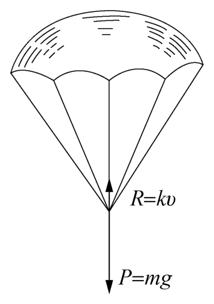
降落伞所受外力为$F=mg-kv$.
根据牛顿第二定律：$F=ma$，得到$v(t)$满足微分方程
$$
m\frac{\mathrm{d}v}{\mathrm{d}t}=mg-kv, \qquad (1)
$$
初始条件为$\left.v\right|_{t=0}=0$. 将方程(1)分离变量得
$$
\frac{\mathrm{d}v}{mg-kv}=\frac{\mathrm{d}t}{m},
$$
两边积分得
$$
\int\frac{\mathrm{d}v}{mg-kv}=\int\frac{\mathrm{d}t}{m},
$$
$$
-\frac{1}{k}\ln(mg-kv)=\frac{t}{m}+C_1,
$$
即$mg-kv=\mathrm{e}^{-k\left(\frac{t}{m}+C_1\right)}$或$v=\frac{mg}{k}+C\mathrm{e}^{-\frac{k}{m}t}\left(C=-\frac{\mathrm{e}^{-kC_1}}{k}\right)$.
代入初始条件得$C=-\frac{mg}{k}$，
故所求特解为$v=\frac{mg}{k}(1-\mathrm{e}^{-\frac{k}{m}t})$.
**例 3**　设河边点$O$的正对岸为点$A$，河宽$OA=h$，两岸为平行直线，水流速度为$a$. 有一只鸭子从点$A$游向点$O$，设鸭子(在静水中)的游速为$b(b>a)$，且鸭子游动方向始终朝着点$O$，求鸭子游过的迹线的方程.
**解**　设水流速度为$\vec{a}$($|\vec{a}|=a$)，鸭子游速为$\vec{b}$($|\vec{b}|=b$)，则鸭子实际运动速度为$\vec{v}=\vec{a}+\vec{b}$. 取坐标系如图4-4所示，设在时刻$t$鸭子位于点$P(x,y)$，则鸭子运动速度$v=(v_x,v_y)=(x_t,y_t)$，故有$\frac{\mathrm{d}x}{\mathrm{d}y}=\frac{x_t}{y_t}=\frac{v_x}{v_y}$. 现在$\vec{a}=(a,0)$，而$\vec{b}=b\vec{e}_{PO}$，其中$\vec{e}_{PO}$为与$\overrightarrow{PO}$同方向的单位向量.
由于$\overrightarrow{PO}=-(x,y)$，故$\vec{e}_{PO}=\frac{-(x,y)}{\sqrt{x^2+y^2}}$.
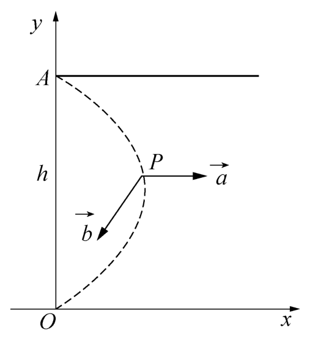
于是$\vec{b}=-\frac{b}{\sqrt{x^2+y^2}}(x,y)$，
$$
\vec{v}=\vec{a}+\vec{b}=\left(a-\frac{bx}{\sqrt{x^2+y^2}},\ -\frac{by}{\sqrt{x^2+y^2}}\right).
$$
由此得微分方程
$$
\frac{\mathrm{d}x}{\mathrm{d}y}=\frac{v_x}{v_y}=\frac{a\sqrt{x^2+y^2}}{by}+\frac{x}{y},
$$
即
$$
\frac{\mathrm{d}x}{\mathrm{d}y}=-\frac{a}{b}\sqrt{\left(\frac{x}{y}\right)^2+1}+\frac{x}{y},
$$
初始条件为$\left.x\right|_{y=h}=0$. 令$\frac{x}{y}=u$，则$x=yu$，$\frac{\mathrm{d}x}{\mathrm{d}y}=y\frac{\mathrm{d}u}{\mathrm{d}y}+u$，代入上面的方程，得
$$
y\frac{\mathrm{d}u}{\mathrm{d}y}=-\frac{a}{b}\sqrt{u^2+1},
$$
分离变量得
$$
\frac{\mathrm{d}u}{\sqrt{u^2+1}}=-\frac{a}{by}\mathrm{d}y,
$$
积分得
$$
\ln(u+\sqrt{u^2+1})=-\frac{a}{b}(\ln y+\ln C),
$$
故
$$
x=\frac{y}{2}\left[(Cy)^{-\frac{a}{b}}-(Cy)^{\frac{a}{b}}\right]=\frac{1}{2C}\left[(Cy)^{1-\frac{a}{b}}-(Cy)^{1+\frac{a}{b}}\right].
$$
将初始条件代入上式，得$C=\frac{1}{h}$，故所求迹线方程为
$$
x=\frac{h}{2}\left[\left(\frac{y}{h}\right)^{1-\frac{a}{b}}-\left(\frac{y}{h}\right)^{1+\frac{a}{b}}\right],\quad 0\leq y\leq h.
$$
**例 4**　如果设某商品在时刻$t$的售价为$P$，社会对该商品的需求量和供给量分别是$P$的函数$Q(P)$、$S(P)$. 一般情况下，商品供给量$S$是价格$P$的单调递增函数，商品需求量$Q$是价格$P$的单调递减函数. 为简单起见，设该商品的供给函数与需求函数分别为
$$
S(P)=a+bP,\quad Q(P)=\alpha-\beta P, \qquad (2)
$$
其中$a,b,\alpha,\beta$均为常数，且$b>0$，$\beta>0$.
当供给量与需求量相等时，可得供求平衡时的价格：
$$
P_e=\frac{\alpha-a}{\beta+b},
$$
称$P_e$为均衡价格.
一般地说，当某种商品供不应求，即$S<Q$时，该商品价格要涨；当供大于求，即$S>Q$时，该商品价格要落. 因此，假设$t$时刻的价格$P(t)$的变化率与超额需求量$Q-S$成正比，于是有方程
$$
\frac{\mathrm{d}P}{\mathrm{d}t}=k\left[Q(P)-S(P)\right],
$$
其中$k>0$，用来反映价格的调整速度.
将(2)代入方程，可得
$$
\frac{\mathrm{d}P}{\mathrm{d}t}=\lambda(P_e-P), \qquad (3)
$$
其中常数$\lambda=(b+\beta)k>0$. 方程(3)的通解为
$$
P(t)=P_e+C\mathrm{e}^{-\lambda t}.
$$
假设初始价格$P(0)=P_0$，代入上式，得$C=P_0-P_e$. 于是上述价格调整模型的解为
$$
P(t)=P_e+(P_0-P_e)\mathrm{e}^{-\lambda t}.
$$
由$\lambda>0$知，$t\to+\infty$时，$P(t)\to P_e$. 这说明随着时间不断推移，实际价格$P(t)$将逐渐趋近均衡价格$P_e$.
### 二、二阶微分方程的实际案例
**例 5**　质量为$m$的质点受力$F$的作用沿$Ox$轴做直线运动. 设力$F$仅是时间$t$的函数：$F=F(t)$. 在开始时刻$t=0$时$F(0)=F_0$，随着时间$t$的增大，此力$F$均匀地减少，直到$t=T$时，$F(T)=0$. 如果开始时质点位于原点，且初速度为零，求该质点的运动规律.
**解**　设在时刻$t$质点的位置为$x=x(t)$. 由牛顿第二定律，得质点运动的微分方程：
$$
m\frac{\mathrm{d}^2x}{\mathrm{d}t^2}=F(t). \qquad (4)
$$
由题设，$F(t)$随$t$增大而均匀地减少，$F(0)=F_0\Rightarrow F(t)=F_0-kt$.
又
$$
F(T)=0\Rightarrow F(t)=F_0\left(1-\frac{t}{T}\right).
$$
于是方程(4)可以写成
$$
\frac{\mathrm{d}^2x}{\mathrm{d}t^2}=\frac{F_0}{m}\left(1-\frac{t}{T}\right). \qquad (5)
$$
其初始条件为
$$
\left.x\right|_{t=0}=0,\quad\left.\frac{\mathrm{d}x}{\mathrm{d}t}\right|_{t=0}=0.
$$
在方程(5)两端积分，得
$$
\frac{\mathrm{d}x}{\mathrm{d}t}=\frac{F_0}{m}\int\left(1-\frac{t}{T}\right)\mathrm{d}t=\frac{F_0}{m}\left(t-\frac{t^2}{2T}\right)+C_1.
$$
代入初始条件$\left.\frac{\mathrm{d}x}{\mathrm{d}t}\right|_{t=0}=0$，得$C_1=0$. 于是
$$
\frac{\mathrm{d}x}{\mathrm{d}t}=\frac{F_0}{m}\left(t-\frac{t^2}{2T}\right)\Rightarrow x=\frac{F_0}{m}\left(\frac{t^2}{2}-\frac{t^3}{6T}\right)+C_2.
$$
将条件$\left.x\right|_{t=0}=0$代入上式，得$C_2=0$. 于是所求质点的运动规律：
$$
x=\frac{F_0}{m}\left(\frac{t^2}{2}-\frac{t^3}{6T}\right),\quad 0\leq t\leq T.
$$
**例 6**　墙上有两个钉子，连接着一条绳子，绳子仅受到重力作用而下垂，所成之曲线称之为悬链线，试推导此曲线方程.
**解**　建立坐标系$xOy$(见图4-5)，设曲线方程为$y=y(x)$，使悬链线的最低点位于$y$轴上，且$|OA|=a$(这个$a$待定，将在下面给出说明)，则点$A$的坐标为$(0,a)$. 这样就得到了初始条件：$\left.y\right|_{x=0}=a$，$\left.y'\right|_{x=0}=0$(由于光滑曲线在最低点处的切线平行于$x$轴).
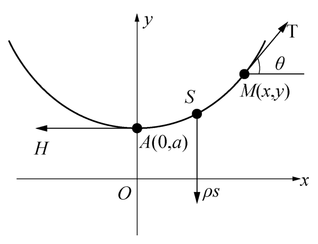
做受力分析：取一段弧$\overset{\frown}{AM}$(其中点$M$的坐标为$(x,y)$)，设其弧长为$s$，单位弧长重$\rho$(密度)，则弧$\overset{\frown}{AM}$所受的重力为$\rho s$. 设在点$A$处受到水平张力$H$，在点$M$处受到切向张力$T$，$T$与平行于$x$轴的直线的夹角为$\theta$，则在平衡状态下，应有
$$
T\cos\theta=H,\quad F_x=0\ \text{及}\ T\sin\theta=\rho s.
$$
两式相除，得$\tan\theta=\frac{\rho}{H}s$. 由于$\rho$是已知的，水平张力$H$可通过实验手段获得，因此$\frac{\rho}{H}$是已知的，不妨记为$\frac{\rho}{H}=\frac{1}{a}$(这就是$a$的出处). 又$\tan\theta=y'$，即得
$$
y'=\frac{1}{a}s,\quad y''=\frac{1}{a}\cdot\frac{\mathrm{d}s}{\mathrm{d}x}.
$$
利用弧微分公式$\frac{\mathrm{d}y}{\mathrm{d}x}=\sqrt{1+y'^2}$，得$y''=\frac{1}{a}\sqrt{1+y'^2}$，
即得定解问题：
$$
\begin{cases}
y''=\frac{1}{a}\sqrt{1+y'^2},\\
\left.y\right|_{x=0}=a,\quad\left.y'\right|_{x=0}=0.
\end{cases}
$$
令$y'=p$，则$y''=\frac{\mathrm{d}p}{\mathrm{d}x}$，原方程化为$\frac{\mathrm{d}p}{\mathrm{d}x}=\frac{1}{a}\sqrt{1+p^2}$.
分离变量得$\frac{\mathrm{d}p}{\sqrt{1+p^2}}=\frac{1}{a}\mathrm{d}x$，两边积分得$\int\frac{\mathrm{d}p}{\sqrt{1+p^2}}=\frac{1}{a}\int\mathrm{d}x+C_1$，即
$$
\mathrm{arsh}p=\frac{x}{a}+C_1\left(\ln(p+\sqrt{1+p^2})=\frac{x}{a}+C_1\right).
$$
由$\left.y'\right|_{x=0}=0$得$C_1=0$，故$\mathrm{arsh}p=\frac{x}{a}$，或$p=\mathrm{sh}\frac{x}{a}$. 再积分得
$$
y=\int\mathrm{sh}\frac{x}{a}\mathrm{d}x+C_2=a\mathrm{ch}\frac{x}{a}+C_2.
$$
由$\left.y\right|_{x=0}=a$得$C_2=0$，因此得悬链线方程为
$$
y=a\mathrm{ch}\frac{x}{a}=\frac{a}{2}\left(\mathrm{e}^{\frac{x}{a}}+\mathrm{e}^{-\frac{x}{a}}\right).
$$
**例 7**　一个离地面很高的物体受地球引力作用，由静止开始落向地面，求它落到地面时的速度和所需时间.(不计空气阻力)
**解**　建立坐标系$xOy$(见图4-6)，设球心与该物的连线为$y$轴，方向朝上，物体的质量为$m$，地球的质量为$M$，半径为$R$，物体到地心的距离为$l$，在时刻$t$时物体所在位置为$y(t)$，则速度为$\frac{\mathrm{d}y}{\mathrm{d}t}$. 由万有引力公式得
$$
m\frac{\mathrm{d}^2y}{\mathrm{d}t^2}=-\frac{kMm}{y^2}.
$$
其中$k$为引力系数.
先确定$k$：由$\left.\frac{\mathrm{d}^2y}{\mathrm{d}t^2}\right|_{y=R}=-g$，得$-g=-\frac{kMm}{R^2}$，即$k=\frac{gR^2}{Mm}$，
故有定解问题：
$$
\begin{cases}
\frac{\mathrm{d}^2y}{\mathrm{d}t^2}=-\frac{gR^2}{y^2},\\
\left.y\right|_{t=0}=l,\quad\left.y'\right|_{t=0}=0.
\end{cases}
$$
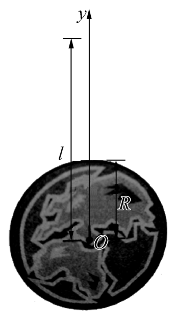
令$y'=v$，则$y''=v\frac{\mathrm{d}v}{\mathrm{d}y}$，原方程化为$v\frac{\mathrm{d}v}{\mathrm{d}y}=-\frac{gR^2}{y^2}$，分离变量得$v\mathrm{d}v=-\frac{gR^2}{y^2}\mathrm{d}y$，
两边积分得
$$
\int v\mathrm{d}v=-\int\frac{gR^2}{y^2}\mathrm{d}y+C_1,
$$
即$\frac{1}{2}v^2=\frac{gR^2}{y}+C_1$. 由$\left.v\right|_{y=l}=0$得$C_1=-\frac{gR^2}{l}$，故
$$
v^2=2gR^2\left(\frac{1}{y}-\frac{1}{l}\right).
$$
令$y=R$，就得到落到地面的速度
$$
v^2=2gR^2\left(\frac{1}{R}-\frac{1}{l}\right),\quad\text{或}\ v=-\sqrt{2gR^2\left(\frac{1}{R}-\frac{1}{l}\right)}.
$$
(负号表示运动的方向是朝$y$轴反向)
由$v=\frac{\mathrm{d}y}{\mathrm{d}t}=-R\sqrt{2g\left(\frac{1}{y}-\frac{1}{l}\right)}$，分离变量得
$$
\frac{\mathrm{d}y}{-R\sqrt{2g\left(\frac{1}{y}-\frac{1}{l}\right)}}=\mathrm{d}t,
$$
即
$$
\mathrm{d}t=-\frac{1}{R}\sqrt{\frac{l}{2g}}\cdot\sqrt{\frac{y}{l-y}}\mathrm{d}y.
$$
两边积分(作变换$y=l\cos^2u$)得
$$
t=\frac{1}{R}\sqrt{\frac{l}{2g}}\left(\sqrt{ly-y^2}+l\arccos\sqrt{\frac{y}{l}}\right)+C_2.
$$
由$\left.y\right|_{t=0}=l$得$C_2=0$，因此
$$
t=\frac{1}{R}\sqrt{\frac{l}{2g}}\left(\sqrt{ly-y^2}+l\arccos\sqrt{\frac{y}{l}}\right).
$$
当$y=R$时，得
$$
t=\frac{1}{R}\sqrt{\frac{l}{2g}}\left(\sqrt{lR-R^2}+l\arccos\sqrt{\frac{R}{l}}\right).
$$
**例 8**　一条链悬挂在钉子上，起动时一端离开钉子$8\ \mathrm{m}$，另一端离开钉子$12\ \mathrm{m}$，求链条全部滑过钉子所需时间.
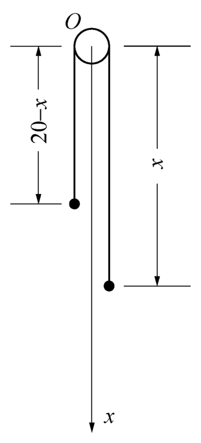
**解**　链条所受力是变力，设线密度为$\rho$，则它所受力是
$$
F=\left[\rho x-(20-x)\rho\right]g=2\rho g(x-10).
$$
由牛顿第二定律得$20\rho\frac{\mathrm{d}^2x}{\mathrm{d}t^2}=2\rho g(x-10)$，即
$$
\frac{\mathrm{d}^2x}{\mathrm{d}t^2}=\frac{g}{10}(x-10).
$$
若取$g=10$，则有$\frac{\mathrm{d}^2x}{\mathrm{d}t^2}-x=-10\qquad (6)$.
对应齐次方程的特征方程为$r^2-1=0$，得到特征根$r_{1,2}=\pm 1$，故对应齐次方程的通解为$X=C_1\mathrm{e}^t+C_2\mathrm{e}^{-t}$. 取$x^*=a$，代入(6)式得$a=10$，因此通解为$x=X+x^*=C_1\mathrm{e}^t+C_2\mathrm{e}^{-t}+10$.
由初始条件知$C_1+C_2=2$，$C_1-C_2=0$，得$C_1=C_2=1$，因此$x=\mathrm{e}^t+\mathrm{e}^{-t}+10$.
当$x=20$时，$20=\mathrm{e}^t+\mathrm{e}^{-t}+10$，即
$$
\mathrm{ch}t=5,\quad t=\mathrm{arch}5=\ln(5+\sqrt{5^2-1})=\ln(5+2\sqrt{6}).
$$
### 习题 4-4
1. 质量为$1\ \mathrm{g}$的质点受外力作用做直线运动，外力与时间成正比. 在$t=10\ \mathrm{s}$时，速率为$50\ \mathrm{cm/s}$，外力为$4\ \mathrm{g\cdot cm/s^2}$. 从运动开始经过$1\ \mathrm{min}$后的速率是多少？
2. 镭的衰变与它的现存量$R$成正比，经过$1600$年以后，只余下原始量$R_0$的一半. 试求镭的现存量$R$与时间$t$的函数关系.
3. 将质量为$m$的物体垂直上抛，假设初始速度为$v_0$，空气阻力与速度成正比(比例系数为$k$)，试求在物体上升过程中速度$v$与时间$t$的函数关系.
4. 在$Ox$轴上，一质量为$m$的质点受力$A\cos\omega t$而运动，初始条件为$\left.x\right|_{t=0}=a$，$\left.v\right|_{t=0}=0$，求该质点的运动方程.
5. 一质量为$m$的物体，在黏性液体中由静止自由下落. 假设液体阻力与运动速度成正比，试求物体的运动规律.
6. 大炮以仰角$\alpha$、初速度$v_0$发射炮弹，若不计空气阻力，求弹道曲线.
## 本章小结
| 　 | 　 |
| --- | --- |
| 基本概念 | 了解 微分方程、阶、通解、特解、初始条件、初值问题的概念 |
| 一阶微分方程 | 掌握 可分离变量方程和齐次方程的解法 会求 一阶线性微分方程的解 |
| 二阶微分方程 | 了解 二阶微分方程解的结构 会求 可降阶的二阶微分方程的解 掌握 二阶齐次线性微分方程的解法 会求 二阶非齐次线性微分方程(两种基本类型) |
| 微分方程应用 | 会用 微分方程求解一些简单的几何问题和物理问题 |
## 章节测试四
一、填空选择题
1. 方程$\frac{\mathrm{d}^3y}{\mathrm{d}x^3}+\mathrm{e}^x\frac{\mathrm{d}^2y}{\mathrm{d}x^2}+\mathrm{e}^{2x}=1$的通解中应包含的任意常数的个数为(　　)；
A. 2　　　B. 3　　　C. 4　　　D. 0
2. 微分方程$y'=-y+x\mathrm{e}^{-x}$是(　　)方程；
A. 可分离　　　B. 齐次　　　C. 一阶非齐次线性　　　D. 一阶齐次线性
3. 已知$y=(C_1+C_2x)\mathrm{e}^x+C_3\cos x+C_4\sin x$是某四阶常系数齐次线性微分方程的通解，则该微分方程为(　　)；
A. $y^{(4)}-2y'''-2y''+2y'+y=0$　　　B. $y^{(4)}+2y'''-2y''+2y'+y=0$
C. $y^{(4)}-2y'''+y''-y'+y=0$　　　D. $y^{(4)}-2y'''+2y''-2y'+y=0$
4. 微分方程$y'-xy'=a(y^2+y')$的通解为__________；
5. 方程$y''-3y'-4y=0$，满足$\left.y\right|_{x=0}=0$，$\left.y'\right|_{x=0}=-5$的特解是__________.
二、计算下列微分方程：
(1) 求初值问题
$$
\begin{cases}
\mathrm{e}^x\cos y\mathrm{d}x+(\mathrm{e}^x+1)\sin y\mathrm{d}y=0\\
\left.y\right|_{x=0}=\frac{\pi}{4}
\end{cases}
$$

的解.

(2) $xy'-y-\sqrt{y^2-x^2}=0$；

(3) $y\ln y\mathrm{d}x+(x-\ln y)\mathrm{d}y=0$.

(4) $y''+y=\mathrm{e}^{3x}$.

(5) $y''=(y')^3+y'$.

三、卫生球直径为$1\ \mathrm{cm}$，放置一个月后直径变为$0.5\ \mathrm{cm}$，假定它的挥发速度正比于其表面积，求卫生球半径与时间的关系，问经过多长时间它能挥发完毕.

四、设$y=x^2$是方程$x^2y'+P(x)y=3x^3$的一个解，求该方程满足$\left.y\right|_{x=1}=2$的特解.

五、若方程$y''+a^2y=0(a>0)$有满足$\left.y\right|_{x=0}=0$，$\left.y'\right|_{x=1}=0$的非零解，求$a$的值.

六、如果对任意$x>0$，曲线$y=y(x)$上的点$(x,y(x))$处的切线在$y$轴上的截距等于$\frac{1}{x}\int_0^x y(t)\mathrm{d}t$，求函数$y=y(x)$的表达式.

## 拓展阅读

### 神奇的三维分形艺术

近日，一群数学“极客”利用特定的数学方程，经过反复迭代算法，创作出一组令人叹为观止的三维分形结构图案.

“极客”一词，来自于美国俚语“geek”的音译，一般理解为性格古怪的人. 数学“极客”大多是指不一定是数学专业但对数学等技术有狂热的兴趣并投入大量时间钻研的人. 所谓“分形”，本意是指“破碎、不规则”，在“分形几何”中指的是不规则复杂现象中的秩序和结构. 因此，“分形几何”就是研究无限复杂，但具有一定意义的自相似图形和结构的几何学. 所谓“分形艺术”图，就是利用数学方法，通过计算机程序进行无数次运算最终形成的分形艺术图案.

以下图中的这些三维结构尽显美丽而神奇的特点，有的像细腻的法国奶油蛋糕，有的像神话或科幻小说中的神秘洞穴. 这些图形通常也可以用来制作三维屏保.

**1. 曼德尔球**

极客们把图中的球状物称为“曼德尔球”(Mandelbulb). 该名称来源于分形几何的创始人曼德尔布罗特(Mandelbrot). 这个三维图是由一个原始球体经过一种迭代算法而产生的. 极客们将原始球体上各点的三维数据，运用同一方程进行无数次的重复运算，就得到了这个“曼德尔球”结构. 这一过程与二维“曼德尔布罗特”集合的形成过程相似.

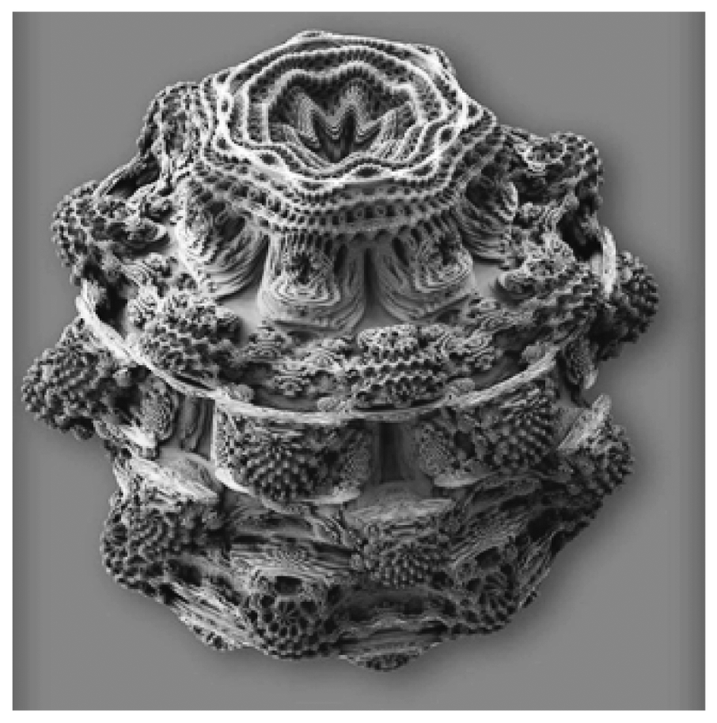

**2. 曼德尔布罗特三维结构**

丹尼尔·怀特是一位分形艺术爱好者，也是这组作品的创作者之一. 他认为，这组作品并不仅仅是三维“曼德尔布罗特”集合，它们比普通的三维“曼德尔布罗特”集合看起来更美丽、更迷人. 怀特指出，所有的原始方程中，只有一部分可以产生如此迷人的三维图，有些原始方程只有在进行至少2次方运算之后才可以产生一些迷人的效果. 普通人从本图中根本找不出它的规律所在.

**3. 8次方运算结果**

如果将原始方程进行8次方运算，就可能得到更细致、更美丽的图案，甚至连怀特等人都无法解释为什么会形成如图所示的美妙图案.

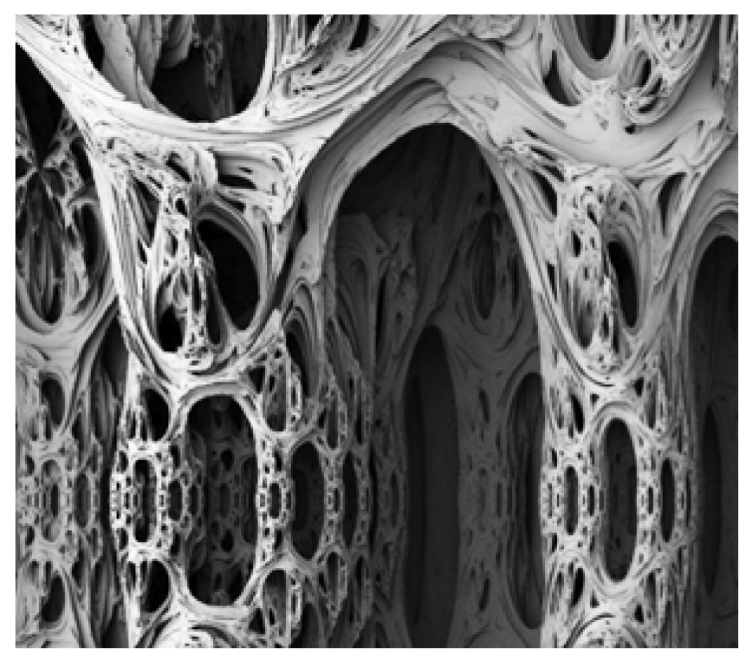

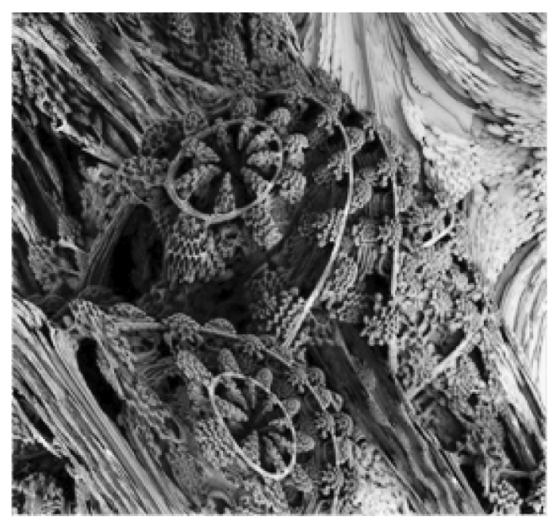

**4. 曼德尔布罗特蛋糕**

怀特等人在这些作品上花费了大量的精力. 他们将这些作品无限放大，致力于寻找更为有趣的结构. 图中这个造型很像一种法国奶油蛋糕，因此怀特把它称为“曼德尔布罗特蛋糕”.

**5. 地质结构**

即使是单方程，只要经过数千次的迭代运算，也可以产生一个完整的结构. 比如本图所示的结构，看起来就像人类已发现的某行星表面的地质结构.

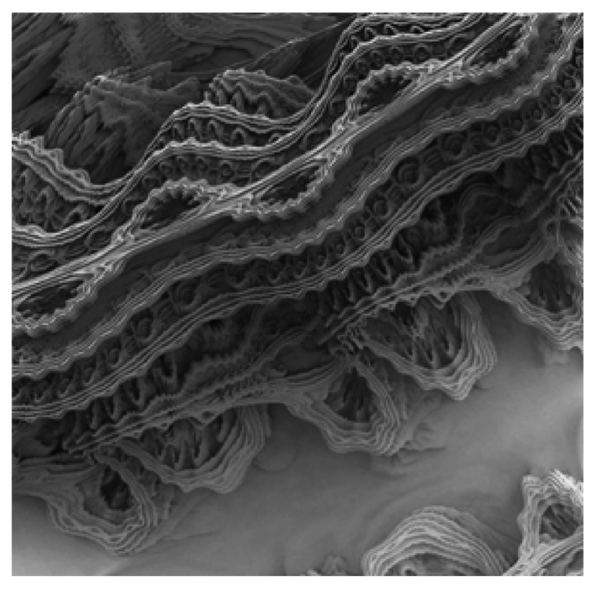

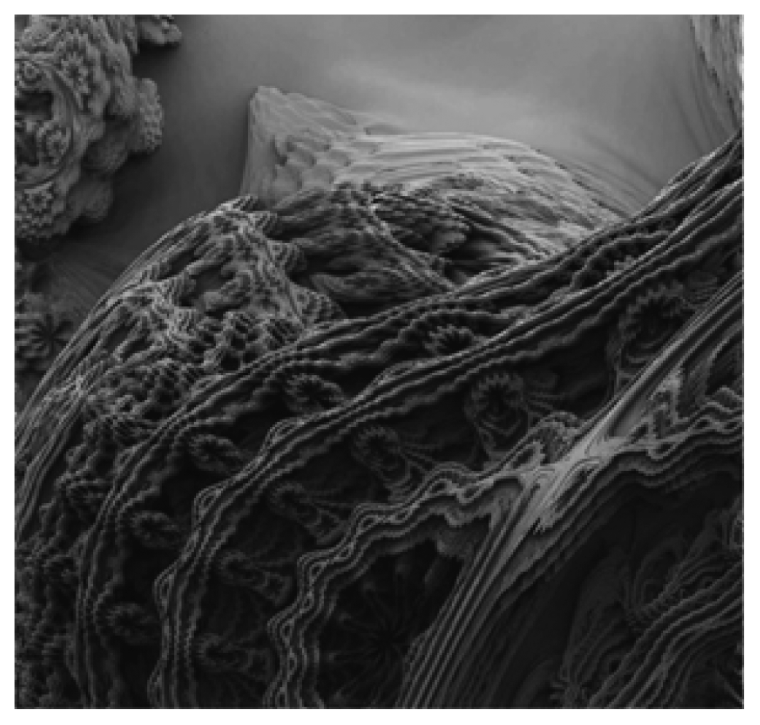

**6. 巴洛克风格**

许多时候，甚至连怀特等人都会惊讶于曼德尔球内部结构的复杂性. 在为本图撰写说明时，怀特这样写道：“(图中)这个世界显得非常杂乱，里面包含了许多数学秘密，因此形成了诸如这类的巴洛克风格美景.” 图中呈现出许多巴洛克风格的桥梁和柱子. “巴洛克”是一种风格术语，指自17世纪初至18世纪上半叶流行于欧洲的主要艺术风格. 该词来源于葡萄牙语barroco，意思是一种不规则的珍珠.

**7. 神秘洞穴**

利用三维分形艺术，极客们不仅仅创作出如图所示的“迷失的神秘洞穴”图案，而且绘声绘色地杜撰了一个相应的短篇科幻小说。他们在小说中写道：“早在远古时代，一个距离我们几十亿光年的星球上已经出现了这个足有半英里(约800米)高的神秘洞穴。不过，这个洞穴现在已经沉入了海底. 它是由一种高智商的生命所建造的，这些生命或许早就发现了曼德尔布罗特三维结构的秘密. 洞穴的内部充满各种高科技和数学秘密，或许其中还包含许多形如曼德尔布罗特结构的真实事物.”

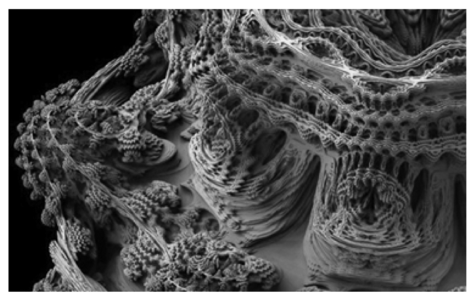

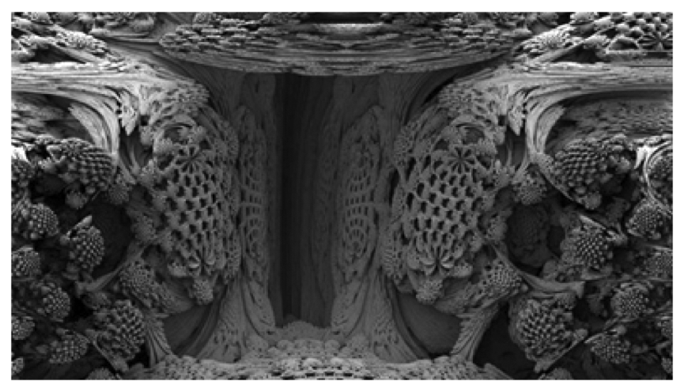

**8. 生奶油**

即使经过8次方运算，有些曼德尔布罗特三维结构仍然无法展现其全部的细节，即仍可对其进一步运算以获得更详细、更神奇的结果. 本图中好似“生奶油”的部分，看起来就算不上真正的曼德尔布罗特三维结构.

**9. 美丽的图案**

怀特和“分形论坛”的其他成员对他们所创作的三维结构非常满意. 尽管这些结构在现实中并不存在，但它们可以通过计算机软件获得. 从社会学角度讲，这种技术显得相当神奇，它可以创造出一个美丽的世界.

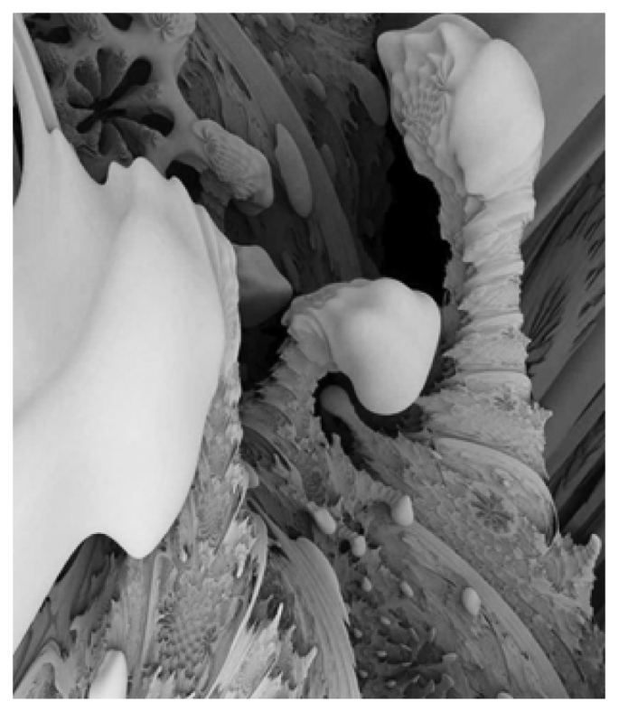

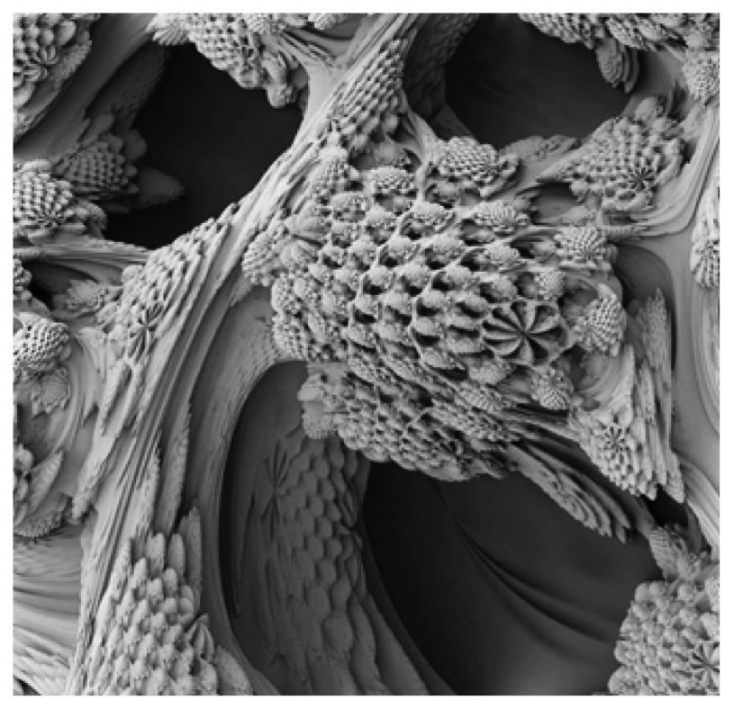
