# 第五章 向量与空间解析几何

## 第一节 向量及其运算

**[课前导读]**

既有大小又有方向的物理量称为向量。在数学上可用有向线段来表示向量，其长度表示向量的大小，其方向（箭头）表示向量的方向。

（1）向量的表示：以 $M_1$ 为起点、$M_2$ 为终点的有向线段表示的向量记为 $\overrightarrow{M_1M_2}$，有时也用一个黑体字母（书写时，在字母上面加一箭头）来表示（见图5-1），如 $\boldsymbol{a}$ 或 $\vec{a}$。

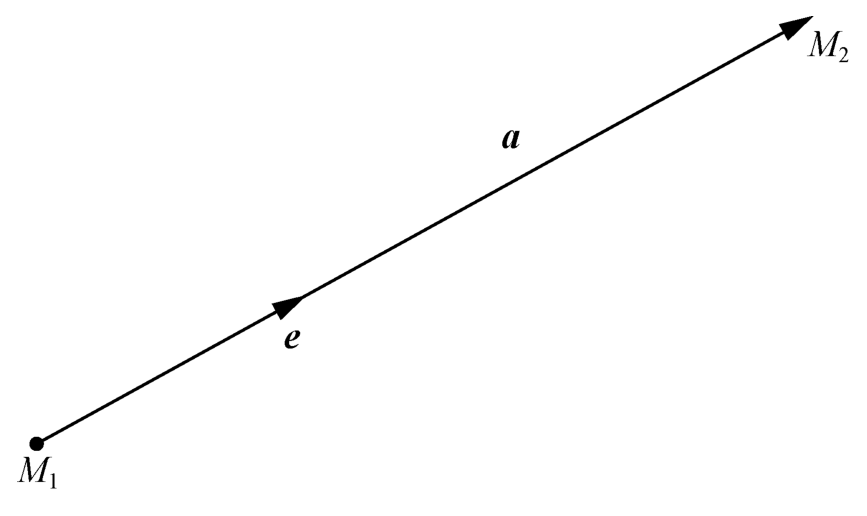

（2）向量的模：向量的大小（数学上指有向线段的长度）叫作向量的模，记作 $|\boldsymbol{a}|$，$|\overrightarrow{M_1M_2}|$。模为 1 的向量称为单位向量（见图5-1），记作 $\boldsymbol{e}$。模为 0 的向量称为零向量，记作 $\boldsymbol{0}$。零向量的方向可以看作是任意的。

（3）向径：以原点 $O$ 为始点，向一点 $M$ 引向量 $\overrightarrow{OM}$，这个向量叫作点 $M$ 对于点 $O$ 的向径，记作 $\boldsymbol{r}$，即 $\boldsymbol{r}=\overrightarrow{OM}$。

（4）自由向量：只与大小、方向有关，而与起点处无关的向量称为自由向量。

### 一、空间直角坐标系

过空间一个定点 $O$，作三条互相垂直且具有相同的长度单位的数轴（见图5-2），这三条数轴分别称为 $x$ 轴（横轴）、$y$ 轴（纵轴）、$z$ 轴（竖轴），统称坐标轴，定点 $O$ 称为原点。其正向符合右手规则（见图5-3）。这样的三条坐标轴就组成了空间直角坐标系。

三条坐标轴中的两条可确定一个平面，即 $xOy$、$yOz$、$zOx$ 平面，统称坐标面。它们把空间分成了八个卦限，在 $xOy$ 平面上面逆时针依次为Ⅰ、Ⅱ、Ⅲ、Ⅳ卦限，下面依次为Ⅴ、Ⅵ、Ⅶ、Ⅷ卦限，如图5-4所示。

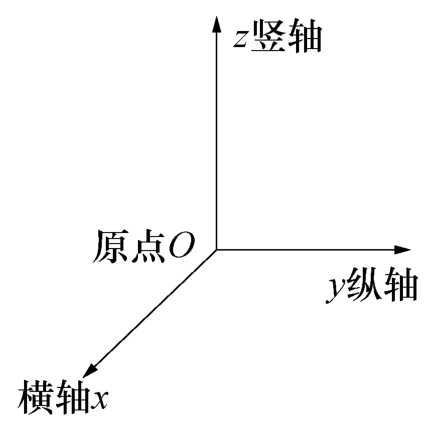

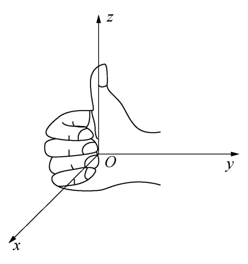

对于空间一点 $M$，过点 $M$ 作三个平面分别垂直于 $x$ 轴、$y$ 轴和 $z$ 轴，它们与 $x$ 轴、$y$ 轴和 $z$ 轴的交点依次为 $P$、$Q$ 和 $R$（见图5-5），这三点在 $x$ 轴、$y$ 轴和 $z$ 轴上的坐标为 $x$、$y$ 和 $z$，则这组有序数 $x$、$y$ 和 $z$ 称为点 $M$ 的坐标，记为 $M(x,y,z)$。

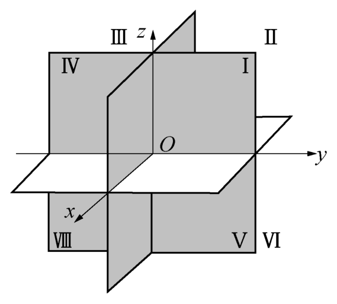

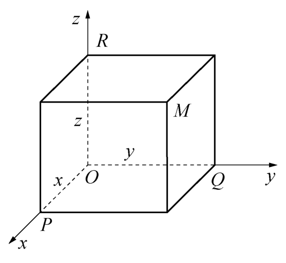

反之，已知一个有序数组 $(x,y,z)$，我们可以在 $x$ 轴、$y$ 轴和 $z$ 轴上分别取坐标为 $x$ 的点 $P$，坐标为 $y$ 的点 $Q$，坐标为 $z$ 的点 $R$，过三个点分别作垂直于 $x$ 轴、$y$ 轴和 $z$ 轴的三个平面，它们相交于一点 $M$，则 $M$ 即为以 $x$、$y$ 和 $z$ 为坐标的点。所以通过直角坐标系，我们建立了空间点 $M$ 与有序数组 $(x,y,z)$ 的一一对应关系。

我们先来看几个特殊点的坐标（见图5-6）。

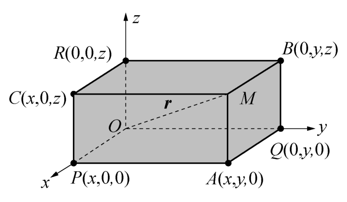

在 $xOy$ 平面上：$z=0$，故对应点的坐标为 $A(x,y,0)$；

在 $yOz$ 平面上：$x=0$，故对应点的坐标为 $B(0,y,z)$；

在 $zOx$ 平面上：$y=0$，故对应点的坐标为 $C(x,0,z)$。

在 $x$ 轴上：$y=z=0$，点的坐标为 $P(x,0,0)$；

在 $y$ 轴上：$z=x=0$，点的坐标为 $Q(0,y,0)$；

在 $z$ 轴上：$x=y=0$，点的坐标为 $R(0,0,z)$。

设 $M_1(x_1,y_1,z_1)$、$M_2(x_2,y_2,z_2)$ 为空间两个点（见图5-7），通过 $M_1$、$M_2$ 各作三个分别垂直于三条坐标轴的平面，这六个平面组成一个以 $M_1$、$M_2$ 为体对角线的长方体，由此可得

$$
d^2=|\overrightarrow{M_1M_2}|^2=(x_2-x_1)^2+(y_2-y_1)^2+(z_2-z_1)^2,
$$

即

$$
d=|\overrightarrow{M_1M_2}|=\sqrt{(x_2-x_1)^2+(y_2-y_1)^2+(z_2-z_1)^2}.
$$

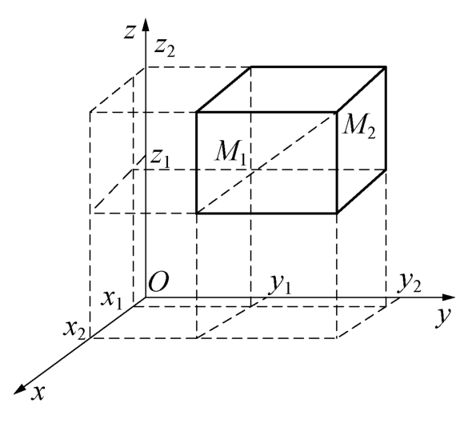

**例 1** 证明以点 $M_1(4,3,1)$、$M_2(7,1,2)$ 及 $M_3(5,2,3)$ 为顶点的三角形是等腰三角形。

**证** $|\overrightarrow{M_1M_2}|=\sqrt{(7-4)^2+(1-3)^2+(2-1)^2}=\sqrt{14}$，

$|\overrightarrow{M_2M_3}|=\sqrt{(5-7)^2+(2-1)^2+(3-2)^2}=\sqrt{6}$，

$|\overrightarrow{M_3M_1}|=\sqrt{(4-5)^2+(3-2)^2+(1-3)^2}=\sqrt{6}$，

即 $|\overrightarrow{M_2M_3}|=|\overrightarrow{M_3M_1}|$，因此该三角形是等腰三角形。

**例 2** 在 $z$ 轴上求与两点 $A(-4,1,7)$ 和 $B(3,5,-2)$ 等距离的点。

**解** 设所求点的坐标为 $M(0,0,z)$，由 $|\overrightarrow{AM}|=|\overrightarrow{BM}|$，即

$$
\sqrt{(0+4)^2+(0-1)^2+(z-7)^2}=\sqrt{(3-0)^2+(5-0)^2+(-2-z)^2},
$$

得 $z=\dfrac{14}{9}$，因此所求点的坐标为 $M\left(0,0,\dfrac{14}{9}\right)$。

### 二、向量的运算

### 1. 向量的投影及投影定理

将向量 $\boldsymbol{a}$、$\boldsymbol{b}$ 的始点重合，在两向量的所在平面上，若一个向量逆时针方向转过角度 $\theta$ 后可与另一个向量正向重合（见图5-8），则称 $\theta$ 为向量 $\boldsymbol{a}$、$\boldsymbol{b}$ 的夹角，记作 $\widehat{(\boldsymbol{a},\boldsymbol{b})}$，即

$$
\theta=\widehat{(\boldsymbol{a},\boldsymbol{b})}=\widehat{(\boldsymbol{b},\boldsymbol{a})}\quad(0\le\theta\le\pi).
$$

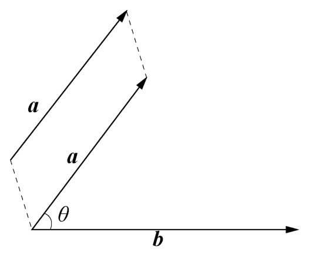

已知两向量 $\boldsymbol{a}$、$\boldsymbol{b}$，如果它们的夹角 $\theta=0$ 或 $\theta=\pi$，则称这两个向量平行，记为 $\boldsymbol{a}\parallel\boldsymbol{b}$，其中两个向量指向一致时 $\theta=0$，指向相反时 $\theta=\pi$。指向相同的两个平行向量 $\boldsymbol{a}$、$\boldsymbol{b}$ 如果还满足 $|\boldsymbol{a}|=|\boldsymbol{b}|$，那么这两个向量相等，记为 $\boldsymbol{a}=\boldsymbol{b}$。与向量 $\boldsymbol{a}$ 的模相同，但方向相反的向量叫作 $\boldsymbol{a}$ 的负向量，记作 $-\boldsymbol{a}$。

对于一向量与一轴的夹角，可将其中一轴看作向量，按两向量之间的夹角来度量；对于两个轴之间的夹角，则看作两向量的夹角。

通过空间一点 $A$ 作 $u$ 轴的垂直平面（见图5-9），该平面与 $u$ 轴的交点 $A'$ 称为点 $A$ 在 $u$ 轴上的投影。

如果向量 $\overrightarrow{AB}$ 的始点 $A$ 与终点 $B$ 在 $u$ 轴上的投影分别为 $A'$、$B'$（见图5-10），则 $u$ 轴上的有向线段 $\overrightarrow{A'B'}$ 的值 $A'B'$ 称为向量 $\overrightarrow{AB}$ 在 $u$ 轴上的投影，记作 $\mathrm{Prj}_u\overrightarrow{AB}=A'B'$，$u$ 轴称为投影轴。

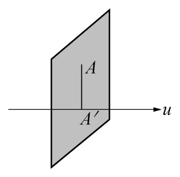

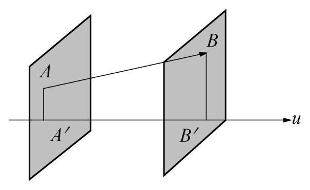

**注** 值 $A'B'$ 是指其绝对值等于 $\overrightarrow{A'B'}$ 的长度，即 $|\overrightarrow{A'B'}|$，符号由 $\overrightarrow{A'B'}$ 的方向决定：当 $\overrightarrow{A'B'}$ 与 $u$ 轴同向时，取正号；当 $\overrightarrow{A'B'}$ 与 $u$ 轴反向时，取负号。

**定理 1** 向量 $\overrightarrow{AB}$ 在 $u$ 轴上的投影等于向量的模乘以 $u$ 轴与向量 $\overrightarrow{AB}$ 的夹角 $\theta$ 的余弦，即

$$
\mathrm{Prj}_u\overrightarrow{AB}=|\overrightarrow{AB}|\cos\theta.
$$

**证** 将向量 $\overrightarrow{AB}$ 的始点置于 $u'$ 轴（见图5-11），则由直角三角形关系得

$$
\mathrm{Prj}_u\overrightarrow{AB}=\mathrm{Prj}_{u'}\overrightarrow{AB}=|\overrightarrow{AB}|\cos\theta.
$$

当一非零向量与其投影轴成锐角时，向量的投影为正；成钝角时，向量的投影为负；成直角时，向量的投影为零（见图5-12）。

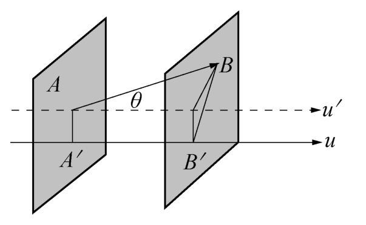

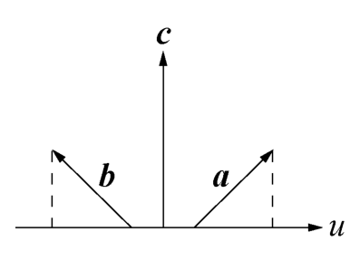

**定理 2** 两个向量的和在轴上的投影等于两个向量在轴上的投影的和。

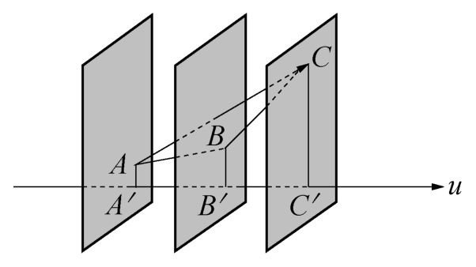

**证** 设点 $A$、$B$ 和 $C$ 在轴上的投影分别是 $A'$、$B'$ 和 $C'$（见图5-13），则 $\mathrm{Prj}_u\overrightarrow{AB}=A'B'$，$\mathrm{Prj}_u\overrightarrow{BC}=B'C'$，$\mathrm{Prj}_u\overrightarrow{AC}=A'C'$，由于无论 $A'$、$B'$ 和 $C'$ 在轴上的位置如何，总有 $A'B'+B'C'=A'C'$，故

$$
\mathrm{Prj}_u\overrightarrow{AB}+\mathrm{Prj}_u\overrightarrow{BC}=\mathrm{Prj}_u\overrightarrow{AC}.
$$

本定理可推广到有限个向量的情形：

$$
\mathrm{Prj}_u\boldsymbol{a}_1+\mathrm{Prj}_u\boldsymbol{a}_2+\cdots+\mathrm{Prj}_u\boldsymbol{a}_n=\mathrm{Prj}_u(\boldsymbol{a}_1+\boldsymbol{a}_2+\cdots+\boldsymbol{a}_n).
$$

**定理 3** $\mathrm{Prj}_u(\lambda\boldsymbol{a})=\lambda\mathrm{Prj}_u\boldsymbol{a}$。

**证** 证明留作习题。

### 2. 向量在坐标轴上的分向量与向量的坐标

以同起点向量 $\boldsymbol{a}$、$\boldsymbol{b}$ 为平行四边形相邻两边，以 $\boldsymbol{a}$ 向量的起点作为起点的其对角线表示的向量为两个向量的和，记为 $\boldsymbol{a}+\boldsymbol{b}$，如图5-14所示。以 $\boldsymbol{b}$ 向量的终点为起点，$\boldsymbol{a}$ 向量的终点为终点的对角线向量为向量的差，如图5-15所示。记为 $\boldsymbol{a}-\boldsymbol{b}=\boldsymbol{a}+(-\boldsymbol{b})$。

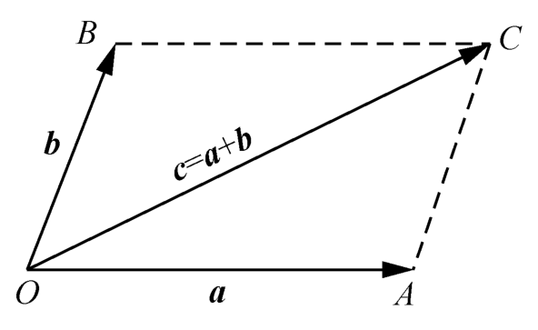

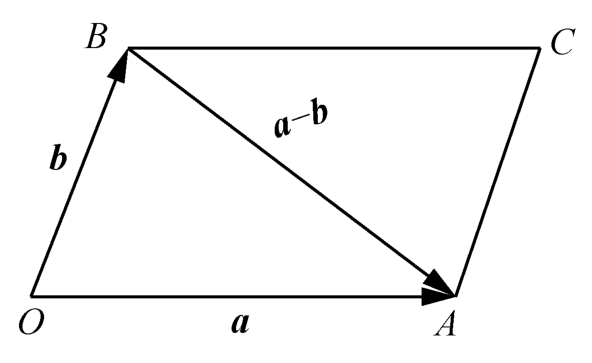

设 $\lambda$ 是一个数，向量 $\boldsymbol{a}$ 与数 $\lambda$ 的乘积 $\lambda\boldsymbol{a}$ 规定如下。

当 $\lambda>0$ 时，$\lambda\boldsymbol{a}$ 表示一向量，其大小 $|\lambda\boldsymbol{a}|=\lambda|\boldsymbol{a}|$，方向与 $\boldsymbol{a}$ 同向；

当 $\lambda=0$ 时，$\lambda\boldsymbol{a}=\boldsymbol{0}$ 是零向量；

当 $\lambda<0$ 时，$\lambda\boldsymbol{a}$ 表示一向量，其大小 $|\lambda\boldsymbol{a}|=-\lambda|\boldsymbol{a}|$，方向与 $\boldsymbol{a}$ 反向（见图5-16）。

特别地，当 $\lambda=-1$ 时，$(-1)\boldsymbol{a}=-\boldsymbol{a}$。

由数乘的定义很容易得到以下结论（见图5-17）。

（1）如果两个向量 $\boldsymbol{a}$、$\boldsymbol{b}$ 满足 $\boldsymbol{b}=\lambda\boldsymbol{a}$（$\lambda$ 是实数），则 $\boldsymbol{a}\parallel\boldsymbol{b}$；

反之，若 $\boldsymbol{a}\parallel\boldsymbol{b}$ 且 $\boldsymbol{a}\ne\boldsymbol{0}$，则存在唯一的实数 $\lambda$，使 $\boldsymbol{b}=\lambda\boldsymbol{a}$。

（2）记 $\boldsymbol{e}_a$ 为非零向量 $\boldsymbol{a}$ 的同向单位向量，$\boldsymbol{e}_a=\dfrac{\boldsymbol{a}}{|\boldsymbol{a}|}$（证明留作习题）。

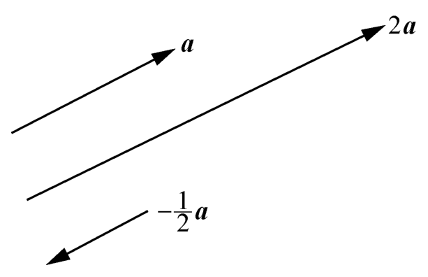

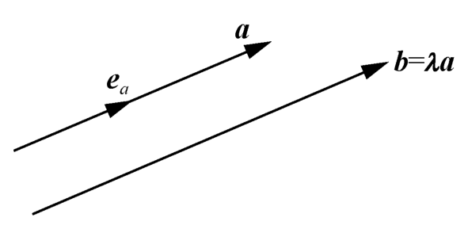

**例 3** 设 $P_1$、$P_2$ 为 $u$ 轴上坐标为 $u_1$、$u_2$ 的任意两点，又 $\boldsymbol{e}$ 为与 $u$ 轴正向一致的单位向量（见图5-18），则有 $\overrightarrow{P_1P_2}=(u_2-u_1)\boldsymbol{e}$。

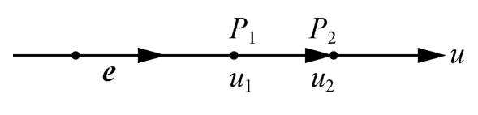

**证** 当 $u_2-u_1>0$ 时，$\overrightarrow{P_1P_2}$ 与 $\boldsymbol{e}$ 同向，故 $\overrightarrow{P_1P_2}=\lambda\boldsymbol{e}\ (\lambda>0)$，由 $\lambda=|\overrightarrow{P_1P_2}|=u_2-u_1$，因此

$\overrightarrow{P_1P_2}=(u_2-u_1)\boldsymbol{e}$；

当 $u_2-u_1=0$ 时，$\overrightarrow{P_1P_2}=\boldsymbol{0}$，$(u_2-u_1)\boldsymbol{e}=\boldsymbol{0}$，因此 $\overrightarrow{P_1P_2}=(u_2-u_1)\boldsymbol{e}$；

当 $u_2-u_1<0$ 时，$\overrightarrow{P_1P_2}$ 与 $\boldsymbol{e}$ 反向，故 $\overrightarrow{P_1P_2}=-\lambda\boldsymbol{e}\ (\lambda>0)$，由 $\lambda=|\overrightarrow{P_1P_2}|=u_1-u_2$，因此 $\overrightarrow{P_1P_2}=-\lambda\boldsymbol{e}=-(u_1-u_2)\boldsymbol{e}=(u_2-u_1)\boldsymbol{e}$。

设空间有一向量 $\boldsymbol{a}=\overrightarrow{M_1M_2}$，其中 $M_1(x_1,y_1,z_1)$、$M_2(x_2,y_2,z_2)$，由加法定理可知 $\boldsymbol{a}$ 可分解为三个分别平行于 $x$ 轴、$y$ 轴和 $z$ 轴的向量 $\boldsymbol{a}_x$、$\boldsymbol{a}_y$ 和 $\boldsymbol{a}_z$，它们称为 $\boldsymbol{a}$ 在 $x$ 轴、$y$ 轴和 $z$ 轴的三个分向量。显然 $\boldsymbol{a}=\boldsymbol{a}_x+\boldsymbol{a}_y+\boldsymbol{a}_z$（见图5-19）。

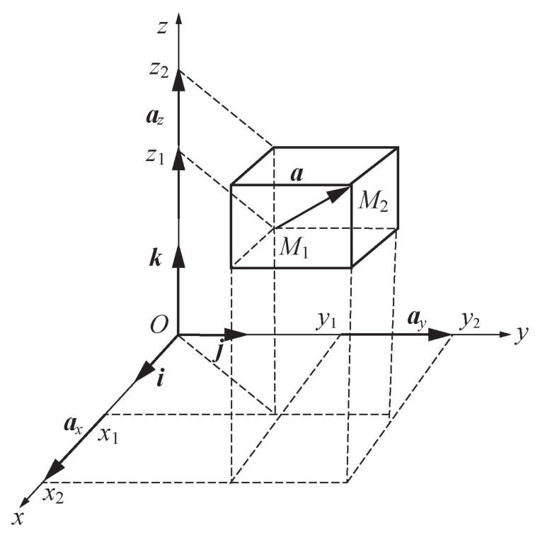

而

$$
\mathrm{Prj}_x\boldsymbol{a}=\mathrm{Prj}_x\boldsymbol{a}_x=x_2-x_1=a_x,
$$

$$
\mathrm{Prj}_y\boldsymbol{a}=\mathrm{Prj}_y\boldsymbol{a}_y=y_2-y_1=a_y,
$$

$$
\mathrm{Prj}_z\boldsymbol{a}=\mathrm{Prj}_z\boldsymbol{a}_z=z_2-z_1=a_z,
$$

若用 $\boldsymbol{i}$、$\boldsymbol{j}$ 和 $\boldsymbol{k}$ 分别表示与 $x$ 轴、$y$ 轴和 $z$ 轴正向一致的三个单位向量，称它们为基本单位向量，则有 $\boldsymbol{a}_x=(x_2-x_1)\boldsymbol{i}$，$\boldsymbol{a}_y=(y_2-y_1)\boldsymbol{j}$，$\boldsymbol{a}_z=(z_2-z_1)\boldsymbol{k}$，因此

$$
\boldsymbol{a}=\boldsymbol{a}_x+\boldsymbol{a}_y+\boldsymbol{a}_z=(x_2-x_1)\boldsymbol{i}+(y_2-y_1)\boldsymbol{j}+(z_2-z_1)\boldsymbol{k}=a_x\boldsymbol{i}+a_y\boldsymbol{j}+a_z\boldsymbol{k},
$$

称上式为向量 $\boldsymbol{a}$ 按基本单位向量的分解式或 $\boldsymbol{a}$ 的向量表示式。

一方面，从向量 $\boldsymbol{a}$ 可以唯一确定出它在三条坐标轴上的投影 $a_x$、$a_y$ 和 $a_z$，另一方面，从 $a_x$、$a_y$ 和 $a_z$ 可以唯一确定出向量 $\boldsymbol{a}$，这样有序数组 $a_x$、$a_y$、$a_z$ 就与向量 $\boldsymbol{a}$ 一一对应，于是将 $a_x$、$a_y$、$a_z$ 称为向量 $\boldsymbol{a}$ 的坐标，记为 $\boldsymbol{a}=(a_x,a_y,a_z)$，也称为向量 $\boldsymbol{a}$ 的坐标表示式。

以 $M_1(x_1,y_1,z_1)$ 为始点、$M_2(x_2,y_2,z_2)$ 为终点的向量记为

$$
\overrightarrow{M_1M_2}=(x_2-x_1,\ y_2-y_1,\ z_2-z_1).
$$

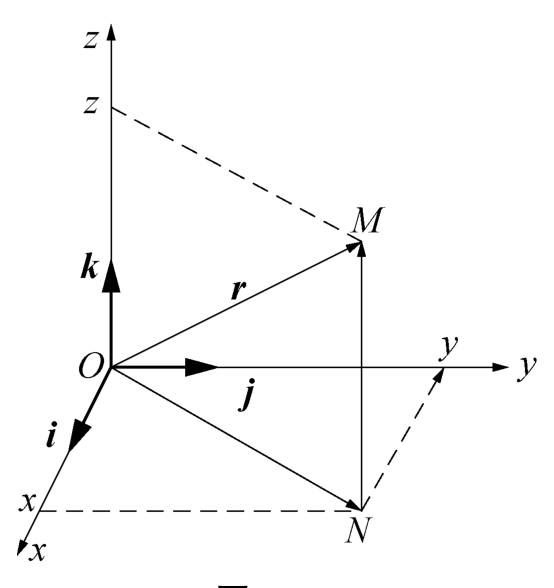

特别地，向径 $\boldsymbol{r}=\overrightarrow{OM}=(x,y,z)$（见图5-20）。

对于向量的运算也可化为对坐标的数量运算。

设向量 $\boldsymbol{a}=(a_x,a_y,a_z)$，$\boldsymbol{b}=(b_x,b_y,b_z)$，则

$$
\boldsymbol{a}\pm\boldsymbol{b}=(a_x\boldsymbol{i}+a_y\boldsymbol{j}+a_z\boldsymbol{k})\pm(b_x\boldsymbol{i}+b_y\boldsymbol{j}+b_z\boldsymbol{k})
$$

$$
=(a_x\pm b_x)\boldsymbol{i}+(a_y\pm b_y)\boldsymbol{j}+(a_z\pm b_z)\boldsymbol{k}
$$

$$
=(a_x\pm b_x,\ a_y\pm b_y,\ a_z\pm b_z);
$$

$$
\lambda\boldsymbol{a}=\lambda(a_x\boldsymbol{i}+a_y\boldsymbol{j}+a_z\boldsymbol{k})=(\lambda a_x)\boldsymbol{i}+(\lambda a_y)\boldsymbol{j}+(\lambda a_z)\boldsymbol{k}=(\lambda a_x,\ \lambda a_y,\ \lambda a_z).
$$

**例 4** 设 $A(x_1,y_1,z_1)$ 和 $B(x_2,y_2,z_2)$ 为空间两点，而在 $AB$ 直线上的点 $M$ 分有向线段 $\overrightarrow{AB}$ 为两个有向线段 $\overrightarrow{AM}$ 与 $\overrightarrow{MB}$，使它们的模的比等于某数 $\lambda\ (\lambda\ne-1)$，即 $\dfrac{|\overrightarrow{AM}|}{|\overrightarrow{MB}|}=\lambda$，求分点 $M$ 的坐标 $x$、$y$ 和 $z$。

**解** 如图5-21所示，因为 $\overrightarrow{AM}$、$\overrightarrow{MB}$ 在一直线上，故

$$
\overrightarrow{AM}=\lambda\overrightarrow{MB}.
$$

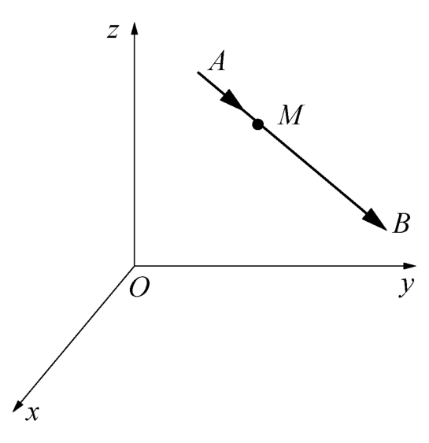

而 $\overrightarrow{AM}=(x-x_1,\ y-y_1,\ z-z_1)$，

$\overrightarrow{MB}=(x_2-x,\ y_2-y,\ z_2-z)$，因此

$$
(x-x_1,\ y-y_1,\ z-z_1)=\lambda(x_2-x,\ y_2-y,\ z_2-z),
$$

即 $x-x_1=\lambda(x_2-x)$，$y-y_1=\lambda(y_2-y)$，$z-z_1=\lambda(z_2-z)$，可得

$$
x=\frac{x_1+\lambda x_2}{1+\lambda},\quad y=\frac{y_1+\lambda y_2}{1+\lambda},\quad z=\frac{z_1+\lambda z_2}{1+\lambda}.
$$

点 $M$ 叫作有向线段 $\overrightarrow{AB}$ 的定比分点，当 $\lambda=1$ 时，点 $M$ 是有向线段 $\overrightarrow{AB}$ 的中点，其坐标为

$$
x=\frac{x_1+x_2}{2},\quad y=\frac{y_1+y_2}{2},\quad z=\frac{z_1+z_2}{2}.
$$

**例 5** 设 $\boldsymbol{m}=3\boldsymbol{i}+5\boldsymbol{j}+8\boldsymbol{k}$，$\boldsymbol{n}=2\boldsymbol{i}-4\boldsymbol{j}-7\boldsymbol{k}$，$\boldsymbol{p}=5\boldsymbol{i}+\boldsymbol{j}-4\boldsymbol{k}$，求 $\boldsymbol{a}=4\boldsymbol{m}+3\boldsymbol{n}-\boldsymbol{p}$ 在 $x$ 轴上的坐标及在 $y$ 轴上的分向量。

**解** $\boldsymbol{a}=4\boldsymbol{m}+3\boldsymbol{n}-\boldsymbol{p}=4(3\boldsymbol{i}+5\boldsymbol{j}+8\boldsymbol{k})+3(2\boldsymbol{i}-4\boldsymbol{j}-7\boldsymbol{k})-(5\boldsymbol{i}+\boldsymbol{j}-4\boldsymbol{k})=13\boldsymbol{i}+7\boldsymbol{j}+15\boldsymbol{k}$，所以 $\boldsymbol{a}$ 在 $x$ 轴上的坐标为 13，在 $y$ 轴上的分向量为 $7\boldsymbol{j}$。

### 三、向量的模、方向角

设 $\boldsymbol{a}$ 为任意一个非零向量，又设 $\alpha$、$\beta$、$\gamma$ 为 $\boldsymbol{a}$ 与三坐标轴正向之间的夹角（$0\le\alpha,\beta,\gamma<\pi$），如图5-22所示，则 $\alpha$、$\beta$、$\gamma$ 分别为向量 $\boldsymbol{a}$ 的方向角。由于向量坐标就是向量在坐标轴上的投影，故有

$$
a_x=|\boldsymbol{a}|\cos\alpha,\quad a_y=|\boldsymbol{a}|\cos\beta,\quad a_z=|\boldsymbol{a}|\cos\gamma,
$$

其中，$\cos\alpha$、$\cos\beta$、$\cos\gamma$ 称为向量 $\boldsymbol{a}$ 的方向余弦，通常用来表示向量的方向。

由模的定义，可知向量 $\boldsymbol{a}$ 的模为

$$
|\boldsymbol{a}|=\sqrt{(x_2-x_1)^2+(y_2-y_1)^2+(z_2-z_1)^2}=\sqrt{a_x^2+a_y^2+a_z^2}.
$$

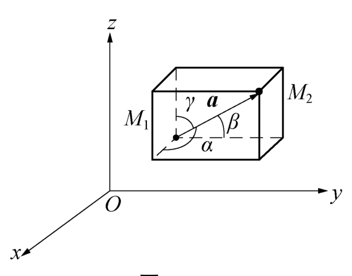

或

$$
\cos\alpha=\frac{a_x}{\sqrt{a_x^2+a_y^2+a_z^2}},\quad \cos\beta=\frac{a_y}{\sqrt{a_x^2+a_y^2+a_z^2}},\quad \cos\gamma=\frac{a_z}{\sqrt{a_x^2+a_y^2+a_z^2}},
$$

由此可得

$$
\cos^2\alpha+\cos^2\beta+\cos^2\gamma=1,
$$

即任一向量的方向余弦的平方和为 1。

$$
\boldsymbol{e}_a=\frac{\boldsymbol{a}}{|\boldsymbol{a}|}=\frac{1}{|\boldsymbol{a}|}(a_x,\ a_y,\ a_z)=\frac{1}{\sqrt{a_x^2+a_y^2+a_z^2}}(a_x,\ a_y,\ a_z)=(\cos\alpha,\ \cos\beta,\ \cos\gamma).
$$

**例 6** 设两已知点 $M_1(2,2,\sqrt{2})$ 和 $M_2(1,3,0)$，分别写出向量 $\overrightarrow{M_1M_2}$、$\overrightarrow{M_2M_1}$ 的坐标表达式和向量表达式，计算它们的模、方向余弦、方向角、单位向量。

**解** 向量 $\overrightarrow{M_1M_2}=(1-2,\ 3-2,\ 0-\sqrt{2})=(-1,\ 1,\ -\sqrt{2})=-\boldsymbol{i}+\boldsymbol{j}-\sqrt{2}\boldsymbol{k}$，

$\overrightarrow{M_2M_1}=-\overrightarrow{M_1M_2}=-(-1,\ 1,\ -\sqrt{2})=(1,\ -1,\ \sqrt{2})=\boldsymbol{i}-\boldsymbol{j}+\sqrt{2}\boldsymbol{k}$。

模 $|\overrightarrow{M_1M_2}|=|\overrightarrow{M_2M_1}|=\sqrt{(-1)^2+1^2+(-\sqrt{2})^2}=2$。

$\overrightarrow{M_1M_2}$ 的方向余弦为

$$
\cos\alpha_1=-\frac{1}{2},\quad \cos\beta_1=\frac{1}{2},\quad \cos\gamma_1=-\frac{\sqrt{2}}{2};
$$

对应的方向角为

$$
\alpha_1=\frac{2}{3}\pi,\quad \beta_1=\frac{1}{3}\pi,\quad \gamma_1=\frac{3}{4}\pi.
$$

同理可得 $\overrightarrow{M_2M_1}$ 的方向余弦为

$$
\cos\alpha_2=\frac{1}{2},\quad \cos\beta_2=-\frac{1}{2},\quad \cos\gamma_2=\frac{\sqrt{2}}{2};
$$

对应的方向角为

$$
\alpha_2=\frac{1}{3}\pi,\quad \beta_2=\frac{2}{3}\pi,\quad \gamma_2=\frac{1}{4}\pi.
$$

与 $\overrightarrow{M_1M_2}$ 同向的单位向量为 $\boldsymbol{e}_{M_1M_2}=\left(-\dfrac{1}{2},\ \dfrac{1}{2},\ -\dfrac{\sqrt{2}}{2}\right)$，

与 $\overrightarrow{M_2M_1}$ 同向的单位向量为 $\boldsymbol{e}_{M_2M_1}=\left(\dfrac{1}{2},\ -\dfrac{1}{2},\ \dfrac{\sqrt{2}}{2}\right)$。

**例 7** 求平行于向量 $\boldsymbol{a}=6\boldsymbol{i}+7\boldsymbol{j}-6\boldsymbol{k}$ 的单位向量。

**解** 所求向量有两个，一个与 $\boldsymbol{a}$ 同向，一个与 $\boldsymbol{a}$ 反向。

由于 $|\boldsymbol{a}|=\sqrt{6^2+7^2+(-6)^2}=11$，故

$$
\boldsymbol{e}_a=\frac{\boldsymbol{a}}{|\boldsymbol{a}|}=\frac{6}{11}\boldsymbol{i}+\frac{7}{11}\boldsymbol{j}-\frac{6}{11}\boldsymbol{k},\quad\text{或}\quad \boldsymbol{e}_{-a}=-\frac{\boldsymbol{a}}{|\boldsymbol{a}|}=-\frac{6}{11}\boldsymbol{i}-\frac{7}{11}\boldsymbol{j}+\frac{6}{11}\boldsymbol{k}.
$$

**例 8** 已知向量 $\overrightarrow{P_1P_2}$ 的模为 $|\overrightarrow{P_1P_2}|=2$，向量与 $x$ 轴和 $y$ 轴的夹角分别为 $\dfrac{\pi}{3}$ 和 $\dfrac{\pi}{4}$，如果 $P_1$ 的坐标为 $(1,0,3)$，求 $P_2$ 的坐标。

**解** 设向量 $\overrightarrow{P_1P_2}$ 的方向角分别为 $\alpha$、$\beta$、$\gamma$。

因为 $\alpha=\dfrac{\pi}{3}$，$\beta=\dfrac{\pi}{4}$，则 $\cos\alpha=\dfrac{1}{2}$，$\cos\beta=\dfrac{\sqrt{2}}{2}$，

又因为 $\cos^2\alpha+\cos^2\beta+\cos^2\gamma=1$，所以 $\cos\gamma=\pm\dfrac{1}{2}$，可得 $\gamma=\dfrac{\pi}{3}$ 或 $\gamma=\dfrac{2\pi}{3}$。

设 $P_2$ 的坐标为 $(x,y,z)$。

由 $\cos\alpha=\dfrac{x-1}{|\overrightarrow{P_1P_2}|}$ 可知 $\dfrac{x-1}{2}=\dfrac{1}{2}$，解方程可得 $x=2$，

由 $\cos\beta=\dfrac{y-0}{|\overrightarrow{P_1P_2}|}$ 可知 $\dfrac{y-0}{2}=\dfrac{\sqrt{2}}{2}$，解方程可得 $y=\sqrt{2}$，

由 $\cos\gamma=\dfrac{z-3}{|\overrightarrow{P_1P_2}|}$ 可知 $\dfrac{z-3}{2}=\pm\dfrac{1}{2}$，解方程可得 $z=4$ 或 $z=2$，

因此，$P_2$ 的坐标为 $(2,\sqrt{2},4)$ 或 $(2,\sqrt{2},2)$。

### 四、数量积

首先我们来看一个引例。

设一个物体在恒力 $\boldsymbol{F}$ 作用下，沿直线从点 $M_1$ 移动到点 $M_2$（见图5-23），以 $\boldsymbol{s}$ 表示位移 $\overrightarrow{M_1M_2}$。由物理学知道，力 $\boldsymbol{F}$ 所做的功为 $W=|\boldsymbol{F}||\boldsymbol{s}|\cos\theta$（见图5-24），其中 $\theta$ 为 $\boldsymbol{F}$ 与 $\boldsymbol{s}$ 的夹角。

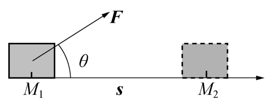

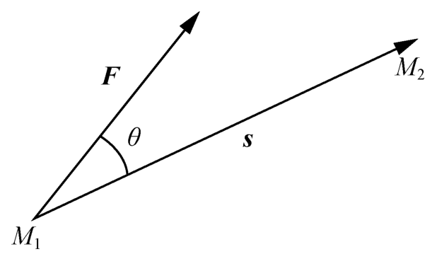

从这个问题可以看出，我们有时要对两个向量做这样的运算，运算的结果是一个数，它等于这两个向量的模及它们夹角的余弦的乘积。我们把这个数称为这两个向量的数量积（也称为内积或点积）（见图5-25）。

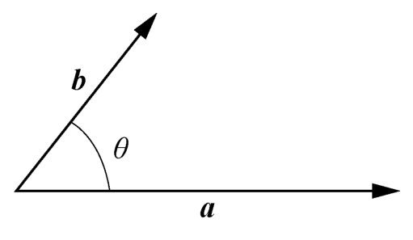

**定义 1** 给定向量 $\boldsymbol{a}$ 与 $\boldsymbol{b}$，我们将 $|\boldsymbol{a}|$ 与 $|\boldsymbol{b}|$ 及它们的夹角 $\theta$ 的余弦的乘积，称为向量 $\boldsymbol{a}$ 与 $\boldsymbol{b}$ 的数量积，记为 $\boldsymbol{a}\cdot\boldsymbol{b}$，即

$$
\boldsymbol{a}\cdot\boldsymbol{b}=|\boldsymbol{a}||\boldsymbol{b}|\cos\theta=|\boldsymbol{a}||\boldsymbol{b}|\cos\widehat{(\boldsymbol{a},\boldsymbol{b})}\quad(0\le\theta<\pi).
$$

由数量积的定义可知，恒力 $\boldsymbol{F}$ 沿直线从点 $M_1$ 移动到点 $M_2$，所做的功为

$$
W=|\boldsymbol{F}||\overrightarrow{M_1M_2}|\cos\theta=\boldsymbol{F}\cdot\overrightarrow{M_1M_2}.
$$

由定义 1 可以推出：

（1）$\boldsymbol{a}\cdot\boldsymbol{b}=|\boldsymbol{a}|\mathrm{Prj}_a\boldsymbol{b}=|\boldsymbol{b}|\mathrm{Prj}_b\boldsymbol{a}$；

（2）$\boldsymbol{a}\cdot\boldsymbol{a}=|\boldsymbol{a}||\boldsymbol{a}|\cos\widehat{(\boldsymbol{a},\boldsymbol{a})}=|\boldsymbol{a}|^2$；

（3）若 $|\boldsymbol{a}|\ne0$，$|\boldsymbol{b}|\ne0$，则 $\boldsymbol{a}\cdot\boldsymbol{b}=0\Leftrightarrow\boldsymbol{a}\perp\boldsymbol{b}$。

**证** 若已知 $\boldsymbol{a}\cdot\boldsymbol{b}=0$，即 $|\boldsymbol{a}||\boldsymbol{b}|\cos\widehat{(\boldsymbol{a},\boldsymbol{b})}=0$，故 $\cos\widehat{(\boldsymbol{a},\boldsymbol{b})}=0$，$\widehat{(\boldsymbol{a},\boldsymbol{b})}=\dfrac{\pi}{2}$，因此 $\boldsymbol{a}\perp\boldsymbol{b}$；

反之，若 $\boldsymbol{a}\perp\boldsymbol{b}$，即 $\widehat{(\boldsymbol{a},\boldsymbol{b})}=\dfrac{\pi}{2}$，故 $\cos\widehat{(\boldsymbol{a},\boldsymbol{b})}=0$，从而 $|\boldsymbol{a}||\boldsymbol{b}|\cos\widehat{(\boldsymbol{a},\boldsymbol{b})}=0$，因此 $\boldsymbol{a}\cdot\boldsymbol{b}=0$。

数量积符合下列运算规律。

（1）交换律：$\boldsymbol{a}\cdot\boldsymbol{b}=\boldsymbol{b}\cdot\boldsymbol{a}$。

**证** $\boldsymbol{a}\cdot\boldsymbol{b}=|\boldsymbol{a}||\boldsymbol{b}|\cos\widehat{(\boldsymbol{a},\boldsymbol{b})}=|\boldsymbol{b}||\boldsymbol{a}|\cos\widehat{(\boldsymbol{b},\boldsymbol{a})}=\boldsymbol{b}\cdot\boldsymbol{a}$。

（2）分配律：$(\boldsymbol{a}+\boldsymbol{b})\cdot\boldsymbol{c}=\boldsymbol{a}\cdot\boldsymbol{c}+\boldsymbol{b}\cdot\boldsymbol{c}$。

**证** $(\boldsymbol{a}+\boldsymbol{b})\cdot\boldsymbol{c}=|\boldsymbol{c}|\mathrm{Prj}_c(\boldsymbol{a}+\boldsymbol{b})=|\boldsymbol{c}|(\mathrm{Prj}_c\boldsymbol{a}+\mathrm{Prj}_c\boldsymbol{b})=|\boldsymbol{c}|\mathrm{Prj}_c\boldsymbol{a}+|\boldsymbol{c}|\mathrm{Prj}_c\boldsymbol{b}=\boldsymbol{a}\cdot\boldsymbol{c}+\boldsymbol{b}\cdot\boldsymbol{c}$。

（3）$(\lambda\boldsymbol{a})\cdot\boldsymbol{b}=\boldsymbol{a}\cdot(\lambda\boldsymbol{b})=\lambda(\boldsymbol{a}\cdot\boldsymbol{b})$（其中 $\lambda$ 是数）。

**证** 当 $\lambda=0$ 时，三者均为零，显然成立；

当 $\lambda>0$ 时，$(\lambda\boldsymbol{a})\cdot\boldsymbol{b}=|\lambda\boldsymbol{a}||\boldsymbol{b}|\cos\widehat{(\lambda\boldsymbol{a},\boldsymbol{b})}=\lambda|\boldsymbol{a}||\boldsymbol{b}|\cos\widehat{(\boldsymbol{a},\boldsymbol{b})}=\lambda(\boldsymbol{a}\cdot\boldsymbol{b})=|\boldsymbol{a}||\lambda\boldsymbol{b}|\cos\widehat{(\boldsymbol{a},\lambda\boldsymbol{b})}=\boldsymbol{a}\cdot(\lambda\boldsymbol{b})$；

当 $\lambda<0$ 时，$(\lambda\boldsymbol{a})\cdot\boldsymbol{b}=|\lambda\boldsymbol{a}||\boldsymbol{b}|\cos\widehat{(\lambda\boldsymbol{a},\boldsymbol{b})}=-\lambda|\boldsymbol{a}||\boldsymbol{b}|\cos\left(\pi-\widehat{(\boldsymbol{a},\boldsymbol{b})}\right)=\lambda|\boldsymbol{a}||\boldsymbol{b}|\cos\widehat{(\boldsymbol{a},\boldsymbol{b})}=\lambda(\boldsymbol{a}\cdot\boldsymbol{b})=-\lambda|\boldsymbol{a}||\boldsymbol{b}|\cos\left(\pi-\widehat{(\boldsymbol{a},\boldsymbol{b})}\right)=|\boldsymbol{a}||\lambda\boldsymbol{b}|\cos\widehat{(\boldsymbol{a},\lambda\boldsymbol{b})}=\boldsymbol{a}\cdot(\lambda\boldsymbol{b})$。

类似地，可证得 $(\lambda\boldsymbol{a})\cdot(\mu\boldsymbol{b})=\lambda\mu(\boldsymbol{a}\cdot\boldsymbol{b})$。

下面来看两向量的数量积的坐标表示式。

设 $\boldsymbol{a}=(a_x,a_y,a_z)=a_x\boldsymbol{i}+a_y\boldsymbol{j}+a_z\boldsymbol{k}$，$\boldsymbol{b}=(b_x,b_y,b_z)=b_x\boldsymbol{i}+b_y\boldsymbol{j}+b_z\boldsymbol{k}$，则

$$
\boldsymbol{a}\cdot\boldsymbol{b}=(a_x\boldsymbol{i}+a_y\boldsymbol{j}+a_z\boldsymbol{k})\cdot(b_x\boldsymbol{i}+b_y\boldsymbol{j}+b_z\boldsymbol{k})
$$

$$
=a_xb_x\boldsymbol{i}\cdot\boldsymbol{i}+a_xb_y\boldsymbol{i}\cdot\boldsymbol{j}+a_xb_z\boldsymbol{i}\cdot\boldsymbol{k}+a_yb_x\boldsymbol{j}\cdot\boldsymbol{i}+a_yb_y\boldsymbol{j}\cdot\boldsymbol{j}+a_yb_z\boldsymbol{j}\cdot\boldsymbol{k}
$$

$$
\qquad+a_zb_x\boldsymbol{k}\cdot\boldsymbol{i}+a_zb_y\boldsymbol{k}\cdot\boldsymbol{j}+a_zb_z\boldsymbol{k}\cdot\boldsymbol{k},
$$

注意到 $\boldsymbol{i}\cdot\boldsymbol{i}=\boldsymbol{j}\cdot\boldsymbol{j}=\boldsymbol{k}\cdot\boldsymbol{k}=1$，$\boldsymbol{i}\cdot\boldsymbol{j}=\boldsymbol{j}\cdot\boldsymbol{k}=\boldsymbol{k}\cdot\boldsymbol{i}=0$，则有

$$
\boldsymbol{a}\cdot\boldsymbol{b}=a_xb_x+a_yb_y+a_zb_z.
$$

由此可得：若 $|\boldsymbol{a}|\ne0$，$|\boldsymbol{b}|\ne0$，则

$$
\cos\widehat{(\boldsymbol{a},\boldsymbol{b})}=\frac{\boldsymbol{a}\cdot\boldsymbol{b}}{|\boldsymbol{a}||\boldsymbol{b}|}=\frac{a_xb_x+a_yb_y+a_zb_z}{\sqrt{a_x^2+a_y^2+a_z^2}\sqrt{b_x^2+b_y^2+b_z^2}};
$$

$$
\boldsymbol{a}\cdot\boldsymbol{b}=0\Leftrightarrow\boldsymbol{a}\perp\boldsymbol{b}\Leftrightarrow a_xb_x+a_yb_y+a_zb_z=0.
$$

**例 9** 利用向量证明不等式：

$$
\sqrt{a_1^2+a_2^2+a_3^2}\sqrt{b_1^2+b_2^2+b_3^2}\ge|a_1b_1+a_2b_2+a_3b_3|,
$$

其中 $a_1$、$a_2$、$a_3$、$b_1$、$b_2$、$b_3$ 为非零常数，并指出等号成立的条件。

**证** 设 $\boldsymbol{a}=(a_1,a_2,a_3)$，$\boldsymbol{b}=(b_1,b_2,b_3)$，则

$$
\cos\widehat{(\boldsymbol{a},\boldsymbol{b})}=\frac{\boldsymbol{a}\cdot\boldsymbol{b}}{|\boldsymbol{a}||\boldsymbol{b}|}=\frac{a_1b_1+a_2b_2+a_3b_3}{\sqrt{a_1^2+a_2^2+a_3^2}\sqrt{b_1^2+b_2^2+b_3^2}},
$$

从而

$$
\sqrt{a_1^2+a_2^2+a_3^2}\sqrt{b_1^2+b_2^2+b_3^2}\ge|a_1b_1+a_2b_2+a_3b_3|,
$$

等号成立当且仅当 $\boldsymbol{a}\parallel\boldsymbol{b}$。

**例 10** 已知 $\boldsymbol{a}=(1,1,-4)$，$\boldsymbol{b}=(1,-2,2)$，求：

（1）$\boldsymbol{a}\cdot\boldsymbol{b}$；（2）$\boldsymbol{a}$ 与 $\boldsymbol{b}$ 的夹角 $\theta$；（3）$\boldsymbol{a}$ 在 $\boldsymbol{b}$ 上的投影。

**解** （1）由数量积的坐标表达式可知

$$
\boldsymbol{a}\cdot\boldsymbol{b}=1\cdot1+1\cdot(-2)+(-4)\cdot2=-9.
$$

（2）因为

$$
\cos\theta=\frac{a_xb_x+a_yb_y+a_zb_z}{\sqrt{a_x^2+a_y^2+a_z^2}\sqrt{b_x^2+b_y^2+b_z^2}}=\frac{-9}{\sqrt{1^2+1^2+(-4)^2}\sqrt{1^2+(-2)^2+2^2}}=-\frac{\sqrt{2}}{2},
$$

所以 $\theta=\dfrac{3\pi}{4}$。

（3）由 $\boldsymbol{a}\cdot\boldsymbol{b}=|\boldsymbol{b}|\mathrm{Prj}_b\boldsymbol{a}$，可得

$$
\mathrm{Prj}_b\boldsymbol{a}=\frac{\boldsymbol{a}\cdot\boldsymbol{b}}{|\boldsymbol{b}|}=-3.
$$

**例 11** 已知 $\boldsymbol{a}+3\boldsymbol{b}\perp7\boldsymbol{a}-5\boldsymbol{b}$，$\boldsymbol{a}-4\boldsymbol{b}\perp7\boldsymbol{a}-2\boldsymbol{b}$，试求 $\widehat{(\boldsymbol{a},\boldsymbol{b})}$。

**解** 根据题意，有

$$
\begin{cases}(\boldsymbol{a}+3\boldsymbol{b})\cdot(7\boldsymbol{a}-5\boldsymbol{b})=0,\\ (\boldsymbol{a}-4\boldsymbol{b})\cdot(7\boldsymbol{a}-2\boldsymbol{b})=0,\end{cases}
$$

即

$$
\begin{cases}7|\boldsymbol{a}|^2+16\boldsymbol{a}\cdot\boldsymbol{b}-15|\boldsymbol{b}|^2=0,\\ 7|\boldsymbol{a}|^2-30\boldsymbol{a}\cdot\boldsymbol{b}+8|\boldsymbol{b}|^2=0,\end{cases}
$$

两式相减得 $\boldsymbol{a}\cdot\boldsymbol{b}=\dfrac{1}{2}|\boldsymbol{b}|^2$，代入第一个方程得 $|\boldsymbol{a}|=|\boldsymbol{b}|$，因此

$$
\cos\widehat{(\boldsymbol{a},\boldsymbol{b})}=\frac{\boldsymbol{a}\cdot\boldsymbol{b}}{|\boldsymbol{a}||\boldsymbol{b}|}=\frac{\boldsymbol{a}\cdot\boldsymbol{b}}{|\boldsymbol{b}|^2}=\frac{1}{2},
$$

即 $\widehat{(\boldsymbol{a},\boldsymbol{b})}=\dfrac{\pi}{3}$。

**例 12** 液体流过平面 $S$ 上面积为 $A$ 的一个区域，液体在这区域上各点处的流速均为 $\boldsymbol{v}$（常向量），设 $\boldsymbol{n}$ 为垂直于 $S$ 的单位向量（见图5-26），计算单位时间内经过这区域流向 $\boldsymbol{n}$ 所指一方的液体的重量 $P$（液体的密度为 $\rho$）。

**解** 单位时间内流过这区域的液体组成一个底面积为 $A$，斜高为 $|\boldsymbol{v}|$ 的斜柱体，这柱体的斜高与底面的垂线的夹角就是 $\boldsymbol{v}$ 与 $\boldsymbol{n}$ 的夹角 $\theta$。所以这柱体的高为 $|\boldsymbol{v}|\cos\theta$，体积为

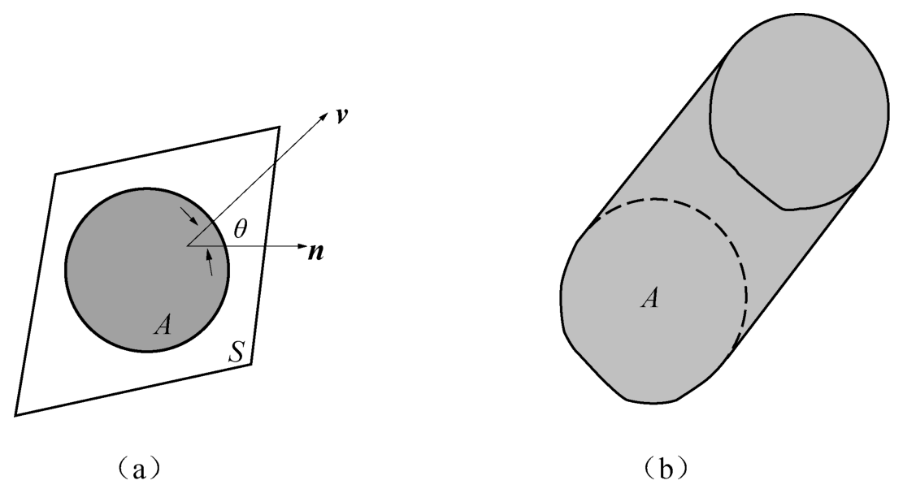

$$
A|\boldsymbol{v}|\cos\theta=A\boldsymbol{v}\cdot\boldsymbol{n}\ \left(=A|\boldsymbol{v}||\boldsymbol{n}|\cos\widehat{(\boldsymbol{v},\boldsymbol{n})}\right),
$$

故单位时间内经过这区域流向 $\boldsymbol{n}$ 所指一方的液体的重量 $P=\rho A\boldsymbol{v}\cdot\boldsymbol{n}$。

### 五、向量积

在研究物体转动问题时，不但要考虑物体所受的力，还要分析这些力所产生的力矩。如图5-27所示，设杆 $L$，支点为 $O$，受力 $\boldsymbol{F}$ 作用，由力学可知，力 $\boldsymbol{F}$ 对支点 $O$ 的力矩是一个向量 $\boldsymbol{M}$，其大小为

$$
|\boldsymbol{M}|=|\overrightarrow{OQ}||\boldsymbol{F}|=|\overrightarrow{OP}||\boldsymbol{F}|\sin\theta,
$$

其方向为：$\boldsymbol{M}$ 垂直于 $\overrightarrow{OP}$ 与 $\boldsymbol{F}$ 所在平面，$\boldsymbol{M}$ 的指向是按右手规则从 $\overrightarrow{OP}$ 转向 $\boldsymbol{F}$，转角不超过 $\pi$，此时，大拇指的方向就是 $\boldsymbol{M}$ 的指向（见图5-28）。

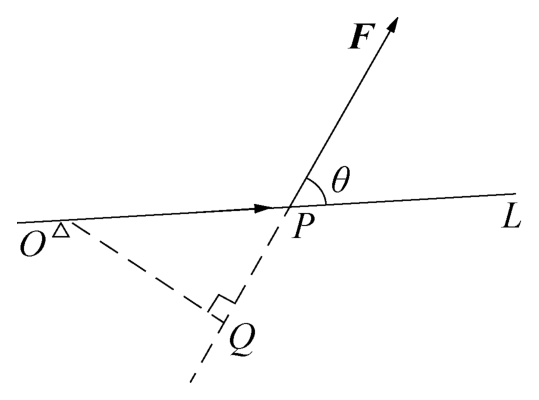

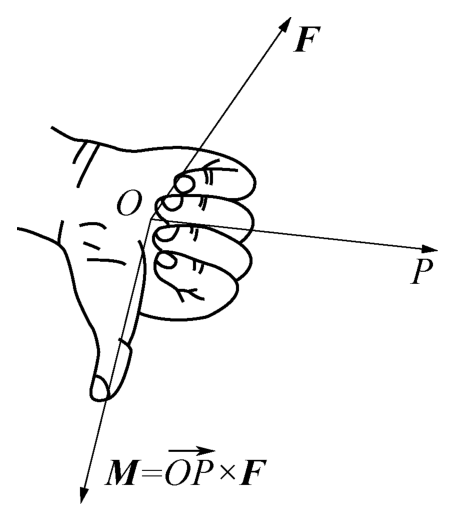

**定义 2** 若由向量 $\boldsymbol{a}$ 与 $\boldsymbol{b}$ 所确定的一个向量 $\boldsymbol{c}$ 满足下列条件（见图5-29）：

（1）$\boldsymbol{c}$ 的方向既垂直于 $\boldsymbol{a}$ 又垂直于 $\boldsymbol{b}$，$\boldsymbol{c}$ 的指向按右手规则从 $\boldsymbol{a}$ 转向 $\boldsymbol{b}$ 来确定；

（2）$\boldsymbol{c}$ 的模 $|\boldsymbol{c}|=|\boldsymbol{a}||\boldsymbol{b}|\sin\theta$（其中 $\theta$ 为 $\boldsymbol{a}$ 与 $\boldsymbol{b}$ 的夹角），

则称向量 $\boldsymbol{c}$ 为向量 $\boldsymbol{a}$ 与 $\boldsymbol{b}$ 的向量积（或称外积、叉积），记为

$$
\boldsymbol{c}=\boldsymbol{a}\times\boldsymbol{b}.
$$

按此定义，上面的力矩 $\boldsymbol{M}$ 等于 $\overrightarrow{OP}$ 与 $\boldsymbol{F}$ 的向量积，即

$$
\boldsymbol{M}=\overrightarrow{OP}\times\boldsymbol{F}.
$$

根据向量积的定义，即可推得

（1）$\boldsymbol{a}\times\boldsymbol{a}=\boldsymbol{0}$；

（2）设 $\boldsymbol{a}$、$\boldsymbol{b}$ 为两非零向量，则 $\boldsymbol{a}\parallel\boldsymbol{b}$ 的充分必要条件是 $\boldsymbol{a}\times\boldsymbol{b}=\boldsymbol{0}$。

**证** （1）$|\boldsymbol{a}\times\boldsymbol{a}|=|\boldsymbol{a}||\boldsymbol{a}|\sin\widehat{(\boldsymbol{a},\boldsymbol{a})}=0$。

（2）$\Rightarrow$ 已知 $\boldsymbol{a}\parallel\boldsymbol{b}$，即 $\widehat{(\boldsymbol{a},\boldsymbol{b})}=0$ 或 $\widehat{(\boldsymbol{a},\boldsymbol{b})}=\pi$，故

$$
\sin\widehat{(\boldsymbol{a},\boldsymbol{b})}=0,
$$

即 $|\boldsymbol{a}\times\boldsymbol{b}|=|\boldsymbol{a}||\boldsymbol{b}|\sin\widehat{(\boldsymbol{a},\boldsymbol{b})}=0$，$\boldsymbol{a}\times\boldsymbol{b}=\boldsymbol{0}$。

$\Leftarrow$ 若已知 $\boldsymbol{a}\times\boldsymbol{b}=\boldsymbol{0}$，即

$$
|\boldsymbol{a}||\boldsymbol{b}|\sin\widehat{(\boldsymbol{a},\boldsymbol{b})}=0,
$$

故 $\sin\widehat{(\boldsymbol{a},\boldsymbol{b})}=0$，$\widehat{(\boldsymbol{a},\boldsymbol{b})}=0$ 或 $\widehat{(\boldsymbol{a},\boldsymbol{b})}=\pi$，因此 $\boldsymbol{a}\parallel\boldsymbol{b}$。

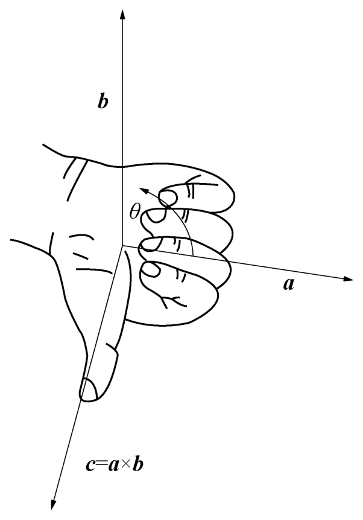

由此可知，空间三点 $A$、$B$、$C$ 共线的充分必要条件是 $\overrightarrow{AB}\times\overrightarrow{AC}=\boldsymbol{0}$。

向量积满足下列运算规律。

（1）$\boldsymbol{a}\times\boldsymbol{b}=-\boldsymbol{b}\times\boldsymbol{a}$；

（2）分配律 $(\boldsymbol{a}+\boldsymbol{b})\times\boldsymbol{c}=\boldsymbol{a}\times\boldsymbol{c}+\boldsymbol{b}\times\boldsymbol{c}$；

（3）结合律 $\lambda(\boldsymbol{a}\times\boldsymbol{b})=(\lambda\boldsymbol{a})\times\boldsymbol{b}=\boldsymbol{a}\times(\lambda\boldsymbol{b})$（$\lambda$ 为实数）。

证明请读者自己完成。

下面我们来推导向量积的坐标表示式。

设 $\boldsymbol{a}=(a_x,a_y,a_z)=a_x\boldsymbol{i}+a_y\boldsymbol{j}+a_z\boldsymbol{k}$，$\boldsymbol{b}=(b_x,b_y,b_z)=b_x\boldsymbol{i}+b_y\boldsymbol{j}+b_z\boldsymbol{k}$，则

$$
\boldsymbol{a}\times\boldsymbol{b}=(a_x\boldsymbol{i}+a_y\boldsymbol{j}+a_z\boldsymbol{k})\times(b_x\boldsymbol{i}+b_y\boldsymbol{j}+b_z\boldsymbol{k})
$$

$$
=a_xb_x\boldsymbol{i}\times\boldsymbol{i}+a_xb_y\boldsymbol{i}\times\boldsymbol{j}+a_xb_z\boldsymbol{i}\times\boldsymbol{k}+a_yb_x\boldsymbol{j}\times\boldsymbol{i}+a_yb_y\boldsymbol{j}\times\boldsymbol{j}+a_yb_z\boldsymbol{j}\times\boldsymbol{k}
$$

$$
\qquad+a_zb_x\boldsymbol{k}\times\boldsymbol{i}+a_zb_y\boldsymbol{k}\times\boldsymbol{j}+a_zb_z\boldsymbol{k}\times\boldsymbol{k},
$$

注意到 $\boldsymbol{i}\times\boldsymbol{i}=\boldsymbol{j}\times\boldsymbol{j}=\boldsymbol{k}\times\boldsymbol{k}=\boldsymbol{0}$，$\boldsymbol{i}\times\boldsymbol{j}=\boldsymbol{k}$，$\boldsymbol{j}\times\boldsymbol{k}=\boldsymbol{i}$，$\boldsymbol{k}\times\boldsymbol{i}=\boldsymbol{j}$，并利用二、三阶行列式的计算公式（见本章的拓展阅读），则有

$$
\boldsymbol{a}\times\boldsymbol{b}=a_xb_y\boldsymbol{k}-a_xb_z\boldsymbol{j}-a_yb_x\boldsymbol{k}+a_yb_z\boldsymbol{i}+a_zb_x\boldsymbol{j}-a_zb_y\boldsymbol{i}
$$

$$
=(a_yb_z-a_zb_y)\boldsymbol{i}-(a_xb_z-a_zb_x)\boldsymbol{j}+(a_xb_y-a_yb_x)\boldsymbol{k}
$$

$$
=\begin{vmatrix}a_y&a_z\\b_y&b_z\end{vmatrix}\boldsymbol{i}+(-1)\begin{vmatrix}a_x&a_z\\b_x&b_z\end{vmatrix}\boldsymbol{j}+\begin{vmatrix}a_x&a_y\\b_x&b_y\end{vmatrix}\boldsymbol{k}
$$

$$
=\begin{vmatrix}\boldsymbol{i}&\boldsymbol{j}&\boldsymbol{k}\\a_x&a_y&a_z\\b_x&b_y&b_z\end{vmatrix}.
$$

由此可得：若 $|\boldsymbol{a}|\ne0$，$|\boldsymbol{b}|\ne0$，则

$$
\boldsymbol{a}\times\boldsymbol{b}=\boldsymbol{0}\Leftrightarrow\boldsymbol{a}\parallel\boldsymbol{b}\Leftrightarrow a_yb_z-a_zb_y=0,\ a_xb_z-a_zb_x=0,\ a_xb_y-a_yb_x=0,
$$

即 $\dfrac{a_x}{b_x}=\dfrac{a_y}{b_y}=\dfrac{a_z}{b_z}$（亦即 $\boldsymbol{a}=\lambda\boldsymbol{b}$，$\lambda$ 为实数）。

**例 13** 求与 $\boldsymbol{a}=3\boldsymbol{i}-2\boldsymbol{j}+4\boldsymbol{k}$，$\boldsymbol{b}=\boldsymbol{i}+\boldsymbol{j}-2\boldsymbol{k}$ 都垂直的单位向量。

**解** $\boldsymbol{c}=\boldsymbol{a}\times\boldsymbol{b}=\begin{vmatrix}\boldsymbol{i}&\boldsymbol{j}&\boldsymbol{k}\\a_x&a_y&a_z\\b_x&b_y&b_z\end{vmatrix}=\begin{vmatrix}\boldsymbol{i}&\boldsymbol{j}&\boldsymbol{k}\\3&-2&4\\1&1&-2\end{vmatrix}=10\boldsymbol{j}+5\boldsymbol{k}$，

因为 $|\boldsymbol{c}|=\sqrt{10^2+5^2}=5\sqrt{5}$，所以 $\boldsymbol{e}_c=\pm\dfrac{\boldsymbol{c}}{|\boldsymbol{c}|}=\pm\left(\dfrac{2}{\sqrt{5}}\boldsymbol{j}+\dfrac{1}{\sqrt{5}}\boldsymbol{k}\right)$。

**例 14** 在顶点为 $A(1,-1,2)$、$B(5,-6,2)$ 和 $C(1,3,-1)$ 的三角形中，求 $AC$ 边上的高 $BD$。

**解** $\overrightarrow{AC}=(0,4,-3)$，$\overrightarrow{AB}=(4,-5,0)$，根据向量积的定义，可知三角形 $ABC$ 的面积为

$$
S=\frac{1}{2}|\overrightarrow{AC}||\overrightarrow{AB}|\sin\angle A=\frac{1}{2}|\overrightarrow{AC}\times\overrightarrow{AB}|=\frac{1}{2}\sqrt{15^2+12^2+16^2}=\frac{25}{2},
$$

又

$$
S=\frac{1}{2}|\overrightarrow{AC}||\overrightarrow{BD}|,\quad |\overrightarrow{AC}|=\sqrt{4^2+(-3)^2}=5,
$$

所以 $\dfrac{25}{2}=\dfrac{1}{2}\cdot5\cdot|\overrightarrow{BD}|$，从而 $|\overrightarrow{BD}|=5$。

**例 15** 设向量 $\boldsymbol{m}$，$\boldsymbol{n}$，$\boldsymbol{p}$ 两两垂直，符合右手规则，且

$$
|\boldsymbol{m}|=4,\quad|\boldsymbol{n}|=2,\quad|\boldsymbol{p}|=3,
$$

计算 $(\boldsymbol{m}\times\boldsymbol{n})\cdot\boldsymbol{p}$。

**解** $|\boldsymbol{m}\times\boldsymbol{n}|=|\boldsymbol{m}||\boldsymbol{n}|\sin\widehat{(\boldsymbol{m},\boldsymbol{n})}=4\times2\times1=8$，依题意知 $\boldsymbol{m}\times\boldsymbol{n}$ 与 $\boldsymbol{p}$ 同向，则 $\theta=\widehat{((\boldsymbol{m}\times\boldsymbol{n}),\boldsymbol{p})}=0$，$(\boldsymbol{m}\times\boldsymbol{n})\cdot\boldsymbol{p}=|\boldsymbol{m}\times\boldsymbol{n}||\boldsymbol{p}|\cos\theta=8\cdot3=24$。

**例 16** 设刚体以等角速度 $\boldsymbol{\omega}$ 绕 $l$ 轴旋转，计算刚体上一点 $M$ 的线速度。

**解** 刚体绕 $l$ 轴旋转时，我们可以用在 $l$ 轴上的一个向量 $\boldsymbol{\omega}$ 表示角速度，它的大小等于角速度的大小，它的方向由右手规则写出，即右手握住 $l$ 轴，当右手的四个手指的转向与刚体的旋转方向一致时，大拇指的指向就是 $\boldsymbol{\omega}$ 的方向，如图5-30所示。设点 $M$ 至旋转轴 $l$ 的距离为 $a$，再在 $l$ 轴上任取一点 $O$，作向量 $\boldsymbol{r}=\overrightarrow{OM}$ 并以 $\theta$ 表示 $\boldsymbol{\omega}$ 与 $\boldsymbol{r}$ 的夹角，则 $a=|\boldsymbol{r}|\sin\theta$。设线速度为 $\boldsymbol{v}$，那么由物理学上线速度与角速度的关系可知，$\boldsymbol{v}$ 的大小为

$$
|\boldsymbol{v}|=|\boldsymbol{\omega}|a=|\boldsymbol{\omega}||\boldsymbol{r}|\sin\theta;
$$

$\boldsymbol{v}$ 的方向垂直于通过 $M$ 点与 $l$ 轴的平面，即 $\boldsymbol{v}$ 垂直于 $\boldsymbol{\omega}$ 与 $\boldsymbol{r}$；

又 $\boldsymbol{v}$ 的指向是使 $\boldsymbol{\omega}$、$\boldsymbol{r}$、$\boldsymbol{v}$ 符合右手规则，因此有

$$
\boldsymbol{v}=\boldsymbol{\omega}\times\boldsymbol{r}.
$$

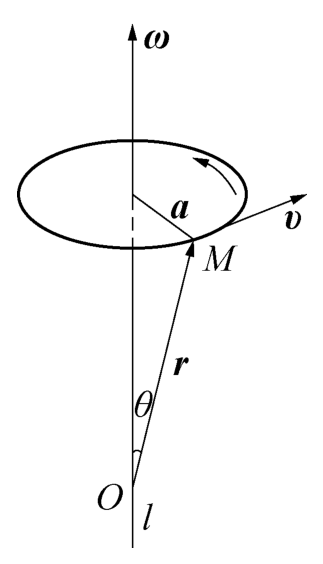

### 六、向量的混合积

**定义 3** 设已知三向量 $\boldsymbol{a}$、$\boldsymbol{b}$、$\boldsymbol{c}$，先作向量积 $\boldsymbol{a}\times\boldsymbol{b}$，再作数量积 $(\boldsymbol{a}\times\boldsymbol{b})\cdot\boldsymbol{c}$，记作$[\boldsymbol{a}\ \boldsymbol{b}\ \boldsymbol{c}]$，称为三个向量 $\boldsymbol{a}$、$\boldsymbol{b}$、$\boldsymbol{c}$ 的混合积。

下面我们来看混合积的坐标表示式。

设 $\boldsymbol{a}=(a_x,a_y,a_z)=a_x\boldsymbol{i}+a_y\boldsymbol{j}+a_z\boldsymbol{k}$，$\boldsymbol{b}=(b_x,b_y,b_z)=b_x\boldsymbol{i}+b_y\boldsymbol{j}+b_z\boldsymbol{k}$，$\boldsymbol{c}=(c_x,c_y,c_z)=c_x\boldsymbol{i}+c_y\boldsymbol{j}+c_z\boldsymbol{k}$，则

$$
\boldsymbol{a}\times\boldsymbol{b}=\begin{vmatrix}\boldsymbol{i}&\boldsymbol{j}&\boldsymbol{k}\\a_x&a_y&a_z\\b_x&b_y&b_z\end{vmatrix}=\begin{vmatrix}a_y&a_z\\b_y&b_z\end{vmatrix}\boldsymbol{i}+(-1)\begin{vmatrix}a_x&a_z\\b_x&b_z\end{vmatrix}\boldsymbol{j}+\begin{vmatrix}a_x&a_y\\b_x&b_y\end{vmatrix}\boldsymbol{k},
$$

$$
(\boldsymbol{a}\times\boldsymbol{b})\cdot\boldsymbol{c}=\begin{vmatrix}a_y&a_z\\b_y&b_z\end{vmatrix}c_x+(-1)\begin{vmatrix}a_x&a_z\\b_x&b_z\end{vmatrix}c_y+\begin{vmatrix}a_x&a_y\\b_x&b_y\end{vmatrix}c_z=\begin{vmatrix}c_x&c_y&c_z\\a_x&a_y&a_z\\b_x&b_y&b_z\end{vmatrix}
$$

$$
=\begin{vmatrix}a_x&a_y&a_z\\b_x&b_y&b_z\\c_x&c_y&c_z\end{vmatrix}=\begin{vmatrix}b_x&b_y&b_z\\c_x&c_y&c_z\\a_x&a_y&a_z\end{vmatrix},
$$

由此可得：

$$
[\boldsymbol{a}\ \boldsymbol{b}\ \boldsymbol{c}]=(\boldsymbol{a}\times\boldsymbol{b})\cdot\boldsymbol{c}=(\boldsymbol{b}\times\boldsymbol{c})\cdot\boldsymbol{a}=(\boldsymbol{c}\times\boldsymbol{a})\cdot\boldsymbol{b}=\boldsymbol{c}\cdot(\boldsymbol{a}\times\boldsymbol{b})=\boldsymbol{a}\cdot(\boldsymbol{b}\times\boldsymbol{c})=\boldsymbol{b}\cdot(\boldsymbol{c}\times\boldsymbol{a}).
$$

混合积是一个数，它的绝对值表示以向量 $\boldsymbol{a}$、$\boldsymbol{b}$、$\boldsymbol{c}$ 为棱的平行六面体的体积。

若 $\boldsymbol{a}$、$\boldsymbol{b}$、$\boldsymbol{c}$ 成右手系时，$[\boldsymbol{a}\ \boldsymbol{b}\ \boldsymbol{c}]\ge0$；若 $\boldsymbol{a}$、$\boldsymbol{b}$、$\boldsymbol{c}$ 成左手系时，$[\boldsymbol{a}\ \boldsymbol{b}\ \boldsymbol{c}]\le0$。

事实上，由于 $|\boldsymbol{a}\times\boldsymbol{b}|=|\boldsymbol{a}||\boldsymbol{b}|\sin\widehat{(\boldsymbol{a},\boldsymbol{b})}$ 表示边长为 $|\boldsymbol{a}|$、$|\boldsymbol{b}|$ 的平行四边形面积（见图5-31），若 $\boldsymbol{a}\times\boldsymbol{b}$ 与 $\boldsymbol{c}$ 在 $\boldsymbol{a}$ 与 $\boldsymbol{b}$ 所在平面的一侧，即 $\boldsymbol{a}\times\boldsymbol{b}$ 与 $\boldsymbol{c}$ 之间的夹角 $\theta$ 为锐角，则 $(\boldsymbol{a}\times\boldsymbol{b})\cdot\boldsymbol{c}=|(\boldsymbol{a}\times\boldsymbol{b})||\boldsymbol{c}|\cos\theta>0$；若 $\boldsymbol{a}\times\boldsymbol{b}$ 与 $\boldsymbol{c}$ 在 $\boldsymbol{a}$ 与 $\boldsymbol{b}$ 所在平面的两侧，即 $\boldsymbol{a}\times\boldsymbol{b}$ 与 $\boldsymbol{c}$ 之间的夹角 $\theta$ 为钝角，则 $(\boldsymbol{a}\times\boldsymbol{b})\cdot\boldsymbol{c}=|\boldsymbol{a}\times\boldsymbol{b}||\boldsymbol{c}|\cos\theta<0$。而 $|\boldsymbol{c}|\cos\theta$ 为平行六面体的高，因此

$$
V=\pm|\boldsymbol{a}\times\boldsymbol{b}||\boldsymbol{c}|\cos\theta=\pm[\boldsymbol{a}\ \boldsymbol{b}\ \boldsymbol{c}]\quad(\text{见图5-32}).
$$

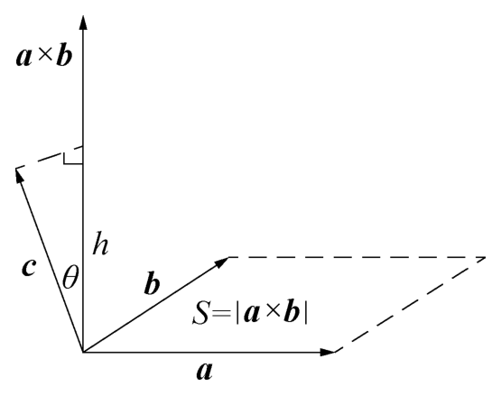

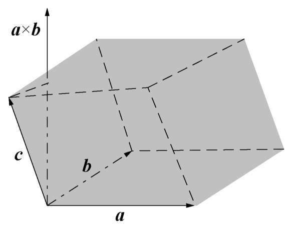

非零向量 $\boldsymbol{a}$、$\boldsymbol{b}$、$\boldsymbol{c}$ 共面的充分必要条件是 $[\boldsymbol{a}\ \boldsymbol{b}\ \boldsymbol{c}]=0$。

由此可知，空间四点 $A$、$B$、$C$、$D$ 共面的充分必要条件是 $[\overrightarrow{AB}\ \ \overrightarrow{AC}\ \ \overrightarrow{AD}]=0$。

**例 17** 已知 $(\boldsymbol{a}\times\boldsymbol{b})\cdot\boldsymbol{c}=2$，计算 $[(\boldsymbol{a}+\boldsymbol{b})\times(\boldsymbol{b}+\boldsymbol{c})]\cdot(\boldsymbol{c}+\boldsymbol{a})$。

**解**

$$
[(\boldsymbol{a}+\boldsymbol{b})\times(\boldsymbol{b}+\boldsymbol{c})]\cdot(\boldsymbol{c}+\boldsymbol{a})=[\boldsymbol{a}\times\boldsymbol{b}+\boldsymbol{a}\times\boldsymbol{c}+\boldsymbol{b}\times\boldsymbol{b}+\boldsymbol{b}\times\boldsymbol{c}]\cdot(\boldsymbol{c}+\boldsymbol{a})
$$

$$
=(\boldsymbol{a}\times\boldsymbol{b})\cdot\boldsymbol{c}+(\boldsymbol{a}\times\boldsymbol{c})\cdot\boldsymbol{c}+(\boldsymbol{b}\times\boldsymbol{b})\cdot\boldsymbol{c}+(\boldsymbol{b}\times\boldsymbol{c})\cdot\boldsymbol{c}
$$

$$
\qquad+(\boldsymbol{a}\times\boldsymbol{b})\cdot\boldsymbol{a}+(\boldsymbol{a}\times\boldsymbol{c})\cdot\boldsymbol{a}+(\boldsymbol{b}\times\boldsymbol{b})\cdot\boldsymbol{a}+(\boldsymbol{b}\times\boldsymbol{c})\cdot\boldsymbol{a}
$$

$$
=(\boldsymbol{a}\times\boldsymbol{b})\cdot\boldsymbol{c}+0+0+0+0+0+0+(\boldsymbol{a}\times\boldsymbol{b})\cdot\boldsymbol{c}
$$

$$
=2(\boldsymbol{a}\times\boldsymbol{b})\cdot\boldsymbol{c}=4.
$$

**例 18** 已知空间内不在同一平面上的四点

$$
A(x_1,y_1,z_1),\quad B(x_2,y_2,z_2),\quad C(x_3,y_3,z_3),\quad D(x_4,y_4,z_4),
$$

求四面体 $ABCD$ 的体积。

**解** 由立体几何知，四面体的体积等于以向量 $\overrightarrow{AB}$、$\overrightarrow{AC}$、$\overrightarrow{AD}$ 为棱的平行六面体的体积的六分之一，即

$$
V=\frac{1}{6}\left|[\overrightarrow{AB}\ \ \overrightarrow{AC}\ \ \overrightarrow{AD}]\right|,
$$

而

$$
\begin{cases}\overrightarrow{AB}=(x_2-x_1,\ y_2-y_1,\ z_2-z_1),\\ \overrightarrow{AC}=(x_3-x_1,\ y_3-y_1,\ z_3-z_1),\\ \overrightarrow{AD}=(x_4-x_1,\ y_4-y_1,\ z_4-z_1),\end{cases}
$$

所以 $V=\pm\dfrac{1}{6}\begin{vmatrix}x_2-x_1&y_2-y_1&z_2-z_1\\x_3-x_1&y_3-y_1&z_3-z_1\\x_4-x_1&y_4-y_1&z_4-z_1\end{vmatrix}$。式中正负号的选择必须和行列式的符号一致。

**例 19** 已知 $\boldsymbol{a}=\boldsymbol{i}$，$\boldsymbol{b}=\boldsymbol{j}-2\boldsymbol{k}$，$\boldsymbol{c}=2\boldsymbol{i}-2\boldsymbol{j}+\boldsymbol{k}$，求一单位向量 $\boldsymbol{\gamma}$，使 $\boldsymbol{\gamma}\perp\boldsymbol{c}$，且 $\boldsymbol{\gamma}$ 与 $\boldsymbol{a}$、$\boldsymbol{b}$ 同时共面。

**解** 设所求向量 $\boldsymbol{\gamma}=(x,y,z)$。依题意 $|\boldsymbol{\gamma}|=1$，即

$$
x^2+y^2+z^2=1,\qquad(1)
$$

由 $\boldsymbol{\gamma}\perp\boldsymbol{c}$，可得 $\boldsymbol{\gamma}\cdot\boldsymbol{c}=0$，即

$$
2x-2y+z=0,\qquad(2)
$$

由 $\boldsymbol{\gamma}$ 与 $\boldsymbol{a}$、$\boldsymbol{b}$ 共面，可得 $[\boldsymbol{a}\ \ \boldsymbol{b}\ \ \boldsymbol{\gamma}]=0$，即

$$
\begin{vmatrix}x&y&z\\1&0&0\\0&1&-2\end{vmatrix}=2y+z=0,\qquad(3)
$$

将式（1）、式（2）与式（3）联立解得

$$
x=\frac{2}{3},\quad y=\frac{1}{3},\quad z=-\frac{2}{3},\quad\text{或}\quad x=-\frac{2}{3},\quad y=-\frac{1}{3},\quad z=\frac{2}{3},
$$

所以 $\boldsymbol{\gamma}=\pm\left(\dfrac{2}{3},\ \dfrac{1}{3},\ -\dfrac{2}{3}\right)$。

## 习题 5-1

1. 填空题。

（1）已知点 $A(2,-1,1)$，则点 $A$ 与 $z$ 轴的距离是______，与 $y$ 轴的距离是______，与 $x$ 轴的距离是______。

（2）向量 $\boldsymbol{a}=(-2,6,-3)$ 的模为 $|\boldsymbol{a}|=$______，方向余弦为$\cos\alpha=$______，$\cos\beta=$______，$\cos\gamma=$______，与 $\boldsymbol{a}$ 同方向的单位向量 $\boldsymbol{e}_a=$______。

（3）设 $\alpha$、$\beta$、$\gamma$ 是向量 $\boldsymbol{a}$ 的三个方向角，则 $\sin^2\alpha+\sin^2\beta+\sin^2\gamma=$______。

（4）设向量 $\boldsymbol{a}=(2,-1,4)$ 与向量 $\boldsymbol{b}=(1,k,2)$ 平行，则 $k=$______。

（5）已知三点 $M_1(1,-2,3)$，$M_2(1,1,4)$，$M_3(2,0,2)$，则 $\overrightarrow{M_1M_2}\cdot\overrightarrow{M_1M_3}=$______，$\overrightarrow{M_1M_2}\times\overrightarrow{M_1M_3}=$______。

（6）以点 $A(2,-1,-2)$、$B(0,2,1)$、$C(2,3,0)$ 为顶点，作平行四边形 $ABCD$，此平行四边形的面积等于______。

（7）向量 $\boldsymbol{a}=(4,-3,1)$ 在 $\boldsymbol{b}=(2,1,2)$ 上的投影 $\mathrm{Prj}_b\boldsymbol{a}=$______，$\boldsymbol{b}$ 在 $\boldsymbol{a}$ 上的投影 $\mathrm{Prj}_a\boldsymbol{b}=$______。

（8）设 $\boldsymbol{a}=(1,2,3)$，$\boldsymbol{b}=(-2,k,4)$，而 $\boldsymbol{a}\perp\boldsymbol{b}$，则 $k=$______。

2. 一向量与 $x$ 轴和 $y$ 轴的夹角相等，而与 $z$ 轴的夹角是与 $x$ 轴的夹角的两倍，求向量的方向角。

3. 给定 $M(-2,0,1)$，$N(2,3,0)$ 两点，在 $Ox$ 轴上有一点 $A$，满足 $|AM|=|AN|$，求点 $A$ 的坐标。

4. 从点 $A(2,-1,7)$ 沿向量 $\boldsymbol{a}=(8,9,-12)$ 方向取长为 34 的线段 $AB$，求点 $B$ 的坐标。

5. 设点 $P$ 在 $y$ 轴上，它到点 $P_1(\sqrt{2},0,3)$ 的距离为到点 $P_2(1,0,-1)$ 的距离的两倍，求点 $P$ 的坐标。

6. 设点 $A$ 位于第Ⅰ卦限，向径 $\overrightarrow{OA}$ 与 $x$ 轴、$y$ 轴的夹角依次为 $\dfrac{\pi}{3}$ 和 $\dfrac{\pi}{4}$，且 $|\overrightarrow{OA}|=6$，求点 $A$ 的坐标。

7. 证明：$\mathrm{Prj}_u(\lambda\boldsymbol{a})=\lambda\mathrm{Prj}_u\boldsymbol{a}$。

8. 记 $\boldsymbol{e}_a$ 为非零向量 $\boldsymbol{a}$ 的同向单位向量，证明：$\boldsymbol{e}_a=\dfrac{\boldsymbol{a}}{|\boldsymbol{a}|}$。

9. 求平行于向量 $\boldsymbol{a}=6\boldsymbol{i}+7\boldsymbol{j}-6\boldsymbol{k}$ 的单位向量。

10. 设向量 $\boldsymbol{a}$ 与各坐标轴成相等的锐角，$|\boldsymbol{a}|=2\sqrt{3}$，求向量 $\boldsymbol{a}$ 的坐标表达式。

11. 已知 $\boldsymbol{a}=(1,1,-4)$，$\boldsymbol{b}=(1,-2,2)$，求：

（1）$\boldsymbol{a}\cdot\boldsymbol{b}$；（2）$\boldsymbol{a}$ 与 $\boldsymbol{b}$ 的夹角 $\theta$；（3）$\boldsymbol{a}$ 在 $\boldsymbol{b}$ 上的投影。

12. 已知两点 $M_1(2,2,\sqrt{2})$ 和 $M_2(1,3,0)$，计算向量 $\overrightarrow{M_1M_2}$ 的模、方向余弦和方向角。

13. 设 $|\boldsymbol{a}|=3$，$|\boldsymbol{b}|=2$，$\widehat{(\boldsymbol{a},\boldsymbol{b})}=\dfrac{\pi}{3}$，求：

（1）$(3\boldsymbol{a}+2\boldsymbol{b})\cdot(2\boldsymbol{a}-5\boldsymbol{b})$；（2）$|\boldsymbol{a}-\boldsymbol{b}|$。

14. 已知点 $A(1,-3,4)$，$B(-2,1,-1)$，$C(-3,-1,1)$，求：

（1）$\angle ABC$；（2）$\overrightarrow{AB}$ 在 $\overrightarrow{AC}$ 上的投影。

15. 已知 $\boldsymbol{a}=(2,3,1)$，$\boldsymbol{b}=(1,-2,1)$，求 $\boldsymbol{a}\times\boldsymbol{b}$ 及 $\boldsymbol{b}\times\boldsymbol{a}$。

16. 已知向量 $\boldsymbol{a}=(2,-3,1)$，$\boldsymbol{b}=(1,-1,3)$，$\boldsymbol{c}=(1,-2,0)$，求：

（1）$(\boldsymbol{a}+\boldsymbol{b})\times(\boldsymbol{b}+\boldsymbol{c})$；（2）$(\boldsymbol{a}\times\boldsymbol{b})\cdot\boldsymbol{c}$；（3）$(\boldsymbol{a}\times\boldsymbol{b})\times\boldsymbol{c}$；（4）$(\boldsymbol{a}\cdot\boldsymbol{b})\boldsymbol{c}-(\boldsymbol{a}\cdot\boldsymbol{c})\boldsymbol{b}$。

17. 求与 $\boldsymbol{a}=3\boldsymbol{i}-2\boldsymbol{j}+4\boldsymbol{k}$，$\boldsymbol{b}=\boldsymbol{i}+\boldsymbol{j}-2\boldsymbol{k}$ 都垂直的单位向量。

18. 已知空间四点 $A(-1,0,3)$，$B(0,2,2)$，$C(2,-2,-1)$，$D(1,-1,1)$，求与 $\overrightarrow{AB}$、$\overrightarrow{CD}$ 都垂直的单位向量。

19. 设向量 $\boldsymbol{a}=2\boldsymbol{i}+\boldsymbol{j}$，$\boldsymbol{b}=-\boldsymbol{i}+2\boldsymbol{k}$，求以 $\boldsymbol{a}$、$\boldsymbol{b}$ 为邻边的平行四边形的面积。

20. 求以点 $A(1,2,3)$、$B(0,0,1)$、$C(3,1,0)$ 为顶点的三角形的面积。

21. 设 $\boldsymbol{A}=2\boldsymbol{a}+\boldsymbol{b}$，$\boldsymbol{B}=k\boldsymbol{a}+\boldsymbol{b}$，其中 $|\boldsymbol{a}|=1$，$|\boldsymbol{b}|=2$，$\boldsymbol{a}\perp\boldsymbol{b}$，问：

（1）$k$ 为何值时，$\boldsymbol{A}\perp\boldsymbol{B}$？

（2）$k$ 为何值时，以 $\boldsymbol{A}$ 与 $\boldsymbol{B}$ 为邻边的平行四边形的面积为 6？

22. 已知 $\boldsymbol{a}=2\boldsymbol{m}+3\boldsymbol{n}$，$\boldsymbol{b}=3\boldsymbol{m}-\boldsymbol{n}$，$\boldsymbol{m}$、$\boldsymbol{n}$ 是两个互相垂直的单位向量，求：

（1）$\boldsymbol{a}\cdot\boldsymbol{b}$；（2）$|\boldsymbol{a}\times\boldsymbol{b}|$。

23. 设 $\boldsymbol{a}$、$\boldsymbol{b}$、$\boldsymbol{c}$ 满足 $\boldsymbol{a}+\boldsymbol{b}+\boldsymbol{c}=\boldsymbol{0}$。

（1）证明：$\boldsymbol{a}\cdot\boldsymbol{b}+\boldsymbol{b}\cdot\boldsymbol{c}+\boldsymbol{c}\cdot\boldsymbol{a}=-\dfrac{1}{2}(|\boldsymbol{a}|^2+|\boldsymbol{b}|^2+|\boldsymbol{c}|^2)$；

（2）若还满足 $|\boldsymbol{a}|=3$，$|\boldsymbol{b}|=4$，$|\boldsymbol{c}|=5$，求 $|\boldsymbol{a}\times\boldsymbol{b}+\boldsymbol{b}\times\boldsymbol{c}+\boldsymbol{c}\times\boldsymbol{a}|$。

24. 设 $\boldsymbol{a}+3\boldsymbol{b}$ 与 $7\boldsymbol{a}-5\boldsymbol{b}$ 垂直，$\boldsymbol{a}-4\boldsymbol{b}$ 与 $7\boldsymbol{a}-2\boldsymbol{b}$ 垂直，求 $\boldsymbol{a}$ 与 $\boldsymbol{b}$ 之间的夹角 $\theta$。

25. 试用向量方法证明三角形的余弦定理。

26. 利用向量积证明三角形正弦定理。

27. 已知向量 $\boldsymbol{a}\ne\boldsymbol{0}$，$\boldsymbol{b}\ne\boldsymbol{0}$，证明：

$$
|\boldsymbol{a}\times\boldsymbol{b}|^2=|\boldsymbol{a}|^2\cdot|\boldsymbol{b}|^2-(\boldsymbol{a}\cdot\boldsymbol{b})^2.
$$

28. 已知 $\boldsymbol{a}$、$\boldsymbol{b}$、$\boldsymbol{c}$ 两两垂直，且 $|\boldsymbol{a}|=1$，$|\boldsymbol{b}|=2$，$|\boldsymbol{c}|=3$，求 $\boldsymbol{s}=\boldsymbol{a}+\boldsymbol{b}+\boldsymbol{c}$ 的长度及它和 $\boldsymbol{a}$、$\boldsymbol{b}$、$\boldsymbol{c}$ 的夹角。

29. 已知 $\boldsymbol{a}=(7,-4,-4)$，$\boldsymbol{b}=(-2,-1,2)$，向量 $\boldsymbol{c}$ 在向量 $\boldsymbol{a}$ 与 $\boldsymbol{b}$ 的角平分线上，且 $|\boldsymbol{c}|=3\sqrt{42}$，求 $\boldsymbol{c}$ 的坐标。

30. 设向量 $\boldsymbol{x}$ 与 $\boldsymbol{j}$ 成 $60^\circ$，与 $\boldsymbol{k}$ 成 $120^\circ$，且 $|\boldsymbol{x}|=5\sqrt{2}$，求 $\boldsymbol{x}$。

## 第二节 平面及其方程

**[课前导读]**

在平面解析几何中，把平面曲线看作动点的轨迹，从而得到轨迹方程——曲线方程的概念。同样，在空间解析几何中，任何曲面都可看作满足一定几何条件的动点的轨迹，动点的轨迹也能用方程来表示，从而得到曲面的概念。

平面是空间中最简单而且最重要的曲面。本节我们将以向量为工具，在空间直角坐标系中建立其方程，并进一步讨论有关平面的一些基本性质。

### 一、平面的点法式方程

由中学立体几何知道，过空间一点，与已知直线垂直的平面是唯一的。因此，如果已知平面上一点及垂直于该平面的一个非零向量，那么这个平面的位置也完全确定了。现在，根据这个几何条件来建立平面的方程。

首先我们给出平面的法线向量的定义：如果一个非零向量垂直于一个平面，则该向量就称为该平面的法线向量（简称平面的法向量）。显然，一个平面的法向量有无穷多个，它们之间互相平行，且法向量与平面上的任何一个向量都垂直（见图 5-33）。

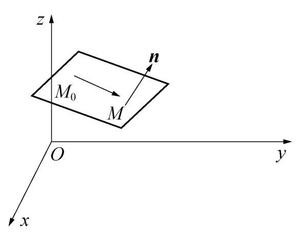

设 $M_0(x_0,\ y_0,\ z_0)$ 是平面 $\Pi$ 上的一个定点，且已知该平面的法向量 $\boldsymbol{n} = (A,\ B,\ C)$，则对于平面上的任一点 $M(x,\ y,\ z)$，由于向量 $\overrightarrow{M_0M} = (x - x_0,\ y - y_0,\ z - z_0)$ 必与平面 $\Pi$ 的法向量 $\boldsymbol{n}$ 垂直，于是有 $\overrightarrow{M_0M} \cdot \boldsymbol{n} = 0$，即

$$
A(x - x_0) + B(y - y_0) + C(z - z_0) = 0. \qquad (1)
$$

式(1)是以 $x$、$y$、$z$ 为变量的三元一次方程，从上面的推导过程可以看到，平面 $\Pi$ 上任意一点 $M(x,\ y,\ z)$ 的坐标一定满足方程，而若点 $M(x,\ y,\ z)$ 不在平面上，则 $\overrightarrow{M_0M}$ 与 $\boldsymbol{n}$ 不垂直，即 $\overrightarrow{M_0M} \cdot \boldsymbol{n} \neq 0$，即点 $M(x,\ y,\ z)$ 不满足方程。因此式(1)就是平面 $\Pi$ 的方程，又因为我们是在给定平面上的一个点 $M_0(x_0,\ y_0,\ z_0)$ 和它的一个法向量 $\boldsymbol{n} = (A,\ B,\ C)$ 的条件下得到的式(1)的，因此式(1)又称为平面的点法式方程。

**例 1** 求过点 $(2,\ 3,\ 1)$ 且与 $\boldsymbol{n} = (-1,\ -2,\ 0)$ 垂直的平面的方程。

**解** 根据平面的法向量的概念，向量 $\boldsymbol{n} = (-1,\ -2,\ 0)$ 即为所求平面的一个法向量。所以由平面的点法式方程可得

$$
-1 \cdot (x - 2) - 2 \cdot (y - 3) + 0 \cdot (z - 1) = 0,
$$

即

$$
(x - 2) + 2(y - 3) = 0, \quad \text{或} \quad x + 2y - 8 = 0.
$$

**例 2** 求过点 $M_1(1,\ -1,\ -2)$、$M_2(-1,\ 2,\ 0)$ 及 $M_3(1,\ 3,\ 3)$ 的平面的方程。

**解** 由于三点 $M_1$、$M_2$、$M_3$ 均在平面上，所以 $\overrightarrow{M_1M_2}$、$\overrightarrow{M_1M_3}$ 与平面平行，由向量积的概念可知，向量 $\overrightarrow{M_1M_2} \times \overrightarrow{M_1M_3}$ 与 $\overrightarrow{M_1M_2}$、$\overrightarrow{M_1M_3}$ 都垂直，即与所求平面垂直，因此它是平面的一个法向量（见图 5-34），而

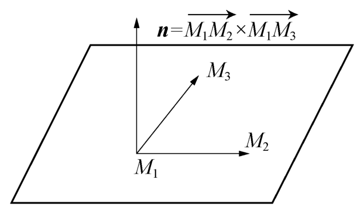

$$
\overrightarrow{M_1M_2} = ((-1) - 1,\ 2 - (-1),\ 0 - (-2)) = (-2,\ 3,\ 2),
$$

$$
\overrightarrow{M_1M_3} = (1 - 1,\ 3 - (-1),\ 3 - (-2)) = (0,\ 4,\ 5),
$$

取 $\boldsymbol{n} = \overrightarrow{M_1M_2} \times \overrightarrow{M_1M_3} = \begin{vmatrix} \boldsymbol{i} & \boldsymbol{j} & \boldsymbol{k} \\ -2 & 3 & 2 \\ 0 & 4 & 5 \end{vmatrix} = (7,\ 10,\ -8)$，则平面方程为

$$
7(x - 1) + 10(y + 1) - 8(z + 2) = 0, \quad \text{或} \quad 7x + 10y - 8z - 13 = 0.
$$

### 二、平面的一般方程

由平面的点法式方程(1)知任一平面的方程都是三元一次方程，反之，可以证明任何一个三元一次方程

$$
Ax + By + Cz + D = 0 \qquad (2)
$$

一定表示平面。

任取一组 $(x_0,\ y_0,\ z_0)$ 满足

$$
Ax_0 + By_0 + Cz_0 + D = 0, \qquad (3)
$$

(2)-(3) 得 $A(x - x_0) + B(y - y_0) + C(z - z_0) = 0$，即为平面的点法式方程(1)。

由于式(2)与式(1)是同解方程，故表明三元一次方程的图形一定是平面。

方程 $Ax + By + Cz + D = 0$ 称为平面的一般方程，其中 $\boldsymbol{n} = (A,\ B,\ C)$ 即为该平面的一个法向量。

对于一些特殊的三元一次方程所表示的平面，应该熟悉它们图形的特点。

(1) 当 $D = 0$ 时，式(2)成为 $Ax + By + Cz = 0$，显然，原点 $O(0,\ 0,\ 0)$ 的坐标满足此方程，因此，方程 $Ax + By + Cz = 0$ 表示过原点的平面。

(2) 当 $A = 0$ 时，$By + Cz + D = 0$ 所表示的平面的法向量为 $\boldsymbol{n} = (0,\ B,\ C)$，法向量 $\boldsymbol{n}$ 在 $x$ 轴上的投影为零，故与 $x$ 轴垂直，所以该平面与 $x$ 轴平行；同理，当 $B = 0$ 时，平面 $Ax + Cz + D = 0$ 平行于 $y$ 轴；当 $C = 0$ 时，平面 $Ax + By + D = 0$ 平行于 $z$ 轴。

(3) 当 $A = B = 0$ 时，平面 $Cz + D = 0$ 的法向量为 $\boldsymbol{n} = (0,\ 0,\ C)$，法向量 $\boldsymbol{n}$ 在 $x$ 轴和 $y$ 轴上的投影都为零，故与 $x$ 轴和 $y$ 轴都垂直，即与 $xOy$ 面垂直，所以该平面平行于 $xOy$ 面；同样，当 $B = C = 0$ 或 $A = C = 0$ 时，式(2)成为 $Ax + D = 0$ 或 $By + D = 0$，它们分别表示与 $yOz$ 面或与 $zOx$ 面平行的平面。

特别地，方程 $z = 0$，$x = 0$，$y = 0$ 分别表示了三个坐标面：$xOy$ 面、$yOz$ 面和 $zOx$ 面。

**例 3** 求通过 $x$ 轴和点 $(2,\ 4,\ 1)$ 的平面方程。

**解法一** 设所求平面的一般方程为 $Ax + By + Cz + D = 0$，因为所求平面通过 $x$ 轴，且法向量垂直于 $x$ 轴，于是法向量在 $x$ 轴上的投影为零，即 $A = 0$。

由于平面通过原点，所以 $D = 0$，从而方程成为

$$
By + Cz = 0, \qquad (4)
$$

又因平面过点 $(2,\ 4,\ 1)$，因此有 $4B + C = 0$，即 $C = -4B$。以此代入式(4)，再除以 $B(B \neq 0)$，便得到所求方程为

$$
y - 4z = 0.
$$

**解法二** 因为所求平面通过 $x$ 轴，故原点 $O(0,\ 0,\ 0)$ 在平面上，向量

$$
\overrightarrow{OM} = (2 - 0,\ 4 - 0,\ 1 - 0) = (2,\ 4,\ 1)
$$

在平面上，又 $x$ 轴的单位向量 $\boldsymbol{i} = (1,\ 0,\ 0)$ 与平面平行，于是向量积 $\overrightarrow{OM} \times \boldsymbol{i}$ 与平面垂直，即它是平面的一个法向量。而

$$
\overrightarrow{OM} \times \boldsymbol{i} = \begin{vmatrix} \boldsymbol{i} & \boldsymbol{j} & \boldsymbol{k} \\ 2 & 4 & 1 \\ 1 & 0 & 0 \end{vmatrix} = \begin{vmatrix} 4 & 1 \\ 0 & 0 \end{vmatrix} \boldsymbol{i} - \begin{vmatrix} 2 & 1 \\ 1 & 0 \end{vmatrix} \boldsymbol{j} + \begin{vmatrix} 2 & 4 \\ 1 & 0 \end{vmatrix} \boldsymbol{k} = \boldsymbol{j} - 4\boldsymbol{k},
$$

根据平面的点法式方程，得到所求方程为

$$
y - 4z = 0.
$$

### 三、平面的截距式方程

**例 4** 设一平面与 $x$、$y$、$z$ 轴分别交于点 $P(a,\ 0,\ 0)$、$Q(0,\ b,\ 0)$、$R(0,\ 0,\ c)$（$abc \neq 0$），求这个平面的方程（见图 5-35）。

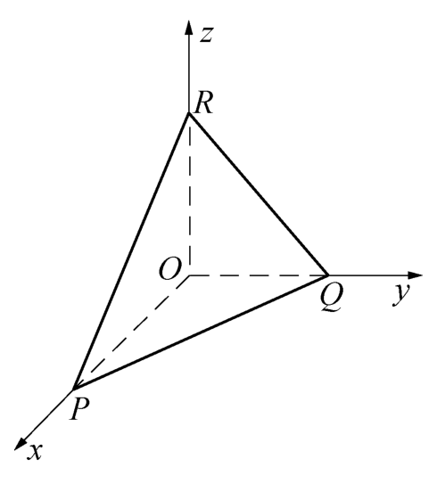

**解** 设平面的一般方程为

$$
Ax + By + Cz + D = 0, \qquad (5)
$$

分别将上述三点的坐标代入方程，得

$$
Aa + D = 0,\quad Bb + D = 0,\quad Cc + D = 0,
$$

即

$$
A = -\frac{D}{a},\quad B = -\frac{D}{b},\quad C = -\frac{D}{c},
$$

代入式(5)得

$$
-\frac{D}{a}x - \frac{D}{b}y - \frac{D}{c}z + D = 0 \ (\text{这里} \ D \neq 0),
$$

即

$$
\frac{x}{a} + \frac{y}{b} + \frac{z}{c} = 1.
$$

$\frac{x}{a} + \frac{y}{b} + \frac{z}{c} = 1$ 称为平面的截距式方程。$a$、$b$ 和 $c$ 叫作该平面的截距。

### 四、平面与平面、点与平面的关系

### 1. 两平面的夹角

两平面的法向量所夹的锐角（或直角）称为两平面的夹角（见图 5-36）。

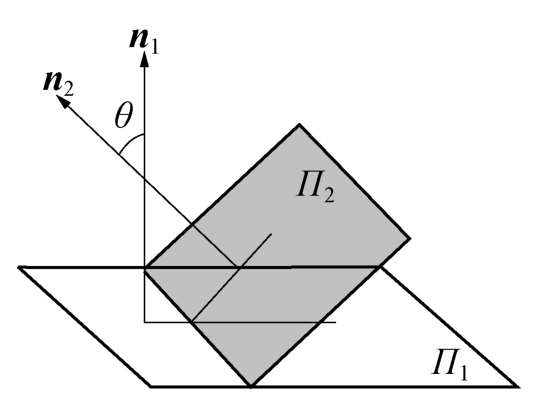

设平面 $\Pi_1$ 的方程为

$$
A_1x + B_1y + C_1z + D_1 = 0,
$$

平面 $\Pi_2$ 的方程为

$$
A_2x + B_2y + C_2z + D_2 = 0,
$$

即

$$
\boldsymbol{n}_1 = (A_1,\ B_1,\ C_1),\quad \boldsymbol{n}_2 = (A_2,\ B_2,\ C_2),
$$

则平面 $\Pi_1$ 与平面 $\Pi_2$ 的夹角 $\theta = (\widehat{\Pi_1,\ \Pi_2})$ 的余弦为

$$
\cos\theta = \frac{|\boldsymbol{n}_1 \cdot \boldsymbol{n}_2|}{|\boldsymbol{n}_1||\boldsymbol{n}_2|} = \frac{|A_1A_2 + B_1B_2 + C_1C_2|}{\sqrt{A_1^2 + B_1^2 + C_1^2}\sqrt{A_2^2 + B_2^2 + C_2^2}}.
$$

由此可推得两个平面平行和垂直的充要条件。

当 $\Pi_1 \parallel \Pi_2$ 时（见图 5-37），有

$$
\boldsymbol{n}_1 \parallel \boldsymbol{n}_2 \Leftrightarrow \frac{A_1}{A_2} = \frac{B_1}{B_2} = \frac{C_1}{C_2}.
$$

若 $\Pi_1$ 与 $\Pi_2$ 重合，则 $\frac{A_1}{A_2} = \frac{B_1}{B_2} = \frac{C_1}{C_2} = \frac{D_1}{D_2}$。

当 $\Pi_1 \perp \Pi_2$ 时（见图 5-38），有

$$
\boldsymbol{n}_1 \perp \boldsymbol{n}_2 \Leftrightarrow A_1A_2 + B_1B_2 + C_1C_2 = 0.
$$

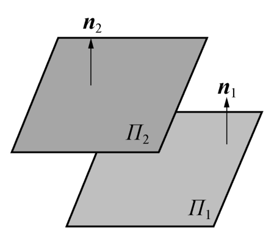

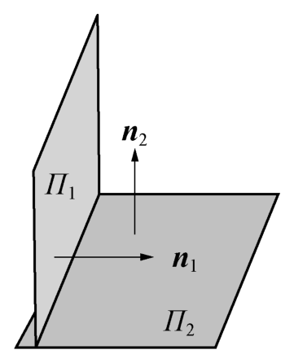

**例 5** 研究以下各组里两平面的位置关系。

(1) $\Pi_1: -x + 2y - z + 1 = 0$，$\Pi_2: y + 3z - 1 = 0$；

(2) $\Pi_1: 2x - y + z - 1 = 0$，$\Pi_2: -4x + 2y - 2z - 1 = 0$。

**解** (1) 因为 $\Pi_1$ 与 $\Pi_2$ 的法向量分别为 $\boldsymbol{n}_1 = (-1,\ 2,\ -1)$，$\boldsymbol{n}_2 = (0,\ 1,\ 3)$，且

$$
\cos\theta = \frac{|-1 \times 0 + 2 \times 1 - 1 \times 3|}{\sqrt{(-1)^2 + 2^2 + (-1)^2} \cdot \sqrt{1^2 + 3^2}} = \frac{1}{\sqrt{60}},
$$

故两平面相交，夹角为

$$
\theta = \arccos\frac{1}{\sqrt{60}}.
$$

(2) 因为 $\Pi_1$ 与 $\Pi_2$ 的法向量分别为 $\boldsymbol{n}_1 = (2,\ -1,\ 1)$，$\boldsymbol{n}_2 = (-4,\ 2,\ -2)$，且 $\frac{2}{-4} = \frac{-1}{2} = \frac{1}{-2}$，即对应坐标成比例。

又 $M(1,\ 1,\ 0) \in \Pi_1$，$M(1,\ 1,\ 0) \notin \Pi_2$，故两平面平行但不重合。

**例 6** 求平面 $\Pi$，使其满足：

(1) 过 $z$ 轴；

(2) $\Pi$ 与平面 $2x + y - \sqrt{5}z = 0$ 的夹角为 $\frac{\pi}{3}$。

**解** 因为平面 $\Pi$ 过 $z$ 轴，可设其方程为 $Ax + By = 0$。又因为 $\Pi$ 与已知平面夹角为 $\frac{\pi}{3}$，故

$$
\cos\frac{\pi}{3} = \frac{|2A + B + (-\sqrt{5}) \cdot 0|}{\sqrt{A^2 + B^2 + 0^2}\sqrt{2^2 + 1^2 + (-\sqrt{5})^2}} = \frac{1}{2},
$$

从而 $B = 3A$ 或 $B = -\frac{1}{3}A$，所以

$$
\Pi: x + 3y = 0 \quad \text{或} \quad \Pi: 3x - y = 0.
$$

**例 7** 一平面通过两点 $M_1(1,\ 1,\ 1)$ 和 $M_2(0,\ 1,\ -1)$ 且垂直于平面 $x + y + z = 0$，求该平面方程。

**解** $\overrightarrow{M_1M_2} = (0 - 1,\ 1 - 1,\ -1 - 1) = (-1,\ 0,\ -2)$，根据题意，可取 $\boldsymbol{n} = \overrightarrow{M_1M_2} \times \boldsymbol{n}_1$，其中 $\boldsymbol{n}_1$ 为已知平面 $x + y + z = 0$ 的法向量，$\boldsymbol{n}_1 = (1,\ 1,\ 1)$，故

$$
\boldsymbol{n} = \begin{vmatrix} \boldsymbol{i} & \boldsymbol{j} & \boldsymbol{k} \\ -1 & 0 & -2 \\ 1 & 1 & 1 \end{vmatrix} = (2,\ -1,\ -1),
$$

因此所求平面方程为

$$
2(x - 1) - (y - 1) - (z - 1) = 0, \quad \text{即} \quad 2x - y - z = 0.
$$

### 2. 点到平面的距离

设 $P_0(x_0,\ y_0,\ z_0)$ 为平面 $Ax + By + Cz + D = 0$ 外的一点，在平面上任取一点 $P_1(x_1,\ y_1,\ z_1)$（见图 5-39），则点 $P_0$ 到平面的距离 $d$ 就是 $\overrightarrow{P_1P_0}$ 在 $\boldsymbol{n}$（$\boldsymbol{n} = (A,\ B,\ C)$）上的投影的绝对值，即 $d = |\text{Prj}_{\boldsymbol{n}}\overrightarrow{P_1P_0}|$。

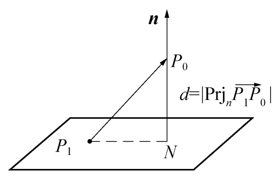

注意到 $Ax_1 + By_1 + Cz_1 + D = 0$，故

$$
d = |\text{Prj}_{\boldsymbol{n}}\overrightarrow{P_1P_0}| = \frac{|\boldsymbol{n} \cdot \overrightarrow{P_1P_0}|}{|\boldsymbol{n}|} = \frac{|A(x_0 - x_1) + B(y_0 - y_1) + C(z_0 - z_1)|}{\sqrt{A^2 + B^2 + C^2}}
$$

$$
= \frac{|Ax_0 + By_0 + Cz_0 - Ax_1 - By_1 - Cz_1|}{\sqrt{A^2 + B^2 + C^2}} = \frac{|Ax_0 + By_0 + Cz_0 + D|}{\sqrt{A^2 + B^2 + C^2}}.
$$

比如，我们可以利用公式计算点 $P_0(2,\ 1,\ 1)$ 到平面 $x + y - z + 1 = 0$ 的距离：

$$
d = \frac{|2 + 1 - 1 + 1|}{\sqrt{1^2 + 1^2 + (-1)^2}} = \frac{3}{\sqrt{3}} = \sqrt{3}.
$$

**例 8** 求两平行平面 $\Pi_1: 10x + 2y - 2z - 5 = 0$ 和 $\Pi_2: 5x + y - z - 1 = 0$ 之间的距离 $d$。

**解** 可在平面 $\Pi_2$ 上任取一点，该点到平面 $\Pi_1$ 的距离即为这两平行平面间的距离。为此，在平面 $\Pi_2$ 上取点 $(0,\ 1,\ 0)$，则

$$
d = \frac{|10 \times 0 + 2 \times 1 + (-2) \times 0 - 5|}{\sqrt{10^2 + 2^2 + (-2)^2}} = \frac{3}{\sqrt{108}} = \frac{\sqrt{3}}{6}.
$$

## 习题 5-2

1. 填空题。

(1) 过原点且与向量 $\boldsymbol{a} = (3,\ 1,\ -1)$ 垂直的平面方程为__________。

(2) 平面 $x + 2y + kz + 1 = 0$ 与向量 $\boldsymbol{a} = (1,\ 2,\ 1)$ 垂直，则 $k =$__________。

(3) 过点 $M(2,\ 0,\ -1)$，且与向量 $\boldsymbol{a} = (2,\ 1,\ -1)$、$\boldsymbol{b} = (3,\ 0,\ 4)$ 平行的平面方程为__________。

2. 指出下列平面位置的特点，并画出各平面。

(1) $2x + z + 1 = 0$；　　　(2) $y - z = 0$；

(3) $x + 2y - z = 0$；　　　(4) $9y - 1 = 0$；

(5) $x = 0$；　　　　　　　(6) $2x + z = 0$。

3. 求满足下列条件的平面方程。

(1) 过点 $M(1,\ 1,\ 1)$ 且与平面 $3x - y + 2z - 1 = 0$ 平行；

(2) 过点 $M(1,\ 2,\ 1)$ 且同时与平面 $x + y - 2z + 1 = 0$ 和 $2x - y + z = 0$ 垂直；

(3) 与 $x$、$y$、$z$ 轴的交点分别为 $(2,\ 0,\ 0)$，$(0,\ -3,\ 0)$ 和 $(0,\ 0,\ -1)$；

(4) 平行于 $x$ 轴且经过点 $(1,\ 2,\ -1)$；

(5) 垂直于两平面 $x - y + z - 1 = 0$，$2x + y + z + 1 = 0$ 且通过点 $(1,\ -1,\ 1)$；

(6) 平行于向量 $\boldsymbol{a} = (2,\ 1,\ -1)$ 且在 $x$ 轴、$y$ 轴上的截距依次为 3 和 -2。

4. 求经过两点 $(4,\ 0,\ -2)$ 和 $(5,\ 1,\ 7)$ 且与 $x$ 轴平行的平面方程。

5. 求过点 $A(1,\ 1,\ -1)$ 和原点且与平面 $4x + 3y + z = 1$ 垂直的平面方程。

6. 求过 $z$ 轴和点 $M(-3,\ 1,\ 2)$ 的平面方程。

7. 求过三点 $A(2,\ 3,\ 0)$、$B(-2,\ -3,\ 4)$ 和 $C(0,\ 6,\ 0)$ 的平面方程。

8. 一平面过点 $A(1,\ -4,\ 5)$ 且在各坐标轴上的截距相等，求它的方程。

9. 设平面过原点及点 $(6,\ -3,\ 2)$ 且与平面 $4x - y + 2z = 8$ 垂直，求此平面方程。

10. 求平行于平面 $6x + y + 6z + 5 = 0$ 且与三个坐标面所围成的四面体体积为一个单位的平面方程。

11. 若平面 $x + ky - 2z = 0$ 与平面 $2x - 3y + z = 0$ 的夹角为 $\frac{\pi}{4}$，求 $k$ 的值。

12. 求经过两点 $M_1(3,\ -2,\ 9)$ 和 $M_2(-6,\ 0,\ -4)$ 且与平面 $2x - y + 4z - 8 = 0$ 垂直的平面的方程。

13. 求平面 $5x - 14y + 2z - 8 = 0$ 和 $xOy$ 面的夹角。

14. 求通过 $z$ 轴且与平面 $2x + y - \sqrt{5}z - 7 = 0$ 的夹角为 $\frac{\pi}{3}$ 的平面的方程。

15. 推导两平行平面 $Ax + By + Cz + D_i = 0$，$i = 1,\ 2$ 之间的距离公式；并求将两平行平面 $x - 2y + z - 2 = 0$ 与 $x - 2y + z - 6 = 0$ 之间距离分成 $1:3$ 的平面方程。

16. 证明：过不在一直线上三点 $(x_i,\ y_i,\ z_i)$，$i = 1,\ 2,\ 3$ 的平面方程为

$$
\begin{vmatrix} x - x_1 & y - y_1 & z - z_1 \\ x_2 - x_1 & y_2 - y_1 & z_2 - z_1 \\ x_3 - x_1 & y_3 - y_1 & z_3 - z_1 \end{vmatrix} = 0,
$$

并写出过 $(1,\ 1,\ -1)$，$(-2,\ -2,\ 2)$，$(1,\ -1,\ 2)$ 三点的平面方程。

## 第三节 直线及其方程

**[课前导读]**

在平面解析几何中，把平面曲线看作动点的轨迹，从而得到轨迹方程——曲线方程的概念。同样，在空间解析几何中，任何曲线都可以看作满足一定几何条件的动点的轨迹，动点的轨迹用方程组来表示，就得到曲线方程的概念。

空间直线是最简单的空间曲线。在本节中我们将以向量为工具讨论空间直线。

### 一、空间直线一般方程

任一空间直线 $L$ 都可以看作是两个相交平面的交线（见图 5-40）。若平面 $\Pi_1$ 的方程为 $A_1x + B_1y + C_1z + D_1 = 0$，平面 $\Pi_2$ 的方程为 $A_2x + B_2y + C_2z + D_2 = 0$，则方程组

$$
\begin{cases} A_1x + B_1y + C_1z + D_1 = 0, \\ A_2x + B_2y + C_2z + D_2 = 0 \end{cases} \qquad (1)
$$

表示空间直线 $L$ 的方程，称为空间直线的一般方程。

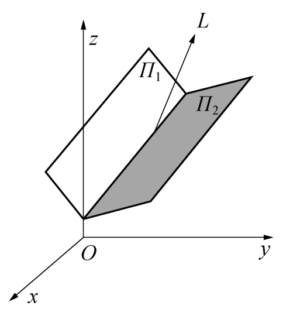

**例 1** (1) 求过点 $(-3,\ 2,\ 5)$，且分别与平面 $2x - y - 5z = 1$ 和 $x - 4z = 3$ 平行的平面 $\Pi_1$ 与 $\Pi_2$ 的方程。

(2) 求平面 $\Pi_1$ 与 $\Pi_2$ 的交线方程。

**解** (1) 先求过点 $(-3,\ 2,\ 5)$ 且与已知平面平行的平面。

平面 $\Pi_1$ 的法向量可取为 $\boldsymbol{n}_1 = (2,\ -1,\ -5)$，故过点 $(-3,\ 2,\ 5)$ 且以 $\boldsymbol{n}_1$ 为法向量的平面方程为

$$
\Pi_1: 2(x + 3) - (y - 2) - 5(z - 5) = 0.
$$

平面 $\Pi_2$ 的法向量可取为 $\boldsymbol{n}_2 = (1,\ 0,\ -4)$，故过点 $(-3,\ 2,\ 5)$ 且以 $\boldsymbol{n}_2$ 为法向量的平面方程为

$$
\Pi_2: (x + 3) - 4(z - 5) = 0.
$$

即 $\Pi_1: 2x - y - 5z + 33 = 0$，$\Pi_2: x - 4z + 23 = 0$。

(2) 所求直线的一般方程为

$$
\begin{cases} 2x - y - 5z + 33 = 0, \\ x - 4z + 23 = 0. \end{cases}
$$

### 二、对称式方程及参数方程

由立体几何知道，过空间一点作平行于已知直线的直线是唯一的。因此，如果知道直线上一点及与直线平行的某一向量，那么该直线的位置也就完全确定。现在根据这个几何条件来建立直线的方程。

如果一个非零向量平行于一条已知直线，这个向量称为该直线的方向向量。直线上的任何一个向量都平行于方向向量。显然，一条直线的方向向量有无穷多个，它们之间互相平行。

由于过空间一点可作且只能作一条直线平行于已知向量，故给定直线上的一点 $M_0(x_0,\ y_0,\ z_0)$ 及一个方向向量 $\boldsymbol{s} = (m,\ n,\ p)$，直线的位置就完全确定了（见图 5-41）。如果 $M(x,\ y,\ z)$ 为直线 $l$ 上任意一点，则 $\overrightarrow{M_0M} \parallel \boldsymbol{s}$，即有

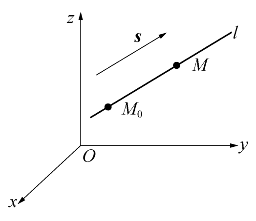

$$
\frac{x - x_0}{m} = \frac{y - y_0}{n} = \frac{z - z_0}{p}. \qquad (2)
$$

式(2)是含有未知数 $x$、$y$、$z$ 的方程组。从上面推导可知，直线 $l$ 上任意一点 $M(x,\ y,\ z)$ 的坐标满足式(2)。反之，如果点 $M(x,\ y,\ z)$ 不在直线上，那么向量 $\overrightarrow{M_0M}$ 与 $\boldsymbol{s}$ 就不平行，于是点 $M(x,\ y,\ z)$ 的坐标就不会满足式(2)。由此可知此式即为直线 $l$ 的方程，称为直线的对称式方程，也称点向式方程。这里 $\boldsymbol{s} = (m,\ n,\ p)$ 的三个坐标 $m$、$n$、$p$ 就称为方向数，而 $\boldsymbol{s}$ 的方向余弦就叫作该直线的方向余弦。

若设 $\frac{x - x_0}{m} = \frac{y - y_0}{n} = \frac{z - z_0}{p} = t$，则有直线的参数方程

$$
\begin{cases} x = x_0 + mt, \\ y = y_0 + nt, \\ z = z_0 + pt. \end{cases}
$$

**注** 在式(2)中，若有个别分母为零，应理解为相应的分子也为零。例如，$m = 0$（$n \neq 0$，$p \neq 0$），即式(2)为

$$
\frac{x - x_0}{0} = \frac{y - y_0}{n} = \frac{z - z_0}{p}
$$

时，上式应理解为

$$
\begin{cases} x - x_0 = 0, \\ \dfrac{y - y_0}{n} = \dfrac{z - z_0}{p}. \end{cases}
$$

**例 2** 用点向式方程或参数方程表示直线

$$
\begin{cases} x + y + z + 1 = 0, \\ 2x - y + 3z + 4 = 0. \end{cases}
$$

**解** 令 $x_0 = 1$，代入方程得

$$
\begin{cases} y + z = -2, \\ -y + 3z = -6, \end{cases}
$$

解得 $y = 0$，$z = -2$，即得到该直线上的一点 $M_0(1,\ 0,\ -2)$，由于直线的方向向量 $\boldsymbol{s}$ 与相交平面的法向量 $\boldsymbol{n}_1 = (1,\ 1,\ 1)$，$\boldsymbol{n}_2 = (2,\ -1,\ 3)$ 都垂直，故可取

$$
\boldsymbol{s} = \boldsymbol{n}_1 \times \boldsymbol{n}_2 = \begin{vmatrix} \boldsymbol{i} & \boldsymbol{j} & \boldsymbol{k} \\ 1 & 1 & 1 \\ 2 & -1 & 3 \end{vmatrix} = (4,\ -1,\ -3),
$$

因此直线的点向式方程为

$$
\frac{x - 1}{4} = \frac{y}{-1} = \frac{z + 2}{-3},
$$

直线的参数方程为

$$
\begin{cases} x = 1 + 4t, \\ y = -t, \\ z = -2 - 3t. \end{cases}
$$

**例 3** 求过点 $A(1,\ 0,\ 1)$ 和 $B(-2,\ 1,\ 1)$ 的直线方程。

**解** 向量 $\overrightarrow{AB} = (-3,\ 1,\ 0)$ 是所求直线的一个方向向量，因此所求直线方程为

$$
\frac{x - 1}{-3} = \frac{y}{1} = \frac{z - 1}{0}.
$$

### 三、直线与平面的关系

### 1. 两直线的夹角

两直线的方向向量之间的夹角（通常取锐角或直角）称为两直线的夹角，即 $(\widehat{l_1,\ l_2}) = (\widehat{\boldsymbol{s}_1,\ \boldsymbol{s}_2})$ 或 $(\widehat{l_1,\ l_2}) = (-\widehat{\boldsymbol{s}_1,\ \boldsymbol{s}_2}) = \pi - (\widehat{\boldsymbol{s}_1,\ \boldsymbol{s}_2})$ 两者中的锐角或直角。

设 $l_1: \frac{x - x_1}{m_1} = \frac{y - y_1}{n_1} = \frac{z - z_1}{p_1}$，其中 $\boldsymbol{s}_1 = (m_1,\ n_1,\ p_1)$，$M_1(x_1,\ y_1,\ z_1) \in l_1$，

$l_2: \frac{x - x_2}{m_2} = \frac{y - y_2}{n_2} = \frac{z - z_2}{p_2}$，其中 $\boldsymbol{s}_2 = (m_2,\ n_2,\ p_2)$，$M_2(x_2,\ y_2,\ z_2) \in l_2$，

则

$$
\cos(\widehat{l_1,\ l_2}) = \frac{|\boldsymbol{s}_1 \cdot \boldsymbol{s}_2|}{|\boldsymbol{s}_1||\boldsymbol{s}_2|} = \frac{|m_1m_2 + n_1n_2 + p_1p_2|}{\sqrt{m_1^2 + n_1^2 + p_1^2}\sqrt{m_2^2 + n_2^2 + p_2^2}};
$$

当 $l_1 \perp l_2$ 时（见图 5-42），应有

$$
m_1m_2 + n_1n_2 + p_1p_2 = 0.
$$

当 $l_1 \parallel l_2$ 时（见图 5-43），应有

$$
\frac{m_1}{m_2} = \frac{n_2}{n_2} = \frac{p_1}{p_2}.
$$

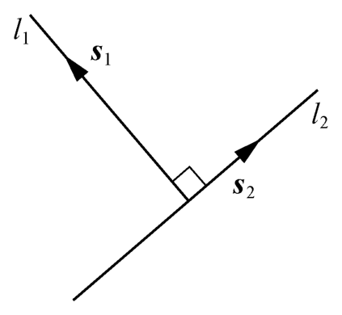

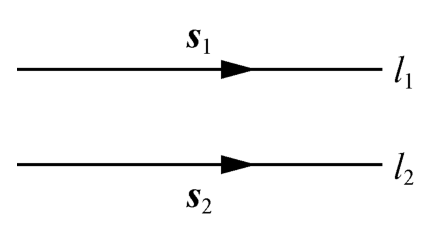

**例 4** 求直线 $l_1: \frac{x - 1}{1} = \frac{y}{-4} = \frac{z + 3}{1}$ 和直线 $l_2: \frac{x}{2} = \frac{y + 2}{-2} = \frac{z}{-1}$ 的夹角。

**解** 已知直线 $l_1$ 的方向向量 $\boldsymbol{s}_1 = (1,\ -4,\ 1)$，直线 $l_2$ 的方向向量 $\boldsymbol{s}_2 = (2,\ -2,\ -1)$，则

$$
\cos(\widehat{l_1,\ l_2}) = \frac{|\boldsymbol{s}_1 \cdot \boldsymbol{s}_2|}{|\boldsymbol{s}_1||\boldsymbol{s}_2|} = \frac{|1 \times 2 + (-4) \times (-2) + 1 \times (-1)|}{\sqrt{1^2 + (-4)^2 + 1^2}\sqrt{2^2 + (-2)^2 + (-1)^2}} = \frac{\sqrt{2}}{2},
$$

故 $(\widehat{l_1,\ l_2}) = \frac{\pi}{4}$。

**例 5** 求过点 $(-3,\ 2,\ 5)$ 且与两平面 $x - 4z = 3$ 和 $2x - y - 5z = 1$ 的交线平行的直线方程。

**解** 设所求直线的方向向量为 $\boldsymbol{s} = (m,\ n,\ p)$，平面 $x - 4z = 3$ 的法向量为 $\boldsymbol{n}_1 = (1,\ 0,\ -4)$，平面 $2x - y - 5z = 1$ 的法向量为 $\boldsymbol{n}_2 = (2,\ -1,\ -5)$，根据题意知 $\boldsymbol{s} \perp \boldsymbol{n}_1$，$\boldsymbol{s} \perp \boldsymbol{n}_2$，取

$$
\boldsymbol{s} = \boldsymbol{n}_1 \times \boldsymbol{n}_2 = \begin{vmatrix} \boldsymbol{i} & \boldsymbol{j} & \boldsymbol{k} \\ 1 & 0 & -4 \\ 2 & -1 & -5 \end{vmatrix} = (-4,\ -3,\ -1),
$$

故所求直线的方程为

$$
\frac{x + 3}{4} = \frac{y - 2}{3} = \frac{z - 5}{1}.
$$

**例 6** 求过点 $M(2,\ 1,\ 3)$ 且与直线 $\frac{x + 1}{3} = \frac{y - 1}{2} = \frac{z}{-1}$ 垂直相交的直线方程。

**解** 先作一过点 $M$ 且与已知直线垂直的平面 $\Pi$，即

$$
3(x - 2) + 2(y - 1) - (z - 3) = 0.
$$

再求已知直线与该平面的交点 $N$。

令 $\frac{x + 1}{3} = \frac{y - 1}{2} = \frac{z}{-1} = t$，则

$$
\begin{cases} x = 3t - 1, \\ y = 2t + 1, \\ z = -t, \end{cases}
$$

代入平面方程得 $t = \frac{3}{7}$，交点 $N\left(\frac{2}{7},\ \frac{13}{7},\ -\frac{3}{7}\right)$，取所求直线的方向向量为 $\overrightarrow{MN}$，即

$$
\overrightarrow{MN} = \left(\frac{2}{7} - 2,\ \frac{13}{7} - 1,\ -\frac{3}{7} - 3\right) = \left(-\frac{12}{7},\ \frac{6}{7},\ -\frac{24}{7}\right) = -\frac{6}{7}(2,\ -1,\ 4),
$$

所求直线方程为

$$
\frac{x - 2}{2} = \frac{y - 1}{-1} = \frac{z - 3}{4}.
$$

### 2. 直线与平面的夹角

直线 $l$ 和它在平面 $\pi$ 上的投影直线 $l_1$ 所构成的角称为该直线与平面的夹角（见图 5-44），记为 $\varphi$（$0 \leqslant \varphi < \frac{\pi}{2}$）。

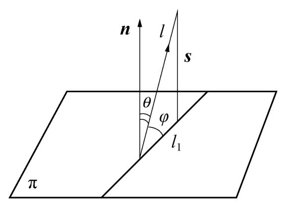

当直线与平面垂直时，规定 $\varphi = \frac{\pi}{2}$。

设直线 $l: \frac{x - x_0}{m} = \frac{y - y_0}{n} = \frac{z - z_0}{p}$，$\boldsymbol{s} = (m,\ n,\ p)$，平面 $\Pi: Ax + By + Cz + D = 0$，$\boldsymbol{n} = (A,\ B,\ C)$，则 $\varphi = \left|\frac{\pi}{2} - (\widehat{\boldsymbol{s},\ \boldsymbol{n}})\right|$，因此

$$
\sin\varphi = |\cos(\widehat{\boldsymbol{s},\ \boldsymbol{n}})| = \frac{|Am + Bn + Cp|}{\sqrt{A^2 + B^2 + C^2}\sqrt{m^2 + n^2 + p^2}}.
$$

当 $l \parallel \Pi$ 时，$\boldsymbol{s} \perp \boldsymbol{n}$，即有

$$
Am + Bn + Cp = 0.
$$

当 $l \perp \Pi$ 时，$\boldsymbol{s} \parallel \boldsymbol{n}$，即有

$$
\frac{A}{m} = \frac{B}{n} = \frac{C}{p}.
$$

**例 7** 设直线 $L: \frac{x - 1}{2} = \frac{y}{-1} = \frac{z + 1}{2}$，平面 $\Pi: x - y + 2z = 3$，求直线 $L$ 与平面 $\Pi$ 的夹角 $\varphi$。

**解** 平面 $\Pi$ 的法向量 $\boldsymbol{n} = (1,\ -1,\ 2)$，直线 $L$ 的法向量 $\boldsymbol{s} = (2,\ -1,\ 2)$，则

$$
\sin\varphi = \frac{|Am + Bn + Cp|}{\sqrt{A^2 + B^2 + C^2}\sqrt{m^2 + n^2 + p^2}} = \frac{|1 \times 2 + (-1) \times (-1) + 2 \times 2|}{\sqrt{6} \cdot \sqrt{9}} = \frac{7\sqrt{6}}{18}.
$$

所以 $\varphi = \arcsin\frac{7\sqrt{6}}{18}$ 为所求夹角。

### 四、平面束

通过定直线的平面的全体称为过该直线的平面束，有时候用平面束解题非常方便，现在我们来介绍它的方程。

设直线 $l: \begin{cases} A_1x + B_1y + C_1z + D_1 = 0, \\ A_2x + B_2y + C_2z + D_2 = 0, \end{cases}$ 其中系数 $A_1$、$B_1$、$C_1$ 与 $A_2$、$B_2$、$C_2$ 不成比例，$\lambda_1$，$\lambda$，$\mu$ 为任意常数，则过该直线的平面束方程为

$$
\lambda_1(A_1x + B_1y + C_1z + D_1) + \mu(A_2x + B_2y + C_2z + D_2) = 0, \qquad (3)
$$

或

$$
A_1x + B_1y + C_1z + D_1 + \lambda(A_2x + B_2y + C_2z + D_2) = 0. \qquad (4)
$$

注意：若式(3)中 $\lambda_1 \neq 0$，则可将式(3)写成式(4)；但式(4)中并不包括平面

$$
A_2x + B_2y + C_2z + D_2 = 0.
$$

**例 8** 一平面过直线 $\begin{cases} x + y - z = 0, \\ x - y + z - 1 = 0 \end{cases}$ 和点 $(1,\ 1,\ -1)$，求该平面方程。

**解** 设过已知直线的平面束为

$$
x + y - z + \lambda(x - y + z - 1) = 0,
$$

又点 $(1,\ 1,\ -1)$ 满足方程，即由 $1 + 1 - (-1) + \lambda(1 - 1 - 1 - 1) = 0$，得 $\lambda = \frac{3}{2}$，因此所求平面方程为

$$
x + y - z + \frac{3}{2}(x - y + z - 1) = 0, \quad \text{即} \quad 5x - y + z - 3 = 0.
$$

**例 9** 过直线 $L: \begin{cases} x + 2y - z - 6 = 0, \\ x - 2y + z = 0 \end{cases}$ 作平面 $\Pi$，使它垂直于平面 $\Pi_1: x + 2y + z = 0$。

**解** 设过直线 $L$ 的平面束的方程为 $(x + 2y - z - 6) + \lambda(x - 2y + z) = 0$，即

$$
(1 + \lambda)x + 2(1 - \lambda)y + (\lambda - 1)z - 6 = 0.
$$

现在上述平面束中找出一个平面 $\Pi$，使它垂直于题设平面 $\Pi_1$，故平面 $\Pi$ 的法向量 $\boldsymbol{n}_\lambda$ 垂直于平面 $\Pi_1$ 的法向量 $\boldsymbol{n}_1 = (1,\ 2,\ 1)$。于是 $\boldsymbol{n}_\lambda \cdot \boldsymbol{n}_1 = 0$，即

$$
(1 + \lambda) + 4(1 - \lambda) + (\lambda - 1) = 0,
$$

解得 $\lambda = 2$，故所求平面方程为

$$
\Pi: 3x - 2y + z - 6 = 0.
$$

容易验证，平面 $x - 2y + z = 0$ 不是所求平面。

**例 10** 在一切过直线 $l: \begin{cases} x + y + z + 4 = 0, \\ x + 2y + z = 0 \end{cases}$ 的平面中找出平面 $\Pi$，使原点到它的距离最长。

**解** 设通过直线 $l$ 的平面束方程为 $(x + y + z + 4) + \lambda(x + 2y + z) = 0$，即

$$
(1 + \lambda)x + (1 + 2\lambda)y + (1 + \lambda)z + 4 = 0.
$$

要使 $d^2(\lambda) = \frac{16}{(1 + \lambda)^2 + (1 + 2\lambda)^2 + (1 + \lambda)^2}$ 为最大，

即使 $(1 + \lambda)^2 + (1 + 2\lambda)^2 + (1 + \lambda)^2 = 6\left(\lambda + \frac{2}{3}\right)^2 + \frac{1}{3}$ 为最小，得 $\lambda = -\frac{2}{3}$，

故所求平面 $\Pi$ 的方程为

$$
x - y + z + 12 = 0.
$$

易知，原点到平面 $x + 2y + z = 0$ 的距离为 $0$，故平面 $x + 2y + z = 0$ 非所求平面。

**例 11** 一平面过直线 $\begin{cases} x + 5y + z = 0, \\ x - z + 4 = 0, \end{cases}$ 且与平面 $x - 4y - 8z + 12 = 0$ 成 $\frac{\pi}{4}$ 角，求该平面的方程。

**解** 设过已知直线的平面束为 $\lambda(x + 5y + z) + \mu(x - z + 4) = 0$，即

$$
(\lambda + \mu)x + 5\lambda y + (\lambda - \mu)z + 4\mu = 0,
$$

已知

$$
\cos\frac{\pi}{4} = \frac{|(\lambda + \mu) \times 1 + 5\lambda \times (-4) + (\lambda - \mu) \times (-8)|}{\sqrt{(\lambda + \mu)^2 + (5\lambda)^2 + (\lambda - \mu)^2}\sqrt{1^2 + (-4)^2 + (-8)^2}},
$$

即

$$
\frac{-27\lambda + 9\mu}{9\sqrt{27\lambda^2 + 2\mu^2}} = \frac{\sqrt{2}}{2} \ \text{或} \ \frac{(-3\lambda + \mu)^2}{27\lambda^2 + 2\mu^2} = \frac{1}{2} \ \text{或} \ 9\lambda^2 + 12\lambda\mu = 0, \ \text{即} \ \lambda(3\lambda + 4\mu) = 0, \ \text{得}
$$

$\lambda_1 = 0$，$\lambda_2 = -\frac{4}{3}\mu$，因此所求平面为

$$
x - z + 4 = 0 \quad \text{或} \quad x + 20y + 7z - 12 = 0.
$$

## 习题 5-3

1. 求满足下列条件的直线方程。

(1) 过点 $(2,\ -1,\ 4)$ 且与直线 $\frac{x - 1}{3} = \frac{y}{-1} = \frac{z + 1}{2}$ 平行；

(2) 过点 $(2,\ -3,\ 5)$ 且与平面 $9x - 4y + 2z - 1 = 0$ 垂直；

(3) 过点 $(3,\ 4,\ -4)$ 和 $(3,\ -2,\ 2)$。

2. 求过点 $(1,\ 1,\ 1)$ 且同时与平面 $2x - y - 3z = 0$ 和 $x + 2y - 5z = 1$ 平行的直线方程。

3. 用点向式方程及参数方程表示直线 $\begin{cases} x + 2y - z - 6 = 0, \\ 2x - y + z - 1 = 0. \end{cases}$

4. 求过点 $(1,\ 0,\ -2)$ 且与平面 $3x + 4y - z + 6 = 0$ 平行，又与直线 $\frac{x - 3}{1} = \frac{y + 2}{4} = \frac{z}{1}$ 垂直的直线方程。

5. 确定下列各组中的直线和平面间的位置关系。

(1) $\frac{x - 3}{-2} = \frac{y + 4}{-7} = \frac{z}{3}$ 和 $4x - 2y - 2z = 3$；

(2) $\frac{x}{3} = \frac{y}{-2} = \frac{z}{7}$ 和 $3x - 2y + 7z = 8$；

(3) $\frac{x - 2}{3} = \frac{y + 2}{1} = \frac{z - 3}{-4}$ 和 $x + y + z = 3$。

6. 求直线 $\begin{cases} x + y + 3z = 0, \\ x - y - z = 0 \end{cases}$ 和平面 $x - y - z + 1 = 0$ 的夹角。

7. 求点 $(1,\ 2,\ 1)$ 到平面 $x + 2y + 2z - 10 = 0$ 的距离。

8. 求直线 $\begin{cases} 2x - 4y + z = 0, \\ 3x - y - 2z - 9 = 0 \end{cases}$ 在平面 $4x - y + z = 1$ 的投影直线方程。

9. 求过点 $M(3,\ 1,\ -2)$ 及直线 $\frac{x - 4}{5} = \frac{y + 3}{2} = \frac{z}{1}$ 的平面方程。

10. 求过直线 $\frac{x - 2}{5} = \frac{y + 1}{2} = \frac{z - 2}{4}$ 且与平面 $x + 4y - 3z + 7 = 0$ 垂直的平面方程。

11. 已知直线过点 $A(2,\ -3,\ 4)$ 且和 $y$ 轴垂直相交，求该直线方程。

12. 求过点 $(0,\ 2,\ 4)$ 且与直线 $\begin{cases} x + 2z = 1, \\ y - 3z = 2 \end{cases}$ 平行的直线。

13. 求点 $P_0(2,\ 3,\ 1)$ 在直线 $l: \frac{x + 7}{1} = \frac{y + 2}{2} = \frac{z + 2}{3}$ 上的投影。

14. 求点 $P_0(3,\ -1,\ -1)$ 在平面 $\Pi: x + 2y + 3z - 40 = 0$ 上的投影。

15. 求过点 $A(1,\ 0,\ -2)$，且与平面 $\Pi: 3x - y + 2z + 3 = 0$ 平行，并与直线 $l_1: \frac{x - 1}{4} = \frac{y - 3}{-2} = \frac{z}{1}$ 相交的直线 $l$ 的方程。

16. 分别求过直线 $l: \begin{cases} 2x - 3y + 4z - 12 = 0, \\ x + 4y - 2z - 10 = 0 \end{cases}$ 且垂直于各坐标面的平面方程，并求直线 $l$ 在平面 $3x + 2y + z - 10 = 0$ 上的投影。

17. 过点 $M_1(7,\ 3,\ 5)$ 引方向余弦等于 $\frac{1}{3}$、$\frac{2}{3}$、$\frac{2}{3}$ 的直线 $l_1$，设直线 $l$ 过点 $M_0(2,\ -3,\ -1)$，与直线 $l_1$ 相交且和 $x$ 轴成 $\frac{\pi}{3}$ 角，求直线 $l$ 的方程。

18. 求通过点 $(2,\ 1,\ 3)$ 且与直线 $\frac{x + 1}{3} = \frac{y - 1}{2} = \frac{z}{-1}$ 垂直相交的直线方程。

19. 求证：两直线 $l_1: \frac{x - x_1}{m_1} = \frac{y - y_1}{n_1} = \frac{z - z_1}{p_1}$，$l_2: \frac{x - x_2}{m_2} = \frac{y - y_2}{n_2} = \frac{z - z_2}{p_2}$ 在同一平面上的条件为 $\begin{vmatrix} x_2 - x_1 & y_2 - y_1 & z_2 - z_1 \\ m_1 & n_1 & p_1 \\ m_2 & n_2 & p_2 \end{vmatrix} = 0$。

20. 一直线过点 $(1,\ 2,\ 1)$，又与直线 $\frac{x}{2} = y = -z$ 相交，且垂直于直线 $\frac{x - 1}{3} = \frac{y}{2} = \frac{z + 1}{1}$，求该直线方程。

21. 一直线 $l$ 过点 $A(-3,\ 5,\ -9)$ 且与两直线 $l_1: \begin{cases} y = 3x + 5, \\ z = 2x - 3, \end{cases}$ $l_2: \begin{cases} y = 4x - 7, \\ z = 5x + 10 \end{cases}$ 相交，求此直线方程。

**22.** 设直线 $l: \frac{x - x_0}{m} = \frac{y - y_0}{n} = \frac{z - z_0}{p}$，其中 $\boldsymbol{s} = (m,\ n,\ p)$，$M_0(x_0,\ y_0,\ z_0)$，直线 $l$ 外一点为 $M_1(x_1,\ y_1,\ z_1)$，证明：点 $M_1$ 到直线 $l$ 的距离为 $d = \frac{|\overrightarrow{M_1M_0} \times \boldsymbol{s}|}{|\boldsymbol{s}|}$。

**23.** 设直线 $l_1: \frac{x - x_1}{m_1} = \frac{y - y_1}{n_1} = \frac{z - z_1}{p_1}$，其中 $\boldsymbol{s}_1 = (m_1,\ n_1,\ p_1)$，$M_1(x_1,\ y_1,\ z_1)$，直线 $l_2: \frac{x - x_2}{m_2} = \frac{y - y_2}{n_2} = \frac{z - z_2}{p_2}$，其中 $\boldsymbol{s}_2 = (m_2,\ n_2,\ p_2)$，$M_2(x_2,\ y_2,\ z_2)$，证明：异面直线 $l_1$ 与 $l_2$ 之间的距离为 $d = \frac{|\overrightarrow{M_1M_2} \cdot (\boldsymbol{s}_1 \times \boldsymbol{s}_2)|}{|\boldsymbol{s}_1 \times \boldsymbol{s}_2|}$。

**24.** 设直线 $l_1: \frac{x - 9}{4} = \frac{y + 2}{-3} = \frac{z}{1}$，直线 $l_2: \frac{x}{-2} = \frac{y + 7}{9} = \frac{z - 7}{2}$，试求：

(1) 直线 $l_1$、$l_2$ 之间的距离；

(2) 直线 $l_1$ 与 $l_2$ 的公垂线方程。

## 第四节 曲面与曲线

**[课前导读]**

本节介绍曲面与曲线方程概念，主要围绕下面两个基本问题：(1) 已知曲面与曲线上点的几何特征，建立方程；(2) 已知曲线与曲面上的点的坐标所满足的方程，研究曲面与曲线的形状和性质。我们着重介绍一些常见的曲面与曲线及其方程。

### 一、曲面方程的概念

任何曲面都可以看作是满足一定几何条件的动点的轨迹，从而得到了曲面方程的概念。

**定义 1** 如果曲面 $S$ 与三元方程 $F(x,\ y,\ z) = 0$ 满足下列关系：

(1) 曲面 $S$ 上的任一点的坐标都满足方程；

(2) 不在曲面 $S$ 上的点的坐标都不满足方程，

则称 $F(x,\ y,\ z) = 0$ 为曲面 $S$ 的方程，而曲面 $S$ 称为方程 $F(x,\ y,\ z) = 0$ 的图形（见图 5-45）。

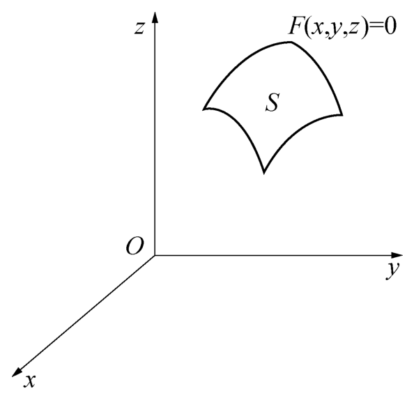

我们要研究的两个基本问题如下。

(1) 已知曲面作为点的轨迹时，建立这曲面的方程；

(2) 已知一个三元方程，研究该方程所表示的几何图形，即曲面形状，着重介绍一些常见的曲面。

先讨论第一个基本问题：建立几种常见的曲面方程。

若空间一动点到定点的距离为定值，则该动点的轨迹称为球面，定点叫作球心，定值叫作半径。

**例 1** 建立球心在点 $M_0(x_0,\ y_0,\ z_0)$，半径为 $R$ 的球面的方程。

**解** 本题实质是求到定点 $M_0(x_0,\ y_0,\ z_0)$ 的距离为定长 $R$ 的点的轨迹方程，即球面的方程。

设 $M(x,\ y,\ z)$ 是球面上任意一点，则有 $|\overrightarrow{M_0M}| = R$，即

$$
\sqrt{(x - x_0)^2 + (y - y_0)^2 + (z - z_0)^2} = R
$$

或

$$
(x - x_0)^2 + (y - y_0)^2 + (z - z_0)^2 = R^2.
$$

**例 2** 求与原点 $O$ 及 $M_0(2,\ 3,\ 4)$ 的距离之比为 $1:2$ 的点的全体所组成的曲面方程。

**解** 设 $M(x,\ y,\ z)$ 是曲面上任一点，根据题意有

$$
\frac{|MO|}{|MM_0|} = \frac{1}{2}, \quad \text{即} \quad \frac{\sqrt{x^2 + y^2 + z^2}}{\sqrt{(x - 2)^2 + (y - 3)^2 + (z - 4)^2}} = \frac{1}{2},
$$

故所求方程为

$$
\left(x + \frac{2}{3}\right)^2 + (y + 1)^2 + \left(z + \frac{4}{3}\right)^2 = \frac{116}{9}.
$$

**例 3** 求到两定点 $A(1,\ 2,\ 3)$ 和 $B(2,\ -1,\ 4)$ 等距离的点的几何轨迹。

**解** 设 $M(x,\ y,\ z)$ 是所要求的曲面上任意一点，则由题意有

$$
(x - 1)^2 + (y - 2)^2 + (z - 3)^2 = (x - 2)^2 + (y + 1)^2 + (z - 4)^2,
$$

化简得

$$
2x - 6y + 2z - 7 = 0.
$$

由方程可知，这是一个平面。

以上是从已知曲面（轨迹）建立其方程，再看两个由已知方程研究它所表示的曲面的例子。

**例 4** 方程 $x^2 + y^2 + z^2 - 2x + 4y = 0$ 表示什么样的曲面？

**解** 原方程可写成如下形式

$$
(x - 1)^2 + (y + 2)^2 + z^2 = 5,
$$

可看出它表示球心在点 $M_0(1,\ -2,\ 0)$，半径 $R = \sqrt{5}$ 的球面。

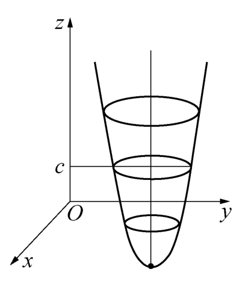

**例 5** 方程 $z = (x - 1)^2 + (y - 2)^2 - 1$ 的图形是怎样的？

**解** 根据题意有 $z \geqslant -1$，用平面 $z = c$ 去截图形得圆：

$$
(x - 1)^2 + (y - 2)^2 = 1 + c \ (c \geqslant -1),
$$

当平面 $z = c$ 上下移动时，得到一系列圆，圆心在 $(1,\ 2,\ c)$，半径为 $\sqrt{1 + c}$，半径随 $c$ 的增大而增大。图形上不封顶，下封底，如图 5-46 所示。

### 二、旋转曲面

**定义 2** 一条平面曲线绕其平面上的一条定直线旋转一周所成的曲面叫作旋转曲面，这条定直线叫作旋转曲面的轴。

设在 $yOz$ 坐标面上有一已知曲线 $L: f(y,\ z) = 0$，将 $L$ 绕 $z$ 轴旋转就得到一个以 $z$ 轴为旋转轴的旋转曲面 $S$。

设 $M_1(0,\ y_1,\ z_1)$ 为 $L$ 上任一点，则 $f(y_1,\ z_1) = 0$，当 $L$ 绕 $z$ 轴旋转时，点 $M_1$ 也绕 $z$ 轴旋转到另一点 $M(x,\ y,\ z)$，这时 $z = z_1$ 保持不变（见图 5-47）。$M$ 到 $z$ 轴的距离 $d$ 保持不变且等于 $|y_1|$，而 $d = \sqrt{x^2 + y^2} = |y_1|$ 或 $y_1 = \pm\sqrt{x^2 + y^2}$。由 $f(y_1,\ z_1) = 0$ 得

$$
f(\pm\sqrt{x^2 + y^2},\ z) = 0, \qquad (1)
$$

这就是旋转曲面 $S$ 的方程。容易看到，不在曲面 $S$ 上的点的坐标不会满足式(1)，因此式(1)就是以曲线 $L$ 为母线、$z$ 轴为旋转轴的曲面 $S$ 的方程。

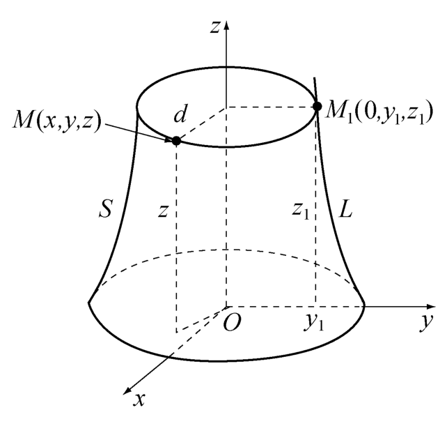

由此可知，在曲线 $L$ 的方程 $f(y,\ z) = 0$ 中，变量 $z$ 保持不变，用 $\pm\sqrt{x^2 + y^2}$ 替换 $y$，就得到曲线 $L$ 绕 $z$ 轴旋转所形成的旋转曲面方程。

同理，曲线 $L: f(y,\ z) = 0$ 绕 $y$ 轴旋转所形成的旋转曲面方程为

$$
f(y,\ \pm\sqrt{x^2 + z^2}) = 0.
$$

**例 6** 直线 $L$ 绕另一条与 $L$ 相交的定直线旋转一周，所得旋转曲面称为圆锥面。两直线的交点称为圆锥面的顶点，两直线的夹角 $\alpha$（$0 < \alpha < \frac{\pi}{2}$）称为圆锥面的半顶角。试建立顶点在坐标原点，旋转轴为 $z$ 轴，半顶角为 $\alpha$ 的圆锥面（见图 5-48）方程。

**解** 在 $yOz$ 面上，直线方程为 $L: z = y\cot\alpha$，因为旋转轴为 $z$ 轴，所以只有将直线方程 $L$ 中的 $y$ 改成 $\pm\sqrt{x^2 + y^2}$，锥面方程为

$$
z = \pm\sqrt{x^2 + y^2}\cot\alpha
$$

或

$$
z^2 = a^2(x^2 + y^2)\ (a = \cot\alpha).
$$

同样，我们可以得到如下常见的几个旋转曲面方程。

(1) 当 $yOz$ 平面上的抛物线 $y^2 = 2pz$ 绕 $z$ 轴旋转时，就得到一个以 $z$ 轴为旋转轴的旋转曲面，其方程为 $(\pm\sqrt{x^2 + y^2})^2 = 2pz$，即 $x^2 + y^2 = 2pz$，这是旋转抛物面（见图 5-49）方程。

(2) 当 $xOz$ 平面上的椭圆 $\frac{x^2}{a^2} + \frac{z^2}{c^2} = 1$ 绕 $z$ 轴旋转时，就得到一个以 $z$ 轴为旋转轴的旋转曲面，其方程为 $\frac{x^2 + y^2}{a^2} + \frac{z^2}{c^2} = 1$，这是旋转椭球面（见图 5-50）方程。

(3) 当 $xOz$ 平面上的双曲线 $\frac{x^2}{a^2} - \frac{z^2}{c^2} = 1$ 绕 $x$ 轴旋转时，就得到一个以 $x$ 轴为旋转轴的旋转曲面，其方程为 $\frac{x^2}{a^2} - \frac{y^2 + z^2}{c^2} = 1$（见图 5-51）；若绕 $z$ 轴旋转就得到 $\frac{x^2 + y^2}{a^2} - \frac{z^2}{c^2} = 1$（见图 5-52），这是旋转双曲面方程，前者是双叶旋转双曲面，后者是单叶旋转双曲面。

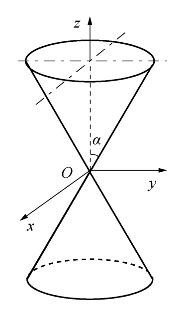

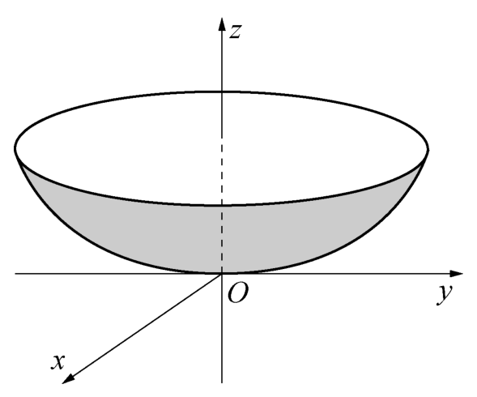

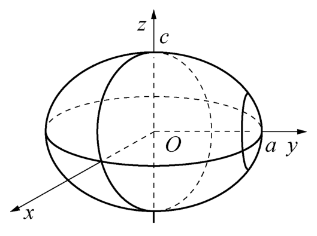

### 三、柱面

平行于定直线并沿定曲线 $C$ 移动的直线 $L$ 形成的轨迹叫作柱面（见图 5-53）。其中定曲线 $C$ 称为柱面的准线，动直线 $L$ 称为柱面的母线。

例如，在平面解析几何中，方程 $x^2 + y^2 = R^2$ 表示 $xOy$ 面上圆心在原点 $O$、半径为 $R$ 的圆。在空间直角坐标系中，这个方程不含竖坐标 $z$，即无论空间点的竖坐标 $z$ 怎样，只要它的横坐标 $x$ 和纵坐标 $y$ 能满足这个方程，那么这些点就在这曲面上。因此，这个曲面可以看成是由平行于 $z$ 轴的直线 $L$ 沿 $xOy$ 面上的圆 $x^2 + y^2 = R^2$ 移动而形成的。所以在空间解析几何中，$x^2 + y^2 = R^2$ 表示圆柱面（见图 5-54），准线为 $xOy$ 平面上的一个圆，母线是平行于 $z$ 轴的直线。

一般地，设有一柱面，准线是 $xOy$ 面上的曲线 $C$：

$$
\begin{cases} F(x,\ y) = 0, \\ z = 0, \end{cases}
$$

其母线平行于 $z$ 轴。点 $M(x,\ y,\ z)$ 是柱面上任意一点，过点 $M$ 作平行于 $z$ 轴的直线，交曲线 $C$ 于点 $M_1$。显然点 $M_1$ 和 $M$ 有相同的横坐标和纵坐标（见图 5-53）。由于点 $M_1(x,\ y,\ 0)$ 在曲线上，故它的坐标满足准线的方程，即

$$
F(x,\ y) = 0, \qquad (2)
$$

又式(2)与 $z$ 无关，所以 $M(x,\ y,\ z)$ 的坐标也满足式(2)。此外，对于不在柱面上的点，它在 $xOy$ 面上的垂足不在曲线 $C$ 上，故其坐标不会满足式(2)。因此，式(2)就是母线平行于 $z$ 轴、准线为曲线 $C$ 的柱面方程。

类似地，母线平行于 $x$ 轴，准线为 $yOz$ 面上的曲线（见图 5-55）：

$$
\begin{cases} G(y,\ z) = 0, \\ x = 0, \end{cases}
$$

其柱面方程为

$$
G(y,\ z) = 0.
$$

母线平行于 $y$ 轴，准线为 $zOx$ 面上的曲线：

$$
\begin{cases} H(x,\ z) = 0, \\ y = 0, \end{cases}
$$

其柱面方程为

$$
H(x,\ z) = 0 .
$$

母线是平行于坐标轴的柱面的特点：方程中一般只出现两个坐标元素，方程可以表示为 $F(x,\ y) = 0$ 或 $G(y,\ z) = 0$ 或 $H(z,\ x) = 0$。它们分别表示母线平行 $z$ 轴、$x$ 轴和 $y$ 轴的柱面，这些方程也称为三元不完全方程。

例如，方程 $\dfrac{x^2}{a^2} + \dfrac{y^2}{b^2} = 1$ 表示母线平行于 $z$ 轴、准线为 $xOy$ 面上的椭圆的椭圆柱面（见图 5-56）；方程 $y^2 = 2px$ 表示母线平行于 $z$ 轴、准线为 $xOy$ 面上的抛物线的抛物柱面（见图 5-57）；方程 $-\dfrac{x^2}{a^2} + \dfrac{z^2}{b^2} = 1$ 表示母线平行于 $y$ 轴、准线为 $zOx$ 面上的双曲线的双曲柱面（见图 5-58）。

### 四、二次曲面

与平面解析几何中出现的二次曲线相类似，三元二次方程所表示的曲面就叫作二次曲面；相应地，三元一次方程所表示的曲面就叫作一次曲面（即平面）。

常见的二次曲面包括椭球面、二次锥面、抛物面、双曲面等，适当地选取空间直角坐标系，就可得到它们的标准方程。关于一般的三元方程 $F(x,\ y,\ z) = 0$ 所表示的曲面的形状，已难以用描点法得到，我们可以用截痕法来研究它们的形状。

**1. 椭球面**

由方程

$$
\frac{x^2}{a^2} + \frac{y^2}{b^2} + \frac{z^2}{c^2} = 1 \qquad (3)
$$

确定的曲面称为椭球面。当 $a = b = c$ 时即为球面 $x^2 + y^2 + z^2 = a^2$。当 $a$、$b$、$c$ 中有两个相等时，其图形为旋转椭球面。由此可知，旋转椭球面是椭球面的特殊情形，而球面则是旋转椭球面的特殊情形。

由式(3)容易看到，椭球面关于坐标面、坐标轴、原点都对称，且

$$
\frac{x^2}{a^2} \leqslant 1,\ \frac{y^2}{b^2} \leqslant 1,\ \frac{z^2}{c^2} \leqslant 1,
$$

即

$$
|x| \leqslant a,\ |y| \leqslant b,\ |z| \leqslant c .
$$

这说明椭球面完全包含在三对平行平面 $x = \pm a$，$y = \pm b$，$z = \pm c$ 所围成的长方体中，$a$、$b$、$c$ 称为椭球面的半轴，原点称为椭球面的中心。

下面我们来讨论椭球面的形状。

首先，考查三个坐标面与椭球面的交线。交线的方程分别为

$$
\begin{cases}
\dfrac{x^2}{a^2} + \dfrac{y^2}{b^2} = 1, \\[6pt]
z = 0;
\end{cases}
\qquad
\begin{cases}
\dfrac{x^2}{a^2} + \dfrac{z^2}{c^2} = 1, \\[6pt]
y = 0;
\end{cases}
\qquad
\begin{cases}
\dfrac{y^2}{b^2} + \dfrac{z^2}{c^2} = 1, \\[6pt]
x = 0.
\end{cases}
$$

它们分别是三个坐标面上的椭圆。

其次，考查平行于坐标面的平面与椭球面的交线。用平行于 $xOy$ 面的平面 $z = h(|h| \leqslant c)$ 去截椭球面（见图 5-59），交线为

$$
\begin{cases}
\dfrac{x^2}{a^2} + \dfrac{y^2}{b^2} = 1 - \dfrac{h^2}{c^2}, \\[6pt]
z = h.
\end{cases}
$$

它是在平面 $z = h$ 上的一个椭圆。当 $|h|$ 由 $0$ 逐渐增大到 $c$ 时，椭圆逐渐由大变小，最后缩成一个点。这些椭圆就形成了椭球面。

用平行于 $yOz$ 面的平面或平行于 $xOz$ 面的平面分别去截椭球面时，也有以上类似的结果（见图 5-60）。椭球面的形状如图 5-61 所示。

这样获得曲面几何形状的方法就叫作截痕法。

**2. 二次锥面（椭圆锥面）**

由方程 $\dfrac{x^2}{a^2} + \dfrac{y^2}{b^2} = z^2$ 或 $\dfrac{x^2}{a^2} + \dfrac{z^2}{c^2} = y^2$ 或 $\dfrac{y^2}{b^2} + \dfrac{z^2}{c^2} = x^2$ 所确定的曲面称为二次锥面（椭圆锥面）。

考查 $\dfrac{x^2}{a^2} + \dfrac{y^2}{b^2} = z^2$，以垂直于 $z$ 轴的平面 $z = t$ 截此曲面，当 $t = 0$ 时得一点 $(0,\ 0,\ 0)$；当 $t \neq 0$ 时，得平面 $z = t$ 上的椭圆 $\dfrac{x^2}{(at)^2} + \dfrac{y^2}{(bt)^2} = 1$（截痕），当 $t$ 变化时，上式表示一族长短轴比例不变的椭圆，当 $|t|$ 从大到小并变为 $0$ 时，这族椭圆从大到小并缩为一点，从这些截痕，我们可以得知椭圆锥面的形状（见图 5-62）。

**3. 抛物面**

由方程 $\dfrac{x^2}{2a} + \dfrac{y^2}{2b} = z(ab > 0)$ 所确定的曲面称为椭圆抛物面。

由方程的表达式可知，椭圆抛物面关于 $xOz$ 面、$yOz$ 面及 $z$ 轴都对称。当 $a > 0$，$b > 0$ 时，$z \geqslant 0$，所以它在 $xOy$ 面的上方。当 $a < 0$，$b < 0$ 时，$z \leqslant 0$，所以它在 $xOy$ 面的下方。此外，原点 $O$ 的坐标满足方程，原点叫作椭圆抛物面的顶点。

我们用截痕法来讨论当 $a > 0$，$b > 0$ 时椭圆抛物面的形状。

（1）用平行于 $xOy$ 面的平面 $z = h(h > 0)$ 去截椭圆抛物面，交线为

$$
\begin{cases}
\dfrac{x^2}{2ah} + \dfrac{y^2}{2bh} = 1, \\[6pt]
z = h,
\end{cases}
$$

它是平面上的一个椭圆，当 $z$ 逐渐由小变大时，椭圆也逐渐由小变大，这些椭圆就形成了椭圆抛物面。

（2）椭圆抛物面与 $yOz$ 面及 $zOx$ 面的交线分别为

$$
\begin{cases}
y^2 = 2bz, \\
x = 0,
\end{cases}
\qquad
\begin{cases}
x^2 = 2az, \\
y = 0,
\end{cases}
$$

它们分别是 $yOz$ 面及 $zOx$ 面上的抛物线。

（3）用平行于坐标面 $zOx(y = 0)$ 的平面 $y = k$ 去截椭圆抛物面，交线为一抛物线：

$$
\begin{cases}
x^2 = 2a\left(z - \dfrac{k^2}{2b}\right), \\[6pt]
y = k.
\end{cases}
$$

同样，用平行于坐标面 $yOz(x = 0)$ 的平面 $x = d$ 去截椭圆抛物面，交线仍为一抛物线。

根据上述截痕，就可得到椭圆抛物面的图形（见图 5-63）。

由方程 $\dfrac{x^2}{2a} - \dfrac{y^2}{2b} = z\ (ab > 0)$ 所确定的曲面称为双曲抛物面（马鞍面）。

我们同样可以用截痕法来讨论双曲抛物面的形状，当 $a > 0$，$b > 0$ 时图形如图 5-64 所示。

**4. 双曲面**

由方程 $\dfrac{x^2}{a^2} + \dfrac{y^2}{b^2} - \dfrac{z^2}{c^2} = 1$ 或 $\dfrac{x^2}{a^2} - \dfrac{y^2}{b^2} + \dfrac{z^2}{c^2} = 1$ 或 $-\dfrac{x^2}{a^2} + \dfrac{y^2}{b^2} + \dfrac{z^2}{c^2} = 1$ 确定的曲面称为单叶双曲面。

由方程 $\dfrac{x^2}{a^2} + \dfrac{y^2}{b^2} - \dfrac{z^2}{c^2} = -1$ 或 $\dfrac{x^2}{a^2} - \dfrac{y^2}{b^2} + \dfrac{z^2}{c^2} = -1$ 或 $-\dfrac{x^2}{a^2} + \dfrac{y^2}{b^2} + \dfrac{z^2}{c^2} = -1$ 所确定的曲面称为双叶双曲面。

我们也可以通过截痕法获得它们的图像，请读者自行尝试。

### 五、空间曲线及其方程

**1. 空间曲线的一般方程**

空间曲线可看作是两个相交曲面的交线，即若设两个相交曲面的方程分别是 $F(x,\ y,\ z) = 0$ 和 $G(x,\ y,\ z) = 0$，则

$$
\begin{cases}
F(x,\ y,\ z) = 0, \\
G(x,\ y,\ z) = 0
\end{cases}
$$

就表示其交线 $C$ 的方程（见图 5-65）。

显然，曲线 $C$ 上的点的坐标一定同时满足两个曲面的方程：$F(x,\ y,\ z) = 0$，$G(x,\ y,\ z) = 0$；反之，不是曲线 $C$ 上的点的坐标一定不能同时满足两曲面的方程。则

$$
\begin{cases}
F(x,\ y,\ z) = 0, \\
G(x,\ y,\ z) = 0
\end{cases}
$$

就称为曲线 $C$ 的一般方程。

**例 7** 方程组 $\begin{cases} x^2 + y^2 = 1, \\ 2x + 3z = 6 \end{cases}$ 表示怎样的曲线？

**解** $x^2 + y^2 = 1$ 表示母线平行于 $z$ 轴的圆柱面，$2x + 3z = 6$ 表示母线平行于 $y$ 轴的平面，方程组 $\begin{cases} x^2 + y^2 = 1, \\ 2x + 3z = 6 \end{cases}$ 表示圆柱和平面的交线，即为椭圆（见图 5-66）。

**例 8** 方程组

$$
\begin{cases}
z = \sqrt{a^2 - x^2 - y^2}, \\[6pt]
\left(x - \dfrac{a}{2}\right)^2 + y^2 = \dfrac{a^2}{4}
\end{cases}
$$

表示怎样的曲线？

**解** $z = \sqrt{a^2 - x^2 - y^2}$ 表示上半球面，$\left(x - \dfrac{a}{2}\right)^2 + y^2 = \dfrac{a^2}{4}$ 表示圆柱面，球面与柱面的交线如图 5-67 中曲线 $C$ 所示。

**注** 表示空间一条曲线的方程并不唯一，即如曲线 $C$ 的方程可表示为 $\begin{cases} F(x,\ y,\ z) = 0, \\ G(x,\ y,\ z) = 0 \end{cases}$，也可用和它等价的任何两个方程所联列的方程组来替代它。如 $Oz$ 轴所在直线可认为是平面 $x = 0$ 与 $y = 0$ 的交线，即 $\begin{cases} x = 0, \\ y = 0 \end{cases}$，也可认为是平面 $x + y = 0$ 与 $x - y = 0$ 的交线，即 $\begin{cases} x + y = 0, \\ x - y = 0. \end{cases}$

**2. 空间曲线的参数方程**

如果说空间曲线作为两曲面的交线而形成一般方程，那么也可以将其看作空间点移动的轨迹而形成曲线的参数方程。即有

$$
\begin{cases}
x = \varphi(t), \\
y = \psi(t), \\
z = \omega(t),
\end{cases}
$$

其中，$\varphi(t)$、$\psi(t)$、$\omega(t)$ 是连续的。

显然，随着 $t$ 的变化，$\varphi(t)$、$\psi(t)$、$\omega(t)$ 也在变化，而 $(x,\ y,\ z)$ 对应的点 $M$ 的轨迹就形成曲线。

**例 9** 若空间一点 $M$ 在圆柱面 $x^2 + y^2 = a^2$ 上以角速度 $\omega$ 绕 $z$ 轴旋转，同时又以线速度 $v$ 沿平行于 $z$ 轴的正方向上升（其中 $\omega$、$v$ 是常数），则点 $M$ 构成的图形叫作螺旋线（见图 5-68）。试建立其参数方程。

**解** 取时间 $t$ 为参数，动点从点 $A$ 出发，经过 $t$ 时间运动到点 $M(x,\ y,\ z)$。

$M$ 在 $xOy$ 面的投影为 $N(x,\ y,\ 0)$，由题意可知

$$
\begin{cases}
x = a\cos\omega t, \\
y = a\sin\omega t, \\
z = vt.
\end{cases}
$$

螺旋线的参数方程还可以写成

$$
\begin{cases}
x = a\cos\theta, \\
y = a\sin\theta, \\
z = b\theta,
\end{cases}
\qquad
\left(\theta = \omega t,\ b = \frac{v}{\omega}\right)
$$

螺旋线具有重要性质，即上升的高度与转过的角度成正比。从而当 $\theta$ 从 $\theta_0$ 变化到 $\theta_0 + \alpha$ 时，$z$ 的值由 $b\theta_0$ 变化到 $b\theta_0 + b\alpha$，故当点 $M$ 转过角 $\alpha$ 时，点 $M$ 沿螺旋线上升了高度 $b\alpha$。特别地，当 $\alpha = 2\pi$ 时，点 $M$ 的高度 $h = 2\pi b$，称为螺距。

### 六、空间曲线在坐标面上的投影

设空间曲线 $C$ 的方程为

$$
\begin{cases}
F(x,\ y,\ z) = 0, \\
G(x,\ y,\ z) = 0,
\end{cases}
\qquad (4)
$$

消去 $z$ 可得方程

$$
H(x,\ y) = 0 . \qquad (5)
$$

如果点 $M(x,\ y,\ z)$ 满足式(4)，则其中的 $x$、$y$ 就必定满足式(5)，而式(5)表示一个母线平行于 $z$ 轴的柱面，因此曲线 $C$ 在柱面(5)上。

以曲线 $C$ 为准线，母线平行于 $z$ 轴（即垂直于 $xOy$ 面）的柱面叫作曲线 $C$ 关于 $xOy$ 面的**投影柱面**，而该投影柱面与 $xOy$ 面的交线叫作空间曲线 $C$ 在（坐标面）$xOy$ 面上的**投影曲线**（简称**投影**）。因此，曲线 $C$ 在 $xOy$ 面上的投影曲线为

$$
\begin{cases}
H(x,\ y) = 0, \\
z = 0.
\end{cases}
$$

同理，在式(4)中消去 $x$ 或 $y$，可得平行于 $x$ 轴或 $y$ 轴的投影柱面 $R(y,\ z) = 0$ 或$T(x,\ z) = 0$，就得到相应的投影曲线为 $\begin{cases} R(y,\ z) = 0, \\ x = 0 \end{cases}$ 或 $\begin{cases} T(x,\ z) = 0, \\ y = 0. \end{cases}$

**例 10** 求曲线 $\begin{cases} x^2 + y^2 + z^2 = 1, \\ z = \dfrac{1}{2} \end{cases}$ 在各个坐标面上的投影曲线方程。

**解** （1）消去变量 $z$ 后得 $x^2 + y^2 = \dfrac{3}{4}$，在 $xOy$ 面上的投影曲线方程为

$$
\begin{cases}
x^2 + y^2 = \dfrac{3}{4}, \\[6pt]
z = 0.
\end{cases}
$$

（2）因为曲线在平面 $z = \dfrac{1}{2}$ 上，所以在 $xOz$ 面上的投影曲线为线段：

$$
\begin{cases}
z = \dfrac{1}{2}, \\[6pt]
y = 0,
\end{cases}
\quad |x| \leqslant \frac{\sqrt{3}}{2} .
$$

（3）同理，在 $yOz$ 面上的投影曲线也为线段：

$$
\begin{cases}
z = \dfrac{1}{2}, \\[6pt]
x = 0,
\end{cases}
\quad |y| \leqslant \frac{\sqrt{3}}{2} .
$$

**例 11** 求抛物面 $y^2 + z^2 = x$ 与平面 $x + 2y - z = 0$ 的截线在三个坐标面上的投影曲线方程。

**解** 抛物线与平面的截线方程为 $\begin{cases} y^2 + z^2 = x, \\ x + 2y - z = 0. \end{cases}$

（1）消去变量 $z$ 得投影曲线方程为 $\begin{cases} x^2 + 5y^2 + 4xy - x = 0, \\ z = 0. \end{cases}$

（2）消去变量 $y$ 得投影曲线方程为 $\begin{cases} x^2 + 5z^2 - 2xz - 4x = 0, \\ y = 0. \end{cases}$

（3）消去变量 $x$ 得投影曲线方程为 $\begin{cases} y^2 + z^2 + 2y - z = 0, \\ x = 0. \end{cases}$

**例 12** 求上半球面 $z = \sqrt{4 - x^2 - y^2}$ 和锥面 $z = \sqrt{3(x^2 + y^2)}$ 的交线在 $xOy$ 面上的投影曲线。

**解** 上半球面和锥面的交线为

$$
C:\ 
\begin{cases}
z = \sqrt{4 - x^2 - y^2}, \\[6pt]
z = \sqrt{3(x^2 + y^2)},
\end{cases}
$$

消去变量 $z$ 得投影柱面方程 $x^2 + y^2 = 1$，则交线 $C$ 在 $xOy$ 面上的投影曲线方程为

$$
\begin{cases}
x^2 + y^2 = 1, \\
z = 0.
\end{cases}
$$

## 习题 5-4

1. 填空题。

（1）球面 $2x^2 + 2y^2 + 2z^2 - z = 0$ 的球心为 ＿＿＿＿＿＿，半径为 ＿＿＿＿＿＿。

（2）母线平行于 $y$ 轴，准线为 $\begin{cases} x^2 + y^2 + z^2 = 9, \\ y = 1 \end{cases}$ 的柱面方程为 ＿＿＿＿＿＿。

（3）$yOz$ 面上的曲线 $2y^2 + z = 1$ 绕 $z$ 轴旋转一周所形成的曲面方程为 ＿＿＿＿＿＿。

（4）曲线 $\begin{cases} x^2 + y^2 + z^2 = 25, \\ x^2 + y^2 = 4 \end{cases}$ 在 $xOy$ 面上的投影柱面方程是 ＿＿＿＿＿＿。

2. 已知球面的一条直径的两个端点是 $(2,\ -3,\ 5)$ 和 $(4,\ 1,\ -3)$，写出球面方程。

3. 方程 $x^2 + y^2 + z^2 - 2x + 4y + 2z = 0$ 表示什么曲面？

4. 指出下列方程表示什么曲面，并作出它们的草图。

（1）$\left(x - \dfrac{a}{2}\right)^2 + y^2 = \left(\dfrac{a}{2}\right)^2$；

（2）$y = 2x^2$；

（3）$x^2 - y^2 = 1$；

（4）$\dfrac{x^2}{4} + \dfrac{y^2}{9} = 1$；

（5）$x - y = 0$；

（6）$\dfrac{x^2}{4} + \dfrac{y^2}{9} + \dfrac{z^2}{25} = 1$；

（7）$\dfrac{z}{3} = \dfrac{x^2}{4} + \dfrac{y^2}{9}$；

（8）$4x^2 + 9y^2 = -z$。

5. 把 $zOx$ 面上的抛物线 $z = x^2 + 1$ 绕 $z$ 轴旋转一周，求所形成的旋转曲面方程。

6. 把 $xOy$ 面上的直线 $x + y = 1$ 绕 $y$ 轴旋转一周，求所形成的旋转曲面方程。

7. 把 $yOz$ 面上的双曲线 $y^2 - z^2 = 1$ 分别绕 $z$ 轴及 $y$ 轴旋转一周，求所形成的旋转曲面方程。

8. 指出下列方程表示的曲面名称，如果是旋转曲面，说明它们是怎样形成的。

（1）$x^2 + 2y^2 + 3z^2 = 1$；

（2）$2z = x^2 + y^2$；

（3）$z = 1 - \sqrt{x^2 + y^2}$；

（4）$9x^2 + y^2 + z^2 = 36$；

（5）$x^2 + y^2 + z^2 = 2z$；

（6）$z = 2x^2$。

9. 指出下列方程组表示什么曲线。

（1）$\begin{cases} 4x^2 + 9y^2 + z^2 = 37, \\ z = 1; \end{cases}$

（2）$\begin{cases} z = x^2 + y^2, \\ y = 1. \end{cases}$

10. 化曲线的一般方程 $\begin{cases} x^2 + (y - 2)^2 + (z + 1)^2 = 8, \\ x = 2 \end{cases}$ 为参数方程。

11. 化曲线的参数方程

$$
\begin{cases}
x = 4\cos t, \\
y = 3\sin t, \\
z = 2\sin t
\end{cases}
$$

为一般方程。

12. 求曲线 $\begin{cases} 2y^2 + z^2 + 4x = 4z, \\ y^2 + 3z^2 - 8x = 12z \end{cases}$ 在三个坐标面上的投影。

13. 求曲线 $\begin{cases} x^2 + y^2 + z^2 = 3, \\ x^2 + y^2 = 2z \end{cases}$ 在 $xOy$ 面上的投影。

14. 已知空间曲线（两球面的交线）$\begin{cases} x^2 + y^2 + z^2 = 1, \\ x^2 + (y - 1)^2 + (z - 1)^2 = 1, \end{cases}$ 求它在 $xOy$ 面上的投影曲线方程。

15. 求曲线 $\begin{cases} (x + 2)^2 - z^2 = 4, \\ (x - 2)^2 + y^2 = 4 \end{cases}$ 在 $yOz$ 面上的投影。

16. 设一个立体，由上半球面 $z = \sqrt{4 - x^2 - y^2}$ 和上半锥面 $z = \sqrt{3(x^2 + y^2)}$ 所围成，求它在 $xOy$ 面上的投影。

17. 证明曲线 $\begin{cases} 4x - 5y - 10z - 20 = 0, \\ \dfrac{x^2}{25} + \dfrac{y^2}{16} - \dfrac{z^2}{4} = 1 \end{cases}$ 是两条直线。

## 本章小结

| 知识模块 | 学习要求 |
| --- | --- |
| 向量及其性质 | **会** 计算二阶、三阶行列式 **理解** 空间直角坐标系 **理解** 向量的概念及其表示 **掌握** 向量的运算（线性运算、数量积、向量积、混合积） **掌握** 两个向量垂直、平行的条件 **掌握** 单位向量、方向余弦、向量的坐标表达式以及用坐标表达式进行向量运算的方法 |
| 平面与直线 | **掌握** 平面的方程及其求法 **掌握** 直线的方程及其求法 **会** 利用平面、直线的相互关系解决有关问题 |
| 曲面与曲线 | **理解** 曲面方程的概念 **了解** 常用二次曲面的方程及其图形 **了解** 以坐标轴为旋转轴的旋转曲面 **了解** 母线平行于坐标轴的柱面方程 **了解** 空间曲线的参数方程和一般方程 **了解** 曲面的交线在坐标平面上的投影 |

## 章节测试五

### 一、填空题

1. 向量 $\boldsymbol{a} = (2,\ 1,\ 3)$，$\boldsymbol{b} = (1,\ -1,\ 2)$，$\boldsymbol{c} = (3,\ 1,\ -1)$，则

$(\boldsymbol{a} \cdot \boldsymbol{b})\boldsymbol{c} =$ ＿＿＿＿＿＿；$\boldsymbol{b} \times \boldsymbol{c} =$ ＿＿＿＿＿＿；

向量 $\boldsymbol{a} = (2,\ 1,\ 3)$ 在向量 $\boldsymbol{b} = (1,\ -1,\ 2)$ 上的投影 $\mathrm{Prj}_{\boldsymbol{b}}\boldsymbol{a} =$ ＿＿＿＿＿＿；

与向量 $\boldsymbol{a}$、$\boldsymbol{b}$ 都垂直且模长为 $3$ 的向量为 ＿＿＿＿＿＿；

以上述向量 $\boldsymbol{a}$、$\boldsymbol{b}$ 为相邻两边的平行四边形的面积为 ＿＿＿＿＿＿；

以上述向量 $\boldsymbol{a}$、$\boldsymbol{b}$ 与 $\boldsymbol{c}$ 为相邻三边的平行六面体的体积为 ＿＿＿＿＿＿。

2. 直线 $\begin{cases} x + y - z = 0, \\ 2x - z = 1 \end{cases}$ 的方向向量为 ＿＿＿＿＿＿；

两条空间直线 $\dfrac{x + 1}{2} = y = \dfrac{z - 1}{-1}$ 与 $\begin{cases} x + y - z = 0, \\ 2x - z = 1 \end{cases}$ 的夹角为 ＿＿＿＿＿＿。

3. $xOy$ 平面上的曲线 $y = \mathrm{e}^x$ 绕 $x$ 轴旋转所得曲面方程为 ＿＿＿＿＿＿；

绕 $y$ 轴旋转所得曲面方程为 ＿＿＿＿＿＿。

4. 曲线 $\begin{cases} z = 2 - x^2 - y^2, \\ z = (x - 1)^2 + (y - 1)^2 \end{cases}$ 在 $yOz$ 面上的投影曲线方程为 ＿＿＿＿＿＿。

### 二、解答题

1. 求过点 $(1,\ -1,\ 1)$ 和 $z$ 轴的平面方程。

2. 求过点 $(6,\ 2,\ 1)$ 且在 $y$ 轴和 $z$ 轴上的截距分别为 $-3$ 和 $2$ 的平面方程。

3. 求过点 $(-1,\ 2,\ 1)$ 且与 $xOy$ 面垂直的直线方程。

4. 求过点 $(2,\ 3,\ -8)$ 且与直线 $x = t + 1$，$y = -t + 1$，$z = 2t + 1$ 平行的直线方程。

5. 直线 $\dfrac{x}{3} = \dfrac{y}{m} = \dfrac{z}{7}$ 与平面 $3x - 2y + lz - 8 = 0$ 垂直，求 $m$、$l$ 的值。

6. 求直线 $\dfrac{x - 1}{1} = \dfrac{y + 2}{2} = \dfrac{z - 1}{1}$ 在平面 $x - y + z - 2 = 0$ 上的投影直线方程。

三、设 $|\boldsymbol{a}| = \sqrt{3}$，$|\boldsymbol{b}| = 1$，$\left(\widehat{\boldsymbol{a},\ \boldsymbol{b}}\right) = \dfrac{\pi}{6}$，求向量 $\boldsymbol{a} + \boldsymbol{b}$ 与 $\boldsymbol{a} - \boldsymbol{b}$ 的夹角。

四、求直线 $x - 2 = y - 3 = \dfrac{z - 4}{2}$ 与平面 $2x + y + z = 6$ 的交点与夹角。

五、求过点 $Q(3,\ -1,\ 3)$ 且含有直线 $\begin{cases} x = 2 + 3t, \\ y = -1 + t, \\ z = 1 + 2t \end{cases}$ 的平面方程。

六、求过点 $(-1,\ 0,\ 4)$ 且平行于平面 $3x - 4y + z - 10 = 0$，又与直线 $\dfrac{x + 1}{1} = \dfrac{y - 3}{1} = \dfrac{z}{2}$相交的直线方程。

七、已知两直线 $L_1:\ \dfrac{x - 1}{2} = \dfrac{y - 2}{3} = \dfrac{z + 3}{2}$ 和 $L_2:\ \dfrac{x - 1}{1} = \dfrac{y + 1}{2} = \dfrac{z}{2}$，求它们的公垂线。

## 拓展阅读

### 行列式发展历史

我们知道一次方程叫作线性方程，讨论线性方程的代数就叫作线性代数。在线性代数中最重要的内容就是行列式。

行列式出现于线性方程组的求解，它最早是一种速记的表达式，现在已经是数学中一种非常有用的工具。

行列式的概念最早是由 17 世纪日本数学家关孝和提出来的，他在 1683 年写了一部叫作《解伏题之法》的著作，标题的意思是“解行列式问题的方法”，书里对行列式的概念和它的展开已经有了清楚的叙述。

1693 年 4 月，莱布尼茨在写给洛比达的一封信中使用了行列式，并给出方程组的系数行列式为零的条件。

1750 年，瑞士数学家克莱姆（G. Cramer，1704—1752）在其著作《线性代数分析导引》中，对行列式的定义和展开法则给出了比较完整、明确的阐述，并给出了现在我们所称的解线性方程组的克莱姆法则。稍后，数学家贝祖（E. Bezout，1730—1783）将确定行列式每一项符号的方法进行了系统化，利用系数行列式概念指出了如何判断一个齐次线性方程组有非零解。

但是，在很长一段时间内，行列式只是作为解线性方程组的一种工具使用，并没有人意识到它可以独立于线性方程组之外，单独形成一门理论加以研究。

在行列式的发展史上，第一个对行列式理论做出连贯的逻辑的阐述，即把行列式理论与线性方程组求解相分离的人，是法国数学家范德蒙（A.T. Vandermonde，1735—1796）。范德蒙自幼在父亲的指导下学习音乐，但对数学有浓厚的兴趣，后来终于成为法兰西科学院院士。特别地，他给出了用二阶子式和它们的余子式来展开行列式的法则。就对行列式本身这一点来说，他是这门理论的奠基人。1772 年，拉普拉斯在一篇论文中证明了范德蒙提出的一些规则，推广了他的展开行列式的方法。

继范德蒙之后，在行列式的理论方面，又一位做出突出贡献的就是法国大数学家柯西。1815 年，柯西在一篇论文中给出了行列式的第一个系统的处理。其中主要结果之一是行列式的乘法定理。另外，他第一个把行列式的元素排成方阵，采用双足标记法；引进了行列式特征方程的术语；给出了相似行列式概念；改进了拉普拉斯的行列式展开定理并给出了一个证明等。

19 世纪的半个多世纪中，对行列式理论研究始终不渝的作者之一是詹姆士·西尔维斯特（J. Sylvester，1814—1894）。他是一个活泼、敏感、兴奋、热情，甚至容易激动的人，然而由于他是犹太人的缘故，他受到剑桥大学的不平等对待。西尔维斯特用火一般的热情介绍他的学术思想，他的重要成就之一是改进了从一个 $n$ 次和一个 $m$ 次的多项式中消去 $x$ 的方法，他称之为配析法，并给出形成的行列式为零时，这两个多项式方程有公共根充分必要条件这一结果，但没有给出证明。

继柯西之后，在行列式理论方面最多产的人就是德国数学家雅可比（J. Jacobi，1804—1851），他引进了函数行列式，即“雅可比行列式”，指出函数行列式在多重积分的变量替换中的作用，给出了函数行列式的导数公式。雅可比的著名论文《论行列式的形成和性质》标志着行列式系统理论的建成。由于行列式在数学分析、几何学、线性方程组理论、二次型理论等多方面的应用，促使行列式理论自身在 19 世纪也得到了很大发展。整个 19 世纪都有行列式的新成果。除了一般行列式的大量定理之外，还有许多有关特殊行列式的其他定理都相继得到。

这里仅介绍本教程中所需的二阶与三阶行列式。

设有 $4$ 个数排成正方形表 $\begin{pmatrix} a_{11} & a_{12} \\ a_{21} & a_{22} \end{pmatrix}$，则数 $a_{11}a_{22} - a_{12}a_{21}$ 称为对应于这个表的二阶行列式，记作

$$
\begin{vmatrix}
a_{11} & a_{12} \\
a_{21} & a_{22}
\end{vmatrix},
\qquad (1)
$$

即

$$
\begin{vmatrix}
a_{11} & a_{12} \\
a_{21} & a_{22}
\end{vmatrix}
= a_{11}a_{22} - a_{12}a_{21} .
$$

数 $a_{11}$、$a_{12}$、$a_{21}$、$a_{22}$ 称为行列式的元素，横排称为行，竖排称为列。元素 $a_{ij}$ 中第一个角标 $i$ 和第二个角标 $j$，依次表示行数和列数。例如，元素 $a_{21}$ 在行列式(1) 中位于第二行第一列。

二阶行列式也可借助于对角线法则来记忆。如图 5-69 所示，元素 $a_{11}$ 和 $a_{22}$ 所在的位置称为行列式的主对角线（黑实线位置），元素 $a_{12}$ 和 $a_{21}$ 所在的位置称为行列式的副对角线（黑虚线位置），于是二阶行列式就是主对角线上元素之积减去副对角线上元素之积。

**例 1** $\begin{vmatrix} 2 & 4 \\ 6 & 8 \end{vmatrix} = 2 \times 8 - 4 \times 6 = -8.$

$9$ 个数排成的三行三列的数表 $\begin{pmatrix} a_{11} & a_{12} & a_{13} \\ a_{21} & a_{22} & a_{23} \\ a_{31} & a_{32} & a_{33} \end{pmatrix}$ 所确定的三阶行列式为

$$
\begin{vmatrix}
a_{11} & a_{12} & a_{13} \\
a_{21} & a_{22} & a_{23} \\
a_{31} & a_{32} & a_{33}
\end{vmatrix}
= a_{11}a_{22}a_{33} + a_{12}a_{23}a_{31} + a_{13}a_{21}a_{32} - a_{13}a_{22}a_{31}
- a_{12}a_{21}a_{33} - a_{11}a_{23}a_{32} . \qquad (2)
$$

对于三阶行列式，我们也可以按“对角线”法则展开，其展开式等于 $6$ 项的代数和，展开的规律如图 5-70 所示，实线位置上三元素乘积前冠以正号，虚线位置上三元素乘积前冠以负号。

**例 2**

$$
\begin{vmatrix}
1 & 2 & -2 \\
-3 & 3 & 1 \\
1 & 2 & -1
\end{vmatrix}
= 1 \times 3 \times (-1) + 2 \times 1 \times 1 + (-2) \times (-3) \times 2 - (-2) \times 3 \times{}
$$

$$
\begin{aligned}
&1 - 1 \times 1 \times 2 - 2 \times (-3) \times (-1) \\
&= -3 + 2 + 12 + 6 - 2 - 6 = 9 .
\end{aligned}
$$

利用数的运算满足结合律、交换律及分配律，可以把式(2)改写为

$$
\begin{vmatrix}
a_{11} & a_{12} & a_{13} \\
a_{21} & a_{22} & a_{23} \\
a_{31} & a_{32} & a_{33}
\end{vmatrix}
= a_{11}(a_{22}a_{33} - a_{23}a_{32}) - a_{12}(a_{21}a_{33} - a_{23}a_{31}) + a_{13}(a_{21}a_{32} - a_{22}a_{31}) ,
$$

再将三个括号里的代数和表示为三个二阶行列式，得

$$
\begin{vmatrix}
a_{11} & a_{12} & a_{13} \\
a_{21} & a_{22} & a_{23} \\
a_{31} & a_{32} & a_{33}
\end{vmatrix}
= a_{11}
\begin{vmatrix}
a_{22} & a_{23} \\
a_{32} & a_{33}
\end{vmatrix}
- a_{12}
\begin{vmatrix}
a_{21} & a_{23} \\
a_{31} & a_{33}
\end{vmatrix}
+ a_{13}
\begin{vmatrix}
a_{21} & a_{22} \\
a_{31} & a_{32}
\end{vmatrix} .
\qquad (3)
$$

式(3)称为三阶行列式按第一行的展开式。

**例 3** 利用式(3)，将例 2 中的行列式按第一行展开并计算其值。

**解**

$$
\begin{aligned}
\begin{vmatrix}
1 & 2 & -2 \\
-3 & 3 & 1 \\
1 & 2 & -1
\end{vmatrix}
&= 1 \cdot
\begin{vmatrix}
3 & 1 \\
2 & -1
\end{vmatrix}
- 2 \cdot
\begin{vmatrix}
-3 & 1 \\
1 & -1
\end{vmatrix}
+ (-2) \cdot
\begin{vmatrix}
-3 & 3 \\
1 & 2
\end{vmatrix} \\
&= -3 + 2 + 12 + 6 - 2 - 6 = 9 .
\end{aligned}
$$

