# 第七章 多元函数积分学

## 第一节 二重积分的概念、计算和应用

［课前导读］

在学习定积分的时候我们知道，如果函数 $y=f(x)$ 在 $[a,\,b]$ 上连续且 $f(x)\geqslant 0$，那么对于直线 $x=a$，$x=b$，$x$ 轴以及曲线 $y=f(x)$ 所围成的曲边梯形的面积，可以通过对区间的任意划分，将曲边梯形分成若干个部分小的曲边梯形，然后以小矩形来近似替代小的曲边梯形，得到曲边梯形面积的近似值（见图7-1），最后，将区间“无限细分”取极限得到曲边梯形面积的精确值。即通过分割、近似、求和、取极限所得结果就是定积分 $\displaystyle\int_a^b f(x)\,\mathrm{d}x$ 的值（见图7-2）。

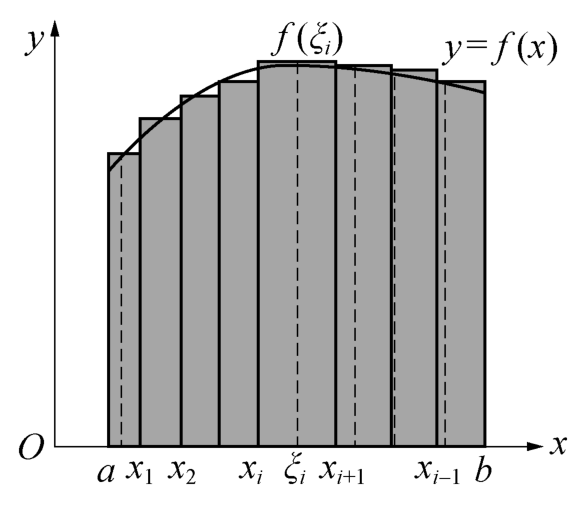

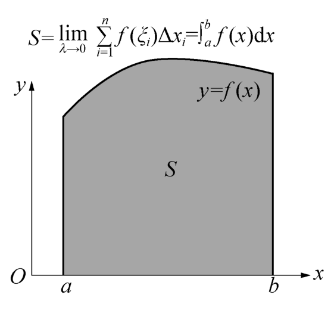

作为一元函数的定积分有许多应用，但仍有许多问题无法处理。比如，在定积分的应用中，我们计算了旋转体的体积，但对一般形状的物体，用定积分求其体积就显得困难。因此我们需要用二重积分或三重积分来解决此类问题。

在学习二重积分的时候，注意和定积分的相关概念之间的区别与联系。与定积分类似，二重积分的概念也是从实践中抽象出来的，它是定积分的推广，其中的数学思想与定积分一样，也是一种“和式的极限”。所不同的是：定积分的被积函数是一元函数，积分范围是一个区间；而二重积分的被积函数是二元函数，积分范围是平面上的一个区域。它们之间存在着密切的联系，二重积分可以转化为定积分来计算。

### 一、二重积分的概念和性质

本节将由曲顶柱体的体积公式引入二重积分的概念，并且研究二重积分的相关性质。

### 1. 曲顶柱体的体积

如图7-3所示，曲面 $z=f(x,y)$ 在平面闭区域 $D$ 上连续，且有 $f(x,y)\geqslant 0$。过 $D$ 的边界作垂直于 $xOy$ 面的柱面 $S$，则区域 $D$ 和柱面 $S$ 以及曲面 $z=f(x,y)$ 构成一个封闭的立体，称为以 $D$ 为底、以 $z=f(x,y)$ 为顶的曲顶柱体。类似于曲边梯形面积的求法，我们采取“分割”“近似”“求和”“取极限”的步骤来求曲顶柱体的体积。

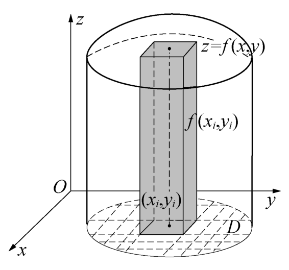

将 $D$ 任意分割成 $\Delta D_1$，$\Delta D_2$，$\cdots$，$\Delta D_n$ 共 $n$ 份，记每一份的面积分别为 $\Delta\sigma_1$，$\Delta\sigma_2$，$\cdots$，$\Delta\sigma_n$，过第 $i$ 份（$1\leqslant i\leqslant n$）$\Delta D_i$ 的边界作垂直于 $xOy$ 面的柱体，则构成了一个以 $\Delta D_i$ 为底、以 $z=f(x,y)$ 为顶的小曲顶柱体。

在 $\Delta D_i$ 上任取一点 $(x_i,\,y_i)$，做乘积 $f(x_i,\,y_i)\Delta\sigma_i$，则第 $i$ 块的小曲顶柱体的体积可以近似地表示为 $V_i\approx f(x_i,\,y_i)\Delta\sigma_i$，而整个的立体体积可以用和式

$$
\sum_{i=1}^{n}f(x_i,\,y_i)\Delta\sigma_i
$$

来表示，设 $\lambda$ 为 $\Delta D_1$，$\Delta D_2$，$\cdots$，$\Delta D_n$ 中区域直径（区域上任意两点间距离的最大者）的最大值，令 $\lambda\to 0$ 时，所得的极限值

$$
\lim_{\lambda\to 0}\sum_{i=1}^{n}f(x_i,\,y_i)\Delta\sigma_i
$$

即为所求的曲顶柱体的体积。

上面的问题把所求量归结为和式的极限。由于在物理、力学、几何和工程技术中，许多的物理量和几何量都可以用这样的和式的极限来表示，所以有必要研究这种和式的极限的一般形式，我们从上述表达式中抽象出下面的二重积分的定义。

### 2. 二重积分的概念

**定义**　设 $f(x,y)$ 是平面闭区域 $D$ 上的有界函数，将 $D$ 任意分割成 $n$ 小块 $\Delta D_1$，$\Delta D_2$，$\cdots$，$\Delta D_n$，记第 $i$ 块的面积为 $\Delta\sigma_i\,(i=1,\,2,\,\cdots,\,n)$，在第 $i$ 块上任取一点 $(x_i,\,y_i)$（见图7-4），作 $\displaystyle\sum_{i=1}^{n}f(x_i,\,y_i)\Delta\sigma_i$，取 $\lambda=\max\limits_{1\leqslant i\leqslant n}\operatorname{diam}\{\Delta\sigma_i\}$，即 $\lambda$ 是各 $\Delta D_i$ 的直径中的最大值。如果 $\displaystyle\lim_{\lambda\to 0}\sum_{i=1}^{n}f(x_i,\,y_i)\Delta\sigma_i$ 存在，则此极限值称为函数 $f(x,y)$ 在平面闭区域 $D$ 上的二重积分，记为

$$
\iint_D f(x,\,y)\,\mathrm{d}\sigma=\lim_{\lambda\to 0}\sum_{i=1}^{n}f(x_i,\,y_i)\Delta\sigma_i
$$

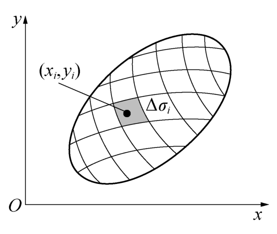

其中 $D$ 称为积分区域，$f(x,y)$ 称为被积函数，$\mathrm{d}\sigma$ 称为面积微元，$f(x,y)\,\mathrm{d}\sigma$ 称为被积表达式，$\displaystyle\sum_{i=1}^{n}f(x_i,\,y_i)\Delta\sigma_i$ 称为积分和。

如果二重积分 $\displaystyle\iint_D f(x,y)\,\mathrm{d}\sigma$ 存在，也称函数 $f(x,y)$ 在区域 $D$ 上可积。由二重积分的定义可知，在区域 $D$ 上可积的函数 $f(x,y)$ 一定是 $D$ 上的有界函数。反过来，什么样的函数一定是可积的呢？我们不加证明给出下面的定理。

**定理 1**　在区域 $D$ 上的连续函数一定是 $D$ 上的可积函数。

很容易知道，当 $f(x,y)\geqslant 0$ 时，曲顶柱体的体积 $V=\displaystyle\iint_D f(x,y)\,\mathrm{d}\sigma$；当 $f(x,y)<0$ 时，对应的二重积分是负值，故曲顶柱体的体积 $V=-\displaystyle\iint_D f(x,y)\,\mathrm{d}\sigma$。

**例 1**　用二重积分表示上半球体 $x^2+y^2+z^2\leqslant 1$，$z\geqslant 0$ 的体积，并写出积分区域。

**解**　首先上半球体 $x^2+y^2+z^2\leqslant 1$ 与 $xOy$ 面的交线为

$$
\begin{cases}
x^2+y^2+z^2=1,\\
z=0,
\end{cases}
$$

即区域 $D$ 的边界曲线为

$$
x^2+y^2=1
$$

上半球面所对应的方程为

$$
z=\sqrt{1-x^2-y^2}
$$

故上半球体可以看成是以 $D$ 为底的、以 $z=\sqrt{1-x^2-y^2}$ 为顶的曲顶柱体的体积（见图7-5），故

$$
V=\iint_D\sqrt{1-x^2-y^2}\,\mathrm{d}\sigma
$$

其中 $D=\{(x,\,y)\mid x^2+y^2\leqslant 1\}$。

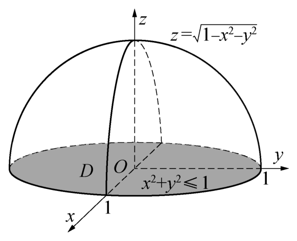

### 3. 二重积分的性质

二重积分有着和定积分相似的性质，以下性质均假设被积函数在所在区域上可积。

**性质 1**　$\displaystyle\iint_D[f(x,\,y)+g(x,\,y)]\,\mathrm{d}\sigma=\iint_D f(x,\,y)\,\mathrm{d}\sigma+\iint_D g(x,\,y)\,\mathrm{d}\sigma$。

**性质 2**　$\displaystyle\iint_D kf(x,\,y)\,\mathrm{d}\sigma=k\iint_D f(x,\,y)\,\mathrm{d}\sigma\,(k\in\mathbf{R})$。

**性质 3**　设 $D$ 由 $D_1$、$D_2$ 组成，则

$$
\iint_{D=D_1+D_2}f(x,\,y)\,\mathrm{d}\sigma=\iint_{D_1}f(x,\,y)\,\mathrm{d}\sigma+\iint_{D_2}f(x,\,y)\,\mathrm{d}\sigma
$$

**性质 4**　如果 $f(x,\,y)\equiv 1$，则有

$$
\iint_D 1\,\mathrm{d}x=\iint_D \mathrm{d}x=D\text{ 的面积}
$$

这个性质表明：以 $D$ 为底、高为 $1$ 的平顶柱体的体积在数值上等于柱体的底面积。

**性质 5**　如果在区域 $D$ 上满足 $f(x,\,y)\leqslant g(x,\,y)$，则有

$$
\iint_D f(x,\,y)\,\mathrm{d}\sigma\leqslant\iint_D g(x,\,y)\,\mathrm{d}\sigma
$$

特别地，有

$$
\left|\iint_D f(x,\,y)\,\mathrm{d}\sigma\right|\leqslant\iint_D|f(x,\,y)|\,\mathrm{d}\sigma
$$

**性质 6**　设 $S_D$ 是区域 $D$ 的面积。如果 $f(x,y)$ 在 $D$ 上有最大值 $M$ 和最小值 $m$，则有

$$
mS_D\leqslant\iint_D f(x,\,y)\,\mathrm{d}\sigma\leqslant MS_D
$$

这个不等式称为二重积分的估值不等式。

**性质 7**（二重积分的中值定理）　如果 $f(x,y)$ 在有界闭区域 $D$ 上连续，则在 $D$ 上至少可以找到一点 $(\xi,\,\eta)$，使得

$$
\iint_D f(x,\,y)\,\mathrm{d}\sigma=f(\xi,\,\eta)\cdot S_D
$$

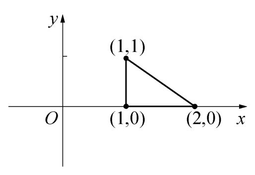

**例 2**　比较积分 $\displaystyle\iint_D\ln(x+y)\,\mathrm{d}\sigma$ 与 $\displaystyle\iint_D[\ln(x+y)]^2\,\mathrm{d}\sigma$ 的大小，其中区域 $D$ 是三角形闭区域，三顶点各为 $(1,\,0)$，$(1,\,1)$，$(2,\,0)$。

**解**　如图7-6所示，三角形斜边方程 $x+y=2$，在 $D$ 内有 $1\leqslant x+y\leqslant 2<\mathrm{e}$，故

$$
0\leqslant\ln(x+y)\leqslant\ln 2<\ln\mathrm{e}=1
$$

于是 $\ln(x+y)>[\ln(x+y)]^2$，因此

$$
\iint_D\ln(x+y)\,\mathrm{d}\sigma>\iint_D[\ln(x+y)]^2\,\mathrm{d}\sigma
$$

**例 3**　不作计算，估计 $I=\displaystyle\iint_D\mathrm{e}^{(x^2+y^2)}\,\mathrm{d}\sigma$ 的值，其中 $D$ 是椭圆闭区域：

$$
\frac{x^2}{a^2}+\frac{y^2}{b^2}\leqslant 1\qquad(0<b<a)
$$

**解**　区域 $D$ 的面积 $\sigma=\pi ab$，在 $D$ 上因为 $0\leqslant x^2+y^2\leqslant a^2$，所以 $1=\mathrm{e}^0\leqslant\mathrm{e}^{x^2+y^2}\leqslant\mathrm{e}^{a^2}$。

由性质 6 知

$$
\sigma\leqslant\iint_D\mathrm{e}^{(x^2+y^2)}\,\mathrm{d}\sigma\leqslant\sigma\cdot\mathrm{e}^{a^2}
$$

从而有

$$
\pi ab\leqslant\iint_D\mathrm{e}^{(x^2+y^2)}\,\mathrm{d}\sigma\leqslant\pi\mathrm{e}^{a^2}ab
$$

### 二、直角坐标系下二重积分的计算

根据二重积分的定义，如果函数 $f(x,y)$ 在区域 $D$ 上可积，则二重积分的值与对积分区域的分割方法无关。因此，在直角坐标系中，常用平行于 $x$ 轴和 $y$ 轴的两组直线来分割积分区域 $D$，则除了包含边界点的一些小闭区域外，其余的小闭区域都是矩形闭区域。设矩形闭区域 $\Delta\sigma_i$ 的边长为 $\Delta x_i$ 和 $\Delta y_j$，于是 $\Delta\sigma_i=\Delta x_i\Delta y_j$（见图7-7）。故在直角坐标系中，面积微元 $\mathrm{d}\sigma$ 可记为 $\mathrm{d}x\mathrm{d}y$，即 $\mathrm{d}\sigma=\mathrm{d}x\mathrm{d}y$。进而把二重积分记为 $\displaystyle\iint_D f(x,y)\,\mathrm{d}x\mathrm{d}y$，这里我们把 $\mathrm{d}x\mathrm{d}y$ 称为直角坐标系下的面积微元。

在实际应用中，直接通过二重积分的定义和性质来计算二重积分一般是困难的，本节介绍的二重积分的计算方法，其基本思想是将二重积分化为两次定积分来计算，转化后的这种两次定积分常称为二次积分或累次积分。下面先在直角坐标系下讨论二重积分的计算。

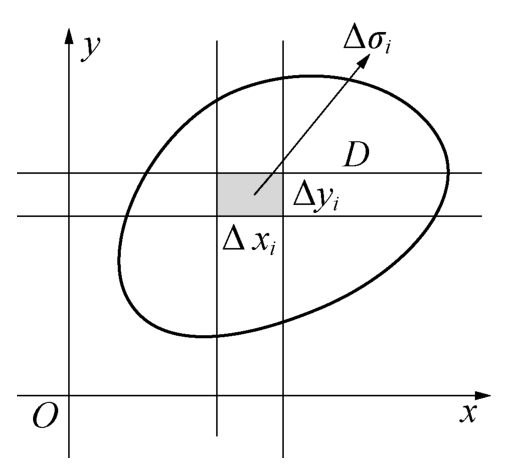

### 1. 矩形区域上的二重积分

设函数 $z=f(x,y)$ 在矩形区域

$$
D=\{(x,\,y)\mid a\leqslant x\leqslant b,\ c\leqslant y\leqslant d\}
$$

上连续，且 $f(x,y)\geqslant 0$。

由前面的内容可知，$\displaystyle\iint_D f(x,y)\,\mathrm{d}x\mathrm{d}y$ 的值等于以 $D$ 为底，以曲面 $z=f(x,y)$ 为顶的曲顶柱体的体积。在区间 $[a,\,b]$ 上任意选定一点 $x_0$，作垂直于 $x$ 轴的平面 $x=x_0$，此平面截曲顶柱体所得到的截面是一个以 $[c,\,d]$ 为底、以曲线 $z=f(x_0,y)$ 为曲边的曲边梯形（见图7-8）。由定积分的几何应用可知，曲边梯形的面积可以用定积分来计算，则截面面积为

$$
S(x_0)=\int_c^d f(x_0,\,y)\,\mathrm{d}y
$$

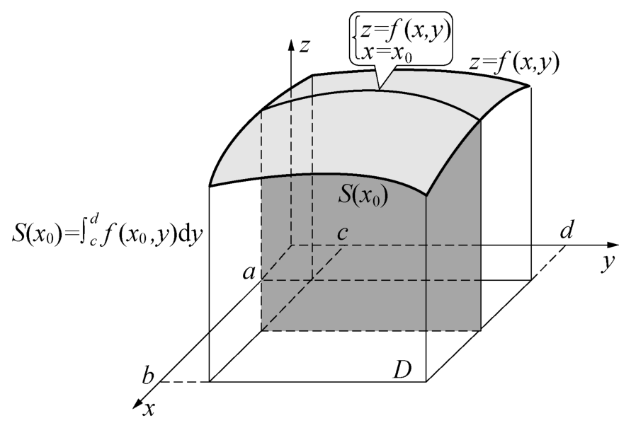

对于区间 $[a,\,b]$ 上的任何一点 $x$，对应的截面面积为

$$
S(x)=\int_c^d f(x,\,y)\,\mathrm{d}y
$$

故曲顶柱体的体积 $V$ 为

$$
V=\int_a^b S(x)\,\mathrm{d}x=\int_a^b\left[\int_c^d f(x,\,y)\,\mathrm{d}y\right]\mathrm{d}x=\int_a^b\mathrm{d}x\int_c^d f(x,\,y)\,\mathrm{d}y
$$

即

$$
\iint_D f(x,\,y)\,\mathrm{d}x\mathrm{d}y=\int_a^b\mathrm{d}x\int_c^d f(x,\,y)\,\mathrm{d}y\qquad(1)
$$

式（1）的右端称为先对 $y$ 后对 $x$ 的二次积分。

这个公式表明，矩形区域上的二重积分可以转化为先对 $y$ 后对 $x$ 的二次积分来计算。

**例 4**　计算定积分 $\displaystyle\int_0^1(x+y)\,\mathrm{d}y$。

**解**　因为被积函数 $x+y$ 是 $x$、$y$ 的二元函数，而积分变量是 $y$。因此求 $x+y$ 的原函数的时候，可以把 $x$ 看成是常数，故原函数为 $x\cdot y+\dfrac{1}{2}y^2$，因此定积分的值为

$$
\int_0^1(x+y)\,\mathrm{d}y=x\cdot\left[y\right]_0^1+\left[\frac{1}{2}y^2\right]_0^1=x(1-0)+\frac{1}{2}(1^2-0^2)=x+\frac{1}{2}=\frac{2x+1}{2}
$$

这是一个关于 $x$ 的函数。

**例 5**　计算二重积分 $\displaystyle\iint_D\mathrm{e}^{x+y}\,\mathrm{d}x\mathrm{d}y$，其中区域 $D$ 是由 $x=0$，$x=1$，$y=0$，$y=1$ 所围成的矩形。

**解**　因为 $D$ 是矩形区域，且 $\mathrm{e}^{x+y}=\mathrm{e}^x\cdot\mathrm{e}^y$，所以

$$
\begin{aligned}
\iint_D\mathrm{e}^{x+y}\,\mathrm{d}x\mathrm{d}y&=\int_0^1\mathrm{d}x\int_0^1\mathrm{e}^x\mathrm{e}^y\,\mathrm{d}y=\int_0^1\mathrm{e}^x\,\mathrm{d}x\int_0^1\mathrm{e}^y\,\mathrm{d}y\\
&=\int_0^1\mathrm{e}^x\left[\mathrm{e}^y\right]_0^1\mathrm{d}x=\int_0^1\mathrm{e}^x(\mathrm{e}-1)\,\mathrm{d}x=(\mathrm{e}-1)^2
\end{aligned}
$$

我们还可以通过另一个截面来求曲顶柱体的体积，从而得到二重积分的另一个计算方法。

现过 $y$ 轴上任一点 $y_0$ 做垂直于 $y$ 轴的截面，得到一个以 $[a,\,b]$ 为底、以曲面 $z=f(x,y)$ 和平面 $y=y_0$ 的交线 $y=f(x,\,y_0)$ 为顶的曲边梯形（见图7-9），其面积为

$$
Q(y_0)=\int_a^b f(x,\,y_0)\,\mathrm{d}x
$$

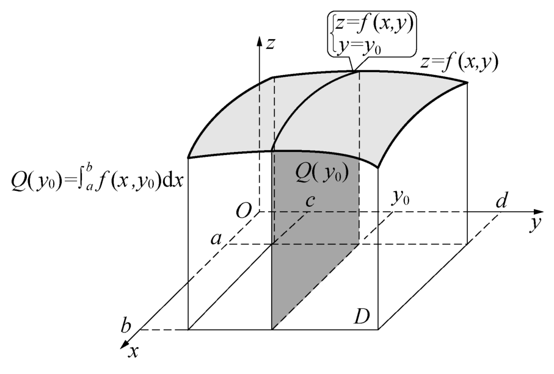

由 $y_0$ 的任意性可知，过 $y$ 轴上任一点 $y$ 的截面面积为 $Q(y)=\displaystyle\int_a^b f(x,y)\,\mathrm{d}x$，这是 $y$ 的函数。利用已知截面面积的立体体积公式可知，曲顶柱体的体积是

$$
V=\int_c^d Q(y)\,\mathrm{d}y=\int_c^d\left[\int_a^b f(x,\,y)\,\mathrm{d}x\right]\mathrm{d}y\qquad(2)
$$

式（2）的右端称为先对 $x$、后对 $y$ 的二次积分。

上述公式也记为

$$
V=\int_c^d\left[\int_a^b f(x,\,y)\,\mathrm{d}x\right]\mathrm{d}y=\int_c^d\mathrm{d}y\int_a^b f(x,\,y)\,\mathrm{d}x
$$

因此我们可以得到矩形区域上的二重积分的计算公式：

$$
\iint_{D=[a,\,b]\times[c,\,d]}f(x,\,y)\,\mathrm{d}x\mathrm{d}y=\int_a^b\mathrm{d}x\int_c^d f(x,\,y)\,\mathrm{d}y=\int_c^d\mathrm{d}y\int_a^b f(x,\,y)\,\mathrm{d}x
$$

上式对 $f(x,y)<0$ 也成立。

例 5 也可以用另外一种次序的二次积分来计算。

$$
\begin{aligned}
\iint_D\mathrm{e}^{x+y}\,\mathrm{d}x\mathrm{d}y&=\int_0^1\mathrm{d}y\int_0^1\mathrm{e}^x\mathrm{e}^y\,\mathrm{d}x=\int_0^1\mathrm{e}^y\,\mathrm{d}y\int_0^1\mathrm{e}^x\,\mathrm{d}x\\
&=\int_0^1\mathrm{e}^y\left[\mathrm{e}^x\right]_0^1\mathrm{d}y=\int_0^1\mathrm{e}^y(\mathrm{e}-1)\,\mathrm{d}y=(\mathrm{e}-1)^2
\end{aligned}
$$

**例 6**　计算 $I=\displaystyle\iint_D xy^2\,\mathrm{d}x\mathrm{d}y$，其中 $D=[0,\,1]\times[1,\,2]$。

**解**　$f(x,y)=xy^2$ 在 $D$ 上连续，若先对 $x$ 积分后对 $y$ 积分，则有

$$
I=\iint_D xy^2\,\mathrm{d}x\mathrm{d}y=\int_1^2\mathrm{d}y\int_0^1 xy^2\,\mathrm{d}x=\int_1^2 y^2\left[\frac{x^2}{2}\right]_0^1\mathrm{d}y=\frac{1}{2}\int_1^2 y^2\,\mathrm{d}y=\left[\frac{1}{6}y^3\right]_1^2=\frac{7}{6}
$$

若先对 $y$ 积分后对 $x$ 积分，则有

$$
I=\iint_D xy^2\,\mathrm{d}x\mathrm{d}y=\int_0^1\mathrm{d}x\int_1^2 xy^2\,\mathrm{d}y=\int_0^1 x\left[\frac{y^3}{3}\right]_1^2\mathrm{d}x=\frac{7}{3}\int_0^1 x\,\mathrm{d}x=\left[\frac{7}{6}x^2\right]_0^1=\frac{7}{6}
$$

### 2. X 型区域上的二重积分

若积分区域 $D$ 可以用不等式

$$
\{(x,\,y)\mid\varphi_1(x)\leqslant y\leqslant\varphi_2(x),\ a\leqslant x\leqslant b\}
$$

来表示（见图7-10），其中函数 $\varphi_1(x)$、$\varphi_2(x)$ 在区间 $[a,\,b]$ 上连续，这样的区域称为 X 型区域，其区域特征为：穿过 $D$ 内部且平行于 $y$ 轴的直线与 $D$ 的边界最多相交于两点。

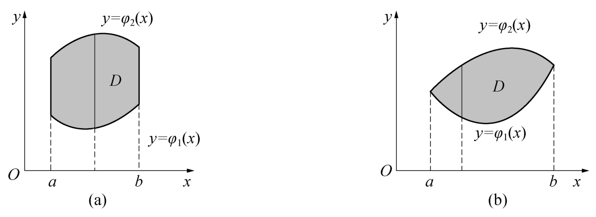

**例 7**　将下列区域（见图7-11）写成 X 型区域的表达式。

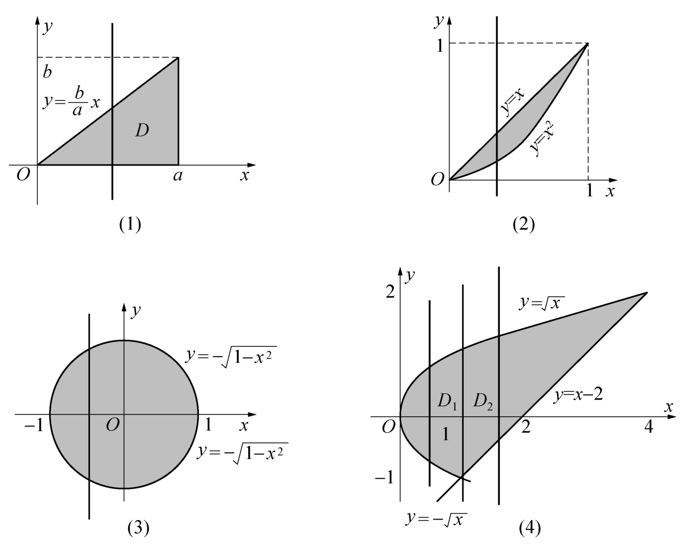

**解**　（1）三角形斜边的方程为 $y=\dfrac{b}{a}x$，故区域的 X 型表达式为

$$
\left\{(x,\,y)\mid 0\leqslant y\leqslant\frac{b}{a}x,\ 0\leqslant x\leqslant a\right\}
$$

（2）抛物线的方程为 $y=x^2$，直线的方程为 $y=x$，故区域的 X 型表达式为

$$
\{(x,\,y)\mid x^2\leqslant y\leqslant x,\ 0\leqslant x\leqslant 1\}
$$

（3）上半圆的方程为 $y=\sqrt{1-x^2}$，下半圆的方程为 $y=-\sqrt{1-x^2}$，故区域的 X 型表达式为

$$
\{(x,\,y)\mid -\sqrt{1-x^2}\leqslant y\leqslant\sqrt{1-x^2},\ -1\leqslant x\leqslant 1\}
$$

（4）区域可以写成两个 X 型区域的和：$D_1+D_2$。

$D_1$ 的边界曲线分别为 $y=\sqrt{x}$，$y=-\sqrt{x}$，$x=0$，$x=1$，则 $D_1$ 的 X 型表达式为

$$
\{(x,\,y)\mid -\sqrt{x}\leqslant y\leqslant\sqrt{x},\ 0\leqslant x\leqslant 1\}
$$

$D_2$ 的边界曲线分别为 $y=\sqrt{x}$，$y=x-2$，$x=1$，$x=4$，则 $D_2$ 的 X 型表达式为

$$
\{(x,\,y)\mid x-2\leqslant y\leqslant\sqrt{x},\ 1\leqslant x\leqslant 4\}
$$

**注**　把区域写成 X 型表达式时，一定注意把边界曲线写成 $y$ 是 $x$ 的函数，同时注意边界曲线所在的上下位置。

一般地，若 $D$ 是由 $x=a$，$x=b$，$y=\varphi_1(x)$，$y=\varphi_2(x)$ 所围成的 X 型闭区域，求以 $D$ 为底、以曲面 $z=f(x,y)$（$f(x,y)$ 连续且非负）为顶的曲顶柱体的体积（见图7-12），垂直于 $x$ 轴，可以过 $x$ 轴上的任一点 $x$ 做曲顶柱体的截面，则截面面积是以 $[\varphi_1(x),\,\varphi_2(x)]$ 为底，以 $z=f(x,y)$ 为顶的曲边梯形，其面积为

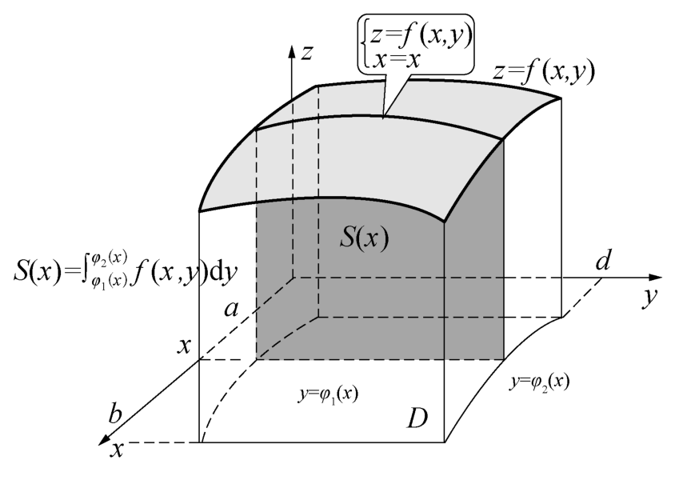

$$
S(x)=\int_{\varphi_1(x)}^{\varphi_2(x)}f(x,\,y)\,\mathrm{d}y
$$

对应的立体体积为

$$
V=\int_a^b S(x)\,\mathrm{d}x=\int_a^b\left[\int_{\varphi_1(x)}^{\varphi_2(x)}f(x,\,y)\,\mathrm{d}y\right]\mathrm{d}x
$$

该积分是先 $y$ 后 $x$ 次序的二次积分，也可以记作

$$
\int_a^b\mathrm{d}x\int_{\varphi_1(x)}^{\varphi_2(x)}f(x,\,y)\,\mathrm{d}y
$$

从而

$$
\iint_D f(x,\,y)\,\mathrm{d}x\mathrm{d}y=\int_a^b S(x)\,\mathrm{d}x=\int_a^b\left[\int_{\varphi_1(x)}^{\varphi_2(x)}f(x,\,y)\,\mathrm{d}y\right]\mathrm{d}x=\int_a^b\mathrm{d}x\int_{\varphi_1(x)}^{\varphi_2(x)}f(x,\,y)\,\mathrm{d}y\qquad(3)
$$

式（3）表明，将二重积分转化为先 $y$ 后 $x$ 次序的二次积分来计算，关键是确定二次积分中关于变量 $y$ 的积分限，即确定区域 $D$ 的 X 型表达式。如果区域是如图 7-12 所示的 X 型区域，在区域 $[a,\,b]$ 上任意取定一点 $x$，并过此点做一条平行于 $y$ 轴的直线，顺着 $y$ 轴正向的方向看去，直线与边界曲线的第一个交点的纵坐标 $\varphi_1(x)$ 就是积分的下限，第二个交点的纵坐标 $\varphi_2(x)$ 是积分的上限，这个关于变量 $y$ 的积分计算的结果是 $x$ 的函数，再对变量 $x$ 在区间 $[a,\,b]$ 上做定积分即可。

式（3）对 $f(x,y)<0$ 也成立。

**例 8**　计算二次积分 $\displaystyle\int_{-1}^0\mathrm{d}x\int_{\sqrt{x}}^{x}xy\,\mathrm{d}y$。

**解**　设 $S(x)=\displaystyle\int_{\sqrt{x}}^{x}xy\,\mathrm{d}y$，被积函数是关于 $x$、$y$ 的二元函数。积分变量是 $y$，则可以把 $x$ 看成常数，被积函数的原函数为 $x\cdot\dfrac{1}{2}y^2$，则

$$
S(x)=x\cdot\left[\frac{1}{2}y^2\right]_{\sqrt{x}}^{x}=\frac{1}{2}x(x^2-x)=\frac{1}{2}(x^3-x^2)
$$

于是

$$
\begin{aligned}
\int_{-1}^0\mathrm{d}x\int_{\sqrt{x}}^{x}xy\,\mathrm{d}y&=\int_{-1}^0 S(x)\,\mathrm{d}x=\frac{1}{2}\int_{-1}^0(x^3-x^2)\,\mathrm{d}x\\
&=\frac{1}{2}\left[\frac{x^4}{4}-\frac{x^3}{3}\right]_{-1}^0=\frac{1}{2}\left[\left(\frac{0^4}{4}-\frac{0^3}{3}\right)-\left(\frac{(-1)^4}{4}-\frac{(-1)^3}{3}\right)\right]=-\frac{7}{24}
\end{aligned}
$$

**注**　在计算第一个定积分 $\displaystyle\int_{\sqrt{x}}^{x}xy\,\mathrm{d}y$ 时，$y$ 是自变量，$x$ 看成常数；而计算第二个定积分 $\displaystyle\int_{-1}^0(x^3-x^2)\,\mathrm{d}x$ 时，$x$ 是积分变量。

**例 9**　计算 $\displaystyle\iint_D xy^2\,\mathrm{d}\sigma$，其中 $D$ 是由直线 $y=1$，$x=2$ 及 $y=x$ 所围成的闭区域。

**解**　如图 7-13 所示，把区域写成 X 型表达式，则有

$$
D=\left\{(x,\,y)\mid 1\leqslant y\leqslant x,\ 1\leqslant x\leqslant 2\right\}
$$

所以

$$
\begin{aligned}
\iint_D xy^2\,\mathrm{d}\sigma&=\int_1^2\left[\int_1^x xy^2\,\mathrm{d}y\right]\mathrm{d}x=\int_1^2\left[x\cdot\frac{y^3}{3}\right]_1^x\mathrm{d}x\\
&=\int_1^2\left(\frac{x^4}{3}-\frac{x}{3}\right)\mathrm{d}x=\left[\frac{x^5}{15}-\frac{x^2}{6}\right]_1^2=\frac{47}{30}
\end{aligned}
$$

**例 10**　计算 $\displaystyle\iint_D y\sqrt{1+x^2-y^2}\,\mathrm{d}\sigma$，其中 $D$ 是由直线 $y=x$，$x=-1$ 和 $y=1$ 所围成的闭区域。

**解**　如图 7-14 所示，把 $D$ 写成 X 型表达式，即

$$
D=\{(x,\,y)\mid x\leqslant y\leqslant 1,\ -1\leqslant x\leqslant 1\}
$$

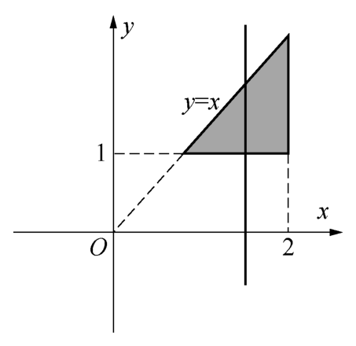

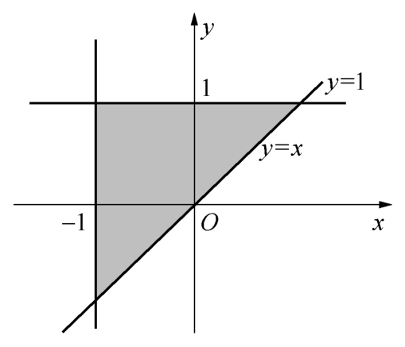

则

$$
\begin{aligned}
\iint_D y\sqrt{1+x^2-y^2}\,\mathrm{d}\sigma&=\int_{-1}^1\mathrm{d}x\int_x^1 y\sqrt{1+x^2-y^2}\,\mathrm{d}y\\
&=-\frac{1}{3}\int_{-1}^1\left[(1+x^2-y^2)^{\frac{3}{2}}\right]_x^1\mathrm{d}x\\
&=-\frac{1}{3}\int_{-1}^1(|x|^3-1)\,\mathrm{d}x=-\frac{2}{3}\int_0^1(x^3-1)\,\mathrm{d}x=\frac{1}{2}
\end{aligned}
$$

### 3. Y 型区域上的二重积分

设积分区域 $D$ 可以用不等式

$$
\psi_1(y)\leqslant x\leqslant\psi_2(y),\ c\leqslant y\leqslant d
$$

来表示（见图 7-15），其中函数 $\psi_1(y)$、$\psi_2(y)$ 在区间 $[c,\,d]$ 上连续，这样的区域称为 Y 型区域，穿过 $D$ 内部且平行于 $x$ 轴的直线与 $D$ 的边界最多相交于两点。

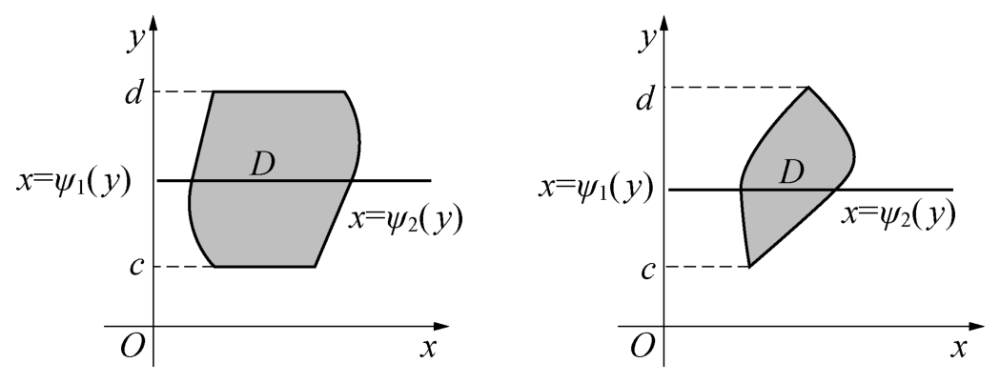

若 $D$ 是由 $y=c$，$y=d$，$x=\psi_1(y)$，$x=\psi_2(y)$ 所围成的 Y 型区域，类似于 X 型区域上的曲顶柱体所围体积求法，以 $D$ 为底、以曲面 $z=f(x,y)$（$f(x,y)$ 连续且非负）为顶的曲顶柱体的体积是一个先对 $y$ 后对 $x$ 的二次积分（见图 7-16），即

$$
\iint_D f(x,\,y)\,\mathrm{d}x\mathrm{d}y=\int_c^d Q(y)\,\mathrm{d}y=\int_c^d\left[\int_{\psi_1(y)}^{\psi_2(y)}f(x,\,y)\,\mathrm{d}x\right]\mathrm{d}y=\int_c^d\mathrm{d}y\int_{\psi_1(y)}^{\psi_2(y)}f(x,\,y)\,\mathrm{d}x
$$

**例 11**　计算二重积分 $\displaystyle\iint_D xy\,\mathrm{d}\sigma$，其中 $D$ 是由抛物线 $y^2=x$ 及直线 $y=x-2$ 所围成的闭区域。

**解**　首先求抛物线 $y^2=x$ 及直线 $y=x-2$ 的交点，即解方程组

$$
\begin{cases}
y^2=x,\\
y=x-2,
\end{cases}
$$

解得交点坐标为 $(1,\,-1)$ 和 $(4,\,2)$。

如图 7-17 所示，变量 $y$ 的取值范围是 $[-1,\,2]$，在区间 $[-1,\,2]$ 上任意取定一点 $y$，过此点作平行于 $x$ 轴的直线，直线交区域边界于两点，这两点的横坐标分别为 $x=y+2$，$x=y^2$，即为二次积分的上下限，故区域 $D$ 写成 Y 型区域表达式为

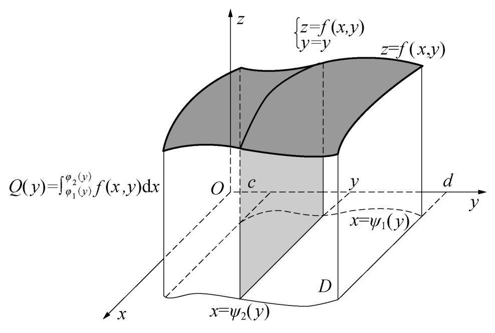

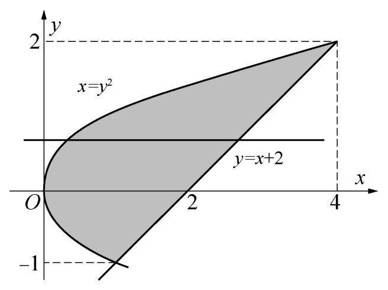

$$
D=\left\{(x,\,y)\mid y^2\leqslant x\leqslant y+2,\ -1\leqslant y\leqslant 2\right\}
$$

故二重积分为

$$
\begin{aligned}
\iint_D xy\,\mathrm{d}\sigma&=\int_{-1}^2\left[\int_{y^2}^{y+2}xy\,\mathrm{d}x\right]\mathrm{d}y=\int_{-1}^2\left[\frac{x^2}{2}y\right]_{y^2}^{y+2}\mathrm{d}y\\
&=\frac{1}{2}\int_{-1}^2\left[y(y+2)^2-y^5\right]\mathrm{d}y=\frac{1}{2}\left[\frac{y^4}{4}+\frac{4}{3}y^3+2y^2-\frac{y^6}{6}\right]_{-1}^2=5\frac{5}{8}
\end{aligned}
$$

**例 12**　计算 $\displaystyle\iint_D\mathrm{e}^{y^2}\,\mathrm{d}x\mathrm{d}y$，其中 $D$ 由 $y=x$，$y=1$ 及 $y$ 轴所围成。

**解**　画出区域 $D$ 的图形（见图 7-18）。将 $D$ 看成 X 型区域，得

$$
D=\{(x,\,y)\mid 0\leqslant x\leqslant 1,\ x\leqslant y\leqslant 1\}
$$

则二重积分为

$$
\iint_D\mathrm{e}^{y^2}\,\mathrm{d}x\mathrm{d}y=\int_0^1\mathrm{d}x\int_x^1\mathrm{e}^{y^2}\,\mathrm{d}y
$$

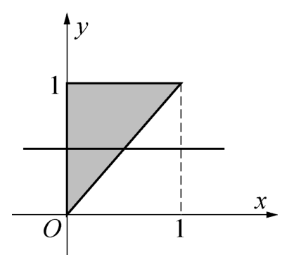

因 $\displaystyle\int\mathrm{e}^{y^2}\,\mathrm{d}y$ 的原函数不能用初等函数表示，所以我们要变换积分次序。

将 $D$ 表示成 Y 型区域，得

$$
D=\{(x,\,y)\mid 0\leqslant y\leqslant 1,\ 0\leqslant x\leqslant y\}
$$

故二重积分为

$$
\begin{aligned}
\iint_D\mathrm{e}^{y^2}\,\mathrm{d}x\mathrm{d}y&=\int_0^1\mathrm{d}y\int_0^y\mathrm{e}^{y^2}\,\mathrm{d}x=\int_0^1\mathrm{e}^{y^2}\cdot[x]_0^y\,\mathrm{d}y\\
&=\int_0^1 y\mathrm{e}^{y^2}\,\mathrm{d}y=\frac{1}{2}\int_0^1\mathrm{e}^{y^2}\,\mathrm{d}(y^2)=\frac{1}{2}(\mathrm{e}-1)
\end{aligned}
$$

由例 12 可以看出，积分的次序选择不同，二重积分计算的难易程度不同。如何选择积分的次序呢？这与积分区域的形状和被积函数的特性有关系。

如果一个积分区域 $D$ 既可以写成 X 型表达式：

$$
D=\{(x,\,y)\mid\varphi_1(x)\leqslant y\leqslant\varphi_2(x),\ a\leqslant x\leqslant b\}
$$

又可以写成 Y 型表达式：

$$
D=\{(x,\,y)\mid\psi_1(y)\leqslant x\leqslant\psi_2(y),\ c\leqslant y\leqslant d\}
$$

则有下列交换次序公式成立。

$$
\iint_D f(x,\,y)\,\mathrm{d}x\mathrm{d}y=\int_a^b\mathrm{d}x\int_{\varphi_1(x)}^{\varphi_2(x)}f(x,\,y)\,\mathrm{d}y=\int_c^d\mathrm{d}y\int_{\psi_1(y)}^{\psi_2(y)}f(x,\,y)\,\mathrm{d}x
$$

**例 13**　交换二次积分 $\displaystyle\int_0^1\mathrm{d}x\int_{x^2}^{x}f(x,\,y)\,\mathrm{d}y$ 的积分次序。

**解**　这是先对 $y$ 后对 $x$ 的二次积分，对应着 $D$ 的 X 型区域（见图 7-19）为

$$
D=\{(x,\,y)\mid x^2\leqslant y\leqslant x,\ 0\leqslant x\leqslant 1\}
$$

可改写为 Y 型区域，即

$$
D=\{(x,\,y)\mid 0\leqslant y\leqslant 1,\ y\leqslant x\leqslant\sqrt{y}\}
$$

所以

$$
\int_0^1\mathrm{d}x\int_{x^2}^{x}f(x,\,y)\,\mathrm{d}y=\int_0^1\mathrm{d}y\int_y^{\sqrt{y}}f(x,\,y)\,\mathrm{d}x
$$

**例 14**　交换二次积分

$$
\int_0^1\mathrm{d}x\int_0^x f(x,\,y)\,\mathrm{d}y+\int_1^2\mathrm{d}x\int_0^{2-x}f(x,\,y)\,\mathrm{d}y
$$

的积分顺序。

**解**　设积分区域 $D=D_1+D_2$，其中 $D_1$ 由直线 $y=0$，$y=x$，$x=1$ 所围成，$D_2$ 由直线 $y=0$，$y=2-x$，$x=1$ 所围成，由 $D_1$、$D_2$ 的边界曲线画出 $D$ 的区域，如图 7-20 所示。

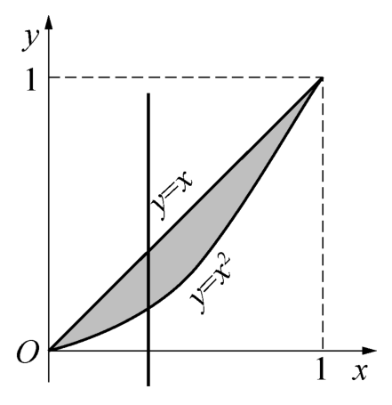

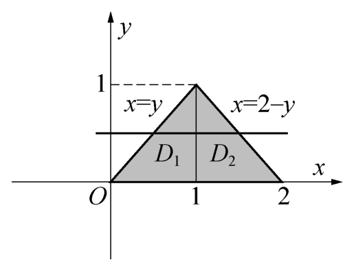

把区域 $D$ 改写为 Y 型表达式，即

$$
D=\{(x,\,y)\mid y\leqslant x\leqslant 2-y,\ 0\leqslant y\leqslant 1\}
$$

于是

$$
\int_0^1\mathrm{d}x\int_0^x f(x,\,y)\,\mathrm{d}y+\int_1^2\mathrm{d}x\int_0^{2-x}f(x,\,y)\,\mathrm{d}y=\int_0^1\mathrm{d}y\int_y^{2-y}f(x,\,y)\,\mathrm{d}x
$$

### 三、极坐标系下二重积分的计算

在有些情况下利用极坐标计算二重积分比较方便，比如，当积分区域 $D$ 是圆域、环形域、扇形域，即 $D$ 的边界曲线用极坐标表示时比较简洁；或被积函数 $f(x,y)$ 用极坐标表示时比较简洁，比如 $f\left(\sqrt{x^2+y^2},\ \arctan\dfrac{y}{x}\right)$ 等，可考虑利用极坐标系计算二重积分。

直角坐标系与极坐标系的转换公式为

$$
\begin{cases}
x=r\cos\theta,\\
y=r\sin\theta,
\end{cases}
\qquad\text{或}\qquad
\begin{cases}
r=\sqrt{x^2+y^2},\\
\theta=\arctan\dfrac{y}{x}
\end{cases}
$$

下面我们介绍极坐标系下的二重积分的计算方法。

在直角坐标系下，面积微元 $\mathrm{d}\sigma$ 可以写成 $\mathrm{d}x\mathrm{d}y$，那么在极坐标系下，面积微元怎么表示呢？在极坐标系下，设过极点 $O$ 的射线与平面闭区域 $D$ 的边界曲线最多相交于两点（见图 7-21）。由极坐标的定义可知，若极径 $r=c$，$c$ 是一个常数，则表示圆心在极点，半径为 $c$ 的一个圆；若极角 $\theta=c$，$c$ 是一个常数，则表示一个从极点出发的射线。现以极点为中心作一组同心圆 $r=r_i$，从极点出发作一组射线 $\theta=\theta_i$，将区域 $D$ 分成 $n$ 个小闭区域，这些区域的面积记为 $\Delta\sigma_i\,(i=1,\,2,\,\cdots,\,n)$，除了包含边界点的一些小区域外，$\Delta\sigma_i$ 的面积都可以看作是两个圆扇形的面积之差。因此

$$
\begin{aligned}
\Delta\sigma_i&=\frac{1}{2}(r_i+\Delta r_i)^2\Delta\theta_i-\frac{1}{2}r_i^2\Delta\theta_i\\
&=r_i\Delta r_i\Delta\theta_i+\frac{1}{2}(\Delta r_i)^2\Delta\theta_i\approx r_i\Delta r_i\Delta\theta_i
\end{aligned}
$$

于是就得到了极坐标系下的面积微元

$$
\mathrm{d}\sigma=r\,\mathrm{d}r\,\mathrm{d}\theta
$$

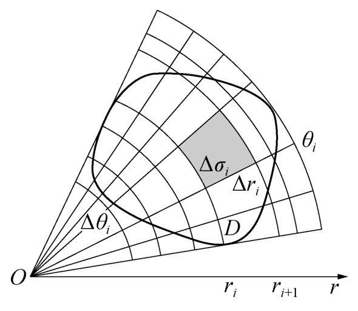

若已知直角坐标系下的二重积分 $\displaystyle\iint_D f(x,y)\,\mathrm{d}\sigma$，则用以下方法可以把其变换为极坐标系下的二重积分。

（1）将积分区域 $D$ 的边界曲线用极坐标方程表示。

（2）利用变换 $x=r\cos\theta$，$y=r\sin\theta$ 将被积函数 $f(x,y)$ 转化成 $r$、$\theta$ 的函数：

$$
f(x,\,y)=f(r\cos\theta,\ r\sin\theta)
$$

（3）将面积微元 $\mathrm{d}\sigma$ 转化为极坐标下的面积微元 $r\,\mathrm{d}r\,\mathrm{d}\theta$。

则二重积分的极坐标系下的表达式为

$$
\iint_D f(x,\,y)\,\mathrm{d}\sigma=\iint_D f(r\cos\theta,\ r\sin\theta)r\,\mathrm{d}r\,\mathrm{d}\theta
$$

极坐标系下的二重积分，同样是转化为二次积分来计算，我们分三种情况来讨论。

（1）如果积分区域 $D$ 介于两条射线 $\theta=\alpha$，$\theta=\beta$ 之间，而对 $D$ 内任一点 $(r,\,\theta)$，其极径总是介于曲线 $r=r_1(\theta)$，$r=r_2(\theta)$ 之间（见图 7-22），则区域 $D$ 的积分限为

$$
\alpha\leqslant\theta\leqslant\beta,\ r_1(\theta)\leqslant r\leqslant r_2(\theta)
$$

于是

$$
\begin{aligned}
\iint_D f(x,\,y)\,\mathrm{d}x\mathrm{d}y&=\iint_D f(r\cos\theta,\ r\sin\theta)r\,\mathrm{d}r\,\mathrm{d}\theta\\
&=\int_\alpha^\beta\mathrm{d}\theta\int_{r_1(\theta)}^{r_2(\theta)}f(r\cos\theta,\ r\sin\theta)r\,\mathrm{d}r
\end{aligned}
$$

具体计算时，内层积分的上、下限可按如下方式确定：从极点出发在区间 $(\alpha,\,\beta)$ 上任意作一条极角为 $\theta$ 的射线穿透区域 $D$（见图 7-22），则进入点与穿出点的极径 $r_1(\theta)$、$r_2(\theta)$ 就分别为内层积分的下限与上限。

（2）如果积分区域 $D$ 是如图 7-23 所示的曲边扇形，则可以把它看作是第一种情形中当 $r_1(\theta)=0$，$r_2(\theta)=r(\theta)$ 的特例，此时，区域 $D$ 的积分限为

$$
\alpha\leqslant\theta\leqslant\beta,\qquad 0\leqslant r\leqslant r(\theta)
$$

于是

$$
\iint_D f(x,\,y)\,\mathrm{d}x\mathrm{d}y=\int_\alpha^\beta\mathrm{d}\theta\int_0^{r(\theta)}f(r\cos\theta,\ r\sin\theta)r\,\mathrm{d}r
$$

（3）如果积分区域 $D$ 如图 7-24 所示，极点位于 $D$ 的内部，则可以把它看作是第二种情形中当 $\alpha=0$，$\beta=2\pi$ 的特例，此时，区域 $D$ 的积分限为

$$
0\leqslant\theta\leqslant 2\pi,\qquad 0\leqslant r\leqslant r(\theta)
$$

于是

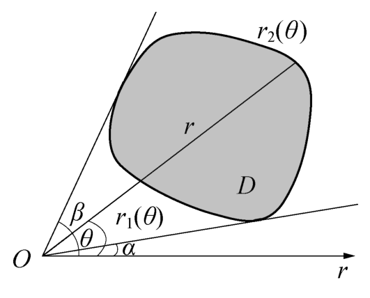

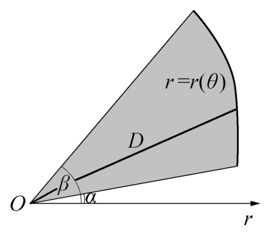

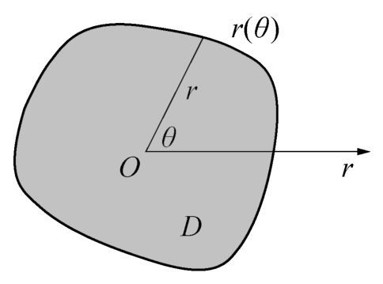

$$
\iint_D f(x,\,y)\,\mathrm{d}x\mathrm{d}y=\int_0^{2\pi}\mathrm{d}\theta\int_0^{r(\theta)}f(r\cos\theta,\ r\sin\theta)r\,\mathrm{d}r
$$

**注**　根据二重积分的性质 4，闭区域 $D$ 的面积 $\sigma$ 在极坐标系下可表示为

$$
\sigma=\iint_D\mathrm{d}\sigma=\iint_D r\,\mathrm{d}r\,\mathrm{d}\theta
$$

如果区域 $D$ 如图 7-23 所示，则有

$$
\sigma=\iint_D r\,\mathrm{d}r\,\mathrm{d}\theta=\int_\alpha^\beta\mathrm{d}\theta\int_0^{r(\theta)}r\,\mathrm{d}r=\frac{1}{2}\int_\alpha^\beta r^2(\theta)\,\mathrm{d}\theta
$$

**例 15**　将下列区域（见图 7-25）用极坐标表示。

（1）$D=\{(x,\,y)\mid x^2+y^2\leqslant 2x\}$；　　（2）$D=\{(x,\,y)\mid x^2+y^2\leqslant y\}$；

（3）$\{(x,\,y)\mid x^2+y^2\leqslant a^2\,(a>0)\}$；　　（4）$D$ 为 $y=x$，$y=0$ 与 $x=1$ 所围区域。

**解**　（1）区域的边界曲线为 $x^2+y^2=2x$。令 $x=r\cos\theta$，$y=r\sin\theta$，则有表达式 $r=2\cos\theta$。

再令 $r=0$，则有 $\cos\theta=0$，即 $\theta=\dfrac{\pi}{2}$ 或 $\theta=-\dfrac{\pi}{2}$，从而 $\theta$ 的变化范围为

$$
-\frac{\pi}{2}\leqslant\theta\leqslant\frac{\pi}{2}
$$

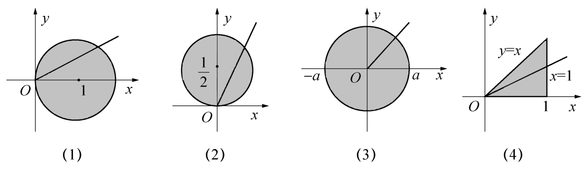

从极点出发作一条极角为 $\theta$ 的射线，交区域边界于两点：$r=0$，$r=2\cos\theta$。故区域的极坐标表示式为

$$
\left\{(r,\,\theta)\mid 0\leqslant r\leqslant 2\cos\theta,\ -\frac{\pi}{2}\leqslant\theta\leqslant\frac{\pi}{2}\right\}
$$

（2）区域的边界曲线为 $x^2+y^2=y$。令 $x=r\cos\theta$，$y=r\sin\theta$，则有表达式 $r=\sin\theta$。

再令 $r=0$，则有 $\theta=0$ 或 $\theta=\pi$，从而 $\theta$ 的变化范围为

$$
0\leqslant\theta\leqslant\pi
$$

从极点出发作一条极角为 $\theta$ 的射线，交区域边界于两点：$r=0$，$r=\sin\theta$。故区域的极坐标表示式为

$$
\{(r,\,\theta)\mid 0\leqslant r\leqslant\sin\theta,\ 0\leqslant\theta\leqslant\pi\}
$$

（3）极点在区域的内部，故 $\theta$ 的取值范围为 $0\leqslant\theta\leqslant 2\pi$。

边界曲线 $x^2+y^2=a^2$ 的极坐标方程为 $r=a$，故区域的极坐标表示式为

$$
\{(r,\,\theta)\mid 0\leqslant r\leqslant a,\ 0\leqslant\theta\leqslant 2\pi\}
$$

（4）利用极坐标变换式 $x=r\cos\theta$，$y=r\sin\theta$ 可知直线 $y=x$ 的极坐标方程为 $\theta=\dfrac{\pi}{4}$，直线 $x=1$ 的极坐标方程为 $r=\dfrac{1}{\cos\theta}$，故区域的极坐标表示式为

$$
\left\{(r,\,\theta)\mid 0\leqslant r\leqslant\frac{1}{\cos\theta},\ 0\leqslant\theta\leqslant\frac{\pi}{4}\right\}
$$

**例 16**　计算 $\displaystyle\iint_D\mathrm{e}^{-x^2-y^2}\,\mathrm{d}\sigma$，其中 $D$ 是由中心在原点，半径为 $a$ 的圆周所围成的闭区域。

**解**　在极坐标系下，$D=\{(r,\,\theta)\mid 0\leqslant r\leqslant a,\ 0\leqslant\theta\leqslant 2\pi\}$，则

$$
\begin{aligned}
\iint_D\mathrm{e}^{-x^2-y^2}\,\mathrm{d}\sigma&=\iint_D\mathrm{e}^{-r^2}r\,\mathrm{d}r\,\mathrm{d}\theta=\int_0^{2\pi}\mathrm{d}\theta\int_0^a\mathrm{e}^{-r^2}r\,\mathrm{d}r\\
&=\pi(1-\mathrm{e}^{-a^2})
\end{aligned}
$$

**注 1**　若用直角坐标系形式，则有 $I=\displaystyle\int_{-a}^a\mathrm{d}x\int_{-\sqrt{a^2-x^2}}^{\sqrt{a^2-x^2}}\mathrm{e}^{-x^2-y^2}\,\mathrm{d}y$，其中积分 $\displaystyle\int\mathrm{e}^{-y^2}\,\mathrm{d}y$ 不能用初等函数表示其结果，因此用无法求原函数的途径解决。

**注 2**　可以利用本题的结果计算积分 $I=\displaystyle\int_0^{+\infty}\mathrm{e}^{-x^2}\,\mathrm{d}x$。

先考虑 $\displaystyle I^2=\int_0^{+\infty}\mathrm{e}^{-x^2}\,\mathrm{d}x\cdot\int_0^{+\infty}\mathrm{e}^{-x^2}\,\mathrm{d}x=\int_0^{+\infty}\mathrm{e}^{-x^2}\,\mathrm{d}x\int_0^{+\infty}\mathrm{e}^{-y^2}\,\mathrm{d}y=\iint_D\mathrm{e}^{-x^2-y^2}\,\mathrm{d}x\mathrm{d}y$，其中

$$
D=\{(x,\,y)\mid 0\leqslant x<+\infty,\ 0\leqslant y<+\infty\}=\left\{(r,\,\theta)\mid 0\leqslant r<+\infty,\ 0\leqslant\theta\leqslant\frac{\pi}{2}\right\}
$$

则有

$$
I^2=\iint_D\mathrm{e}^{-x^2-y^2}\,\mathrm{d}x\mathrm{d}y=\int_0^{\frac{\pi}{2}}\mathrm{d}\theta\int_0^{+\infty}\mathrm{e}^{-r^2}r\,\mathrm{d}r=\frac{\pi}{2}\left[-\frac{1}{2}\mathrm{e}^{-r^2}\right]_0^{+\infty}=\frac{\pi}{4}
$$

即

$$
I=\int_0^{+\infty}\mathrm{e}^{-x^2}\,\mathrm{d}x=\frac{\sqrt{\pi}}{2}
$$

**例 17**　计算 $\displaystyle\iint_D\frac{y^2}{x^2}\,\mathrm{d}x\mathrm{d}y$，其中 $D$ 是由曲线 $x^2+y^2=2x$ 所围成的平面区域。

**解**　积分区域 $D$ 是以点 $(1,\,0)$ 为圆心，以 $1$ 为半径的圆域，其边界曲线的极坐标方程为 $r=2\cos\theta$。于是区域 $D$ 的极坐标为

$$
-\frac{\pi}{2}\leqslant\theta\leqslant\frac{\pi}{2},\qquad 0\leqslant r\leqslant 2\cos\theta
$$

所以

$$
\begin{aligned}
\iint_D\frac{y^2}{x^2}\,\mathrm{d}x\mathrm{d}y&=\iint_D\frac{r^2\sin^2\theta}{r^2\cos^2\theta}r\,\mathrm{d}r\,\mathrm{d}\theta=\int_{-\frac{\pi}{2}}^{\frac{\pi}{2}}\mathrm{d}\theta\int_0^{2\cos\theta}\frac{\sin^2\theta}{\cos^2\theta}r\,\mathrm{d}r\\
&=\int_{-\frac{\pi}{2}}^{\frac{\pi}{2}}2\sin^2\theta\,\mathrm{d}\theta=\int_{-\frac{\pi}{2}}^{\frac{\pi}{2}}(1-\cos 2\theta)\,\mathrm{d}\theta=\pi
\end{aligned}
$$

**例 18**　写出在极坐标系下二重积分 $\displaystyle\iint_D f(x,y)\,\mathrm{d}x\mathrm{d}y$ 的二次积分，其中区域

$$
D=\{(x,\,y)\mid 1-x\leqslant y\leqslant\sqrt{1-x^2},\ 0\leqslant x\leqslant 1\}
$$

**解**　利用极坐标变换 $x=r\cos\theta$，$y=r\sin\theta$，易见直线方程 $x+y=1$ 的极坐标形式为

$$
r=\frac{1}{\sin\theta+\cos\theta}
$$

故积分区域 $D$（见图 7-26）的积分限为

$$
0\leqslant\theta\leqslant\frac{\pi}{2},\qquad\frac{1}{\sin\theta+\cos\theta}\leqslant r\leqslant 1
$$

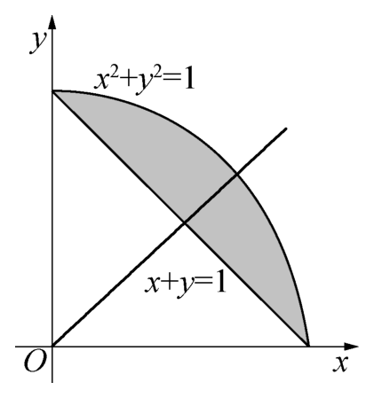

所以

$$
\iint_D f(x,\,y)\,\mathrm{d}x\mathrm{d}y=\int_0^{\frac{\pi}{2}}\mathrm{d}\theta\int_{\frac{1}{\sin\theta+\cos\theta}}^1 f(r\cos\theta,\ r\sin\theta)r\,\mathrm{d}r
$$

### ＊四、二重积分换元法

二重积分从直角坐标系形式变换成极坐标系形式：

$$
\iint_D f(x,\,y)\,\mathrm{d}x\mathrm{d}y=\iint_D f(r\cos\theta,\ r\sin\theta)r\,\mathrm{d}r\,\mathrm{d}\theta
$$

这里，$\begin{cases}x=r\cos\theta,\\ y=r\sin\theta,\end{cases}$ 可以看作是 $\begin{cases}x=\varphi(r,\,\theta),\\ y=\psi(r,\,\theta),\end{cases}$ 的一种特例，对于一般的变换 $\begin{cases}x=x(u,\,v),\\ y=y(u,\,v),\end{cases}$ $(x,\,y)\to(u,\,v)$，二重积分的形式如何呢？

我们不加证明地给出下面的结论。

**定理 2**　设函数 $f(x,y)$ 在 $xOy$ 平面内的闭区域 $D$ 上连续，变换 $\begin{cases}x=x(u,\,v),\\ y=y(u,\,v),\end{cases}$ 将 $uOv$ 平面内的闭区域 $D'$ 变换成 $xOy$ 平面内的闭区域 $D$，且满足

（1）$x(u,v)$、$y(u,v)$ 在 $D'$ 上具有一阶连续偏导数；

（2）在 $D'$ 上 $J=\dfrac{\partial(x,y)}{\partial(u,v)}\neq 0$；

（3）变换 $\begin{cases}x=x(u,\,v),\\ y=y(u,\,v),\end{cases}$，$D'\to D$ 是一对一的，则有

$$
\iint_D f(x,\,y)\,\mathrm{d}x\mathrm{d}y=\iint_{D'}f(x(u,\,v),\ y(u,\,v))\,|J|\,\mathrm{d}u\mathrm{d}v
$$

此式也称为二重积分换元公式。

特别地，取 $\begin{cases}x=r\cos\theta,\\ y=r\sin\theta,\end{cases}$ 则 $J=\dfrac{\partial(x,y)}{\partial(r,\theta)}=\begin{vmatrix}\cos\theta&-r\sin\theta\\ \sin\theta&r\cos\theta\end{vmatrix}=r$，因此

$$
\iint_D f(x,\,y)\,\mathrm{d}x\mathrm{d}y=\iint_{D'}f(r\cos\theta,\ r\sin\theta)r\,\mathrm{d}r\,\mathrm{d}\theta
$$

取广义极坐标 $\begin{cases}x=ar\cos\theta,\\ y=br\sin\theta,\end{cases}$ $J=\dfrac{\partial(x,y)}{\partial(r,\theta)}=\begin{vmatrix}a\cos\theta&-ar\sin\theta\\ b\sin\theta&br\cos\theta\end{vmatrix}=abr$，因此

$$
\iint_D f(x,\,y)\,\mathrm{d}\sigma=\iint_{D'}f(ar\cos\theta,\ br\sin\theta)abr\,\mathrm{d}r\,\mathrm{d}\theta
$$

**例 19**　计算二重积分 $\displaystyle\iint_D\mathrm{e}^{\frac{y-x}{y+x}}\,\mathrm{d}x\mathrm{d}y$，其中区域 $D$ 由 $x=0$，$y=0$，$x+y=2$ 所围成。

**解**　作 $\begin{cases}u=y-x,\\ v=y+x,\end{cases}$ 即 $\begin{cases}x=\dfrac{v-u}{2},\\ y=\dfrac{v+u}{2},\end{cases}$　$J=\dfrac{\partial(x,y)}{\partial(u,v)}=\begin{vmatrix}-\dfrac{1}{2}&\dfrac{1}{2}\\[6pt] \dfrac{1}{2}&\dfrac{1}{2}\end{vmatrix}=-\dfrac{1}{2}\neq 0$，于是

$$
D'=\{(u,\,v)\mid -v\leqslant u\leqslant v,\ 0\leqslant v\leqslant 2\}
$$

因此

$$
\iint_D\mathrm{e}^{\frac{y-x}{y+x}}\,\mathrm{d}x\mathrm{d}y=\iint_{D'}\mathrm{e}^{\frac{u}{v}}\frac{1}{2}\,\mathrm{d}u\mathrm{d}v=\frac{1}{2}\int_0^2\mathrm{d}v\int_{-v}^v\mathrm{e}^{\frac{u}{v}}\,\mathrm{d}u=\frac{1}{2}\int_0^2\left(\mathrm{e}-\frac{1}{\mathrm{e}}\right)v\,\mathrm{d}v=\mathrm{e}-\frac{1}{\mathrm{e}}
$$

**例 20**　求由直线 $x+y=c$，$x+y=d$，$y=ax$，$y=bx$（$0<a<b$，$0<c<d$）所围成的闭区域 $D$ 的面积。

**解**　作 $\begin{cases}u=x+y,\\ v=\dfrac{y}{x},\end{cases}$　$J=\dfrac{\partial(x,y)}{\partial(u,v)}=\begin{vmatrix}\dfrac{1}{1+v}&-\dfrac{u}{(1+v)^2}\\[8pt] \dfrac{v}{1+v}&\dfrac{u}{(1+v)^2}\end{vmatrix}=\dfrac{u}{(1+v)^2}\neq 0$，即 $\begin{cases}x=\dfrac{u}{1+v},\\ y=\dfrac{uv}{1+v},\end{cases}$　于是

$$
D'=\{(u,\,v)\mid c\leqslant u\leqslant d,\ a\leqslant v\leqslant b\}
$$

因此

$$
S=\iint_D\mathrm{d}x\mathrm{d}y=\iint_{D'}|J|\,\mathrm{d}u\mathrm{d}v=\iint_{D'}\frac{u}{(1+v)^2}\,\mathrm{d}u\mathrm{d}v=\int_a^b\frac{1}{(1+v)^2}\,\mathrm{d}v\int_c^d u\,\mathrm{d}u=\frac{(b-a)(d^2-c^2)}{2(1+a)(1+b)}
$$

### 五、二重积分应用举例

### 1. 空间立体体积

在本章前面内容已经知道，若 $z=f(x,y)$ 在有界闭区域 $D$ 上连续，且 $f(x,y)\geqslant 0$，则二重积分

$$
\iint_D f(x,\,y)\,\mathrm{d}\sigma
$$

在几何上是以 $z=f(x,y)$ 为顶的曲顶柱体的体积，所以我们可以利用二重积分计算立体的体积。

**例 21**　求两个底面圆半径相等的直角圆柱所围立体体积。

**解**　设圆柱底面半径为 $a$，两个圆柱面方程分别为 $x^2+y^2=a^2$ 和 $x^2+z^2=a^2$。由立体对坐标面的对称性，所求体积是它位于第一卦限的那部分体积的 $8$ 倍（见图 7-27(a)）。立体在第一卦限部分的积分区域 $D_1$ 为 $0\leqslant x\leqslant a$，$0\leqslant y\leqslant\sqrt{a^2-x^2}$（见图 7-27(b)），它的曲顶为 $z=\sqrt{a^2-x^2}$，于是

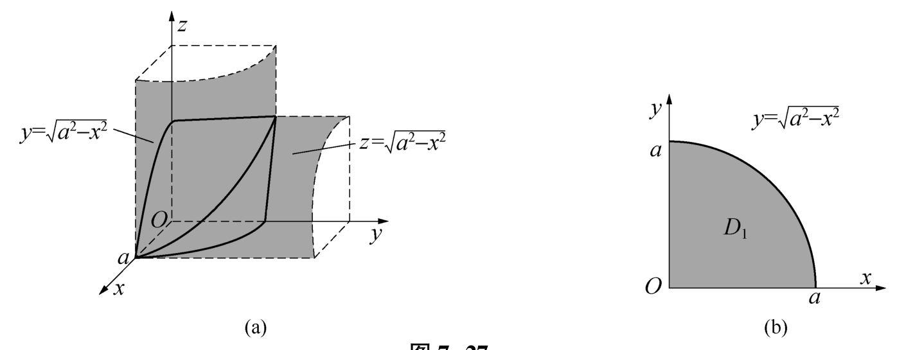

$$
\begin{aligned}
V_1&=\iint_{D_1}\sqrt{a^2-x^2}\,\mathrm{d}\sigma=\int_0^a\mathrm{d}x\int_0^{\sqrt{a^2-x^2}}\sqrt{a^2-x^2}\,\mathrm{d}y\\
&=\int_0^a\left[y\sqrt{a^2-x^2}\right]_0^{\sqrt{a^2-x^2}}\mathrm{d}x=\int_0^a(a^2-x^2)\,\mathrm{d}x\\
&=\left[a^2x-\frac{x^3}{3}\right]_0^a=\frac{2}{3}a^3
\end{aligned}
$$

所以

$$
V=8V_1=\frac{16a^3}{3}
$$

**例 22**　求球体 $x^2+y^2+z^2\leqslant 4a^2$ 被圆柱面 $x^2+y^2=2ax$（$a>0$）所截得的（含在圆柱面内的部分）立体的体积。

**解**　如图 7-28 所示，由对称性，有

$$
V=4\iint_D\sqrt{4a^2-x^2-y^2}\,\mathrm{d}x\mathrm{d}y
$$

其中 $D$ 为半圆周 $y=\sqrt{2ax-x^2}$ 及 $x$ 轴所围成的闭区域。

在极坐标中，积分区域 $D$：$0 \leqslant \theta \leqslant \frac{\pi}{2}$，$0 \leqslant r \leqslant 2a\cos\theta$。

所以

$$
V = 4\iint_D \sqrt{4a^2-r^2}\,r\,\mathrm{d}r\mathrm{d}\theta
= 4\int_0^{\frac{\pi}{2}} \mathrm{d}\theta \int_0^{2a\cos\theta} \sqrt{4a^2-r^2}\,r\,\mathrm{d}r
$$

$$
= \frac{32}{3}a^3\int_0^{\frac{\pi}{2}} (1-\sin^3\theta)\,\mathrm{d}\theta
= \frac{32}{3}a^3\left(\frac{\pi}{2}-\frac{2}{3}\right).
$$

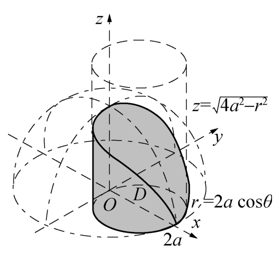

**\*例 23** 求椭球体 $\frac{x^2}{a^2}+\frac{y^2}{b^2}+\frac{z^2}{c^2} \leqslant 1$ 的体积（其中 $a>0$，$b>0$，$c>0$）。

**解** 由对称性知，所求体积为

$$
V = 8\iint_D c\sqrt{1-\frac{x^2}{a^2}-\frac{y^2}{b^2}}\,\mathrm{d}\sigma,
$$

其中积分区域 $D$：$\frac{x^2}{a^2}+\frac{y^2}{b^2} \leqslant 1$，$x \geqslant 0$，$y \geqslant 0$。令 $x=ar\cos\theta$，$y=br\sin\theta$，称其为广义极坐标变换，则区域 $D$ 的积分限为 $0 \leqslant \theta \leqslant \frac{\pi}{2}$，$0 \leqslant r \leqslant 1$，又

$$
J = \frac{\partial(x,y)}{\partial(r,\theta)}
= \begin{vmatrix} a\cos\theta & -ar\sin\theta \\ b\sin\theta & br\cos\theta \end{vmatrix} = abr,
$$

于是

$$
V = 8abc\int_0^{\frac{\pi}{2}} \mathrm{d}\theta \int_0^1 \sqrt{1-r^2}\,r\,\mathrm{d}r
= 8abc\cdot\frac{\pi}{2}\left(-\frac{1}{2}\right)\int_0^1 \sqrt{1-r^2}\,\mathrm{d}(1-r^2)
= \frac{4}{3}\pi abc.
$$

特别地，当 $a=b=c$ 时，则得到球体的体积为 $\frac{4}{3}\pi a^3$。

### 2. 平面区域面积

**例 24** 求曲线 $(x^2+y^2)^2 = 2a^2(x^2-y^2)$ 和 $x^2+y^2 \geqslant a$ 所围成区域 $D$ 的面积（见图7-29）。

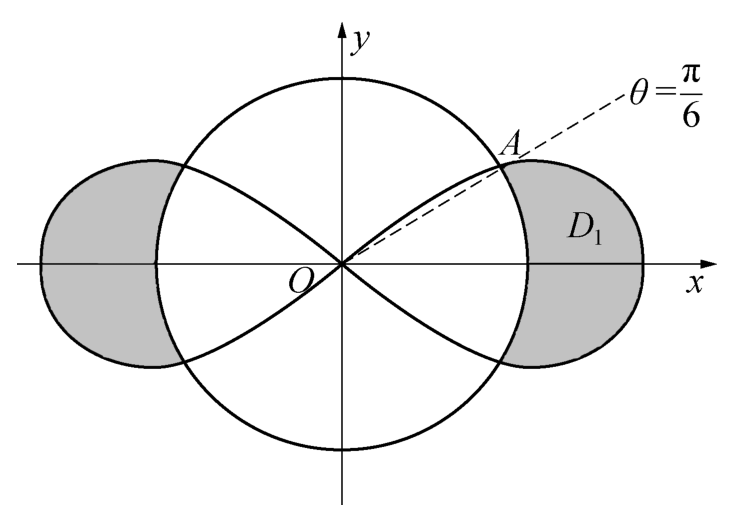

**解** 根据对称性有 $D=4D_1$，在极坐标系下：

$x^2+y^2=a^2$，即 $r=a$；

$(x^2+y^2)^2 = 2a^2(x^2-y^2)$，即 $r=a\sqrt{2\cos 2\theta}$。

由 $\begin{cases} r=a\sqrt{2\cos 2\theta}, \\ r=a, \end{cases}$ 得交点 $A=\left(a,\frac{\pi}{6}\right)$，故所求面积为

$$
\sigma = \iint_D \mathrm{d}x\mathrm{d}y = 4\iint_{D_1} \mathrm{d}x\mathrm{d}y
= 4\iint_{D_1} r\,\mathrm{d}r\mathrm{d}\theta
= 4\int_0^{\frac{\pi}{6}} \mathrm{d}\theta \int_a^{a\sqrt{2\cos 2\theta}} r\,\mathrm{d}r
$$

$$
= 4a^2\int_0^{\frac{\pi}{6}}\left(\cos 2\theta - \frac{1}{2}\right)\mathrm{d}\theta
= a^2\left(\sqrt{3}-\frac{\pi}{3}\right).
$$

### 3. 曲面的面积

设曲面 $\Sigma: z=f(x,y)$，$(x,y) \in D_{xy}$，（$D_{xy}$ 为曲面在 $xOy$ 面上的投影区域），$f(x,y)$ 在 $D_{xy}$ 上具有一阶连续偏导数。

**注** 本节所指的曲面，要求是一种简单曲面：即曲面上的点与其在 $xOy$ 面上的投影区域 $D$ 上的点一一对应。如果任何平行于 $z$ 轴的直线和曲面 $\Sigma$ 正好相交于一点，那么这个曲面就是属于这种类型。如果曲面不是这种类型，则可将其分成若干部分，使其每一部分符合上述性质。

我们用元素法来推导有关公式（见图7-30）：

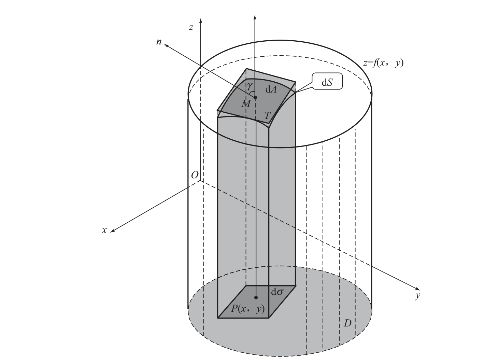

将区域 $D$ 任意划分成若干个直径很小的区域 $\Delta\sigma_i\ (i=1,2,\cdots,n)$，并以 $\mathrm{d}\sigma$ 表示某个小区域，也表示其面积。在 $\mathrm{d}\sigma$ 上任取一点 $P(x,y)$，对应地曲面 $\Sigma$ 上有一点 $M(x,y,z(x,y))$，点 $M$ 在 $xOy$ 平面上的投影即点 $P$，点 $M$ 处曲面 $\Sigma$ 的切平面设为 $T$，过 $\mathrm{d}\sigma$ 的边界且母线平行于 $z$ 轴的柱面截曲面 $\Sigma$ 及其切平面，截得的小曲面记为 $\mathrm{d}S$，切平面上的一小片平面记为 $\mathrm{d}A$，由于 $\mathrm{d}\sigma$ 的直径很小，切平面上的 $\mathrm{d}A$ 可以近似地代替 $\mathrm{d}S$，即 $\mathrm{d}S \approx \mathrm{d}A$，而 $\mathrm{d}A=\frac{\mathrm{d}\sigma}{\cos\gamma}$，其中 $\gamma$ 为点 $M$ 处曲面 $\Sigma$ 上的法向量（指向朝上）与 $z$ 轴所成的夹角。

由 $\boldsymbol{n}=(-f'_x(x,y),\,-f'_y(x,y),\,1)$ 知 $\cos\gamma=\frac{1}{\sqrt{1+f'^2_x(x,y)+f'^2_y(x,y)}}$，故

$$
\mathrm{d}S \approx \mathrm{d}A = \frac{\mathrm{d}\sigma}{\cos\gamma}
= \sqrt{1+f'^2_x(x,y)+f'^2_y(x,y)}\,\mathrm{d}\sigma,
$$

因此

$$
S = \iint_{D_{xy}} \sqrt{1+f'^2_x(x,y)+f'^2_y(x,y)}\,\mathrm{d}\sigma,
$$

或

$$
S = \iint_{D_{xy}} \sqrt{1+z_x^2+z_y^2}\,\mathrm{d}\sigma.
$$

同理，设 $\Sigma: x=g(y,z)$，$(y,z) \in D_{yz}$，$g(y,z)$ 在 $D_{yz}$ 具有一阶连续偏导数，则有

$$
S = \iint_{D_{yz}} \sqrt{1+x_y^2+x_z^2}\,\mathrm{d}\sigma;
$$

设 $\Sigma: y=h(x,z)$，$(x,z) \in D_{xz}$，$h(x,z)$ 在 $D_{xz}$ 具有一阶连续偏导数，则有

$$
S = \iint_{D_{xz}} \sqrt{1+y_x^2+y_z^2}\,\mathrm{d}\sigma.
$$

**例 25** 求半径为 $a$ 的球面的面积。

**解** 平行于 $z$ 轴的直线穿过球面时，与球面有两个交点，因此需将球面分成上、下两部分，根据对称性，只需求出上半球面面积乘 2 即可。

上半球面方程：$z=\sqrt{a^2-x^2-y^2}$，$(x,y) \in D$，$D=\{(x,y) \mid x^2+y^2 \leqslant a^2\}$

$$
\frac{\partial z}{\partial x} = \frac{-x}{\sqrt{a^2-x^2-y^2}},\quad
\frac{\partial z}{\partial y} = \frac{-y}{\sqrt{a^2-x^2-y^2}},\quad
\sqrt{1+z_x^2+z_y^2} = \frac{a}{\sqrt{a^2-x^2-y^2}},
$$

故

$$
S = 2\iint_D \sqrt{1+z_x^2+z_y^2}\,\mathrm{d}\sigma
= 2\iint_D \frac{a}{\sqrt{a^2-x^2-y^2}}\,\mathrm{d}\sigma
= 2a\int_0^{2\pi} \mathrm{d}\theta \int_0^a \frac{1}{\sqrt{a^2-r^2}}\,r\,\mathrm{d}r
$$

$$
= 4\pi a\left[-\sqrt{a^2-r^2}\right]_0^a = 4\pi a^2.
$$

**注** 这里用到了广义二重积分，或取 $D_1: x^2+y^2 \leqslant b\ (0<b<a)$，

$$
S_1 = 2\iint_{D_1} \sqrt{1+z_x^2+z_y^2}\,\mathrm{d}\sigma
= 2\iint_{D_1} \frac{a}{\sqrt{a^2-x^2-y^2}}\,\mathrm{d}\sigma
= 2a\int_0^{2\pi} \mathrm{d}\theta \int_0^b \frac{1}{\sqrt{a^2-r^2}}\,r\,\mathrm{d}r
$$

$$
= 4\pi a\left[-\sqrt{a^2-r^2}\right]_0^b = 4\pi a\left(a-\sqrt{a^2-b^2}\right),
$$

$$
S = \lim_{b \to a} S_1 = \lim_{b \to a} 4\pi a\left(a-\sqrt{a^2-b^2}\right) = 4\pi a^2.
$$

### ＊4. 质量与质心

由力学知道，$n$ 个质点系的质心坐标为

$$
\bar{x} = \frac{M_y}{m} = \frac{\sum\limits_{i=1}^n m_i x_i}{\sum\limits_{i=1}^n m_i},\qquad
\bar{y} = \frac{M_x}{m} = \frac{\sum\limits_{i=1}^n m_i y_i}{\sum\limits_{i=1}^n m_i},
$$

其中 $m_i\ (i=1,2,\cdots,n)$ 为第 $i$ 个质点的质量，$M_x=\sum\limits_{i=1}^n m_i y_i$，$M_y=\sum\limits_{i=1}^n m_i x_i$ 分别是质点系对 $x$ 轴和 $y$ 轴的静力矩，$m=\sum\limits_{i=1}^n m_i$ 是质点系的总质量。

设有一平面薄片，它位于 $xOy$ 面内区域 $D$ 上，在点 $(x,y)$ 处的面密度为区域 $D$ 上的连续函数 $\rho(x,y)$。现求它的质量和质心坐标。

在区域 $D$ 上任取一个小区域 $\mathrm{d}\sigma$（$\mathrm{d}\sigma$ 也表示小区域的面积），在 $\mathrm{d}\sigma$ 上任取一点 $(x,y)$。由于 $\mathrm{d}\sigma$ 很小，$\rho(x,y)$ 又在 $D$ 上连续，所以相应于 $\mathrm{d}\sigma$ 的部分薄片的质量近似等于 $\rho(x,y)\,\mathrm{d}\sigma$，平面薄片的质量为

$$
m = \iint_D \rho(x,y)\,\mathrm{d}\sigma.
$$

同理，相应于 $\mathrm{d}\sigma$ 的部分薄片对 $x$ 轴和 $y$ 轴的静力矩近似等于 $y\,\mathrm{d}m = y\rho(x,y)\,\mathrm{d}\sigma$ 和 $x\,\mathrm{d}m = x\rho(x,y)\,\mathrm{d}\sigma$，即 $\mathrm{d}M_x = y\rho(x,y)\,\mathrm{d}\sigma$，$\mathrm{d}M_y = x\rho(x,y)\,\mathrm{d}\sigma$，于是平面薄片对 $x$ 轴和 $y$ 轴的静力矩分别为

$$
M_x = \iint_D y\rho(x,y)\,\mathrm{d}\sigma,\qquad
M_y = \iint_D x\rho(x,y)\,\mathrm{d}\sigma,
$$

所以平面薄片的质心坐标为

$$
\bar{x} = \frac{M_y}{m} = \frac{\iint_D x\rho(x,y)\,\mathrm{d}\sigma}{\iint_D \rho(x,y)\,\mathrm{d}\sigma},\qquad
\bar{y} = \frac{M_x}{m} = \frac{\iint_D y\rho(x,y)\,\mathrm{d}\sigma}{\iint_D \rho(x,y)\,\mathrm{d}\sigma}.
$$

如果平面薄片是均匀的，即 $\rho(x,y)$ 是常数，则均匀平面薄片的质心坐标为

$$
\bar{x} = \frac{1}{A}\iint_D x\,\mathrm{d}\sigma,\qquad
\bar{y} = \frac{1}{A}\iint_D y\,\mathrm{d}\sigma,
$$

其中 $A = \iint_D \mathrm{d}\sigma$ 为闭区域 $D$ 的面积。这时平面薄片的质心坐标与密度无关，而由闭区域 $D$ 的形状所决定，称为平面图形 $D$ 的形心。

**例 26** 一圆环薄片由半径为 4 和 8 的两个同心圆所围成，其上任意一点处的面密度与该点到圆心的距离成反比，已知在内圆周上各点处的面密度为 1，求圆环薄片的质量。

**解** 如图 7-31 所示，积分区域 $D$ 是 $4^2 \leqslant x^2+y^2 \leqslant 8^2$，圆环薄片的质量 $m$ 为

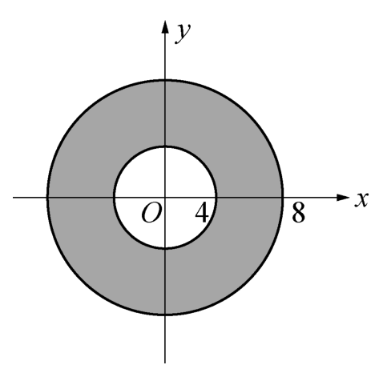

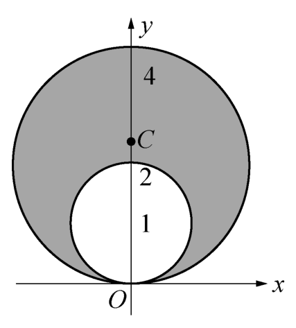

$$
m = \iint_D \rho(x,y)\,\mathrm{d}\sigma.
$$

因为 $\rho(x,y)=\frac{k}{\sqrt{x^2+y^2}}$，且 $\frac{k}{4}=1$，所以 $k=4$，$\rho=\frac{4}{\sqrt{x^2+y^2}}$，故所求质量为

$$
m = \iint_D \frac{4}{\sqrt{x^2+y^2}}\,\mathrm{d}\sigma
= \int_0^{2\pi} \mathrm{d}\theta \int_4^8 \frac{4}{r}\,r\,\mathrm{d}r = 32\pi.
$$

**例 27** 求位于两圆 $\rho=2\sin\theta$ 和 $\rho=4\sin\theta$ 之间的均匀薄片的质心。

**解** 如图 7-32 所示，因为闭区域 $D$ 对称于 $y$ 轴，故质心 $C(\bar{x},\bar{y})$ 必位于 $y$ 轴上，于是

$$
\bar{x} = 0,\qquad \bar{y} = \frac{1}{A}\iint_D y\,\mathrm{d}\sigma.
$$

易见积分区域 $D$ 的面积等于这两个圆的面积之差，即 $A=3\pi$。再利用极坐标计算积分：

$$
\iint_D y\,\mathrm{d}\sigma = \iint_D r^2\sin\theta\,\mathrm{d}r\mathrm{d}\theta
= \int_0^{\pi} \sin\theta\,\mathrm{d}\theta \int_{2\sin\theta}^{4\sin\theta} r^2\,\mathrm{d}r
= \frac{56}{3}\int_0^{\pi} \sin^4\theta\,\mathrm{d}\theta = 7\pi.
$$

因此 $\bar{y} = \frac{7\pi}{3\pi} = \frac{7}{3}$，所求质心是 $C\left(0,\frac{7}{3}\right)$。

### ＊5. 平面薄片的转动惯量

设 $xOy$ 平面上有 $n$ 个质点，它们分别位于点 $(x_i,y_i)\ (i=1,2,\cdots,n)$，质量分别为 $m_i\ (i=1,2,\cdots,n)$。该质点系对 $x$ 轴、对 $y$ 轴的转动惯量分别为 $I_x=\sum\limits_{i=1}^n y_i^2 m_i$，$I_y=\sum\limits_{i=1}^n x_i^2 m_i$。现在讨论相应的连续刚体的情况。

设有一平面薄片，它在 $xOy$ 平面上占有（有界闭）区域 $D$，面密度为连续函数 $\rho=\rho(x,y)$，$(x,y) \in D$。运用元素法求其转动惯量。

在 $D$ 上任取一直径很小的区域 $\mathrm{d}\sigma$（其面积也记为 $\mathrm{d}\sigma$），$(x,y)$ 为 $\mathrm{d}\sigma$ 中的一点，由于 $\mathrm{d}\sigma$ 很小，且 $\rho(x,y)$ 在 $D$ 上连续，因此相应于 $\mathrm{d}\sigma$ 部分的质量 $\mathrm{d}M=\rho(x,y)\,\mathrm{d}\sigma$，且这部分质量可近似看作是集中在点 $(x,y)$ 上，于是可写出 $\mathrm{d}\sigma$ 对 $x$ 轴、对 $y$ 轴的转动惯量：

$$
\mathrm{d}I_x = y^2\rho(x,y)\,\mathrm{d}\sigma,\qquad
\mathrm{d}I_y = x^2\rho(x,y)\,\mathrm{d}\sigma,
$$

故薄片对 $x$ 轴、对 $y$ 轴的转动惯量分别为

$$
I_x = \iint_D y^2\rho(x,y)\,\mathrm{d}\sigma,\qquad
I_y = \iint_D x^2\rho(x,y)\,\mathrm{d}\sigma.
$$

**注** 平面薄片 $D$ 关于直线 $l: ax+by+c=0$ 的转动惯量为

$$
I_l = \iint_D d^2\rho(x,y)\,\mathrm{d}x\mathrm{d}y,
$$

其中 $d=\frac{|ax+by+c|}{\sqrt{a^2+b^2}}$。

**例 28** 求曲线 $r=a(1+\cos\theta)$ 所围平面薄片（$\rho=1$）对极轴的转动惯量。

**解**

$$
I_x = \iint_D y^2\rho\,\mathrm{d}\sigma
= \int_{-\pi}^{\pi} \mathrm{d}\theta \int_0^{a(1+\cos\theta)} (r\sin\theta)^2 r\,\mathrm{d}r
= \frac{a^4}{4}\int_{-\pi}^{\pi} \sin^2\theta\,(1+\cos\theta)^4\,\mathrm{d}\theta
$$

$$
= \frac{21}{32}\pi a^4.
$$

## 习题 7-1

1. 计算 $\iint_D \mathrm{d}x\mathrm{d}y$，其中 $D$：

（1）$\{(x,y) \mid |x| \leqslant 1,\ |y| \leqslant 2\}$；

（2）$\left\{(x,y) \mathrel{\Big|} \frac{x^2}{4}+y^2 \leqslant 1\right\}$；

（3）$\{(x,y) \mid 1^2 \leqslant x^2+y^2 \leqslant 3^2\}$。

2. 用二重积分表示立体 $\frac{x^2}{a^2}+\frac{y^2}{b^2}+\frac{z^2}{c^2} \leqslant 1$，$z \leqslant 0$ 的体积，并写出积分区域的表达式。

3. 设 $I=\iint_D \sqrt[3]{x^2+y^2-1}\,\mathrm{d}x\mathrm{d}y$，其中 $D$ 是圆环 $1 \leqslant x^2+y^2 \leqslant 2$ 所确定的闭区域，则 \_\_\_\_\_\_。

A. $I>0$　　　B. $I<0$　　　C. $I=0$　　　D. $I \neq 0$ 但符号不能确定

4. 比较 $I_1=\iint_D (x^2+y^2)\,\mathrm{d}\sigma$ 与 $I_2=\iint_D (x^2+y^2)^2\,\mathrm{d}\sigma$ 的大小，其中 $D: x^2+y^2 \leqslant 1$，则 \_\_\_\_\_\_。

A. $I_1=I_2$　　　B. $I_1<I_2$　　　C. $I_1>I_2$　　　D. 无法比较

5. 设 $I_1=\iint_D \ln(x+y)\,\mathrm{d}\sigma$，$I_2=\iint_D (x+y)^2\,\mathrm{d}\sigma$，$I_3=\iint_D \sin^2(x+y)\,\mathrm{d}\sigma$，其中

$$
D = \left\{(x,y) \mathrel{\Big|} x \geqslant 0,\ y \geqslant 0,\ \frac{1}{2} \leqslant x+y \leqslant 1\right\},
$$

比较 $I_1$、$I_2$、$I_3$ 的大小。

6. 利用二重积分的性质估计积分 $I=\iint_D (x+y+1)\,\mathrm{d}\sigma$ 的值，其中 $D$ 是矩形闭区域：$0 \leqslant x \leqslant 1$，$0 \leqslant y \leqslant 2$。

7. 估计积分值 $I=\iint_D (x+y+1)\,\mathrm{d}\sigma$，其中 $D=[1,2]\times[0,1]$。

8. 设 $I_1=\iint_{D_1}(x^2+y^2)^3\,\mathrm{d}\sigma$，$I_2=\iint_{D_2}(x^2+y^2)^3\,\mathrm{d}\sigma$，其中 $D_1=[-1,1]\times[-2,2]$，$D_2=[0,1]\times[0,2]$，试说明 $I_1$ 与 $I_2$ 的关系。

9. 设 $f(x,y)$ 在 $D_\rho=\{(x,y) \mid x^2+y^2 \leqslant \rho^2\}$ 上连续，求 $\lim\limits_{\rho \to 0^+}\frac{1}{\rho^2}\iint_{D_\rho} f(x,y)\,\mathrm{d}\sigma$。

10. 计算二重积分 $I=\iint_D f(x+y)\operatorname{sgn}(x-y)\,\mathrm{d}\sigma$，其中 $D=\{(x,y) \mid 0 \leqslant x \leqslant 1,\ 0 \leqslant y \leqslant 1\}$，函数 $f(u)$ 在 $D$ 上连续。

11. 计算下列二重（二次）积分。

（1）$\int_0^1 \mathrm{d}x\int_x^{3x}(x-y)\,\mathrm{d}y$；

（2）$\iint_D x\mathrm{e}^{-2x}\,\mathrm{d}x\mathrm{d}y$，其中 $D=\{(x,y) \mid 0 \leqslant x \leqslant 1,\ 0 \leqslant y \leqslant 1\}$；

（3）$\iint_D xy^2\,\mathrm{d}x\mathrm{d}y$，其中 $D$ 是由 $|x|=2$，$|y|=1$ 所围闭区域；

（4）$\iint_D y\cos(xy)\,\mathrm{d}x\mathrm{d}y$，其中 $D$ 是由 $0 \leqslant x \leqslant 1$，$0 \leqslant y \leqslant \pi$ 所确定的闭区域；

（5）$\iint_D \mathrm{d}x\mathrm{d}y$，其中 $D$ 是由 $y=x$，$y=2x$，$y=1$ 围成的闭区域；

（6）$\iint_D \frac{y}{x}\,\mathrm{d}x\mathrm{d}y$，其中 $D$ 是由 $y=3x$，$y=x$，$x=1$，$x=3$ 所确定的闭区域；

（7）设 $D$ 是由 $y=2$，$y=x$，$y=2x$ 所确定的闭区域，求 $\iint_D (x^2+y^2-x)\,\mathrm{d}x\mathrm{d}y$；

（8）设 $D$ 是由 $x=0$，$y=\pi$，$y=x$ 所确定的闭区域，求 $\iint_D \sin(x+y)\,\mathrm{d}x\mathrm{d}y$；

（9）设 $D$ 是由 $x=\sqrt{y}$，$x=3-2y$，$y=0$ 所确定的闭区域，求 $\iint_D xy\,\mathrm{d}x\mathrm{d}y$；

（10）设 $D$ 是由 $x=0$，$y=0$，$2x+y=4$ 所确定的闭区域，求 $\iint_D (4-x^2)\,\mathrm{d}x\mathrm{d}y$；

（11）设 $D$ 是由 $y=x$，$x=y^2$ 所围闭区域，求二重积分 $\iint_D \frac{\sin y}{y}\,\mathrm{d}x\mathrm{d}y$。

12. 把二重积分 $I=\iint_D f(x,y)\,\mathrm{d}\sigma$ 转化为两种不同次序的二次积分，其中 $D$ 分别如下。

（1）由直线 $y=x$，$y=3x$，$x=1$，$x=2$ 所围成的闭区域；

（2）由直线 $x+y=1$，$x-y=1$，$x=0$ 所围成的闭区域。

13. 交换下列二次积分的积分顺序。

（1）$\int_0^3 \mathrm{d}x\int_{x^2}^{3x} f(x,y)\,\mathrm{d}y$；

（2）$\int_0^1 \mathrm{d}y\int_0^y f(x,y)\,\mathrm{d}x$；

（3）$\int_1^2 \mathrm{d}y\int_1^y f(x,y)\,\mathrm{d}x+\int_2^4 \mathrm{d}y\int_{\frac{y}{2}}^2 f(x,y)\,\mathrm{d}x$；

（4）$\int_0^1 \mathrm{d}x\int_0^{1-x} f(x,y)\,\mathrm{d}y$；

（5）$\int_0^1 \mathrm{d}x\int_0^{\sqrt{2x-x^2}} f(x,y)\,\mathrm{d}y+\int_1^2 \mathrm{d}x\int_0^{2-x} f(x,y)\,\mathrm{d}y$；

（6）$\int_0^{2a} \mathrm{d}x\int_{\sqrt{2ax-x^2}}^{\sqrt{2ax}} f(x,y)\,\mathrm{d}y\ (a>0)$。

14. 利用两种方法计算二重积分。

（1）$\iint_D xy\,\mathrm{d}\sigma$，其中 $D$ 是由直线 $y=1$，$x=2$ 及 $y=x$ 所围成的闭区域；

（2）计算 $\iint_D \frac{x^2}{y^2}\,\mathrm{d}x\mathrm{d}y$，其中区域 $D$ 由直线 $x=2$，$y=x$ 及曲线 $xy=1$ 所围成；

（3）$\iint_D (xy+1)\,\mathrm{d}x\mathrm{d}y$，其中 $D$ 是由 $4x^2+y^2=4$ 所围成的闭区域。

15.（1）设 $f(y)$ 在 $[a,b]$ 上连续，证明：$\int_a^b \mathrm{d}x\int_a^x f(y)\,\mathrm{d}y=\int_a^b f(y)(b-y)\,\mathrm{d}y$；

（2）计算 $\int_0^1 \mathrm{d}y\int_y^1 x^2\sin xy\,\mathrm{d}x$。

16. 计算 $\iint_D |y-x^2|\,\mathrm{d}x\mathrm{d}y$，其中 $D=\{(x,y) \mid -1 \leqslant x \leqslant 1,\ 0 \leqslant y \leqslant 1\}$。

17. 计算积分 $I=\int_{\frac{1}{4}}^{\frac{1}{2}}\mathrm{d}y\int_{\frac{1}{2}}^{\sqrt{y}}\mathrm{e}^{\frac{y}{x}}\,\mathrm{d}x+\int_{\frac{1}{2}}^{1}\mathrm{d}y\int_y^{\sqrt{y}}\mathrm{e}^{\frac{y}{x}}\,\mathrm{d}x$。

18. 把二重积分写成极坐标系下的二次积分。

（1）$I=\iint_D f(x,y)\,\mathrm{d}\sigma$，$D=\{(x,y) \mid x^2+y^2 \leqslant a^2,\ x \geqslant 0,\ y \leqslant 0,\ a>0\}$；

（2）$I=\iint_D f(x,y)\,\mathrm{d}\sigma$，$D=\{(x,y) \mid x^2+y^2 \leqslant 2x,\ y \geqslant 0\}$；

（3）$I=\iint_D f(x,y)\,\mathrm{d}\sigma$，$D=\{(x,y) \mid a^2 \leqslant x^2+y^2 \leqslant b^2,\ x \leqslant y \leqslant \sqrt{3}x,\ x>0\}\ (0<a<b)$；

（4）$I=\iint_D \mathrm{e}^{-x^2-y^2}\,\mathrm{d}\sigma$，$D=\{(x,y) \mid 1 \leqslant x^2+y^2 \leqslant 4\}$；

（5）$I=\iint_D f(x^2+y^2)\,\mathrm{d}x\mathrm{d}y$，$D=\{(x,y) \mid x^2+y^2 \leqslant 2y\}$。

19. 利用极坐标计算下列二重积分。

（1）$\iint_D \sqrt{x^2+y^2}\,\mathrm{d}\sigma$，其中 $D$ 是由 $1 \leqslant x^2+y^2 \leqslant 4$ 围成的圆环形区域；

（2）$\iint_D xy\,\mathrm{d}x\mathrm{d}y$，其中 $D$ 是由 $x^2+y^2=a^2$ 和两坐标轴所围成的第一象限的闭区域；

（3）$\iint_D (h-2x-3y)\,\mathrm{d}x\mathrm{d}y$，其中 $D$ 是由 $x^2+y^2=R^2$ 所围成的闭区域；

（4）$\iint_D \ln(1+x^2+y^2)\,\mathrm{d}x\mathrm{d}y$，其中 $D$ 是圆 $x^2+y^2 \leqslant 1$ 所围成的闭区域；

（5）$\iint_D \frac{\mathrm{d}x\mathrm{d}y}{\sqrt{4-x^2-y^2}}$，其中 $D$ 是由 $1 \leqslant x^2+y^2 \leqslant 2$，$y \geqslant 0$ 所围成的闭区域；

（6）$\iint_D \arctan\frac{y}{x}\,\mathrm{d}x\mathrm{d}y$，其中 $D$ 是由 $x^2+y^2=2$ 与直线 $y=x$ 及 $y$ 轴所围成的闭区域。

20. 选用适当的坐标计算下列积分。

（1）$\iint_D \mathrm{d}x\mathrm{d}y$，其中 $D$ 是由直线 $x=2$，$y=x$ 和双曲线 $xy=1$ 所围成的闭区域；

（2）$\iint_D xy\,\mathrm{d}x\mathrm{d}y$，其中 $D$ 是由 $x^2+y^2 \leqslant 1$ 和 $x+y \geqslant 1$ 所围成的闭区域；

（3）$\iint_D \sqrt{\frac{1-x^2-y^2}{1+x^2+y^2}}\,\mathrm{d}x\mathrm{d}y$，其中 $D$ 是由 $x^2+y^2 \leqslant 1$，$x \geqslant 0$，$y \geqslant 0$ 所围成的闭区域；

（4）$\iint_D (x^2+y^2)\,\mathrm{d}x\mathrm{d}y$，其中 $D$ 是由直线 $y=x$，$y=x+2$ 和 $y=2$，$y=6$ 所围成的闭区域；

（5）$\iint_D \mathrm{e}^{x+y}\,\mathrm{d}x\mathrm{d}y$，其中 $D$ 是由直线 $|x|+|y| \leqslant 1$ 所围成的闭区域；

（6）$\iint_D x^2y\,\mathrm{d}x\mathrm{d}y$，其中 $D$ 是由直线 $y=0$，$y=1$ 和双曲线 $x^2-y^2=1$ 所围成的闭区域；

（7）$\iint_D xy^2\,\mathrm{d}x\mathrm{d}y$，其中 $D$ 是由直线 $y=\frac{1}{2}x$，$y=2x$ 和双曲线 $xy=1$，$xy=2$ 所围成的闭区域；

（8）$\iint_D \frac{1}{\sqrt{4-x^2-y^2}}\,\mathrm{d}x\mathrm{d}y$，其中 $D$ 是由圆周 $x^2+y^2 \leqslant 2x$ 所围成的闭区域；

（9）$\iint_D (x+2)\,\mathrm{d}x\mathrm{d}y$，其中 $D$ 是由圆周 $x^2+y^2 \leqslant 4$，$x^2+y^2 \geqslant 2x$ 与 $y$ 轴围成的位于第一象限内的闭区域；

（10）$\iint_D |x^2+y^2-2|\,\mathrm{d}x\mathrm{d}y$，其中 $D$ 是由圆周 $x^2+y^2 \leqslant 9$ 所围成的闭区域。

21. 计算 $\iint_D (x^2+y^2)\,\mathrm{d}x\mathrm{d}y$，其中 $D$ 为由圆 $x^2+y^2=2y$，$x^2+y^2=4y$ 及直线 $x-\sqrt{3}y=0$，$y-\sqrt{3}x=0$ 所围成的平面闭区域。

22. 求半球体 $x^2+y^2+z^2 \leqslant 9\ (z \geqslant 0)$ 的体积。

23. 求曲面 $z=1-4x^2-y^2$ 与 $xOy$ 面所围成的立体体积。

24. 求由四个平面 $x=0$，$y=0$，$x=1$ 及 $y=1$ 所围成的柱体被平面 $z=0$ 与 $z=6-2x-3y$ 截得的立体体积。

25. 求圆锥面 $z=\sqrt{x^2+y^2}$ 被柱面 $z^2=2x$ 所割下的那部分曲面的面积。

26. 求抛物柱面 $z=\frac{1}{2}x^2$ 含在由平面 $x=1$，$y=0$ 及 $y=x$ 所围成的柱体内部的那部分曲面的面积。

27. 求下列平面图形 $D$ 的形心。

（1）$D$ 由抛物线 $y=\sqrt{2x}$ 与直线 $x=1$，$y=0$ 所围成；

（2）$D$ 由心形线 $r=1+\cos\theta$ 所围成；

（3）$D$ 由右半椭圆 $\frac{x^2}{a^2}+\frac{y^2}{b^2}=1\ (x \geqslant 0)$ 与 $y$ 轴所围成。

28. 设圆盘的圆心在原点，半径为 $R$，面密度 $\rho=x^2+y^2$，求该圆盘的质量。

29. 求由坐标轴与直线 $2x+y=6$ 所围成的三角形均匀薄片的质心。

30. 求曲线 $(x^2+y^2)^2=2a^2(x^2-y^2)$ 和 $x^2+y^2 \geqslant a$ 所围成区域 $D$ 的面积。

31. 求 $z=\frac{x^2}{a^2}+\frac{y^2}{b^2}$ 与 $z=4$ 所围立体的体积。

## 第二节 三重积分的概念、计算和应用

**[课前导读]**

和二重积分一样，我们仍然从具体的实例引出三重积分的概念。我们来看空间物体的质量：假设物体在空间占有有界闭区域 $\Omega$，若物体是均质的，即密度 $\rho$ 是常量，则质量 $M=\rho V$，其中 $V$ 是 $\Omega$ 的体积。若物体是非均质的，密度 $\rho$ 是变量，不妨设 $\rho=\rho(x,y,z)$，$(x,y,z) \in \Omega$，$\rho(x,y,z)$ 是连续函数，任取若干个曲面网，将区域 $\Omega$ 分成 $n$ 个小区域 $\Delta v_i\ (i=1,2,\cdots,n)$（$\Delta v_i$ 既表示第 $i$ 个小区域，也表示其体积），并记 $\lambda=\max\limits_{1 \leqslant i \leqslant n}\{\Delta v_i \text{ 的直径}\}$，在 $\Delta v_i$ 内任取一点 $(x_i,y_i,z_i)$，以该点的密度 $\rho(x_i,y_i,z_i)$ 近似表示该小区域上每一点的密度，则 $\Delta v_i$ 的质量为 $\Delta m_i \approx \rho(x_i,y_i,z_i)\Delta v_i$，因此就有

$$
M = \lim_{\lambda \to 0}\sum_{i=1}^n \Delta m_i
= \lim_{\lambda \to 0}\sum_{i=1}^n \rho(x_i,y_i,z_i)\Delta v_i.
$$

### 一、三重积分的概念

定积分及二重积分作为和的极限的概念，可以很自然地推广到三重积分。

**定义** 设函数 $f(x,y,z)$ 在空间的有界闭区域 $\Omega$ 上有界，将 $\Omega$ 任意地分成 $n$ 个小区域 $\Delta v_i\ (i=1,2,\cdots,n)$，其中 $\Delta v_i$ 既表示第 $i$ 个小区域，也表示它的体积。任取 $(x_i,y_i,z_i) \in \Delta v_i\ (i=1,2,\cdots,n)$，记 $\lambda=\max\limits_{1 \leqslant i \leqslant n}\{\Delta v_i \text{ 的直径}\}$，若 $\lim\limits_{\lambda \to 0}\sum\limits_{i=1}^n f(x_i,y_i,z_i)\Delta v_i$ 存在，则称函数 $f(x,y,z)$ 在 $\Omega$ 上可积，此极限称为函数 $f(x,y,z)$ 在 $\Omega$ 上的三重积分，记作 $\iiint_\Omega f(x,y,z)\,\mathrm{d}v$，即

$$
\iiint_\Omega f(x,y,z)\,\mathrm{d}v
= \lim_{\lambda \to 0}\sum_{i=1}^n f(x_i,y_i,z_i)\Delta v_i. \qquad (1)
$$

其中 $\mathrm{d}v$ 为体积元素。

**注** 二重积分定义中的其他一些术语，如被积函数、积分区域都可以相应地沿用到三重积分上。

在直角坐标系中，如果用平行于坐标面的平面来划分 $\Omega$，那么，除了包括 $\Omega$ 的边界点的一些不规则的小闭区域外，得到的小闭区域 $\Delta v_i$ 为长方体。设长方体的闭区域 $\Delta v_i$ 的边长为 $\Delta x_i$、$\Delta y_i$、$\Delta z_i$，则 $\Delta v_i=\Delta x_i\Delta y_i\Delta z_i$。因此，在直角坐标系中，有时也把体积元素$\mathrm{d}v$ 记为 $\mathrm{d}x\mathrm{d}y\mathrm{d}z$，而把三重积分记为 $\iiint_\Omega f(x,y,z)\,\mathrm{d}x\mathrm{d}y\mathrm{d}z$，其中 $\mathrm{d}x\mathrm{d}y\mathrm{d}z$ 称为直角坐标系下的体积元素。

当函数 $f(x,y,z)$ 在空间的有界闭区域 $\Omega$ 上连续，式（1）右端的和的极限必定存在，即 $\iiint_\Omega f(x,y,z)\,\mathrm{d}v$ 存在。以后我们总是假定函数在闭区域 $\Omega$ 上连续。此外，三重积分的性质也与二重积分的类似，这里就不重复了。

如果 $\rho(x,y,z)$ 表示占据空间闭区域 $\Omega$ 的物体在点 $(x,y,z)$ 的密度，且 $\rho(x,y,z)$ 在 $\Omega$ 上连续，那么该物体的质量为

$$
M = \iiint_\Omega \rho(x,y,z)\,\mathrm{d}v.
$$

另外，由三重积分的定义不难看出闭区域 $\Omega$ 的体积为

$$
V = \iiint_\Omega \mathrm{d}v,
$$

这里 $\iiint_\Omega \mathrm{d}v$ 是被积函数 $f(x,y,z) \equiv 1$ 时三重积分 $\iiint_\Omega 1\,\mathrm{d}v$ 的常用简便记号。

### 二、三重积分的计算

计算三重积分的基本方法是把三重积分化成三次积分进行计算，现在给出计算三重积分的常用方法。

### 1. 利用直角坐标计算三重积分

我们先考虑有如下几何特征的闭区域 $\Omega$：平行于 $z$ 轴且穿过 $\Omega$ 内部的直线与 $\Omega$ 的边界曲面 $S$ 相交不多于两点，若多于两点，则需将 $\Omega$ 分成若干部分，使每一部分都满足相交不多于两点的要求。把这种闭区域 $\Omega$ 投影到 $xOy$ 面上去，得到一个平面闭区域 $D_{xy}$。以 $D_{xy}$ 的边界为准线作母线平行于 $z$ 轴的柱面。这柱面与曲面 $S$ 的交线就从 $S$ 中分出上下两部分曲面来，它们的方程分别为

$$
S_1: z=z_1(x,y),\qquad S_2: z=z_2(x,y).
$$

假定 $z_1(x,y)$，$z_2(x,y)$ 都是 $D_{xy}$ 上的连续函数，且不妨设 $z_1(x,y) \leqslant z_2(x,y)$。这时候，对于 $D_{xy}$ 内的任一点 $(x,y)$，过该点且平行于 $z$ 轴的直线必然通过曲面 $S_1$ 穿入 $\Omega$ 的内部，然后又通过曲面 $S_2$ 而穿出 $\Omega$ 的内部，穿入、穿出的点的竖坐标分别是 $z_1(x,y)$，$z_2(x,y)$（见图7-33）。这样积分区域可以表示为

$$
\Omega = \{(x,y,z) \mid z_1 \leqslant z(x,y) \leqslant z_2,\ (x,y) \in D_{xy}\}.
$$

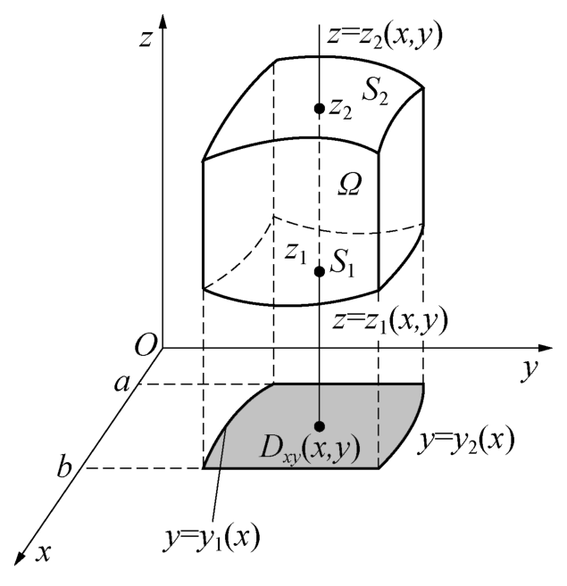

我们先把 $x$、$y$ 看作定值，将 $f(x,y,z)$ 看作只是 $z$ 的函数，在区间 $[z_1(x,y), z_2(x,y)]$ 上对 $z$ 做定积分，积分的结果事实上成为 $D_{xy}$ 上 $x$、$y$ 的函数，记为 $F(x,y)$，即

$$
F(x,y) = \int_{z_1(x,y)}^{z_2(x,y)} f(x,y,z)\,\mathrm{d}z.
$$

然后计算 $F(x,y)$ 在 $D_{xy}$ 上的二重积分，其结果就是三重积分 $\iiint_\Omega f(x,y,z)\,\mathrm{d}v$，即

$$
\iiint_\Omega f(x,y,z)\,\mathrm{d}v
= \iint_{D_{xy}} F(x,y)\,\mathrm{d}x\mathrm{d}y
= \iint_{D_{xy}}\left[\int_{z_1(x,y)}^{z_2(x,y)} f(x,y,z)\,\mathrm{d}z\right]\mathrm{d}x\mathrm{d}y. \qquad (2)
$$

此式右端这个先对 $z$ 的单积分，后对 $x$ 与 $y$ 的二重积分也常记作

$$
\iint_{D_{xy}} \mathrm{d}x\mathrm{d}y \int_{z_1(x,y)}^{z_2(x,y)} f(x,y,z)\,\mathrm{d}z.
$$

因此，式（2）也写作

$$
\iiint_\Omega f(x,y,z)\,\mathrm{d}v
= \iint_{D_{xy}} \mathrm{d}x\mathrm{d}y \int_{z_1(x,y)}^{z_2(x,y)} f(x,y,z)\,\mathrm{d}z.
$$

如果闭区域 $D_{xy}$ 又可以表示为 $D_{xy}=\{(x,y) \mid y_1(x) \leqslant y \leqslant y_2(x),\ a \leqslant x \leqslant b\}$，那么再把对 $x$ 与 $y$ 的二重积分化为二次积分，最终得到三重积分化为先对 $z$，次对 $y$，最后对 $x$ 的三次积分的一个计算式

$$
\iiint_\Omega f(x,y,z)\,\mathrm{d}v
= \int_a^b \mathrm{d}x \int_{y_1(x)}^{y_2(x)} \mathrm{d}y \int_{z_1(x,y)}^{z_2(x,y)} f(x,y,z)\,\mathrm{d}z.
$$

上述将三重积分化成三次积分是先做一个定积分，再做二重积分（二重积分再化为二次积分），这种方法称为投影法或先一后二法。

**例 1** 计算三重积分 $\iiint_\Omega x\,\mathrm{d}x\mathrm{d}y\mathrm{d}z$，其中 $\Omega$ 为三个坐标面及平面 $x+y+z=1$ 所围成的闭区域。

**解** 如图 7-34 所示，将区域 $\Omega$ 向 $xOy$ 面投影，得到投影区域 $D_{xy}$ 为三角形闭区域 $OAB$：$\{(x,y) \mid 0 \leqslant x \leqslant 1,\ 0 \leqslant y \leqslant 1-x\}$。

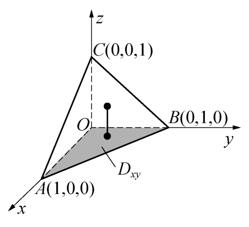

在 $D_{xy}$ 内任取一点 $(x,y)$，过此点作平行于 $z$ 轴的直线，该直线由平面 $z=0$ 穿入，由平面 $z=1-x-y$ 穿出，即有 $0 \leqslant z \leqslant 1-x-y$。所以

$$
\iiint_\Omega x\,\mathrm{d}x\mathrm{d}y\mathrm{d}z
= \iint_{D_{xy}} \mathrm{d}x\mathrm{d}y \int_0^{1-x-y} x\,\mathrm{d}z
= \int_0^1 \mathrm{d}x \int_0^{1-x} \mathrm{d}y \int_0^{1-x-y} x\,\mathrm{d}z
= \int_0^1 x\,\mathrm{d}x \int_0^{1-x}(1-x-y)\,\mathrm{d}y
$$

$$
= \frac{1}{2}\int_0^1 x(1-x)^2\,\mathrm{d}x
= \frac{1}{2}\int_0^1 (x-2x^2+x^3)\,\mathrm{d}x = \frac{1}{24}.
$$

**例 2** 计算三重积分 $I=\iiint_\Omega x\,\mathrm{d}x\mathrm{d}y\mathrm{d}z$，其中 $\Omega$ 为由双曲抛物面 $xy=z$ 及平面 $x+y-1=0$，$z=0$ 围成的闭区域。

**解** 空间立体 $\Omega$ 的顶部曲面 $z=xy$ 与底面 $z=0$ 的交线为 $x$ 轴和 $y$ 轴，故 $\Omega$ 在 $xOy$ 平面上的投影区域 $D_{xy}$ 由 $x$ 轴、$y$ 轴以及直线 $x+y-1=0$ 所围成（见图7-35），$D_{xy}$ 可表示为

$$
D_{xy} = \{(x,y) \mid 0 \leqslant x \leqslant 1,\ 0 \leqslant y \leqslant 1-x\},
$$

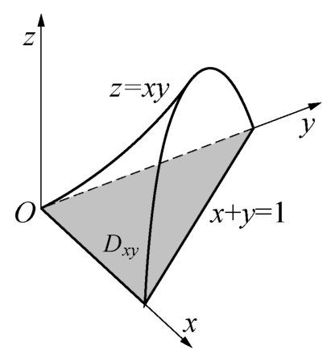

所以 $\Omega$ 可表示为

$$
\Omega = \{(x,y,z) \mid 0 \leqslant x \leqslant 1,\ 0 \leqslant y \leqslant 1-x,\ 0 \leqslant z \leqslant xy\}.
$$

则

$$
I = \int_0^1 \mathrm{d}x \int_0^{1-x} \mathrm{d}y \int_0^{xy} x\,\mathrm{d}z
= \int_0^1 \mathrm{d}x \int_0^{1-x} x\cdot xy\,\mathrm{d}y
$$

$$
= \int_0^1 x^2\cdot\frac{(1-x)^2}{2}\,\mathrm{d}x = -\frac{1}{60}.
$$

**例 3** 化三重积分 $I=\iiint_\Omega f(x,y,z)\,\mathrm{d}x\mathrm{d}y\mathrm{d}z$ 为先对 $z$，次对 $y$，最后对 $x$ 的三次积分，其中积分区域 $\Omega$ 为由曲面 $z=x^2+2y^2$ 及 $z=2-x^2$ 所围成的闭区域。

**解** 注意到题设两曲面的交线 $\begin{cases} z=x^2+2y^2, \\ z=2-x^2 \end{cases}$，消去 $z$ 得 $x^2+y^2=1$，故 $\Omega$ 在 $xOy$ 面上的投影为圆域 $D$：$x^2+y^2 \leqslant 1$，则 $D(x,y)=\{(x,y) \mid -1 \leqslant x \leqslant 1,\ -\sqrt{1-x^2} \leqslant y \leqslant \sqrt{1-x^2}\}$ 对 $D$ 内任一点 $(x,y)$，对应的 $z=z(x,y)$ 的取值范围为：$x^2+2y^2 \leqslant z \leqslant 2-x^2$。

所以

$$
I = \iint_D \mathrm{d}x\mathrm{d}y \int_{x^2+2y^2}^{2-x^2} f(x,y,z)\,\mathrm{d}z
= \int_{-1}^1 \mathrm{d}x \int_{-\sqrt{1-x^2}}^{\sqrt{1-x^2}} \mathrm{d}y \int_{x^2+2y^2}^{2-x^2} f(x,y,z)\,\mathrm{d}z.
$$

有时候，我们还可以把三重积分化为先对某两个变量的二重积分，后对第三个变量的定积分。例如，设区域 $\Omega$ 恰介于平面 $z=c_1$ 与 $z=c_2$ 之间，对于任意取定的 $z$，$c_1 \leqslant z \leqslant c_2$，用过点 $(0,0,z)$ 且平行于 $xOy$ 面的平面截 $\Omega$，得到一个平面闭区域 $D_z$，其中的点的竖坐标都同为 $z$（见图7-36）。

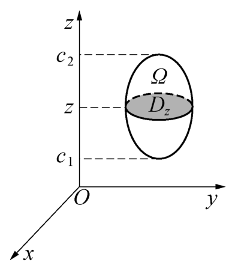

这样，$\Omega$ 也可以表示为

$$
\Omega = \{(x,y,z) \mid (x,y) \in D_z,\ c_1 \leqslant z \leqslant c_2\},
$$

则

$$
\iiint_\Omega f(x,y,z)\,\mathrm{d}v
= \int_{c_1}^{c_2}\left[\iint_{D_z} f(x,y,z)\,\mathrm{d}x\mathrm{d}y\right]\mathrm{d}z
= \int_{c_1}^{c_2} \mathrm{d}z \iint_{D_z} f(x,y,z)\,\mathrm{d}x\mathrm{d}y.
$$

这种计算三重积分的方法称为截面法或先二后一法。

**例 4** 计算三重积分 $\iiint_\Omega z\,\mathrm{d}x\mathrm{d}y\mathrm{d}z$，其中 $\Omega$ 为三个坐标面及平面 $x+y+z=1$ 所围成的闭区域。

**解** 通过 $z$ 轴上介于 $(0,0,0)$ 和 $(0,0,1)$ 之间的任一点 $(0,0,z)$，做平行于 $xOy$ 面的平面截 $\Omega$（见图7-37），得到一个三角形 $\begin{cases} x+y=1-z, \\ z=z, \end{cases}$ 截面 $D_z$：$0 \leqslant x+y \leqslant 1-z$，故

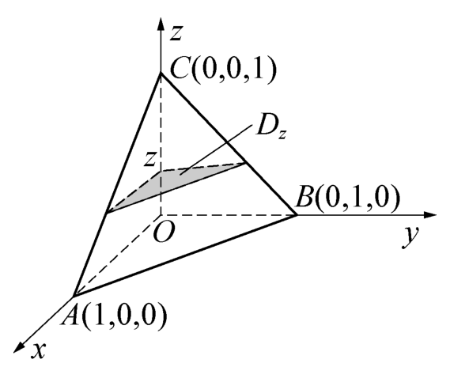

$$
\iiint_\Omega z\,\mathrm{d}x\mathrm{d}y\mathrm{d}z = \int_0^1 z\,\mathrm{d}z \iint_{D_z} \mathrm{d}x\mathrm{d}y,
$$

由于 $\iint_{D_z} \mathrm{d}x\mathrm{d}y = \frac{1}{2}(1-z)(1-z)$，

所以 $\iiint_\Omega z\,\mathrm{d}x\mathrm{d}y\mathrm{d}z = \int_0^1 z\cdot\frac{1}{2}(1-z)^2\,\mathrm{d}z = \frac{1}{24}$。

**例 5** 计算 $I=\iiint_\Omega z^2\,\mathrm{d}v$，其中 $\Omega$ 由 $z=x^2+y^2$ 与 $z=2$ 所围成。

**解** 通过 $z$ 轴上介于 $(0,0,0)$ 和 $(0,0,2)$ 之间的任一点 $(0,0,z)$，做平行于 $xOy$ 面的平面截 $\Omega$（见图7-38），得到一个圆形 $\begin{cases} x^2+y^2=z, \\ z=z, \end{cases}$ 截面 $D_z$：$0 \leqslant x^2+y^2 \leqslant z$，则

$$
I = \iiint_\Omega z^2\,\mathrm{d}v
= \int_0^2 z^2\,\mathrm{d}z \iint_{D_z} \mathrm{d}x\mathrm{d}y
= \int_0^2 z^2\cdot\pi z\,\mathrm{d}z
= \left[\frac{\pi}{4}z^4\right]_0^2 = 4\pi.
$$

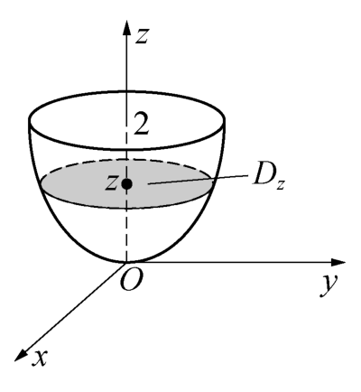

### 2. 利用柱面坐标计算三重积分

设 $M(x,y,z)$ 为空间内一点，点 $M$ 在 $xOy$ 面上的投影为点 $P$，点 $P$ 用极坐标表示为 $(r,\theta)$，则这样的三个数 $r$、$\theta$、$z$ 就叫作点 $M$ 的柱面坐标，规定 $r$、$\theta$、$z$ 的变化范围为

$$
0 \leqslant r < +\infty,\quad 0 \leqslant \theta \leqslant 2\pi,\quad -\infty < z < +\infty.
$$

$r=$ 常数，即表示以 $z$ 轴为轴的圆柱面；

$\theta=$ 常数，即表示过 $z$ 轴的半平面；

$z=$ 常数，即表示与 $xOy$ 面平行的平面。

直角坐标与柱面坐标的关系为

$$
x=r\cos\theta,\quad y=r\sin\theta,\quad z=z.
$$

这样三重积分从直角坐标系变化到柱面坐标系的公式为

$$
\iiint_\Omega f(x,y,z)\,\mathrm{d}v
= \iiint_\Omega f(r\cos\theta, r\sin\theta, z)\,r\,\mathrm{d}r\mathrm{d}\theta\mathrm{d}z.
$$

若设

$$
\Omega = \{(r,\theta,z) \mid z_1(r,\theta) \leqslant z \leqslant z_2(r,\theta),\ r_1(\theta) \leqslant r \leqslant r_2(\theta),\ \alpha \leqslant \theta \leqslant \beta\},
$$

将柱面坐标系下的三重积分化为三次积分，就有

$$
\iiint_\Omega f(x,y,z)\,\mathrm{d}v
= \int_\alpha^\beta \mathrm{d}\theta \int_{r_1(\theta)}^{r_2(\theta)} r\,\mathrm{d}r \int_{z_1(r,\theta)}^{z_2(r,\theta)} f(r\cos\theta, r\sin\theta, z)\,\mathrm{d}z.
$$

**例 6** 计算三重积分 $I=\iiint_\Omega z\,\mathrm{d}v$，其中区域 $\Omega$ 由球面 $z=\sqrt{4-x^2-y^2}$ 及旋转抛物面$x^2+y^2=3z$ 所围成。

**解** 由 $\begin{cases} x^2+y^2+z^2=4, \\ x^2+y^2=3z \end{cases}$ 得 $z=1$，故 $x^2+y^2=3$，令 $x=r\cos\theta$，$y=r\sin\theta$，则

$$
D_{r\theta} = \{(r,\theta) \mid 0 \leqslant \theta \leqslant 2\pi,\ 0 \leqslant r \leqslant \sqrt{3}\},
$$

利用柱面坐标系得球面和抛物面方程为 $z=\sqrt{4-r^2}$，$r^2=3z$，故 $\Omega=\left\{(r,\theta,z) \mathrel{\Big|} \frac{r^2}{3} \leqslant z \leqslant \sqrt{4-r^2},\ (r,\theta) \in D_{r\theta}\right\}$，则

$$
I = \iiint_\Omega z\,\mathrm{d}v
= \int_0^{2\pi} \mathrm{d}\theta \int_0^{\sqrt{3}} r\,\mathrm{d}r \int_{\frac{r^2}{3}}^{\sqrt{4-r^2}} z\,\mathrm{d}z
= 2\pi\int_0^{\sqrt{3}} \frac{1}{2}\left(4-r^2-\frac{r^4}{9}\right)r\,\mathrm{d}r = \frac{13}{4}\pi.
$$

本题也可以用截面法做，感兴趣的读者可以试一下。

### 三、三重积分的应用

### 1. 空间立体的体积

我们可以用三重积分来计算空间立体体积。

空间立体 $\Omega$ 的体积 $V=\iiint_\Omega \mathrm{d}v$。

**例 7** 求由平面 $x=0$，$y=0$，$z=0$，$3x+2y=6$ 及曲面 $z=3-\frac{1}{2}x^2$ 所围立体的体积。

**解** 空间立体在 $xOy$ 面上的投影区域 $D$ 由 $x=0$，$y=0$，$3x+2y=6$ 所围成（见图7-39）。故 $\Omega=\left\{(x,y,z) \mathrel{\Big|} 0 \leqslant z \leqslant 3-\frac{1}{2}x^2,\ (x,y) \in D\right\}$

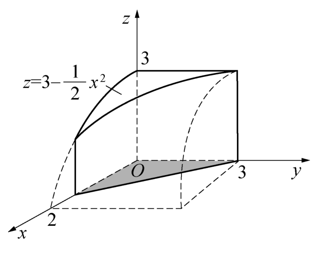

$$
V = \iiint_\Omega \mathrm{d}v
= \int_0^2 \mathrm{d}x \int_0^{\frac{1}{2}(6-3x)} \mathrm{d}y \int_0^{3-\frac{1}{2}x^2} \mathrm{d}z
$$

$$
= \int_0^2 \mathrm{d}x \int_0^{\frac{1}{2}(6-3x)}\left(3-\frac{1}{2}x^2\right)\mathrm{d}y
$$

$$
= \int_0^2 \frac{1}{2}(6-3x)\cdot\left(3-\frac{1}{2}x^2\right)\mathrm{d}x = 8.
$$

**注** 本题也可用二重积分求体积：

$$
V = \iint_D f(x,y)\,\mathrm{d}x\mathrm{d}y
= \int_0^2 \mathrm{d}x \int_0^{\frac{1}{2}(6-3x)}\left(3-\frac{1}{2}x^2\right)\mathrm{d}y.
$$

也可用定积分求体积（已知截面面积的立体体积）：

$$
A(x) = \frac{1}{2}(6-3x)\left(3-\frac{1}{2}x^2\right),\qquad V = \int_0^2 A(x)\,\mathrm{d}x.
$$

**例 8** 设 $a>0$，计算旋转抛物面 $x^2+y^2=az$，圆柱面 $x^2+y^2=2ax$ 与平面 $z=0$ 所围成的立体 $\Omega$ 的体积。

**解** 投影区域为 $D$：$0 \leqslant r \leqslant 2a\cos\theta$，$-\frac{\pi}{2} \leqslant \theta \leqslant \frac{\pi}{2}$（见图7-40），因此

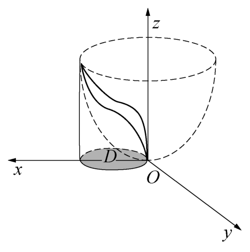

$$
V = \iiint_\Omega \mathrm{d}v
= \int_{-\frac{\pi}{2}}^{\frac{\pi}{2}} \mathrm{d}\theta \int_0^{2a\cos\theta} r\,\mathrm{d}r \int_0^{\frac{r^2}{a}} \mathrm{d}z
= \frac{1}{a}\int_{-\frac{\pi}{2}}^{\frac{\pi}{2}} \mathrm{d}\theta \int_0^{2a\cos\theta} r^3\,\mathrm{d}r
= 4a^3\int_{-\frac{\pi}{2}}^{\frac{\pi}{2}} \cos^4\theta\,\mathrm{d}\theta
$$

$$
= 8a^3\int_0^{\frac{\pi}{2}} \cos^4\theta\,\mathrm{d}\theta
= 8a^3\cdot\frac{3}{4}\cdot\frac{1}{2}\cdot\frac{\pi}{2} = \frac{3}{2}\pi a^3.
$$

### ＊2. 三重积分在物理中的应用

（1）空间物体的质量：

$$
m = \iiint_\Omega \rho(x,y,z)\,\mathrm{d}v,
$$

其中 $\rho=\rho(x,y,z)$ 为空间物体的体密度函数。

**例 9** 设常数 $a>0$，$h>0$，若立体 $\Omega$ 由平面 $z=0$，圆柱面 $\left(x-\frac{a}{2}\right)^2+y^2=\left(\frac{a}{2}\right)^2$ 以及锥面 $z=\frac{h}{a}\sqrt{x^2+y^2}$ 围成，其各点处的体密度等于该点到 $yOz$ 平面的距离的平方，求该立体 $\Omega$ 的质量。

**解**

$$
m = \iiint_\Omega x^2\,\mathrm{d}v
= \iint_D x^2\,\mathrm{d}x\mathrm{d}y \int_0^{\frac{h}{a}\sqrt{x^2+y^2}} \mathrm{d}z
= \frac{h}{a}\iint_D x^2\sqrt{x^2+y^2}\,\mathrm{d}x\mathrm{d}y
$$

$$
= \frac{2h}{a}\int_0^{\frac{\pi}{2}} \mathrm{d}\theta \int_0^{a\cos\theta} r^4\cos^2\theta\,\mathrm{d}r
= \frac{2ha^4}{5}\int_0^{\frac{\pi}{2}} \cos^7\theta\,\mathrm{d}\theta
= \frac{2ha^4}{5}\cdot\frac{6}{7}\cdot\frac{4}{5}\cdot\frac{2}{3}\cdot 1 = \frac{32}{175}ha^4.
$$

（2）空间物体的质心：

$$
\bar{x} = \frac{\iiint_\Omega x\rho(x,y,z)\,\mathrm{d}v}{\iiint_\Omega \rho(x,y,z)\,\mathrm{d}v},\qquad
\bar{y} = \frac{\iiint_\Omega y\rho(x,y,z)\,\mathrm{d}v}{\iiint_\Omega \rho(x,y,z)\,\mathrm{d}v},\qquad
\bar{z} = \frac{\iiint_\Omega z\rho(x,y,z)\,\mathrm{d}v}{\iiint_\Omega \rho(x,y,z)\,\mathrm{d}v}.
$$

空间立体的形心：

$$
\bar{x} = \frac{\iiint_\Omega x\,\mathrm{d}v}{\iiint_\Omega \mathrm{d}v},\qquad
\bar{y} = \frac{\iiint_\Omega y\,\mathrm{d}v}{\iiint_\Omega \mathrm{d}v},\qquad
\bar{z} = \frac{\iiint_\Omega z\,\mathrm{d}v}{\iiint_\Omega \mathrm{d}v}.
$$

**例 10** 求球心与锥体的顶点皆在原点，球体半径为 $\sqrt{2}$，锥体中心轴为 $z$ 轴，锥面与 $z$ 轴正向交角 $\alpha=45^\circ$ 的均匀球顶锥体的质心（见图7-41）。

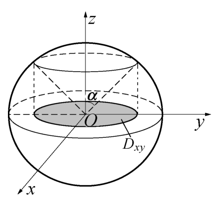

**解** 由于物体是均匀的，所求质心即为立体的形心。由对称性知，$\bar{x}=\bar{y}=0$，

又球面方程 $x^2+y^2+z^2=2$，锥面方程为 $z=\sqrt{x^2+y^2}$，交线的投影柱面为

$$
x^2+y^2=1.
$$

$$
\iiint_\Omega \mathrm{d}v = \int_0^{2\pi} \mathrm{d}\theta \int_0^1 r\,\mathrm{d}r \int_r^{\sqrt{2-r^2}} \mathrm{d}z = \frac{4\pi}{3}(\sqrt{2}-1),
$$

$$
\iiint_\Omega z\,\mathrm{d}v = \int_0^{2\pi} \mathrm{d}\theta \int_0^1 r\,\mathrm{d}r \int_r^{\sqrt{2-r^2}} z\,\mathrm{d}z = \frac{\pi}{2},
$$

故

$$
\bar{z} = \frac{\iiint_\Omega z\,\mathrm{d}v}{\iiint_\Omega \mathrm{d}v}
= \frac{\frac{\pi}{2}}{\frac{4\pi}{3}(\sqrt{2}-1)} = \frac{3}{8}(\sqrt{2}+1).
$$

**\*例 11** 求均匀球体 $x^2+y^2+z^2 \leqslant R^2$ 对三个坐标轴的转动惯量。

**解** 由于 $\rho=\rho(x,y,z)$ 是常数，由（区域及轮换）对称性知

$$
I_x = \iiint_\Omega \rho(y^2+z^2)\,\mathrm{d}v,\qquad
I_y = \iiint_\Omega \rho(x^2+z^2)\,\mathrm{d}v,\qquad
I_z = \iiint_\Omega \rho(x^2+y^2)\,\mathrm{d}v
$$

均相等，记 $I=I_x=I_y=I_z$，则

$$
I = \iiint_\Omega \rho(x^2+y^2)\,\mathrm{d}v
= \rho\int_0^{2\pi} \mathrm{d}\theta \int_0^R r\,\mathrm{d}r \int_{-\sqrt{R^2-r^2}}^{\sqrt{R^2-r^2}} r^2\,\mathrm{d}z
= \frac{8\rho}{15}\pi R^5.
$$

## 习题 7-2

1. 化三重积分 $I=\iiint_\Omega f(x,y,z)\,\mathrm{d}v$ 为三次积分（只需先对 $z$，次对 $y$，后对 $x$ 一种次序），其中积分区域 $\Omega$ 分别如下。

（1）由三个坐标面与平面 $6x+3y+2z-6=0$ 所围成；

（2）由旋转抛物面 $z=x^2+y^2$ 与平面 $z=1$ 所围成；

（3）由圆锥面 $z=\sqrt{x^2+y^2}$ 与上半球面 $z=\sqrt{2-x^2-y^2}$ 所围成；

（4）由双曲抛物面 $z=xy$ 与平面 $x+y=1$，$z=0$ 所围成。

2. 计算下列三重积分。

（1）$\iiint_\Omega xy\,\mathrm{d}v$，其中 $\Omega$ 是由三个坐标面与平面 $x+\frac{y}{2}+\frac{z}{3}=1$ 所围成的闭区域；

（2）$\iiint_\Omega x^2y^2\,\mathrm{d}v$，其中 $\Omega$ 是由平面 $x=1$，$y=x$，$y=-x$，$z=0$ 及 $z=x$ 所围成的闭区域；

（3）$\iiint_\Omega xyz\,\mathrm{d}v$，其中 $\Omega$ 是由双曲抛物面 $z=xy$ 与平面 $x=1$，$y=x$ 及 $z=0$ 所围成的闭区域；

（4）$\iiint_\Omega z^2\,\mathrm{d}v$，其中 $\Omega$ 是由上半球面 $z=\sqrt{1-x^2-y^2}$ 与平面 $z=0$ 所围成的闭区域；

（5）$\iiint_\Omega z^2\,\mathrm{d}v$，其中 $\Omega$ 是由球面 $x^2+y^2+z^2=2z$ 所围成的闭区域；

（6）$\iiint_\Omega z\,\mathrm{d}v$，其中 $\Omega$ 是由上半球面 $z=\sqrt{2-x^2-y^2}$ 与旋转抛物面 $z=x^2+y^2$ 所围成的闭区域；

（7）$\iiint_\Omega z\sqrt{x^2+y^2}\,\mathrm{d}v$，其中 $\Omega$ 是由旋转抛物面 $z=x^2+y^2$ 与平面 $z=1$ 所围成的闭区域；

（8）$\iiint_\Omega y\cos(x+z)\,\mathrm{d}v$，其中 $\Omega$ 是由抛物柱面 $y=\sqrt{x}$ 与平面 $y=0$，$z=0$ 及平面 $x+z=\frac{\pi}{2}$ 所围成的闭区域。

3. 在形状为 $z=x^2+y^2$ 的容器内，已盛有 $8\ \mathrm{cm}^3$ 的液体，现又倒入 $120\ \mathrm{cm}^3$ 的溶液，问液面比原来升高了多少？

4. 计算三重积分 $I=\iiint_\Omega (x+y+z)\,\mathrm{d}v$，其中区域 $\Omega$ 由平面 $\frac{x}{a}+\frac{y}{b}+\frac{z}{c}=1\ (a>0,\ b>0,\ c>0)$ 及三个坐标面所围成。

5. 计算三重积分 $I=\iiint_\Omega (x^2+y^2+z^2)\,\mathrm{d}v$，其中区域 $\Omega$ 由椭球面 $\frac{x^2}{a^2}+\frac{y^2}{b^2}+\frac{z^2}{c^2}=1$ 所围成。

6. 计算三重积分 $I=\iiint_\Omega (x^2+y^2)\,\mathrm{d}v$，其中区域 $\Omega$ 由平面曲线 $\begin{cases} y^2=2z, \\ x=0 \end{cases}$ 绕 $z$ 轴旋转一周而成的曲面与平面 $z=2$，$z=8$ 所围成。

7. 计算三重积分 $I=\iiint_\Omega (x+y+z)\,\mathrm{d}v$，其中区域 $\Omega$ 由球面 $z=\sqrt{4-x^2-y^2}$ 及旋转抛物面 $x^2+y^2=3z$ 所围成。

8. 计算三重积分 $I=\iiint_\Omega x^4y^2z^3\,\mathrm{d}v$，其中区域 $\Omega: x^2+y^2+z^2 \leqslant R^2$。

9. 设函数 $f(z)$ 连续，将三次积分 $\int_0^1 \mathrm{d}y\int_0^1 \mathrm{d}x\int_x^1 f(z)\,\mathrm{d}z$ 用定积分表示。

10. 设函数 $f(t)$ 连续，且 $f(0)=0$，$F(t)=\iiint_{\Omega_t}[z^2+f(\sqrt{x^2+y^2})]\,\mathrm{d}v$，其中 $\Omega_t=\{(x,y,z) \mid x^2+y^2 \leqslant t^2,\ 0 \leqslant z \leqslant 1\}$，求 $\lim\limits_{t \to 0^+}\frac{F(t)}{t^2}$。

11. 求闭曲线 $\Gamma: (x^2+y^2)^3=a^2(x^4+y^4)\ (a>0)$ 所围区域的面积。

12. 密度为 1 的立体由曲面 $x^2+y^2-z^2=1$ 及平面 $z=0$，$z=\sqrt{3}$ 围成，求它对 $z$ 轴的转动惯量。

13. 设密度为常量 $\rho$ 的均质物体占据由抛物面 $z=3-x^2-y^2$ 与平面 $|x|=1$，$|y|=1$，$z=0$ 所围成的闭区域，试求：

（1）物体的质量；

（2）物体的质心；

（3）物体对于 $z$ 轴的转动惯量。

## 第三节　对弧长的曲线积分与对坐标的曲线积分

[课前导读]

在工程技术与物理学中，常常要遇到计算非均匀曲线状或曲面状构件的质量、质点受变力作用下沿曲线运动而做功及流体通过曲面的流量等问题，要解决这类问题，就要推广积分范围。

在前面两节中，我们已经对积分范围作了推广，例如定积分的积分范围是数轴上的区间，二重积分的积分范围为平面闭区域，三重积分的积分范围为空间立体。现在我们要把积分范围推广到一段曲线（我们讨论的都是有限长度的曲线弧），这就是本节所要介绍的曲线积分。

### 一、对弧长的曲线积分（第一类曲线积分）

**曲线形构件的质量**　在设计曲线形构件时，为了合理使用材料，应根据构件各部分受力的情况，把构件上各点处的粗细程度设计得不完全一样。因此，可以认为曲线形构件的线密度（单位长度的质量）是变量。

假设在 $xOy$ 平面上有一曲线形构件，设曲线弧 $\widehat{AB}$ 的长为 $L$，线密度为连续函数 $\rho=\rho(x,y)$，$(x,y)\in\widehat{AB}$。若构件的线密度 $\rho$ 是常数（均匀质点），则构件的质量 $m=\rho L$；若构件的线密度 $\rho=\rho(x,y)$ 是变量（非均匀质体），就不能直接用上述方法计算其质量。

可用点 $M_1$，$M_2$，$\cdots$，$M_{n-1}$ 将曲线弧 $\widehat{AB}$ 分成 $n$ 个小弧段 $\Delta s_i\ (i=1,2,\cdots,n)$，$\Delta s_i$ 也表示该小弧段的弧长。

对于每一小段构件，由于线密度连续变化，所以，只要其长度足够短，就可以用这一小段上任一点处的线密度代替这一小段上其他各点处的线密度。即任取 $(x_i,y_i)\in\Delta s_i$（见图7-42），得到这一小段构件 $\Delta s_i$ 的质量 $\Delta m_i$ 的近似值为 $\rho(x_i,y_i)\Delta s_i\ (i=1,2,\cdots,n)$，从而曲线形构件的质量为

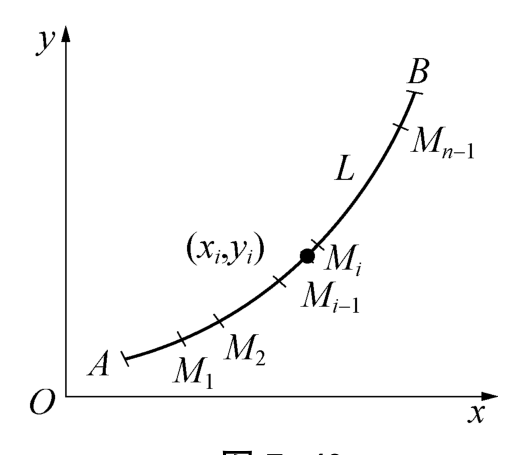

$$
m=\sum_{i=1}^{n}\Delta m_i\approx\sum_{i=1}^{n}\rho(x_i,y_i)\Delta s_i,
$$

取 $\lambda=\max\limits_{1\leqslant i\leqslant n}\{\Delta s_i\}$，当分点无限增多且 $\lambda\to 0$ 时，此和式极限就是该曲线形构件的质量，即

$$
m=\lim_{\lambda\to 0}\sum_{i=1}^{n}\rho(x_i,y_i)\Delta s_i.
$$

抛开这个问题的物理意义，对此和式极限进行抽象，就得到第一类曲线积分的定义。

### 1. 对弧长曲线积分的概念与性质

**定义 1**　设 $L$ 为 $xOy$ 平面上一条光滑（或分段光滑）的曲线弧，函数 $f(x,y)$ 在 $L$ 上有界，在 $L$ 上任意取点 $M_1$，$M_2$，$\cdots$，$M_{n-1}$ 将 $L$ 分成 $n$ 段小弧，记 $\Delta s_i=\widehat{M_{i-1}M_i}\ (i=1,2,\cdots,n)$（$\Delta s_i$ 也为该段的弧长），任取 $(x_i,y_i)\in\Delta s_i\ (i=1,2,\cdots,n)$，$\lambda=\max\limits_{1\leqslant i\leqslant n}\{\Delta s_i\}$，若 $\lim\limits_{\lambda\to 0}\sum\limits_{i=1}^{n}f(x_i,y_i)\Delta s_i$ 存在，则称此极限为函数 $f(x,y)$ 在 $L$ 上对弧长的曲线积分或第一类曲线积分，记作 $\int_L f(x,y)\,\mathrm{d}s$。

若 $L$ 是封闭曲线，那么函数 $f(x,y)$ 在闭曲线上对弧长 $L$ 的曲线积分通常记为

$$
\oint_L f(x,y)\,\mathrm{d}s.
$$

可以证明：若 $f(x,y)$ 在光滑曲线弧 $L$ 上连续，则 $f(x,y)$ 在 $L$ 上的曲线积分 $\int_L f(x,y)\,\mathrm{d}s$ 一定存在。以后，我们总假定 $f(x,y)$ 在光滑曲线弧 $L$ 上连续。

上述定义完全可以推广到空间曲线 $\Gamma$ 的情形：

$$
\int_\Gamma f(x,y,z)\,\mathrm{d}s=\lim_{\lambda\to 0}\sum_{i=1}^{n}f(x_i,y_i,z_i)\Delta s_i.
$$

我们把对弧长的曲线积分的定义与定积分、重积分的定义加以比较，就可以知道，对弧长的曲线积分与定积分、重积分有着完全类似的性质。我们只叙述一下以下对计算有着重要作用的两个性质。

**性质 1（线性）**　设 $\alpha$、$\beta$ 是常数，则

$$
\int_L[\alpha f(x,y)+\beta g(x,y)]\,\mathrm{d}s=\alpha\int_L f(x,y)\,\mathrm{d}s+\beta\int_L g(x,y)\,\mathrm{d}s.
$$

**性质 2（对区间的可加性）**　设曲线弧 $L$ 由 $L_1$ 和 $L_2$ 组成，则

$$
\int_L f(x,y)\,\mathrm{d}s=\int_{L_1}f(x,y)\,\mathrm{d}s+\int_{L_2}f(x,y)\,\mathrm{d}s.
$$

### 2. 对弧长的曲线积分的计算方法

对弧长的曲线积分可以化为定积分来计算，具体方法由下述定理给出。

**定理 1**　设二元函数 $f(x,y)$ 在曲线弧 $L$ 上连续，平面曲线 $L=\widehat{AB}$ 的参数方程为

$$
\begin{cases}
x=\varphi(t),\\
y=\psi(t),
\end{cases}
\qquad \alpha\leqslant t\leqslant\beta,
$$

其中 $\varphi(t)$、$\psi(t)$ 及 $\varphi'(t)$、$\psi'(t)$ 在 $[\alpha,\beta]$ 上连续，且 $\varphi'^2(t)+\psi'^2(t)\neq 0$，则

$$
\int_L f(x,y)\,\mathrm{d}s=\int_\alpha^\beta f(\varphi(t),\psi(t))\sqrt{\varphi'^2(t)+\psi'^2(t)}\,\mathrm{d}t\ (\alpha<\beta).\qquad (1)
$$

定理的证明从略。

**注**　公式（1）表明，计算对弧长的曲线积分 $\int_L f(x,y)\,\mathrm{d}s$ 时，只需将 $x$、$y$、$\mathrm{d}s$ 依次替换为 $\varphi(t)$、$\psi(t)$、$\sqrt{\varphi'^2(t)+\psi'^2(t)}\,\mathrm{d}t$，然后从 $\alpha$ 到 $\beta$ 作定积分即可。必须注意的是积分下限 $\alpha$ 一定要小于积分上限 $\beta$。

如果平面曲线 $L=\widehat{AB}$ 的方程为 $y=y(x)$，$a\leqslant x\leqslant b\ (a<b)$，其中 $y(x)$ 在 $[a,b]$ 上具有一阶连续导数，$f(x,y)$ 在 $L$ 上连续，则

$$
\int_L f(x,y)\,\mathrm{d}s=\int_a^b f(x,y(x))\sqrt{1+y'^2(x)}\,\mathrm{d}x.
$$

**注**　将 $y=y(x)$ 看作

$$
\begin{cases}
x=x,\\
y=y(x),
\end{cases}
\quad a\leqslant x\leqslant b,
$$

再利用公式（1）即可。

如果平面曲线 $L=\widehat{AB}$ 的方程用极坐标表示：

$$
r=r(\theta),\ \alpha\leqslant\theta\leqslant\beta\ (\alpha<\beta),
$$

其中 $r(\theta)$ 在 $[\alpha,\beta]$ 上具有一阶连续导数，$f(x,y)$ 在 $L$ 上连续，则

$$
\int_L f(x,y)\,\mathrm{d}s=\int_\alpha^\beta f(r(\theta)\cos\theta,\ r(\theta)\sin\theta)\sqrt{r^2(\theta)+r'^2(\theta)}\,\mathrm{d}\theta.
$$

**注**　可以把极坐标转化为参数方程形式

$$
\begin{cases}
x=r(\theta)\cos\theta,\\
y=r(\theta)\sin\theta,
\end{cases}
\quad \alpha\leqslant\theta\leqslant\beta,
$$

再利用公式（1）。

对空间曲线弧 $\Gamma$ 上的曲线积分 $\int_\Gamma f(x,y,z)\,\mathrm{d}s$，有着相似的计算结果。

**定理 2**　三元函数 $f(x,y,z)$ 在空间曲线弧 $\Gamma$ 上连续，设空间曲线 $\Gamma=\widehat{AB}$ 的参数方程为

$$
\begin{cases}
x=\varphi(t),\\
y=\psi(t),\\
z=\omega(t),
\end{cases}
\quad \alpha\leqslant t\leqslant\beta,
$$

其中 $\varphi(t)$、$\psi(t)$、$\omega(t)$ 及 $\varphi'(t)$、$\psi'(t)$、$\omega'(t)$ 在 $[\alpha,\beta]$ 上连续，且 $\varphi'^2(t)+\psi'^2(t)+\omega'^2(t)\neq 0$，则

$$
\int_\Gamma f(x,y,z)\,\mathrm{d}s=\int_\alpha^\beta f(\varphi(t),\psi(t),\omega(t))\sqrt{\varphi'^2(t)+\psi'^2(t)+\omega'^2(t)}\,\mathrm{d}t\ (\alpha<\beta).
$$

定理的证明从略。

**例 1**　计算 $\int_L\sqrt{y}\,\mathrm{d}s$，其中 $L$ 是抛物线 $y=x^2$ 上点 $O(0,0)$ 与点 $B(1,1)$ 之间的一段弧。

**解**　如图 7-43 所示，$L$ 的方程为

$$
y=x^2\ (0\leqslant x\leqslant 1),
$$

$$
\mathrm{d}s=\sqrt{1+(x^2)'^2}\,\mathrm{d}x=\sqrt{1+4x^2}\,\mathrm{d}x.
$$

因此

$$
\begin{aligned}
\int_L\sqrt{y}\,\mathrm{d}s&=\int_0^1\sqrt{x^2}\cdot\sqrt{1+4x^2}\,\mathrm{d}x\\
&=\int_0^1 x\sqrt{1+4x^2}\,\mathrm{d}x\\
&=\left[\frac{1}{12}(1+4x^2)^{\frac{3}{2}}\right]_0^1=\frac{1}{12}(5\sqrt{5}-1).
\end{aligned}
$$

**例 2**　计算曲线积分 $I=\int_L (x^2+y^2)\,\mathrm{d}s$，其中 $L$ 是中心在 $(R,0)$、半径为 $R$ 的上半圆周（见图 7-44）。

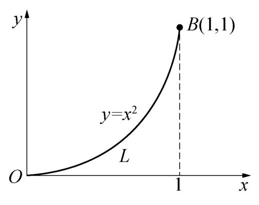

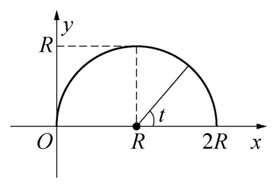

**解**　由于上半圆周的参数方程为

$$
\begin{cases}
x=R(1+\cos t),\\
y=R\sin t,
\end{cases}
\quad (0\leqslant t\leqslant\pi),
$$

所以

$$
\begin{aligned}
I&=\int_L (x^2+y^2)\,\mathrm{d}s\\
&=\int_0^\pi\left[R^2(1+\cos t)^2+R^2\sin^2t\right]\sqrt{(-R\sin t)^2+(R\cos t)^2}\,\mathrm{d}t\\
&=2R^3\int_0^\pi(1+\cos t)\,\mathrm{d}t=2R^3\left[t+\sin t\right]_0^\pi\\
&=2\pi R^3.
\end{aligned}
$$

**例 3**　计算曲线积分 $\oint_L\sqrt{x^2+y^2}\,\mathrm{d}s$，其中 $L:x^2+y^2=ax\ (a>0)$（见图 7-45）。

**解**　这道题也可以像例 2 一样，用圆的参数方程来做。现在我们选择极坐标，要注意两种方程的差别。

设

$$
\begin{cases}
x=r\cos\theta,\\
y=r\sin\theta,
\end{cases}
\quad L: r=a\cos\theta\left(-\frac{\pi}{2}\leqslant\theta\leqslant\frac{\pi}{2}\right),
$$

即

$$
\begin{cases}
x=a\cos^2\theta,\\
y=a\cos\theta\sin\theta,
\end{cases}
\quad \mathrm{d}s=a\,\mathrm{d}\theta,
$$

则

$$
\oint_L\sqrt{x^2+y^2}\,\mathrm{d}s=\int_{-\frac{\pi}{2}}^{\frac{\pi}{2}}a^2\cos\theta\,\mathrm{d}\theta=2a^2.
$$

**例 4**　计算曲线积分 $\int_L y^2\,\mathrm{d}s$，其中 $L$ 为摆线的一拱：$x=a(t-\sin t)$，$y=a(1-\cos t)$，$(0\leqslant t\leqslant 2\pi)$（见图 7-46）。

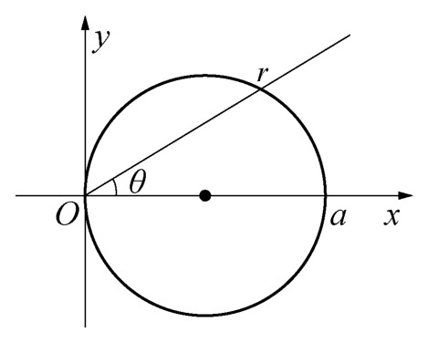

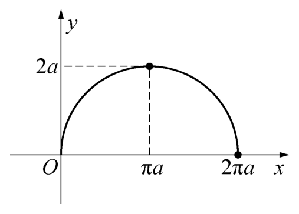

**解**

$$
\int_L y^2\,\mathrm{d}s=\int_0^{2\pi}\left[a(1-\cos t)\right]^2\sqrt{a^2(1-\cos t)^2+a^2\sin^2t}\,\mathrm{d}t
$$

$$
\begin{aligned}
&=a^3\int_0^{2\pi}(1-\cos t)^2\sqrt{2-2\cos t}\,\mathrm{d}t=8a^3\int_0^{2\pi}\sin^5\frac{t}{2}\,\mathrm{d}t\\
&=-16a^3\int_0^{2\pi}\left(1-\cos^2\frac{t}{2}\right)^2\mathrm{d}\left(\cos\frac{t}{2}\right)\\
&=-16a^3\int_0^{2\pi}\left(1-2\cos^2\frac{t}{2}+\cos^4\frac{t}{2}\right)\mathrm{d}\left(\cos\frac{t}{2}\right)\\
&=-16a^3\left[\cos\frac{t}{2}-\frac{2}{3}\cos^3\frac{t}{2}+\frac{1}{5}\cos^5\frac{t}{2}\right]_0^{2\pi}=\frac{256}{15}a^3.
\end{aligned}
$$

**例 5**　计算曲线积分 $\oint_L (x+y)\,\mathrm{d}s$，其中 $L$ 为连接三点 $O(0,0)$、$A(1,0)$、$B(1,1)$ 的封闭折线段 $OABO$（见图 7-47）。

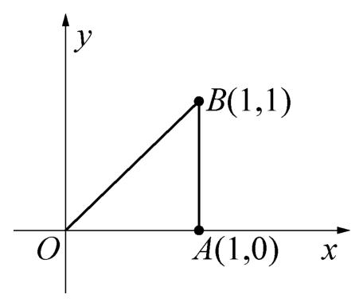

**解**

$$
\oint_L (x+y)\,\mathrm{d}s=\int_{\overline{OA}}(x+y)\,\mathrm{d}s+\int_{\overline{AB}}(x+y)\,\mathrm{d}s+\int_{\overline{BO}}(x+y)\,\mathrm{d}s.
$$

在 $\overline{OA}$ 上，$y=0\ (0\leqslant x\leqslant 1)$，$\mathrm{d}s=\mathrm{d}x$，$\int_{\overline{OA}}(x+y)\,\mathrm{d}s=\int_0^1 x\,\mathrm{d}x=\frac{1}{2}$；

在 $\overline{AB}$ 上，$x=1\ (0\leqslant y\leqslant 1)$，$\mathrm{d}s=\mathrm{d}y$，$\int_{\overline{AB}}(x+y)\,\mathrm{d}s=\int_0^1(1+y)\,\mathrm{d}y=\frac{3}{2}$；

在 $\overline{BO}$ 上，$y=x\ (0\leqslant x\leqslant 1)$，$\mathrm{d}s=\sqrt{1+1^2}\,\mathrm{d}x=\sqrt{2}\,\mathrm{d}x$，$\int_{\overline{BO}}(x+y)\,\mathrm{d}s=\int_0^1 2x\sqrt{2}\,\mathrm{d}x=\sqrt{2}$。

故

$$
\oint_L (x+y)\,\mathrm{d}s=\frac{1}{2}+\frac{3}{2}+\sqrt{2}=2+\sqrt{2}.
$$

**例 6**　计算曲线积分 $\int_\Gamma (x^2+y^2+z^2)\,\mathrm{d}s$，其中 $\Gamma$ 为螺旋线 $x=a\cos t$，$y=a\sin t$，$z=kt$ 上相应于 $t$ 从 0 到 $2\pi$ 的一段弧（见图 7-48）。

**解**

$$
\begin{aligned}
\int_\Gamma (x^2+y^2+z^2)\,\mathrm{d}s&=\int_0^{2\pi}\left[(a\cos t)^2+(a\sin t)^2+(kt)^2\right]\sqrt{(-a\sin t)^2+(a\cos t)^2+k^2}\,\mathrm{d}t\\
&=\int_0^{2\pi}\left[a^2+k^2t^2\right]\sqrt{a^2+k^2}\,\mathrm{d}t\\
&=\sqrt{a^2+k^2}\left[a^2t+\frac{k^2}{3}t^3\right]_0^{2\pi}\\
&=\frac{2}{3}\pi\sqrt{a^2+k^2}\left(3a^2+4\pi^2k^2\right).
\end{aligned}
$$

**例 7**　求 $I=\int_\Gamma x^2\,\mathrm{d}s$，其中 $\Gamma$ 为球面 $x^2+y^2+z^2=a^2$ 被平面 $x+y+z=0$ 所截得的圆周（见图 7-49）。

**解**　由对称性，知

$$
\int_\Gamma x^2\,\mathrm{d}s=\int_\Gamma y^2\,\mathrm{d}s=\int_\Gamma z^2\,\mathrm{d}s,
$$

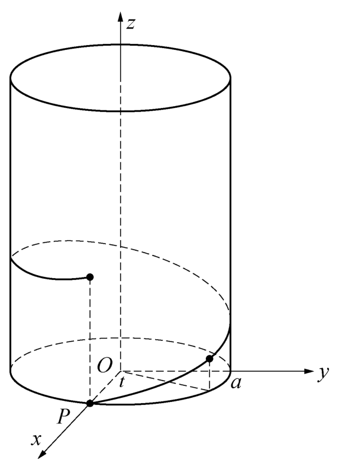

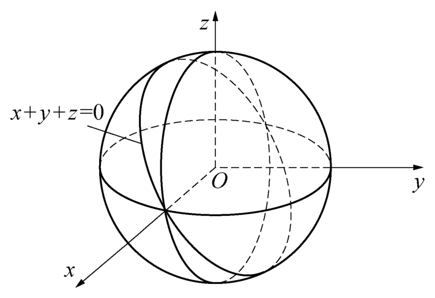

所以

$$
I=\frac{1}{3}\int_\Gamma (x^2+y^2+z^2)\,\mathrm{d}s=\frac{1}{3}\int_\Gamma a^2\,\mathrm{d}s
$$

$$
=\frac{a^2}{3}\int_\Gamma \mathrm{d}s=\frac{2\pi a^3}{3},
$$

其中 $\int_\Gamma \mathrm{d}s=2\pi a$ 为球面的大圆周长。

### 3. 对弧长曲线积分的物理应用

设曲线形构件在 $xOy$ 面上占据的位置是一段曲线弧 $L$，在 $L$ 上的点 $(x,y)$ 处构件的线密度为 $\rho(x,y)$，且 $\rho(x,y)$ 在 $L$ 上连续，则和解决平面薄片的同类问题一样，应用元素法，就可以得到平面曲线形构件的质量为

$$
m=\int_L\rho(x,y)\,\mathrm{d}s.
$$

曲线形构件的质心坐标为

$$
\bar{x}=\frac{\int_L x\rho(x,y)\,\mathrm{d}s}{M},\quad \bar{y}=\frac{\int_L y\rho(x,y)\,\mathrm{d}s}{M}.
$$

如果是匀质的曲线形构件，则对应的形心公式为

$$
\bar{x}=\frac{\int_L x\,\mathrm{d}s}{\int_L \mathrm{d}s},\quad \bar{y}=\frac{\int_L y\,\mathrm{d}s}{\int_L \mathrm{d}s}.
$$

曲线形构件对于 $xOy$ 面上的 $x$ 轴和 $y$ 轴的转动惯量分别为

$$
I_x=\int_L y^2\rho(x,y)\,\mathrm{d}s,\quad I_y=\int_L x^2\rho(x,y)\,\mathrm{d}s.
$$

类似地，我们也可以得到空间曲线积分所对应的质量、质心和转动惯量。

**例 8**　计算半径为 $R$，中心角为 $2\alpha$ 的圆弧 $L$ 对于它的对称轴的转动惯量（设线密度 $\rho=1$）。

**解**　取坐标系如图 7-50 所示，则

$$
I=\int_L y^2\,\mathrm{d}s.
$$

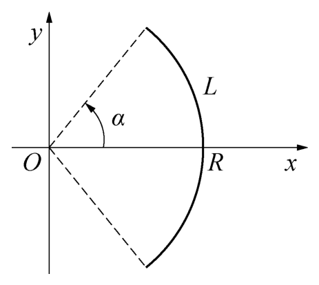

为计算方便，利用 $L$ 的参数方程

$$
x=R\cos t,\quad y=R\sin t\ (-\alpha\leqslant t\leqslant\alpha).
$$

故

$$
\begin{aligned}
I&=\int_L y^2\,\mathrm{d}s=\int_{-\alpha}^{\alpha}R^2\sin^2t\sqrt{(-R\sin t)^2+(R\cos t)^2}\,\mathrm{d}t\\
&=R^3\int_{-\alpha}^{\alpha}\sin^2t\,\mathrm{d}t=\frac{R^3}{2}\left[t-\frac{\sin 2t}{2}\right]_{-\alpha}^{\alpha}\\
&=\frac{R^3}{2}(2\alpha-\sin 2\alpha)=R^3(\alpha-\sin\alpha\cos\alpha).
\end{aligned}
$$

### 二、对坐标的曲线积分（第二类曲线积分）

**质点受变力作用沿平面曲线运动做功问题**　在定积分中，质点受变力 $\boldsymbol{F}=\boldsymbol{F}(x)$（方向与 $x$ 正向一致）作用沿直线（$x$ 轴）从点 $A$ 运动到点 $B$（见图 7-51）所做的功为

$$
W=\int_a^b F(x)\,\mathrm{d}x.
$$

若 $\boldsymbol{F}$ 为常力，质点沿有向线段 $\overrightarrow{AB}$ 从点 $A$ 运动到点 $B$，设 $\theta$ 为 $\boldsymbol{F}$ 与 $\overrightarrow{AB}$ 的夹角（见图 7-52），则有

$$
W=|\boldsymbol{F}|\cos\theta\,|\overrightarrow{AB}|=\boldsymbol{F}\cdot\overrightarrow{AB}.
$$

现在考虑质点受变力 $\boldsymbol{F}(x,y)=P(x,y)\boldsymbol{i}+Q(x,y)\boldsymbol{j}$ 作用沿平面曲线 $L=\widehat{AB}$ 运动做功问题。

将 $\widehat{AB}$ 任意地分成 $n$ 个小弧段 $\Delta s_i=\widehat{M_{i-1}M_i}\ (i=1,2,\cdots,n)$，当每个小弧段的长度很小时，我们取其中一小弧段 $\widehat{M_{i-1}M_i}$ 来考虑（见图 7-53），以

$$
\boldsymbol{F}(\xi_i,\eta_i)=P(\xi_i,\eta_i)\boldsymbol{i}+Q(\xi_i,\eta_i)\boldsymbol{j}
$$

近似替代小弧段 $\widehat{M_{i-1}M_i}$ 上各点处受到的力，则变力 $\boldsymbol{F}$ 在 $\widehat{M_{i-1}M_i}$ 所做的功为

$$
\begin{aligned}
\Delta W_i&\approx\boldsymbol{F}(\xi_i,\eta_i)\cdot\overrightarrow{M_{i-1}M_i}=(P(\xi_i,\eta_i),\ Q(\xi_i,\eta_i))\cdot(\Delta x_i,\ \Delta y_i)\\
&=P(\xi_i,\eta_i)\Delta x_i+Q(\xi_i,\eta_i)\Delta y_i,
\end{aligned}
$$

于是 $W=\sum\limits_{i=1}^{n}W_i\approx\sum\limits_{i=1}^{n}[P(\xi_i,\eta_i)\Delta x_i+Q(\xi_i,\eta_i)\Delta y_i]$，令 $\lambda=\max\limits_{1\leqslant i\leqslant n}(\Delta s_i)$，则有

$$
W=\lim_{\lambda\to 0}\sum_{i=1}^{n}[P(\xi_i,\eta_i)\Delta x_i+Q(\xi_i,\eta_i)\Delta y_i].
$$

抛开这个问题的物理意义，对此和式极限进行讨论，就得到第二类曲线积分的定义。

### 1. 对坐标的曲线积分的概念与性质

**定义 2**　设 $L$ 为 $xOy$ 平面上从点 $A$ 到点 $B$ 的一条有向光滑（或分段光滑）的曲线弧，函数 $P(x,y)$、$Q(x,y)$ 在 $L$ 上有界，在 $L$ 上沿 $L$ 的方向任意取点 $M_1(x_1,y_1)$，$M_2(x_2,y_2)$，$\cdots$，$M_{n-1}(x_{n-1},y_{n-1})$ 将 $L$ 分成 $n$ 段小弧，记 $\Delta s_i=\widehat{M_{i-1}M_i}$，$\Delta x_i=x_i-x_{i-1}$，$\Delta y_i=y_i-y_{i-1}\ (i=1,2,\cdots,n)$，$M_0(x_0,y_0)=A$，$M_n(x_n,y_n)=B$），$\Delta s_i$ 也为该段的弧长。$\lambda=\max\limits_{1\leqslant i\leqslant n}\{\Delta s_i\}$，任取 $(\xi_i,\eta_i)\in\Delta s_i\ (i=1,2,\cdots,n)$，若 $\lim\limits_{\lambda\to 0}\sum\limits_{i=1}^{n}P(\xi_i,\eta_i)\Delta x_i$ 存在，则称此极限为函数 $P(x,y)$ 在有向曲线弧 $L$ 上对坐标 $x$ 的曲线积分，记作 $\int_L P(x,y)\,\mathrm{d}x$；同理，若 $\lim\limits_{\lambda\to 0}\sum\limits_{i=1}^{n}Q(\xi_i,\eta_i)\Delta y_i$ 存在，则称此极限为函数 $Q(x,y)$ 在有向曲线弧 $L$ 上对坐标 $y$ 的曲线积分，记作 $\int_L Q(x,y)\,\mathrm{d}y$，即

$$
\int_L P(x,y)\,\mathrm{d}x=\lim_{\lambda\to 0}\sum_{i=1}^{n}P(\xi_i,\eta_i)\Delta x_i,
$$

$$
\int_L Q(x,y)\,\mathrm{d}y=\lim_{\lambda\to 0}\sum_{i=1}^{n}Q(\xi_i,\eta_i)\Delta y_i,
$$

其中 $P(x,y)$、$Q(x,y)$ 称为被积函数，称 $L$ 为有向曲线弧段或有向积分路径。

以上两个积分也称为第二类曲线积分。

如果是分段光滑的有向曲线弧，那么规定函数在 $L$ 上对坐标的曲线积分等于该函数在 $L$ 的各光滑弧上对坐标的曲线积分之和。此后我们总是假定有向积分曲线弧是光滑的或分段光滑的。

可以证明，若 $P(x,y)$、$Q(x,y)$ 在有向光滑曲线弧 $L$ 上连续，则 $\int_L P(x,y)\,\mathrm{d}x$，$\int_L Q(x,y)\,\mathrm{d}y$ 存在，且可记

$$
\int_L P(x,y)\,\mathrm{d}x+\int_L Q(x,y)\,\mathrm{d}y=\int_L P(x,y)\,\mathrm{d}x+Q(x,y)\,\mathrm{d}y;
$$

也可以写成向量形式

$$
\int_L \boldsymbol{F}(x,y)\cdot\mathrm{d}\boldsymbol{r},
$$

其中 $\boldsymbol{F}(x,y)=P(x,y)\boldsymbol{i}+Q(x,y)\boldsymbol{j}$ 为向量值函数，$\mathrm{d}\boldsymbol{r}=\mathrm{d}x\,\boldsymbol{i}+\mathrm{d}y\,\boldsymbol{j}$ 为有向曲线弧元素。

根据对坐标的曲线积分的定义与存在条件，质点受力场 $\boldsymbol{F}(x,y)=P(x,y)\boldsymbol{i}+Q(x,y)\boldsymbol{j}$ 的作用，沿平面曲线 $L=\widehat{AB}$ 从点 $A$ 移动到点 $B$ 时所做的功为

$$
W=\int_L \boldsymbol{F}\cdot\mathrm{d}\boldsymbol{s}=\int_{\widehat{AB}}P(x,y)\,\mathrm{d}x+Q(x,y)\,\mathrm{d}y,
$$

其中 $\mathrm{d}\boldsymbol{s}=(\mathrm{d}x,\ \mathrm{d}y)$。

对坐标的曲线积分也具有对于计算起到重要作用的线性性质和积分弧段的可加性质。借助向量的形式，设下面的向量值函数在有向曲线弧 $L$ 上连续（当且仅当对应的分量函数都连续），则这两个性质可以表示如下。

**性质 3（线性）**　设 $\alpha$、$\beta$ 是常数，则

$$
\int_L[\alpha\boldsymbol{F}_1(x,y)+\beta\boldsymbol{F}_2(x,y)]\cdot\mathrm{d}\boldsymbol{r}=\alpha\int_L\boldsymbol{F}_1(x,y)\cdot\mathrm{d}\boldsymbol{r}+\beta\int_L\boldsymbol{F}_2(x,y)\cdot\mathrm{d}\boldsymbol{r}.
$$

**性质 4（对区间的可加性）**　设有向曲线弧 $L$ 由两段有向曲线弧 $L_1$ 和 $L_2$ 组成，则

$$
\int_L\boldsymbol{F}(x,y)\cdot\mathrm{d}\boldsymbol{r}=\int_{L_1}\boldsymbol{F}(x,y)\cdot\mathrm{d}\boldsymbol{r}+\int_{L_2}\boldsymbol{F}(x,y)\cdot\mathrm{d}\boldsymbol{r}.
$$

对坐标的曲线积分还有一个特有的性质如下。

**性质 5（方向性）**　设 $L$ 是有向曲线弧，$L^-$ 是 $L$ 反向曲线弧，则有

$$
\int_{L^-}P(x,y)\,\mathrm{d}x+Q(x,y)\,\mathrm{d}y=-\int_L P(x,y)\,\mathrm{d}x+Q(x,y)\,\mathrm{d}y.
$$

这个性质表示，当积分的弧段的方向改变时，对坐标的曲线积分要改变符号。因此，对于对坐标的曲线积分，必须注意积分弧段的方向。

定义 2 可以类似地推广到积分弧段为空间有向曲线弧 $\Gamma$（总假定 $\Gamma$ 光滑且具有有限长度）的情形：

$$
\int_\Gamma P(x,y,z)\,\mathrm{d}x=\lim_{\lambda\to 0}\sum_{i=1}^{n}P(\xi_i,\eta_i,\zeta_i)\Delta x_i,
$$

$$
\int_\Gamma Q(x,y,z)\,\mathrm{d}y=\lim_{\lambda\to 0}\sum_{i=1}^{n}Q(\xi_i,\eta_i,\zeta_i)\Delta y_i,
$$

$$
\int_\Gamma R(x,y,z)\,\mathrm{d}z=\lim_{\lambda\to 0}\sum_{i=1}^{n}R(\xi_i,\eta_i,\zeta_i)\Delta z_i.
$$

积分存在的条件、性质等都可以类似地推广到空间曲线弧的情形。同样，应用中经常出现的是

$$
\int_\Gamma P(x,y,z)\,\mathrm{d}x+\int_\Gamma Q(x,y,z)\,\mathrm{d}y+\int_\Gamma R(x,y,z)\,\mathrm{d}z
$$

这种合并起来的形式，故也可简便地把上式写成

$$
\int_\Gamma P(x,y,z)\,\mathrm{d}x+Q(x,y,z)\,\mathrm{d}y+R(x,y,z)\,\mathrm{d}z,
$$

或者更简便地写成向量的形式

$$
\int_\Gamma\boldsymbol{A}(x,y,z)\cdot\mathrm{d}\boldsymbol{r},
$$

其中 $\boldsymbol{A}(x,y,z)=P(x,y,z)\boldsymbol{i}+Q(x,y,z)\boldsymbol{j}+R(x,y,z)\boldsymbol{k}$，$\mathrm{d}\boldsymbol{r}=\mathrm{d}x\,\boldsymbol{i}+\mathrm{d}y\,\boldsymbol{j}+\mathrm{d}z\,\boldsymbol{k}$。

### 2. 对坐标的曲线积分的计算方法

对坐标的曲线积分也是化为定积分来计算的。下面的定理给出了具体的计算方法。

**定理 3**　设函数 $P(x,y)$、$Q(x,y)$ 在有向曲线弧 $L$ 上有定义且连续。平面曲线 $L=\widehat{AB}$ 的参数方程为 $\begin{cases}x=\varphi(t),\\y=\psi(t),\end{cases}$，当参数 $t$ 单调地由 $\alpha$ 变到 $\beta$ 时，相应的点 $M(x,y)$ 从起点 $A$ 沿 $L$ 运动到终点 $B$，$\varphi(t)$、$\psi(t)$ 及 $\varphi'(t)$、$\psi'(t)$ 在以 $\alpha$、$\beta$ 为端点的区间上连续，且$\varphi'^2(t)+\psi'^2(t)\neq 0$，则曲线积分 $\int_L P(x,y)\,\mathrm{d}x+Q(x,y)\,\mathrm{d}y$ 存在，且

$$
\int_L P(x,y)\,\mathrm{d}x+Q(x,y)\,\mathrm{d}y=\int_\alpha^\beta[P(\varphi(t),\psi(t))\varphi'(t)+Q(\varphi(t),\psi(t))\psi'(t)]\,\mathrm{d}t.
$$

定理的证明从略。

上述公式表明，计算对坐标的曲线积分 $\int_L P(x,y)\,\mathrm{d}x+Q(x,y)\,\mathrm{d}y$ 时，只需把 $x$、$y$、$\mathrm{d}x$、$\mathrm{d}y$ 依次换为 $\varphi(t)$、$\psi(t)$、$\varphi'(t)\,\mathrm{d}t$、$\psi'(t)\,\mathrm{d}t$，然后从 $L$ 的起点所对应的参数值 $\alpha$ 到 $L$ 的终点所对应的参数值 $\beta$ 作定积分即可。必须注意的是：积分下限 $\alpha$ 一定要对应于 $L$ 的起点，而积分上限 $\beta$ 一定要对应于 $L$ 的终点，$\alpha$ 不一定小于 $\beta$。

当平面曲线 $L=\widehat{AB}$ 由 $y=y(x)$，$x:a\to b$ 给出，其中 $a$ 对应起始点，$b$ 对应终点，$y(x)$ 在 $[a,b]$ 上具有一阶连续导数，$P(x,y)$、$Q(x,y)$ 在 $L$ 上连续，则

$$
\int_L P(x,y)\,\mathrm{d}x+Q(x,y)\,\mathrm{d}y=\int_a^b[P(x,y(x))+Q(x,y(x))y'(x)]\,\mathrm{d}x.
$$

**定理 4**　设空间曲线 $\Gamma=\widehat{AB}$ 的参数方程为

$$
\begin{cases}
x=\varphi(t),\\
y=\psi(t),\\
z=\omega(t),
\end{cases}
\quad t:\alpha\to\beta,
$$

其中 $\alpha$ 对应起始点，$\beta$ 对应终点，$\varphi(t)$、$\psi(t)$、$\omega(t)$ 及 $\varphi'(t)$、$\psi'(t)$、$\omega'(t)$ 在 $[\alpha,\beta]$ 上连续，$P(x,y,z)$、$Q(x,y,z)$、$R(x,y,z)$ 在 $\Gamma$ 上连续，则

$$
\begin{aligned}
&\int_\Gamma P(x,y,z)\,\mathrm{d}x+Q(x,y,z)\,\mathrm{d}y+R(x,y,z)\,\mathrm{d}z\\
={}&\int_\alpha^\beta[P(\varphi(t),\psi(t),\omega(t))\varphi'(t)+Q(\varphi(t),\psi(t),\omega(t))\psi'(t)\\
&+R(\varphi(t),\psi(t),\omega(t))\omega'(t)]\,\mathrm{d}t.
\end{aligned}
$$

这里也必须注意的是：积分下限 $\alpha$ 一定要对应于 $\Gamma$ 的起点，积分上限 $\beta$ 一定对应 $\Gamma$ 的终点。

**例 9**　计算 $\int_L xy\,\mathrm{d}x$，其中 $L$ 为曲线 $y^2=x$ 上从 $A(1,-1)$ 到 $B(1,1)$ 的一段弧。

**解法一**　把曲线积分化为对 $x$ 的定积分来计算，由 $y^2=x$ 可知，$y=\pm\sqrt{x}$。为此要把 $L$ 分为有向弧 $\widehat{AO}$ 与 $\widehat{OB}$ 两部分（见图 7-54）。$\widehat{AO}$ 的方程为 $y=-\sqrt{x}$，当 $x$ 由 1 变为 0 时，相应的点沿 $\widehat{AO}$ 从点 $A$ 运动到点 $O$；$\widehat{OB}$ 的方程为 $y=\sqrt{x}$，当 $x$ 由 0 变为 1 时，相应的点沿 $\widehat{OB}$ 从点 $O$ 运动到点 $B$。于是

$$
\begin{aligned}
\int_L xy\,\mathrm{d}x&=\int_{\widehat{AO}}xy\,\mathrm{d}x+\int_{\widehat{OB}}xy\,\mathrm{d}x=\int_1^0 x(-\sqrt{x})\,\mathrm{d}x+\int_0^1 x\sqrt{x}\,\mathrm{d}x\\
&=2\int_0^1 x^{\frac{3}{2}}\,\mathrm{d}x=\frac{4}{5}.
\end{aligned}
$$

**解法二**　将曲线积分化为对 $y$ 的定积分来计算，$L$ 的方程为 $x=y^2$，当 $y$ 从 $-1$ 变到 1时，相应的点沿 $L$ 从起点 $A$ 运动到终点 $B$。于是

$$
\int_L xy\,\mathrm{d}x=\int_{\widehat{AB}}xy\,\mathrm{d}x=\int_{-1}^1 y^2y(y^2)'\,\mathrm{d}y=2\int_{-1}^1 y^4\,\mathrm{d}y=\frac{4}{5}.
$$

显然，解法二较为简单。

**例 10**　计算曲线积分 $\int_L (2a-y)\,\mathrm{d}x+x\,\mathrm{d}y$，其中 $L$ 为摆线

$$
\begin{cases}
x=a(t-\sin t),\\
y=a(1-\cos t),
\end{cases}
\quad (0\leqslant t\leqslant 2\pi)
$$

的一拱，其中 $O$ 为起点，$A$ 为终点（见图 7-55）。

**解**　将曲线积分转化为关于参数 $t$ 的定积分来计算。

$$
\begin{aligned}
\int_L (2a-y)\,\mathrm{d}x+x\,\mathrm{d}y&=\int_0^{2\pi}\{[2a-a(1-\cos t)]a(1-\cos t)+a(t-\sin t)a\sin t\}\,\mathrm{d}t\\
&=\int_0^{2\pi}a^2t\sin t\,\mathrm{d}t=-a^2[t\cos t-\sin t]_0^{2\pi}=-2\pi a^2.
\end{aligned}
$$

**例 11**　计算曲线积分 $\int_L xy\,\mathrm{d}x+y^2\,\mathrm{d}y$，其中 $L=\widehat{AB}$ 分别如下（见图 7-56）。

（1）从点 $A(1,0)$ 沿直线到点 $B(0,1)$；

（2）从点 $A(1,0)$ 沿圆周 $x=\cos t$，$y=\sin t\left(0\leqslant t\leqslant\frac{\pi}{2}\right)$ 到点 $B(0,1)$；

（3）从点 $A(1,0)$ 沿 $x$ 轴到 $O(0,0)$ 再沿 $y$ 轴到点 $B(0,1)$。

**解**　（1）直线 $L$ 的方程为 $x+y=1$，即 $y=1-x$，当自变量 $x$ 由 1 变为 0 时，相应的点沿直线 $\overline{AB}$ 从点 $A$ 运动到点 $B$，于是

$$
\begin{aligned}
\int_L xy\,\mathrm{d}x+y^2\,\mathrm{d}y&=\int_1^0 x(1-x)\,\mathrm{d}x+(1-x)^2(-\mathrm{d}x)=\int_1^0(3x-2x^2-1)\,\mathrm{d}x\\
&=\left[\frac{3}{2}x^2-\frac{2}{3}x^3-x\right]_1^0=\frac{1}{6}.
\end{aligned}
$$

（2）曲线 $L$ 的参数方程为 $x=\cos t$，$y=\sin t\left(0\leqslant t\leqslant\frac{\pi}{2}\right)$，当参数 $t$ 由 0 变为 $\frac{\pi}{2}$ 时，相应的点沿曲线 $\widehat{AB}$ 从点 $A$ 运动到点 $B$，于是

$$
\int_L xy\,\mathrm{d}x+y^2\,\mathrm{d}y=\int_0^{\frac{\pi}{2}}[\cos t\sin t(-\sin t)+\sin^2t\cos t]\,\mathrm{d}t=\int_0^{\frac{\pi}{2}}0\,\mathrm{d}t=0.
$$

（3）有向折线 $\overline{AOB}$ 分为两部分：$\overline{AO}$ 和 $\overline{OB}$，故对应的曲线积分为

$$
\int_L xy\,\mathrm{d}x+y^2\,\mathrm{d}y=\int_{\overline{AO}}xy\,\mathrm{d}x+y^2\,\mathrm{d}y+\int_{\overline{OB}}xy\,\mathrm{d}x+y^2\,\mathrm{d}y.
$$

在有向直线 $\overline{AO}$ 上，$y=0$，自变量 $x$ 由 1 变为 0，故

$$
\int_{\overline{AO}}xy\,\mathrm{d}x+y^2\,\mathrm{d}y=\int_1^0 0\,\mathrm{d}x+0=0;
$$

在有向直线 $\overline{OB}$ 上，$x=0$，自变量 $y$ 由 0 变为 1，故

$$
\int_{\overline{OB}}xy\,\mathrm{d}x+y^2\,\mathrm{d}y=0+\int_0^1 y^2\,\mathrm{d}y=\frac{1}{3},
$$

因此

$$
\int_L xy\,\mathrm{d}x+y^2\,\mathrm{d}y=\int_{\overline{AO}}xy\,\mathrm{d}x+y^2\,\mathrm{d}y+\int_{\overline{OB}}xy\,\mathrm{d}x+y^2\,\mathrm{d}y=\frac{1}{3}.
$$

**注**　在本题中被积函数、积分曲线的起点及终点均相同，但积分曲线（路径）不同，积分的结果也不同。

**例 12**　计算曲线积分 $\int_L 2xy\,\mathrm{d}x+x^2\,\mathrm{d}y$，其中 $L=\widehat{OB}$ 分别如下（见图 7-57）。

（1）从点 $O(0,0)$ 沿直线到点 $B(1,1)$；

（2）从点 $O(0,0)$ 沿曲线 $y=x^3$ 到点 $B(1,1)$；

（3）从点 $O(0,0)$ 沿 $x$ 轴到点 $C(1,0)$ 再沿直线到点 $B(1,1)$；

（4）从点 $O(0,0)$ 沿 $y$ 轴到点 $D(0,1)$ 再沿直线到点 $B(1,1)$。

**解**　（1）直线 $L$ 的方程为 $y=x$，当自变量 $x$ 由 0 变为 1 时，相应的点沿直线 $\overline{OB}$ 从点 $O$ 运动到点 $B$，于是

$$
\int_L 2xy\,\mathrm{d}x+x^2\,\mathrm{d}y=\int_0^1(2x\cdot x+x^2)\,\mathrm{d}x=\int_0^1 3x^2\,\mathrm{d}x=[x^3]_0^1=1.
$$

（2）曲线 $L$ 的方程为 $y=x^3$，当自变量 $x$ 由 0 变为 1 时，相应的点沿曲线 $\widehat{OB}$ 从点 $O$ 运动到点 $B$，于是

$$
\int_L 2xy\,\mathrm{d}x+x^2\,\mathrm{d}y=\int_0^1(2x\cdot x^3+x^2\cdot 3x^2)\,\mathrm{d}x=\int_0^1 5x^4\,\mathrm{d}x=[x^5]_0^1=1.
$$

（3）在直线段 $\overline{OC}$ 上，$y=0$，自变量 $x$ 由 0 变为 1，于是

$$
\int_{\overline{OC}}2xy\,\mathrm{d}x+x^2\,\mathrm{d}y=\int_0^1 0\,\mathrm{d}x+0=0;
$$

在直线段 $\overline{CB}$ 上，$x=1$，自变量 $y$ 由 0 变为 1，于是

$$
\int_{\overline{CB}}2xy\,\mathrm{d}x+x^2\,\mathrm{d}y=\int_0^1 0+1\cdot\mathrm{d}y=1,
$$

因此

$$
\int_L 2xy\,\mathrm{d}x+x^2\,\mathrm{d}y=\int_{\overline{OC}}2xy\,\mathrm{d}x+x^2\,\mathrm{d}y+\int_{\overline{CB}}2xy\,\mathrm{d}x+x^2\,\mathrm{d}y=0+1=1.
$$

（4）在直线段 $\overline{OD}$ 上，$x=0$，自变量 $y$ 由 0 变为 1，于是

$$
\int_{\overline{OD}}2xy\,\mathrm{d}x+x^2\,\mathrm{d}y=\int_0^1 0\,\mathrm{d}y=0;
$$

在直线段 $\overline{DB}$ 上，$y=1$，自变量 $x$ 由 0 变为 1，于是

$$
\int_{\overline{DB}}2xy\,\mathrm{d}x+x^2\,\mathrm{d}y=\int_0^1 2x\,\mathrm{d}x+0=[x^2]_0^1=1,
$$

因此

$$
\int_L 2xy\,\mathrm{d}x+x^2\,\mathrm{d}y=\int_{\overline{OD}}2xy\,\mathrm{d}x+x^2\,\mathrm{d}y+\int_{\overline{DB}}2xy\,\mathrm{d}x+x^2\,\mathrm{d}y=0+1=1.
$$

**注**　在本题中被积函数、积分曲线的起点及终点均相同，虽然积分曲线（路径）不同，但积分的结果却相同。

**例 13**　计算 $\int_\Gamma x\,\mathrm{d}x+y\,\mathrm{d}y+(x+y-1)\,\mathrm{d}z$，$\Gamma$ 为点 $A(2,3,4)$ 到点 $B(1,1,1)$ 的空间有向线段。

**解**　直线 $AB$ 的方程为 $\frac{x-1}{1}=\frac{y-1}{2}=\frac{z-1}{3}$，改写为参数方程为

$$
x=t+1,\quad y=2t+1,\quad z=3t+1\ (0\leqslant t\leqslant 1),
$$

$t=1$ 对应着起点 $A$，$t=0$ 对应着终点 $B$，于是

$$
\begin{aligned}
&\int_\Gamma x\,\mathrm{d}x+y\,\mathrm{d}y+(x+y-1)\,\mathrm{d}z\\
={}&\int_1^0[(t+1)+2(2t+1)+3(3t+1)]\,\mathrm{d}t\\
={}&\int_1^0(14t+6)\,\mathrm{d}t\\
={}&-13.
\end{aligned}
$$

**例 14**　求质点在力 $\boldsymbol{F}(x,y)=x^2\boldsymbol{i}-xy\boldsymbol{j}$ 的作用下沿着曲线 $L$

$$
x=\cos t,\quad y=\sin t
$$

从点 $A(1,0)$ 移动到点 $B(0,1)$ 时所做的功。

**解**　注意到对于 $L$ 的方向，参数 $t$ 从 0 变到 $\frac{\pi}{2}$（见图 7-58），所以

$$
\begin{aligned}
W&=\int_{\widehat{AB}}x^2\,\mathrm{d}x-xy\,\mathrm{d}y\\
&=\int_0^{\frac{\pi}{2}}\cos^2t\,\mathrm{d}\cos t-\cos t\sin t\,\mathrm{d}\sin t\\
&=\int_0^{\frac{\pi}{2}}(-2\cos^2t\sin t)\,\mathrm{d}t\\
&=2\left[\frac{\cos^3t}{3}\right]_0^{\frac{\pi}{2}}=-\frac{2}{3}.
\end{aligned}
$$

### 3. 两类曲线积分的关系

虽然上面讨论的两类积分有着不同的背景及不同的特征，但在一定的条件下，它们之间是有联系的。现在我们来揭示平面情形中这两类曲线积分之间的联系。

设平面有向曲线弧 $L=\widehat{AB}:\begin{cases}x=\varphi(t),\\y=\psi(t),\end{cases}\ t:\alpha\to\beta$，其中 $\alpha$ 对应起点 $A$，$\beta$ 对应终点 $B$，不妨设 $\alpha<\beta$（若 $\alpha>\beta$，可令 $s=-t$，$A$、$B$ 对应 $s=-\alpha$，$s=-\beta$，就有 $(-\alpha)<(-\beta)$，将下面的讨论对 $s$ 进行即可），并设 $\varphi(t)$、$\psi(t)$ 在 $[\alpha,\beta]$ 上具有一阶连续导数，且 $\varphi'^2(t)+\psi'^2(t)\neq 0$，$P(x,y)$、$Q(x,y)$ 在 $L$ 上连续，则

$$
\int_L P(x,y)\,\mathrm{d}x+Q(x,y)\,\mathrm{d}y=\int_\alpha^\beta[P(\varphi(t),\psi(t))\varphi'(t)+Q(\varphi(t),\psi(t))\psi'(t)]\,\mathrm{d}t.
$$

已知 $\boldsymbol{\tau}=(\varphi'(t),\psi'(t))$ 是曲线弧 $L$ 在点 $M(\varphi(t),\psi(t))$ 处的一个切向量，它的指向与参数 $t$ 的增长方向一致，当 $\alpha<\beta$ 时，这个指向就是有向曲线弧 $L=\widehat{AB}$ 的方向。以后，我们称这种指向与有向曲线弧的方向一致的切向量为有向曲线弧的切向量。于是，有向曲线弧 $L=\widehat{AB}$ 的切向量为 $\boldsymbol{\tau}=(\varphi'(t),\psi'(t))$，其方向余弦为

$$
\cos\alpha=\frac{\varphi'(t)}{\sqrt{\varphi'^2(t)+\psi'^2(t)}},\quad \cos\beta=\frac{\psi'(t)}{\sqrt{\varphi'^2(t)+\psi'^2(t)}}.
$$

对弧长的曲线积分为

$$
\begin{aligned}
&\int_L(P(x,y)\cos\alpha+Q(x,y)\cos\beta)\,\mathrm{d}s\\
={}&\left[P(\varphi(t),\psi(t))\int_\alpha^\beta\frac{\varphi'(t)}{\sqrt{\varphi'^2(t)+\psi'^2(t)}}\right.\\
&\left.+Q(\varphi(t),\psi(t))\frac{\psi'(t)}{\sqrt{\varphi'^2(t)+\psi'^2(t)}}\right]\sqrt{\varphi'^2(t)+\psi'^2(t)}\,\mathrm{d}t\\
={}&\int_\alpha^\beta[P(\varphi(t),\psi(t))\varphi'(t)+Q(\varphi(t),\psi(t))\psi'(t)]\,\mathrm{d}t,
\end{aligned}
$$

故

$$
\int_L P\,\mathrm{d}x+Q\,\mathrm{d}y=\int_L(P\cos\alpha+Q\cos\beta)\,\mathrm{d}s,
$$

其中 $\alpha(x,y)$、$\beta(x,y)$ 为有向曲线弧 $L$ 在点 $(x,y)$ 处的切向量的方向角。

两类曲线积分的关系也可用向量的形式表达，比如空间的情形可写成：

$$
\int_\Gamma\boldsymbol{A}\cdot\mathrm{d}\boldsymbol{r}=\int_\Gamma\boldsymbol{A}\cdot\boldsymbol{\tau}\,\mathrm{d}s,\quad\text{或}\quad\int_\Gamma\boldsymbol{A}\cdot\mathrm{d}\boldsymbol{r}=\int_\Gamma A_\tau\,\mathrm{d}s,
$$

其中 $\boldsymbol{A}=(P,Q,R)$，$\boldsymbol{\tau}=(\cos\alpha,\cos\beta,\cos\gamma)$ 为有向曲线弧 $L$ 在点 $(x,y,z)$ 处的单位切向量，$\mathrm{d}\boldsymbol{r}=\boldsymbol{\tau}\,\mathrm{d}s=(\mathrm{d}x,\mathrm{d}y,\mathrm{d}z)$ 称为有向曲线元，$A_\tau$ 为向量 $\boldsymbol{A}$ 在向量 $\boldsymbol{\tau}$ 上的投影。

类似地，在空间有

$$
\int_\Gamma P\,\mathrm{d}x+Q\,\mathrm{d}y+R\,\mathrm{d}z=\int_\Gamma(P\cos\alpha+Q\cos\beta+R\cos\gamma)\,\mathrm{d}s,
$$

其中 $\alpha(x,y,z)$、$\beta(x,y,z)$、$\gamma(x,y,z)$ 为空间有向曲线弧 $\Gamma$ 在点 $(x,y,z)$ 处的切向量的方向角。

**例 15**　设 $L$ 为从点 $(0,0)$ 沿曲线 $y=\sqrt{2x-x^2}$ 到点 $(1,1)$ 的曲线弧，化第二类曲线积分 $\int_L P(x,y)\,\mathrm{d}x+Q(x,y)\,\mathrm{d}y$ 为第一类曲线积分。

**解**　$L:x^2+y^2=2x$，两边关于 $x$ 求导得 $2x+2yy'=2$，即

$$
y'=\frac{1-x}{y},
$$

$$
\mathrm{d}s=\sqrt{1+y'^2}\,\mathrm{d}x=\sqrt{1+\left(\frac{1-x}{y}\right)^2}\,\mathrm{d}x=\frac{1}{y}\,\mathrm{d}x,
$$

故 $\cos\alpha=\frac{\mathrm{d}x}{\mathrm{d}s}=y=\sqrt{2x-x^2}$，$\sin\alpha=\sqrt{1-\cos^2\alpha}=\sqrt{1-y^2}=1-x$，因此

$$
\int_L P(x,y)\,\mathrm{d}x+Q(x,y)\,\mathrm{d}y=\int_L\left[P(x,y)\sqrt{2x-x^2}+Q(x,y)(1-x)\right]\mathrm{d}s.
$$

## 习题 7-3

1. 计算下列对弧长的曲线积分。

（1）$\oint_L (x^2+y^2)^n\,\mathrm{d}s$，其中 $L$ 为圆周 $x^2+y^2=a^2\ (x\geqslant 0,\ y\geqslant 0)$；

（2）$\int_L\sqrt{y}\,\mathrm{d}s$，其中 $L$ 为抛物线 $y=x^2$ 介于点 $(0,0)$ 与点 $(1,1)$ 之间的那一段弧；

（3）$\int_L x\sin y\,\mathrm{d}s$，其中 $L$ 为连接点 $(0,0)$ 与点 $(3\pi,\pi)$ 的直线段；

（4）$\int_L y\,\mathrm{d}s$，其中 $L$ 为抛物线 $y^2=4x$ 上连接点 $(0,0)$ 与点 $(1,2)$ 的直线段；

（5）$\int_L x\,\mathrm{d}s$，其中 $L$ 为抛物线 $y=2x^2-1$ 上连接点 $(0,0)$ 与点 $(1,2)$ 的一段弧；

（6）$\int_L (x+y)\,\mathrm{d}s$，其中 $L$ 为连接点 $(1,0)$ 与点 $(0,1)$ 的直线段；

（7）$\oint_L x\,\mathrm{d}s$，其中 $L$ 为直线 $y=x$ 与抛物线 $y=x^2$ 所围成的区域的整个边界；

（8）$\oint_L |y|\,\mathrm{d}s$，其中 $L$ 为圆周 $x^2+y^2=1$；

（9）$\int_L\sqrt{R^2-x^2-y^2}\,\mathrm{d}s$，其中 $L$ 为上半圆周 $x^2+y^2=Rx$，$y\geqslant 0$；

（10）$\oint_L e^{\sqrt{x^2+y^2}}\,\mathrm{d}s$，其中 $L$ 为圆周 $x^2+y^2=4$，直线 $y=x$ 及 $x$ 轴在第一象限内所围成的区域的整个边界；

（11）$\oint_L xy\,\mathrm{d}s$，其中 $L$ 为直线 $x=0$，$y=0$，$x=4$，$y=2$ 所围成的矩形区域的整个边界；

（12）$\int_L y^2\,\mathrm{d}s$，其中 $L$ 为摆线的一拱 $\begin{cases}x=a(t-\sin t),\\y=a(1-\cos t),\end{cases}(0\leqslant t\leqslant 2\pi)$；

（13）$\oint_L\sqrt{x^2+y^2}\,\mathrm{d}s$，其中 $L$ 为上半圆周 $x^2+y^2=2x\ (y\geqslant 0)$ 与 $x$ 轴在第一象限内所围成的区域的整个边界；

（14）$\int_\Gamma\frac{1}{x^2+y^2+z^2}\,\mathrm{d}s$，其中 $\Gamma$ 为曲线 $x=e^t\cos t$，$y=e^t\sin t$，$z=e^t$ 相应于 $t$ 从 0 变到 2 的一段弧；

（15）$\int_\Gamma xyz\,\mathrm{d}s$，其中 $\Gamma$ 为有向折线段 $OAB$，点 $O$、$A$、$B$ 的坐标依次为 $(0,0,0)$，$(1,2,3)$，$(1,4,3)$；

（16）$\oint_\Gamma |y|\,\mathrm{d}s$，其中 $\Gamma$ 为球面 $x^2+y^2+z^2=2$ 与平面 $x=y$ 的交线；

（17）$\oint_L (x+y)e^{x^2+y^2}\,\mathrm{d}s$，其中 $L$ 为圆弧 $y=\sqrt{a^2-x^2}$ 与直线 $y=x$，$y=-x$ 所围成的扇形区域的整个边界。

2. 计算下列对坐标的曲线积分。

（1）$\int_L (x^2-y^2)\,\mathrm{d}x$，其中 $L$ 为抛物线 $y=x^2$ 上从点 $O(0,0)$ 到点 $A(2,4)$ 的一段弧；

（2）$\oint_L x^2y^2\,\mathrm{d}x+xy^2\,\mathrm{d}y$，其中 $L$ 为直线 $x=1$ 与抛物线 $x=y^2$ 围成的区域的边界（按逆时针方向绕行）；

（3）$\oint_L y\,\mathrm{d}x$，其中 $L$ 为直线 $x=0$，$y=0$，$x=4$ 及 $y=2$ 围成的矩形区域的整个边界（按逆时针方向绕行）；

（4）$\int_L y\,\mathrm{d}x+x\,\mathrm{d}y$，其中 $L$ 为圆周 $x=R\cos t$，$y=R\sin t$ 上对应于 $t$ 从 0 到 $\frac{\pi}{2}$ 的一段弧；

（5）$\oint_L (x+y)^2\,\mathrm{d}y$，其中 $L$ 为圆周 $x^2+y^2=2ax\ (a>0)$（按逆时针方向绕行）；

（6）$\oint_L\frac{(x+y)\,\mathrm{d}x+(y-x)\,\mathrm{d}y}{x^2+y^2}$，其中 $L$ 为圆周 $x^2+y^2=a^2$（按逆时针方向绕行）；

（7）$\int_L (1+2xy)\,\mathrm{d}x+x^2\,\mathrm{d}y$，其中 $L$ 为从点 $(1,0)$ 到点 $(-1,0)$ 的上半椭圆周 $x^2+2y^2=1\ (y\geqslant 0)$；

（8）$\int_L (x+y)\,\mathrm{d}x+xy\,\mathrm{d}y$，其中 $L$ 为折线段 $y=1-|1-x|$ 上从点 $(0,0)$ 到点 $(2,0)$ 的一段；

（9）$\int_L (2a-y)\,\mathrm{d}x-(a-y)\,\mathrm{d}y$，其中 $L$ 为摆线 $\begin{cases}x=a(t-\sin t),\\y=a(1-\cos t)\end{cases}$ 上从点 $(0,0)$ 到点 $(2\pi a,0)$ 的一段弧；

（10）$\int_\Gamma x\,\mathrm{d}x+y\,\mathrm{d}y+z\,\mathrm{d}z$，其中 $\Gamma$ 为从点 $(1,1,1)$ 到点 $(2,3,4)$ 的直线段；

（11）$\oint_\Gamma \mathrm{d}x-\mathrm{d}y+y\,\mathrm{d}z$，其中 $\Gamma$ 为定向闭折线 $ABCA$，这里的 $A$、$B$、$C$ 依次为点 $(1,0,0)$，$(0,1,0)$，$(0,0,1)$；

（12）$\int_\Gamma y\,\mathrm{d}x+z\,\mathrm{d}y+x\,\mathrm{d}z$，其中 $\Gamma$ 为螺旋线 $x=a\cos t$，$y=a\sin t$，$z=kt$ 上相应于 $t$ 从 0 到 $2\pi$ 的一段弧；

（13）$\int_\Gamma y\,\mathrm{d}x+x\,\mathrm{d}y+z\,\mathrm{d}z$，其中 $\Gamma$ 为曲线 $x=1-\cos t$，$y=\sin t$，$z=t^3$ 上相应于 $t$ 从 0 到 $\pi$ 的一段弧。

3. 计算 $I=\int_L (x^2-y)\,\mathrm{d}x+(y^2+x)\,\mathrm{d}y$ 的值，其中 $L$ 分别如下。

（1）从 $A(0,1)$ 到 $C(1,2)$ 的直线；

（2）从 $A(0,1)$ 到 $B(1,1)$ 再从 $B(1,1)$ 到 $C(1,2)$ 的折线；

（3）从 $A(0,1)$ 沿抛物线 $y=x^2+1$ 到 $C(1,2)$。

4. 计算 $\int_L y\,\mathrm{d}x+x\,\mathrm{d}y$，其中 $L$ 分别如下。

（1）直线 $AB$：$A(1,1)$，$B(2,3)$；

（2）抛物线 $AB$：$y=2(x-1)^2+1$，$A(1,1)$，$B(2,3)$；

（3）折线 $ADB$，$A(1,1)$，$D(2,1)$，$B(2,3)$。

5. 计算曲线积分 $\int_L xy\,\mathrm{d}s$，其中 $L:\frac{x^2}{a^2}+\frac{y^2}{b^2}=1\ (x\geqslant 0,\ y\geqslant 0)$。

6. 计算曲线积分 $\int_L |y|\,\mathrm{d}s$，其中 $L:x^2+y^2=1\ (x\geqslant 0)$。

7. 计算曲线积分 $\oint_L |y|\,\mathrm{d}x+|x|\,\mathrm{d}y$，其中 $L$ 为以 $A(1,0)$、$B(0,1)$ 及 $C(-1,0)$ 为顶点的三角形区域的正向边界曲线。

8. 有一段铁丝成半圆形 $y=\sqrt{a^2-x^2}$，其上任一点处的线密度的大小等于该点的纵坐标，求其质量。

9. 求匀质的心形线 $r=1+\cos\theta$ 的上半部分弧 $(0\leqslant\theta\leqslant\pi)$ 的质心。

10. 设有一质量为 $m$ 的质点受重力作用在铅直平面上沿某一曲线弧从点 $A(x_0,y_0)$ 移动到点 $B(x_1,y_1)$，求其重力做功。

11. 计算曲线积分 $I=\oint_L y^2\,\mathrm{d}x+z^2\,\mathrm{d}y+x^2\,\mathrm{d}z$，其中 $L:\begin{cases}z=\sqrt{a^2-x^2-y^2},\\x^2+y^2=ax,\end{cases}(a>0)$，从 $z$ 轴正向朝下看逆时针方向。

12. 把对坐标的曲线积分 $\int_L P(x,y)\,\mathrm{d}x+Q(x,y)\,\mathrm{d}y$ 化为对弧长的曲线积分，其中 $L$ 分别如下。

（1）$xOy$ 面内从点 $(0,0)$ 到点 $(3,4)$ 的直线段；

（2）抛物线 $y=x^2$ 上从点 $(0,0)$ 到点 $(2,4)$ 的曲线弧；

（3）沿上半圆周 $x^2+y^2=2x$ 从点 $(0,0)$ 到点 $(1,1)$ 的一段弧。

13. 把对坐标的曲线积分 $\int_\Gamma P(x,y,z)\,\mathrm{d}x+Q(x,y,z)\,\mathrm{d}y+R(x,y,z)\,\mathrm{d}z$ 化为对弧长的曲线积分，其中 $\Gamma$ 为从点 $(0,0,0)$ 到点 $(1,-2,2)$ 的直线段。

## 第四节　对面积的曲面积分与对坐标的曲面积分

[课前导读]

到目前为止，我们讨论了以下类型的积分。

定积分：$\int_a^b f(x)\,\mathrm{d}x$；

重积分：二重积分 $\iint_D f(x,y)\,\mathrm{d}\sigma$ 和三重积分 $\iiint_\Omega f(x,y,z)\,\mathrm{d}v$；

曲线积分：对弧长的曲线积分 $\int_L f(x,y)\,\mathrm{d}s$，$\int_\Gamma f(x,y,z)\,\mathrm{d}s$；

对坐标的曲线积分 $\int_L P(x,y)\,\mathrm{d}x+Q(x,y)\,\mathrm{d}y$，

$$
\int_\Gamma P(x,y,z)\,\mathrm{d}x+Q(x,y,z)\,\mathrm{d}y+R(x,y,z)\,\mathrm{d}z.
$$

在本节中，我们将对积分概念再做一种推广，即推广到积分范围是一片曲面的情形。这样推广的积分称为曲面积分。

### 一、对面积的曲面积分（第一类曲面积分）

同第一类曲线积分一样，由曲线状构件的质量问题导出对弧长曲线积分的定义，可由曲面状构件的质量问题导出对面积曲面积分的定义。

设有一曲面状构件 $\Sigma$，其面积为 $S$，面密度为连续函数 $\rho=\rho(x,y,z)$，$(x,y,z)\in\Sigma$。若 $\rho$ 是常数（均匀质体），则 $m=\rho S$；若 $\rho=\rho(x,y,z)$（非均匀质体），则可将曲面 $\Sigma$ 任意地分成 $n$ 个小曲面 $\Delta S_i\ (i=1,2,\cdots,n)$，$\Delta S_i$ 也为该曲面的面积，$\lambda=\max\limits_{1\leqslant i\leqslant n}\{\Delta S_i\ \text{的直径}\}$，任取 $(\xi_i,\eta_i,\zeta_i)\in\Delta S_i$，$\Delta S_i$ 的质量为 $\Delta m_i\approx\rho(\xi_i,\eta_i,\zeta_i)\Delta S_i\ (i=1,2,\cdots,n)$，从而曲面状构件的质量为

$$
m=\sum_{i=1}^{n}\Delta m_i\approx\sum_{i=1}^{n}\rho(\xi_i,\eta_i,\zeta_i)\Delta S_i,
$$

当分点无限加密即 $\lambda\to 0$ 时，此和式极限就是该曲面状构件的质量，即

$$
m=\lim_{\lambda\to 0}\sum_{i=1}^{n}\rho(\xi_i,\eta_i,\zeta_i)\Delta S_i.
$$

同样抽去其具体意义，就得到第一类曲面积分的定义。

### 1. 对面积曲面积分的概念与性质

**定义 1**　设 $\Sigma$ 为光滑（或分片光滑）曲面，函数 $f(x,y,z)$ 在 $\Sigma$ 上有界，将 $\Sigma$ 任意地分成 $n$ 片小曲面 $\Delta S_i\ (i=1,2,\cdots,n)$（$\Delta S_i$ 也表示该小曲面的面积），$\lambda=\max\limits_{1\leqslant i\leqslant n}\{\Delta S_i\ \text{的直径}\}$，任取 $(\xi_i,\eta_i,\zeta_i)\in\Delta S_i\ (i=1,2,\cdots,n)$，若 $\lim\limits_{\lambda\to 0}\sum\limits_{i=1}^{n}f(\xi_i,\eta_i,\zeta_i)\Delta S_i$ 存在，则称此极限为 $f(x,y,z)$ 在曲面 $\Sigma$ 上的第一类曲面积分或对面积的曲面积分，记作 $\iint_\Sigma f(x,y,z)\,\mathrm{d}S$。

**注**　所谓曲面是光滑的，即曲面上各点处都有切平面，且当点在曲面上连续移动时，切平面也连续转动；如果曲面 $\Sigma$ 是分片光滑的，即曲面 $\Sigma$ 由有限片光滑曲面组成。我们规定函数在分片光滑曲面 $\Sigma$ 上的对面积的曲面积分，等于各片光滑的曲面上对面积的曲面积分之和。例如，$\Sigma$ 可分为两片光滑曲面 $\Sigma_1$ 及 $\Sigma_2$，记为 $\Sigma=\Sigma_1+\Sigma_2$，则有

$$
\iint_\Sigma f(x,y,z)\,\mathrm{d}S=\iint_{\Sigma_1+\Sigma_2}f(x,y,z)\,\mathrm{d}S=\iint_{\Sigma_1}f(x,y,z)\,\mathrm{d}S+\iint_{\Sigma_2}f(x,y,z)\,\mathrm{d}S.
$$

以后我们总是假定曲面是光滑或分片光滑的。

如果 $\Sigma$ 是闭曲面，那么函数 $f(x,y,z)$ 在 $\Sigma$ 上对面积的曲面积分通常会记为

$$
\oiint_\Sigma f(x,y,z)\,\mathrm{d}S.
$$

当被积函数 $f(x,y,z)\equiv 1$ 时，它在 $\Sigma$ 上对面积的曲面积分通常记为 $\iint_\Sigma \mathrm{d}S$。显然 $\iint_\Sigma \mathrm{d}S$表示 $\Sigma$ 的面积，其中 $\mathrm{d}S$ 称为积分曲面 $\Sigma$ 的面积元素．

可以证明，如果函数 $f(x,\,y,\,z)$ 在曲面 $\Sigma$ 上连续，那么在 $\Sigma$ 上对面积的曲面积分 $\iint_\Sigma f(x,\,y,\,z)\,\mathrm{d}S$ 必定存在，今后总假定 $f(x,\,y,\,z)$ 在 $\Sigma$ 上连续．

根据定义，面密度 $\rho(x,\,y,\,z)$ 为连续函数的曲面状构件的质量 $m$ 可以表示为在曲面 $\Sigma$ 上对面积的曲面积分 $m=\iint_\Sigma \rho(x,\,y,\,z)\,\mathrm{d}S$．

由对面积的曲面积分的定义可知，它具有与对弧长的曲线积分相类似的性质，在此不再一一列举了．

### 2. 对面积曲面积分的计算方法

**定理 1** 设积分曲面 $\Sigma$ 由方程 $z=z(x,\,y)$ 给出，$\Sigma$ 在 $xOy$ 面上的投影区域为 $D_{xy}$（见图 7-59），其中 $z=z(x,\,y)$ 在 $D_{xy}$ 上具有一阶连续偏导数，被积函数 $f(x,\,y,\,z)$ 在 $\Sigma$ 上连续，则

$$
\iint_\Sigma f(x,\,y,\,z)\,\mathrm{d}S=\iint_{D_{xy}}f(x,\,y,\,z(x,\,y))\sqrt{1+z_x^2+z_y^2}\,\mathrm{d}x\mathrm{d}y. \qquad (1)
$$

定理的证明从略．

公式 (1) 表明，在计算对面积的曲面积分 $\iint_\Sigma f(x,\,y,\,z)\,\mathrm{d}S$ 时，只要把变量 $z$ 换成 $z(x,\,y)$，积分曲面的面积元素 $\mathrm{d}S$ 换成 $\sqrt{1+z_x^2+z_y^2}\,\mathrm{d}x\mathrm{d}y$，积分号下的 $\Sigma$ 换成它在 $xOy$ 面上的投影区域 $D_{xy}$，于是就把对面积的曲面积分化成了相应的二重积分．

类似地，设积分曲面 $\Sigma$ 由方程 $x=x(y,\,z)$ 给出，$\Sigma$ 在 $yOz$ 面上的投影区域为 $D_{yz}$，其中 $x=x(y,\,z)$ 在 $D_{yz}$ 上具有一阶连续偏导数，则

$$
\iint_\Sigma f(x,\,y,\,z)\,\mathrm{d}S=\iint_{D_{yz}}f(x(y,\,z),\,y,\,z)\sqrt{1+x_y^2+x_z^2}\,\mathrm{d}y\mathrm{d}z.
$$

设积分曲面 $\Sigma$ 由方程 $y=y(z,\,x)$ 给出，$\Sigma$ 在 $zOx$ 面上的投影区域为 $D_{zx}$，其中 $y=y(z,\,x)$ 在 $D_{zx}$ 上具有一阶连续偏导数，则

$$
\iint_\Sigma f(x,\,y,\,z)\,\mathrm{d}S=\iint_{D_{zx}}f(x,\,y(z,\,x),\,z)\sqrt{1+y_z^2+y_x^2}\,\mathrm{d}z\mathrm{d}x.
$$

**例 1** 求 $\iint_\Sigma\sqrt{1+4z}\,\mathrm{d}S$，其中 $\Sigma$ 为 $z=x^2+y^2(z\leqslant 1)$ 的部分（见图 7-60）．

**解** $\Sigma$ 在 $xOy$ 面上的投影为

$$
D_{xy}=\{(x,\,y)\mid x^2+y^2\leqslant 1\},
$$

又 $\sqrt{1+z_x^2+z_y^2}=\sqrt{1+4(x^2+y^2)}$，利用极坐标，有

$$
\begin{aligned}
\iint_\Sigma\sqrt{1+4z}\,\mathrm{d}S&=\iint_{D_{xy}}\sqrt{1+4(x^2+y^2)}\cdot\sqrt{1+4(x^2+y^2)}\,\mathrm{d}x\mathrm{d}y\\
&=\int_0^\pi\mathrm{d}\theta\int_0^1(1+4r^2)r\,\mathrm{d}r
\end{aligned}
$$

$$
=2\pi\left[\frac{r^2}{2}+r^4\right]_0^1=3\pi.
$$

**例 2** 计算曲面积分 $\iint_\Sigma\frac{\mathrm{d}S}{z}$，其中 $\Sigma$ 是球面 $x^2+y^2+z^2=a^2$ 被平面 $z=h(0<h<a)$ 截出的顶部（见图 7-61）．

**解** $\Sigma$ 的方程为

$$
z=\sqrt{a^2-x^2-y^2}.
$$

$\Sigma$ 在 $xOy$ 面上的投影区域 $D_{xy}$：$\{(x,\,y)\mid x^2+y^2\leqslant a^2-h^2\}$．

又 $\sqrt{1+z_x^2+z_y^2}=\dfrac{a}{\sqrt{a^2-x^2-y^2}}$，利用极坐标，有

$$
\iint_\Sigma\frac{\mathrm{d}S}{z}=\iint_{D_{xy}}\frac{a\,\mathrm{d}x\mathrm{d}y}{a^2-x^2-y^2}=\iint\frac{ar\,\mathrm{d}r\mathrm{d}\theta}{a^2-r^2}=a\int_0^{2\pi}\mathrm{d}\theta\int_0^{\sqrt{a^2-h^2}}\frac{r\,\mathrm{d}r}{a^2-r^2}
$$

$$
=2\pi a\left[-\frac{1}{2}\ln(a^2-r^2)\right]_0^{\sqrt{a^2-h^2}}=2\pi a\ln\frac{a}{h}.
$$

**例 3** 计算 $\iint_\Sigma(x+y+z)\,\mathrm{d}S$，其中 $\Sigma$ 为平面 $y+z=5$ 被柱面 $x^2+y^2=25$ 所截得的部分（见图 7-62）．

**解** 积分曲面 $\Sigma$：$z=5-y$，其投影区域 $D_{xy}=\{(x,\,y)\mid x^2+y^2\leqslant 25\}$，又

$$
\mathrm{d}S=\sqrt{1+z_x^2+z_y^2}\,\mathrm{d}x\mathrm{d}y=\sqrt{1+0+(-1)^2}\,\mathrm{d}x\mathrm{d}y=\sqrt{2}\,\mathrm{d}x\mathrm{d}y,
$$

故

$$
\begin{aligned}
\iint_\Sigma(x+y+z)\,\mathrm{d}S&=\sqrt{2}\iint_{D_{xy}}(x+y+5-y)\,\mathrm{d}x\mathrm{d}y=\sqrt{2}\iint_{D_{xy}}(5+x)\,\mathrm{d}x\mathrm{d}y\\
&=\sqrt{2}\int_0^{2\pi}\mathrm{d}\theta\int_0^5(5+r\cos\theta)r\,\mathrm{d}r=125\sqrt{2}\pi.
\end{aligned}
$$

**例 4** 计算 $\oiint_\Sigma xyz\,\mathrm{d}S$，其中 $\Sigma$ 是由平面 $x=0$，$y=0$，$z=0$ 及 $x+y+z=1$ 所围四面体的整个边界曲面（见图 7-63）．

**解** 整个边界曲面 $\Sigma$ 在平面 $x=0$，$y=0$，$z=0$ 及 $x+y+z=1$ 上的部分依次记为 $\Sigma_1$、$\Sigma_2$、$\Sigma_3$、$\Sigma_4$，于是

$$
\oiint_\Sigma xyz\,\mathrm{d}S=\iint_{\Sigma_1}xyz\,\mathrm{d}S+\iint_{\Sigma_2}xyz\,\mathrm{d}S+\iint_{\Sigma_3}xyz\,\mathrm{d}S+\iint_{\Sigma_4}xyz\,\mathrm{d}S.
$$

因为在 $\Sigma_1$、$\Sigma_2$、$\Sigma_3$ 上，被积函数 $f(x,\,y,\,z)=xyz=0$，故

$$
\iint_{\Sigma_1}xyz\,\mathrm{d}S=\iint_{\Sigma_2}xyz\,\mathrm{d}S=\iint_{\Sigma_3}xyz\,\mathrm{d}S=0.
$$

在 $\Sigma_4$ 上，$z=1-x-y$，所以

$$
\sqrt{1+z_x^2+z_y^2}=\sqrt{1+(-1)^2+(-1)^2}=\sqrt{3},
$$

从而

$$
\oiint_\Sigma xyz\,\mathrm{d}S=\iint_{\Sigma_4}xyz\,\mathrm{d}S=\iint_{D_{xy}}\sqrt{3}\,xy(1-x-y)\,\mathrm{d}x\mathrm{d}y,
$$

其中 $D_{xy}$ 是 $\Sigma_4$ 在 $xOy$ 面上的投影区域，即由直线 $x=0$，$y=0$ 和 $x+y=1$ 所围成的闭区域，故

$$
\begin{aligned}
\oiint_\Sigma xyz\,\mathrm{d}S&=\sqrt{3}\int_0^1 x\,\mathrm{d}x\int_0^{1-x}y(1-x-y)\,\mathrm{d}y\\
&=\sqrt{3}\int_0^1 x\left[(1-x)\frac{y^2}{2}-\frac{y^3}{3}\right]_0^{1-x}\mathrm{d}x\\
&=\sqrt{3}\int_0^1 x\frac{(1-x)^3}{6}\,\mathrm{d}x\\
&=\frac{\sqrt{3}}{6}\int_0^1(x-3x^2+3x^3-x^4)\,\mathrm{d}x=\frac{\sqrt{3}}{120}.
\end{aligned}
$$

**例 5** 计算第一类曲面积分 $\oiint_\Sigma(x^2+y^2)\,\mathrm{d}S$，其中 $\Sigma$ 为立体 $\sqrt{x^2+y^2}\leqslant z\leqslant 1$ 的整个边界曲面．

**解** 曲面 $\Sigma$ 所围的立体在 $xOy$ 面上投影区域为 $D_{xy}$：$x^2+y^2\leqslant 1$（见图 7-64）．

曲面 $\Sigma$ 分为 $\Sigma_1$、$\Sigma_2$ 两部分，其中

$$
\Sigma_1:\ z=1,\quad \mathrm{d}S=\sqrt{1+z_x^2+z_y^2}\,\mathrm{d}x\mathrm{d}y=\mathrm{d}x\mathrm{d}y,
$$

$$
\Sigma_2:\ z=\sqrt{x^2+y^2},\quad \mathrm{d}S=\sqrt{1+z_x^2+z_y^2}\,\mathrm{d}x\mathrm{d}y=\sqrt{2}\,\mathrm{d}x\mathrm{d}y,
$$

因此

$$
\begin{aligned}
\oiint_\Sigma(x^2+y^2)\,\mathrm{d}S&=\iint_{\Sigma_1}(x^2+y^2)\,\mathrm{d}S+\iint_{\Sigma_2}(x^2+y^2)\,\mathrm{d}S\\
&=\iint_{D_{xy}}(x^2+y^2)\,\mathrm{d}x\mathrm{d}y+\iint_{D_{xy}}(x^2+y^2)\sqrt{2}\,\mathrm{d}x\mathrm{d}y\\
&=(1+\sqrt{2})\iint_{D_{xy}}(x^2+y^2)\,\mathrm{d}x\mathrm{d}y
\end{aligned}
$$

$$
=(1+\sqrt{2})\int_0^{2\pi}\mathrm{d}\theta\int_0^1 r^3\,\mathrm{d}r=\frac{\pi}{2}(1+\sqrt{2}).
$$

### *3. 对面积曲面积分的物理应用

和对弧长的曲线积分一样，对面积的曲面积分也有类似的一些物理应用，比如求曲面构件的质量、质心、转动惯量等．

已知曲面构件 $\Sigma$ 的密度函数 $\rho(x,\,y,\,z)$ 在 $\Sigma$ 上连续，则 $\Sigma$ 的质量为

$$
m=\iint_\Sigma\rho(x,\,y,\,z)\,\mathrm{d}S.
$$

曲面 $\Sigma$ 的质心 $(\bar x,\,\bar y,\,\bar z)$ 的坐标分别为

$$
\bar x=\frac{\iint_\Sigma x\rho(x,\,y,\,z)\,\mathrm{d}S}{m},\quad
\bar y=\frac{\iint_\Sigma y\rho(x,\,y,\,z)\,\mathrm{d}S}{m},\quad
\bar z=\frac{\iint_\Sigma z\rho(x,\,y,\,z)\,\mathrm{d}S}{m}.
$$

曲面 $\Sigma$ 相对于 $x$ 轴、$y$ 轴、$z$ 轴的转动惯量依次为

$$
I_x=\iint_\Sigma(y^2+z^2)\rho(x,\,y,\,z)\,\mathrm{d}S,
$$

$$
I_y=\iint_\Sigma(z^2+x^2)\rho(x,\,y,\,z)\,\mathrm{d}S,
$$

$$
I_z=\iint_\Sigma(x^2+y^2)\rho(x,\,y,\,z)\,\mathrm{d}S;
$$

**例 6** 已知抛物面壳 $z=\dfrac{1}{2}(x^2+y^2)(0\leqslant z\leqslant 1)$ 的密度函数为 $\rho(x,\,y,\,z)=z$，试求其质量．

**解** 由对面积的曲面积分定义可知，抛物面壳的质量为

$$
m=\iint_\Sigma\rho(x,\,y,\,z)\,\mathrm{d}S=\iint_\Sigma z\,\mathrm{d}S=\iint_{D_{xy}}\frac{1}{2}(x^2+y^2)\sqrt{1+x^2+y^2}\,\mathrm{d}x\mathrm{d}y,
$$

其中 $D_{xy}$ 为曲面 $\Sigma$ 在 $xOy$ 面上的投影区域，$D_{xy}=\{(x,\,y)\mid x^2+y^2\leqslant 2\}$，利用二重积分的极坐标，则有

$$
\begin{aligned}
m&=\frac{1}{2}\int_0^{2\pi}\mathrm{d}\theta\int_0^{\sqrt2}r^2\sqrt{1+r^2}\,r\,\mathrm{d}r=\frac{1}{2}\cdot 2\pi\cdot\frac{1}{2}\int_0^{\sqrt2}r^2\sqrt{1+r^2}\,\mathrm{d}r^2\\
&=\frac{\pi}{2}\int_0^{\sqrt2}(r^2+1-1)\sqrt{1+r^2}\,\mathrm{d}r^2=\frac{\pi}{2}\int_0^{\sqrt2}\left[(1+r^2)^{\frac{3}{2}}-\sqrt{1+r^2}\right]\mathrm{d}(r^2+1)\\
&=\frac{\pi}{2}\left[\frac{2}{5}(1+r^2)^{\frac{5}{2}}-\frac{2}{3}(1+r^2)^{\frac{3}{2}}\right]_0^{\sqrt2}=\frac{4}{5}\sqrt3\pi+\frac{2}{15}\pi.
\end{aligned}
$$

**例 7** 试求均匀曲面 $z=\sqrt{a^2-x^2-y^2}(a>0)$ 的质心坐标．

**解** 由对称性知 $\bar x=\bar y=0$．

设曲面 $\Sigma$ 在 $xOy$ 面上的投影区域为 $D_{xy}$，则有 $D_{xy}=\{(x,\,y)\mid x^2+y^2\leqslant a^2\}$，于是

$$
\bar z=\frac{\iint_\Sigma z\,\mathrm{d}S}{\iint_\Sigma\mathrm{d}S}=\frac{1}{2\pi a^2}\iint_{D_{xy}}\sqrt{a^2-x^2-y^2}\cdot\frac{a}{\sqrt{a^2-x^2-y^2}}\,\mathrm{d}x\mathrm{d}y=\frac{a\pi a^2}{2\pi a^2}=\frac{a}{2},
$$

即质心坐标为 $\left(0,\,0,\,\dfrac{a}{2}\right)$．

**例 8** 求密度为 $\rho_0$ 的均匀半球壳 $z=\sqrt{a^2-x^2-y^2}(a>0)$ 对 $z$ 轴的转动惯量．

**解**

$$
\begin{aligned}
I_z&=\rho_0\iint_\Sigma(x^2+y^2)\,\mathrm{d}S=\rho_0\iint_{D_{xy}}(x^2+y^2)\sqrt{1+z_x^2+z_y^2}\,\mathrm{d}x\mathrm{d}y\\
&=\rho_0\int_0^{2\pi}\mathrm{d}\theta\int_0^a r^2\frac{a}{\sqrt{a^2-r^2}}\,r\,\mathrm{d}r\\
&=a\rho_0\pi\int_0^a\left[\sqrt{a^2-r^2}-\frac{a^2}{\sqrt{a^2-r^2}}\right]\mathrm{d}(a^2-r^2)\\
&=a\rho_0\pi\left[\frac{2}{3}(a^2-r^2)^{\frac{3}{2}}-2a^2(a^2-r^2)^{\frac{1}{2}}\right]_0^a\\
&=a\rho_0\pi\left(-\frac{2}{3}a^3+2a^3\right)=\frac{4}{3}\rho_0\pi a^4.
\end{aligned}
$$

## 二、对坐标的曲面积分（第二类曲面积分）

在介绍对坐标的曲面积分之前，我们首先要对曲面作一些说明，这里假定曲面是光滑的．

### 1. 曲面的侧

曲面有单侧和双侧之分，本课程中我们讨论的曲面都是双侧曲面．例如，由方程 $z=z(x,\,y)$ 给出的曲面，有上侧、下侧之分；对于由方程 $y=y(x,\,z)$ 给出的曲面，有右侧、左侧之分；对于由方程 $x=x(y,\,z)$ 给出的曲面，有前侧、后侧之分；对于一张包围某一空间区域的闭曲面，则有外侧、内侧之分．

我们总是假定以后所考虑的曲面都是双侧曲面，不仅如此，还要选定它的某一侧．我们将选定了侧的双侧曲面称为有向曲面．选定曲面的侧与确定该曲面的法向量的指向密切相关．可以通过确定曲面上法向量的指向来定出曲面的侧，反之，确定了曲面的侧，也就定出了曲面上法向量的指向．

比如，对于曲面 $z=z(x,\,y)$，若它的法向量 $\boldsymbol{n}$ 指向朝上，就认为取定曲面的上侧（见图 7-65）；又如，对于闭曲面，若它的法向量指向朝外，就认为取定曲面的外侧（见图 7-66）．

从几何上看，对于曲面 $z=z(x,\,y)$（函数 $z(x,\,y)$ 具有连续偏导数），它在某点 $(x,\,y,\,z)$的法向量为 $\boldsymbol{n}=\pm(-z_x,\,-z_y,\,1)$．

若取 $\boldsymbol{n}$ 向上，其与 $z$ 轴的夹角 $\gamma$ 是锐角，此时 $\cos\gamma=\dfrac{1}{\sqrt{1+z_x^2+z_y^2}}>0$，即取 $\boldsymbol{n}=(-z_x,\,-z_y,\,1)$，则选定曲面的上侧（见图 7-67）；若取 $\boldsymbol{n}$ 向下，$\gamma$ 是钝角，此时 $\cos\gamma=\dfrac{-1}{\sqrt{1+z_x^2+z_y^2}}<0$，即取 $\boldsymbol{n}=(z_x,\,z_y,\,-1)$，则选定曲面的下侧（见图 7-68）．

类似地，我们可以确定，对于曲面 $y=y(x,\,z)$（函数 $y(x,\,z)$ 具有连续偏导数），它在某点 $(x,\,y,\,z)$ 的法向量为 $\boldsymbol{n}=\pm(-y_x,\,1,\,-y_z)$．取 $\boldsymbol{n}=(-y_x,\,1,\,-y_z)$ 时，则选定曲面的右侧（见图 7-69）；取 $\boldsymbol{n}=(y_x,\,-1,\,y_z)$ 时，则选定曲面的左侧（见图 7-70）．

对于曲面 $x=x(y,\,z)$（函数 $x(y,\,z)$ 具有连续偏导数），它在某点 $(x,\,y,\,z)$ 的法向量为 $\boldsymbol{n}=\pm(1,\,-x_y,\,-x_z)$．取 $\boldsymbol{n}=(1,\,-x_y,\,-x_z)$ 时，则选定曲面的前侧（见图 7-71）；取 $\boldsymbol{n}=(-1,\,x_y,\,x_z)$ 时，则选定曲面的后侧（见图 7-72）．

因此可以确定，曲面的侧可以通过其单位法向量 $\boldsymbol{e}_n=(\cos\alpha,\,\cos\beta,\,\cos\gamma)$ 表出．

设 $\Sigma$ 是有向曲面，在 $\Sigma$ 上取一小块曲面 $\Delta S$，将 $\Delta S$ 投影到 $xOy$ 面上得一投影区域，其面积记为 $(\Delta\sigma)_{xy}$，且假定在 $\Delta S$ 上各点处的法向量与 $z$ 轴的夹角 $\gamma$ 的余弦 $\cos\gamma$ 有相同的符号，则规定 $\Delta S$ 在 $xOy$ 面上的投影 $(\Delta S)_{xy}$ 为

$$
(\Delta S)_{xy}=
\begin{cases}
(\Delta\sigma)_{xy}, & \cos\gamma>0,\\
-(\Delta\sigma)_{xy}, & \cos\gamma<0,\\
0, & \cos\gamma\equiv 0.
\end{cases}
$$

其中 $\cos\gamma\equiv 0$ 也就是 $(\Delta\sigma)_{xy}=0$ 的情形．

类似地可以定义 $\Delta S$ 在 $yOz$ 面上的投影 $(\Delta S)_{yz}$ 及 $\Delta S$ 在 $xOz$ 面上的投影 $(\Delta S)_{xz}$．

### 2. 对坐标的曲面积分的概念和性质

流向曲面一侧的流量　设稳定流动（流速与时间无关）的不可压缩流体（假定密度为 1）的速度场由

$$
\boldsymbol{v}(x,\,y,\,z)=P(x,\,y,\,z)\boldsymbol{i}+Q(x,\,y,\,z)\boldsymbol{j}+R(x,\,y,\,z)\boldsymbol{k}
$$

给出，$\Sigma$ 为速度场中的一片有向曲面，函数 $P(x,\,y,\,z)$、$Q(x,\,y,\,z)$、$R(x,\,y,\,z)$ 都在 $\Sigma$ 上连续，求在单位时间内流向 $\Sigma$ 指定侧的流体的质量，即流量 $\Phi$．

如果流体流过平面上面积为 $A$ 的一个闭区域，$\boldsymbol{v}$ 是常向量，$\boldsymbol{n}$ 为该平面的单位法向量（见图 7-73(a)），则在单位时间内，流过这闭区域的流体组成一个底面积为 $A$、斜高为 $|\boldsymbol{v}|$ 的柱体（见图 7-73(b)）．若 $\boldsymbol{v}$ 与 $\boldsymbol{n}$ 的夹角小于 $90^\circ$，即 $\left(\widehat{\boldsymbol{v},\,\boldsymbol{n}}\right)=\theta<\dfrac{\pi}{2}$ 时，这斜柱体的体积为 $|\boldsymbol{v}|\cos\theta=A\boldsymbol{v}\cdot\boldsymbol{n}$，这也就是通过闭区域流向 $\boldsymbol{n}$ 所指一侧的流量；若 $\boldsymbol{v}$ 与 $\boldsymbol{n}$ 的夹角大于 $90^\circ$，即 $\left(\widehat{\boldsymbol{v},\,\boldsymbol{n}}\right)=\theta>\dfrac{\pi}{2}$ 时，$A\boldsymbol{v}\cdot\boldsymbol{n}<0$，但此时我们仍称 $A\boldsymbol{v}\cdot\boldsymbol{n}$ 为通过闭区域流向 $\boldsymbol{n}$ 所指一侧的流量，它表示流体通过闭区域实际上是流向 $-\boldsymbol{n}$ 所指的一侧，且流向这一侧的流量为 $-A\boldsymbol{v}\cdot\boldsymbol{n}$；当 $\left(\widehat{\boldsymbol{v},\,\boldsymbol{n}}\right)=\theta=\dfrac{\pi}{2}$ 时，显然，流体通过闭区域流向 $\boldsymbol{n}$ 所指一侧的流量为零，即 $A\boldsymbol{v}\cdot\boldsymbol{n}=0$．因此，不论 $\left(\widehat{\boldsymbol{v},\,\boldsymbol{n}}\right)$ 为何值，流体通过闭区域流向所指一侧的流量都等于 $A\boldsymbol{v}\cdot\boldsymbol{n}$．

现在考虑的不是平面闭区域而是一片曲面，且流速 $\boldsymbol{v}$ 也不是常向量，而是连续的向量函数，因此，所求流量不能按上述方法计算．但是，过去引入各类积分概念的例子中多次用过的方法，还是可以用来解决现在的问题．

将光滑曲面 $\Sigma$ 任意分成 $n$ 个小块曲面 $\Delta S_i(i=1,\,2,\,\cdots,\,n)$（记号 $\Delta S_i$ 也代表其面积），只要 $\Delta S_i$ 的直径很小，就可以用 $\Delta S_i$ 上任一点 $(\xi_i,\,\eta_i,\,\zeta_i)$ 处的流速（见图 7-74）

$$
\boldsymbol{v}_i=\boldsymbol{v}(\xi_i,\,\eta_i,\,\zeta_i)=P(\xi_i,\,\eta_i,\,\zeta_i)\boldsymbol{i}+Q(\xi_i,\,\eta_i,\,\zeta_i)\boldsymbol{j}+R(\xi_i,\,\eta_i,\,\zeta_i)\boldsymbol{k}
$$

来代替 $\Delta S_i$ 上其他各点处的流速，以点 $(\xi_i,\,\eta_i,\,\zeta_i)$ 处曲面 $\Sigma$ 的单位法向量

$$
\boldsymbol{n}_i=\cos\alpha_i\boldsymbol{i}+\cos\beta_i\boldsymbol{j}+\cos\gamma_i\boldsymbol{k}
$$

来代替 $\Delta S_i$ 上其他各点处的单位法向量，从而得到通过 $\Delta S_i$ 流向指定侧的流量：

$$
\Phi\approx\sum_{i=1}^n\boldsymbol{v}_i\cdot\boldsymbol{n}_i\Delta S_i=\sum_{i=1}^n\left[P(\xi_i,\,\eta_i,\,\zeta_i)\cos\alpha_i+Q(\xi_i,\,\eta_i,\,\zeta_i)\cos\beta_i+R(\xi_i,\,\eta_i,\,\zeta_i)\cos\gamma_i\right]\Delta S_i.
$$

由 $\cos\alpha_i\cdot\Delta S_i\approx(\Delta S_i)_{yz}$，$\cos\beta_i\cdot\Delta S_i\approx(\Delta S_i)_{zx}$，$\cos\gamma_i\cdot\Delta S_i\approx(\Delta S_i)_{xy}$，故

$$
\Phi\approx\sum_{i=1}^n\left[P(\xi_i,\,\eta_i,\,\zeta_i)(\Delta S_i)_{yz}+Q(\xi_i,\,\eta_i,\,\zeta_i)(\Delta S_i)_{zx}+R(\xi_i,\,\eta_i,\,\zeta_i)(\Delta S_i)_{xy}\right],
$$

令 $\lambda=\max\limits_{1\leqslant i\leqslant n}\{|\Delta S_i\ \text{的直径}\}$，则

$$
\Phi=\lim_{\lambda\to 0}\sum_{i=1}^n\left[P(\xi_i,\,\eta_i,\,\zeta_i)(\Delta S_i)_{yz}+Q(\xi_i,\,\eta_i,\,\zeta_i)(\Delta S_i)_{zx}+R(\xi_i,\,\eta_i,\,\zeta_i)(\Delta S_i)_{xy}\right].
$$

**定义 2** 设 $\Sigma$ 为光滑（或分片光滑）的有向曲面，函数 $R(x,\,y,\,z)$ 在 $\Sigma$ 上有界，将 $\Sigma$ 任意地分成 $n$ 片小曲面 $\Delta S_i(i=1,\,2,\,\cdots,\,n)$（$\Delta S_i$ 也表示该小曲面的面积），$\Delta S_i$ 在 $xOy$ 坐标面上的投影是 $(\Delta S_i)_{xy}$，$\lambda=\max\limits_{1\leqslant i\leqslant n}\{|\Delta S_i\ \text{的直径}\}$，任取 $(\xi_i,\,\eta_i,\,\zeta_i)\in\Delta S_i(i=1,\,2,\,\cdots,\,n)$，若 $\lim\limits_{\lambda\to 0}\sum\limits_{i=1}^nR(\xi_i,\,\eta_i,\,\zeta_i)(\Delta S_i)_{xy}$ 存在，则称此极限为 $R(x,\,y,\,z)$ 在有向曲面 $\Sigma$ 上对坐标 $x$、$y$ 的曲面积分，记作 $\iint_\Sigma R(x,\,y,\,z)\,\mathrm{d}x\mathrm{d}y$，即

$$
\iint_\Sigma R(x,\,y,\,z)\,\mathrm{d}x\mathrm{d}y=\lim_{\lambda\to 0}\sum_{i=1}^nR(\xi_i,\,\eta_i,\,\zeta_i)(\Delta S_i)_{xy},
$$

其中 $R(x,\,y,\,z)$ 称为被积函数，$\Sigma$ 称为有向积分曲面．

类似地，可以定义函数 $P(x,\,y,\,z)$ 在有向曲面 $\Sigma$ 上对坐标 $y$、$z$ 的曲面积分 $\iint_\Sigma P(x,\,y,\,z)\,\mathrm{d}y\mathrm{d}z$ 为

$$
\iint_\Sigma P(x,\,y,\,z)\,\mathrm{d}y\mathrm{d}z=\lim_{\lambda\to 0}\sum_{i=1}^nP(\xi_i,\,\eta_i,\,\zeta_i)(\Delta S_i)_{yz};
$$

定义函数 $Q(x,\,y,\,z)$ 在有向曲面 $\Sigma$ 上对坐标 $z$、$x$ 的曲面积分 $\iint_\Sigma Q(x,\,y,\,z)\,\mathrm{d}z\mathrm{d}x$ 为

$$
\iint_\Sigma Q(x,\,y,\,z)\,\mathrm{d}z\mathrm{d}x=\lim_{\lambda\to 0}\sum_{i=1}^nQ(\xi_i,\,\eta_i,\,\zeta_i)(\Delta S_i)_{zx}.
$$

以上三个曲面积分也称为第二类曲面积分．

如果 $\Sigma$ 是分片光滑有向曲面，那么我们规定函数在 $\Sigma$ 上对坐标的曲面积分等于函数在光滑的各片曲面上对坐标的曲面积分之和．如果 $\Sigma$ 是闭合的有向曲面，那么在 $\Sigma$ 上对坐标的曲面积分的记号中，积分号 $\iint$ 通常会换为 $\oiint$．

可以证明，若函数 $P(x,\,y,\,z)$、$Q(x,\,y,\,z)$、$R(x,\,y,\,z)$ 在有向曲面 $\Sigma$ 上连续，则函数在 $\Sigma$ 上对坐标的曲面积分 $\iint_\Sigma P(x,\,y,\,z)\,\mathrm{d}y\mathrm{d}z$、$\iint_\Sigma Q(x,\,y,\,z)\,\mathrm{d}z\mathrm{d}x$ 和 $\iint_\Sigma R(x,\,y,\,z)\,\mathrm{d}x\mathrm{d}y$ 存在．以后我们总是假定被积函数在 $\Sigma$ 上连续．

在应用中出现较多的是

$$
\iint_\Sigma P(x,\,y,\,z)\,\mathrm{d}y\mathrm{d}z+\iint_\Sigma Q(x,\,y,\,z)\,\mathrm{d}z\mathrm{d}x+\iint_\Sigma R(x,\,y,\,z)\,\mathrm{d}x\mathrm{d}y
$$

这种合并起来的形式．为简单起见，上式记为

$$
\iint_\Sigma P(x,\,y,\,z)\,\mathrm{d}y\mathrm{d}z+Q(x,\,y,\,z)\,\mathrm{d}z\mathrm{d}x+R(x,\,y,\,z)\,\mathrm{d}x\mathrm{d}y.
$$

如果令 $\boldsymbol{A}(x,\,y,\,z)=P(x,\,y,\,z)\boldsymbol{i}+Q(x,\,y,\,z)\boldsymbol{j}+R(x,\,y,\,z)\boldsymbol{k}$，

$$
\mathrm{d}\boldsymbol{S}=\mathrm{d}y\mathrm{d}z\,\boldsymbol{i}+\mathrm{d}z\mathrm{d}x\,\boldsymbol{j}+\mathrm{d}x\mathrm{d}y\,\boldsymbol{k},
$$

那么上式就可以写成简便的向量形式：

$$
\iint_\Sigma\boldsymbol{A}(x,\,y,\,z)\cdot\mathrm{d}\boldsymbol{S},
$$

其中 $\mathrm{d}\boldsymbol{S}$ 称为有向曲面面积元素．

根据对坐标的曲面积分的定义、存在条件以及记法，前面讨论的流体在单位时间内流过曲面 $\Sigma$ 指定侧的流量为

$$
\begin{aligned}
\Phi&=\iint_\Sigma P(x,\,y,\,z)\,\mathrm{d}y\mathrm{d}z+Q(x,\,y,\,z)\,\mathrm{d}z\mathrm{d}x+R(x,\,y,\,z)\,\mathrm{d}x\mathrm{d}y\\
&=\iint_\Sigma\boldsymbol{A}(x,\,y,\,z)\cdot\mathrm{d}\boldsymbol{S}.
\end{aligned}
$$

对坐标的曲面积分也具有线性性、区域可加性．例如，若被积函数在对应光滑曲面上连续，则

$$
\iint_\Sigma\left[\alpha R_1(x,\,y,\,z)+\beta R_2(x,\,y,\,z)\right]\mathrm{d}x\mathrm{d}y=\alpha\iint_\Sigma R_1(x,\,y,\,z)\,\mathrm{d}x\mathrm{d}y+\beta\iint_\Sigma R_2(x,\,y,\,z)\,\mathrm{d}x\mathrm{d}y.
$$

设 $\Sigma=\Sigma_1+\Sigma_2$，则

$$
\iint_\Sigma R(x,\,y,\,z)\,\mathrm{d}x\mathrm{d}y=\iint_{\Sigma_1}R(x,\,y,\,z)\,\mathrm{d}x\mathrm{d}y+\iint_{\Sigma_2}R(x,\,y,\,z)\,\mathrm{d}x\mathrm{d}y.
$$

特别地，若用 $-\Sigma$ 表示双侧曲面 $\Sigma$ 与指定的一侧相反的一侧，则

$$
\iint_{-\Sigma}P\,\mathrm{d}y\mathrm{d}z+Q\,\mathrm{d}z\mathrm{d}x+R\,\mathrm{d}x\mathrm{d}y=-\iint_\Sigma P\,\mathrm{d}y\mathrm{d}z+Q\,\mathrm{d}z\mathrm{d}x+R\,\mathrm{d}x\mathrm{d}y.
$$

因此，关于对坐标的曲面积分，我们必须注意积分曲面的侧．

### 3. 对坐标的曲面积分的计算法

对坐标的曲面积分也是化为二重积分来计算的．具体方法如下：

**定理 2** 设光滑有向曲面 $\Sigma$ 由方程 $z=z(x,\,y)$ 给出，$\Sigma$ 在 $xOy$ 面上的投影区域为 $D_{xy}$，函数 $z=z(x,\,y)$ 在 $D_{xy}$ 上具有连续偏导数，且函数 $R(x,\,y,\,z)$ 在 $\Sigma$ 上连续，则有

$$
\iint_\Sigma R(x,\,y,\,z)\,\mathrm{d}x\mathrm{d}y=\pm\iint_{D_{xy}}R(x,\,y,\,z(x,\,y))\,\mathrm{d}x\mathrm{d}y.
$$

当曲面 $\Sigma$ 取上侧，即 $\Sigma$ 的法向量的方向余弦中 $\cos\gamma>0$ 时，等式的右端取正号，即

$$
\iint_\Sigma R(x,\,y,\,z)\,\mathrm{d}x\mathrm{d}y=\iint_{D_{xy}}R(x,\,y,\,z(x,\,y))\,\mathrm{d}x\mathrm{d}y;
$$

当曲面 $\Sigma$ 取下侧，即 $\Sigma$ 的法向量的方向余弦中 $\cos\gamma<0$ 时，等式的右端取负号，即

$$
\iint_\Sigma R(x,\,y,\,z)\,\mathrm{d}x\mathrm{d}y=-\iint_{D_{xy}}R(x,\,y,\,z(x,\,y))\,\mathrm{d}x\mathrm{d}y.
$$

定理的证明从略．

类似地，我们有以下相应的结果．

设光滑有向曲面 $\Sigma$ 由方程 $x=x(y,\,z)$ 给出，$\Sigma$ 在 $yOz$ 面上的投影区域为 $D_{yz}$，函数 $x=x(y,\,z)$ 在 $D_{yz}$ 上具有连续偏导数，且函数 $P(x,\,y,\,z)$ 在 $\Sigma$ 上连续，则有

$$
\iint_\Sigma P(x,\,y,\,z)\,\mathrm{d}y\mathrm{d}z=\pm\iint_{D_{yz}}P(x(y,\,z),\,y,\,z)\,\mathrm{d}y\mathrm{d}z,
$$

当曲面 $\Sigma$ 取前侧，即 $\Sigma$ 的法向量的方向余弦中 $\cos\alpha>0$ 时，等式的右端取正号，即

$$
\iint_\Sigma P(x,\,y,\,z)\,\mathrm{d}y\mathrm{d}z=\iint_{D_{yz}}P(x(y,\,z),\,y,\,z)\,\mathrm{d}y\mathrm{d}z;
$$

当曲面 $\Sigma$ 取后侧，即 $\Sigma$ 的法向量的方向余弦中 $\cos\alpha<0$ 时，等式的右端取负号，即

$$
\iint_\Sigma P(x,\,y,\,z)\,\mathrm{d}y\mathrm{d}z=-\iint_{D_{yz}}P(x(y,\,z),\,y,\,z)\,\mathrm{d}y\mathrm{d}z.
$$

设光滑有向曲面 $\Sigma$ 由方程 $y=y(z,\,x)$ 给出，$\Sigma$ 在 $zOx$ 面上的投影区域为 $D_{zx}$，函数 $y=y(z,\,x)$ 在 $D_{zx}$ 上具有连续偏导数，且函数 $Q(x,\,y,\,z)$ 在 $\Sigma$ 上连续，则有

$$
\iint_\Sigma Q(x,\,y,\,z)\,\mathrm{d}z\mathrm{d}x=\pm\iint_{D_{zx}}Q(x,\,y(z,\,x),\,z)\,\mathrm{d}z\mathrm{d}x,
$$

当曲面 $\Sigma$ 取右侧，即 $\Sigma$ 的法向量的方向余弦中 $\cos\beta>0$ 时，等式的右端取正号，即

$$
\iint_\Sigma Q(x,\,y,\,z)\,\mathrm{d}z\mathrm{d}x=\iint_{D_{zx}}Q(x,\,y(z,\,x),\,z)\,\mathrm{d}z\mathrm{d}x;
$$

当曲面 $\Sigma$ 取左侧，即 $\Sigma$ 的法向量的方向余弦中 $\cos\beta<0$ 时，等式的右端取负号，即

$$
\iint_\Sigma Q(x,\,y,\,z)\,\mathrm{d}z\mathrm{d}x=-\iint_{D_{zx}}Q(x,\,y(z,\,x),\,z)\,\mathrm{d}z\mathrm{d}x.
$$

**注** 若 $\Sigma$ 是由平行于 $z$ 轴的母线构成的柱面，这时，由于在 $xOy$ 面上柱面的投影面积 $(\Delta\sigma_i)_{xy}=0$，因此 $\iint_\Sigma R(x,\,y,\,z)\,\mathrm{d}x\mathrm{d}y=0$．

**例 9** 计算 $\iint_\Sigma x^2y^2z\,\mathrm{d}x\mathrm{d}y$，其中 $\Sigma$ 为锥面 $z=\sqrt{x^2+y^2}(0\leqslant z\leqslant R)$ 的下侧．

**解** 锥面在 $xOy$ 面上的投影区域为 $D_{xy}=\{(x,\,y)\mid x^2+y^2\leqslant R^2\}$（见图 7-75），则

$$
\begin{aligned}
\iint_\Sigma x^2y^2z\,\mathrm{d}x\mathrm{d}y&=-\iint_{D_{xy}}x^2y^2\sqrt{x^2+y^2}\,\mathrm{d}x\mathrm{d}y\\
&=-\int_0^{2\pi}\mathrm{d}\theta\int_0^R r^6\cos^2\theta\sin^2\theta\,\mathrm{d}r=-\frac{\pi}{28}R^7.
\end{aligned}
$$

**例 10** 计算曲面积分 $\iint_\Sigma xyz\,\mathrm{d}x\mathrm{d}y$，其中 $\Sigma$ 是球面 $x^2+y^2+z^2=1$ 外侧在 $x\geqslant 0$，$y\geqslant 0$ 的部分．

**解** 把 $\Sigma$ 分成 $\Sigma_1$ 和 $\Sigma_2$ 两部分（见图 7-76），这里 $\Sigma_1$ 的方程为 $z=-\sqrt{1-x^2-y^2}$，取下侧；$\Sigma_2$ 的方程为 $z=\sqrt{1-x^2-y^2}$，取上侧．$\Sigma_1$ 和 $\Sigma_2$ 在 $xOy$ 面上的投影区域都是

$$
D_{xy}=\{(x,\,y)\mid x^2+y^2\leqslant 1,\ x\geqslant 0,\ y\geqslant 0\},
$$

于是由积分的曲面可加性可知

$$
\begin{aligned}
\iint_\Sigma xyz\,\mathrm{d}x\mathrm{d}y&=\iint_{\Sigma_1}xyz\,\mathrm{d}x\mathrm{d}y+\iint_{\Sigma_2}xyz\,\mathrm{d}x\mathrm{d}y\\
&=\iint_{D_{xy}}xy\sqrt{1-x^2-y^2}\,\mathrm{d}x\mathrm{d}y-\iint_{D_{xy}}xy(-\sqrt{1-x^2-y^2})\,\mathrm{d}x\mathrm{d}y\\
&=2\iint_{D_{xy}}xy\sqrt{1-x^2-y^2}\,\mathrm{d}x\mathrm{d}y
\end{aligned}
$$

这个二重积分可以利用极坐标计算，即

$$
\begin{aligned}
2\iint_{D_{xy}}xy\sqrt{1-x^2-y^2}\,\mathrm{d}x\mathrm{d}y&=2\iint_{D_{xy}}r^2\sin\theta\cos\theta\sqrt{1-r^2}\,r\,\mathrm{d}r\mathrm{d}\theta\\
&=\int_0^{\frac{\pi}{2}}\sin 2\theta\,\mathrm{d}\theta\int_0^1 r^3\sqrt{1-r^2}\,\mathrm{d}r=\frac{2}{15}.
\end{aligned}
$$

**例 11** 计算曲面积分 $\oiint_\Sigma(x+1)\,\mathrm{d}y\mathrm{d}z+yz\,\mathrm{d}z\mathrm{d}x+\mathrm{d}x\mathrm{d}y$，其中 $\Sigma$ 为由平面 $x=0$、$y=0$、$z=0$ 及 $x+y+z=1$ 所围四面体的外侧．

**解** 记 $O(0,\,0,\,0)$，$A(1,\,0,\,0)$，$B(0,\,1,\,0)$，$C(0,\,0,\,1)$．把有向曲面 $\Sigma$ 分为 $\Sigma_1(OAB)$、$\Sigma_2(OBC)$、$\Sigma_3(OAC)$、$\Sigma_4(ABC)$ 4 个部分（见图 7-77），则有

$$
\oiint_\Sigma(x+1)\,\mathrm{d}y\mathrm{d}z+yz\,\mathrm{d}z\mathrm{d}x+\mathrm{d}x\mathrm{d}y=\iint_{OAB}+\iint_{OBC}+\iint_{OAC}+\iint_{ABC}\left((x+1)\,\mathrm{d}y\mathrm{d}z+yz\,\mathrm{d}z\mathrm{d}x+\mathrm{d}x\mathrm{d}y\right).
$$

在 $\Sigma_1(OAB)$ 上，曲面方程为 $z=0(0\leqslant x\leqslant 1,\ 0\leqslant y\leqslant 1-x)$，曲面取下侧，且在 $yOz$ 和 $zOx$ 面投影为零，在 $xOy$ 面投影区域为 $D_{xy}=\{(x,\,y)\mid 0\leqslant x\leqslant 1,\ 0\leqslant y\leqslant 1-x\}$，故

$$
\iint_{OAB}(x+1)\,\mathrm{d}y\mathrm{d}z+yz\,\mathrm{d}z\mathrm{d}x+\mathrm{d}x\mathrm{d}y=\iint_{OAB}\mathrm{d}x\mathrm{d}y=-\iint_{D_{xy}}\mathrm{d}x\mathrm{d}y=-\frac{1}{2}.
$$

在 $\Sigma_2(OBC)$ 上，曲面方程为 $x=0(0\leqslant y\leqslant 1,\ 0\leqslant z\leqslant 1-y)$，曲面取后侧，且在 $zOx$ 和 $xOy$ 面投影为零，在 $yOz$ 面投影区域为 $D_{yz}=\{(y,\,z)\mid 0\leqslant y\leqslant 1,\ 0\leqslant z\leqslant 1-y\}$，故

$$
\begin{aligned}
\iint_{OBC}(x+1)\,\mathrm{d}y\mathrm{d}z+yz\,\mathrm{d}z\mathrm{d}x+\mathrm{d}x\mathrm{d}y&=\iint_{OBC}(x+1)\,\mathrm{d}y\mathrm{d}z\\
&=-\iint_{D_{xy}}(0+1)\,\mathrm{d}y\mathrm{d}z=-\frac{1}{2}.
\end{aligned}
$$

在 $\Sigma_3(OCA)$ 上，曲面方程为 $y=0(0\leqslant x\leqslant 1,\ 0\leqslant z\leqslant 1-x)$，曲面取左侧，且在 $yOz$ 和 $xOy$ 面投影为零，在 $zOx$ 面投影区域为 $D_{zx}=\{(x,\,z)\mid 0\leqslant x\leqslant 1,\ 0\leqslant z\leqslant 1-x\}$，故

$$
\iint_{OCA}(x+1)\,\mathrm{d}y\mathrm{d}z+yz\,\mathrm{d}z\mathrm{d}x+\mathrm{d}x\mathrm{d}y=\iint_{OCA}yz\,\mathrm{d}z\mathrm{d}x=0.
$$

在 $\Sigma_4(ABC)$ 上，计算 $\iint_{ABC}\mathrm{d}x\mathrm{d}y$，则曲面方程为 $z=1-x-y(0\leqslant x\leqslant 1,\ 0\leqslant y\leqslant 1-x)$，曲面取上侧，且在 $xOy$ 面投影区域为

$$
D_{xy}=\{(x,\,y)\mid 0\leqslant x\leqslant 1,\ 0\leqslant y\leqslant 1-x\};
$$

计算 $\iint_{ABC}yz\,\mathrm{d}z\mathrm{d}x$，则曲面方程为 $y=1-x-z(0\leqslant x\leqslant 1,\ 0\leqslant z\leqslant 1-x)$，曲面取右侧，且在 $zOx$ 面投影区域为

$$
D_{zx}=\{(x,\,z)\mid 0\leqslant x\leqslant 1,\ 0\leqslant z\leqslant 1-x\};
$$

计算 $\iint_{ABC}(x+1)\,\mathrm{d}y\mathrm{d}z$，则曲面方程为 $x=1-y-z(0\leqslant y\leqslant 1,\ 0\leqslant z\leqslant 1-y)$，曲面取前侧，且在 $yOz$ 面投影区域为

$$
D_{yz}=\{(y,\,z)\mid 0\leqslant y\leqslant 1,\ 0\leqslant z\leqslant 1-y\},
$$

故

$$
\begin{aligned}
\iint_{ABC}(x+1)\,\mathrm{d}y\mathrm{d}z+yz\,\mathrm{d}z\mathrm{d}x+\mathrm{d}x\mathrm{d}y&=\iint_{ABC}(x+1)\,\mathrm{d}y\mathrm{d}z+\iint_{ABC}yz\,\mathrm{d}z\mathrm{d}x+\iint_{ABC}\mathrm{d}x\mathrm{d}y\\
&=\iint_{D_{yz}}(1-y-z+1)\,\mathrm{d}y\mathrm{d}z+\iint_{D_{zx}}(1-x-z)\,\mathrm{d}z\mathrm{d}x+\iint_{D_{xy}}\mathrm{d}x\mathrm{d}y\\
&=\int_0^1\mathrm{d}y\int_0^{1-y}(1-y-z+1)\,\mathrm{d}z+\int_0^1\mathrm{d}x\int_0^{1-x}(1-x-z)\,\mathrm{d}z+\frac{1}{2}\\
&=\frac{2}{3}+\frac{1}{6}+\frac{1}{2}=\frac{8}{6}=\frac{4}{3},
\end{aligned}
$$

因此

$$
\oiint_\Sigma(x+1)\,\mathrm{d}y\mathrm{d}z+yz\,\mathrm{d}z\mathrm{d}x+\mathrm{d}x\mathrm{d}y=-\frac{1}{2}-\frac{1}{2}+\frac{4}{3}=\frac{1}{3}.
$$

### 4. 两类曲面积分之间的关系

设有向曲面 $\Sigma$：$z=z(x,\,y)$，$\Sigma$ 在 $xOy$ 面上投影区域为 $D_{xy}$，函数 $z(x,\,y)$ 在 $D_{xy}$ 上具有一阶连续偏导数，$R(x,\,y,\,z)$ 在 $\Sigma$ 上连续，$\boldsymbol{e}_n=(\cos\alpha,\,\cos\beta,\,\cos\gamma)$ 为曲面 $\Sigma$ 上点 $(x,\,y,\,z)$ 处的单位法向量．若取 $\Sigma$ 上侧，则有

$$
\iint_\Sigma R(x,\,y,\,z)\,\mathrm{d}x\mathrm{d}y=\iint_{D_{xy}}R(x,\,y,\,z(x,\,y))\,\mathrm{d}x\mathrm{d}y,
$$

又

$$
\begin{aligned}
\iint_\Sigma R(x,\,y,\,z)\cos\gamma\,\mathrm{d}S&=\iint_{D_{xy}}R(x,\,y,\,z(x,\,y))\frac{1}{\sqrt{1+z_x^2+z_y^2}}\sqrt{1+z_x^2+z_y^2}\,\mathrm{d}x\mathrm{d}y\\
&=\iint_{D_{xy}}R(x,\,y,\,z(x,\,y))\,\mathrm{d}x\mathrm{d}y,
\end{aligned}
$$

因此

$$
\iint_\Sigma R(x,\,y,\,z)\,\mathrm{d}x\mathrm{d}y=\iint_\Sigma R(x,\,y,\,z)\cos\gamma\,\mathrm{d}S;
$$

若取 $\Sigma$ 下侧，则有

$$
\iint_\Sigma R(x,\,y,\,z)\,\mathrm{d}x\mathrm{d}y=-\iint_{D_{xy}}R(x,\,y,\,z(x,\,y))\,\mathrm{d}x\mathrm{d}y,
$$

又

$$
\begin{aligned}
\iint_\Sigma R(x,\,y,\,z)\cos\gamma\,\mathrm{d}S&=\iint_{D_{xy}}R(x,\,y,\,z(x,\,y))\frac{-1}{\sqrt{1+z_x^2+z_y^2}}\sqrt{1+z_x^2+z_y^2}\,\mathrm{d}x\mathrm{d}y\\
&=-\iint_{D_{xy}}R(x,\,y,\,z(x,\,y))\,\mathrm{d}x\mathrm{d}y,
\end{aligned}
$$

因此

$$
\iint_\Sigma R(x,\,y,\,z)\,\mathrm{d}x\mathrm{d}y=\iint_\Sigma R(x,\,y,\,z)\cos\gamma\,\mathrm{d}S.
$$

类似地，有

$$
\iint_\Sigma P(x,\,y,\,z)\,\mathrm{d}y\mathrm{d}z=\iint_\Sigma P(x,\,y,\,z)\cos\alpha\,\mathrm{d}S,
$$

$$
\iint_\Sigma Q(x,\,y,\,z)\,\mathrm{d}z\mathrm{d}x=\iint_\Sigma Q(x,\,y,\,z)\cos\beta\,\mathrm{d}S.
$$

三式合并，就有

$$
\iint_\Sigma P\,\mathrm{d}y\mathrm{d}z+Q\,\mathrm{d}z\mathrm{d}x+R\,\mathrm{d}x\mathrm{d}y=\iint_\Sigma(P\cos\alpha+Q\cos\beta+R\cos\gamma)\,\mathrm{d}S.
$$

**注** 两类曲面积分的关系式为

$$
\mathrm{d}S=\frac{\mathrm{d}y\mathrm{d}z}{\cos\alpha}=\frac{\mathrm{d}z\mathrm{d}x}{\cos\beta}=\frac{\mathrm{d}x\mathrm{d}y}{\cos\gamma}.
$$

**例 12** 计算曲面积分 $\iint_\Sigma(z^2+x)\,\mathrm{d}y\mathrm{d}z-z\,\mathrm{d}x\mathrm{d}y$，其中 $\Sigma$ 为 $z=\dfrac{1}{2}(x^2+y^2)$ 介于 $z=0$ 和 $z=2$ 之间的下侧．

**解** 有向曲面 $\Sigma$ 上点 $(x,\,y,\,z)$ 处的法向量为 $(x,\,y,\,-1)$，故方向余弦为

$$
\cos\alpha=\frac{z_x}{\sqrt{1+z_x^2+z_y^2}}=\frac{x}{\sqrt{1+x^2+y^2}},\quad
\cos\gamma=\frac{-1}{\sqrt{1+z_x^2+z_y^2}}=\frac{-1}{\sqrt{1+x^2+y^2}},
$$

所求积分可以转化为

$$
\iint_\Sigma(z^2+x)\,\mathrm{d}y\mathrm{d}z-z\,\mathrm{d}x\mathrm{d}y=\iint_\Sigma\left[(z^2+x)\frac{\cos\alpha}{\cos\gamma}-z\right]\mathrm{d}x\mathrm{d}y=\iint_\Sigma\left[(z^2+x)(-x)-z\right]\mathrm{d}x\mathrm{d}y.
$$

又 $\Sigma$ 的方程为 $z=\dfrac{1}{2}(x^2+y^2)$，在 $xOy$ 面上投影区域为 $D_{xy}=\{(x,\,y)\mid x^2+y^2\leqslant 4\}$，因此

$$
\iint_\Sigma\left[(z^2+x)(-x)-z\right]\mathrm{d}x\mathrm{d}y=-\iint_{D_{xy}}\left\{\left[\frac{1}{4}(x^2+y^2)^2+x\right](-x)-\frac{1}{2}(x^2+y^2)\right\}\mathrm{d}x\mathrm{d}y,
$$

注意到 $\iint_{D_{xy}}\left[\dfrac{1}{4}(x^2+y^2)^2x\right]\mathrm{d}x\mathrm{d}y=0$，因此

$$
\iint_\Sigma(z^2+x)\,\mathrm{d}y\mathrm{d}z-z\,\mathrm{d}x\mathrm{d}y=\iint_{D_{xy}}\left[x^2+\frac{1}{2}(x^2+y^2)\right]\mathrm{d}x\mathrm{d}y=\int_0^{2\pi}\mathrm{d}\theta\int_0^2\left(r^2\cos^2\theta+\frac{1}{2}r^2\right)r\,\mathrm{d}r=8\pi.
$$

## 习题 7-4

1. 计算下列对面积的曲面积分．

(1) $I=\iint_\Sigma\left(2x+\dfrac{4}{3}y+z\right)\mathrm{d}S$，其中 $\Sigma$ 为平面 $\dfrac{x}{2}+\dfrac{y}{3}+\dfrac{z}{4}=1$ 在第一卦限的部分；

(2) $I=\iint_\Sigma z^2\,\mathrm{d}S$，其中 $\Sigma$ 为上半球面 $z=\sqrt{1-x^2-y^2}$ 被平面 $z=\dfrac{1}{2}$ 截取的顶部；

(3) $I=\iint_\Sigma y\,\mathrm{d}S$，其中 $\Sigma$ 为平面 $3x+2y+z=6$ 在第一卦限的部分；

(4) $I=\iint_\Sigma(x^2+y^2+z^2)\,\mathrm{d}S$，其中 $\Sigma$ 为圆锥面 $z=\sqrt{x^2+y^2}$ 被平面 $z=1$ 截取的有限部分；

(5) $I=\iint_\Sigma(2xy-2x^2-x+z)\,\mathrm{d}S$，其中 $\Sigma$ 为平面 $2x+2y+z=6$ 在第一卦限的部分；

(6) $I=\iint_\Sigma(x^2+y^2)\,\mathrm{d}S$，其中 $\Sigma$ 是旋转抛物面 $z=2-x^2-y^2$ 在 $xOy$ 面上方的部分；

(7) $I=\iint_\Sigma\dfrac{1}{(1+x+y)^2}\,\mathrm{d}S$，其中 $\Sigma$ 为以点 $(0,\,0,\,0)$，$(1,\,0,\,0)$，$(0,\,1,\,0)$，$(0,\,0,\,1)$ 为顶点的四面体的整个边界曲面；

(8) $I=\oiint_\Sigma(x^2+y^2+z^2)\,\mathrm{d}S$，其中 $\Sigma$ 为 $x^2+y^2+z^2=2az(a>0)$；

(9) $\iint_\Sigma(xy+yz+zx)\,\mathrm{d}S$，其中 $\Sigma$ 为锥面 $z=\sqrt{x^2+y^2}$ 被 $x^2+y^2=2ax(a>0)$ 所截得的部分；

(10) $I=\iint_\Sigma z^3\,\mathrm{d}S$，其中 $\Sigma$ 为上半球面 $z=\sqrt{a^2-x^2-y^2}$ 在圆锥面 $z=\sqrt{x^2+y^2}$ 内的部分；

(11) $\iint_\Sigma|xyz|\,\mathrm{d}S$，其中 $\Sigma$ 为 $z=x^2+y^2(z\leqslant 1)$ 的部分；

(12) $\iint_\Sigma\dfrac{\mathrm{d}S}{x^2+y^2+z^2}$，其中 $\Sigma$ 是界于平面 $z=0$ 及 $z=H$ 之间的圆柱面 $x^2+y^2=R^2$．

2. 计算下列对坐标的曲面积分．

(1) $\iint_\Sigma x^2y^2z\,\mathrm{d}x\mathrm{d}y$，其中 $\Sigma$ 是球面 $x^2+y^2+z^2=a^2$ 的下半部分的下侧；

(2) $\iint_\Sigma(y+1)^2\,\mathrm{d}y\mathrm{d}z$，其中 $\Sigma$ 是球面 $x^2+y^2+z^2=1$ 的外侧在 $x\geqslant 0$ 的部分；

(3) $\iint_\Sigma z^2\,\mathrm{d}x\mathrm{d}y$，其中 $\Sigma$ 是圆锥面 $z=\sqrt{x^2+y^2}$ 被平面 $z=1$ 截取的有限部分的下侧；

(4) $\iint_\Sigma x\,\mathrm{d}y\mathrm{d}z+xy\,\mathrm{d}z\mathrm{d}x+xz\,\mathrm{d}x\mathrm{d}y$，其中 $\Sigma$ 是平面 $3x+2y+z=6$ 在第一卦限部分的上侧；

(5) $\iint_\Sigma x\,\mathrm{d}y\mathrm{d}z+y\,\mathrm{d}z\mathrm{d}x+z\,\mathrm{d}x\mathrm{d}y$，其中 $\Sigma$ 是圆柱面 $x^2+y^2=1$ 被平面 $z=0$ 及 $z=3$ 截取的在第一卦限的部分的前侧；

(6) $\iint_\Sigma\mathrm{e}^y\,\mathrm{d}y\mathrm{d}z+\mathrm{e}^x\,\mathrm{d}z\mathrm{d}x+x^2y\,\mathrm{d}x\mathrm{d}y$，其中 $\Sigma$ 是抛物面 $x^2+y^2=z$ 被平面 $z=1$ 截取的在第一卦限的部分的前侧；

(7) $\iint_\Sigma(x^2+y^2)\,\mathrm{d}z\mathrm{d}x+z\,\mathrm{d}x\mathrm{d}y$，其中 $\Sigma$ 是锥面 $z=\sqrt{x^2+y^2}$ 满足 $x\geqslant 0$，$y\geqslant 0$，$z\leqslant 1$ 的那一部分的下侧；

(8) $\oiint_\Sigma(x-y)\,\mathrm{d}y\mathrm{d}z+(y-z)\,\mathrm{d}z\mathrm{d}x+(z-x)\,\mathrm{d}x\mathrm{d}y$，其中 $\Sigma$ 是 $\Omega=\{(x,\,y,\,z)\mid 0\leqslant x\leqslant a,\ 0\leqslant y\leqslant b,\ 0\leqslant z\leqslant c\}$ 整个边界面的外侧；

(9) $\oiint_\Sigma xy\,\mathrm{d}y\mathrm{d}z+yz\,\mathrm{d}z\mathrm{d}x+zx\,\mathrm{d}x\mathrm{d}y$，其中 $\Sigma$ 是三个坐标面与平面 $x+y+z=1$ 所围成的空间闭区域的整个边界面的外侧；

(10) $\oiint_\Sigma z^2\,\mathrm{d}x\mathrm{d}y$，其中 $\Sigma$ 为球面 $x^2+y^2+(z-a)^2=a^2$ 的外侧；

(11) $\oiint_\Sigma-y^2z\,\mathrm{d}z\mathrm{d}x+(z+1)\,\mathrm{d}x\mathrm{d}y$，其中 $\Sigma$ 是柱面 $x^2+y^2=4$ 被平面 $z=0$，$x+z=2$ 所截的部分的外侧；

(12) $\oiint_\Sigma\dfrac{\mathrm{e}^z}{\sqrt{x^2+y^2}}\,\mathrm{d}x\mathrm{d}y$，其中 $\Sigma$ 为锥面 $z=\sqrt{x^2+y^2}$ 及平面 $z=1$，$z=2$ 所围立体表面的外侧；

(13) $\oiint_\Sigma x^2\,\mathrm{d}y\mathrm{d}z+y^2\,\mathrm{d}z\mathrm{d}x+z^2\,\mathrm{d}x\mathrm{d}y$，其中 $\Sigma$ 为球壳 $(x-a)^2+(y-b)^2+(z-c)^2=R^2$ 的外侧．

3. 求抛物面壳 $z=\dfrac{1}{2}(x^2+y^2)(0\leqslant z\leqslant 1)$ 的质量，此壳的面密度为 $\rho=z$．

4. 求匀质抛物面壳 $z=x^2+y^2\left(0\leqslant z\leqslant\dfrac{1}{4}\right)$ 的质心．

5. 设稳定的、不可压缩的流体的速度场为

$$
\boldsymbol{v}(x,\,y,\,z)=xz\boldsymbol{i}+x^2y\boldsymbol{j}+y^2z\boldsymbol{k},
$$

$\Sigma$ 是圆柱面 $x^2+y^2=1$ 的外侧被平面 $z=0$，$z=1$ 及 $x=0$ 截取的位于第一、四卦限的部分分，计算流体流向 $\Sigma$ 指定一侧的流量 $\Phi$．

6. 把对坐标的曲面积分 $\iint_\Sigma P(x,\,y,\,z)\,\mathrm{d}y\mathrm{d}z+Q(x,\,y,\,z)\,\mathrm{d}z\mathrm{d}x+R(x,\,y,\,z)\,\mathrm{d}x\mathrm{d}y$ 化为对面积的曲面积分，其中：

(1) $\Sigma$ 是平面 $3x+2y+2\sqrt{3}z=6$ 在第一卦限部分的上侧；

(2) $\Sigma$ 是旋转抛物面 $z=x^2+y^2$ 被平面 $z=1$ 截取的有限部分的下侧；

(3) $\Sigma$ 是平面 $z+x=1$ 被柱面 $x^2+y^2=1$ 截取的部分的下侧；

(4) $\Sigma$ 是抛物面 $y=2x^2+z^2$ 被平面 $y=2$ 截取的部分的左侧．

7. 利用两类曲面积分之间的联系，计算下列曲面积分．

(1) $\iint_\Sigma x\,\mathrm{d}y\mathrm{d}z+y\,\mathrm{d}z\mathrm{d}x+(z^2-2z)\,\mathrm{d}x\mathrm{d}y$，其中 $\Sigma$ 是旋转抛物面 $z=x^2+y^2$ 的外侧被平面 $z=1$ 截取的有限部分；

(2) $\iint_\Sigma(x+y)\,\mathrm{d}y\mathrm{d}z+(y+z)\,\mathrm{d}z\mathrm{d}x+(z+x)\,\mathrm{d}x\mathrm{d}y$，其中 $\Sigma$ 是旋转抛物面 $z=x^2+y^2$ 的内侧被圆柱面 $x^2+y^2=x$ 截取的有限部分．

8. 设 $\Sigma$ 为平面 $x-y+z=1$ 在第四卦限部分的上侧，函数 $f(x,\,y,\,z)$ 在 $\Sigma$ 上连续，求

$$
\iint_\Sigma(f(x,\,y,\,z)+x)\,\mathrm{d}y\mathrm{d}z+(2f(x,\,y,\,z)+y)\,\mathrm{d}z\mathrm{d}x+(f(x,\,y,\,z)+z)\,\mathrm{d}x\mathrm{d}y.
$$

## 第五节 格林公式、高斯公式和斯托克斯公式

［课前导读］

在一元微积分中，我们介绍了微积分基本定理——牛顿-莱布尼茨公式：

$$
\int_a^b f(x)\,\mathrm{d}x=F(b)-F(a),
$$

其中 $F'(x)=f(x)$，$x\in[a,\,b]$．

即 $f(x)$ 在区间 $[a,\,b]$ 上的积分可以通过它的原函数 $F(x)$ 在此区间的两个端点的值来表达．

随着积分概念的推广，我们又讲述了重积分、曲线积分、曲面积分等概念，上述的微积分基本定理也相应地获得推广，格林公式就是它的一种推广，它建立了平面区域 $D$ 上的二重积分与区域边界上的曲线积分之间的联系．而高斯公式建立的是空间立体 $\Omega$ 上的三重积分与区域边界上的曲面积分之间的联系，斯托克斯公式是联系曲面 $\Sigma$ 上的曲面积分和它的边界曲线上的曲线积分的桥梁．

### 一、格林公式及其应用

二重积分与平面内的曲线积分之间的关系及其应用，是微积分基本定理在二重积分情形下的推广，它不仅给计算第二类曲线积分带来一种新的方法，更重要的是它揭示了定向曲线积分与积分路径无关的条件，在积分理论的发展中起了很大的作用．

在给出格林公式之前，我们先介绍一些与平面区域有关的基本概念．

### 1. 单连通区域及其正向边界

设 $D$ 为平面区域，若区域 $D$ 内任意一个封闭曲线所围的部分均属于区域 $D$，则区域 $D$ 称为单连通区域（见图 7-78），否则就称为复连通区域（见图 7-79）．通俗地讲，单连通区域是没有“洞”的区域．

比如，$D=\{(x,\,y)\mid x^2+y^2\leqslant R^2\}$ 是单连通区域（见图 7-80）．

$D=\{(x,\,y)\mid r^2\leqslant x^2+y^2\leqslant R^2,\ 0<r<R\}$ 是复连通区域（见图 7-81）．

设 $D$ 为平面区域，$L=L_1+L_2$ 是它的边界曲线，我们规定 $L$ 关于 $D$ 的正向为：当观察者沿 $L$ 的这一方向行走时，$D$ 内在他邻近处的部分总在他的左侧（见图 7-82）．

例如，对于区域 $D=\{(x,\,y)\mid x^2+y^2\leqslant R^2\}$，逆时针方向的圆周 $x^2+y^2=R^2$ 是它的正向边界（见图 7-83(a)）；对于区域 $D=\{(x,\,y)\mid x^2+y^2\geqslant r^2\}$，顺时针方向的圆周 $x^2+y^2=r^2$ 是它的正向边界（见图 7-83(b)）；而对于区域 $D=\{(x,\,y)\mid r^2\leqslant x^2+y^2\leqslant R^2,\ 0<r<R\}$，逆时针方向的圆周 $x^2+y^2=R^2$ 与顺时针方向的圆周 $x^2+y^2=r^2$ 共同组成了它的正向边界（见图 7-83(c)）．

### 2. 格林公式

**定理 1** 设有界闭区域 $D$ 由分段光滑的曲线 $L$ 围成，函数 $P(x,\,y)$、$Q(x,\,y)$ 在 $D$ 上具有一阶连续偏导数，则有

$$
\iint_D\left(\frac{\partial Q}{\partial x}-\frac{\partial P}{\partial y}\right)\mathrm{d}x\mathrm{d}y=\oint_L P\,\mathrm{d}x+Q\,\mathrm{d}y \qquad (1)
$$

其中 $L$ 是 $D$ 的正向边界曲线．

公式 (1) 称为格林公式，它告诉我们平面闭区域 $D$ 上的二重积分可以通过沿闭区域 $D$ 的边界曲线 $L$ 的曲线积分来表达．

**证** 先假设穿过区域 $D$ 内部且平行于坐标轴的直线与 $D$ 的边界曲线的交点至多为两个，即闭区域 $D$ 既是 $X$ 型区域又是 $Y$ 型区域的情形．

由于区域 $D$ 是 $X$ 型的，故 $D$ 可以表示为

$$
D=\{(x,\,y)\mid\varphi_1(x)\leqslant y\leqslant\varphi_2(x),\ a\leqslant x\leqslant b\},
$$

即它的上、下边界分别是 $y=\varphi_2(x)$、$y=\varphi_1(x)$，左、右两侧的边界分别是直线 $x=a$、$x=b$（见图 7-84）．

因为 $\dfrac{\partial P}{\partial y}$ 在 $D$ 上连续，由二重积分的计算法，有

$$
\iint_D\frac{\partial P}{\partial y}\,\mathrm{d}x\mathrm{d}y=\int_a^b\mathrm{d}x\int_{\varphi_1(x)}^{\varphi_2(x)}\frac{\partial P}{\partial y}\,\mathrm{d}y=\int_a^b\left[P(x,\,\varphi_2(x))-P(x,\,\varphi_1(x))\right]\mathrm{d}x,
$$

另一方面，由曲线积分的性质与计算法，则有

$$
\oint_L P(x,\,y)\,\mathrm{d}x=\int_{L_1}P(x,\,y)\,\mathrm{d}x+\int_{L_2}P(x,\,y)\,\mathrm{d}x
$$

$$
= \int_a^b P(x, \varphi_1(x))\,\mathrm{d}x + \int_b^a P(x, \varphi_2(x))\,\mathrm{d}x
$$

$$
= -\int_a^b \left[ P(x, \varphi_2(x)) - P(x, \varphi_1(x)) \right] \mathrm{d}x,
$$

可见

$$
\iint_D \frac{\partial P}{\partial y}\,\mathrm{d}x\mathrm{d}y = -\oint_L P(x,y)\,\mathrm{d}x. \qquad (2)
$$

又因为区域 $D$ 是 $Y$ 型的，故 $D$ 可以表示为

$$
D = \{(x,y) \mid \psi_1(y) \leqslant x \leqslant \psi_2(y),\ c \leqslant y \leqslant d\},
$$

即它的左、右两侧的边界分别是 $x=\psi_1(y)$、$x=\psi_2(y)$，上、下边界分别是直线 $y=d$、$y=c$（见图 7-85）.

因为 $\frac{\partial Q}{\partial x}$ 在 $D$ 上连续，由二重积分的计算法，有

$$
\iint_D \frac{\partial Q}{\partial x}\,\mathrm{d}x\mathrm{d}y = \int_c^d \mathrm{d}y \int_{\psi_1(y)}^{\psi_2(y)} \frac{\partial Q}{\partial x}\,\mathrm{d}x = \int_c^d \left[ Q(\psi_2(y), y) - Q(\psi_1(y), y) \right] \mathrm{d}y,
$$

另一方面，由曲线积分的性质与计算法，则有

$$
\oint_L Q(x,y)\,\mathrm{d}y = \int_{L_4} Q(x,y)\,\mathrm{d}y + \int_{L_3} Q(x,y)\,\mathrm{d}y
$$

$$
= \int_c^d Q(\psi_2(y), y)\,\mathrm{d}y + \int_d^c Q(\psi_1(y), y)\,\mathrm{d}y
$$

$$
= \int_c^d \left[ Q(\psi_2(y), y) - Q(\psi_1(y), y) \right] \mathrm{d}y,
$$

可见

$$
\iint_D \frac{\partial Q}{\partial x}\,\mathrm{d}x\mathrm{d}y = \oint_L Q(x,y)\,\mathrm{d}y. \qquad (3)
$$

由于区域 $D$ 既可表示成 $X$ 型，也可表示成 $Y$ 型，上述式(2)、式(3)同时成立，两式相加即得

$$
\oint_L P\,\mathrm{d}x + Q\,\mathrm{d}y = \iint_D \left( \frac{\partial Q}{\partial x} - \frac{\partial P}{\partial y} \right) \mathrm{d}x\mathrm{d}y.
$$

上述区域 $D$ 既是 $X$ 型，又是 $Y$ 型，即穿过 $D$ 且平行于坐标轴的直线与 $D$ 的边界曲线的交点不超过两点，若超过两点，则可引进辅助曲线，将 $D$ 分成有限个部分区域，使得每个部分区域都是 $X$ 型或是 $Y$ 型.

比如，如图 7-86 所示，用直线 $\overline{ABC}$ 将区域 $D$ 分成 $D_1$、$D_2$、$D_3$，它们都满足式(2)、式(3)的条件，$L_i(i=1, 2, 3)$ 分别是 $D_i(i=1, 2, 3)$ 的边界与 $L$ 相重合的部分，且 $L_1 + L_2 + L_3 = L$，于是

$$
\iint_D \left( \frac{\partial Q}{\partial x} - \frac{\partial P}{\partial y} \right) \mathrm{d}x\mathrm{d}y = \iint_{D_1} \left( \frac{\partial Q}{\partial x} - \frac{\partial P}{\partial y} \right) \mathrm{d}x\mathrm{d}y + \iint_{D_2} \left( \frac{\partial Q}{\partial x} - \frac{\partial P}{\partial y} \right) \mathrm{d}x\mathrm{d}y + \iint_{D_3} \left( \frac{\partial Q}{\partial x} - \frac{\partial P}{\partial y} \right) \mathrm{d}x\mathrm{d}y
$$

$$
= \int_{L_1 + \overline{CBA}} P\,\mathrm{d}x + Q\,\mathrm{d}y + \int_{L_2 + \overline{AB}} P\,\mathrm{d}x + Q\,\mathrm{d}y + \int_{L_3 + \overline{BC}} P\,\mathrm{d}x + Q\,\mathrm{d}y
$$

$$
= \oint_{L_1+L_2+L_3} P\,\mathrm{d}x + Q\,\mathrm{d}y = \oint_L P\,\mathrm{d}x + Q\,\mathrm{d}y.
$$

若区域 $D$ 是复连通的，即 $D$ 由几条闭曲线所围成. 我们可以在 $D$ 内引进一条或几条辅助曲线把 $D$“割开”成单连通区域. 例如，对于如图 7-87 所示的闭区域而言，引进辅助线 $AB$，就把 $D$“割开”成单连通区域了，可证 $\oint_L P\,\mathrm{d}x + Q\,\mathrm{d}y = \iint_D \left( \frac{\partial Q}{\partial x} - \frac{\partial P}{\partial y} \right) \mathrm{d}x\mathrm{d}y$ 也成立.

在格林公式 $\oint_L P\,\mathrm{d}x + Q\,\mathrm{d}y = \iint_D \left( \frac{\partial Q}{\partial x} - \frac{\partial P}{\partial y} \right) \mathrm{d}x\mathrm{d}y$ 中取 $Q=x$，$P=-y$，则得到计算平面区域面积的公式：

$$
A = \iint_D \mathrm{d}x\mathrm{d}y = \frac{1}{2}\oint_L x\,\mathrm{d}y - y\,\mathrm{d}x. \qquad (4)
$$

**例 1** 求星形线 $x^{\frac{2}{3}} + y^{\frac{2}{3}} = a^{\frac{2}{3}}\ (a>0)$ 所围区域的面积.

**解** 曲线的参数方程为 $x=a\cos^3 t$，$y=a\sin^3 t$，$t: 0 \to 2\pi$，根据公式(4)有

$$
A = \frac{1}{2}\oint_L x\,\mathrm{d}y - y\,\mathrm{d}x
$$

$$
= \frac{1}{2}\int_0^{2\pi} \left[ a\cos^3 t\,(3a\sin^2 t\cos t) - a\sin^3 t\,(-3a\cos^2 t\sin t) \right] \mathrm{d}t
$$

$$
= \frac{3}{2}a^2 \int_0^{2\pi} \sin^2 t\cos^2 t\,\mathrm{d}t = \frac{3}{2}a^2 \int_0^{2\pi} \frac{1}{8}(1-\cos 4t)\,\mathrm{d}t
$$

$$
= \frac{3}{16}a^2 \left[ t - \frac{1}{4}\sin 4t \right]_0^{2\pi} = \frac{3}{8}\pi a^2.
$$

**例 2** 证明：曲线积分 $\oint_L 2y\,\mathrm{d}x + 3x\,\mathrm{d}y$ 的值即为封闭曲线 $L$ 所围区域 $D$ 的面积.

**证** 取 $P=2y$，$Q=3x$，则

$$
\oint_L 2y\,\mathrm{d}x + 3x\,\mathrm{d}y = \iint_D \left( \frac{\partial}{\partial x}(3x) - \frac{\partial}{\partial y}(2y) \right) \mathrm{d}x\mathrm{d}y = \iint_D \mathrm{d}x\mathrm{d}y,
$$

即为封闭曲线 $L$ 所围区域 $D$ 的面积.

**例 3** 计算二重积分 $\iint_D e^{-y^2}\,\mathrm{d}x\mathrm{d}y$，其中 $D$ 是以 $O(0, 0)$、$A(1, 1)$、$B(0, 1)$ 为顶点的三角形区域（见图 7-88）.

**解** 取 $P=0$，$Q=xe^{-y^2}$，则有

$$
\iint_D e^{-y^2}\,\mathrm{d}x\mathrm{d}y = \oint_L xe^{-y^2}\,\mathrm{d}y = \left( \int_{\overline{OA}} + \int_{\overline{AB}} + \int_{\overline{BO}} \right) xe^{-y^2}\,\mathrm{d}y = \int_0^1 ye^{-y^2}\,\mathrm{d}y + 0 + 0
$$

$$
= \left[ -\frac{1}{2}e^{-y^2} \right]_0^1 = -\frac{1}{2}(e^{-1} - 1) = \frac{1}{2} - \frac{1}{2e}.
$$

**例 4** 计算二重积分 $\iint_D xy\,\mathrm{d}x\mathrm{d}y$，其中 $D = \{(x,y) \mid x^2 + y^2 \leqslant 1\}$.

**解** 取 $P=0$，$Q=\frac{1}{2}x^2 y$，则有

$$
\iint_D xy\,\mathrm{d}x\mathrm{d}y = \frac{1}{2}\oint_L x^2 y\,\mathrm{d}y = \frac{1}{2}\int_0^{2\pi} \cos^2 t\sin t\cos t\,\mathrm{d}t
$$

$$
= -\frac{1}{2}\cdot\left[ \frac{1}{4}\cos^4 t \right]_0^{2\pi} = 0.
$$

**例 5** 求 $\oint_L xy^2\,\mathrm{d}y - x^2 y\,\mathrm{d}x$，其中 $L$ 为圆周 $x^2 + y^2 = R^2$ 依逆时针方向.

**解** 由题意知，$P=-x^2 y$，$Q=xy^2$，$L$ 为区域边界的正向，故根据格林公式，有

$$
\oint_L xy^2\,\mathrm{d}y - x^2 y\,\mathrm{d}x = \iint_D (y^2 + x^2)\,\mathrm{d}x\mathrm{d}y = \int_0^{2\pi} \mathrm{d}\theta \int_0^R r^2 \cdot r\,\mathrm{d}r = \frac{\pi R^4}{2}.
$$

**例 6** 计算曲线积分 $I = \int_{\widehat{AB}} (e^x \sin 2y - y)\,\mathrm{d}x + (2e^x \cos 2y - 100)\,\mathrm{d}y$，其中 $\widehat{AB}$ 为单位圆 $x^2 + y^2 = 1$ 上从点 $A(1, 0)$ 到点 $B(-1, 0)$ 的上半圆周.

**解** 引进辅助直线 $\overline{BA}$：$y=0$，$x$ 从 $-1$ 变到 1. $D$ 为由 $L = \widehat{AB} + \overline{BA}$ 所围的平面区域（见图 7-89），则

$$
I = \int_{\widehat{AB}} (e^x \sin 2y - y)\,\mathrm{d}x + (2e^x \cos 2y - 100)\,\mathrm{d}y
$$

$$
= \oint_L (e^x \sin 2y - y)\,\mathrm{d}x + (2e^x \cos 2y - 100)\,\mathrm{d}y - \int_{\overline{AB}} (e^x \sin 2y - y)\,\mathrm{d}x + (2e^x \cos 2y - 100)\,\mathrm{d}y
$$

$$
= \iint_D \left[ \frac{\partial}{\partial x}(2e^x \cos 2y - 100) - \frac{\partial}{\partial y}(e^x \sin 2y - y) \right] \mathrm{d}x\mathrm{d}y - \int_{-1}^{1} 0\,\mathrm{d}x + 0
$$

$$
= \iint_D (2e^x \cos 2y - 2e^x \cos 2y + 1)\,\mathrm{d}x\mathrm{d}y + 0 = \iint_D \mathrm{d}x\mathrm{d}y = \frac{\pi}{2}.
$$

**例 7** 计算曲线积分 $I = \oint_L \frac{x\,\mathrm{d}y - y\,\mathrm{d}x}{x^2 + y^2}$，其中 $L$ 分别如下.

（1）$x^2 + y^2 = a^2$ 的正向边界闭曲线；

（2）任意不经过原点的正向的简单闭曲线.

**解** （1）当 $x^2 + y^2 \neq 0$ 时，$\frac{\partial Q}{\partial x} = \frac{\partial P}{\partial y} = \frac{y^2 - x^2}{(x^2 + y^2)^2}$；$P$、$Q$ 的一阶偏导数在原点不连续，因此不能用格林公式. 利用曲线积分的计算方法，可得

$$
I = \oint_L \frac{x\,\mathrm{d}y - y\,\mathrm{d}x}{x^2 + y^2} = \frac{1}{a^2}\oint_L x\,\mathrm{d}y - y\,\mathrm{d}x = \frac{1}{a^2}\int_0^{2\pi} \left[ a^2 \cos^2 t + a^2 \sin^2 t \right] \mathrm{d}t = 2\pi.
$$

（2）当 $x^2 + y^2 \neq 0$ 时，$\frac{\partial Q}{\partial x} = \frac{\partial P}{\partial y} = \frac{y^2 - x^2}{(x^2 + y^2)^2}$.

若 $L$ 所围区域 $D$ 内不含原点（见图 7-90），则

$$
I = \oint_L \frac{x\,\mathrm{d}y - y\,\mathrm{d}x}{x^2 + y^2} = \iint_D 0\,\mathrm{d}x\mathrm{d}y = 0.
$$

若 $L$ 所围区域 $D$ 内含有原点（见图 7-91），取 $C_\varepsilon$：$x^2 + y^2 = \varepsilon^2$（顺时针），使 $C_\varepsilon \subset D$，$C_\varepsilon$ 所围区域记为 $D_\varepsilon$，则

$$
\oint_{L+C_\varepsilon} \frac{x\,\mathrm{d}y - y\,\mathrm{d}x}{x^2 + y^2} = \iint_{D-D_\varepsilon} 0\,\mathrm{d}x\mathrm{d}y = 0,
$$

即

$$
I = \oint_L \frac{x\,\mathrm{d}y - y\,\mathrm{d}x}{x^2 + y^2} = \oint_{-C_\varepsilon} \frac{x\,\mathrm{d}y - y\,\mathrm{d}x}{x^2 + y^2},
$$

由 $-C_\varepsilon$：$\begin{cases} x = \varepsilon\cos\theta, \\ y = \varepsilon\sin\theta \end{cases}$（$\theta: 0 \to 2\pi$），得

$$
I = \oint_L \frac{x\,\mathrm{d}y - y\,\mathrm{d}x}{x^2 + y^2} = \int_0^{2\pi} \frac{\varepsilon^2\cos^2\theta + \varepsilon^2\sin^2\theta}{\varepsilon^2}\,\mathrm{d}\theta = \int_0^{2\pi} \mathrm{d}\theta = 2\pi.
$$

### 3. 平面上曲线积分与路径无关的等价条件

在研究平面力场的问题时，我们要考察场力所做的功是否与路径无关，这在数学上就是要考察曲线积分是否与路径无关.

设函数 $P(x, y)$ 和 $Q(x, y)$ 在区域 $G$ 内具有一阶连续偏导数，如果对于 $G$ 内以点 $A$ 为起始点、以点 $B$ 为终点的任意两条曲线 $L_1$、$L_2$（见图 7-92），下列等式成立：

$$
\int_{L_1} P\,\mathrm{d}x + Q\,\mathrm{d}y = \int_{L_2} P\,\mathrm{d}x + Q\,\mathrm{d}y,
$$

则称曲线积分 $\int_L P\,\mathrm{d}x + Q\,\mathrm{d}y$ 在 $G$ 内与路径无关，否则称与路径有关. 如果曲线积分 $\int_L P\,\mathrm{d}x + Q\,\mathrm{d}y$ 在区域 $G$ 内与路径无关，而 $L$ 的起点为 $A(x_1, y_1)$，终点为 $B(x_2, y_2)$，那么曲线积分便可以记为 $\int_{(x_1, y_1)}^{(x_2, y_2)} P\,\mathrm{d}x + Q\,\mathrm{d}y$.

从以上叙述可以看出，若曲线积分 $\int_L P\,\mathrm{d}x + Q\,\mathrm{d}y$ 与路径无关，则有

$$
\int_{L_1} P\,\mathrm{d}x + Q\,\mathrm{d}y = \int_{L_2} P\,\mathrm{d}x + Q\,\mathrm{d}y,
$$

即

$$
\int_{L_1} P\,\mathrm{d}x + Q\,\mathrm{d}y = -\int_{-L_2} P\,\mathrm{d}x + Q\,\mathrm{d}y,
$$

或

$$
\int_{L_1} P\,\mathrm{d}x + Q\,\mathrm{d}y + \int_{-L_2} P\,\mathrm{d}x + Q\,\mathrm{d}y = 0,
$$

从而

$$
\oint_{L_1+(-L_2)} P\,\mathrm{d}x + Q\,\mathrm{d}y = 0,
$$

这里 $L_1+(-L_2)$ 为有向闭曲线，由点 $A$、$B$ 及 $L_1$、$L_2$ 的任意性，则得对 $G$ 内的任一有向封闭曲线，其沿该闭曲线的曲线积分为零.

反之，若对 $G$ 内的任一封闭曲线有 $\oint_L P\,\mathrm{d}x + Q\,\mathrm{d}y = 0$，也可以推得曲线积分在 $G$ 内与路径无关.

进一步，我们可以得到以下结论.

**定理 2** 设区域 $G$ 为单连通区域，函数 $P(x, y)$、$Q(x, y)$ 在 $G$ 上具有一阶连续偏导数，则下列三个条件等价.

（1）曲线积分 $\int_L P\,\mathrm{d}x + Q\,\mathrm{d}y$ 与路径无关，仅与起始点及终点有关；

（2）存在函数 $u = u(x, y)$，使 $\mathrm{d}u = P\,\mathrm{d}x + Q\,\mathrm{d}y$，即 $P\,\mathrm{d}x + Q\,\mathrm{d}y$ 是某个函数的全微分；

（3）$\frac{\partial Q}{\partial x} = \frac{\partial P}{\partial y}$ 在 $G$ 内恒成立.

**证** 我们证明(2)$\Rightarrow$(3)$\Rightarrow$(1).

(2)$\Rightarrow$(3). 设点 $M_0(x_0, y_0)$，$M(x, y)$ 是 $G$ 内两点，由于在 $G$ 内曲线积分 $\int_L P\,\mathrm{d}x + Q\,\mathrm{d}y$ 与路径无关，从起点 $M_0(x_0, y_0)$ 到终点 $M(x, y)$ 的曲线积分可以写为

$$
\int_L P\,\mathrm{d}x + Q\,\mathrm{d}y = \int_{(x_0, y_0)}^{(x, y)} P(x, y)\,\mathrm{d}x + Q(x, y)\,\mathrm{d}y,
$$

当 $M_0$ 固定时，这个积分值取决于终点 $M(x, y)$（$M(x, y) \in G$），因此它是 $x$、$y$ 的函数，记为

$$
u(x, y) = \int_{(x_0, y_0)}^{(x, y)} P(x, y)\,\mathrm{d}x + Q(x, y)\,\mathrm{d}y, \qquad (5)
$$

现在要证 $\frac{\partial u}{\partial x} = P(x, y)$，$\frac{\partial u}{\partial y} = Q(x, y)$. 由式(5)，有

$$
u(x+\Delta x, y) = \int_{(x_0, y_0)}^{(x+\Delta x, y)} P(x, y)\,\mathrm{d}x + Q(x, y)\,\mathrm{d}y.
$$

由于曲线积分与路径无关，可取从点 $M_0$ 到 $M$，然后沿平行于 $x$ 轴的直线段从 $M$ 到 $N(x+\Delta x, y)$（见图 7-93），故

$$
u(x+\Delta x, y) = u(x, y) + \int_{(x, y)}^{(x+\Delta x, y)} P(x, y)\,\mathrm{d}x + Q(x, y)\,\mathrm{d}y,
$$

即

$$
u(x+\Delta x, y) - u(x, y) = \int_{(x, y)}^{(x+\Delta x, y)} P(x, y)\,\mathrm{d}x + Q(x, y)\,\mathrm{d}y,
$$

因为直线段 $MN$ 的方程为 $y=$ 常数，按对坐标的曲线积分的计算法，就有

$$
u(x+\Delta x, y) - u(x, y) = \int_x^{x+\Delta x} P(x, y)\,\mathrm{d}x = P(\xi, y)\Delta x,
$$

其中 $\xi$ 介于 $x$、$x+\Delta x$ 之间.

因此

$$
\frac{\partial u}{\partial x} = \lim_{\Delta x \to 0} \frac{u(x+\Delta x, y) - u(x, y)}{\Delta x} = \lim_{\Delta x \to 0} P(\xi, y) = P(x, y).
$$

同理可证

$$
\frac{\partial u}{\partial y} = Q(x, y).
$$

(3)$\Rightarrow$(4). 若存在一函数 $u = u(x, y)$，使 $\mathrm{d}u = P(x, y)\,\mathrm{d}x + Q(x, y)\,\mathrm{d}y$，则有

$$
\frac{\partial u}{\partial x} = P(x, y), \quad \frac{\partial u}{\partial y} = Q(x, y),
$$

由 $\frac{\partial^2 u}{\partial x\partial y} = \frac{\partial P}{\partial y}$，$\frac{\partial^2 u}{\partial y\partial x} = \frac{\partial Q}{\partial x}$ 在 $G$ 内连续，则 $\frac{\partial^2 u}{\partial x\partial y} = \frac{\partial^2 u}{\partial y\partial x}$，即在 $G$ 内恒成立 $\frac{\partial Q}{\partial x} = \frac{\partial P}{\partial y}$.

(4)$\Rightarrow$(1). 取 $L$ 为 $G$ 内的任一封闭曲线，由 $G$ 是单连通区域，故 $L$ 所围区域 $D \subset G$，从而在闭区域 $D$ 上，函数 $P(x, y)$，$Q(x, y)$ 具有连续偏导数，且 $\frac{\partial Q}{\partial x} = \frac{\partial P}{\partial y}$ 恒成立，则由格林公式，有

$$
\oint_L P\,\mathrm{d}x + Q\,\mathrm{d}y = \pm \iint_D \left( \frac{\partial Q}{\partial x} - \frac{\partial P}{\partial y} \right) \mathrm{d}x\mathrm{d}y = 0.
$$

即得命题(1)成立.

**注** 由此可见，若 $P\,\mathrm{d}x + Q\,\mathrm{d}y$ 是某个函数 $u(x, y)$ 的全微分，则可由

$$
u(x, y) = \int_{(x_0, y_0)}^{(x, y)} P(x, y)\,\mathrm{d}x + Q(x, y)\,\mathrm{d}y
$$

得到原函数 $u(x, y)$（其中 $(x_0, y_0)$ 是任意固定的一点），进一步，由于此曲线积分与路径无关，因此可选择平行于坐标轴的直线段所连接的折线为积分路径（当然这些折线全属于 $G$）. 如图 7-94 所示，若沿 $M_0N_1M$，其中 $N_1(x, y_0)$，则在线段 $\overline{M_0N_1}$ 上，$y=y_0$，$x: x_0 \to x$，故

$$
\int_{\overline{M_0N_1}} P\,\mathrm{d}x + Q\,\mathrm{d}y = \int_{x_0}^{x} P(x, y_0)\,\mathrm{d}x;
$$

在线段 $\overline{N_1M}$ 上，$x=x$，$y: y_0 \to y$，故

$$
\int_{\overline{N_1M}} P\,\mathrm{d}x + Q\,\mathrm{d}y = \int_{y_0}^{y} Q(x, y)\,\mathrm{d}y,
$$

因此

$$
u(x, y) = \int_{x_0}^{x} P(x, y_0)\,\mathrm{d}x + \int_{y_0}^{y} Q(x, y)\,\mathrm{d}y.
$$

同理也可选择折线 $M_0N_2M$，其中 $N_2(x_0, y)$，则有

$$
u(x, y) = \int_{x_0}^{x} P(x, y)\,\mathrm{d}x + \int_{y_0}^{y} Q(x_0, y)\,\mathrm{d}y.
$$

若 $u(x, y)$ 是所求的原函数，则 $u(x, y) + C$ 也是所求的原函数，这表明 $u(x, y)$ 不唯一.

**例 8** 判别下列表达式是否是某个函数 $u(x, y)$ 的全微分，若是，求函数 $u(x, y)$.

（1）$y\cos x\,\mathrm{d}x + (3y^2 + \sin x)\,\mathrm{d}y$；

（2）$(1 - 2xy - y^2)\,\mathrm{d}x - (x + y)^2\,\mathrm{d}y$.

**解** （1）由 $\frac{\partial Q}{\partial x} = \frac{\partial P}{\partial y} = \cos x$，故在整个平面上，表达式是某个函数的全微分，取 $(x_0, y_0) = (0, 0)$，则

$$
u(x, y) = \int_{x_0}^{x} P(x, y_0)\,\mathrm{d}x + \int_{y_0}^{y} Q(x, y)\,\mathrm{d}y
$$

$$
= \int_0^x 0\,\mathrm{d}x + \int_0^y (3y^2 + \sin x)\,\mathrm{d}y = y^3 + y\sin x + C.
$$

（2）由 $\frac{\partial u}{\partial x} = P(x, y) = 1 - 2xy - y^2$，则

$$
u = x - x^2 y - xy^2 + C(y),
$$

又 $\frac{\partial u}{\partial y} = -x^2 - 2xy + C'(y) = Q(x, y) = -(x + y)^2$，得 $C'(y) = -y^2$，即

$$
C(y) = -\frac{1}{3}y^3 + C,
$$

故

$$
u(x, y) = x - x^2 y - xy^2 + C(y) = x - x^2 y - xy^2 - \frac{1}{3}y^3 + C.
$$

或者

$$
\mathrm{d}u = (1 - 2xy - y^2)\,\mathrm{d}x - (x + y)^2\,\mathrm{d}y
$$

$$
= \mathrm{d}x - 2xy\,\mathrm{d}x - y^2\,\mathrm{d}x - x^2\,\mathrm{d}y - 2xy\,\mathrm{d}y - y^2\,\mathrm{d}y
$$

$$
= \mathrm{d}x - y\,\mathrm{d}(x^2) - y^2\,\mathrm{d}x - x^2\,\mathrm{d}y - x\,\mathrm{d}(y^2) - \mathrm{d}\left( \frac{1}{3}y^3 \right)
$$

$$
= \mathrm{d}\left( x - x^2 y - xy^2 - \frac{1}{3}y^3 \right),
$$

故

$$
u(x, y) = x - x^2 y - xy^2 - \frac{1}{3}y^3 + C.
$$

**例 9** 计算曲线积分 $I = \int_L (6xy^2 - y^3)\,\mathrm{d}x + (6x^2 y - 3xy^2)\,\mathrm{d}y$，其中 $L = \widehat{AB}$ 为沿曲线 $y = x^2 + 1$ 从点 $A(0, 1)$ 到点 $B(1, 2)$ 的一段弧.

**解** $\frac{\partial Q}{\partial x} = \frac{\partial P}{\partial y} = 12xy - 3y^2$，故在 $xOy$ 平面上该曲线积分与路径无关. 现取折线 $\overline{AC}$、$\overline{CB}$（点 $C(1, 1)$，见图 7-95），则有

$$
I = \int_L (6xy^2 - y^3)\,\mathrm{d}x + (6x^2 y - 3xy^2)\,\mathrm{d}y = \left( \int_{\overline{AC}} + \int_{\overline{CB}} \right) (6xy^2 - y^3)\,\mathrm{d}x + (6x^2 y - 3xy^2)\,\mathrm{d}y
$$

$$
= \int_0^1 (6x - 1)\,\mathrm{d}x + \int_1^2 (6y - 3y^2)\,\mathrm{d}y = \left[ 3x^2 - x \right]_0^1 + \left[ 3y^2 - y^3 \right]_1^2 = 4.
$$

### 二、高斯公式、通量与散度

格林公式表达出平面区域上的二重积分与其边界曲线上的曲线积分之间的关系，而高斯公式表达出空间区域上的三重积分与其边界曲面上的曲面积分之间的关系.

#### 1. 高斯公式及其应用

**定理 3** 设空间闭区域 $\Omega$ 由分片光滑的曲面 $\Sigma$ 围成，函数 $P(x, y, z)$、$Q(x, y, z)$、$R(x, y, z)$ 在 $\Omega$ 上具有一阶连续偏导数，则

$$
\iiint_\Omega \left( \frac{\partial P}{\partial x} + \frac{\partial Q}{\partial y} + \frac{\partial R}{\partial z} \right) \mathrm{d}v = \iint_\Sigma P\,\mathrm{d}y\mathrm{d}z + Q\,\mathrm{d}z\mathrm{d}x + R\,\mathrm{d}x\mathrm{d}y
$$

$$
= \iint_\Sigma (P\cos\alpha + Q\cos\beta + R\cos\gamma)\,\mathrm{d}S,
$$

其中 $\Sigma$ 取外侧，$\cos\alpha$、$\cos\beta$、$\cos\gamma$ 为 $\Sigma$ 上点 $(x, y, z)$ 处的法向量 $\boldsymbol{n}$ 的方向余弦.

**证** 如图 7-96 所示，设 $\Sigma_1$：$z = z_1(x, y)$，$(x, y) \in D_{xy}$，取下侧；设 $\Sigma_2$：$z = z_2(x, y)$，$(x, y) \in D_{xy}$，取上侧；$\Sigma_3$：以 $D_{xy}$ 的边界曲线为准线而母线平行于 $z$ 轴的柱面的一部分，取外侧.

一方面，由三重积分计算法，有

$$
\iiint_\Omega \frac{\partial R}{\partial z}\,\mathrm{d}v = \iint_{D_{xy}} \mathrm{d}x\mathrm{d}y \int_{z_1(x, y)}^{z_2(x, y)} \frac{\partial R}{\partial z}\,\mathrm{d}z = \iint_{D_{xy}} \left[ R(x, y, z_2(x, y)) - R(x, y, z_1(x, y)) \right] \mathrm{d}x\mathrm{d}y,
$$

另一方面，由第二类曲面积分公式，有

$$
\iint_\Sigma R\,\mathrm{d}x\mathrm{d}y = \left( \iint_{\Sigma_1} + \iint_{\Sigma_2} + \iint_{\Sigma_3} \right) R\,\mathrm{d}x\mathrm{d}y
$$

$$
= -\iint_{D_{xy}} R(x, y, z_1(x, y))\,\mathrm{d}x\mathrm{d}y + \iint_{D_{xy}} R(x, y, z_2(x, y))\,\mathrm{d}x\mathrm{d}y + 0
$$

$$
= \iint_{D_{xy}} \left[ R(x, y, z_2(x, y)) - R(x, y, z_1(x, y)) \right] \mathrm{d}x\mathrm{d}y,
$$

故得到 $\iiint_\Omega \frac{\partial R}{\partial z}\,\mathrm{d}v = \iint_\Sigma R\,\mathrm{d}x\mathrm{d}y$；

同理可得

$$
\iiint_\Omega \frac{\partial Q}{\partial y}\,\mathrm{d}v = \iint_\Sigma Q\,\mathrm{d}z\mathrm{d}x, \quad \iiint_\Omega \frac{\partial P}{\partial x}\,\mathrm{d}v = \iint_\Sigma P\,\mathrm{d}y\mathrm{d}z.
$$

因此

$$
\iiint_\Omega \left( \frac{\partial P}{\partial x} + \frac{\partial Q}{\partial y} + \frac{\partial R}{\partial z} \right) \mathrm{d}v = \iint_\Sigma P\,\mathrm{d}y\mathrm{d}z + Q\,\mathrm{d}z\mathrm{d}x + R\,\mathrm{d}x\mathrm{d}y.
$$

在上面的证明中，我们有这样的条件假设，即穿过 $\Omega$ 内部且平行于坐标轴的直线与 $\Omega$ 的边界曲面 $\Sigma$ 的交点恰好是两点，如果 $\Omega$ 不满足这样的条件，则可引进若干个辅助曲面，将 $\Omega$ 分成有限个区域，使得每个区域满足这样的条件，并注意到沿辅助曲面相反两侧的两个曲面积分的绝对值相等而符号相反，相加时其和为零，就不难证明上述高斯公式仍然正确.

**例 10** 计算曲面积分

$$
I = \iint_\Sigma (x - yz)\,\mathrm{d}y\mathrm{d}z + (y - xz)\,\mathrm{d}z\mathrm{d}x + (z - xy)\,\mathrm{d}x\mathrm{d}y,
$$

其中 $\Sigma$ 是由三个坐标面及平行于坐标面的平面 $x=a$，$y=a$，$z=a$（$a>0$）所围成的正方体的外表面.

**解** 令 $P(x, y, z) = (x - yz)$，$Q(x, y, z) = (y - xz)$，$R(x, y, z) = z - xy$，则 $\frac{\partial P}{\partial x} + \frac{\partial Q}{\partial y} + \frac{\partial R}{\partial z} = 3$，由高斯公式，得

$$
I = \iiint_\Omega 3\,\mathrm{d}v = 3\iiint_\Omega \mathrm{d}v = 3a^3.
$$

**例 11** 计算曲面积分 $\iint_\Sigma (x - y)\,\mathrm{d}x\mathrm{d}y + (y - z)x\,\mathrm{d}y\mathrm{d}z$，其中 $\Sigma$ 为柱面 $x^2 + y^2 = 1$ 及平面 $z=0$，$z=3$ 所围成的空间闭区域 $\Omega$ 的整个边界曲面的外侧（见图 7-97）.

**解** $P = (y - z)x$，$Q = 0$，$R = x - y$，$\frac{\partial P}{\partial x} = y - z$，$\frac{\partial Q}{\partial y} = 0$，$\frac{\partial R}{\partial z} = 0$，

利用高斯公式，得

$$
\iint_\Sigma (x - y)\,\mathrm{d}x\mathrm{d}y + (y - z)x\,\mathrm{d}y\mathrm{d}z
$$

$$
= \iiint_\Omega (y - z)\,\mathrm{d}x\mathrm{d}y\mathrm{d}z
$$

$$
= \iiint_\Omega (r\sin\theta - z)r\,\mathrm{d}r\mathrm{d}\theta\mathrm{d}z
$$

$$
= \int_0^{2\pi} \mathrm{d}\theta \int_0^1 r\,\mathrm{d}r \int_0^3 (r\sin\theta - z)\,\mathrm{d}z
$$

$$
= -\frac{9\pi}{2}.
$$

**例 12** 求 $\iint_\Sigma (x^2 - 2xy)\,\mathrm{d}y\mathrm{d}z + (y^2 - 2yz)\,\mathrm{d}z\mathrm{d}x + (1 - 2xy)\,\mathrm{d}x\mathrm{d}y$，其中 $\Sigma$：$z = \sqrt{a^2 - x^2 - y^2}$，取上侧.

**解** 取 $\Sigma_1$：$z = 0\ (x^2 + y^2 \leqslant a^2)$ 的下侧，$\Sigma$ 及 $\Sigma_1$ 所围区域为 $\Omega$，$\Omega$ 在 $xOy$ 面上的投影区域为 $D_{xy}$：$x^2 + y^2 \leqslant a^2$，则

$$
\iint_\Sigma (x^2 - 2xy)\,\mathrm{d}y\mathrm{d}z + (y^2 - 2yz)\,\mathrm{d}z\mathrm{d}x + (1 - 2xy)\,\mathrm{d}x\mathrm{d}y
$$

$$
= \iint_{\Sigma+\Sigma_1} (x^2 - 2xy)\,\mathrm{d}y\mathrm{d}z + (y^2 - 2yz)\,\mathrm{d}z\mathrm{d}x + (1 - 2xy)\,\mathrm{d}x\mathrm{d}y -
$$

$$
\iint_{\Sigma_1} (x^2 - 2xy)\,\mathrm{d}y\mathrm{d}z + (y^2 - 2yz)\,\mathrm{d}z\mathrm{d}x + (1 - 2xy)\,\mathrm{d}x\mathrm{d}y
$$

$$
= \iiint_\Omega 2(x - z)\,\mathrm{d}v - \left[ -\iint_{D_{xy}} (1 - 2xy)\,\mathrm{d}x\mathrm{d}y \right] = -2\iiint_\Omega z\,\mathrm{d}v + \iint_{D_{xy}} \mathrm{d}x\mathrm{d}y
$$

$$
= -2\int_0^a z\,\mathrm{d}z \iint_{D_z} \mathrm{d}x\mathrm{d}y + \pi a^2 = -2\int_0^a \pi(a^2 - z^2)z\,\mathrm{d}z + \pi a^2
$$

$$
= -\frac{\pi}{2}a^4 + \pi a^2 = \frac{\pi a^2}{2}(2 - a^2).
$$

**例 13** 计算 $I = \iint_\Sigma (x^2\cos\alpha + y^2\cos\beta + z^2\cos\gamma)\,\mathrm{d}S$，其中 $\Sigma$：$z = \sqrt{x^2 + y^2}\ (0 \leqslant z \leqslant h)$ 取下侧，$\cos\alpha$、$\cos\beta$、$\cos\gamma$ 为 $\Sigma$ 上点 $(x, y, z)$ 处的法向量 $\boldsymbol{n}$ 的方向余弦.

**解** 引入平面 $\Sigma_1$：$z = h\ (x^2 + y^2 \leqslant h^2)$，取上侧.

$$
I = \iint_\Sigma (x^2\cos\alpha + y^2\cos\beta + z^2\cos\gamma)\,\mathrm{d}S
$$

$$
= \iint_{\Sigma+\Sigma_1} (x^2\cos\alpha + y^2\cos\beta + z^2\cos\gamma)\,\mathrm{d}S - \iint_{\Sigma_1} (x^2\cos\alpha + y^2\cos\beta + z^2\cos\gamma)\,\mathrm{d}S
$$

$$
= 2\iiint_\Omega (x + y + z)\,\mathrm{d}v - \iint_{D_{xy}} h^2\,\mathrm{d}x\mathrm{d}y = 2\iiint_\Omega z\,\mathrm{d}v - h^2\cdot\pi h^2
$$

$$
= 2\int_0^h z\,\mathrm{d}z \iint_{D_z} \mathrm{d}x\mathrm{d}y - \pi h^4
$$

$$
= 2\int_0^h z\pi z^2\,\mathrm{d}z - \pi h^4 = \frac{\pi h^4}{2} - \pi h^4 = -\frac{\pi h^4}{2}.
$$

#### ＊2. 通量与散度

设给定一向量场 $\boldsymbol{A}(x, y, z) = P(x, y, z)\boldsymbol{i} + Q(x, y, z)\boldsymbol{j} + R(x, y, z)\boldsymbol{k}$，其中函数 $P(x, y, z)$、$Q(x, y, z)$、$R(x, y, z)$ 具有一阶连续偏导数，则 $\left. \frac{\partial P}{\partial x} + \frac{\partial Q}{\partial y} + \frac{\partial R}{\partial z} \right|_{(x_0, y_0, z_0)}$ 称为向量场 $\boldsymbol{A}$ 在点 $(x_0, y_0, z_0)$ 处的散度，记作 $\mathrm{div}\boldsymbol{A}(x_0, y_0, z_0)$.

一般地，$\mathrm{div}\boldsymbol{A} = \frac{\partial P}{\partial x} + \frac{\partial Q}{\partial y} + \frac{\partial R}{\partial z}$ 就表示 $\boldsymbol{A}$ 在场中任一点 $(x, y, z)$ 处的散度.

第二类曲面积分 $\Phi = \iint_\Sigma P\,\mathrm{d}y\mathrm{d}z + Q\,\mathrm{d}z\mathrm{d}x + R\,\mathrm{d}x\mathrm{d}y$ 称为向量场 $\boldsymbol{A}$ 向 $\Sigma$ 那一侧穿过曲面 $S$ 的通量.

通量的向量形式是 $\Phi = \iint_\Sigma \boldsymbol{A}\cdot\boldsymbol{n}\,\mathrm{d}S = \iint_\Sigma A_n\,\mathrm{d}S$，其中 $\boldsymbol{n}$ 表示 $\Sigma$ 一侧的单位法向量，$A_n$ 表示向量 $\boldsymbol{A}$ 在曲面 $\Sigma$ 的外法线上的投影.

对于向量场 $\boldsymbol{A}$，若我们将这里的 $\Sigma$ 看作是高斯公式中区域 $\Omega$ 的边界（闭）曲面，且按高斯公式，$\Sigma$ 取外侧，则有

$$
\iiint_\Omega \left( \frac{\partial P}{\partial x} + \frac{\partial Q}{\partial y} + \frac{\partial R}{\partial z} \right) \mathrm{d}v = \iint_\Sigma P\,\mathrm{d}y\mathrm{d}z + Q\,\mathrm{d}z\mathrm{d}x + R\,\mathrm{d}x\mathrm{d}y = \iint_\Sigma \boldsymbol{A}\cdot\boldsymbol{n}\,\mathrm{d}S,
$$

右端表示在单位时间内离开区域 $\Omega$ 的流量. 我们假设流体是稳定流动且不可压缩的，因此在流体离开区域 $\Omega$ 的同时，在 $\Omega$ 内部就应该有流体的“源头”产生出同样多的流体来补充，所以高斯公式的左端可解释为分布在 $\Omega$ 内的源头在单位时间内所产生的流量.设 $\boldsymbol{A} = (P, Q, R)$，记 $\nabla = \left( \frac{\partial}{\partial x}, \frac{\partial}{\partial y}, \frac{\partial}{\partial z} \right)$，散度 $\mathrm{div}\boldsymbol{A} = \nabla\cdot\boldsymbol{A} = \frac{\partial P}{\partial x} + \frac{\partial Q}{\partial y} + \frac{\partial R}{\partial z}$，

高斯公式可表示为

$$
\iiint_\Omega \mathrm{div}\boldsymbol{A}\,\mathrm{d}v = \iint_\Sigma \boldsymbol{A}\cdot\boldsymbol{n}\,\mathrm{d}S = \iint_\Sigma A_n\,\mathrm{d}S.
$$

**例 14** 求向量场 $\boldsymbol{r} = x\boldsymbol{i} + y\boldsymbol{j} + z\boldsymbol{k}$ 的通量，其中的曲面分别为

（1）穿过圆锥 $x^2 + y^2 \leqslant z^2\ (0 \leqslant z \leqslant h)$ 的底（向上）；

（2）穿过圆锥 $x^2 + y^2 \leqslant z^2\ (0 \leqslant z \leqslant h)$ 的侧表面（向外）.

**解** 设 $S_1$、$S_2$ 及 $S$ 分别为此圆锥的底面、侧面及全表面，则穿过全表面向外的通量为

$$
Q = \iint_{S^+} \boldsymbol{r}\cdot\mathrm{d}\boldsymbol{S} = \iiint_V \mathrm{div}\boldsymbol{r}\,\mathrm{d}v = 3\iiint_V \mathrm{d}v = \pi h^3.
$$

（1）穿过底面向上的通量为

$$
Q_1 = \iint_{S^+} \boldsymbol{r}\cdot\mathrm{d}\boldsymbol{S} = \iint_{\substack{x^2+y^2 \leqslant z^2 \\ z=h}} z\,\mathrm{d}x\mathrm{d}y = \iint_{x^2+y^2 \leqslant z^2} h\,\mathrm{d}x\mathrm{d}y = \pi h^3.
$$

（2）穿过侧表面向外的通量为

$$
Q_2 = Q - Q_1 = 0.
$$

### ＊三、斯托克斯公式、环流量与旋度

格林公式给出了平面区域上的二重积分与其边界闭曲线上的曲线积分之间的关系. 高斯公式（类似地）表达了空间区域上的三重积分与其边界闭曲面上的曲面积分之间的关系. 而斯托克斯公式是格林公式的推广：平面区域推广到空间曲面（块）上，平面上的边界闭曲线相应地推广到空间闭曲线. 即斯托克斯公式给出了空间曲面上的曲面积分与沿着边界曲线所得到的空间闭曲线上的曲线积分之间的关系.

由于闭曲线有方向问题，曲面又有侧的问题，因此在讨论斯托克斯公式以前，先对曲面 $\Sigma$ 及其边界曲线 $\Gamma$ 的方向作如下规定：$\Gamma$ 的正向与 $\Sigma$ 的侧符合右手规则，即四指方向指向 $\Gamma$ 的方向，则拇指的方向代表曲面的法线方向. 法向确定了，则曲面的侧也确定了.

#### 1. 斯托克斯公式

**定理 4** 设 $\Gamma$ 是分段光滑的空间有向闭曲线，$\Sigma$ 是以 $\Gamma$ 为边界的分片光滑的有向曲面，$\Gamma$ 的正向与 $\Sigma$ 的侧符合右手规则，函数 $P(x, y, z)$、$Q(x, y, z)$、$R(x, y, z)$ 在包含 $\Sigma$ 在内的一个空间闭区域 $\Omega$ 上具有一阶连续偏导数，则

$$
\iint_\Sigma \left( \frac{\partial R}{\partial y} - \frac{\partial Q}{\partial z} \right) \mathrm{d}y\mathrm{d}z + \left( \frac{\partial P}{\partial z} - \frac{\partial R}{\partial x} \right) \mathrm{d}z\mathrm{d}x + \left( \frac{\partial Q}{\partial x} - \frac{\partial P}{\partial y} \right) \mathrm{d}x\mathrm{d}y = \oint_\Gamma P\,\mathrm{d}x + Q\,\mathrm{d}y + R\,\mathrm{d}z.
$$

或记为

$$
\iint_\Sigma \begin{vmatrix} \mathrm{d}y\mathrm{d}z & \mathrm{d}z\mathrm{d}x & \mathrm{d}x\mathrm{d}y \\ \frac{\partial}{\partial x} & \frac{\partial}{\partial y} & \frac{\partial}{\partial z} \\ P & Q & R \end{vmatrix} = \iint_\Sigma \begin{vmatrix} \cos\alpha & \cos\beta & \cos\gamma \\ \frac{\partial}{\partial x} & \frac{\partial}{\partial y} & \frac{\partial}{\partial z} \\ P & Q & R \end{vmatrix} \mathrm{d}S = \oint_\Gamma P\,\mathrm{d}x + Q\,\mathrm{d}y + R\,\mathrm{d}z.
$$

定理证明从略.

定理证明的基本思想为将曲面 $\Sigma$ 上的曲面积分化为其在坐标面上投影区域 $D$ 上的二重积分，将空间曲线 $\Gamma$ 上的曲线积分化为其在坐标面上投影曲线 $C$ 上的曲线积分（$C$ 也是 $D$ 的边界曲线），利用格林公式建立二重积分与平面曲线积分的联系.

**例 15** 计算曲线积分 $\oint_\Gamma z\,\mathrm{d}x + x\,\mathrm{d}y + y\,\mathrm{d}z$，其中 $\Gamma$：$\begin{cases} x^2 + y^2 + z^2 = 1, \\ x + y + z = 0, \end{cases}$ 若从 $Oz$ 轴的正向朝下看去，取逆时针方向.

**解** 取 $\Sigma$ 为平面 $x + y + z = 0$ 上侧，则 $\Sigma$ 的侧与边界曲线 $\Gamma$ 的向符合右手法则. 由斯托克斯公式，有

$$
\oint_\Gamma z\,\mathrm{d}x + x\,\mathrm{d}y + y\,\mathrm{d}z = \iint_\Sigma (1 - 0)\,\mathrm{d}y\mathrm{d}z + (1 - 0)\,\mathrm{d}z\mathrm{d}x + (1 - 0)\,\mathrm{d}x\mathrm{d}y
$$

$$
= \iint_\Sigma \mathrm{d}y\mathrm{d}z + \mathrm{d}z\mathrm{d}x + \mathrm{d}x\mathrm{d}y,
$$

由 $\Sigma$：$x + y + z = 0$，$\boldsymbol{n} = (1, 1, 1)$，$\cos\alpha = \cos\beta = \cos\gamma = \frac{1}{\sqrt{3}}$，则

$$
\oint_\Gamma z\,\mathrm{d}x + x\,\mathrm{d}y + y\,\mathrm{d}z = 3\iint_\Sigma \frac{1}{\sqrt{3}}\,\mathrm{d}S = \sqrt{3}\pi\cdot 1^2 = \sqrt{3}\pi.
$$

**例 16** $I = \oint_L (z - y)\,\mathrm{d}x + (x - z)\,\mathrm{d}y + (x - y)\,\mathrm{d}z$，其中 $L$：$\begin{cases} x^2 + y^2 = 1, \\ x - y + z = 2, \end{cases}$ 从 $z$ 轴正向望下看，$L$ 为顺时针方向.

**解法一** 取 $\Sigma$ 为平面 $x - y + z = 2$，下侧，$\Sigma$ 在 $xOy$ 面上的投影区域为 $D$：$x^2 + y^2 \leqslant 1$，则

$$
I = \oint_L (z - y)\,\mathrm{d}x + (x - z)\,\mathrm{d}y + (x - y)\,\mathrm{d}z
$$

$$
= \oint_L \begin{vmatrix} \mathrm{d}y\mathrm{d}z & \mathrm{d}z\mathrm{d}x & \mathrm{d}x\mathrm{d}y \\ \frac{\partial}{\partial x} & \frac{\partial}{\partial y} & \frac{\partial}{\partial z} \\ z - y & x - z & x - y \end{vmatrix} = \iint_\Sigma 2\,\mathrm{d}x\mathrm{d}y = -2\iint_D \mathrm{d}x\mathrm{d}y = -2\pi.
$$

**解法二** 取 $L$：$\begin{cases} x = \cos\theta, \\ y = \sin\theta, \\ z = 2 - \cos\theta + \sin\theta, \end{cases}$ $\theta: 2\pi \to 0$，则

$$
I = \oint_L (z - y)\,\mathrm{d}x + (x - z)\,\mathrm{d}y + (x - y)\,\mathrm{d}z
$$

$$
= -\int_{2\pi}^0 \left[ 2(\sin\theta + \cos\theta) - 2\cos 2\theta - 1 \right] \mathrm{d}\theta = -2\pi.
$$

#### 2. 环流量与旋度

设有向量场

$$
\boldsymbol{A}(x, y, z) = P(x, y, z)\boldsymbol{i} + Q(x, y, z)\boldsymbol{j} + R(x, y, z)\boldsymbol{k},
$$

其中 $P(x, y, z)$、$Q(x, y, z)$、$R(x, y, z)$ 具有一阶连续偏导数，则向量

$$
\left( \frac{\partial R}{\partial y} - \frac{\partial Q}{\partial z} \right)\boldsymbol{i} + \left( \frac{\partial P}{\partial z} - \frac{\partial R}{\partial x} \right)\boldsymbol{j} + \left( \frac{\partial Q}{\partial x} - \frac{\partial P}{\partial y} \right)\boldsymbol{k}
$$

就称为向量场 $\boldsymbol{A}$ 的旋度，记作 $\mathrm{rot}\boldsymbol{A}$，即

$$
\mathrm{rot}\boldsymbol{A} = \left( \frac{\partial R}{\partial y} - \frac{\partial Q}{\partial z} \right)\boldsymbol{i} + \left( \frac{\partial P}{\partial z} - \frac{\partial R}{\partial x} \right)\boldsymbol{j} + \left( \frac{\partial Q}{\partial x} - \frac{\partial P}{\partial y} \right)\boldsymbol{k}.
$$

若 $\Gamma$ 是 $\boldsymbol{A}$ 的定义域内的一条分段光滑的有向闭曲线，$\boldsymbol{\tau}$ 是 $\Gamma$ 在点 $(x, y, z)$ 处的单位切向量，则曲线积分

$$
\oint_\Gamma P\,\mathrm{d}x + Q\,\mathrm{d}y + R\,\mathrm{d}z = \oint_\Gamma A_\tau\,\mathrm{d}s
$$

就称为向量场 $\boldsymbol{A}$ 沿有向闭曲线 $\Gamma$ 的环流量.

**例 17** 求矢量场 $\boldsymbol{A} = x^2\boldsymbol{i} - 2xy\boldsymbol{j} + z^2\boldsymbol{k}$ 在点 $M_0(1, 1, 2)$ 处的散度及旋度.

**解** $\mathrm{div}\boldsymbol{A} = \frac{\partial P}{\partial x} + \frac{\partial Q}{\partial y} + \frac{\partial R}{\partial z} = 2x + (-2x) + 2z = 2z$，故 $\mathrm{div}\boldsymbol{A}|_{M_0} = 4$.

$$
\mathrm{rot}\boldsymbol{A} = \left( \frac{\partial R}{\partial y} - \frac{\partial Q}{\partial z} \right)\boldsymbol{i} + \left( \frac{\partial P}{\partial z} - \frac{\partial R}{\partial x} \right)\boldsymbol{j} + \left( \frac{\partial Q}{\partial x} - \frac{\partial P}{\partial y} \right)\boldsymbol{k}
$$

$$
= (0 - 0)\boldsymbol{i} + (0 - 0)\boldsymbol{j} + (-2y - 0)\boldsymbol{k}
$$

$$
= -2y\boldsymbol{k},
$$

故 $\mathrm{rot}\boldsymbol{A}|_{M_0} = -2\boldsymbol{k}$.

**例 18** 求向量场 $\boldsymbol{A} = (-y, x, c)$，其中 $c$ 为常数，沿圆周 $\begin{cases} x^2 + y^2 = R^2, \\ z = 0 \end{cases}$ 的环流量.

**解** 环流量 $\oint_\Gamma A_\tau\,\mathrm{d}s = \oint_\Gamma P\,\mathrm{d}x + Q\,\mathrm{d}y + R\,\mathrm{d}z = \oint_\Gamma -y\,\mathrm{d}x + x\,\mathrm{d}y + c\,\mathrm{d}z$.

若取 $\Gamma$：$x = R\cos\theta$，$y = R\sin\theta$，$z = 0\ (0 \leqslant \theta \leqslant 2\pi)$，则

$$
\oint_\Gamma A_\tau\,\mathrm{d}s = \int_0^{2\pi} (R^2\sin^2\theta + R^2\cos^2\theta + c\cdot 0)\,\mathrm{d}\theta = 2\pi R^2.
$$

或者取 $\Sigma$：$z = 0\ (x^2 + y^2 \leqslant R^2)$，利用斯托克斯公式，有

$$
\oint_\Gamma A_\tau\,\mathrm{d}s = \iint_\Sigma 0\,\mathrm{d}y\mathrm{d}z + 0\,\mathrm{d}z\mathrm{d}x + 2\,\mathrm{d}x\mathrm{d}y = 2\iint_\Sigma \mathrm{d}x\mathrm{d}y = 2\pi R^2.
$$

## 习题 7-5

1. 利用格林公式，计算下列曲线积分.

（1）$I = \oint_L (x^2 + y)\,\mathrm{d}x - (x - y^2)\,\mathrm{d}y$，其中 $L$ 为椭圆 $\frac{x^2}{a^2} + \frac{y^2}{b^2} = 1$（按逆时针方向绕行）；

（2）$I = \oint_L 3xy\,\mathrm{d}x + x^2\,\mathrm{d}y$，其中 $L$ 为矩形区域 $[-1, 3]\times[0, 2]$ 的正向边界；

（3）$I = \oint_L (x + y)^2\,\mathrm{d}x - (x^2 + y^2)\,\mathrm{d}y$，其中 $L$ 是以点 $(0, 0)$，$(1, 0)$，$(0, 1)$ 为顶点的三角形区域的正向边界；

（4）$I = \oint_L (1 + y^2)\,\mathrm{d}x + y\,\mathrm{d}y$，其中 $L$ 为 $[0, \pi]$ 上正弦曲线 $y = \sin x$ 与 $y = 2\sin x$ 所围区域的正向边界；

（5）$I = \oint_L (2x - y + 4)\,\mathrm{d}x + (3x + 5y - 6)\,\mathrm{d}y$，其中 $L$ 是以点 $(0, 0)$，$(3, 0)$，$(3, 2)$ 为顶点的三角形区域的正向边界；

（6）$I = \oint_L (y + \sin x)\,\mathrm{d}x + (\cos^2 y - 2x)\,\mathrm{d}y$，其中 $L$ 为圆周 $x^2 + y^2 = a^2$ 在第一象限与 $x$ 轴、$y$ 轴所围区域的正向边界；

（7）$I = \oint_L (2xy + 3xe^x)\,\mathrm{d}x + (x^2 - y\cos y)\,\mathrm{d}y$，其中 $L$ 为椭圆 $\frac{x^2}{a^2} + \frac{y^2}{b^2} = 1$（按逆时针方向绕行）；

（8）$I = \oint_L \frac{1}{x}\arctan\frac{y}{x}\,\mathrm{d}x + \frac{2}{y}\arctan\frac{x}{y}\,\mathrm{d}y$，其中 $L$ 为圆周 $x^2 + y^2 = 1$，$x^2 + y^2 = 4$ 与直线 $y = x$，$y = \sqrt{3}x$ 在第一象限所围区域的正向边界；

（9）$I = \int_L (y + xe^{2y})\,\mathrm{d}x + (x^2 e^{2y} + 1)\,\mathrm{d}y$，其中 $L$ 是从点 $(0, 0)$ 到点 $(4, 0)$ 的上半圆周 $y = \sqrt{4x - x^2}$；

（10）$I = \int_L (1 - \cos y)\,\mathrm{d}x - x(y - \sin y)\,\mathrm{d}y$，其中 $L$ 是正弦曲线 $y = \sin x$ 从点 $(0, 0)$ 到点 $(\pi, 0)$ 的一段弧；

（11）$I = \int_L (x^2 - y)\,\mathrm{d}x - x\,\mathrm{d}y$，其中 $L$ 是上半圆周 $y = \sqrt{2x - x^2}$ 从点 $(0, 0)$ 到点 $(1, 1)$ 的一段弧；

（12）$I = \int_L \left( y + \frac{e^y}{x} \right) \mathrm{d}x + e^y\ln x\,\mathrm{d}y$，其中 $L$ 是半圆周 $x = 1 + \sqrt{2y - y^2}$ 从点 $(1, 0)$ 到点 $(2, 1)$ 的一段弧；

（13）$I = \int_L (1 + ye^x)\,\mathrm{d}x + (x + e^x)\,\mathrm{d}y$，其中 $L$ 是上半椭圆弧 $\frac{x^2}{a^2} + \frac{y^2}{b^2} = 1\ (y \geqslant 0)$ 从点 $(-a, 0)$ 到点 $(a, 0)$ 的一段弧；

（14）$I = \int_L (2xy + 3x\sin x)\,\mathrm{d}x + (x^2 - ye^y)\,\mathrm{d}y$，其中 $L$ 是摆线 $x = t - \sin t$，$y = 1 - \cos t$ 从点 $(0, 0)$ 到点 $(\pi, 2)$ 的一段弧；

（15）$I = \int_L \left( \ln\frac{y}{x} - 1 \right) \mathrm{d}x + \left( \frac{x}{y} \right) \mathrm{d}y$，其中 $L$ 是从点 $(1, 1)$ 到点 $(3, 3e)$ 的不与 $x$ 轴和 $y$ 轴相交的任意一段弧；

（16）$I = \int_L (\sin y - y\sin x + 2)\,\mathrm{d}x + (\cos x + x\cos y + x^2)\,\mathrm{d}y$，其中 $L$ 是正弦曲线 $y = \sin x$ 从点 $(0, 0)$ 到点 $\left( \frac{\pi}{2}, 1 \right)$ 的一段弧；

（17）计算曲线积分 $I = \int_L (1 + xe^{2y})\,\mathrm{d}x + (x^2 e^{2y} - y)\,\mathrm{d}y$，其中 $L$ 为上半圆周 $(x - 2)^2 + y^2 = 4$从点 $O(0, 0)$ 到点 $A(4, 0)$；

（18）计算曲线积分 $I = \int_L (e^x\sin y - my)\,\mathrm{d}x + (e^x\cos y - m)\,\mathrm{d}y\ (m > 0)$，其中 $L$ 为 $y = \sqrt{ax - x^2}$ 从点 $O(0, 0)$ 到点 $A(a, 0)\ (a > 0)$.

2. 证明下列曲线积分在整个 $xOy$ 面内与路径无关，并计算积分值.

（1）$\int_{(1,1)}^{(2,3)} (x + y)\,\mathrm{d}x + (x - y)\,\mathrm{d}y$；

（2）$\int_{(1,0)}^{(2,1)} (2xy - y^4 + 3)\,\mathrm{d}x + (x^2 - 4xy^3)\,\mathrm{d}y$；

（3）$\int_{(0,0)}^{(\pi,\pi)} (e^y + \sin x)\,\mathrm{d}x + (xe^y - \cos y)\,\mathrm{d}y$.

3. 设在 $xOy$ 面内有力 $\boldsymbol{F}(x, y) = (x + y^2)\boldsymbol{i} + (2xy - 1)\boldsymbol{j}$ 构成力场. 证明：在此力场中，场力所做的功与路径无关.

4. 验证下列 $P(x, y)\,\mathrm{d}x + Q(x, y)\,\mathrm{d}y$ 在整个 $xOy$ 面内是某一个函数 $u(x, y)$ 的全微分，并求这样一个 $u(x, y)$.

（1）$(x + 2y)\,\mathrm{d}x + (2x + y)\,\mathrm{d}y$；

（2）$(2x + e^y)\,\mathrm{d}x + (xe^y - 2y)\,\mathrm{d}y$；

（3）$(6xy + 2y^2)\,\mathrm{d}x + (3x^2 + 4xy)\,\mathrm{d}y$；

（4）$2\sin 2x\sin 3y\,\mathrm{d}x - 3\cos 2x\cos 3y\,\mathrm{d}y$；

（5）$(3x^2 y + xe^x)\,\mathrm{d}x + (x^3 - y\sin y)\,\mathrm{d}y$；

（6）$(3x^2 y^2 + 8xy^3)\,\mathrm{d}x + (2x^3 y + 12x^2 y^2 + ye^y)\,\mathrm{d}y$.

5. 证明：$\frac{x\,\mathrm{d}x + y\,\mathrm{d}y}{x^2 + y^2}$ 在 $xOy$ 面内除去 $y$ 轴的负半轴及原点 $O$ 后的区域 $G$ 内是某个二元函数的全微分，并求出这样的一个二元函数.

6. 计算 $\int_{(1,0)}^{(2,\pi)} (y - e^x\cos y)\,\mathrm{d}x + (x + e^x\sin y)\,\mathrm{d}y$.

7. 利用高斯公式计算曲面积分.

（1）$\iint_\Sigma x^2\,\mathrm{d}y\mathrm{d}z + y^2\,\mathrm{d}z\mathrm{d}x + z^2\,\mathrm{d}x\mathrm{d}y$，其中 $\Sigma$ 是立方体 $\{(x, y, z) \mid 0 \leqslant x \leqslant a,\ 0 \leqslant y \leqslant a,\ 0 \leqslant z \leqslant a\}$ 的表面外侧；

（2）$\iint_\Sigma 3xy\,\mathrm{d}y\mathrm{d}z + y^2\,\mathrm{d}z\mathrm{d}x - x^2 y^4\,\mathrm{d}x\mathrm{d}y$，其中 $\Sigma$ 是以点 $(0, 0, 0)$，$(1, 0, 0)$，$(0, 1, 0)$，$(0, 0, 1)$ 为顶点的四面体的表面的外侧；

（3）$\iint_\Sigma yz\,\mathrm{d}y\mathrm{d}z + y^2\,\mathrm{d}z\mathrm{d}x + x^2 y\,\mathrm{d}x\mathrm{d}y$，其中 $\Sigma$ 为柱面 $x^2 + y^2 = 9$ 与平面 $z = 0$，$z = y - 3$ 所围成的区域的边界面的外侧；

（4）$\iint_\Sigma x\,\mathrm{d}y\mathrm{d}z + y\,\mathrm{d}z\mathrm{d}x + z\,\mathrm{d}x\mathrm{d}y$，其中 $\Sigma$ 是上半球面 $z = \sqrt{a^2 - x^2 - y^2}$ 的上侧；

（5）$\iint_\Sigma x^3\,\mathrm{d}y\mathrm{d}z + 2xz^2\,\mathrm{d}z\mathrm{d}x + 3y^2 z\,\mathrm{d}x\mathrm{d}y$，其中 $\Sigma$ 是抛物面 $z = 4 - x^2 - y^2$ 被平面 $z = 0$ 所截下的部分的下侧；

（6）$\iint_\Sigma (y^2 - x)\,\mathrm{d}y\mathrm{d}z + (z^2 - y)\,\mathrm{d}z\mathrm{d}x + (x^2 - z)\,\mathrm{d}x\mathrm{d}y$，其中 $\Sigma$ 是上半球面 $z = \sqrt{1 - x^2 - y^2}$ 的上侧.

8. 求 $\iint_\Sigma y^2\,\mathrm{d}y\mathrm{d}z + x^2\,\mathrm{d}z\mathrm{d}x + z^2\,\mathrm{d}x\mathrm{d}y$，其中 $\Sigma$ 为由 $z = \sqrt{x^2 + y^2}$ 及 $z = 2 - \sqrt{x^2 + y^2}$ 所围区域 $\Omega$ 的边界曲面的外侧.

9. 求 $\iint_\Sigma 2(1 - x^2)\,\mathrm{d}y\mathrm{d}z + 8xy\,\mathrm{d}z\mathrm{d}x - 4xz\,\mathrm{d}x\mathrm{d}y$，其中 $\Sigma$ 是曲线 $x = e^y\ (0 \leqslant y \leqslant a)$ 绕 $x$ 轴旋转而成的旋转曲面的外侧.

10. 设稳定且不可压缩的流体的速度场为 $\boldsymbol{v}(x, y, z) = x^2\boldsymbol{i} + y^2\boldsymbol{j} + z^2\boldsymbol{k}$，$\Sigma$ 为球面 $x^2 + y^2 + z^2 = a^2$ 的外侧位于第一卦限的部分. 求流体流向 $\Sigma$ 指定一侧的流量 $\Phi$.

11. 判别表达式 $\frac{(3y - x)\,\mathrm{d}x + (y - 3x)\,\mathrm{d}y}{(x + y)^3}$ 是否是某个函数 $u = (x, y)$ 的全微分，若是，求此函数 $u(x, y)$.

12. 求下列微分方程的通解.

（1）$(4x^2 y - 3y^2)\,\mathrm{d}x + (x^3 - 3xy)\,\mathrm{d}y = 0$；

（2）$(y - x\sqrt{x^2 + y^2})\,\mathrm{d}x - x\,\mathrm{d}y = 0$；

（3）$(xy + \sqrt{1 - x^2 y^2})\,\mathrm{d}x + x^2\,\mathrm{d}y = 0$.

13. 求满足 $f(0) = -1$，$f'(0) = 1$ 的具有二阶连续导数的函数 $f(x)$，使

$$
f(x)y\,\mathrm{d}x + \left( \frac{3}{2}\sin 2x - f'(x) \right) \mathrm{d}y = 0
$$

成为全微分方程，并求全微分方程的积分曲线中经过 $(\pi, 1)$ 的一条积分曲线.

14. 确定函数 $\alpha(x)$、$\beta(x)$，使当

$$
P(x, y) = (x\alpha(x) + \beta(x))y^2 + 3x^2 y, \quad Q(x, y) = y\alpha(x) + \beta(x),
$$

其中 $\alpha(0) = -1$，$\beta(0) = 0$ 时，曲线积分 $\int_L P(x, y)\,\mathrm{d}x + Q(x, y)\,\mathrm{d}y$ 与路径无关；并求出 $u(x, y)$，使 $\mathrm{d}u = P\,\mathrm{d}x + Q\,\mathrm{d}y$.

15. 设 $\varphi(x)$ 具有二阶连续导数，且 $\varphi(0) = \varphi'(0) = 0$，试求函数 $\varphi(x)$ 的表达式，使微分方程 $\varphi(x)y\,\mathrm{d}x + (\sin x - \varphi'(x))\,\mathrm{d}y = 0$ 为全微分方程，并求此方程的通解.

**16.** 利用斯托克斯公式计算下列曲线积分.

（1）$\oint_\Gamma xy\,\mathrm{d}x + yz\,\mathrm{d}y + zx\,\mathrm{d}z$，其中 $\Gamma$ 是以点 $(1, 0, 0)$，$(0, 3, 0)$，$(0, 0, 3)$ 为顶点的三角形的周界（从 $z$ 轴正向往下去看，逆时针方向）；

（2）$\oint_\Gamma z^2\,\mathrm{d}x + x^2\,\mathrm{d}y + y^2\,\mathrm{d}z$，其中 $\Gamma$ 是球面 $x^2 + y^2 + z^2 = 4$ 位于第一卦限那部分的边界线从 $z$ 轴正向往下去看，逆时针方向；

（3）$\oint_\Gamma (y - z)\,\mathrm{d}x + (z - x)\,\mathrm{d}y + (x - y)\,\mathrm{d}z$，其中 $\Gamma$ 为椭圆 $x^2 + y^2 = a^2$，$\frac{x}{a} + \frac{z}{b} = 1\ (a, b > 0)$ 从 $z$ 轴正向往下去看，逆时针方向；

（4）$\oint_\Gamma y\,\mathrm{d}x + z\,\mathrm{d}y + x\,\mathrm{d}z$，其中 $\Gamma$ 为以点 $A_1(a, 0, 0)$、$A_2(0, a, 0)$、$A_3(0, 0, a)$（$a>0$）为端点的三段圆弧 $\overset{\frown}{A_1A_2}$、$\overset{\frown}{A_2A_3}$、$\overset{\frown}{A_3A_1}$ 所组成的封闭曲线，方向依 $A_1 \to A_2 \to A_3 \to A_1$；

（5）$I = \oint_\Gamma (y^2 - z^2)\,\mathrm{d}x + (2z^2 - x^2)\,\mathrm{d}y + (3x^2 - y^2)\,\mathrm{d}z$，其中 $\Gamma$ 为平面 $x + y + z - 2 = 0$ 与柱面 $|x| + |y| = 1$ 的交线，从 $z$ 轴正往下看，$\Gamma$ 为逆时针方向.

**17.** 求下列向量场 $\boldsymbol{A}$ 穿过曲面 $\Sigma$ 流向指定侧的流量.

（1）$\boldsymbol{A} = x(y - z)\boldsymbol{i} + y(z - x)\boldsymbol{j} + z(x - y)\boldsymbol{k}$，$\Sigma$ 为椭球面 $\frac{x^2}{a^2} + \frac{y^2}{b^2} + \frac{z^2}{c^2} = 1$，流向外侧；

（2）$\boldsymbol{A} = x(y - z)\boldsymbol{i} + y(z - x)\boldsymbol{j} + z(x - y)\boldsymbol{k}$，$\Sigma$ 为球面 $x^2 + y^2 + z^2 = a^2$ 位于第一卦限的那部分，流向凸的一侧.

**18.** 求向量场 $\boldsymbol{A} = xy\boldsymbol{i} + \cos(xy)\boldsymbol{j} + \cos(xz)\boldsymbol{k}$ 的散度.

**19.** 求下列向量场 $\boldsymbol{A}$ 沿定向闭曲线 $\Gamma$ 的环流量.

（1）$\boldsymbol{A} = -y\boldsymbol{i} + x\boldsymbol{j} + c\boldsymbol{k}\ (c \in \mathbf{R})$，$\Gamma$ 为圆周 $x^2 + y^2 = 1$，$z = 0$，从 $z$ 轴正向看去，$\Gamma$ 取逆时针方向；

（2）$\boldsymbol{A} = 3y\boldsymbol{i} - xz\boldsymbol{j} + yz^2\boldsymbol{k}$，$\Gamma$ 为圆周 $x^2 + y^2 = 4$，$z = 1$，从 $z$ 轴正向看去，$\Gamma$ 取逆时针方向.

**20.** 求向量场 $\boldsymbol{A} = x^2\sin y\boldsymbol{i} + y^2\sin z\boldsymbol{j} + z^2\sin x\boldsymbol{k}$ 的旋度.

## 本章小结

|  |  |
| --- | --- |
| 二重、三重积分 | 理解 二重积分、三重积分的概念 了解 重积分的性质 掌握 二重积分的计算方法（直角坐标、极坐标） 了解 三重积分的计算方法（直角坐标、柱面坐标） |
| 曲线、曲面积分 | 理解 两类曲线积分的概念 了解 两类曲线积分的性质及两类曲线积分的关系 会 计算两类曲线积分 了解 两类曲面积分的概念 会 计算两类曲面积分 |
| 积分联系 | 掌握 格林（Green）公式 会 使用平面曲线积分与路径无关的条件 了解 高斯（Guass）、斯托克斯（Stokes）公式 了解 散度、旋度的计算公式 |
| 积分应用 | 会 重积分、曲线积分及曲面积分求一些几何量与物理量（如体积、曲面面积、弧长、质量、重心、转动惯量、引力、功等） |

## 章节测试七

一、选择题.

1. 交换二重积分 $I = \int_0^1 \mathrm{d}x \int_x^1 f(x, y)\,\mathrm{d}y$ 的积分顺序，则 $I = (\quad)$.

A. $\int_0^y \mathrm{d}x \int_0^1 f(x, y)\,\mathrm{d}y$　　　　B. $\int_0^1 \mathrm{d}y \int_0^y f(x, y)\,\mathrm{d}x$

C. $\int_0^1 \mathrm{d}y \int_y^1 f(x, y)\,\mathrm{d}x$　　　　D. $\int_0^1 \mathrm{d}x \int_0^y f(x, y)\,\mathrm{d}y$

2. 设 $L$ 为椭圆 $\frac{x^2}{4} + \frac{y^2}{3} = 1$，并且其周长为 $S$，则 $\oint_L (3x^2 + 4y^2 + 12xy)\,\mathrm{d}s = (\quad)$.

A. $S$　　　　B. $6S$　　　　C. $12S$　　　　D. $24S$

3. 设曲线积分 $\int_L (x^4 + 4xy^p)\,\mathrm{d}x + (6x^{p-1}y^2 - 5y^4)\,\mathrm{d}y$ 与路径无关，则 $p = (\quad)$.

A. 1　　　　B. 2　　　　C. 3　　　　D. 4

4. 曲面 $x^2 + y^2 + z^2 = 2z$ 之内及曲面 $z = x^2 + y^2$ 之外所围成的立体的体积 $V = (\quad)$.

A. $\int_0^{2\pi} \mathrm{d}\theta \int_0^1 r\,\mathrm{d}r \int_{r^2}^{\sqrt{1-r^2}} \mathrm{d}z$　　　　B. $\int_0^{2\pi} \mathrm{d}\theta \int_0^r r\,\mathrm{d}r \int_{r^2}^{1-\sqrt{1-r^2}} \mathrm{d}z$

C. $\int_0^{2\pi} \mathrm{d}\theta \int_0^1 r\,\mathrm{d}r \int_{r^2}^{1-r} \mathrm{d}z$　　　　D. $\int_0^{2\pi} \mathrm{d}\theta \int_0^1 r\,\mathrm{d}r \int_{1-\sqrt{1-r^2}}^{r^2} \mathrm{d}z$

二、设 $D$ 是由 $y=2$，$y=x$，$y=2x$ 所确定的闭区域，求 $\iint_D (x^2 + y^2 - x)\,\mathrm{d}x\mathrm{d}y$.

三、设 $D$ 是由圆周 $x^2 + y^2 = 1$ 及坐标轴所围成的在第一象限内的闭区域，求二重积分 $\iint_D \ln(1 + x^2 + y^2)\,\mathrm{d}\sigma$.

四、设 $f(x, y)$ 连续，且 $f(x, y) = xy + \iint_D f(u, v)\,\mathrm{d}u\mathrm{d}v$，其中 $D$ 是由 $y=0$，$y=x^2$，$x=1$ 所围区域，求 $f(x, y)$.

五、利用柱坐标计算三重积分 $I = \iiint_\Omega (x + z)\,\mathrm{d}V$，其中 $\Omega$ 是由曲面 $z = \sqrt{2 - x^2 - y^2}$ 及 $z = x^2 + y^2$ 所围成的闭区域.

六、计算曲线积分 $\int_L xy\,\mathrm{d}s$，$L$ 为圆 $x^2 + y^2 = 9$ 在第一象限的一段弧.

七、验证曲线积分 $\int_L (e^x + 2e^{-2x})y\,\mathrm{d}x - (e^{-2x} - e^x)\,\mathrm{d}y$ 与路径无关，并求 $\int_{(0,0)}^{(1,1)} (e^x + 2e^{-2x})y\,\mathrm{d}x - (e^{-2x} - e^x)\,\mathrm{d}y$ 的值.

八、计算曲面积分 $\iint_\Sigma z\,\mathrm{d}S$，其中 $\Sigma$ 为锥面 $z = \sqrt{x^2 + y^2}$ 在柱体 $x^2 + y^2 \leqslant 2x$ 内的部分.九、计算 $I = \iint_\Sigma (x^2 + y^2)\,\mathrm{d}x\mathrm{d}y$，其中 $\Sigma$ 是圆锥面的一部分 $z = \sqrt{x^2 + y^2}$，$x \geqslant 0$，$y \geqslant 0$，$0 \leqslant z \leqslant 1$ 的下侧外表面.

十、设曲面 $\Sigma$ 是 $z = \sqrt{4 - x^2 - y^2}$ 的上侧，求 $\iint_\Sigma xy\,\mathrm{d}y\mathrm{d}z + x\,\mathrm{d}z\mathrm{d}x + x^2\,\mathrm{d}x\mathrm{d}y$.

## 拓展阅读

### 数学的魅力——苹果 LOGO 背后的数学秘密

苹果公司是美国的一家高科技公司. 由史蒂夫·乔布斯、史蒂夫·沃兹尼亚克和罗·韦恩等三人创立，总部位于加利福尼亚州的库比蒂诺. 苹果公司已经连续三年成为全球市值最大公司，成为世界最具价值品牌.

苹果公司推出的 iPhone 系列手机，特别是在 2014 年推出的 iPhone 6 及 iPhone 6 Plus 让其在 2014 年第四季度首次成为中国智能手机市场最大厂商.

这个“被咬了一口”的苹果，经过了数十年的发展，成为无人不知的国际品牌. 随着苹果系列产品满天飞，苹果创意十足的 LOGO 由来成了很多人津津乐道的对象. 不少人给苹果的 LOGO 赋予深刻的含义，你是不是很想手动描绘出自己的品牌呢，其实在 LOGO 背后有很深的数学意义哦.

在分解苹果 LOGO 之前，我们一起来回顾一下斐波那契数列，我们把这组数列 1，1，2，3，5，8，13，21，34……从第 3 项起每项为前两项之和，就称之为斐波那契数列.

斐波那契螺旋线：

斐波那契螺旋线框架，在每个正方形里画内切圆：

再看苹果 LOGO 黄金比例图：

为了方便用 A、B、C、D、E 表示线段

$$
\begin{aligned}
A/B &= 0.618\cdots \\
C/D &= 0.618\cdots \\
E/D &= 0.618\cdots
\end{aligned}
$$

我们知道黄金数等于 1.6180339887……，通常用 $\Phi$ 表示. 它的倒数恰好等于它的小数部分，即 $1/\Phi = \Phi - 1$，有时这个倒数也被称为黄金比，等于 0.618…….

那么黄金数或黄金比和斐波纳契数有什么关系呢？

我们把斐波纳契数列中相邻的两个数相除，得到的结果都近似等于 $\Phi$，当取斐波纳契数列中数值越大，则它们的比值越接近 $\Phi$，当取值接近无穷大时，其比值就等于 $\Phi$. 所以斐波纳契数与黄金数是密切联系在一起的.

根据这个原理，结合前面给出的图形，继续“分解”：

合在一起看可得：

