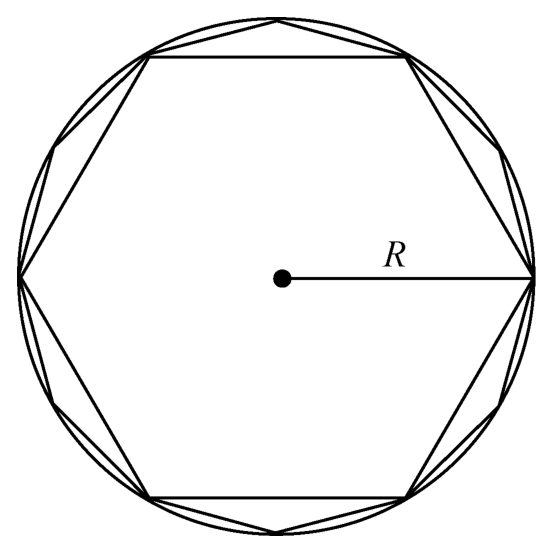
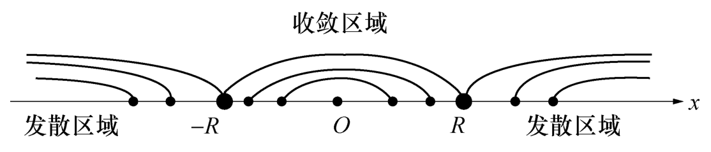
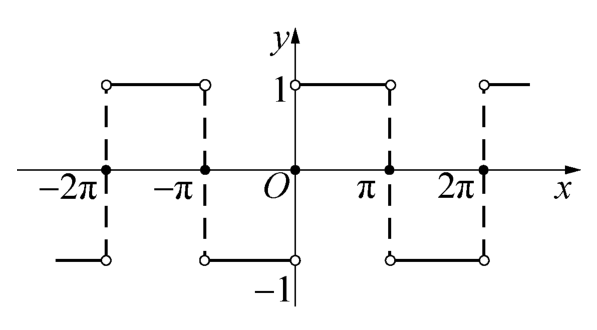
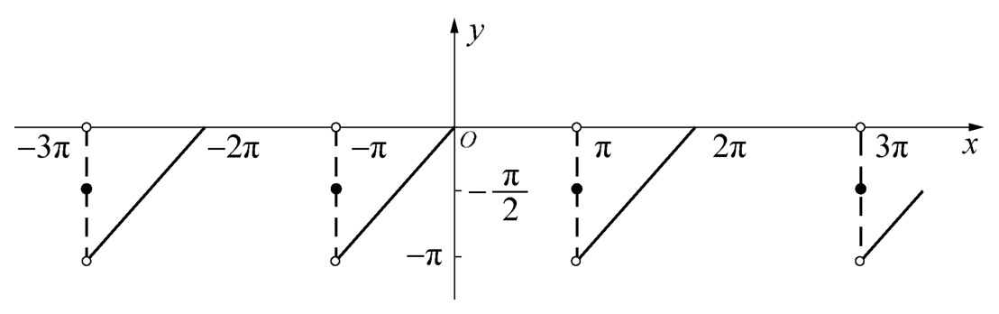
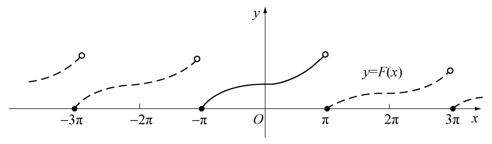

# 第八章 无穷级数

## 第一节 常数项级数的概念与性质

[课前导读]

无穷级数是逼近理论中的重要内容之一，也是微积分学的重要组成部分，它是表示函数、研究函数的性质以及进行数值计算的一种极为有用的数学工具．

本章将分别讨论常数项级数和函数项级数，前者是后者的基础．在函数项级数中，将分别讨论幂级数和傅里叶级数．这两类级数在科学技术中有着非常广泛的应用．

我们先来计算几个和式．

$$
1+2=3,\quad 1+2+3=6,\quad 1+2+3+4=10,\quad \cdots,\quad 1+2+3+4+\cdots+n=\frac{n(n+1)}{2}\ ;
$$

$$
1+\frac{1}{2}=\frac{3}{2},\quad 1+\frac{1}{2}+\frac{1}{2^2}=\frac{7}{4},\quad \cdots,\quad 1+\frac{1}{2}+\frac{1}{2^2}+\cdots+\frac{1}{2^n}=\frac{1\cdot\left(1-\frac{1}{2^n}\right)}{\frac{1}{2}}\ .
$$

我们很容易得到和式前 $n$ 项求和的结果，那么如果“无限项”相加会是什么样的结果呢？

$$
1+2+3+4+\cdots+n+\cdots=? \qquad 1+\frac{1}{2}+\frac{1}{2^2}+\cdots+\frac{1}{2^n}+\cdots=?
$$

如果把数列前 $n$ 项和的极限，作为数列“无限项”相加的和，则可以得到

$$
1+2+3+4+\cdots+n+\cdots=\lim_{n\to\infty}\frac{n(n+1)}{2}=\infty\ ;
$$

$$
1+\frac{1}{2}+\frac{1}{2^2}+\cdots+\frac{1}{2^n}+\cdots=\lim_{n\to\infty}\frac{1\cdot\left(1-\frac{1}{2^n}\right)}{\frac{1}{2}}=2.
$$

第一个极限不存在，因此“和”不存在；第二个极限存在，因此“和”为 2．

这就是这一节我们要研究的无限项求和的问题，即级数的收敛问题．

### 一、常数项级数的概念

人们认识事物在数量方面的特性，往往有一个由近似到精确的过程．在这种认识过程中，会遇到由有限个数量相加到无穷多个数量相加的问题．

我们来看一个例子．计算半径为 $R$ 的圆面积 $A$，先计算内接正六边形面积 $a_1$，再以这

正六边形的每边为底，分别作一个顶点在圆周上的等腰三角形，算出这六个等腰三角形面积之和 $a_2$，则 $a_1+a_2$ 就是正 12 边形的面积（见图 8-1）；然后以这正 12 边形的边为底，分别作一个顶点在圆周上的等腰三角形，算出这 12 个等腰三角形面积之和 $a_3$，则 $a_1+a_2+a_3$ 就是正 24 边形的面积；依此类推，$a_1$，$a_1+a_2$，$a_1+a_2+a_3$，$\cdots$，$a_1+a_2+a_3+\cdots+a_n$ 就越来越接近圆的面积．即 $a_1+a_2+a_3+\cdots+a_n+\cdots$（$n\to\infty$）的极限就是所求圆面积 $A$．这时，和式中的项数无限增多，于是出现了无穷多个数量依次相加的数学式子．

**定义 1** 设有数列 $\{u_n\}$（$n=1$，$2$，$\cdots$），将 $\{u_n\}$ 中的各项用加号连接的形式

$$
u_1+u_2+\cdots+u_n+\cdots
$$

称为常数项无穷级数，简称级数，记为 $\sum\limits_{n=1}^{\infty}u_n$，其中 $\sum$ 是求和记号，$n$ 称为下标变量，第 $n$ 项 $u_n$ 称为级数的一般项（通项）．

需要注意，这里的 $\sum\limits_{n=1}^{\infty}u_n$ 仅仅是一个记号，这与有限个数的和是大不相同的．那么，怎样理解无穷级数中无穷多个数量相加呢？联系上面关于计算圆的面积的例子，我们可以从有限项的和出发，观察它们的变化趋势，由此来理解无穷多个数量相加的含义．

**定义 2** 对数列 $u_1$，$u_2$，$u_3$，$\cdots$，$u_n$，$\cdots$，取它的前 $n$ 项的和

$$
S_n=u_1+u_2+u_3+\cdots+u_n=\sum_{i=1}^{n}u_i,
$$

$S_n$ 称为级数的部分和（前 $n$ 项之和）．

令 $n=1$，$2$，$3$，$\cdots$，得到了由级数部分和所构成的序列（数列）：

$$
S_1=u_1,\quad S_2=u_1+u_2,\quad \cdots,\quad S_n=u_1+u_2+u_3+\cdots+u_n,\quad \cdots
$$

根据部分和序列有没有极限，来引进无穷级数收敛与发散的定义．

**定义 3** 若级数的部分和数列 $\{S_n\}$ 有极限 $S$，即 $\lim\limits_{n\to\infty}S_n=S$，则称无穷级数 $\sum\limits_{n=1}^{\infty}u_n$ 收敛，这时，极限 $S$ 就叫做无穷级数 $\sum\limits_{n=1}^{\infty}u_n$ 的和，并写成 $\sum\limits_{n=1}^{\infty}u_n=S$；若数列 $\{S_n\}$ 没有极限，则称无穷级数 $\sum\limits_{n=1}^{\infty}u_n$ 发散．

由此可见，讨论无穷级数的收敛问题，实际上就是讨论部分和数列的极限是否存在．

一方面，由级数的收敛定义可知，若 $\sum\limits_{n=1}^{\infty}u_n$ 的部分和数列 $\{S_n\}$ 有 $\lim\limits_{n\to\infty}S_n=S$，则级数 $\sum\limits_{n=1}^{\infty}u_n$ 收敛且和为 $S$；另一方面，若给出一个数列 $\{S_n\}$，令

$$
u_1=S_1,\quad u_2=S_2-S_1,\quad \cdots,\quad u_n=S_n-S_{n-1},\quad \cdots,
$$

则该级数 $\sum\limits_{n=1}^{\infty}u_n$ 的部分和数列为 $\{S_n\}$，于是，若 $\lim\limits_{n\to\infty}S_n=S$，则有 $\sum\limits_{n=1}^{\infty}u_n=S_1+\sum\limits_{n=2}^{\infty}(S_n-S_{n-1})$收敛且和为 $S$．

当级数 $\sum\limits_{n=1}^{\infty}u_n$ 收敛时，部分和 $S_n$ 是级数和 $S$ 的近似值，它们之间的差

$$
r_n=S-S_n=u_{n+1}+u_{n+2}+\cdots
$$

就叫作级数 $\sum\limits_{n=1}^{\infty}u_n$ 的余项，它还是一个无穷级数，且 $\lim\limits_{n\to\infty}r_n=\lim\limits_{n\to\infty}(S-S_n)=0$．即用近似值 $S_n$ 替代 $S$ 的误差为 $r_n$．

**例 1** 讨论级数（等比级数）

$$
\sum_{n=0}^{\infty}aq^n=a+aq+aq^2+\cdots+aq^n+\cdots(a\neq 0) \qquad (1)
$$

的收敛性．

**解** 如果 $q\neq 1$，则部分和

$$
S_n=a+aq+aq^2+\cdots+aq^{n-1}=a\cdot\frac{1-q^n}{1-q}.
$$

当 $|q|<1$ 时，由于 $\lim\limits_{n\to\infty}q^n=0$，于是 $\lim\limits_{n\to\infty}S_n=\frac{a}{1-q}$，这时级数 $(1)$ 收敛．

当 $|q|>1$ 时，由于 $\lim\limits_{n\to\infty}q^n=\infty$，于是 $\lim\limits_{n\to\infty}S_n=\infty$，这时级数 $(1)$ 发散．

当 $q=1$ 时，由于 $S_n=na\to\infty$，因此级数 $(1)$ 发散．

当 $q=-1$ 时，由于 $S_n=\begin{cases}a,\ \text{当 }n\text{ 为奇数},\\ 0,\ \text{当 }n\text{ 为偶数},\end{cases}$ 故部分和数列没有极限，因此级数 $(1)$ 发散．

综上分析可得，等比级数 $\sum\limits_{n=0}^{\infty}aq^n$ 收敛的充分必要条件是 $|q|<1$．当级数收敛时，其和等于 $\frac{a}{1-q}$．

**例 2** 证明级数 $1+2+3+\cdots+n+\cdots$ 是发散的．

**证** 级数的部分和为 $S_n=1+2+3+\cdots+n=\frac{n(n+1)}{2}$，

显然，$\lim\limits_{n\to\infty}S_n=\infty$，故题设级数发散．

**例 3** 证明级数

$$
\frac{1}{1\cdot 2}+\frac{1}{2\cdot 3}+\cdots+\frac{1}{n(n+1)}+\cdots
$$

是收敛的．

**证** 由于 $u_n=\frac{1}{n(n+1)}=\frac{1}{n}-\frac{1}{n+1}$，因此

$$
\begin{aligned}
S_n&=\frac{1}{1\cdot 2}+\frac{1}{2\cdot 3}+\cdots+\frac{1}{n(n+1)}\\
&=\left(1-\frac{1}{2}\right)+\left(\frac{1}{2}-\frac{1}{3}\right)+\cdots+\left(\frac{1}{n}-\frac{1}{n+1}\right)\\
&=1-\frac{1}{n+1},
\end{aligned}
$$

于是

$$
\lim_{n\to\infty}S_n=\lim_{n\to\infty}\left(1-\frac{1}{n+1}\right)=1,
$$

故所给级数是收敛的且其和为 1．

**例 4** 判定级数 $\sum\limits_{n=1}^{\infty}\ln\left(1+\frac{1}{n}\right)$ 的敛散性．

**解** $u_n=\ln\left(1+\frac{1}{n}\right)=\ln(n+1)-\ln n$，

$$
S_n=\ln 2-\ln 1+\ln 3-\ln 2+\cdots+\ln(1+n)-\ln n=\ln(1+n)\to\infty\ (n\to\infty),
$$

故 $\sum\limits_{n=1}^{\infty}\ln\left(1+\frac{1}{n}\right)$ 发散．

**例 5** 判定级数 $\sum\limits_{n=1}^{\infty}\frac{1}{n(n+1)(n+2)}$ 的敛散性．

**解** $u_n=\frac{1}{n(n+1)(n+2)}=\frac{1}{2}\left(\frac{1}{n(n+1)}-\frac{1}{(n+1)(n+2)}\right)$，

$$
\begin{aligned}
S_n&=\frac{1}{1\cdot 2\cdot 3}+\frac{1}{2\cdot 3\cdot 4}+\frac{1}{3\cdot 4\cdot 5}+\cdots+\frac{1}{n(n+1)(n+2)}\\
&=\frac{1}{2}\left[\frac{1}{1\cdot 2}-\frac{1}{2\cdot 3}+\frac{1}{2\cdot 3}-\frac{1}{3\cdot 4}+\cdots+\frac{1}{n(n+1)}-\frac{1}{(n+1)(n+2)}\right]\\
&=\frac{1}{2}\left[\frac{1}{2}-\frac{1}{(n+1)(n+2)}\right]\to\frac{1}{4}\ (n\to\infty),
\end{aligned}
$$

故级数 $\sum\limits_{n=1}^{\infty}\frac{1}{n(n+1)(n+2)}$ 收敛．

**例 6** 证明调和级数

$$
\sum_{n=1}^{\infty}\frac{1}{n}=1+\frac{1}{2}+\frac{1}{3}+\cdots+\frac{1}{n}+\cdots \qquad (2)
$$

是发散的．

**证** 级数 $(2)$ 的前 $2^{m+1}$ 项部分和是

$$
\begin{aligned}
S_{2^{m+1}}&=\left(1+\frac{1}{2}\right)+\left(\frac{1}{3}+\frac{1}{4}\right)+\left(\frac{1}{5}+\frac{1}{6}+\frac{1}{7}+\frac{1}{8}\right)+\cdots\\
&\quad+\left(\frac{1}{2^m+1}+\frac{1}{2^m+2}+\cdots+\frac{1}{2^{m+1}}\right),
\end{aligned}
$$

由于

$$
1+\frac{1}{2}>\frac{1}{2},
$$

$$
\frac{1}{3}+\frac{1}{4}>\frac{1}{4}+\frac{1}{4}=\frac{1}{2},
$$

$$
\frac{1}{5}+\frac{1}{6}+\frac{1}{7}+\frac{1}{8}>\frac{1}{8}+\frac{1}{8}+\frac{1}{8}+\frac{1}{8}=\frac{1}{2},
$$

$$
\cdots
$$

$$
\frac{1}{2^m+1}+\frac{1}{2^m+2}+\cdots+\frac{1}{2^{m+1}}>\frac{1}{2^{m+1}}+\frac{1}{2^{m+1}}+\cdots+\frac{1}{2^{m+1}}=\frac{1}{2},
$$

故

$$
S_{2^{m+1}}>\frac{1}{2}(m+1)\to+\infty\ (m\to\infty),
$$

这说明部分和数列无界，因此部分和数列 $S_n$ 发散，即调和级数 $(2)$ 发散．

### 二、收敛级数的基本性质

由于级数的收敛性最终归结为部分和数列的收敛性，所以利用数列极限的运算法则，容易证明级数的下列性质．

**性质 1** 若级数 $\sum\limits_{n=1}^{\infty}u_n$ 收敛，其和为 $S$，则对任何常数 $k$，级数 $\sum\limits_{n=1}^{\infty}ku_n$ 收敛，且其和为 $kS$，即

$$
\sum_{n=1}^{\infty}ku_n=k\sum_{n=1}^{\infty}u_n.
$$

**证** 设 $\sum\limits_{n=1}^{\infty}u_n$ 的部分和是 $S_n$，则有 $\lim\limits_{n\to\infty}S_n=S$；又设 $\sum\limits_{n=1}^{\infty}ku_n$ 的部分和为 $S_n'$，即

$$
\sum_{i=1}^{n}ku_i=S_n',
$$

则

$$
S_n'=\sum_{i=1}^{n}ku_i=k\sum_{i=1}^{n}u_i=kS_n,
$$

因此

$$
\lim_{n\to\infty}S_n'=\lim_{n\to\infty}kS_n=k\lim_{n\to\infty}S_n=kS,
$$

即

$$
\sum_{n=1}^{\infty}ku_n=k\sum_{n=1}^{\infty}u_n.
$$

**性质 2** 若级数 $\sum\limits_{n=1}^{\infty}u_n$、$\sum\limits_{n=1}^{\infty}v_n$ 分别收敛于 $S$ 和 $T$，即

$$
\sum_{n=1}^{\infty}u_n=S,\qquad \sum_{n=1}^{\infty}v_n=T,
$$

则级数 $\sum\limits_{n=1}^{\infty}(u_n\pm v_n)$ 也收敛，其和为 $S\pm T$，即有

$$
\sum_{n=1}^{\infty}(u_n\pm v_n)=\sum_{n=1}^{\infty}u_n\pm\sum_{n=1}^{\infty}v_n.
$$

**证** 设级数 $\sum\limits_{n=1}^{\infty}u_n$、$\sum\limits_{n=1}^{\infty}v_n$ 的部分和分别为 $S_n$、$T_n$，则级数 $\sum\limits_{n=1}^{\infty}(u_n\pm v_n)$ 的部分和为 $R_n=S_n\pm T_n$，由于级数 $\sum\limits_{n=1}^{\infty}u_n$、$\sum\limits_{n=1}^{\infty}v_n$ 均收敛，故由极限的运算性质知

$$
\lim_{n\to\infty}R_n=\lim_{n\to\infty}(S_n\pm T_n)=\lim_{n\to\infty}S_n\pm\lim_{n\to\infty}T_n=S\pm T,
$$

即有 $\sum\limits_{n=1}^{\infty}(u_n\pm v_n)=\sum\limits_{n=1}^{\infty}u_n\pm\sum\limits_{n=1}^{\infty}v_n$．

**例 7** 求级数 $\sum\limits_{n=1}^{\infty}\left(\frac{1}{2^n}+\frac{3}{n(n+1)}\right)$ 的和．

**解** 根据等比级数的结论，知

$$
\sum_{n=1}^{\infty}\frac{1}{2^n}=\frac{\frac{1}{2}}{1-\frac{1}{2}}=1.
$$

而由例 3 知 $\sum\limits_{n=1}^{\infty}\frac{1}{n(n+1)}=1$，所以

$$
\sum_{n=1}^{\infty}\left(\frac{1}{2^n}+\frac{3}{n(n+1)}\right)=\sum_{n=1}^{\infty}\frac{1}{2^n}+\sum_{n=1}^{\infty}\frac{3}{n(n+1)}=4.
$$

从性质 1 和 2 可直接得出如下推论．

**推论** （1）若 $k\neq 0$，则级数 $\sum\limits_{n=1}^{\infty}a_n$ 与 $\sum\limits_{n=1}^{\infty}ka_n$ 具有相同的收敛性；

（2）若级数 $\sum\limits_{n=1}^{\infty}a_n$ 收敛、$\sum\limits_{n=1}^{\infty}b_n$ 发散，则级数 $\sum\limits_{n=1}^{\infty}(a_n\pm b_n)$ 一定发散．

**例 8** 讨论级数 $\sum\limits_{n=1}^{\infty}\left(\frac{2}{n}-\frac{1}{2^n}\right)$ 的收敛性．

**解** 因级数 $\sum\limits_{n=1}^{\infty}\frac{1}{n}$ 发散，故 $\sum\limits_{n=1}^{\infty}\frac{2}{n}$ 发散，又级数 $\sum\limits_{n=1}^{\infty}\frac{1}{2^n}$ 收敛，故级数 $\sum\limits_{n=1}^{\infty}\left(\frac{2}{n}-\frac{1}{2^n}\right)$ 发散．

**性质 3（级数收敛的必要条件）** 如果级数 $\sum\limits_{n=1}^{\infty}u_n$ 收敛，则

$$
\lim_{n\to\infty}u_n=0.
$$

**证** 设级数 $\sum\limits_{n=1}^{\infty}u_n$ 收敛，且 $\lim\limits_{n\to\infty}S_n=S$，由于

$$
u_n=S_n-S_{n-1},
$$

故

$$
\lim_{n\to\infty}u_n=\lim_{n\to\infty}(S_n-S_{n-1})=\lim_{n\to\infty}S_n-\lim_{n\to\infty}S_{n-1}=S-S=0.
$$

由性质 3 可直接得出如下推论．

**推论** 如果当 $n\to\infty$ 时，级数的一般项 $u_n$ 不趋于零，那么级数发散．

例如级数 $\sum\limits_{n=1}^{\infty}(-1)^{n-1}\frac{n}{n+1}$，由于

$$
|u_n|=\left|(-1)^{n-1}\frac{n}{n+1}\right|=\frac{n}{n+1}\to 1\ (n\to\infty),
$$

即 $\lim\limits_{n\to\infty}|u_n|\neq 0$，因此级数发散．

**注** 一般项趋于零不是级数收敛的充分条件．事实上许多发散的级数的一般项是趋于零的，调和级数 $\sum\limits_{n=1}^{\infty}\frac{1}{n}$ 就是一例．

**性质 4** 改变级数中有限项的值不会改变级数的收敛性．

**证** 设 $\sum\limits_{n=1}^{\infty}u_n$ 的部分和为 $S_n$，不妨假设在级数 $\sum\limits_{n=1}^{\infty}u_n$ 中 $u_1$ 改变成了 $v_1$，其余不变，记新级数为 $\sum\limits_{n=1}^{\infty}v_n$，其中 $v_n=u_n$（$n=2$，$3$，$4$，$\cdots$），并设其部分和为 $S_n'$，则有

$$
S_n'=S_n-u_1+v_1,
$$

因此当 $n\to\infty$ 时，$S_n'$ 有极限的充要条件为 $S_n$ 有极限，即级数 $\sum\limits_{n=1}^{\infty}v_n$ 与 $\sum\limits_{n=1}^{\infty}u_n$ 有相同的收敛性．

**推论** 级数中去掉或增加有限多项不改变级数的收敛性．

## 习题 8-1

1. 选择题．

（1）若 $\lim\limits_{n\to\infty}u_n=0$，则级数 $\sum\limits_{n=0}^{\infty}u_n$（　　）．

A．一定收敛　　　　　　　　B．一定发散

C．一定条件收敛　　　　　　D．可能收敛，也可能发散

（2）若常数项级数 $\sum\limits_{n=1}^{\infty}u_n$ 收敛，$\sum\limits_{n=1}^{\infty}v_n$ 发散，则 $\sum\limits_{n=1}^{\infty}(u_n+v_n)$（　　）．

A．收敛　　　　　　　　　　B．可能收敛

C．一定发散　　　　　　　　D．通项的极限必为 0

（3）若级数 $\sum\limits_{n=1}^{\infty}u_n$ 发散，则 $\sum\limits_{n=1}^{\infty}au_n\,(a\neq 0)$（　　）．

A．一定发散　　　　　　　　B．可能收敛也可能发散

C．$a>0$ 时收敛，$a<0$ 时发散　　D．$|a|<1$ 时收敛，$|a|>1$ 时发散

（4）利用级数收敛时其一般项必趋于 0 的性质，可知下面一定发散的级数是（　　）．

A．$\sum\limits_{n=1}^{\infty}\sin\frac{\pi}{3^n}$　　　　　　　　B．$\sum\limits_{n=1}^{\infty}\frac{n2^n}{3^n}$

C．$\sum\limits_{n=1}^{\infty}\arctan\frac{1}{n^2}$　　　　　　D．$1-\frac{3}{2}+\frac{4}{3}-\cdots+(-1)^{n+1}\frac{n+1}{n}+\cdots$（5）若级数 $\sum\limits_{n=1}^{\infty}u_n$ 收敛，则下列级数中收敛的是（　　）．

A．$\sum\limits_{n=1}^{\infty}(u_n+100)$　　　　　　B．$\sum\limits_{n=1}^{\infty}(u_n-100)$

C．$\sum\limits_{n=1}^{\infty}100u_n$　　　　　　　D．$\sum\limits_{n=1}^{\infty}\frac{100}{u_{n+1}-u_n}$

2. 写出级数的一般项．

（1）$\frac{1}{2\ln 2}+\frac{1}{3\ln 3}+\frac{1}{4\ln 4}+\cdots$；

（2）$\frac{1+1}{1+2}+\frac{1+2}{1+2^2}+\frac{1+3}{1+2^3}+\cdots$；

（3）$\frac{1}{2}+\frac{2}{5}+\frac{3}{10}+\frac{4}{17}+\cdots$；

（4）$\frac{1}{1}+\frac{1}{5}+\frac{1}{9}+\frac{1}{13}+\cdots$；

（5）$1-\frac{1}{2^2}+\frac{1}{3^2}-\frac{1}{4^2}+\cdots$；

（6）$\frac{1}{1\cdot 2\cdot 3}+\frac{1}{2\cdot 3\cdot 4}+\frac{1}{3\cdot 4\cdot 5}+\cdots$；

（7）$1+\frac{1\cdot 3}{1\cdot 2}+\frac{1\cdot 3\cdot 5}{1\cdot 2\cdot 3}+\frac{1\cdot 3\cdot 5\cdot 7}{1\cdot 2\cdot 3\cdot 4}+\cdots$；

（8）$\frac{1}{2}+\frac{3}{2\cdot 4}+\frac{5}{2\cdot 4\cdot 6}+\frac{7}{2\cdot 4\cdot 6\cdot 8}+\cdots$．

3. 已知级数 $\sum\limits_{n=1}^{\infty}u_n$ 的前 $n$ 项的部分和 $S_n=\frac{8^n-1}{7\times 8^{n-1}}$，求这个级数．

4. 判别级数 $\frac{1}{2}+\frac{1}{10}+\frac{1}{2^2}+\frac{1}{2\times 10}+\cdots+\frac{1}{2^n}+\frac{1}{10n}+\cdots$ 是否收敛．

5. 判断下列级数的敛散性．

（1）$\sum\limits_{n=2}^{\infty}\frac{1}{(n-1)n}$；　　　　　　　　（2）$\sum\limits_{n=1}^{\infty}\ln\frac{n+1}{n}$；

（3）$\sum\limits_{n=1}^{\infty}\left(\frac{1}{2^n}+\frac{1}{3^n}\right)$；　　　　　　（4）$\sum\limits_{n=1}^{\infty}\frac{1}{\sqrt{n+1}+\sqrt{n}}$；

（5）$\sum\limits_{n=1}^{\infty}[a+(n-1)b]\,(a>0,\ b>0)$；　　（6）$\sum\limits_{n=1}^{\infty}(-1)^n\frac{8^n}{9^n}$．

6. 写出下列级数的通项，并判断级数的敛散性．

（1）$\frac{3}{4}-\frac{3^2}{4^2}+\frac{3^3}{4^3}-\frac{3^4}{4^4}+\cdots$；

（2）$\sqrt{\frac{1}{2}}+\sqrt{\frac{2}{3}}+\sqrt{\frac{3}{4}}+\cdots$；

（3）$\left(\frac{1}{3}-\frac{2}{5}\right)+\left(\frac{1}{3^2}-\frac{2}{5^2}\right)+\left(\frac{1}{3^3}-\frac{2}{5^3}\right)+\cdots$；

（4）$\left(\frac{1}{2}+2\right)+\left(\frac{1}{2^2}+2^2\right)+\left(\frac{1}{2^3}+2^3\right)+\cdots$；

（5）$(1-\cos 1)+4\left(1-\cos\frac{1}{2}\right)+9\left(1-\cos\frac{1}{3}\right)+16\left(1-\cos\frac{1}{4}\right)+\cdots$．

7. 根据级数收敛与发散的定义判别下列级数的收敛性，并求出其中收敛级数的和．

（1）$\sum\limits_{n=1}^{\infty}(-1)^{n-1}\frac{e^n}{3^n}$；　　　　　　（2）$\sum\limits_{n=2}^{\infty}\frac{1}{(n-1)(n+1)}$．

8. 判别下列级数的收敛性，并求出其中收敛级数的和．

（1）$\sum\limits_{n=1}^{\infty}\frac{1}{5n}$；　　　　　　　　（2）$\sum\limits_{n=1}^{\infty}\sin\frac{n\pi}{3}$；

（3）$\sum\limits_{n=1}^{\infty}\frac{3+(-1)^n}{2^n}$；　　　　　　（4）$\sum\limits_{n=2}^{\infty}\frac{1}{\sqrt[n]{n}}$；

（5）$\sum\limits_{n=1}^{\infty}\frac{n}{2n-1}$；　　　　　　　（6）$\sum\limits_{n=2}^{\infty}\ln\frac{n^2-1}{n^2}$．

9. 就级数 $\sum\limits_{n=1}^{\infty}u_n$ 收敛或发散两种情况分别讨论下列级数的敛散性．

（1）$\sum\limits_{n=1}^{\infty}(u_n+10^{-10})$；

（2）$\sum\limits_{n=1}^{\infty}u_{n+1000}$；

（3）$\sum\limits_{n=1}^{\infty}\frac{1}{u_n}\,(u_n\neq 0)$．

10. 已知级数 $\sum\limits_{n=1}^{\infty}u_n$ 的前 $n$ 项的部分和 $S_n=\frac{2n}{n+1}$，$n=1$，$2$，$\cdots$．

（1）求级数的一般项 $u_n$；

（2）判断级数的收敛性．

## 第二节 常数项级数的审敛准则

[课前导读]

研究级数时，重要的是讨论其收敛性．按照定义，级数的收敛性归结为它的部分和数列的收敛性．

对于一个级数 $\sum\limits_{n=1}^{\infty}u_n$，我们主要关心以下两个问题．

（1）它是否收敛？

（2）当级数收敛时，如何求它的和？

如果能直接由定义判断级数收敛，那是最理想的．因为这样不仅判断出级数的收敛性，并且还能求出级数的和．但是，这在大部分情况下很难做到．然而我们感兴趣的往往是判断级数是否收敛而不是求出级数的和．一般情况下，利用定义和性质来判断级数的收敛性是很困难的，能否找到更简单有效的判别方法呢？我们先从最简单的一类级数找到突破口，那就是正项级数．

### 一、正项级数及其审敛性

每一项都是常数的级数称为常数项级数，当各项都是大于或等于零的常数时，称为正项级数．正项级数是一类非常重要的级数，在研究其他级数的收敛性的问题时，常常转化为研究正项级数的收敛性．

正项级数

$$
\sum_{n=1}^{\infty}u_n=u_1+u_2+\cdots+u_n+\cdots
$$

的每一项都是非负的，即 $u_n\geq 0$．则有

$$
S_1=u_1\geq 0,
$$

$$
S_2=u_1+u_2\geq u_1=S_1,\ \cdots,
$$

$$
S_{n+1}=u_1+u_2+\cdots+u_n+u_{n+1}\geq u_1+u_2+\cdots+u_n=S_n,\ \cdots
$$

故得到一个单调递增的数列 $\{S_n\}$，若这个数列有上界，即存在 $M>0$，使得 $S_n\leq M$，则数列 $\{S_n\}$ 必有极限，故对应的级数 $\sum\limits_{n=1}^{\infty}u_n$ 收敛；反之，若级数 $\sum\limits_{n=1}^{\infty}u_n$ 收敛，则必有 $\lim\limits_{n\to\infty}S_n=S$，从而 $\{S_n\}$ 必为有界数列．

故此我们可以得到以下定理．

**定理 1（基本定理）** 正项级数 $\sum\limits_{n=1}^{\infty}u_n$ 收敛的充分必要条件是它的部分和数列 $\{S_n\}$ 有界．

**例 1** 证明正项级数 $\sum\limits_{n=1}^{\infty}\frac{1}{n^2}$ 是收敛的．

**证** 对任意的 $0<x\leq n$，有 $\frac{1}{n^2}\leq\frac{1}{x^2}$，则 $\int_{n-1}^{n}\frac{1}{n^2}\mathrm{d}x\leq\int_{n-1}^{n}\frac{1}{x^2}\mathrm{d}x$，即有 $\frac{1}{n^2}\leq\int_{n-1}^{n}\frac{1}{x^2}\mathrm{d}x$．从而该级数的前 $n$ 项和

$$
S_n=1+\frac{1}{2^2}+\frac{1}{3^2}+\cdots+\frac{1}{n^2}\leq 1+\int_{1}^{n}\frac{1}{x^2}\mathrm{d}x=2-\frac{1}{n}<2.
$$

即正项级数 $\sum\limits_{n=1}^{\infty}\frac{1}{n^2}$ 的部分和数列 $\{S_n\}$ 有界．由基本定理知，级数 $\sum\limits_{n=1}^{\infty}\frac{1}{n^2}$ 收敛．

我们可以用同样的方法证明：对任意的 $p>1$，正项级数 $\sum\limits_{n=1}^{\infty}\frac{1}{n^p}$ 都是收敛的．

**定理 2（比较审敛定理）** 设 $\sum\limits_{n=1}^{\infty}u_n$、$\sum\limits_{n=1}^{\infty}v_n$ 是两个正项级数，且 $u_n\leq v_n$（$n=1$，$2$，$\cdots$）．

若级数 $\sum\limits_{n=1}^{\infty}v_n$ 收敛，则级数 $\sum\limits_{n=1}^{\infty}u_n$ 也收敛；

若级数 $\sum\limits_{n=1}^{\infty}u_n$ 发散，则级数 $\sum\limits_{n=1}^{\infty}v_n$ 也发散．

**证** 我们仅证第一个结论．

设级数 $\sum\limits_{n=1}^{\infty}u_n$ 的部分和为 $S_n$，级数 $\sum\limits_{n=1}^{\infty}v_n$ 的部分和为 $\sigma_n$．

若级数 $\sum\limits_{n=1}^{\infty}v_n$ 收敛，则有 $\lim\limits_{n\to\infty}\sigma_n=\sigma$．又 $\{\sigma_n\}$ 是单调增加函数，故对 $n\in\mathbf{Z}^{+}$，$\sigma_n\leq\sigma$．由于 $u_n\leq v_n\,(n=1,\ 2,\ \cdots)$，则

$$
S_n=\sum_{k=1}^{n}u_k\leq\sum_{k=1}^{n}v_k=\sigma_k\leq\sigma.
$$

故数列 $\{S_n\}$ 有上界，由基本定理知，级数 $\sum\limits_{n=1}^{\infty}u_n$ 收敛．

**注** 比较审敛定理也可写成：若 $\sum\limits_{n=1}^{\infty}u_n$、$\sum\limits_{n=1}^{\infty}v_n$ 为正项级数，且存在正整数 $N$，当 $n>N$ 时，$u_n\leq Cv_n$，其中 $C$ 为正常数，则当 $\sum\limits_{n=1}^{\infty}v_n$ 收敛时，$\sum\limits_{n=1}^{\infty}u_n$ 也收敛；当 $\sum\limits_{n=1}^{\infty}u_n$ 发散时，$\sum\limits_{n=1}^{\infty}v_n$ 也发散．

**例 2** 判定正项级数 $\sum\limits_{n=1}^{\infty}\frac{n}{n^3+1}$ 的敛散性．

**解** 级数 $\sum\limits_{n=1}^{\infty}\frac{n}{n^3+1}$ 的一般项 $\frac{n}{n^3+1}\leq\frac{1}{n^2}$．

而级数 $\sum\limits_{n=1}^{\infty}\frac{1}{n^2}$ 收敛，故由比较审敛定理可知，级数 $\sum\limits_{n=1}^{\infty}\frac{n}{n^3+1}$ 是收敛的．

**例 3** 证明正项级数 $\sum\limits_{n=1}^{\infty}\frac{1}{n^p}$ 当 $0<p<1$ 时是发散的．

**证** 已知调和级数 $\sum\limits_{n=1}^{\infty}\frac{1}{n}$ 是发散的，又 $0<p<1$ 时，有

$$
\frac{1}{n^p}>\frac{1}{n},
$$

由比较审敛定理知，级数 $\sum\limits_{n=1}^{\infty}\frac{1}{n^p}$ 当 $0<p<1$ 时是发散的．

**注** 级数 $\sum\limits_{n=1}^{\infty}\frac{1}{n^p}\,(p>0)$ 称为 $p$ 级数，特别地，当 $p=1$ 时是调和级数 $\sum\limits_{n=1}^{\infty}\frac{1}{n}$．

综合以上的结论可知 $p$ 级数的敛散性：

级数 $\sum\limits_{n=1}^{\infty}\frac{1}{n^p}\,(p>0)$ 当 $p>1$ 时收敛，当 $p\leq 1$ 时发散．

比较审敛定理是判断正项级数收敛性的一个重要方法．对一给定的正项级数，如果要用比较审敛定理来判别其收敛性，则首先要通过观察，找到另一个已知级数与其进行比较，只有知道一些重要级数的收敛性，并加以灵活应用，才能熟练掌握比较审敛定理．至今为止，我们熟悉的重要的已知级数包括几何级数、调和级数以及 $p$ 级数等．

**例 4** 判定下列级数的收敛性．

（1）$\sum\limits_{n=1}^{\infty}\frac{1}{\sqrt{n(n^2+1)}}$；

（2）$\sum\limits_{n=1}^{\infty}\frac{1}{n2^n}$．

**解** （1）由于 $\frac{1}{\sqrt{n(n^2+1)}}<\frac{1}{n^{\frac{3}{2}}}$，而级数 $\sum\limits_{n=1}^{\infty}\frac{1}{n^{\frac{3}{2}}}$ 收敛，故原级数收敛．

（2）由于 $\frac{1}{n2^n}\leq\frac{1}{2^n}$，而级数 $\sum\limits_{n=1}^{\infty}\frac{1}{2^n}$ 收敛，故原级数收敛．

要应用比较审敛定理来判别给定级数的收敛性，就必须给定级数的一般项与某一已知级数的一般项之间的不等式．但有时直接建立这样的不等式相当困难，为应用方便，我们不加证明地给出比较审敛定理的极限形式．

**推论（比较审敛定理的极限形式）** 设 $\sum\limits_{n=1}^{\infty}u_n$、$\sum\limits_{n=1}^{\infty}v_n$ 是两个正项级数，$\lim\limits_{n\to\infty}\frac{u_n}{v_n}=l$．

若 $0<l<+\infty$，则 $\sum\limits_{n=1}^{\infty}u_n$ 与 $\sum\limits_{n=1}^{\infty}v_n$ 同敛散；

若 $l=0$，且 $\sum\limits_{n=1}^{\infty}v_n$ 收敛，则 $\sum\limits_{n=1}^{\infty}u_n$ 也收敛；

若 $l=+\infty$，且 $\sum\limits_{n=1}^{\infty}v_n$ 发散，则 $\sum\limits_{n=1}^{\infty}u_n$ 也发散．

证明从略．

**例 5** 证明级数 $\sum\limits_{n=1}^{\infty}\frac{1}{\sqrt{n(n+1)}}$ 是发散的．

**证** 因为

$$
\lim_{n\to\infty}\frac{\frac{1}{\sqrt{n(n+1)}}}{\frac{1}{n}}=\lim_{n\to\infty}\sqrt{\frac{n^2}{n(n+1)}}=1,
$$

又已知调和级数 $\sum\limits_{n=1}^{\infty}\frac{1}{n}$ 发散，故由比较审敛定理的极限形式可知，级数 $\sum\limits_{n=1}^{\infty}\frac{1}{\sqrt{n(n+1)}}$ 是发散的．

**例 6** 判定级数 $\sum\limits_{n=1}^{\infty}\ln\left(1+\frac{1}{n^2}\right)$ 的敛散性．

**解** 因为

$$
\lim_{n\to\infty}\frac{\ln\left(1+\frac{1}{n^2}\right)}{\frac{1}{n^2}}=1,
$$

又已知 $\sum\limits_{n=1}^{\infty}\frac{1}{n^2}$ 收敛，故级数 $\sum\limits_{n=1}^{\infty}\ln\left(1+\frac{1}{n^2}\right)$ 收敛．

**例 7** 判别下列级数的收敛性．

（1）$\sum\limits_{n=1}^{\infty}\left(1-\cos\frac{1}{n}\right)$；　　（2）$\sum\limits_{n=1}^{\infty}\frac{1}{3^n-2^n}$．

**解** （1）由于

$$
\lim_{n\to\infty}\frac{1-\cos\frac{1}{n}}{\frac{1}{n^2}}=\frac{1}{2},
$$

而又知级数 $\sum\limits_{n=1}^{\infty}\frac{1}{n^2}$ 收敛，故级数 $\sum\limits_{n=1}^{\infty}\left(1-\cos\frac{1}{n}\right)$ 收敛．

（2）由于

$$
\lim_{n\to\infty}\frac{\frac{1}{3^n-2^n}}{\frac{1}{3^n}}=\lim_{n\to\infty}\frac{1}{1-\left(\frac{2}{3}\right)^n}=1,
$$

而级数 $\sum\limits_{n=1}^{\infty}\frac{1}{3^n}$ 收敛，故原级数收敛．

使用比较审敛定理或其极限形式，需要找到一个已知级数作比较，这多少有些困难．下面介绍的判别法，可以利用级数自身的特点，来判断级数的收敛性．

**定理 3（比值审敛定理）** 设 $\sum\limits_{n=1}^{\infty}u_n$ 是正项级数，如果 $\lim\limits_{n\to\infty}\frac{u_{n+1}}{u_n}=\rho$，那么，当 $\rho<1$ 时级数收敛，$\rho>1\left(\text{或}\lim\limits_{n\to\infty}\frac{u_{n+1}}{u_n}=\infty\right)$ 时级数发散，$\rho=1$ 时无法判定．

**证** （1）设 $\lim\limits_{n\to\infty}\frac{u_{n+1}}{u_n}=\rho<1$，取一个充分小的正数 $\varepsilon$，使得 $\rho+\varepsilon=r<1$．由函数和极限的关系可知，当 $n$ 充分大的时候，即存在正整数 $N$，当 $n\geq N$ 时，有

$$
\frac{u_{n+1}}{u_n}<r<1.
$$

于是有

$$
u_{N+1}<ru_N,\quad u_{N+2}<ru_{N+1}<r^2u_N,\quad u_{N+3}<ru_{N+2}<r^3u_N,\quad \cdots
$$

即对于任意的 $n\geq N$，均有

$$
u_{n+N}<r^nu_N.
$$

又因为 $r<1$，等比级数 $\sum\limits_{n=1}^{\infty}r^nu_N$ 收敛，故由比较审敛定理知级数

$$
\sum_{n=N+1}^{\infty}u_n=u_{N+1}+u_{N+2}+u_{N+3}+\cdots
$$

收敛，从而

$$
\sum_{n=1}^{\infty}u_n=u_1+u_2+\cdots+u_N+u_{N+1}+u_{N+2}+\cdots
$$

也收敛．

（2）设 $\lim\limits_{n\to\infty}\frac{u_{n+1}}{u_n}=\rho>1$，取一个充分小的正数 $\delta$，使得 $\rho-\delta>1$．则存在正整数 $N$，当 $n\geq N$ 时，有 $\frac{u_{n+1}}{u_n}>\rho-\delta>1$，即

$$
u_{n+1}>u_n.
$$

所以当 $n\geq N$ 时，有

$$
u_n<u_{n+1}<u_{n+2}<\cdots
$$

即级数的一般项逐渐增大，从而 $\lim\limits_{n\to\infty}u_n\neq 0$，故级数 $\sum\limits_{n=1}^{\infty}u_n$ 发散．

（3）若 $\lim\limits_{n\to\infty}\frac{u_{n+1}}{u_n}=\rho=1$，用比值审敛定理不能判定级数的收敛性．

例如，对于调和级数 $\sum\limits_{n=1}^{\infty}\frac{1}{n}$，有

$$
\lim_{n\to\infty}\frac{u_{n+1}}{u_n}=\lim_{n\to\infty}\frac{\frac{1}{n+1}}{\frac{1}{n}}=\lim_{n\to\infty}\frac{n}{n+1}=1,
$$

级数 $\sum\limits_{n=1}^{\infty}\frac{1}{n}$ 发散．

对于 $p$ 级数 $\sum\limits_{n=1}^{\infty}\frac{1}{n^2}$，有

$$
\lim_{n\to\infty}\frac{u_{n+1}}{u_n}=\lim_{n\to\infty}\frac{\frac{1}{(n+1)^2}}{\frac{1}{n^2}}=\lim_{n\to\infty}\frac{n^2}{(n+1)^2}=1,
$$

而级数 $\sum\limits_{n=1}^{\infty}\frac{1}{n^2}$ 收敛．

**例 8** 判别下列级数的收敛性．

（1）$\sum\limits_{n=1}^{\infty}\frac{1}{n!}$；　　　　（2）$\sum\limits_{n=1}^{\infty}\frac{n!}{10^n}$；　　　　（3）$\sum\limits_{n=1}^{\infty}\frac{1}{(2n-1)\cdot 2n}$；

（4）$\sum\limits_{n=1}^{\infty}\frac{n+2}{2^n}$；　　（5）$\sum\limits_{n=1}^{\infty}\frac{n!}{n^n}$；　　　　（6）$\sum\limits_{n=1}^{\infty}n!\left(\frac{x}{n}\right)^n\,(x\geq 0)$．

**解** （1）$\lim\limits_{n\to\infty}\frac{u_{n+1}}{u_n}=\lim\limits_{n\to\infty}\frac{1/(n+1)!}{1/n!}=\lim\limits_{n\to\infty}\frac{1}{n+1}=0<1$，故级数 $\sum\limits_{n=1}^{\infty}\frac{1}{n!}$ 收敛．

（2）$\lim\limits_{n\to\infty}\frac{u_{n+1}}{u_n}=\lim\limits_{n\to\infty}\frac{(n+1)!}{10^{n+1}}\cdot\frac{10^n}{n!}=+\infty$，故级数 $\sum\limits_{n=1}^{\infty}\frac{n!}{10^n}$ 发散．

（3）$\lim\limits_{n\to\infty}\frac{u_{n+1}}{u_n}=\lim\limits_{n\to\infty}\frac{(2n-1)\cdot 2n}{(2n+1)\cdot(2n+2)}=1$，比值审敛定理失效，改用比较审敛定理．

因为 $\frac{1}{(2n-1)\cdot 2n}<\frac{1}{n^2}$，而级数 $\sum\limits_{n=1}^{\infty}\frac{1}{n^2}$ 收敛，所以 $\sum\limits_{n=1}^{\infty}\frac{1}{(2n-1)\cdot 2n}$ 收敛．

（4）$\lim\limits_{n\to\infty}\frac{u_{n+1}}{u_n}=\lim\limits_{n\to\infty}\frac{\frac{n+3}{2^{n+1}}}{\frac{n+2}{2^n}}=\lim\limits_{n\to\infty}\frac{1\cdot(n+3)}{2\cdot(n+2)}=\frac{1}{2}<1$，因此级数 $\sum\limits_{n=1}^{\infty}\frac{n+2}{2^n}$ 收敛．

（5）$\lim\limits_{n\to\infty}\frac{u_{n+1}}{u_n}=\lim\limits_{n\to\infty}\frac{\frac{(n+1)!}{(n+1)^{n+1}}}{\frac{n!}{n^n}}=\lim\limits_{n\to\infty}\frac{1}{\left(1+\frac{1}{n}\right)^n}=\frac{1}{\mathrm{e}}<1$，因此级数 $\sum\limits_{n=1}^{\infty}\frac{n!}{n^n}$ 收敛．

（6）$\lim\limits_{n\to\infty}\frac{u_{n+1}}{u_n}=\lim\limits_{n\to\infty}\frac{(n+1)!\left(\frac{x}{n+1}\right)^{n+1}}{n!\left(\frac{x}{n}\right)^n}=\lim\limits_{n\to\infty}\frac{x}{\left(1+\frac{1}{n}\right)^n}=\frac{x}{\mathrm{e}}$，当 $\frac{x}{\mathrm{e}}<1$ 即 $0\leq x<\mathrm{e}$ 时，级数收敛；当 $x>\mathrm{e}$ 时，级数发散；当 $x=\mathrm{e}$ 时，$\frac{u_{n+1}}{u_n}=\frac{\mathrm{e}}{\left(1+\frac{1}{n}\right)^n}>1$，故级数发散．

**例 9** 判别级数 $\sum\limits_{n=1}^{\infty}\frac{n^2}{\left(2+\frac{1}{n}\right)^n}$ 的敛散性．

**解** 因为 $\frac{n^2}{\left(2+\frac{1}{n}\right)^n}<\frac{n^2}{2^n}$，而对于级数 $\sum\limits_{n=1}^{\infty}\frac{n^2}{2^n}$，由比值审敛定理，有

$$
\lim_{n\to\infty}\frac{u_{n+1}}{u_n}=\lim_{n\to\infty}\frac{(n+1)^2}{2^{n+1}}\cdot\frac{2^n}{n^2}=\lim_{n\to\infty}\frac{1}{2}\left(1+\frac{1}{n}\right)^2=\frac{1}{2}<1,
$$

所以级数 $\sum\limits_{n=1}^{\infty}\frac{n^2}{2^n}$ 收敛，从而原级数亦收敛．

**例 10** 判别级数 $\sum\limits_{n=1}^{\infty}\frac{n!}{n^n}a^n\,(a>0)$ 的收敛性．

**解** 采用比值审敛法，由于

$$
\lim_{n\to\infty}\frac{u_{n+1}}{u_n}=\lim_{n\to\infty}\frac{a^{n+1}(n+1)!}{(n+1)^{n+1}}\cdot\frac{n^n}{a^n\cdot n!}=\lim_{n\to\infty}\frac{a}{(1+1/n)^n}=\frac{a}{\mathrm{e}},
$$

所以当 $0<a<\mathrm{e}$ 时，原级数收敛；当 $a>\mathrm{e}$ 时，原级数发散；当 $a=\mathrm{e}$ 时，比值法审敛失效，但此时注意到数列 $x_n=\left(1+\frac{1}{n}\right)^n$ 严格单调增加，且 $\left(1+\frac{1}{n}\right)^n<\mathrm{e}$，于是 $\frac{u_{n+1}}{u_n}=\frac{\mathrm{e}}{x_n}>1$，即 $u_{n+1}>u_n$，故 $u_n>u_1=\mathrm{e}$，由此得到 $\lim\limits_{n\to\infty}u_n\neq 0$，所以当 $a=\mathrm{e}$ 时原级数发散．

**定理 4（根值审敛定理）** 若 $\sum\limits_{n=1}^{\infty}u_n$ 为正项级数，且 $\lim\limits_{n\to\infty}\sqrt[n]{u_n}=l$，则当 $0\leq l<1$ 时，$\sum\limits_{n=1}^{\infty}u_n$ 收敛；当 $l>1$ 时，$\sum\limits_{n=1}^{\infty}u_n$ 发散；当 $l=1$ 时，无法确定．

**证** 由 $\lim\limits_{n\to\infty}\sqrt[n]{u_n}=l$ 知，$\forall\varepsilon>0$，$\exists N>0$，当 $n>N$ 时，恒有 $|\sqrt[n]{u_n}-l|<\varepsilon$，即 $l-\varepsilon<\sqrt[n]{u_n}<l+\varepsilon$，当 $0\leq l<1$ 时，取适当的 $\varepsilon>0$，使 $l+\varepsilon=q<1$，则得 $\sum\limits_{n=1}^{\infty}u_n$ 收敛；当 $l>1$ 时，取适当的 $\varepsilon>0$，使 $l-\varepsilon>1$，则得 $\sum\limits_{n=1}^{\infty}u_n$ 发散．

**例 11** 讨论下列正项级数的敛散性．

（1）$\sum\limits_{n=1}^{\infty}\frac{\alpha^n}{n^s}\,(s>0,\ \alpha>0)$；　　（2）$\sum\limits_{n=1}^{\infty}\frac{3+(-1)^n}{3^n}$．

**解** （1）$\lim\limits_{n\to\infty}\sqrt[n]{u_n}=\lim\limits_{n\to\infty}\sqrt[n]{\frac{\alpha^n}{n^s}}=\lim\limits_{n\to\infty}\frac{\alpha}{\left(\sqrt[n]{n}\right)^s}=\alpha$，当 $0<\alpha<1$ 时，级数收敛；当 $\alpha>1$ 时，级数发散；当 $\alpha=1$ 时，$\sum\limits_{n=1}^{\infty}\frac{1}{n^s}$ 当 $0<s\leq 1$ 时，该级数收敛，当 $s>1$ 时，该级数发散．

（2）由于 $\frac{\sqrt[n]{2}}{3}<\sqrt[n]{\frac{3+(-1)^n}{3^n}}<\frac{\sqrt[n]{4}}{3}$，及 $\lim\limits_{n\to\infty}\sqrt[n]{2}=\lim\limits_{n\to\infty}\sqrt[n]{4}=1$，则

$$
\lim_{n\to\infty}\sqrt[n]{u_n}=\lim_{n\to\infty}\sqrt[n]{\frac{3+(-1)^n}{3^n}}=\frac{1}{3}<1,
$$

故原级数收敛．

为了方便判别正项级数的敛散性，下面再介绍一个审敛方法．

＊ **定理 5（积分审敛定理）** 若 $f(x)\,(x>0)$ 为非负的不增函数，则 $\sum\limits_{n=1}^{\infty}f(n)$ 与 $\int_{1}^{+\infty}f(x)\,\mathrm{d}x$ 同敛散．

＊ **例 12** 讨论下列正项级数的敛散性．

（1）$\sum\limits_{n=2}^{\infty}\frac{1}{n\ln^p n}\,(p>0)$；　　（2）$\sum\limits_{n=2}^{\infty}\frac{1}{\ln n!}$．

**解** （1）由于

$$
I=\int_{2}^{+\infty}\frac{\mathrm{d}x}{x\ln^p x}=\begin{cases}\left[\ln\ln x\right]_2^{+\infty}=+\infty, & p=1,\\ \left[\dfrac{1}{1-p}(\ln x)^{1-p}\right]_2^{+\infty}, & p\neq 1;\end{cases}
$$

及当 $p>1$ 时，$I=\frac{1}{p-1}(\ln 2)^{1-p}$；当 $0<p<1$ 时，$I=+\infty$，

因此当 $0<p\leq 1$ 时，级数发散；当 $p>1$ 时，级数收敛．

（2）由于 $\ln n!=\ln 1+\ln 2+\ln 3+\cdots+\ln n<n\ln n$，即

$$
\frac{1}{\ln n!}>\frac{1}{n\ln n},
$$

级数 $\sum\limits_{n=2}^{\infty}\frac{1}{n\ln n}$ 发散，故原级数也发散．

### 二、交错级数及其审敛性

上面我们讨论了关于正项级数收敛性的判别法，本节我们还要进一步讨论关于一般常数项级数收敛性的判别法，这里所谓“一般常数项级数”是指级数的各项可以是正数、负数或零．先来讨论一种特殊的级数——交错级数，然后再讨论一般常数项级数．

设 $u_n>0\,(n=1,\ 2,\ \cdots)$，级数 $\sum\limits_{n=1}^{\infty}(-1)^{n-1}u_n$ 或 $\sum\limits_{n=1}^{\infty}(-1)^nu_n$ 称为交错级数．

所谓交错级数是这样的级数，它的各项是正、负交错的，其具体形式如下：

$$
u_1-u_2+u_3-u_4+\cdots+(-1)^{n-1}u_n+\cdots \qquad (1)
$$

或

$$
-u_1+u_2-u_3+u_4-\cdots+(-1)^nu_n+\cdots \qquad (2)
$$

其中 $u_1$，$u_2$，$u_3$，$u_4$，$\cdots$，$u_n$，$\cdots$ 均为正数．

由常数项级数的性质可知，式 $(1)$ 和式 $(2)$ 的敛散性相同，故我们只需讨论首项为正的交错级数 $\sum\limits_{n=1}^{\infty}(-1)^{n-1}u_n$ 的性质．

**定理 6（莱布尼茨定理）** 如果交错级数 $\sum\limits_{n=1}^{\infty}(-1)^{n-1}u_n$ 满足条件：

（1）$u_n\geq u_{n+1}\,(n=1,\ 2,\ \cdots)$；

（2）$\lim\limits_{n\to\infty}u_n=0$，

则交错级数收敛，且收敛和 $S\leq u_1$．

**证** 先证 $\lim\limits_{n\to\infty}S_{2n}$ 存在．

将式 $(1)$ 的前 $2n$ 项的部分和 $S_{2n}$ 写成如下两种形式：

$$
S_{2n}=(u_1-u_2)+(u_3-u_4)+\cdots+(u_{2n-1}-u_{2n})
$$

及

$$
S_{2n}=u_1-(u_2-u_3)-(u_4-u_5)-\cdots-(u_{2n-2}-u_{2n-1})-u_{2n},
$$

由条件（1）$u_n\geq u_{n+1}\,(n=1,\ 2,\ \cdots)$ 可知，所有括号内的差均非负，第一个表达式表明，数列 $S_{2n}$ 是单调增加的；而第二个表达式表明，$S_{2n}<u_1$，数列 $S_{2n}$ 有上界．

由单调有界数列必有极限准则，当 $n$ 无限增大时，$S_{2n}$ 趋向于某值 $S$，并且 $S\leq u_1$．即

$$
\lim_{n\to\infty}S_{2n}=S\leq u_1.
$$

再证 $\lim\limits_{n\to\infty}S_{2n+1}=S$．

因 $S_{2n+1}=S_{2n}+u_{2n+1}$，由条件（2）$\lim\limits_{n\to\infty}u_{2n+1}=0$ 可知

$$
\lim_{n\to\infty}S_{2n+1}=\lim_{n\to\infty}S_{2n}+\lim_{n\to\infty}u_{2n+1}=S+0=S.
$$

由于级数的偶数项之和与奇数项之和都趋向于同一极限，故级数 $(1)$ 的部分和当 $n\to\infty$ 时具有极限 $S$．这就证明了级数 $(1)$ 收敛于 $S$，且 $S\leq u_1$．

**例 13** 试证明交错级数

$$
\sum_{n=1}^{\infty}(-1)^{n-1}\frac{1}{n}=1-\frac{1}{2}+\frac{1}{3}-\frac{1}{4}+\cdots+(-1)^{n-1}\frac{1}{n}+\cdots
$$

是收敛的．

**证** $u_n=\frac{1}{n}>\frac{1}{n+1}=u_{n+1}$，且 $\lim\limits_{n\to\infty}u_n=\lim\limits_{n\to\infty}\frac{1}{n}=0$，故此交错级数收敛，并且和 $S<1$．

**例 14** 判定交错级数 $\sum\limits_{n=1}^{\infty}(-1)^{n-1}\frac{1}{n\cdot 4^n}$ 的敛散性．

**解** $u_n=\frac{1}{n\cdot 4^n}>\frac{1}{(n+1)\cdot 4^{n+1}}=u_{n+1}$，且 $\lim\limits_{n\to\infty}u_n=\lim\limits_{n\to\infty}\frac{1}{n\cdot 4^n}=0$，所以此交错级数收敛．

**例 15** 证明级数 $\sum\limits_{n=2}^{\infty}\frac{(-1)^{n-1}}{\ln n}$ 收敛．

**证** 因级数 $\sum\limits_{n=2}^{\infty}\frac{(-1)^{n-1}}{\ln n}$ 是交错级数，并且满足（1）$u_n=\frac{1}{\ln n}>\frac{1}{\ln(n+1)}=u_{n+1}$，$(n=2$，$3$，$\cdots$）（2）$\lim\limits_{n\to\infty}u_n=\lim\limits_{n\to\infty}\frac{1}{\ln n}=0$．因此级数 $\sum\limits_{n=2}^{\infty}\frac{(-1)^{n-1}}{\ln n}$ 收敛．

### 三、绝对收敛和条件收敛

设有级数 $\sum\limits_{n=1}^{\infty}u_n=u_1+u_2+\cdots+u_n+\cdots$，其中 $u_n\,(n=1,\ 2,\ \cdots)$ 为任意实数，那么该级数叫作任意项级数．可见，交错级数是任意项级数的一种特殊形式．

对任意项级数，我们给每项加上绝对值符号构造一个正项级数，即

$$
\sum_{n=1}^{\infty}|u_n|=|u_1|+|u_2|+\cdots+|u_n|+\cdots
$$

任意项级数 $\sum\limits_{n=1}^{\infty}u_n$ 的收敛性和 $\sum\limits_{n=1}^{\infty}|u_n|$ 的收敛性的关系如下．

**定理 7** 若级数 $\sum\limits_{n=1}^{\infty}|u_n|$ 收敛，则级数 $\sum\limits_{n=1}^{\infty}u_n$ 必收敛．

**证** 令 $v_n=\frac{1}{2}(u_n+|u_n|)$，则 $v_n\geq 0$，故 $\sum\limits_{n=1}^{\infty}v_n$ 是正项级数，且满足 $v_n\leq|u_n|$．因为正项级数 $\sum\limits_{n=1}^{\infty}|u_n|$ 收敛，由比较审敛定理知 $\sum\limits_{n=1}^{\infty}v_n$ 收敛，从而 $\sum\limits_{n=1}^{\infty}2v_n$ 也收敛．

又 $u_n=2v_n-|u_n|\,(n=1,\ 2,\ \cdots)$，由级数性质 2 可知，级数 $\sum\limits_{n=1}^{\infty}u_n$ 必收敛．

根据定理 7 这个结果，我们可以将许多一般常数项级数的收敛性判别问题转化为正项级数的收敛性判别问题．

**定义** 若级数 $\sum\limits_{n=1}^{\infty}|u_n|$ 收敛，则称级数 $\sum\limits_{n=1}^{\infty}u_n$ 绝对收敛；若级数 $\sum\limits_{n=1}^{\infty}u_n$ 收敛，而级数 $\sum\limits_{n=1}^{\infty}|u_n|$ 发散，则称级数 $\sum\limits_{n=1}^{\infty}u_n$ 条件收敛．

由定理 7 知，一个绝对收敛的级数必定是收敛的，由正项级数的比较审敛定理和比值审敛定理立即得到下列判定任意项级数绝对收敛的判别法．

**定理 8** 设 $\sum\limits_{n=1}^{\infty}u_n$ 是任意项级数，若满足下列条件之一，则级数 $\sum\limits_{n=1}^{\infty}u_n$ 必绝对收敛．

（1）存在收敛的正项级数 $\sum\limits_{n=1}^{\infty}v_n$，满足 $|u_n|\leqslant v_n(n=1,2,\cdots)$；

（2）$\lim\limits_{n\to\infty}\left|\frac{u_{n+1}}{u_n}\right|=\rho<1$；

（3）$\lim\limits_{n\to\infty}\sqrt[n]{|u_n|}=\rho<1$．

当级数 $\sum\limits_{n=1}^{\infty}|u_n|$ 发散时不能确定任意项级数 $\sum\limits_{n=1}^{\infty}u_n$ 的收敛性．但是若用比值审敛定理判断出 $\sum\limits_{n=1}^{\infty}|u_n|$ 是发散的，例如满足条件 $\lim\limits_{n\to\infty}\left|\frac{u_{n+1}}{u_n}\right|=\rho>1$ 或 $\lim\limits_{n\to\infty}\left|\frac{u_{n+1}}{u_n}\right|=+\infty$，则必有 $\lim\limits_{n\to\infty}u_n\neq 0$（由比值审敛定理的证明可知），因此级数必发散．

**例 16** 判别级数 $\sum\limits_{n=1}^{\infty}\frac{(-1)^{n-1}}{n^p}(p>0)$ 的收敛性．

**解** 由 $\sum\limits_{n=1}^{\infty}\left|\frac{(-1)^{n-1}}{n^p}\right|=\sum\limits_{n=1}^{\infty}\frac{1}{n^p}$，易见当 $p>1$ 时，题设级数绝对收敛．

当 $0<p\leqslant 1$ 时，由莱布尼茨定理知 $\sum\limits_{n=1}^{\infty}\frac{(-1)^{n-1}}{n^p}$ 收敛，但 $\sum\limits_{n=1}^{\infty}\frac{1}{n^p}$ 发散，故题设级数条件收敛．

**例 17** 判别级数 $\sum\limits_{n=1}^{\infty}\frac{\sin n}{n^2}$ 的收敛性．

**解** $\left|\frac{\sin n}{n^2}\right|\leqslant\frac{1}{n^2}$，而 $\sum\limits_{n=1}^{\infty}\frac{1}{n^2}$ 收敛，所以 $\sum\limits_{n=1}^{\infty}\left|\frac{\sin n}{n^2}\right|$ 收敛，故由定理 8 知原级数

$$
\sum_{n=1}^{\infty}\frac{\sin n}{n^2}
$$

绝对收敛．

**例 18** 判别级数 $\sum\limits_{n=1}^{\infty}(-1)^n\frac{n^{n+1}}{(n+1)!}$ 的收敛性．

**解** 这是一个交错级数，令 $u_n=(-1)^n\frac{n^{n+1}}{(n+1)!}$，则

$$
\lim_{n\to\infty}\left|\frac{u_{n+1}}{u_n}\right|=\lim_{n\to\infty}\frac{(n+1)^{n+2}}{[(n+1)+1]!}\cdot\frac{(n+1)!}{n^{n+1}}=\lim_{n\to\infty}\left(\frac{n+1}{n}\right)^n\cdot\frac{(n+1)^2}{n(n+2)}
$$

$$
=\lim_{n\to\infty}\left(1+\frac{1}{n}\right)^n=\mathrm{e}>1,
$$

因此级数 $\sum\limits_{n=1}^{\infty}(-1)^n\frac{n^{n+1}}{(n+1)!}$ 发散．

**例 19** 判别级数 $\sum\limits_{n=1}^{\infty}(-1)^{n-1}\frac{n}{n^2+1}$ 是绝对收敛还是条件收敛．

**解** 首先 $\frac{u_{n+1}}{u_n}=\frac{n+1}{(n+1)^2+1}\cdot\frac{n^2+1}{n}=\frac{n^3+n^2+n+1}{n^3+2n^2+2n}\leqslant 1$，即 $u_{n+1}\leqslant u_n(n=1,2,\cdots)$，且

$$
\lim_{n\to\infty}u_n=\lim_{n\to\infty}\frac{n}{n^2+1}=0,
$$

由交错级数收敛定理，级数 $\sum\limits_{n=1}^{\infty}(-1)^{n-1}\frac{n}{n^2+1}$ 收敛．

再判定 $\sum\limits_{n=1}^{\infty}\left|(-1)^{n-1}\frac{n}{n^2+1}\right|=\sum\limits_{n=1}^{\infty}\frac{n}{n^2+1}$ 的敛散性．

由于 $\frac{n}{n^2+1}\geqslant\frac{n}{n^2+n^2}=\frac{1}{2n}$，而 $\sum\limits_{n=1}^{\infty}\frac{1}{2n}$ 发散，故 $\sum\limits_{n=1}^{\infty}\frac{n}{n^2+1}$ 发散．

于是级数 $\sum\limits_{n=1}^{\infty}(-1)^{n-1}\frac{n}{n^2+1}$ 是条件收敛的．

**例 20** 讨论级数 $\sum\limits_{n=2}^{\infty}\frac{(-1)^n}{\sqrt{n}+(-1)^n}$ 的收敛性，若收敛，问是绝对收敛，还是条件收敛？

**解** 由于 $\frac{1}{\sqrt{n}+(-1)^n}\geqslant\frac{1}{2\sqrt{n}}$，而 $\sum\limits_{n=2}^{\infty}\frac{1}{2\sqrt{n}}$ 发散，故

$$
\sum_{n=2}^{\infty}\left|\frac{(-1)^n}{\sqrt{n}+(-1)^n}\right|=\sum_{n=2}^{\infty}\frac{1}{\sqrt{n}+(-1)^n}
$$

发散．

又 $\frac{(-1)^n}{\sqrt{n}+(-1)^n}=\frac{(-1)^n[\sqrt{n}-(-1)^n]}{n-1}=\frac{(-1)^n\sqrt{n}}{n-1}-\frac{1}{n-1}$，

级数 $\sum\limits_{n=2}^{\infty}\frac{(-1)^n\sqrt{n}}{n-1}$ 收敛，$\sum\limits_{n=2}^{\infty}\frac{1}{n-1}$ 发散，故原级数 $\sum\limits_{n=2}^{\infty}\frac{(-1)^n}{\sqrt{n}+(-1)^n}$ 发散．

## 习题 8-2

1. 选择题．

（1）下列级数收敛的是$(\quad)$．

A. $\sum\limits_{n=1}^{\infty}\frac{(\cos n)^2}{5^n}$　　　　B. $\sum\limits_{n=1}^{\infty}\frac{5^n}{4^n}$

C. $\sum\limits_{n=1}^{\infty}\frac{n}{1000n+1}$　　　　D. $\sum\limits_{n=1}^{\infty}\frac{1}{\sqrt{n+1}}$

（2）下列级数发散的是$(\quad)$．

A. $\sum\limits_{n=1}^{\infty}\frac{1}{n}\ln\left(1+\frac{1}{n}\right)$　　　　B. $\sum\limits_{n=1}^{\infty}\ln\left(1+\frac{1}{n^3}\right)$

C. $\sum\limits_{n=1}^{\infty}\ln\left(1+\frac{1}{\sqrt{n}}\right)$　　　　D. $\sum\limits_{n=1}^{\infty}\sin\frac{1}{n^2}$（3）交错级数 $\sum\limits_{n=1}^{\infty}(-1)^n u_n$ 若满足$(\quad)$则交错级数收敛．

A. $u_n\geqslant u_{n+1}(n=1,2,3,\cdots)$　　　　B. $\lim\limits_{n\to\infty}u_n=0$

C. $\lim\limits_{n\to\infty}\frac{u_{n+1}}{u_n}\leqslant 1$　　　　D. $u_n\geqslant u_{n+1}(n=1,2,3,\cdots)$ 且 $\lim\limits_{n\to\infty}u_n=0$

（4）设 $\sum\limits_{n=1}^{\infty}u_n$ 为任意项级数，那么$(\quad)$．

A. 如果 $\sum\limits_{n=1}^{\infty}|u_n|$ 收敛，则 $\sum\limits_{n=1}^{\infty}u_n$ 条件收敛

B. 如果 $\sum\limits_{n=1}^{\infty}u_n$ 收敛，则 $\sum\limits_{n=1}^{\infty}|u_n|$ 条件收敛

C. 如果 $\sum\limits_{n=1}^{\infty}|u_n|$ 收敛，则 $\sum\limits_{n=1}^{\infty}u_n$ 收敛

D. 如果 $\sum\limits_{n=1}^{\infty}u_n$ 条件收敛，则 $\sum\limits_{n=1}^{\infty}u_n$ 绝对收敛

（5）下列级数条件收敛的是$(\quad)$．

A. $\sum\limits_{n=1}^{\infty}(-1)^{n+1}\sin\frac{1}{n}$　　　　B. $\sum\limits_{n=1}^{\infty}(-1)^{n-1}\frac{n}{2^n}$

C. $\sum\limits_{n=1}^{\infty}\frac{(-1)^{n-1}n}{2n+3}$　　　　D. $\sum\limits_{n=1}^{\infty}\frac{(-1)^{n-1}}{3n^2+1}$

（6）下列级数中绝对收敛的是$(\quad)$．

A. $\sum\limits_{n=1}^{\infty}\frac{(-1)^n}{\sqrt{2n+1}}$　　　　B. $\sum\limits_{n=1}^{\infty}(-1)^n\left(\frac{3}{2}\right)^n$

C. $\sum\limits_{n=1}^{\infty}\frac{(-1)^n}{\sqrt{n^3}}$　　　　D. $\sum\limits_{n=1}^{\infty}\frac{(-1)^n(n-1)}{n}$

（7）级数 $\sum\limits_{n=1}^{\infty}\frac{1}{1+a^n}$ 的敛散情况是$(\quad)$．

A. 当 $a>0$ 时收敛

B. 当 $a>0$ 时发散

C. 当 $0<|a|\leqslant 1$ 时发散，当 $|a|>1$ 时收敛

D. 当 $0<|a|\leqslant 1$ 时收敛，当 $|a|>1$ 时发散

2. 用比较审敛定理判别级数的敛散性．

（1）$1+\frac{1}{3}+\frac{1}{5}+\frac{1}{7}+\cdots$；　　　　（2）$\frac{1}{\ln 2}+\frac{1}{\ln 3}+\frac{1}{\ln 4}+\frac{1}{\ln 5}+\cdots$；

（3）$\frac{1}{1\cdot 2}+\frac{1}{2\cdot 3}+\frac{1}{3\cdot 4}+\frac{1}{4\cdot 5}+\cdots$；　　　　（4）$\left(\frac{1}{3}\right)^2+\left(\frac{2}{5}\right)^2+\left(\frac{3}{7}\right)^2+\left(\frac{4}{9}\right)^2+\cdots$；

（5）$\sum\limits_{n=1}^{\infty}\frac{1}{(2n-1)2^{n-1}}$；　　　　（6）$\sum\limits_{n=1}^{\infty}\sin\frac{\pi}{2^n}$；

（7）$\sum\limits_{n=1}^{\infty}n\left(1-\cos\frac{1}{n^2}\right)$；　　　　（8）$\sum\limits_{n=1}^{\infty}\frac{\ln n}{n^{\frac{4}{3}}}$；

（9）$\sum\limits_{n=1}^{\infty}\left(\mathrm{e}^{\frac{1}{n}}-1\right)$；　　　　（10）$\sum\limits_{n=1}^{\infty}\frac{1+n}{1+n^2}$；

（11）$\sum\limits_{n=1}^{\infty}\left(\frac{1+n}{1+n^2}\right)^2$；　　　　（12）$\sum\limits_{n=2}^{\infty}\frac{1}{\sqrt{n}}\ln\frac{n+1}{n-1}$．

3. 用比值判别法判定下列级数的收敛性．

（1）$\frac{1}{1\cdot 2}+\frac{3}{2\cdot 2^2}+\frac{5}{3\cdot 2^3}+\frac{7}{4\cdot 2^4}+\cdots$；

（2）$\frac{2}{1\cdot 3}+\frac{2^2}{2\cdot 4}+\frac{2^3}{3\cdot 5}+\frac{2^4}{4\cdot 6}+\cdots$；

（3）$\frac{1!}{1}+\frac{2!}{2^2}+\frac{3!}{2^3}+\frac{4!}{2^4}+\cdots$；

（4）$\sin\frac{1}{2}+2\sin\frac{1}{2^2}+3\sin\frac{1}{2^3}+4\sin\frac{1}{2^4}+\cdots$；

（5）$\sum\limits_{n=1}^{\infty}\frac{3^n}{n\cdot 2^n}$；　　　　（6）$\sum\limits_{n=1}^{\infty}n\tan\frac{\pi}{2^{n+1}}$；

（7）$\sum\limits_{n=1}^{\infty}\frac{(2n-1)!!}{3^n\cdot n!}$；　　　　（8）$\sum\limits_{n=1}^{\infty}2^{n-1}\tan\frac{\pi}{2^n}$．

4. 用根值判别法判定下列级数的收敛性．

（1）$\sum\limits_{n=1}^{\infty}\left(\frac{n}{2n+1}\right)^n$；　　　　（2）$\sum\limits_{n=1}^{\infty}\frac{1}{[\ln(n+1)]^n}$；

（3）$\sum\limits_{n=1}^{\infty}\left(\frac{n}{3n+1}\right)^{2n}$；　　　　（4）$\sum\limits_{n=2}^{\infty}\frac{2^n}{\sqrt{n^n}}$；

（5）$\sum\limits_{n=1}^{\infty}\frac{\left(1+\frac{1}{n}\right)^{n^2}}{3^n}$；

（6）$\sum\limits_{n=1}^{\infty}\left(\frac{b}{a_n}\right)^n$，$a_n\to a(n\to\infty)$，$a_n$，$b$，$a\in\mathbf{R}^+$．

5. 判定下列级数的敛散性．

（1）$\sum\limits_{n=1}^{\infty}\frac{n}{(3n+2)(n^2+1)}$；　　　　（2）$\sum\limits_{n=1}^{\infty}\frac{n}{3n+1}$；

（3）$\sum\limits_{n=1}^{\infty}\frac{n+1}{n(n+2)}$；　　　　（4）$\sum\limits_{n=1}^{\infty}\sqrt{\frac{n+1}{n}}$；

（5）$\sum\limits_{n=1}^{\infty}\frac{n!}{5^n}$；　　　　（6）$\sum\limits_{n=2}^{\infty}\ln\frac{n^2-1}{n^2}$；

（7）$\sum\limits_{n=1}^{\infty}\frac{\sin^2\frac{n\pi}{2}}{2^n}$；　　　　（8）$\sum\limits_{n=1}^{\infty}\frac{1}{n!}$；

（9）$\sum\limits_{n=1}^{\infty}\frac{1}{na+b}(a>0,\ b>0)$；　　　　（10）$\sum\limits_{n=1}^{\infty}\sin^n\left(\frac{\pi}{4}+\frac{b}{n}\right)$；

（11）$\sum\limits_{n=1}^{\infty}\frac{\ln(n!)}{n!}$；　　　　（12）$\sum\limits_{n=1}^{\infty}\mathrm{e}^{-\frac{n^2+1}{n+1}}$．

6. 判定下列级数的敛散性，若级数收敛，判断是绝对收敛还是条件收敛．

（1）$\sum\limits_{n=1}^{\infty}(-1)^{n-1}\left(\frac{2}{3}\right)^n$；　　　　（2）$\sum\limits_{n=1}^{\infty}\frac{(-1)^n}{\sqrt{n}+1}$；

（3）$\sum\limits_{n=1}^{\infty}\frac{(-1)^{n-1}n}{3^n}$；　　　　（4）$\sum\limits_{n=1}^{\infty}\frac{(-1)^n(n-1)}{n}$；

（5）$\sum\limits_{n=1}^{\infty}(-1)^{n+1}\frac{n}{10n+1}$；　　　　（6）$\sum\limits_{n=1}^{\infty}\frac{(-1)^{n-1}}{\sqrt{2n^3+4}}$；

（7）$\sum\limits_{n=1}^{\infty}(-1)^n\frac{1}{3^n}\sin\frac{\pi}{n}$；　　　　（8）$\sum\limits_{n=1}^{\infty}(-1)^n\frac{\ln n}{n}$；

（9）$\sum\limits_{n=1}^{\infty}(-1)^n(\sqrt{n+1}-\sqrt{n})$；　　　　（10）$\sum\limits_{n=1}^{\infty}(-1)^n\left(1-\cos\frac{\pi}{n^2}\right)$．

7. 设 $a_n\leqslant c_n\leqslant b_n(n=1,2,\cdots)$，且 $\sum\limits_{n=1}^{\infty}a_n$ 及 $\sum\limits_{n=1}^{\infty}b_n$ 均收敛，证明级数 $\sum\limits_{n=1}^{\infty}c_n$ 收敛．

8. 如果 $\sum\limits_{n=1}^{\infty}a_n^2$ 及 $\sum\limits_{n=1}^{\infty}b_n^2$ 都收敛，证明：$\sum\limits_{n=1}^{\infty}|a_n b_n|$ 收敛．

9. 设 $\lim\limits_{n\to\infty}\frac{\ln\frac{1}{a_n}}{\ln n}=q(a_n>0)$，证明级数 $\sum\limits_{n=1}^{\infty}a_n$ 当 $q>1$ 时收敛，当 $q<1$ 时发散．

10. 判定下列级数的敛散性．

（1）$\sum\limits_{n=1}^{\infty}\ln\left(1+\frac{1}{n^2}\right)$；　　　　（2）$\sum\limits_{n=1}^{\infty}\sqrt{n+1}\left(1-\cos\frac{\pi}{n}\right)$；

（3）$\sum\limits_{n=1}^{\infty}\frac{(n+a)^n}{n^{n+a}}$；　　　　（4）$\sum\limits_{n=1}^{\infty}\left(\frac{\pi}{n}-\sin\frac{\pi}{n}\right)$；

（5）$\sum\limits_{n=2}^{\infty}\frac{1}{(\ln n)^{\ln n}}$；　　　　（6）$\sum\limits_{n=3}^{\infty}\frac{1}{(\ln\ln n)^{\ln n}}$；

（7）$\sum\limits_{n=1}^{\infty}\frac{\left(1+\frac{1}{n}\right)^n}{\mathrm{e}^n}$；　　　　（8）$\sum\limits_{n=1}^{\infty}\left(1-\frac{\ln n}{n}\right)^n$．

11. 设正项数列 $\{a_n\}$ 单调减少且级数 $\sum\limits_{n=1}^{\infty}(-1)^n a_n$ 发散，试问级数 $\sum\limits_{n=1}^{\infty}\left(\frac{1}{a_n+1}\right)^n$ 是否收敛？并说明理由．

12. 设 $u_n\neq 0(n=1,2,\cdots)$ 且 $\lim\limits_{n\to\infty}\frac{n}{u_n}=1$，问级数 $\sum\limits_{n=1}^{\infty}(-1)^{n+1}\left(\frac{1}{u_n}+\frac{1}{u_{n+1}}\right)$ 是否收敛？

13. 讨论级数 $\sum\limits_{n=2}^{\infty}\sin\left(n\pi+\frac{1}{\ln n}\right)$ 的收敛性，若收敛，问是绝对收敛，还是条件收敛？

## 第三节 幂级数的收敛及函数的展开式

**[课前导读]**

在前面两节中，我们主要讨论了常数项级数，即级数的各项都是常数．如果一个级数的各项都是定义在某个区间上的函数，则称该级数为函数项级数．在这一节里，我们将要讨论一类特殊的函数项级数——幂函数，即级数的各项都是常数乘以幂函数．幂级数在某区域的收敛性问题，是指幂级数在该区域内任意一点的收敛性问题，而幂级数在某点 $x$ 的收敛问题，实质上是常数项级数的收敛问题．这样，我们仍可利用常数项级数的收敛性判别法来判断幂级数的收敛性．

### 一、函数项级数的概念

设定义在区间 $I$ 上的函数列为 $u_1(x)$，$u_2(x)$，$\cdots$，$u_n(x)$，$\cdots$，各项用加号连接的形式 $u_1(x)+u_2(x)+\cdots+u_n(x)+\cdots=\sum\limits_{n=1}^{\infty}u_n(x)$，称为函数项无穷级数，简称函数项级数．

对于 $I$ 上的每一个值 $x_0$，函数项级数 $\sum\limits_{n=1}^{\infty}u_n(x_0)$ 就是常数项级数．若 $\sum\limits_{n=1}^{\infty}u_n(x_0)$ 收敛，则称 $x_0$ 是函数项级数 $\sum\limits_{n=1}^{\infty}u_n(x)$ 的收敛点，收敛点的全体组成的数集称为 $\sum\limits_{n=1}^{\infty}u_n(x)$ 的收敛域；若 $\sum\limits_{n=1}^{\infty}u_n(x_0)$ 发散，则称 $x_0$ 是函数项级数 $\sum\limits_{n=1}^{\infty}u_n(x)$ 的发散点，发散点的全体组成的数集称为 $\sum\limits_{n=1}^{\infty}u_n(x)$ 的发散域．

对于收敛域中的每一个数 $x$，$\sum\limits_{n=1}^{\infty}u_n(x)$ 成为一收敛的常数项级数，因此有一确定的量 $S$，这样在整个收敛域上，函数项级数的和是 $x$ 的函数，记作 $S(x)$，称 $S(x)$ 为函数项级数的和函数．和函数的定义域就是函数项级数的收敛域．对于收敛域内的点 $x$，有 $S(x)=\sum\limits_{n=1}^{\infty}u_n(x)$．

$\sum\limits_{n=1}^{\infty}u_n(x)$ 的部分和为 $S_n(x)$，当 $x\in I$ 时，有 $\lim\limits_{n\to\infty}S_n(x)=S(x)$，$r_n(x)=S(x)-S_n(x)$ 为 $\sum\limits_{n=1}^{\infty}u_n(x)$ 的余项，且有 $\lim\limits_{n\to\infty}r_n(x)=0$．

**例 1** 求级数 $\sum\limits_{n=1}^{\infty}\frac{(-1)^n}{n}\left(\frac{1}{1+x}\right)^n$ 的收敛域．

**解** 由比值判别法可知

$$
\frac{|u_{n+1}(x)|}{|u_n(x)|}=\frac{n}{n+1}\cdot\frac{1}{|1+x|}\xrightarrow{n\to\infty}\frac{1}{|1+x|}.
$$

（1）当 $\frac{1}{|1+x|}<1$ 时，$|1+x|>1$，即 $x>0$ 或 $x<-2$ 时，原级数绝对收敛．

（2）当 $\frac{1}{|1+x|}>1$ 时，$|1+x|<1$，即 $-2<x<0$ 时，原级数发散．

（3）当 $|1+x|=1$ 时，$x=0$ 或 $x=-2$．

$x=0$ 时，原级数为 $\sum\limits_{n=1}^{\infty}\frac{(-1)^n}{n}$，该级数收敛；

$x=-2$ 时，原级数为 $\sum\limits_{n=1}^{\infty}\frac{1}{n}$，该级数发散．故原级数的收敛域为 $(-\infty,-2)\cup[0,+\infty)$．

### 二、幂级数及其收敛性

取 $u_0(x)=a_0$，$u_n(x)=a_n(x-x_0)^n$，$n=1,2,\cdots$，其中 $a_n(n=0,1,2,\cdots)$ 为常数，则 $\sum\limits_{n=0}^{\infty}u_n(x)=a_0+\sum\limits_{n=1}^{\infty}a_n(x-x_0)^n$，也可记成 $\sum\limits_{n=0}^{\infty}a_n(x-x_0)^n$，即

$$
\sum_{n=0}^{\infty}a_n(x-x_0)^n=a_0+a_1(x-x_0)+a_2(x-x_0)^2+\cdots+a_n(x-x_0)^n+\cdots
$$

称为关于 $x-x_0$ 的幂级数．令 $t=x-x_0$，并将 $t$ 仍记为 $x$，则有 $\sum\limits_{n=0}^{\infty}a_nx^n$，因此不失一般性，我们仅讨论这个形式的幂级数．

显然，当 $x=0$ 时，幂级数 $\sum\limits_{n=0}^{\infty}a_nx^n$ 收敛于 $a_0$．当 $a_n=1(n=0,1,2,\cdots)$ 时，则有 $\sum\limits_{n=0}^{\infty}a_nx^n=\sum\limits_{n=0}^{\infty}x^n$，这是几何级数．令 $x=\frac{1}{2}$，则幂级数 $\sum\limits_{n=0}^{\infty}x^n$ 转化为常数项级数 $\sum\limits_{n=0}^{\infty}\frac{1}{2^n}$，由等比级数的性质知，该级数收敛，且和为 2；令 $x=2$，则幂级数转化为 $\sum\limits_{n=0}^{\infty}2^n$，显然该级数发散．一般地，当 $|x|<1$ 时，幂级数 $\sum\limits_{n=0}^{\infty}x^n$ 收敛，且和为 $\frac{1}{1-x}$；当 $|x|\geqslant 1$ 时，幂级数 $\sum\limits_{n=0}^{\infty}x^n$ 发散．

### 1. 幂级数的收敛域

一般地，对于幂级数 $\sum\limits_{n=0}^{\infty}a_nx^n$，当给 $x$ 以确定的值，例如 $x=x_0$，则幂级数为一个常数项级数 $\sum\limits_{n=0}^{\infty}a_nx_0^n$．若这个常数项级数收敛，则称 $x_0$ 为幂级数的收敛点；若这个常数项级数发散，则称 $x_0$ 为幂级数的发散点．幂级数 $\sum\limits_{n=0}^{\infty}a_nx^n$ 的收敛点的全体称为收敛域．对于收敛域上的任一点 $x$，幂级数都称为一个收敛的常数项级数，因而有一个确定的和．因此收敛域上幂级数 $\sum\limits_{n=0}^{\infty}a_nx^n$ 的和是 $x$ 的函数，记作 $S(x)$，即

$$
S(x)=\sum_{n=0}^{\infty}a_nx^n.
$$

称 $S(x)$ 为幂级数 $\sum\limits_{n=0}^{\infty}a_nx^n$ 的和函数，和函数的定义域就是幂级数 $\sum\limits_{n=0}^{\infty}a_nx^n$ 的收敛域．

例如，幂级数 $\sum\limits_{n=0}^{\infty}x^n$ 当 $|x|<1$ 时收敛，当 $|x|\geqslant 1$ 时发散，因此它的收敛域是区间 $(-1,1)$，这是一个以点 $x=0$ 为中心的区间．它的和函数是 $\frac{1}{1-x}$，其中 $-1<x<1$．也写作

$$
1+x+x^2+\cdots+x^n+\cdots=\frac{1}{1-x},\ -1<x<1.
$$

对于一般的幂级数 $\sum\limits_{n=0}^{\infty}a_nx^n$，显然点 $x=0$ 是它的一个收敛点，因为在该点处幂级数只含有一项 $a_0$，其余各项都是 0，故在点 $x=0$ 处，幂级数的和 $S$ 等于 $a_0$．除了 $x=0$ 点以外，还有哪些点是收敛点呢？我们有下面的定理．

**定理 1（Abel 收敛定理）** 已知幂级数 $\sum\limits_{n=0}^{\infty}a_nx^n$ 满足

$$
\lim_{n\to\infty}\left|\frac{a_{n+1}}{a_n}\right|=\rho,
$$

则有以下结论成立．

（1）若 $\rho=0$，则对任一 $x$，幂级数 $\sum\limits_{n=0}^{\infty}a_nx^n$ 都绝对收敛．

（2）若 $0<\rho<+\infty$，当 $|x|<\frac{1}{\rho}$ 时，幂级数 $\sum\limits_{n=0}^{\infty}a_nx^n$ 绝对收敛；当 $|x|>\frac{1}{\rho}$ 时，幂级数 $\sum\limits_{n=0}^{\infty}a_nx^n$ 发散．

（3）若 $\rho=+\infty$，则幂级数在 $x\neq 0$ 时都发散．

**证** 要证幂级数 $\sum\limits_{n=0}^{\infty}a_nx^n$ 绝对收敛，只需验证正项级数 $\sum\limits_{n=0}^{\infty}|a_nx^n|$ 收敛．取 $u_n=|a_nx^n|$，则有

$$
\lim_{n\to\infty}\frac{u_{n+1}}{u_n}=\lim_{n\to\infty}\frac{|a_{n+1}x^{n+1}|}{|a_nx^n|}=\lim_{n\to\infty}\left|\frac{a_{n+1}}{a_n}\right||x|=\rho|x|.
$$

（1）若 $\rho=0$，则对任一 $x$，有

$$
\lim_{n\to\infty}\frac{u_{n+1}}{u_n}=\lim_{n\to\infty}\frac{|a_{n+1}x^{n+1}|}{|a_nx^n|}=0<1,
$$

由正项级数的比值审敛定理可知，级数 $\sum\limits_{n=0}^{\infty}|a_nx^n|$ 收敛，从而对任一 $x$，幂级数 $\sum\limits_{n=0}^{\infty}a_nx^n$ 都绝对收敛；

（2）若 $0<\rho<+\infty$，当 $\rho|x|<1$，即 $|x|<\frac{1}{\rho}$ 时，$\lim\limits_{n\to\infty}\frac{u_{n+1}}{u_n}<1$，幂级数 $\sum\limits_{n=0}^{\infty}a_nx^n$ 绝对收敛；而当 $\rho|x|>1$，即 $|x|>\frac{1}{\rho}$ 时，$\lim\limits_{n\to\infty}\frac{u_{n+1}}{u_n}>1$，从而幂级数 $\sum\limits_{n=0}^{\infty}a_nx^n$ 发散．

（3）若 $\rho=+\infty$，则对于 $x\neq 0$，$\lim\limits_{n\to\infty}\frac{u_{n+1}}{u_n}=\rho|x|=+\infty$，故级数在 $x\neq 0$ 的所有点都是发散的，即仅在 $x=0$ 一点处收敛．

由这个定理可以看出，当 $0<\rho<+\infty$ 时，幂级数 $\sum\limits_{n=0}^{\infty}a_nx^n$ 在开区间 $\left(-\frac{1}{\rho},\frac{1}{\rho}\right)$ 内绝对收敛，自然是收敛的；在 $\left(-\infty,-\frac{1}{\rho}\right)\cup\left(\frac{1}{\rho},+\infty\right)$ 内发散；在 $x=-\frac{1}{\rho}$ 和 $x=\frac{1}{\rho}$ 两点处，级数可能收敛，也可能发散，这两点是幂级数收敛点和发散点的分界点，这两点到原点的距离都是 $\frac{1}{\rho}$．令 $R=\frac{1}{\rho}$，称 $R$ 为幂级数的收敛半径（见图 8-2）．

$(-R,R)$ 称为幂级数的收敛区间，而幂级数的收敛域必为下列区间之一：$[-R,R]$，$[-R,R)$，$(-R,R]$，$(-R,R)$．

当 $\rho=0$ 时，幂级数处处都收敛，规定收敛半径 $R=+\infty$．

当 $\rho=+\infty$ 时，幂级数仅在原点收敛，规定收敛半径 $R=0$．

**定理 2** 已知幂级数 $\sum\limits_{n=0}^{\infty}a_nx^n$，若

$$
\lim_{n\to\infty}\left|\frac{a_{n+1}}{a_n}\right|=\rho,
$$

则幂级数 $\sum\limits_{n=0}^{\infty}a_nx^n$ 的收敛半径

$$
R=\begin{cases}\dfrac{1}{\rho}, & \rho\neq 0,\\[4pt] +\infty, & \rho=0,\\[4pt] 0, & \rho=+\infty.\end{cases}
$$

**例 2** 求下列幂级数的收敛域．

（1）$\sum\limits_{n=1}^{\infty}(-1)^n\frac{x^n}{n}$；　　　　（2）$\sum\limits_{n=1}^{\infty}(-nx)^n$；

（3）$\sum\limits_{n=1}^{\infty}\frac{x^n}{n!}$；　　　　（4）$\sum\limits_{n=1}^{\infty}(-1)^n\frac{2^n}{\sqrt{n}}\left(x-\frac{1}{2}\right)^n$；

（5）$\sum\limits_{n=1}^{\infty}\frac{3^n}{\sqrt{n}}x^n$；　　　　（6）$\sum\limits_{n=1}^{\infty}\frac{5^n}{n^2}x^n$．

**解** （1）$\rho=\lim\limits_{n\to\infty}\left|\frac{a_{n+1}}{a_n}\right|=\lim\limits_{n\to\infty}\frac{\frac{1}{n+1}}{\frac{1}{n}}=\lim\limits_{n\to\infty}\frac{n}{n+1}=1$，所以收敛半径 $R=1$．

当 $x=1$ 时，级数成为 $\sum\limits_{n=1}^{\infty}\frac{(-1)^n}{n}=-1+\frac{1}{2}-\frac{1}{3}+\frac{1}{4}-\cdots+(-1)^n\frac{1}{n}+\cdots$，该级数是收敛的交错级数；

当 $x=-1$ 时，级数成为 $\sum\limits_{n=1}^{\infty}\frac{1}{n}=1+\frac{1}{2}+\frac{1}{3}+\cdots+\frac{1}{n}+\cdots$，该级数是调和级数，发散．

从而所求收敛域为 $(-1,1]$．

（2）$\rho=\lim\limits_{n\to\infty}\left|\frac{a_{n+1}}{a_n}\right|=\lim\limits_{n\to\infty}\left|\frac{(-n-1)^{n+1}}{(-n)^n}\right|=\lim\limits_{n\to\infty}\left(\frac{n+1}{n}\right)^n(n+1)=+\infty$，故收敛半径 $R=0$，即题设级数只在 $x=0$ 处收敛．

（3）$\rho=\lim\limits_{n\to\infty}\left|\frac{a_{n+1}}{a_n}\right|=\lim\limits_{n\to\infty}\frac{\frac{1}{(n+1)!}}{\frac{1}{n!}}=\lim\limits_{n\to\infty}\frac{1}{n+1}=0$，故收敛半径 $R=+\infty$，所求收敛域为 $(-\infty,+\infty)$．

（4）令 $t=x-\frac{1}{2}$，题设级数化为 $\sum\limits_{n=1}^{\infty}(-1)^n\frac{2^n}{\sqrt{n}}t^n$，因为 $\rho=\lim\limits_{n\to\infty}\left|\frac{a_{n+1}}{a_n}\right|=\lim\limits_{n\to\infty}\frac{2^{n+1}}{\sqrt{n+1}}\cdot\frac{\sqrt{n}}{2^n}=2$，所以收敛半径 $R=\frac{1}{2}$，故 $|t|<\frac{1}{2}$，即 $0<x<1$．

当 $x=0$ 时，级数成为 $\sum\limits_{n=1}^{\infty}\frac{1}{\sqrt{n}}$，该级数发散；当 $x=1$ 时，级数成为 $\sum\limits_{n=1}^{\infty}\frac{(-1)^n}{\sqrt{n}}$，该级数收敛．从而所求收敛域为 $(0,1]$．

（5）$\rho=\lim\limits_{n\to\infty}\left|\frac{a_{n+1}}{a_n}\right|=\lim\limits_{n\to\infty}\frac{\frac{3^{n+1}}{\sqrt{n+1}}}{\frac{3^n}{\sqrt{n}}}=3$，所以 $R=\frac{1}{3}$．当 $x=-\frac{1}{3}$ 时，级数成为 $\sum\limits_{n=1}^{\infty}\frac{(-1)^n}{\sqrt{n}}$，该级数为交错级数，满足莱布尼茨定理条件，故该级数收敛；当 $x=\frac{1}{3}$ 时，级数成为 $\sum\limits_{n=1}^{\infty}\frac{1}{\sqrt{n}}$，该级数为 $p$ 级数，$p=\frac{1}{2}<1$，故级数发散，从而所求收敛域为 $\left[-\frac{1}{3},\frac{1}{3}\right)$．

（6）$\rho=\lim\limits_{n\to\infty}\left|\frac{a_{n+1}}{a_n}\right|=\lim\limits_{n\to\infty}\frac{\frac{5^{n+1}}{(n+1)^2}}{\frac{5^n}{n^2}}=5$，所以 $R=\frac{1}{5}$．

当 $x=-\frac{1}{5}$ 时，级数成为 $\sum\limits_{n=1}^{\infty}\frac{(-1)^n}{n^2}$，该级数收敛；

当 $x=\frac{1}{5}$ 时，级数成为 $\sum\limits_{n=1}^{\infty}\frac{1}{n^2}$，该级数收敛，从而所求收敛域为 $\left[-\frac{1}{5},\frac{1}{5}\right]$．

**例 3** 求下列幂级数的收敛域．

（1）$\sum\limits_{n=1}^{\infty}(-1)^{n-1}2^nx^{2n-1}$；　　　　（2）$\sum\limits_{n=1}^{\infty}\frac{3^n+(-2)^n}{n}(x+1)^n$．

**解** （1）该级数为缺项级数，不能用定理 2，需直接用比值法（或根值法）判别．

$$
\lim_{n\to\infty}\left|\frac{u_{n+1}(x)}{u_n(x)}\right|=\lim_{n\to\infty}\left|\frac{(-1)^n2^{n+1}x^{2n+1}}{(-1)^{n-1}2^nx^{2n-1}}\right|=2|x|^2,
$$

当 $2|x|^2<1$，即 $|x|<\frac{1}{\sqrt{2}}$ 时，级数收敛；

当 $|x|\geqslant\frac{1}{\sqrt{2}}$ 时，$|u_n(x)|=2^n|x|^{2n-1}\geqslant 2^n\left(\frac{1}{\sqrt{2}}\right)^{2n-1}=\sqrt{2}$，即 $\lim\limits_{n\to\infty}|u_n(x)|\neq 0$，也即 $\lim\limits_{n\to\infty}u_n(x)\neq 0$，因此该级数收敛域为 $\left(-\frac{1}{\sqrt{2}},\frac{1}{\sqrt{2}}\right)$．

（2）$\rho=\lim\limits_{n\to\infty}\left|\frac{a_{n+1}}{a_n}\right|=\lim\limits_{n\to\infty}\frac{\frac{3^{n+1}+(-2)^{n+1}}{n+1}}{\frac{3^n+(-2)^n}{n}}=3$，故 $R=\frac{1}{3}$．

当 $x+1=-\frac{1}{3}$，即 $x=-\frac{4}{3}$ 时，级数成为

$$
\sum_{n=1}^{\infty}\frac{3^n+(-2)^n}{n}\left(-\frac{1}{3}\right)^n=\sum_{n=1}^{\infty}\left[\frac{(-1)^n}{n}+\frac{1}{n}\left(\frac{2}{3}\right)^n\right],\qquad(*)
$$

由于 $\sum\limits_{n=1}^{\infty}\frac{(-1)^n}{n}$ 与 $\sum\limits_{n=1}^{\infty}\frac{1}{n}\left(\frac{2}{3}\right)^n$ 均收敛，故 $(*)$ 收敛．

当 $x+1=\frac{1}{3}$，即 $x=-\frac{2}{3}$ 时，级数成为

$$
\sum_{n=1}^{\infty}\frac{3^n+(-2)^n}{n}\left(\frac{1}{3}\right)^n=\sum_{n=1}^{\infty}\left[\frac{1}{n}+\frac{(-1)^n}{n}\left(\frac{2}{3}\right)^n\right],\qquad(**)
$$

由于 $\sum\limits_{n=1}^{\infty}\frac{1}{n}$ 发散，$\sum\limits_{n=1}^{\infty}\frac{(-1)^n}{n}\left(\frac{2}{3}\right)^n$ 收敛，故 $(**)$ 发散．从而所求级数的收敛域为 $\left[-\frac{4}{3},-\frac{2}{3}\right)$．

### 2. 幂级数的运算与和函数

关于幂级数的运算和性质，我们不加证明地给出以下各定理．

**定理 3（代数运算）** 设幂级数

$$
a_0+a_1x+a_2x^2+\cdots+a_nx^n+\cdots,
$$

$$
b_0+b_1x+b_2x^2+\cdots+b_nx^n+\cdots
$$

的收敛区间分别为 $(-R_1,R_1)$ 及 $(-R_2,R_2)$，其和函数分别为 $f(x)$ 与 $g(x)$，即

$$
\sum_{n=0}^{\infty}a_nx^n=f(x),\ x\in(-R_1,R_1),
$$

$$
\sum_{n=0}^{\infty}a_nx^n=g(x),\ x\in(-R_2,R_2),
$$

设 $R=\min\{R_1,R_2\}$，则在 $(-R,R)$ 上，两个幂级数可以作加法、减法及乘法运算：

$$
\sum_{n=0}^{\infty}a_nx^n\pm\sum_{n=0}^{\infty}b_nx^n=\sum_{n=0}^{\infty}(a_n\pm b_n)x^n=f(x)\pm g(x),\ x\in(-R,R),
$$

$$
\begin{aligned}
\left(\sum_{n=0}^{\infty}a_nx^n\right)\left(\sum_{n=0}^{\infty}b_nx^n\right)&=a_0b_0+(a_0b_1+a_1b_0)x+(a_0b_2+a_1b_1+a_2b_0)x^2\\
&\quad+\cdots+(a_0b_n+a_1b_{n-1}+\cdots+a_nb_0)x^n+\cdots,\ x\in(-R,R).
\end{aligned}
$$

可以看出，两个幂级数的加减乘运算与两个多项式的相应运算完全相同．除了代数运算外，幂级数在收敛域内还可以进行微分和积分运算．

**定理 4（和函数的连续性）** 设幂级数 $\sum\limits_{n=0}^{\infty}a_nx^n$ 的收敛域为区间 $I$，则它的和函数 $S(x)$ 在收敛域 $I$ 上是连续的．

例如，幂函数 $\sum\limits_{n=0}^{\infty}x^n$ 的收敛域为 $|x|<1$，且和函数 $S(x)=\frac{1}{1-x}$，即

$$
\frac{1}{1-x}=1+x+x^2+\cdots+x^n+\cdots,\ x\in(-1,1)\qquad(1)
$$

易知和函数 $S(x)=\frac{1}{1-x}$ 在收敛域 $(-1,1)$ 上是连续的．

**定理 5（和函数的可导性）** 设幂级数 $\sum\limits_{n=0}^{\infty}a_nx^n$ 的收敛半径为 $R(R>0)$，则其和函数 $S(x)$ 在收敛区间 $(-R,R)$ 内可导，且有逐项求导公式

$$
S'(x)=\left(\sum_{n=0}^{\infty}a_nx^n\right)'=\sum_{n=0}^{\infty}(a_nx^n)'=\sum_{n=1}^{\infty}na_nx^{n-1},\ x\in(-R,R).
$$

逐项求导后所得到的幂级数的收敛半径仍为 $R$．

把式（1）两端逐项求导，得

$$
\frac{1}{(1-x)^2}=1+2x+3x^2+\cdots+nx^{n-1}+\cdots,
$$

易知右端级数的收敛半径 $R=1$，在 $x=\pm 1$ 处级数发散，故收敛域为 $(-1,1)$．

**定理 6（和函数的可积性）** 设幂级数 $\sum\limits_{n=0}^{\infty}a_nx^n$ 的收敛半径为 $R(R>0)$，则其和函数$S(x)$ 在收敛区间 $(-R,R)$ 内可积，且有逐项求积公式

$$
\int_0^x S(x)\,\mathrm{d}x=\int_0^x\left(\sum_{n=0}^{\infty}a_nx^n\right)\mathrm{d}x=\sum_{n=0}^{\infty}\int_0^x a_nx^n\,\mathrm{d}x=\sum_{n=0}^{\infty}\frac{a_n}{n+1}x^{n+1},\ x\in(-R,R).
$$

把式（1）两端逐项积分，得

$$
\int_0^x\frac{1}{1-x}\,\mathrm{d}x=\int_0^x(1+x+x^2+\cdots+x^n+\cdots)\,\mathrm{d}x,
$$

即

$$
-\ln(1-x)=x+\frac{x^2}{2}+\frac{x^3}{3}+\cdots+\frac{x^{n+1}}{n+1}+\cdots,
$$

从而级数 $\sum\limits_{n=0}^{\infty}\frac{x^{n+1}}{n+1}$ 的和函数为 $-\ln(1-x)$．

**例 4** 求下列幂级数的收敛域及和函数．

（1）$\sum\limits_{n=1}^{\infty}\frac{x^n}{n}$；　　　　（2）$\sum\limits_{n=1}^{\infty}nx^n$；

（3）$\sum\limits_{n=1}^{\infty}(-1)^{n-1}\frac{x^n}{n}$；　　　　（4）$\sum\limits_{n=0}^{\infty}\frac{x^n}{n!}$；

（5）$\sum\limits_{n=1}^{\infty}\frac{n}{n+1}x^n$．

**解** （1）$\rho=\lim\limits_{n\to\infty}\left|\frac{a_{n+1}}{a_n}\right|=\lim\limits_{n\to\infty}\frac{\frac{1}{n+1}}{\frac{1}{n}}=\lim\limits_{n\to\infty}\frac{n}{n+1}=1$，所以 $R=1$．

易知在 $x=-1$ 处，级数收敛；在 $x=1$ 处，级数发散，故级数的收敛域为 $[-1,1)$．

设和函数为 $S(x)$，则

$$
S(x)=\sum_{n=1}^{\infty}\frac{x^n}{n}=\sum_{n=1}^{\infty}\int_0^x x^{n-1}\,\mathrm{d}x
$$

$$
=\int_0^x\sum_{n=1}^{\infty}x^{n-1}\,\mathrm{d}x=\int_0^x\frac{1}{1-x}\,\mathrm{d}x=-\ln(1-x),\ x\in[-1,1).
$$

（2）$\rho=\lim\limits_{n\to\infty}\left|\frac{a_{n+1}}{a_n}\right|=\lim\limits_{n\to\infty}\frac{n+1}{n}=1$，所以 $R=1$．

易知在 $x=-1$ 和 $x=1$ 处，级数均发散，故级数的收敛域为 $(-1,1)$．

设和函数为 $S(x)$，则

$$
S(x)=\sum_{n=1}^{\infty}nx^n=x\sum_{n=1}^{\infty}nx^{n-1}=x\sum_{n=1}^{\infty}(x^n)'
$$

$$
=x\left(\sum_{n=1}^{\infty}x^n\right)'=x\left(\frac{x}{1-x}\right)'=\frac{x}{(1-x)^2},\ x\in(-1,1).
$$

（3）$\rho=\lim\limits_{n\to\infty}\left|\frac{a_{n+1}}{a_n}\right|=\lim\limits_{n\to\infty}\frac{n}{n+1}=1$，所以 $R=1$．

易知在 $x=-1$ 处，级数发散；在 $x=1$ 处，级数收敛，故级数的收敛域为 $(-1,1]$．

设和函数为 $S(x)$，即

$$
S(x)=x-\frac{x^2}{2}+\frac{x^3}{3}-\frac{x^4}{4}+\cdots+(-1)^{n-1}\frac{x^n}{n}+\cdots
$$

显然 $S(0)=0$，且

$$
S'(x)=1-x+x^2-x^3+\cdots+(-1)^{n-1}x^{n-1}+\cdots=\frac{1}{1+x}(-1<x<1),
$$

由积分公式 $\int_0^x S'(x)\,\mathrm{d}x=S(x)-S(0)$，得

$$
S(x)=S(0)+\int_0^x S'(x)\,\mathrm{d}x=\int_0^x\frac{1}{1+x}\,\mathrm{d}x=\ln(1+x),
$$

因题设级数在 $x=1$ 时收敛，所以

$$
\sum_{n=1}^{\infty}(-1)^{n-1}\frac{x^n}{n}=\ln(1+x),\ x\in(-1,1].
$$

（4）$\rho=\lim\limits_{n\to\infty}\left|\frac{a_{n+1}}{a_n}\right|=\lim\limits_{n\to\infty}\frac{\frac{1}{(n+1)!}}{\frac{1}{n!}}=\lim\limits_{n\to\infty}\frac{1}{n+1}=0$，所以 $R=+\infty$，级数的收敛域为 $(-\infty,+\infty)$．

当 $x\in(-\infty,+\infty)$ 时，记 $S(x)=\sum\limits_{n=0}^{\infty}\frac{x^n}{n!}$，则

$$
S'(x)=\left(\sum_{n=0}^{\infty}\frac{x^n}{n!}\right)'=\sum_{n=0}^{\infty}\left(\frac{x^n}{n!}\right)'=\sum_{n=1}^{\infty}\frac{x^{n-1}}{(n-1)!}=\sum_{n=0}^{\infty}\frac{x^n}{n!}=S(x).
$$

由 $\int\frac{S'(x)}{S(x)}\,\mathrm{d}x=\int\mathrm{d}x$ 知

$$
\ln S(x)=x+C,
$$

由 $S(0)=1$ 得 $S(x)=\mathrm{e}^x$，因此

$$
\sum_{n=0}^{\infty}\frac{x^n}{n!}=\mathrm{e}^x,\ x\in(-\infty,+\infty).
$$

（5）$\rho=\lim\limits_{n\to\infty}\left|\frac{a_{n+1}}{a_n}\right|=\lim\limits_{n\to\infty}\frac{\frac{n+1}{n+2}}{\frac{n}{n+1}}=1$，所以 $R=1$．

易知在 $x=-1$ 和 $x=1$ 处，级数均发散，故级数的收敛域为 $(-1,1)$．

设和函数为 $S(x)$，则

$$
S(x)=\sum_{n=1}^{\infty}\frac{n}{n+1}x^n=x\sum_{n=1}^{\infty}\frac{nx^{n-1}}{n+1}=x\sum_{n=1}^{\infty}\frac{(x^n)'}{n+1}=x\left(\sum_{n=1}^{\infty}\frac{x^n}{n+1}\right)'=x\left(\frac{1}{x}\sum_{n=1}^{\infty}\frac{x^{n+1}}{n+1}\right)'\ (x\neq 0)
$$

$$
=x\left(\frac{1}{x}\sum_{n=1}^{\infty}\int_0^x x^n\,\mathrm{d}x\right)'=x\left(\frac{1}{x}\int_0^x\sum_{n=1}^{\infty}x^n\,\mathrm{d}x\right)'=x\left(\frac{1}{x}\int_0^x\frac{x}{1-x}\,\mathrm{d}x\right)'
$$

$$
=x\left[\frac{1}{x}\left(-x-\ln(1-x)\right)\right]'
$$

$$
=x\left[-1-\frac{\ln(1-x)}{x}\right]'=\frac{1}{1-x}+\frac{1}{x}\ln(1-x),\ x\in(-1,0)\cup(0,1),\ S(0)=0.
$$

＊**例 5** 求幂级数 $\sum\limits_{n=1}^{\infty}n2^{\frac{n}{2}}x^{3n-1}$ 的收敛域和函数．

**解** 该级数为缺项级数，直接用比值法判别：

$$
\lim_{n\to\infty}\left|\frac{u_{n+1}(x)}{u_n(x)}\right|=\lim_{n\to\infty}\left|\frac{(n+1)2^{\frac{n+1}{2}}x^{3n+2}}{n2^{\frac{n}{2}}x^{3n-1}}\right|=\sqrt{2}|x|^3,
$$

当 $\sqrt{2}|x|^3<1$，即 $|x|<\frac{1}{\sqrt[3]{2}}$ 时，级数绝对收敛；

当 $|x|\geqslant\frac{1}{\sqrt[3]{2}}$ 时，$\lim\limits_{n\to\infty}|u_n(x)|\neq 0$，级数发散．

当 $x\in\left(-\frac{1}{\sqrt[3]{2}},\frac{1}{\sqrt[3]{2}}\right)$ 时，设和函数为 $S(x)$，则

$$
S(x)=\sum_{n=1}^{\infty}n2^{\frac{n}{2}}x^{3n-1}=\frac{1}{3}\sum_{n=1}^{\infty}2^{\frac{n}{2}}(3nx^{3n-1})=\frac{1}{3}\sum_{n=1}^{\infty}(\sqrt{2})^n(x^{3n})'
$$

$$
=\frac{1}{3}\left(\sum_{n=1}^{\infty}(\sqrt{2}x^3)^n\right)'=\frac{1}{3}\left(\frac{\sqrt{2}x^3}{1-\sqrt{2}x^3}\right)'=\frac{\sqrt{2}x^2}{(1-\sqrt{2}x^3)^2}.
$$

### 三、函数展开成幂级数

设幂级数 $\sum\limits_{n=0}^{\infty}a_nx^n$ 的收敛半径为 $R$，和函数为 $S(x)$，即

$$
S(x)=\sum_{n=0}^{\infty}a_nx^n,\ x\in(-R,R).
$$

上式表明：

（1）$S(x)$ 是幂级数 $\sum\limits_{n=0}^{\infty}a_nx^n$ 的和函数．

（2）函数 $S(x)$ 可以写成幂级数这样一种形式的表达式，从而可以利用这一表达式来研究函数 $S(x)$．

（3）$n$ 次多项式

$$
P_n(x)=a_0+a_1x+a_2x^2+\cdots+a_nx^n
$$

是该幂级数的前 $n+1$ 项部分和，由级数收敛的概念，应有

$$
\lim_{n\to\infty}P_n(x)=S(x),\ x\in(-R,R),
$$

从而当 $|x|<R$ 时，有

$$
S(x)\approx P_n(x).
$$

这即是用多项式近似表达函数．

现在给定函数 $f(x)$，要寻求一个幂级数，使它的和函数恰为 $f(x)$，这一问题称为把函数 $f(x)$ 展开成幂级数．现设存在幂级数 $\sum\limits_{n=0}^{\infty}a_nx^n$ 在 $(-r,r)$ 内的和函数 $f(x)$，即

$$
f(x)=\sum_{n=0}^{\infty}a_nx^n,\ x\in(-r,r),\qquad(2)
$$

则称 $f(x)$ 在 $x=0$ 处可展开幂级数，且式（2）右端的幂级数称为函数在点 $x=0$ 处的幂级数展开式．

现在我们考察幂级数的系数 $a_n(n=1,2,\cdots)$ 的表达式．根据幂级数的和函数的性质可知，当式（2）成立时，在 $(-r,r)$ 内 $f(x)$ 有任意阶导数，且

$$
f^{(k)}(x)=\sum_{n=k}^{\infty}n(n-1)\cdots(n-k+1)a_nx^{n-k},
$$

于是

$$
f(0)=a_0,\ f'(0)=a_1,\ \cdots,\ f^{(k)}(0)=k!\,a_k,\ \cdots
$$

即有

$$
a_k=\frac{1}{k!}f^{(k)}(0),\ k=1,2,\cdots
$$

由此可知，如果 $f(x)$ 在 $x=0$ 处可展开幂级数，那么 $f(x)$ 在 $x=0$ 的邻域内必有任意阶的导数，其展开式必是幂级数

$$
f(0)+f'(0)x+\frac{1}{2!}f''(0)x^2+\cdots+\frac{1}{n!}f^{(n)}(0)+\cdots\qquad(3)
$$

幂级数（3）称为函数 $f(x)$ 的麦克劳林级数．

反之，设 $f(x)$ 在 $x=0$ 的邻域内有任意阶导数，那么总可以作出 $f(x)$ 的麦克劳林级数．那么麦克劳林级数的和函数和 $f(x)$ 有什么关系？我们不加证明地给出下面的定理．

**定理 7（初等函数的展开定理）** 设 $f(x)$ 是一个初等函数，且在 $x=0$ 的邻域内有任意阶导数，则 $f(x)$ 在点 $x=0$ 处可展开幂级数，且有展开式

$$
f(x)=\sum_{n=0}^{\infty}\frac{1}{n!}f^{(n)}(0)x^n,\ x\in(-r,r).\qquad(4)
$$

在端点 $x=\pm r$ 处，如果级数收敛且 $f(x)$ 也有定义，则展开式（4）在该端点处也成立．

**例 6** 求函数 $f(x)=\mathrm{e}^x$ 的麦克劳林展开式．

**解** $f^{(n)}(x)=\mathrm{e}^x$，$f^{(n)}(0)=1$．

因 $f(x)=\mathrm{e}^x$ 为初等函数，故

$$
\mathrm{e}^x=1+x+\frac{1}{2!}x^2+\cdots+\frac{1}{n!}x^n+\cdots.\qquad(5)
$$

再求级数的收敛半径．由 $\lim\limits_{n\to\infty}\left|\frac{a_{n+1}}{a_n}\right|=\lim\limits_{n\to\infty}\frac{1}{n+1}=0$，得 $R=+\infty$．而 $f(x)=\mathrm{e}^x$ 在 $(-\infty,+\infty)$ 内有任意阶导数，故式（5）在 $(-\infty,+\infty)$ 内成立．

**例 7** 把 $f(x)=\sin x$ 展开成 $x$ 的幂级数．

**解** 这也是求初等函数的麦克劳林展开式．

因

$$
f'(x)=\cos x=\sin\left(x+\frac{\pi}{2}\right),
$$

故

$$
f^{(n)}(x)=\sin\left(x+\frac{n\pi}{2}\right)(n=1,2,\cdots),\ f^{(n)}(0)=\sin\frac{n\pi}{2}
$$

$f^{(n)}(0)$ 顺序循环地取 $0,1,0,-1,\cdots(n=0,1,2,\cdots)$，于是 $f(x)$ 的麦克劳林级数为

$$
\sin x=x-\frac{1}{3!}x^3+\frac{1}{5!}x^5-\cdots+(-1)^n\frac{x^{2n+1}}{(2n+1)!}+\cdots
$$

该级数的收敛半径为 $R=+\infty$，而 $\sin x$ 在 $(-\infty,+\infty)$ 内有任意阶导数，因此上述式在 $(-\infty,+\infty)$ 内成立．

我们可以利用幂级数的运算性质，由 $\sin x$ 的展开式

$$
\sin x=x-\frac{x^3}{3!}+\frac{x^5}{5!}-\cdots+(-1)^n\frac{x^{2n+1}}{(2n+1)!}+\cdots,\ x\in(-\infty,+\infty)
$$

逐项求导得 $\cos x$ 的幂级数展开式：

$$
\cos x=1-\frac{x^2}{2!}+\frac{x^4}{4!}-\cdots+(-1)^n\frac{x^{2n}}{(2n)!}+\cdots,\ x\in(-\infty,+\infty).
$$

这种利用一些已知的函数展开式，通过幂级数的运算（如四则运算、逐项求导、逐项积分）及变量替换的方法，将所给函数展开成幂级数的方法称为间接展开法．而根据初等函数的展开定理，直接根据公式 $a_n=\frac{1}{n!}f^{(n)}(0)$ 计算幂级数的系数，求初等函数 $f(x)$ 的幂级数展开式的方法，称为直接展开法．

**例 8** 将函数 $f(x)$ 展开成 $x$ 的幂级数．

（1）$f(x)=\frac{1}{1+x}$；　　　　（2）$f(x)=\frac{1}{x^2-x-6}$；

（3）$f(x)=\ln(4-3x-x^2)$；　　　　（4）$f(x)=\arctan x^2$．

**解** （1）$f(x)=\frac{1}{1+x}$，$f'(x)=(-1)(1+x)^{-2}$，$f''(x)=(-1)(-2)(1+x)^{-3}$，$\cdots$，$f^{(n)}(x)=(-1)(-2)(-3)\cdots(-n)(1+x)^{(-n-1)}$．

于是

$$
f(0)=1,\ f'(0)=-1,\ f''(0)=(-1)(-2),\ \cdots,
$$

$$
f^{(n)}(0)=(-1)(-2)(-3)\cdots(-n)=(-1)^n n!.
$$

因 $f(x)=\frac{1}{1+x}$ 为初等函数，故

$$
\frac{1}{1+x}=1-x+x^2-\cdots+(-1)^nx^n+\cdots,\ x\in(-1,1).\qquad(6)
$$

在式（6）中如果用 $-x$ 代替 $x$，则得到 $\frac{1}{1-x}$ 的幂级数展开式：

$$
\frac{1}{1-x}=1+x+x^2+\cdots+x^n+\cdots,\ x\in(-1,1).\qquad(7)
$$

在式（6）两端从 0 到 $x$ 积分，可得

$$
\ln(1+x)=\sum_{n=0}^{\infty}\frac{(-1)^n}{n+1}x^{n+1}=\sum_{n=1}^{\infty}\frac{(-1)^{n-1}}{n}x^n,\ x\in(-1,1].
$$

（2）$f(x)=\frac{1}{(x-3)(x+2)}=\frac{1}{5}\left(\frac{1}{x-3}-\frac{1}{x+2}\right)$

$$
=\frac{1}{5}\left[\left(-\frac{1}{3}\right)\frac{1}{1-\frac{x}{3}}-\frac{1}{2}\cdot\frac{1}{1+\frac{x}{2}}\right],
$$

利用展开式（6）和展开式（7），有

$$
\frac{1}{1-\frac{x}{3}}=\sum_{n=0}^{\infty}\frac{1}{3^n}x^n,\ x\in(-3,3),
$$

$$
\frac{1}{1+\frac{x}{2}}=\sum_{n=0}^{\infty}\left(-\frac{1}{2}\right)^nx^n,\ x\in(-2,2),
$$

故

$$
f(x)=-\frac{1}{5}\left[\frac{1}{3}\sum_{n=0}^{\infty}\frac{1}{3^n}x^n+\frac{1}{2}\sum_{n=0}^{\infty}\frac{(-1)^n}{2^n}x^n\right]
$$

$$
=-\frac{1}{5}\sum_{n=0}^{\infty}\left[\frac{1}{3^{n+1}}+\frac{(-1)^n}{2^{n+1}}\right]x^n,\ x\in(-2,2).
$$

（3）$f(x)=\ln(4-3x-x^2)=\ln(1-x)(4+x)=\ln(1-x)+\ln(4+x)$．

而 $\ln(1-x)=\ln[1+(-x)]=(-x)-\frac{(-x)^2}{2}+\frac{(-x)^3}{3}-\cdots(-1\leqslant x<1)$，

$$
\ln(4+x)=\ln4\left(1+\frac{x}{4}\right)=\ln4+\ln\left(1+\frac{x}{4}\right)
$$

$$
=\ln4+\frac{x}{4}-\frac{1}{2}\cdot\left(\frac{x}{4}\right)^2+\frac{1}{3}\cdot\left(\frac{x}{4}\right)^3-\cdots(-4<x\leqslant 4).
$$

所以

$$
\ln(4-3x-x^2)=\left(-x-\frac{x^2}{2}-\frac{x^3}{3}-\cdots\right)+\ln4+\frac{x}{4}-\frac{x^2}{2\cdot 4^2}+\frac{x^3}{3\cdot 4^3}-\cdots
$$

$$
=\ln4-\frac{3}{4}x-\frac{17}{32}x^2-\frac{63}{192}x^3-\cdots(-1\leqslant x<1).
$$

（4）$f(x)=\arctan x^2=\int_0^{x^2}\frac{1}{1+t^2}\,\mathrm{d}t=\int_0^{x^2}\sum_{n=0}^{\infty}(-1)^nt^{2n}\,\mathrm{d}t$

$$
=\sum_{n=0}^{\infty}(-1)^n\int_0^{x^2}t^{2n}\,\mathrm{d}t=\sum_{n=0}^{\infty}(-1)^n\frac{x^{4n+2}}{2n+1},\ x\in[-1,1].
$$

**例 9** 将下列函数展开成 $x-x_0$ 的幂级数（即在点 $x_0$ 处的泰勒级数）．

（1）$\ln x$，$x_0=1$；

（2）$\sin x$，$x_0=\frac{\pi}{4}$．

**解** （1）$\ln x=\ln[1+(x-1)]=\sum\limits_{n=0}^{\infty}(-1)^n\frac{(x-1)^{n+1}}{n+1}$，

$-1<x-1\leqslant 1$，即 $0<x\leqslant 2$．

（2）$\sin x=\sin\left[\frac{\pi}{4}+\left(x-\frac{\pi}{4}\right)\right]=\sin\frac{\pi}{4}\cos\left(x-\frac{\pi}{4}\right)+\cos\frac{\pi}{4}\sin\left(x-\frac{\pi}{4}\right)$

$$
=\frac{1}{\sqrt{2}}\left[\cos\left(x-\frac{\pi}{4}\right)+\sin\left(x-\frac{\pi}{4}\right)\right],
$$

由于

$$
\cos\left(x-\frac{\pi}{4}\right)=1-\frac{1}{2!}\left(x-\frac{\pi}{4}\right)^2+\frac{1}{4!}\left(x-\frac{\pi}{4}\right)^4+\cdots,
$$

$$
\sin\left(x-\frac{\pi}{4}\right)=\left(x-\frac{\pi}{4}\right)-\frac{1}{3!}\left(x-\frac{\pi}{4}\right)^{3}+\frac{1}{5!}\left(x-\frac{\pi}{4}\right)^{5}+\cdots,
$$

因此

$$
\sin x=\frac{1}{\sqrt{2}}\left[1+\left(x-\frac{\pi}{4}\right)-\frac{1}{2!}\left(x-\frac{\pi}{4}\right)^{2}-\frac{1}{3!}\left(x-\frac{\pi}{4}\right)^{3}+\cdots\right],\quad x\in(-\infty,\ +\infty).
$$

## 习题 8-3

1. 选择题.

(1) 级数 $\sum_{n=0}^{\infty}\frac{x^{n}}{2^{n}n}$ 的收敛半径 $R=(\quad)$.

A. $1$　　　　B. $2$　　　　C. $\frac{1}{2}$　　　　D. $\infty$

(2) 级数 $\sum_{n=0}^{\infty}\frac{2^{n}}{2+n}x^{n}$ 的收敛半径 $R=(\quad)$.

A. $1$　　　　B. $2$　　　　C. $\frac{1}{2}$　　　　D. $\infty$

(3) 级数 $\sum_{n=0}^{\infty}\frac{x^{n}}{(2n-1)(2n)}$ 的收敛域为$(\quad)$.

A. $[-1,\ 1]$　　B. $(-1,\ 1)$　　C. $[-1,\ 1)$　　D. $(-\infty,\ +\infty)$

(4) 幂级数 $\sum_{n=0}^{\infty}(x-3)^{n}$ 的收敛域是$(\quad)$.

A. $(-1,\ 1)$　　　B. $(2,\ 4)$　　　C. $[2,\ 4]$　　　D. $(2,\ 4]$

2. 求下列幂级数的收敛半径与收敛域.

(1) $\sum_{n=1}^{\infty}\frac{x^{n}}{n^{n}}$；　　　　(2) $\sum_{n=1}^{\infty}\frac{x^{2n-1}}{2^{n}}$；

(3) $\sum_{n=1}^{\infty}\frac{x^{3n+1}}{(2n-1)2^{n}}$；　　　　(4) $\sum_{n=1}^{\infty}n4^{n-1}x^{2n}$；

(5) $\sum_{n=1}^{\infty}\frac{\ln n}{n}x^{n}$；　　　　(6) $\sum_{n=1}^{\infty}\left[\left(\frac{1}{2}\right)^{n}+4^{n}\right]x^{n}$；

(7) $\sum_{n=1}^{\infty}(-1)^{n}\frac{x^{n}}{n^{2}}$；　　　　(8) $\sum_{n=1}^{\infty}\frac{x^{n}}{(2n)!}$；

(9) $\sum_{n=1}^{\infty}\frac{2^{n}}{n^{2}+1}x^{n}$；　　　　(10) $\sum_{n=1}^{\infty}\frac{x^{n}}{n\cdot 3^{n}}$；

(11) $\sum_{n=1}^{\infty}(-1)^{n}\frac{x^{2n+1}}{2n+1}$；　　　　(12) $\sum_{n=1}^{\infty}\frac{2n-1}{2^{n}}x^{2n-2}$.

3. 求下列幂级数的收敛半径与收敛域.

(1) $\sum_{n=1}^{\infty}\frac{1}{n^{p}}(x-1)^{n}(p>0)$；　　　　(2) $\sum_{n=1}^{\infty}\frac{2^{2n-1}}{n\sqrt{n}}(x+1)^{n}$；

(3) $\sum_{n=1}^{\infty}\frac{(x-5)^{n}}{\sqrt{n}}$；　　　　(4) $\sum_{n=0}^{\infty}2^{n}(x+a)^{2n}$；

(5) $\sum_{n=0}^{\infty}\frac{(x-a)^{3n}}{(3n)!}$；　　　　(6) $\sum_{n=1}^{\infty}\frac{3^{n}+(-2)^{n}}{n}(x+1)^{n}$；

(7) $\sum_{n=1}^{\infty}\frac{x^{n}}{a^{n}+b^{n}}\quad(a>0,\ b>0)$；　　　　(8) $\sum_{n=1}^{\infty}\left(\frac{a^{n}}{n}+\frac{b^{n}}{n^{2}}\right)x^{n}\quad(a>0,\ b>0)$.

4. 求下列幂级数的和函数.

(1) $\sum_{n=0}^{\infty}\frac{x^{4n+1}}{4n+1}$；　　　　(2) $\sum_{n=1}^{\infty}nx^{n-1}$；

(3) $\sum_{n=1}^{\infty}\frac{x^{n}}{n\cdot 4^{n}}$；　　　　(4) $\sum_{n=2}^{\infty}\frac{x^{n}}{(n-1)n}$；

(5) $\sum_{n=1}^{\infty}\frac{2n-1}{2^{n}}x^{2n-2}$；　　　　(6) $\sum_{n=1}^{\infty}(2n+1)x^{n}$；

(7) $\sum_{n=1}^{\infty}\frac{n(n+1)}{2}x^{n-1}$；　　　　(8) $\sum_{n=1}^{\infty}(-1)^{n+1}\frac{x^{n}}{n(n+1)}$；

5. 写出下列函数的带皮亚诺型余项的麦克劳林公式：

(1) $f(x)=\mathrm{e}^{3x}$；　　　　(2) $f(x)=2\sin x\cdot\cos x$；

(3) $f(x)=\sqrt{1+x}$；　　　　(4) $f(x)=\ln(1-x^{2})$.

6. 将下列函数展开成关于 $x$ 的幂级数，并指出展开式成立的区间.

(1) $a^{x}$；　　　　(2) $\mathrm{e}^{-x^{2}}$；

(3) $\frac{1}{x^{2}-3x+2}$；　　　　(4) $\frac{1}{1+x^{2}}$；

(5) $\ln(1+x)$；　　　　(6) $\frac{1}{(1-x)^{2}}$；

(7) $\cos^{2}x$；　　　　(8) $\frac{x^{4}}{1-x}$；

(9) $\frac{x}{1-x^{2}}$；　　　　(10) $\frac{x}{4+x^{2}}$；

(11) $(x+1)(\ln(1+x)-1)$；　　　　(12) $\arctan\frac{4+x^{2}}{4-x^{2}}$；

(13) $\ln\frac{1+x}{1-x}$.

7. 将下列函数展开成 $x-x_{0}$ 的幂级数(即在点 $x_{0}$ 处的泰勒级数)，并指出展开式成立的区间.

(1) $\frac{1}{x^{2}+4x+3}$，$x_{0}=1$；　　　　(2) $\sqrt{x}$，$x_{0}=1$；

(3) $\frac{1}{x^{2}}$，$x_{0}=1$；　　　　(4) $\ln\frac{x}{1+x}$，$x_{0}=1$；

(5) $\frac{1}{2-x}$，$x_{0}=-2$；　　　　(6) $\mathrm{e}^{x}$，$x_{0}=-1$.

## 第四节 傅里叶级数

［课前导读］

在自然界和工程技术中，周期运动的现象是很多的，例如，单摆的摆动、蒸汽机活塞的往复、交流电的电流和电压等，这些量都可由时间 $t$ 的周期函数来表示.

比如，单摆在振幅很小时的摆动(简谐振动)可用正弦函数 $y=A\sin(\omega t+\varphi)$ 来描述，其中 $A$ 为振幅，$\omega$ 为角频率，$t$ 为时间，$\varphi$ 为初相角，它的周期为 $T=\frac{2\pi}{\omega}$.

又如，交流电的电流强度 $I$ 随时间变化的关系为 $I=I_{0}\sin(\omega t+\varphi)$. 还有些非正弦的周期函数，例如电学中的矩形波、锯齿形波等.

如何深入研究这些非正弦的周期函数呢？

前一节介绍了将函数展开成幂级数，设想能否将一个周期函数展开成一个三角级数呢？所谓三角级数即级数中的每一项皆为三角函数，而三角函数是周期函数，也就是说能否将一个较复杂的周期运动(振动)看成是(分解成)许多简谐振动的叠加，即

$$
f(x)\triangleq A_{0}+\sum_{n=1}^{\infty}A_{n}\sin(n\omega t+\varphi_{n}),
$$

其中 $A_{0}$、$A_{n}$、$\varphi_{n}$ $(n=1,\ 2,\ \cdots)$ 均为常数.

为了以后讨论的方便，上面函数项级数的一般项可表示为

$$
A_{n}\sin(n\omega t+\varphi_{n})=A_{n}\sin\varphi_{n}\cos n\omega t+A_{n}\cos\varphi_{n}\sin n\omega t,
$$

若记 $\frac{a_{0}}{2}=A_{0}$，$a_{n}=A_{n}\sin\varphi_{n}$，$b_{n}=A_{n}\cos\varphi_{n}$，$\omega=\frac{\pi}{l}$，则上述级数就可表示成

$$
\frac{a_{0}}{2}+\sum_{n=1}^{\infty}\left(a_{n}\cos\frac{n\pi t}{l}+b_{n}\sin\frac{n\pi t}{l}\right). \qquad (\ast)
$$

此式就称为三角级数，其中 $a_{0}$、$a_{n}$、$b_{n}$ $(n=1,\ 2,\ \cdots)$ 称为三角级数的系数.

令 $\frac{\pi t}{l}=x$，式 $(\ast)$ 就成为

$$
\frac{a_{0}}{2}+\sum_{n=1}^{\infty}(a_{n}\cos nx+b_{n}\sin nx),
$$

这就将以 $2l$ 为周期的三角级数转换成以 $2\pi$ 为周期的三角级数.

### 一、周期为 2π 的函数的傅里叶级数

**1. 三角函数系**

我们称函数系

$$
1,\ \cos x,\ \sin x,\ \cos 2x,\ \sin 2x,\ \cdots,\ \cos nx,\ \sin nx,\ \cdots
$$

为三角函数系.

由于

$$
\int_{-\pi}^{\pi}1\cdot\cos nx\,\mathrm{d}x=\frac{1}{n}\Big[\sin nx\Big]_{-\pi}^{\pi}=0,\quad\int_{-\pi}^{\pi}1\cdot\sin nx\,\mathrm{d}x=-\frac{1}{n}\Big[\cos nx\Big]_{-\pi}^{\pi}=0,
$$

当 $n\neq m$ 时，

$$
\int_{-\pi}^{\pi}\cos mx\cdot\cos nx\,\mathrm{d}x=\frac{1}{2}\int_{-\pi}^{\pi}[\cos(m+n)x+\cos(m-n)x]\,\mathrm{d}x
$$

$$
=\frac{1}{2}\left[\frac{\sin(m+n)x}{m+n}+\frac{\sin(m-n)x}{m-n}\right]_{-\pi}^{\pi}=0,
$$

$$
\int_{-\pi}^{\pi}\cos mx\cdot\sin nx\,\mathrm{d}x=\frac{1}{2}\int_{-\pi}^{\pi}[\sin(m+n)x-\sin(m-n)x]\,\mathrm{d}x=0,
$$

$$
\int_{-\pi}^{\pi}\sin mx\cdot\sin nx\,\mathrm{d}x=-\frac{1}{2}\int_{-\pi}^{\pi}[\cos(m+n)x-\cos(m-n)x]\,\mathrm{d}x=0,
$$

即可得该三角函数系中任何不同的两个函数的乘积在 $[-\pi,\ \pi]$ 上的积分等于零.

对一个函数系 $\{\varphi_{n}(x)\}$，若 $\int_{a}^{b}\varphi_{n}(x)\varphi_{m}(x)\,\mathrm{d}x=0\ (n\neq m)$，则称此函数系在 $[a,\ b]$ 上是正交的，因此上述三角函数系在 $[-\pi,\ \pi]$ 上是正交函数系.

注　$\int_{-\pi}^{\pi}1^{2}\,\mathrm{d}x=2\pi$，$\int_{-\pi}^{\pi}\sin^{2}nx\,\mathrm{d}x=\pi$，$\int_{-\pi}^{\pi}\cos^{2}nx\,\mathrm{d}x=\pi\ (n=1,\ 2,\ 3,\ \cdots)$.

下面我们讨论函数展开成三角级数时的系数.

假设 $f(x)$ 是周期为 $2\pi$ 的周期函数，且函数 $f(x)$ 能展开成三角级数，即有

$$
f(x)=\frac{a_{0}}{2}+\sum_{n=1}^{\infty}(a_{n}\cos nx+b_{n}\sin nx), \qquad (1)
$$

其中，$a_{0}$、$a_{n}$、$b_{n}$ $(n=1,\ 2,\ \cdots)$ 都是常数，称为三角级数的系数. 这些系数与 $f(x)$ 之间有何种关系？又是如何确定的？为此，我们进一步假设上述三角级数(1)可逐项积分.

在等式(1)两边关于 $x$ 在 $[-\pi,\ \pi]$ 上积分，得

$$
\int_{-\pi}^{\pi}f(x)\,\mathrm{d}x=\int_{-\pi}^{\pi}\frac{a_{0}}{2}\,\mathrm{d}x+\sum_{n=1}^{\infty}\int_{-\pi}^{\pi}(a_{n}\cos nx+b_{n}\sin nx)\,\mathrm{d}x=\frac{a_{0}}{2}\cdot 2\pi=a_{0}\pi,
$$

即

$$
a_{0}=\frac{1}{\pi}\int_{-\pi}^{\pi}f(x)\,\mathrm{d}x.
$$

用 $\cos mx$ 乘以等式(1)两端，然后关于 $x$ 在 $[-\pi,\ \pi]$ 上积分，得

$$
\int_{-\pi}^{\pi}f(x)\cos mx\,\mathrm{d}x=\int_{-\pi}^{\pi}\frac{a_{0}}{2}\cos mx\,\mathrm{d}x+\sum_{n=1}^{\infty}\int_{-\pi}^{\pi}(a_{n}\cos nx\cos mx+b_{n}\sin nx\cos mx)\,\mathrm{d}x
$$

$$
=a_{m}\int_{-\pi}^{\pi}\cos^{2}mx\,\mathrm{d}x=a_{m}\pi,
$$

于是 $a_{m}=\frac{1}{\pi}\int_{-\pi}^{\pi}f(x)\cos mx\,\mathrm{d}x$，即

$$
a_{n}=\frac{1}{\pi}\int_{-\pi}^{\pi}f(x)\cos nx\,\mathrm{d}x,\quad n=1,\ 2,\ \cdots.
$$

同样，用 $\sin mx$ 乘以等式(1)两端，然后关于 $x$ 在 $[-\pi,\ \pi]$ 上积分，得

$$
\int_{-\pi}^{\pi}f(x)\sin mx\,\mathrm{d}x=\int_{-\pi}^{\pi}\frac{a_{0}}{2}\sin mx\,\mathrm{d}x+\sum_{n=1}^{\infty}\int_{-\pi}^{\pi}(a_{n}\cos nx\sin mx+b_{n}\sin nx\sin mx)\,\mathrm{d}x
$$

$$
=b_{m}\int_{-\pi}^{\pi}\sin^{2}mx\,\mathrm{d}x=b_{m}\pi,
$$

于是 $b_{m}=\frac{1}{\pi}\int_{-\pi}^{\pi}f(x)\sin mx\,\mathrm{d}x$，即

$$
b_{n}=\frac{1}{\pi}\int_{-\pi}^{\pi}f(x)\sin nx\,\mathrm{d}x,\quad n=1,\ 2,\ \cdots.
$$

**2. 函数展开成傅里叶级数**

**定义**　若

$$
a_{0}=\frac{1}{\pi}\int_{-\pi}^{\pi}f(x)\,\mathrm{d}x,
$$

$$
a_{n}=\frac{1}{\pi}\int_{-\pi}^{\pi}f(x)\cos nx\,\mathrm{d}x,
$$

$$
b_{n}=\frac{1}{\pi}\int_{-\pi}^{\pi}f(x)\sin nx\,\mathrm{d}x,\quad n=1,\ 2,\ \cdots
$$

存在，则由它们确定的系数 $a_{0}$、$a_{n}$、$b_{n}$，$n=1,\ 2,\ \cdots$ 就叫作函数 $f(x)$ 的傅里叶系数，而三角级数 $\frac{a_{0}}{2}+\sum_{n=1}^{\infty}(a_{n}\cos nx+b_{n}\sin nx)$ 就叫作函数 $f(x)$ 的傅里叶级数.

一个定义在 $(-\infty,\ +\infty)$ 内周期为 $2\pi$ 的函数 $f(x)$，如果它在一个周期上可积，则一定可得到它的傅里叶级数. 我们现在要解决的问题是傅里叶级数

$$
\frac{a_{0}}{2}+\sum_{n=1}^{\infty}(a_{n}\cos nx+b_{n}\sin nx)
$$

的收敛性. 即傅里叶级数是否收敛？什么样的条件，可保证其收敛？收敛域如何确定？在收敛域内傅里叶级数是否收敛于 $f(x)$？

下列我们不加证明地叙述一个收敛定理，它可以来回答上述问题.

**定理 1(收敛定理，狄利克雷(Dirichlet)充分条件)**　设 $f(x)$ 是周期为 $2\pi$ 的周期函数，如果它满足：

(1) 在一个周期内连续，或只有有限个第一类间断点；

(2) 在一个周期内至多只有有限个极值点，

则 $f(x)$ 的傅里叶级数收敛，并且当 $x$ 是 $f(x)$ 的连续点时，级数收敛于 $f(x)$，当 $x$ 为 $f(x)$ 的间断点时，级数收敛于 $\frac{1}{2}\left[f(x^{-})+f(x^{+})\right]$.

收敛定理告诉我们：只要函数 $f(x)$ 满足定理条件，则在 $C=\left\{x\left|f(x)=\frac{1}{2}\left[f(x^{-})+f(x^{+})\right]\right.\right\}$ 上就有

$$
f(x)=\frac{a_{0}}{2}+\sum_{n=1}^{\infty}(a_{n}\cos nx+b_{n}\sin nx),
$$

即在 $C$ 上函数 $f(x)$ 可展开成傅里叶级数.

注　显然，将函数展开成傅里叶级数的条件比起将函数展开成幂级数的条件要低得多，因此傅里叶级数的应用要比幂级数广泛得多.

**例 1**　设 $f(x)$ 是周期为 $2\pi$ 的周期函数，它在 $[-\pi,\ \pi)$ 上的表达式为

$$
f(x)=\begin{cases}-1, & -\pi\leqslant x<0,\\ 1, & 0\leqslant x<\pi,\end{cases}
$$

将 $f(x)$ 展开成傅里叶级数.

解　所给函数满足收敛定理的条件，点 $x=0$，$\pm\pi$，$\pm 2\pi$，$\cdots$ 是它的第一类间断点，其他点均为连续点. 因此，$f(x)$ 的傅里叶级数在间断点处收敛于

$$
\frac{1}{2}\left[f(x^{-})+f(x^{+})\right]=\frac{1}{2}(-1+1)=0,
$$

在其余点处收敛于 $f(x)$. 和函数的图形如图8-3所示.

现在计算 $f(x)$ 的傅里叶系数.

$$
a_{n}=\frac{1}{\pi}\int_{-\pi}^{\pi}f(x)\cos nx\,\mathrm{d}x
$$

$$
=\frac{1}{\pi}\left(-\int_{-\pi}^{0}\cos nx\,\mathrm{d}x+\int_{0}^{\pi}\cos nx\,\mathrm{d}x\right)=0,\quad n=0,\ 1,\ 2,\ \cdots
$$

$$
b_{n}=\frac{1}{\pi}\int_{-\pi}^{\pi}f(x)\sin nx\,\mathrm{d}x=\frac{1}{\pi}\left(-\int_{-\pi}^{0}\sin nx\,\mathrm{d}x+\int_{0}^{\pi}\sin nx\,\mathrm{d}x\right)
$$

$$
=\frac{1}{\pi}\left[\frac{\cos nx}{n}\right]_{-\pi}^{0}+\frac{1}{\pi}\left[-\frac{\cos nx}{n}\right]_{0}^{\pi}
$$

$$
=\frac{1}{\pi n}(1-\cos n\pi)+\frac{1}{\pi n}(-\cos n\pi+1)
$$

$$
=\frac{2}{\pi n}(1-\cos n\pi)=\frac{2}{\pi n}\left(1-(-1)^{n}\right)
$$

$$
=\begin{cases}\dfrac{4}{\pi n}, & n=1,\ 3,\ 5,\ \cdots,\\[6pt] 0, & n=2,\ 4,\ 6,\ \cdots.\end{cases}
$$

因此

$$
f(x)=\sum_{n=1}^{\infty}\frac{2}{\pi n}\left[1-(-1)^{n}\right]\sin nx
$$

$$
=\frac{4}{\pi}\sum_{n=1}^{\infty}\frac{1}{2n-1}\sin(2n-1)x,\quad(-\infty<x<+\infty;\ x\neq 0,\ \pm\pi,\ \pm 2\pi,\ \cdots).
$$

**例 2**　设 $f(x)$ 是周期为 $2\pi$ 的周期函数，它在 $[-\pi,\ \pi)$ 上的表达式为

$$
f(x)=\begin{cases}x, & -\pi\leqslant x<0,\\ 0, & 0\leqslant x<\pi,\end{cases}
$$

将 $f(x)$ 展开成傅里叶级数.

解　所给函数满足收敛定理的条件，点 $x=\pm\pi$，$\pm 3\pi$，$\cdots$ 是它的第一类间断点，其他点均为连续点. 因此，$f(x)$ 的傅里叶级数在间断点处收敛于

$$
\frac{1}{2}\left[f(x^{-})+f(x^{+})\right]=\frac{1}{2}(0-\pi)=-\frac{\pi}{2},
$$

在其余点处收敛于 $f(x)$. 和函数的图形如图8-4所示.

现在计算 $f(x)$ 的傅里叶系数.

$$
a_{0}=\frac{1}{\pi}\int_{-\pi}^{\pi}f(x)\,\mathrm{d}x=\frac{1}{\pi}\int_{-\pi}^{0}x\,\mathrm{d}x=-\frac{\pi}{2};
$$

$$
a_{n}=\frac{1}{\pi}\int_{-\pi}^{\pi}f(x)\cos nx\,\mathrm{d}x=\frac{1}{\pi}\int_{-\pi}^{0}x\cos nx\,\mathrm{d}x=\frac{1}{\pi n}\left[x\sin nx+\frac{1}{n}\cos nx\right]_{-\pi}^{0}
$$

$$
=\frac{1}{n^{2}\pi}(1-\cos n\pi)=\frac{1}{\pi n^{2}}\left[1-(-1)^{n}\right]=\begin{cases}\dfrac{2}{\pi n^{2}}, & n=1,\ 3,\ 5,\ \cdots,\\[6pt] 0, & n=2,\ 4,\ 6,\ \cdots;\end{cases}
$$

$$
b_{n}=\frac{1}{\pi}\int_{-\pi}^{\pi}f(x)\sin nx\,\mathrm{d}x=\frac{1}{\pi}\int_{-\pi}^{0}x\sin nx\,\mathrm{d}x=-\frac{1}{n\pi}\left[x\cos nx-\frac{1}{n}\sin nx\right]_{-\pi}^{0}
$$

$$
=-\frac{1}{n\pi}\left[-(-\pi)\cos n\pi\right]=-\frac{\cos n\pi}{n}=\frac{(-1)^{n+1}}{n},\quad n=1,\ 2,\ \cdots,
$$

因此

$$
f(x)=-\frac{\pi}{4}+\sum_{n=1}^{\infty}\left[\frac{1-(-1)^{n}}{\pi n^{2}}\cos nx+\frac{(-1)^{n+1}}{n}\sin nx\right]
$$

$$
=-\frac{\pi}{4}+\frac{2}{\pi}\sum_{k=1}^{\infty}\frac{1}{(2k-1)^{2}}\cos(2k-1)x+\sum_{n=1}^{\infty}\frac{(-1)^{n+1}}{n}\sin nx,
$$

$$
\qquad(-\infty<x<+\infty;\ x\neq \pm\pi,\ \pm 3\pi,\ \cdots).
$$

若函数 $f(x)$ 仅在 $[-\pi,\ \pi)$ 上有定义，并且满足收敛定理的条件，我们也可以把 $f(x)$ 展开成傅里叶级数. 一般这样处理：首先可将函数 $f(x)$ 作周期延拓为 $F(x)$，即函数 $F(x)$ 为 $(-\infty,\ +\infty)$ 内周期为 $2\pi$ 的周期函数(见图8-5，实线为 $f(x)$ 在 $[-\pi,\ \pi)$ 上的图形，虚线为延拓部分图形)，当 $x\in[-\pi,\ \pi)$ 时，$F(x)=f(x)$. 然后将函数 $F(x)$ 展开成傅里叶级数，取 $x\in[-\pi,\ \pi)$，则得到 $f(x)$ 的傅里叶级数.

**例 3**　设函数 $f(x)=\begin{cases}-x, & -\pi\leqslant x<0,\\ x, & 0\leqslant x<\pi,\end{cases}$ 将 $f(x)$ 展开成傅里叶级数.

解　将函数 $f(x)$ 在 $[-\pi,\ \pi)$ 外作周期延拓，使其满足收敛定理的条件.

$$
a_{0}=\frac{1}{\pi}\int_{-\pi}^{\pi}f(x)\,\mathrm{d}x=\frac{1}{\pi}\int_{-\pi}^{0}-x\,\mathrm{d}x+\frac{1}{\pi}\int_{0}^{\pi}x\,\mathrm{d}x=\pi,
$$

$$
a_{n}=\frac{1}{\pi}\int_{-\pi}^{\pi}f(x)\cos nx\,\mathrm{d}x=\frac{1}{\pi}\left[-\int_{-\pi}^{0}x\cos nx\,\mathrm{d}x+\int_{0}^{\pi}x\cos nx\,\mathrm{d}x\right]
$$

$$
=-\frac{1}{\pi}\left[\frac{x\sin nx}{n}+\frac{\cos nx}{n^{2}}\right]_{-\pi}^{0}+\frac{1}{\pi}\left[\frac{x\sin nx}{n}+\frac{\cos nx}{n^{2}}\right]_{0}^{\pi}=\frac{2}{n^{2}\pi}\left[(-1)^{n}-1\right],\ n=1,\ 2,\ \cdots,
$$

$$
b_{n}=\frac{1}{\pi}\int_{-\pi}^{\pi}f(x)\sin nx\,\mathrm{d}x=\frac{1}{\pi}\left[-\int_{-\pi}^{0}x\sin nx\,\mathrm{d}x+\int_{0}^{\pi}x\sin nx\,\mathrm{d}x\right]
$$

$$
=-\frac{1}{\pi}\left[-\frac{x\cos nx}{n}+\frac{\sin nx}{n^{2}}\right]_{-\pi}^{0}+\frac{1}{\pi}\left[-\frac{x\cos nx}{n}+\frac{\sin nx}{n^{2}}\right]_{0}^{\pi}=0,\ n=1,\ 2,\ \cdots,
$$

因此

$$
f(x)=\frac{\pi}{2}+\sum_{n=1}^{\infty}\frac{2}{\pi n^{2}}\left[(-1)^{n}-1\right]\cos nx,\quad x\in[-\pi,\ \pi).
$$

**3. 正弦级数与余弦级数**

若 $f(x)$ 是奇函数，则

$$
a_{0}=\frac{1}{\pi}\int_{-\pi}^{\pi}f(x)\,\mathrm{d}x=0,
$$

$$
a_{n}=\frac{1}{\pi}\int_{-\pi}^{\pi}f(x)\cos nx\,\mathrm{d}x=0,
$$

$$
b_{n}=\frac{1}{\pi}\int_{-\pi}^{\pi}f(x)\sin nx\,\mathrm{d}x=\frac{2}{\pi}\int_{0}^{\pi}f(x)\sin nx\,\mathrm{d}x,\quad n=1,\ 2,\ \cdots,
$$

傅里叶级数 $\sum_{n=1}^{\infty}b_{n}\sin nx$ 称为正弦级数，即只含有正弦项的傅里叶级数.

若 $f(x)$ 是偶函数，则

$$
a_{0}=\int_{-\pi}^{\pi}f(x)\,\mathrm{d}x=\frac{2}{\pi}\int_{0}^{\pi}f(x)\,\mathrm{d}x,
$$

$$
a_{n}=\frac{1}{\pi}\int_{-\pi}^{\pi}f(x)\cos nx\,\mathrm{d}x=\frac{2}{\pi}\int_{0}^{\pi}f(x)\cos nx\,\mathrm{d}x,
$$

$$
b_{n}=\frac{1}{\pi}\int_{-\pi}^{\pi}f(x)\sin nx\,\mathrm{d}x=0,\quad n=1,\ 2,\ \cdots,
$$

傅里叶级数 $\frac{a_{0}}{2}+\sum_{n=1}^{\infty}a_{n}\cos nx$ 称为余弦级数，即只含有常数项及余弦项的傅里叶级数.

**例 4**　将函数 $f(x)=x$ 在区间 $(-\pi,\ \pi)$ 内展开成傅里叶级数.

解　由于 $f(x)=x$ 在 $(-\pi,\ \pi)$ 内是奇函数，因此

$$
a_{n}=0,\quad n=0,\ 1,\ 2,\ \cdots,
$$

$$
b_{n}=\frac{2}{\pi}\int_{0}^{\pi}f(x)\sin nx\,\mathrm{d}x=\frac{2}{\pi}\int_{0}^{\pi}x\sin nx\,\mathrm{d}x
$$

$$
=\frac{2}{\pi}\left\{\left[-\frac{x\cos nx}{n}\right]_{0}^{\pi}+\int_{0}^{\pi}\frac{\cos nx}{n}\,\mathrm{d}x\right\}
$$

$$
=\frac{2}{\pi}\left\{-\frac{(-1)^{n}\pi}{n}+\left[\frac{\sin nx}{n^{2}}\right]_{0}^{\pi}\right\}=\frac{2}{n}(-1)^{n+1},\quad n=1,\ 2,\ \cdots,
$$

因此

$$
f(x)=\sum_{n=1}^{\infty}\frac{2}{n}(-1)^{n+1}\sin nx,\quad x\in(-\pi,\ \pi).
$$

设函数仅在 $[0,\ \pi]$ 上有定义，且满足收敛定理的条件，我们在 $(-\pi,\ 0)$ 内补充定义，得到 $(-\pi,\ \pi]$ 上的函数 $F(x)$，使它在 $(-\pi,\ \pi)$ 上成为奇函数或者偶函数，按这种方式拓广函数定义域的过程称为奇延拓或偶延拓. 事实上，可作

奇延拓：$F(x)=\begin{cases}f(x), & x\in[0,\ \pi],\\ -f(-x), & x\in(-\pi,\ 0);\end{cases}$

偶延拓：$F(x)=\begin{cases}f(x), & x\in[0,\ \pi],\\ f(-x), & x\in(-\pi,\ 0).\end{cases}$

在函数的傅里叶级数展开式中，有时需将仅在 $[0,\ \pi]$ 上有定义的函数展开成正弦级数或余弦级数，则需先将定义在 $[0,\ \pi]$ 上的函数在 $(-\pi,\ 0)$ 内作奇延拓或偶延拓，然后在 $(-\pi,\ \pi]$ 外作周期延拓，得到其正弦级数或余弦级数，最后，限制 $x\in[0,\ \pi]$，得到 $f(x)$ 的正弦级数或余弦级数.

**例 5**　将函数 $f(x)=\begin{cases}0, & 0<x<\dfrac{\pi}{2},\\[6pt] \dfrac{1}{2}, & x=\dfrac{\pi}{2},\\[6pt] 1, & \dfrac{\pi}{2}<x<\pi\end{cases}$，在 $(0,\ \pi)$ 内展开成正弦级数.

解　将函数 $f(x)$ 在 $(-\pi,\ 0)$ 内作奇延拓，然后在 $(-\pi,\ \pi]$ 外作周期延拓，使其满足收敛定理条件. 由

$$
a_{n}=0,\quad n=0,\ 1,\ 2,\ \cdots,
$$

$$
b_{n}=\frac{2}{\pi}\int_{0}^{\pi}f(x)\sin nx\,\mathrm{d}x=\frac{2}{\pi}\int_{\frac{\pi}{2}}^{\pi}\sin nx\,\mathrm{d}x=\frac{2}{\pi}\left[-\frac{\cos nx}{n}\right]_{\frac{\pi}{2}}^{\pi}
$$

$$
=\frac{2}{\pi n}\left(\cos\frac{n\pi}{2}-\cos n\pi\right),\quad n=1,\ 2,\ \cdots,
$$

因此

$$
f(x)=\frac{2}{\pi}\sum_{n=1}^{\infty}\frac{1}{n}\left(\cos\frac{n\pi}{2}-\cos n\pi\right)\sin nx,\quad x\in(0,\ \pi).
$$

当 $x=\frac{\pi}{2}$ 时，$\frac{1}{2}\left[f\left(\frac{\pi}{2}^{-}\right)+f\left(\frac{\pi}{2}^{+}\right)\right]=\frac{1}{2}(0+1)=\frac{1}{2}=f\left(\frac{\pi}{2}\right)$.

**例 6**　将函数 $f(x)=x$ 在 $(0,\ \pi]$ 上展开成余弦级数.

解　将函数 $f(x)$ 在 $(-\pi,\ 0]$ 上作偶延拓，然后在 $(-\pi,\ \pi]$ 外作周期延拓，使其满足收敛定理条件. 由于

$$
b_{n}=0,\quad n=1,\ 2,\ \cdots,
$$

$$
a_{0}=\frac{2}{\pi}\int_{0}^{\pi}f(x)\,\mathrm{d}x=\frac{2}{\pi}\int_{0}^{\pi}x\,\mathrm{d}x=\pi,
$$

$$
a_{n}=\frac{2}{\pi}\int_{0}^{\pi}f(x)\cos nx\,\mathrm{d}x=\frac{2}{\pi}\int_{0}^{\pi}x\cos nx\,\mathrm{d}x=\frac{2}{\pi}\left[\left(\frac{x\sin nx}{n}\right)_{0}^{\pi}-\frac{1}{n}\int_{0}^{\pi}\sin nx\,\mathrm{d}x\right]
$$

$$
=\frac{2}{\pi}\left[0+\left[\frac{1}{n^{2}}\cos nx\right]_{0}^{\pi}\right]=\frac{2}{\pi n^{2}}(\cos n\pi-1)=\frac{2}{\pi n^{2}}\left[(-1)^{n}-1\right]
$$

$$
=\begin{cases}\dfrac{-4}{\pi(2k-1)^{2}}, & n=2k-1,\ k=1,\ 2,\ \cdots,\\[8pt] 0, & n=2k,\ k=1,\ 2,\ \cdots,\end{cases}
$$

因此

$$
f(x)=\frac{\pi}{2}+\sum_{k=1}^{\infty}\frac{(-4)}{\pi(2k-1)^{2}}\cos(2k-1)x=\frac{\pi}{2}-\frac{4}{\pi}\sum_{k=1}^{\infty}\frac{\cos(2k-1)x}{(2k-1)^{2}},\quad x\in(0,\ \pi].
$$

### 二、一般周期函数的傅里叶级数

**定理 2**　设周期为 $2l$ 的周期函数 $f(x)$ 满足收敛定理条件，则它的傅里叶级数为

$$
f(x)=\frac{a_{0}}{2}+\sum_{n=1}^{\infty}\left(a_{n}\cos\frac{n\pi}{l}x+b_{n}\sin\frac{n\pi}{l}x\right),
$$

$$
x\in\left\{x\left|f(x)=\frac{1}{2}\left[f(x^{-})+f(x^{+})\right]\right.\right\},
$$

其中

$$
a_{0}=\frac{1}{l}\int_{-l}^{l}f(x)\,\mathrm{d}x,
$$

$$
a_{n}=\frac{1}{l}\int_{-l}^{l}f(x)\cos\frac{n\pi}{l}x\,\mathrm{d}x,\quad n=1,\ 2,\ \cdots,
$$

$$
b_{n}=\frac{1}{l}\int_{-l}^{l}f(x)\sin\frac{n\pi}{l}x\,\mathrm{d}x,\quad n=1,\ 2,\ \cdots.
$$

定理证明从略.

同样，若 $f(x)$ 是奇函数，则有正弦级数

$$
f(x)=\sum_{n=1}^{\infty}b_{n}\sin\frac{n\pi}{l}x,
$$

其中

$$
b_{n}=\frac{2}{l}\int_{0}^{l}f(x)\sin\frac{n\pi}{l}x\,\mathrm{d}x,\quad n=1,\ 2,\ \cdots.
$$

若 $f(x)$ 是偶函数，则有余弦级数

$$
f(x)=\frac{a_{0}}{2}+\sum_{n=1}^{\infty}a_{n}\cos\frac{n\pi}{l}x,
$$

其中

$$
a_{0}=\frac{2}{l}\int_{0}^{l}f(x)\,\mathrm{d}x,
$$

$$
a_{n}=\frac{2}{l}\int_{0}^{l}f(x)\cos\frac{n\pi}{l}x\,\mathrm{d}x,\quad n=1,\ 2,\ \cdots.
$$

若函数 $f(x)$ 仅在 $(-l,\ l]$ 上有定义，且满足收敛定理条件，则将函数 $f(x)$ 在 $(-l,\ l]$ 外作周期延拓为 $F(x)$. 即取 $F(x)$ 为以 $2l$ 为周期的周期函数，且当 $x\in(-l,\ l]$ 时，$F(x)=f(x)$. 将 $F(x)$ 展开成傅里叶级数，则当 $x\in(-l,\ l]$ 时，就得到 $f(x)$ 的傅里叶级数.

若函数 $f(x)$ 仅在 $(0,\ l]$ 上有定义，且满足收敛定理条件，则将函数 $f(x)$ 在 $(-l,\ 0]$ 上作奇(偶)延拓，然后在 $(-l,\ l]$ 外作周期延拓，即取 $F(x)$ 为以 $2l$ 为周期的奇(偶)函数，且当 $x\in(0,\ l]$ 时，$F(x)=f(x)$. 将 $F(x)$ 展开成正(余)弦级数，则当 $x\in(0,\ l]$ 时，就得到 $f(x)$ 的正(余)弦级数.

**例 7**　将函数 $f(x)=\begin{cases}2x, & -3<x\leqslant 0,\\ x, & 0<x\leqslant 3\end{cases}$ 展开成傅里叶级数.

解　将函数 $f(x)$ 在 $(-3,\ 3]$ 外作周期延拓，使其满足收敛定理条件.

$$
a_{0}=\frac{1}{3}\int_{-3}^{3}f(x)\,\mathrm{d}x=\frac{1}{3}\left(\int_{-3}^{0}2x\,\mathrm{d}x+\int_{0}^{3}x\,\mathrm{d}x\right)=-\frac{3}{2},
$$

$$
a_{n}=\frac{1}{3}\int_{-3}^{3}f(x)\cos\frac{n\pi}{3}x\,\mathrm{d}x
$$

$$
=\frac{1}{3}\left(\int_{-3}^{0}2x\cos\frac{n\pi}{3}x\,\mathrm{d}x+\int_{0}^{3}x\cos\frac{n\pi}{3}x\,\mathrm{d}x\right)=\frac{3}{\pi^{2}n^{2}}\left[1-(-1)^{n}\right],\quad n=1,\ 2,\ \cdots,
$$

$$
b_{n}=\frac{1}{3}\int_{-3}^{3}f(x)\sin\frac{n\pi}{3}x\,\mathrm{d}x
$$

$$
=\frac{1}{3}\left(\int_{-3}^{0}2x\sin\frac{n\pi}{3}x\,\mathrm{d}x+\int_{0}^{3}x\sin\frac{n\pi}{3}x\,\mathrm{d}x\right)=\frac{9}{n\pi}(-1)^{n+1},\quad n=1,\ 2,\ \cdots,
$$

因此

$$
f(x)=-\frac{3}{4}+\sum_{n=1}^{\infty}\left[\frac{3}{\pi^{2}n^{2}}\left[1-(-1)^{n}\right]\cos\frac{n\pi}{3}x+\frac{9}{\pi n}(-1)^{n+1}\sin\frac{n\pi}{3}x\right],\quad x\in(-3,\ 3).
$$

当 $x=\pm 3$ 时，级数收敛于 $\frac{1}{2}\left[f(-3^{+})+f(3^{-})\right]=\frac{1}{2}(-6+3)=-\frac{3}{2}$.

**例 8**　将函数 $f(x)=\begin{cases}x, & 0\leqslant x\leqslant 1,\\ 1, & 1<x\leqslant 2\end{cases}$ 展开成正弦级数.

解　将函数 $f(x)$ 在 $(-2,\ 0]$ 上作奇延拓，然后在 $(-2,\ 2]$ 外作周期延拓，使其满足收敛定理条件.

$$
b_{n}=\frac{2}{2}\int_{0}^{2}f(x)\sin\frac{n\pi}{2}x\,\mathrm{d}x=\int_{0}^{1}x\sin\frac{n\pi}{2}x\,\mathrm{d}x+\int_{1}^{2}\sin\frac{n\pi}{2}x\,\mathrm{d}x
$$

$$
=\left[-\frac{2}{n\pi}x\cos\frac{n\pi}{2}x\right]_{0}^{1}+\frac{2}{n\pi}\int_{0}^{1}\cos\frac{n\pi}{2}x\,\mathrm{d}x-\left[\frac{2}{n\pi}\cos\frac{n\pi}{2}x\right]_{1}^{2}
$$

$$
=-\frac{2}{n\pi}\cos\frac{n\pi}{2}+\left[\left(\frac{2}{n\pi}\right)^{2}\sin\frac{n\pi}{2}x\right]_{0}^{1}-\frac{2}{n\pi}\cos n\pi+\frac{2}{n\pi}\cos\frac{n\pi}{2}
$$

$$
=\left(\frac{2}{\pi n}\right)^{2}\sin\frac{n\pi}{2}-\frac{2}{\pi n}\cos n\pi,\quad n=1,\ 2,\ \cdots,
$$

因此

$$
f(x)=\sum_{n=1}^{\infty}\left[\left(\frac{2}{\pi n}\right)^{2}\sin\frac{n\pi}{2}-\frac{2}{\pi n}\cos n\pi\right]\sin\frac{n\pi}{2}x,\quad x\in[0,\ 2).
$$

## 习题 8-4

1. 下列周期函数 $f(x)$ 的周期为 $2\pi$，试将 $f(x)$ 展开为傅里叶级数.

(1) $f(x)=3x^{2}+1\ (-\pi\leqslant x<\pi)$；

(2) $f(x)=\mathrm{e}^{2x}\ (-\pi\leqslant x<\pi)$；

(3) $f(x)=2\sin\frac{x}{3}\ (-\pi\leqslant x<\pi)$；

(4) $f(x)=\begin{cases}\mathrm{e}^{x}, & -\pi\leqslant x<0,\\ 1, & 0\leqslant x\leqslant\pi.\end{cases}$

2. 将下列周期函数(已给出函数在一个周期内的表达式)展开成傅里叶级数.

(1) $f(x)=1-x^{2}\ \left(-\frac{1}{2}\leqslant x<\frac{1}{2}\right)$；

(2) $f(x)=\begin{cases}2x+1, & -3\leqslant x<0,\\ 1, & 0\leqslant x<3;\end{cases}$

(3) $f(x)=x\cos x\ \left(-\frac{\pi}{2}\leqslant x\leqslant\frac{\pi}{2}\right)$；

(4) $f(x)=\begin{cases}\cos\frac{\pi x}{l}, & |x|\leqslant\frac{l}{2},\\[6pt] 0, & \frac{l}{2}<|x|\leqslant l.\end{cases}$

3. 将函数 $f(x)=\sin^{4}x$ 展开成傅里叶级数.

4. 将 $f(x)=\pi^{2}-x^{2}\ (-\pi\leqslant x\leqslant\pi)$ 展开成傅里叶级数.

5. 将 $f(x)=x^{2}$ 在区间 $[0,\ 2\pi]$ 上展开成傅里叶级数，并求 $\sum_{n=1}^{\infty}\frac{1}{n^{2}}$，$\sum_{n=1}^{\infty}\frac{(-1)^{n+1}}{n^{2}}$.

6. 将函数 $f(x)=|\sin x|$ 在数轴上展开成傅里叶级数.

7. 设在区间 $[-\pi,\ \pi]$ 上 $f(x)$ 为可积的偶函数，且 $f\left(\frac{\pi}{2}+x\right)=-f\left(\frac{\pi}{2}-x\right)$，证明在 $f(x)$ 的展开式中系数 $a_{2n}=0$.

8. 怎样才能将在 $\left[0,\ \frac{\pi}{2}\right]$ 内可积的函数 $f(x)$ 延拓到 $[-\pi,\ \pi)$，使其傅里叶展开式为 $\sum_{n=1}^{\infty}A_{n}\sin(2n-1)x$？

9. 已知 $f(x)$ 是以 $2\pi$ 为周期的函数，$a_{n}$、$b_{n}$ 为其傅里叶系数，试将 $F(x)=\frac{1}{\pi}\int_{-\pi}^{\pi}f(t)f(x+t)\,\mathrm{d}t$ 展开成傅里叶级数.

## 本章小结

|  |  |
|---|---|
| 级数的概念 | 理解　无穷级数收敛、发散以及和的概念 了解　无穷级数基本性质及收敛的必要条件 掌握　几何级数和 $p$-级数的收敛性 |
| 常数项级数 | 了解　正项级数的比较审敛法 掌握　正项级数的比值审敛法 了解　交错级数的莱布尼兹定理 会　估计交错级数的截断误差 了解　无穷级数绝对收敛与条件收敛的概念以及绝对收敛与收敛的关系 |
| 幂级数 | 了解　函数项级数的收敛域及和函数的概念 掌握　比较简单的幂级数收敛区间的求法(区间端点的收敛性可不作要求) 了解　幂级数在其收敛区间内的一些基本性质 了解　函数展开为泰勒级数的充分必要条件 会　利用指数函数，幂函数，对数函数，三角函数的马克劳林(Maclaurin)展开式将一些简单的函数间接展开成幂级数 了解　幂级数在近似计算上的简单应用 |
| 傅里叶级数 | 了解　函数展开为傅里叶(Fourier)级数的狄利克雷(Dirichlet)条件 会　将定义在周期区间上的函数展开为傅里叶级数 会　将定义在单边区间上的函数展开为正弦或余弦级数 |

## 章节测试八

### 一、选择题.

1. 级数 $1+\left(\frac{1}{2}\right)^{2}+\left(\frac{1}{3}\right)^{2}+\cdots+\left(\frac{1}{n}\right)^{2}+\cdots$ 是$(\quad)$.

A. 等比级数　　　　　　B. 等差数列

C. 调和级数　　　　　　D. $p$ 级数

2. 若级数 $\sum_{n=1}^{\infty}\frac{1}{n^{p+1}}$ 发散，则$(\quad)$.

A. $p\leqslant 0$　　　　B. $p>0$　　　　C. $p\leqslant 1$　　　　D. $p<1$

3. 正项级数 $\sum_{n=1}^{\infty}u_{n}$ 收敛是前 $n$ 项部分和数列 $\{S_{n}\}$ 有界的$(\quad)$.

A. 必要条件　　　　　　B. 充分条件

C. 充要条件　　　　　　D. 无关条件

4. 设正项级数 $\sum_{n=1}^{\infty}u_{n}$ 收敛，则下列级数中，一定收敛的是$(\quad)$.

A. $\sum_{n=1}^{\infty}(u_{n}+a)\ (0\leqslant a<1)$　　B. $\sum_{n=1}^{\infty}\sqrt{u_{n}}$

C. $\sum_{n=1}^{\infty}\frac{1}{u_{n}}$　　　　　　　　　　D. $\sum_{n=1}^{\infty}(-1)^{n}u_{n}$

5. 设 $u_{n}=(-1)^{n}\ln\left(1+\frac{1}{\sqrt{n}}\right)$，则$(\quad)$.

A. $\sum_{n=1}^{\infty}u_{n}$ 与 $\sum_{n=1}^{\infty}u_{n}^{2}$ 都收敛　　B. $\sum_{n=1}^{\infty}u_{n}$ 与 $\sum_{n=1}^{\infty}u_{n}^{2}$ 都发散

C. $\sum_{n=1}^{\infty}u_{n}$ 收敛，而 $\sum_{n=1}^{\infty}u_{n}^{2}$ 发散　　D. $\sum_{n=1}^{\infty}u_{n}$ 发散，$\sum_{n=1}^{\infty}u_{n}^{2}$ 收敛

6. 设函数 $f(x)=x^{2}$，$0\leqslant x<1$，而 $S(x)=\sum_{n=1}^{\infty}b_{n}\sin n\pi x$，$-\infty<x<+\infty$.

其中 $b_{n}=2\int_{0}^{1}f(x)\sin n\pi x\,\mathrm{d}x\ (n=1,\ 2,\ \cdots)$，则 $S\left(-\frac{1}{2}\right)$ 等于$(\quad)$.

A. $-\frac{1}{2}$　　　　B. $-\frac{1}{4}$　　　　C. $\frac{1}{4}$　　　　D. $\frac{1}{2}$

### 二、填空题.

1. 级数 $\sum_{n=0}^{\infty}\frac{x^{n}}{(2n-1)(2n)}$ 的收敛半径是＿＿＿＿＿＿＿；

2. 幂级数 $\sum_{n=1}^{\infty}\frac{(-1)^{n}}{2^{n}(n+1)}x^{n}$ 的收敛域为＿＿＿＿＿＿＿＿＿＿＿；

3. $\sum_{n=0}^{\infty}\frac{(-1)^{n}x^{n}}{n!}$ 的和函数 $f(x)=$＿＿＿＿＿＿＿＿＿＿＿；

4. $\frac{1}{1-x^{2}}$ 的麦克劳林展开式为＿＿＿＿＿＿＿＿＿＿＿＿＿＿＿；

5. 级数 $\sum_{n=1}^{\infty}\frac{n+1}{3^{n}}$ 的收敛性是＿＿＿＿＿＿＿(填收敛或发散)；

6. 级数 $\sum_{n=1}^{\infty}(-1)^{n+1}\sin\frac{1}{\sqrt{n}}$ 的收敛性是＿＿＿＿＿＿＿(填发散、条件收敛或绝对收敛).

### 三、解答题.

1. 判断级数 $\sum_{n=1}^{\infty}\frac{4\cdot 7\cdot 10\cdot\cdots\cdot(3n+1)}{2\cdot 6\cdot 10\cdot\cdots\cdot(4n-2)}$ 的敛散性；

2. 判别级数 $\sum_{n=1}^{\infty}\frac{n^{2}}{\left(2+\dfrac{1}{n}\right)^{n}}$ 的敛散性；

3. 判断 $\sum_{n=1}^{\infty}(-1)^{n-1}\frac{\ln n}{n}$ 的收敛性；

4. 求幂级数 $\sum_{n=0}^{\infty}(n+1)^{2}x^{n}$ 的和函数；

5. 把函数 $f(x)=\ln(1+x-2x^{2})$ 展开成 $x$ 的幂级数，并求其收敛域；

6. 将函数 $f(x)=\frac{x^{2}}{2}-\pi^{2}$ 在 $[-\pi,\ \pi]$ 上展开成傅里叶级数.

## 拓展阅读

### 有用的数学

数学作为自然科学之母，有着非常悠久的历史. 在早期，数学主要是用于商贸、土地测量、绣制及日历等. 由于实际的需要，到公元前 3000 年左右，在古巴比伦、古埃及以及中国相继出现了算术、代数和几何等学科，这些学科较为复杂，主要用于税收、商业计算、建筑和天文等领域.

公元前 600 年左右，数学在古希腊作为独立学科来进行系统研究. 虽然数学所涉及的对象跟实际问题密切相关，但数学却又是一个抽象的东西. 它同生活中的实物有关，但又不是来自于某一具体事物. 数学，尤其是几何学，在古希腊具有很高的地位，学习数学被认为是寻求真理的一个最佳途径. 据称，古希腊的著名哲学家柏拉图曾说过：上帝就是几何学家. 西方语言中的数学一词，如英文 Mathematics，源自古希腊语，有学习、学问、科学的意思. 这些都说明在古希腊文化中数学的地位是非常高的.

数学追求的是抽象美和终极真理. 它逻辑性强并以兴趣和好奇心为首要驱动，令很多人常常疑惑它到底有没有用. 1883 年 8 月，美国著名物理学家亨利·奥古斯特·罗兰做了题为“为纯科学呼吁”的演讲. 罗兰说：“假如我们停止科学的追求而只关注科学的应用，我们就不会在科学上取得什么大的进步.”

罗兰的话非常尖锐，却也指出了诸如数学这样的纯基础科学的重要性. 如果只满足于现实的技术引进和复制，怠于原创性研发，忽视基础科学研究，那么我们将永远不会在科技方面取得真正的进步. 以数学为代表的基础科学，就像是一个强大的引擎，它的有效运转将带动与之相关的科学研究和具体技术的巨大发展. 这样的例子在科学发展的历史中比比皆是.

欧几里得是生活在公元前 300 年左右的希腊几何学家，他的巨著《几何原本》是第一本系统研究几何的书. 全书分 13 卷，有 5 条“公理”或“公设”、23 个定义和 467 个命题. 欧几里得用公理化方法建立起来的几何学，是数学演绎体系的最早典范. 在之后的 2000 多年间，这一严格的思维形式，不仅用于数学，也用于其他科学，甚至用于神学、哲学和伦理学中. 自面世之后，《几何原本》历经多次翻译和修订，至今已有 1000 多种不同的版本，据说它的发行量曾仅次于《圣经》而位居第二. 欧几里得当初研究的动机不是任何实际应用，而是美的追求，真理的追求. 后来事实证明，他的成果应用广泛，影响深远.

著名数学家黎曼是大名鼎鼎的德国数学家高斯的学生，他在 1851 年创立了黎曼几何. 黎曼引进了流形和度量的概念，证明曲率是度量的唯一内涵不变量，具有划时代的意义. 黎曼几何是现代几何研究的基础，是研究生学习阶段的关键课程之一，在物理学和天文学等很多学科的研究当中有着许许多多的应用. 1915 年，爱因斯坦创立了新的引力理论——广义相对论，其中也使用到了黎曼创立的几何. 黎曼几何及其运算方法为广义相对论研究提供了有效的数学工具. 在广义相对论中，宇宙一切物质的运动都可以用曲率来描述，引力场实际上就是一个弯曲的时空，而时空就是数学中的度量化的流形.虽然许多数学问题来源于生活，有实际的现实需要，但基础数学研究的最初目的往往不是为了功利，而是纯学术性的，如欧几里得几何、黎曼几何的研究和发展，最后却意外获得特别的效果和重要的应用. 这样的例子在近代也有很多.

数论是一个古老的纯数学分支，但在我们生活中有许多应用，特别是密码学. 第二次世界大战期间，交战双方——德国、日本、英国、美国都请了一批出色的数学家来从事加密和破译工作. 其中，英国的 Alan Turing 等优秀数学家利用数学工具破译了德军所用的密码体制 Enigma. 美国密码分析学家利用数论、群论等数学工具在 1940 年破译了日本战时所用的“紫密”(purple). 1942 年日本突袭中途岛海战的失败，一个重要原因是美国破译了日本攻击中途岛的情报. 1943 年 4 月，利用所破译的情报，美国还打下日本海军司令山本五十六的座机，成就了密码史上精彩的一页.

在今天的电子商务中，密码学中经典的 RSA 算法被广泛使用. 这是由 MIT(美国麻省理工学院)研究人员在 1978 年公开推广的，其基本原理正是依赖于数论中的素数理论. RSA 算法的安全性是因为素数分解的困难. 近十几年来，利用椭圆曲线的密码系统已经越来越受到重视，因为椭圆曲线密码的安全性远高于 RSA 算法. 椭圆曲线属代数曲线，与三次多项式紧密相关，这个领域的应用也是始于纯粹数学研究.

可以说数学不以“有用”为研究的原点，实际上却又是极为“有用”的学科. 数学的基础性、引领性使得它在科学研究中处于独一无二的核心地位，它对一个国家、一个民族的长远发展的影响是深远的、至关重要的. 长期以来，数学研究在发达国家的科学战略中始终居于最重要的地位. 因此，从长远来看，我们的国家要实现可持续发展不能缺少原创性的科学研究，不能缺少原创性的数学研究. 目前我国处于创新发展的关键时期，历史机遇难得. 为实现中华民族的伟大复兴，亟须更加重视数学的研究与教育，重建对数学的正确认识. 希望有更多的优秀人才加入数学研究的队伍当中，探寻发现数学那不止于“有用”的独特魅力.
