# 第一章 质点力学

## §1.1 运动的描述方法

### （1）参考系与坐标系

为了研究宏观物体的机械运动，首先应确定该物体在空间的位置．但因物体的位置只能相对地确定，因此又应该首先找出另外一个物体作为参考，这种作为参考的物体叫做**参考系**．参考系确定以后，我们就可以在它上面适当地选取坐标系，来确定物体在空间的相对位置．

在很多实际问题中，物体的形状和大小与所研究的问题无关或者所起的作用很小，我们就可以在尺度上把它看做一个几何点，而不必考虑它的形状和大小，它的质量（参看 §1.4）可以认为就集中在这个点上，这种抽象化的模型，叫做**质点**．例如，研究行星运动时，虽然行星本身很大，但是它的半径比起它绕太阳运动时的轨道半径却小得多，因此我们在这一类问题中，就可以把行星当作质点．但在研究它们（例如地球）的自转时，就不能把它们当作质点了．

在所有的情景下，一切物体都可以看做是质点的集合，所以，研究力学一般都从质点开始．本章就是研究质点力学的问题．

可以在空间自由运动的质点称为**自由质点**，确定一个自由质点在空间的位置，要用三个独立变量，和数学里确定一点在空间的位置相同．这些变量一般都是时间$t$的函数．如果用的是直角坐标系，则质点在各个时刻的位置可以用

$$
\begin{cases}
x=f_1(t)\\
y=f_2(t)\\
z=f_3(t)
\end{cases}
\qquad (1.1.1)
$$

三个函数来表示．如果三个函数都是常数，那么质点在该坐标系中的位置将不发生变化，我们就说该质点是静止的；反之，质点在该坐标系空间的位置就要变化．

某一质点$P$的位置，也可用一个引自原点$O$到质点$P$的矢量$\boldsymbol{r}$来表示，$\boldsymbol{r}$叫做$P$点相对于原点$O$的**位矢**（图1.1.1）．如果$\boldsymbol{i},\boldsymbol{j},\boldsymbol{k}$是沿$x,y,z$三直角坐标轴上的单位矢量，则

$$
\boldsymbol{r}=x\boldsymbol{i}+y\boldsymbol{j}+z\boldsymbol{k} \qquad (1.1.2)
$$

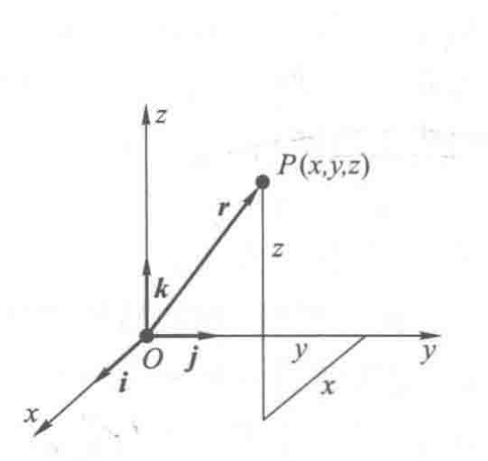

如果质点恒在一平面上运动，则只要该平面两个坐标就可确定它的位置了．如果是直角坐标系，且假定质点恒在$xy$平面上运动，即$z=0$，则质点在各个时刻的位置可用

$$
\begin{cases}
x=f_1(t)\\
y=f_2(t)
\end{cases}
\qquad (1.1.3)
$$

两个方程来表示．其矢量形式则为

$$
\boldsymbol{r}=x\boldsymbol{i}+y\boldsymbol{j} \qquad (1.1.4)
$$

直角坐标系虽然是常用的坐标系，但在某些问题中，采用直角坐标系将使计算显得比较繁杂，如果采用其他适当坐标系，就可能方便得多．常用的另一些坐标系有柱面坐标系、球面坐标系和自然坐标系．在平面问题中，则用平面极坐标系和自然坐标系．在平面极坐标系中，质点的位置将用两个变量$(r,\theta)$来表示，它们当然也是时间$t$的函数，即

$$
\begin{cases}
r=r(t)\\
\theta=\theta(t)
\end{cases}
\qquad (1.1.5)
$$

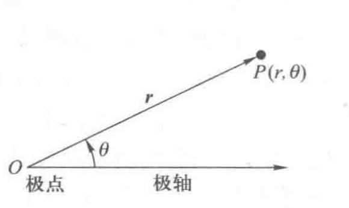

式中$r$是$P$点的径矢大小，即$P$点的位矢$\boldsymbol{r}$的量值，而$\theta$则是$P$点的极角，即极轴与$P$点位矢间的夹角，如图 1.1.2 所示．

关于柱面坐标系与自然坐标系，我们将在 §1.2 中介绍．至于球面坐标系，则因计算较烦琐，我们将在第五章中再作介绍．

### （2）运动学方程与轨道

本节（1）中（1.1.1）、（1.1.3）和（1.1.5）诸式，给出了质点在空间或平面上任一时刻$t$所占据的位置，所以它们表出了质点的**运动规律**，通常把它们叫做质点的**运动学方程**．一个具有一定几何形状的宏观物体在机械运动中的物质性表现在下列两个方面：（1）不能有两个或两个以上的物体同时占据同一空间；（2）它也不能从空间某一位置突然改变到另一位置．这些性质，也是质点所具有的．所以（1.1.1）、（1.1.3）和（1.1.5）诸式都应当是时间$t$的单值的、连续的函数．另一方面，这些方程式也是质点的轨道参变方程，其中时间$t$是参数．所谓**轨道**，就是运动质点在空间（或平面上）一连串所占据的点形成的一条轨迹．如果质点运动的轨道是一条直线，则这种运动叫**直线运动**，如果轨道是一条曲线，则叫**曲线运动**．

如果从式（1.1.1）、（1.1.3）和（1.1.5）中把参数$t$消去，则得诸变量之间的关系式，即轨道方程式．

前曾提到，按照轨道性质的不同，质点的运动可以是直线的，也可以是曲线的，这从轨道方程式也可以看出．当然，这里所谓轨道的性质，依赖于参考系的选择．相对于某一参考系为直线运动，相对于另一参考系则可以是曲线运动，反之亦然．例如，从作匀速直线运动的火车上自由落下的物体，若以火车为参考系，则轨道是直线；如以地球为参考系，其轨道却是抛物线．

### （3）位移、速度和加速度

质点相对于某参考系运动时，位置连续变化．在给定时间内，联结质点的初位置$A$和末位置$B$的直线，并从$A$指向$B$加上箭头，叫做质点在此给定时间内相对于该参考系的**位移**，常以符号$\Delta\boldsymbol{r}$表示（图1.1.3）．它是一个既有量值又有方向的量，运算时服从平行四边形法则，所以是一个矢量．在图 1.1.3 中，$A$点的位矢是$\boldsymbol{r}$，$B$点的位矢是$\boldsymbol{r}+\Delta\boldsymbol{r}$，都是相对于$O$点（现在选作原点）而言的．

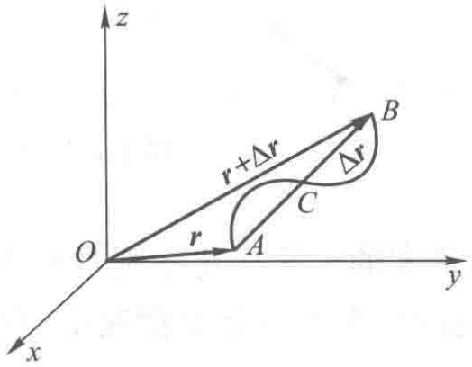

在曲线运动中，位移的量值和质点所走过的路程并不相同，甚至可以相差很大．例如在图 1.1.3 中，当质点沿曲线$ACB$自$A$运动到$B$时，路程$s$（即曲线$ACB$的长度）和位移的量值$|\Delta\boldsymbol{r}|$相差很大．在特殊情况下，当质点沿一封闭曲线从$A$又回到$A$时，位移等于零，但路程则并不等于零．这是因为位移只决定于运动质点的初、末位置．

设某时刻质点通过轨道上的$P$点，经$\Delta t$时间间隔后，质点通过$Q$点，在$\Delta t$这段时间间隔内，质点的位移为$\overrightarrow{PQ}=\Delta\boldsymbol{r}$（图1.1.4），而位矢的时间变化率则叫做质点在时刻$t$的**瞬时速度**，常以$\boldsymbol{v}$表示，即

$$
\boldsymbol{v}(t)=\lim_{\Delta t\to 0}\frac{\Delta\boldsymbol{r}}{\Delta t}=\frac{\mathrm{d}\boldsymbol{r}(t)}{\mathrm{d}t}=\dot{\boldsymbol{r}}(t)=\boldsymbol{v}_t=\boldsymbol{v}
\qquad (1.1.6)
$$

因位矢是矢量，故瞬时速度也是一个矢量．如果不计方向，则叫**速率**．由于瞬时速度能细致地反映运动情况，故今后所谓的速度，皆指瞬时速度，并以$\boldsymbol{v}$表示，见式（1.1.6）．

在图 1.1.4 中，设质点在时刻$t$通过轨道上的$P$点前进，$P$离某指定点（例如图 1.1.4 上的$A$点）的曲线距离为$s$，而质点通过轨道上的$Q$点时，$Q$离该指定点的曲线距离为$s+\Delta s$，则$\Delta s=\widehat{PQ}$，是质点在$\Delta t$时间内沿轨道所走过的路程，而位移$\Delta\boldsymbol{r}$则等于弦$\overrightarrow{PQ}$．在极限情况下，$\mathrm{d}s=|\mathrm{d}\boldsymbol{r}|$，故瞬时速度的量值（即速率）为$\dot{s}$．至于瞬时速度的方向，则和轨道上$P$点的切线方向一致，参看图 1.1.4．

如果质点在一定线上运动，且速度的量值也保持不变，则叫**匀速直线运动**，其是一种很特殊的运动状态．在一般情况下，速度是时间的矢量函数，故它的量值和方向都是随着时间改变的．

速度的时间变化率（因速度是时间的函数）叫做**加速度**，也是一个矢量．根据前面的计算，由于各时刻$t$的速度不同，故在$\Delta t$时间内速度的变化（图1.1.5）为

$$
\Delta\boldsymbol{v}=\boldsymbol{v}(t+\Delta t)-\boldsymbol{v}(t)
$$

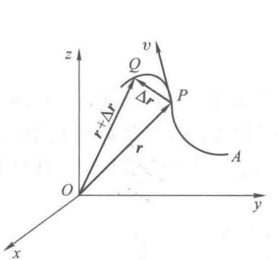

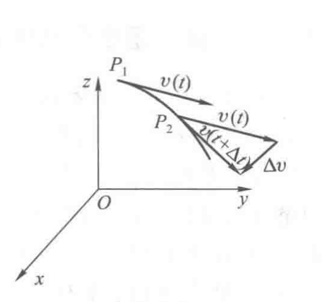

而速度的时间变化率则是质点在时刻$t$的瞬时加速度，简称加速度，可用$\boldsymbol{a}(t)$或$\boldsymbol{a}$表示（在曲线运动情况中，它一般不沿轨道的切线方向，参看 §1.2），即

$$
\boldsymbol{a}=\lim_{\Delta t\to 0}\frac{\Delta\boldsymbol{v}}{\Delta t}=\frac{\mathrm{d}\boldsymbol{v}}{\mathrm{d}t}=\dot{\boldsymbol{v}}=\ddot{\boldsymbol{r}}
\qquad (1.1.7)
$$

加速度保持不变的直线运动叫做**匀加速直线运动**，但这也只是一种特殊情况．在一般情况下，加速度也是时间的矢量函数，因而不能把它当作常矢量看待．在理论力学中，通常所遇到的力学问题，都是变加速度问题，这一点我们要特别注意．

## §1.2 速度、加速度的分量表示式

### （1）直角坐标系

在某一坐标系中，设质点沿一空间曲线$C$运动，在某一时刻$t$，质点占有某一位置，并具有一定的速度$\boldsymbol{v}$和一定的加速度$\boldsymbol{a}$．因$\boldsymbol{v}$与$\boldsymbol{a}$都是矢量，故可投影到任意坐标轴上．如果$C$上某一点$P$的位矢$\overrightarrow{OP}=\boldsymbol{r}$，它在某直角坐标系中的直角坐标为$(x,y,z)$，则由图 1.1.1 及公式（1.1.2）和（1.1.6），知

$$
\begin{aligned}
\boldsymbol{r}&=x\boldsymbol{i}+y\boldsymbol{j}+z\boldsymbol{k}\\
\boldsymbol{v}&=\frac{\mathrm{d}\boldsymbol{r}}{\mathrm{d}t}=\dot{x}\boldsymbol{i}+\dot{y}\boldsymbol{j}+\dot{z}\boldsymbol{k}\\
&=v_x\boldsymbol{i}+v_y\boldsymbol{j}+v_z\boldsymbol{k}
\end{aligned}
\qquad (1.2.1)
$$

式中$\boldsymbol{i},\boldsymbol{j},\boldsymbol{k}$分别是该坐标系坐标轴$x,y,z$上的单位矢量，它们都是恒定的（即恒矢量）．而$\dot{x},\dot{y},\dot{z}$则是速度$\boldsymbol{v}$在$x,y,z$轴上的分量，即$v_x,v_y,v_z$．由此可得速率

$$
v=\sqrt{\dot{x}^2+\dot{y}^2+\dot{z}^2}=\sqrt{v_x^2+v_y^2+v_z^2}
\qquad (1.2.2)
$$

又由加速度$\boldsymbol{a}$的定义（1.1.7），知

$$
\boldsymbol{a}=\frac{\mathrm{d}\boldsymbol{v}}{\mathrm{d}t}=\ddot{x}\boldsymbol{i}+\ddot{y}\boldsymbol{j}+\ddot{z}\boldsymbol{k}=a_x\boldsymbol{i}+a_y\boldsymbol{j}+a_z\boldsymbol{k}
\qquad (1.2.3)
$$

$\ddot{x}$、$\ddot{y}$、$\ddot{z}$为加速度$\boldsymbol{a}$在$x,y,z$轴上的分量，即$a_x,a_y,a_z$，而

$$
a=\sqrt{\ddot{x}^2+\ddot{y}^2+\ddot{z}^2}=\sqrt{a_x^2+a_y^2+a_z^2}
\qquad (1.2.4)
$$

位矢$\boldsymbol{r}$、速度$\boldsymbol{v}$和加速度$\boldsymbol{a}$都是时间的函数，它们的分量当然也是时间的函数．由（1.2.1）及（1.2.3）两式可以看出：这三个函数中，只要知道一个，就可以求出其余的两个．例如，欲求质点的速度及加速度，可先选取适当的坐标系，定出质点的位置坐标，再求其对时间的微商即可．而如要从速度求位矢，则一般要用积分方法（并利用初始条件定出积分常数）求出位矢的分量（即位置坐标），再从分量求$\boldsymbol{r}$．上述关系，对物体中的某一点来讲也是适用的．

［例1］设椭圆规尺$AB$的端点$A$与$B$沿直线导槽$Ox$及$Oy$滑动（图1.2.1），而$B$以匀速度$c$运动．求椭圆规尺上$M$点的轨道方程、速度及加速度．设$MA=a$，$MB=b$，$\angle OBA=\theta$．

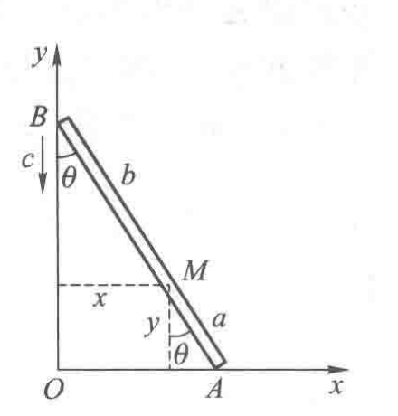

［解］由图 1.2.1 知$M$点的坐标为

$$
x=b\sin\theta,\quad y=a\cos\theta
\qquad (1)
$$

消去$\theta$，得轨道方程为

$$
\frac{x^2}{b^2}+\frac{y^2}{a^2}=1\;(\text{椭圆})
\qquad (2)
$$

速度分量为

$$
\dot{x}=b\dot{\theta}\cos\theta,\quad \dot{y}=-a\dot{\theta}\sin\theta
\qquad (3)
$$

式中$\dot{\theta}$是角量$\theta$的时间变化率．

因$B$点坐标为

$$
x_1=0,\quad y_1=(a+b)\cos\theta
$$

而依题意

$$
v_B=\dot{y}_1=-(a+b)\dot{\theta}\sin\theta=-c
$$

得

$$
\dot{\theta}=\frac{c}{a+b}\frac{1}{\sin\theta}
\qquad (4)
$$

故速度分量又可写为

$$
\dot{x}=\frac{bc}{a+b}\cot\theta,\quad \dot{y}=-\frac{ac}{a+b}
\qquad (5)
$$

所以

$$
v_M=\frac{c}{a+b}\sqrt{a^2+b^2\cot\theta}
\qquad (6)
$$

加速度分量为

$$
\ddot{x}=-\frac{bc}{a+b}\dot{\theta}\csc^2\theta=-\frac{bc^2}{(a+b)^2}\csc^3\theta=-\frac{b^4c^2}{(a+b)^2}\frac{1}{x^3}
\qquad (7)
$$

$$
\ddot{y}=0
$$

所以

$$
a_M=\sqrt{\ddot{x}^2+\ddot{y}^2}=\frac{b^4c^2}{(a+b)^2x^3}
\qquad (8)
$$

### （2）极坐标系

在解算力学问题时，直角坐标系虽然用得多，但为了计算方便起见，有时也要采用另外一些坐标系，这在 §1.1 中曾经讲过．

解算平面曲线运动问题时，有时要采用极坐标系，以使计算简化．例如，解算质点受有心力作用而运动的问题时（§1.9），用平面极坐标系就比用直角坐标系要方便得多．

我们知道：在平面极坐标系中，质点$P$的位置，可用极坐标$(r,\theta)$来表示，如图 1.2.2 所示．当质点$P$沿着曲线运动时，它的速度$\boldsymbol{v}$沿着轨道的切线．如为平面曲线，在直角坐标系中，我们是把速度$\boldsymbol{v}$分解为沿$x$轴的$v_x\boldsymbol{i}$及沿$y$轴的$v_y\boldsymbol{j}$．但在平面极坐标系中，我们就必须把它分解为沿位矢$\boldsymbol{r}$及垂直位矢$\boldsymbol{r}$（$\theta$增加的方向）的两个分量$v_r\boldsymbol{i}$及$v_\theta\boldsymbol{j}$，式中$\boldsymbol{i}$为沿位矢$\boldsymbol{r}$的单位矢量，$\boldsymbol{j}$为垂直位矢$\boldsymbol{r}$的单位矢量，由图 1.2.2，显然有

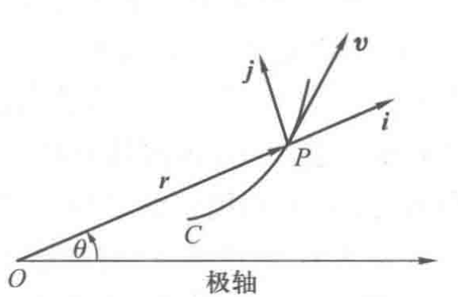

$$
\boldsymbol{r}=r\boldsymbol{i}
\qquad (1.2.5)
$$

因

$$
\boldsymbol{v}=\frac{\mathrm{d}\boldsymbol{r}}{\mathrm{d}t}
$$

所以

$$
\boldsymbol{v}=\frac{\mathrm{d}\boldsymbol{r}}{\mathrm{d}t}=\frac{\mathrm{d}}{\mathrm{d}t}(r\boldsymbol{i})
\qquad (1.2.6)
$$

值得注意的是：这里单位矢量$\boldsymbol{i},\boldsymbol{j}$的量值虽然都等于1，但是当质点$P$沿着曲线$C$运动时，位矢的方向随时变化，因而沿位矢的$\boldsymbol{i}$和垂直位矢的$\boldsymbol{j}$的方向也随着时间变化，即$\boldsymbol{i},\boldsymbol{j}$也都是时间的函数．这一点和直角坐标系中的情形不同，在直角坐标系中，$\boldsymbol{i}$和$\boldsymbol{j}$都是常矢量．因此

$$
\boldsymbol{v}=\frac{\mathrm{d}}{\mathrm{d}t}(r\boldsymbol{i})=\dot{r}\boldsymbol{i}+r\dot{\boldsymbol{i}}
\qquad (1.2.7)
$$

式中$\dot{r}=\dfrac{\mathrm{d}r}{\mathrm{d}t}$，而$\dot{\boldsymbol{i}}=\dfrac{\mathrm{d}\boldsymbol{i}}{\mathrm{d}t}$．

从式（1.2.7）可以看出：速度$\boldsymbol{v}$是由两项叠加而成的．其中第一项$\dot{r}\boldsymbol{i}$的方向和位矢$\boldsymbol{r}$的方向一致，看来它表示位矢$\boldsymbol{r}$量值的变化．至于式（1.2.7）中的第二项，必须先求出$\dot{\boldsymbol{i}}$才能知道其物理意义．因此，问题归结为如何求出$\dot{\boldsymbol{i}}$，即如何求出单位矢量对时间$t$的微商．

参看图 1.2.3，当质点沿曲线$C$由$P$点运动到$Q$点时，位矢由$\boldsymbol{r}_1$变为$\boldsymbol{r}_2$，而单位矢量$\boldsymbol{i}$也由$\boldsymbol{i}$变为$\boldsymbol{i}'$，$\boldsymbol{i}$和$\boldsymbol{i}'$的量值都等于1，但方向不同．由图 1.2.3 可见，$\boldsymbol{i},\boldsymbol{i}'$和$\mathrm{d}\boldsymbol{i}$组成一等腰三角形．在极限情况下，$\mathrm{d}\theta\to 0$，等腰三角形的两个底角均接近于直角．故在极限情形下，$\mathrm{d}\boldsymbol{i}\perp\boldsymbol{i}$，与$\boldsymbol{j}$的方向一致．至于$|\mathrm{d}\boldsymbol{i}|$的量值则为$|\mathrm{d}\boldsymbol{i}|=1\times\mathrm{d}\theta=\mathrm{d}\theta$．同理，在极限情况下，$\mathrm{d}\boldsymbol{j}\perp\boldsymbol{j}$，$|\mathrm{d}\boldsymbol{j}|=1\times\mathrm{d}\theta=\mathrm{d}\theta$，由图可

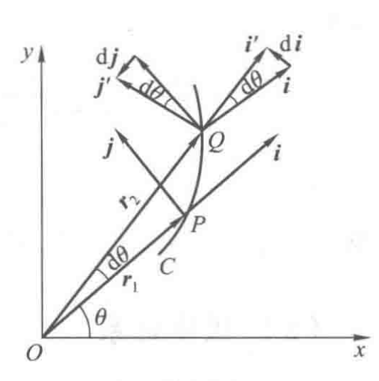见，这时$\mathrm{d}\boldsymbol{j}$的指向和$\boldsymbol{i}$的指向相反，即沿$\boldsymbol{i}$的负方向．因此，我们有

$$
\left.
\begin{aligned}
\frac{\mathrm{d}\boldsymbol{i}}{\mathrm{d}t}&=\frac{\mathrm{d}\boldsymbol{i}}{\mathrm{d}\theta}\frac{\mathrm{d}\theta}{\mathrm{d}t}=\dot{\theta}\boldsymbol{j}\\
\frac{\mathrm{d}\boldsymbol{j}}{\mathrm{d}t}&=\frac{\mathrm{d}\boldsymbol{j}}{\mathrm{d}\theta}\frac{\mathrm{d}\theta}{\mathrm{d}t}=-\dot{\theta}\boldsymbol{i}
\end{aligned}
\right\}
\qquad (1.2.8)
$$

这个关系，我们必须掌握．

把式（1.2.8）代入式（1.2.7），我们就得到

$$
\boldsymbol{v}=\dot{r}\boldsymbol{i}+r\dot{\theta}\boldsymbol{j}
\qquad (1.2.9)
$$

式（1.2.9）的第二项$r\dot{\theta}\boldsymbol{j}$确实是垂直于位矢的分速度．这样，我们就把$\boldsymbol{v}$分解为沿位矢及垂直于位矢的两个分速度了．我们通常称$\dot{r}\boldsymbol{i}$为**径向速度**．以$v_r\boldsymbol{i}$表示，是由位矢$\boldsymbol{r}$的量值改变所引起的．至于$r\dot{\theta}\boldsymbol{j}$则叫**横向速度**，以$v_\theta\boldsymbol{j}$表示，是由位矢方向的改变所引起的．所以，在平面极坐标系中，速度的两个分量为

$$
\begin{aligned}
v_r&=\dot{r}\\
v_\theta&=r\dot{\theta}
\end{aligned}
\qquad (1.2.10)
$$

加速度$\boldsymbol{a}$是速度$\boldsymbol{v}$对时间$t$的微商，即

$$
\boldsymbol{a}=\frac{\mathrm{d}\boldsymbol{v}}{\mathrm{d}t}
$$

既然在平面极坐标系中，可以把速度$\boldsymbol{v}$分解为沿位矢及垂直于位矢的两个分矢量，那么，根据同样道理，我们也可以把加速度$\boldsymbol{a}$分解为沿位矢及垂直于位矢的两个分矢量．现在我们来求类似于式（1.2.10）的分量表达式，即加速度在平面极坐标系中的分量表达式．

由式（1.2.9）及（1.2.10）知

$$
\boldsymbol{a}=\frac{\mathrm{d}\boldsymbol{v}}{\mathrm{d}t}=\frac{\mathrm{d}}{\mathrm{d}t}(\dot{r}\boldsymbol{i})+\frac{\mathrm{d}}{\mathrm{d}t}(r\dot{\theta}\boldsymbol{j})
\qquad (1.2.11)
$$

其中第一项代表径向速度的时间变化率，而第二项则代表横向速度的时间变化率．利用（1.2.8）式的关系，不难推出：

$$
\frac{\mathrm{d}}{\mathrm{d}t}(\dot{r}\boldsymbol{i})=\frac{\mathrm{d}\dot{r}}{\mathrm{d}t}\boldsymbol{i}+\dot{r}\frac{\mathrm{d}\boldsymbol{i}}{\mathrm{d}t}=\ddot{r}\boldsymbol{i}+\dot{r}\dot{\theta}\boldsymbol{j}
$$

式中的第一项是由径向速度的量值改变引起的，而第二项则是由于径向速度的方向改变所引起的．这跟直角坐标系中的情形不同，在直角坐标系中，分速度的方向是不变的，只有量值可以变化．

同理

$$
\frac{\mathrm{d}}{\mathrm{d}t}(r\dot{\theta}\boldsymbol{j})=\frac{\mathrm{d}r}{\mathrm{d}t}\dot{\theta}\boldsymbol{j}+r\frac{\mathrm{d}\dot{\theta}}{\mathrm{d}t}\boldsymbol{j}+r\dot{\theta}\frac{\mathrm{d}\boldsymbol{j}}{\mathrm{d}t}
$$

$$
=\dot{r}\dot{\theta}\boldsymbol{j}+r\ddot{\theta}\boldsymbol{j}-r\dot{\theta}^2\boldsymbol{i}
$$

式中头两项是由横向速度的量值改变所引起的，而第三项则是由于横向速度的方向改变所引起．

把所求得的$\dfrac{\mathrm{d}}{\mathrm{d}t}(\dot{r}\boldsymbol{i})$及$\dfrac{\mathrm{d}}{\mathrm{d}t}(r\dot{\theta}\boldsymbol{j})$的表达式代入式（1.2.11），并整理得

$$
\boldsymbol{a}=(\ddot{r}-r\dot{\theta}^2)\boldsymbol{i}+(r\ddot{\theta}+2\dot{r}\dot{\theta})\boldsymbol{j}=(\ddot{r}-r\dot{\theta}^2)\boldsymbol{i}+\frac{1}{r}\frac{\mathrm{d}}{\mathrm{d}t}(r^2\dot{\theta})\boldsymbol{j}
\qquad (1.2.12)
$$

式中$(\ddot{r}-r\dot{\theta}^2)\boldsymbol{i}$是加速度$\boldsymbol{a}$沿位矢方向的分量，记作$a_r\boldsymbol{i}$，通常叫做**径向加速度**，而$(r\ddot{\theta}+2\dot{r}\dot{\theta})\boldsymbol{j}$是加速度$\boldsymbol{a}$垂直于位矢方向的分量，记作$a_\theta\boldsymbol{j}$，通常叫做**横向加速度**．所以，在极坐标系中，加速度的两个分量为

$$
\begin{aligned}
a_r&=\ddot{r}-r\dot{\theta}^2\\
a_\theta&=r\ddot{\theta}+2\dot{r}\dot{\theta}=\frac{1}{r}\frac{\mathrm{d}}{\mathrm{d}t}(r^2\dot{\theta})
\end{aligned}
\qquad (1.2.13)
$$

由于在极坐标系中，径向速度和横向速度的方向一般都随时间而变，所以虽然径向速度$v_r$等于径矢大小$r$的时间变化率$\dot{r}$，但径向加速度则一般并不等于径向速度的时间变化率$\ddot{r}$，还有由于横向速度的方向改变所引起的另一项$(-r\dot{\theta}^2)$，它也是径向的．$a_\theta$的情况也类似，读者可自行解释．

顺便指出：在极坐标系中，加速度分量的表达式比较复杂，不像在直角坐标系中那样简单，但这并不等于解算力学中所有问题都要用直角坐标系才显得方便．参看 §1.9．

另外，平面极坐标系只能用来解决平面曲线运动问题，直角坐标系却能解算空间曲线运动问题．对于空间曲线运动问题，除采用直角坐标系外，有时还要采用另外一些坐标系，其中跟平面极坐标系有关的，是平面极坐标系加上垂直的$z$坐标而形成的柱面坐标系．实用中，一般使直角坐标系的$z$轴与柱面坐标系的$z$轴重合．这时，直角坐标与柱面坐标的关系如图 1.2.4 所示，$P$为空间曲线上的任一点，$M$为$P$在$xy$平面上的垂足，它的平面极坐标是$(r,\theta)$，而$P$点的柱坐标则为$(r,\theta,z)$．要注意这里$r$已不是$P$点的位矢（$P$点的位矢是$\boldsymbol{R}$），而是$P$点在$xy$平面上的垂足$M$点的位矢．速度、加速度的表示式和平面极坐标系不同之处，只是多了一个$z$方向的分量$\dot{z}$及$\ddot{z}$．

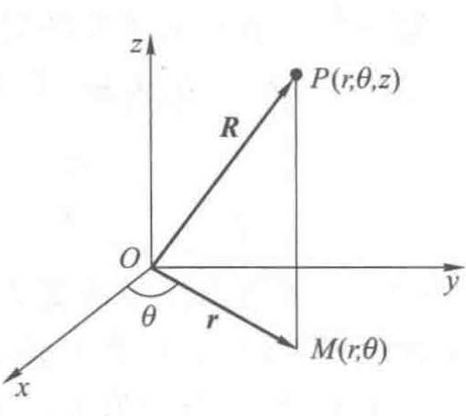

空间曲线运动问题，有时还要采用球面坐标系（见第五章）．

［例2］某点运动方程为

$$
r=e^{ct},\quad \theta=bt
$$

式中$b$和$c$都是常数，试求其速度与加速度．

［解］因为$r=e^{ct}$，$\theta=bt$，故

$$
v_r=\dot{r}=ce^{ct}=cr
\qquad (1)
$$

$$
v_\theta=r\dot{\theta}=be^{ct}=br
$$

而

$$
v=\sqrt{\dot{r}^2+r^2\dot{\theta}^2}=\sqrt{b^2+c^2}\,r
\qquad (2)
$$

又

$$
a_r=\ddot{r}-r\dot{\theta}^2=c^2e^{ct}-b^2e^{ct}=(c^2-b^2)r
$$

$$
a_\theta=r\ddot{\theta}+2\dot{r}\dot{\theta}=2bcr
$$

所以

$$
\begin{aligned}
a&=\sqrt{(\ddot{r}-r\dot{\theta}^2)^2+(r\ddot{\theta}+2\dot{r}\dot{\theta})^2}\\
&=\sqrt{(c^2-b^2)^2+(2bc)^2}\,r\\
&=(b^2+c^2)r
\end{aligned}
\qquad (3)
$$

由此可以看出：在本问题中，速度和加速度都和径矢$r$成正比．

### （3）切向加速度与法向加速度

质点沿曲线运动时，速度矢量$\boldsymbol{v}$沿轨道的切线方向，但加速度$\boldsymbol{a}$则并不沿着轨道的切线方向．如果质点沿着平面曲线$C$运动，那么我们还可以把加速度矢量$\boldsymbol{a}$分解为沿着轨道的切线方向及法线方向两个分量．为方便计，这里我们设$\boldsymbol{i}$为沿轨道切线并指向轨道弧长$s$增加的方向上的单位矢量，$\boldsymbol{j}$为沿轨道法线并指向曲线凹侧的单位矢量，$\theta$为轨道前进的切线方向和$x$轴间的夹角（图1.2.5）．当质点沿$C$运动时，$\boldsymbol{i},\boldsymbol{j}$均随着$\theta$改变，它们之间关系，同样可以利用（1.2.8）式，即

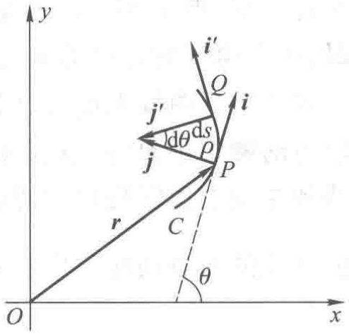

$$
\left.
\begin{aligned}
\frac{\mathrm{d}\boldsymbol{i}}{\mathrm{d}\theta}&=\boldsymbol{j}\\
\frac{\mathrm{d}\boldsymbol{j}}{\mathrm{d}\theta}&=-\boldsymbol{i}
\end{aligned}
\right\}
\qquad (1.2.14)
$$

这里单位矢量$\boldsymbol{i}$虽变为沿轨道切线方向，但是$\theta$仍是$\boldsymbol{i}$与$x$轴间的夹角，所以图 1.2.3 的推理仍是成立的．

又速度$\boldsymbol{v}$是沿着轨道的切线，故

$$
\boldsymbol{v}=v\boldsymbol{i}=\frac{\mathrm{d}s}{\mathrm{d}t}\boldsymbol{i}
\qquad (1.2.15)
$$

式中$\mathrm{d}s$是当$\theta$改变$\mathrm{d}\theta$时，质点沿曲线$C$所移动的路程，在极限情况下，$\mathrm{d}s=|\mathrm{d}\boldsymbol{r}|$，故$v=\dfrac{|\mathrm{d}\boldsymbol{r}|}{\mathrm{d}t}=\dfrac{\mathrm{d}s}{\mathrm{d}t}$，且弧长增加，$\mathrm{d}s>0$；弧长减小，$\mathrm{d}s<0$．于是

$$
\boldsymbol{a}=\frac{\mathrm{d}\boldsymbol{v}}{\mathrm{d}t}=\frac{\mathrm{d}^2s}{\mathrm{d}t^2}\boldsymbol{i}+\frac{\mathrm{d}s}{\mathrm{d}t}\frac{\mathrm{d}\boldsymbol{i}}{\mathrm{d}t}=\frac{\mathrm{d}^2s}{\mathrm{d}t^2}\boldsymbol{i}+\frac{\mathrm{d}\boldsymbol{i}}{\mathrm{d}\theta}\frac{\mathrm{d}\theta}{\mathrm{d}s}\left(\frac{\mathrm{d}s}{\mathrm{d}t}\right)^2
$$

因为$\dfrac{\mathrm{d}s}{\mathrm{d}t}=v$，$\dfrac{\mathrm{d}\boldsymbol{i}}{\mathrm{d}\theta}=\boldsymbol{j}$，而此处$\dfrac{\mathrm{d}s}{\mathrm{d}\theta}$则等于曲线$C$的曲率半径$\rho$，因$\rho>0$，故

$$
\boldsymbol{a}=\frac{\mathrm{d}v}{\mathrm{d}t}\boldsymbol{i}+\frac{v^2}{\rho}\boldsymbol{j}
\qquad (1.2.16)
$$

即动点的加速度$\boldsymbol{a}$的切向分矢量为$\dfrac{\mathrm{d}v}{\mathrm{d}t}\boldsymbol{i}$，有时也把它写为$v\dfrac{\mathrm{d}v}{\mathrm{d}s}\boldsymbol{i}$，通常用$a_\tau\boldsymbol{i}$表之，叫做**切向加速度**．法向分矢量为$\dfrac{v^2}{\rho}\boldsymbol{j}$，通常用$a_n\boldsymbol{j}$表之，指向曲线凹侧为正，叫做**法向加速度**．因此，我们有

$$
\begin{aligned}
a_\tau&=\frac{\mathrm{d}v}{\mathrm{d}t}\\
a_n&=\frac{v^2}{\rho}
\end{aligned}
\qquad (1.2.17)
$$

这种分解方法的好处是完全取决于轨道本身的形状，而与所选用的坐标系无关，故称为**内禀方程**（或“禀性方程”，“本性方程”）．如果把轨道的切线和法线也作为坐标系来看，则叫**自然坐标系**．

由上面的计算可以看出：$a_\tau$是由于速度的量值改变所引起的．如速度的量值保持不变，则$a_\tau=0$．$a_n$则是由于速度的方向改变所引起的．当质点沿曲线运动时，由于速度的方向随时改变，故$a_n$一般不等于零．

对于空间曲线来讲，式（1.2.16）仍然适用．从微分几何学我们知道：$\boldsymbol{a}$恒位于轨道的密切平面内（参看 §1.5 中的图 1.5.1）．所谓轨道的密切平面是轨道的切线和曲线上无限接近于切点的一个点所确定的极限平面，亦即轨道上无限接近的两点的两条切线所确定的极限平面．故对空间曲线上的某点而言，$\dfrac{\mathrm{d}v}{\mathrm{d}t}\boldsymbol{i}$仍为切向加速度（在$\boldsymbol{e}_\tau$方向），$\dfrac{v^2}{\rho}\boldsymbol{j}$为在密切平面内并和切线垂直的加速度分矢量，叫做加速度在主法线方向（$\boldsymbol{e}_n$）上的分矢量．至于沿垂直于密切平面的另一条法线，即所谓副法线方向（$\boldsymbol{e}_b$）上加速度的分矢量则为零．

［例3］一质点沿圆滚线$s=4a\sin\theta$的弧线运动．如$\dot{\theta}$为一常数，则其加速度亦为一常数，试证明之．式中$\theta$为圆滚线某点$P$上的切线与水平线（$x$轴）所成的角度，$s$为$P$点与曲线最低点之间的曲线弧长．

［解］因

$$
s=4a\sin\theta
\qquad (1)
$$

故

$$
v=\frac{\mathrm{d}s}{\mathrm{d}t}=4a\dot{\theta}\cos\theta=4a\omega\cos\theta
\qquad (2)
$$

式中

$$
\dot{\theta}=\omega=\text{常量（题设）}
$$

又

$$
a_\tau=\frac{\mathrm{d}v}{\mathrm{d}t}=\frac{\mathrm{d}^2s}{\mathrm{d}t^2}=-4a\omega^2\sin\theta
\qquad (3)
$$

$$
a_n=\frac{v^2}{\rho}
\qquad (4)
$$

但

$$
\rho=\frac{\mathrm{d}s}{\mathrm{d}\theta}=4a\cos\theta
$$

所以

$$
a_n=\frac{16a^2\omega^2\cos^2\theta}{4a\cos\theta}=4a\omega^2\cos\theta
\qquad (5)
$$

而

$$
\begin{aligned}
a&=\sqrt{a_\tau^2+a_n^2}=4a\omega^2\sqrt{\sin^2\theta+\cos^2\theta}\\
&=4a\omega^2=\text{常量}
\end{aligned}
\qquad (6)
$$

［例4］设质点$P$沿螺旋线

$$
x=2\sin 4t,\quad y=2\cos 4t,\quad z=4t
$$

运动，试求速度、加速度及轨道的曲率半径．

［解］因

$$
\left.
\begin{aligned}
x&=2\sin 4t\\
y&=2\cos 4t\\
z&=4t
\end{aligned}
\right\}
\qquad (1)
$$

故

$$
\left.
\begin{aligned}
\dot{x}&=8\cos 4t=4y\\
\dot{y}&=-8\sin 4t=-4x\\
\dot{z}&=4
\end{aligned}
\right\}
\qquad (2)
$$

所以

$$
v=\sqrt{\dot{x}^2+\dot{y}^2+\dot{z}^2}=4\sqrt{x^2+y^2+1}=4\sqrt{5}
\qquad (3)
$$

又

$$
\left.
\begin{aligned}
\ddot{x}&=4\dot{y}=-16x\\
\ddot{y}&=-4\dot{x}=-16y\\
\ddot{z}&=0
\end{aligned}
\right\}
\qquad (4)
$$

所以

$$
a=\sqrt{\ddot{x}^2+\ddot{y}^2+\ddot{z}^2}=16\sqrt{x^2+y^2}=32
\qquad (5)
$$

又

$$
a_\tau=\frac{\mathrm{d}v}{\mathrm{d}t}=4\times\frac{1}{2}\frac{2x\dot{x}+2y\dot{y}}{\sqrt{x^2+y^2+1}}=4\times\frac{4xy-4xy}{\sqrt{x^2+y^2+1}}=0
\qquad (6)
$$

所以

$$
a_n=a=16\sqrt{x^2+y^2}=32
\qquad (7)
$$

而

$$
\rho=\frac{v^2}{a_n}=\frac{x^2+y^2+1}{\sqrt{x^2+y^2}}=2.5
\qquad (8)
$$

## §1.3 平动参考系

### （1）绝对速度、相对速度与牵连速度

在有些情况下，参考系本身也在运动．本节只讨论最简单的情况，即参考系作平动．设有两个参考系$S$及$S'$，前者是静止不动的，后者相对于前者作匀速直线运动．如果有两个观察者$A$和$B$，分别处于$S$及$S'$系中观察同一物体（质点）的运动，那么他们所得到的结果，彼此间有何不同和联系呢？

要观察物体的运动，总得要进行测量，即测量空间距离和时间间隔．现在又发生了一个问题，就是这两个观察者所观测到的空间距离和时间间隔，会不会因他们之间有这种相对运动而发生差异？根据伽利略和牛顿的假定，这两个观察者用事先校准好了的仪器（钟和尺）进行空间距离和时间间隔的测量所得到的结果，并不因它们间有这种相对运动而有任何差异．但严格说来，这只有在低速情形下才是正确的．当物体速度高到和光速相近时，上述假定就不能成立．但在通常情况下，物体运动的速度远比光速小，故伽利略、牛顿的假定可以成立．我们在这本《理论力学教程》中，就是采用了这种假定，也就是采用了经典力学的假定．关于高速运动的物体，则要采用爱因斯坦的相对论．

现在让我们先研究相对于“静止”坐标系$S$作匀速直线运动的参考坐标系$S'$的运动问题，也就是相对运动中最简单的一种情况．

如$(x_0,y_0,z_0)$为上述$S'$系的原点$O'$在某一瞬时相对于$S$系原点$O$的坐标，则

$$
\frac{\mathrm{d}x_0}{\mathrm{d}t}=u_0,\quad \frac{\mathrm{d}y_0}{\mathrm{d}t}=v_0,\quad \frac{\mathrm{d}z_0}{\mathrm{d}t}=w_0
$$

$u_0、v_0、w_0$为$S'$系对$S$系的相对分速度，均为定值．如$P$代表运动质点在同一瞬时的位置，对$S$系而言，其坐标为$(x,y,z)$，对$S'$系而言，其坐标为$(x',y',z')$，则由图 1.3.1（$z$坐标未绘出），知

$$
x=x_0+x',\quad y=y_0+y',\quad z=z_0+z'
$$

求上三式对$t$的微商，得

$$
\dot{x}=\dot{x}_0+\dot{x}'=u_0+\dot{x}',\quad \dot{y}=\dot{y}_0+\dot{y}'=v_0+\dot{y}',\quad \dot{z}=\dot{z}_0+\dot{z}'=w_0+\dot{z}'
$$

写成矢量形式，则为

$$
\boldsymbol{v}=\boldsymbol{v}_0+\boldsymbol{v}'
\qquad (1.3.1)
$$

我们通常把物体相对于“静止”参考系$S$的运动叫做“绝对”运动，所以物体相对于$S$系的运动速度$\boldsymbol{v}$，就叫做“绝对”速度．把物体相对于运动参考系$S'$的运动叫做相对运动，所以物体相对于运动参考系$S'$的运动速度$\boldsymbol{v}'$就叫做相对速度．至于物体随$S'$系一道运动而具有相对于$S$系的运动，则叫做牵连运动，所以物体被$S'$系“牵带”着一同运动的速度，亦即$S'$系相对于$S$系的速度$\boldsymbol{v}_0$就叫做牵连速度．即“绝对”速度等于牵连速度与相对速度的矢量和（图 1.3.2）．这个关系，当对于运动参考系作加速直线运动或一般平动时仍正确．

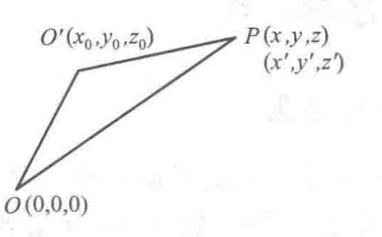

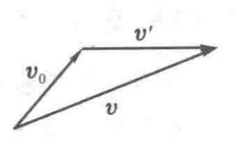

［例1］某人以4km/h的速率向东方前进时，感觉风从正北吹来；如将速率增加一倍，则感觉风从东北方向吹来．试求风速及风向．

［解］取坐标系$S$固着在地面上，$S'$系则固着在人身上，并令$x$轴指向东方，$y$轴指向北方，如图 1.3.3 所示．在图 1.3.3（a）中，人前进的速度$4\boldsymbol{i}$是牵连速度；而$\boldsymbol{v}'$则是人以4km/h的速率向东方前进时感觉到的风的速度，应为相对速度；至于$\boldsymbol{v}$，则为风相对于地面的速度，即绝对速度．由式（1.3.1），知$\boldsymbol{v}=4\boldsymbol{i}+\boldsymbol{v}'$，写成分量形式则为

$$
\left.
\begin{aligned}
v_x&=v\cos\theta=4\\
v_y&=-v\sin\theta=-v'
\end{aligned}
\right\}
\qquad (1)
$$

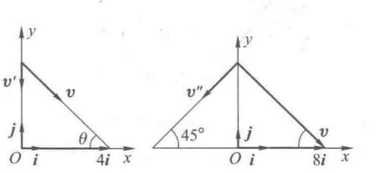

在图 1.3.3（b）中，牵连速度（人前进速度）是$8\boldsymbol{i}$，$\boldsymbol{v}''$则是相对速度，即人以8km/h的速率向东方前进时所感觉到的风的速度；至于$\boldsymbol{v}$则仍为绝对速度．因绝对速度等于相对速度与牵连速度的矢量和，而在此情形下

$$
\boldsymbol{v}=8\boldsymbol{i}+\boldsymbol{v}''
\qquad (2)
$$

写成分量形式则为

$$
\left.
\begin{aligned}
v_x&=v\cos\theta=8-v''\cos 45^\circ\\
v_y&=-v\sin\theta=-v''\sin 45^\circ
\end{aligned}
\right\}
\qquad (3)
$$

由（1）及（3）两式，得

$$
\left.
\begin{aligned}
v\cos\theta&=4\\
v\sin\theta&=v'
\end{aligned}
\right\}
\qquad (4)
$$

$$
\left.
\begin{aligned}
v\cos\theta&=8-v''\cos 45^\circ\\
v\sin\theta&=v''\sin 45^\circ
\end{aligned}
\right\}
\qquad (5)
$$

解上面的两方程组，得

$$
v=4\sqrt{2}\ \mathrm{km/h}
$$

$$
\theta=45^\circ
$$

故知风的绝对速率为$4\sqrt{2}\ \mathrm{km/h}$，它和$x$轴的夹角$\theta$为$45^\circ$，即风是从西北方向吹来．

［例2］小船$M$被水流冲走后，用一绳将它拉回岸边$A$点．假定水流速度大小$v_1$沿河宽不变，而拉绳子的速度大小则为$v_2$．如小船可以看成一个质点，求小船的轨迹（图1.3.4）．

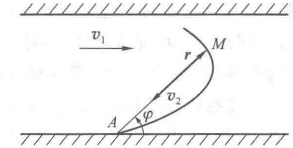

［解］因船沿径向的绝对速度的大小为$v_2$，其方向与位矢$\boldsymbol{r}$的方向相反，而水的牵连速度沿垂直于$\boldsymbol{r}$方向（$\varphi$增加的方向）的分量为$-v_1\sin\varphi$，故得

$$
\frac{\mathrm{d}r}{\mathrm{d}t}\;(\text{径向绝对速度})=-v_2
\qquad (1)
$$

$$
r\frac{\mathrm{d}\varphi}{\mathrm{d}t}\;(\text{横向绝对速度})=-v_1\sin\varphi
\qquad (2)
$$

两式相除，得

$$
\frac{\mathrm{d}r}{r}=\frac{v_2}{v_1}\csc\varphi\,\mathrm{d}\varphi
\qquad (3)
$$

积分，得

$$
\ln r=\frac{v_2}{v_1}\ln\left(\tan\frac{\varphi}{2}\right)+C
\qquad (4)
$$

即

$$
\ln r=\ln(\tan^k\alpha)+C
\qquad (5)
$$

式中

$$
\frac{v_2}{v_1}=k,\quad \alpha=\frac{\varphi}{2}
\qquad (6)
$$

设初始条件为

$$
r=r_0,\quad \alpha=\alpha_0
$$

代入（5）式，得

$$
C=\ln r_0-\ln(\tan^k\alpha_0)
\qquad (7)
$$

把（7）式代入（5）式，得

$$
\ln\frac{r}{r_0}=\ln(\tan^k\alpha\cot^k\alpha_0)
$$

所以

$$
r=r_0\cot^k\alpha_0\tan^k\alpha
\qquad (8)
$$

这就是所求船的轨迹方程．

### （2）绝对加速度、相对加速度与牵连加速度

对相对于$S$系作匀速直线运动的参考系$S'$而言，$\boldsymbol{v}_0$是常矢量．故求式（1.3.1）对时间的微商，得

$$
\dot{\boldsymbol{v}}=\dot{\boldsymbol{v}}'
$$

因$\dot{\boldsymbol{v}}_0=0$，即

$$
\boldsymbol{a}=\boldsymbol{a}'
\qquad (1.3.2)
$$

这是可以理解的，因为参考系$S'$是作匀速直线运动的，它没有加速度，所以在$S'$系中所观察到的物体的加速度$\boldsymbol{a}'$和在$S$系中所观察到的物体的加速度$\boldsymbol{a}$应该相同．

如果参考系$S'$相对于$S$系作加速直线运动，情况就不同了．因对速度来讲，式（1.3.1）还是成立的．故求式（1.3.1）对时间的微商，并注意$\boldsymbol{v}_0$不是常矢量，则得

$$
\dot{\boldsymbol{v}}=\dot{\boldsymbol{v}}_0+\dot{\boldsymbol{v}}'
$$

即

$$
\boldsymbol{a}=\boldsymbol{a}_0+\boldsymbol{a}'
\qquad (1.3.3)
$$

跟速度一样，$\boldsymbol{a}$叫绝对加速度，是质点（物体）相对于$S$系的加速度；$\boldsymbol{a}'$叫相对加速度，是质点相对于$S'$系的加速度；至于$\boldsymbol{a}_0$则是$S'$系相对于$S$系的加速度，亦即质点被$S'$系“带着”一起运动时获得的加速度，称为牵连加速度．所以，在相对于$S$系作加速直线运动的参考系$S'$中观察质点的运动时，质点的加速度$\boldsymbol{a}'$和在$S$系中所观察到的$\boldsymbol{a}$不同，它们之间的关系，由式（1.3.3）给出，即绝对加速度等于牵连加速度与相对加速度的矢量和，跟绝对速度、相对速度、牵连速度之间的关系一样．

## §1.4 质点运动定律

### （1）牛顿运动定律

前面所讲的都是质点运动学的内容，它只描述质点如何运动，不深入运动的本质，不揭示运动的内在规律，不能阐明在什么条件下将发生什么样的运动．动力学则是在运动学的基础上，进一步研究引起质点运动状态发生变化的原因．现在，我们就来研究质点动力学．

牛顿运动定律是经典动力学的基础．它是牛顿根据劳动人民在长期生产斗争中对机械运动规律的认识和以前许多科学家的研究成果，再加上他自己的长期观察、实验和研究所作出的科学总结．宏观低速物体的机械运动，都可根据牛顿运动定律进行解算，所以牛顿运动定律在经典力学中占有非常重要的地位．

现在让我们扼要表述一下牛顿运动三定律的内容：

**牛顿第一定律** 任何物体（质点）如果没有受到其他物体的作用，都将保持静止或匀速直线运动状态．也就是说：物体如果不受其他物体的作用，它的速度将保持不变．

物体在不受其他物体作用时保持运动状态不变的这种性质，叫做**惯性**，是物质的一种固有属性，所以牛顿第一运动定律又叫**惯性定律**．

**牛顿第二定律** 当一物体（质点）受到外力作用时，该物体所获得的加速度和外力成正比，和物体本身的质量成反比，加速度的方向和外力的方向一致．

物体间的相互作用叫做力，力可使物体得到加速度与形变．物体的质量则是物体惯性大小的量度．如果令$\boldsymbol{F}$代表作用在质点上的合外力，$m$代表质点的质量，$\boldsymbol{a}$代表质点的加速度，则在适当选择单位后，牛顿第二运动定律的数学表达式可写为

$$
\boldsymbol{F}=m\boldsymbol{a}
\qquad (1.4.1)
$$

在国际单位制（SI）中，$m$的单位为kg（千克），$a$的单位为$\mathrm{m/s^2}$（米每二次方秒），而$F$的单位则为N（牛顿）．

**牛顿第三定律** 当一物体A对另一物体B有一个作用力$\boldsymbol{F}_1$的同时，另一个物体B同时也对该物体A有一个反作用力$\boldsymbol{F}_2$，作用力与反作用力的量值相等，方向相反，并且在同一直线上，即

$$
\boldsymbol{F}_2=-\boldsymbol{F}_1
\qquad (1.4.2)
$$

作用力与反作用力施加在两个不同物体上，它们互以对方的存在为自己存在的前提．它们同时产生，同时消灭，相互依存，形成对立的局面，它们是力学中普遍存在的一种矛盾．

### （2）相对性原理

我们知道：研究物体的运动时，先要选定参考系．在运动学中，参考系可以任意选择，视研究的方便而定．但在动力学中，应用牛顿运动定律时，参考系就不能任意选择，因为牛顿运动定律不是对任何参考系都成立的．

牛顿运动定律能成立的参考系叫做**惯性参考系**．要决定一个参考系是不是惯性参考系，只能依靠观察和实验．根据天体运动的研究，人们发现：如果我们选择这样一个参考系，即以太阳中心为原点，以指向任一恒星的直线为坐标轴，那么所观测到的许多天文现象，都和根据牛顿运动定律和万有引力定律推出的结论较好地符合，所以这个参考系是精确程度很高的惯性参考系．实验又表明：地球上的物体相对于地球的运动并不完全遵守牛顿运动定律，所以地球不是惯性参考系．不过，这种偏差一般是比较微小的．因此，我们常常可以把地球看做近似程度相当好的惯性参考系．但在要求精确程度很高的问题中，我们就不能把地球当作惯性参考系了．

牛顿运动定律不能成立的参考系，叫做**非惯性参考系**．关于非惯性参考系的动力学问题，我们将在 §1.6 及第四章中讨论．

除了我们上面所讲的以外，还有没有其他的惯性参考系呢？让我们来考察一下，我们大家都可能有这样的经验：坐在平稳地作匀速直线运动的车厢里，如果不看窗外，就无法断定车厢是在运动还是在静止．伽利略在观察一个封闭船舱内所发生的现象时，曾做过一些实验．他说：“只要船是作匀速直线运动，那么在这里所发生的一切现象，你都观察不出有丝毫的改变，你也不能根据任何现象来判断船究竟是在运动还是在停止着．”这里，我们是把地球作为惯性参考系，根据上面的讨论，这还是可以的．总之，对于一个相对于惯性参考系作匀速直线运动的参考系，它的内部所发生的一切力学过程，都不受参考系本身匀速直线运动的影响．或者说：不能借助任何力学实验来判断这样的参考系是静止还是作匀速直线运动．这一原理，叫**力学相对性原理**，又叫**伽利略相对性原理**．

按照前述对惯性参考系的了解，可知在惯性参考系中所发生的力学过程，都遵守牛顿运动定律．而根据力学相对性原理，我们又知道，在所有相对于惯性参考系作匀速直线运动的参考系中的力学过程所遵从的规律，都与相对于静止参考系时完全一样．这也就是说：在这些参考系中的力学过程都遵从牛顿运动定律．因此得出结论：相对于惯性参考系作匀速直线运动的一切参考系都是惯性参考系．

伽利略相对性原理在爱因斯坦相对论中得到了推广，并称为爱因斯坦相对性原理，即一切惯性参考系对所有的物理过程（包括电磁的、光学的）都是等价的．关于爱因斯坦相对性原理，我们不准备进行深入的讨论．

## §1.5 质点运动微分方程

### （1）运动微分方程的建立

根据牛顿运动第二定律，质点的加速度和受到的作用力成正比．而作用力一般说来可表为位矢$\boldsymbol{r}$、速度$\dot{\boldsymbol{r}}$及时间$t$的函数．

牛顿第二定律式（1.4.1）通常可用运动微分方程写出．这种运动方程也叫**动力学方程**．质点运动的微分方程可写为

$$
m\ddot{\boldsymbol{r}}=\boldsymbol{F}(\boldsymbol{r},\dot{\boldsymbol{r}},t)
\qquad (1.5.1)
$$

质点如果不受任何约束①而运动，则叫**自由质点**．这时它的位置需用三个独立的变数表出．如用直角坐标系，则式（1.5.1）可写成三个标量微分方程如下：

$$
\begin{cases}
m\ddot{x}=F_x(x,y,z;\dot{x},\dot{y},\dot{z};t)\\
m\ddot{y}=F_y(x,y,z;\dot{x},\dot{y},\dot{z};t)\\
m\ddot{z}=F_z(x,y,z;\dot{x},\dot{y},\dot{z};t)
\end{cases}
\qquad (1.5.2)
$$

式中$F_x、F_y、F_z$是作用在质点上的合外力$\boldsymbol{F}$在三坐标轴上的投影，当然也是坐标、速度、时间的函数．式（1.5.2）中的每一个方程，都是二阶常微分方程，这微分方程组的解中将有六个积分常数出现．此六个积分常数可由质点的初始条件决定，即由$t=0$时，质点的初位置$x=x_0,\ y=y_0,\ z=z_0$和初速度$\dot{x}=u_0,\ \dot{y}=v_0,\ \dot{z}=w_0$所决定．

质点如作直线运动，则可取该直线为$x$轴，于是运动微分方程只有（1.5.2）中的第一式存在②．同理，如质点作平面曲线运动，则可取运动平面为$xy$平面，因而式（1.5.2）中只有前两式存在③．解算平面曲线运动问题，有时用直角坐标系较便，但有时则用其他坐标系例如平面极坐标系较便（例如行星运动问题）．如用平面极坐标系，则由式（1.2.13），知质点运动微分方程可写为

$$
\begin{cases}
m(\ddot{r}-r\dot{\theta}^2)=F_r(r,\theta;\dot{r},\dot{\theta};t)\\
m(r\ddot{\theta}+2\dot{r}\dot{\theta})=F_\theta(r,\theta;\dot{r},\dot{\theta};t)
\end{cases}
\qquad (1.5.3)
$$

式中$F_r$及$F_\theta$为合外力$\boldsymbol{F}$的径向分量和横向分量．

如果质点受到某种约束，例如被限制在某曲线或曲面上运动，不能脱离该线或该面而作任意的运动并占据空间任意的位置，则叫**非自由质点**．此时该线或该面叫**约束**，而该线或该面的方程则叫做**约束方程**．

解非自由质点的运动（或称**约束运动**）问题，一般都是将约束去掉，而代之以约束反作用力，从而把它当成自由质点．约束反作用力，一般都是未知的；跟普通的力不同，它不完全决定于约束本身，而与作用在质点上的其他力及质点本身运动状态等有关；而且，单靠约束反作用力本身，并不能引起质点的任何运动．所以约束反作用力常称为**被动力或约束力**，不是约束力的那些力称为**主动力**．

约束反作用力通常作用在质点和曲线或曲面的接触点上．在无摩擦的情况下，它沿着曲线或曲面的法线，而在有摩擦的情况下，则和法线成一定角度的倾斜．如令$\boldsymbol{F}$代表主动力，$\boldsymbol{R}$代表约束反作用力，则质点的运动微分方程为

$$
m\ddot{\boldsymbol{r}}=\boldsymbol{F}(\boldsymbol{r},\dot{\boldsymbol{r}},t)+\boldsymbol{R}
\qquad (1.5.4)
$$

既然$\boldsymbol{R}$也是未知的，因此对任何坐标系而言，上述方程的标量方程式的数目，均

> ① 约束的含意参看下页．
>
> ② 这时$F_x$只是$x、\dot{x}、t$的函数．
>
> ③ 这时$F_x、F_y$都只是$x、y、\dot{x}、\dot{y}$和$t$的函数．

少于未知数的数目，所以还要另外加入约束方程才能求解．

解线约束问题，通常用内禀方程比较方便．设质点在已知主动力$\boldsymbol{F}$的作用下，沿光滑的空间曲线$AB$运动（图 1.5.1），则把式（1.5.4）投影到切线方向$\boldsymbol{e}_\tau$、主法线方向$\boldsymbol{e}_n$（指向曲线凹方为正）及副法线$\boldsymbol{e}_b$方向上（副法线的正向$\boldsymbol{e}_b$与$\boldsymbol{e}_\tau、\boldsymbol{e}_n$形成一右手坐标系），就得到

$$
\begin{cases}
m\dfrac{\mathrm{d}v}{\mathrm{d}t}=F_\tau\\
m\dfrac{v^2}{\rho}=F_n+R_n\\
0=F_b+R_b
\end{cases}
\qquad (1.5.5)
$$

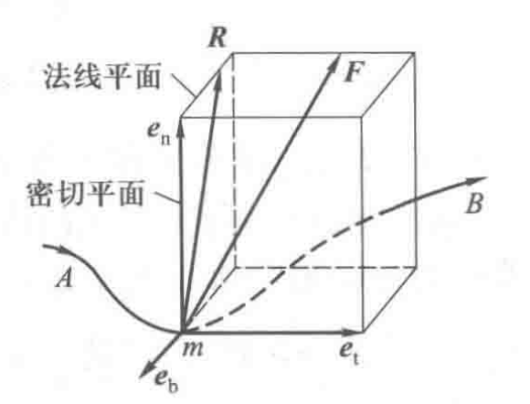

这些方程中的第一个方程给出运动规律，而第二和第三个方程则决定约束反作用力．由此可见，用内禀方程解光滑线约束问题时，运动规律和约束反作用力可以分开解算，这显然是一个很大的优点．当然，解算约束反作用力时，要利用约束方程来求轨道的曲率半径$\rho$，所以约束方程还是要知道才行．如光滑平面线约束的约束方程（即曲线方程）为$y=f(x)$，则$\dfrac{1}{\rho}=\dfrac{|y''|}{(1+y'^2)^{3/2}}$，式中$y'=\dfrac{\mathrm{d}y}{\mathrm{d}x}$，$y''=\dfrac{\mathrm{d}^2y}{\mathrm{d}x^2}$．

如为不光滑的线约束，则式（1.5.5）中第一式的右方，应加上摩擦力$f$，它的方向和质点运动方向相反，量值等于$\mu R$，式中$\mu$为摩擦因数，$R=\sqrt{R_n^2+R_b^2}$．

### （2）运动微分方程的解

力学中的运动定律反映了物体机械运动的普遍规律．但是，各种不同问题又带有不同的特殊性，因此对于具体问题必须进行具体的分析，即必须弄清它的特殊性．对于力学问题来讲，就必须首先弄清它的受力情况，明确哪些力是已知的（包括量值和方向），需要求解的是哪些物理量，并作出草图．

质点不受任何约束而作自由运动，这种情况并不普遍，大量质点动力学问题都是研究受有约束的非自由质点的运动问题．若干质点受约束而连在一起的运动问题，本是质点组的动力学问题，但这时如能对每一质点作出单独草图，常能把它化为质点动力学问题．所以对这类问题在作出总的草图以后，还要再就每一质点作出单独的草图，即用所谓**隔离物体法**，分别对每一质点进行受力情况和运动情况的分析．即使是单个质点，作出它和周围物体（例如地球）分开的隔离体图也是十分有用的．

由于牛顿运动定律的数学表达式是矢量式［见方程（1.5.1）］，在解算具体问题时，它不便给出具体的结果．因此，在具体分析后，还要根据问题的性质，选取适当的坐标系，规定每一质点的坐标，然后写出每一质点的分量形式的动力学方程．

在理论力学中我们遇到的问题，一般是受变力而运动的问题，运动方程一般是二阶常微分方程组．因此，理论力学的主要任务，就将是根据具体问题进行具体分析后，建立运动微分方程组，然后求解这些方程组．也就是说，在具体分析以后，我们将把力学问题化为数学问题；再根据题给的起始条件来解出这些方程组；最后，还要对所得的结果加以分析，阐明它们的物理含义．在某些情况下，所得到的某些结果，可能不符合物理情况，则应将其弃去．总之，解决力学问题不应只满足于解出数学方程的结果，还要讨论它的物理实质，这样才是对于一个物理问题的完满解答．

上面我们曾经讲过，作用在质点上的力，一般是位置、速度和时间的函数，这种微分方程组的求解，可能相当困难．但在有些具体问题中，力常常只是其中某一个变量的函数．这样，求解问题就变得简单得多．下面我们举几个实际问题，作为示范．

Ⅰ．自由电子在沿$x$轴的振荡电场中的运动——力只是时间$t$的函数．

设电子速度甚小于光速．在本问题中，沿$x$轴的电场强度为

$$
E_x=E_0\cos(\omega t+\theta)
\qquad (1.5.6)
$$

而电子所受的力则为

$$
F=-eE_x=-eE_0\cos(\omega t+\theta)
\qquad (1.5.7)
$$

式中$-e$为电子所带的电荷，$E_0$为电场强度的最大值，$\omega$为角频率，$\theta$为初相．$e、E_0、\omega$和$\theta$都是常数．

根据牛顿运动定律，电子运动的微分方程为

$$
m\frac{\mathrm{d}^2x}{\mathrm{d}t^2}=m\frac{\mathrm{d}v}{\mathrm{d}t}=-eE_0\cos(\omega t+\theta)
\qquad (1.5.8)
$$

式中$m$为电子的质量，$v$为电子在任一瞬时的速度．显然，$v=\dfrac{\mathrm{d}x}{\mathrm{d}t}$，故$\dfrac{\mathrm{d}^2x}{\mathrm{d}t^2}=\dfrac{\mathrm{d}v}{\mathrm{d}t}$．

把式（1.5.8）乘以$\mathrm{d}t$，并积分，得

$$
v=-\frac{eE_0}{m\omega}\sin(\omega t+\theta)+C_1
$$

设起始条件是：当$t=0$，$v=v_0$，代入上式，则得

$$
C_1=v_0+\frac{eE_0}{m\omega}\sin\theta
$$

所以

$$
v=v_0+\frac{eE_0}{m\omega}\sin\theta-\frac{eE_0}{m\omega}\sin(\omega t+\theta)
$$

再积分，并设起始条件为$t=0$，$x=x_0$，得

$$
x=x_0-\frac{eE_0\cos\theta}{m\omega^2}+\left(v_0+\frac{eE_0}{m\omega}\sin\theta\right)t+\frac{eE_0}{m\omega^2}\cos(\omega t+\theta)
\qquad (1.5.9)
$$

如电子起始时，在$x_0=0$处是静止的，则

$$
x=-\frac{eE_0\cos\theta}{m\omega^2}+\left(\frac{eE_0}{m\omega}\sin\theta\right)t+\frac{eE_0}{m\omega^2}\cos(\omega t+\theta)
\qquad (1.5.10)
$$

在实际问题中，当无线电波在含有高密度自由电子的电离层中传播时，就跟上面所讨论的情况极其相似．与角频率为$\omega$的无线电波相缔合的是由上面的式（1.5.6）所表出的电场．在式（1.5.9）中的振荡项具有与式（1.5.6）相同的角频率$\omega$，且与起始条件无关．至于式（1.5.9）中的非振荡项，则与起始条件有关，故当波抵达时，它们影响着每一自由电子的细致运动．这些项对波的传播特性无贡献，只能影响波到达的前沿位置．因电子带负电，故电极化强度与电场强度的位相相反．由于这个缘故，使电离层的介电常量小于1．这与在低频下正常的介电常数不同，那时它总是大于1的．

Ⅱ．在具有阻力的介质中运动的抛射体——力只是速度的函数．

抛射体通常都是在空气中运动的，在运动中总要受到空气阻力的作用．下面，我们将研究抛射体在具有阻力的介质中的运动问题．我们知道：在实际问题中，我们常常要研究子弹或炮弹在离开枪管或炮筒后的运动问题．但子弹或炮弹在离开枪管和炮筒后，都是以一定的初速度在空气阻力及重力作用下运动的抛射体．由于空气阻力非常复杂，抛射体本身又具有一定的大小，并不能简单地把它当作质点看待，因此，研究空气中抛射体的运动问题，也就非常复杂．

详细研究空气中抛射体的运动问题，属于一项专门的学科，叫做**腔外弹道学**．我们在这里只简单地介绍一下处理这类问题的大概情形．

把抛射体看作一个质点，它在空气中所受到的阻力可认为只与速度及空气的密度有关．如果空气的密度改变不大，则空气的阻力将简化为只与抛射体的速度有关，因此空气的阻力$\boldsymbol{F}_r$可写为$F_r(v)$．

抛射体在介质中的运动是一个平面问题，即沿着一平面曲线行进．至于阻力$\boldsymbol{F}_r$的方向，则总是沿着轨道的切线，并与运动的速度$\boldsymbol{v}$反向（图 1.5.2）．令$F_r$的量值既然认为只是$v$的函数，则解此类问题，一般用内禀方程较为方便．由式（1.5.5），我们得抛射体的运动微分方程为

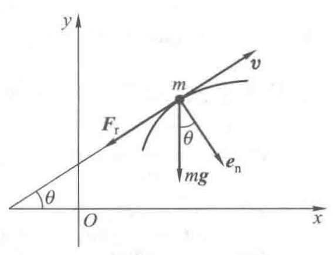

$$
\left.
\begin{aligned}
m\dot{v}&=-F_r(v)-mg\sin\theta\\
\frac{mv^2}{\rho}&=mg\cos\theta
\end{aligned}
\right\}
\qquad (1.5.11)
$$

式中$\rho$为轨道的曲率半径，$\theta$为轨道切线（即$\boldsymbol{v}$的方向）和$x$轴间的夹角．因$\rho>0$而$\dfrac{\mathrm{d}s}{\mathrm{d}\theta}<0$，故

$$
\rho=-\frac{\mathrm{d}s}{\mathrm{d}\theta},\quad \text{而}\ \dot{v}=v\frac{\mathrm{d}v}{\mathrm{d}s},
$$

故由（1.5.11）中两式消去$\mathrm{d}s$，即可得到

$$
\frac{1}{v}\frac{\mathrm{d}v}{\mathrm{d}\theta}=\frac{F_r(v)+mg\sin\theta}{mg\cos\theta}
\qquad (1.5.12)
$$

如果式（1.5.12）的解为

$$
v=f(\theta)
\qquad (1.5.13)
$$

则

$$
\left.
\begin{aligned}
\frac{\mathrm{d}x}{\mathrm{d}\theta}&=\frac{\mathrm{d}x}{\mathrm{d}s}\frac{\mathrm{d}s}{\mathrm{d}\theta}=-\rho\cos\theta=-\frac{v^2}{g}=-\frac{[f(\theta)]^2}{g}\\
\frac{\mathrm{d}y}{\mathrm{d}\theta}&=\frac{\mathrm{d}y}{\mathrm{d}s}\frac{\mathrm{d}s}{\mathrm{d}\theta}=-\rho\sin\theta=-\frac{v^2\tan\theta}{g}=-\frac{[f(\theta)]^2}{g}\tan\theta\\
\frac{\mathrm{d}t}{\mathrm{d}\theta}&=\frac{\mathrm{d}t}{\mathrm{d}s}\frac{\mathrm{d}s}{\mathrm{d}\theta}=-\frac{\rho}{v}=-\frac{v\sec\theta}{g}=-\frac{f(\theta)\sec\theta}{g}
\end{aligned}
\right\}
\qquad (1.5.14)
$$

在（1.5.14）诸式中，$x、y$及$t$都是参数$\theta$的函数，故只要$f(\theta)$为已知，我们就可以求出运动规律，并确定轨道．

如果速度较小，则可近似地认为阻力$\boldsymbol{F}_r$只与速度$\boldsymbol{v}$成正比，即

$$
\boldsymbol{F}_r=-b\boldsymbol{v}
\qquad (1.5.15)
$$

于是问题可改用直角坐标系来进行解算．设抛射体在$xy$平面内运动，则其运动微分方程为

$$
\left.
\begin{aligned}
m\frac{\mathrm{d}v_x}{\mathrm{d}t}&=-bv_x\\
m\frac{\mathrm{d}v_y}{\mathrm{d}t}&=-mg-bv_y
\end{aligned}
\right\}
\qquad (1.5.16)
$$

式中比例系数$b$叫做**阻力系数**，它由介质的性质和物体的形状所决定．

设当$t=0$，$v_x=v_{x0}$，$v_y=v_{y0}$，则对式（1.5.16）进行一次积分后，即得到式（1.5.16）的积分为

$$
\left.
\begin{aligned}
\dot{x}&=v_x=v_{x0}\mathrm{e}^{-\frac{bt}{m}}\\
\dot{y}&=v_y=\left(\frac{mg}{b}+v_{y0}\right)\mathrm{e}^{-\frac{bt}{m}}-\frac{mg}{b}
\end{aligned}
\right\}
\qquad (1.5.17)
$$

把式（1.5.17）中的两式再积分一次，并设$t=0$，$y=0$，$x=0$，则得

$$
\left.
\begin{aligned}
x&=\frac{mv_{x0}}{b}\left(1-\mathrm{e}^{-\frac{bt}{m}}\right)\\
y&=\left(\frac{m^2g}{b^2}+\frac{mv_{y0}}{b}\right)\left(1-\mathrm{e}^{-\frac{bt}{m}}\right)-\frac{mg}{b}t
\end{aligned}
\right\}
\qquad (1.5.18)
$$

消去$t$，即得轨道方程为

$$
y=\left(\frac{mg}{bv_{x0}}+\frac{v_{y0}}{v_{x0}}\right)x-\frac{m^2g}{b^2}\ln\left(\frac{mv_{x0}}{mv_{x0}-bx}\right) \qquad (1.5.19)
$$

如果阻力很小或距离很短，即

$$
\frac{bx}{mv_{x0}}\ll 1
$$

则把（1.5.19）式展为级数后，可得

$$
y=\frac{v_{y0}}{v_{x0}}x-\frac{1}{2}\frac{g}{v_{x0}^2}x^2-\frac{1}{3}\frac{bg}{mv_{x0}^3}x^3-\cdots \qquad (1.5.20)
$$

故轨道开始时虽近似于抛物线，但当$x$值逐渐增大时（取$v_{x0}$为正），轨道的形状也就逐渐与抛物线的形状越差越大了．由式（1.5.19）还可看出，当$x$趋向于$\frac{mv_{x0}}{b}$时，$y$趋向于负无穷大，即轨道在$x=\frac{mv_{x0}}{b}$处变成竖直直线．

当抛物体的速度接近枪弹的速度时，$\boldsymbol{F}_r$与$\boldsymbol{v}$的正比关系已经不再适用．如为低速炮弹，可以认为$\boldsymbol{F}_r$与$v^2$成正比；当速度接近声速时，$\boldsymbol{F}_r$与$v^2$正比的关系又不再适用．一般讲来，$\boldsymbol{F}_r$与$v$的关系，不能用简单的函数关系表示出，所以确定轨道也就非常困难，只能用图解法或近似法求之．

**Ⅲ．三维谐振动——力只是坐标的函数**

这类问题，可以用原子在晶体点阵中的运动作为代表．在简单情况下，力只是坐标$x,y,z$的函数，且可互相分开，故其运动微分方程可写为

$$
\begin{cases}
m\ddot{x}=F_x=-k_xx\\
m\ddot{y}=F_y=-k_yy\\
m\ddot{z}=F_z=-k_zz
\end{cases}
\qquad (1.5.21)
$$

式中$m$是原子的质量，$k_x,k_y,k_z$是比例系数，常称为**劲度系数**．本问题从物理上讲，是三维谐振动问题．但据式（1.5.21），显然数学上可分为三个独立方程来解．由于式（1.5.21）的右方特别简单，故由此微分方程，可立即用正弦函数和余弦函数表示出它们的解．在力学中，力只是坐标的函数这类问题是比较常见的，所以我们这里较详细地用通常的两次积分法来求解．

式（1.5.21）中的第一式可改写为

$$
\ddot{x}=-\frac{k_x}{m}x=-\omega_x^2x \qquad (1.5.22)
$$

式中$\omega_x=\sqrt{\frac{k_x}{m}}$是角频率．用$2\dot{x}$分别乘式（1.5.22）的两侧，得

$$
2\dot{x}\ddot{x}=-2\omega_x^2x\dot{x}
$$

积分后得

$$
\dot{x}^2=-\omega_x^2x^2+C_1=\omega_x^2(A_x^2-x^2) \qquad (1.5.23)
$$

式中$A_x$和$C_1$都是常数，且$C_1=\omega_x^2A_x^2$，可由起始条件决定．

把式（1.5.23）两侧开方后，分离变数，得

$$
\pm\frac{\mathrm{d}x}{(A_x^2-x^2)^{1/2}}=\omega_x\mathrm{d}t
$$

积分后得

$$
\arcsin\frac{x}{A_x}=\omega_xt+C_2
$$

$$
x=A_x\sin(\omega_xt+C_2)
$$

或

$$
x=A_x\cos(\omega_xt+\theta_x) \qquad (1.5.24)
$$

式中$\theta_x$是另一积分常数，仍由起始条件决定．式（1.5.24）代表谐振动方程．由于余弦函数的值正负交替，故$x$及$\dot{x}$的值亦正负交替，所以开方后的正负号都有意义．

式（1.5.21）中其他两式，可按同样方法求出．故式（1.5.21）的全部解答为

$$
\left.
\begin{aligned}
x&=A_x\cos(\omega_xt+\theta_x), &\omega_x&=\sqrt{\frac{k_x}{m}}\\
y&=A_y\cos(\omega_yt+\theta_y), &\omega_y&=\sqrt{\frac{k_y}{m}}\\
z&=A_z\cos(\omega_zt+\theta_z), &\omega_z&=\sqrt{\frac{k_z}{m}}
\end{aligned}
\right\}
\qquad (1.5.25)
$$

式中六个积分常数$A_x,A_y,A_z;\theta_x,\theta_y,\theta_z$均可由起始条件$x_0,y_0,z_0;\dot{x}_0,\dot{y}_0,\dot{z}_0$决定．$A_x,A_y$和$A_z$代表振动的振幅，即$x,y,z$的最大值，而$\theta_x,\theta_y,\theta_z$则为初相．

如角频率$\omega_x,\omega_y,\omega_z$是可通约的，即对某一组整数$(n_x,n_y,n_z)$来讲，

$$
\frac{\omega_x}{n_x}=\frac{\omega_y}{n_y}=\frac{\omega_z}{n_z} \qquad (1.5.26)
$$

则质点在空间的路径将是闭合的，而运动则是周期性的．如这一组$(n_x,n_y,n_z)$之间并无公共因子，则运动周期为

$$
\tau=\frac{2\pi n_x}{\omega_x}=\frac{2\pi n_y}{\omega_y}=\frac{2\pi n_z}{\omega_z} \qquad (1.5.27)
$$

在一周期中，坐标$x$作$n_x$次振荡，坐标$y$作$n_y$次振荡，而坐标$z$则作$n_z$次振荡．在一周期完了时，质点回复到起始的位置和速度．

在二维问题中，如对角频率$\omega_x$及$\omega_y$的不同组合和不同的初相$\theta_x$及$\theta_y$，把振荡质点的运行路径描绘出来，则可得到许多美丽而有趣的图样，叫做**李萨如图形**（图1.5.3）．此项图样，可用一下端附有尖针（或装有细沙的小漏斗）的Y形摆，在沙盘（或白纸）上绘出，这是一种机械方法．同样的图样，用适宜的振荡电压，在阴极射线示波器上进行水平和垂直扫描，亦能得出．如为一维问题，那就是通常的线性谐振子．

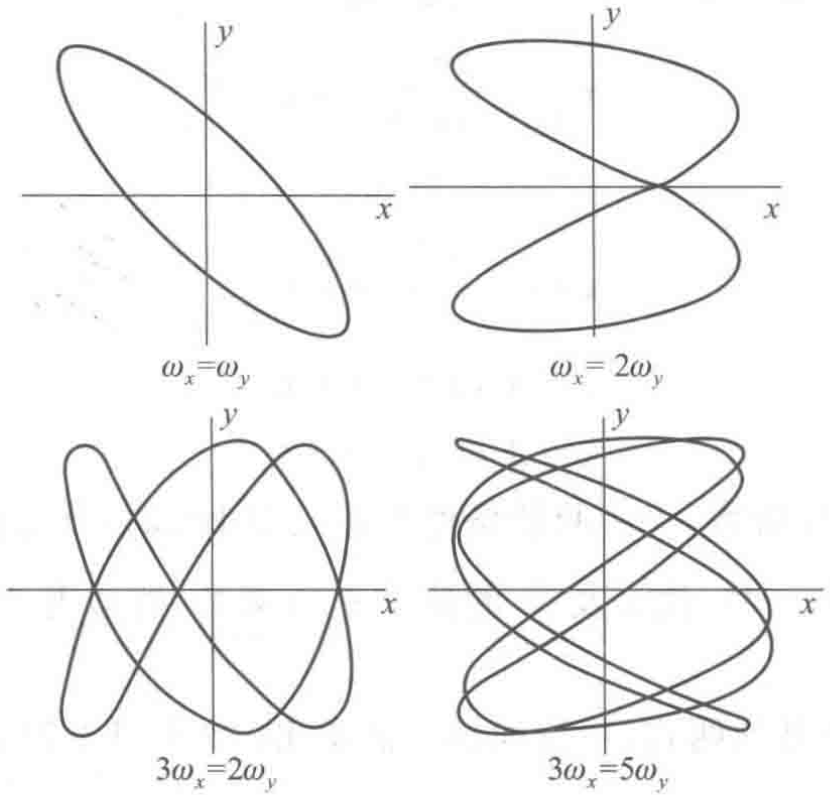

以上所讲的三种情况，是比较简单的（但也是最常见的）运动微分方程．在力学中，还有一些比较一般的情况，就是力是两个甚至三个变量的函数，例如受迫振动问题．在不考虑介质阻力的情况下，力是两个变量（坐标和时间）的函数；如果考虑阻力，力就是三个变量（坐标、速度和时间的）函数了．对于这类问题中简单的一维运动，它的运动微分方程常具有如下的形式：

$$
m\ddot{x}=-b\dot{x}-kx+F(t) \qquad (1.5.28)
$$

式中的$m$是质点的质量，$-b\dot{x}$为介质阻力，$-kx$为弹性力，而$F(t)$则是驱动力．在电磁学中，一个含有电感$L$、电阻$R$和电容$C$的串联电路，如果电路中还含有外加的电动势$E(t)$（图1.5.4），则电路中的电荷$q$（或电流$i$）所满足的微分方程与式（1.5.28）具有相同的形式，即

$$
L\frac{\mathrm{d}^2q}{\mathrm{d}t^2}+R\frac{\mathrm{d}q}{\mathrm{d}t}+\frac{q}{C}=E(t) \qquad (1.5.29)
$$

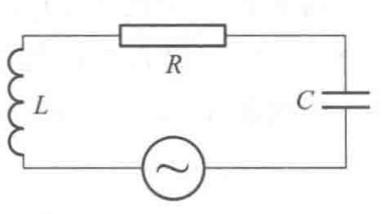

当$F(t)$或$E(t)$等于零时，方程（1.5.28）或（1.5.29）叫做**二阶常系数线性齐次方程**；如果$F(t)$或$E(t)$不等于零，则叫**二阶常系数线性非齐次方程**．这类方程，在普通物理中曾遇到过，并且用试探法求出它们的分析解．在微分方程理论里，对它们的解法有更一般的讨论，这里我们就不详细介绍了．

在力学和物理学中，有时也还会遇到这样一些微分方程，它们无法求出分析解，只能用数值计算方法求出它们的近似解（例如腔外弹道问题）．数值计算方法对三维问题来讲，比一维问题繁杂得多，甚至要使用大型电子计算机才行．

**［例1］** 质量为$m$的质点，在有阻力的空气中无初速地自离地面为$h$的地方竖直下落．如阻力与速度正比，试研究其运动．

**［解］** 为了示范起见，我们在解这问题时，同时列出解题步骤．对于初学者来讲，注意解题步骤和思路，可能要少走一些弯路．

解力学问题一般可按下述七个步骤进行：

**（1）理解题意** 已知空气阻力和速度的一次方成正比，为了简化演算，可把空气阻力写为$mkv$，式中$k$为常数，可由实验方法确定．阻力与运动方向相反，故竖直向上．此外，质点还要受到重力$mg$的作用，方向竖直向下，现在要求的，是质点的运动情况，即质点在任一时刻下落的速度和它离开地面的距离．

**（2）作草图** 结合以上分析作出草图，如图1.5.5所示．

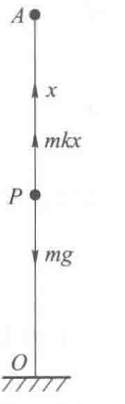

**（3）适当选取坐标系并规定质点的坐标** 本题是直线运动问题，故只需一根坐标轴及一个坐标．今取质点落至地面时的那点$O$为原点，$x$轴竖直向上，$A$为质点的起始位置，$A$离$O$的竖直距离为$h$．在任一时刻，质点$P$的位置坐标为$x$，阻力为$-mk\dot{x}$（因与$\dot{x}$的方向相反）．

**（4）标出已知及未知的力以及已知及未知的加速度** 本题已知力：重力$-mg$（竖直向下）；未知力：阻力$-mk\dot{x}$（与$\dot{x}$异号）；未知加速度：$\ddot{x}$．

**（5）写出质点的运动微分方程** 由以上的分析，根据牛顿运动第二定律写出质点的运动微分方程为

$$
m\ddot{x}=-mk\dot{x}-mg
$$

即

$$
\ddot{x}=-k\dot{x}-g \qquad (1)
$$

**（6）解方程** 现在来解微分方程（1）．令$\dot{x}=\xi-g/k$，则（1）式变为

$$
\dot{\xi}+k\xi=0 \qquad (2)
$$

积分，得

$$
\xi=C_1\mathrm{e}^{-kt} \qquad (3)
$$

而

$$
\dot{x}=C_1\mathrm{e}^{-kt}-g/k \qquad (4)
$$

因为当$t=0$时，$\dot{x}=0$（起始条件），故

$$
C_1=\frac{g}{k} \qquad (5)
$$

于是（4）式变为

$$
\dot{x}=\frac{g}{k}\mathrm{e}^{-kt}-\frac{g}{k}=-\frac{g}{k}(1-\mathrm{e}^{-kt}) \qquad (6)
$$

再积分，并利用起始条件$t=0,x=h$，得

$$
x=h+\frac{g}{k^2}(1-\mathrm{e}^{-kt})-\frac{g}{k}t \qquad (7)
$$

这就是所求的关系．

**（7）讨论** 当时间逐渐增加时，速度逐渐接近于定值极限速度$-\frac{g}{k}$，而运动几乎是匀速直线运动．这是因为时间增加时，和重力相反的阻力也随之增加（因速度随着时间逐渐加大），等它增加到和重力$mg$相等时，物体等于没有受到外力作用，因而作匀速直线运动．

**［例2］** 在例1中，如阻力与速度平方成正比，试研究该质点的运动．

**［解］** 本问题和例1类似，只是阻力应写为$mk^2g\dot{x}^2$（因物体下落时，阻力向上，故为正），式中$k^2$为常数，可由实验方法确定（把比例常数写为$mk^2g$是为了简化演算）．此时运动微分方程为（步骤与例1相仿，故从略）

$$
m\ddot{x}=mk^2g\dot{x}^2-mg \qquad (1)
$$

即

$$
\ddot{x}=-g+k^2g\dot{x}^2 \qquad (2)
$$

令

$$
\xi=\dot{x} \qquad (3)
$$

式（2）变为

$$
\frac{k\dot{\xi}}{1-k^2\xi^2}=-kg \qquad (4)
$$

积分，得反双曲函数

$$
\mathrm{arth}\,k\xi=-kgt+C_1 \qquad (5)
$$

因为当$t=0$，$\dot{x}=0$，即$\xi=0$，故$C_1=0$．于是（5）式变为

$$
\mathrm{arth}\,k\xi=-kgt
$$

$$
k\xi=-\mathrm{th}(kgt)
$$

即

$$
\dot{x}=-\frac{1}{k}\mathrm{th}(kgt) \qquad (6)
$$

再积分，并利用起始条件$t=0,x=h$，得

$$
x=h-\frac{1}{k^2g}\ln[\mathrm{ch}(kgt)] \qquad (7)
$$

这就是我们所要求的关系．因为当$t\to\infty$时，$\mathrm{th}(kgt)\to1$，故物体的速度由零逐渐增大，但以定值$\frac{1}{k}$为其极限．极限速度与运动物体在运动垂直方向的最大截面积有关．例如跳伞者自飞机跳下，如张开降落伞，则极限速度约为$5\ \mathrm{m/s}$，而不张开降落伞，则极限速度约为$50\ \mathrm{m/s}$，相差10倍左右．

**［例3］** 小环的质量为$m$，套在一条光滑的钢索上，钢索的方程式为$x^2=4ay$．试求小环自$x=2a$处自由滑至抛物线顶点时的速度及小环在此时所受到的约束反作用力．

**［解］** 小环受竖直向下的重力$mg$及约束反作用力$F_r$，$F_r$的方向应沿着抛物线的法线，如图1.5.6所示．

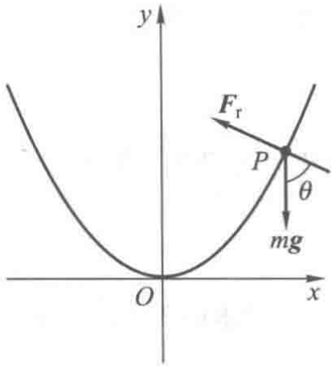

由式（1.5.5），可写出小环在任意位置$P$处的运动微分方程：

$$
m\frac{\mathrm{d}v}{\mathrm{d}t}=mg\sin\theta \qquad (1)
$$

$$
m\frac{v^2}{\rho}=F_r-mg\cos\theta \qquad (2)
$$

因

$$
\frac{\mathrm{d}v}{\mathrm{d}t}=\frac{\mathrm{d}v}{\mathrm{d}s}\frac{\mathrm{d}s}{\mathrm{d}t}=v\frac{\mathrm{d}v}{\mathrm{d}s}
$$

而

$$
\sin\theta=-\frac{\mathrm{d}y}{\mathrm{d}s}
$$

故（1）式可改写为

$$
mv\frac{\mathrm{d}v}{\mathrm{d}s}=-mg\frac{\mathrm{d}y}{\mathrm{d}s}
$$

即

$$
v\mathrm{d}v=-g\mathrm{d}y \qquad (3)
$$

积分

$$
\int_0^v v\mathrm{d}v=-\int_a^0 g\mathrm{d}y \quad \text{（因为 }x=2a,y=a\text{）}
$$

由此得

$$
v=\sqrt{2ag} \qquad (4)
$$

这就是小环由$x=2a$处自由滑至抛物线顶点时的速度．

又

$$
x^2=4ay
$$

故

$$
y'=\frac{\mathrm{d}y}{\mathrm{d}x}=\frac{x}{2a},\qquad y''=\frac{\mathrm{d}^2y}{\mathrm{d}x^2}=\frac{1}{2a}
$$

在抛物线顶点处

$$
x=0,\quad y=0,\quad y'=0,\quad y''=\frac{1}{2a}
$$

而

$$
\frac{1}{\rho}=\frac{|y''|}{(1+y'^2)^{3/2}} \quad \text{（参看高等数学教材）}
$$

即此处

$$
\frac{1}{\rho}=\frac{1}{2a} \qquad (5)
$$

又由（2）式得

$$
F_r=\frac{mv^2}{\rho}+mg\cos\theta=m\frac{2ag}{2a}+mg=2mg \qquad (6)
$$

即小环滑到抛物线顶点时，所受到的约束反作用力大小为$2mg$．

## §1.6 非惯性系动力学（一）

### （1）在加速平动参考系中的运动

在§1.3中，我们讲述了绝对速度与牵连速度、相对速度之间的关系，也讲述过动参考系$S'$相对于惯性参考系作加速直线运动（平动）时，绝对加速度$\boldsymbol{a}$、牵连加速度$\boldsymbol{a}_0$和相对加速度$\boldsymbol{a}'$的关系为

$$
\boldsymbol{a}=\boldsymbol{a}_0+\boldsymbol{a}' \qquad (1.6.1)
$$

我们在§1.4中还讲过：牛顿运动定律在惯性参考系中是成立的，即

$$
\boldsymbol{F}=m\boldsymbol{a} \qquad (1.6.2)
$$

式中$\boldsymbol{F}$是作用在质点上的合外力，$m$是质点的质量，而$\boldsymbol{a}$则为在惯性参考系中所观察到的质点的加速度，亦即§1.3中所讲的绝对加速度．现在来看看相对于惯性参考系$S$作加速直线运动的参考系$S'$是不是惯性参考系？为此，可用$m$乘式（1.6.1）的两端，再将式（1.6.2）的关系代入，得

$$
\boldsymbol{F}=m\boldsymbol{a}_0+m\boldsymbol{a}' \qquad (1.6.3)
$$

故相对于$S$系作加速直线运动的参考系，牛顿运动定律不再成立，因$\boldsymbol{F}\neq m\boldsymbol{a}'$，而是$\boldsymbol{F}=m\boldsymbol{a}_0+m\boldsymbol{a}'$．所以相对于惯性参考系$S$作加速直线运动的参考系不是惯性参考系，而是非惯性参考系．

当然，如参考系$S'$相对于$S$系作匀速直线运动，则依据式（1.3.2），有$\boldsymbol{a}=\boldsymbol{a}'$，即在这种参考系中，$\boldsymbol{a}_0=0$，所以$\boldsymbol{F}=m\boldsymbol{a}'$，由此推知，相对于惯性参考系作匀速直线运动的参考系也是惯性参考系，这正是我们在§1.4中所讲过的“伽利略相对性原理”．

我们通常把式（1.6.3），改写成下面的形式：

$$
\boldsymbol{F}+(-m\boldsymbol{a}_0)=m\boldsymbol{a}' \qquad (1.6.4)
$$

所以，如果我们把$(-m\boldsymbol{a}_0)$也看作质点所受到的一种力，即令$\boldsymbol{F}+(-m\boldsymbol{a}_0)=\boldsymbol{F}'$，则式（1.6.4）在形式上仍然是牛顿运动定律（因$\boldsymbol{F}'=m\boldsymbol{a}'$）．这样，我们就将力的概念加以推广，即在非惯性参考系中，如果我们认为除了以前所说的物体间相互作用的力之外，还有一种非相互作用力，这种力是由于参考系本身相对于惯性参考系作加速度运动所引起的，这种力就是$(-m\boldsymbol{a}_0)$，它的大小等于质点的质量$m$和牵连加速度$\boldsymbol{a}_0$的乘积，方向和$\boldsymbol{a}_0$的方向相反．我们通常把这种力叫做**惯性力**．引入惯性力以后，则对非惯性参考系来讲，牛顿运动定律，在形式上就“仍然”可以成立．顺便指出：惯性力的具体表达式，跟参考系运动的方式有关．这个问题，我们在第四章里还要详细讨论．

### （2）惯性力

我们在前面曾经讲过：在运动学中，参考系可以任意选择，视研究问题的方便而定．但在动力学中，似乎非选用惯性参考系不可，因为牛顿运动定律只对惯性参考系才能成立．但是，在许多实际问题中，我们常常要选用非惯性参考系作为研究问题的参考，例如在许多实际问题中往往要以地球这个非惯性系作为参考系．现在我们引入了惯性力，把力的概念加以扩大，使我们在非惯性参考系中，“仍然”能够用牛顿运动定律来解决动力学问题，这将是比较方便的．

不过，惯性力和以前所讲的外力有很大的区别，这一点我们应当清晰地了解．第一，当我们以前提到力时，都必须明确指明是哪一个物体作用于哪一个物体的力，因为力是物体间相互作用所产生的．至于说到质点所受到的惯性力，却无从指出是哪一个物体作用于这个质点的，它没有施力者，只不过反映该参考系并非惯性参考系而已．质点之所以具有牵连加速度$\boldsymbol{a}_0$，也只不过表示质点是被该参考系“牵带”着运动这一事实．第二，物体作用都是相互的，每一个力都有它的反作用力，惯性力并不是物体之间的相互作用，它没有施力者，因而也就不存在惯性力的反作用力．

**［例］** 火车在平直轨道上以匀加速$\boldsymbol{a}_0$向前行驶，在车中用线悬挂着一小球，悬线与竖直线成$\theta$角而静止（图1.6.1），求$\theta$．

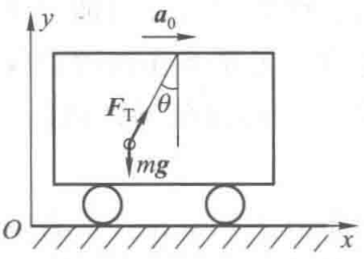

**［解］** 让我们用两种不同坐标系来解这个问题：

（1）对固着在地面上的惯性坐标系来讲，小球受两个力作用：地球重力$mg$竖直向下，绳中张力$\boldsymbol{F}_T$沿绳，并且小球与火车的加速度相同，即$\boldsymbol{a}_0$，方向水平向右．取$x$轴水平向右，$y$轴竖直向上，则由牛顿运动第二定律，得

$$
\left.
\begin{aligned}
F_T\sin\theta&=ma_0\\
F_T\cos\theta&=mg
\end{aligned}
\right\}
\qquad (1)
$$

解之，得

$$
\tan\theta=\frac{a_0}{g} \qquad (2)
$$

（2）对固着在火车上的坐标系来讲，因火车现在相对于地面作匀加速直线运动，是一个非惯性坐标系，$\boldsymbol{F}_T$和$mg$没有变化，但小球相对于火车的加速度$\boldsymbol{a}'$为零，故加上水平向左的惯性力$m\boldsymbol{a}_0$后，就成为三力平衡问题，所以这三个力必定形成一个闭合三角形（图1.6.2）．

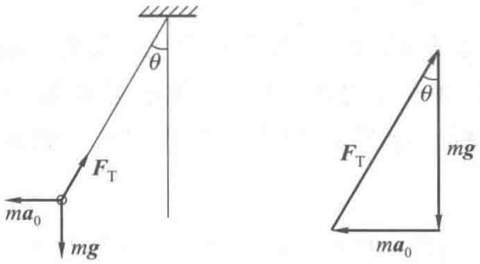

由此，得

$$
\tan\theta=\frac{a_0}{g}
$$

与（2）式完全一样．这就是说，客观事实并没有因观察者采用的参考系不同而有差异．此时，火车里的观察者由于自身以同一加速度向前运动，故以为小球除受$mg$和$\boldsymbol{F}_T$的作用外，还受一向后的力$m\boldsymbol{a}_0$（即惯性力）的作用．否则将不能解释小球何故向后倾斜．

这个例子说明，在非惯性参考系中，只要加上适当的惯性力（在这里是$-m\boldsymbol{a}_0$），就“仍然”能用牛顿运动定律来解决动力学问题．

## §1.7 功与能

### （1）功和功率

功是我们很熟悉的一个物理量．在力学中，凡是作用在质点上的力，使质点沿力的方向产生一段位移，我们就说力对质点作了**功**．一般来讲，功等于力乘以质点在力的方向所产生的位移．

质点受恒力作用而作直线运动时，如果令$\boldsymbol{F}$代表力，$\Delta\boldsymbol{r}$代表位移，$\boldsymbol{F}$和$\boldsymbol{r}$间所夹的角为$\theta$，则该力沿位移$\Delta\boldsymbol{r}$所作的功$W$为

$$
W=\boldsymbol{F}\cdot\Delta\boldsymbol{r}=F|\Delta\boldsymbol{r}|\cos\theta \qquad (1.7.1)
$$

$\boldsymbol{F}\cdot\Delta\boldsymbol{r}$叫做标积，虽然$\boldsymbol{F}$和$\Delta\boldsymbol{r}$都是矢量，但它们的标积$W$却不是矢量，它的正负之分，可由$\cos\theta$的符号来决定．

如果质点沿曲线运动，或作用在它上面的力是一个变量，那么，我们只能先算出力$\boldsymbol{F}$在一微小位移$\mathrm{d}\boldsymbol{r}$中所作的元功．因为在这微小位移中，曲线段与直线段没有什么区别；而在微小位移中，力$\boldsymbol{F}$也可认为是常量．因此，当质点在变力$\boldsymbol{F}$作用下沿曲线自点$A$运动到点$B$时，变力$\boldsymbol{F}$所作的总功则为

$$
W=\int_A^B\boldsymbol{F}\cdot\mathrm{d}\boldsymbol{r}=\int_A^B F\mathrm{d}s\cos\theta \qquad (1.7.2)
$$

式中$\mathrm{d}s=|\mathrm{d}\boldsymbol{r}|$，$\theta$为$\boldsymbol{F}$和$\mathrm{d}\boldsymbol{r}$间所夹的角，当然也是变量．

如果把力$\boldsymbol{F}$和位移$\mathrm{d}\boldsymbol{r}$都用直角坐标的分量表示出，则

$$
W=\int_A^B F_x\mathrm{d}x+F_y\mathrm{d}y+F_z\mathrm{d}z \qquad (1.7.3)
$$

如果质点受好几个力$\boldsymbol{F}_1,\boldsymbol{F}_2,\cdots,\boldsymbol{F}_n$的作用，我们一般先不求合力，再求合力所作的功，而是先求每一分力所作的功，然后累加起来，得出合力所作的功．这样我们就可利用标积的分配律，因为求算术和比求矢量和要简便得多．用数学的形式写出，则为

$$
\begin{aligned}
W&=\int\boldsymbol{F}\cdot\mathrm{d}\boldsymbol{r}=\int(\boldsymbol{F}_1+\boldsymbol{F}_2+\cdots+\boldsymbol{F}_n)\cdot\mathrm{d}\boldsymbol{r}\\
&=\int\boldsymbol{F}_1\cdot\mathrm{d}\boldsymbol{r}+\int\boldsymbol{F}_2\cdot\mathrm{d}\boldsymbol{r}+\cdots+\int\boldsymbol{F}_n\cdot\mathrm{d}\boldsymbol{r}
\end{aligned}
\qquad (1.7.4)
$$

在国际单位制（SI）中，功的单位是J（焦耳），即$1\ \mathrm{N}$的力作用于物体上，使物体沿力的方向移动$1\ \mathrm{m}$的距离所作的功．

表征作功快慢程度的物理量是功率，它是单位时间内所作的功．如令$P$代表功率，则由（1.7.2）式，知

$$
P=\frac{\mathrm{d}W}{\mathrm{d}t}=\boldsymbol{F}\cdot\boldsymbol{v} \qquad (1.7.5)
$$

由上式可以看出，对于具有一定功率的机械（例如汽车），$v$大则$F$小，$v$小则$F$大．故汽车爬坡时，常用换挡方法，减小速度，以加大牵引力．

在国际单位制中，功率的单位是W（瓦特），$1\ \mathrm{W}=1\ \mathrm{J/s}$．

### （2）能

能和功一样，也是人们很熟悉的一个物理量．在宇宙中，存在着各式各样的能量．能源问题是现代人们最为关心的问题之一．

如果一个物体具有作功的能力或本领，我们就说它具有一定的能量或能．例如，从高处落下的流水，可以冲动水轮机而作功；飞行着的子弹，遇到障碍物时，也可以改变自己的运动状态（速度改变）而作出一定数量的功．

在理论力学中，我们所研究的能量限于机械能．它分为两大类：一类是由于物体有一定的速度而具有的能量，通常叫做**动能**，并用符号$T$表示．另一类则是由于物体间相对位置发生变化所具有的能量，通常叫做**势能**，并用符号$V$表示．例如压缩着的弹簧和拉长了的橡皮绳，当它们回复到原来的状态时，都可以对外作功．反之，若外力对物体作了一定数量的功，物体的能量就要发生相应的变化．总之，每当能量发生变化时，总有一定数量的功表现出来，因此我们就说功是能量变化的量度，因而两者所用的单位也相同．

### （3）保守力、非保守力与耗散力

在§1.5中，我们曾经讲过：在我们所讨论的问题中，作用在物体上的力$\boldsymbol{F}$，一般是该物体的位矢$\boldsymbol{r}$、速度$\dot{\boldsymbol{r}}$和时间$t$的函数，所以求式（1.7.2）或式（1.7.3）

的积分，一般是比较困难的．但如果力$\boldsymbol{F}$只是位矢$\boldsymbol{r}$亦即坐标的函数，问题就要简单得多，我们现在就只考虑这种情况．

假如力仅为坐标$x,y,z$的单值的、有限的和可微的函数，则在空间区域每一点上，都将有一定的力作用着，此力只和该点的坐标有关，我们把这空间区域叫做**力场**①．（1.7.3）式在数学上叫做线积分，它和物体运动的路径有关．必须知道质点运动的路径，我们才可算出这个积分．在一般情况下，沿两不同路径的线积分，虽然端点相同，也将得出不同的结果，所以在不知道质点运动的实际路径以前，我们应不能计算这个积分．但在某些特殊情况下，线积分（1.7.3）式的值将只和路径（轨道）的两个端点有关，而与中间的实际路径无关．根据矢量分析，在此情形下，必定存在一个单值、有限和可微的函数$V(x,y,z)$，且

$$
\boldsymbol{F}=-\nabla V=-\left(\frac{\partial V}{\partial x}\boldsymbol{i}+\frac{\partial V}{\partial y}\boldsymbol{j}+\frac{\partial V}{\partial z}\boldsymbol{k}\right)
$$

或

$$
F_x=-\frac{\partial V}{\partial x},\quad F_y=-\frac{\partial V}{\partial y},\quad F_z=-\frac{\partial V}{\partial z} \qquad (1.7.6)
$$

则

$$
\mathrm{d}W=-\left(\frac{\partial V}{\partial x}\mathrm{d}x+\frac{\partial V}{\partial y}\mathrm{d}y+\frac{\partial V}{\partial z}\mathrm{d}z\right)
$$

为一恰当微分，此时式（1.7.3）的值，将只由两端点的位置所决定．

既然力所作的功只取决于两端点的位置，而与中间所经过的路径无关，那么当质点沿闭合路径运行一周时，力所作的功必定为零．在图1.7.1中，$ACB$和$ADB$是通过相同端点$A$和$B$的两条不同路径．如果$W_{\widehat{ACB}}=W_{\widehat{ADB}}$，那么

$$
W_{\widehat{ACBDA}}=W_{\widehat{ACB}}+W_{\widehat{BDA}}=W_{\widehat{ACB}}-W_{\widehat{ADB}}=0
$$

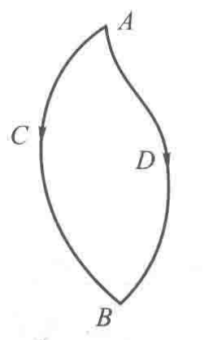

但如$W_{\widehat{ACB}}\neq W_{\widehat{ADB}}$，则$W_{\widehat{ACBDA}}$也将不等于零．

如果力所作的功与中间路径无关，或者沿任何闭合路径运行一周时，力所作的功为零，这种力就叫做**保守力**．反之，如果力所作的功与中间路径有关，或沿任何闭合路径运行一周，力所作的功不为零，那么这种力就叫做**非保守力**，也叫**涡旋力**．至于摩擦力所作的功，虽然也与路径有关，但它总是作负功而消耗能量，所以又叫**耗散力**．在物理学中，万有引力、弹性力和静电力都是保守力，电磁学中涡旋电场的涡旋电磁力是非保守力，而流体的黏性力则是耗散力．

### （4）势能

我们知道：在重力场中，把质点从高度为$z_1$沿任意路径举到高度为$z_2$时，重力$mg$对质点所作的功为$-mg(z_2-z_1)$，即等于标量函数$mgz$的减少值．这一性质，对所有的保守力来讲，都是这样．即保守力对质点所作的功，一定等于质点位置的某个标量函数$V(x,y,z)$的减少值．换句话说，在保守力场中，作用力和某标量函数$V(x,y,z)$之间，必须存在着式（1.7.6）那样的关系，即力所作的元功

> ① 在力不是时间$t$的显函数的情况下，这场称为稳定场，反之，则场称为不稳定场．

应该是一个恰当微分．同时力自$A$至$B$所作的总功，将只为$A,B$两点的位置所决定，亦即等于标量函数$V(x,y,z)$所减少的值．用数学符号来表示，则总功为

$$
W=-(V_B-V_A) \qquad (1.7.7)
$$

标量函数$V(x,y,z)$叫做质点在点$(x,y,z)$处的**势能**（势能的值只准确到常数项）．质点从点$A$到点$B$时所减少的势能，等于保守力对该质点所作的功．所以，在保守力场中，当力作正功时，质点的势能减少；而当力作负功时，质点的势能增加．

从（1.7.7）式可以看出：保守力所作的功，决定于质点势能的改变．之所以说质点在某点上的势能，只准确到常数项，是因为如果各点上的势能都加上（或减去）同一个常数，并不影响两点间势能差的数值．为了计算方便起见，我们常指定某点上的势能为零（或其他数值）．例如，对**重力势能**来讲，常令海平面上的势能为零；对**引力势能**来讲，取无穷远处的势能为零；对**弹性势能**来讲，则取它在没有发生任何形变时的势能为零．

现在我们要问：怎样知道力所作的功与路径无关？或者，如何判断力是保守的还是非保守的？换句话说，势能$V(x,y,z)$存在的充要条件是什么？这个问题，矢量分析里作了回答，即如$F_x,F_y,F_z$是坐标$x,y,z$的单值、有限和可微的函数，则势能$V(x,y,z)$存在的必要条件是

$$
\begin{aligned}
\frac{\partial F_z}{\partial y}-\frac{\partial F_y}{\partial z}&=0,\quad \frac{\partial F_x}{\partial z}-\frac{\partial F_z}{\partial x}=0,\\
\frac{\partial F_y}{\partial x}-\frac{\partial F_x}{\partial y}&=0,\quad \text{即}\ \nabla\times\boldsymbol{F}=0
\end{aligned}
\qquad (1.7.8)
$$

反之，如果$\nabla\times\boldsymbol{F}=0$，那么这力就一定是保守力，而它所作的功就一定和路径无关，因而，也就一定存在着某一标量函数$V(x,y,z)$，它就是质点的势能．

如$\nabla\times\boldsymbol{F}\neq0$，则该力就是前面所讲的非保守力（涡旋力），这时它所作的功就将与路径有关，因而谈不上什么势能．对于耗散力的情况当然也是如此．

**［例1］** 设作用在质点上的力是

$$
F_x=x+2y+z+5,\quad F_y=2x+y+z,\quad F_z=x+y+z-6
$$

求此质点沿螺旋线

$$
x=\cos\theta,\quad y=\sin\theta,\quad z=7\theta
$$

运行自$\theta=0$至$\theta=2\pi$时，力对质点所作的功．

**［解］** 先来检验一下，作用力是不是保守力？

$$
\left.
\begin{aligned}
\frac{\partial F_z}{\partial y}-\frac{\partial F_y}{\partial z}&=1-1=0\\
\frac{\partial F_x}{\partial z}-\frac{\partial F_z}{\partial x}&=1-1=0\\
\frac{\partial F_y}{\partial x}-\frac{\partial F_x}{\partial y}&=2-2=0
\end{aligned}
\right\}
\qquad (1)
$$

所以作用力是保守力．因此力所作的功，与路径无关，只和两端点的位置有关．现在，根据题给条件，求两端点的坐标．

$$
\left.
\begin{aligned}
\text{当 }\theta=0\text{ 时,}&x=1,y=0,z=0\\
\text{当 }\theta=2\pi\text{ 时,}&x=1,y=0,z=14\pi
\end{aligned}
\right\}
$$

所以

$$
\begin{aligned}
W&=\int_{1,0,0}^{1,0,14\pi}(F_x\mathrm{d}x+F_y\mathrm{d}y+F_z\mathrm{d}z)\\
&=\int_{1,0,0}^{1,0,14\pi}[2(y\mathrm{d}x+x\mathrm{d}y)+(x\mathrm{d}z+z\mathrm{d}x)\\
&\quad +(z\mathrm{d}y+y\mathrm{d}z)+(x+5)\mathrm{d}x+y\mathrm{d}y+(z-6)\mathrm{d}z]\\
&=\int_{1,0,0}^{1,0,14\pi}\mathrm{d}\left[2(xy)+zx+yz+\frac{1}{2}x^2+\frac{1}{2}y^2+\frac{1}{2}z^2+5x-6z\right]\\
&=\left.2xy+zx+yz+\frac{1}{2}(x^2+y^2+z^2)+5x-6z\right|_{1,0,0}^{1,0,14\pi}\\
&=98\pi^2-70\pi
\end{aligned}
$$

在本问题中，势能$V$是多少？

**［例2］** 在上题中，如

$$
F_x=2x-3y+4z-5,\quad F_y=z-x+8,\quad F_z=x+y+z+12
$$

则结果如何？

**［解］** 本问题$\nabla\times\boldsymbol{F}\neq0$（读者可自行证明），故力所作的功将与路径有关．

把

$$
x=\cos\theta,\quad y=\sin\theta,\quad z=7\theta
$$

及

$$
\mathrm{d}x=-\sin\theta\mathrm{d}\theta,\quad \mathrm{d}y=\cos\theta\mathrm{d}\theta,\quad \mathrm{d}z=7\mathrm{d}\theta
$$

代入

$$
W=\int F_x\mathrm{d}x+F_y\mathrm{d}y+F_z\mathrm{d}z
$$

中，然后从0到$2\pi$对$\theta$积分，可得

$$
W=98\pi^2+226\pi
$$

详细计算从略，读者可自行验证．

在本问题中，势能$V$又是多少？

## §1.8 质点动力学的基本定理与基本守恒定律

### （1）动量定理与动量守恒定律

设质点的质量是$m$，它运动的速度是$\boldsymbol{v}$，那么$m$和$\boldsymbol{v}$的乘积，叫做质点的**动量**．动量是一个矢量，它的指向和$\boldsymbol{v}$相同，今后用$\boldsymbol{p}$表示，即$\boldsymbol{p}=m\boldsymbol{v}$．

在经典力学中，质量$m$通常是常量，所以利用动量这一物理量，牛顿运动第二定律可以写为

$$
\boldsymbol{F}=\frac{\mathrm{d}}{\mathrm{d}t}(m\boldsymbol{v})=\frac{\mathrm{d}\boldsymbol{p}}{\mathrm{d}t} \qquad (1.8.1)
$$

这个关系，通常叫做**动量定理**．在机械运动的范围内，质点间运动的传递总是通过动量的交换来实现的．

实际上，式（1.8.1）较式（1.4.1）更为普遍，适用的范围更广①．在相对论中，质量$m$随$v$的增大而增大，所以式（1.4.1）也不再正确．但如令

$$
m=\frac{m_0}{\sqrt{1-v^2/c^2}} \qquad (1.8.2)
$$

那么运动定律仍可具有式（1.8.1）的形式，式中$m_0$是物体相对于给定参考系静止时的质量，而$m$则是物体相对于给定参考系以速度$v$运动时的质量．

式（1.8.1）也可写成下面的形式：

$$
\mathrm{d}\boldsymbol{p}=\mathrm{d}(m\boldsymbol{v})=\boldsymbol{F}\mathrm{d}t \qquad (1.8.3)
$$

如果把式（1.8.3）的两侧对$t$积分，则得

$$
\boldsymbol{p}_2-\boldsymbol{p}_1=m\boldsymbol{v}_2-m\boldsymbol{v}_1=\int_{t_1}^{t_2}\boldsymbol{F}\mathrm{d}t \qquad (1.8.4)
$$

力和力的作用时间的乘积（当力为常量时）或力对时间$t$的积分（当力为变量时）叫做力的**冲量**，常以$\boldsymbol{I}$表之，也是一个矢量．由式（1.8.4）可以看出：质点动量的变化等于外力在这段时间内给予该质点的冲量，这就是动量定理的积分形式，而式（1.8.1）或式（1.8.3）则是动量定理的微分形式．当研究冲击问题时，常常要用到式（1.8.4）．

当上式中$\boldsymbol{F}=0$时，则得到一个重要的结果：

$$
\boldsymbol{p}=m\boldsymbol{v}=\boldsymbol{C} \qquad (1.8.5)
$$

即自由质点不受外力作用时，它的动量$\boldsymbol{p}$保持不变，亦即将作惯性运动，这个关系叫做**动量守恒定律**．

动量是矢量，如果它保持不变，那么它在任何坐标轴上的三个分量，就应当是常数．如为直角坐标系，则当$\boldsymbol{F}=0$时，

$$
p_x=m\dot{x}=C_1,\quad p_y=m\dot{y}=C_2,\quad p_z=m\dot{z}=C_3 \qquad (1.8.6)
$$

式中$C_1,C_2,C_3$是积分常数，由起始条件决定之．

有时$\boldsymbol{F}\neq0$，但$\boldsymbol{F}$在某一坐标轴上的投影为零，那么动量$\boldsymbol{p}$虽不守恒，但它在该坐标轴上的投影却为一常数，譬如质点只在重力作用下运动，如取$z$轴竖直向上，则

$$
F_x=0,\quad F_y=0,\quad F_z=-mg
$$

这时动量（或速度）在$x$及$y$两轴上的投影为常数，但质点作直线运动还是作抛物线运动，则由速度的起始值（初速度）决定．如当$t=0$，$\dot{x}=\dot{y}=0$，则作直线运动；如当$t=0$，$\dot{y}=0$，但$\dot{x}\neq0$，则作抛物线运动．

### （2）力矩与动量矩（角动量）

我们知道：凡是矢量，它对于空间某一点或某一轴线就具有矢量矩．力和动

> ① 牛顿本人也是用式（1.8.1）来表述第二运动定律的．

量既然都是矢量，我们就可以求出它们对空间某点或某轴线的矩．

在图1.8.1中，$\boldsymbol{F}$为作用在$B$点的力，$A$为空间任意一点，取$\boldsymbol{F}$与$A$点构成的平面如图，则力$\boldsymbol{F}$对$A$点的矩定义为

$$
\boldsymbol{M}=\boldsymbol{r}\times\boldsymbol{F} \qquad (1.8.7)
$$

式中$\boldsymbol{r}=\overrightarrow{AB}$为$B$对$A$的位矢，而$\boldsymbol{r}$和$\boldsymbol{F}$的矢积$\boldsymbol{M}$称为力$\boldsymbol{F}$对$A$点的**力矩**．力矩$\boldsymbol{M}$也是一个矢量，它垂直于$\boldsymbol{r}$与力$\boldsymbol{F}$所确定的平面，其量值则为

$$
M=rF\sin\theta=aF \qquad (1.8.8)
$$

式中$\theta$为$\boldsymbol{r}$和$\boldsymbol{F}$之间的夹角，$a$为自$A$至力$\boldsymbol{F}$的作用线的垂直距离．至于力矩的指向，则由右螺旋法则来决定，如图1.8.1所示．

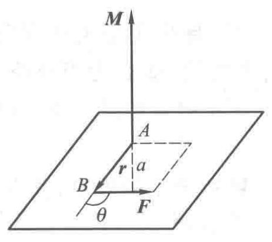

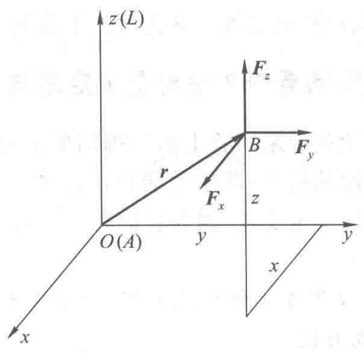

现在来求$\boldsymbol{F}$对空间某一轴线$L$的矩．取一坐标系$O-xyz$，使原点$O$与$A$重合，$Oz$沿$L$的正方向（图1.8.2），则对此坐标系而言，$\boldsymbol{F}$的分量为$(F_x,F_y,F_z)$，而作用点$B$的坐标为$(x,y,z)$，故$\boldsymbol{F}$对点$A$（即$O$）的力矩$\boldsymbol{M}$为

$$
\begin{aligned}
\boldsymbol{M}&=\boldsymbol{r}\times\boldsymbol{F}=
\begin{vmatrix}
\boldsymbol{i} & \boldsymbol{j} & \boldsymbol{k}\\
x & y & z\\
F_x & F_y & F_z
\end{vmatrix}\\
&=(yF_z-zF_y)\boldsymbol{i}+(zF_x-xF_z)\boldsymbol{j}+(xF_y-yF_x)\boldsymbol{k}
\end{aligned}
$$

式中$(yF_z-zF_y)$，$(zF_x-xF_z)$，$(xF_y-yF_x)$是力矩$\boldsymbol{M}$在三坐标轴的分量，也就是力$\boldsymbol{F}$分别对三坐标轴$x,y,z$的力矩．因$F_x$对$x$轴的力矩为零（两者平行），而$F_y$及$F_z$对$x$轴的力矩分别为$-zF_y$及$yF_z$（取逆时针方向为正），即

$$
\begin{aligned}
M_x&=yF_z-zF_y\\
M_y&=zF_x-xF_z\\
M_z&=xF_y-yF_x
\end{aligned}
\qquad (1.8.9)
$$

由此可见：欲求力$\boldsymbol{F}$对某一轴线（设为$L$，即$Oz$）的力矩$M_z$，可先求$\boldsymbol{F}$对该轴线上某一点（譬如$O$）的力矩$\boldsymbol{M}$，再投影至该直线上即可，即

$$
M_z=\boldsymbol{k}\cdot\boldsymbol{M}=xF_y-yF_x
$$

动量对空间某点或某轴线的矩，叫做**动量矩**，也叫**角动量**．它的求法，跟力矩完全一样，只要把力$\boldsymbol{F}$换成动量$\boldsymbol{p}$即可，故$B$点上的动量$\boldsymbol{p}$对原点$O$的动量矩$\boldsymbol{J}$为

$$
\boldsymbol{J}=\boldsymbol{r}\times\boldsymbol{p} \qquad (1.8.10)
$$

式中$\boldsymbol{r}=\overrightarrow{OB}$．而$\boldsymbol{p}$对$x,y,z$轴的动量矩则为

$$
\begin{aligned}
J_x&=m(y\dot{z}-z\dot{y})\\
J_y&=m(z\dot{x}-x\dot{z})\\
J_z&=m(x\dot{y}-y\dot{x})
\end{aligned}
\qquad (1.8.11)
$$

我们知道：力矩和力都能使物体的运动状态发生变化．当质点受力作用时，它的速度就要发生变化，亦即它的动量就要发生变化．那么，当质点受到力矩作用时，什么物理量将发生变化呢？下面我们就来研究这个问题．

### （3）动量矩（角动量）定理与动量矩（角动量）守恒定律

现在让我们来回答上面所提出的问题．在没有导出定量关系以前，我们可能就有这样的猜想：既然力能使质点的动量发生变化，那么力矩就应当能使质点的动量矩发生变化，因为它们是一一对应的．让我们来验证一下，这样的猜想是否正确？

力矩$\boldsymbol{M}$等于$\boldsymbol{r}$和$\boldsymbol{F}$的矢积．为了求出力矩$\boldsymbol{M}$所产生的效果，我们可用位矢$\boldsymbol{r}$矢乘运动方程

$$
m\frac{\mathrm{d}^2\boldsymbol{r}}{\mathrm{d}t^2}=\boldsymbol{F}
$$

的两侧，就得到

$$
m\left(\boldsymbol{r}\times\frac{\mathrm{d}^2\boldsymbol{r}}{\mathrm{d}t^2}\right)=\boldsymbol{r}\times\boldsymbol{F}
$$

但

$$
\boldsymbol{r}\times\frac{\mathrm{d}^2\boldsymbol{r}}{\mathrm{d}t^2}=\frac{\mathrm{d}}{\mathrm{d}t}\left(\boldsymbol{r}\times\frac{\mathrm{d}\boldsymbol{r}}{\mathrm{d}t}\right)-\frac{\mathrm{d}\boldsymbol{r}}{\mathrm{d}t}\times\frac{\mathrm{d}\boldsymbol{r}}{\mathrm{d}t}=\frac{\mathrm{d}}{\mathrm{d}t}(\boldsymbol{r}\times\boldsymbol{v})
$$

因此

$$
\frac{\mathrm{d}}{\mathrm{d}t}(\boldsymbol{r}\times m\boldsymbol{v})=\boldsymbol{r}\times\boldsymbol{F} \qquad (1.8.12)
$$

如果把式（1.8.12）写成分量形式，则得

$$
\begin{aligned}
\frac{\mathrm{d}}{\mathrm{d}t}[m(y\dot{z}-z\dot{y})]&=yF_z-zF_y\\
\frac{\mathrm{d}}{\mathrm{d}t}[m(z\dot{x}-x\dot{z})]&=zF_x-xF_z\\
\frac{\mathrm{d}}{\mathrm{d}t}[m(x\dot{y}-y\dot{x})]&=xF_y-yF_x
\end{aligned}
\qquad (1.8.13)
$$

所以，力矩确实能使动量矩发生变化．这种关系，叫做**动量矩定理**，也叫**角动量定理**．即质点对惯性系中固定点或某固定轴线的动量矩对时间的微商，等于作用在该质点上的力对此同点或同轴的力矩．

如果令$\boldsymbol{J}$代表动量矩，$\boldsymbol{M}$代表力矩，则式（1.8.12）还可写成更简洁的形式：

$$
\frac{\mathrm{d}\boldsymbol{J}}{\mathrm{d}t}=\boldsymbol{M} \qquad (1.8.14)
$$

式（1.8.14）或式（1.8.12）是动量矩定理的微分形式．如果两边乘以$\mathrm{d}t$，然后对$t$积分，则得

$$
\boldsymbol{J}_2-\boldsymbol{J}_1=\int_{t_1}^{t_2}\boldsymbol{M}\mathrm{d}t \qquad (1.8.15)
$$

这是动量矩定理的积分形式，式中$\int_{t_1}^{t_2}\boldsymbol{M}\mathrm{d}t$叫**冲量矩**．故质点动量矩的变化，等于外力在该时间内给予该质点的冲量矩．

如果质点不受外力作用，或虽受外力作用，但诸外力对某点的合力矩恒为零，则对该点来讲，质点的动量矩$\boldsymbol{J}$为一常矢量，这个关系，叫做**动量矩守恒定律**，也叫**角动量守恒定律**．

即$\boldsymbol{r}\times\boldsymbol{F}=0$，则$\boldsymbol{J}=\boldsymbol{r}\times m\boldsymbol{v}=\boldsymbol{r}\times\boldsymbol{p}=\boldsymbol{C}'=$常矢量．写得简洁些，则为

$$
\text{当 }\boldsymbol{M}=0,\quad \boldsymbol{J}=\boldsymbol{C}'=\text{常矢量} \qquad (1.8.16)
$$

或

$$
\text{当 }\boldsymbol{M}=0,\quad \boldsymbol{J}_2=\boldsymbol{J}_1 \qquad (1.8.17)
$$

动量矩守恒定律的分量形式是

当$\boldsymbol{M}=0$，则

$$
\left.
\begin{aligned}
J_x&=m(y\dot{z}-z\dot{y})=C_4\\
J_y&=m(z\dot{x}-x\dot{z})=C_5\\
J_z&=m(x\dot{y}-y\dot{x})=C_6
\end{aligned}
\right\}
\qquad (1.8.18)
$$

式中$C_4,C_5$和$C_6$是积分常数，由起始条件决定．动量矩守恒定律，在有心力问题中要经常用到，参看下节．

跟动量守恒律一样，有时力矩$\boldsymbol{M}$只有一个分量等于零，其他两个分量并不等于零，这时整个动量矩虽不守恒，但对该轴来讲，动量矩的值保持为常数．例如，当质点只受重力作用而运动时，如取$z$轴竖直向上，则$F_x=0,F_y=0,F_z=-mg$，所以$M_z=0$，因而$J_z$就是一个常量．

当$\boldsymbol{M}=0$，$\boldsymbol{J}$为一常矢量时，$\boldsymbol{J}$的方向也就不会改变，而和它相垂直的质点的位矢$\boldsymbol{r}$就必定只能在同一平面内（垂直于$\boldsymbol{J}$的平面内）运动．有心力问题就具有这样的性质．

**［例1］** 质点所受的力，如恒通过某一个定点，则质点必在一平面上运动，试证明之．

**［解］** 力所通过的那个定点叫做**力心**（参看下节）．如取这个定点为坐标系的原点，则质点的位矢$\boldsymbol{r}$与$\boldsymbol{F}$共线，因而$\boldsymbol{r}\times\boldsymbol{F}=0$，故$\boldsymbol{J}$为一常矢量．而由式（1.8.18）知

$$
m(y\dot{z}-z\dot{y})=C_4 \qquad (1)
$$

$$
m(z\dot{x}-x\dot{z})=C_5 \qquad (2)
$$

$$
m(x\dot{y}-y\dot{x})=C_6 \qquad (3)
$$

用$x$乘（1）式，$y$乘（2）式，$z$乘（3）式，并相加得

$$
C_4x+C_5y+C_6z=0 \qquad (4)
$$

由解析几何，知（4）式代表一个平面方程，故质点只能在这个平面上运动．

### （4）动能定理与机械能守恒定律

根据牛顿运动定律，质点受到外力作用时，它的速度就要发生变化．因此，如果外力对质点作了功，那么和质点速度有关的能量，就应当发生变化．现在，让我们来求它们之间的关系．

我们还是从动力学方程出发．把

$$
m\frac{\mathrm{d}^2\boldsymbol{r}}{\mathrm{d}t^2}=\boldsymbol{F}
$$

的两侧，标乘矢量$\frac{\mathrm{d}\boldsymbol{r}}{\mathrm{d}t}$，得

$$
m\frac{\mathrm{d}^2\boldsymbol{r}}{\mathrm{d}t^2}\cdot\frac{\mathrm{d}\boldsymbol{r}}{\mathrm{d}t}=\boldsymbol{F}\cdot\frac{\mathrm{d}\boldsymbol{r}}{\mathrm{d}t}
$$

即

$$
m\frac{\mathrm{d}\boldsymbol{v}}{\mathrm{d}t}\cdot\boldsymbol{v}=\boldsymbol{F}\cdot\frac{\mathrm{d}\boldsymbol{r}}{\mathrm{d}t} \qquad (1.8.19)
$$

方程两边乘上$\mathrm{d}t$，并因$\boldsymbol{v}\cdot\mathrm{d}\boldsymbol{v}=v\boldsymbol{i}\cdot\mathrm{d}(v\boldsymbol{i})=v\boldsymbol{i}\cdot\boldsymbol{i}\mathrm{d}v+v\boldsymbol{i}\cdot v\mathrm{d}\boldsymbol{i}=v\mathrm{d}v=\mathrm{d}\left(\frac{1}{2}v^2\right)$，所以式（1.8.19）简化为

$$
\mathrm{d}\left(\frac{1}{2}mv^2\right)=\boldsymbol{F}\cdot\mathrm{d}\boldsymbol{r} \qquad (1.8.20)
$$

$\boldsymbol{F}\cdot\mathrm{d}\boldsymbol{r}$是力$\boldsymbol{F}$对质点所作的元功（参看§1.7），而$\frac{1}{2}mv^2$则是与质点速度有关的能量，叫做**动能**，是读者早就熟悉的一个物理量．它和质点速度的平方成正比，是一个标量．当质点的速度为$\boldsymbol{v}$时，它具有动能$T=\frac{1}{2}mv^2$．

由式（1.8.20），知质点动能的微分等于作用在该点上的力$\boldsymbol{F}$所作的元功，这个关系，叫做质点的**动能定理**．如果把式（1.8.20）进行积分，则得

$$
\frac{1}{2}mv^2-\frac{1}{2}mv_0^2=\int_{\boldsymbol{r}_0}^{\boldsymbol{r}}\boldsymbol{F}\cdot\mathrm{d}\boldsymbol{r}=\int_{x_0,y_0,z_0}^{x,y,z}F_x\mathrm{d}x+F_y\mathrm{d}y+F_z\mathrm{d}z \qquad (1.8.21)
$$

式中$v_0$是质点在$\boldsymbol{r}_0(x_0,y_0,z_0)$处的速度，而$v$是质点在$\boldsymbol{r}(x,y,z)$处的速度．由式（1.8.21）可以看出：如果从$\boldsymbol{r}_0$到$\boldsymbol{r}$的阶段内，$\mathrm{d}\boldsymbol{r}$与$\boldsymbol{F}$的夹角$\theta<90^\circ$，则力作正功，$v^2>v_0^2$，质点的动能增加；反之，如$\mathrm{d}\boldsymbol{r}$与$\boldsymbol{F}$的夹角$\theta>90^\circ$，力作负功，$v^2<v_0^2$，质点的动能减小．当质点的速度为零时，动能$T$也为零，但动能不能为负值．

如$\boldsymbol{F}$为保守力，则由§1.7中的讨论可知，必然存在势能$V(x,y,z)$，且

$$
\boldsymbol{F}=-\nabla V
$$

而式（1.8.21）变为

$$
\frac{1}{2}mv^2-\frac{1}{2}mv_0^2=V(x_0,y_0,z_0)-V(x,y,z)
$$

即

$$
\frac{1}{2}mv^2+V(x,y,z)=\frac{1}{2}mv_0^2+V(x_0,y_0,z_0) \qquad (1.8.22)
$$

这就是说，质点在保守力$\boldsymbol{F}(x,y,z)$的作用下，不论在哪一瞬间或哪一位置，它的动能与势能之和是一个不变的常数．质点的势能与动能之和叫做质点的**机械能**，有时也叫**总机械能**或**总能**，常以$E$表示，故式（1.8.22）又可写为

$$
\begin{aligned}
\frac{1}{2}mv^2+V(x,y,z)&=E\\
\text{或}\quad T+V&=E
\end{aligned}
\qquad (1.8.23)
$$

可见，当质点所受的力都是保守力时，质点的动能与势能虽可互相消长，但总机械能的数值，恒保持不变，这就是著名的**机械能守恒定律**，如果作用在质点上的力都是非保守力或者耗散力，或者其中有一些力是这种力，则式（1.8.23）不能成立．对于耗散力来讲，一部分的机械能将转化为热而散逸．但热也是能的另一种形式，所以推广起来，宇宙间能的总和总是不会变的，它只能由一种形式转化为另一种形式，这就是**能量转化和守恒原理**，是物理学中最基本的原理之一，也是宇宙间最基本的定律之一．

我们知道：运动方程是二阶微分方程，它含有坐标对时间的二阶导数，如式（1.5.2）所示．但本节中的三个守恒定律，都是一阶微分方程，一般的形式是

$$
\varphi(t;x,y,z;\dot{x},\dot{y},\dot{z})=C \qquad (1.8.24)
$$

式中$C$是积分常数（可能不止一个）．所以诸守恒定律都是运动方程经过一次积分以消去坐标对时间的二阶导数后所得到的结果，故常称为运动方程的**第一积分**或**初积分**．例如，式（1.8.23）所代表的机械能守恒定律，就是一阶微分方程，它就是质点在保守力场中的运动方程的第一积分，并称为**能量积分**，总能$E$就是积分常数，可由起始条件决定．力学问题常可以从能量方面比较简便地解决．当约束力恒与位移正交时，这部分力不作功，这时动能定理所具有的形式，与自由质点相同．

**［例2］** 将一重锤用一轻杆悬住，并固定其上端，这时锤将被约束在一竖直圆周上运动，若不计空气阻力作用，则叫**单摆**．如单摆从幅角$\theta_0$（$\theta_0$不一定很小）的地方自由落下，试用两种不同方法（机械能守恒定律与运动定律）求摆锤通过最低点时的速度．

**［解］** 因振幅不一定很小，所以一般不是谐振动，它的详尽解答，要用到椭圆积分和椭圆函数．不过，现在只要求速度，问题就要简单得多．对于单摆来讲，空气阻力是忽略不计的，它只受到重力和杆中张力的作用．重力是保守力，杆中张力不作功（何故？），所以可用机械能守恒定律（即能量积分）来求解．

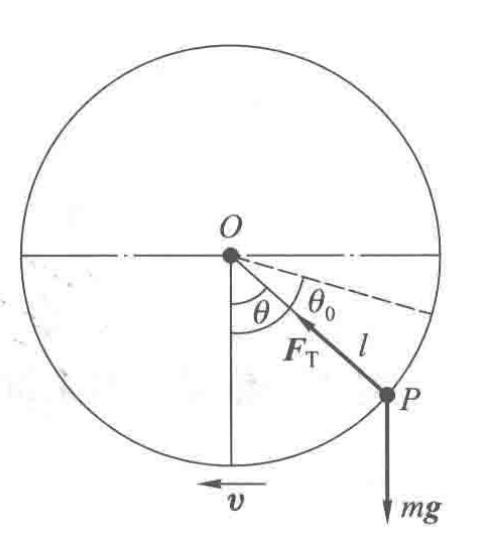

设杆长为$l$，摆锤的质量为$m$（图1.8.3）．如取悬点$O$处的势能为零，则当摆锤在初始位置时，动能$T$为零，势能$V=$

$-mgl\cos\theta_0$，而当它达到最低位置时，动能$T$为$\frac{1}{2}mv^2$，势能$V$则为$-mgl$．由机械能守恒定律，得

$$
\frac{1}{2}mv^2-mgl=0-mgl\cos\theta_0 \qquad (1)
$$

由此即得

$$
v^2=2gl(1-\cos\theta_0) \qquad (2)
$$

这就是摆锤通过最低点时速度的平方，而速度

$$
v=\sqrt{2gl(1-\cos\theta_0)} \qquad (3)
$$

方向水平向左，如图 1.8.3 所示．

现改用运动定律来解．因$v=l\dot{\theta}$，故由（1.5.5）中第一式，得切向运动微分方程为

$$
m\dot{v}=-mg\sin\theta \qquad (4)
$$

$$
\dot{v}=l\ddot{\theta}=-g\sin\theta \qquad (5)
$$

用$2\dot{\theta}$乘式（5）的两侧，并积分，得

$$
l\dot{\theta}^2=2g\cos\theta+C \qquad (6)
$$

因当$\theta=\theta_0$，$\dot{\theta}=0$，故$C=-2g\cos\theta_0$．把$C$的值代入（6）式，即得摆锤通过最低点（$\theta=0$）时的速度为

$$
v^2=2gl(1-\cos\theta_0)
$$

这与（2）式完全相同，但比较迂回．

顺便指出：如由（1.5.5）中的第二式，我们还可求出杆中张力，但用机械能守恒定律则不能．

### （5）势能曲线

设质点受某些任意一维保守力的作用，而质点的势能则是它的位置坐标$x$的函数．以$x$为横坐标、势能$V(x)$为纵坐标绘图，如图 1.8.4 所示，叫做**势能曲线**．如$E$代表该质点的总能，则在图 1.8.4 中$E$线上面的部分叫**势垒**，而下面的凹陷部分叫**势阱**．

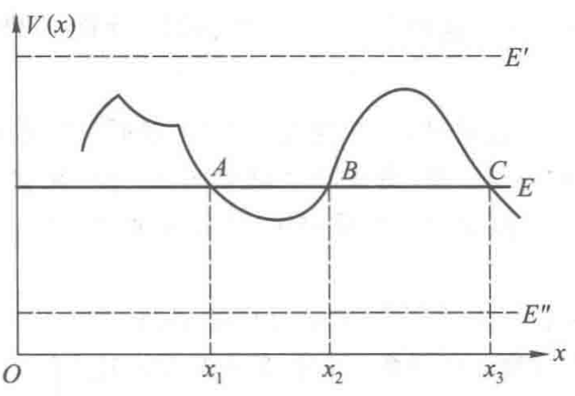

对于一维保守力来讲，能量守恒定律为

$$
\frac{1}{2}m\dot{x}^2+V(x)=E
$$

由此得到

$$
\dot{x}=\pm\sqrt{\frac{2}{m}[E-V(x)]} \qquad (1.8.25)
$$

式中$E$为总能，如图 1.8.4 中的水平实线所示．这时质点的运动有下列几种可能的情况：

（a）$x<x_1$

在此区间内，势能$V$超过总能$E$．根据式（1.8.25）知，速度$\dot{x}$为虚值，故质点不可能在此区间内运动．

（b）$x_1<x<x_2$

在此区间内，总能$E$超过势能$V$，故质点能在此区间内运动，其端点为$x=x_1$及$x=x_2$．在此两端点上，$E=V$，速度$\dot{x}=0$．这两点叫运动的**转折点**，因质点到达此两点中的任一点时，都将碰到曲线上的势垒而掉转方向运动．这时质点将在势能曲线的势阱中来回振动．

（c）$x_2<x<x_3$

质点依然不能在此区间内运动，因$E<V$．

（d）$x>x_3$

如此后$V(x)$之值始终小于在$x_3$处的值，则自$x=x_3$到$x\to\infty$的整个区间，运动都将是可能的．如质点自较大$x$处向$x_3$趋近，则当其达到$x_3$时，将遇到势能曲线上的势垒，而质点将被反射回去，并无限制地趋向无穷远．

从以上的讨论可以看出：质点可能运动的方式，由势能曲线［亦即势能$V(x)$的具体表达式］及总能$E$的值所决定．如$E=E'$（图 1.8.4），则质点在势能曲线上的运动将不受限制；如$E=E''$（图 1.8.4），则所有的运动方式都将是不可能的．

质点不能透过势垒，并在它达到势垒的边缘时被反射回去，是经典力学的观点．即在经典力学中，对给定的势能曲线，不同的$E$值有不同的运动．只有$E>V$的质点（例如$E=E'$），才能越过势垒而运动．但在量子力学中，情况就不是这样．$E>V$的粒子，有可能越过势垒，但也可能被反射回去；而$E<V$的粒子，有可能被势垒反射回来，但也可能贯穿势垒，运动到势垒另一侧的区域中去．这一现象，叫做**隧道效应**，是因为微观粒子具有波动性的缘故．经典力学对此现象无法解释，所以我们在绪论中就曾提到经典力学有它的局限性．

## §1.9 有心力

### （1）有心力的基本性质

我们知道：各大行星都是绕太阳作椭圆运动的．为什么会这样？因为它们之间存在着万有引力的作用．对任一行星（例如地球）而言，它所受到的力主要是太阳对它的引力，而这引力的作用线则始终通过太阳中心．人造地球卫星也是这样，它所受的力几乎仅仅是地球对它的引力，这引力的作用线，也是始终通过地心的．

一般来讲，如果运动质点所受的力的作用线始终通过某一个定点，我们就说这个质点所受的力是**有心力**，而这个定点则叫做**力心**．有心力在量值上，一般是矢径（即质点和力心间的距离）$r$的函数，而力的方向则始终沿着质点和力心的连线．凡力趋向定点的是引力，离开定点的是斥力．

在有心力的作用下，质点始终在一平面内运动．因为$\boldsymbol{F}$与位矢$\boldsymbol{r}$共线，$\boldsymbol{r}\times\boldsymbol{F}=0$，$\boldsymbol{J}=$常矢量．根据上节的论断，质点只能在垂直于动量矩$\boldsymbol{J}$的平面内运动．因此，这是一个平面问题，我们今后将只要用两个坐标$(x,y)$或$(r,\theta)$来研究它的运动．

上面曾经提到，有心力$\boldsymbol{F}$的量值，一般是矢径$r$的函数，即

$$
F=F(r)
$$

或

$$
\boldsymbol{F}=F(r)\frac{\boldsymbol{r}}{r} \qquad (1.9.1)
$$

在直角坐标系中，如以力心为原点，质点的运动平面为$xy$平面，则质点的运动微分方程为

$$
\begin{cases}
m\ddot{x}=F(r)\frac{x}{r}\\
m\ddot{y}=F(r)\frac{y}{r}
\end{cases}
\qquad (1.9.2)
$$

式中$r=\sqrt{x^2+y^2}$，$m$是质点的质量．显然，用直角坐标系来解有心力的问题，是很不方便的．事实上，既然$F=F(r)$，而$\boldsymbol{F}$的方向又与$\boldsymbol{r}$共线，自然采用平面极坐标系要方便得多．取力心为极坐标的极点，则由式（1.5.3），得质点的运动微分方程为

$$
\begin{cases}
m(\ddot{r}-r\dot{\theta}^2)=F_r=F(r)\\
m(r\ddot{\theta}+2\dot{r}\dot{\theta})=F_\theta=0
\end{cases}
\qquad (1.9.3)
$$

采用极坐标系的优点在于，不仅$\sqrt{x^2+y^2}$这样的表达式不再出现，而且我们还可以很容易求式（1.9.3）第二式的第一积分．因根据式（1.2.13），式（1.9.3）第二式可以改写为

$$
m\frac{1}{r}\frac{\mathrm{d}}{\mathrm{d}t}(r^2\dot{\theta})=0
$$

因质点的质量$m$是常数，故上式积分，得

$$
r^2\dot{\theta}=h \qquad (1.9.4)
$$

又可写为

$$
mr^2\dot{\theta}=mh \qquad (1.9.5)
$$

式中$h$是常数．

现在来看式（1.9.5）的物理意义．我们知道：在极坐标系中，如图 1.9.1，速度$\boldsymbol{v}$的横向分矢量的量值$v_\theta$是$r\dot{\theta}$，所以$mr\dot{\theta}$是动量横向分矢量的量值．从动量矩来看，因动量的径向分矢量$mv_r\boldsymbol{i}$通过$O$点，即对$O$点的动量矩为零（图 1.9.1），而$r(mr\dot{\theta})$，即$mr^2\dot{\theta}$则是动量的横向分量对$O$点动量矩的量值，也就是整个质点$P$对$O$点的动量矩的量值．所以式（1.9.5）也就是在极坐标系中有心力动量矩守恒定律的数学表达式．事实上，因对有心力来讲，外力矩$\boldsymbol{r}\times\boldsymbol{F}=0$，动量矩$\boldsymbol{J}$是一常矢量，它的分量当然是常量．

由于式（1.9.4）比（1.9.3）第二式简单，所以在研究有心力问题时，常用下列两个方程作为基本方程，以代替式（1.9.3）：

$$
\begin{cases}
m(\ddot{r}-r\dot{\theta}^2)=F(r)\\
r^2\dot{\theta}=h
\end{cases}
\qquad (1.9.6)
$$

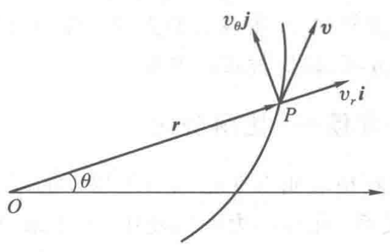

有心力的量值，一般只是矢径$r$的函数．可以证明有心力是保守力，它所作的功与路径无关，现推证如下：

质点受变力作用而沿曲线运动时，由式（1.7.2）知

$$
W=\int_A^B\boldsymbol{F}\cdot\mathrm{d}\boldsymbol{r}
$$

对极坐标系来讲，可以把$\boldsymbol{F}$分解为径向分矢量$F_r\boldsymbol{i}$和横向分矢量$F_\theta\boldsymbol{j}$；同理，元位移$\mathrm{d}\boldsymbol{r}$也可分解为径向分位移$\mathrm{d}r\boldsymbol{i}$及横向分位移$(r\mathrm{d}\theta)\boldsymbol{j}$．所以，在极坐标系中，力所作的功为

$$
W=\int_A^B F_r\mathrm{d}r+F_\theta r\mathrm{d}\theta \qquad (1.9.7)
$$

对有心力来讲，力的方向恒沿径矢方向，而其量值一般又只是矢径$r$的函数，故问题可更简单．因$F_\theta=0,F_r=F(r)$，故式（1.9.7）简化为

$$
W=\int_A^B F(r)\mathrm{d}r \qquad (1.9.8)
$$

如$A$点的$r=r_1$，$B$点的$r=r_2$，则自$r=r_1$至$r=r_2$对式（1.9.8）积分，就得出在这种情形下，质点自$r=r_1$至$r=r_2$沿曲线轨道运动时，力$\boldsymbol{F}$对质点所作的功为

$$
W=\int_{r_1}^{r_2}F(r)\mathrm{d}r \qquad (1.9.9)
$$

这个定积分的值，显然只取决于起点和终点的矢径，而与中间所通过的路径无关．这就证明了我们上面所作的论断：有心力是保守力．其实，如果我们利用保守力的判据$\nabla\times\boldsymbol{F}=0$①，我们立即就可得出这个论断．

既然有心力是保守力，那它一定存在势能$V$，且

$$
\boldsymbol{F}=-\nabla V
$$

因为势能差与原点选取无关，故可写出：

$$
\int_{r_1}^{r_2}F(r)\mathrm{d}r=-(V_2-V_1) \qquad (1.9.10)
$$

这时势能函数$V$当然也只是矢径$r$的函数，即$V=V(r)$．至于机械能守恒定律当然也是成立的，它的具体表达式是

$$
\frac{1}{2}m(\dot{r}^2+r^2\dot{\theta}^2)+V(r)=E \qquad (1.9.11)
$$

其中$E$是质点的总能，它是一个常量．

我们也可用式（1.9.11）来代替式（1.9.6）中的第一式，前者同式（1.9.6）中的第二式一样，都是一阶微分方程．解算有心力的问题，可以把这两个一阶微分方程结合起来，作为基本方程，以代替式（1.9.6）．

### （2）轨道微分方程——比耐公式

在力学中，很多问题是求质点在已知力作用下的运动规律，即求出质点的坐标和时间$t$之间的关系．在有心力的问题中，为了求出在有心力作用下的质点运动规律，我们可以从式（1.9.6）中的第二式和式（1.9.11）出发，求出$r,\theta$和$t$的关系，即$r=r(t),\theta=\theta(t)$．但在很多情况下，我们并不能得出这样显函数的形式，而只能把它们表示为$t$的隐函数，例如平方反比问题中的开普勒方程（参见本章习题1.49）．

在力学问题中，欲求轨道方程，通常是先求运动规律，然后再从运动规律中把参数$t$消去，因为运动规律就是轨道的参数方程（时间$t$是参数）．在有心力问题中，我们常采用另外一种方法，就是先从式（1.9.6）中把$t$消去，得出$r$和$\theta$的一个微分方程，再进行求解，就可直接得出$r,\theta$的关系式，亦即轨道方程．

为了计算方便起见，我们又常用$r$的倒数$u$来代替$r$，即求出$u$和$\theta$的微分方程．

由式（1.9.6）中的第二式，知$r^2\dot{\theta}=h$．以$u=\frac{1}{r}$代替$r$，则得

$$
\dot{\theta}=hu^2
$$

又

$$
\dot{r}=\frac{\mathrm{d}r}{\mathrm{d}t}=\frac{\mathrm{d}r}{\mathrm{d}\theta}\frac{\mathrm{d}\theta}{\mathrm{d}t}=\frac{\mathrm{d}}{\mathrm{d}\theta}\left(\frac{1}{u}\right)\frac{\mathrm{d}\theta}{\mathrm{d}t}=-\frac{1}{u^2}\frac{\mathrm{d}u}{\mathrm{d}\theta}\dot{\theta}=-h\frac{\mathrm{d}u}{\mathrm{d}\theta}
$$

> ① 参看式（1.7.8）．在平面极坐标系中，判据$\nabla\times\boldsymbol{F}=0$的分量形式是$\frac{\partial(rF_\theta)}{\partial r}-\frac{\partial F_r}{\partial\theta}=0$．令$F_\theta=0,F_r=F(r)$，故$\nabla\times\boldsymbol{F}=0$．

$$
\ddot{r}=\frac{\mathrm{d}\dot{r}}{\mathrm{d}t}=\frac{\mathrm{d}}{\mathrm{d}t}\left(-h\frac{\mathrm{d}u}{\mathrm{d}\theta}\right)=\frac{\mathrm{d}}{\mathrm{d}\theta}\left(-h\frac{\mathrm{d}u}{\mathrm{d}\theta}\right)\dot{\theta}=-h^2u^2\frac{\mathrm{d}^2u}{\mathrm{d}\theta^2}
$$

把$\ddot{r}$及$\dot{\theta}$的表达式代入式（1.9.6）的第一式中，$t$就消去了，并得到

$$
h^2u^2\left(\frac{\mathrm{d}^2u}{\mathrm{d}\theta^2}+u\right)=-\frac{F}{m} \qquad (1.9.12)
$$

这就是所要求的轨道微分方程，通常叫做**比耐公式**，引力时$F$为负号，斥力时$F$为正号．利用这个公式，除了在已知力的情形下求轨道方程外，也可从已知质点在有心力作用下的轨道方程，求出有心力$F(r)$的具体形式．

### （3）平方反比引力——行星的运动

在有心力问题中，力与质点到力心间的距离$r$成平方反比的问题，是一个很重要的问题．行星绕太阳的运动，就是在力与距离平方成反比的引力作用下发生的，这种力就是熟知的万有引力．另一方面，在物理学中，也存在平方反比的斥力问题，例如用$\alpha$粒子（带正电）轰击原子核（也带正电），将发生散射现象．这时$\alpha$粒子所受的力虽然也是有心力，但与万有引力不同，是一种与距离平方成反比的排斥力．我们将先研究与行星运动有关的平方反比引力问题，然后再研究$\alpha$粒子的散射问题．

现在让我们利用比耐公式来求质点在与距离平方成反比的引力作用下的轨道方程．

如果我们令太阳的质量为$m_s$，行星的质量为$m$，则由万有引力定律，知行星和太阳之间的作用力可以写为

$$
F=-\frac{Gm_sm}{r^2}=-\frac{k^2m}{r^2}=-mk^2u^2 \qquad (1.9.13)
$$

式中$G$为万有引力常量，$k^2=Gm_s$是一个与行星无关而只和太阳有关的量，叫做太阳的高斯常数，$r$为行星和太阳之间的距离．

把式（1.9.13）代入式（1.9.12）中，得

$$
h^2u^2\left(\frac{\mathrm{d}^2u}{\mathrm{d}\theta^2}+u\right)=k^2u^2
$$

即

$$
\frac{\mathrm{d}^2u}{\mathrm{d}\theta^2}+u=\frac{k^2}{h^2} \qquad (1.9.14)
$$

如令

$$
u=\xi+\frac{k^2}{h^2}
$$

则式（1.9.14）变为

$$
\frac{\mathrm{d}^2\xi}{\mathrm{d}\theta^2}+\xi=0 \qquad (1.9.15)
$$

这个微分方程的形式与谐振动方程完全一样，所以它的解是

$$
\xi=A\cos(\theta-\theta_0)
$$

而

$$
u=\xi+\frac{k^2}{h^2}=A\cos(\theta-\theta_0)+\frac{k^2}{h^2}
$$

或

$$
r=\frac{1}{u}=\frac{h^2/k^2}{1+A[\cos(\theta-\theta_0)]h^2/k^2} \qquad (1.9.16)
$$

式中$A$及$\theta_0$是两个积分常数．如果把极轴转动一个角度，可使$\theta_0=0$，这样，式（1.9.16）就简化为

$$
r=\frac{h^2/k^2}{1+(Ah^2/k^2)\cos\theta} \qquad (1.9.17)
$$

式（1.9.17）就是我们所要求的轨道方程．如果把它和在极坐标系的标准圆锥曲线方程

$$
r=\frac{p}{1+e\cos\theta} \qquad (1.9.18)
$$

相比较，知该轨道是原点在焦点上的圆锥曲线，力心位于焦点上，且

$$
h^2/k^2=p,\quad Ah^2/k^2=Ap=e \qquad (1.9.19)
$$

$p$为圆锥曲线正焦弦长度的一半，$e$为偏心率，此时$\theta$应从焦点至准线所作的垂线量起．

根据解析几何知，式（1.9.18）所代表的圆锥曲线，可依$e$的数值，分为下列三种类型（图 1.9.2）：

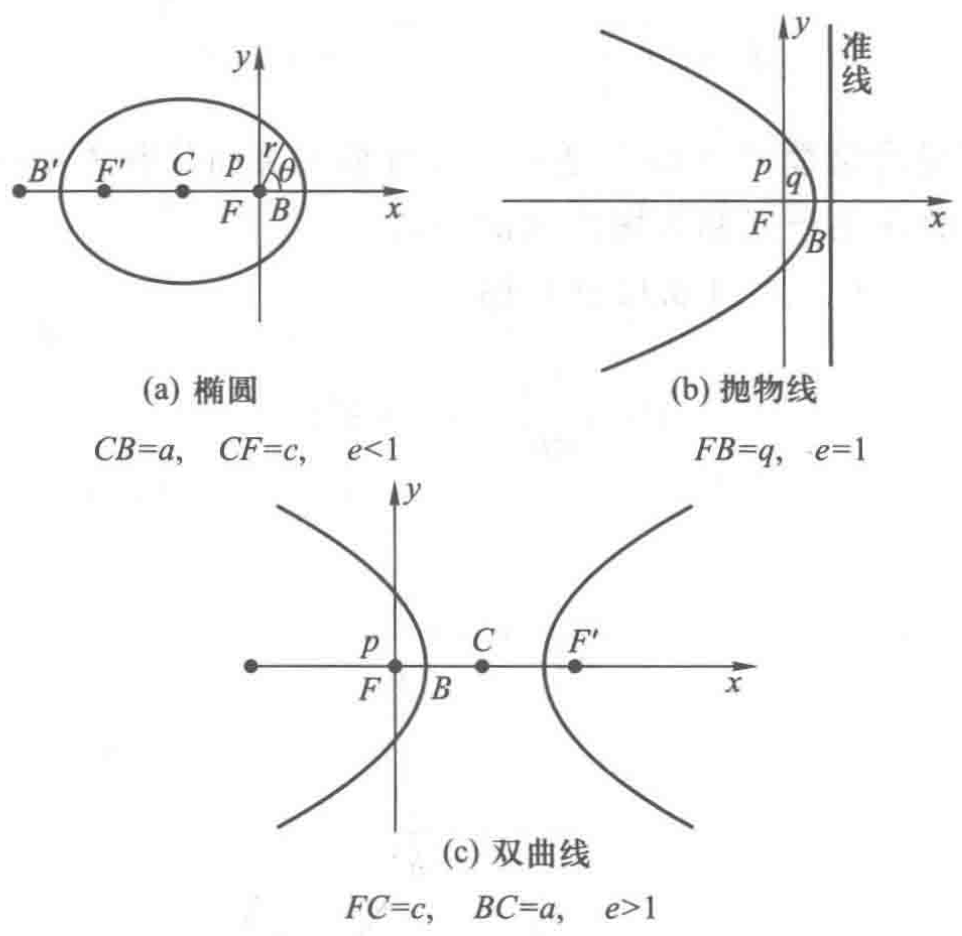

$$
\begin{aligned}
&\text{（a）椭圆}\\
&\quad\text{在}B\text{点，}r=a-c=a(1-e),\ \theta=0\\
&\quad\text{故 }a(1-e)=\frac{p}{1+e}\text{，即 }p=a(1-e^2),\ e<1\\
&\text{（b）抛物线}\\
&\quad\text{在}B\text{点，}r=q,\ \theta=0,\ p=2q,\ e=1\\
&\text{（c）双曲线①}\\
&\quad\text{在}B\text{点，}r=c-a=a(e-1)\\
&\quad\text{故 }p=a(e^2-1),\ e>1
\end{aligned}
\qquad (1.9.20)
$$

在圆锥曲线中，离力心最近的顶点$B$叫**近日点**．在椭圆中，离力心最远的顶点$B'$叫**远日点**．在抛物线和双曲线中都没有远日点．

由式（1.9.20）可以看出：要决定轨道是什么形状，需要根据起始条件来确定偏心率$e$的数值．但$e$是轨道的几何常数，在力学中，希望采用动力常数来作为轨道类别的判据．既然有心力是保守力，机械能守恒定律成立，是否可用总能量$E$来作为判据呢？我们现在就来讨论这个问题．

我们已经讲过：机械能守恒定律式（1.9.11）和式（1.9.6）中的第二式动量矩守恒定律结合起来，可以作为解决有心力问题的基本方程．既然在平方反比引力问题中，力$F(r)$的具体形式已知，我们应能求出式（1.9.11）中$V(r)$的具体形式．因$\boldsymbol{F}=-\nabla V$，而在有心力这种具体问题中，势能只是矢径$r$的函数，所以前式变为

$$
F=-\frac{\mathrm{d}V}{\mathrm{d}r}
$$

所以

$$
V=\int-F(r)\mathrm{d}r=\int\frac{k^2m}{r^2}\mathrm{d}r
$$

如取无穷远处的势能为零，则得质点在距力心为$r$时的引力势能为

$$
V(r)=\int_{\infty}^{r}\frac{k^2m}{r^2}\mathrm{d}r=-\frac{k^2m}{r} \qquad (1.9.21)
$$

这样，式（1.9.11）就变为

$$
\frac{1}{2}m(\dot{r}^2+r^2\dot{\theta}^2)-\frac{k^2m}{r}=E \qquad (1.9.22)
$$

现在，把式（1.9.22）和式（1.9.6）中的第二式结合起来，以消去$\mathrm{d}t$．为此，我们作下列变换：

$$
\dot{r}=\frac{\mathrm{d}r}{\mathrm{d}t}=\frac{\mathrm{d}r}{\mathrm{d}\theta}\frac{\mathrm{d}\theta}{\mathrm{d}t}=\frac{h}{r^2}\frac{\mathrm{d}r}{\mathrm{d}\theta}\qquad（\text{因为 }r^2\dot{\theta}=h）
$$

把上式中的$\dot{r}$代入式（1.9.22）中，得

> ① 是左边的一支．右边的一支为斥力的情况，其方程为$r=\frac{p}{e\cos\theta-1}$．

$$
\frac{1}{2}m\left[\frac{h^2}{r^4}\left(\frac{\mathrm{d}r}{\mathrm{d}\theta}\right)^2+\frac{h^2}{r^2}-\frac{2k^2}{r}\right]=E
$$

解出$\frac{\mathrm{d}r}{\mathrm{d}\theta}$，并分离变量，得

$$
\frac{h\mathrm{d}r}{r\sqrt{\frac{2E}{m}r^2+2k^2r-h^2}}=\mathrm{d}\theta
$$

两边分别积分①，得

$$
\arcsin\frac{2k^2r-2h^2}{r\sqrt{4k^4+8Eh^2/m}}=\theta+\frac{3}{2}\pi-\theta_0
$$

故

$$
r=\frac{h^2/k^2}{1+\sqrt{1+2h^2E/k^4m}\left[\cos(\theta-\theta_0)\right]} \qquad (1.9.23)
$$

以此与标准式（1.9.18）比较，知

$$
e=\sqrt{1+\frac{2E}{m}\left(\frac{h}{k^2}\right)^2} \qquad (1.9.24)
$$

所以不用比耐公式，我们也可由式（1.9.11）和式（1.9.6）中的第二式求轨道方程，虽然步骤可能稍烦琐一些，但物理意义却丰富些，因为它的积分中，直接包含了总能量$E$．

由式（1.9.24），我们就得出了用总能量$E$作为轨道类别的判据．因$\frac{2}{m}\left(\frac{h}{k^2}\right)^2$恒为正，所以，如

$$
E<0\text{，则 }e<1\text{，轨道为椭圆；}
$$

如

$$
E=0\text{，则 }e=1\text{，轨道为抛物线；}
$$

如

$$
E>0\text{，则 }e>1\text{，轨道为双曲线．}
$$

### （4）开普勒定律

日、月、星辰每天东升西落，是最常见的天文现象．如何解释这种最常见的现象，历史上却经过了漫长曲折的道路．公元2世纪，托勒玫（希腊人）提出了“地心宇宙体系”，认为地球位于宇宙中心，其他星球都在圆形轨道上绕着地球转动．公元16世纪，哥白尼（波兰人）在他所著的《天体运行》一书中，提出了“地动说”，勇敢地向统治欧洲一千多年的神权挑战．他指出：地球不是宇宙中心，地球除绕自己的轴旋转外，还和其他行星一起绕着太阳运转．

> ① 可利用积分公式$\int\frac{\mathrm{d}x}{x\sqrt{a+bx+cx^2}}=\frac{1}{\sqrt{-a}}\arcsin\frac{bx+2a}{x\sqrt{b^2-4ac}},a<0$，来进行积分．

不过，由于当时历史条件的限制，哥白尼的学说也存在着两方面的错误．第一，他把太阳当作宇宙的中心．实际上，太阳不是宇宙的中心，也不在银河系的中心．宇宙是无限的，它根本没有中心．第二，他认为天体轨道都是正圆形的．这是受古代希腊唯心主义哲学的影响，错误地认为天体都是完美的，只能在最完美的曲线——正圆上运行．后来，开普勒（德国人）利用他的前辈第谷·布拉赫（丹麦人）的观测资料，改进了哥白尼的学说，解除了自古以来圆运动的思想束缚，提出了下列三条关于行星运动的定律，即所谓开普勒定律．

开普勒第一定律：行星绕太阳作椭圆运动，太阳位于椭圆的一个焦点上．

开普勒第二定律：行星和太阳之间的连线（径矢），在相等时间内所扫过的面积相等．

开普勒第三定律：行星公转的周期的平方和轨道半长轴的立方成正比．

后来，牛顿又发表了万有引力定律，进一步阐明了天体运行的动力学规律．开普勒定律先后发表于1609年（第一、第二定律）和1619年（第三定律），而牛顿的万有引力定律则发表于1687年，迟了半个世纪以上．开普勒定律是在大量观测资料上总结出来的，而牛顿则又以它们为基础，并结合他自己提出的运动第二定律，推出了万有引力定律．现在，为明了起见，我们也顺着历史发展的途径，从开普勒定律推出万有引力定律．

设$A$是径矢扫过的面积，由开普勒第二定律，知单位时间内，径矢所扫过的面积相等，即

$$
\frac{\mathrm{d}A}{\mathrm{d}t}=\text{常量}
$$

现在让我们来求$\frac{\mathrm{d}A}{\mathrm{d}t}$的表达式．在图 1.9.3 中，$P_1$、$P_2$为行星沿着它的轨道运动时两相邻瞬间的位置，且对太阳所张的角度为$\Delta\theta$．行星自$P_1$沿着轨道运动到$P_2$所需的时间为$\Delta t$．在这段时间内，径矢所扫过的面积$\Delta A$为$OP_1P_2$．当$\Delta t\to0$时，

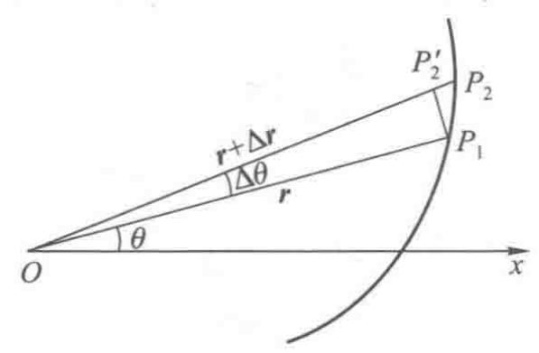

$P_2\to P_1$，$\Delta A$就近似地等于$\triangle OP_1P_2'$的面积，即$\frac{1}{2}r(r\Delta\theta)$，所以

$$
\frac{\mathrm{d}A}{\mathrm{d}t}=\lim_{\Delta t\to0}\frac{\Delta A}{\Delta t}=\lim_{\Delta t\to0}\frac{1}{2}r^2\frac{\Delta\theta}{\Delta t}=\frac{1}{2}r^2\dot{\theta}
$$

或

$$
2\dot{A}=r^2\dot{\theta} \qquad (1.9.25)
$$

故单位时间内径矢所扫过的面积的两倍等于$r^2\dot{\theta}$．如$\dot{A}$为常数，则$r^2\dot{\theta}$也是常数．如令$m$为行星的质量，则$mr^2\dot{\theta}$也必定是常数．但$mr^2\dot{\theta}$是行星对太阳的动量矩，由式（1.8.16）可知行星所受的力对太阳的力矩为零，因行星恒具有加速度，即受力不为零，故行星所受力必是有心力，太阳是力心．

现在，由开普勒第一定律来求行星所受的力的量值．既然轨道为椭圆，我们就可把轨道方程写为［参看（1.9.18）］

$$
r=\frac{p}{1+e\cos\theta}
$$

或

$$
u=\frac{1}{p}+\frac{e}{p}\cos\theta
$$

把这关系式代入比耐公式（1.9.12），就得到

$$
F=-mh^2u^2\left(\frac{\mathrm{d}^2u}{\mathrm{d}\theta^2}+u\right)=-\frac{mh^2u^2}{p}=-\frac{h^2}{p}\frac{m}{r^2} \qquad (1.9.26)
$$

这表明行星所受的力是引力，且与距离平方成反比．

乍一看来，似乎不要开普勒第三定律就已能推出万有引力定律了，其实不然．我们并不能把式（1.9.26）化成式（1.9.13），因在式（1.9.26）中，$h$和$p$对每一行星来讲，都具有不同的数值，而式（1.9.13）中的$k^2(=Gm_s)$，则是一个与行星无关的常数．为了能把式（1.9.26）化为式（1.9.13），就得利用开普勒第三定律．现在，先让我们来计算在有心力作用下行星公转的周期．

由（1.9.25）及（1.9.4）两式，知$2\dot{A}=r^2\dot{\theta}=h$，积分，得

$$
2A=h(t-t_0)
$$

当径矢扫过全部椭圆后，$A=\pi ab$，而所需的时间就是周期$\tau$，所以

$$
2\pi ab=h\tau
$$

即

$$
\tau=\frac{2\pi ab}{h}
$$

而

$$
\frac{\tau^2}{a^3}=\frac{4\pi^2b^2}{h^2a}
$$

因

$$
\frac{b^2}{a}=\frac{1}{a}(a^2-c^2)=a\left(1-\frac{c^2}{a^2}\right)=a(1-e^2)=p
$$

故

$$
\frac{\tau^2}{a^3}=\frac{4\pi^2p}{h^2}
$$

根据开普勒第三定律，$\frac{\tau^2}{a^3}$是与行星无关的常量．所以虽然$h$和$p$都是和行星有关的常量，但$\frac{p}{h^2}$（或$\frac{h^2}{p}$）则是一个与行星无关的常量，因而如令$\frac{h^2}{p}=k^2$，我们就可以把式（1.9.26）化为式（1.9.13），即$F=-mk^2/r^2$．

这样，周期$\tau$又可写为

$$
\tau=\frac{2\pi a^{3/2}}{k} \qquad (1.9.27)
$$

牛顿还研究了月球绕地球的运动，发现地球对月球的引力和地球吸引地面上的各物体的力遵从同一规律，属于同一性质．进一步的研究表明，这种跟两者质量的乘积成正比而跟两者距离的平方成反比的引力，并不是天体之间所特有的，而是存在于任意两个物体之间，故称万有引力．后来，卡文迪什还在实验室里用扭秤的方法比较准确地测定了万有引力常量$G$的数值（1798年）．

开普勒所根据的观测资料，都是凭肉眼进行的．随着望远镜等精密仪器的出现，发现行星实际运行的情况与开普勒定律有少许偏离．这是因为行星不但受到太阳的引力，还要受到其他行星的引力，而且太阳也不是绝对不动的．如果把这些因素考虑进去，则理论和实践可以符合得更好．关于行星受到其他引力问题，属于天体力学的范畴；关于如何处理太阳的运动问题，将在§2.5中再详加讨论．

### （5）宇宙速度和宇宙航行

自从20世纪50年代末期起，人造地球卫星和宇宙飞船相继发射成功．现在，人类已可克服万有引力的作用，乘坐宇宙飞船，围绕地球飞行或在月球上着陆，并且还在不断改进宇航手段，对金星、火星和各种天体现象，进行宇宙空间的科学考察、研究和利用．

我们知道：要成功地发射人造地球卫星或宇宙飞船，牵涉很多科学技术方面的知识，它已成为一门综合性的新兴学科，叫做**空间科学技术**．它里面的一个问题，就是发射速度问题．发射速度虽然是一个早就知道了的问题，但由于它的数值巨大，一直难以达到．直到20世纪中期，火箭技术飞跃发展，才使早先人类认为是梦想的东西逐渐变为现实．可见理论对实践常具有相当重要的指导作用．

现在，我们就根据本节中所得到的一些结果，来计算这个发射速度，通常把它叫做**宇宙速度**．为此，我们先要算出总能量$E$和轨道半长轴$a$之间的关系．

利用式（1.9.4）$r^2\dot{\theta}=h$，把$\dot{\theta}$从式（1.9.22）中消去，得

$$
\frac{1}{2}m\left(\dot{r}^2+\frac{h^2}{r^2}\right)-\frac{k^2m}{r}=E \qquad (1.9.28)
$$

如轨道为椭圆，则在近日点，有$r=a(1-e)$，$\dot{r}=0$，代入式（1.9.28）中，并利用$h^2/k^2=p$和$p=a(1-e^2)$的关系，得

$$
\begin{aligned}
E&=\frac{mh^2}{2r^2}-\frac{k^2m}{r}=\frac{mk^2a(1-e^2)}{2a^2(1-e)^2}-\frac{k^2m}{a(1-e)}\\
&=-\frac{k^2m}{2a}
\end{aligned}
\qquad (1.9.29)
$$

如轨道为抛物线，则在近日点，$\dot{r}=0$，$r=q$，$p=2q$，代入式（1.9.28）中，得

$$
E=\frac{mh^2}{2q^2}-\frac{k^2m}{q}
$$

但

$$
h^2=k^2(2q)
$$

故

$$
E=\frac{m}{2}\frac{k^2(2q)}{q^2}-\frac{k^2m}{q}=0 \qquad (1.9.30)
$$

同理，如轨道为双曲线，则在近日点，$\dot{r}=0$，$r=a(e-1)$，代入式（1.9.28）后，得

$$
E=+\frac{k^2m}{2a} \qquad (1.9.31)
$$

这些结果和前面所得到的判据是一致的．

现在我们可以计算从地球表面上发射人造地球卫星或宇宙火箭所需要的最低速度了．因为根据式（1.9.28）和式（1.9.29），我们知道，对于椭圆轨道的星体而言

$$
\frac{1}{2}mv^2-\frac{k^2m}{r}=-\frac{k^2m}{2a} \qquad (1.9.32)
$$

在普通物理学中可知，从地球表面上发射一颗人造地球卫星所需要的最低速度$v_1$为

$$
v_1=\sqrt{gr}=\sqrt{9.8\times6\,400/1\,000}\ \mathrm{km/s}=7.9\ \mathrm{km/s}
$$

这个速度叫**第一宇宙速度**，又叫**环绕速度**．如在（1.9.32）中，令$a=r=$地球半径，$k^2=gr^2$，亦可得出同样结果，读者可自行加以验证．

在式（1.9.32）中，如令$a=\infty$，并令这时的$v$为$v_2$，则

$$
v_2^2=\frac{2k^2}{r}=2gr
$$

即

$$
v_2=\sqrt{2gr}=\sqrt{2}v_1
$$

故如物体发射时的速度等于或大于$v_2$，物体就可以脱离地球引力的作用而不再回来，或者绕着太阳运转成为一个人造行星．这个速度叫做**第二宇宙速度**，也叫**逃逸速度**．

因$v_1=7.9\ \mathrm{km/s}$，故

$$
v_2=1.4\times7.9\ \mathrm{km/s}=11.2\ \mathrm{km/s}
$$

虽然在计算$v_2$时，是令式（1.9.32）中的$a=\infty$，但这只是相对于地球而言的，即第二宇宙速度是指物体脱离地球引力的作用所需要的最低速度，但还不能脱离太阳引力的作用．也就是说，具有这样速度的物体，还不能离开太阳系．

现在来计算一下，物体从地球表面发射应具有多大的速度，才能脱离太阳系，飞到其他星系上去．我们通常把这个速度叫做**第三宇宙速度**，并以$v_3$表之．

让我们先计算在地球绕太阳运行的轨道上发射物体时可以脱离太阳的速度$v$．

由第二宇宙速度$v_2$的表达式可以得出

$$
v_2^2=\frac{2k^2}{r}=\frac{2Gm_E}{r} \qquad (1.9.33)
$$

式中$m_E$是地球的质量，$r$是地球的半径．因此，如果太阳的质量是$m_s$，地球绕太阳运行的轨道的半径是$r'$，则仿式（1.9.33），脱离太阳系的速度应为

$$
v^2=\frac{2Gm_s}{r'} \qquad (1.9.34)
$$

因在地球绕太阳运行的轨道处发射，地球的引力可忽略不计．

用式（1.9.33）除式（1.9.34），得

$$
v=v_2\sqrt{\frac{m_sr}{m_Er'}} \qquad (1.9.35)
$$

已知太阳的质量是地球质量的333 400倍，而地球绕太阳的轨道半径的平均值，约为地球半径的23 400倍，因此

$$
v=11.2\times\sqrt{\frac{333\,400}{23\,400}}\ \mathrm{km/s}\approx42\ \mathrm{km/s}
$$

事实上，脱离太阳系的发射速度，并不需要这么大，因为地球绕太阳公转的速度约为30 km/s．因此，如果发射时的速度方向和地球在公转轨道上运行的速度方向一致，那么只要相对于地球的速度为12 km/s，相对于太阳的速度就能达到42 km/s．不过，物体都是在地面发射的，所以还要同时克服地球的引力．因此，$v_3$的值应近似地按下式计算：

$$
\frac{1}{2}mv_3^2-\frac{k^2m}{r}=\frac{m}{2}(12\ \mathrm{km/s})^2 \qquad (1.9.36)
$$

但

$$
\frac{2k^2}{r}=v_2^2=(11.2\ \mathrm{km/s})^2
$$

故

$$
v_3=\sqrt{12^2+11.2^2}\ \mathrm{km/s}\approx16.5\ \mathrm{km/s}
$$

如果计及其他行星的引力，则$v_3\approx16.7\ \mathrm{km/s}$．

自从1957年第一颗人造地球卫星上天以后，世界各国都开始重视空间科学技术的研究，竞相发射人造地球卫星．目前，太空中人造地球卫星的数目非常多．有的用于科学研究、气象观测和通信转播，有的用于军事探测．卫星的高度也越来越大，因而留在太空的时间也就越来越长．还有“同步卫星”，它运转的周期和地球自转的周期相同，因而从地球上来看，它始终停留在某个地方的上空，就好像它并不旋转一样．

20世纪60年代以后，空间科学技术发展得很快．发射的速度已能达到第二宇宙速度．因而，人造太阳行星、载人卫星式飞船、飞往月球的宇宙火箭，都相继发射成功．到了20世纪60年代末期（1969年7月），载人的宇宙飞船，首次在月球上着陆．进入20世纪70年代后，飞往金星和火星的探测器也已先后在这两个较近行星上着陆．目前，飞向离地球较远的行星的探测器，已正在飞行途中．预计在长达12年（1977—1989）的漫长旅行中，将先后抵达木星、土星、天王星和海王星，对它们进行拍照和研究．

我国在1970年4月24日发射了第一颗人造地球卫星，近地点是439 km，远地点是2 384 km．由于卫星的轨道平面和地球赤道平面的夹角为68.5°，所以地球上大部分地区都能看到这颗卫星，它所放送的“东方红”歌曲也几乎响遍世界各地．到1985年10月26日，我国已先后发射了17颗人造地球卫星，并且准确地回收了其中的6颗卫星，而且第九、第十、第十一十三颗卫星，则是用同一枚火箭发射出去的，并已成功地利用通信卫星即同步卫星于电视、通信和科学探测．这标志着我国空间科学技术已达到了一定的水平．当然，在这方面要赶上世界最先进的科学技术水平，还有待于我们今后的继续努力．

### （6）圆形轨道的稳定性

地球绕太阳运行的轨道是接近于圆的椭圆．我们知道，对圆形轨道来讲，$r$或$u\left(=\frac{1}{r}\right)$为常数．由比耐公式（1.9.12）可知，在有心力作用下，对任何质点（或星体）来讲，如投掷（起始）速度的方向垂直于位矢，且满足

$$
h^2=\frac{P(u)}{u^3} \qquad (1.9.37)
$$

的关系，则不论其半径为何，都将作圆形轨道的运动，式中$P=\frac{-F}{m}$为单位质量上所受的吸引力．现在我们要问，这种圆形轨道是稳定的还是不稳定的？这个问题在物理上是很重要的．因为在自然界中，微小扰动是经常存在的，它将破坏不稳定的圆形轨道，只有稳定的圆形轨道，才有机会继续下去．

令$u=u_0$及$h=h_0$为某一圆形轨道的$u$和$h$之值，显然

$$
h_0^2=\frac{P(u)}{u_0^3}
$$

为了研究扰动，我们令

$$
u=u_0+\xi \qquad (1.9.38)
$$

式中$\xi$及其微商均认为是很少的微量，$h-h_0$也是这样．把式（1.9.38）代入式（1.9.12）中，得

$$
\frac{\mathrm{d}^2\xi}{\mathrm{d}\theta^2}+u_0+\xi=\frac{P(u_0+\xi)}{h^2(u_0+\xi)^2} \qquad (1.9.39)
$$

把式（1.9.39）的右边展为$\xi$的幂级数，得

$$
\begin{aligned}
\frac{P(u_0+\xi)}{h^2(u_0+\xi)^2}&=\frac{1}{h^2u_0^2}\left(1+\frac{\xi}{u_0}\right)^{-2}(P_0+\xi P_0'+\cdots)\\
&=\frac{P_0}{h^2u_0^2}\left[1+\xi\left(\frac{P_0'}{P_0}-\frac{2}{u_0}\right)+\cdots\right]
\end{aligned}
\qquad (1.9.40)
$$

式中$P'=\frac{\mathrm{d}P}{\mathrm{d}u}$，而下标0表示当$u=u_0$时所算出的值．

如取一阶微量，则式（1.9.39）变为

$$
\frac{\mathrm{d}^2\xi}{\mathrm{d}\theta^2}+C_1\xi=C_2 \qquad (1.9.41)
$$

式中

$$
C_1=1-\frac{P_0}{h^2u_0^2}\left(\frac{P_0'}{P_0}-\frac{2}{u_0}\right)=3-\frac{u_0P_0'}{P_0} \qquad (1.9.42)
$$

而$C_2$为另一常数，其值对问题的性质无关．

根据$C_1>0,C_1<0$或$C_1=0$，式（1.9.41）的解分别为

$$
\begin{cases}
\xi=A\cos(\sqrt{C_1}\theta)+B\sin(\sqrt{C_1}\theta)+\frac{C_2}{C_1}\\
\xi=A\cosh(\sqrt{-C_1}\theta)+B\sinh(\sqrt{-C_1}\theta)+\frac{C_2}{C_1}\\
\xi=\frac{1}{2}C_2\theta^2+A\theta+B
\end{cases}
\qquad (1.9.43)
$$

在这些解中，只有式（1.9.43）中的第一式即$C_1>0$时，永远保持为小量，其他都将随$\theta$的增大而趋于无限大．因此，半径为$\frac{1}{u_0}$的圆形轨道，只当

$$
\frac{u_0P_0'}{P_0}<3 \qquad (1.9.44)
$$

时，才是稳定的．

在特殊情况下，我们考虑引力与距离$n$次方成反比的情况，即

$$
P=\frac{k^2}{r^n}=k^2u^n \qquad (1.9.45)
$$

则

$$
\frac{uP'}{P}=n
$$

故在吸引力式（1.9.45）的作用下作圆形轨道运动时，只当

$$
n<3 \qquad (1.9.46)
$$

才是稳定的．

故力与距离成正比（$n=-1$）及力与距离平方成反比（$n=2$）的吸引力中均能给出稳定的圆形轨道，而立方反比律（$n=3$），则给出不稳定的圆形轨道．

### （7）平方反比斥力——$\alpha$粒子的散射

以上所讨论的有心力都是引力，现在我们转而讨论斥力．把一个带正电荷$2e$的$\alpha$粒子射入一原子中，如果原子的结构中有一集中在很小区域的核心，而且此核心的电荷也是正的，并且等于$Ze$，$Z$为该原子的原子序数，则由电学中的库仑定律知，采用国际单位制单位时，两者之间的作用力表示为

$$
F=\frac{1}{4\pi\varepsilon_0}\frac{2Ze^2}{r^2}=\frac{k'}{r^2} \qquad (1.9.47)
$$

式中$r$是两者间的距离，$\varepsilon_0$是真空中的介电常数，$k'=\frac{2Ze^2}{4\pi\varepsilon_0}$．

由此可见，$\alpha$粒子所受的力的量值与离开核心的距离$r$的平方成反比，而力的作用线则沿两者的连线．因原子核的质量一般比$\alpha$粒子的质量大许多倍，故近似地可以认为不动．这样，我们就可以认为$\alpha$粒子所受的力是一种有心力，力心在核心上．但是$F$前面是正号，所以这种有心力是斥力而不是引力．

把式（1.9.22）中的$mk^2$改为$k'$，同时把它前面的负号改为正号，就得到$\alpha$粒子的能量方程，即

$$
\frac{1}{2}m(\dot{r}^2+r^2\dot{\theta}^2)+\frac{k'}{r}=E \qquad (1.9.48)
$$

式中$m$是$\alpha$粒子的质量．此时总能量$E$恒为正，因而$\alpha$粒子的轨道是双曲线的一支，这时力心在轨道凸的一边（在引力作用下的双曲线的力心在轨道凹的一边），如图 1.9.4 所示．图中$O$代表原子核（力心）的位置，质点轨道的对称轴是通过力心$O$及其最近距离点$C$的直线$OC$，因此轨道的两条渐近线和直线$OC$相交的角度是一样的．如果用$\theta_0$代表这个角度，则由图 1.9.4 可见，质点在飞过力心附近以后的偏转角是

$$
\varphi=\pi-2\theta_0 \qquad (1.9.49)
$$

这种现象叫做$\alpha$粒子的**散射**．

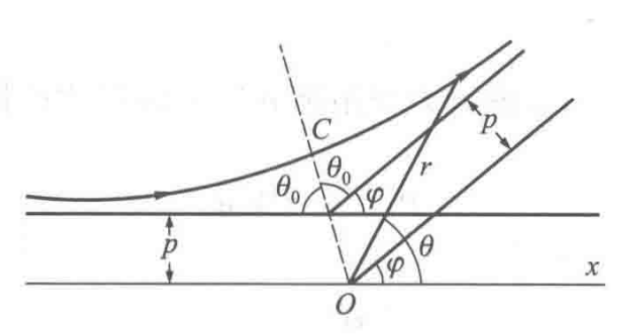

现在来求$\alpha$粒子散射时的轨道方程．根据上面的讨论，我们只要用$k'$代替$-k^2m$，就可以从式（1.9.16）或式（1.9.23）得出$\alpha$粒子散射时的轨道方程．但是为了便于计算偏转角$\varphi$和易于阐述其中一些量的物理意义，我们还是从比耐公式出发，并把通解写成正弦和余弦的组合，即

$$
u=\frac{1}{r}=A\cos\theta+B\sin\theta+C_1 \qquad (1.9.50)
$$

式中$C_1=-\frac{k'}{mh^2}$，而$A$及$B$则是两个积分常数，可按下法定出．由图 1.9.4，当$\theta=\pi$时，$r=\infty,u=0$．把这关系代入式（1.9.50），得

$$
A=C_1 \qquad (1.9.51)
$$

又轨道上任一点纵坐标$y=r\sin\theta$，或

$$
\frac{1}{y}=\frac{1}{r\sin\theta}=\frac{u}{\sin\theta}
$$

即

$$
u=\frac{\sin\theta}{y} \qquad (1.9.52)
$$

把式（1.9.52）代入式（1.9.50），得

$$
\frac{1}{y}=\frac{C_1(1+\cos\theta)}{\sin\theta}+B \qquad (1.9.53)
$$

当$\theta=\pi$时，纵坐标$y$等于从力心到双曲线渐近线所作的垂线的距离$\rho$，这个距离叫做**瞄准距离**，因此

$$
B=\frac{1}{\rho} \qquad (1.9.54)
$$

这样，式（1.9.50）可写为

$$
u=C_1(1+\cos\theta)+\frac{1}{\rho}\sin\theta \qquad (1.9.55)
$$

$\alpha$粒子的偏转角$\varphi$是当$\alpha$粒子远离力心后$\theta$的值．此时，$r$又等于$\infty$，$u$又等于0．因此，从式（1.9.55），我们有

$$
-\frac{1}{C_1\rho}=\frac{1+\cos\varphi}{\sin\varphi}=\cot\frac{\varphi}{2}
$$

如果把$C_1=-k'/mh^2$代入上式，则得

$$
\cot\frac{\varphi}{2}=\frac{mh^2}{k'\rho} \qquad (1.9.56)
$$

设无穷远处$\alpha$粒子的速度为$v_\infty$．显然，在无穷远处，动量矩$mh=mr(r\dot{\theta})=m\rho v_\infty$，故$h=\rho v_\infty$，得

$$
\cot\frac{\varphi}{2}=\frac{m\rho v_\infty^2}{k'} \qquad (1.9.57)
$$

或

$$
\rho=\frac{k'}{mv_\infty^2}\cot\frac{\varphi}{2} \qquad (1.9.58)
$$

这就是$\alpha$粒子的瞄准距离$\rho$和$\alpha$粒子飞过力心后所发生的偏转角$\varphi$之间的关系．不过这个式子对单个粒子来说是很难以实验验证的，所以还要对式（1.9.58）加以修改，使其能进行实验上的验证．

令一束平行的具有相同速度的$\alpha$粒子轰击薄金属箔．在粒子束中，不同的粒子有着不同的瞄准距离，因而它们在飞过力心以后所发生的偏转角$\varphi$也将不同．我们用$\mathrm{d}N$表示单位时间内在$\varphi$和$\varphi+\mathrm{d}\varphi$角度内所散射的粒子数．但这一数目不便于描述散射过程的特性，因为它依赖于入射粒子束的密度．因此，我们引入下列关系式：

$$
\mathrm{d}\sigma=\frac{\mathrm{d}N}{n} \qquad (1.9.59)
$$

来代替$\mathrm{d}N$，其中$n$是在单位时间内通过垂直于粒子束的单位截面积的粒子数，$\mathrm{d}\sigma$则具有面积的量纲，叫做散射截面，它完全由散射场的形式所决定，并可通过式（1.9.59）右边测出，是散射过程中的一个重要的物理量．

如果散射角是瞄准距离单调下降的函数，则在散射区间$\varphi$和$\varphi+\mathrm{d}\varphi$内所散射的，只是其瞄准距离为$\rho(\varphi)$和$\rho(\varphi)+\mathrm{d}\rho(\varphi)$的粒子．这种粒子的数目等于$n$与半径为$\rho$和$\rho+\mathrm{d}\rho$的两圆周间环形面积的乘积（图1.9.5），即$\mathrm{d}N=2\pi\rho\mathrm{d}\rho\cdot n$．所以，散射截面

$$
\mathrm{d}\sigma=2\pi\rho\mathrm{d}\rho
$$

或

$$
\mathrm{d}\sigma=-2\pi\rho(\varphi)\frac{\mathrm{d}\rho(\varphi)}{\mathrm{d}\varphi}\mathrm{d}\varphi\text{①} \qquad (1.9.60)
$$

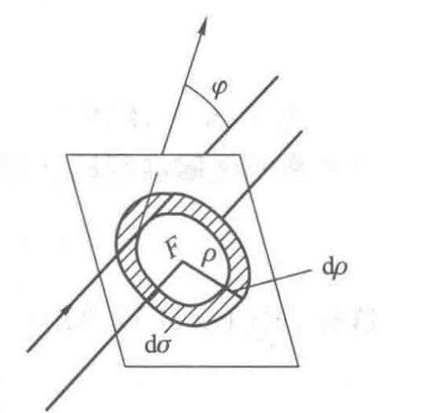

现在，把式（1.9.58）代入式（1.9.60）中，以消去$\rho$，便得到

$$
\mathrm{d}\sigma=\frac{1}{4}\left(\frac{k'}{mv_\infty^2}\right)^2\frac{2\pi\sin\varphi}{\sin^4\left(\frac{\varphi}{2}\right)}\mathrm{d}\varphi \qquad (1.9.61)
$$

这就是著名的卢瑟福公式，是卢瑟福在1911年首先推导出来的，后来为盖革及马士登用实验所证实（1913年）．根据实验，当$\alpha$粒子接近较重原子核到达$10^{-14}\,\mathrm{m}$时，上述关系和实验结果仍基本符合．由此可以看出：原子（原子尺度为$10^{-10}\,\mathrm{m}$）中的原子核确实集中在$10^{-14}\,\mathrm{m}$一个很小的区域内，与卢瑟福预期的结果一致．在非相对论量子力学中，散射截面与用经典力学所得的结果相同．

> ① 因$\rho$增加，$\varphi$减小，故冠负号．

## 小结

Ⅰ．运动的描述方法

1. 参考系——描述物体运动时被选作参考的另一物体叫参考系．

2. 运动与静止——相对于参考坐标系而言，运动质点的坐标是时间$t$的函数，如质点坐标为常数，则为静止．

3. 运动学方程

a. 矢量形式　　$\boldsymbol{r}=\boldsymbol{r}(t)$

b. 坐标形式

(i) 直角坐标　　$x=f_1(t)$，$y=f_2(t)$，$z=f_3(t)$

(ii) 平面极坐标　　$r=r(t)$，$\theta=\theta(t)$

4. 轨道——运动质点在空间一连串所占据的点形成的连续曲线，其方程可由上述运动学方程消去$t$而得．

Ⅱ．速度与加速度

1. 矢量形式　　$\boldsymbol{v}=\frac{\mathrm{d}\boldsymbol{r}}{\mathrm{d}t}$，$\boldsymbol{a}=\frac{\mathrm{d}\boldsymbol{v}}{\mathrm{d}t}=\frac{\mathrm{d}^2\boldsymbol{r}}{\mathrm{d}t^2}$

2. 分量形式（平面）

| | 速度 | 加速度 |
|---|---|---|
| 轴向 | $\dot{x}$，$\dot{y}$ | $\ddot{x}$，$\ddot{y}$ |
| 径向 | $\dot{r}$ | $\ddot{r}-r\dot{\theta}^2$ |
| 横向 | $r\dot{\theta}$ | $\frac{1}{r}\frac{\mathrm{d}}{\mathrm{d}t}(r^2\dot{\theta})$ |
| 切向 | $\dot{s}$ | $\ddot{s}$ 或 $v\frac{\mathrm{d}v}{\mathrm{d}s}$ |
| 法向 | $0$ | $\frac{v^2}{\rho}$ |

Ⅲ．平动参考系

1. 匀速直线运动参考系

$$
\boldsymbol{v}=\boldsymbol{v}_0+\boldsymbol{v}'\quad(\text{绝对速度}=\text{牵连速度}+\text{相对速度})
$$

$$
\boldsymbol{a}=\boldsymbol{a}'\quad(\text{绝对加速度}=\text{相对加速度})
$$

2. 加速直线运动参考系

$$
\boldsymbol{v}=\boldsymbol{v}_0+\boldsymbol{v}'
$$

$$
\boldsymbol{a}=\boldsymbol{a}_0+\boldsymbol{a}'\quad(\text{绝对加速度}=\text{牵连加速度}+\text{相对加速度})
$$

Ⅳ．质点运动微分方程

1. 自由质点

a. 矢量形式

$$
m\ddot{\boldsymbol{r}}=\boldsymbol{F}(\boldsymbol{r},\dot{\boldsymbol{r}},t)
$$

b. 分量形式

(i) 直角坐标

$$
m\ddot{x}=F_x,\quad m\ddot{y}=F_y,\quad m\ddot{z}=F_z
$$

(ii) 平面极坐标

$$
m(\ddot{r}-r\dot{\theta}^2)=F_r,\quad \frac{m}{r}\frac{\mathrm{d}}{\mathrm{d}t}(r^2\dot{\theta})=F_\theta
$$

2. 非自由质点——取消约束，代以约束反作用力，就可把非自由质点视为自由质点，再和约束方程联立求解．

3. 理想线约束——用下列内禀方程，并用约束方程求$\rho$．

$$
m\frac{\mathrm{d}v}{\mathrm{d}t}=F_t,\quad \frac{mv^2}{\rho}=F_n+R_n,\quad 0=F_b+R_b
$$

Ⅴ．非惯性参考系

1. 牛顿运动定律能成立的参考系叫做惯性参考系．

2. 牛顿运动定律不能成立的参考系叫做非惯性参考系．

3. 对非惯性参考系，只要加上适当的惯性力，则牛顿运动定律就“仍然”可以成立．

4. 相对于惯性参考系作加速平动的参考系所要加的惯性力为$(-m\boldsymbol{a}_0)$，$m$是质点的质量，$\boldsymbol{a}_0$是牵连加速度．

Ⅵ．功与能

1. 功$=W=\int_A^B\boldsymbol{F}\cdot\mathrm{d}\boldsymbol{r}=\int_A^B F_x\mathrm{d}x+F_y\mathrm{d}y+F_z\mathrm{d}z$是一个线积分，其值一般随其路径而异．

2. 能——物体作功的本领，功是能量变化的量度．

3. 动能　$T=\frac{1}{2}mv^2$，$m$是质点的质量，$v$是质点运动的速度．

4. 势能

如$\boldsymbol{F}=-\nabla V$，则力所作的功与路径无关，只与两端点的位置有关，这种力叫做保守力，在保守力场中，函数$V(x,y,z)$就是质点在$(x,y,z)$点上相对于某一规定零点的势能．

Ⅶ．质点动力学的几个基本定理与基本守恒定律

1. 动量定理与动量守恒定律

a. 动量=质量×速度$=m\boldsymbol{v}=\boldsymbol{p}$；

b. 动量定理　$\frac{\mathrm{d}\boldsymbol{p}}{\mathrm{d}t}=\frac{\mathrm{d}}{\mathrm{d}t}(m\boldsymbol{v})=\boldsymbol{F}$；

c. 动量守恒定律　$\boldsymbol{F}=0$，$\boldsymbol{p}=$常矢量，或$\dot{x}=C_1$，$\dot{y}=C_2$，$\dot{z}=C_3$．

2. 动量矩定理与动量矩守恒定律

a. 动量矩

(i) 对于一点的动量矩$\boldsymbol{J}=\boldsymbol{r}\times\boldsymbol{p}$；

(ii) 对于一直线的动量矩——先求对线上任意一点的动量矩，再将其投影到该线上即可，如$J_z=\boldsymbol{k}\cdot\boldsymbol{r}\times\boldsymbol{p}$．

b. 力矩　$\boldsymbol{M}=\boldsymbol{r}\times\boldsymbol{F}$

c. 动量矩定理

$$
\frac{\mathrm{d}\boldsymbol{J}}{\mathrm{d}t}=\boldsymbol{M}=\boldsymbol{r}\times\boldsymbol{F}
$$

或

$$
\begin{cases}
\frac{\mathrm{d}}{\mathrm{d}t}[m(y\dot{z}-z\dot{y})]=yF_z-zF_y\\
\frac{\mathrm{d}}{\mathrm{d}t}[m(z\dot{x}-x\dot{z})]=zF_x-xF_z\\
\frac{\mathrm{d}}{\mathrm{d}t}[m(x\dot{y}-y\dot{x})]=xF_y-yF_x
\end{cases}
$$

d. 动量矩守恒定律

当$\boldsymbol{M}=0$，则　$\boldsymbol{J}=$常矢量

或　$y\dot{z}-z\dot{y}=C_4$，$z\dot{x}-x\dot{z}=C_5$，$x\dot{y}-y\dot{x}=C_6$

3. 动能定理与机械能守恒定律

a. 动能定理

$$
\mathrm{d}\left(\frac{1}{2}mv^2\right)=\boldsymbol{F}\cdot\mathrm{d}\boldsymbol{r}
$$

b. 机械能守恒定律——对保守力成立，$T+V=E$．

4. 各守恒定律都是运动微分方程的第一积分，至于诸常数则由起始条件决定．

Ⅷ．有心力

1. 力心——作用力恒通过的某一定点叫力心．

2. 一般性质

a. 有心力$F(r)$是保守力．

b. 有心力的动量矩守恒，$mr^2\dot{\theta}=mh$，即$r^2\dot{\theta}=h=$常数，如为直角坐标系，则$x\dot{y}-y\dot{x}=h$．

c. 质点受有心力作用，必在一平面上运动，这时用极坐标较方便．

3. 轨道微分方程（比耐公式）

$$
h^2u^2\left(\frac{\mathrm{d}^2u}{\mathrm{d}\theta^2}+u\right)=-\frac{F}{m},\quad u=\frac{1}{r}
$$

4. 平方反比引力——行星的运动

轨道方程——圆锥曲线，且原点在力心上．

$$
r=\frac{h^2/k^2}{1+\sqrt{1+2h^2E/k^4m}\,[\cos(\theta-\theta_0)]}
$$

故偏心率$e=\sqrt{1+\frac{2E}{m}(h/k)^2}$，以此与圆锥曲线的标准式相比较，知$E<0$，$e<1$，轨道为椭圆；$E=0$，$e=1$，轨道为抛物线；$E>0$，$e>1$，轨道为双曲线．

5. 开普勒定律

a. 行星绕太阳作椭圆运动，太阳位于其中的一个焦点上．

b. 行星和太阳之间的连线（径矢），在相等时间内所扫过的面积相等．

c. 行星运行时，周期的平方和轨道的半长轴的立方成正比．

6. 万有引力定律——可由牛顿定律和开普勒三定律推出．

7. 宇宙速度

a. 第一宇宙速度$v_1=\sqrt{gr}\approx7.9\ \mathrm{km/s}$，绕地球转．

b. 第二宇宙速度$v_2=\sqrt{2gr}\approx11.2\ \mathrm{km/s}$，脱离地球的最小速度．

c. 第三宇宙速度$v_3\approx16.7\ \mathrm{km/s}$，脱离太阳系的最小速度．

8. 圆形轨道稳定性的判据

$$
\frac{uP'}{P}<3\text{，式中}\ u=\frac{1}{r},\ P=-\frac{F}{m},\ P'=\frac{\mathrm{d}P}{\mathrm{d}u}\text{．}
$$

9. 平方反比斥力——$\alpha$粒子的散射

a. 轨道为双曲线的一支，力心在轨道凸的一边，与引力的情形不同．

b. 瞄准距离$\rho$和偏转角$\varphi$之间的关系

$$
\rho=\frac{k'}{mv_\infty^2}\cot\frac{\varphi}{2}
$$

c. 卢瑟福公式——用散射截面$\mathrm{d}\sigma$代$\rho$

$$
\mathrm{d}\sigma=\frac{1}{4}\left(\frac{k'}{mv_\infty^2}\right)^2\frac{2\pi\sin\varphi}{\sin^4(\varphi/2)}\mathrm{d}\varphi
$$

## 补充例题

**1.1**　一根杆子穿过可绕定点$B$转动的套管，杆的$A$端以匀速$c$沿固定直线$Ox$滑动．求杆上$M$点的轨道方程、速度及加速度，以角$\varphi$的函数表示，设$AM=OB=d$．

[解]　$x=CM=ON=OA-NA=d\cot\varphi-d\cos\varphi \qquad (1)$

$$
y=NM=d\sin\varphi \qquad (2)
$$

即

$$
x=d\cos\varphi\left(\frac{1}{\sin\varphi}-1\right)=d\cos\varphi\left(\frac{d}{y}-1\right)
$$

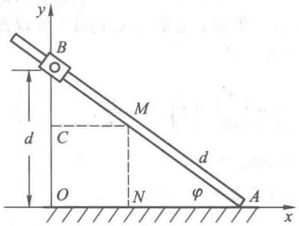

故

$$
\cos\varphi=\frac{x}{d\left(\frac{d}{y}-1\right)}
$$

而

$$
\sin\varphi=\frac{y}{d}
$$

消去$\varphi$，得$M$点的轨道方程为

$$
\frac{x^2}{d^2\left(\frac{d}{y}-1\right)^2}+\frac{y^2}{d^2}=1
$$

$$
\frac{x^2y^2}{d^2(d-y)^2}+\frac{y^2}{d^2}=1
$$

$$
x^2y^2+y^2(d-y)^2=d^2(d-y)^2
$$

即

$$
x^2y^2+(y^2-d^2)(d-y)^2=0 \qquad (3)
$$

这就是所求的$M$点的轨道方程．

欲求速度$v$，应先求$\dot{x}$及$\dot{y}$．由(1)式及(2)式，得

$$
\dot{x}=-d\dot{\varphi}\csc^2\varphi+d\dot{\varphi}\sin\varphi \qquad (4)
$$

$$
\dot{y}=d\dot{\varphi}\cos\varphi \qquad (5)
$$

$\dot{\varphi}$之值可自题中所给的条件求出，即由已知$A$点的速度求出．因

$$
x_A=d\cot\varphi
$$

故

$$
\dot{x}_A=-d\dot{\varphi}\csc^2\varphi=c
$$

由此得出

$$
\dot{\varphi}=-\frac{c}{d\csc^2\varphi}=-\frac{c}{d}\sin^2\varphi \qquad (6)
$$

把(6)式$\dot{\varphi}$之值代入(4)式及(5)式，得

$$
\dot{x}=c-c\sin^3\varphi,\quad \dot{y}=-c\cos\varphi\sin^2\varphi \qquad (7)
$$

由此可求出

$$
\begin{aligned}
v&=\sqrt{\dot{x}^2+\dot{y}^2}=\left[(c-c\sin^3\varphi)^2+(-c\cos\varphi\sin^2\varphi)^2\right]^{\frac{1}{2}}\\
&=c\left(1-2\sin^3\varphi+\sin^6\varphi+\cos^2\varphi\sin^4\varphi\right)^{\frac{1}{2}}\\
&=c\sqrt{1-2\sin^3\varphi+\sin^4\varphi} \qquad (8)
\end{aligned}
$$

欲求加速度$a$，应先求$\ddot{x}$及$\ddot{y}$．（能否由$\frac{\mathrm{d}v}{\mathrm{d}t}$求出，何故?）利用式(7)，我们可以得到：

$$
\begin{aligned}
\ddot{x}&=-3c\dot{\varphi}\sin^2\varphi\cos\varphi=-3c\sin^2\varphi\cos\varphi\left(-\frac{c}{d}\sin^2\varphi\right)\\
&=\frac{3c^2}{d}\sin^4\varphi\cos\varphi \qquad (9)
\end{aligned}
$$

$$
\begin{aligned}
\ddot{y}&=-2c\dot{\varphi}\sin\varphi\cos^2\varphi+c\dot{\varphi}\sin^3\varphi=c\sin\varphi(\sin^2\varphi-2\cos^2\varphi)\left(-\frac{c}{d}\sin^2\varphi\right)\\
&=-\frac{c^2}{d}\sin^3\varphi(\sin^2\varphi-2\cos^2\varphi) \qquad (10)
\end{aligned}
$$

由此可求出

$$
\begin{aligned}
a&=\sqrt{\ddot{x}^2+\ddot{y}^2}\\
&=\frac{c^2}{d}\sin^3\varphi\left(9\sin^2\varphi\cos^2\varphi+\sin^4\varphi-4\sin^2\varphi\cos^2\varphi+4\cos^4\varphi\right)^{\frac{1}{2}}\\
&=\frac{c^2}{d}\sin^3\varphi\left(3\sin^2\varphi\cos^2\varphi+1+3\cos^4\varphi\right)^{\frac{1}{2}}\\
&=\frac{c^2}{d}\sin^3\varphi\sqrt{1+3\cos^2\varphi} \qquad (11)
\end{aligned}
$$

故$M$点的速度及加速度由(8)式及(11)式给出．

**1.2**　有一划平面曲线轨迹的点，其速度在$y$轴上的投影于任何时刻均为常数$c$．试证在此情形下，加速度的量值可用下式表示：

$$
a=\frac{v^3}{c\rho}
$$

式中$v$为点的速度，$\rho$为轨迹的曲率半径．

[解]　由$\dot{x}^2+\dot{y}^2=v^2$得

$$
v^2=\dot{x}^2+c^2 \qquad (1)
$$

求(1)式对时间$t$的微商，得

$$
v\frac{\mathrm{d}v}{\mathrm{d}t}=\dot{x}\ddot{x}=a\dot{x}\quad\text{（因}\ \dot{y}=c\text{，}\ddot{y}=0\text{，故}\ \ddot{x}=a\text{）}
$$

由此得出

$$
\frac{\mathrm{d}v}{\mathrm{d}t}=\frac{a\dot{x}}{v}=\frac{a\sqrt{v^2-c^2}}{v} \qquad (2)
$$

但

$$
\left(\frac{\mathrm{d}v}{\mathrm{d}t}\right)^2=a^2-a_n^2=a^2-\left(\frac{v^2}{\rho}\right)^2 \qquad (3)
$$

比较(2)式和(3)式，得

$$
\frac{a^2(v^2-c^2)}{v^2}=a^2-\frac{v^4}{\rho^2}
$$

$$
a^2v^2-a^2c^2=a^2v^2-\frac{v^6}{\rho^2}
$$

$$
a^2c^2=\frac{v^6}{\rho^2}
$$

即

$$
a=\frac{v^3}{c\rho} \qquad (4)
$$

这就是所要求的关系．

**1.3**　一质点用一轻的弹性绳系于固定点$A$，绳的固有长度为$a$．当悬挂质点平衡后，绳的长度为$a+b$．今令质点从$A$处自静止状态开始下降，试讨论质点在$BD$间的运动规律．并求质点从$A$落至最低点$D$（开始返回）的位置及所需的时间．

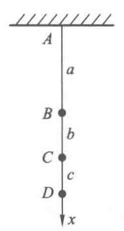

[解]　先求$D$点的位置．设$AB=a$，$BC=b$，$CD=c$，并以$B$点为$x$轴的原点，则由功能关系，我们有

$$
mg(a+b+c)=\int_0^{b+c}kx\mathrm{d}x=\frac{1}{2}k(b+c)^2 \qquad (1)
$$

式中$k$为弹性绳的劲度系数．但依胡克定律，我们又有

$$
mg=kb \qquad (2)
$$

故(1)式变为　$mg(a+b+c)=\frac{1}{2}\frac{mg}{b}(b+c)^2$

由此得

$$
c=\sqrt{b^2+2ab}
$$

故$D$在$A$下方$a+b+\sqrt{b^2+2ab}$处．

现在来求质点在$BD$间的运动规律．当质点从$A$到达$B$时，因系自由落体，故有

$$
v_B=\sqrt{2ga} \qquad (3)
$$

质点过$B$后，受弹性力及重力的作用而运动．因为重力和弹性力都是保守力，所以质点从$B$点运动到$D$又回到$B$点即振动一周后，质点仍具有原先的速度量值（$|v_B|=\sqrt{2ga}$），但方向向上（若空气阻力不计）．过$B$点以后，由于弹性绳失去作用，质点又只受重力的作用而运动．所以以$B$点分界，运动具有不同的性质．本题只要求讨论$BD$间的运动，故可以$B$为原点，$BD$为$x$轴，则质点在$BD$间的运动微分方程可写为

$$
m\ddot{x}=mg-kx\quad(x\geqslant 0) \qquad (4)
$$

即

$$
\frac{\mathrm{d}^2}{\mathrm{d}t^2}\left(x-\frac{mg}{k}\right)+\frac{k}{m}\left(x-\frac{mg}{k}\right)=0 \qquad (5)
$$

令$x-\frac{mg}{k}=x-b=\xi$，$\frac{k}{m}=\frac{g}{b}=\omega^2$，则(5)式变为

$$
\ddot{\xi}+\omega^2\xi=0 \qquad (6)
$$

(6)式是标准的谐振动方程，故其通解为

$$
\xi=A'\cos(\omega t+\varepsilon) \qquad (7)
$$

式中$A'$及$\varepsilon$是两积分常数．$A'$代表振幅，即最大位移，故应等于$c$；而$\varepsilon$则可由谐振动的起始条件决定．为简单起见，只考虑质点从$B$运动到$D$所需的时间．由(7)式可得

$$
\dot{\xi}=-c\omega\sin(\omega t+\varepsilon) \qquad (8)
$$

设当$t=0$，$x_0=0$，故$\xi_0=-b$；又$\dot{\xi}_0=v_B=\sqrt{2ga}$，把它们代入(7)式及(8)式，得

$$
-b=c\cos\varepsilon,\quad \sqrt{2ga}=-c\omega\sin\varepsilon
$$

即

$$
\tan\varepsilon=\frac{\sqrt{2ga}}{\omega b}=\sqrt{\frac{2a}{b}}
$$

因

$$
\sin\varepsilon<0,\quad \cos\varepsilon<0
$$

故

$$
\varepsilon=\arctan\sqrt{\frac{2a}{b}}+\pi \qquad (9)
$$

由此得质点在$BD$间的运动规律为

$$
x=\xi+b=c\cos\left(\sqrt{\frac{g}{b}}t+\arctan\sqrt{\frac{2a}{b}}+\pi\right)+b \qquad (10)
$$

再求从$A$到$D$所需的时间．这时整个运动可分为两部分：

(1) 从$A$到$B$为自由落体，故所需的时间为$\sqrt{\frac{2a}{g}}$；

(2) 从$B$到$D$为谐振动，且至$D$返回，$x=b+c$，故所需时间为$\omega t+\varepsilon=2\pi$，即

$$
t=\frac{2\pi-\varepsilon}{\omega}=\sqrt{\frac{b}{g}}(2\pi-\varepsilon)=\sqrt{\frac{b}{g}}\left(\pi-\arctan\sqrt{\frac{2a}{b}}\right)
$$

所以从$A$到$D$所需的总时间为

$$
\sqrt{\frac{2a}{g}}+\sqrt{\frac{b}{g}}\left(\pi-\arctan\sqrt{\frac{2a}{b}}\right)
$$

**1.4**　一质点穿在一光滑抛物线轴线上方$h$处，并从此处无初速地滑下，抛物线的方程为$y^2=2px$，式中$p$为一常数．问滑至何处，曲线对质点的反作用力将改变符号？

[解]　由式(1.5.5)，知质点运动微分方程为

$$
mv\frac{\mathrm{d}v}{\mathrm{d}s}=mg\sin\theta \qquad (1)
$$

$$
m\frac{v^2}{\rho}=mg\cos\theta-F_N \qquad (2)
$$

由(1)式　$mv\frac{\mathrm{d}v}{\mathrm{d}s}=-mg\frac{\mathrm{d}y}{\mathrm{d}s}$

两侧同乘以$\mathrm{d}s$，并积分，得

$$
\int_0^v v\mathrm{d}v=-g\int_h^y\mathrm{d}y
$$

即

$$
v^2=2g(h-y) \qquad (3)
$$

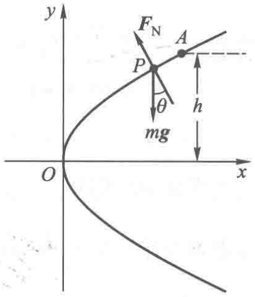

在$F_N=0$处，反作用力将改号；由(2)式知当

$$
\frac{mv^2}{\rho}=mg\cos\theta
$$

时，$F_N=0$，反作用力将改号．

但由高等数学知$\frac{1}{\rho}=\frac{|y''|}{(1+y'^2)^{3/2}}$，式中

$$
y'=\frac{\mathrm{d}y}{\mathrm{d}x},\quad y''=\frac{\mathrm{d}^2y}{\mathrm{d}x^2} \qquad (4)
$$

令抛物线方程为

$$
y^2=2px
$$

故

$$
y'=\frac{p}{y},\quad y''=-\frac{p}{y^2}y'=-\frac{p^2}{y^3}
$$

把$y'$及$y''$之值代入(4)式，得

$$
\frac{1}{\rho}=\frac{\left|-p^2/y^3\right|}{\left[1+(p/y)^2\right]^{3/2}}=\frac{p^2}{(p^2+y^2)^{3/2}} \qquad (5)
$$

又

$$
\cos\theta=\frac{1}{\sqrt{1+\tan^2\theta}}=\frac{1}{\sqrt{1+y'^2}}=\frac{1}{\sqrt{1+(p/y)^2}}=\frac{y}{\sqrt{p^2+y^2}} \qquad (6)
$$

令$N=0$，并把(3)、(5)及(6)式中的$v^2$、$\frac{1}{\rho}$及$\cos\theta$的值代入(2)式，得$F_N$改号时的条件为

$$
m\frac{2g(h-y)p^2}{(p^2+y^2)^{3/2}}=mg\frac{y}{\sqrt{p^2+y^2}}
$$

$$
\frac{2p^2(h-y)}{p^2+y^2}=y
$$

$$
y^3+3p^2y-2p^2h=0
$$

即改号处的$y$为方程$y^3+3p^2y-2p^2h=0$的根．

**1.5**　质量为$m$的质点$A$，在光滑的水平桌面上运动．在此质点上系着一根轻的绳子，绳子穿过桌面上一小孔$O$，另一端挂一相同的质点$B$．若质点$A$在桌面上离$O$点为$a$的地方，沿垂直于$OA$的方向以速度$\left(\frac{9}{2}ga\right)^{\frac{1}{2}}$射出，证明此质点在以后的运动中离$O$点的距离必在$a$及$3a$之间．

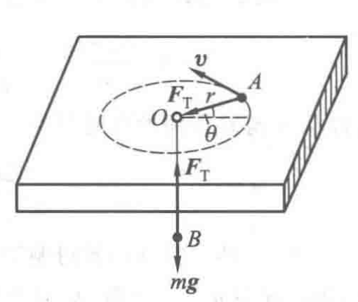

[解]　采用隔离物体法，并采用极坐标系，则质点$A$及$B$的运动微分方程分别为

$$
\begin{cases}
m(\ddot{r}-r\dot{\theta}^2)=-F_T \qquad (1)\\
mr^2\dot{\theta}=mh \qquad (2)
\end{cases}
\quad(A\text{点})
$$

$$
F_T-mg=m\ddot{r}\quad(B\text{点}) \qquad (3)
$$

由(1)式及(3)式得

$$
2\ddot{r}-r\dot{\theta}^2=-g \qquad (4)
$$

又由题给条件知$h=r(r\dot{\theta})=a\left(\frac{9}{2}ga\right)^{\frac{1}{2}}$，故

$$
h^2=\frac{9}{2}ga^3 \qquad (5)
$$

利用(2)式，把(4)式中的$\dot{\theta}$消去，得

$$
2\ddot{r}=\frac{h^2}{r^3}-g \qquad (6)
$$

积分，得

$$
\dot{r}^2=-\frac{1}{2}\frac{h^2}{r^2}-gr+C \qquad (7)
$$

因

$$
r=a,\ \dot{r}=0\text{，故}\ C=\frac{1}{2}\frac{h^2}{a^2}+ga
$$

把$C$的值代入(7)式，得

$$
\begin{aligned}
\dot{r}^2&=\frac{1}{2}\frac{h^2}{a^2}-\frac{1}{2}\frac{h^2}{r^2}-gr+ga\\
&=\frac{1}{2}\frac{1}{a^2r^2}(h^2r^2-h^2a^2-2ga^2r^3+2ga^3r^2)\\
&=\frac{1}{2}\frac{1}{a^2r^2}\left(\frac{9}{2}ga^3r^2-\frac{9}{2}ga^5-2ga^2r^3+2ga^3r^2\right)\\
&=\frac{1}{2}\frac{ga^2}{a^2r^2}\left(\frac{13}{2}ar^2-\frac{9}{2}a^3-2r^3\right) \qquad (8)
\end{aligned}
$$

令$\dot{r}=0$，得

$$
2r^3-\frac{13}{2}ar^2+\frac{9}{2}a^3=0 \qquad (9)
$$

即

$$
(r-a)(r-3a)\left(2r+\frac{3}{2}a\right)=0 \qquad (10)
$$

由此得

$$
r=a,\quad r=3a,\quad r=-\frac{3}{4}a \qquad (11)
$$

但后一解不合理，故在题给条件下，质点以后的运动中离$O$点的距离在$a$及$3a$之间．

## 思考题

**1.1**　平均速度与瞬时速度有何不同？在什么情况下，它们一致？

**1.2**　在极坐标系中，$v_r=\dot{r}$，$v_\theta=r\dot{\theta}$．为什么$a_r=\ddot{r}-r\dot{\theta}^2$而非$\ddot{r}$？为什么$a_\theta=r\ddot{\theta}+2\dot{r}\dot{\theta}$而非$r\ddot{\theta}+\dot{r}\dot{\theta}$？你能说出$a_r$中的$-r\dot{\theta}^2$和$a_\theta$中另一个$\dot{r}\dot{\theta}$出现的原因和它们的物理意义吗？

**1.3**　在内禀方程中，$a_n$是怎样产生的？为什么在空间曲线中它总沿着主法线的方向？当质点沿空间曲线运动时，副法线方向的加速度$a_b$等于零，而作用力在副法线方向的分量$F_b$一般不等于零，这是不是违背了牛顿运动定律呢？

**1.4**　在怎样的运动中只有$a_t$而无$a_n$？在怎样的运动中又只有$a_n$而无$a_t$？在怎样的运动中既有$a_t$又有$a_n$？

**1.5**　$\frac{\mathrm{d}r}{\mathrm{d}t}$与$\frac{\mathrm{d}\boldsymbol{r}}{\mathrm{d}t}$有无不同？$\frac{\mathrm{d}v}{\mathrm{d}t}$与$\frac{\mathrm{d}\boldsymbol{v}}{\mathrm{d}t}$有无不同？试就直线运动与曲线运动分别加以讨论．

**1.6**　人以速度$v$向篮球网前进，则当其投篮时应用什么角度投出？跟人静止时投篮有何不同？

**1.7**　雨点以匀速$v$落下，在一有加速度$a$的火车中看，它走什么路径？

**1.8**　某人以一定的功率划船，逆流而上．当船经过一桥时，船上的渔竿不慎掉入河中．两分钟后，此人才发觉，立即返棹追赶．追到渔竿之处是在桥的下游600 m的地方，问河水的流速是多大？

**1.9**　物体运动的速度是否总是和所受的外力的方向一致？为什么？

**1.10**　在哪些条件下，物体可以作直线运动？如果初速度的方向和力的方向不一致，则物体是沿力的方向还是沿初速度的方向运动？试用一具体实例加以说明．

**1.11**　质点仅因重力作用而沿光滑静止曲线下滑，达到任意一点时的速度只和什么有关？为什么是这样？假如不是光滑的又将如何？

**1.12**　为什么质点被约束在一光滑静止的曲线上运动时，约束力不作功？我们利用动能定理或能量积分，能否求出约束力？如不能，应当怎样去求？

**1.13**　质点的质量是1 kg，它运动时的速度是$\boldsymbol{v}=(3\boldsymbol{i}+2\boldsymbol{j}+\sqrt{3}\boldsymbol{k})\ \mathrm{m/s}$，式中$\boldsymbol{i}$、$\boldsymbol{j}$、$\boldsymbol{k}$是沿$x$、$y$、$z$轴上的单位矢量．求此质点的动量和动能的量值．

**1.14**　在上题中，当质点以上述速度运动到$(1,2,3)$点时（坐标轴上的数值以m为单位），它对原点$O$及$z$轴的动量矩各是多少？

**1.15**　动量矩守恒是否就意味着动量也守恒？已知质点受有心力作用而运动时，动量矩是守恒的，问它的动量是否也守恒？

**1.16**　如$\boldsymbol{F}=\boldsymbol{F}(r)$，则在三维直角坐标系中，仍有$\nabla\times\boldsymbol{F}=0$的关系存在吗？试验之．

**1.17**　在平方反比引力问题中，势能曲线应具有什么样的形状？

**1.18**　我国发射的第一颗人造地球卫星的轨道平面和地球赤道平面的交角为$68.5^\circ$，比苏联及美国第一次发射的都要大．我们说，交角越大，技术要求越高，这是为什么？交角大的优点是什么？

**1.19**　卢瑟福公式对库仑引力场来讲也能适用吗？为什么？

## 习题

**1.1**　沿水平方向前进的枪弹，通过某一距离$s$的时间为$t_1$，而通过下一等距离$s$的时间为$t_2$．试证明枪弹的加速度（假定是常量）为

$$
\frac{2s(t_2-t_1)}{t_1t_2(t_1+t_2)}
$$

**1.2**　某船向东航行，速率为15 km/h，在正午经过某一灯塔．另一船以同样速度向北航行，在下午1时30分经过此灯塔．问在什么时候，两船的距离最近？最近的距离是多少？

答：午后零点45分，15.9 km．

**1.3**　曲柄$OA=r$，以匀角速$\omega$绕定点$O$转动．此曲柄借连杆$AB$使滑块$B$沿直线$Ox$运动．求连杆上$C$点的轨道方程及速度．设$AC=CB=a$，$\angle AOB=\varphi$，$\angle ABO=\psi$．

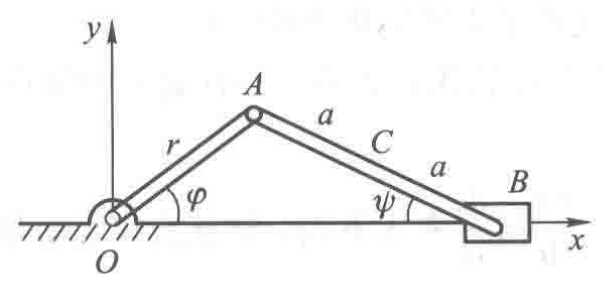

答：轨道方程$4x^2(a^2-y^2)=(x^2+3y^2+a^2-r^2)^2$

速度

$$
v=\frac{r\omega}{2\cos\psi}\sqrt{\cos^2\varphi+4\sin\varphi\cos\varphi\sin(\varphi+\psi)}
$$

**1.4**　细杆$OL$绕$O$点以匀角速$\omega$转动，并推动小环$C$在固定的钢丝$AB$上滑动．图中的$d$为一已知常数，试求小环的速度及加速度的量值．

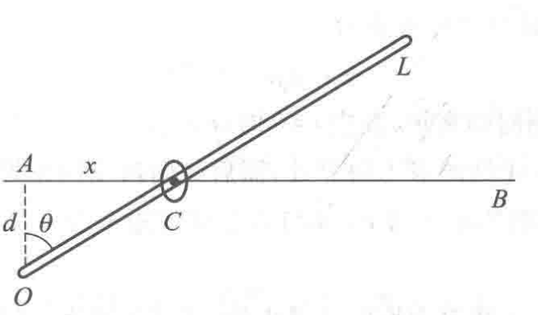

答：$v=d\omega\sec^2\theta=\omega\frac{d^2+x^2}{d}$

$$
a=2d\omega^2\sec^2\theta\tan\theta=2\omega^2x(d^2+x^2)/d^2
$$

**1.5**　矿山升降机作加速度运动时，其变加速度可用下式表示：

$$
a=c\left(1-\sin\frac{\pi t}{2T}\right)
$$

式中$c$及$T$为常数，试求运动开始时间$t$后升降机的速度及其所走过的路程．已知升降机的初速度为零．

答：$v=c\left[t+\frac{2T}{\pi}\left(\cos\frac{\pi t}{2T}-1\right)\right]$

$$
s=c\left[\frac{t^2}{2}+\frac{2T}{\pi}\left(\frac{2T}{\pi}\sin\frac{\pi t}{2T}-t\right)\right]
$$

**1.6**　一质点沿位矢及垂直于位矢的速度分别为$\lambda r$及$\mu\theta$，式中$\lambda$及$\mu$是常数．试证其沿位矢及垂直于位矢的加速度为

$$
\lambda^2r-\frac{\mu^2\theta^2}{r},\quad \mu\theta\left(\lambda+\frac{\mu}{r}\right)
$$

**1.7**　试自

$$
x=r\cos\theta,\quad y=r\sin\theta
$$

出发，计算$\ddot{x}$及$\ddot{y}$．并由此推出径向加速度$a_r$及横向加速度$a_\theta$．

**1.8**　直线$FM$在一给定的椭圆平面内以匀角速$\omega$绕其焦点$F$转动．求此直线与椭圆的交点$M$的速度．已知以焦点为坐标原点的椭圆的极坐标方程为

$$
r=\frac{a(1-e^2)}{1+e\cos\theta}
$$

式中$a$为椭圆的长半轴，$e$为偏心率，都是常数．

答：$v=\frac{r\omega}{b}\sqrt{r(2a-r)}$，式中$b$为椭圆的半短轴．

**1.9**　质点作平面运动，其速率保持为常数．试证其速度矢量$\boldsymbol{v}$与加速度矢量$\boldsymbol{\alpha}$正交．

**1.10**　一质点沿着抛物线$y^2=2px$运动．其切向加速度的量值为法向加速度量值的$-2k$倍．如此质点从正焦弦$\left(\frac{p}{2},p\right)$的一端以速度$u$出发，试求其达到正焦弦另一端时的速率．

答：$v=ue^{-k\pi}$

**1.11**　质点沿着半径为$r$的圆周运动，其加速度矢量与速度矢量间的夹角$\alpha$保持不变．求质点的速度随时间而变化的规律．已知初速度为$v_0$．

答：$\frac{1}{v}=\frac{1}{v_0}-\frac{t}{r}\cot\alpha$

**1.12**　在上题中，试证其速度可表为

$$
v=v_0e^{(\theta-\theta_0)\cot\alpha}
$$

式中$\theta$为速度矢量与$x$轴间的夹角，且当$t=0$时，$\theta=\theta_0$．

**1.13**　假定一飞机从$A$处向东飞到$B$处，而后又向西飞回原处．飞机相对于空气的速度为$v'$，而空气相对于地面的速度则为$v_0$．$A$与$B$之间的距离为$l$．飞机相对于空气的速率$v'$保持不变．

(1) 假定$v_0=0$，即空气相对于地面是静止的，试证来回飞行的总时间为

$$
t_0=\frac{2l}{v'}
$$

(2) 假定空气速度为向东(或向西)，试证来回飞行的总时间为

$$
t_B=\frac{t_0}{1-v_0^2/v'^2}
$$

(3) 假定空气的速度为向北(或向南)，试证来回飞行的总时间为

$$
t_N=\frac{t_0}{\sqrt{1-v_0^2/v'^2}}
$$

**1.14**　一飞机在静止空气中速率为100 km/h．如果飞机沿每边为6 km的正方形飞行，且风速为28 km/h，方向与正方形的某两边平行，则飞机绕此正方形飞行一周，需时多少？

答：$15\frac{5}{16}\ \mathrm{min}$

**1.15**　当一轮船在雨中航行时，它的雨篷遮着篷的垂直投影后2 m的甲板，篷高4 m．但当轮船停航时，甲板上干湿两部分的分界线却在篷前3 m．如果雨点的速率为8 m/s，求轮船的速率．

答：8 m/s

**1.16**　宽度为$d$的河流，其流速与河流中心到河岸的距离成正比．在河岸处，水流速度为零，在河流中心处流速为$c$．一小船以相对速度$u$沿垂直于水流的方向行驶，求船的轨迹以及船在对岸靠拢的地点．

答：如取船离岸处为原点，$x$轴平行于河流方向，$y$轴和它垂直，则船的轨迹为

$$
x=\frac{c}{ud}y^2\quad\left(y\leqslant\frac{d}{2}\right)
$$

$$
x=\frac{2c}{u}y-\frac{c}{ud}y^2-\frac{cd}{2u}\quad\left(y\geqslant\frac{d}{2}\right)
$$

又靠岸地点为

$$
x=\frac{cd}{2u}
$$

**1.17**　小船$M$被水冲走后，由一荡桨人以不变的相对速度$v_2$朝岸上$A$点划回．假定河流速度$v_1$沿河宽不变，且小船可以看成一个质点，求船的轨迹．

答：如果$M$的初始位置为$r=r_0$，$\varphi=\varphi_0$（参看图1.3.4），并且令

$$
\alpha=\frac{\varphi}{2}
$$

则小船的轨迹方程为

$$
r=r_0\frac{\cos^{k+1}\alpha_0}{\sin^{k-1}\alpha_0}\cdot\frac{\sin^{k-1}\alpha}{\cos^{k+1}\alpha}
$$

式中$k=\frac{v_2}{v_1}$．

**1.18**　一质点自倾角为$\alpha$的斜面的上方$O$点，沿一光滑斜槽$OA$下降．如欲使此质点到达斜面上所需的时间为最短，问斜槽$OA$与竖直线所成之角$\theta$应为何值？

答：$\theta=\frac{\alpha}{2}$

**1.19**　将质量为$m$的质点竖直上抛入有阻力的介质中．设阻力与速度平方成正比，即$R=mk^2gv^2$．如上抛时的速度为$v_0$，试证此质点又落至投掷点时的速度为

$$
v_1=\frac{v_0}{\sqrt{1+k^2v_0^2}}
$$

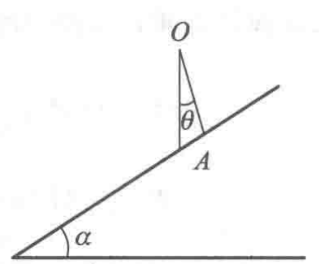

**1.20**　一枪弹以仰角$\alpha$、初速$v_0$自倾角为$\beta$的斜面的下端发射．试证子弹击中斜面的地方和发射点的距离$d$(沿斜面量取)及此距离的最大值分别为

$$
d=\frac{2v_0^2}{g}\frac{\cos\alpha\sin(\alpha-\beta)}{\cos^2\beta}
$$

$$
d_{\max}=\frac{v_0^2}{2g}\sec^2\left(\frac{\pi}{4}-\frac{\beta}{2}\right)
$$

**1.21**　将一质点以初速度$v_0$抛出，$v_0$与水平线所成之角为$\alpha$．此质点所受到的空气阻力为其速度的$mk$倍，$m$为质点的质量，$k$为比例常数．试求当此质点的速度与水平线所成的角又为$\alpha$时所需的时间．

答：$t=\frac{1}{k}\ln\left(1+\frac{2kv_0\sin\alpha}{g}\right)$

**1.22**　如向互相垂直的匀强电磁场$\boldsymbol{E}$、$\boldsymbol{B}$中发射一电子，并设电子的初速度$\boldsymbol{V}$与$\boldsymbol{E}$及$\boldsymbol{B}$垂直．试求电子的运动规律．已知此电子所受的力为$e(\boldsymbol{E}+\boldsymbol{v}\times\boldsymbol{B})$，式中$\boldsymbol{E}$为电场强度，$\boldsymbol{B}$为磁感应强度，$e$为电子所带的电荷，$\boldsymbol{v}$为任一瞬时电子运动的速度．

答：取$\boldsymbol{V}$沿$x$轴，$\boldsymbol{E}$沿$y$轴，$\boldsymbol{B}$沿$z$轴，$m$为电子的质量，则

$$
x=\frac{E}{B}t+\frac{m}{eB}\left(V-\frac{E}{B}\right)\sin\frac{eB}{m}t
$$

$$
y=\frac{m}{eB}\left(V-\frac{E}{B}\right)\cos\frac{eB}{m}t-\frac{mV}{eB}+\frac{mE}{eB^2}
$$

**1.23**　在上题中，如

(1) $\boldsymbol{B}=0$，则电子的轨道为在竖直平面($xy$平面)的抛物线；

(2) 如$\boldsymbol{E}=0$，则电子的轨道为半径等于$\frac{mV}{eB}$的圆．试证明之．

**1.24**　质量为$m$与$2m$的两质点，为一不可伸长的轻绳所联结，绳挂在一光滑的滑轮上．在$m$的下端又用固有长度为$a$、劲度系数$k$为$\frac{mg}{a}$的弹性绳挂上另外一个质量为$m$的质点．在开始时，全体保持竖直，原来的非弹性绳拉紧，而有弹性的绳则处在固有长度上．由此静止状态释放后，求证这运动是简谐的，并求出其振动周期$\tau$及任何时刻两段绳中的张力$F_T$及$F_T'$．

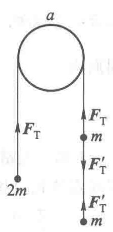答：$\tau=\pi\sqrt{\frac{3a}{g}}$，$F_T=2mg\left(1-\frac{1}{3}\cos2\sqrt{\frac{g}{3a}}t\right)$

$$
T'=mg\left(1-\cos2\sqrt{\frac{g}{3a}}t\right)
$$

**1.25**　滑轮上系一不可伸长的绳，绳上悬一弹簧，弹簧另一端挂一重为$W$的物体．当滑轮以匀速转动时，物体以匀速$v_0$下降．如将滑轮突然停住，试求弹簧的最大伸长及最大张力．假定弹簧受$W$的作用时的静伸长为$\lambda_0$．

答：$\lambda_{\max}=\lambda_0+v_0\sqrt{\frac{\lambda_0}{g}}$

$$
F_{T\max}=W\left(1+\frac{v_0}{\sqrt{g\lambda_0}}\right)
$$

**1.26**　一弹性绳上端固定，下端悬有$m$及$m'$两质点．设$a$为绳的固有长度，$b$为加$m$后的伸长，$c$为加$m'$后的伸长．今将$m'$任其脱离而下坠，试证质点$m$在任一瞬时离上端$O$的距离为$a+b+c\cos\sqrt{\frac{g}{b}}t$．

**1.27**　一质点自一水平放置的光滑固定圆柱面凸面的最高点自由滑下．问滑至何处，此质点将离开圆柱面？假定圆柱体的半径为$r$．

答：设$\theta$为圆柱面的竖直半径与质点和中心连线间所作之角，则当$\theta=\arccos\frac{2}{3}$时，质点离开圆柱面．

**1.28**　重为$W$的小球不受摩擦而沿半长轴为$a$、半短轴为$b$的椭圆弧滑下，此椭圆的短轴是竖直的．如小球自长轴的端点开始运动时，其初速为零，试求小球在到达椭圆的最低点时它对椭圆的压力．

答：$P=W\left(1+2\frac{b^2}{a^2}\right)$

**1.29**　一质量为$m$的质点自光滑圆滚线的尖端无初速地下滑．试证在任何一点的压力为$2mg\cos\theta$，式中$\theta$为水平线和质点运动方向间的夹角．已知圆滚线方程为

$$
x=a(2\theta+\sin2\theta),\quad y=-a(1+\cos2\theta)
$$

**1.30**　在上题中，如圆滚线不是光滑的，且质点自圆滚线的尖端自由下滑，达到圆滚线的最低点时停止运动，则摩擦因数$\mu$应满足下式：

$$
\mu^2e^{\mu\pi}=1
$$

试证明之．

**1.31**　假定单摆在有阻力的介质中振动，并假定振幅很小，故阻力与$\dot{\theta}$成正比，且可写为$R=-2mkl\dot{\theta}$，式中$m$是摆锤的质量，$l$为摆长，$k$为比例常数．试证当$k^2<\frac{g}{l}$时，单摆的振动周期为

$$
\tau=2\pi\sqrt{\frac{l}{g-k^2l}}
$$

**1.32**　光滑楔子以匀加速度$a_0$沿水平面运动．质量为$m$的质点沿楔子的光滑斜面滑下．求质点的相对加速度$a'$和质点对楔子的压力$P$．

答：$a'=g\sin\theta\mp a_0\cos\theta$

$$
P=mg\left(\cos\theta\mp\frac{a_0}{g}\sin\theta\right)\text{，其中}\theta\text{为楔子的倾角．}
$$

**1.33**　光滑钢丝圆圈的半径为$r$，其平面为竖直的．圆圈上套一小环，其重为$W$．如钢丝圈以匀加速度$a$沿竖直方向运动，求小环的相对速度$v_r$及圈对小环的反作用力$R$．

答：$v_r=\sqrt{v_0^2+2(g\mp a)(\cos\varphi-\cos\varphi_0)r}$

$$
R=\frac{W}{r}\left[\left(1\mp\frac{a}{g}\right)(3\cos\varphi-2\cos\varphi_0)r+\frac{v_0^2}{g}\right]
$$

式中$\varphi$为小环矢径和圆圈竖直向下的半径间的夹角，而$+$号相当于牵连加速度向上．

**1.34**　火车质量为$m$，其功率为常数$k$．如果车所受的阻力$f$为常数，则时间与速度的关系为

$$
t=\frac{mk}{f^2}\ln\frac{k-v_0f}{k-vf}-\frac{m(v-v_0)}{f}
$$

如果$f$和速度$v$成正比，则

$$
t=\frac{mv}{2f}\ln\frac{vk-fv_0^2}{v(k-vf)}
$$

式中$v_0$为初速度，试证明之．

**1.35**　质量为$m$的物体为一锤所击．设锤所加的压力，是均匀地增减的．当在冲击时间$\tau$的一半时，增至极大值$P$，以后又均匀减小至零．求物体在各时刻的速率以及压力所作的总功．

答：$v=\frac{P}{m\tau}t^2\quad\left(t\text{从}0\to\frac{\tau}{2}\right)$

$$
v=\frac{P}{2m\tau}(-\tau^2+4t\tau-2t^2)\quad\left(t\text{从}\frac{\tau}{2}\to\tau\right)
$$

总功为$\frac{1}{8}\frac{P^2\tau^2}{m}$

**1.36**　检验下列的力是否是保守力．如是，则求出其势能．

(1) $F_x=6abz^3y-20bx^3y^2$，$F_y=6abxz^3-10bx^4y$，$F_z=18abxyz^2$；

(2) $\boldsymbol{F}=\boldsymbol{i}F_x(x)+\boldsymbol{j}F_y(y)+\boldsymbol{k}F_z(z)$．

答：(1) $V=5bx^4y^2-6abxyz^3$

(2) $V=-\int_{x_A}^{x}F_x\mathrm{d}x-\int_{y_A}^{y}F_y\mathrm{d}y-\int_{z_A}^{z}F_z\mathrm{d}z$

**1.37**　根据汤川核力理论，中子与质子之间的引力具有如下形式的势能：

$$
V(r)=\frac{ke^{-\alpha r}}{r}\quad(k<0)
$$

试求：

(1) 中子与质子间的引力表达式，并与平方反比定律相比较；

(2) 求质量为$m$的粒子作半径为$a$的圆运动的动量矩$J$及能量$E$．

答：(1) $F=\frac{k(1+\alpha r)e^{-\alpha r}}{r^2}$

(2) $J^2=-mka(1+\alpha a)e^{-\alpha a}$，$E=\frac{k(1-\alpha a)e^{-\alpha a}}{2a}$

**1.38**　已知作用在质点上的力为

$$
\begin{aligned}
F_x&=a_{11}x+a_{12}y+a_{13}z\\
F_y&=a_{21}x+a_{22}y+a_{23}z\\
F_z&=a_{31}x+a_{32}y+a_{33}z
\end{aligned}
$$

式中系数$a_{ij}(i,j=1,2,3)$都是常数．问这些$a_{ij}$应满足什么条件，才有势能存在？如这些条件满足，试计算其势能．

答：$V=-\frac{1}{2}(a_{11}x^2+a_{22}y^2+a_{33}z^2+2a_{12}xy+2a_{23}yz+2a_{31}zx)$

**1.39**　一质点受一与距离$\frac{3}{2}$次方成反比的引力作用在一直线上运动．试证此质点自无穷远到达$a$时的速率和自$a$静止出发到达$\frac{a}{4}$时的速率相同．

**1.40**　一质点受一与距离成反比的引力作用在一直线上运动，质点的质量为$m$，比例系数为$k$．如此质点从距原点$O$为$a$的地方由静止开始运动，求其达到$O$点所需的时间．

答：$t=a\sqrt{\frac{m\pi}{2k}}$

**1.41**　试导出下面有心力量值的公式：

$$
F=\frac{mh^2}{2}\frac{\mathrm{d}p^{-2}}{\mathrm{d}r}
$$

式中$m$为质点的质量，$r$为质点到力心的距离，$h=r^2\dot{\theta}=$常数，$p$为力心到轨道切线的垂直距离．

**1.42**　试利用上题的结果，证明：

(1) 如质点走一圆周，同时力心位于此圆上，则力与距离五次方成反比．

(2) 如质点走一对数螺旋，而其极点即力心，则力与距离立方成反比．

**1.43**　如质点受有心力作用而作双纽线$r^2=a^2\cos2\theta$的运动时，则

$$
F=-\frac{3ma^4h^2}{r^7}
$$

试证明之．

**1.44**　质点所受的有心力如果为

$$
F=-m\left(\frac{\mu^2}{r^2}+\frac{\nu}{r^3}\right)
$$

式中$\mu$及$\nu$都是常数，并且$\nu<h^2$，则其轨道方程可写成

$$
r=\frac{a}{1+e\cos k\theta}
$$

试证明之．式中$k^2=\frac{h^2-\nu}{h^2}$，$a=\frac{k^2h^2}{\mu^2}$，$e=\frac{Ak^2h^2}{\mu^2}$（$A$为积分常数）．

**1.45**　如$\dot{s}_a$及$\dot{s}_p$为质点在远日点及近日点处的速率，试证明

$$
\dot{s}_p:\dot{s}_a=(1+e):(1-e)
$$

**1.46**　质点在有心力作用下运动．此力的量值为质点到力心距离$r$的函数，而质点的速率则与此距离成反比，即$v=\frac{a}{r}$．如果$a^2>h^2(h=r^2\dot{\theta})$，求点的轨道方程．设当$r=r_0$时，$\theta=0$．

答：$\ln\frac{r}{r_0}=\pm\frac{\sqrt{a^2-h^2}}{h}\theta$

**1.47**　(1) 某彗星的轨道为抛物线，其近日点距离为地球轨道(假定为圆形)半径的$\frac{1}{n}$．则此彗星运行时，在地球轨道内停留的时间为一年的

$$
\frac{2}{3\pi}\frac{n+2}{n}\sqrt{\frac{n-1}{2n}}
$$

倍，试证明之．

(2) 试再证任何作抛物线轨道的彗星停留在地球轨道(仍假定为圆形)内的最长时间为一年的$\frac{2}{3\pi}$倍，或约为76日．

**1.48**　我国第一颗人造地球卫星近地点为439 km，远地点为2 384 km，求此卫星在近地点和远地点的速率$v_1$及$v_2$以及它绕地球运行的周期$\tau$．

答：$v_1=8.15\ \mathrm{km/s}$，$v_2=6.34\ \mathrm{km/s}$，$\tau=114\ \mathrm{min}$

**1.49**　在行星绕太阳的椭圆运动中，如令$a-r=ae\cos E$，$\int\frac{2\pi}{\tau}\mathrm{d}t=T$，式中$\tau$为周期，$a$为半长轴，$e$为偏心率，$E$为一个新的参量，在天文学上叫做偏近点角．试由能量方程推出下面的开普勒方程：

$$
T=E-e\sin E
$$

**1.50**　质量为$m$的质点在有心斥力场$\frac{mc}{r^3}$中运动，式中$r$为质点到力心$O$点的距离，$c$为常数．当质点离$O$点很远时，质点的速度为$v_\infty$，而其渐近线与$O$点的垂直距离为$\rho$(即瞄准距离)．试求质点与$O$点的最近距离$a$．

答：$a=\left(\rho^2+\frac{c}{v_\infty^2}\right)^{\frac{1}{2}}$

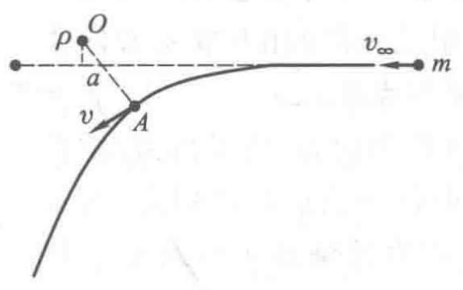
