# 第二章 质点系力学

## §2.1 质点系

### （1）质点系的内力和外力

我们已经研究了单个质点的运动问题，现在进一步研究由大量质点组成的力学体系，并且假定力$\boldsymbol{F}$作用在其中一个质点$A$（图2.1.1）上．很显然，如果$A$与其他质点$B、C、D、\cdots$无任何关系，则$A$受此力后，将按牛顿运动定律开始运动，这是我们在第一章中所讨论过的问题．但是，如果质点间是相互联系着的，运动规律就比较复杂．因$A$开始对其他质点有相对运动时，$A$与其他质点间的作用力（或约束力）将互相发生影响，而使其他质点的运动状态也随之发生变化．我们把由许多（有限或无限）相互联系着的质点所组成的力学体系叫做**质点系**．

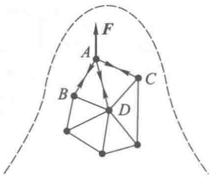

质点系中质点间相互作用的力，叫做内力；质点系以外的物体对质点系内任一质点的作用力，叫做外力．对于机械力来讲，内力是满足牛顿第三定律的，故任何一对质点（例如第$i$个质点和第$j$个质点）间相互作用的力，恒相等而相反并且作用在同一条直线上，即

$$
\boldsymbol{F}_{ij}^{(i)}+\boldsymbol{F}_{ji}^{(i)}=0 \qquad (2.1.1)
$$

式中$\boldsymbol{F}_{ij}^{(i)}$表示第$j$个质点对第$i$个质点的作用力．

如假定某质点系由$n$个质点系成，则质点系中诸内力的总和亦必等于零，即

$$
\boxed{\boldsymbol{F}^{(i)}=\sum_{i=1}^{n}\sum_{\substack{j=1\\ j\neq i}}^{n}\boldsymbol{F}_{ij}^{(i)}=0^{\text{①}}} \qquad (2.1.2)
$$

在力学中，如果一个质点系不受任何外力作用，则叫做孤立系或闭合系．

### （2）质心

根据前面第一章的讨论，我们知道：解决质点动力学问题，一般是从牛顿定律出发，但也可以从几个动力学基本定理出发，特别是在一定条件下，可以直接从守恒定律出发，从而使问题简化．

> ① $\boldsymbol{F}$的上角标括号中的$i$代表“内”．

在质点系动力学中，原则上可以用隔离体法，写出质点系中每一质点的运动微分方程．但如果质点系中的质点数目较多，那么利用牛顿运动定律解题时，每一质点有三个二阶微分方程，故将得出数目繁多的二阶微分方程组，难以进行解算．此外，内力一般是未知量，更增加了问题的复杂性．但如果利用动力学基本定理，则对整个质点系来讲，常可将这些未知的内力消去（动能定理除外，参看§2.4），而得到整个质点系在外力作用下运动的某些特征．本章的主要内容，就是介绍这几个基本定理以及和它们相关的守恒定律．

在对整个质点系运用动力学基本定理时，我们发现：在质点系中恒存在一特殊点，它的运动很容易被确定．如果以这个特殊点作为参考点，又常能使问题简化．我们把这个特殊点叫做质点系的**质量中心**，简称**质心**．

现在来说明这个特殊点的位置是如何定出的．

假定有$n$个质点，它们的质量是$m_1,m_2,\cdots,m_n$，位于$P_1,P_2,\cdots,P_n$诸点，这些点对某一指定的参考点$O$的位矢是$\boldsymbol{r}_1,\boldsymbol{r}_2,\cdots,\boldsymbol{r}_n$，则质心$C$对此同一点的位矢$\boldsymbol{r}_c$满足以下关系：

$$
\boxed{\boldsymbol{r}_c=\overrightarrow{OC}=\frac{\sum_{i=1}^{n}m_i\boldsymbol{r}_i}{\sum_{i=1}^{n}m_i}} \qquad (2.1.3)
$$

从式（2.1.3）可以看出：将各质点的质量乘其位矢并求和，然后除以总质量，显然仍代表一个位矢．这个位矢末端（始端仍在$O$）所确定的一点，定义为质点系的质心．在某种意义上，可以把它看做是诸质点位矢的平均值．只是这种平均并不是简单的平均，而是带有权重的平均，这里的质量相当于权重．

计算质心时，通常把式（2.1.3）写成分量形式．在直角坐标系中，质心的坐标为

$$
x_c=\frac{\sum_{i=1}^{n}m_ix_i}{\sum_{i=1}^{n}m_i},\quad y_c=\frac{\sum_{i=1}^{n}m_iy_i}{\sum_{i=1}^{n}m_i},\quad z_c=\frac{\sum_{i=1}^{n}m_iz_i}{\sum_{i=1}^{n}m_i} \qquad (2.1.4)
$$

如果求出连续性物体的质心，则一般要用重积分来解算．对密度$\rho$为常量的物体来讲，质心和几何中心重合．如重力加速度$\boldsymbol{g}$为常矢量，则质心与重心重合．详细情形，可参看高等数学中的有关章节．

## §2.2 动量定理与动量守恒定律

### （1）动量定理

以前我们只讨论一个质点的动量变化．如果一群质点形成质点系，受外力及内力的作用而运动，其动量变化应具有何种形式？我们现在就来研究这个问题．

假定有一个由$n$个质点所组成的质点系，其中某一个质点$P_i$的质量为$m_i$，对某惯性参考系坐标原点$O$的位矢为$\boldsymbol{r}_i$，作用在质点$P_i$上诸力的合力为$\boldsymbol{F}_i$，则根据上节的讨论，知$\boldsymbol{F}_i$可分为两类：一为内力，以$\boldsymbol{F}_i^{(i)}$表之；另一为外力，以$\boldsymbol{F}_i^{(e)}$表之．由牛顿运动第二定律，得质点$P_i$的运动微分方程为

$$
m_i\frac{\mathrm{d}^2\boldsymbol{r}_i}{\mathrm{d}t^2}=\boldsymbol{F}_i^{(e)}+\boldsymbol{F}_i^{(i)} \qquad (i=1,2,3,\cdots,n) \qquad (2.2.1)
$$

我们可以对质点系中每一质点写出这样的微分方程，一共得到$n$个微分方程．由于内力通常是未知量，所以这些方程无法求解．但如果把这$n$个方程加起来，则得

$$
\sum_{i=1}^{n}m_i\frac{\mathrm{d}^2\boldsymbol{r}_i}{\mathrm{d}t^2}=\sum_{i=1}^{n}\boldsymbol{F}_i^{(e)}+\sum_{i=1}^{n}\boldsymbol{F}_i^{(i)} \qquad (2.2.2)
$$

而由牛顿第三定律知，内力的总和为零［参看式（2.1.2）］，于是式（2.2.2）变为

$$
\sum_{i=1}^{n}m_i\frac{\mathrm{d}^2\boldsymbol{r}_i}{\mathrm{d}t^2}=\sum_{i=1}^{n}\boldsymbol{F}_i^{(e)} \qquad (2.2.3)
$$

因为

$$
\frac{\mathrm{d}\boldsymbol{r}_i}{\mathrm{d}t}=\boldsymbol{v}_i
$$

是质点$P_i$的速度，故对整个质点系而言，有

$$
\sum_{i=1}^{n}m_i\frac{\mathrm{d}^2\boldsymbol{r}_i}{\mathrm{d}t^2}=\frac{\mathrm{d}}{\mathrm{d}t}\sum_{i=1}^{n}\left(m_i\frac{\mathrm{d}\boldsymbol{r}_i}{\mathrm{d}t}\right)=\frac{\mathrm{d}}{\mathrm{d}t}\sum_{i=1}^{n}m_i\boldsymbol{v}_i=\frac{\mathrm{d}\boldsymbol{p}}{\mathrm{d}t}
$$

式中

$$
\boldsymbol{p}=\sum_{i=1}^{n}m_i\boldsymbol{v}_i
$$

是质点系的动量，等于质点系中诸质点动量的矢量和．因此式（2.2.3）可改写为

$$
\boxed{\frac{\mathrm{d}\boldsymbol{p}}{\mathrm{d}t}=\sum_{i=1}^{n}\boldsymbol{F}_i^{(e)}} \qquad (2.2.4)
$$

或

$$
\boxed{\mathrm{d}\boldsymbol{p}=\left(\sum_{i=1}^{n}\boldsymbol{F}_i^{(e)}\right)\mathrm{d}t} \qquad (2.2.5)
$$

写成分量形式，则为

$$
\begin{aligned}
\frac{\mathrm{d}p_x}{\mathrm{d}t}&=\frac{\mathrm{d}}{\mathrm{d}t}\left(\sum_{i=1}^{n}m_iv_{ix}\right)=\sum_{i=1}^{n}F_{ix}^{(e)}\\
\frac{\mathrm{d}p_y}{\mathrm{d}t}&=\frac{\mathrm{d}}{\mathrm{d}t}\left(\sum_{i=1}^{n}m_iv_{iy}\right)=\sum_{i=1}^{n}F_{iy}^{(e)}\\
\frac{\mathrm{d}p_z}{\mathrm{d}t}&=\frac{\mathrm{d}}{\mathrm{d}t}\left(\sum_{i=1}^{n}m_iv_{iz}\right)=\sum_{i=1}^{n}F_{iz}^{(e)}
\end{aligned}
\qquad (2.2.6)
$$

式（2.2.4）、（2.2.5）或式（2.2.6）是质点系动力学第一个基本定理，叫做质点系的动量定理，即质点系的动量对时间的微商，等于作用在质点系上诸外力之矢量和，或质点系动量的微分等于作用在质点系上诸外力的元冲量的矢量和．这个定理，和第一章里的动量定理［式（1.8.1）］颇为相似，只是这里多了求和符号［对一个质点来讲，所有的作用力皆为外力，故当时无需加上角标（e）］．

### （2）质心运动定理

根据上节中的式（2.1.3），我们有下列关系：

$$
\sum_{i=1}^{n}m_i\boldsymbol{r}_i=m\boldsymbol{r}_c \qquad (2.2.7)
$$

式中$m=\sum_{i=1}^{n}m_i$是质点系的总质量，$\boldsymbol{r}_c$是质心的位矢．如果求式（2.2.7）两侧对时间$t$的微商，则得

$$
\sum_{i=1}^{n}m_i\boldsymbol{v}_i=m\boldsymbol{v}_c \qquad (2.2.8)
$$

式中$\boldsymbol{v}_c$是质点系质心的速度．于是，由式（2.2.4）得

$$
m\frac{\mathrm{d}\boldsymbol{v}_c}{\mathrm{d}t}=\sum_{i=1}^{n}\boldsymbol{F}_i^{(e)}
$$

或

$$
\boxed{m\frac{\mathrm{d}^2\boldsymbol{r}_c}{\mathrm{d}t^2}=\sum_{i=1}^{n}\boldsymbol{F}_i^{(e)}} \qquad (2.2.9)
$$

式中$\frac{\mathrm{d}^2\boldsymbol{r}_c}{\mathrm{d}t^2}$是质心的加速度．式（2.2.9）表明，质点系质心的运动，就好像一个质点的运动一样，此质点的质量等于整个质点系的质量，作用在此质点上的力，等于作用在质点系上所有诸外力的矢量和，这就是**质心运动定理**．故质点系受已知的外力作用时，每一质点究将如何运动虽然无法知道，但此质点系质心的运动，却可由式（2.2.9）完全确定．

### （3）动量守恒定律

跟质点的情况类似，上面的动量定理，在一定条件下，可以给出运动方程的第一积分．若质点系不受外力或外力矢量和为零，则

$$
\sum_{i=1}^{n}\boldsymbol{F}_i^{(e)}=0
$$

于是由式（2.2.4）得

$$
\frac{\mathrm{d}\boldsymbol{p}}{\mathrm{d}t}=0
$$

故

$$
\boldsymbol{p}=\text{常矢量}
$$

但

$$
\boldsymbol{p}=m\boldsymbol{v}_c
$$

所以又得

$$
\boldsymbol{v}_c=\text{常矢量}
$$

在此情形下，质点系的动量是一个常矢量，而它的质心则作惯性运动，这个关系，叫做质点系的**动量守恒定律**．即质点系不受外力作用或所受外力的矢量和为零而运动时，质点系的动量亦即质心的动量都是一个常矢量．

如果作用在质点系上的诸外力在某一轴（设为$x$轴）上的投影之和为零，也就是说，如果

$$
\sum_{i=1}^{n}F_{ix}^{(e)}=0
$$

那么，从方程（2.2.6）就得到

$$
\frac{\mathrm{d}p_x}{\mathrm{d}t}=0
$$

或

$$
p_x=\sum_{i=1}^{n}m_iv_{ix}=mv_{cx}=\text{常量}
$$

因而，在这一情形下，虽然质点系的动量并不是一个常矢量，但它在某一轴（现为$x$轴）上的投影却保持为常量．或者说，质点系质心的速度，在这一轴上的投影为一常量，亦即我们得到了一个第一积分．在解算具体问题时，常常要用到这个关系．

由本节的讨论可以看出，内力虽然可使质点系中个别质点改变动量，但却不能改变整个质点系动量的总和，也不能改变质点系质心的速度．例如，沿水平方向发射炮弹的大炮（设炮身轴线平行$x$轴），在发射前沿$x$方向的总动量$p_x=0$，当炮弹发射后，炮身向后反冲，若不计水平方向上可能有的外力（如地面摩擦力），那么将炮弹与炮身作为质点系看待，则沿$x$方向总的动量仍然等于零，因为这时沿$x$方向无外力作用，炮弹在这个方向上的运动是由这个质点系的内力的作用引起的．

［例］一门大炮停在铁轨上，炮弹质量为$m$，炮身及炮车质量和等于$m'$，炮车可以自由地在铁轨上反冲．如炮身与地面成一角度$\alpha$，炮弹对炮身的相对速度为$v'$，试求炮弹离炮身时对地面的速度$v$及炮车反冲的速度$u$．

［解］本题沿水平方向（设为$x$方向）无外力作用，因为火药爆炸力是内力，故沿$x$方向动量守恒，即

$$
mv_x+m'u=0 \quad \text{（用绝对速度，不能用相对速度）} \qquad (1)
$$

又由相对运动关系，知

$$
v'\cos\alpha+u=v_x,\quad v'\sin\alpha=v_y \qquad (2)
$$

由（1）式及（2）式得

$$
\left.
\begin{aligned}
v_x&=\frac{m'}{m'+m}v'\cos\alpha\\
v_y&=v'\sin\alpha\\
u&=-\frac{m}{m'+m}v'\cos\alpha
\end{aligned}
\right\}
\qquad (3)
$$

所以

$$
v=\sqrt{v_x^2+v_y^2}=\sqrt{\left(\frac{m'}{m'+m}\right)^2v'^2\cos^2\alpha+v'^2\sin^2\alpha}
$$

$$
\begin{aligned}
&=v'\sqrt{1+\left[\left(\frac{m'}{m'+m}\right)^2-1\right]\cos^2\alpha}\\
&=v'\left[1-\frac{m(2m'+m)}{(m+m')^2}\cos^2\alpha\right]^{\frac{1}{2}} \qquad (4)
\end{aligned}
$$

如$v$与水平线间夹角为$\theta$，则

$$
\tan\theta=\frac{v_y}{v_x}=\frac{v'\sin\alpha}{\frac{m'}{m'+m}v'\cos\alpha}=\left(1+\frac{m}{m'}\right)\tan\alpha \qquad (5)
$$

故由于炮车反冲

$$
v<v' \quad \text{而} \quad \theta>\alpha
$$

## §2.3 动量矩定理与动量矩守恒定律

### （1）对固定点$O$的动量矩定理

设我们有$n$个质点所形成的质点系，则根据式（2.2.1），每一质点的动力学方程为

$$
m_i\frac{\mathrm{d}^2\boldsymbol{r}_i}{\mathrm{d}t^2}=\boldsymbol{F}_i^{(i)}+\boldsymbol{F}_i^{(e)}
$$

在这方程的两侧，从左面矢乘$\boldsymbol{r}_i$（$\boldsymbol{r}_i$是质点系中任一质点$P_i$对惯性系中某固定点$O$的位矢），并对$i$求和，就得到

$$
\sum_{i=1}^{n}\left(\boldsymbol{r}_i\times m_i\frac{\mathrm{d}^2\boldsymbol{r}_i}{\mathrm{d}t^2}\right)=\sum_{i=1}^{n}\left(\boldsymbol{r}_i\times\boldsymbol{F}_i^{(i)}\right)+\sum_{i=1}^{n}\left(\boldsymbol{r}_i\times\boldsymbol{F}_i^{(e)}\right) \qquad (2.3.1)
$$

因为诸内力成对地出现，它们的量值相等而方向相反，并且在同一直线上，所以这些力对定点$O$的力矩之和为零，即

$$
\sum_{i=1}^{n}\left(\boldsymbol{r}_i\times\boldsymbol{F}_i^{(i)}\right)=0 \qquad (2.3.2)
$$

又

$$
\boldsymbol{r}_i\times\frac{\mathrm{d}^2\boldsymbol{r}_i}{\mathrm{d}t^2}=\frac{\mathrm{d}}{\mathrm{d}t}\left(\boldsymbol{r}_i\times\frac{\mathrm{d}\boldsymbol{r}_i}{\mathrm{d}t}\right)
$$

故式（2.3.1）可写成下列形式：

$$
\frac{\mathrm{d}}{\mathrm{d}t}\sum_{i=1}^{n}\left(\boldsymbol{r}_i\times m_i\frac{\mathrm{d}\boldsymbol{r}_i}{\mathrm{d}t}\right)=\sum_{i=1}^{n}\left(\boldsymbol{r}_i\times\boldsymbol{F}_i^{(e)}\right) \qquad (2.3.3)
$$

微商符号内的表示式可以简写为$\sum_{i=1}^{n}\left(\boldsymbol{r}_i\times\boldsymbol{p}_i\right)$，它和式（1.8.10）右边的形式类似，只是多一个下角标$i$和一个求和号，它等于诸质点的动量对定点$O$动量矩的矢量和，可用$\boldsymbol{J}$表示，代表质点系对定点$O$的动量矩，也叫角动量．又式（2.3.3）的右方也是诸外力对同一定点$O$的力矩的矢量和，可以$\boldsymbol{M}$表之．这样式（2.3.3）就可简写为

$$
\boxed{\frac{\mathrm{d}\boldsymbol{J}}{\mathrm{d}t}=\boldsymbol{M}} \qquad (2.3.4)
$$

这就是质点系动力学的第二个基本定理，叫做质点系的**动量矩定理**，它跟质点的动量矩定理（1.8.14）亦类似，可用文字表述于下：

质点系对任一固定点的动量矩对时间的微商，等于诸外力对同一点的力矩的矢量和．

式（2.3.4）也可改写为

$$
\boxed{\mathrm{d}\boldsymbol{J}=\boldsymbol{M}\mathrm{d}t} \qquad (2.3.5)
$$

这是动量矩定理的另一数学表达式，即质点系动量矩的微分等于诸外力的元冲量矩的矢量和．

将方程（2.3.4）投影在原点为$O$的三直角坐标轴上，就得到

$$
\begin{aligned}
\frac{\mathrm{d}}{\mathrm{d}t}\sum_{i=1}^{n}m_i(y_i\dot{z}_i-z_i\dot{y}_i)&=\sum_{i=1}^{n}\left(y_iF_{iz}^{(e)}-z_iF_{iy}^{(e)}\right)\\
\frac{\mathrm{d}}{\mathrm{d}t}\sum_{i=1}^{n}m_i(z_i\dot{x}_i-x_i\dot{z}_i)&=\sum_{i=1}^{n}\left(z_iF_{ix}^{(e)}-x_iF_{iz}^{(e)}\right)\\
\frac{\mathrm{d}}{\mathrm{d}t}\sum_{i=1}^{n}m_i(x_i\dot{y}_i-y_i\dot{x}_i)&=\sum_{i=1}^{n}\left(x_iF_{iy}^{(e)}-y_iF_{ix}^{(e)}\right)
\end{aligned}
\qquad (2.3.6)
$$

### （2）动量矩守恒定律

如果所有作用在质点系上的外力对某一固定点$O$的合力矩为零，那么

$$
\frac{\mathrm{d}\boldsymbol{J}}{\mathrm{d}t}=0
$$

因而得到矢量积分

$$
\boldsymbol{J}=\text{常矢量}
$$

这个关系叫做**质点系动量矩守恒定律**．即质点系不受外力作用时，或虽受外力作用，但这些力对某定点的力矩的矢量和为零，则对此定点而言，质点系的动量矩为一常矢量，亦即得到了运动方程的第一积分．

跟动量守恒定律的情形一样，如果作用在质点系上诸外力对某定点$O$的力矩虽然不等于零，但对通过原点$O$的某一坐标轴（设为$x$轴）的力矩为零，也就是说，如果

$$
\sum_{i=1}^{n}\left(y_iF_{iz}^{(e)}-z_iF_{iy}^{(e)}\right)=0
$$

则

$$
J_x=\sum_{i=1}^{n}m_i(y_i\dot{z}_i-z_i\dot{y}_i)=\text{常量}
$$

因而，在这一情形下，质点系的动量矩在这轴上的投影为一常量，亦即得到一个第一积分．

### （3）对质心的动量矩定理

上面讲述了对惯性系中固定点$O$的动量矩定理和动量矩守恒定律，现在来看看对质心$C$的动量矩定理应具有何种形式？

假设我们有一个由$n$个质点所组成的质点系，$P_i$是这个质点系中的任一质点，它的质量是$m_i$，$C$是此质点系的质心（图2.3.1）．假设$P_i$对固定点$O$的位矢为$\boldsymbol{r}_i$，对质心$C$的位矢为$\boldsymbol{r}_i'$，而质心$C$对$O$的位矢则为$\boldsymbol{r}_c$．图中$O-xyz$是固定坐标系．另有一组动坐标系$C-x'y'z'$，它的原点在质心$C$上，并随着$C$相对于$O-xyz$平动（图中未绘出）．根据§1.6中的讨论，我们知道：对随$C$平动的参考系来讲，$P_i$的动力学方程为

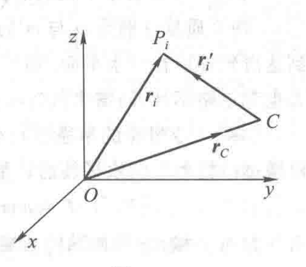

$$
m_i\frac{\mathrm{d}^2\boldsymbol{r}_i'}{\mathrm{d}t^2}=\boldsymbol{F}_i^{(e)}+\boldsymbol{F}_i^{(i)}+(-m_i\ddot{\boldsymbol{r}}_c) \qquad (2.3.7)
$$

式中$(-m_i\ddot{\boldsymbol{r}}_c)$是惯性力，这里应作为外力看待．因$P_i$是质点系中任一质点，故对质点系来讲，一共有$n$个像式（2.3.7）这样的方程．现在，用$\boldsymbol{r}_i'$从左面矢乘这些方程式，并对$i$求和，则内力矩仍互相抵消，故得

$$
\frac{\mathrm{d}}{\mathrm{d}t}\left[\sum_{i=1}^{n}\left(\boldsymbol{r}_i'\times m_i\dot{\boldsymbol{r}}_i'\right)\right]=\sum_{i=1}^{n}\left(\boldsymbol{r}_i'\times\boldsymbol{F}_i^{(e)}\right)+\ddot{\boldsymbol{r}}_c\times\sum_{i=1}^{n}m_i\boldsymbol{r}_i' \qquad (2.3.8)
$$

因$C$为质心，故$\sum_{i=1}^{n}m_i\boldsymbol{r}_i'=0$，而式（2.3.8）简化为

$$
\frac{\mathrm{d}}{\mathrm{d}t}\left[\sum_{i=1}^{n}\left(\boldsymbol{r}_i'\times m_i\dot{\boldsymbol{r}}_i'\right)\right]=\sum_{i=1}^{n}\left(\boldsymbol{r}_i'\times\boldsymbol{F}_i^{(e)}\right) \qquad (2.3.9)
$$

式中左侧是质点系对质心$C$的动量矩对时间的微商，即$\frac{\mathrm{d}\boldsymbol{J}'}{\mathrm{d}t}$，而右侧则是诸外力对质心$C$的力矩之和，可以$\boldsymbol{M}'$表之．这样，式（2.3.9）就简化为

$$
\frac{\mathrm{d}\boldsymbol{J}'}{\mathrm{d}t}=\boldsymbol{M}' \qquad (2.3.10)
$$

这就是质点系对质心的动量矩定理，即质点系对质心$C$的动量矩对时间的微商等于所有外力对质心的力矩之和，跟对固定点的动量矩定理形式相同，只多一撇号．这时各质点的惯性力矩互相抵消，不起作用．事实上，由于坐标系$C-x'y'z'$以加速度$\ddot{\boldsymbol{r}}_c$平动，每一质点都受有惯性力$(-m_i\ddot{\boldsymbol{r}}_c)$的作用，这些力都是相互平行的，它们的合力通过质点系的质心，故对质心的力矩当然等于零．

因此，虽然质心是动点，但对质心可以和对固定点一样写出动量矩定理．如外力对质心的力矩的矢量和为零，则对质心的动量矩也必然守恒．但对于其他动点$O'$一般则不能，令$\boldsymbol{r}_i'$是质点$P_i$对$O'$的位矢，而$\sum_{i=1}^{n}m_i\boldsymbol{r}_i'=m\boldsymbol{r}_c'$，$\boldsymbol{r}_c'$是质心$C$对$O'$的位矢，于是式（2.3.8）中的$\ddot{\boldsymbol{r}}_c$则应改为$O'$的加速度$\ddot{\boldsymbol{r}}_o'$．这时，由式（2.3.8）

可知，仅当$O'$的加速度$\ddot{\boldsymbol{r}}_{o'}$恒与$\boldsymbol{r}_c'$共线或平行，相对于$O'$的动量矩定理才和相对于$O$的动量矩定理的形式相同．

［例］在具有水平轴的滑轮上悬有一根绳子，绳子的两端距通过该轴水平面的距离为$s$与$s'$．两个质量分别为$m$与$m'$的人抓着绳子的两端，他们同时开始以匀加速度向上爬并同时到达滑轮轴所在的水平面．假定滑轮的质量可忽略，且所有的阻力也都忽略不计，问需多长时间，两人可以同时到达（图2.3.2）？

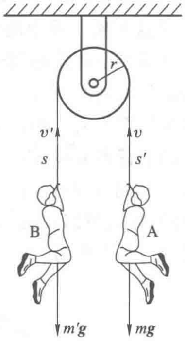

［解］令滑轮的半径为$r$，$A$爬绳的速度为$v$，$B$为$v'$，则他们对通过滑轮中心的水平轴的动量矩为

$$
J=mvr-m'v'r \qquad (1)
$$

而外力$m'g$和$mg$对同轴的力矩则为

$$
m'gr-mgr \qquad (2)
$$

由动量矩定理，得

$$
\frac{\mathrm{d}}{\mathrm{d}t}\left[(mv-m'v')r\right]=(m'-m)gr \qquad (3)
$$

即

$$
ma-m'a'=(m'-m)g \qquad (4)
$$

式中$a$及$a'$是两人爬绳时的加速度，均为常数．若$t$为共同需要的时间，则

$$
a=\frac{2s}{t^2},\quad a'=\frac{2s'}{t^2} \qquad (5)
$$

把（5）式代入（4）式，并整理，得

$$
t=\sqrt{\frac{2(ms-m's')}{(m'-m)g}}
$$

这就是他们从开始运动到抵达轮轴水平面所需要的时间．

## §2.4 动能定理与机械能守恒定律

### （1）质点系的动能定理

由第一章中的式（1.8.20）知，质点动能的微分等于作用在质点上的力所作的元功．对质点系中任一质点来讲，则应为质点系中任一质点动能的微分等于作用在该质点上外力及内力所作元功之和，即

$$
\mathrm{d}\left(\frac{1}{2}m_i\dot{r}_i^2\right)=\mathrm{d}T_i=\boldsymbol{F}_i^{(e)}\cdot\mathrm{d}\boldsymbol{r}_i+\boldsymbol{F}_i^{(i)}\cdot\mathrm{d}\boldsymbol{r}_i^{\text{①}} \qquad (2.4.1)
$$

式中$\boldsymbol{r}_i$是质点系中任一质点$P_i$对定点$O$的位矢，$\dot{\boldsymbol{r}}_i$是这质点的速度，而$\mathrm{d}\boldsymbol{r}_i$则是它的位移．对$i$求和，得

$$
\boxed{\mathrm{d}\sum_{i=1}^{n}\left(\frac{1}{2}m_i\dot{r}_i^2\right)=\sum_{i=1}^{n}\boldsymbol{F}_i^{(e)}\cdot\mathrm{d}\boldsymbol{r}_i+\sum_{i=1}^{n}\boldsymbol{F}_i^{(i)}\cdot\mathrm{d}\boldsymbol{r}_i} \qquad (2.4.2)
$$

> ① $\dot{r}_i^2=\dot{\boldsymbol{r}}_i\cdot\dot{\boldsymbol{r}}_i=\boldsymbol{v}_i\cdot\boldsymbol{v}_i=v_i^2$，所以$\dot{r}_i^2$也可写为$v_i^2$或$v_i^2$，下同．

若$T$是质点系的动能，则

$$
\mathrm{d}T=\sum_{i=1}^{n}\boldsymbol{F}_i^{(e)}\cdot\mathrm{d}\boldsymbol{r}_i+\sum_{i=1}^{n}\boldsymbol{F}_i^{(i)}\cdot\mathrm{d}\boldsymbol{r}_i \qquad (2.4.3)
$$

故质点系动能的微分，等于诸内力及诸外力所作元功之和，这关系叫质点系的**动能定理**，是质点系动力学的第三个基本定理．这里应注意的是，在动量定理和动量矩定理中，内力均因相等相反而消去，但在动能定理中，除非在某种特殊情况下，例如刚体内力所作的功，通常并不能互相抵消，故质点系即使不受外力作用，或虽受外力作用而互相平衡时，质点系的动能并不一定守恒．大炮发射炮弹时，水平方向动量虽然守恒（参看§2.2），但相应的动能并不守恒，因为两者原来都是静止的，当炮弹发射时，炮身反冲，两者都有速度，亦即两者都有动能．

关于内力所作元功之和一般不能互相抵消的原因，可用下面两个质点的情况来加以说明．设第一个质点相对于定点$O$的位矢是$\boldsymbol{r}_1$，第二个质点相对于$O$的位矢是$\boldsymbol{r}_2$，第一质点所受的内力为$\boldsymbol{F}_{12}^{(i)}$，第二质点所受的内力为$\boldsymbol{F}_{21}^{(i)}$，且$\boldsymbol{F}_{12}^{(i)}+\boldsymbol{F}_{21}^{(i)}=0$（图2.4.1），则

$$
\begin{aligned}
\mathrm{d}W_i&=\boldsymbol{F}_{12}^{(i)}\cdot\mathrm{d}\boldsymbol{r}_1+\boldsymbol{F}_{21}^{(i)}\cdot\mathrm{d}\boldsymbol{r}_2\\
&=\boldsymbol{F}_{21}^{(i)}\cdot\mathrm{d}(\boldsymbol{r}_2-\boldsymbol{r}_1)\\
&=\boldsymbol{F}_{21}^{(i)}\cdot\mathrm{d}\boldsymbol{r}=-\boldsymbol{F}_{12}^{(i)}\cdot\mathrm{d}\boldsymbol{r}
\end{aligned}
$$

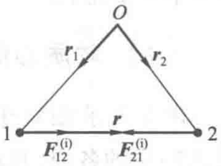

式中$\boldsymbol{r}$是质点2相对于质点1的位矢．故只有当$\mathrm{d}\boldsymbol{r}=0$，$\mathrm{d}W_i$始等于零．而$\mathrm{d}\boldsymbol{r}=0$意味着质点间距离不能改变，即为刚体．对一般质点系来讲，$\mathrm{d}\boldsymbol{r}\neq0$，故内力作功一般不等于零．

### （2）机械能守恒定律

对质点系来讲，内力所作的功之和一般并不为零，所以，若只有外力是保守力而内力并不是保守力时，质点系的机械能并不守恒．例如水沿倾斜的管子作片流运动时，由于内力是黏滞力（内摩擦力），故机械能并不守恒．

如果作用在质点系上的所有外力及内力都是保守力（或其中只有保守力作功）时，才有

$$
T+V=E \qquad (2.4.4)
$$

的关系，式中$E$是总能量，$T$为质点系的动能而$V$则包含内外力的势能，这就是质点系机械能守恒定律．

### （3）柯尼希定理

在图2.4.2中，$C-x'y'z'$系的原点固着在质点系的质心$C$上，并随质心$C$在惯性系中平动．这时$C-x'y'z'$系称为质心坐标系或质心系．质点系中某一质点$P_i$对定点$O$的位矢为$\boldsymbol{r}_i$，对$C$的位矢为$\boldsymbol{r}_i'$，而$C$对$O$的位矢则为$\boldsymbol{r}_c$．由图2.4.2可以看出

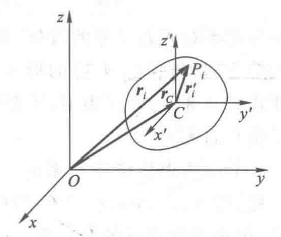

$$
\boldsymbol{r}_i=\boldsymbol{r}_c+\boldsymbol{r}_i' \qquad (2.4.5)
$$

故质点系的动能$T$为

$$
T=\frac{1}{2}\sum_{i=1}^{n}m_i(\dot{\boldsymbol{r}}_c+\dot{\boldsymbol{r}}_i')^2=\frac{1}{2}m\dot{r}_c^2+\frac{1}{2}\sum_{i=1}^{n}m_i\dot{r}_i'^2+\dot{\boldsymbol{r}}_c\cdot\sum_{i=1}^{n}m_i\dot{\boldsymbol{r}}_i' \qquad (2.4.6)
$$

因$\boldsymbol{r}_i'$是$P_i$相对于质心$C$的位矢，故$\sum_{i=1}^{n}m_i\boldsymbol{r}_i'=m\boldsymbol{r}_c'=0$，这样，式（2.4.6）简化为

$$
\boxed{T=\frac{1}{2}m\dot{r}_c^2+\frac{1}{2}\sum_{i=1}^{n}m_i\dot{r}_i'^2} \qquad (2.4.7)
$$

式中$\frac{1}{2}m\dot{r}_c^2$为质点系全部质量集中质心而运动时的动能，可称之为质心的动能，而$\frac{1}{2}\sum_{i=1}^{n}m_i\dot{r}_i'^2$则为质点系中各质点对质心系运动时的动能．故质点系的动能为质心的动能与各质点对质心动能之和．这个关系叫**柯尼希定理**，在刚体动力学中常常要用到．

### （4）对质心的动能定理

现在来求相对于质心的动能定理．用相对于质心系的位移$\mathrm{d}\boldsymbol{r}_i'$标乘式（2.3.7）中的各项，并对$i$求和，得

$$
\mathrm{d}\left(\frac{1}{2}\sum_{i=1}^{n}m_i\dot{r}_i'^2\right)=\sum_{i=1}^{n}\boldsymbol{F}_i^{(e)}\cdot\mathrm{d}\boldsymbol{r}_i'+\sum_{i=1}^{n}\boldsymbol{F}_i^{(i)}\cdot\mathrm{d}\boldsymbol{r}_i'+\sum_{i=1}^{n}(-m_i\ddot{\boldsymbol{r}}_c)\cdot\mathrm{d}\boldsymbol{r}_i' \qquad (2.4.8)
$$

因为

$$
\sum_{i=1}^{n}\left[(-m_i\ddot{\boldsymbol{r}}_c)\cdot\mathrm{d}\boldsymbol{r}_i'\right]=-\ddot{\boldsymbol{r}}_c\cdot\sum_{i=1}^{n}m_i\mathrm{d}\boldsymbol{r}_i'=-\ddot{\boldsymbol{r}}_c\cdot\mathrm{d}\left(\sum_{i=1}^{n}m_i\boldsymbol{r}_i'\right)=0
$$

故式（2.4.8）就简化为

$$
\boxed{\mathrm{d}\left(\frac{1}{2}\sum_{i=1}^{n}m_i\dot{r}_i'^2\right)=\sum_{i=1}^{n}\boldsymbol{F}_i^{(e)}\cdot\mathrm{d}\boldsymbol{r}_i'+\sum_{i=1}^{n}\boldsymbol{F}_i^{(i)}\cdot\mathrm{d}\boldsymbol{r}_i'} \qquad (2.4.9)
$$

即质点系对质心动能的微分，等于质点系相对于质心系位移时内力及外力所作元功之和，与式（2.4.2）的形式相同．这时质心虽是动点，但惯性力所作功之和即式（2.4.8）的末项为零，不起作用，与动量矩定理的情形相似．这又一次说明了质心的重要性．

上面所求出的质点系的三个动力学基本定理，在分量形式下，一共有七个方程［即式（2.2.6）、（2.3.6）和（2.4.2）］．和它们相关的守恒定律成立时也是这样．但由于质点系的独立变量通常大于七，所以这些方程并不能用来确定质点系中每一质点的运动（除非是刚体），而只能由它们得出运动总的趋向和某些特征，特别是与质心有关的总的趋向和特征．对于两个质点所组成的质点系，在特殊情况下，可用动量定理和动能定理（或和它们相关的守恒定律）来求解它们的运动．下面，我们用一个实例来说明这种情况．

［例］质量为$m_1$及$m_2$的两自由质点互相以力吸引，引力与其质量成正比，与距离平方成反比，比例常数为$k$．开始时，两质点皆处于静止状态，其间距离为$a$．试求两质点的距离为$\frac{1}{2}a$时两质点的速度．

［解］令质量为$m_1$的质点的速度为$\boldsymbol{v}_1$，质量为$m_2$的质点的速度为$\boldsymbol{v}_2$，则因两者互相吸引，故$\boldsymbol{v}_1,\boldsymbol{v}_2$的方向相反，今取$\boldsymbol{v}_1$的方向为正方向（图2.4.3）．

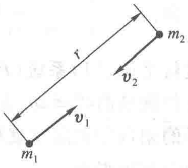

本问题无外力作用，故由动量守恒定律得

$$
m_1v_1-m_2v_2=0 \qquad (1)
$$

相互吸引的内力属于万有引力之列，故为保守力．由§1.9知势能为$-\frac{km_1m_2}{r}$，式中$r$是两质点间的距离．由机械能守恒定律得

$$
-\frac{km_1m_2}{a}=\frac{1}{2}m_1v_1^2+\frac{1}{2}m_2v_2^2-\frac{km_1m_2}{\frac{a}{2}} \qquad (2)
$$

解（1）式及（2）式，得

$$
v_1=m_2\sqrt{\frac{2k}{a(m_1+m_2)}},\quad v_2=m_1\sqrt{\frac{2k}{a(m_1+m_2)}} \qquad (3)
$$

现在用动能定理来解．由式（2.4.2）得

$$
\mathrm{d}\left(\frac{1}{2}m_1\dot{r}_1^2+\frac{1}{2}m_2\dot{r}_2^2\right)=-\frac{km_1m_2}{r^2}\mathrm{d}r \qquad (4)
$$

积分，得

$$
\frac{1}{2}m_1v_1^2+\frac{1}{2}m_2v_2^2=\frac{km_1m_2}{a} \qquad (5)
$$

这与用机械能守恒定律得出的（2）式相同．

## §2.5 两体问题

在§1.9中，我们曾经提到：开普勒定律只是近似的．其中一个原因就是太阳和行星相互吸引，两者都有加速度，太阳并不是静止不动的．

太阳和行星既然都有运动，显然属于质点系的运动问题．我们现在就这个问题作进一步的研究．

在图2.5.1中，令$S$点代表太阳，$P$点代表某一行星．并设$\boldsymbol{r}_p$是行星$P$对某一惯性坐标系原点$O$的位矢，而$\boldsymbol{r}_s$是太阳对同一坐标系原点$O$的位矢．以$m_s$及$m$分别代表太阳和行星的质量，那么太阳对惯性坐标系的动力学方程将为

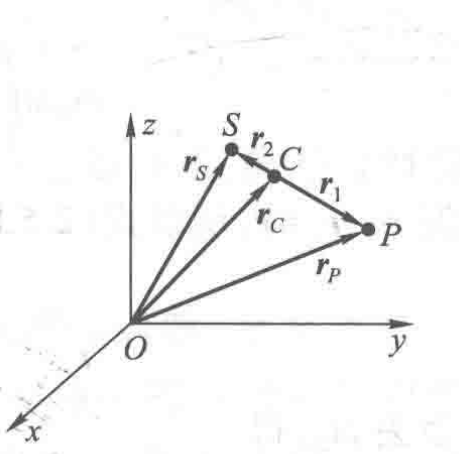

$$
m_s\frac{\mathrm{d}^2\boldsymbol{r}_s}{\mathrm{d}t^2}=\frac{Gm_sm}{r^2}\frac{\boldsymbol{r}}{r} \qquad (2.5.1)
$$

式中$r=\overrightarrow{SP}$，$G$为引力常量，且$Gm_s=k^2$．而行星对同一坐标系的运动方程为

$$
m\frac{\mathrm{d}^2\boldsymbol{r}_p}{\mathrm{d}t^2}=-\frac{Gm_sm}{r^2}\frac{\boldsymbol{r}}{r} \qquad (2.5.2)
$$

将方程式（2.5.1）和（2.5.2）相加，就得到

$$
\frac{\mathrm{d}^2}{\mathrm{d}t^2}(m_s\boldsymbol{r}_s+m\boldsymbol{r}_p)=0 \qquad (2.5.3)
$$

但由式（2.1.3），知

$$
m_s\boldsymbol{r}_s+m\boldsymbol{r}_p=(m_s+m)\boldsymbol{r}_c \qquad (2.5.4)
$$

$\boldsymbol{r}_c$代表太阳$S$和行星$P$的质心$C$对同一坐标系原点$O$的位矢．

由式（2.5.3）及式（2.5.4），我们得到

$$
(m_s+m)\frac{\mathrm{d}^2\boldsymbol{r}_c}{\mathrm{d}t^2}=0 \qquad (2.5.5)
$$

这就是说，（1）系统（$P,S$）的质心将按惯性运动，（2）太阳和行星都绕它们的质心作圆锥曲线运动．对系统（$S,P$）而言，万有引力是内力，故前一论断根据质点系的动量守恒定律就可立即得出．至于后一论断，则可从它们相对于质心的动力学方程得出．

既然只有两个质点，所以$C$在$S、P$的连线上．如令$\overrightarrow{CP}=\boldsymbol{r}_1$，$\overrightarrow{CS}=\boldsymbol{r}_2$，则行星对$C$的动力学方程为

$$
m\ddot{\boldsymbol{r}}_1=-\frac{k^2m}{(r_1+r_2)^2}\frac{\boldsymbol{r}_1}{r_1} \qquad (2.5.6)
$$

因为$C$是质心，故$mr_1=m_sr_2$，而$r_1+r_2=\left(1+\frac{m}{m_s}\right)r_1=\frac{m_s+m}{m_s}r_1$．这样，式（2.5.6）就变为

$$
m\ddot{\boldsymbol{r}}_1=-\frac{k^2mm_s^2}{(m_s+m)^2}\frac{1}{r_1^2}\frac{\boldsymbol{r}_1}{r_1} \qquad (2.5.7)
$$

力仍与距离平方成反比，故由§1.9，知行星绕（$S,P$）系统的质心作圆锥曲线运动．太阳的情况也是这样，读者可自行验证．

现在来求行星对太阳的相对运动方程．将式（2.5.1）乘以$m$，式（2.5.2）乘以$m_s$，然后由后者减去前者，得

$$
m_sm\left(\frac{\mathrm{d}^2\boldsymbol{r}_p}{\mathrm{d}t^2}-\frac{\mathrm{d}^2\boldsymbol{r}_s}{\mathrm{d}t^2}\right)=-\frac{Gm_sm}{r^2}(m_s+m)\frac{\boldsymbol{r}}{r} \qquad (2.5.8)
$$

但$\boldsymbol{r}_p-\boldsymbol{r}_s=\boldsymbol{r}$，所以式（2.5.8）变为

$$
m_sm\frac{\mathrm{d}^2\boldsymbol{r}}{\mathrm{d}t^2}=-\frac{Gm_sm}{r^2}(m_s+m)\frac{\boldsymbol{r}}{r}
$$

消去$m_s$，得

$$
m\frac{\mathrm{d}^2\boldsymbol{r}}{\mathrm{d}t^2}=-\frac{Gm(m_s+m)}{r^2}\frac{\boldsymbol{r}}{r}=-\frac{k'^2m}{r^2}\frac{\boldsymbol{r}}{r} \qquad (2.5.9)
$$

式中$k'^2=G(m_s+m)$．

在式（2.5.9）中，$m$是行星的质量，$r$是行星对太阳$S$的位矢，$\ddot{\boldsymbol{r}}$是行星相对于太阳运动时的加速度，而右式则是行星所受的力．所以，式（2.5.9）是行星相对于太阳的动力学方程．这时可认为太阳是不动的，但它的质量却不等于$m_s$，而增大为$m_s+m$．因此，常数$k'^2$对所有行星并不一样，因为里面含有行星的质量$m$．

方程（2.5.8）也可写为

$$
\frac{m_sm}{m_s+m}\frac{\mathrm{d}^2\boldsymbol{r}}{\mathrm{d}t^2}=-\frac{k^2m}{r^2}\frac{\boldsymbol{r}}{r} \qquad (2.5.10)
$$

这也是行星对太阳的动力学方程，并且仍然认为太阳不动．这时太阳质量仍为$m_s$，但行星质量则不等于$m$，而减小为$\mu=\frac{m_sm}{m_s+m}=\frac{m}{1+\frac{m}{m_s}}$，或$\frac{1}{\mu}=\frac{1}{m}+\frac{1}{m_s}$，我们通常把$\mu$叫做**折合质量**．

从式（2.5.9）出发，我们就可以对开普勒第三定律进行修正．因为根据式（1.9.27）

对行星$P_1$：

$$
\frac{4\pi^2a_1^3}{\tau_1^2}=k_1'^2=G(m_s+m_1)
$$

对行星$P_2$：

$$
\frac{4\pi^2a_2^3}{\tau_2^2}=k_2'^2=G(m_s+m_2)
$$

两者相除，得

$$
\frac{a_1^3}{\tau_1^2}:\frac{a_2^3}{\tau_2^2}=\frac{m_s+m_1}{m_s+m_2}=\frac{1+\frac{m_1}{m_s}}{1+\frac{m_2}{m_s}} \qquad (2.5.11)
$$

而根据开普勒第三定律，式（2.5.11）的右方应该等于1．故开普勒第三定律只具有近似性质，只在$m_1$及$m_2$都远远小于$m_s$时才是正确的．

实际上，太阳系中最大的行星是木星，它的质量也不过是太阳质量的$\frac{1}{1\,047}$．故如令下角标1代表木星，下角标2代表太阳系中其他行星，因而$\frac{m_s+m_1}{m_s+m_2}$之比不会超过$\frac{1\,048}{1\,047}$，与1相差甚微．故开普勒第三定律虽只具近似性质，但是近似程度却是相当高的．

上面的讨论没有考虑到行星间的相互吸引，故称**两体问题**．如果考虑任一行星还要受到其他行星的吸引，则成为**多体问题**．多体问题一般只能用微扰法（摄动法）来近似地求解．微扰法在天体力学和量子力学中都要经常用到．

## §2.6 质心坐标系与实验室坐标系

散射和碰撞这一类问题，都属于两体问题．在散射（或碰撞）前后，两质点都有运动．根据上节的讨论，看来我们可以把它化为单体问题，即认为其中一个不动，而把另外一个的质量改为折合质量．但是，事情并不这样简单．因为在上述两种考虑的情况下，散射角并不相同．前者（两体问题）是两质点间相对位矢$\boldsymbol{r}$在散射前后所偏转的角度（图2.6.1中的$\theta_c$）；而后者（单体问题）则是被散射的质点（例如$\alpha$粒子）在散射前后所偏转的角度（图2.6.1中的$\theta_l$）．$\theta_l$可在实验室观察出来，而$\theta_c$则要由等值单体问题计算出来．只有当散射主（例如原子核）在散射过程中始终静止不动时，两者才相等．

因此，在研究散射（或碰撞）问题时，人们常运用两种不同的坐标系．一种叫做**实验室坐标系**，这时观测者在静止坐标系中观测散射过程，常为实验工作者所采用．另一种是随着质心运动的坐标系来观察，叫做**质心坐标系**，常为理论工作者所采用．图2.6.1中的$\theta_l$就是在实验室坐标系中所测出来的散射角，而$\theta_c$则是在质心坐标系中的散射角，它一般只能由计算得出．

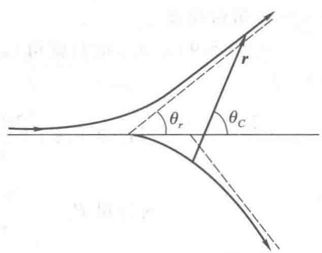

设质量为$m_1$的质点1以速度$\boldsymbol{v}_1$被另一质量为$m_2$的静止质点2散射．此两质点的质心在散射前后都将沿$\boldsymbol{v}_1$方向以速度$\boldsymbol{u}$运动．在散射前，

$$
(m_1+m_2)u=m_1v_1
$$

即

$$
u=\frac{m_1v_1}{m_1+m_2} \qquad (2.6.1)
$$

此时质点1相对于质心的速度$\boldsymbol{u}_1$的量值为

$$
u_1=v_1-u=\frac{m_2v_1}{m_1+m_2} \qquad (2.6.2)
$$

而质点2相对于质心的速度$\boldsymbol{u}_2$的量值则为

$$
u_2=-u=-\frac{m_1v_1}{m_1+m_2} \qquad (2.6.3)
$$

即

$$
m_1u_1+m_2u_2=0 \qquad (2.6.4)
$$

从质心坐标系看来，根据动量守恒定律，两质点散射后必将沿相反方向运动，而质点1散射后的速度$\boldsymbol{u}_1'$与散射前的速度$\boldsymbol{u}_1$之间的夹角就是$\theta_c$，如图2.6.2（a）所示．

同一现象，从实验室坐标系来看，就完全两样．图2.6.2（b）画出了从实验室坐标系所看到的散射现象．这时质点1散射后的速度是$\boldsymbol{v}_1'$，它与$\boldsymbol{v}_1$之间的夹角是$\theta_r$．

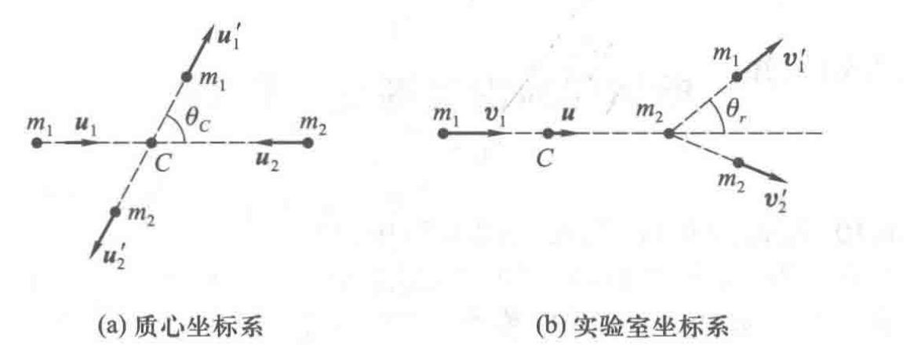

现在来求$\theta_c$和$\theta_r$之间的关系．显然，由相对运动关系，我们有（图 2.6.3）

$$
\boldsymbol{u}_1'+\boldsymbol{u}=\boldsymbol{v}_1' \qquad (2.6.5)
$$

写成分量形式，则为

$$
\left.\begin{aligned}
u_1'\cos\theta_c+u=v_1'\cos\theta_r\\
u_1'\sin\theta_c=v_1'\sin\theta_r
\end{aligned}\right\} \qquad (2.6.6)
$$

两式相除，得

$$
\tan\theta_r=\frac{u_1'\sin\theta_c}{u_1'\cos\theta_c+u} \qquad (2.6.7)
$$

在图 2.6.4 中，$C$为质点 1 及质点 2 的质心，它对实验室坐标系原点$O$的位矢为$\boldsymbol{r}_C$，而质点 1 及质点 2 对$C$的相对位矢为$\boldsymbol{r}_1'$及$\boldsymbol{r}_2'$，至于质点 2 相对于质点 1 的位矢则为$\boldsymbol{r}$．由质心定义，知

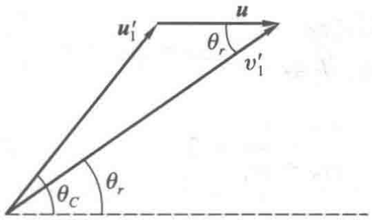

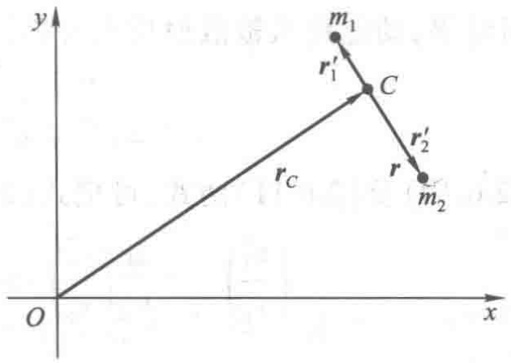

$$
\boldsymbol{r}_1'=-\frac{m_2}{m_1+m_2}\boldsymbol{r} \qquad (2.6.8)
$$

取对时间的微商，得

$$
\boldsymbol{u}_1'=\frac{-\mu}{m_1}\dot{\boldsymbol{r}} \qquad (2.6.9)
$$

式中$\mu$是折合质量，它等于$\frac{m_1m_2}{m_1+m_2}$．散射后，当两质点远离到无引力场作用时，因系统是保守的，这时两质点相对速度的量值$|\dot{\boldsymbol{r}}|$必与其起始时两粒子的相对速度即$\boldsymbol{v}_1$的量值$v_1$相等，即

$$
u_1'=\frac{\mu}{m_1}v_1 \qquad (2.6.10)
$$

又由式（2.6.1），知

$$
u=\frac{\mu}{m_2}v_1 \qquad (2.6.11)
$$

把式（2.6.10）及式（2.6.11）代入式（2.6.7）中，得

$$
\tan\theta_r=\frac{\sin\theta_c}{\cos\theta_c+\frac{m_1}{m_2}} \qquad (2.6.12)
$$

当$m_1\ll m_2$时，$\theta_r\approx\theta_c$；故重靶（例如重原子核）仅有很小的反冲，几乎与固定质心类似．卢瑟福散射就近似地属于这种情况．这时$\alpha$粒子的$m_1$为 4 原子质量单位，而原子核的$m_2$则在 100 原子质量单位以上．

但对中子-质子散射，因两者质量相等，故情况和卢瑟福散射相反．在此情形下，$\frac{m_1}{m_2}=1$，故式（2.6.12）变为

$$
\tan\theta_r=\frac{\sin\theta_c}{\cos\theta_c+1}=\tan\frac{\theta_c}{2} \qquad (2.6.13)
$$

$$
\theta_c=2\theta_r \qquad (2.6.14)
$$

我们在此处研究的是弹性散射，即散射前后的总动能守恒．在实验室坐标系中，两质点的速率都要改变．靶（质点 2）原来是静止的，散射时将发生反冲，因而具有一定的速率及动能，而被散射质点（质点 1）则必须减小速率及动能．故散射结果，动能将从被散射质点转移到靶上去．由图 2.6.3，利用余弦定律，我们有

$$
u_1'^2=v_1'^2+u^2-2uv_1'\cos\theta_r \qquad (2.6.15)
$$

利用（2.6.10）及（2.6.11）两式，可把式（2.6.15）化为

$$
\left(\frac{v_1'}{v_1}\right)^2-\frac{2\mu}{m_2}\left(\frac{v_1'}{v_1}\right)\cos\theta_r-\frac{m_2-m_1}{m_2+m_1}=0 \qquad (2.6.16)
$$

它是$\frac{v_1'}{v_1}$的二次式，在特殊情况下，当$m_1=m_2$时，则有

$$
\frac{v_1'}{v_1}=\cos\theta_r \qquad (2.6.17)
$$

这时若$\theta_r=\frac{1}{2}\pi$，则相当于在质心坐标系中的反向散射（$\theta_c=\pi$），这时的能量转移最大，反冲质点将获得全部的入射能量．

散射时动能发生转移，这是在反应堆中使中子得以减速的理论依据．在反应堆中，用来使中子减速的材料叫减速剂．从上面的讨论可以看出，氢、氘、碳等轻元素都可以作为减速剂．但氢吸收中子的能力相当大，故实际上常用减速能力较强而吸收中子的能力又较小的重水（含氘）或石墨（含碳）作为减速剂．

## §2.7 变质量物体的运动

### （1）变质量物体的运动方程

前面我们讨论了物体质量固定时的运动规律，在本节中，我们将求出物体的质量按一定规律变化（减少或增加）时的动力学方程，即变质量物体的动力学方程．

设一物体的质量在$t$时为$m$，它的速度是$\boldsymbol{v}$（$v\ll$光速$c$），同时一微小质量$\Delta m$以速度$\boldsymbol{u}$运动，并在$t+\Delta t$时间间隔内与$m$相合并，合并以后的共同速度是$\boldsymbol{v}+\Delta\boldsymbol{v}$．如果作用在$m$及$\Delta m$上的合外力为$\boldsymbol{F}$，则由动量定理，得

$$
(m+\Delta m)(\boldsymbol{v}+\Delta\boldsymbol{v})-m\boldsymbol{v}-\Delta m\boldsymbol{u}=\boldsymbol{F}\Delta t \qquad (2.7.1)
$$

内力及约束力恒有大小相等、方向相反，因而消去．

略去式（2.7.1）中的二阶微量$\Delta m\Delta\boldsymbol{v}$，除以$\Delta t$，并使$\Delta t\to 0$，得变质量物体动力学方程为

$$
\frac{\mathrm{d}}{\mathrm{d}t}(m\boldsymbol{v})-\frac{\mathrm{d}m}{\mathrm{d}t}\boldsymbol{u}=\boldsymbol{F} \qquad (2.7.2)
$$

$\boldsymbol{u}$是代表微质量$\Delta m$未与$m$合并以前或自$m$分出后一刹那的速度，$\frac{\mathrm{d}m}{\mathrm{d}t}$为质量的时间变化率（可正可负），而$\boldsymbol{F}$则为作用在系统上的合外力，例如万有引力和空气阻力．如果$\boldsymbol{u}=0$，则式（2.7.2）简化为

$$
\frac{\mathrm{d}}{\mathrm{d}t}(m\boldsymbol{v})=\boldsymbol{F} \qquad (2.7.3)
$$

如$\boldsymbol{u}$与$\boldsymbol{v}$相等，则式（2.7.2）可简化为

$$
m\frac{\mathrm{d}\boldsymbol{v}}{\mathrm{d}t}=\boldsymbol{F} \qquad (2.7.4)
$$

这与质量为定值的运动方程式形式上没有什么区别，但实质上并不相同，这里$m$一般是时间$t$的函数．

［例］ 雨点开始自由落下时的质量为$m$．在下落过程中，单位时间内凝结在它上面的水汽质量为$\lambda$．略去空气阻力，试求雨点在$t$时间后所下落的距离．

［解］ 本问题的$\boldsymbol{u}=0$，故由式（2.7.3），得

$$
\frac{\mathrm{d}}{\mathrm{d}t}[(m+\lambda t)v]=(m+\lambda t)g \qquad (1)
$$

积分，得

$$
(m+\lambda t)v=\left(mt+\frac{1}{2}\lambda t^2\right)g+C_1 \qquad (2)
$$

因$t=0,v=0$，故$C_1=0$，

故

$$
v=\frac{\mathrm{d}s}{\mathrm{d}t}=\frac{mt+\frac{1}{2}\lambda t^2}{m+\lambda t}g \qquad (3)
$$

即

$$
\frac{\mathrm{d}s}{\mathrm{d}t}=\frac{1}{2}gt+\frac{mg}{2\lambda}-\frac{m^2g/2\lambda}{m+\lambda t} \qquad (4)
$$

再积分，得

$$
s=\frac{g}{2}\left(\frac{t^2}{2}\right)+\frac{mg}{2\lambda}t-\frac{m^2g}{2\lambda^2}\ln(m+\lambda t)+C_2 \qquad (5)
$$

因$t=0,s=0$，故

$$
C_2=\frac{m^2g}{2\lambda^2}\ln M
$$

于是，得

$$
s=\frac{1}{2}g\left[\frac{t^2}{2}+\frac{m}{\lambda}t-\frac{m^2}{\lambda^2}\ln\left(1+\frac{\lambda}{m}t\right)\right] \qquad (6)
$$

这就是雨点在$t$时间后所下落的距离．

### *（2）火箭

方程（2.7.2）是研究变质量物体运动的基本方程．近代火箭是用逐渐把燃烧过的废气向外喷出的办法来增加火箭本身运动的速度，因此也是属于变质量物体的运动问题．

式（2.7.2）也可改写为

$$
m\frac{\mathrm{d}\boldsymbol{v}}{\mathrm{d}t}=\boldsymbol{F}+\frac{\mathrm{d}m}{\mathrm{d}t}(\boldsymbol{u}-\boldsymbol{v}) \qquad (2.7.5)
$$

式中$\boldsymbol{u}-\boldsymbol{v}=\boldsymbol{v}_r$是放出物质相对于运动物体的速度，$\frac{\mathrm{d}m}{\mathrm{d}t}$是单位时间放出的物质的质量，而

$$
\frac{\mathrm{d}m}{\mathrm{d}t}(\boldsymbol{u}-\boldsymbol{v})=\frac{\mathrm{d}m}{\mathrm{d}t}\boldsymbol{v}_r=\boldsymbol{F}_r \qquad (2.7.6)
$$

则是由于放出物质所引起的附加力或反作用力．因此，式（2.7.5）又可写为

$$
m\frac{\mathrm{d}\boldsymbol{v}}{\mathrm{d}t}=\boldsymbol{F}+\frac{\mathrm{d}m}{\mathrm{d}t}\boldsymbol{v}_r=\boldsymbol{F}+\boldsymbol{F}_r \qquad (2.7.7)
$$

在现代的火箭问题中，可以把放出物质的相对速度$\boldsymbol{v}_r$看做是沿着运动物体轨道切线的负方向，因此，

$$
\boldsymbol{u}-\boldsymbol{v}=-\boldsymbol{i}v_r \qquad (2.7.8)
$$

式中$\boldsymbol{i}$是沿轨道切线的单位矢量．

在此情形下，式（2.7.5）变为

$$
m\frac{\mathrm{d}\boldsymbol{v}}{\mathrm{d}t}=\boldsymbol{F}-\frac{\mathrm{d}m}{\mathrm{d}t}v_r\boldsymbol{i} \qquad (2.7.9)
$$

现在研究一种比较简单的情况．即一个可变质量的质点在空间运动时不受任何外力作用，并设放出物质的相对速度$\boldsymbol{v}_r$的量值不变，且与运动质点的速度$\boldsymbol{v}$共线而反向，则式（2.7.9）就简化为

$$
m\frac{\mathrm{d}v}{\mathrm{d}t}=-v_r\frac{\mathrm{d}m}{\mathrm{d}t}
$$

或

$$
\frac{\mathrm{d}v}{v_r}=-\frac{\mathrm{d}m}{m} \qquad (2.7.10)
$$

由于$v_r$是常数，因此如果设$m=m_0f(t)$，式中$m_0$是起始质量，它也是一个常数，而$f(t)$则是放出物体所遵循的时间函数，且$f(0)=1$，则式（2.7.10）变为

$$
\frac{\mathrm{d}v}{v_r}=-\frac{\mathrm{d}f}{f}
$$

积分，得

$$
v=-v_r\ln f+C_1
$$

设当$t=0$时，$v=v_0,f=1$，则$C_1=v_0$，因而

$$
v=v_0-v_r\ln f=v_0+v_r\ln\frac{m_0}{m} \qquad (2.7.11)
$$

这就是研究火箭运动问题的一个主要关系式．

令$m_s$代表空火箭（包括仪器和外壳等）的质量，$m'$代表放出物质（燃料）的质量，则在$v_0=0$的条件下，由（2.7.11）式，知当燃烧终了时，火箭所具有的速度为

$$
v=v_r\ln\frac{m_s+m'}{m_s}=2.3v_r\lg\left(1+\frac{m'}{m_s}\right) \qquad (2.7.12)
$$

由此可见；$v$和$v_r$成正比，如$v_r$大一倍，$v$也大一倍．此外，当空火箭及燃料的总质量（$m_s+m'$）与空火箭的质量$m_s$之比按几何级数增加时，燃烧终了时火箭所具有的速度，只能按算术级数增加．故增大物质放出的速度（即增大$v_r$）比增加燃料的数量（即增大$m'$）有效得多．

如果$v_r=2$ km/s，那么要使火箭的$v$能够超过第一宇宙速度，以便用来发射人造地球卫星，则质量比$\frac{m'}{m_s}$约在 100 左右，即燃料的质量应比空火箭的质量大 100 倍左右．如计及地球引力和空气阻力，这个比值还要大．因此目前都采用多级火箭的方案来发射人造地球卫星．当某一火箭里面的燃料已经烧完以后，就把这级丢掉，以提高火箭的飞行速度．根据计算和实践，用三级（或四级）火箭来发射人造卫星是比较理想的．

现在来求质点离开起始点的距离．当$v_r=$常数时，由式（2.7.11），可得

$$
\mathrm{d}s=v_0\mathrm{d}t-v_r\ln f\mathrm{d}t
$$

积分，得

$$
s=s_0+v_0t-v_r\int_0^t\ln f\mathrm{d}t \qquad (2.7.13)
$$

由此可见，为了求出$s$，必须知道函数$f(t)$的具体形式，即必须作出关于质量变化规律的假定．在近代实验工作和理论研究中，下列两种质量变化规律应用得最广．

（a）直线律：$f=1-\alpha t$，式中$\alpha$是常数．此时每秒钟放出的质量为

$$
\frac{\mathrm{d}m}{\mathrm{d}t}=\frac{\mathrm{d}}{\mathrm{d}t}[m_0(1-\alpha t)]=-\alpha m_0=\text{常数}
$$

而反作用力

$$
F_r=v_r\frac{\mathrm{d}m}{\mathrm{d}t}=-\alpha m_0v_r
$$

在$v_r$等于常数的情形下，$F_r$也是一个常数．故质量变化的直线律适用于每秒钟放出的质量等于常数时的情况．

把$f=1-\alpha t$代入式（2.7.13），得

$$
s=s_0+v_0t+\frac{v_r}{\alpha}[(1-\alpha t)\ln(1-\alpha t)+\alpha t] \qquad (2.7.14)
$$

（b）指数律：$f=\mathrm{e}^{-\alpha t}$．此时

$$
\frac{\mathrm{d}m}{\mathrm{d}t}=-\alpha m_0\mathrm{e}^{-\alpha t}
$$

$$
F_r=v_r\frac{\mathrm{d}m}{\mathrm{d}t}=-\alpha m_0v_r\mathrm{e}^{-\alpha t}
$$

都不是常数．但由于反作用力所引起的附加加速度

$$
a_r=\frac{F_r}{m}=-\frac{\alpha m_0v_r\mathrm{e}^{-\alpha t}}{m_0\mathrm{e}^{-\alpha t}}=-\alpha v_r
$$

在$v_r$等于常数的情形下，$a_r$却是一个常数．故质量变化的指数律适用于反作用加速度等于常数时的情况．

把$f=\mathrm{e}^{-\alpha t}$代入式（2.7.13），得

$$
s=s_0+v_0t+\frac{1}{2}\alpha v_rt^2 \qquad (2.7.15)
$$

如果把重力考虑进去，则在速度表达式（2.7.12）中，应增加$-gt$项，而在距离表达式（2.7.13）中，则应增加$-\frac{1}{2}gt^2$项．如果把空气阻力也考虑进去，则问题还要复杂一些．

放出物质时火箭所经过的一段路程$s$叫做喷射行程，而所花的时间$t_s$则叫做喷射时间．火箭总是要受重力作用的，由上述讨论可知，火箭因重力而损失的速度，与$gt_s$成正比．故如火箭的加速度不受限制时，最好使它所携带的燃料尽快地烧光，以减小$t_s$即减少速度上的损失．

从上面的讨论还可以看出：火箭速度和排气性能有密切关系，排气速度$v_r$越大，喷出的质量越多，则火箭得到的速度$v$就越大．另外，质量比$\frac{m'}{m_s}$虽然不如$v_r$那样重要，但也能影响到火箭的速度．因此，最佳的设计方案是除了减小$t_s$外，还要使$v_r$和$\frac{m'}{m_s}$两者都尽可能大．这在材料的要求上就显得特别严格．除了要使用能产生高温的燃料（如单原子氢或其他固态燃料）外，还要求要用能抵抗高温的难熔轻金属来制造火箭的外壳．在目前，钛是一种比较理想的材料．

在以上的讨论中，我们是把火箭当作是一个可变质量的质点看待的．实际上，火箭是一个有一定大小的物体．因此，问题远较这里所讨论的复杂．如果把火箭当作刚体看待，那么除了研究它的质心的运动外，还要用动量矩定理研究它绕质心的转动问题．我们在这里还不能计算这个问题．在下一章，我们将对刚体的运动规律，作比较详细的介绍．

## §2.8 位力定理

在§1.9和§2.5等节中，我们曾讨论了有关质点受有心力作用时的运动问题．这类问题，也可由大数目质点系更为一般的定理——即所谓位力定理的特殊情况得出．位力定理不同于我们以前所讨论过的定理，它具有统计性质，即各种力学量对时间的平均值．

设所研究的质点系是由$n$个质点系成，其中某一质点的质量是$m_i$，位矢为$\boldsymbol{r}_i$，所受的力为$\boldsymbol{F}_i$（包括约束力），则其基本运动方程为

$$
\dot{\boldsymbol{p}}_i=\boldsymbol{F}_i \qquad (2.8.1)
$$

式中$\boldsymbol{p}_i=m_i\dot{\boldsymbol{r}}_i$是动量．我们现在感兴趣的是下述的物理量，它对质点系中所有质点求和，即

$$
G=\sum_{i=1}^{n}\boldsymbol{p}_i\cdot\boldsymbol{r}_i \qquad (2.8.2)
$$

求$G$对时间的微商，得

$$
\frac{\mathrm{d}G}{\mathrm{d}t}=\sum_{i=1}^{n}\dot{\boldsymbol{r}}_i\cdot\boldsymbol{p}_i+\sum_{i=1}^{n}\dot{\boldsymbol{p}}_i\cdot\boldsymbol{r}_i \qquad (2.8.3)
$$

式（2.8.3）右方的第一项可改为

$$
\sum_{i=1}^{n}\dot{\boldsymbol{r}}_i\cdot\boldsymbol{p}_i=\sum_{i=1}^{n}m_i\dot{\boldsymbol{r}}_i\cdot\dot{\boldsymbol{r}}_i=\sum_{i=1}^{n}m_iv_i^2=2T
$$

$T$为质点系的动能．而式（2.8.3）右方第二项则为

$$
\sum_{i=1}^{n}\dot{\boldsymbol{p}}_i\cdot\boldsymbol{r}_i=\sum_{i=1}^{n}\boldsymbol{F}_i\cdot\boldsymbol{r}_i
$$

因此，式（2.8.3）化为

$$
\frac{\mathrm{d}G}{\mathrm{d}t}=\frac{\mathrm{d}}{\mathrm{d}t}\sum_{i=1}^{n}\boldsymbol{p}_i\cdot\boldsymbol{r}_i=2T+\sum_{i=1}^{n}\boldsymbol{F}_i\cdot\boldsymbol{r}_i \qquad (2.8.4)
$$

式（2.8.4）的时间平均等于该式各项对$t$从 0 到$\tau$积分再除以$\tau$后所得的值，即

$$
\frac{1}{\tau}\int_0^\tau\frac{\mathrm{d}G}{\mathrm{d}t}\mathrm{d}t=\overline{\frac{\mathrm{d}G}{\mathrm{d}t}}=2\overline{T}+\overline{\sum_{i=1}^{n}\boldsymbol{F}_i\cdot\boldsymbol{r}_i}
$$

或

$$
2\overline{T}+\overline{\sum_{i=1}^{n}\boldsymbol{F}_i\cdot\boldsymbol{r}_i}=\frac{1}{\tau}[G(\tau)-G(0)] \qquad (2.8.5)
$$

如为周期运动，且取$\tau$为一周期，则式（2.8.5）的右方为零．即使运动不是周期性的，但只要所有质点的坐标和动量都保持为有限值，则$G$有一最高限．故如取$\tau$足够长，则式（2.8.5）右方可变为任意小，上述结论依然正确．在此两种情况下，我们有

$$
\overline{T}=-\frac{1}{2}\overline{\sum_{i=1}^{n}\boldsymbol{F}_i\cdot\boldsymbol{r}_i} \qquad (2.8.6)
$$

$\frac{1}{2}\sum_{i=1}^{n}\overline{\boldsymbol{F}_i\cdot\boldsymbol{r}_i}$叫做均位力积，简称位力，曾用名维里．故式（2.8.6）叫做位力定理（曾用名维里定理）．位力定理告诉我们：在很长时间间隔内，质点系的动能对时间的平均值取负号等于作用在此质点系上力的位力．

从式（2.8.6）可以看出，位力定理具有统计性质，故在分子运动论中非常有用．例如，加上某些统计假设，用它来证明理想气体的玻意耳定律甚为简单．但用它来计算非理想气体的物态方程则较繁杂，因$\boldsymbol{F}_i$中不仅包含保持气体在容器内的约束力，还包含分子间相互作用的力．

如果$\boldsymbol{F}_i$由非摩擦力$\boldsymbol{F}_i'$及正比于速度的摩擦力$\boldsymbol{F}_{fi}$两项所组成，则位力只依赖于$\boldsymbol{F}_i'$，而$\boldsymbol{F}_{fi}$对它无贡献．因为只要有摩擦力存在，则运动必将衰减，而当$\tau$趋于无限时，所有的时间平均值均等于零．位力定理此时则给出$0=0$的恒等式．

如为保守力系，则

$$
\overline{T}=\frac{1}{2}\sum_{i=1}^{n}\overline{(\nabla_iV)\cdot\boldsymbol{r}_i} \qquad (2.8.7)
$$

式中$V$为质点系的势能，而

$$
\nabla_i=\frac{\partial}{\partial x_i}\boldsymbol{i}+\frac{\partial}{\partial y_i}\boldsymbol{j}+\frac{\partial}{\partial z_i}\boldsymbol{k}
$$

单个质点受有心力作用而运动时，式（2.8.7）简化为

$$
\overline{T}=\frac{1}{2}\overline{\frac{\partial V}{\partial r}\cdot r} \qquad (2.8.8)
$$

如$V$为$r$的幂函数，则$F$及$V$均为$r$的幂函数，即

$$
V=ar^{n+1}
$$

于是

$$
\frac{\partial V}{\partial r}\cdot r=(n+1)V
$$

而（2.8.8）式变为

$$
\overline{T}=\frac{1}{2}(n+1)\overline{V}
$$

对平方反比引力来讲，$n=-2$，位力定理给出

$$
\overline{T}=-\frac{1}{2}\overline{V} \qquad (2.8.9)
$$

对于人造地球卫星来讲，轨道可看成是半径等于$r$的圆周．这时$T=\frac{1}{2}mv_1^2$，$V=-\frac{mk^2}{r}$．由式（1.9.33）知$T=-\frac{1}{2}V$．因$T$和$V$均不随时间变，故无需求平均，位力定理显然正确．对行星绕太阳的运动问题来讲，轨道一般是椭圆，所以要求平均值，问题比较复杂．关于这一问题的验证，将作为习题，请读者自行解算（参看习题 2.19）．

## 小结

Ⅰ．质点系

1. 质点系是由许多相互联系着的质点所组成的系统．

2. 内力和外力

a. 质点系中质点间相互作用的力叫内力．

b. 其他物体对质点系内质点的作用力叫外力．

c. 质点系中任何两个质点间相互作用的内力满足牛顿第三定律．故对整个质点系来讲，内力的总和为零，即

$$
\boldsymbol{F}^{(i)}=\sum_{i=1}^{n}\sum_{\substack{j=1\\ j\ne i}}^{n}\boldsymbol{F}_{ij}^{(i)}=0
$$

3. 质心——质点系的全部质量可认为集中在某一点上，这点叫质点系的质心（刚体也是这样）．其直角坐标为

$$
x_C=\frac{\sum_{i=1}^{n}m_ix_i}{\sum_{i=1}^{n}m_i},\quad y_C=\frac{\sum_{i=1}^{n}m_iy_i}{\sum_{i=1}^{n}m_i},\quad z_C=\frac{\sum_{i=1}^{n}m_iz_i}{\sum_{i=1}^{n}m_i}
$$

对质量连续分布的系统来讲，上式中的求和应改为积分．

Ⅱ．动量定理与动量守恒定律

1. 质点系动量对时间的微商等于作用在质点系上诸外力的矢量和，这关系叫质点系的动量定理，即

$$
\frac{\mathrm{d}\boldsymbol{p}}{\mathrm{d}t}=\frac{\mathrm{d}}{\mathrm{d}t}\left(\sum_{i=1}^{n}m_i\boldsymbol{v}_i\right)=\sum_{i=1}^{n}\boldsymbol{F}_i^{(e)}
$$

2. 质心运动定理——质点系质心的运动，就好像一个质点的运动一样，此质点的质量，等于质点系的质量，而作用在此质点上的力，等于作用在质点系上所有诸外力的矢量和，即

$$
m\ddot{\boldsymbol{r}}_C=\sum_{i=1}^{n}\boldsymbol{F}_i^{(e)}
$$

3. 动量守恒定律——质点系不受外力作用而运动或虽受外力作用，但外力矢量和等于零时，它的动量为一常矢量．即

如$\sum_{i=1}^{n}\boldsymbol{F}_i^{(e)}=0$，则$\boldsymbol{p}=m\boldsymbol{v}_C=$常矢量

Ⅲ．动量矩定理与动量矩守恒定律

1. 质点系对惯性系中任一固定点$O$的动量矩对时间的微商，等于质点系所有的外力对此同一点的力矩的矢量和，这关系叫质点系的动量矩定理，即

$$
\frac{\mathrm{d}\boldsymbol{J}}{\mathrm{d}t}=\frac{\mathrm{d}}{\mathrm{d}t}\left(\sum_{i=1}^{n}\boldsymbol{r}_i\times m_i\boldsymbol{v}_i\right)=\sum_{i=1}^{n}\boldsymbol{r}_i\times\boldsymbol{F}_i^{(e)}=\boldsymbol{M}
$$

对质心来讲，动量矩定理的表达式与对固定点的一样．

2. 动量矩守恒定律——质点系如不受外力作用，或虽受外力作用，但对某定点的力矩的矢量和为零，则对此定点而言，动量矩为一常矢量，即如$\boldsymbol{M}=0$，则$\boldsymbol{J}$为一常矢量．

Ⅳ．动能定理与机械能守恒定律

1. 质点系动能的微分等于诸外力及诸内力所作元功之和，这关系叫质点系的动能定理，即

$$
\mathrm{d}T=\mathrm{d}\sum_{i=1}^{n}\frac{1}{2}m_iv_i^2=\sum_{i=1}^{n}\boldsymbol{F}_i^{(e)}\cdot\mathrm{d}\boldsymbol{r}_i+\sum_{i=1}^{n}\boldsymbol{F}_i^{(i)}\cdot\mathrm{d}\boldsymbol{r}_i
$$

2. 柯尼希定理——质点系中各质点的动能为质点系全部质量集中在质心并随质心平动的动能及各质点对质心运动时动能之和，即

$$
T=\frac{1}{2}mv_C^2+\frac{1}{2}\sum_{i=1}^{n}m_i\dot{r}_i'^2
$$

3. 机械能守恒定律——如内力及外力都是保守力，则质点系的机械能守恒，即$T+V=E$．

Ⅴ．两体问题

1. 两物体相互在引力作用下运动时，每一物体绕两者的质心作圆锥曲线运动，而此质心则作惯性运动．

2. 把一物体看成不动，而把另一物体看成绕它作圆锥曲线运动时，可在利用动力学方程时视后者的质量减小到$\mu$，且$\frac{1}{\mu}=\frac{1}{m}+\frac{1}{m'}$，$\mu$叫折合质量．

3. 开普勒第三定律的修正

$$
\frac{a_1^3}{\tau_1^2}:\frac{a_2^3}{\tau_2^2}=\frac{m'+m_1}{m'+m_2}
$$

Ⅵ．质心坐标系与实验室坐标系

1. 质心坐标系——以质心为原点的坐标系，在此坐标系中可观测散射（碰撞）之类问题，常为理论工作者所采用．

2. 实验室坐标系——以实验室作为参考系的坐标系，常为实验工作者所采用．

3. 在两种坐标系中，散射角不相同．前者为$\theta_c$，而后者为$\theta_r$．在两质点的质量相等的情形下，$\theta_c=2\theta_r$．但如被散射的质点的质量很小，即$m_1\ll m_2$，则$\theta_c\approx\theta_r$．

Ⅶ．变质量物体的运动

1. 变质量物体的运动方程

a. $\boldsymbol{F}=\frac{\mathrm{d}}{\mathrm{d}t}(m\boldsymbol{v})-\frac{\mathrm{d}m}{\mathrm{d}t}\boldsymbol{u}$

b. 如$\boldsymbol{u}=0$，则$\boldsymbol{F}=\frac{\mathrm{d}}{\mathrm{d}t}(m\boldsymbol{v})$

c. 如$\boldsymbol{u}=\boldsymbol{v}$，则$\boldsymbol{F}=m\frac{\mathrm{d}\boldsymbol{v}}{\mathrm{d}t}$

2. 火箭

a. $\boldsymbol{F}=0,v=v_0+v_r\ln\frac{m_0}{m}$

b. 直线律$f=1-\alpha t,s=s_0+v_0t+\frac{v_r}{\alpha}[(1-\alpha t)\ln(1-\alpha t)+\alpha t]$

c. 指数律$f=\mathrm{e}^{-\alpha t},s=s_0+v_0t+\frac{\alpha v_r}{2}t^2$

d. 受重力作用竖直向上发射，合外力$\boldsymbol{F}=-m\boldsymbol{g}$，$v$的表示式中增加$(-gt)$项，$s$表示式中增加$\left(-\frac{1}{2}gt^2\right)$项．

e. 增加$v_r$较增加燃料有效．

Ⅷ．位力定理

在很长时间间隔内，质点系的动能对时间的平均值取负号等于作用在此质点系上力的位力，即

$$
\overline{T}=-\frac{1}{2}\sum_{i=1}^{n}\overline{\boldsymbol{F}_i\cdot\boldsymbol{r}_i}
$$

## 补充例题

2.1 正圆锥体底边半径为$a$，今用一通过其轴的平面，将其等分为二，则任一半的质心和轴的距离为$\frac{a}{\pi}$，试证明之，假定正圆锥体的密度是常数．

［解］ 设圆锥体的密度为$\rho$，高为$h$．取一薄片，半径为$x$，厚为$\mathrm{d}y$，则

$$
\mathrm{d}m=\rho\left(\frac{1}{2}\pi x^2\right)\mathrm{d}y
$$

式中$y$为半圆片离顶点$O$（坐标原点）的距离．由习题 2.1，可知半圆片

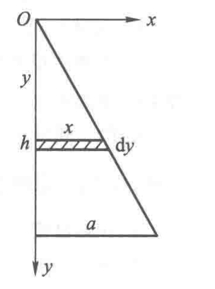的质心离轴的距离为$\frac{4}{3}\frac{x}{\pi}$（留给读者自证）．又由相似三角形，知

$$
\frac{y}{x}=\frac{h}{a} \qquad (1)
$$

故

$$
y=\frac{h}{a}x,\quad \mathrm{d}y=\frac{h}{a}\mathrm{d}x \qquad (2)
$$

由此得

$$
x_c=\frac{\int x\mathrm{d}m}{\int \mathrm{d}m}=\frac{\int\frac{4}{3}\frac{x}{\pi}\rho\left(\frac{\pi}{2}x^2\mathrm{d}y\right)}{\int\rho\left(\frac{1}{2}\pi x^2\mathrm{d}y\right)}=\frac{\int_0^a\frac{4}{3}\frac{h}{a}x^3\mathrm{d}x}{\int_0^a\frac{h}{a}\pi x^2\mathrm{d}x}=\frac{a^4}{\pi a^3}=\frac{a}{\pi} \qquad (3)
$$

2.2 钉锤的质量为$m'$，从高为$h$处落至一质量为$m$的铁钉的顶上，将其打入地中的深度为$s$，试求地对钉的平均阻力，假定铁钉没有弹性．

［解］ 设锤击钉的速度为$u$，则由机械能守恒定律，知

$$
u^2=2gh \qquad (1)
$$

又设刚撞击后锤与钉共同前进时的速度为$v$，则因这时尚无外力作用（重力较撞击力小得多，可以略去），故由动量守恒定律，得

$$
m'u=(m'+m)v \qquad (2)
$$

如地对钉的平均阻力为$F$，则因撞击作用停止后，作用在此系统上的外力，一为重力$(m'+m)g$，作正功；一为阻力$F$，作负功，故由动能定理，又得

$$
0-\frac{1}{2}(m'+m)v^2=[(m'+m)g-F]s \qquad (3)
$$

由（1）、（2）、（3）得

$$
\begin{aligned}
F&=(m'+m)g+\frac{1}{2}\frac{(m'+m)v^2}{s}=(m'+m)g+\frac{1}{2}(m'+m)\frac{m'^2u^2}{(m'+m)^2s}\\
&=(m'+m)g+\frac{m'^2}{m'+m}\frac{u^2}{2s}=(m'+m)g+\frac{m'^2}{m'+m}g\frac{h}{s}
\end{aligned}
\qquad (4)
$$

2.3 有三个完全弹性的小球，质量分别为$m_1$、$m_2$及$m_3$，静止于一直线上．今于第一球上加上$v_1$的速度，其方向沿此直线．设$m_1$、$m_3$及$v_1$为已知，求第二球的质量$m_2$应为何值，才能使第三球于碰撞后所得的速度最大？

［解］ 设第二球碰后以速度$v_2'$前进，第一球以速度$v_1'$回跃，则由动量守恒定律，我们有

$$
m_1v_1=m_1v_1'+m_2v_2' \qquad (1)
$$

又由于弹性碰撞的牛顿定律，得

$$
v_1-0=v_2'-v_1' \qquad (2)
$$

把（2）式代入（1）式，得$m_1v_1=m_1(v_2'-v_1)+m_2v_2'$

即

$$
v_2'=\frac{2m_1v_1}{m_1+m_2} \qquad (3)
$$

同理，如第三球于碰后以速度$v_3'$前进，则仿（3）式知

$$
v_3'=\frac{2m_2v_2'}{m_2+m_3}=\frac{4m_1m_2v_1}{(m_1+m_2)(m_2+m_3)} \qquad (4)
$$

而

$$
\frac{\mathrm{d}v_3'}{\mathrm{d}m_2}=4m_1v_1\frac{-2m_2^2-m_1m_2-m_2m_3+m_1m_2+m_2^2+m_2m_3+m_1m_3}{(m_1+m_2)^2(m_2+m_3)^2}
$$

$$
=4m_1v_1\frac{m_1m_3-m_2^2}{(m_1+m_2)^2(m_2+m_3)^2}
$$

令$\frac{\mathrm{d}v_3'}{\mathrm{d}m_2}=0$，得

$$
m_1m_3-m_2^2=0
$$

由此得

$$
m_2=\sqrt{m_1m_3} \qquad (5)
$$

故如

$$
m_2=\sqrt{m_1m_3}
$$

则第三球碰撞后所得的速度最大．

## 思考题

2.1 一均匀物体假如由几个有规则的物体并合（或挖去）而成，你觉得怎样来求它的质心？

2.2 一均匀物体如果有三个对称面，并且此三对称面交于一点，则此质点即均匀物体的质心，何故？

2.3 在质点系动力学中，能否计算每一质点的运动情况？假如质点系不受外力作用，每一质点是否都将静止不动或作匀速直线运动？

2.4 两球相碰撞时，如果把此两球当作质点系看待，作用的外力为何？其动量的变化如何？如仅考虑任意一球，则又如何？

2.5 水面上浮着一只小船．船上人如果向船尾走去，则船将向前移动．这是不是与质心运动定理相矛盾？试解释之．

2.6 为什么在碰撞过程中，动量守恒而能量不一定守恒？所损失的能量到什么地方去了？又在什么情况下能量也守恒？

2.7 选用质心坐标系，在动量定理中是否需要计入惯性力？

2.8 轮船以速度$u$行驶．一人在船上将一质量为$m$的铁球以速度$v$向船首抛去．有人认为：这时人作的功为

$$
\frac{1}{2}m(u+v)^2-\frac{1}{2}mu^2=\frac{1}{2}mv^2+mvu
$$

你觉得这种看法对吗？如不正确，错在什么地方？

2.9 秋千何以能越荡越高？这时能量的增长是从哪里来的？

2.10 在火箭里的燃料全部烧完后，§2.7（2）节中的诸公式是否还能应用？为什么？

2.11 多级火箭和单级火箭比起来，有哪些优越的地方？

## 习题

2.1 求均匀扇形薄片的质心，此扇形的半径为$a$，所对的圆心角为$2\theta$．并证半圆片的质心离圆心的距离为$\frac{4}{3}\frac{a}{\pi}$．

答：$x_c=\frac{2}{3}a\frac{\sin\theta}{\theta}$（取对称轴为$x$轴）

2.2 如自半径为$a$的球上，用一与球心相距为$b$的平面，切出一球形帽，求此球形帽的质心．

答：$z_c=\frac{3}{4}\frac{(a+b)^2}{2a+b}$（离球心）

2.3 重为$W$的人，手里拿着一个重为$w$的物体．此人用与地平线成$\alpha$角的速度$v_0$向前跳去．当他达到最高点时，将物体以相对速度$u$水平向后抛出．问由于物体的抛出，跳的距离增加了多少？

答：增加了$\frac{w}{(W+w)g}uv_0\sin\alpha$

2.4 质量为$m_1$的质点，沿倾角为$\theta$的光滑直角劈滑下，劈的本身，质量为$m_2$，又可在光滑水平面上自由滑动．试求：

（1）质点水平方向的加速度$\ddot{x}_1$；

（2）劈的加速度$\ddot{x}_2$；

（3）劈对质点的反作用力$R_1$；

（4）水平面对劈的反作用力$R_2$．

答：$\ddot{x}_1=\frac{m_2\sin\theta\cos\theta}{m_2+m_1\sin^2\theta}g$，$\ddot{x}_2=-\frac{m_1\sin\theta\cos\theta}{m_2+m_1\sin^2\theta}g$

$$
R_1=\frac{m_1m_2\cos\theta}{m_2+m_1\sin^2\theta}g,\quad R_2=\frac{m_2(m_1+m_2)}{m_2+m_1\sin^2\theta}g
$$

2.5 半径为$a$，质量为$m$的薄圆片，绕垂直于圆片并通过圆心的竖直轴以匀角速$\omega$转动，求绕此轴的动量矩．

答：$J=\frac{1}{2}ma^2\omega$

2.6 一炮弹的质量为$m_1+m_2$，射出时的水平及竖直分速度为$u$及$v$．当炮弹达到最高点时，其内部的炸药产生能量$E$，使此炸弹分为$m_1$及$m_2$两部分．在开始时，两者仍沿原方向飞行，试求它们落地时相隔的距离，不计空气阻力．

答：$\frac{v}{g}\sqrt{2E\left(\frac{1}{m_1}+\frac{1}{m_2}\right)}$

2.7 质量为$m'$，半径为$a$的光滑半球，其底面放在光滑的水平面上．有一质量为$m$的质点沿此半球面滑下．设质点的初位置与球心的连线和竖直方向上的直线间所成之角为$\alpha$，并且起始时此系统是静止的，求此质点滑到它与球心的连线和竖直向上直线间所成之角为$\theta$时$\dot{\theta}$之值．

答：$\dot{\theta}=\sqrt{\frac{2g}{a}\frac{\cos\alpha-\cos\theta}{1-\frac{m}{m'+m}\cos^2\theta}}$

2.8 一光滑球 A 与另一静止的光滑球 B 发生斜碰．如两者均为完全弹性体，且两球的质量相等，则两球碰撞后的速度互相垂直，试证明之．

2.9 一光滑小球与另一相同的静止小球相碰撞．在碰撞前，第一小球运动的方向与碰撞时两球的连心线成$\alpha$角．求碰撞后第一小球偏过的角度$\beta$以及在各种$\alpha$值下$\beta$角的最大值．设恢复系数$e$为已知．

答：$\beta=\arctan\left[\frac{(1+e)\text{tg}\,\alpha}{1-e+2\text{tg}^2\alpha}\right]$，$\beta_{\max}=\arcsin\left(\frac{1+e}{3-e}\right)$

2.10 质量为$m_2$的光滑球用一不可伸长的绳系于固定点 A．另一质量为$m_1$的球以与绳成$\theta$角的速度$v_1$与$m_2$正碰．试求$m_1$及$m_2$碰后开始运动的速度大小$v_1'$及$v_2'$．设恢复系数$e$为已知．

答：$v_1'=\frac{m_1\sin^2\theta-em_2}{m_2+m_1\sin^2\theta}v_1$

$$
v_2'=\frac{m_1(1+e)\sin\theta}{m_2+m_1\sin^2\theta}v_1
$$

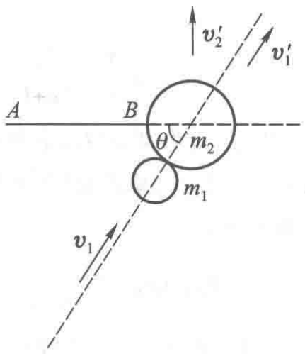

2.11 在光滑的水平桌面上，有质量各为$m$的两个质点，用一不可伸长的绳紧直相连，绳长为$a$．设其中一质点受到一个为绳正交的冲量$I$的作用，求证此后两质点将各作圆滚线运动，且其能量之比为$\cot^2\left(\frac{It}{2am}\right)=1$，式中$t$为冲力作用的时间．

2.12 质量为$m_1$的球以速度$v_1$与质量为$m_2$的静止球正碰．求碰撞后两球相对于质心的速度$u_1'$和$u_2'$是多少？碰撞前两球相对于质心的动能是多少？恢复系数$e$为已知．

答：$u_1'=-eu_1=-\frac{em_2}{m_1+m_2}v_1$

$$
u_2'=-eu_2=\frac{em_1}{m_1+m_2}v_1
$$

$$
T=\frac{1}{2}m_1u_1^2+\frac{1}{2}m_2u_2^2=\frac{1}{2}\frac{m_1m_2}{m_1+m_2}v_1^2
$$

式中$V_1$及$V_2$是两球碰撞前相对于质心的速度．

2.13 长为$l$的均匀细链条伸直地平放在水平光滑桌面上，其方向与桌边缘垂直，此时链条的一半从桌边下垂．起始时，整个链条是静止的．试用两种不同的方法，求此链条的末端滑到桌子的边缘时，链条的速度$v$．

答：$v=\frac{1}{2}\sqrt{3gl}$

2.14 一条柔软、无弹性、质量均匀的绳索，竖直地自高处下落至地板上．如绳索的长度等于$l$，每单位长度的质量等于$\sigma$．求当绳索剩在空中的长度等于$x$（$x<l$）时，绳索的速度及它对地板的压力．设开始时，绳索的速度为零，它的下端离地板的高度为$h$．

答：$v^2=2g(h+l-x)$；$F=\sigma[2h+3(l-x)]g$

2.15 机枪质量为$m_1$，放在水平地面上，装有质量为$m_2$的子弹．机枪在单位时间内射出子弹的质量为$m$，其相对于地面的速度则为$u$．如机枪与地面的摩擦因数为$\mu$，试证当$m_2$全部射出后，机枪后退的速度为

$$
\frac{m_2}{m_1}u-\frac{(m_1+m_2)^2-m_1^2}{2mm_1}\mu g
$$

2.16 雨滴下落时，其质量的增加率与雨滴的表面积成正比例，求雨滴速度与时间的关系．

答：$v=\frac{g}{4\lambda}\left[a+\lambda t-\frac{a^4}{(a+\lambda t)^3}\right]$

式中$\lambda$为在单位时间内雨滴半径的增量，$a$为$t=0$时雨滴的半径．

2.17 设用某种液体燃料发动机的火箭，喷气速度为 2 074 m/s，单位时间内所消耗的燃料为原始火箭总质量的$\frac{1}{60}$．如重力加速度$g$的值可以认为是常数，则利用此种火箭发射人造太阳行星时，所携带的燃料的质量至少是空火箭质量的 300 倍，试证明之．

2.18 原始总质量为$m_0$的火箭，发射时单位时间内消耗的燃料与$m_0$成正比，即$\alpha m_0$（$\alpha$为比例常数），并以相对速度$v$喷射．已知火箭本身的质量为$m$，求证只有当$\alpha v>g$时，火箭才能上升；并证明能达到的最大速度为

$$
v\ln\frac{m_0}{m}-\frac{g}{\alpha}\left(1-\frac{m}{m_0}\right)
$$

能达到的最大高度为

$$
\frac{v^2}{2g}\left(\ln\frac{m_0}{m}\right)^2+\frac{v}{\alpha}\left(1-\frac{m}{m_0}-\ln\frac{m_0}{m}\right)
$$

2.19 试以行星绕太阳的运动为例，验证位力定理．计算时可利用§1.9中所有的关系和公式，即认为太阳是固定不动的．
