# 第三章 刚体力学

## §3.1 刚体运动的分析

### （1）描述刚体位置的独立变量

在 §1.1 中，我们就曾讲过：一切物体都可以看作是由许多质点集合而成的．在第二章中，我们已经研究了有关质点系（质点的集合体）的几个基本定理和守恒定律，利用这些关系，我们一般只能获知有关质点系运动的总趋向（例如质心的运动）和某些特征．如果要了解质点系中任一质点究竟将如何运动，常常是比较困难的，甚至是不可能的．

在本章中，我们将研究一种特殊质点系的运动问题．这种特殊的质点系具有这样的性质，就是它里面任何两个质点间的距离，不因力的作用而发生改变．这种特殊的质点系叫做**刚体**．刚体和质点一样，也是一种抽象，是一种理想化的模型．在所研究的问题中，只有当物体的大小和形状的变化可以忽略不计时，才可以把它当作刚体看待．

理论力学的任务是研究宏观物体的机械运动规律，所以在大多数问题中，是要确定物体在外力作用下，它的位置如何随时间发生变化，亦即确定它的运动规律．我们知道：质点是被抽象为没有大小的几何点（但有一定的质量）．因此，要确定质点在空间的位置，需要三个独立的变量，例如$x,y,z$；或$r,\theta,\varphi$．

现在要问：确定刚体在空间的位置，需要几个独立变量？

一个质点既然要三个独立变量来确定它的位置，那么由$n$个（$n$是一个很大很大的数目）质点所组成的刚体，似乎应当要有$3n$个独立变量才能确定它在空间的位置．其实不然．刚体虽然是由$n$个质点组成，但因任意两点间的距离保持不变，所以只要确定了刚体内不在一直线上三点的位置，刚体的位置就能确定．这是因为如果固定了刚体中两点的位置，刚体还可绕着连接这两点的直线转动；如果再在刚体中把不和这条直线共线的另一点的位置固定，那么刚体就不能作任何运动了．

每一质点既然要三个独立变量来确定它的位置，而确定刚体的位置需要确定刚体内不共线的三点$O$、$A$、$B$（图3.1.1）的位置，因此，确定刚体的位置需要九个变量．但因三点间三个距离$OA,OB$和$AB$是常数，所以实际上只要用六个独立变量就可以确定刚体的位置．

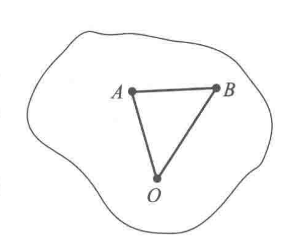

如果我们选用刚体内不共线三点的坐标来确定刚体的位置，那么，由于这些坐标不能独立变化，而要服从三个条件的限制，因此很不方便．我们也可在刚体内选取一点$O$，然后通过$O$点选取任一直线作为转动轴（因为刚体的机械运动可认为是平动与转动的组合，参看下一段），那么，要确定$O$点的位置，要用三个独立变量，要确定轴线在空间的取向，要用三个变量（即这轴线的方向余弦），而要确定刚体绕这轴线转了多少角度，又要用一个变量．在这七个变量中，三个方向余弦是不互相独立的（它们的平方和等于 1），所以虽较上述方法为优，但仍然不是很理想的．

1776 年，欧拉建议可用两个独立的角度来确定转动轴线在空间的取向，如果连同刚体绕这轴线所转过的角度一起计算，就是三个独立的角度了．由于这些角度都能独立变化，所以这方法被人们广泛地应用来研究刚体的运动，我们在 §3.3 里将详细说明三个角度是怎样选取的．

### （2）刚体运动的分类

上面已经讲到：刚体要六个独立变量来确定它在空间的位置，所以其最一般的运动，是具有六个独立变量的平动与转动的组合．但在某些条件的限制下（通常叫约束），刚体可以作少于六个独立变量的其他形式的运动，兹分述如下：

Ⅰ．平动  刚体运动时，如果在各个时刻，刚体中任意一条直线始终彼此平行，那么这种运动叫做**平动**．此时刚体中所有的质点都有相同的速度和加速度，任何一个质点的运动都可代表全体，与质点的情况没有什么区别，只要研究质心的运动就可以了．因此，刚体作平动时的独立变量为三个．

Ⅱ．定轴转动  如果刚体运动时，其中有两个质点始终不动，那么因为两点可以决定一条直线，所以这条直线上的诸点都固定不动，整个刚体就绕着这条直线转动．这条直线叫**转动轴**，而这种运动则叫**绕固定轴的转动**或简称**定轴转动**．我们只要知道刚体绕这条轴线转了多少角度，就能确定刚体的位置．因此，刚体作定轴转动时只有一个独立变量．

Ⅲ．平面平行运动  刚体运动时，刚体中任意一点如果始终在平行于某一固定平面的平面内运动，则叫**平面平行运动**．根据分析可知，这时的运动可分解为某一平面内任意一点的平动（两个独立变量）及绕通过此点且垂直于固定平面的固定轴的转动（一个独立变量），所以刚体作平面平行运动时只有三个独立变量（参看 §3.7）．

Ⅳ．定点转动  如果刚体运动时，只有一点固定不动，整个刚体围绕着通过这点的某一瞬时轴线转动，则叫**定点转动**．此时转动轴并不固定于空间（因只通过一个定点），与定轴转动时的情形不同．我们要用两个独立变量才能确定这条轴线在空间的取向，再用一个变量确定刚体绕这轴线转了多少角度，所以刚体作定点转动时也只有三个独立变量．

Ⅴ．一般运动  刚体不受任何约束，可以在空间任意运动，但可分解为质心的平动（三个独立变量）与绕通过质心的某直线的定点转动（三个独立变量）．因此，刚体作一般运动时有六个独立变量．

平动与定轴转动，在普通物理中已经讲过，我们将不作过多的重复．一般运动又过于复杂，因此本章的重点，将放在平面平行运动与定点转动上面．

## §3.2 角速度矢量

### （1）有限转动与无限小转动

在普通物理学中处理刚体绕固定轴转动这类问题时，曾经直接把角速度$\boldsymbol{\omega}$作为一个矢量．实际上，这样处理在逻辑上是不够严格的，但因在定轴转动（平面平行运动也是这样）中，角速度方向不变，所以它是不是矢量关系不大，只要把它看成是由一个有方向的直线来代表的量就行了．

在定轴转动中，通常是在转动轴上截取一个有方向的线段（按右手螺旋法则）来代表角速度．但当刚体绕固定点转动时，转动轴方向随时改变，因而角速度的方向也随时改变，所以必须首先证明角速度是一个矢量．

我们知道：有量值有方向的量还不一定是矢量．如果它是矢量，还必须遵守平行四边形加法所应该遵守的对易律．即如$\boldsymbol{A}$和$\boldsymbol{B}$是两个矢量，则应有

$$
\boldsymbol{A}+\boldsymbol{B}=\boldsymbol{B}+\boldsymbol{A}
\qquad (3.2.1)
$$

有限转动就不是一个矢量，因为它不遵守上述的对易律，这可用一个实例来加以说明．在图 3.2.1 及 3.2.2 中画出了两个长方形砖块．如果我们把砖甲先绕$z$轴转90°，然后再绕$y$轴转90°，则得图 3.2.1（c）所示位形；如把砖乙先绕$y$轴转90°再绕$z$轴转90°，则得图 3.2.2（c）所示的位形．这两个位形迥然不同，故知对易律在这时不能成立．

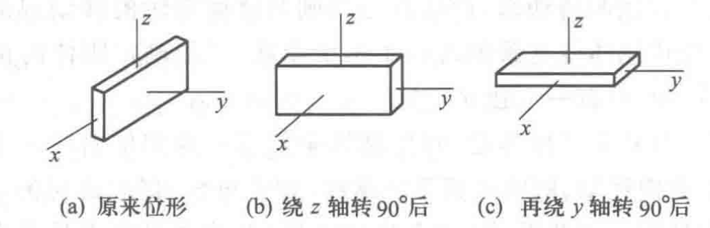
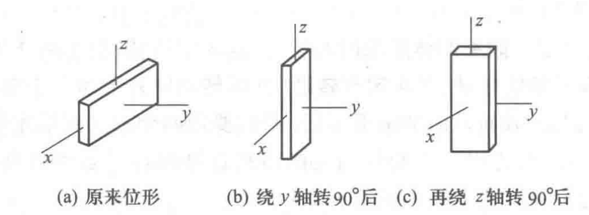

如果是无限小转动，情形就跟有限转动有所不同．设刚体绕通过定点$O$的某轴线转动了一微小角度$\Delta\theta$，则因$\Delta\theta$也应是一有方向的量，故可在转动轴上截取一有方向的线段$\Delta\boldsymbol{n}$来代表$\Delta\theta$的量值和方向，故$|\Delta\boldsymbol{n}|=\Delta\theta$，其指向则由右手螺旋法则决定，如图 3.2.3 所示．我们通常把$\Delta\boldsymbol{n}$叫做**角位移**．

如果$\boldsymbol{r}$为刚体内任一质点$P$在转动前的位矢，$\boldsymbol{r}+\Delta\boldsymbol{r}$为转动后$P$点（现在是$P'$点）的位矢，因为$\Delta\boldsymbol{r}$是无限小量，故$\Delta\boldsymbol{r}$必与包含$\boldsymbol{r}$及$\Delta\boldsymbol{n}$的平面垂直，并且

$$
|\Delta\boldsymbol{r}|=PM\cdot\Delta\theta
$$

但

$$
PM=r\sin\varphi
$$

式中$\varphi$是$\boldsymbol{r}$和$\Delta\boldsymbol{n}$之间的夹角．因此

$$
|\Delta\boldsymbol{r}|=r\Delta\theta\sin\varphi
\qquad (3.2.2)
$$

或

$$
|\Delta\boldsymbol{r}|=|\boldsymbol{r}|\cdot|\Delta\boldsymbol{n}|\cdot\sin\varphi
\qquad (3.2.3)
$$

即

$$
\Delta\boldsymbol{r}=\Delta\boldsymbol{n}\times\boldsymbol{r}
$$

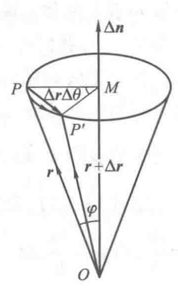

我们现在还只把$\Delta\boldsymbol{n}$当作一个有方向的量来看待，如果它是矢量，那它还必须遵守矢量加法的对易律．现在来看两个微小转动（都是绕通过$O$点的轴线转的）$\Delta\boldsymbol{n}$及$\Delta\boldsymbol{n}'$的合成是不是遵守对易律？

如果刚体先后绕通过$O$点的轴线作了两次微小的转动$\Delta\boldsymbol{n}$及$\Delta\boldsymbol{n}'$，则当$P$的位矢分别为［根据式（3.2.3）］

（a）转动前：$\boldsymbol{r}$

（b）转动$\Delta\boldsymbol{n}$后：$\boldsymbol{r}+\Delta\boldsymbol{n}\times\boldsymbol{r}$

（c）再转动$\Delta\boldsymbol{n}'$后：$\boldsymbol{r}+\Delta\boldsymbol{n}\times\boldsymbol{r}+\Delta\boldsymbol{n}'\times(\boldsymbol{r}+\Delta\boldsymbol{n}\times\boldsymbol{r})$

如果略去二阶微量，则得合成线位移为

$$
\Delta\boldsymbol{n}\times\boldsymbol{r}+\Delta\boldsymbol{n}'\times\boldsymbol{r}=\Delta\boldsymbol{r}+\Delta\boldsymbol{r}'
$$

如果对易转动次序，则得合成线位移为

$$
\Delta\boldsymbol{n}'\times\boldsymbol{r}+\Delta\boldsymbol{n}\times\boldsymbol{r}=\Delta\boldsymbol{r}'+\Delta\boldsymbol{r}
$$

我们已知线位移是可以对易的，故得

$$
\Delta\boldsymbol{r}+\Delta\boldsymbol{r}'=\Delta\boldsymbol{r}'+\Delta\boldsymbol{r}
$$

即

$$
\Delta\boldsymbol{n}\times\boldsymbol{r}+\Delta\boldsymbol{n}'\times\boldsymbol{r}=\Delta\boldsymbol{n}'\times\boldsymbol{r}+\Delta\boldsymbol{n}\times\boldsymbol{r}
$$

即

$$
(\Delta\boldsymbol{n}+\Delta\boldsymbol{n}')\times\boldsymbol{r}=(\Delta\boldsymbol{n}'+\Delta\boldsymbol{n})\times\boldsymbol{r}
$$

因对任意$\boldsymbol{r}$，此矢积式恒成立，故

$$
\Delta\boldsymbol{n}+\Delta\boldsymbol{n}'=\Delta\boldsymbol{n}'+\Delta\boldsymbol{n}
\qquad (3.2.4)
$$

所以微小转动的合成也是可以对易的．既然微小转动的合成，遵从平行四边形加法的对易律，所以证明了角位移$\Delta\boldsymbol{n}$是一个矢量．

### （2）角速度矢量

上面所讲的$\Delta\boldsymbol{n}$是在$\Delta t$时间内刚体绕$O$点所转动的微小角度，它的量值等于$\Delta\theta$，方向沿转动轴．如果我们用$\Delta t$来除$\Delta\boldsymbol{n}$，并令$\Delta t$趋于零，则有

$$
\lim_{\Delta t\to 0}\frac{\Delta\boldsymbol{n}}{\Delta t}=\frac{\mathrm{d}\boldsymbol{n}}{\mathrm{d}t}=\boldsymbol{\omega}
\qquad (3.2.5)
$$

矢量$\boldsymbol{\omega}$就是刚体在瞬时$t$绕$O$点转动的**角速度**，因为$\Delta\boldsymbol{n}$是矢量，所以$\boldsymbol{\omega}$当然也是矢量，今后我们可以用矢量运算法则来处理它．

和定轴转动的情形不同，定点转动时的转动轴，虽然恒通过定点$O$，但却随着时间而改变它在空间的取向，故某一时刻的转轴，叫做该时刻的**转动瞬轴**．角速度矢量就沿着该时刻的转动瞬轴，而其量值则为$\frac{\mathrm{d}\theta}{\mathrm{d}t}$．

由式（3.2.3），我们可得刚体内一点的线速度$\boldsymbol{v}$与角速度$\boldsymbol{\omega}$之间的关系．因$\boldsymbol{v}=\frac{\mathrm{d}\boldsymbol{r}}{\mathrm{d}t}$，而$\boldsymbol{\omega}=\frac{\mathrm{d}\boldsymbol{n}}{\mathrm{d}t}$，故

$$
\boldsymbol{v}=\frac{\mathrm{d}\boldsymbol{r}}{\mathrm{d}t}=\boldsymbol{\omega}\times\boldsymbol{r}
\qquad (3.2.6)
$$

角速度$\boldsymbol{\omega}$为整个刚体所公有，但$\boldsymbol{v}$则只是刚体内某一点的线速度（因与位矢$\boldsymbol{r}$有关），此点我们应注意分清．下面我们还要详细论述这个问题．

## §3.3 欧拉角

### （1）欧拉角

当刚体作定点转动时，我们可选这个定点作为坐标系的原点，而用三个独立的角度来确定转动轴在空间的取向和刚体绕该轴线所转过的角度．这三个能够独立变化的角度叫做欧拉角．

现在来说明这三个能独立变化的欧拉角是如何选取的？

取两组右手正交坐标系，它们的原点都在定点$O$上．一组坐标系$O-\xi\eta\zeta$固定在空间不动，而另一组坐标系$O-xyz$则固定在刚体上，随着刚体一起转动．并设$z$轴就是上述动坐标系中的瞬时转动轴．

在图 3.3.1 中，$\xi O\eta$平面和$xOy$平面的交线$ON$叫做**节线**．$ON$和$O\xi$间的夹角$\varphi$是一个欧拉角，通常我们把它叫做**进动角**．$ON$和$Ox$间的夹角$\psi$是另一个欧拉角，通常叫做**自转角**．而$O\zeta$和$Oz$间的夹角$\theta$是第三个欧拉角，通常叫做**章动角**．这些角度的含义，是从陀螺的转动中得来的，参看 §3.9．

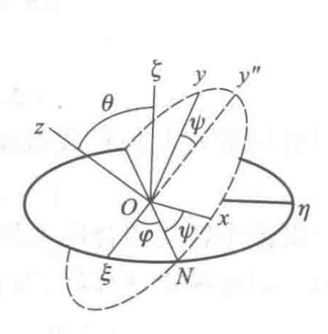

从图 3.3.1 中可以看出：$z$轴和$ON$垂直，故$z$轴的位置与$ON$有关，因此$z$轴的位置要用$\theta$与$\varphi$两个角度来确定．至于$\psi$，则为绕$z$轴所转动的角度．由此可知，利用欧拉角$(\theta,\varphi,\psi)$可以确定$O-xyz$相对于$O-\xi\eta\zeta$的位置．但因$O-xyz$是和刚体固连在一起的，因而也就确定了刚体的位置．

现在我们假定$O-xyz$原来是和$O-\xi\eta\zeta$重合在一起的．令$O-xyz$绕着$\zeta$轴沿逆时针方向（下同）转过一个角度$\varphi$，于是$x$轴和$\xi$轴分开，$y$轴和$\eta$轴分开，而且$Ox$轴转到$Ox'$（即$ON$）的位置，$Oy$转到$Oy'$的位置，但$z$轴和$\zeta$轴仍然重合在一起，如图 3.3.2 所示．令活动坐标系绕着$ON$转动一个角度$\theta$（见图 3.3.3），于是$z$轴和$\zeta$轴分开，活动坐标系三个轴现在是$x',y''$和$z$．这时$z$轴和$\zeta$轴之间的夹角是$\theta$，$x'Oy''$平面和$\xi O\eta$平面间的夹角也是$\theta$，如图 3.3.3 所示．最后，令活动坐标系绕着$z$轴转动一个角度$\psi$，这时$Ox'$与$ON$分开，并转到图 3.3.1 所示的$Ox$的位置，$ON$和$Ox$间的夹角是$\psi$；同理，$Oy''$转到图 3.3.1 所示的$Oy$的位置，$Oy''$和$Oy$间的夹角也是$\psi$．这时，活动坐标系$O-xyz$已经转到我们所需要的位置了．

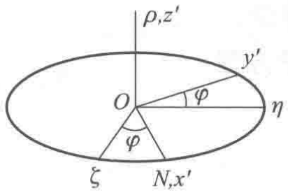
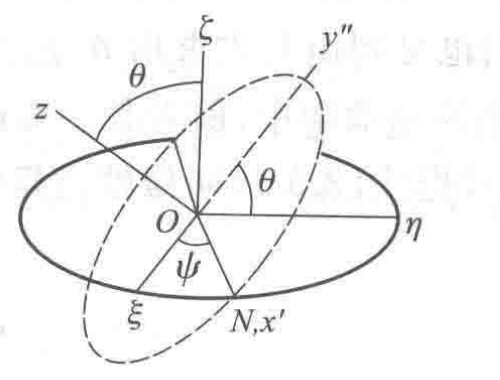

由图 3.3.1 可以看出：在下列范围内改变$\theta$、$\varphi$、$\psi$的数值，可得刚体可能具有的各种位置：

$$
0\leqslant\theta\leqslant\pi,\quad 0\leqslant\varphi\leqslant2\pi,\quad 0\leqslant\psi\leqslant2\pi
\qquad (3.3.1)
$$

### （2）欧拉运动学方程

如果刚体绕着通过定点$O$的某一轴线以角速度$\boldsymbol{\omega}$转动，而$\boldsymbol{\omega}$在活动坐标系$O-xyz$上的投影是$\omega_x,\omega_y$和$\omega_z$，则

$$
\boldsymbol{\omega}=\omega_x\boldsymbol{i}+\omega_y\boldsymbol{j}+\omega_z\boldsymbol{k}
\qquad (3.3.2)
$$

式中$\boldsymbol{i},\boldsymbol{j},\boldsymbol{k}$是沿$x,y,z$轴的单位矢量．

另一方面，根据上面的描述，我们也可以认为$\boldsymbol{\omega}$是绕$O\zeta$轴的角速度$\dot{\varphi}$、绕$ON$轴的角速度$\dot{\theta}$及绕$Oz$轴的角速度$\dot{\psi}$三者的矢量和．$\dot{\psi}$既然是沿着$z$轴，所以在$x$轴和$y$轴上没有分量．$\dot{\theta}$沿着$ON$轴（图 3.3.4），而$ON$和$z$轴垂直，所以它在$z$轴没有分量，而在$x$轴上的分量是$\dot{\theta}\cos\psi$，在$y$轴上的分量则是$-\dot{\theta}\sin\psi$．$\dot{\varphi}$是沿着$\zeta$轴的（可参见图 3.3.1），首先我们把它分解到$Oz$和$Oy''$上（因为$O\zeta,Oz$及$Oy''$三者在同一平面内，并且$Oz$及$Oy''$互相垂直），$\dot{\varphi}$在$Oz$上的分量是$\dot{\varphi}\cos\theta$，而在$Oy''$上的分量是$\dot{\varphi}\sin\theta$．最后，再把$Oy''$上的$\dot{\varphi}\sin\theta$分解到$Ox$和$Oy$上．因此，$\dot{\varphi}$在$Ox$轴上的分量是$\dot{\varphi}\sin\theta\sin\psi$，而在$Oy$轴上的分量是$\dot{\varphi}\sin\theta\cos\psi$．

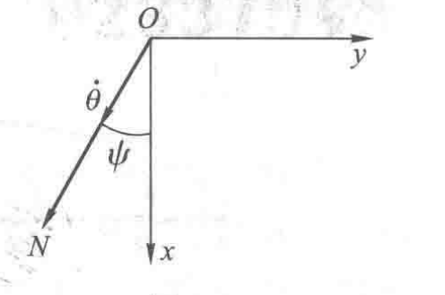集合$\dot{\theta},\dot{\varphi},\dot{\psi}$在$x,y,z$轴上的各个分量，并和式（3.3.2）相比较，我们就得出用欧拉角及其对时间的微商来表示角速度沿活动坐标轴$x,y,z$三个分量的表达式：

$$
\begin{aligned}
\omega_x&=\dot{\varphi}\sin\theta\sin\psi+\dot{\theta}\cos\psi\\
\omega_y&=\dot{\varphi}\sin\theta\cos\psi-\dot{\theta}\sin\psi\\
\omega_z&=\dot{\varphi}\cos\theta+\dot{\psi}
\end{aligned}
\qquad (3.3.3)
$$

由上式可以看出：如果$\theta,\varphi,\psi$和时间$t$的关系为已知，则可用上式计算出角速度$\boldsymbol{\omega}$在活动坐标轴$x,y,z$上的三个分量；反之，如在任一时刻$t$，$\boldsymbol{\omega}$的各分量为已知，我们也可利用上式求出$\theta,\varphi,\psi$和时间$t$的关系，因而也就决定了刚体的运动．在刚体运动学中，前者是主要的课题．

我们通常把式（3.3.3）叫做**欧拉运动学方程**．

## §3.4 刚体运动方程与平衡方程

### （1）力系的简化

作用在刚体上的力，数目可能很多，分布的情况也是各式各样．因此，在研究刚体的运动或平衡时，常需对这些力进行简化．本节将首先对作用在刚体上的力系的一般简化方程进行介绍．

我们知道：刚体在作用线相同、量值相同、但方向相反的两个外力作用下，仍呈平衡状态，其运动状态不会发生任何改变．故如一力$\boldsymbol{F}$作用在刚体上的$A$点，而$\boldsymbol{F}$的作用线是$AB$，则在$B$点上可引入两个互相抵消的力$\boldsymbol{F}$及$-\boldsymbol{F}$．既然$A$、$B$是在同一个刚体上，所以作用在刚体$B$点上的力$-\boldsymbol{F}$，可与作用在刚体$A$点上的力$\boldsymbol{F}$抵消（图 3.4.1）．这就是说，作用在刚体$A$点上的力$\boldsymbol{F}$，和作用在刚体$B$点上的力$\boldsymbol{F}$效果一样．亦即作用在刚体上的力所产生的力学效果，全靠力的量值与作用线的地位与方向，而与力的作用点在作用线上的地位无关，这关系叫**力的可传性原理**．因此，在刚体力学中，力被称为**滑移矢量**，即力可沿它的作用线向前或向后移动而其作用效果不变．

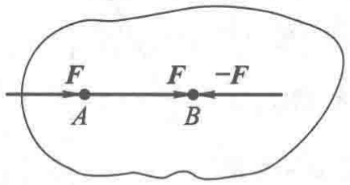
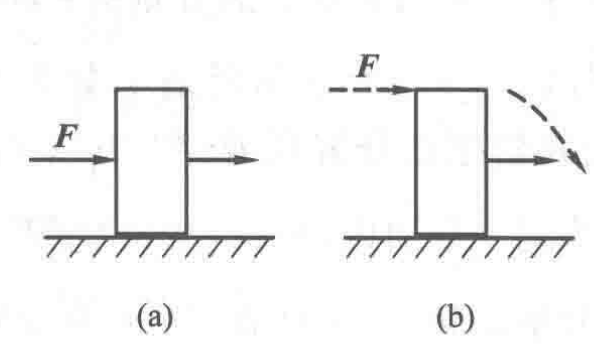

作用在刚体上的力虽可沿作用线滑移，但作用线的位置却不能随意移动．

图 3.4.2（a）中的力$\boldsymbol{F}$（通过质心）可使刚体沿光滑平面平动；而图 3.4.2（b）中的力$\boldsymbol{F}$（不通过质心）则可能使刚体倾倒．故当力的作用线位置迁移后，力学的效果亦随之而变．

两个共点力的合成，可用平行四边形定律．至于共面的任意两非平行力，则可应用力的可传性原理，将其汇交于一点，再用平行四边形定律求和．辗转应用此法，即可求出任意数目的共面力的合力．

平行力的求和，不能应用平行四边形定律，因为没有公共交点．但平行力合力的量值与方向很容易决定（由代数和即能确定），而合力的作用线，则可用力矩关系确定，即合力对垂直于诸力的某轴线的力矩应与诸分力对同一轴线力矩的代数和相等．

如两平行力$\boldsymbol{F}_2=-\boldsymbol{F}_1=\boldsymbol{F}$，但不作用在同一直线上，如图 3.4.3 所示，则叫**力偶**．此时$\boldsymbol{F}_1+\boldsymbol{F}_2$的量值为零，但对任一点的合力矩则不为零．在图 3.4.3 中，$P$为力偶面（$\boldsymbol{F}_1$、$\boldsymbol{F}_2$所在的面）内任意的一点，则$\boldsymbol{F}_1$及$\boldsymbol{F}_2$对任意点$P$的总力矩量值为

$$
F_2\cdot PO_2-F_1\cdot PO_1=F\cdot O_1O_2
$$

$O_1O_2$为组成此力偶两平行力间的垂直距离．故力偶的任一力和两力作用线间垂直距离的乘积，等于两力对垂直于力偶面的任意轴线的力矩的代数和．我们称两力间的垂直距离为**力偶臂**，而称力和力偶臂的乘积为**力偶矩**．力偶矩是力偶唯一的力学效果，也是一个矢量，通常用垂直于力偶面的任一直线来表示，其方向则用右螺旋法则定之，如图 3.4.4 所示．由此可以看出：力偶矩为一**自由矢量**，可作用于力偶面上的任一点，与滑移矢量（不能改变作用线）不同．

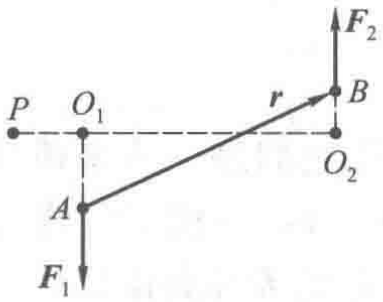
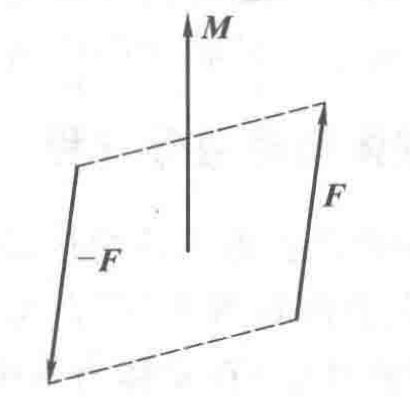

上述力偶矩$\boldsymbol{M}$也可写为

$$
\boldsymbol{M}=\boldsymbol{r}\times\boldsymbol{F}
$$

式中$\boldsymbol{r}=\overrightarrow{AB}$，是$\boldsymbol{F}_2$的作用点$B$对$\boldsymbol{F}_1$的作用点$A$的位矢．

空间共点力系与平行力系的求和方法，与共面力系相同．不过，在对空间力系求和时，有时会遇到这样一种很麻烦的情况：它们中任何两个力都既不平行又不能汇交于一点，如图 3.4.5 所示．十分显然，上面所讲的求和方法，对这样的力系都不能适用．

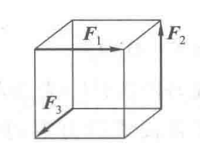

事实上，即使不是这样的力系，我们也常常要把空间力系中所有的力都迁移到任一指定点（例如质心）上去，因此有必要研究力的作用线如何迁移的问题．

设$\boldsymbol{F}'$为作用在刚体$A$点上的一个力，$P$为空间任意一点，但不在$\boldsymbol{F}'$的作用线上（图 3.4.6）．在$P$点，添上两个与$\boldsymbol{F}'$的作用线平行的力$\boldsymbol{F}_1$及$\boldsymbol{F}_2$，且

$$
\boldsymbol{F}_1+\boldsymbol{F}_2=0,\quad \boldsymbol{F}_1=\boldsymbol{F}_2=\boldsymbol{F}'
$$

则$\boldsymbol{F}'$及$\boldsymbol{F}_2$可组成一力偶，而$\boldsymbol{F}_1$则作用在$P$点上，其量值和方向均与$\boldsymbol{F}'$相同．故力$\boldsymbol{F}'$可化为过$P$点的力$\boldsymbol{F}_1$和$\boldsymbol{F}'$及$\boldsymbol{F}_2$所组成的一个力偶，其力偶矩为$\boldsymbol{r}\times\boldsymbol{F}'$；后者即力$\boldsymbol{F}'$对$P$点的力矩，因$\boldsymbol{r}$是$A$对$P$的位矢．作用在其他点上的一些力，也可用同样方法，化为经过$P$点的一个力和一个力偶．对作用在$P$点上的诸力，可求出一合力$\boldsymbol{F}$，而对诸力偶亦可用矢量求和的方法，求出一合力偶，其力偶矩为$\boldsymbol{M}$，等于那些力在原来位置时对$P$点力矩的矢量和．故任意力系总可简化为通过某指定点$P$的一个单力$\boldsymbol{F}$及一力偶矩为$\boldsymbol{M}$的力偶．它们是两个相互独立的元素，我们把$P$点叫做**简化中心**，把力的矢量和$\boldsymbol{F}$叫做**主矢**，而把力偶矩$\boldsymbol{M}$的矢量和叫做对简化中心的**主矩**．

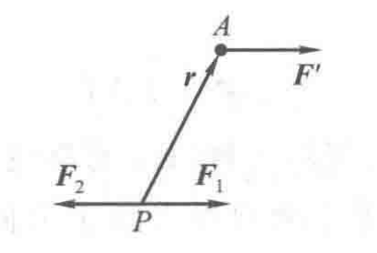

既然$P$点是完全任意的，所以我们可以根据问题的需要，取空间任何一点作为简化中心．在刚体力学中，我们常取质心$C$为简化中心．因此外力的主矢$\boldsymbol{F}$使刚体的质心的平动运动状态发生变化，可以证明，外力对质心$C$的主矩$\boldsymbol{M}$则使刚体绕通过质心$C$的轴线的转动状态发生变化．

### （2）刚体运动微分方程

我们已经研究了质点系的运动，现在让我们进一步来研究刚体的运动，固体具有刚性（两点间位置不变）及可变形性（两点间相对位置可变或称塑性）这两种互相矛盾的性质．在刚体力学中，我们认为固体是刚性的，不考虑其可变形性，从而使我们研究的问题大大简化．系统的独立变量由$3n$个变为6个，内力所作元功之和为零以及力的可传性原理等都是从刚性这一概念推断出来的．

刚体可以看作是包含$n$个质点的质点系，而根据本节（1）中的讨论，知作用在刚体上的力系，可以简化为通过质心的一个单力$\boldsymbol{F}$及一力偶矩为$\boldsymbol{M}$的力偶．故利用第二章中的质心运动定理和相对于质心的动量矩定理，就可写出刚体运动的微分方程．

如果以$\boldsymbol{r}_i$代表刚体中任一质点$P_i$对静止坐标系$S$原点$O$的位矢，$\boldsymbol{r}_c$为质心$C$对$O$的位矢，而$\boldsymbol{r}_i'$则为$P_i$对质心$C$的位矢，动坐标系$S'$随质心作平动，其原点与质心$C$重合．而由 §2.2 中的式（2.2.9），得刚体质心$C$的运动方程为

$$
m\ddot{\boldsymbol{r}}_c=\sum_{i=1}^{n}\boldsymbol{F}_i^{(e)}=\boldsymbol{F}
\qquad (3.4.1)
$$

式中$m$为刚体的总质量，$\ddot{\boldsymbol{r}}_c$为质心的加速度，而$\boldsymbol{F}$则为作用在刚体上的外力矢量和即主矢．如果用分量来表示，则为

$$
\begin{aligned}
m\ddot{x}_c&=F_x\\
m\ddot{y}_c&=F_y\\
m\ddot{z}_c&=F_z
\end{aligned}
\qquad (3.4.2)
$$

另外，根据式（2.3.10），刚体在动坐标系$S'$中的相对运动对质心$C$的总动量矩$\boldsymbol{J}'$对时间的微商是

$$
\frac{\mathrm{d}\boldsymbol{J}'}{\mathrm{d}t}=\boldsymbol{M}'
\qquad (3.4.3)
$$

式中$\boldsymbol{M}'$为诸外力对质心$C$的力矩的矢量和，即诸外力对质心$C$的主矩

$$
\boldsymbol{M}'=\sum_{i=1}^{n}\boldsymbol{r}_i'\times\boldsymbol{F}_i^{(e)}
$$

式（3.4.3）写成分量形式，则为

$$
\begin{aligned}
\frac{\mathrm{d}J_x'}{\mathrm{d}t}&=M_x'\\
\frac{\mathrm{d}J_y'}{\mathrm{d}t}&=M_y'\\
\frac{\mathrm{d}J_z'}{\mathrm{d}t}&=M_z'
\end{aligned}
\qquad (3.4.4)
$$

对固定坐标系中的定点$O$而言，上式仍属有效，只需将$\boldsymbol{J}'$改$\boldsymbol{J}$（对定点$O$的总动量矩），$\boldsymbol{M}'$改$\boldsymbol{M}$［诸外力对定点$O$的主矩$\boldsymbol{M}=\sum_{i=1}^{n}\boldsymbol{r}_i\times\boldsymbol{F}_i^{(e)}$］即可，也就是式（2.3.4）．

由（3.4.1）及（3.4.3）两式，可得下述定理：

假如一自由刚体，在一外力系$\boldsymbol{F}_1^{(e)},\boldsymbol{F}_2^{(e)},\cdots,\boldsymbol{F}_n^{(e)}$的作用下在空间运动，则：

（a）它的质量中心好像一具有质量$m$的质点，而所有的外力也作用在此质点上，且此时动量对时间的微商，等于诸外力的矢量和．

（b）刚体在相对于随质心平动的动坐标系的运动中，对质心$C$的动量矩对时间的微商，等于诸外力对$C$的力矩的矢量和．当转动对于固定坐标系的某定点$O$而言时，也得到类似结果．

刚体有六个独立变量，故（3.4.2）及（3.4.4）两组方程式是讨论刚体运动的基本微分方程，利用它们，可以恰好确定刚体的运动情况．此外，我们也可以应用动能定理，作为一个辅助方程，来代替（3.4.2）及（3.4.4）六个分量形式方程中的任意一个．但注意这时刚体内力所作元功之和为零，故刚体动能的微分，等于刚体在运动过程中诸外力所作的元功之和，即

$$
\mathrm{d}T=\sum_{i=1}^{n}\boldsymbol{F}_i^{(e)}\cdot\mathrm{d}\boldsymbol{r}_i
\qquad (3.4.5)
$$

如为保守力系，则得能量积分为

$$
T+V=E
\qquad (3.4.6)
$$

### （3）刚体平衡方程

作用在刚体上的力系，总可化为经过质心的一个单力及一力偶，而由刚体运动微分方程（3.4.1）及（3.4.3）知，前者将决定刚体的质心如何平动而后者则决定刚体相对于质心如何转动．刚体平衡时，必须满足下列平衡方程：

$$
\left.
\begin{aligned}
\boldsymbol{F}&=0\\
\boldsymbol{M}&=0
\end{aligned}
\right\}
\qquad (3.4.7)
$$

即诸外力的矢量和为零和诸外力对任意一点力矩的矢量和亦为零．

因为

$$
\boldsymbol{F}=F_x\boldsymbol{i}+F_y\boldsymbol{j}+F_z\boldsymbol{k}
$$

故

$$
F_x=0,\quad F_y=0,\quad F_z=0
\qquad (3.4.8)
$$

又

$$
\boldsymbol{M}=M_x\boldsymbol{i}+M_y\boldsymbol{j}+M_z\boldsymbol{k}
$$

故

$$
M_x=0,\quad M_y=0,\quad M_z=0
\qquad (3.4.9)
$$

即刚体平衡时，诸外力在每一坐标轴上投影之和为零，诸外力对每一坐标轴的力矩之和亦为零．

刚体具有六个独立变量，故（3.4.8）及（3.4.9）中的六个分量方程恰好可以规定刚体在一外力系作用下平衡时的位形．

如为共面力系，且设诸力均位于$xy$平面内，则平衡方程简化为

$$
F_x=0,\quad F_y=0,\quad M_z=0
\qquad (3.4.10)
$$

因为此时诸外力的$z$分量均等于零，故$F_z$必恒等于零．而诸外力因均位于$xy$平面内，故或者与$x$轴及$y$轴相交，或者与之平行，因而$M_x$与$M_y$亦必恒等于零．

共面力系的平衡条件，也可换成下述的说法：

若一刚体在共面力系作用下处于平衡状态，则此力系对任何三个不共线的点的主矩应分别等于零．

与空间力系不同，共面力系可化为一力或一力偶，这在前面已经讲过．如对任一点的力矩为零，则力系就不可能简化成一个力偶；如对三不共线的点的力矩均等于零，则力系又不可能化为一个单力（对任何两点的力矩等于零是可以的，因为这两点可能恰好在该力的作用线上），因此刚体只能平衡．

如为共面共点力系，则式（3.4.10）中的最后一式恒等于零，无需考虑．如为共面平行力系，且诸力均与$y$轴平行，则式（3.4.10）的第一式恒等于零，无需考虑．

如刚体仅受三非平行力的作用而平衡，则此三力必交于一点，否则就不能满足力矩平衡方程．

［例］　如图 3.4.7，一根均匀的棍子，重为$P$，长为$2l$．今将其一端置于粗糙地面上，又以其上的$C$点靠在墙上，墙离地面的高度为$h$．当棍子与地面的角度$\varphi$为最小值$\varphi_0$时，棍子在上述位置仍处于平衡状态，求棍与地面的摩擦因数$\mu$．

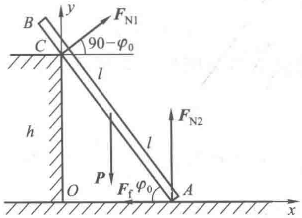

［解］　作用在棍子上的外力，有：

（1）重力$\boldsymbol{P}$，作用在棍子的中点；

（2）$C$点上的反作用力$\boldsymbol{F}_{N1}$，与棍子垂直；

（3）$A$点上的竖直反作用力$\boldsymbol{F}_{N2}$及水平反作用力（即摩擦力）$\boldsymbol{F}_f$，如图 3.4.7 所示．

取棍子所在的平面为$xy$平面，则本题是一共面力系的平衡问题．故利用式（3.4.10），我们有

$$
F_x=0,\quad F_{N1}\cos(90^\circ-\varphi_0)-F_f=0
\qquad (1)
$$

$$
F_y=0,\quad F_{N1}\sin(90^\circ-\varphi_0)+F_{N2}-P=0
\qquad (2)
$$

对$A$而言

$$
M_z=0,\quad Pl\cos\varphi_0-F_{N1}\frac{h}{\sin\varphi_0}=0
\qquad (3)
$$

由（3）式

$$
F_{N1}=P\frac{l}{h}\sin\varphi_0\cos\varphi_0
\qquad (4)
$$

由（1）式

$$
F_f=F_{N1}\sin\varphi_0=P\frac{l}{h}\sin^2\varphi_0\cos\varphi_0
\qquad (5)
$$

由（2）式

$$
F_{N2}=P-F_{N1}\cos\varphi_0=P-P\frac{l}{h}\sin\varphi_0\cos^2\varphi_0
\qquad (6)
$$

所以

$$
\mu=\frac{F_f}{F_{N2}}=\frac{l\sin^2\varphi_0\cos\varphi_0}{h-l\sin\varphi_0\cos^2\varphi_0}
\qquad (7)
$$

这就是我们所要求的关系．

## §3.5 转动惯量

### （1）刚体的动量矩

在质点动力学和质点系动力学中，我们都曾遇到动量矩定理，并把它作为三大基本定理之一．在刚体动力学中，大量篇幅是研究刚体的转动问题．因此，就经常要用到动量矩定理．

在还没有研究动量矩定理在刚体动力学中的作用以前，让我们先来研究一下，在转动问题中，动量矩的表达式是怎样的？

假设刚体在某一时刻以角速度$\boldsymbol{\omega}$作定点转动，如图 3.5.1 所示．在它里面，取任一质点$P_i$，它的质量是$m_i$，速度为$\boldsymbol{v}_i$（未画出）．如$P_i$对定点$O$的位矢是$\boldsymbol{r}_i$，则此质点对定点$O$的动量矩为

$$
\boldsymbol{r}_i\times m_i\boldsymbol{v}_i
$$

而整个刚体对$O$的动量矩为刚体中各质点对同一点$O$的动量矩的矢量和：

$$
\boldsymbol{J}=\sum_{i=1}^{n}(\boldsymbol{r}_i\times m_i\boldsymbol{v}_i)
\qquad (3.5.1)
$$

因为

$$
\boldsymbol{v}_i=\boldsymbol{\omega}\times\boldsymbol{r}_i
$$

故

$$
\boldsymbol{J}=\sum_{i=1}^{n}m_i[\boldsymbol{r}_i\times(\boldsymbol{\omega}\times\boldsymbol{r}_i)]
$$

即

$$
\boldsymbol{J}=\sum_{i=1}^{n}m_i[\boldsymbol{\omega}r_i^2-\boldsymbol{r}_i(\boldsymbol{\omega}\cdot\boldsymbol{r}_i)]
\qquad (3.5.2)
$$

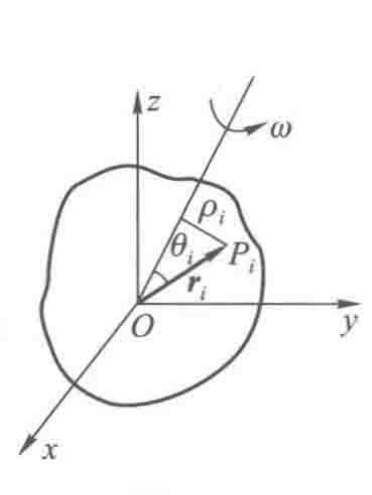

式（3.5.2）告诉我们，动量矩$\boldsymbol{J}$一般并不与角速度$\boldsymbol{\omega}$共线．在平动中，动量$\boldsymbol{p}$与线速度$\boldsymbol{v}$总是共线的．在定点转动中，只在惯量主轴上，$\boldsymbol{J}$才与$\boldsymbol{\omega}$共线［参看本节中的（4）及（5）］．

现在来求在一般情况下动量矩$\boldsymbol{J}$的分量表达式．把动量矩矢量$\boldsymbol{J}$和角速度矢量$\boldsymbol{\omega}$都分为沿三正交坐标轴$x,y,z$（原点在$O$）上的分量，则因

$$
\boldsymbol{r}_i=x_i\boldsymbol{i}+y_i\boldsymbol{j}+z_i\boldsymbol{k}
$$

$$
\boldsymbol{\omega}=\omega_x\boldsymbol{i}+\omega_y\boldsymbol{j}+\omega_z\boldsymbol{k}
$$

故得$\boldsymbol{J}$在$x$方向的分量$J_x$为

$$
\begin{aligned}
J_x&=\sum_{i=1}^{n}m_i[\omega_x(y_i^2+z_i^2)-x_i(\omega_xx_i+\omega_yy_i+\omega_zz_i)]\\
&=\omega_x\sum_{i=1}^{n}m_i(y_i^2+z_i^2)-\omega_y\sum_{i=1}^{n}m_ix_iy_i-\omega_z\sum_{i=1}^{n}m_ix_iz_i
\end{aligned}
\qquad (3.5.3)
$$

同理

$$
\left.
\begin{aligned}
J_y&=-\omega_x\sum_{i=1}^{n}m_iy_ix_i+\omega_y\sum_{i=1}^{n}m_i(z_i^2+x_i^2)-\omega_z\sum_{i=1}^{n}m_iy_iz_i\\
J_z&=-\omega_x\sum_{i=1}^{n}m_iz_ix_i-\omega_y\sum_{i=1}^{n}m_iz_iy_i+\omega_z\sum_{i=1}^{n}m_i(x_i^2+y_i^2)
\end{aligned}
\right\}
\qquad (3.5.4)
$$

$$
\begin{aligned}
I_{xx}&=\sum_{i=1}^{n}m_i(y_i^2+z_i^2)\\
I_{yy}&=\sum_{i=1}^{n}m_i(z_i^2+x_i^2)\\
I_{zz}&=\sum_{i=1}^{n}m_i(x_i^2+y_i^2)
\end{aligned}
\qquad (3.5.5)
$$

及

$$
\begin{aligned}
I_{yz}=I_{zy}&=\sum_{i=1}^{n}m_iy_iz_i\\
I_{zx}=I_{xz}&=\sum_{i=1}^{n}m_iz_ix_i\\
I_{xy}=I_{yx}&=\sum_{i=1}^{n}m_ix_iy_i
\end{aligned}
\qquad (3.5.6)
$$

关于$I_{xx},I_{yy}$和$I_{zz}$以及$I_{yz},I_{zx}$和$I_{xy}$的物理意义，我们下面还要作进一步的讨论．

利用式（3.5.5）与式（3.5.6）所引入的符号，（3.5.3）和（3.5.4）两式可简写为

$$
\begin{aligned}
J_x&=I_{xx}\omega_x-I_{xy}\omega_y-I_{xz}\omega_z\\
J_y&=-I_{yx}\omega_x+I_{yy}\omega_y-I_{yz}\omega_z\\
J_z&=-I_{zx}\omega_x-I_{zy}\omega_y+I_{zz}\omega_z
\end{aligned}
\qquad (3.5.7)
$$

### （2）刚体的转动动能

现在来求刚体对定点$O$的转动动能，由图 3.5.1 知

$$
\begin{aligned}
T&=\frac{1}{2}\sum_{i=1}^{n}m_i\dot{\boldsymbol{r}}_i^2=\frac{1}{2}\sum_{i=1}^{n}m_i\boldsymbol{v}_i\cdot\boldsymbol{v}_i=\frac{1}{2}\sum_{i=1}^{n}m_i\boldsymbol{v}_i\cdot(\boldsymbol{\omega}\times\boldsymbol{r}_i)\\
&=\frac{1}{2}\boldsymbol{\omega}\cdot\sum_{i=1}^{n}(\boldsymbol{r}_i\times m_i\boldsymbol{v}_i)=\frac{1}{2}\boldsymbol{\omega}\cdot\boldsymbol{J}\\
&=\frac{1}{2}(\omega_x\boldsymbol{i}+\omega_y\boldsymbol{j}+\omega_z\boldsymbol{k})\cdot(J_x\boldsymbol{i}+J_y\boldsymbol{j}+J_z\boldsymbol{k})
\end{aligned}
$$

把式（3.5.7）中的$J_x,J_y$和$J_z$的表达式代入上式，就得到

$$
\begin{aligned}
T&=\frac{1}{2}\left(I_{xx}\omega_x^2+I_{yy}\omega_y^2+I_{zz}\omega_z^2-2I_{yz}\omega_y\omega_z\right.\\
&\qquad\left.-2I_{zx}\omega_z\omega_x-2I_{xy}\omega_x\omega_y\right)
\end{aligned}
\qquad (3.5.8)
$$

### （3）转动惯量

刚体的转动动能也可写为

$$
\begin{aligned}
T&=\frac{1}{2}\sum_{i=1}^{n}m_i(\boldsymbol{\omega}\times\boldsymbol{r}_i)\cdot(\boldsymbol{\omega}\times\boldsymbol{r}_i)\\
&=\frac{1}{2}\sum_{i=1}^{n}m_i\omega^2r_i^2\sin^2\theta_i\\
&=\frac{1}{2}\omega^2\sum_{i=1}^{n}m_i\rho_i^2\\
&=\frac{1}{2}I\omega^2
\end{aligned}
\qquad (3.5.9)
$$

式中$\theta_i$为$P_i$的位矢$\boldsymbol{r}_i$与角速度矢量$\boldsymbol{\omega}$之间的夹角，$\rho_i$为自$P_i$至转动瞬轴（即矢量$\boldsymbol{\omega}$的作用线）的垂直距离（参看图 3.5.1），而$I$称为刚体绕转动瞬轴的**转动惯量**．

在研究刚体转动时，恒有$\sum_{i=1}^{n}m_i\rho_i^2$这一表达式出现，式中$m_i$是刚体上某一质点$P_i$的质量，$\rho_i$为$P_i$至转动瞬轴的垂直距离，而求和则遍及整个刚体．这个表达式代表一个新的物理量，是转动时物体的一个属性，代表物体在转动时惯性的量度，和平动时的质量$m$相当．转动惯量的表达式中包含距离（或坐标）的二次方，而质心的表达式中，则包含距离（或坐标）的一次方，所以计算时有很多相似之处．对质量均匀分布或按一定规律分布，且形状规则的刚体，转动惯量的求法也和质心的求法一样，把求和改为定积分．对质量分布不均匀或形状不规则的刚体，两者都只能通过实验求出．

虽然转动惯量和质心在计算上有相似之处，但物理实质则迥然不同．在平动中，质量$m$可认为是集中在物体的质心上．而在转动中，转动惯量反映物体转动时惯性的大小．但是，我们也可认为，刚体按一定规律分布的质量，在转动中等效于集中在某一点上的一个质点的质量，此点离某轴线的垂直距离为$k$，刚体对该轴线的转动惯量与该等效质点对此同一轴线的转动惯量相等，即

$$
I=mk^2
\qquad (3.5.10)
$$

或

$$
k=\sqrt{\frac{I}{m}}
\qquad (3.5.11)
$$

式中的$k$叫做刚体对该轴线的**回转半径**．回转半径虽为一等效的量，但在计算中常被采用以简化问题，因为这样一来，质量$m$在算式中就可被约去．

物体的转动惯量，一方面决定于物体的形状（或质量分布的情况），另一方面又决定于转动轴的位置，即对之求转动惯量的那条轴线的位置．所以转动轴不同，即使是同一物体，转动惯量也不同．但是对两条平行轴而言，如果其中有一条通过物体的质心，那么物体对某一轴线的转动惯量，等于对通过质心的平行轴的转动惯量，加上物体的质量与两轴间垂直距离平方的乘积，即

$$
I=I_c+md^2
\qquad (3.5.12)
$$

式中$I$是对某轴线的转动惯量，$I_c$为对通过质心并与上述轴线平行的轴线的转动惯量，$d$为两平行轴线间的垂直距离．这个关系，叫做**平行轴定理**．利用这个定理，计算工作可以大为简化．关于这个定理的证明，可参看普通物理中的有关章节．

### （4）惯量张量和惯量椭球

对质量均匀分布（或按一定规律分布），且形状规则的刚体，我们可把（3.5.5）和（3.5.6）两式改写为定积分形式（一般是重积分），即

$$
\begin{aligned}
I_{xx}&=\int(y^2+z^2)\,\mathrm{d}m\\
I_{yy}&=\int(z^2+x^2)\,\mathrm{d}m\\
I_{zz}&=\int(x^2+y^2)\,\mathrm{d}m
\end{aligned}
\qquad (3.5.13)
$$

及

$$
\begin{aligned}
I_{yz}=I_{zy}&=\int yz\,\mathrm{d}m\\
I_{zx}=I_{xz}&=\int zx\,\mathrm{d}m\\
I_{xy}=I_{yx}&=\int xy\,\mathrm{d}m
\end{aligned}
\qquad (3.5.14)
$$

式（3.5.13）中的$(y^2+z^2)$、$(z^2+x^2)$和$(x^2+y^2)$是质点$P$离$x$轴、$y$轴和$z$轴的垂直距离的平方（图 3.5.2）．故$I_{xx}$、$I_{yy}$和$I_{zz}$就叫做刚体对$x$轴、$y$轴和$z$轴的**轴转动惯量**，至于$I_{yz}$、$I_{zx}$和$I_{xy}$则因含有两个坐标的相乘项，所以叫做**惯量积**．

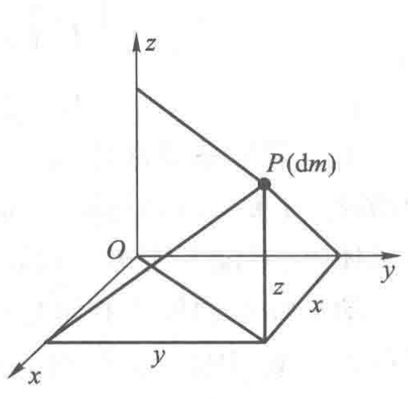

通过空间某一点$O$，我们可以作出无数轴线，根据上面的讨论，知同一物体绕不同的轴线转动时，转动惯量也将不同．这样，对通过$O$点的许多轴线，如果需要知道绕这些轴线的转动惯量，就得计算好多次．是不是也有类似如平行轴定理那样的简单公式呢？我们说：这个公式也是存在的，我们现在就来推导这个公式．

结合（3.5.8）和（3.5.9）两式，并因

$$
\omega_x=\alpha\omega,\quad \omega_y=\beta\omega,\quad \omega_z=\gamma\omega
$$

故得

$$
I=I_{xx}\alpha^2+I_{yy}\beta^2+I_{zz}\gamma^2-2I_{yz}\beta\gamma-2I_{zx}\gamma\alpha-2I_{xy}\alpha\beta
\qquad (3.5.15)
$$

式中$\alpha,\beta,\gamma$为任一转动瞬轴相对于坐标轴的方向余弦．故只要一次算出三个轴转动惯量和三个惯性积，则通过$O$点的任一轴线的转动惯量就可由式（3.5.15）算出，只要把该轴线的方向余弦代入式（3.5.15）即可．

三个轴转动惯量和六个惯性积（由于对称关系，实际上也只有三个是互相独立的）作为统一的一个物理量，来代表刚体转动时惯性的量度，可以排成下列矩阵的形式：

$$
\begin{pmatrix}
I_{xx}&-I_{xy}&-I_{xz}\\
-I_{yx}&I_{yy}&-I_{yz}\\
-I_{zx}&-I_{zy}&I_{zz}
\end{pmatrix}
\qquad (3.5.16)
$$

并且把它叫做对$O$点而言的**惯量张量**，而这一惯性矩阵的每个元素（轴转动惯量和惯量积）则叫做惯量张量的**组元**，也叫**惯量系数**．

利用矩阵乘法，亦可得出式（3.5.15），因

$$
\begin{pmatrix}
I_{xx}&-I_{xy}&-I_{xz}\\
-I_{yx}&I_{yy}&-I_{yz}\\
-I_{zx}&-I_{zy}&I_{zz}
\end{pmatrix}
\begin{pmatrix}
\alpha\\\beta\\\gamma
\end{pmatrix}
=
\begin{pmatrix}
I_{xx}\alpha-I_{xy}\beta-I_{xz}\gamma\\
-I_{yx}\alpha+I_{yy}\beta-I_{yz}\gamma\\
-I_{zx}\alpha-I_{zy}\beta+I_{zz}\gamma
\end{pmatrix}
$$

而

$$
\begin{aligned}
(\alpha\ \beta\ \gamma)
\begin{pmatrix}
I_{xx}&-I_{xy}&-I_{xz}\\
-I_{yx}&I_{yy}&-I_{yz}\\
-I_{zx}&-I_{zy}&I_{zz}
\end{pmatrix}
\begin{pmatrix}
\alpha\\\beta\\\gamma
\end{pmatrix}
&=I_{xx}\alpha^2+I_{yy}\beta^2+I_{zz}\gamma^2-2I_{yz}\beta\gamma-2I_{zx}\gamma\alpha-2I_{xy}\alpha\beta\\
&=I
\end{aligned}
\qquad (3.5.17)
$$

利用式（3.5.16），我们还可把式（3.5.7）写为

$$
\begin{pmatrix}
J_x\\J_y\\J_z
\end{pmatrix}
=
\begin{pmatrix}
I_{xx}&-I_{xy}&-I_{xz}\\
-I_{yx}&I_{yy}&-I_{yz}\\
-I_{zx}&-I_{zy}&I_{zz}
\end{pmatrix}
\begin{pmatrix}
\omega_x\\\omega_y\\\omega_z
\end{pmatrix}
\qquad (3.5.18)
$$

由于惯量系数都是点坐标的函数，所以如果取用静止的坐标系，那么刚体转动时，惯量系数亦将随之而变，这显然是很不方便的．因此，通常都选取固连在刚体上、并随着刚体一同转动的动坐标系，这样，惯量系数都将是常数．

动坐标系的原点和坐标轴只需固定在刚体上即可，坐标轴的取向则完全可以任意选取．因此，我们可以利用这一性质，来同时消去转动惯量中惯量积，以使问题更为简化．

为了消去惯量积，一般是采用下面所介绍的方法．如果我们在转动轴上，截取一线段$OQ$，并且使$OQ=\frac{1}{\sqrt{I}}=R$，$I$为刚体绕该轴的转动惯量，则$Q$点的坐标为

$$
x=R\alpha,\quad y=R\beta,\quad z=R\gamma
$$

因为通过$O$点有很多转轴，按照上面所讲的方法，就应有很多的$Q$点，这些点的轨迹方程为［利用$R^2I=1$及式（3.5.15）］

$$
I_{xx}x^2+I_{yy}y^2+I_{zz}z^2-2I_{yz}yz-2I_{zx}zx-2I_{xy}xy=1
\qquad (3.5.19)
$$

这是中心在$O$点的二次曲面方程，一般来讲，它是一闭合曲面，因为$I$不等于零（$I=0$时，$R$将趋于无限大）．故式（3.5.19）代表一个中心在$O$点的椭球，通常叫做**惯量椭球**．如果$O$为刚体的质心（或重心），则所作出的椭球，叫**中心惯量椭球**．按式（3.5.19）画出椭球后，就可根据$R=\frac{1}{\sqrt{I}}$的关系，由某轴上径矢$R$的长，求出刚体绕该轴转动时的转动惯量$I$．

### （5）惯量主轴及其求法

利用惯量椭球虽然可以求出转动惯量$I$，但我们的主要目的并不在此．我们的主要目的，是如何利用它来消去惯量积．我们知道：每一椭球都有三条相互垂直的主轴．如果以此三主轴为坐标轴，则椭球方程中含有异坐标相乘的项统统消失（实际上是它们前面的系数等于零，而这些系数正好就是惯量积）．惯量椭球的主轴叫做**惯量主轴**，而对惯量主轴的转动惯量叫**主转动惯量**①，并改以$I_1,I_2,I_3$表之，因为惯量积已全部等于零，无需再用两个下角标．如果取$O$点上的惯量主轴为坐标轴，则惯量椭球的方程将简化为

$$
I_1x^2+I_2y^2+I_3z^2=1
\qquad (3.5.20)
$$

此时系数$I_1,I_2,I_3$就是$O$点上的主转动惯量，而惯量积$I_{yz},I_{zx},I_{xy}$则统统等于零．故选惯量主轴为坐标轴，问题就能得到简化．这时，刚体的动量矩$\boldsymbol{J}$的表达式（3.5.7）和转动动能$T$的表达式（3.5.8）也将简化为

$$
\begin{aligned}
\boldsymbol{J}&=I_1\omega_x\boldsymbol{i}+I_2\omega_y\boldsymbol{j}+I_3\omega_z\boldsymbol{k}\\
T&=\frac{1}{2}(I_1\omega_x^2+I_2\omega_y^2+I_3\omega_z^2)
\end{aligned}
\qquad (3.5.21)
$$

求惯量主轴时，常从这一事实出发，即对惯量主轴来讲，椭球与主轴交点的位矢$\boldsymbol{R}$的方向和椭球上该点法线的方向重合．这就是解析几何里求二次曲面主轴的方法，或线性代数里求本征值的方法．关于这种方法，参见高等数学书籍．在力学里，我们所碰到的问题，大都是对称的均匀刚体，而这种刚体的惯量主轴，则可根据对称性很方便地求出．

如果我们所研究的是一个均匀刚体，即它的密度处处相同，而且此均匀刚体有对称轴，那么此轴就将是惯量主轴．例如，设$x$轴是某一均匀刚体的对称轴，则刚体中将有这样的质点$P_i'(x_i,-y_i,-z_i)$，它和刚体的另一质点$P_i(x_i,y_i,z_i)$相对应（图 3.5.3），因而

$$
\sum_{i=1}^{n}m_ix_iy_i=0,\quad \sum_{i=1}^{n}m_ix_iz_i=0
$$

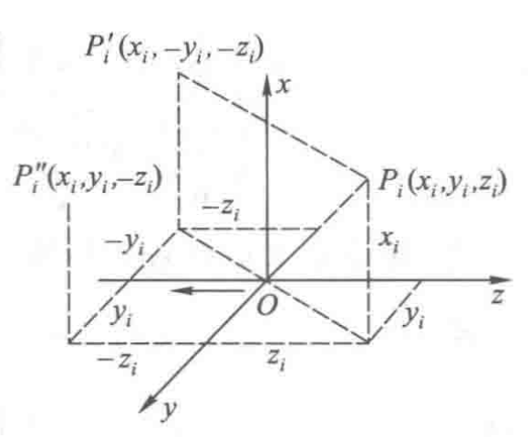

故$x$轴是对$O$点而言的惯量主轴．同理，如果某均匀刚体有对称面，设为$xy$平面，则必有质点$P_i''(x_i,y_i,-z_i)$和另一质点$P_i(x_i,y_i,z_i)$相对应（图 3.5.3），因而

$$
\sum_{i=1}^{n}m_iz_ix_i=0,\quad \sum_{i=1}^{n}m_iy_iz_i=0
$$

故和$xy$平面垂直的$z$轴将是对$O$点而言的惯量主轴．

如果$I_{xx}=I_{yy}$，那么椭球变为旋转椭球，在$xy$平面内的各轴都是主轴；如$I_{xx}=I_{yy}=I_{zz}$，椭球变为球，所有通过$O$点的轴都是主轴．

［例］　均匀长方形薄片的边长为$a$与$b$，质量为$m$，求此长方形薄片绕其对角线转动时的转动惯量．

［解］　（1）直接用定积分来计算

在图 3.5.4 中，取对角线为$x$轴，在$O$点和它垂直的直线为$y$轴，并令$t$为薄片的厚度，$\rho$为密度．

> ① 对中心惯量椭球来讲，则叫中心（惯量）主轴和中心主转动惯量．

取一长方形窄条，长为$u$，宽为$\mathrm{d}y$，则绕对角线（$x$轴）转动的转动惯量$I$为

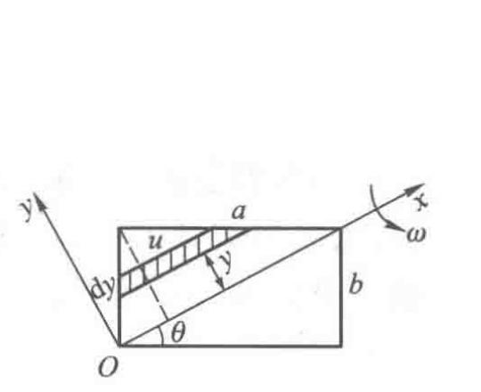

$$
I=2\int y^2\mathrm{d}m=2\rho t\int y^2 u\mathrm{d}y
\qquad (1)
$$

因为

$$
\frac{u}{\sqrt{a^2+b^2}}=\frac{a\sin\theta-y}{a\sin\theta}
$$

所以

$$
u=\frac{(a\sin\theta-y)\sqrt{a^2+b^2}}{a\sin\theta}
\qquad (2)
$$

把（2）式代入（1）式得

$$
I=2\rho t\frac{\sqrt{a^2+b^2}}{a\sin\theta}\int_0^{a\sin\theta}y^2(a\sin\theta-y)\mathrm{d}y
$$

$$
=2\rho t\frac{\sqrt{a^2+b^2}}{a\sin\theta}\left[a\sin\theta\frac{y^3}{3}-\frac{y^4}{4}\right]_0^{a\sin\theta}
$$

$$
=\frac{1}{6}\rho t\sqrt{a^2+b^2}(a^3\sin^3\theta)
\qquad (3)
$$

但

$$
\sin\theta=\frac{b}{\sqrt{a^2+b^2}}
$$

故

$$
I=\frac{1}{6}\rho t\sqrt{a^2+b^2}\left[\frac{a^3b^3}{(\sqrt{a^2+b^2})^3}\right]=\frac{1}{6}\rho abt\left(\frac{a^2b^2}{a^2+b^2}\right)
$$

$$
=\frac{1}{6}m\frac{a^2b^2}{a^2+b^2}
\qquad (4)
$$

（2）用公式（3.5.15）来计算（取长方形的两边为坐标轴，如图3.5.5所示）．

因

$$
\alpha=\cos\theta=\frac{a}{\sqrt{a^2+b^2}},\qquad \beta=\frac{b}{\sqrt{a^2+b^2}},\qquad \gamma=0
$$

所以

$$
I=I_{xx}\alpha^2+I_{yy}\beta^2-2I_{xy}\alpha\beta
\qquad (5)
$$

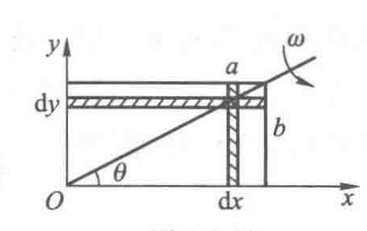

今

$$
I_{xx}=\int_0^b y^2\rho t(a\,\mathrm{d}y)=\frac{1}{3}\rho tab^3
\qquad (6)
$$

$$
I_{yy}=\int_0^a x^2\rho t(b\,\mathrm{d}x)=\frac{1}{3}\rho ta^3b
\qquad (7)
$$

$$
I_{xy}=\int_0^a\int_0^b xy\rho t(\mathrm{d}x\mathrm{d}y)=\frac{1}{4}\rho ta^2b^2
\qquad (8)
$$

所以

$$
I=\frac{1}{3}\rho t(ab^3)\frac{a^2}{a^2+b^2}+\frac{1}{3}\rho t(a^3b)\frac{b^2}{a^2+b^2}
$$

$$
-\frac{1}{2}\rho t(a^2b^2)\frac{a}{\sqrt{a^2+b^2}}\frac{b}{\sqrt{a^2+b^2}}
$$

$$
=\frac{1}{6}\rho t(ab)\frac{a^2b^2}{a^2+b^2}=\frac{1}{6}m\frac{a^2b^2}{a^2+b^2}
\qquad (9)
$$

（3）取惯量主轴为坐标轴，则

$$
I=I_1\alpha^2+I_2\beta^2
\qquad (10)
$$

由图3.5.6知

$$
I_1=\int_{-\frac{b}{2}}^{\frac{b}{2}}y^2\rho t(a\,\mathrm{d}y)
=\frac{1}{12}\rho t(ab^3)
\qquad (11)
$$

$$
I_2=\int_{-\frac{a}{2}}^{\frac{a}{2}}x^2\rho t(b\,\mathrm{d}x)=\frac{1}{12}\rho ta^3b
\qquad (12)
$$

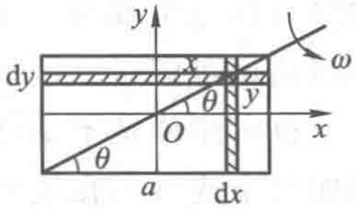

至于$\alpha,\beta$的值仍与本题（2）中相同．所以

$$
I=\frac{1}{12}\rho t(ab^3)\frac{a^2}{a^2+b^2}+\frac{1}{12}\rho t(a^3b)\frac{b^2}{a^2+b^2}
$$

$$
=\frac{1}{6}\rho t(ab)\frac{a^2b^2}{a^2+b^2}=\frac{1}{6}m\frac{a^2b^2}{a^2+b^2}
\qquad (13)
$$

比较以上三种方法，可以看出，取惯量主轴为坐标轴来计算薄片绕对角线转动时的转动惯量$I$最为简便．对空间问题和形状比较复杂的物体，如有对称轴，则总是以对称轴（即使是只有一条或两条）为坐标轴时，$I$的计算最简便．

## §3.6 刚体的平动与绕固定轴的转动

### （1）平动

在§3.1中，我们曾经指出：刚体运动时，如果在各个时刻，刚体中任意一条直线始终彼此平行，那么这种运动就叫平动．我们在此应该注意：平动不一定是直线运动．为此，让我们考虑下列两种不同的情况．设$O-xyz$为静止的参考坐标系，$O'-x'y'z'$为固着在刚体上并与前者平行的另一个坐标系．当刚体运动时，$O'-x'y'z'$亦随之运动．如刚体上的$O'$点在一圆形轨道上运动，而$O'x',O'y',O'z'$永远与参考坐标系的三轴线$Ox,Oy,Oz$平行［图3.6.1（a）］，那么这种运动就是平动．反之，如果它像图3.6.1（b）所示，就不是平动，因为这时$O'x'$等已不与$Ox$等平行了．

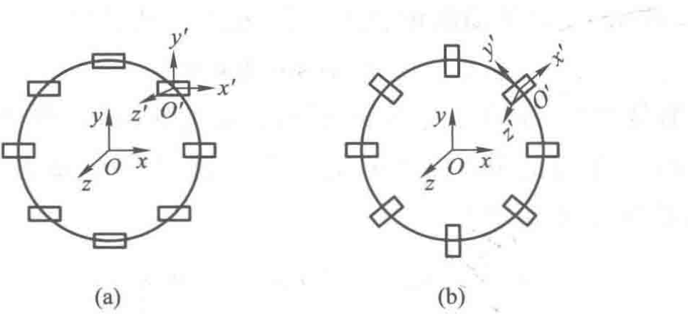

刚体平动时，刚体内所有的点都有相同的速度和加速度，任何一点的运动都可代表全体．通常我们是用质心的运动来代表刚体整体的运动，即认为刚体所有的质量都集中在质心上，外力也可以认为是作用在质心上，因为刚体作平动时只有三个独立变量，故其运动方程只需用式（3.4.2）的三个方程就够了，这在前面也曾讲过．

自由刚体是不受任何约束的，实际上，刚体作平动时，一般都受有一些约束．例如火车或汽车在地面上运动时，地面就是约束．如果我们要求这些约束力（或准确地说约束反作用力，简称约束反力），则根据§1.5所讲的方法，可以解除约束而代以约束反作用力．但约束反作用力都是未知的，所以还要加上相对于质心的力矩平衡方程，才能同时求出运动规律与约束反作用力．

以汽车的平动为例，当汽车停止或作匀速直线运动时，地面对汽车前后两对车轮上的竖直反作用力，可以假定是相等的．但当加速和刹车时，两者就不相等．如加速时加速度太大，或刹车时减速度太大，两对车轮上所受的约束反作用力也就相差很大，甚至能使汽车翻倒．

### （2）定轴转动

刚体绕固定轴转动时，如取固定轴为$z$轴，则刚体中任何一点$P_i$，都在垂直于$z$轴的平面内，亦即在平行于$xy$平面内作圆周运动，而以$z$轴与此平面的交点$O'$为圆心，如图3.6.2所示．

既然各点的轨道都是平行于$xy$平面而以$z$轴上某点为圆心的圆周，那么只要考虑任一与$xy$平面相平行的平面内的运动情况就可以了．设在这一平面内，某一质点的位矢是$\boldsymbol{r}_i$，它和$z$轴的垂直距离为$R_i(R_i=O'P_i)$，则因各点的线位移、线速度和线加速度都和$R_i$（或$\boldsymbol{r}_i$）有关，不甚方便，所以常用角量来表征整个刚体的运动情况．因为在定轴转动中，各点的角位移$\theta$、角速度$\boldsymbol{\omega}$和角加速度$\alpha$都是一样的．而且只要知道了角位移$\theta$，就能完全确定刚体的位置，所以刚体作定轴转动时，只有一个独立变量．

如果在某一时刻，质点$P_i$的线速度为$\boldsymbol{v}_i$，则由式（3.2.6）知

$$
\boldsymbol{v}_i=\boldsymbol{\omega}\times\boldsymbol{r}_i
\qquad (3.6.1)
$$

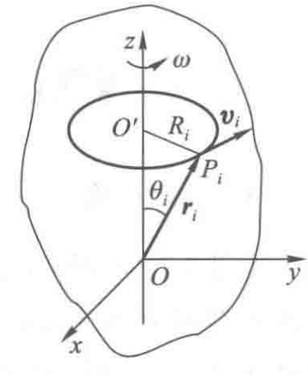

式中$\boldsymbol{\omega}$是刚体绕$z$轴转动的角速度．写成标量形式，则为

$$
v_i=\omega r_i\sin\theta_i=R_i\omega
\qquad (3.6.2)
$$

在定轴转动中，$\boldsymbol{\omega}$的方向不变，恒沿固定的转动轴，其量值则可改变．每一质点都在与$xy$平行的平面内作半径为$R_i$的圆周运动，故其加速度可分为切向分量$a_{i\tau}$及法向分量$a_{in}$，即

$$
\left.
\begin{aligned}
a_{i\tau}&=\dot{v}_i=R_i\dot{\omega}=R_i\alpha\\
a_{in}&=\frac{v_i^2}{R_i}=R_i\omega^2=\omega v_i
\end{aligned}
\right\}
\qquad (3.6.3)
$$

式中$\alpha$是角加速度．在定轴转动中，$\alpha$的指向与$\boldsymbol{\omega}$相同或相反，并且也是沿着同一条转动轴线．

如果$\omega$的量值也不变，则$\alpha=0$，因而$a_{i\tau}=0$．

前已指出：角量是描写整个刚体的运动学量，故$\boldsymbol{\omega}$称为刚体的角速度，而$\alpha$则称为刚体的角加速度，至于线量则各点不同，因$R_i$（或$\boldsymbol{r}_i$）各点有所不同．

以上所讲的是刚体定轴转动的运动学部分，下面来研究动力学问题．

设刚体在主动力$\boldsymbol{F}_1,\boldsymbol{F}_2,\cdots,\boldsymbol{F}_n$的作用下，绕固定轴转动，则可将固定轴当作$z$轴（图3.6.3），而按固定轴的动量矩定理，得

$$
\frac{\mathrm{d}J_z}{\mathrm{d}t}=M_z
\qquad (3.6.4)
$$

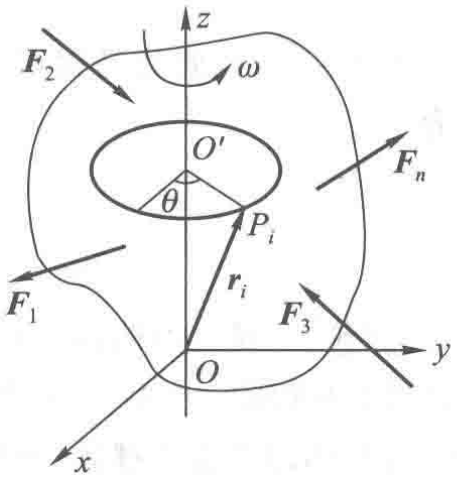

因为$\omega_x=\omega_y=0,\omega_z=\omega$，故由式（3.5.7）知

$$
J_z=I_{zz}\omega_z=I_{zz}\omega
\qquad (3.6.5)
$$

式中$I_{zz}$为刚体绕$z$轴的转动惯量．

把式（3.6.5）中的$J_z$代入式（3.6.4），并且因为$I_{zz}$为常量，即得刚体绕固定轴转动的动力学方程为

$$
M_z=I_{zz}\dot{\omega}=I_{zz}\alpha
\qquad (3.6.6)
$$

式（3.6.6）与质点动力学中的$F=ma$形式相似．如果将式（3.6.6）积分，求出刚体所转动的角度$\theta$随时间$t$的变化规律，则运动完全确定，因为此时刚体只有一个独立变量．

同理，由式（3.5.8）知，刚体绕固定轴转动的动能为$\dfrac{1}{2}I_{zz}\omega^2$．故如外力为保守力，$V$是外力的势能，则有

$$
\frac{1}{2}I_{zz}\omega^2+V=E
\qquad (3.6.7)
$$

［例1］ **复摆** 设质量为$m$的复摆绕通过某点$O$的水平轴作微小振动，试求其运动方程及振动周期，并加以讨论．

［解］ 图3.6.4代表复摆中包含质心$C$的一个截面，$O$为悬点，$OC=l$为悬点$O$到质心$C$的距离，并设此复摆绕通过$O$点的水平轴线转动时的转动惯量为$I_0$，回转半径为$k_0$，则由式（3.6.6），得复摆的运动微分方程为

$$
-mgl\sin\theta=I_0\alpha=mk_0^2\ddot{\theta}
\qquad (1)
$$

由此得

$$
k_0^2\ddot{\theta}+gl\sin\theta=0
\qquad (2)
$$

但由平行轴定理（3.5.12），知$k_0^2=k_C^2+l^2$，式中$k_C$为通过质心$C$的回转半径．又题设振动是微小的，故$\sin\theta\approx\theta$．这样，（2）式就变为

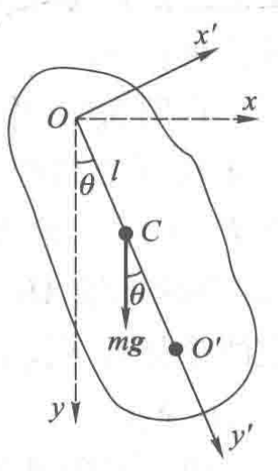

$$
\ddot{\theta}=-\frac{gl\theta}{k_C^2+l^2}
\qquad (3)
$$

式（3）是标准的谐振动方程，故其通解为

$$
\theta=A\sin\left(\sqrt{\frac{gl}{k_C^2+l^2}}\,t+\varepsilon\right)
\qquad (4)
$$

式中$A$为振幅，在此处是很微小的，$\varepsilon$是初相，$A$及$\varepsilon$之值均可由起始条件决定，振动周期则为

$$
\tau=2\pi\sqrt{\frac{k_C^2+l^2}{gl}}=2\pi\sqrt{\frac{I_0}{mgl}}
\qquad (5)
$$

［讨论］ 从上面的（4）及（5）式可以看出，它们和单摆所具有的形式很类似，所以单摆可以说是复摆的一个特例，即此时摆的全部质量$m$都集中在$OC$延长线的某点$O'$上．如$OO'=l_1$，则$l_1$叫做等值单摆长，因长为$l_1$的单摆和对悬点的转动惯量为$I_0$、质心和悬点间的距离为$l$的复摆有相同的周期，故$O'$又叫振动中心．

因$l_1=\dfrac{I_0}{ml}=\dfrac{k_C^2+l^2}{l}$或$l_1-l=\dfrac{k_C^2}{l}$，故如以$O'$为悬点，则

$$
I_{O'}=mk_C^2+m(l_1-l)^2=mk_C^2+m\left(\frac{k_C^2}{l}\right)^2=mk_C^2\frac{k_C^2+l^2}{l^2}
\qquad (6)
$$

而其振动周期为

$$
\tau'=2\pi\sqrt{\frac{\dfrac{mk_C^2}{l^2}(k_C^2+l^2)}{mg(l_1-l)}}=2\pi\sqrt{\frac{k_C^2+l^2}{gl}}
\qquad (7)
$$

与以$O$为悬点时的振动周期相同，故悬点和振动中心可以互相交换而周期不变．利用这个关系，可以比较准确地测定重力加速度$g$的数值，只要能够找到具有相同周期的两点$O$及$O'$的位置，即可量出等值单摆长$l_1$，这比用单摆测$g$的方法好，因单摆的长度$l$不易测准．

### （3）轴上的附加压力

我们也可把刚体绕固定轴的转动，看做等价于空间两点$A$和$B$保持不动时刚体的运动（因为两点可以决定一条直线，这条直线就是转动轴）．这就可用去掉约束代以约束反力的方法，即同时用动量定理和动量矩定理来确定运动规律和作用在$A$、$B$两点上的约束反力．

在图3.6.5中，$\boldsymbol{F}_{NA}$和$\boldsymbol{F}_{NB}$代表作用在固定点$A$和$B$上的约束反力（$A$、$B$处设为轴承），而$\boldsymbol{F}_1,\boldsymbol{F}_2,\cdots,\boldsymbol{F}_n$则代表作用在刚体上的主动力．令转动轴$AB$为$z$轴，则可设$\boldsymbol{F}_{NA}$在坐标轴上的分量为$F_{NAx}$、$F_{NAy}$和$F_{NAz}$，而$\boldsymbol{F}_{NB}$的分量为$F_{NBx}$和$F_{NBy}$．

由动量定理和对$A$点的动量矩定理，得

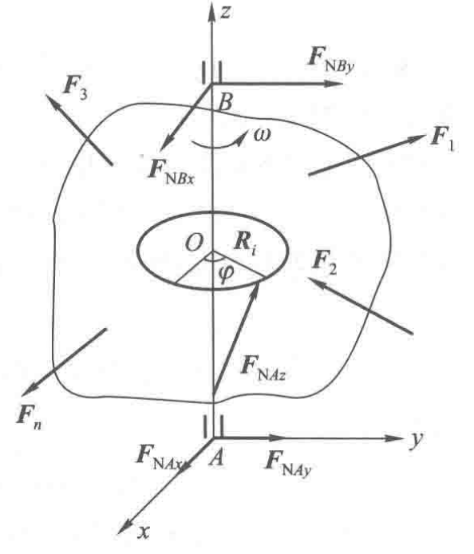

$$
\left.
\begin{aligned}
\frac{\mathrm{d}}{\mathrm{d}t}\sum_{i=1}^n m_i\dot{x}_i&=F_{NAx}+F_{NBx}+\sum_{i=1}^n F_{ix}\\
\frac{\mathrm{d}}{\mathrm{d}t}\sum_{i=1}^n m_i\dot{y}_i&=F_{NAy}+F_{NBy}+\sum_{i=1}^n F_{iy}\\
\frac{\mathrm{d}}{\mathrm{d}t}\sum_{i=1}^n m_i\dot{z}_i&=F_{NAz}+\sum_{i=1}^n F_{iz}\\
\frac{\mathrm{d}}{\mathrm{d}t}\sum_{i=1}^n m_i(y_i\dot{z}_i-z_i\dot{y}_i)&=-AB\cdot F_{NBy}+\sum_{i=1}^n M_{ix}\\
\frac{\mathrm{d}}{\mathrm{d}t}\sum_{i=1}^n m_i(z_i\dot{x}_i-x_i\dot{z}_i)&=AB\cdot F_{NBx}+\sum_{i=1}^n M_{iy}\\
\frac{\mathrm{d}}{\mathrm{d}t}\sum_{i=1}^n m_i(x_i\dot{y}_i-y_i\dot{x}_i)&=\sum_{i=1}^n M_{iz}
\end{aligned}
\right\}
\qquad (3.6.8)
$$

因$x_i=R_i\cos\varphi,y_i=R_i\sin\varphi,z_i=\text{常数}$（图3.6.5），故

$$
\left.
\begin{aligned}
\dot{x}_i&=-y_i\omega,&\ddot{x}_i&=-x_i\omega^2-y_i\dot{\omega}\\
\dot{y}_i&=x_i\omega,&\ddot{y}_i&=-y_i\omega^2+x_i\dot{\omega}\\
\dot{z}_i&=0,&\ddot{z}_i&=0
\end{aligned}
\right\}
\qquad (3.6.9)
$$

把这些关系代入式（3.6.8），并利用式（2.1.4）、式（3.5.5）和式（3.5.6），于是式（3.6.8）就简化为

$$
\left.
\begin{aligned}
-mx_C\omega^2-my_C\dot{\omega}&=F_{NAx}+F_{NBx}+\sum_{i=1}^n F_{ix}\\
-my_C\omega^2+mx_C\dot{\omega}&=F_{NAy}+F_{NBy}+\sum_{i=1}^n F_{iy}\\
0&=F_{NAz}+\sum_{i=1}^n F_{iz}\\
I_{yz}\omega^2-I_{zx}\dot{\omega}&=-AB\cdot F_{NBy}+M_x\\
-I_{zx}\omega^2-I_{yz}\dot{\omega}&=AB\cdot F_{NBx}+M_y\\
I_{zz}\dot{\omega}&=M_z
\end{aligned}
\right\}
\qquad (3.6.10)
$$

式中$x_C$和$y_C$是质心的坐标，$I_{zx}$、$I_{yz}$和$I_{zz}$是惯量系数，而$M_x$、$M_y$和$M_z$则为主动力对三坐标轴的合力矩．

方程（3.6.10）中的最后一式并不含有约束反力，因而就是刚体绕固定轴转动的动力学方程，这与式（3.6.6）完全一样，而其余五式，则可用来求约束反力的五个分量$F_{NAx}$、$F_{NAy}$、$F_{NAz}$、$F_{NBx}$和$F_{NBy}$．

如果$\omega=\dot{\omega}=0$，则式（3.6.10）中左端各项均等于零，因而头五式就是通常的平衡方程，而最后一式，因不含有约束反作用力，所以是平衡条件．

当$\omega\neq0$，$\dot{\omega}\neq0$时所算出来的$\boldsymbol{F}_{NA}$和$\boldsymbol{F}_{NB}$，跟$\omega=\dot{\omega}=0$时所算出来的完全不同，有时且可差得很远．前者是动力反作用力，而后者则是静力反作用力．因此，刚体在绕固定轴转动时，对轴承就有附加压力出现，这些附加压力是由于刚体转动时所产生的惯性力所引起的．

如果要刚体转动时不在轴承上产生附加压力，即在同样主动力作用下，动力反作用与静力反作用相等，则其充要条件是$\omega\neq0$且$\dot{\omega}\neq0$时，式（3.6.10）中的（1）、（2）、（4）、（5）诸式的左边均等于零．这样，就有

$$
\left.
\begin{aligned}
x_C\omega^2+y_C\dot{\omega}&=0\\
x_C\dot{\omega}-y_C\omega^2&=0
\end{aligned}
\right\}
$$

及

$$
\left.
\begin{aligned}
I_{yz}\omega^2-I_{zx}\dot{\omega}&=0\\
I_{yz}\dot{\omega}+I_{zx}\omega^2&=0
\end{aligned}
\right\}
$$

这是以$x_C$、$y_C$及$I_{yz}$、$I_{zx}$为未知量的二元一次方程，但它们的系数行列式在转动时都不等于零，故$x_C$、$y_C$、$I_{yz}$和$I_{zx}$必须同时为零，即刚体的重心在转动轴上，而且转动轴是惯量主轴．这时，我们就说这样的刚体已达到了**动平衡**，而这时的转动轴则叫做**自由转动轴**．这时即使取消约束，刚体还是会绕着它继续转动．

由于近代各种机器的运转部分（如蒸汽机，涡轮发电机等）的角速度$\omega$都很大，而附加压力的主要部分又和$\omega$的平方正比，因而在安装这些机器的时候，如果转动轴安装得稍为有一点偏差（不恰好是自由转动轴），就会在轴承上引起很大的附加压力，甚至使机器损坏．所以高速运转部分的动平衡，是制造与安装机器时最主要的问题之一．

［例2］ **涡轮** 可以看做一个均质圆盘．由于安装不善，涡轮转动轴与盘面法线成交角$\alpha=1^\circ$．已知涡轮圆盘质量为 20 kg，半径$r=0.2\ \mathrm{m}$，重心$O$在转轴上，$O$至两轴承$A$与$B$的距离各为$a=b=0.5\ \mathrm{m}$．设轴以 12 000 r/min 的角速度匀速转动时，试求轴承上某一时刻的最大压力．

［解］ 选取坐标轴如图3.6.6所示．图中$x,y,z$是固定的坐标轴，而$x',y',z'$则为几何对称轴．并设在图示的瞬时，$y'$和$y$正好重合．

因$x',y'(y),z'$是几何对称轴，而重心$O$在转轴上，故$x_C=y_C=0,I_{y'z'}=I_{z'x'}=0$，$\dot{\omega}=0$，故如以$O$为参考点，则由式（3.6.10）得

$$
\left.
\begin{aligned}
0&=F_{NAx}+F_{NBx}-mg\\
0&=F_{NAy}+F_{NBy}\\
0&=aF_{NAy}-bF_{NBy}\\
-I_{zx}\omega^2&=-aF_{NAx}+bF_{NBx}
\end{aligned}
\right\}
\qquad (1)
$$

现在来求$I_{xz}$．由坐标变换关系（图3.6.7），知

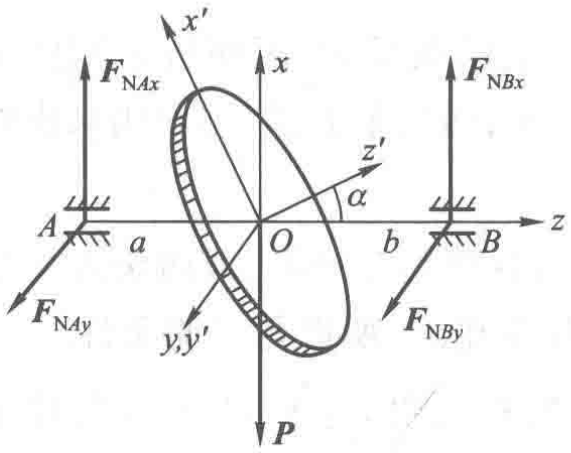

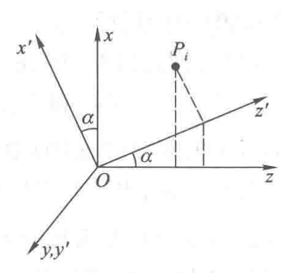

$$
x_i=x_i'\cos\alpha+z_i'\sin\alpha
$$

$$
z_i=-x_i'\sin\alpha+z_i'\cos\alpha
$$

故

$$
I_{xz}=\sum_{i=1}^n m_i z_i x_i
$$

$$
=\sum_{i=1}^n m_i(x_i'\cos\alpha+z_i'\sin\alpha)(-x_i'\sin\alpha+z_i'\cos\alpha)
$$

$$
=\left(\sum_{i=1}^n m_i z_i'^2-\sum_{i=1}^n m_i x_i'^2\right)\sin\alpha\cos\alpha\quad(\text{因}\quad I_{z'x'}=0)
$$

$$
=\frac{1}{2}\left[\sum_{i=1}^n m_i(z_i'^2+y_i'^2)-\sum_{i=1}^n m_i(x_i'^2+y_i'^2)\right]\sin2\alpha
$$

$$
=-\frac{1}{2}(I_{z'z'}-I_{x'x'})\sin2\alpha
\qquad (2)
$$

对于均质圆盘

$$
I_{z'z'}=\frac{1}{2}mr^2,\qquad I_{x'x'}=\frac{1}{2}mr^2
$$

故

$$
I_{xz}=-\frac{1}{8}mr^2\sin2\alpha
\qquad (3)
$$

解（1）式中的诸式，并利用（3）式的结果，最后得

$$
\left.
\begin{aligned}
F_{NAy}&=F_{NBy}=0,\\
F_{NAx}&=\frac{mbg}{a+b}-\frac{1}{8}\frac{1}{a+b}mr^2\omega^2\sin2\alpha\\
F_{NBx}&=\frac{mag}{a+b}+\frac{1}{8}\frac{1}{a+b}mr^2\omega^2\sin2\alpha
\end{aligned}
\right\}
\qquad (4)
$$

在$F_{NAx}$与$F_{NBx}$表示式中的第一项代表静力反作用，而第二项则代表动力反作用，亦即轴承上的附加压力．把题给的数据代入，得附加压力为

$$
\mp\frac{1}{8}\frac{1}{a+b}mr^2\omega^2\sin2\alpha
$$

$$
=\mp\frac{1}{8}\frac{20}{1}(0.2)^2\times(400\pi)^2\times0.034\ 9\ \mathrm{N}
$$

$$
\approx\mp5\ 400\ \mathrm{N}
$$

而静力反作用之和则只有$20\ \mathrm{kg}\times9.8\ \mathrm{m/s^2}=196\ \mathrm{N}$，可见动力反作用对轴承的危害是很大的．

实际上，由于圆盘在转动，故轴承在$x$方向和$y$方向所受的附加压力都是周期性的，我们所求出的结果，是在图示位置时的瞬时值．这种冲击式的反作用力，对轴承的危害性更大．

## §3.7 刚体的平面平行运动

### （1）平面平行运动运动学

刚体作平面平行运动时，刚体中任何一点都始终在平行于某一固定平面的平面内运动．因此，只需研究刚体中任一和固定平面平行的截面（薄片）的运动就可以了，因为垂直于固定平面的直线上的各点都有相同的轨道、速度和加速度，于是空间问题就简化为平面问题．本节从现在起，凡说到刚体的时候，就用这种截面（薄片）来代表．

在图3.7.1中，$L$为薄片运动前的位置，$L'$为薄片发生一微小位移后的位置，并令$A$、$B$为运动前薄片上的两点，$A'$、$B'$为运动后薄片上对应的两点．显然，由$L$至$L'$可由下列两个步骤来完成．

Ⅰ．纯平动 薄片上任何一点的位移都与$AA'$平行，而且等于$AA'$，如图3.7.1中的虚线所示．此时$A$点已到达了它的最后位置，但其他各点一般还没有到达其最终位置．

Ⅱ．纯转动 整个薄片绕$A'$点（实际上是绕通过$A'$并垂直于固定平面的轴线）转动一角度，其大小等于$A'B''$与$A'B'$所夹的角．在这种情形下，$A$点常叫做**基点**．

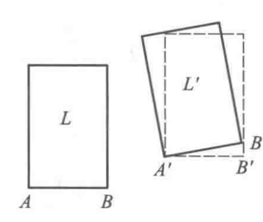

当薄片（即刚体）连续运动时，我们仍然可以认为它的运动是随基点的平动及绕基点的转动这两种基本运动所合成．随基点平动时，薄片中任一点的速度显然与基点的速度相同，而绕基点转动时，则又可认为是一定轴转动，这时基点不动，整个薄片绕通过基点并且垂直于薄片的直线转动．故如设$A$为基点，在某一时刻，其速度为$\boldsymbol{v}_A$，又在此时刻，薄片绕$A$转动的角速度为$\boldsymbol{\omega}$（垂直于薄片并沿着转动轴），则薄片上任一点$P$的速度（如图3.7.2所示）为

$$
\boldsymbol{v}=\boldsymbol{v}_A+\boldsymbol{\omega}\times\boldsymbol{r}'=\boldsymbol{v}_A+\boldsymbol{\omega}\times(\boldsymbol{r}-\boldsymbol{r}_0)
\qquad (3.7.1)
$$

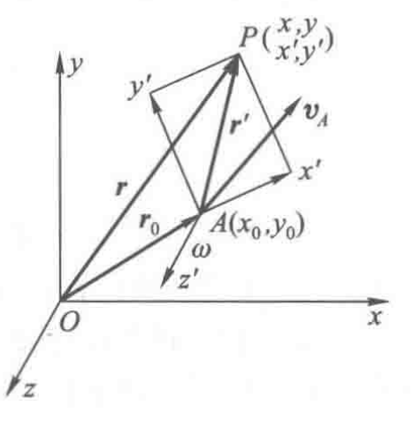

式中$\boldsymbol{r}'$为$P$对$A$的位矢，$\boldsymbol{r}$为$P$对固定坐标系原点$O$的位矢，而$\boldsymbol{r}_0$则为基点$A$对$O$的位矢，故$\boldsymbol{\omega}\times\boldsymbol{r}'$是$P$点绕$A$点转动的速度．

设$P$相对于固着在固定平面上的坐标系$O-xy$而言，其坐标为$(x,y)$，相对于固着在薄片上并随薄片一同运动的坐标系$A-x'y'$而言，其坐标为$(x',y')$，而$A$相对于$O-xy$系的坐标为$(x_0,y_0)$．因$\boldsymbol{\omega}$恒垂直于固定平面或薄片，即沿$z$轴或$z'$轴，故式（3.7.1）的分量表示式相对于$O-xy$系和相对于$A-x'y'$系分别为

$$
\left.
\begin{aligned}
v_x&=v_{Ax}-(y-y_0)\omega\\
v_y&=v_{Ay}+(x-x_0)\omega
\end{aligned}
\right\}
\qquad (3.7.2)
$$

$$
\left.
\begin{aligned}
v_{x'}&=v_{Ax'}-y'\omega\\
v_{y'}&=v_{Ay'}+x'\omega
\end{aligned}
\right\}
\qquad (3.7.3)
$$

又$P$点的加速度为

$$
\boldsymbol{a}=\frac{\mathrm{d}\boldsymbol{v}_A}{\mathrm{d}t}+\frac{\mathrm{d}\boldsymbol{\omega}}{\mathrm{d}t}\times\boldsymbol{r}'+\boldsymbol{\omega}\times\frac{\mathrm{d}\boldsymbol{r}'}{\mathrm{d}t}
$$

$$
=\boldsymbol{a}_A+\frac{\mathrm{d}\boldsymbol{\omega}}{\mathrm{d}t}\times\boldsymbol{r}'+\boldsymbol{\omega}\times(\boldsymbol{\omega}\times\boldsymbol{r}')
$$

因$\boldsymbol{\omega}\times(\boldsymbol{\omega}\times\boldsymbol{r}')=\boldsymbol{\omega}(\boldsymbol{\omega}\cdot\boldsymbol{r}')-\boldsymbol{r}'\omega^2$，而在平面平行运动中$\boldsymbol{r}'$恒与$\boldsymbol{\omega}$垂直，故$\boldsymbol{\omega}\cdot\boldsymbol{r}'=0$．即

$$
\boldsymbol{a}=\boldsymbol{a}_A+\frac{\mathrm{d}\boldsymbol{\omega}}{\mathrm{d}t}\times\boldsymbol{r}'-\boldsymbol{r}'\omega^2
\qquad (3.7.4)
$$

式（3.7.4）也可写为

$$
\boldsymbol{a}=\boldsymbol{a}_A+\frac{\mathrm{d}\boldsymbol{\omega}}{\mathrm{d}t}\times(\boldsymbol{r}-\boldsymbol{r}_0)-(\boldsymbol{r}-\boldsymbol{r}_0)\omega^2
\qquad (3.7.5)
$$

式（3.7.4）和式（3.7.5）中的第一项是$A$点的加速度，第二项为相对切向加速度，而最后一项则为相对向心加速度．在平面平行运动中，角加速度$\dfrac{\mathrm{d}\boldsymbol{\omega}}{\mathrm{d}t}$（即$\alpha$）也跟定轴转动时的情况一样，总与$\boldsymbol{\omega}$同沿着转动轴线，但其指向则与$\boldsymbol{\omega}$相同（加速转动时）或相反（减速转动时）．

对于平面平行运动来讲，相对切向加速度的量值为$r'\alpha$，方向与$\boldsymbol{r}'$垂直；相对向心加速度的量值为$\omega^2r'$，沿$\boldsymbol{r}'$的反方向并指向$A$点．这些，也都跟定轴转动时情形相仿．

### （2）转动瞬心

作平面运动的刚体（薄片）的角速度不为零时，在任一时刻薄片上恒有一点的速度为零，这点叫做**转动瞬心**，常以$C$表之．转动瞬心相对于$O-xy$系的坐标，可令式（3.7.2）中的$v_x$及$v_y$等于零而求得，即

$$
\left.
\begin{aligned}
x_C&=x_0-\frac{v_{Ay}}{\omega}\\
y_C&=y_0+\frac{v_{Ax}}{\omega}
\end{aligned}
\right\}
\qquad (3.7.6)
$$

而转动瞬心相对于$A-x'y'$系的坐标，则可令式（3.7.3）中的$v_{x'}$及$v_{y'}$等于零而求得，即

$$
\left.
\begin{aligned}
x_C'&=-\frac{v_{Ay'}}{\omega}\\
y_C'&=\frac{v_{Ax'}}{\omega}
\end{aligned}
\right\}
\qquad (3.7.7)
$$

如果$\omega=0$，则无转动瞬心；或者说，转动瞬心在无穷远处．

只要转动瞬心$C$为已知，就很容易推出薄片在此时刻的运动情况．因为如果取$C$为基点，则因$C$在此时刻的速度为零，故薄片将仅绕$C$转动，而任意一点$P$的速度与$CP$垂直，其量值为$CP\cdot\omega$．利用这项事实，只要知道薄片上任何两点$A$及$B$的速度的方向，我们就可用几何法求出转动瞬心$C$的位置．设已知$A$点的速度方向，如图3.7.3中的$\boldsymbol{v}_A$所示；而$B$点的速度方向如同图中的$\boldsymbol{v}_B$所示，则过$A$及$B$作两直线分别垂直于$\boldsymbol{v}_A$及$\boldsymbol{v}_B$，此两直线的交点，即转动瞬心$C$

（图3.7.3）．

当薄片运动时，转动瞬心$C$的位置由于不断地转移而随之运动．$C$在固定平面上（即相对于$O-xy$）所描绘的轨迹叫**空间极迹**；而$C$在薄片上（即相对于$A-x'y'$）所描绘的轨迹叫**本体极迹**．薄片的运动实际上是本体极迹$B$在空间极迹$S$上无滑动地滚动（图3.7.4）．在任一瞬时，此两轨迹的公共切点$C$，即为该时刻的转动瞬心．当车轮在直轨上滚动时，轮缘是本体极迹，而直轨则是空间极迹，在任一瞬时，轮缘与直轨的公共切点（即接触点）就是该时刻的转动瞬心．

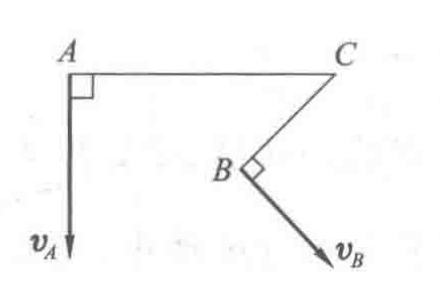

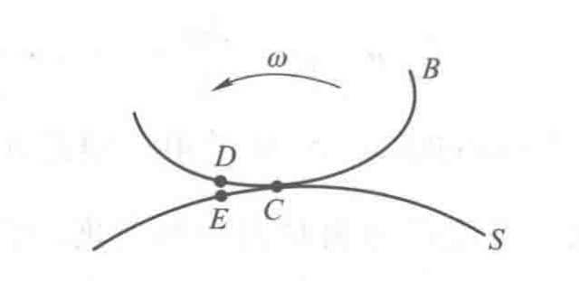

必须注意：角速度是描写整个刚体的运动学量，故与所选的基点无关，无论选$A$、选$C$或选其他点为基点，角速度均为$\omega$．又转动瞬心的速度虽然等于零，但它的加速度则并不等于零，否则，就成为固定的转动中心了．

［例1］ 试用转动瞬心法求§1.2例题中的椭圆规尺$M$点的速度、加速度，并求本体极迹和空间极迹的方程式．

［解］ 本题椭圆规尺$AB$两端点的速度方向已知，故过$A$及$B$作两直线分别与$\boldsymbol{v}_A$及$\boldsymbol{v}_B$垂直，此两直线相交于$C$，故$C$为转动瞬心（图3.7.5）．

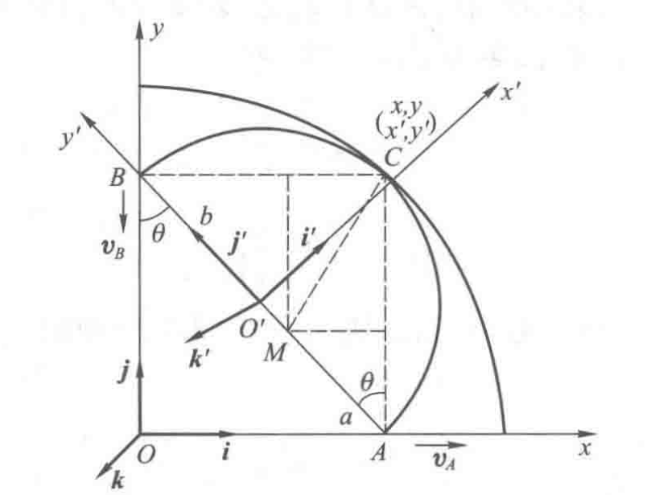

又$B$点速度的量值为$c$，由图3.7.5，知

$$
v_B=c=(a+b)\sin\theta\cdot\omega\quad(\omega\text{为}AB\text{的角速度})
$$

故

$$
\omega=\frac{c}{a+b}\frac{1}{\sin\theta}
\qquad (1)
$$

根据转动瞬心的定义，知

$$
v_M=MC\cdot\omega=\sqrt{a^2\sin^2\theta+b^2\cos^2\theta}\cdot\omega
$$

$$
=\frac{c}{a+b}\sqrt{a^2+b^2\cot^2\theta}
\qquad (2)
$$

如以$O$为固定坐标系$O-xy$的原点，设$C$的坐标为$(x,y)$，则有

$$
x^2+y^2=OC^2=AB^2=(a+b)^2
\qquad (3)
$$

故空间极迹为在中心$O$半径等于$(a+b)$的圆周．

又如以$AB$中点$O'$为活动坐标系$O'-x'y'$的原点，设$C$的动坐标为$(x',y')$，则有

$$
x'^2+y'^2=O'C^2=\left[\frac{1}{2}(a+b)\right]^2
\qquad (4)
$$

故本体极迹方程为在中心$O'$半径等于$\dfrac{1}{2}(a+b)$的圆周，此两圆周有公切点$C$，此点即转动瞬心．

取单位矢量$\boldsymbol{i},\boldsymbol{j}$沿$x$轴和$y$轴，单位矢量$\boldsymbol{i}',\boldsymbol{j}'$沿$x'$轴和$y'$轴，至于单位矢量$\boldsymbol{k}$和$\boldsymbol{k}'$则均垂直纸面指向读者，如图3.7.5所示．

如以$B$为基点，则由式（3.7.4）知，$M$点的加速度为

$$
\boldsymbol{a}_M=\boldsymbol{a}_B+\frac{\mathrm{d}\boldsymbol{\omega}}{\mathrm{d}t}\times\boldsymbol{r}'-\boldsymbol{r}'\omega^2=-\frac{\mathrm{d}\omega}{\mathrm{d}t}\boldsymbol{k}'\times b\boldsymbol{j}'+b\omega^2\boldsymbol{j}'
$$

$$
=\frac{c}{a+b}\frac{1}{\sin^2\theta}\cos\theta\cdot\omega\cdot b\boldsymbol{i}'+b\frac{c^2}{(a+b)^2}\frac{1}{\sin^2\theta}\boldsymbol{j}'
$$

$$
=\frac{bc^2}{(a+b)^2}\frac{1}{\sin^2\theta}\left(-\frac{\cos\theta}{\sin\theta}\boldsymbol{i}'+\boldsymbol{j}'\right)
$$

$$
=\frac{bc^2}{(a+b)^2}\frac{1}{\sin^2\theta}\left(-\frac{\cos\theta}{\sin\theta}\cos\theta\boldsymbol{i}-\cos\theta\boldsymbol{j}-\sin\theta\boldsymbol{i}+\cos\theta\boldsymbol{j}\right)
$$

$$
=-\frac{bc^2}{(a+b)^2}\frac{1}{\sin^2\theta}\left(\frac{\cos^2\theta}{\sin\theta}+\sin\theta\right)\boldsymbol{i}
$$

$$
=-\frac{bc^2}{(a+b)^2}\frac{1}{\sin^3\theta}\boldsymbol{i}
$$

因$M$点的$x$坐标为

$$
x=b\sin\theta
$$

故

$$
\boldsymbol{a}_M=-\frac{b^4c^2}{(a+b)^2}\frac{1}{x^3}\boldsymbol{i}
\qquad (5)
$$

这结果与§1.2中的完全一样．

### （3）平面平行运动动力学

现在让我们来求刚体作平面平行运动时的动力学方程．

在运动学中，基点是可以任意选取的．但在动力学中，通常皆取质心作为基点，以便利用质心运动定理和相对于质心的动量矩定理来写出平面平行运动的动力学方程．

取通过包含刚体的质心并与固定平面平行的一个薄片作为研究的对象，如图3.7.6所示．$C$为刚体的质心，$Ox$与$Oy$为通过固定平面上某点$O$的固定坐标轴，$Cx'$与$Cy'$为原点在质心$C$上并随薄片绕质心$C$转动（实际上是刚体绕通过$C$并与固定平面垂直的轴线转动）的活动坐标轴．那么，刚体的位置将由质心位矢$\boldsymbol{r}_C(x_C,y_C)$及$Cx'$与$Cx''$（$Cx''$为原点在$C$并与$Ox$始终平行的坐标轴，而$Cx'$则为固着在刚体上的坐标轴）间的夹角$\theta$决定．

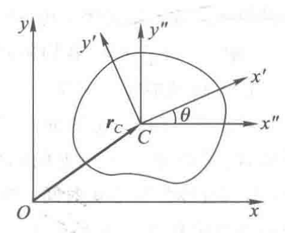根据式（3.4.2），我们得质心$C$的运动方程为

$$
\left.
\begin{aligned}
m\ddot{x}_C&=F_x\\
m\ddot{y}_C&=F_y
\end{aligned}
\right\}
\qquad (3.7.8)
$$

式中$m$为刚体的总质量，$\ddot{x}_C$、$\ddot{y}_C$为质心$C$的加速度在$x$、$y$轴上的投影，而$F_x$及$F_y$则为诸外力（包括约束反力）在$x$、$y$方向分量的代数和．

刚体绕通过质心$C$且垂直于固定平面的轴线的转动，在随质心作平动的坐标系$C-x''y''$中，可以看成是一定轴转动，这时转动轴就是通过质心的$z$轴．由于刚体作平面平行运动，即在动坐标系$C-x''y''$与固定坐标系$O-xy$中的$\boldsymbol{\omega},\dot{\boldsymbol{\omega}}$（或$\alpha$）都是相同的，故可由式（3.6.6）得刚体绕$z$轴转动的运动方程为

$$
I_{zz}\dot{\omega}=I_{zz}\alpha=M_z
\qquad (3.7.9)
$$

式中$I_{zz}$为刚体绕$z$轴的转动惯量，$\dot{\omega}$（或$\alpha$）为角加速度，而$M_z$则为诸外力（包括约束反力）对$z$轴的力矩的代数和．

（3.7.8）和（3.7.9）两式中的方程，就是刚体作平面平行运动时的运动方程．外力一般是已知的，但约束反力则是未知的，所以还要加入限制运动的某些条件（否则就成为自由刚体，不能作平面平行运动），即所谓约束方程，始能求解．因为刚体作平面平行运动时，是三个独立变量的问题，故未知量不能多于三个．

由式（2.4.7）知，这时动能$T$包含两部分：一为质心运动的动能，一为诸质点（即刚体）绕质心转动时的动能．如果令$v_C$代表质心运动的速度，$\omega$为刚体的角速度，则刚体的动能为$T=\dfrac{1}{2}mv_C^2+\dfrac{1}{2}I_{zz}\omega^2$，如果作用于刚体上的外力只有保守力作功，则由机械能守恒律，知

$$
\frac{1}{2}mv_C^2+\frac{1}{2}I_{zz}\omega^2+V=E
\qquad (3.7.10)
$$

式中$V$为势能，$E$为总能量，是一常数．我们可用式（3.7.10）来代替（3.7.8）和（3.7.9）三式中任何一式，因为平面平行运动只具有三个独立变量，这四个方程中只有三个是互相独立的．

［例2］ 半径为$a$，质量为$m$的圆柱体，沿着倾角为$\alpha$的粗糙斜面无滑动地滚下．试求质心沿斜面运动的加速度及约束反作用力的法向分量$F_N$和切向分量（摩擦阻力）$F_f$（图3.7.7）．

［解］ 为了比较，我们用两种方法来解．

（A）机械能守恒定律

在图3.7.7中，$mg$为重力，$F_N$为约束反作用力的法向分量，$F_f$为约束反作用力的切向分量（即摩擦阻力）；$x_C=OO'$为圆柱体的质心在时间$t$内的位移（当$t=0$时，圆柱体自斜面的最高点$O$开始下滚），而$\theta$则为它所转过的角度．如无任何滑动，则由几何学，知约束方程为

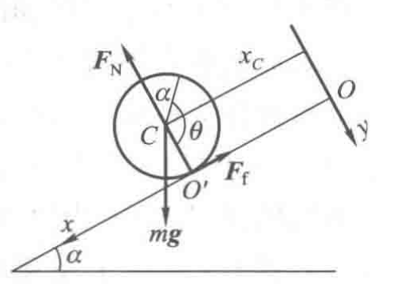

$$
x_C=a\theta
\qquad (1)
$$

令$k$为圆柱体对轴线的回转半径，则因$I_{zz}=mk^2$，故动能为

$$
T=\frac{1}{2}m\dot{x}_C^2+\frac{1}{2}mk^2\dot{\theta}^2
$$

但

$$
\dot{x}_C=a\dot{\theta}
$$

故

$$
T=\frac{1}{2}m\left(1+\frac{k^2}{a^2}\right)\dot{x}_C^2
\qquad (2)
$$

至于势能$V$（取静止时的势能为零）则为

$$
V=-mgx_C\sin\alpha
\qquad (3)
$$

将$T$及$V$之值代入式（3.7.10）中，得

$$
\frac{1}{2}m\left(1+\frac{k^2}{a^2}\right)\dot{x}_C^2-mgx_C\sin\alpha=E
\qquad (4)
$$

式中$E$为总能，是一常数．求（4）式对$t$的微商，得

$$
\ddot{x}_C=\frac{g\sin\alpha}{1+k^2/a^2}
\qquad (5)
$$

这就是圆柱体的质心$C$沿斜面运动的加速度，即圆柱体以匀加速度沿斜面滚下．我们知道：一个物体沿倾角为$\alpha$的光滑斜面滑下时，它的加速度是$g\sin\alpha$．而由式（5），知沿斜面滚下的加速度，恒较$g\sin\alpha$为小（除非$k=0$，即全部质量集中在轴线上）．如果圆柱体变为薄圆筒，$k=a$，则

$$
\ddot{x}_C=\frac{1}{2}g\sin\alpha
$$

如果是实心的，$k^2=\dfrac{1}{2}a^2$，则

$$
\ddot{x}_C=\frac{2}{3}g\sin\alpha
$$

用机械能守恒定律虽然可以求出圆柱体沿斜面滚下时质心的加速度$\ddot{x}_C$，但不能求出圆柱体和斜面之间的约束反作用力，也不能求出斜面究竟达到何种粗糙程度，始不致发生滑动．要想解决这些问题，需要用质心运动定理及相对于质心的动量矩定理．

（B）质心运动定理及相对于质心的动量矩定理

取消约束后，约束反作用力的法向分量$F_N$及切向分量$F_f$和重力$mg$都是外力，故由式（3.7.8）及式（3.7.9），得圆柱体的动力学方程为

$$
\left.
\begin{aligned}
m\ddot{x}_C&=mg\sin\alpha-F_f\\
0&=F_N-mg\cos\alpha\\
mk^2\ddot{\theta}&=F_fa
\end{aligned}
\right\}
\qquad (6)
$$

因$\ddot{x}_C=a\ddot{\theta}$，故由式（6）中的第一式和第三式将$F_f$消去，得

$$
\ddot{x}_C=\frac{g\sin\alpha}{1+k^2/a^2}
\qquad (7)
$$

和式（5）完全一样．约束反作用力的两个分量则为

$$
\left.
\begin{aligned}
F_f&=m\frac{k^2}{a^2}\ddot{x}_C=\frac{mgk^2\sin\alpha}{a^2+k^2}\\
F_N&=mg\cos\alpha
\end{aligned}
\right\}
\qquad (8)
$$

所以用质心运动定理和相对于质心的动量矩定理，不但可以求出约束反作用力，也可求出质心滚下时的加速度，显然比（A）法全面．

如果只有滚动而无滑动，则$f/N$必定$\le\mu$（$\mu$为静摩擦因数），或

$$
\mu\ge\frac{k^2\tan\alpha}{a^2+k^2}
\qquad (9)
$$

故当斜面的粗糙程度满足式（9）时，就可以阻止圆柱体沿斜面滑动．如果增大斜面的倾角$\alpha$，以至式（9）开始不成立时，滑动也就开始，能量不再守恒，量变引起了质变．

滑动开始后，圆柱体带滚带滑，约束方程$x_C=a\theta$的关系不再成立．但因$f$可以通过摩擦因数求出，故由式（6），运动仍然可以完全确定．此时质心的加速度$\ddot{x}_C$为滚动加速度$a\ddot{\theta}$与滑动加速度$\ddot{s}$两者之和．

### （4）滚动摩擦

当圆柱体作纯滚动时，如将其放在粗糙的水平面上，并给以初速度$v_0$，则由例2中的（5）式或（7）式，知$\ddot{x}_C=0$，圆柱体将按惯性而永远滚动下去，但实际情况并不如此．圆柱体越滚越慢，最后还是停止下来．因为它这时受到了另外一种**滚动摩擦**的作用．

滚动摩擦的产生，是由于圆柱体与地面接触处的形变所引起的．因为圆柱体和地面都不是绝对刚性的，圆柱体由于重量而陷入地面，同时本身也受到压缩．当它向前滚动时，由于地面的隆起（图3.7.8上画得比较夸大），地面的竖直反作用力$F_N$并不通过质心，而是偏于质心的前方，因而产生了一个反抗圆柱体滚动的力矩，这个力矩就是**滚动摩擦力矩**，它的量值为

$$
M=F_Nk
\qquad (3.7.11)
$$

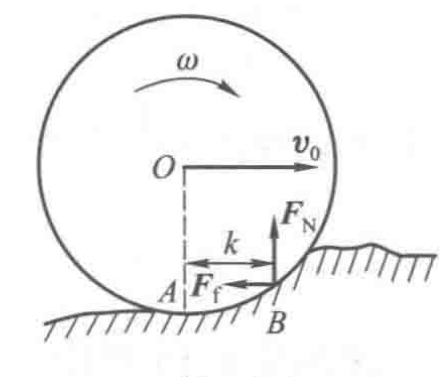

式中$k$叫**滚动摩擦因数**，等于从$F_N$的作用点$B$到通过质心$O$的竖直线$OA$的垂直距离．$k$的大小和圆柱体及地面的物理性质有关，即和圆柱体压入地面的程度有关．

滚动摩擦一般远小于滑动摩擦．使用滚珠轴承、滚柱轴承都是为了以滚动摩擦代替滑动摩擦．

## §3.8 刚体绕固定点的转动

### （1）定点转动运动学

刚体转动时，如果刚体内只有一点始终保持不动，则叫定点转动．陀螺、回转罗盘（用于航空和航海方面）等，都是刚体绕定点转动的实例．它们都只有一点不动．例如图3.8.1所示的常平架中的圆盘可绕对称轴$Oz'$转动，此对称轴固结在内悬架上，内悬架可绕固结于外悬架的$ON$轴转动，而外悬架又可绕固定轴$Oz$转动．此三轴的交点$O$则是始终不动的，所以这种运动和定轴转动的情形不同．

定点转动和定轴转动不同之处，在于转动轴只通过一个定点，转轴在空间的取向随着时间的改变而改变，所以不能只考虑一个和固定轴相垂直的平面内各点的运动．换句话说，定点转动是一个三度空间的问题，比定轴转动要复杂得多．在定轴转动中，角速度$\boldsymbol{\omega}$的量值虽然随着时间改变，但它的取向，则恒沿着固定的转动轴．

在定点转动中，转动轴在空间的取向，随着时间改变而改变，因而，附在它上面的角速度矢量$\boldsymbol{\omega}$的量值和方向就都是时间的函数．我们要用两个独立变量来描述转动轴的取向（亦即角速度矢量$\boldsymbol{\omega}$的取向）在空间变化的情况，还要用一个变量来描述整个刚体绕转动轴的运动情况，所以定点转动是三个独立变量的问题，通常都是用三个欧拉角来描述定点转动刚体的运动，即用欧拉角$\theta,\varphi,\psi$来确定刚体的位置，用$\theta,\varphi,\psi$对时间的微商$\dot{\theta},\dot{\varphi},\dot{\psi}$来表示角速度分量$\omega_x,\omega_y$和$\omega_z$，这就是前面讲过的式（3.3.3）．

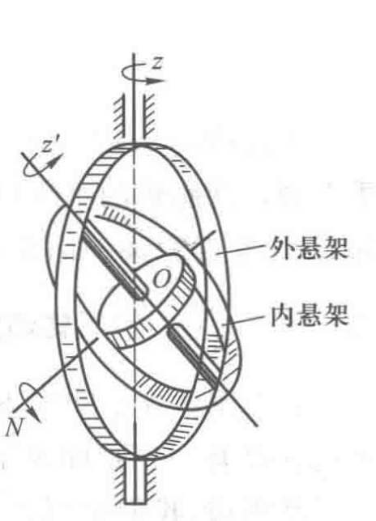

刚体作定点转动时，角速度矢量虽然都通过定点$O$，但其取向则随时间的改变而改变．前已提到，我们把某一瞬时角速度$\boldsymbol{\omega}$的取向，亦即在该瞬时的转动轴叫**转动瞬轴**．跟转动瞬心相仿，转动瞬轴在空间和在刚体内各描绘一个顶点在$O$的锥面，前者叫**空间极面**，后者则叫**本体极面**．刚体绕固定点的转动，也可看做是本体极面在空间极面上作无滑动的滚动，如图3.8.2所示．

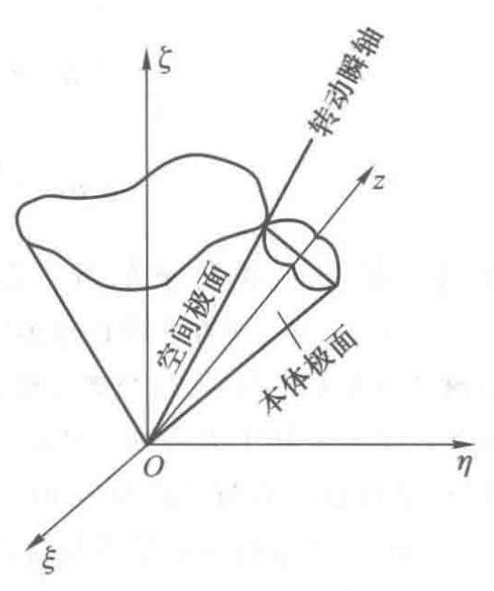

设在某一瞬时，刚体的角速度是$\boldsymbol{\omega}$，它的取向沿着该时刻的转动瞬轴$OM$，如图3.8.3所示．由式（3.2.6），在此瞬时刚体内任一点$P$的线速度$\boldsymbol{v}$为

$$
\boldsymbol{v}=\frac{\mathrm{d}\boldsymbol{r}}{\mathrm{d}t}=\boldsymbol{\omega}\times\boldsymbol{r}
\qquad (3.8.1)
$$

式中$\boldsymbol{r}$是$P$点对定点$O$的位矢．

式（3.8.1）是用角速度$\boldsymbol{\omega}$来表示刚体内位矢为$\boldsymbol{r}$的一点的线速度$\boldsymbol{v}$．当刚体绕固定点转动时，在任一瞬时，由于$\boldsymbol{r}$的不同，所以体内各点的线速度$\boldsymbol{v}$不同，但角速度$\boldsymbol{\omega}$则是一样的，所以我们把$\boldsymbol{\omega}$称为刚体的角速度．$\boldsymbol{\omega}$是时间的矢量函数，如为已知，我们就可以求出任何时刻刚体内任何一点的线速度$\boldsymbol{v}$．换句话说，只要一个矢量函数$\boldsymbol{\omega}(t)$，就足以描述刚体绕固定点的转动．

由式（3.8.1），又可求出刚体绕固定点$O$转动时，刚体内任一点$P$的线加速度$\boldsymbol{a}$为

$$
\boldsymbol{a}=\frac{\mathrm{d}\boldsymbol{v}}{\mathrm{d}t}=\frac{\mathrm{d}\boldsymbol{\omega}}{\mathrm{d}t}\times\boldsymbol{r}+\boldsymbol{\omega}\times(\boldsymbol{\omega}\times\boldsymbol{r})
$$

$$
=\frac{\mathrm{d}\boldsymbol{\omega}}{\mathrm{d}t}\times\boldsymbol{r}+\boldsymbol{\omega}(\boldsymbol{\omega}\cdot\boldsymbol{r})-\omega^2\boldsymbol{r}
\qquad (3.8.2)
$$

上式中的$\boldsymbol{\omega}\times(\boldsymbol{\omega}\times\boldsymbol{r})$，亦即$\boldsymbol{\omega}\times\boldsymbol{v}$称为**向轴加速度**，它和质点到转动瞬轴的垂线相合，可以写为$-\omega^2\boldsymbol{R}$，这里$R$是$P$点到$\boldsymbol{\omega}$的垂直距离，如图3.8.3所示，但不能写为$-\omega^2\boldsymbol{r}$．（何故？）至于$\dfrac{\mathrm{d}\boldsymbol{\omega}}{\mathrm{d}t}\times\boldsymbol{r}$则叫**转动加速度**．

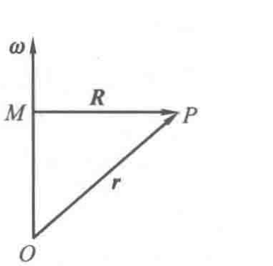

如果刚体在空间可不受任何约束而作任意的运动，那么体内就没有一点是固定不动的，这就是一般运动．跟平面平行运动相仿，我们可以把这种运动看成是随基点$A$的平动（在动力学中，通常取刚体的质心作基点）及绕基点的定点转动所合成，所以自由刚体具有六个独立变量．

刚体作一般运动时，刚体内任一点$P$的速度及加速度只需在式（3.8.1）及式（3.8.2）中添加基点速度$\boldsymbol{v}_A$及基点加速度$\boldsymbol{a}_A$：

$$
\boldsymbol{v}=\boldsymbol{v}_A+\boldsymbol{\omega}\times\boldsymbol{r}'
\qquad (3.8.3)
$$

$$
\boldsymbol{a}=\boldsymbol{a}_A+\frac{\mathrm{d}\boldsymbol{\omega}}{\mathrm{d}t}\times\boldsymbol{r}'+\boldsymbol{\omega}\times(\boldsymbol{\omega}\times\boldsymbol{r}')
$$

$$
=\boldsymbol{a}_A+\frac{\mathrm{d}\boldsymbol{\omega}}{\mathrm{d}t}\times\boldsymbol{r}'+\boldsymbol{\omega}(\boldsymbol{\omega}\cdot\boldsymbol{r}')-\omega^2\boldsymbol{r}'
\qquad (3.8.4)
$$

矢量$\boldsymbol{r}'$是$P$点相对于基点$A$的位矢．

［例］ 当飞机在空中以定值速度$u$沿半径为$R$的水平圆形轨道$C$转弯时，求当螺旋桨尖端$B$与中心$A$的连线和竖直线成$\theta$角时，$B$点的速度及加速度．已知螺旋桨的长度$AB=l$，螺旋桨自身旋转的角速度为$\omega_1$．

［解］ 本题是一般运动问题，故速度及加速度可由式（3.8.3）及式（3.8.4）求出．

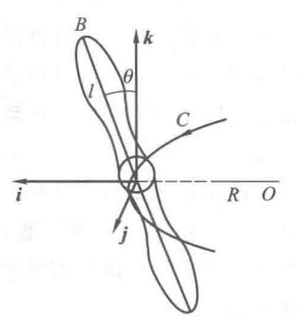

取螺旋桨的中心$A$为动坐标系原点，其单位矢量如图3.8.4所示，则当飞机转弯时，整个飞机绕$\boldsymbol{k}$转动的角速度为$\boldsymbol{\omega}_0=\dfrac{u}{R}\boldsymbol{k}$，故螺旋桨的合成角速度为

$$
\boldsymbol{\omega}=\omega_1\boldsymbol{j}+\frac{u}{R}\boldsymbol{k}
\qquad (1)
$$

又当飞机转弯时，$A$描绘一半径为$R$的水平圆周，故$A$的速度为$u$，方向沿圆周的切线，即$\boldsymbol{j}$的方向．取$A$为基点，由式（3.8.3），知螺旋桨尖端$B$的速度为

$$
\boldsymbol{v}=u\boldsymbol{j}+\boldsymbol{\omega}\times\boldsymbol{r}'
$$

$$
=u\boldsymbol{j}+\left(\omega_1\boldsymbol{j}+\frac{u}{R}\boldsymbol{k}\right)\times(l\sin\theta\,\boldsymbol{i}+l\cos\theta\,\boldsymbol{k})
$$

$$
=\omega_1l\cos\theta\,\boldsymbol{i}+u\left(1+\frac{l}{R}\sin\theta\right)\boldsymbol{j}-\omega_1l\sin\theta\,\boldsymbol{k}
\qquad (2)
$$

而

$$
v=\left[\omega_1^2l^2+u^2\left(1+\frac{l}{R}\sin\theta\right)^2\right]^{\frac{1}{2}}
\qquad (3)
$$

这是$B$点速度$\boldsymbol{v}$的量值．

现在求$B$点的加速度$\boldsymbol{a}$．因$A$点的加速度$\boldsymbol{a}_A$为$-\dfrac{u^2}{R}\boldsymbol{i}$．

而

$$
\frac{\mathrm{d}\boldsymbol{\omega}}{\mathrm{d}t}=\omega_1\frac{\mathrm{d}\boldsymbol{j}}{\mathrm{d}t}+\frac{u}{R}\frac{\mathrm{d}\boldsymbol{k}}{\mathrm{d}t}
$$

因$\boldsymbol{k}$为常矢量，故

$$
\frac{\mathrm{d}\boldsymbol{\omega}}{\mathrm{d}t}=\omega_1\frac{\mathrm{d}\boldsymbol{j}}{\mathrm{d}t}
$$

但

$$
\frac{\mathrm{d}\boldsymbol{j}}{\mathrm{d}t}=\boldsymbol{\omega}_0\times\boldsymbol{j}=\frac{u}{R}\boldsymbol{k}\times\boldsymbol{j}
$$

故

$$
\frac{\mathrm{d}\boldsymbol{\omega}}{\mathrm{d}t}=\omega_1\frac{\mathrm{d}\boldsymbol{j}}{\mathrm{d}t}=\omega_1\left(\frac{u}{R}\boldsymbol{k}\times\boldsymbol{j}\right)=-\frac{\omega_1u}{R}\boldsymbol{i}
\qquad (4)
$$

由式（3.8.4），知$B$点的加速度为

$$
\boldsymbol{a}=\boldsymbol{a}_A+\frac{\mathrm{d}\boldsymbol{\omega}}{\mathrm{d}t}\times\boldsymbol{r}'+\boldsymbol{\omega}\times(\boldsymbol{\omega}\times\boldsymbol{r}')
$$

$$
=-\frac{u^2}{R}\boldsymbol{i}-\frac{\omega_1u}{R}\boldsymbol{i}\times(l\sin\theta\,\boldsymbol{i}+l\cos\theta\,\boldsymbol{k})
$$

$$
+\left(\omega_1\boldsymbol{j}+\frac{u}{R}\boldsymbol{k}\right)\times\left(\omega_1l\cos\theta\,\boldsymbol{i}+\frac{ul}{R}\sin\theta\,\boldsymbol{j}-\omega_1l\sin\theta\,\boldsymbol{k}\right)
$$

$$
=-\left(\frac{u^2}{R}+\omega_1^2l\sin\theta+\frac{u^2l}{R^2}\sin\theta\right)\boldsymbol{i}+\frac{2u\omega_1l}{R}\cos\theta\,\boldsymbol{j}-\omega_1^2l\cos\theta\,\boldsymbol{k}
\qquad (5)
$$

而

$$
a=\left[\left(\frac{u^2}{R}+\omega_1^2l\sin\theta+\frac{u^2l}{R^2}\sin\theta\right)^2+\left(\frac{2u\omega_1l}{R}\cos\theta\right)^2+(\omega_1^2l\cos\theta)^2\right]^{\frac{1}{2}}
\qquad (6)
$$

这就是$B$点加速度$\boldsymbol{a}$的量值．

### （2）欧拉动力学方程

刚体绕定点$O$以角速度$\boldsymbol{\omega}$转动时，其运动方程就是式（2.3.4），即

$$
\frac{\mathrm{d}\boldsymbol{J}}{\mathrm{d}t}=\boldsymbol{M}
$$

式中$\boldsymbol{J}$是刚体绕定点$O$转动时的动量矩，$\boldsymbol{M}$为诸外力对$O$点的主矩．

动量矩$\boldsymbol{J}$的表达式，我们在§3.5中已经求出．为了写出它的分量表达式，我们总是选用固着在刚体上并和刚体一起转动的坐标系．这样，惯量系数$I_{xx}$、$I_{yy}$、$I_{zz}$都是常数．另外，为了消除惯量积，我们又常选用$O$点上的惯量主轴为坐标轴，于是动量矩$\boldsymbol{J}$就简化为式（3.5.21），即$J_x=I_1\omega_x,J_y=I_2\omega_y,J_z=I_3\omega_z$，式中$I_1$、$I_2$、$I_3$是刚体在$O$点上的主转动惯量，而且也都是常数．

坐标轴既然随着刚体一起转动，那它转动的角速度就应等于刚体的角速度$\boldsymbol{\omega}$．如先把动量矩矢量$\boldsymbol{J}$和跟随刚体一起转动的坐标系$O-xyz$固着在一起，和式（3.2.6）中的位置矢量$\boldsymbol{r}$相仿，$\boldsymbol{J}$对时间的微商应为$\boldsymbol{\omega}\times\boldsymbol{J}$．不过实际上$\boldsymbol{J}$相对于$O-xyz$也在发生变化，它的每一个分量$J_x$、$J_y$和$J_z$都是时间的函数，即在转动坐标系中它们的量值应随着时间的变化而变化．故如把$\boldsymbol{J}$写为

$$
\boldsymbol{J}=J_x\boldsymbol{i}+J_y\boldsymbol{j}+J_z\boldsymbol{k}
\qquad (3.8.5)
$$

则$\boldsymbol{J}$对时间的微商由上述两部分合成，一为量值对时间的微商，另一则为$\boldsymbol{J}$随着刚体以角速度$\boldsymbol{\omega}$转动时它对时间的微商$\boldsymbol{\omega}\times\boldsymbol{J}$，故

$$
\frac{\mathrm{d}\boldsymbol{J}}{\mathrm{d}t}=\dot{J}_x\boldsymbol{i}+\dot{J}_y\boldsymbol{j}+\dot{J}_z\boldsymbol{k}+\boldsymbol{\omega}\times\boldsymbol{J} \qquad (3.8.6)
$$

这个关系，对任何在转动坐标系中的矢量都适用．实际上，这时我们是从固定坐标系来观测矢量对时间的微商的，即式（3.8.6）中的$\frac{\mathrm{d}\boldsymbol{J}}{\mathrm{d}t}$，反映了固定坐标系中看到的矢量$\boldsymbol{J}$的时间变化率．对这一问题，我们在第四章里还要作更详细的论述．由于在定点运动问题中我们都是用固着在刚体的动坐标系，故今后常将字母上的撇号略去．至于固定在空间静止参照物上的坐标系，则改用$\xi,\eta,\zeta$等来代表，这在§3.3中就已经用过．

因

$$
\begin{aligned}
\boldsymbol{J}&=I_1\omega_x\boldsymbol{i}+I_2\omega_y\boldsymbol{j}+I_3\omega_z\boldsymbol{k}\\
\boldsymbol{\omega}&=\omega_x\boldsymbol{i}+\omega_y\boldsymbol{j}+\omega_z\boldsymbol{k}\\
\boldsymbol{M}&=M_x\boldsymbol{i}+M_y\boldsymbol{j}+M_z\boldsymbol{k}
\end{aligned}
$$

故把这些关系代入式（3.8.6）后，得

$$
I_1\dot{\omega}_x\boldsymbol{i}+I_2\dot{\omega}_y\boldsymbol{j}+I_3\dot{\omega}_z\boldsymbol{k}+(\omega_x\boldsymbol{i}+\omega_y\boldsymbol{j}+\omega_z\boldsymbol{k})\times(I_1\omega_x\boldsymbol{i}+I_2\omega_y\boldsymbol{j}+I_3\omega_z\boldsymbol{k})=M_x\boldsymbol{i}+M_y\boldsymbol{j}+M_z\boldsymbol{k}
$$

即

$$
\begin{cases}
I_1\dot{\omega}_x-(I_2-I_3)\omega_y\omega_z=M_x\\
I_2\dot{\omega}_y-(I_3-I_1)\omega_z\omega_x=M_y\\
I_3\dot{\omega}_z-(I_1-I_2)\omega_x\omega_y=M_z
\end{cases}
\qquad (3.8.7)
$$

这就是刚体绕定点转动的动力学方程，通常叫做欧拉动力学方程，是1776年欧拉首先推出的．在推导过程中，他作了两次简化：（1）用固着在刚体上的动坐标系，以使六个惯量系数$I_{xx},I_{yy},I_{zz},I_{xy},I_{yz},I_{zx}$等都是常数；（2）取用$O$点上的惯量主轴为动坐标系的坐标轴，以消去惯量积$I_{xy}$、$I_{yz}$和$I_{zx}$．这样做的结果，使方程组（3.8.7）中多出了$(I_2-I_3)\omega_y\omega_z$等项．但如果取用固定在空间的坐标系，则所有惯量系数都将是时间的函数，而且惯量积$I_{xy}$、$I_{yz}$和$I_{zx}$亦将不会永远为零，问题将更复杂．比较起来，我们认为还是采用欧拉所建议的方法为好．当然运动最后还是要从固定坐标系来观察．

三个欧拉动力学方程（3.8.7）和三个欧拉运动学方程（3.3.3）合并起来，就得到六个非线性常微分方程．如果从这一方程组中消去$\omega_x$、$\omega_y$和$\omega_z$，就能得到三个对欧拉角$\theta$、$\varphi$、$\psi$为二阶的常微分方程．从理论上来讲，我们解这三个微分方程，就能得出欧拉角$\theta$、$\varphi$、$\psi$和时间$t$的关系，因而也就确定了刚体的运动情况．不过计算还是很繁杂的，甚至有时是不可能的．

### （3）机械能守恒定律

若作用在刚体上的外力只有保守力作功，则动能$T$和势能$V$之和，保持为常数，即$T+V=E$，式中$E$为总能量，是一常数，这就是机械能守恒定律．对定点转动来讲，如果选用固着在刚体上的惯量主轴为坐标轴，则对定点$O$的动能$T$由式（3.5.21）给出，而机械能守恒定律则为

$$
\frac{1}{2}(I_1\omega_x^2+I_2\omega_y^2+I_3\omega_z^2)+V=E \qquad (3.8.8)
$$

事实上，机械能守恒定律式（3.8.8）也可由式（3.8.7）推出，所以在解刚体作定点转动的问题，可用式（3.8.8）来代替式（3.8.7）中的任何一式．

## * §3.9 重刚体绕固定点转动的解

### （1）几种可解情况

在§3.8的（2）中，我们已经导出了刚体作定点转动的动力学方程．但在一般情况下，$M_x$、$M_y$和$M_z$本身是$t$、$\theta$、$\varphi$、$\psi$、$\omega_x$、$\omega_y$和$\omega_z$的函数，所以这些方程的积分，通常非常困难．

一个刚体，除约束反力外，有时只在重力作用下作定点转动，我们把这种刚体叫重刚体，例如陀螺．陀螺下端和地面接触的那一点是一个定点．

对于重刚体来讲，也只有在有限几种特殊情况下，才能求出它的分析解．这些特殊情况，有的是对外力矩作某些限制，有的是对刚体的形状作某些限制．到现在为止，我们只知道下列三种情况可以有解，即

Ⅰ．欧拉-潘索情况 刚体因惯性而运动，这时外力的合力通过固定点$O$，在重刚体的特殊情况下，固定点$O$和刚体的重心$G$相重合，刚体本身的形状，则没有什么限制——不对称陀螺或欧拉陀螺．

Ⅱ．拉格朗日-泊松情况 在这种情况下，对固定点$O$所作的惯量椭球是一旋转椭球，亦即$I_1=I_2\neq I_3$，至于刚体的重心则位于动力对称轴上但不与固定点重合．这种迅速绕对称轴转动的刚体叫做回转仪，也叫拉格朗日陀螺或简称陀螺．

Ⅲ．C.B.柯凡律夫斯卡雅情况 在这一情况下，$I_1=I_2=2I_3$，而重心则在惯量椭球的赤道平面上，这也是一种对称陀螺．

下面，我们将对前两种的求解方法，作扼要的介绍，至于最后一种则不拟进行深入的讨论．有兴趣者可参看有关这方面的书籍．

### （2）欧拉-潘索情况

在本情况下，因$M_x=M_y=M_z=0$，故在原则上，可从式（3.8.7）先求$\omega_x$、$\omega_y$和$\omega_z$，再代入式（3.3.3），求出欧拉角$\theta$、$\varphi$、$\psi$为时间$t$的函数．详细的分析解比较冗长，而且要用到椭圆积分和椭圆函数，所以不拟详述．实际上，由于本问题的特殊性，式（3.8.7）有两个第一积分很容易求出来，即动量矩积分和能量积分．也就是说，在欧拉-潘索情况中，动量矩$\boldsymbol{J}$和动能$T$都是常数．求出这两个积分比较简单，将作为一个习题，留给读者自己去证明．

在欧拉-潘索情况，困难之处在于刚体本身的形状没有任何限制，因而第三个第一积分比较难于求出．如果$I_1=I_2$，问题就大为简单．地球是一个扁平球体，可以认为$I_1=I_2$．如果忽略太阳与月球对地球的引力作用，则地球的自转，就可认为是重刚体绕定点（地球的中心）的转动问题，因此属于欧拉-潘索情况．我们现在就以地球的自转问题作为欧拉-潘索情况的特例，来说明这种情况的求解方法．

既然地球的中心相当于固定点，故取为坐标原点，并以$z$轴与地球的对称轴相合．因$I_1=I_2$，$M_x=M_y=M_z=0$，故由式（3.8.7），得地球自转的动力学方程为

$$
\left.
\begin{aligned}
I_1\dot{\omega}_x-(I_1-I_3)\omega_y\omega_z&=0\\
I_1\dot{\omega}_y-(I_3-I_1)\omega_z\omega_x&=0\\
I_3\dot{\omega}_z&=0
\end{aligned}
\right\}
\qquad (3.9.1)
$$

将第三式积分，得

$$
\omega_z=\Omega=\text{常数} \qquad (3.9.2)
$$

即地球的转动角速度沿着对称轴的分量是一常数．把式（3.9.2）的关系代入式（3.9.1）的前两式中，得

$$
\left.
\begin{aligned}
\dot{\omega}_x&=-\left(\frac{I_3-I_1}{I_1}\right)\omega_y\Omega=-n\omega_y\\
\dot{\omega}_y&=\left(\frac{I_3-I_1}{I_1}\right)\omega_x\Omega=n\omega_x
\end{aligned}
\right\}
\qquad (3.9.3)
$$

其中$n=\frac{I_3-I_1}{I_1}\Omega$，对式（3.9.3）第一式再微商一次后可得

$$
\ddot{\omega}_x=-n\dot{\omega}_y=-n^2\omega_x \qquad (3.9.4)
$$

式（3.9.4）是熟知的谐振动方程，故由其通解可得出

$$
\left.
\begin{aligned}
\omega_x&=\omega_0\cos(nt+\varepsilon)\\
\omega_y&=\omega_0\sin(nt+\varepsilon)
\end{aligned}
\right\}
\qquad (3.9.5)
$$

式中$\omega_0$及$\varepsilon$是两个积分常数，由起始条件决定．由式（3.9.2）及（3.9.5）两式，知地球自转的总角速度的量值为$(\Omega^2+\omega_0^2)^{\frac{1}{2}}$，是一个常数，但总角速度的方向则绕着对称轴$Oz$作匀速转动，且描绘一圆锥体，$Oz$为此圆锥体的轴线，其周期则为

$$
\tau=\frac{2\pi}{|n|}=\frac{2\pi}{\Omega}\frac{I_1}{|I_3-I_1|} \qquad (3.9.6)
$$

由上面的计算可以看出：我们已经把式（3.9.1）的三个第一积分全部求了出来，现在可进一步求运动规律，即$\theta,\varphi,\psi$与$t$的关系．因$M=0$，故动量矩$\boldsymbol{J}$在固定坐标系$S$中是一常矢量，我们可取此矢量的方向为固定坐标系$S$系的$\zeta$轴，于是$\boldsymbol{J}$和$\zeta$轴及代表进动角速度的矢量$\dot{\varphi}\boldsymbol{k}$，三者在同一直线上，故$\boldsymbol{J}$在动坐标系中的方向余弦，就是式（3.3.3）中$\dot{\varphi}$前面的乘数．由此得$\boldsymbol{J}$在动坐标系$S'$中的三轴线上的分量是

$$
\left.
\begin{aligned}
J_x&=J\sin\theta\sin\psi=I_1\omega_x\\
J_y&=J\sin\theta\cos\psi=I_1\omega_y\\
J_z&=J\cos\theta=I_3\omega_z=I_3\Omega
\end{aligned}
\right\}
\qquad (3.9.7)
$$

因$\boldsymbol{J}$的量值也是常数，故由式（3.9.7）中的第三式，知$\theta=\theta_0=$常数．而由式（3.9.5）及（3.9.7），又可得

$$
J\sin\theta_0=I_1\omega_0,\quad \psi=\frac{\pi}{2}-(nt+\varepsilon) \qquad (3.9.8)
$$

再以$\omega_z$与$\dot{\psi}$的数值（各为$\Omega$及$-n$）代入式（3.3.3）中的第三方程，并积分，得

$$
\varphi=\sec\theta_0(\Omega+n)t+\varphi_1 \qquad (3.9.9)
$$

因此，根据式（3.9.8）和（3.9.9），知$\theta$为一常数，而$\varphi$与$\psi$皆为时间$t$的函数．此时地球除绕$z$轴自转外，还有绕$\zeta$轴的角速度$\dot{\varphi}$，即$z$轴并不是固定不动的，而是绕着$\zeta$轴进动．因$\zeta$轴和$z$轴之间的夹角$\theta=\theta_0$保持不变，所以这种进动叫做规则进动①．此时刚体的瞬时角速度$\boldsymbol{\omega}$为绕$\zeta$轴的$\dot{\varphi}$及绕$z$轴的$\dot{\psi}$两者的矢量和，如图3.9.1所示（未按比例绘制），这时$I_3>I_1$．

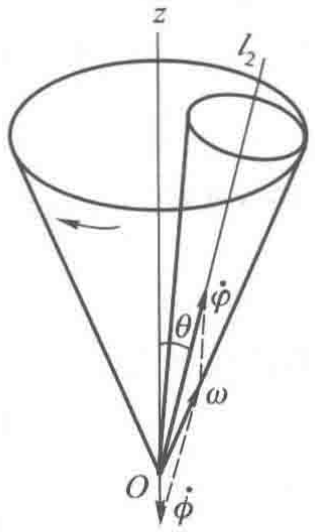

这样，地球自转问题的分析解，就全部获得．

从上面的讨论可以看出：地球自转的转动瞬轴，并不固定于地球．我们通常把地球的转动瞬轴（$\boldsymbol{\omega}$方向）叫做天文地轴，而把地球的对称轴$z$叫做地理地轴，所以，从地球上看天文地轴绕着地理地轴转动．因地球的$\frac{I_1}{|I_3-I_1|}$近似地等于300，而$\frac{2\pi}{\Omega}$则近似地等于1 d（日），故由式（3.9.6），知天文地轴绕地理地轴转动的周期约为300 d，即10个月．这种现象，在天文学上叫做纬度变迁．

由于太阳和月球对地球的引力不能忽略，因而产生了一不等于零的力矩，同时地球又不是绝对的刚体，故上述的计算只具有近似的程度．实测出来的纬度变迁的周期约为14个月．由于外力矩不等于零，故地球的自转问题，实际上属于拉格朗日-泊松的情况，参看本节中的（3）．

虽然在一般情形下（即$I_1\neq I_2\neq I_3$）的欧拉-潘索情况的分析解，比较繁难，但潘索改用了几何方法，很容易地说明了它的运动图像．下面，我们就来介绍潘索的几何方法．

取固定点$O$（即中心$G$）上的惯量主轴为动坐标轴，因而惯量椭球的方程将是

$$
I_1x^2+I_2y^2+I_3z^2=1
$$

如转动瞬轴和惯量椭球的交点为$P$（潘索把这点叫做极），并且用$\boldsymbol{\rho}$代表极$P$对固定点$O$的径矢（图3.9.2），则

$$
\overrightarrow{OP}=\boldsymbol{\rho}=\rho\frac{\boldsymbol{\omega}}{\omega} \qquad (3.9.10)
$$

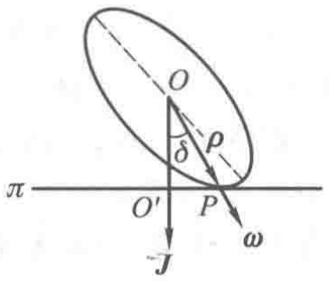

此时$\boldsymbol{\omega}$在动量矩$\boldsymbol{J}$方向上的投影为一常量，这是因为在本问题中动能$T$和$J$的量值都是常量，故

$$
\omega_J=\boldsymbol{\omega}\cdot\frac{\boldsymbol{J}}{J}=\frac{\boldsymbol{\omega}\cdot\boldsymbol{J}}{J}=\frac{2T}{J}=\text{常量} \qquad (3.9.11)
$$

另一方面，$\rho$的长度和$\omega$的量值成正比．这是因为，由式（3.9.10），我们有

$$
x=\rho\frac{\omega_x}{\omega},\quad y=\rho\frac{\omega_y}{\omega},\quad z=\rho\frac{\omega_z}{\omega} \qquad (3.9.12)
$$

把这些关系代入惯量椭球的方程[式（3.5.20）]中，得

$$
\frac{\rho^2}{\omega^2}(I_1\omega_x^2+I_2\omega_y^2+I_3\omega_z^2)=1
$$

因动能

$$
T=\frac{1}{2}(I_1\omega_x^2+I_2\omega_y^2+I_3\omega_z^2)=h=\text{常量}
$$

故

$$
\rho=\frac{\omega}{\sqrt{2h}} \qquad (3.9.13)
$$

即$\rho$与$\omega$成比例．

> ① 参看本节（3）中的附注．

现在让我们来求和惯量椭球在极$P$相切的平面方程．如令$(x,y,z)$代表极$P$（也就是切点）的坐标，而令$(X,Y,Z)$代表流动坐标，则此切面方程，由解析几何知为

$$
I_1xX+I_2yY+I_3zZ=1 \qquad (3.9.14)
$$

把式（3.9.12）中的$(x,y,z)$的值代入式（3.9.14），并利用式（3.9.13）消去$\frac{\rho}{\omega}$，得

$$
I_1\omega_xX+I_2\omega_yY+I_3\omega_zZ-\sqrt{2h}=0
$$

改为法线形式，得

$$
\frac{I_1\omega_xX+I_2\omega_yY+I_3\omega_zZ}{\sqrt{I_1^2\omega_x^2+I_2^2\omega_y^2+I_3^2\omega_z^2}}-\frac{\sqrt{2h}}{\sqrt{I_1^2\omega_x^2+I_2^2\omega_y^2+I_3^2\omega_z^2}}=0
$$

即

$$
\frac{I_1\omega_x}{J}X+\frac{I_2\omega_y}{J}Y+\frac{I_3\omega_z}{J}Z-\frac{\sqrt{2h}}{J}=0 \qquad (3.9.15)
$$

此平面的法线方向余弦和$\boldsymbol{J}$的方向余弦相同，平面离固定点$O$的距离$(OO')$为

$$
\delta=\frac{\sqrt{2h}}{J}=\text{常量} \qquad (3.9.16)
$$

故此平面恒与$\boldsymbol{J}$垂直，且与固定点$O$保持恒定的距离（参看图3.9.2），潘索把这个平面叫做不变平面，并以$\pi$表示．故和刚体相联的中心惯量椭球总在极$P$处与$\pi$相切．因$P$在$\boldsymbol{\omega}$上，故$P$点的速度为零．因而刚体绕固定点的惯性运动（因$M=0$）等于中心惯量椭球无滑动地在不变平面上滚动，和椭球相连的刚体随着椭球一起运动．$P$在椭球上所画出的轨迹为本体极迹，而在不变平面$\pi$上所画出的则为空间极迹．至于转动瞬轴$OP$所描出的则为本体极面和空间极面．

### （3）拉格朗日-泊松情况

在这一情况下，因$M_x$、$M_y$和$M_z$一般不全为零，而且含有欧拉角$\theta$、$\varphi$和$\psi$，故式（3.8.7）和（3.3.3）不能分开计算，而要联合求解．

在图3.9.3中，令动系$S'$系的$z$轴与陀螺的对称轴重合，固定点与定系$S$系及$S'$系的原点$O$重合．如陀螺的重心在$G$，且长度$OG=l$，则作用在刚体上的外力，就是重力$-mg\boldsymbol{K}$，$\boldsymbol{K}$为$\zeta$轴上的单位矢量，$m$是刚体的质量，重力对$O$点的力矩则为

$$
\boldsymbol{M}=l\boldsymbol{k}\times(-mg\boldsymbol{K})=-mgl\boldsymbol{k}\times\boldsymbol{K}
$$

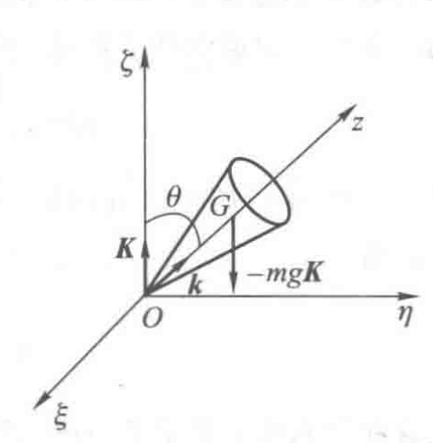

由§3.3，知$\boldsymbol{K}$与进动角速度同方向，故得

$$
\boldsymbol{K}=\sin\theta\sin\psi\,\boldsymbol{i}+\sin\theta\cos\psi\,\boldsymbol{j}+\cos\theta\,\boldsymbol{k}
$$

而外力矩$\boldsymbol{M}$在$S'$坐标系中的表达式为

$$
\boldsymbol{M}=mgl(\sin\theta\cos\psi\,\boldsymbol{i}-\sin\theta\sin\psi\,\boldsymbol{j}) \qquad (3.9.17)
$$

因此，由式（3.8.7），得对称陀螺的运动方程为

$$
\left.
\begin{aligned}
I_1\dot{\omega}_x-(I_1-I_3)\omega_y\omega_z&=mgl\sin\theta\cos\psi\\
I_1\dot{\omega}_y-(I_3-I_1)\omega_z\omega_x&=-mgl\sin\theta\sin\psi\\
I_3\dot{\omega}_z&=0
\end{aligned}
\right\}
\qquad (3.9.18)
$$

将式（3.9.18）中的第三式积分，得

$$
\omega_z=\dot{\varphi}\cos\theta+\dot{\psi}=s\ (\text{常量}) \qquad (3.9.19)
$$

这表明陀螺沿着它的对称轴的分角速度是不变的．

用$\omega_x$乘式（3.9.18）中的第一式，$\omega_y$乘第二式，$\omega_z$乘第三式，并相加，然后再将式（3.3.3）

中的$\omega_x$和$\omega_y$的表示式代入所得方程的右端，则得

$$
I_1\dot{\omega}_x\omega_x+I_1\dot{\omega}_y\omega_y+I_3\dot{\omega}_z\omega_z=mgl\dot{\theta}\sin\theta
$$

积分，得

$$
\frac{1}{2}(I_1\omega_x^2+I_1\omega_y^2+I_3\omega_z^2)+mgl\cos\theta=E \qquad (3.9.20)
$$

这实际上就是陀螺的能量积分（因重力是保守力），式中$E$为总能，是一常量．如再将式（3.3.3）中的$\omega_x$、$\omega_y$的表示式及式（3.9.19）中的$\omega_z$的值代入式（3.9.20）中，则可得

$$
I_1(\dot{\theta}^2+\dot{\varphi}^2\sin^2\theta)+I_3s^2=2(E-mgl\cos\theta) \qquad (3.9.21)
$$

式（3.9.19）及（3.9.21）就是陀螺的两个第一积分，现在还要再找出它的另一个第一积分．我们可以不必从运动方程（3.9.18）推导，而是直接根据物理概念来考虑：陀螺的重量$mg\boldsymbol{K}$与$\zeta$轴平行，对$\zeta$轴的力矩为零，因而动量矩$\boldsymbol{J}$在这个方向上的分量必定是一个常数．故

$$
\boldsymbol{J}\cdot\boldsymbol{K}=\alpha=\text{常数}
$$

把$\boldsymbol{K}$及$\boldsymbol{J}$的值代入，得

$$
(I_1\omega_x\boldsymbol{i}+I_1\omega_y\boldsymbol{j}+I_3\omega_z\boldsymbol{k})\cdot(\sin\theta\sin\psi\,\boldsymbol{i}+\sin\theta\cos\psi\,\boldsymbol{j}+\cos\theta\,\boldsymbol{k})=\alpha
$$

把式（3.3.3）代入并整理，得

$$
I_1\dot{\varphi}\sin^2\theta+I_3s\cos\theta=\alpha \qquad (3.9.22)
$$

这就是我们所要求的第三个第一积分．现在，陀螺运动方程的三个第一积分都已求出，问题归结为如何求陀螺的运动规律了．

令$I_3s=\beta$，$\cos\theta=x$，并用$\sin^2\theta$乘式（3.9.21），然后由式（3.9.22）解出$\dot{\varphi}$，再把它代入式（3.9.21）中，则稍加整理后，可得

$$
I_1\left[\dot{x}^2+\frac{(\alpha-\beta x)^2}{I_1^2}\right]+\frac{\beta^2}{I_3}(1-x^2)=2(E-mglx)(1-x^2) \qquad (3.9.23)
$$

我们把它写为

$$
\dot{x}^2=f(x)
$$

其中

$$
f(x)=\frac{1}{I_1}\left(2E-\frac{\beta^2}{I_3}-2mglx\right)(1-x^2)-\frac{(\alpha-\beta x)^2}{I_1^2}
$$

这是$x$的三次多项式，其图形约如图3.9.4所示．此函数有三个实根$x_1$、$x_2$及$x_3$，且$-1<x_1<x_2<1<x_3$（在特殊情况下，可有一个或多个等号代替不等号）．因此

$$
\dot{x}^2=\frac{2mgl}{I_1}(x-x_1)(x-x_2)(x-x_3) \qquad (3.9.24)
$$

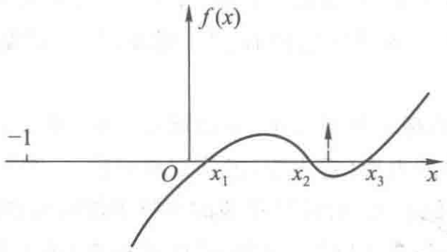

经过变数变换后，可把式（3.9.24）化为椭圆积分，故$\cos\theta=x$可用$t$的椭圆函数表出．而由（3.9.22）及（3.9.19）两式又可解出$\dot{\varphi}$及$\dot{\psi}$为$x$的函数如下：

$$
\dot{\varphi}=\frac{\alpha-\beta x}{I_1(1-x^2)},\quad \dot{\psi}=\frac{\beta}{I_3}-x\dot{\varphi} \qquad (3.9.25)
$$

故只要$x$（即$\theta$）与$t$的关系为已知，则$\varphi$及$\psi$与$t$的关系就可由（3.9.25）的两式求出，因而陀螺的运动可以完全确定．$\varphi$随$t$的改变叫做进动（$z$轴绕$\zeta$轴转），而$\theta$随$t$的改变（$z$轴上下颠动）则叫章动．故陀螺运动时，在$z$轴绕$\zeta$轴作进动的过程中，还伴有上下颠动的章动，即$\theta$在$\theta_1(x=x_1)$与$\theta_2(x=x_2)$之间来回摆动．但这种章动在高速自转的陀螺里是比较微小的，非经仔细观察，难于发现，所以我们常把伴有微小章动的进动，叫做赝规则进动，以别于前面（2）节所讲的规则进动．

在前面已经提到，太阳和月球（当然，还有其他的星体）对地球的引力的合力矩不等于零，因而地球的自转轴也和陀螺的自转轴一样，在空间产生了进动与章动①．进动的周期很长，约为25 800年，章动周期则约为19年，因我国古代的历法以19年为一章故称章动．天文学上把地球的赤道平面向天穹伸延与黄道（地球公转的轨道）的交点叫做春分点与秋分点．因地轴垂直于赤道平面，地轴既在进动，赤道平面也在空间改变取向，因而春分点与秋分点也就逐年有所改变．这种现象，叫做岁差．早在晋代，我国虞喜已经发现．

总之，前面（2）、（3）两部分中所讲的两种情况[第（3）种情况也是这样]之所以有解，是因为首先能找到三个独立的第一积分．后来，于松（1905年）及波加梯（1910年）等人曾证明，除了上述的三种情况而外，在任意的起始条件下，不能找出除能量积分及动量矩积分以外的第三个第一积分．

### （4）高速转动体的回转效应

一个均匀物体绕着它的对称轴以很大角速度转动同时又没有初始进动角速度时，如果不受外力矩的作用，那么由于惯性关系，这个物体转动轴的方向保持不变，即角速度的方向保持不变．这一性质，在技术上得到很多应用．例如，鱼雷里通常装有用电动机带动的回转仪．当鱼雷因风浪或其他原因改变方向时，因为无外力矩的作用，回转仪的转动轴是不会改变方向的．这时，回转仪的转动轴和鱼雷的纵轴之间就发生了偏差，这样，就可以开动某些辅助器械，改变舵的方向，使鱼雷回复到原来的航向．火箭里面也同样可以装上回转仪来保持航向，并用改变喷气方向的方法来校正航向．所以，快速转动的回转仪，可以作为自动导航之用．

另一方面，当对称陀螺绕着它的对称轴快速转动时，如果受有外力矩的作用（图3.9.3），那么它表现的性质，也非常奇特．在图3.9.3中，重力矩$\boldsymbol{M}$按理是应当使陀螺向下倾倒，但根据本节（3）中的计算，知陀螺并不倾倒，只是它的对称轴$Oz$绕着竖直轴$O\zeta$进动（章动很小，可以忽略不计）．这一奇特现象具有重要的意义．当一对称陀螺绕着它的对称轴以很大的角速度转动时，它并不按照外力矩的“意志”行事．当外力矩要使它向下（上）运动时，它却表现出向右（左）的运动；而当外力矩要使它向右（左）运动时，它却偏要向下（上）运动．这种现象，叫做回转效应．

在日常生活中经常可以碰到回转效应．小孩玩的陀螺，就是最明显的一个例证．当它快速转动时，它并不因为受有外力矩（重力矩）的作用而倾倒，一直要等到它的角速度变得很小时（由于摩擦关系）才会倾倒下来．行驶得很快的自行车能够保持稳定，也是由于这个原故．

在技术上，回转效应也有很多应用．例如炮筒（或枪管）内部刻有螺旋式的来复线，使炮弹（或枪弹）射出时已经绕着自己的对称轴快速旋转，成为一个回转仪．由于回转效应，它不

> ① 天文学上所讲的进动，指的都是赝规则进动，即地球的自转轴绕着黄道平面的法线作伴有章动的进动．而本节（2）中所讲的进动，则是欧拉从天文学中借用的．

会在空气阻力$\boldsymbol{F}_r$的作用下翻“筋斗”，而是产生进动，使炮弹（或子弹）的轴线始终与其前进方向保持不太大的偏离．其他如回转罗盘、列车的稳定问题以及轮船上装的回转稳定器等，也都要用到回转效应．

事物都是一分为二的，在快速转动的部件上，回转效应所产生的力矩（叫回转力矩），将给轴承以很大的附加压力．例如，轮船上都装有巨大的涡轮机，它在水平面内绕着对称轴以很大角速度$\omega_1$转动，当轮船以角速度$\omega_2$转弯时，等于涡轮机的轴以角速度$\omega_2$进动．故轮船一般不应很快地转弯，以免附加压力过大，毁坏涡轮机的轴承．

## * §3.10 拉莫尔进动

### （1）拉莫尔频率

§3.9中（3）的讨论说明，在重力场中，对称陀螺的运动是很复杂的．相反，在匀强磁场中，一个旋转着的带电物体的运动则比较简单，这在原子物理学中，又是一个非常重要的问题．

根据动量矩定理，我们知道

$$
\frac{\mathrm{d}\boldsymbol{J}}{\mathrm{d}t}=\boldsymbol{M} \qquad (3.10.1)
$$

式中$\boldsymbol{J}$是物体对某点的动量矩，而$\boldsymbol{M}$则为作用在物体上的外力对同一点的力矩．

对于在匀强磁场$\boldsymbol{B}$中运动的电子来讲，它所受到的外力矩$\boldsymbol{M}$为

$$
\boldsymbol{M}=\boldsymbol{p}_m\times\boldsymbol{B} \qquad (3.10.2)
$$

式中$\boldsymbol{p}_m$是磁矩．

让我们先从简单的情况来计算$\boldsymbol{p}_m$．我们知道：在闭合轨道上转动的电子是一环状电流，它在磁场中的行为像一个磁偶极子．根据电磁学中的熟知公式，磁矩$\boldsymbol{p}_m$的量值为$p_m=iA$，式中$i$是电流强度，$A$为被电流所包围的面积．如果令$\omega$代表电荷为$e$的电子沿着半径为$r$的圆形轨道转动时的角速度，则

$$
i=\frac{\omega}{2\pi}e,\quad A=\pi r^2
$$

故

$$
p_m=\frac{\omega}{2\pi}e\pi r^2=\frac{e}{2m}mr^2\omega \qquad (3.10.3)
$$

式中$m$是电子的质量，$mr^2\omega$是电子沿圆形轨道运动时对转动中心的动量矩值$J$，故

$$
p_m=\frac{e}{2m}J
$$

或

$$
\boldsymbol{p}_m=\frac{e}{2m}\boldsymbol{J} \qquad (3.10.4)
$$

所以磁矩$\boldsymbol{p}_m$和动量矩$\boldsymbol{J}$之间有一定的关系存在．这个关系，对带电物体来讲，也仍然正确．

设带电物体由具有相同比荷$\frac{e}{m}$的质点所组成，则当物体转动时，其中电荷形成的电流分布将与磁场发生作用．如为匀强磁场，则物体所受的合力为零，但对其转动中心的合力矩则并不为零．对永久磁偶极子（即磁矩的量值与物体的取向无关）来讲，磁矩与外力矩之间的关系仍由式（3.10.2）给出．而对任何分布的电流，其磁矩$\boldsymbol{p}_m$为

$$
\boldsymbol{p}_m=\frac{1}{2}\int\boldsymbol{r}\times\boldsymbol{j}\mathrm{d}V \qquad (3.10.5)
$$

式中$\boldsymbol{j}$是电流密度．但电流密度可用电荷密度与速度的乘积来代替，而电荷密度又可用质量密度$\rho$及比荷$\frac{e}{m}$的乘积代替，即

$$
\boldsymbol{j}=\frac{e}{m}\rho\boldsymbol{v} \qquad (3.10.6)
$$

这样一来，式（3.10.5）就可改写为

$$
\boldsymbol{p}_m=\frac{e}{2m}\int\boldsymbol{r}\times\rho\boldsymbol{v}\mathrm{d}V \qquad (3.10.7)
$$

式（3.10.7）中的积分式是物体的总动量矩，即$\boldsymbol{J}$，故磁矩与动量矩之间仍遵守式（3.10.4）所给出的关系（至少在经典力学中是如此）：

$$
\boldsymbol{p}_m=\frac{e}{2m}\boldsymbol{J}
$$

把式（3.10.4）的$\boldsymbol{p}_m$代入式（3.10.2）中，得

$$
\boldsymbol{M}=\frac{e}{2m}\boldsymbol{J}\times\boldsymbol{B} \qquad (3.10.8)
$$

再把式（3.10.8）代入式（3.10.1）中，最后得到

$$
\frac{\mathrm{d}\boldsymbol{J}}{\mathrm{d}t}=\frac{e}{2m}\boldsymbol{J}\times\boldsymbol{B}=-\frac{e\boldsymbol{B}}{2m}\times\boldsymbol{J} \qquad (3.10.9)
$$

把式（3.10.9）和式（3.8.6）相比较，知这时$\boldsymbol{J}$的量值不变，但方向则并不固定（相对于固定系而言），即$\boldsymbol{J}$在空间绕着$\boldsymbol{B}$的方向转，转动的角速度则为

$$
\boldsymbol{\omega}_l=-\frac{e\boldsymbol{B}}{2m} \qquad (3.10.10)
$$

这种现象，和陀螺高速转动时的进动现象相似，所以叫做拉莫尔进动，即匀强磁场对遵守（3.10.2）的带电物体（或质点）来讲，是使它的动量矩矢量$\boldsymbol{J}$绕着$\boldsymbol{B}$以匀角速$\boldsymbol{\omega}_l$进动，故$\boldsymbol{\omega}_l$叫拉莫尔频率．由于电子带负电，故$\boldsymbol{J}$绕$\boldsymbol{B}$进动的方向是逆时针的（图3.10.1）．

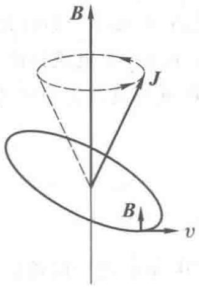

顺便指出：拉莫尔进动对带电物体和单个电子都适用，但带电物体必须由具有相同比荷的质点所组成，不一定限于刚体．另外，积分式（3.10.7）对任何坐标系都适用，只要质心是静止的．

### （2）核磁共振

质子具有量子化的自旋角动量$\boldsymbol{J}_p$，这个自旋质子在外磁场$\boldsymbol{B}$中，也绕着外磁场的方向进动，其进动角频率常写为[试与（3.10.10）及（3.10.4）相比较]：

$$
\omega_p=\frac{p_mB}{J_p} \qquad (3.10.11)
$$

式中$p_m$是质子的磁矩．

任何一个作周期运动的系统，如果受到周期性外力的作用，若外力的频率和这个运动系统的频率相同，就会发生共振．对于质子来讲，我们常用一个很小的交变磁场$\boldsymbol{B}'$作为进动质子的“外力”．使$\boldsymbol{B}'$与稳定磁场$\boldsymbol{B}$相正交，至于它们振幅的典型值，则相差很大，通常为1与5 000之比，故合成磁场的振荡角是非常小的．逐渐改变这个扰动磁场的角频率$\omega_0$，直至$\omega_0=$

$\frac{p_mB}{J_p}$时，就发生了共振，这时许多自旋质子吸收能量，在外磁场中有倒转过来的趋向，可用专门的电子学技术检查出来．这项现象叫做核磁共振，是显示原子核磁性的一种最简便的方法，并可用来测定质子的磁矩．这个核磁共振技术是1946年普塞耳和布洛赫各自独立发现的．

## 小结

Ⅰ．刚体各种可能的运动

1. 平动——刚体各点的速度及加速度相同，但不一定是直线运动．平动有三个独立变量，与质点同．

2. 定轴转动——转动轴上诸点不动，其他各点都绕轴线上某点作圆周运动．定轴转动只有一个独立变量．

3. 平行于一平面的运动——各点均始终在平行于某固定平面的平面内运动．可分解为平动及定轴转动的组合，故有三个独立变量．

4. 定点转动——在运动中，刚体内只有一点始终保持不动，故也有三个独立变量．

5. 一般运动——可视为平动与定点转动的合成，有六个独立变量．

Ⅱ．角速度矢量

1. 有限转动——两个不同时的有限转动，不遵守矢量加法的对易律．

2. 无限小转动——两个不同时的无限小转动，遵守矢量加法的对易律，即

$$
\Delta\boldsymbol{n}+\Delta\boldsymbol{n}'=\Delta\boldsymbol{n}'+\Delta\boldsymbol{n}
$$

3. 角速度相加也遵守上述对易律，故角速度是矢量，且$\boldsymbol{\omega}=\frac{\mathrm{d}\boldsymbol{n}}{\mathrm{d}t}$．

4. 线速度与角速度之间的关系$\boldsymbol{v}=\boldsymbol{\omega}\times\boldsymbol{r}$．

Ⅲ．欧拉角

1. 欧拉角$\theta,\varphi,\psi$是描写刚体作定点转动时的三个独立变量．

2. 欧拉运动学方程

$$
\omega_x=\dot{\varphi}\sin\theta\sin\psi+\dot{\theta}\cos\psi
$$

$$
\omega_y=\dot{\varphi}\sin\theta\cos\psi-\dot{\theta}\sin\psi
$$

$$
\omega_z=\dot{\varphi}\cos\theta+\dot{\psi}
$$

Ⅳ．刚体运动微分方程与平衡方程

1. 力系的简化——空间的任意力系总可化为通过某一点（简化中心）的一个力$\boldsymbol{F}$及力偶矩为$\boldsymbol{M}$的一个力偶．

2. 刚体运动微分方程

a. 质心运动定理

$$
m\ddot{\boldsymbol{r}}_c=\sum_{i=1}^{n}\boldsymbol{F}_i^{(e)}=\boldsymbol{F}
$$

b. 动量矩定理

$$
\frac{\mathrm{d}\boldsymbol{J}}{\mathrm{d}t}=\boldsymbol{M}\quad(\text{对定点或对质心})
$$

c. 动能定理

$$
\mathrm{d}T=\sum_{i=1}^{n}\boldsymbol{F}_i^{(e)}\cdot\mathrm{d}\boldsymbol{r}_i
$$

d. 进行解算时，我们可用动能定理来代替质心运动定理与动量矩定理中的一个分量式．

3. 刚体平衡方程

$$
\boldsymbol{F}=0,\quad \boldsymbol{M}=0
$$

Ⅴ．转动惯量

1. 刚体绕一直线的转动惯量

$$
I=\sum_{i=1}^{n}m_ir_i^2\ \text{或}\ I=\int r^2\mathrm{d}m\ \text{或}\ I=mk^2
$$

式中$r_i$为自质点$m_i$至转动轴线的垂直距离，$k$为回转半径．也可写为

$$
I=I_{xx}\alpha^2+I_{yy}\beta^2+I_{zz}\gamma^2-2I_{yz}\beta\gamma-2I_{zx}\gamma\alpha-2I_{xy}\alpha\beta
$$

式中

$$
I_{xx}=\int(y^2+z^2)\mathrm{d}m,\quad I_{yy}=\int(z^2+x^2)\mathrm{d}m,\quad I_{zz}=\int(x^2+y^2)\mathrm{d}m
$$

叫做刚体对$x$轴、$y$轴及$z$轴的轴转动惯量，而

$$
I_{yz}=I_{zy}=\int yz\mathrm{d}m,\quad I_{zx}=I_{xz}=\int zx\mathrm{d}m,\quad I_{xy}=I_{yx}=\int xy\mathrm{d}m
$$

叫做惯量积．$\alpha,\beta,\gamma$为转动轴线的方向余弦．

2. 惯量椭球与惯量主轴

a. 惯量椭球方程

$$
I_{xx}x^2+I_{yy}y^2+I_{zz}z^2-2I_{yz}yz-2I_{zx}zx-2I_{xy}xy=1
$$

b. 选取惯量椭球主轴为坐标轴，惯量积全部等于零，这些轴叫做惯量主轴．

3. 均匀刚体的对称轴就是惯量主轴

Ⅵ．刚体的动量矩及转动动能——以定点$O$或质心$C$上的惯量主轴为坐标轴时

1. $\boldsymbol{J}=J_x\boldsymbol{i}+J_y\boldsymbol{j}+J_z\boldsymbol{k}=I_1\omega_x\boldsymbol{i}+I_2\omega_y\boldsymbol{j}+I_3\omega_z\boldsymbol{k}$

2. $T=\frac{1}{2}(I_1\omega_x^2+I_2\omega_y^2+I_3\omega_z^2)$

Ⅶ．定轴转动

1. 运动学

a. 刚体内一点的线速度

$$
v_i=R_i\omega
$$

$R_i$是刚体内某质点到转动轴的垂直距离．

b. 刚体内一点的加速度

$$
a_{i\tau}=\dot{v}_i=R_i\dot{\omega}=R_i\alpha
$$

$$
a_{in}=\frac{v_i^2}{R_i}=R_i\omega^2=\omega v_i
$$

2. 动力学

a. 动量矩定理

$$
M_z=I_{zz}\dot{\omega}=I_{zz}\alpha
$$

b. 机械能守恒定律

$$
\frac{1}{2}I_{zz}\omega^2+V=E
$$

c. 附加压力

由于转动，在轴上产生了附加压力，且当主动力全部为零时，它也并不等于零，和静压力不同，常称为动压力．

d. 自由转动轴

只当转动轴通过刚体的重心，且为惯量主轴时，附加压力才等于零，这轴叫自由转动轴．

Ⅷ．平面平行运动

1. 运动学

a. 刚体作平面平行运动时可用一截面来代表，且可把运动分解为随基点$A$的平动加上绕通过$A$且垂直于固定平面的轴线的定轴转动．

b. $\boldsymbol{v}=\boldsymbol{v}_A+\boldsymbol{\omega}\times\boldsymbol{r}'$，$\boldsymbol{a}=\boldsymbol{a}_A+\frac{\mathrm{d}\boldsymbol{\omega}}{\mathrm{d}t}\times\boldsymbol{r}'-\boldsymbol{r}'\omega^2$

c. 转动瞬心——在任一瞬时，薄片上速度$\boldsymbol{v}$为零的那一点．它在薄片上的轨迹叫本体极迹，在固定平面上的轨迹叫空间极迹．

2. 动力学

a. 质心运动定理

$$
m\ddot{x}_c=F_x,\quad m\ddot{y}_c=F_y
$$

b. 动量矩定理（相对于质心）

$$
I_{zz}\dot{\omega}=I_{zz}\alpha=M_z
$$

c. 机械能守恒定律

$$
\frac{1}{2}I_{zz}\omega^2+V=E
$$

d. 要加入约束方程，才能求解，因上述四个方程中只有三个是互相独立的，而上述诸方程中所含的约束反作用力又是未知的．

Ⅸ．定点转动

1. 运动学

a. 转动瞬轴

定点转动时，角速度矢量$\boldsymbol{\omega}$虽通过定点$O$，但它在空间的取向，却随时间而改变，故称这种转动轴为转动瞬轴．它在空间描绘一顶点在$O$的锥面叫空间极面，在刚体内所描绘的锥面则叫本体极面．

b. 刚体内一点的速度及加速度

$$
\boldsymbol{v}=\boldsymbol{\omega}\times\boldsymbol{r},\quad \boldsymbol{a}=\frac{\mathrm{d}\boldsymbol{\omega}}{\mathrm{d}t}\times\boldsymbol{r}+\boldsymbol{\omega}\times(\boldsymbol{\omega}\times\boldsymbol{r})
$$

2. 动力学

a. 欧拉动力学方程

$$
I_1\dot{\omega}_x-(I_2-I_3)\omega_y\omega_z=M_x
$$

$$
I_2\dot{\omega}_y-(I_3-I_1)\omega_z\omega_x=M_y
$$

$$
I_3\dot{\omega}_z-(I_1-I_2)\omega_x\omega_y=M_z
$$

b. 机械能守恒定律——可代替欧拉方程中任一式，其具体形式为

$$
\frac{1}{2}(I_1\omega_x^2+I_2\omega_y^2+I_3\omega_z^2)+V=E
$$

* Ⅹ．重刚体绕固定点转动的解

1. 欧拉-潘索情况

$M_x=M_y=M_z=0$，刚体形状可无限制．

2. 拉格朗日-泊松情况

$I_1=I_2\neq I_3$，重心在动力对称轴上．

3. 柯凡律夫斯卡雅情况

$I_1=I_2=2I_3$，重心在惯量椭球的赤道平面上．

4. 运动一般由自转、进动及章动合成．如无章动，则叫规则进动，如有，则叫赝规则进动．

5. 回转效应的应用：校正航向、保持物体稳定和指示方向．

* Ⅺ．拉莫尔进动

1. 带电质点或物体在匀强磁场中转动时，它的动量矩$\boldsymbol{J}$或磁矩$\boldsymbol{p}_m$绕着磁场$\boldsymbol{B}$进动，我们把这种进动叫拉莫尔进动．

2. 进动的角速度，即拉莫尔频率为$\omega_l=\frac{eB}{2m}$．

## 补充例题

3.1 求底面半径为$r$、高为$h$的均质圆锥体相对于中心轴的转动惯量$I_1$及相对于底面任一直径的转动惯量$I_2$．

［解］ 取一薄圆片，半径为$x$，高为$\mathrm{d}y$，则

$$
\mathrm{d}I_1=\frac{1}{2}x^2\mathrm{d}m=\frac{\rho}{2}x^2(\pi x^2\mathrm{d}y) \qquad (1)
$$

但由图知

$$
\frac{y}{x}=\frac{h}{r},\text{故}\ y=\frac{h}{r}x,\ \mathrm{d}y=\frac{h}{r}\mathrm{d}x \qquad (2)
$$

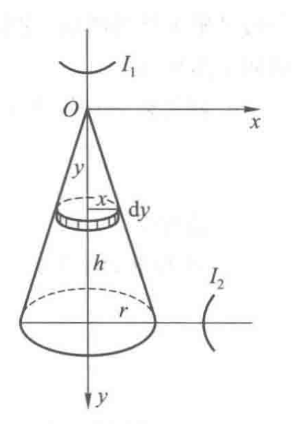

把（2）代入（1），得

$$
I_1=\int_0^r\frac{1}{2}\pi\rho\frac{h}{r}x^4\mathrm{d}x=\frac{1}{10}\pi\rho r^4h=\frac{3}{10}\left(\frac{1}{3}\rho\pi r^2h\right)r^2=\frac{3}{10}mr^2 \qquad (3)
$$

式中$m=\frac{1}{3}\rho\pi r^2h$是均质圆锥体的总质量．

又

$$
\mathrm{d}I_2'=\frac{1}{4}x^2\mathrm{d}m \qquad (4)
$$

由平行轴定理（3.5.12）可得

$$
\mathrm{d}I_2=\frac{1}{4}x^2\mathrm{d}m+(h-y)^2\mathrm{d}m \qquad (5)
$$

故利用上面的结果，得

$$
\begin{aligned}
I_2&=\frac{3}{20}mr^2+\int\left[\rho\pi x^2\left(h-\frac{h}{r}x\right)^2\right]\mathrm{d}y\\
&=\frac{3}{20}mr^2+\int_0^r\left[\rho\pi x^2\left(h-\frac{h}{r}x\right)^2\frac{h}{r}\right]\mathrm{d}x\\
&=\frac{3}{20}mr^2+\rho\pi\frac{h^3}{r}\int_0^r\left(x^2-\frac{2}{r}x^3+\frac{1}{r^2}x^4\right)\mathrm{d}x\\
&=\frac{3}{20}mr^2+\rho\pi\frac{h^3}{r}\left(\frac{r^3}{3}-\frac{r^3}{2}+\frac{r^3}{5}\right)\\
&=\frac{3}{20}mr^2+\frac{1}{3}\rho\pi r^2h\left(\frac{1}{10}h^2\right)\\
&=\frac{3}{20}mr^2+\frac{1}{10}mh^2=\frac{1}{20}m(3r^2+2h^2)
\end{aligned}
\qquad (6)
$$

3.2 两根均质棒于棒端固连成直角后组成一摆，棒长分别为$2a$与$2b$，摆的水平转动轴通过此直角的顶点．摆在竖直平面内的位置，由较短的棒与竖直线所成的角$\varphi$决定．如开始时，$\varphi=0$，$\dot{\varphi}=0$，求$\varphi$的最大值．

［解］ 先求此摆对通过$O$点的$z$轴的转动惯量$I_{zz}$：

$$
I_{zz}=\frac{1}{3}\sigma(2a)(2a)^2+\frac{1}{3}\sigma(2b)(2b)^2=\frac{8}{3}\sigma(a^3+b^3) \qquad (1)
$$

式中$\sigma$为棒的线密度，是一常数．

又摆对$z$轴的力矩为

$$
\begin{aligned}
M_z&=\sigma(2b)g\cdot b\sin\varphi-\sigma(2a)g\cdot a\cos\varphi\\
&=2\sigma g(b^2\sin\varphi-a^2\cos\varphi)
\end{aligned}
\qquad (2)
$$

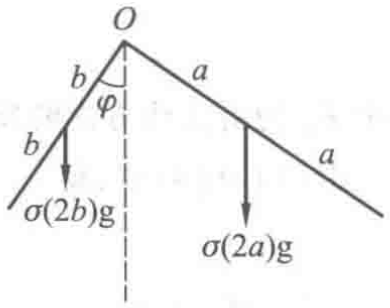

由式（3.6.5）得摆的运动微分方程为

$$
-\frac{8}{3}\sigma(a^3+b^3)\ddot{\varphi}=2\sigma g(b^2\sin\varphi-a^2\cos\varphi) \qquad (3)
$$

即

$$
-\frac{4}{3}(a^3+b^3)\ddot{\varphi}=(b^2\sin\varphi-a^2\cos\varphi)g \qquad (4)
$$

积分，得

$$
\frac{2}{3}(a^3+b^3)\dot{\varphi}^2=(b^2\cos\varphi+a^2\sin\varphi)g+C \qquad (5)
$$

因当$\varphi=0$，$\dot{\varphi}=0$，故$C=-b^2g$

于是得

$$
\frac{2}{3}(a^3+b^3)\dot{\varphi}^2=(b^2\cos\varphi+a^2\sin\varphi-b^2)g \qquad (6)
$$

当$\dot{\varphi}$再等于零时，$\varphi$值最大，记为$\varphi_m$，则

$$
\frac{a^2}{b^2}\sin\varphi_m=1-\cos\varphi_m \qquad (7)
$$

又当摆在平衡时，$M_z=0$，如令此时的$\varphi=\varphi_0$，则由（2）式，得

$$
\frac{a^2}{b^2}=\frac{\sin\varphi_0}{\cos\varphi_0} \qquad (8)
$$

由（7）及（8）式得

$$
\frac{\sin\varphi_0}{\cos\varphi_0}=\frac{1-\cos\varphi_m}{\sin\varphi_m}=\frac{2\sin^2\frac{1}{2}\varphi_m}{2\sin\frac{1}{2}\varphi_m\cos\frac{1}{2}\varphi_m}=\frac{\sin\frac{1}{2}\varphi_m}{\cos\frac{1}{2}\varphi_m}
$$

由此得

$$
\varphi_m=2\varphi_0
$$

3.3 一质量为$m$、半径为$a$的均质圆球，被握着静止在另一半径等于$b$的固定圆球的顶点．其后把手放开，使其自由滚下．试证当两球连心线和竖直向上的直线间所成的角度等于$\arccos\frac{10}{17}$时，此两球将互相分离．

［解］ 小球在平衡位置时，$D$与$A$相合．如小球滚到图示位置时，两球在$E$处相合，则它所转过的角度为$\angle DCE=\psi$．因本题的约束条件为$\widehat{AE}=\widehat{DE}$，即$a\psi=b\varphi$．又由图知

$$
\theta=\varphi+\psi
$$

即

$$
\theta=\varphi+\frac{b\varphi}{a}=\frac{a+b}{a}\varphi
$$

故约束方程为

$$
a\theta=(a+b)\varphi \qquad (1)
$$

小球的运动微分方程由（3.7.8）及（3.7.9）两式可得

$$
m(a+b)\ddot{\varphi}=mg\sin\varphi-F_t\quad(\text{切向}) \qquad (2)
$$

$$
m(a+b)\dot{\varphi}^2=mg\cos\varphi-F_N\quad(\text{法向}) \qquad (3)
$$

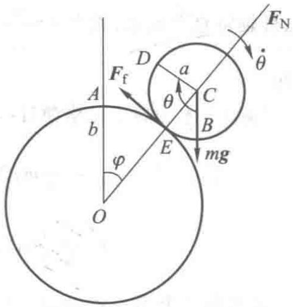

$$
\frac{2}{5}ma^2\ddot{\theta}=F_ta\ (\text{转动}) \qquad (4)
$$

式中$F_N$为沿法线方向的反作用力，$F_t$为摩擦力．

由（1）及（4）式，得

$$
\frac{2}{5}m(a+b)\ddot{\varphi}=F_t \qquad (5)
$$

由（2）及（5）式，得

$$
\frac{7}{5}m(a+b)\ddot{\varphi}=mg\sin\varphi \qquad (6)
$$

积分，得

$$
\frac{7}{10}m(a+b)\dot{\varphi}^2=-mg\cos\varphi+C \qquad (7)
$$

因当$\varphi=0$，$\dot{\varphi}=0$，故由（7）式，得

$$
C=mg
$$

把$C$之值代入（7）式，得

$$
\dot{\varphi}^2=\frac{10}{7}\frac{(1-\cos\varphi)}{a+b}g \qquad (8)
$$

又由（3）式

$$
\begin{aligned}
F_N&=mg\cos\varphi-m(a+b)\dot{\varphi}^2=mg\cos\varphi-\frac{10}{7}m(a+b)\frac{1-\cos\varphi}{a+b}g\\
&=mg\left(\frac{17}{7}\cos\varphi-\frac{10}{7}\right)
\end{aligned}
\qquad (9)
$$

故由（9），知当$\cos\varphi=\frac{10}{17}$时，$F_N=0$

即$\varphi=\arccos\frac{10}{17}$时，$F_N=0$，两球分离．

3.4 一陀螺由半径为$2a$的薄圆盘及一垂直通过盘的中心$C$、长为$a$的杆轴所组成，杆轴的质量可忽略不计．将杆轴的另一端$O$放在水平面上，使陀螺作无滑动的转动．如起始时，杆轴$OC$与竖直线的夹角为$\alpha$，而总角速度的量值为$\omega$，方向沿着$\alpha$角的平分线．试证经过

$$
t=\int_\alpha^0\frac{\mathrm{d}\theta}{\omega\sqrt{1-\cos^2\frac{\alpha}{2}\sec^2\frac{\theta}{2}+k(\cos\alpha-\cos\theta)}}
$$

后，杆轴将直立起来，式中$k=\frac{g}{a\omega^2}$，$\theta$为任一瞬时杆轴与竖直线间的夹角．

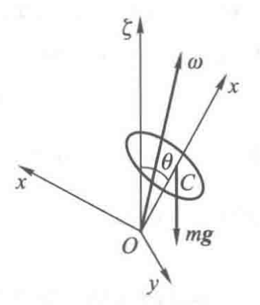

［解］ 本题属于拉格朗日-泊松情况，且

$$
I_1=I_2=\frac{1}{4}m(2a^2)+ma^2=2ma^2
$$

$$
I_3=\frac{1}{2}m(2a)^2=2ma^2
$$

又本题三个第一积分，就是（3.9.19）、（3.9.21）及（3.9.22）三式，即

$$
\left.
\begin{aligned}
&\dot{\varphi}\cos\theta+\dot{\psi}=s=\text{常量}\\
&\frac{1}{2}\left[I_1(\dot{\theta}^2+\dot{\varphi}^2\sin^2\theta)+I_3s^2\right]+mga\cos\theta=E=\text{常量}\\
&I_1\dot{\varphi}\sin^2\theta+I_3s\cos\theta=\alpha'=\text{常量}
\end{aligned}
\right\}
\qquad (1)
$$

现在由起始条件来定（1）式中的三个积分常量，并设起始时，$\boldsymbol{\omega}$与$x$轴及$z$轴共面，则

$$
\omega_{x_0}=\omega\sin\frac{\alpha}{2},\quad \omega_{y_0}=0,\quad \omega_{z_0}=\omega\cos\frac{\alpha}{2} \qquad (2)
$$

又起始时，$\theta$达其最大值$\alpha$，故

$$
(\dot{\theta})_0=0 \qquad (3)
$$

由式（3.3.3），得

$$
\left.
\begin{aligned}
&\psi_0=\frac{\pi}{2},\quad (\dot{\varphi})_0=\frac{\omega\sin\frac{\alpha}{2}}{\sin\alpha}=\frac{\omega}{2\cos\frac{\alpha}{2}}\\
&(\dot{\psi})_0=\omega\cos\frac{\alpha}{2}-\frac{\omega}{2\cos\frac{\alpha}{2}}\cos\alpha=\omega\left[\frac{2\cos^2\frac{\alpha}{2}-\cos\alpha}{2\cos\frac{\alpha}{2}}\right]=\frac{\omega}{2\cos\frac{\alpha}{2}}
\end{aligned}
\right\}
\qquad (4)
$$

把$I_1$、$I_2$及$(\dot{\theta})_0$、$(\dot{\varphi})_0$及$\omega_{z_0}$的值代入（1）式中的第一式和第三式后，得

$$
\dot{\varphi}\cos\theta+\dot{\psi}=\omega\cos\frac{\alpha}{2}=s
$$

$$
\dot{\varphi}\sin^2\theta+\omega\cos\frac{\alpha}{2}\cos\theta=\frac{\omega\sin^2\frac{\alpha}{2}}{2\cos\frac{\alpha}{2}}+\omega\cos\alpha\cos\frac{\alpha}{2}
$$

$$
=\frac{4\omega\sin^2\frac{\alpha}{2}\cos^2\frac{\alpha}{2}}{2\cos\frac{\alpha}{2}}+\omega\left(\cos^2\frac{\alpha}{2}-\sin^2\frac{\alpha}{2}\right)\cos\frac{\alpha}{2}=\omega\cos\frac{\alpha}{2} \qquad (5)
$$

又由（1）式中的第二式，得

$$
\dot{\theta}^2+\dot{\varphi}^2\sin^2\theta+s^2+2\frac{mga}{2ma^2}\cos\theta=\frac{\omega^2}{4\cos^2\frac{\alpha}{2}}\sin^2\alpha+s^2+2\frac{mga}{2ma^2}\cos\alpha
$$

即

$$
\dot{\theta}^2+\dot{\varphi}^2\sin^2\theta=\omega^2\sin^2\frac{\alpha}{2}+k\omega^2(\cos\alpha-\cos\theta) \qquad (6)
$$

式中

$$
k=\frac{g}{a\omega^2}
$$

由（5）及（6）式得

$$
\begin{aligned}
\frac{\dot{\theta}^2}{\omega^2}&=-\frac{\cos^2\frac{\alpha}{2}(1-\cos\theta)^2}{\sin^2\theta}+\sin^2\frac{\alpha}{2}+k(\cos\alpha-\cos\theta)\\
&=k(\cos\alpha-\cos\theta)+1-\cos^2\frac{\alpha}{2}-\cos^2\frac{\alpha}{2}\tan^2\frac{\theta}{2}
\end{aligned}
$$

$$
=k(\cos\alpha-\cos\theta)+1-\cos^2\frac{\alpha}{2}\sec^2\frac{\theta}{2}
$$

所以

$$
t=\int_\alpha^0\frac{\mathrm{d}\theta}{\omega\sqrt{1-\cos^2\frac{\alpha}{2}\sec^2\frac{\theta}{2}+k(\cos\alpha-\cos\theta)}}
$$

## 思考题

3.1 刚体一般是由$n$（$n$是一个很大的数目）个质点组成．为什么刚体的独立变量却不是$3n$而是6或者更少？

3.2 何谓物体的重心？它和质心是不是总是重合在一起的？

3.3 试讨论图形的几何中心、质心和重心重合在一起的条件．

3.4 简化中心改变时，主矢和主矩是不是也要随着改变？如果要改变，会不会影响刚体的运动？

3.5 已知一均质棒，当它绕过其一端并垂直于棒的轴转动时，转动惯量为$\frac{1}{3}ml^2$，$m$为棒的质量，$l$为棒长．问此棒绕通过离棒端为$\frac{1}{4}l$且与上述轴线平行的另一轴线转动时，转动惯量是不是等于$\frac{1}{3}ml^2+m\left(\frac{1}{4}l\right)^2$？为什么？

3.6 如果两条平行线中没有一条是通过质心的，那么平行轴定理式（3.5.12）能否应用？如不能，可否加以修改后再用？

3.7 在平面平行运动中，基点既然可以任意选择，你觉得选用哪些特殊点作为基点比较好？好处在哪里？又在（3.7.1）及（3.7.4）两式中，哪些量与基点有关？哪些量与基点无关？

3.8 转动瞬心在无穷远处，意味着什么？

3.9 刚体作平面平行运动时，能否对转动瞬心应用动量矩定理写出它的动力学方程？为什么？

3.10 当圆柱体以匀加速度自斜面滚下时，为什么用机械能守恒定律不能求出圆柱体和斜面之间的反作用力？此时摩擦阻力所作的功为什么不列入？是不是我们必须假定没有摩擦力？没有摩擦力，圆柱体能不能滚？

3.11 圆柱体沿斜面无滑动的滚下时，它的线加速度与圆柱体的转动惯量有关，这是为什么？但圆柱体沿斜面既滚且滑向下运动时，它的线加速度则与转动惯量无关？这又是为什么？

3.12 刚体作怎样的运动时，刚体内任一点的线速度才可写为$\boldsymbol{\omega}\times\boldsymbol{r}$？这时$r$是不是等于该质点到转动轴的垂直距离？为什么？

3.13 刚体绕固定点转动时，$\frac{\mathrm{d}\boldsymbol{\omega}}{\mathrm{d}t}\times\boldsymbol{r}$为什么叫转动加速度而不叫切向加速度？又$\boldsymbol{\omega}\times(\boldsymbol{\omega}\times\boldsymbol{r})$为什么叫向轴加速度而不叫向心加速度？

3.14 在欧拉动力学方程中，既然坐标轴是固定在刚体上，随着刚体一起转动，为什么我们还可以用这种坐标系来研究刚体的运动？

3.15 欧拉动力学方程中的第二项$(I_1-I_2)\omega_x\omega_y$等是怎样产生的？它的物理意义又是什么？

## 习题

3.1 半径为$r$的光滑半球形碗，固定在水平面上．一均质棒斜靠在碗缘，一端在碗内，一端则在碗外，在碗内的长度为$c$，试证棒的全长为

$$
\frac{4(c^2-2r^2)}{c}
$$

3.2 长为$2l$的均质棒，一端抵在光滑墙上，而棒身则如图示斜靠在与墙相距为$d(d\leq l\cos\theta)$的光滑棱角上．求棒在平衡时与水平面所成的角$\theta$．

答：$\theta=\arccos\left(\frac{d}{l}\right)^{\frac{1}{3}}$

3.3 两根均质棒$AB$、$BC$在$B$处刚性连接在一起，且$\angle ABC$形成一直角．如将此棒的$A$点用绳系于固定点上，则当平衡时，$AB$和竖直直线所成的角$\theta_0$满足下列关系：

$$
\tan\theta_0=\frac{b^2}{a^2+2ab}
$$

式中$a$及$b$为棒$AB$和$BC$的长度，试证明之．

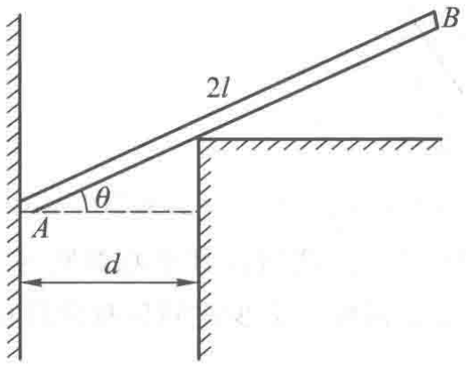

3.4 相同的两个均质光滑球悬在结于定点$O$的两根绳子上，此两球同时又支持一个等重的均质球，求$\alpha$角及$\beta$角之间的关系．

答：$\tan\beta=3\tan\alpha$

3.5 一均质的梯子，一端置于摩擦因数为$\frac{1}{2}$的地板上，另一端则斜靠在摩擦因数为$\frac{1}{3}$的高墙上，一人的体重为梯子的三倍，爬到梯的顶端时，梯尚未开始滑动，则梯与地面的倾角，最小当为若干？

答：$\arctan\frac{41}{24}$

3.6 把分子看做相互间距离不变的质点组，试决定以下两种情况下分子的中心主转动惯量：

（1）二原子分子．它们的质量是$m_1,m_2$，距离是$l$．

（2）形状为等腰三角形的三原子分子，三角形的高是$h$，底边的长度为$a$．底边上两个原子的质量为$m_1$，顶点上的为$m_2$．

答：（1）取二原子的联线为$x$轴，而$y$轴与$z$轴则通过它们的质心，于是

$$
I_1=0,\quad I_2=I_3=\frac{m_1m_2}{m_1+m_2}l^2
$$

（2）坐标轴的取法如图所示，则

$$
I_1=\frac{2m_1m_2}{2m_1+m_2}h^2,\quad I_2=\frac{1}{2}m_1a^2,\quad I_3=I_1+I_2
$$

3.7 如椭球方程为

$$
\frac{x^2}{a^2}+\frac{y^2}{b^2}+\frac{z^2}{c^2}=1
$$

试求此椭球绕其三个中心主轴转动时的中心主转动惯量．设此椭球的质量为$m$，并且密度$\rho$是常数．

答：$I_1=\frac{1}{5}m(b^2+c^2)$，$I_2=\frac{1}{5}m(c^2+a^2)$，$I_3=\frac{1}{5}m(a^2+b^2)$

3.8 半径为$R$的非均质圆球，在距中心$r$处的密度可以用下式表示：

$$
\rho=\rho_0\left(1-\alpha\frac{r^2}{R^2}\right)
$$

式中$\rho_0$及$\alpha$都是常量．试求此圆球绕直径转动时的回转半径．

答：$k=\sqrt{\frac{14-10\alpha}{35-21\alpha}}R$

3.9 立方体绕其对角线转动时的回转半径为

$$
k=\frac{d}{3\sqrt{2}}
$$

试证明之．式中$d$为对角线的长度．

3.10 一均质圆盘，半径为$a$，放在粗糙水平桌上，绕通过其中心的竖直轴转动，开始时的角速度为$\omega_0$．已知圆盘与桌面的摩擦因数为$\mu$，问经过多少时间后盘将静止？

答：$t=\frac{3a\omega_0}{4\mu g}$

式中$g$为重力加速度．

3.11 通风机的转动部分以初角速$\omega_0$绕其轴转动．空气阻力矩与角速度成正比，比例常数为$k$．如转动部分对其轴的转动惯量为$I$，问经过多少时间后，其转动的角速减为初角速的一半？又在此时间内共转了多少转？

答：$t=\frac{I}{k}\ln 2$；$n=\frac{I\omega_0}{4\pi k}$

3.12 矩形均质薄片$ABCD$，边长为$a$与$b$，重为$mg$，绕竖直轴$AB$以初角速$\omega_0$转动．此时薄片的每一部分均受到空气的阻力，其方向垂直于薄片的平面，其量值与面积及速度平方成正比，比例系数为$k$．问经过多少时间后，薄片的角速减为初角速的一半？

答：$t=\frac{4m}{3ka^2b\omega_0}$

3.13 一段半径$R$为已知的均质圆弧，绕通过弧线中心并与弧面垂直的轴线摆动．求其作微振动时的周期．

答：$\tau=2\pi\sqrt{\frac{2R}{g}}$

3.14 试求复摆悬点上的反作用力在水平方向的投影$F_x$与竖直方向的投影$F_y$．设此摆的重量为$mg$，对转动轴的回转半径为$k$，转动轴到摆重心的距离为$a$，且摆无初速地自离平衡位置为一已知角$\theta_0$处下降．

答：$F_x=\frac{mga^2}{k^2}(3\cos\theta-2\cos\theta_0)\sin\theta$

$$
F_y=\frac{mga^2}{k^2}[(3\cos\theta-2\cos\theta_0)\cos\theta-1]+mg
$$

3.15 一轮的半径为$r$，以匀速$v_0$无滑动地沿一直线滚动．求轮缘上任一点的速度及加速度．又最高点及最低点的速度各等于多少？哪一点是转动瞬心？

答：$v=2v_0\cos\frac{\theta}{2}$，式中$\theta$是所考虑的点相对于轮心的径矢与轮的最高点的径矢间的夹角．

3.16 一矩形板$ABCD$在平行于自身的平面内运动，其角速度为定值$\omega$．在某一瞬时，$A$点的速度为$v$，其方向则沿对角线$AC$．试求此瞬时$B$点的速度，以$v$、$\omega$及矩形的边长等表示之．假定$AB=a,BC=b$．

答：$v_B=\left[v^2+2v\omega\frac{ab}{\sqrt{a^2+b^2}}+\omega^2a^2\right]^{\frac{1}{2}}$

$v_B$和$BC$边的夹角为$\arctan\frac{va}{\omega a\sqrt{a^2+b^2}+vb}$

3.17 长为$l$的杆$AB$在一固定平面内运动．其$A$端在半径$r\left(r\leq\frac{l}{2}\right)$的圆周里滑动，而杆本身则于任何时刻均通过此圆周的$M$点．试求杆上任一点的轨迹及转动瞬心的轨迹．

答：距$A$端为$a$的点$P$的轨迹为蚶线．如以$M$为极点，而极轴通过$O$点，则其方程为$\rho=2r\cos\theta-a$，空间极迹为给定圆；本体极迹为半径等于$2r$的圆，圆心在$A$点．

3.18 一圆盘以匀速度$v_0$沿一直线无滑动地滚动．杆$AB$以铰链固结于盘的边缘上的$B$点，其$A$端则沿上述直线滑动．求$A$点的速度与盘的转角$\varphi$的关系，设杆长为$l$，盘的半径为$r$．

答：$v_A=2v_0\sin^2\frac{\varphi}{2}\left(\frac{r\sin\varphi}{\sqrt{l^2-4r^2\sin^4\frac{\varphi}{2}}}+1\right)$

3.19 长为$2a$的均质棒$AB$，以铰链悬挂于$A$点上．如起始时，棒自水平位置无初速地运动，并且当棒通过竖直位置时，铰链突然松脱，棒成为自由体．试证在以后的运动中，棒的质心的轨迹为一抛物线，并求当棒的质心下降$h$距离后，棒一共转了几转？

答：$\frac{1}{2\pi}\sqrt{\frac{3h}{a}}$

3.20 质量为$m'$、半径为$r$的均质圆柱体放在粗糙水平面上．柱的外面绕有轻绳，绳子跨过一个很轻的滑轮，并悬挂一质量为$m$的物体．设圆柱体只滚不滑，并且圆柱体与滑轮间的绳子是水平的．求圆柱体质心的加速度$a_1$，物体的加速度$a_2$及绳中张力$F_T$．

答：$a_1=\frac{4m}{3m'+8m}g,\quad a_2=2a_1$

$$
F_T=\frac{3m'm}{3m'+8m}g
$$

3.21 一飞轮有一半径为$r$的杆轴．飞轮及杆轴对于转动轴的总转动惯量为$I$．在杆轴上绕有细而轻的绳子，绳子的另一端挂一质量为$m$的重物．如飞轮受到阻尼力矩$G$的作用，求飞轮的角加速度．若飞轮转过$\theta$角后，绳子与杆轴脱离，并再转过$\varphi$角后，飞轮停止转动，求飞轮所受到的阻尼力矩$G$的量值．

答：$\dot{\omega}=\frac{mgr-G}{I+mr^2}$，$\quad G=\frac{mgIr\theta}{I\theta+(I+mr^2)\varphi}$

3.22 一面粗糙另一面光滑的平板，质量为$m'$，将光滑的一面放在水平桌上，木板上放一质量为$m$的球．若板沿其长度方向突然有一速度$v$，问此球经过多少时间后开始滚动而不滑动？

答：$t=\frac{v}{\left(\frac{7}{2}+\frac{m}{m'}\right)\mu g}$ 式中$\mu$是摩擦因数．

3.23 重为$W_1$的木板受水平力$F$的作用，在一不光滑的平面上运动，板与平面间的摩擦因数为$\mu$．在板上放一重为$W_2$的实心圆柱，此圆柱在板上滚动而不滑动，试求木板的加速度$a$．

答：$a=\frac{F-\mu(W_1+W_2)}{W_1+\frac{W_2}{3}}g$

3.24 半径为$a$的球，以初速$v$及初角速$\omega$抛掷于一倾角为$\alpha$的斜面上，使其沿着斜面向上滚动．如$v>a\omega$，其中$\omega$的方向使球有向下滚动的趋向，且摩擦因数$\mu>\frac{2}{7}\tan\alpha$，试证经过$\frac{5v+2a\omega}{5g\sin\alpha}$的时候，球将停止上升．

3.25 均质实心圆球，栖于另一固定圆球的顶端．如使其自此位置发生此微偏离，则将从开始滚下．试证当两球的公共法线与竖直线所成之角$\varphi$满足下列关系

$$
2\sin(\varphi-\lambda)=5\sin\lambda(3\cos\varphi-2)
$$

时，则将开始滑动，式中$\lambda$为摩擦角．

3.26 棒的一端置于光滑水平面上，另一端则靠在光滑墙上，且棒与地面的倾角为$\alpha$．如任其自此位置开始下滑，则当棒与地面的倾角变为

$$
\arcsin\left(\frac{2}{3}\sin\alpha\right)
$$

时，棒将与墙分离，试证明之．

3.27 试研究上题中棒与墙分离后的运动．并求棒落地时的角速度$\Omega$，设棒长为$2a$．

答：$\Omega=\left[\frac{3g\sin\alpha}{2a}\left(1-\frac{\sin^2\alpha}{9}\right)\right]^{\frac{1}{2}}$

3.28 半径为$r$的均质实心圆柱，放在倾角为$\theta$的粗糙斜面上，摩擦因数为$\mu$．设运动不是纯滚动，试求圆柱体质心加速度$a$及圆柱体的角加速度$\alpha$．

答：$a=\frac{\sin(\theta-\lambda)}{\cos\lambda}g$，$\alpha=\frac{2\mu\cos\theta}{r}g$，式中$\lambda=\arctan\mu$．

3.29 均质实心圆球和一外形相等的空心球壳沿着同一斜面同时自同一高度自由滚下，问哪一个球滚得快些？并证它们经过相等距离所需的时间比是$\sqrt{21}:5$．

3.30 碾磨机碾轮的边缘沿水平面作纯滚动，轮的水平轴则以匀角速$\omega$绕铅垂轴$OB$转动．如$OA=c$，$OB=b$，试求轮上最高点$M$的速度及加速度的量值．

答：$v=2c\omega$；$a=\omega^2c\sqrt{9+\left(\frac{c}{b}\right)^2}$

3.31 转轮$AB$，绕$OC$轴转动的角速度为$\omega_1$，而$OC$绕竖直线$OE$转动的角速度则为$\omega_2$．如$AD=DB=a$，$OD=b$，$\angle COE=\theta$，试求转轮最低点$B$的速度．

答：$v_B=\omega_1a+\omega_2(a\cos\theta+b\sin\theta)$，方向垂直纸面背向读者．

3.32 高为$h$、顶角为$2\alpha$的圆锥在一平面上滚动而不滑动．如已知此锥以匀角速$\omega$绕$O\xi$轴转动，试求圆锥底面上$A$点的转动加速度$a_1$和向轴加速度$a_2$的量值．

答：$a_1=\frac{h}{\sin\alpha}\omega^2$，$a_2=2a_1\cos^2\alpha$

3.33 一回转仪，$I_1=I_2=2I_3$，依惯性绕重心转动，并作规则进动．已知此回转仪的自转角速度为$\omega_1$，并知其自转轴与进动轴间的夹角$\theta=60^\circ$，求近动角速度$\omega_2$的量值．

答：$\omega_2=2\omega_1$

3.34 试用欧拉动力学方程，证明在欧拉-潘索情况中，动量矩$\boldsymbol{J}$及动能$T$都是常数．

3.35 对称陀螺的轴位于竖直位置，陀螺以很大的角速度$\omega_1$作稳定的自转．今突然在离开顶点$d$处受到一与陀螺的对称轴垂直的冲量$I$作用．试证陀螺在以后的运动中，最大章动角近似地为$2\arctan\left(\frac{Id}{I_3\omega_1}\right)$，式中$I_3$是陀螺绕对称轴转动的转动惯量．

3.36 一个$I_1=I_2\neq I_3$的刚体，绕其重心作定点转动．已知作用在刚体上的阻尼力是一力偶，位于与转动瞬轴相垂直的平面内，其力偶矩与瞬时角速度成正比，比例常数为$I_3\lambda$，试证刚体的瞬时角速度在三惯量主轴上的分量为

$$
\omega_x=ae^{-\lambda I_3t/I_1}\sin\left(\frac{n}{\lambda}e^{-\lambda t}+\varepsilon\right)
$$

$$
\omega_y=ae^{-\lambda I_3t/I_1}\cos\left(\frac{n}{\lambda}e^{-\lambda t}+\varepsilon\right)
$$

$$
\omega_z=\Omega e^{-\lambda t}
$$

式中$a,\varepsilon,\Omega$都是常数，而$n=\frac{I_3-I_1}{I_1}\Omega$．
