# 第四章 转动参考系

## §4.1 平面转动参考系

设平面参考系（例如平板）$S'$以角速度$\boldsymbol{\omega}$绕垂直于自身的轴转动，在这参考系（平板）上取坐标系$O-xy$，它的原点和静止坐标系$S$原点$O$重合，并且绕着通过$O$点并垂直于平板的直线（即$z$轴）以角速度$\boldsymbol{\omega}$转动（图4.1.1）．令单位矢量$\boldsymbol{i},\boldsymbol{j}$固着在平板上的$x$轴及$y$轴上，并以同一角速度$\boldsymbol{\omega}$和平板一同转动．$\boldsymbol{\omega}$矢量既然在$z$轴上，所以我们可以把它写为$\boldsymbol{\omega}=\omega\boldsymbol{k}$．如果$P$为在平板上运动着的一个质点，则$P$的位矢为

$$
\boldsymbol{r}=x\boldsymbol{i}+y\boldsymbol{j} \qquad (4.1.1)
$$

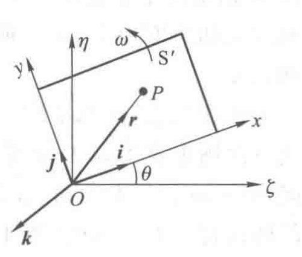

因质点$P$和坐标轴都随着平板以相同的角速度转动，且$\boldsymbol{\omega}$的量值为$\dot{\theta}$，故由式（1.2.8），我们有

$$
\frac{\mathrm{d}\boldsymbol{i}}{\mathrm{d}t}=\omega\boldsymbol{j},\qquad \frac{\mathrm{d}\boldsymbol{j}}{\mathrm{d}t}=-\omega\boldsymbol{i} \qquad (4.1.2)
$$

求式（4.1.1）对时间$t$的微商后，得质点$P$对静止坐标系$S$的速度（不是对平板，因对平板而言，$\dfrac{\mathrm{d}\boldsymbol{i}}{\mathrm{d}t}=\dfrac{\mathrm{d}\boldsymbol{j}}{\mathrm{d}t}=0$）为

$$
\begin{aligned}
\boldsymbol{v}&=\frac{\mathrm{d}\boldsymbol{r}}{\mathrm{d}t}=\dot{x}\boldsymbol{i}+\dot{y}\boldsymbol{j}+\dot{z}\boldsymbol{k}+x\frac{\mathrm{d}\boldsymbol{i}}{\mathrm{d}t}+y\frac{\mathrm{d}\boldsymbol{j}}{\mathrm{d}t}+z\frac{\mathrm{d}\boldsymbol{k}}{\mathrm{d}t}\\
&=(\dot{x}-\omega y)\boldsymbol{i}+(\dot{y}+\omega x)\boldsymbol{j}
\end{aligned}
\qquad (4.1.3)
$$

上式中的$\dot{x}$及$\dot{y}$为$P$对转动参考系（平板）诸轴的分速度，其合成为$\boldsymbol{v}'$，应为相对速度．因如$P$在平板上不动，则此项速度即为零．至于$-\omega y$及$\omega x$，则系由于平板转动而带着$P$点一同转动所引起的，故应为牵连速度在坐标轴上的分量或称轴向分量，二者的合成就是牵连速度$\boldsymbol{\omega}\times\boldsymbol{r}$，这是因为

$$
\boldsymbol{\omega}\times\boldsymbol{r}=\omega\boldsymbol{k}\times(x\boldsymbol{i}+y\boldsymbol{j})=+\omega x\boldsymbol{j}-\omega y\boldsymbol{i}
$$

因此，可以把（4.1.3）式简写成下列形式：

$$
\boldsymbol{v}=\boldsymbol{v}'+\boldsymbol{\omega}\times\boldsymbol{r} \qquad (4.1.4)
$$

亦即绝对速度等于相对速度与牵连速度的矢量和，和§1.3中所得到的结果一致，只是由于运动方式不同，牵连速度的表达式也有所不同．如果把式（4.1.4）和式（3.2.6）相比较，则可发现现在式（4.1.4）中多一相对速度$\boldsymbol{v}'$项．这是可以想象的，因在刚体中，组成刚体的各个质点，都只随着刚体一起转动，它们与整个刚体并无所谓相对运动．而当刚体（平板）上有一相对于刚体运动着的$P$点，那就必须有式（4.1.4）这一关系．

现在来求$P$点对静止坐标系$S$的加速度．

$$
\boldsymbol{a}=\frac{\mathrm{d}\boldsymbol{v}}{\mathrm{d}t}=(\ddot{x}-2\omega\dot{y}-\omega^2x)\boldsymbol{i}+(\ddot{y}+2\omega\dot{x}-\omega^2y)\boldsymbol{j}-\dot{\omega}y\boldsymbol{i}+\dot{\omega}x\boldsymbol{j} \qquad (4.1.5)
$$

上式中的$\ddot{x}$及$\ddot{y}$为质点$P$对转动参考系$S'$的轴向加速度分量，其合成为$\boldsymbol{a}'$，根据上述的同样理由，它是相对加速度．$-\omega^2x\boldsymbol{i}$及$-\omega^2y\boldsymbol{j}$的合成为$-\omega^2\boldsymbol{r}$，沿径矢指向$O$点，是由于平板以角速度$\omega$转动所引起的向心加速度；而$-\dot{\omega}y\boldsymbol{i}+\dot{\omega}x\boldsymbol{j}=\dot{\boldsymbol{\omega}}\times\boldsymbol{r}$则是由于平板作变角速转动所引起的切向加速度，如平板以匀角速转动，则此项加速度为零．这两种加速度都是由于平板转动所引起的，所以应为牵连加速度．

现在来看看$-2\omega\dot{y}\boldsymbol{i}$及$2\omega\dot{x}\boldsymbol{j}$是怎样产生的？显然，$-2\omega\dot{y}\boldsymbol{i}+2\omega\dot{x}\boldsymbol{j}=2\boldsymbol{\omega}\times\boldsymbol{v}'$，其方向则垂直于$\boldsymbol{\omega}$及$\boldsymbol{v}'$所决定的平面，并且依右手螺旋法则定其指向．在平面问题中，$\boldsymbol{\omega}$恒沿$\boldsymbol{k}$方向，故$2\boldsymbol{\omega}\times\boldsymbol{v}'$为位于$xy$平面内的矢量，其指向可将$\boldsymbol{v}'$随着$S'$的转动转一直角即得（图4.1.2）．这个加速度叫做**科里奥利加速度**，简称**科氏加速度**．可以证明，科氏加速度是由于在$S$系中的观察者看来，牵连运动（即$\boldsymbol{\omega}$）可使相对速度$\boldsymbol{v}'$发生改变，而相对运动（即$\boldsymbol{v}'$）又同时使牵连速度$\boldsymbol{\omega}\times\boldsymbol{r}$中的$\boldsymbol{r}$发生改变，即科里奥利加速度$2\boldsymbol{\omega}\times\boldsymbol{v}'$是由牵连运动与相对运动相互影响所产生的．如$\boldsymbol{\omega}$与$\boldsymbol{v}'$两者中有一为零，则此项加速度即为零．故在平面转动参考系中，绝对加速度为相对加速度、牵连加速度及科里奥利加速度三者的矢量和，这一点跟作加速平动的参考系的情形不同．

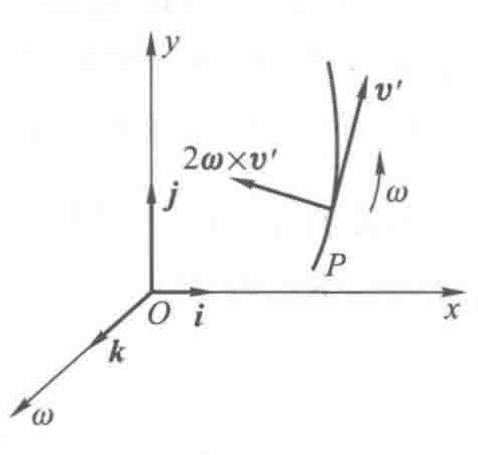

我们可以把式（4.1.5）简写成下面的形式：

$$
\boldsymbol{a}=\boldsymbol{a}'+\dot{\boldsymbol{\omega}}\times\boldsymbol{r}-\omega^2\boldsymbol{r}+2\boldsymbol{\omega}\times\boldsymbol{v}' \qquad (4.1.6)
$$

如果令$\boldsymbol{a}_t=\dot{\boldsymbol{\omega}}\times\boldsymbol{r}-\omega^2\boldsymbol{r}$代表牵连加速度，$\boldsymbol{a}_c=2\boldsymbol{\omega}\times\boldsymbol{v}'$代表科里奥利加速度，则式（4.1.6）还可简化为

$$
\boldsymbol{a}=\boldsymbol{a}'+\boldsymbol{a}_t+\boldsymbol{a}_c \qquad (4.1.7)
$$

由于科里奥利加速度在以前课程中很少接触到，读者对它比较陌生，故特再举一例，说明它是怎样产生的．

［例］ 圆盘半径为$R$，以匀角速度$\omega$绕垂直于盘心$O$的轴线转动．一质点沿径向槽自盘心以匀速度$v'$向外运动，试求质点加速度各分量的量值（图4.1.3）．

［解］ 设在某一瞬时$t$，质点运动到图中1的位置，它与盘心$O$的距离为$r$．在$t+\Delta t$瞬间，如盘不转，它应运动到图中2的位置，它与$O$的距离为$r+v'\Delta t$．但圆盘是以匀角速$\omega$转动的，在$\Delta t$时间间隔内，它转了一个角度$\omega\Delta t$，故质点在$t+\Delta t$瞬间，实际上达到$2'$的位置．

假定$\Delta t$很小，于是$\cos\omega\Delta t\approx 1$，$\sin\omega\Delta t\approx\omega\Delta t$，$(\Delta t)^2\approx 0$，故在$2'$处可仍按原先$\overrightarrow{O12}$的径向及横向进行投影，因此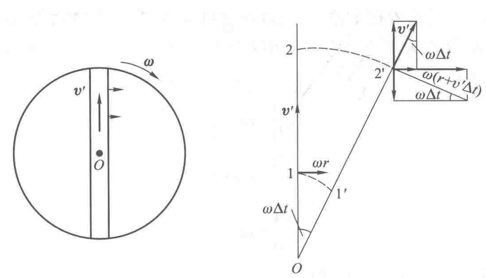

$$
\begin{aligned}
\Delta v_r&=[v'\cos\omega\Delta t-\omega(r+v'\Delta t)\sin\omega\Delta t]-v'\\
&=[v'-\omega(r+v'\Delta t)\omega\Delta t]-v'=-\omega^2r\Delta t
\end{aligned}
\qquad (1)
$$

$$
\begin{aligned}
\Delta v_\theta&=[\omega(r+v'\Delta t)\cos\omega\Delta t+v'\sin\omega\Delta t]-\omega r\\
&=[\omega(r+v'\Delta t)+v'\omega\Delta t]-\omega r=2\omega v'\Delta t
\end{aligned}
\qquad (2)
$$

由此得

$$
\left.
\begin{aligned}
a_r&=\lim_{\Delta t\to 0}\frac{\Delta v_r}{\Delta t}=-\omega^2r\\
a_\theta&=\lim_{\Delta t\to 0}\frac{\Delta v_\theta}{\Delta t}=2\omega v'
\end{aligned}
\right\}
\qquad (3)
$$

故此时质点不但有径向加速度（即向心加速度）$-\omega^2r$，而且还有横向加速度$2\omega v'$，此即科里奥利加速度．从图4.1.3及上面的计算可以看出：牵连运动（圆盘转动）改变了相对速度$\boldsymbol{v}'$的方向，因而产生了横向加速度$\omega v'$；同时，相对运动（质点向外运动）又改变了牵连速度$\boldsymbol{\omega}\times\boldsymbol{r}$的量值，因为这时$r$已变为$r+v'\Delta t$，故又一次产生了横向加速度$\omega v'$，因而沿横向的科里奥利加速度为$2\omega v'$．

如质点在盘上不动，即$v'=0$，则在$t+\Delta t$瞬间，质点只随着盘转到$1'$的位置，它离盘心$O$的距离仍然等于$r$，所以只有径向加速度$-\omega^2r$．

## §4.2 空间转动参考系

现在我们来讨论较为一般的情况，即参考系不是平面的，而是空间的，参考系转动的角速度$\boldsymbol{\omega}$的量值和方向也都可以改变．至于转动坐标系$S'$的原点，暂时还认为它是和静止坐标系$S$的原点$O$重合，因此矢量$\boldsymbol{\omega}$恒通过$O$点．

令单位矢量$\boldsymbol{i},\boldsymbol{j},\boldsymbol{k}$固着在$S'$系上的三个坐标轴上，故任一矢量$\boldsymbol{G}$可写为

$$
\boldsymbol{G}=G_x\boldsymbol{i}+G_y\boldsymbol{j}+G_z\boldsymbol{k} \qquad (4.2.1)
$$

因单位矢量$\boldsymbol{i},\boldsymbol{j},\boldsymbol{k}$是随着$S'$系以同一角速度$\boldsymbol{\omega}$转动的，故观测者在静止参考系$S$上所看到的$\boldsymbol{G}$的变化率应为

$$
\frac{\mathrm{d}\boldsymbol{G}}{\mathrm{d}t}=\frac{\mathrm{d}G_x}{\mathrm{d}t}\boldsymbol{i}+\frac{\mathrm{d}G_y}{\mathrm{d}t}\boldsymbol{j}+\frac{\mathrm{d}G_z}{\mathrm{d}t}\boldsymbol{k}+G_x\frac{\mathrm{d}\boldsymbol{i}}{\mathrm{d}t}+G_y\frac{\mathrm{d}\boldsymbol{j}}{\mathrm{d}t}+G_z\frac{\mathrm{d}\boldsymbol{k}}{\mathrm{d}t} \qquad (4.2.2)
$$

既然单位矢量$\boldsymbol{i}$是固着在$S'$系上，且以角速度$\boldsymbol{\omega}$绕着$O$点转动的，我们就可以认为$\boldsymbol{i}$是距离$O$点为单位长的动点$B$（$\boldsymbol{i}$的末端）对固定点$O$（$\boldsymbol{i}$的始端）的位矢，故由式（3.2.6），得

同理

$$
\left.
\begin{aligned}
\frac{\mathrm{d}\boldsymbol{i}}{\mathrm{d}t}&=\boldsymbol{\omega}\times\boldsymbol{i}\\
\frac{\mathrm{d}\boldsymbol{j}}{\mathrm{d}t}&=\boldsymbol{\omega}\times\boldsymbol{j}\\
\frac{\mathrm{d}\boldsymbol{k}}{\mathrm{d}t}&=\boldsymbol{\omega}\times\boldsymbol{k}
\end{aligned}
\right\}
\qquad (4.2.3)
$$

把这些关系代入式（4.2.2）中，得

$$
\frac{\mathrm{d}\boldsymbol{G}}{\mathrm{d}t}=\frac{\mathrm{d}^*\boldsymbol{G}}{\mathrm{d}t}+\boldsymbol{\omega}\times\boldsymbol{G} \qquad (4.2.4)
$$

式中

$$
\frac{\mathrm{d}^*\boldsymbol{G}}{\mathrm{d}t}=\frac{\mathrm{d}G_x}{\mathrm{d}t}\boldsymbol{i}+\frac{\mathrm{d}G_y}{\mathrm{d}t}\boldsymbol{j}+\frac{\mathrm{d}G_z}{\mathrm{d}t}\boldsymbol{k}
$$

是$\boldsymbol{i},\boldsymbol{j},\boldsymbol{k}$固定不动时$\boldsymbol{G}$的变化率．故$\dfrac{\mathrm{d}\boldsymbol{G}}{\mathrm{d}t}$包含两部分：一为观测者在$S'$系所观测出来的$\boldsymbol{G}$的变化率$\dfrac{\mathrm{d}^*\boldsymbol{G}}{\mathrm{d}t}$，叫做**相对（或地方）变化率**，表示相对于转动参考系$S'$系的变化；此时把$\boldsymbol{i},\boldsymbol{j},\boldsymbol{k}$看成固定不变，而$\boldsymbol{G}$本身则在$S'$系中随着时间改变．另一部分$\boldsymbol{\omega}\times\boldsymbol{G}$则是由于参考系$S'$绕着$O$点以角速度$\boldsymbol{\omega}$转动并带动$\boldsymbol{G}$一起转动所产生的，所以叫做**牵连变化率**．故在转动参考系中，一个矢量$\boldsymbol{G}$的绝对变化率（对$S$）$\dfrac{\mathrm{d}\boldsymbol{G}}{\mathrm{d}t}$等于相对变化率（对$S'$）$\dfrac{\mathrm{d}^*\boldsymbol{G}}{\mathrm{d}t}$和牵连变化率$\boldsymbol{\omega}\times\boldsymbol{G}$两者的矢量和．在§3.8第（2）节中，我们曾经用到过这个关系，只是现在把它推广到任意矢量$\boldsymbol{G}$．

如空间转动坐标系$S'$的原点与固定坐标系$S$的原点$O$重合，并以角速度$\boldsymbol{\omega}$绕着$O$转动，则对$S$系而言，一个在$S'$系中运动的质点$P$的绝对速度，由式（4.2.4）知为

$$
\boldsymbol{v}=\frac{\mathrm{d}\boldsymbol{r}}{\mathrm{d}t}=\frac{\mathrm{d}^*\boldsymbol{r}}{\mathrm{d}t}+\boldsymbol{\omega}\times\boldsymbol{r} \qquad (4.2.5)
$$

式中$\boldsymbol{r}=\overrightarrow{OP}$，$\dfrac{\mathrm{d}^*\boldsymbol{r}}{\mathrm{d}t}=\boldsymbol{v}'$是质点$P$相对于$S'$系的速度，即相对速度，而$\boldsymbol{\omega}\times\boldsymbol{r}$则是由于$S'$系转动所产生的牵连速度，和式（4.1.4）的形式一样，只是此地由于转动不是平面而是空间的，所以物理含义更为普遍．

现在来求质点$P$对$S$系的绝对加速度$\boldsymbol{a}$．根据同样方法，我们有

$$
\boldsymbol{a}=\frac{\mathrm{d}\boldsymbol{v}}{\mathrm{d}t}=\frac{\mathrm{d}^*\boldsymbol{v}}{\mathrm{d}t}+\boldsymbol{\omega}\times\boldsymbol{v} \qquad (4.2.6)
$$

把式（4.2.5）中的$\boldsymbol{v}$代入式（4.2.6）中，得

$$
\begin{aligned}
\boldsymbol{a}&=\frac{\mathrm{d}^{2*}\boldsymbol{r}}{\mathrm{d}t^2}+\frac{\mathrm{d}^*\boldsymbol{\omega}}{\mathrm{d}t}\times\boldsymbol{r}+\boldsymbol{\omega}\times\frac{\mathrm{d}^*\boldsymbol{r}}{\mathrm{d}t}+\boldsymbol{\omega}\times\left(\frac{\mathrm{d}^*\boldsymbol{r}}{\mathrm{d}t}+\boldsymbol{\omega}\times\boldsymbol{r}\right)\\
&=\frac{\mathrm{d}^{2*}\boldsymbol{r}}{\mathrm{d}t^2}+\frac{\mathrm{d}^*\boldsymbol{\omega}}{\mathrm{d}t}\times\boldsymbol{r}+\boldsymbol{\omega}\times(\boldsymbol{\omega}\times\boldsymbol{r})+2\boldsymbol{\omega}\times\frac{\mathrm{d}^*\boldsymbol{r}}{\mathrm{d}t}
\end{aligned}
\qquad (4.2.7)
$$

如令$\boldsymbol{a}'$代表质点$P$对$S'$系的加速度（相对加速度），则

$$
\boldsymbol{a}'=\frac{\mathrm{d}^{2*}\boldsymbol{r}}{\mathrm{d}t^2} \qquad (4.2.8)
$$

又

$$
\left.
\begin{aligned}
\frac{\mathrm{d}\boldsymbol{\omega}}{\mathrm{d}t}&=\frac{\mathrm{d}^*\boldsymbol{\omega}}{\mathrm{d}t}+\boldsymbol{\omega}\times\boldsymbol{\omega}=\frac{\mathrm{d}^*\boldsymbol{\omega}}{\mathrm{d}t}\\
\boldsymbol{\omega}\times(\boldsymbol{\omega}\times\boldsymbol{r})&=\boldsymbol{\omega}(\boldsymbol{\omega}\cdot\boldsymbol{r})-\omega^2\boldsymbol{r}
\end{aligned}
\right\}
\qquad (4.2.9)
$$

故式（4.2.7）可简写为

$$
\boldsymbol{a}=\boldsymbol{a}'+\boldsymbol{a}_t+\boldsymbol{a}_c \qquad (4.2.10)
$$

式中

$$
\left.
\begin{aligned}
\boldsymbol{a}_t&=\frac{\mathrm{d}\boldsymbol{\omega}}{\mathrm{d}t}\times\boldsymbol{r}+\boldsymbol{\omega}(\boldsymbol{\omega}\cdot\boldsymbol{r})-\omega^2\boldsymbol{r}\\
\boldsymbol{a}_c&=2\boldsymbol{\omega}\times\frac{\mathrm{d}^*\boldsymbol{r}}{\mathrm{d}t}=2\boldsymbol{\omega}\times\boldsymbol{v}'
\end{aligned}
\right\}
\qquad (4.2.11)
$$

如质点$P$固着在$S'$系上不动，则$\boldsymbol{v}'=0$，故$\boldsymbol{a}'=0$，$\boldsymbol{a}_c=0$，而$\boldsymbol{a}$与$\boldsymbol{a}_t$相等．所以$\boldsymbol{a}_t$只和$S'$系的转动有关，故称为**牵连加速度**．它又包括两部分：一由$\boldsymbol{\omega}$发生改变所产生的$\dfrac{\mathrm{d}\boldsymbol{\omega}}{\mathrm{d}t}\times\boldsymbol{r}$，如参考系$S'$以恒定角速度$\boldsymbol{\omega}$转动，则此部分为零．另一部分则是由于$S'$系以角速度$\boldsymbol{\omega}$转动所产生的$\boldsymbol{\omega}(\boldsymbol{\omega}\cdot\boldsymbol{r})-\omega^2\boldsymbol{r}$．至于$\boldsymbol{a}_c$则是科里奥利加速度，此加速度与$\boldsymbol{\omega}$及$\boldsymbol{v}'$垂直，乃由于质点$P$对转动的$S'$系有相对速度从而$\boldsymbol{\omega}$与$\boldsymbol{v}'$相互影响所产生的（参看§4.1）．如两者有一为零，或两者不能相互影响（两者平行），则此项加速度为零．由式（4.2.10）可知，对转动参考系来讲，绝对加速度等于相对加速度、牵连加速度与科里奥利加速度三者的矢量和，也跟式（4.1.7）的形式相同（可与第三章有关公式相比较）．当然，此式不但物理含义普遍，$\boldsymbol{a}_t$的表达式也较式（4.1.6）复杂．我们在这里应注意的是，绝对速度与绝对加速度都是从静止参考系来观测一个在转动参考系中质点$P$的速度与加速度的；如果从转动参考系中来看，只能看到相对速度与相对加速度．

如果$S'$系以匀角速转动，例如地球的自转，则$\boldsymbol{\omega}$是一个常矢量（量值和方向都不变），可以$\overrightarrow{OB}$表之（图4.2.1），故$\dfrac{\mathrm{d}\boldsymbol{\omega}}{\mathrm{d}t}=0$．如再令$PM$为自质点$P$到$OB$的垂直距离，则

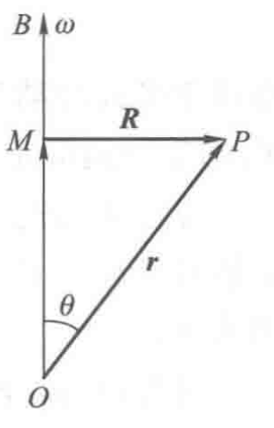

$$
\boldsymbol{\omega}\cdot\boldsymbol{r}=\omega r\cos\theta
$$

而牵连加速度$\boldsymbol{a}_t$为

$$
\begin{aligned}
\boldsymbol{a}_t&=\boldsymbol{\omega}(\omega r\cos\theta)-r\omega^2\\
&=\overrightarrow{OM}\omega^2-(\overrightarrow{OM}+\overrightarrow{MP})\omega^2\\
&=-\omega^2\boldsymbol{R}
\end{aligned}
$$

式中$\boldsymbol{R}=\overrightarrow{MP}$，在此情形下，方程（4.2.10）简化为

$$
\boldsymbol{a}=\boldsymbol{a}'-\omega^2\boldsymbol{R}+2\boldsymbol{\omega}\times\boldsymbol{v}' \qquad (4.2.12)
$$

现在推广到更为一般的情况，即$S'$系的原点$O'$不与$S$系的原点$O$重合，且$O'$对$O$的速度为$\boldsymbol{v}_0$，加速度为$\boldsymbol{a}_0$，则式（4.2.5）及式（4.2.10）的右端应分别加上$\boldsymbol{v}_0$项和$\boldsymbol{a}_0$项，前者是牵连速度的一部分，后者是牵连加速度的一部分，亦即式（4.2.11）中的$\boldsymbol{a}_t$应增添$\boldsymbol{a}_0$项．另外，上述两式中的位矢$\boldsymbol{r}$应改为相对于$O'$的位矢$\boldsymbol{r}'$．

## §4.3 非惯性系动力学（二）

### （1）平面转动参考系

从上两节中可以看到：转动参考系（不管是以匀角速还是以变角速转动）是非惯性参考系，对这种参考系来讲，牛顿运动定律不成立，因$\boldsymbol{a}'\neq\boldsymbol{a}$．但是，根据§1.6中的讨论，我们知道：对非惯性参考系来讲，只要加上适当的惯性力，牛顿运动定律在形式上就“仍然”可以成立．当然，惯性力的具体表达式跟参考系运动的方式有关．本节要研究的，就是在转动参考系中惯性力应当具有何种形式．

先从比较简单的平面参考系讲起．根据式（4.1.6），我们有

$$
\boldsymbol{a}'=\boldsymbol{a}-\dot{\boldsymbol{\omega}}\times\boldsymbol{r}+\omega^2\boldsymbol{r}-2\boldsymbol{\omega}\times\boldsymbol{v}' \qquad (4.3.1)
$$

如果质量为$m$的质点所受到的合外力为$\boldsymbol{F}$，即$m\boldsymbol{a}=\boldsymbol{F}$，故把（4.3.1）式乘以$m$后，就得到

$$
m\boldsymbol{a}'=\boldsymbol{F}-m\dot{\boldsymbol{\omega}}\times\boldsymbol{r}+m\omega^2\boldsymbol{r}-2m\boldsymbol{\omega}\times\boldsymbol{v}' \qquad (4.3.2)
$$

即对于平面转动参考系$S'$而言，如果添上三种惯性力：$-m\dot{\boldsymbol{\omega}}\times\boldsymbol{r},m\omega^2\boldsymbol{r}$和$-2m\boldsymbol{\omega}\times\boldsymbol{v}'$，则牛顿运动定律对$S'$系就“仍然”可以成立．

现在来看这三种惯性力的物理意义．惯性力$-m\dot{\boldsymbol{\omega}}\times\boldsymbol{r}$是由于$S'$系作变角速转动所引起的，如果转动是匀速的（即$\boldsymbol{\omega}$的量值也是常数），则此项惯性力即为零．

惯性力$m\omega^2\boldsymbol{r}$叫做惯性离心力，是由于$S'$系的转动所引起的．惯性离心力的量值和$\omega$的平方及质点离开坐标轴原点$O$的距离$r$成正比，它的方向则自坐标原点$O$沿矢径向外，如图4.3.1所示．

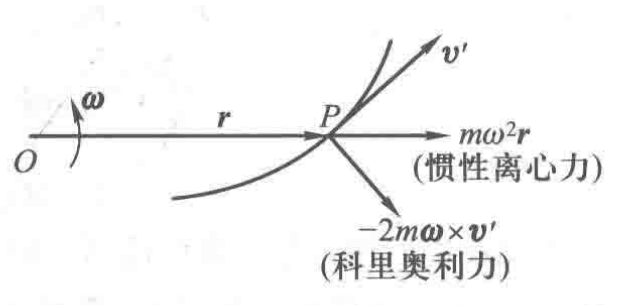

惯性力$-2m\boldsymbol{\omega}\times\boldsymbol{v}'$叫做科里奥利力，是由于参考系$S'$的转动及质点对此转动参考系又有相对运动所引起的．科里奥利力的量值和$S'$系转动的角速度$\omega$及质点相对于$S'$系的速度$v'$成正比，方向垂直于$\boldsymbol{\omega}$及$\boldsymbol{v}'$所确定的平面，并按右手螺旋法则及负号决定指向．对于平面转动参考系来讲，因为$\boldsymbol{\omega}$恒与$\boldsymbol{v}'$垂直，故将$\boldsymbol{v}'$沿着$S'$系转动的反方向转一直角，即可得出科里奥利力的方向（图4.3.1，从$P$点指向读者）．

［例］ 在一光滑水平直管中，有一质量为$m$的小球．此管以恒定角速度$\omega$绕通过管子一端的竖直轴转动．如果起始时，球距转动轴的距离为$a$，球相对于管子的速度为零，求小球沿管的运动规律及管对小球的约束反作用力．

［解］ 我们先用非惯性参考系来解这个问题．

取管的固定端为坐标原点，$x$轴沿管；$y$轴竖直向上，并垂直于管；$z$轴水平向前，亦与管垂直，如图4.3.2所示．设小球在某一瞬时运动到$P$点，它与原点$O$的距离为$x$，速度为$\dot{x}$，则惯性离心力的量值为$m\omega^2x$，方向沿管向右，科里奥利力的量值为$2m\omega\dot{x}$，在水平面内垂直于管壁向前．令管对小球反作用在$z$方向上的分力为$F_z$，竖直分力为$F_y$．至于主动力则为重力$mg$，方向竖直向下．

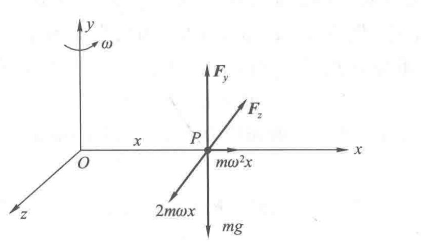

把式（4.3.2）写成分量形式，得小球的运动微分方程为

$$
m\ddot{x}=m\omega^2x \qquad (1)
$$

$$
m\ddot{y}=0=F_y-mg \qquad (2)
$$

$$
m\ddot{z}=0=2m\omega\dot{x}-F_z \qquad (3)
$$

（1）式的通解为

$$
x=Ae^{\omega t}+Be^{-\omega t} \qquad (4)
$$

由此又得

$$
\dot{x}=A\omega e^{\omega t}-B\omega e^{-\omega t} \qquad (5)
$$

利用起始条件$t=0,x=a,\dot{x}=0$，则由（4）及（5）式可得

$$
A=B=\frac{a}{2} \qquad (6)
$$

故小球沿管的运动规律为

$$
x=\frac{a}{2}\left(e^{\omega t}+e^{-\omega t}\right)=a\operatorname{ch}\omega t \qquad (7)
$$

由（2）及（3）式得管对小球的竖直反作用力及水平反作用力分别为

$$
\left.
\begin{aligned}
F_y&=mg\\
F_z&=2m\omega\dot{x}=2m\omega^2\frac{a}{2}\left(e^{\omega t}-e^{-\omega t}\right)\\
&=2ma\omega^2\operatorname{sh}\omega t
\end{aligned}
\right\}
\qquad (8)
$$

现在改用惯性参考系来解此同一问题．很显然，由于管在水平面内转动，故不宜用直角坐标系，而要改用极坐标系．如取管的起始位置为极轴，管子的一端$O$（即转动轴通过的那一点）为极点，则由式（1.5.3），知当小球$P$运动到离极点$O$为$r$的时候（图4.3.3），小球的运动微分方程为

$$
m(\ddot{r}-r\dot{\theta}^2)=F_r=0 \qquad (9)
$$

$$
m(r\ddot{\theta}+2\dot{r}\dot{\theta})=F_\theta \qquad (10)
$$

因$\dot{\theta}=\omega=$常量，故$\ddot{\theta}=0$把这些关系代入（9）及（10）两式后，它们就简化为

$$
m\ddot{r}-mr\omega^2=0 \qquad (11)
$$

$$
2m\dot{r}\omega=F_\theta \qquad (12)
$$

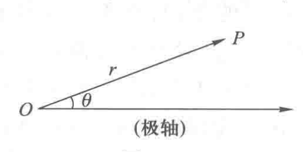

这和上法中的（1）、（3）两式完全一样，故无需再演算下去．如果改用柱面坐标系，我们还能求出竖直方向的反作用力，它也跟着（2）式完全一样，读者可自行验证．

### （2）空间转动参考系

空间转动参考系当然也是非惯性参考系，所以要加上适当的惯性力后，才能使牛顿运动定律“仍然”成立．由式（4.2.10），当$S'$系的原点$O'$和$S$系的原点$O$重合，并且$S'$系统$O$点以角速度$\boldsymbol{\omega}$转动，且$\boldsymbol{\omega}$不一定是常矢量，则

$$
\boldsymbol{a}'=\boldsymbol{a}-\boldsymbol{a}_t-\boldsymbol{a}_c \qquad (4.3.3)
$$

故如质量为$m$的质点所受到的作用力为$\boldsymbol{F}$，则因$\boldsymbol{F}=m\boldsymbol{a}$，故把式（4.3.3）的各项遍乘以$m$后，得

$$
m\boldsymbol{a}'=\boldsymbol{F}-m\boldsymbol{a}_t-m\boldsymbol{a}_c \qquad (4.3.4)
$$

或

$$
m\boldsymbol{a}'=\boldsymbol{F}-m\dot{\boldsymbol{\omega}}\times\boldsymbol{r}-m\boldsymbol{\omega}(\boldsymbol{\omega}\cdot\boldsymbol{r})+m\omega^2\boldsymbol{r}-2m\boldsymbol{\omega}\times\boldsymbol{v}' \qquad (4.3.5)
$$

即因$S'$系的转动，产生了三种惯性力：惯性力$-m\dot{\boldsymbol{\omega}}\times\boldsymbol{r}$与$\dot{\boldsymbol{\omega}}$及$\boldsymbol{r}$垂直，当$\boldsymbol{\omega}$为常矢量时，此项惯性力为零．$-m\boldsymbol{\omega}(\boldsymbol{\omega}\cdot\boldsymbol{r})+m\omega^2\boldsymbol{r}$与熟知的惯性离心力有关，在任一瞬时它都与该时刻的转动轴垂直，并离开转动轴向外．至于$-2m\boldsymbol{\omega}\times\boldsymbol{v}'$仍为科里奥利力，和$\boldsymbol{\omega}$及$\boldsymbol{v}'$所决定的平面垂直．

如果$S'$系以恒定角速度$\boldsymbol{\omega}$转动，则由式（4.2.12），可得

$$
m\boldsymbol{a}'=\boldsymbol{F}+m\omega^2\boldsymbol{R}-2m\boldsymbol{\omega}\times\boldsymbol{v}' \qquad (4.3.6)
$$

式中$\boldsymbol{R}$为质点到转动轴的垂直距离（参看图4.2.1）．此时惯性力$m\omega^2\boldsymbol{R}$就是通常的惯性离心力，它恒与$\boldsymbol{\omega}$垂直，和平面转动系的情形相仿，只是以$\boldsymbol{R}$代替$r$．这种情况，在实际问题中用得较多，例如地球的自转就多半认为是属于这一类的问题．

如果$S'$系的原点$O'$不和$S$系的原点$O$重合，且$O'$对$O$的加速度为$\boldsymbol{a}_0$，则由上节的讨论，知

$$
m\boldsymbol{a}'=\boldsymbol{F}-m\boldsymbol{a}_0-m\dot{\boldsymbol{\omega}}\times\boldsymbol{r}'-m\boldsymbol{\omega}(\boldsymbol{\omega}\cdot\boldsymbol{r}')+m\omega^2\boldsymbol{r}'-2m\boldsymbol{\omega}\times\boldsymbol{v}' \qquad (4.3.7)
$$

亦即式（4.3.4）中的$(-m\boldsymbol{a}_t)$项中，应增加$(-m\boldsymbol{a}_0)$一项，同时把式（4.3.5）中的$\boldsymbol{r}$改为相对于$O'$的位矢$\boldsymbol{r}'$．

### （3）相对平衡

在§4.2中已经讲过：如果质点$P$固着在$S'$系中不动，则$\boldsymbol{v}'=0$，故$\boldsymbol{a}'=0$，$\boldsymbol{a}_c=0$，而$\boldsymbol{a}$与$\boldsymbol{a}_t$相等．由式（4.3.4），当$\boldsymbol{a}'=0,\boldsymbol{a}_c=0$时，

$$
\boldsymbol{F}-m\boldsymbol{a}_t=0 \qquad (4.3.8)
$$

即当质点在非惯性系中处于平衡时，主动力、约束反作用力和由牵连运动而引起的惯性力的矢量和等于零．我们通常把这种平衡叫做**相对平衡**．如§1.6中的例题，在火车中（$S'$系）的观察者看悬挂在车厢中的小球，就是一个相对平衡问题．

## §4.4 地球自转所产生的影响

### （1）惯性离心力

地球既有自转又有公转，所以是非惯性参考系①．公转的角速度很小，且所产生的惯性离心力，几乎与太阳的引力相抵消．自转的角速度约为$7.3\times10^{-5}\,\mathrm{rad/s}$，虽然也比较小，但却产生了一些可以观察到的现象．

考虑地球绕地轴自转时，可以认为它的角速度是沿着地轴的一个常矢量，即$\dot{\boldsymbol{\omega}}=0$，因而只要考虑惯性离心力和科里奥利力所产生的影响．如果质点相对于地球是静止的，即$\boldsymbol{v}'=0$，则只需考虑惯性离心力的影响．

由于惯性离心力的作用，使重力常小于引力．重力随着纬度发生变化，在纬度越低的地方，重力越小．只有在两极的地方，重力和引力才相等．另外，除两极外重力的方向也不与引力的方向一致．引力的作用线通过地球的球心，而重力的作用线一般并不通过地球的球心．这些问题，普通物理里已经讲过，这里就不再多作重复了．

### （2）科里奥利力

上面谈到，由于惯性离心力的作用，重力的量值与引力有差别，重力的方向也随着纬度变化，但是这种差别和变化都比较小，当我们研究质点相对于地球的运动时，本应同时考虑惯性离心力和科里奥利力的作用．但当质点相对于地球有相对运动时，质点离地轴的距离的变化，一般都并不太大，故惯性离心力的

> ① 这并不是说地球就不能当作惯性参考系．地球自转的角速度很小，公转的角速度更小，所以在很多实际问题中，地球还是可以看做近似程度相当好的惯性参考系．

效应，只要用重力来代替引力就可以了．因此，在研究质点相对于地球的运动时，可以只考虑科里奥利力的效应．

在图4.4.1中的圆球代表地球．一质点在北半球的某点$P$上以速度$\boldsymbol{v}'$相对于地球运动，$P$点的纬度为$\lambda$．图中$SN$是地轴，地球自转的角速度$\boldsymbol{\omega}$就沿着该轴．单位矢量$\boldsymbol{i},\boldsymbol{j},\boldsymbol{k}$则固着在地球表面上．且$\boldsymbol{i}$水平向南，$\boldsymbol{j}$水平向东，$\boldsymbol{k}$竖直向上，如图所示．根据上面的讨论，可略去含有$\omega^2$项的惯性离心力，即认为重力$m\boldsymbol{g}$通过地球球心，则由式（4.3.6），得

$$
m\boldsymbol{a}'=\boldsymbol{F}-mg\boldsymbol{k}-2m\boldsymbol{\omega}\times\boldsymbol{v}' \qquad (4.4.1)
$$

式中$\boldsymbol{F}$代表重力以外的作用力（图上$\boldsymbol{F},\boldsymbol{v}',m\boldsymbol{g}$均未画出）．

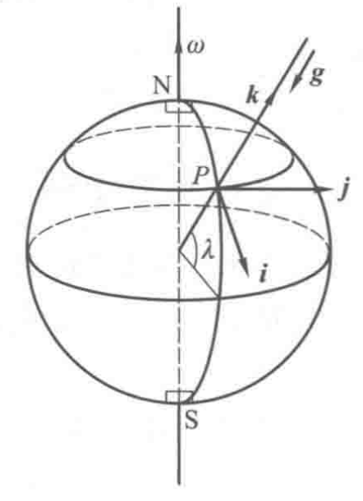

令转动坐标轴$x,y,z$与$\boldsymbol{i},\boldsymbol{j},\boldsymbol{k}$重合，即$x$轴指向南方，$y$轴指向东方，$z$轴竖直向上．则因$\boldsymbol{\omega}$与$\boldsymbol{i},\boldsymbol{k}$共面，故得

$$
\begin{aligned}
\boldsymbol{\omega}\times\boldsymbol{v}'&=
\begin{vmatrix}
\boldsymbol{i} & \boldsymbol{j} & \boldsymbol{k}\\
-\omega\cos\lambda & 0 & \omega\sin\lambda\\
\dot{x} & \dot{y} & \dot{z}
\end{vmatrix}\\
&=-\omega\dot{y}\sin\lambda\boldsymbol{i}+(\omega\dot{z}\cos\lambda+\omega\dot{x}\sin\lambda)\boldsymbol{j}-\omega\dot{y}\cos\lambda\boldsymbol{k}
\end{aligned}
\qquad (4.4.2)
$$

因此，由式（4.4.1），即得质点$P$在$x,y,z$三个方向的运动微分方程为

$$
\left.
\begin{aligned}
m\ddot{x}&=F_x+2m\omega\dot{y}\sin\lambda\\
m\ddot{y}&=F_y-2m\omega(\dot{x}\sin\lambda+\dot{z}\cos\lambda)\\
m\ddot{z}&=F_z-mg+2m\omega\dot{y}\cos\lambda
\end{aligned}
\right\}
\qquad (4.4.3)
$$

利用式（4.4.3），我们可以定性地或定量地研究科里奥利力的影响，先用两个常见的现象作定性的解释．

Ⅰ．贸易风 在地球上，热带部分的空气，因热上升，并在高空向两极推进；而两极附近的空气，则因冷下降，并在地面附近向赤道附近推进，形成一种对流，彼此交易，故称**贸易风**，但由于受到科里奥利力的作用，南北向的气流，却发生了东西向的偏转．由式（4.4.3）很容易看出：如果气流自北向南推进，即气流的速度为$\dot{x}$，则所受到科里奥利力为$-2m\omega\dot{x}\sin\lambda$，沿东西方向．故北半球（$\sin\lambda>0$）地面附近自北向南的气流，有朝西的偏向，成为东北贸易风；而在南半球（$\sin\lambda<0$）地面附近自南向北的气流，也有朝西的偏向，而成为东南贸易风．大气上层的反贸易风，在北半球为西南贸易风，在南半球则为西北贸易风．

Ⅱ．轨道的磨损和河岸的冲刷 由式（4.4.3）还可看出，当物体在地面上运动时，在北半球上科里奥利力的水平分量总是指向运动的右侧，即指向相对速度$\dot{x},\dot{y}$的右方．例如$\dot{x}$自北向南，科里奥利力则指向西方．这种长年累月的作用，使得北半球河流右岸的冲刷甚于左岸，因而比较陡峭．双轨单行铁路的情形也是这样．由于右轨所受到的压力大于左轨，因而磨损较甚．南半球的情况与此相反，河流左岸冲刷较甚，而双线铁路的左轨磨损较甚．

现在再用式（4.4.3）来定量地研究落体偏东的问题．

假定质点从有限的高度$h$处自由下落，那么我们可以认为$g$值不变，且重力以外的$F_x=F_y=F_z=0$．因当$t=0$时，质点的初速度也等于零，故其初始条件为$t=0,\dot{x}=\dot{y}=\dot{z}=0$；又当$t=0$时，$x=y=0,z=h$，故对式（4.4.3）积分一次并代入初始条件后，得

$$
\left.
\begin{aligned}
\dot{x}&=2\omega y\sin\lambda\\
\dot{y}&=-2\omega[x\sin\lambda+(z-h)\cos\lambda]\\
\dot{z}&=-gt+2\omega y\cos\lambda
\end{aligned}
\right\}
\qquad (4.4.4)
$$

把式（4.4.4）代入式（4.4.3），得

$$
\left.
\begin{aligned}
\ddot{x}&=-4\omega^2\sin\lambda[x\sin\lambda+(z-h)\cos\lambda]\\
\ddot{y}&=2gt\omega\cos\lambda-4\omega^2y\\
\ddot{z}&=-g-4\omega^2\cos\lambda[x\sin\lambda+(z-h)\cos\lambda]
\end{aligned}
\right\}
\qquad (4.4.5)
$$

在式（4.4.5）中又出现了$\omega^2$项．但如质点自离地面 200 m 以上的高处自由下落，则$\omega^2$项的值不会超过$10^{-6}\,\mathrm{m/s^2}$，即$\omega^2\cdot h\approx(7.3\times10^{-5}\,\mathrm{s^{-1}})^2\times200\,\mathrm{m}\approx10^{-6}\,\mathrm{m/s^2}$；而如质点运动速度在 1 m/s 的数量级时，科里奥利加速度$2\omega v'$的数量级约为$7.3\times10^{-5}\,\mathrm{s^{-1}}\times2\,\mathrm{m/s}\approx10^{-4}\,\mathrm{m/s^2}$，相差 100 倍左右．因此，可以在式（4.4.5）中再度略去含$\omega^2$项．这样，式（4.4.5）就简化为

$$
\left.
\begin{aligned}
\ddot{x}&=0\\
\ddot{y}&=2gt\omega\cos\lambda\\
\ddot{z}&=-g
\end{aligned}
\right\}
\qquad (4.4.6)
$$

再积分两次，并利用初始条件，得

$$
\left.
\begin{aligned}
x&=0\\
y&=\frac{1}{3}gt^3\omega\cos\lambda\\
z-h&=-\frac{1}{2}gt^2
\end{aligned}
\right\}
\qquad (4.4.7)
$$

消去$t$，得轨道方程为

$$
y^2=-\frac{8}{9}\frac{\omega^2\cos^2\lambda}{g}(z-h)^3 \qquad (4.4.8)
$$

这是位于东西竖直面内的半立方抛物线．

如质点自高度为$h$的地方自由下落，则当它抵达地面时，其偏东的数值为

$$
y=\frac{1}{3}\sqrt{\frac{8h^3}{g}}\omega\cos\lambda \qquad (z=0) \qquad (4.4.9)
$$

这个数值很小，在$\lambda=40^\circ,h=200$ m 时，约为$4.75\times10^{-2}$ m，故难于察觉．由此式可看出，在赤道处（$\lambda=0$）偏东的数值最为显著；而在两极$\left(\lambda=\dfrac{\pi}{2}\right)$则为零．

## * §4.5 傅科摆

单摆振动时，振动面依理应保持不变．但因地球在自转，在地面上的观察者，不能发觉地球在转，但在相当长的时期内，却发现摆的振动面不断偏转．从力学的观点来看，这也是由于受到了科里奥利力的缘故．这项显示地球自转的装置，是 1851 年傅科在巴黎首先制成的．虽然早在 1650 年，已有人观察到摆的振动面在缓慢地旋转，但却未能对此现象作出正确的解释．所以我们现在把用来显示地球自转的这种装置叫**傅科摆**．

现在，让我们再用式（4.4.3）来详细分析一下傅科摆的运动．对傅科摆来讲，重力以外的作用力就是绳中张力$F_T$（图4.5.1）．如绳长为$l$，摆锤在某一瞬时的动坐标为$x,y,z$，则

$$
\left.
\begin{aligned}
F_x&=-\frac{x}{l}F_T\\
F_y&=-\frac{y}{l}F_T\\
F_z&=\frac{l-z}{l}F_T
\end{aligned}
\right\}
\qquad (4.5.1)
$$

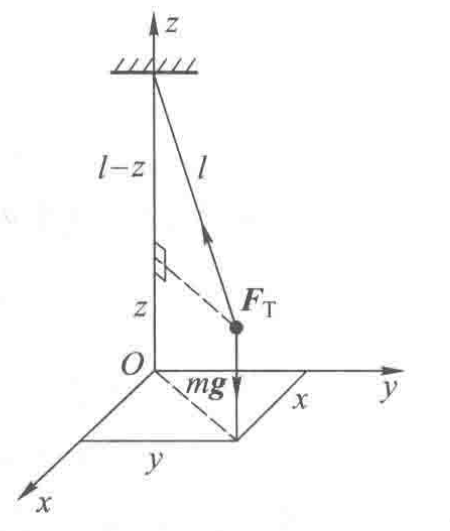

我们现在从两方面来求式（4.4.3）的近似解：

（1）$\omega$很小，所以包含$\omega^2$的项可以略去．

（2）摆的振幅角很小，特别在$z$方向上振动更微，故$z$及其对时间的微商都系二阶微量，可以略去．又因为

$$
l-z=\sqrt{l^2-(x^2+y^2)}=l\left(1-\frac{x^2+y^2}{2l^2}+\cdots\right)\approx l
$$

故由式（4.5.1），知

$$
F_z=F_T
$$

这样，式（4.4.3）中的最后一式变为

$$
F_T=mg-2m\omega\dot{y}\cos\lambda\approx mg \qquad (4.5.2)
$$

这是因为后一项比前一项小得很多．而式（4.4.3）中的其余两式则为

$$
\left.
\begin{aligned}
\ddot{x}-2\omega\dot{y}\sin\lambda+p^2x&=0\\
\ddot{y}+2\omega\dot{x}\sin\lambda+p^2y&=0
\end{aligned}
\right\}
\qquad (4.5.3)
$$

式中$p^2=\dfrac{g}{l}$．将式（4.5.3）中第二式乘以$\mathrm{i}(\mathrm{i}=\sqrt{-1})$，再与第一式相加，得复变数方程

$$
\ddot{\xi}+2\mathrm{i}\omega\dot{\xi}\sin\lambda+p^2\xi=0 \qquad (\xi=x+\mathrm{i}y) \qquad (4.5.4)
$$

这个方程式的通解可写为

$$
\xi=Ae^{n_1t}+Be^{n_2t} \qquad (4.5.5)
$$

式中$A、B$是两个积分常数，都是复数，其值可由初始条件决定．$n_1$及$n_2$则为方程

$$
n^2+2\mathrm{i}\omega n\sin\lambda+p^2=0 \qquad (4.5.6)
$$

的根，其值为

$$
\left.
\begin{aligned}
n_1&=-\mathrm{i}\omega\sin\lambda+\mathrm{i}\sqrt{\omega^2\sin^2\lambda+p^2}\\
n_2&=-\mathrm{i}\omega\sin\lambda-\mathrm{i}\sqrt{\omega^2\sin^2\lambda+p^2}
\end{aligned}
\right\}
\qquad (4.5.7)
$$

略去$\omega^2$项，得

$$
\xi=e^{-\mathrm{i}\omega t\sin\lambda}(Ae^{\mathrm{i}pt}+Be^{-\mathrm{i}pt}) \qquad (4.5.8)
$$

如$\omega=0$，即地球无自转，则

$$
\begin{aligned}
\xi&=\xi_1=x_1+\mathrm{i}y_1=Ae^{\mathrm{i}pt}+Be^{-\mathrm{i}pt}\\
&=(A+B)\cos pt+\mathrm{i}(A-B)\sin pt
\end{aligned}
\qquad (4.5.9)
$$

故

$$
\left.
\begin{aligned}
x_1&=(A+B)\cos pt\\
y_1&=(A-B)\sin pt
\end{aligned}
\right\}
\qquad (4.5.10)
$$

而由式（4.5.8）

$$
\begin{aligned}
\xi&=x+\mathrm{i}y\\
&=[\cos(\omega\sin\lambda)t-\mathrm{i}\sin(\omega\sin\lambda)t]\times[(A+B)\cos pt+\mathrm{i}(A-B)\sin pt]\\
&=[(A+B)\cos pt\cos(\omega\sin\lambda)t+(A-B)\sin pt\sin(\omega\sin\lambda)t]\\
&\quad+\mathrm{i}[-(A+B)\cos pt\sin(\omega\sin\lambda)t+(A-B)\sin pt\cos(\omega\sin\lambda)t]\\
&=[x_1\cos(\omega\sin\lambda)t+y_1\sin(\omega\sin\lambda)t]\\
&\quad+\mathrm{i}[-x_1\sin(\omega\sin\lambda)t+y_1\cos(\omega\sin\lambda)t]
\end{aligned}
\qquad (4.5.11)
$$

于是，得

$$
\left.
\begin{aligned}
x&=x_1\cos(\omega\sin\lambda)t+y_1\sin(\omega\sin\lambda)t\\
y&=-x_1\sin(\omega\sin\lambda)t+y_1\cos(\omega\sin\lambda)t
\end{aligned}
\right\}
\qquad (4.5.12)
$$

由此可以看出：摆这时作两种周期运动，一种周期为

$$
\tau=\frac{2\pi}{p}=2\pi\sqrt{\frac{l}{g}} \qquad (4.5.13)
$$

和通常的单摆相同，其轨迹一般为椭圆，也可能是直线．另一种周期则为

$$
\tau'=\frac{2\pi}{\omega\sin\lambda} \qquad (4.5.14)
$$

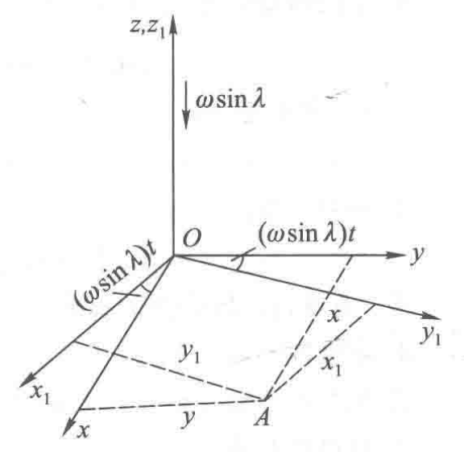

当$\sin\lambda>0$（北半球），椭圆长短轴以角速度$\omega\sin\lambda$作顺时针旋转（图4.5.2）．或者说，我们看到摆的振动面以角速度$\omega\sin\lambda$作顺时针旋转．

因为$\omega$很小，所以$\tau'\gg\tau$．因此，在短时期内，就很难觉察到摆的振动面在旋转．为了观察这种现象，则摆锤应重，悬线应长，以使振动能够维持长久．1851 年，傅科在巴黎（$\lambda\approx49^\circ,\sin\lambda\approx0.75$）第一次做此实验时，$l=67$ m，摆锤为直径 30 cm 的铁球，质量 28 kg，所画出的椭圆的长轴等于 3 m，摆的振动周期$\tau$为 16 s，而椭圆旋转的周期$\tau'$则为 32 h．

## 小结

Ⅰ．平面转动参考系

1. 平板上一运动质点的绝对速度

$\boldsymbol{v}=\boldsymbol{v}'+\boldsymbol{\omega}\times\boldsymbol{r}$（绝对速度$=$相对速度$+$牵连速度）

2. 平板上一运动质点的绝对加速度

$\boldsymbol{a}=\boldsymbol{a}'+\dot{\boldsymbol{\omega}}\times\boldsymbol{r}-\omega^2\boldsymbol{r}+2\boldsymbol{\omega}\times\boldsymbol{v}'$

（绝对加速度$=$相对加速度$+$牵连加速度$+$科里奥利加速度）

Ⅱ．空间转动参考系

1. 在转动参考系$S'$中任一矢量$\boldsymbol{G}$对固定参考系$S$的时间变化率为$\dfrac{\mathrm{d}\boldsymbol{G}}{\mathrm{d}t}=\dfrac{\mathrm{d}^*\boldsymbol{G}}{\mathrm{d}t}+\boldsymbol{\omega}\times\boldsymbol{G}$（绝对变化率$=$相对变化率$+$牵连变化率）

2. 在$S'$系中运动质点的绝对速度

$$
\boldsymbol{v}=\frac{\mathrm{d}\boldsymbol{r}}{\mathrm{d}t}=\frac{\mathrm{d}^*\boldsymbol{r}}{\mathrm{d}t}+\boldsymbol{\omega}\times\boldsymbol{r}=\boldsymbol{v}'+\boldsymbol{\omega}\times\boldsymbol{r}
$$

3. 在$S'$系中运动质点的绝对加速度

$$
\boldsymbol{a}=\frac{\mathrm{d}\boldsymbol{v}}{\mathrm{d}t}=\frac{\mathrm{d}^{2*}\boldsymbol{r}}{\mathrm{d}t^2}+\frac{\mathrm{d}^*\boldsymbol{\omega}}{\mathrm{d}t}\times\boldsymbol{r}+\boldsymbol{\omega}\times(\boldsymbol{\omega}\times\boldsymbol{r})+2\boldsymbol{\omega}\times\frac{\mathrm{d}^*\boldsymbol{r}}{\mathrm{d}t}
$$

$$
=\boldsymbol{a}'+\frac{\mathrm{d}\boldsymbol{\omega}}{\mathrm{d}t}\times\boldsymbol{r}+\boldsymbol{\omega}(\boldsymbol{\omega}\cdot\boldsymbol{r})-\boldsymbol{r}\omega^2+2\boldsymbol{\omega}\times\boldsymbol{v}'
$$

4. 如$\boldsymbol{\omega}=$常矢量，则

$$
\boldsymbol{a}=\boldsymbol{a}'-\omega^2\boldsymbol{R}+2\boldsymbol{\omega}\times\boldsymbol{v}'
$$

式中$\boldsymbol{R}$的量值是质点到转动轴的垂直距离．

Ⅲ．转动参考系动力学

1. 转动参考系是非惯性参考系，要添上适当的惯性力，才能运用牛顿运动定律．

2. 匀速转动的平面参考系要添上两种惯性力：$m\omega^2\boldsymbol{r}$（惯性离心力）及$-2m\boldsymbol{\omega}\times\boldsymbol{v}'$（科里奥利力，垂直于$\boldsymbol{\omega}$及$\boldsymbol{v}'$所确定的平面，其指向可将$\boldsymbol{v}'$沿着$S'$系转动的反方向转一直角即得）．即

$$
m\boldsymbol{a}'=\boldsymbol{F}-2m\boldsymbol{\omega}\times\boldsymbol{v}'+m\omega^2\boldsymbol{r}
$$

3. 空间转动参考系（$S'$系的原点与$S$系的原点重合）

$$
m\boldsymbol{a}'=\boldsymbol{F}-m\dot{\boldsymbol{\omega}}\times\boldsymbol{r}-m\boldsymbol{\omega}(\boldsymbol{\omega}\cdot\boldsymbol{r})+m\omega^2\boldsymbol{r}-2m\boldsymbol{\omega}\times\boldsymbol{v}'
$$

如$\boldsymbol{\omega}=$常矢量，则

$$
m\boldsymbol{a}'=\boldsymbol{F}+m\omega^2\boldsymbol{R}-2m\boldsymbol{\omega}\times\boldsymbol{v}'
$$

4. 相对平衡

$$
\boldsymbol{F}-m\boldsymbol{a}_t=0 \quad \text{（式中}\boldsymbol{a}_t\text{为牵连加速度）}
$$

Ⅳ．地球自转所产生的影响

1. 惯性离心力

使重力$g$与引力$g'$在量值和方向上都有差别，但比较微小，因惯性离心力与$\omega^2$成正比．

2. 科里奥利力

a．运动方程

$$
\begin{aligned}
m\ddot{x}&=F_x+2m\omega\dot{y}\sin\lambda\\
m\ddot{y}&=F_y-2m\omega(\dot{x}\sin\lambda+\dot{z}\cos\lambda)\\
m\ddot{z}&=F_z-mg+2m\omega\dot{y}\cos\lambda
\end{aligned}
$$

b．贸易风——使南北方向气流产生了东西向的偏转．

c．轨道磨损和河岸冲刷——在北半球内运动方向的右方较甚．

d．落体偏东

$$
y=\frac{1}{3}\sqrt{\frac{8h^3}{g}}\omega\cos\lambda
$$

*e．傅科摆——摆的振动面以周期

$$
\tau'=\frac{2\pi}{\omega\sin\lambda}
$$

转动（北半球为顺时针方向）

## 补充例题

4.1 $P$点在一半径为$R$的球上以速度$v'$沿球的经线作匀速运动，球以匀角速$\omega$绕其竖直直径转动，求$P$点的绝对加速度．

［解］ 取单位矢量$\boldsymbol{j},\boldsymbol{k}$在经圈面内，单位矢量$\boldsymbol{i}$则垂直经圈面，如图所示，则$P$点沿$\boldsymbol{j}$方向的牵连加速度$\boldsymbol{a}_t$为

$$
\boldsymbol{a}_t=-\omega^2\boldsymbol{r}=-\omega^2R\cos\varphi\boldsymbol{j} \qquad (1)
$$

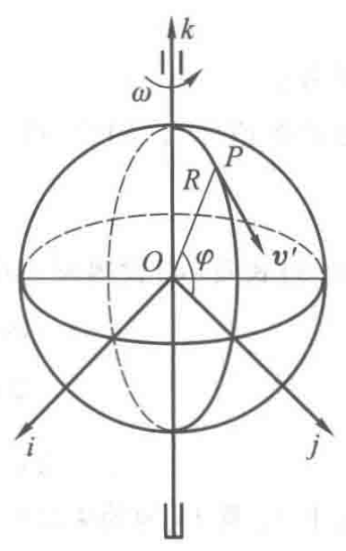

$P$点的相对加速度$\boldsymbol{a}'$量值为$a'=\dfrac{v'^2}{R}$，其方向沿$\overrightarrow{PO}$，即由$P$点指向球心$O$．用它在$\boldsymbol{j},\boldsymbol{k}$方向的分量表示，则为

$$
\boldsymbol{a}'=-\frac{v'^2}{R}\cos\varphi\boldsymbol{j}-\frac{v'^2}{R}\sin\varphi\boldsymbol{k} \qquad (2)
$$

$P$点的科里奥利加速度$2\boldsymbol{\omega}\times\boldsymbol{v}'$为

$$
\begin{aligned}
\boldsymbol{a}_c&=2\boldsymbol{\omega}\times\boldsymbol{v}'=2\omega\boldsymbol{k}\times(v'\sin\varphi\boldsymbol{j}-v'\cos\varphi\boldsymbol{k})\\
&=-2\omega v'\sin\varphi\boldsymbol{i}
\end{aligned}
\qquad (3)
$$

因为

$$
\boldsymbol{a}=\boldsymbol{a}'+2\boldsymbol{\omega}\times\boldsymbol{v}'-\omega^2\boldsymbol{r}
$$

按$\boldsymbol{i},\boldsymbol{j},\boldsymbol{k}$分量求和，得

$$
\begin{aligned}
a&=\sqrt{(-2\omega v'\sin\varphi)^2+\left(-\omega^2R\cos\varphi-\frac{v'^2}{R}\cos\varphi\right)^2+\left(-\frac{v'^2}{R}\sin\varphi\right)^2}\\
&=\frac{1}{R}\sqrt{v'^4+2\omega^2R^2(1+\sin^2\varphi)v'^2+R^4\omega^4\cos^2\varphi}
\end{aligned}
\qquad (4)
$$

4.2 一个用金属丝做成的半径为$a$的光滑圆圈，以匀角速$\omega$绕竖直直径转动，圈上套着一个质量为$m$的小环．起始时，小环自圈面的最高点无初速地沿着圆圈滑下，试求当环与圈中心的连线和竖直向上的直径成$\theta$角时，小环运动微分方程及圈对环的约束反作用力．

［解］

$$
\left.
\begin{aligned}
\text{惯性离心力}&=m\omega^2a\sin\theta\quad\text{（沿}AP\text{）}\\
\text{科里奥利力}&=2m\omega a\dot{\theta}\cos\theta\quad\text{（垂直于圈面指向读者）}
\end{aligned}
\right\}
\qquad (1)
$$

故小环运动微分方程为

$$
ma\ddot{\theta}=ma\omega^2\sin\theta\cos\theta+mg\sin\theta \quad \text{（沿切线）} \qquad (2)
$$

$$
ma\dot{\theta}^2=-ma\omega^2\sin^2\theta+mg\cos\theta-F_n \quad \text{（沿主法线，即沿半径）} \qquad (3)
$$

$$
0=F_b-2m\omega a\dot{\theta}\cos\theta \quad \text{（垂直于圈面指向纸面，即沿副法线）} \qquad (4)
$$

式（2）即为小环的运动微分方程．

又由（2）式，得

$$
a\dot{\theta}^2=\omega^2a\sin^2\theta-2g\cos\theta+C \qquad (5)
$$

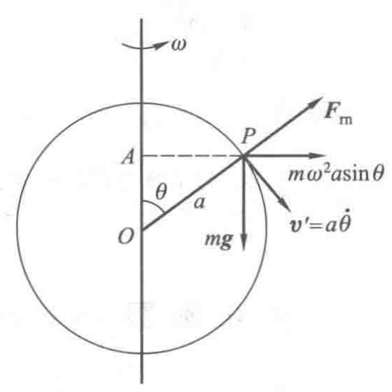

因为

$$
\theta=0,\dot{\theta}=0,\ \text{故}\ C=2g
$$

把$C$的值代入（5）式，得

$$
a\dot{\theta}^2=\omega^2a\sin^2\theta+2g(1-\cos\theta) \qquad (6)
$$

由（3）式及（4）式得圈对小环的约束反作用力为

$$
\begin{aligned}
F_n&=-ma\omega^2\sin^2\theta-ma\dot{\theta}^2+mg\cos\theta\\
&=-2ma\omega^2\sin^2\theta+mg(3\cos\theta-2)
\end{aligned}
\qquad (7)
$$

$$
F_b=2m\omega a\dot{\theta}\cos\theta=2m\omega\cos\theta\sqrt{\omega^2a^2\sin^2\theta+2ga(1-\cos\theta)} \qquad (8)
$$

式中$F_n$及$F_b$为约束反作用力沿主法线及副法线方向的分量．

## 思考题

4.1 为什么在以角速度$\omega$转动的参考系中，一个矢量$\boldsymbol{G}$的绝对变化率应当写作$\dfrac{\mathrm{d}\boldsymbol{G}}{\mathrm{d}t}=\dfrac{\mathrm{d}^*\boldsymbol{G}}{\mathrm{d}t}+\boldsymbol{\omega}\times\boldsymbol{G}$？在什么情况下$\dfrac{\mathrm{d}^*\boldsymbol{G}}{\mathrm{d}t}=0$？在什么情况下，$\boldsymbol{\omega}\times\boldsymbol{G}=0$？又在什么情况下，$\dfrac{\mathrm{d}\boldsymbol{G}}{\mathrm{d}t}=0$？

4.2 式（4.1.2）和式（4.2.3）都是求单位矢量$\boldsymbol{i},\boldsymbol{j},\boldsymbol{k}$对时间$t$的微商，它们有何区别？你能否由式（4.2.3）推出式（4.1.2）？

4.3 在卫星式宇宙飞船中，宇航员发现身体轻飘飘的，这是什么缘故？

4.4 惯性离心力和离心力有哪些不同的地方？

4.5 圆盘以匀角速度$\omega$绕竖直轴转动．离盘心为$r$的地方安装着一根竖直管，管中有一物体沿管下落，问此物体受到哪些惯性力的作用？

4.6 对于单线铁路来讲，两条铁轨磨损的程度有无不同？为什么？

4.7 自赤道沿水平方向朝北或朝南射出的炮弹，落地是否发生东西偏差？如以仰角$40^\circ$朝北射出，或垂直向上射出，则又如何？

4.8 在南半球，傅科摆的振动面，沿什么方向旋转？如把它安装在赤道上某处，它旋转的周期是多大？

4.9 在第三章刚体运动学中，我们也常采用动坐标系，但为什么不出现科里奥利加速度？

## 习题

4.1 一等腰直角三角形$OAB$在其自身平面内以匀角速$\omega$绕顶点$O$转动．某一点$P$以匀相对速度沿$AB$边运动，当三角形转了一周时，$P$点走过了$AB$．如已知$AB=b$，试求$P$点在$A$时的绝对速度与绝对加速度．

答：$v=\dfrac{b\omega}{2\pi}\sqrt{8\pi^2+4\pi+1}$，与斜边成$\alpha=\arctan[-(4\pi+1)]$的角度

$a=\dfrac{b\omega^2}{\pi}\sqrt{2\pi^2+2\pi+1}$，与斜边成$\beta=\arctan\dfrac{1}{2\pi+1}$的角度

4.2 一直线以匀角速$\omega$在一固定平面内绕其一端$O$转动．当直线位于$Ox$的位置时，有一质点$P$开始从$O$点沿该直线运动．如欲使此点的绝对速度$\boldsymbol{v}$的量值为常数，问此点应按何种规律沿此直线运动？

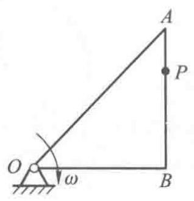

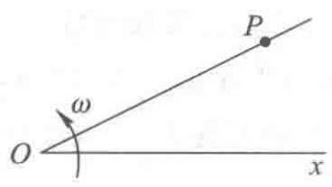

答：$OP=r=\dfrac{v}{\omega}\sin\omega t$

4.3 $P$点离开圆锥顶点$O$，以速度$v'$沿母线作匀速运动，此圆锥则以匀角速$\omega$绕其轴转动．求开始$t$时间后$P$点绝对加速度的量值，假定圆锥体的半顶角为$\alpha$．

答：$a=\omega v'\sin\alpha\sqrt{\omega^2t^2+4}$

4.4 小环重$W$，穿在曲线形$y=f(x)$的光滑钢丝上，此曲线通过坐标原点，并绕竖直轴$Oy$以匀角速$\omega$转动．如欲使小环在曲线上任何位置均处于相对平衡状态，求此曲线的形状及曲线对小环的约束反作用力．

答：抛物线$y=\dfrac{\omega^2x^2}{2g}$；$F_r=W\sqrt{1+\dfrac{2\omega^2}{g}y}$

4.5 在一光滑水平直管中有一质量为$m$的小球．此管以匀角速$\omega$绕通过其一端的竖直轴转动．如开始时，球距转动轴的距离为$a$，球相对于管的速率为零，而管的总长则为$2a$．求球刚要离开管口时的相对速度与绝对速度，并求小球从开始运动到离开管口所需的时间．

答：$v'=\sqrt{3}a\omega$，$v=\sqrt{7}a\omega$，$t=\dfrac{1}{\omega}\ln(2+\sqrt{3})$

4.6 一光滑细管可在竖直平面内绕通过其一端的水平轴以匀角速$\omega$转动，管中有一质量为$m$的质点．开始时，细管取水平方向，质点距转动轴的距离为$a$，质点相对于管的速度为$v_0$，试求质点相对于管的运动规律．

答：$x=\left[\dfrac{1}{2}\left(a+\dfrac{v_0}{\omega}\right)-\dfrac{g}{4\omega^2}\right]e^{\omega t}+\left[\dfrac{1}{2}\left(a-\dfrac{v_0}{\omega}\right)+\dfrac{g}{4\omega^2}\right]e^{-\omega t}+\dfrac{g}{2\omega^2}\sin\omega t$

4.7 质量分别为$m$及$m'$的两个质点，用一固有长度为$a$的弹性绳相联，绳的劲度系数为$k=\dfrac{2mm'\omega^2}{m+m'}$．如将此系统放在光滑的水平管中，管子绕管上某点以匀角速$\omega$转动，试求任一瞬时两质点间的距离$s$．设开始时，质点相对于管子是静止的．

答：$s=a(2-\cos\omega t)$

4.8 轴为竖直而顶点向下的抛物线形金属丝，以匀角速$\omega$绕竖直轴转动．另有一质量为$m$的小环套在此金属丝上，并沿着金属丝滑动．试求小环运动微分方程．已知抛物线的方程为$x^2=4ay$，式中$a$为常数．计算时可忽略摩擦阻力．

答：$m\left(1+\dfrac{x^2}{4a^2}\right)\ddot{x}+m\dot{x}^2\dfrac{x}{4a^2}-m\omega^2x+mg\dfrac{x}{2a}=0$

4.9 在上题中，试用两种方法求小环相对平衡的条件．

答：$\omega^2=\dfrac{g}{2a}$

4.10 质量为$m$的小环$M$，套在半径为$a$的光滑圆圈上，并可沿着圆圈滑动．如圆圈在水平面内以匀角速$\omega$绕圈上某点$O$转动，试求小环沿圆圈切线方向的运动微分方程．

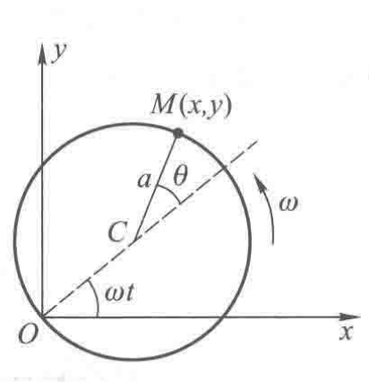

答：$\ddot{\theta}+\omega^2\sin\theta=0$

式中$\theta$为$M$与圆心$C$的连线和通过$O$点的直径间所夹的角．

4.11 如自北纬为$\lambda$的地方，以仰角$\alpha$自地面向东方发射一炮弹，炮弹的腔口速度为$V$．计及地球自转，试证此炮弹落地时的横向偏离为

$$
d=\frac{4V^3}{g^2}\omega\sin\lambda\sin^2\alpha\cos\alpha
$$

式中$\omega$为地球自转的角速度．计算时可忽略$\omega^2$项．

4.12 一质点如以初速$v_0$在纬度为$\lambda$的地方竖直向上射出，达到$h$高后，复落至地面．假定空气阻力可以忽略不计，试求落至地面时的偏差．

答：$\dfrac{4}{3}\sqrt{\dfrac{8h^3}{g}}\omega\cos\lambda$（偏西）
