# 第五章 分析力学

到现在为止，我们所研究的力学问题，基本上是以牛顿运动定律来求解的．但前面曾讲过：用牛顿运动定律来求质点组的运动问题时，常常要解算大量的微分方程组．如果质点组受到约束，则因约束反力都是未知的，所以并不能因此减少而且甚至是增加了问题的复杂性．18 世纪、19 世纪，随着工业革命的迅速发展，在工程技术上迫切需要解决的又正好是这一类问题．因此，迫切需要寻求另外的方法来处理这一类问题．

1788 年，拉格朗日写了一本大型著作《分析力学》．在这一本著作中，完全用数学分析的方法来解决所有的力学问题，而无需借助以往常用的几何方法，全书一张图也没有．在此基础上，逐步发展了一系列处理力学问题的新方法，称之为分析力学．

拉格朗日是用$s$个独立变量来描写力学体系的运动，所以和牛顿运动方程一样，是二阶常微分方程组，我们通常把这组方程叫做拉格朗日方程．后来，哈密顿在 1834 年又提出：如果用坐标和动量作为独立变量，则虽方程式的数目增加了一倍，即由$s$个变为$2s$个，但微分方程式却都由二阶降为一阶．这组方程叫做哈密顿正则方程．哈密顿正则方程在理论上有着更重要的意义，在理论物理各分支中得到了广泛的应用．他在 1843 年，又运用变分法提出了另一个和牛顿定律及上述诸方程组等价的哈密顿原理，用来描写力学体系的运动．这样，分析力学就变得更为完整了．在分析力学方面作出过贡献的，还有莫培督、欧拉、泊松、高斯和雅可比等人．他们所提出的某些原理和方法，有的比拉格朗日《分析力学》一书的问世还早．例如最小作用量原理就是莫培督在 1744 年提出的．

分析力学所注重的不是力和加速度，而是具有更广泛意义的能量，同时又扩大了坐标的概念，因而使这种方法和结论便于运用到物理学的其他领域．但是，由于分析力学中数学推理较多，在历史上也发生过一些不良倾向，容易使人忘记力学的物理实质，对此我们应当引以为戒．

## §5.1 约束与广义坐标

### （1）约束的概念和分类

大量质点的组成的体系，如果其中有相互作用，以至其中每一质点的运动，都和其他质点的位置和运动有关，则这种体系，叫做力学体系，或简称为体系，也就是第二章中所讲的质点组．如$n$为力学体系中质点的数目，则因任一质点$P_i$的位置，决定于它的三个坐标$x_i,y_i$和$z_i$，所以我们要确切知道整个力学体系的位置（位形），就应知道体系中所有质点的坐标．这些坐标的数目，一共是$3n$个．

事实上，在一个力学体系中，常存在着一些限制各质点自由运动的条件，我们把这些条件叫做**约束**，这在第一章就已介绍过．因此，$3n$个坐标并不相互独立，而是有一些关系把它们联系着．

约束对各质点位置限制的条件通常可以表为力学体系中质点的坐标、速度和时间的方程．如果$n$个质点所形成的力学体系中受有$k$个限制其位置的约束，那就有$k$个表示这种约束的方程，因此$3n$个坐标中就只有$3n-k$个是独立的．譬如一个质点原有 3 个独立的坐标，如果受有曲面

$$
f(x,y,z)=0 \qquad (5.1.1)
$$

的约束，那么独立坐标的数目就减为两个．因为已知$x,y$和$t$的关系，则$z$和$t$的关系，就可由式（5.1.1）求出．

如果限制系统位置的约束不是时间$t$的函数，则约束方程中不显含时间$t$，如式（5.1.1）所表示的那样，这种约束叫做**稳定约束**．反之，如果约束是时间$t$的函数，则约束方程就将显含时间$t$，例如方程

$$
f(x,y,z,t)=0^{\text{①}} \qquad (5.1.2)
$$

那么这种约束就称为**不稳定约束**．

例如，当一质点和长为$l$的刚性杆相连时，如刚性杆的上端固定不动，取此点为坐标原点，则约束方程是

$$
x^2+y^2+z^2=l^2
$$

这就是稳定约束．如杆的上端沿水平直线以匀速$c$运动，并取该直线上某定点为坐标原点，则约束方程将是

$$
(x-ct)^2+y^2+z^2=l^2
$$

这就是不稳定约束．

约束又可分为可解的与不可解的．质点始终不能脱离的那种约束，叫**不可解约束**．例如质点被约束在曲面

$$
f(x,y,z)=0 \quad \text{或} \quad f(x,y,z,t)=0 \qquad (5.1.3)
$$

上，并且始终不能脱离这个曲面，那么这种约束就是不可解约束．如果质点虽然被约束在某一曲面上，但在某一方向可以脱离，那种约束就叫**可解约束**．例如，在有下列约束时

$$
f(x,y,z) \leqslant c \qquad (5.1.4)
$$

质点可以在曲面$f(x,y,z)=c$上，也可以在$f(x,y,z)<c$的方向离开这一曲面．因此，不可解约束以等式表示，而可解约束则同时以等式和不等式来表示．

当质点被一柔软绳连在一个定点$O$上而作任意运动时，所受的约束是可解约束．因为这时质点只被限制不能离开定点$O$超过$l$的距离，但可以往里面运

> ① 对于不止一个质点的约束方程，有时我们仍用和式（5.1.1）或式（5.1.2）类似的形式来表示，不过那时$x,y,z$将是广义的，它们可以代表所有质点的坐标．

动，使距离小于$l$．取定点$O$为坐标原点，则约束方程是

$$
x^2+y^2+z^2 \leqslant l^2
$$

但如果质点是用刚性杆和定点$O$相连，则质点所受的约束是不可解约束，约束方程将是

$$
x^2+y^2+z^2=l^2
$$

约束也可分为几何约束和运动约束．几何约束又叫**完整约束**，它只限制质点在空间的位置，因而表现为质点坐标的函数，例如

$$
f(x,y,z)=0 \quad \text{或} \quad f(x,y,z,t)=0 \qquad (5.1.5)
$$

就都是几何约束．至于运动约束，则除了限制质点的坐标外，还要限制质点速度的投影，例如

$$
f(x,y,z;\dot{x},\dot{y},\dot{z};t)=0 \qquad (5.1.6)
$$

这就是运动约束．运动约束又叫**微分约束**，因约束方程中除含有坐标本身外，还含有坐标的微分（当约束方程的各项遍乘以$\mathrm{d}t$后）．微分约束有时经过积分后可变为几何约束．倘若它不能积分时，就被称为**不完整约束**．不能用等式表示的可解约束，是另一种不完整约束．除了这两种而外，其他约束都是**完整约束**．

凡只受有完整约束的力学体系叫**完整系**．同时受有完整约束与不完整约束的力学体系，或只受有不完整约束的力学体系，都叫**不完整系**．

在 §3.7 的例 2 中，我们曾经讲过，当圆柱体沿斜面滚下时，约束方程是

$$
x_C - a\theta = 0
$$

这是不含有微分或速度投影的方程，所以这种约束是几何约束或完整约束．今后我们将主要研究受完整约束的力学体系，即研究完整系的力学问题．

在 §1.5 中，我们已经讲过：加在一个力学体系上的约束，限制了力学体系中各质点的运动，使各质点的运动都和原来在同样的力作用下而不受约束时的运动有所不同．约束所以能产生这样的效果，是通过质点间相互的机械作用来实现的，这就是我们在 §1.5 中所讲的约束反作用力，简称**约束力**或**约束反力**．在分析力学中，主要的课题是求力学体系的运动，而不是求这些约束反力．

### （2）广义坐标

前已提到，对于$n$个质点所形成的力学体系，如果有$k$个几何约束

$$
f_{\alpha}(x,y,z,t)=0 \quad (\alpha=1,2,\cdots,k) \qquad (5.1.7)
$$

那么独立坐标就减少为$3n-k$个．这些独立坐标，也就是力学体系的坐标．在力学体系只受有几何约束的情形下，这些独立坐标的数目叫做力学体系的**自由度**．但对微分约束来讲，自由度的数目则可能小于独立坐标的数目．

既然只有$3n-k$个坐标是独立的，如果我们令$3n-k=s$，那么我们就可通过式（5.1.7），把$3n$个不独立的坐标用$s$个独立参数$q_1,q_2,\cdots,q_s$及$t$表出，即

$$
\left.
\begin{aligned}
x_i&=x_i(q_1,q_2,\cdots,q_s,t)\\
y_i&=y_i(q_1,q_2,\cdots,q_s,t)\\
z_i&=z_i(q_1,q_2,\cdots,q_s,t)
\end{aligned}
\right\}
\quad (i=1,2,\cdots,n,\ s<3n) \qquad (5.1.8)
$$

或

$$
\boldsymbol{r}_i=\boldsymbol{r}_i(q_1,q_2,\cdots,q_s,t) \quad (i=1,2,\cdots,n,s<3n) \qquad (5.1.9)
$$

式中$q_1,q_2,\cdots,q_s$叫做**拉格朗日广义坐标**，它不一定是长度，可以是角度或其他物理量，例如面积$A$、体积$\tau$、电极化强度$P$、磁化强度$M$等．在几何约束的情况下，广义坐标的数目和自由度的数目相等．此$s$个广义坐标，就足以规定力学体系的位置．例如一质点被约束在圆周$x^2+y^2=R^2$上运动时，可令$x=R\cos\theta,y=R\sin\theta$，式中$\theta$是质点某时刻所在处的位矢和$x$轴间的夹角，$\theta$就是这一问题的广义坐标．这时质点在一平面上运动，原应有两个坐标（即$x,y$），但因圆周是一个约束，所以只有一个是独立的，即这个问题是一个自由度的问题．约束方程$x^2+y^2=R^2$相当于式（5.1.7），而$x=R\cos\theta,y=R\sin\theta$则相当于式（5.1.8）．$\theta$就是这个问题的广义坐标．

## §5.2 虚功原理

### （1）实位移与虚位移

设质点按规律

$$
x=f_1(t), \quad y=f_2(t), \quad z=f_3(t) \qquad (5.2.1)
$$

运动，那么在无限短的时间$\mathrm{d}t$内，质点的位移为$\mathrm{d}\boldsymbol{r}(\mathrm{d}x,\mathrm{d}y,\mathrm{d}z)$，而且$\mathrm{d}\boldsymbol{r}=\dot{\boldsymbol{r}}\mathrm{d}t$，或$\mathrm{d}x=\dot{x}\mathrm{d}t,\mathrm{d}y=\dot{y}\mathrm{d}t,\mathrm{d}z=\dot{z}\mathrm{d}t$．在这种情形下，质点的位矢$\boldsymbol{r}$或坐标$(x,y,z)$由于参数$t$改变$\mathrm{d}t$而发生变化．如$\mathrm{d}t=0$，即时间没有变化，则$\mathrm{d}\boldsymbol{r}=0$，或$\mathrm{d}x=\mathrm{d}y=\mathrm{d}z=0$．质点由于运动实际上所发生的位移，叫做**实位移**，并以$\mathrm{d}\boldsymbol{r}$表示．

现在让我们想象在某一时刻$t$，质点$P$在约束所许可的情况下，发生了一个无限小的变更．这一变更，不是由于质点的运动而实际发生的，而只是想象中可能发生的位移，它只决定于质点在此刻的位置和加在它上面的约束，而不是由于时间的改变所引起的．这种位移叫做**虚位移**，并以$\delta\boldsymbol{r}$表之．由于时间$t$没有改变，故$\delta t=0$．

一般讲来，在任一时刻$t$，在约束所许可的情况下，质点的虚位移可以不止一个．例如质点被约束在一曲面或一平面上时，那么只要不离开此曲面或平面，质点可以在各个方向发生虚位移．实位移则不同，它除受到约束的限制外，还要受到运动规律式（5.2.1）的限制．当时间改变$\mathrm{d}t$后，实位移一般只能有一个，因为质点的坐标$(x,y,z)$通常都是时间$t$的单值函数．

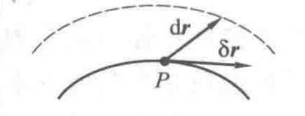

在稳定约束下，实位移$\mathrm{d}\boldsymbol{r}$是许多虚位移$\delta\boldsymbol{r}$里面的一个．但对不稳定约束来讲，实位移与虚位移并不一致．例如质点被约束在运动着的曲面

$$
f(x,y,z,t)=0
$$

上，则在某一时刻$t$，无限小虚位移$\delta\boldsymbol{r}$将通过质点在该时刻所占据的$P$点的切平面，而实位移$\mathrm{d}\boldsymbol{r}$，由于曲面移动，即由图 5.2.1 的实线位置移动到图中虚线所示的位置，故并不在这个切平面内．

### （2）理想约束

作用在质点上的力（包括约束反力）$\boldsymbol{F}$在任意虚位移$\delta\boldsymbol{r}$中所作的功，叫做**虚功**．如果作用在一力学体系上诸约束反力在任意虚位移$\delta\boldsymbol{r}$中所作的虚功之和为零，即

$$
\sum_{i=1}^{n}\boldsymbol{F}_{ri}\cdot\delta\boldsymbol{r}_i=0 \qquad (5.2.2)
$$

那么这种约束叫做**理想约束**．光滑面、光滑曲线、光滑铰链、刚性杆、不可伸长的绳等都是理想约束．引入虚位移的目的，就在于利用式（5.2.2）来消去这些约束反力．

### （3）虚功原理

以下我们只讨论不可解约束的情况．设受有$k$个几何约束的某力学体系处于平衡状态．取体系中任一质点$P_i$，并设作用在此质点上主动力的合力为$\boldsymbol{F}_i$，约束反力的合力为$\boldsymbol{F}_{ri}$，则因在此体系中每一质点都必须处于平衡状态中，故此时必有

$$
\boldsymbol{F}_i+\boldsymbol{F}_{ri}=0 \quad (i=1,2,\cdots,n) \qquad (5.2.3)
$$

现在让每一质点自它的平衡位置发生一虚位移$\delta\boldsymbol{r}_i$，则由式（5.2.3），得

$$
\boldsymbol{F}_i\cdot\delta\boldsymbol{r}_i+\boldsymbol{F}_{ri}\cdot\delta\boldsymbol{r}_i=0 \quad (i=1,2,\cdots,n) \qquad (5.2.4)
$$

把式（5.2.4）中各等式相加，就得到

$$
\sum_{i=1}^{n}\boldsymbol{F}_i\cdot\delta\boldsymbol{r}_i+\sum_{i=1}^{n}\boldsymbol{F}_{ri}\cdot\delta\boldsymbol{r}_i=0 \qquad (5.2.5)
$$

但如为理想约束，则根据式（5.2.2），$\sum_{i=1}^{n}\boldsymbol{F}_{ri}\cdot\delta\boldsymbol{r}_i=0$，因此，如果这样的力学体系处于平衡状态，则其平衡条件是

$$
\delta W=\sum_{i=1}^{n}\boldsymbol{F}_i\cdot\delta\boldsymbol{r}_i=0 \qquad (5.2.6)
$$

或

$$
\delta W=\sum_{i=1}^{n}(F_{ix}\delta x_i+F_{iy}\delta y_i+F_{iz}\delta z_i)=0 \qquad (5.2.7)
$$

反之，也可证明，如果平衡位置是约束所允许的位置，则当（5.2.6）式对任意$\delta\boldsymbol{r}_i$都成立时，系统在该位置必保持平衡．由此可知，受有理想约束的力学体系平衡的充要条件是此力学体系的诸主动力在任意虚位移中所作的元功之和等于零．这个关系是 1717 年伯努利首先发现的，叫做**虚功原理**，也叫**虚位移原理**．

利用虚功原理解理想约束的力学体系的平衡问题时，由于约束反力自动消去，故可很简单地用它去求主动力在平衡时所应满足的条件，即所谓平衡条件，这是它很大的一个优点．但从另一方面来看，也有它的缺点，因为无法用它来求出约束反力．

由于约束关系，$3n$个坐标$x_i,y_i,z_i(i=1,2,\cdots,n)$并不完全独立，故式（5.2.7）诸虚位移前的乘数，即作用在任一质点上的合力在虚位移方向上的投影，一般不会全令之为零．因为全令之为零，就可能变成$n$个自由质点的平衡方程，这将与原来受有约束的假设矛盾．如果我们利用式（5.1.8），把$3n$个不独立的坐标改用$s$个独立的广义坐标$q_{\alpha}(\alpha=1,2,\cdots,s)$表出，然后令$s$个独立的虚位移（即诸独立的$\delta q_{\alpha}$）前的乘数等于零，则可得出所求的平衡条件．如果除了求平衡条件外，还要求约束力，则要利用拉格朗日未定乘数．关于未定乘数法，我们将在本节（4）中再作介绍．

现在让我们求出一个力学体系用$s$个独立的广义坐标$q_{\alpha}(\alpha=1,2,\cdots,s)$表示的平衡方程，亦即在广义坐标下力学体系的平衡条件．由式（5.1.9），我们知$\boldsymbol{r}_i$的虚位移为

$$
\delta\boldsymbol{r}_i=\sum_{\alpha=1}^{s}\frac{\partial\boldsymbol{r}_i}{\partial q_{\alpha}}\delta q_{\alpha} \qquad (5.2.8)
$$

所以由式（5.2.6）及式（5.2.8）知在广义坐标下的平衡方程是

$$
\begin{aligned}
\delta W&=\sum_{i=1}^{n}\boldsymbol{F}_i\cdot\delta\boldsymbol{r}_i=\sum_{i=1}^{n}\left[\boldsymbol{F}_i\cdot\left(\sum_{\alpha=1}^{s}\frac{\partial\boldsymbol{r}_i}{\partial q_{\alpha}}\delta q_{\alpha}\right)\right]\\
&=\sum_{\alpha=1}^{s}\left(\sum_{i=1}^{n}\boldsymbol{F}_i\cdot\frac{\partial\boldsymbol{r}_i}{\partial q_{\alpha}}\right)\delta q_{\alpha}=\sum_{\alpha=1}^{s}\left(Q_{\alpha}\delta q_{\alpha}\right)=0 \qquad (5.2.9)
\end{aligned}
$$

式中$Q_{\alpha}$应是$q_{\alpha}(\alpha=1,2,\cdots,s)$的函数．现在，诸虚位移$\delta q_{\alpha}$已是互相独立的了，因而得出

$$
Q_{\alpha}=0 \quad (\alpha=1,2,\cdots,s) \qquad (5.2.10)
$$

这就是受有理想完整约束的力学体系在广义坐标系中的平衡方程，它和力学体系自由度的数目相等．$Q_{\alpha}$叫**广义力**，我们在 §5.3 中还要详细讨论它的物理意义．和$\boldsymbol{F}_i$一样，它也不包含约束力．至于$Q_{\alpha}$的详细表达式则为

$$
\begin{aligned}
Q_{\alpha}&=\sum_{i=1}^{n}\left(\boldsymbol{F}_i\cdot\frac{\partial\boldsymbol{r}_i}{\partial q_{\alpha}}\right)=\sum_{i=1}^{n}\left(F_{ix}\frac{\partial x_i}{\partial q_{\alpha}}+F_{iy}\frac{\partial y_i}{\partial q_{\alpha}}+F_{iz}\frac{\partial z_i}{\partial q_{\alpha}}\right)\\
&\qquad\qquad (\alpha=1,2,\cdots,s)
\end{aligned}
\qquad (5.2.11)
$$

[例 1] 均匀杆$OA$，重$P_1$，长为$l_1$，能在竖直平面内绕固定铰链$O$转动．此杆的$A$端，用铰链连另一重$P_2$、长为$l_2$的均匀杆$AB$．在$AB$杆的$B$端加一水平力$F$．求平衡时此二杆与水平线所成的角度$\alpha$及$\beta$（图 5.2.2）．

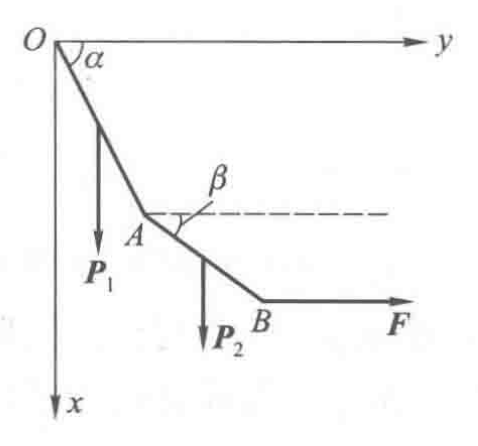

[解] 我们如能确定$A,B$两点的位置，本问题即告解决．由于$OA$和$AB$杆都位于$xy$平面内，故系一平面问题，只要四个坐标，就能确定$A,B$两点的位置．但因$OA=l_1,AB=l_2$是两个约束方程，所以自由度只有两个，现在选$\alpha$及$\beta$为两个广义坐标．

如果令$P_1$的作用点（即$OA$的中点）的坐标为$(x_1,y_1)$，$P_2$的作用点（即$AB$的中点）的坐标为$(x_2,y_2)$，$F$的作用点（即$B$点）的坐标为$(x_3,y_3)$，则由虚功原理式（5.2.7），得

$$
P_1\delta x_1+P_2\delta x_2+F\delta y_3=0 \qquad (1)
$$

但

$$
\left.
\begin{aligned}
x_1&=\frac{1}{2}l_1\sin\alpha\\
x_2&=l_1\sin\alpha+\frac{1}{2}l_2\sin\beta\\
y_3&=l_1\cos\alpha+l_2\cos\beta
\end{aligned}
\right\}
\qquad (2)
$$

把（2）式代入（1）式，得

$$
P_1\delta\left(\frac{1}{2}l_1\sin\alpha\right)+P_2\delta\left(l_1\sin\alpha+\frac{1}{2}l_2\sin\beta\right)+F\delta\left(l_1\cos\alpha+l_2\cos\beta\right)=0 \qquad (3)
$$

即

$$
\left(\frac{1}{2}P_1l_1\cos\alpha+P_2l_1\cos\alpha-Fl_1\sin\alpha\right)\delta\alpha+\left(\frac{1}{2}P_2l_2\cos\beta-Fl_2\sin\beta\right)\delta\beta=0 \qquad (4)
$$

因$\delta\alpha$及$\delta\beta$都是相互独立的，故得

$$
\left.
\begin{aligned}
\frac{1}{2}P_1l_1\cos\alpha+P_2l_1\cos\alpha-Fl_1\sin\alpha&=0\\
\frac{1}{2}P_2l_2\cos\beta-Fl_2\sin\beta&=0
\end{aligned}
\right\}
\qquad (5)
$$

所以

$$
\left.
\begin{aligned}
\tan\alpha&=\frac{P_1+2P_2}{2F}\\
\tan\beta&=\frac{P_2}{2F}
\end{aligned}
\right\}
\qquad (6)
$$

这就是我们欲求的两个关系．

顺便指出，本例题的广义坐标是$\alpha$和$\beta$．（4）式中$\delta\alpha$前的乘数，即（5）式的第一式是$Q_1$，而（4）式中$\delta\beta$前的乘数，即（5）式中的第二式，则是$Q_2$．所以正文中所讲的两种方法是一样的．在这里，广义坐标$\alpha$和$\beta$都是角度，所以广义力$Q_1$和$Q_2$都是力矩而不是力［参看（5.3.14）式后的说明］．

### * （4）拉格朗日未定乘数与约束力

前面曾一再提过，利用虚功原理可以很方便地求出在广义坐标下的平衡条件，但却不能求出约束力．为了弥补这个缺陷，可以采用拉格朗日未定乘数法，它可以同时求出平衡位置与约束力．

设我们有一由$n$个质点所组成的力学体系，此力学体系有$k$个完整约束（不完整约束也可以，但静力学中比较少见）

$$
f_{\beta}(x,y,z)=0 \quad (\beta=1,2,\cdots,k) \qquad (5.2.12)
$$

式中$x,y,z$是力学体系中所有各点的坐标（缩写），因而是$3n$个坐标的函数，至于此力学体系独立坐标的数目则为$3n-k$个．

我们可以直接用原有的$3n$个坐标来解算，也可用广义坐标$q_{\alpha}(\alpha=1,2,\cdots,s;s=3n-k)$来解算，结果是一样的．我们现在先用上面所讲的第一种方法．

根据虚功原理，力学体系的平衡条件是

$$
\sum_{i=1}^{n}\left(F_{ix}\delta x_i+F_{iy}\delta y_i+F_{iz}\delta z_i\right)=0
$$

力学体系各点坐标的虚位移，应当满足下列关系：

$$
\sum_{i=1}^{n}\left(\frac{\partial f_{\beta}}{\partial x_i}\delta x_i+\frac{\partial f_{\beta}}{\partial y_i}\delta y_i+\frac{\partial f_{\beta}}{\partial z_i}\delta z_i\right)=0 \quad (\beta=1,2,\cdots,k) \qquad (5.2.13)
$$

把式（5.2.13）中各等式分别乘以$\lambda_{\beta}$，然后和（5.2.7）式相加，得

$$
\sum_{i=1}^{n}\left[\left(F_{ix}+\sum_{\beta=1}^{k}\lambda_{\beta}\frac{\partial f_{\beta}}{\partial x_i}\right)\delta x_i+\left(F_{iy}+\sum_{\beta=1}^{k}\lambda_{\beta}\frac{\partial f_{\beta}}{\partial y_i}\right)\delta y_i+\left(F_{iz}+\sum_{\beta=1}^{k}\lambda_{\beta}\frac{\partial f_{\beta}}{\partial z_i}\right)\delta z_i\right]=0 \qquad (5.2.14)
$$

选择$\lambda_{\beta}$，使$k$个不独立虚位移前的乘数等于零，因而余下的$3n-k$个独立虚位移前的乘数也等于零了，于是得

$$
\left.
\begin{aligned}
F_{ix}+\sum_{\beta=1}^{k}\lambda_{\beta}\frac{\partial f_{\beta}}{\partial x_i}&=0\\
F_{iy}+\sum_{\beta=1}^{k}\lambda_{\beta}\frac{\partial f_{\beta}}{\partial y_i}&=0\\
F_{iz}+\sum_{\beta=1}^{k}\lambda_{\beta}\frac{\partial f_{\beta}}{\partial z_i}&=0
\end{aligned}
\right\}
\quad (i=1,2,\cdots,n) \qquad (5.2.15)
$$

把它们和$k$个约束方程（5.2.12）合并起来，就有完整的一组$3n+k$个方程，可用来决定$3n+k$个量$x_i,y_i,z_i(i=1,2,\cdots,n)$及$\lambda_{\beta}(\beta=1,2,\cdots,k)$．$\lambda_{\beta}$叫**拉格朗日未定乘数**．

如果一个质点约束在一曲面$f(x,y,z)=0$上，则根据式（5.2.12）及（5.2.15）可知，由

$$
\left.
\begin{aligned}
F_x+\lambda\frac{\partial f}{\partial x}&=0\\
F_y+\lambda\frac{\partial f}{\partial y}&=0\\
F_z+\lambda\frac{\partial f}{\partial z}&=0\\
f(x,y,z)&=0
\end{aligned}
\right\}
\qquad (5.2.16)
$$

四式可求出$x,y,z$及$\lambda$四个量．

如一质点约束在一曲线$f_1(x,y,z)=0$及$f_2(x,y,z)=0$上，则依据同样理由，可由

$$
\left.
\begin{aligned}
F_x+\lambda_1\frac{\partial f_1}{\partial x}+\lambda_2\frac{\partial f_2}{\partial x}&=0\\
F_y+\lambda_1\frac{\partial f_1}{\partial y}+\lambda_2\frac{\partial f_2}{\partial y}&=0\\
F_z+\lambda_1\frac{\partial f_1}{\partial z}+\lambda_2\frac{\partial f_2}{\partial z}&=0\\
f_1(x,y,z)&=0,\\
f_2(x,y,z)&=0
\end{aligned}
\right\}
\qquad (5.2.17)
$$

五式，求出$x,y,z,\lambda_1$及$\lambda_2$五个量．

现在让我们来看一看未定乘数$\lambda$的物理意义．在面约束的情形下，将式（5.2.16）中前三式分别乘以单位矢量$\boldsymbol{i},\boldsymbol{j},\boldsymbol{k}$，并相加，得

$$
F_x\boldsymbol{i}+F_y\boldsymbol{j}+F_z\boldsymbol{k}+\lambda\left(\frac{\partial f}{\partial x}\boldsymbol{i}+\frac{\partial f}{\partial y}\boldsymbol{j}+\frac{\partial f}{\partial z}\boldsymbol{k}\right)=0
$$

或

$$
\boldsymbol{F}+\lambda\nabla f=0 \qquad (5.2.18)
$$

但质点在曲面上平衡时，

$$
\boldsymbol{F}+\boldsymbol{F}_r=0
$$

式中$\boldsymbol{F}_r$是曲面对质点的约束反作用力．由此得

$$
\lambda=\frac{R}{|\nabla f|}=\frac{R}{\sqrt{\left(\frac{\partial f}{\partial x}\right)^2+\left(\frac{\partial f}{\partial y}\right)^2+\left(\frac{\partial f}{\partial z}\right)^2}} \qquad (5.2.19)
$$

或

$$
\boldsymbol{F}_r=\lambda\nabla f \qquad (5.2.20)
$$

同理，在线约束的情况下，

$$
\boldsymbol{F}_{r1}=\lambda\nabla f_1, \quad \boldsymbol{F}_{r2}=\lambda\nabla f_2 \qquad (5.2.21)
$$

所以拉格朗日未定乘数是和约束反作用力成比例的标量．如果$\lambda$可以求出，那么约束反作用力就可以决定了．推广到更一般的情况也是这样．甚至线性依赖于速度的不完整约束也可以用．

现在再讲用广义坐标来解此同一问题的方法．首先，应当利用式（5.1.8）把式（5.2.12）中$3n$个$x,y,z$改用$s$个广义坐标$q_{\alpha}(\alpha=1,2,\cdots,s)$表出，则约束方程将变为

$$
\varphi_{\beta}(q_1,q_2,\cdots,q_s)=0 \quad (\beta=1,2,\cdots,k) \qquad (5.2.22)
$$

$k$为体系所受到完整约束的数目，而虚位移$\delta q_{\alpha}$则应满足下列关系：

$$
\sum_{\alpha=1}^{s}\frac{\partial\varphi_{\beta}}{\partial q_{\alpha}}\delta q_{\alpha}=0 \quad (\beta=1,2,\cdots,k) \qquad (5.2.23)
$$

把式（5.2.23）中每一式乘以$\lambda_{\beta}$，并和式（5.2.9）相加，得

$$
\sum_{\alpha=1}^{s}\left[Q_{\alpha}+\sum_{\beta=1}^{k}\left(\lambda_{\beta}\frac{\partial\varphi_{\beta}}{\partial q_{\alpha}}\right)\right]\delta q_{\alpha}=0 \qquad (5.2.24)
$$

如上所述，由于约束关系，诸$\delta q_{\alpha}$也并不完全独立．但我们可以选择$\lambda_{\beta}$，使不独立虚位移前的乘数等于零，那么剩下的独立虚位移前的乘数也就等于零了．这样，我们就得到

$$
Q_{\alpha}+\sum_{\beta=1}^{k}\left(\lambda_{\beta}\frac{\partial\varphi_{\beta}}{\partial q_{\alpha}}\right)=0 \quad (\alpha=1,2,\cdots,s) \qquad (5.2.25)
$$

联合式（5.2.22）和式（5.2.25），我们就有$s+k$个方程，可用来决定$k$个未定乘数$\lambda_{\beta}$和$s$个广义坐标$q_{\alpha}$．$k$个未定乘数$\lambda_{\beta}$仍然是和约束力成比例的标量，而$Q_{\alpha}$则是以广义坐标$q_{\alpha}$所表出的主动力．

一般说来，用拉格朗日未定乘数法来求约束力，并不比用牛顿定律所求出的平衡方程简便，甚至反使问题复杂化．不过，未定乘数法是一种重要的数学方法，在理论物理中用途很广，有重要的理论意义．我们应当对它有所了解．

[例 2] 两条长为$l_1$与$l_2$的无弹性轻绳，系着一个物体，如图 5.2.3 所示．绳的另外两端挂在一水平墙的两点$A$与$B$上，$AB$间的距离为$a=(l_1^2+l_2^2)^{1/2}$．已知重物的重量为$W$，试用拉格朗日未定乘数法，求绳子中的张力$F_{T1}$与$F_{T2}$的量值．

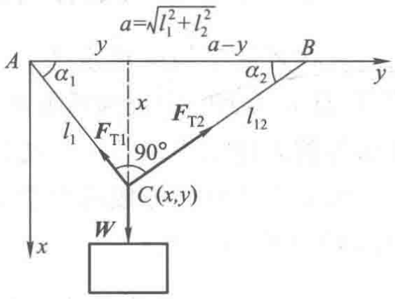

[解] 本题是一平面问题，故在约束（水平墙）取消后，有两个自由度．在图 5.2.3 中，取$A$点为坐标原点，$x$轴竖直向下，$y$轴沿直线$AB$，物体的作用点$C$在此系中的坐标为$(x,y)$．两条绳中的张力$F_{T1}$和$F_{T2}$是约束力（即前面所讲的$F_i$），而物体的重量$W$则是主动力．

本题如绘出力三角形，并由正弦定律（常称为拉密方程），很容易求出$F_{T1}$和$F_{T2}$的量值．用平面共点力系的平衡方程，也容易得出同样结果．这里为了和正文印证，采用未定乘数法来解．

由虚功原理（5.2.7），得

$$
\delta W=w\delta x=0 \qquad (1)
$$

又由式（5.2.12），知本题的约束方程是

$$
\left.
\begin{aligned}
f_1(x,y)&=l_1^2-x^2-y^2=0,\\
f_2(x,y)&=l_2^2-x^2-(a-y)^2=0
\end{aligned}
\right\}
\qquad (2)
$$

微分（2）式，并引入未定乘数$\lambda_1$和$\lambda_2$，则由式（5.2.14），得

$$
[w-2(\lambda_1+\lambda_2)x]\delta x-[2\lambda_1y-2\lambda_2(a-y)]\delta y=0 \qquad (3)
$$

由此得［即（5.2.17）式］

$$
\left.
\begin{aligned}
w-2(\lambda_1+\lambda_2)x&=0\\
-\lambda_1y+\lambda_2(a-y)&=0
\end{aligned}
\right\}
\qquad (4)
$$

（2）与（4）共有四个方程，可用来定出$\lambda_1,\lambda_2,x$及$y$四个量．由（4）式得

$$
\left.
\begin{aligned}
\lambda_2&=\frac{w}{2a}\frac{y}{x}\\
\lambda_1&=\frac{w}{2a}\frac{a-y}{x}
\end{aligned}
\right\}
\qquad (5)
$$

由（2）式，我们又得

$$
\left.
\begin{aligned}
y&=\frac{l_1^2}{a}\\
x&=\frac{l_1l_2}{a}
\end{aligned}
\right\}
\qquad (6)
$$

求出$\lambda_1,\lambda_2,x$及$y$后，我们再由式（5.2.21），即得所求的绳中张力的量值为

$$
\left.
\begin{aligned}
F_{T1}&=\lambda_1|\nabla f_1|=\frac{w}{2a}\frac{a-y}{x}(2l_1)=\frac{wl_2}{a}=\frac{wl_2}{(l_1^2+l_2^2)^{1/2}}\\
F_{T2}&=\lambda_2|\nabla f_2|=\frac{w}{2a}\frac{y}{x}(2l_2)=\frac{wl_1}{a}=\frac{wl_1}{(l_1^2+l_2^2)^{1/2}}
\end{aligned}
\right\}
\qquad (7)
$$

## §5.3 拉格朗日方程

### （1）基本形式的拉格朗日方程

现在要从牛顿运动定律出发，求出用广义坐标表示的完整系的动力学方程，它是分析力学中极为重要的方程组之一，从推导过程也可看出，它是在达朗贝尔等人的工作基础上发展起来的．

由$n$个质点所形成的力学体系的动力学方程，根据牛顿运动定律的表达式（1.5.4）可写为

$$
m_i\ddot{\boldsymbol{r}}_i=\boldsymbol{F}_i+\boldsymbol{F}_{ri} \quad (i=1,2,\cdots,n)
$$

或

$$
-m_i\ddot{\boldsymbol{r}}_i+\boldsymbol{F}_i+\boldsymbol{F}_{ri}=0 \quad (i=1,2,\cdots,n) \qquad (5.3.1)
$$

这个方程和上式在数学上虽然只是移项手续的不同，但在物理意义上却很有意义．式（5.3.1）是一个力学体系的平衡方程，代表主动力$\boldsymbol{F}_i$、约束反力$\boldsymbol{F}_{ri}$和质点因有加速度而产生的有效力（惯性力）的平衡．通过这种办法就可把动力学问题化为静力学问题来处理．式（5.3.1）反映的这种平衡关系，通常叫做**达朗贝尔原理**．

若用虚位移$\delta\boldsymbol{r}_i$标乘式（5.3.1），并对$i$求和，在理想约束的条件下，则得

$$
\sum_{i=1}^{n}\left(\boldsymbol{F}_i-m_i\ddot{\boldsymbol{r}}_i\right)\cdot\delta\boldsymbol{r}_i=0 \qquad (5.3.2)
$$

这个方程和表示虚功原理的式（5.2.6）颇为类似．这是和力学体系的静止条件式（5.3.1）相应的虚功原理．即达朗贝尔原理和虚功原理的结合，有时又称为**达朗贝尔-拉格朗日方程**．

由于存在约束关系，我们不能令式（5.3.2）中$\delta\boldsymbol{r}_i$前面所有的乘数都等于零，否则，就成为自由质点的运动微分方程了．因此，可以利用式（5.1.9），把不独立的$\boldsymbol{r}_i$等改用广义坐标$q_{\alpha}$等来表示．当然，$\boldsymbol{F}_i$及$\ddot{\boldsymbol{r}}_i$等也要相应地用广义坐标及其微商等来表示．如果力学体系受有$k$个几何约束，那么只要$s=3n-k$个广义坐标$q_1,q_2,\cdots,q_s$，就能表明此力学体系的运动状态了．现在让我们来进行这种变换．

由式（5.1.9），知$\boldsymbol{r}_i$是$s$个$q_{\alpha}(\alpha=1,2,\cdots,s)$及$t$的函数．显然，

$$
\begin{aligned}
\mathrm{d}\boldsymbol{r}_i&=\frac{\partial\boldsymbol{r}_i}{\partial q_1}\mathrm{d}q_1+\frac{\partial\boldsymbol{r}_i}{\partial q_2}\mathrm{d}q_2+\cdots+\frac{\partial\boldsymbol{r}_i}{\partial q_s}\mathrm{d}q_s+\frac{\partial\boldsymbol{r}_i}{\partial t}\mathrm{d}t\\
&=\sum_{\alpha=1}^{s}\frac{\partial\boldsymbol{r}_i}{\partial q_{\alpha}}\mathrm{d}q_{\alpha}+\frac{\partial\boldsymbol{r}_i}{\partial t}\mathrm{d}t \qquad (5.3.3)
\end{aligned}
$$

如果把实位移$\mathrm{d}\boldsymbol{r}_i$改成虚位移$\delta\boldsymbol{r}_i$，则因$\delta t=0$，故由式（5.3.3），就立即得出

$$
\delta\boldsymbol{r}_i=\sum_{\alpha=1}^{s}\frac{\partial\boldsymbol{r}_i}{\partial q_{\alpha}}\delta q_{\alpha} \qquad (5.3.4)
$$

因此，式（5.3.2）可改写为

$$
\sum_{i=1}^{n}\left(\boldsymbol{F}_i-m_i\ddot{\boldsymbol{r}}_i\right)\cdot\sum_{\alpha=1}^{s}\frac{\partial\boldsymbol{r}_i}{\partial q_{\alpha}}\delta q_{\alpha}=0
$$

即

$$
-\sum_{i=1}^{n}\sum_{\alpha=1}^{s}m_i\ddot{\boldsymbol{r}}_i\cdot\frac{\partial\boldsymbol{r}_i}{\partial q_{\alpha}}\delta q_{\alpha}+\sum_{i=1}^{n}\sum_{\alpha=1}^{s}\boldsymbol{F}_i\cdot\frac{\partial\boldsymbol{r}_i}{\partial q_{\alpha}}\delta q_{\alpha}=0 \qquad (5.3.5)
$$

在这里，我们把两个求和号写在一起，因为它们是互不相关的，一个是对指标$i$求和，而另一个是对指标$\alpha$求和．

令

$$
\begin{aligned}
\sum_{i=1}^{n}\sum_{\alpha=1}^{s}m_i\ddot{\boldsymbol{r}}_i\cdot\frac{\partial\boldsymbol{r}_i}{\partial q_{\alpha}}\delta q_{\alpha}&=\sum_{\alpha=1}^{s}\left[\sum_{i=1}^{n}\left(m_i\ddot{\boldsymbol{r}}_i\cdot\frac{\partial\boldsymbol{r}_i}{\partial q_{\alpha}}\right)\delta q_{\alpha}\right]\\
&=\sum_{\alpha=1}^{s}P_{\alpha}\delta q_{\alpha} \qquad (5.3.6)
\end{aligned}
$$

又令

$$
\sum_{i=1}^{n}\sum_{\alpha=1}^{s}\boldsymbol{F}_i\cdot\frac{\partial\boldsymbol{r}_i}{\partial q_{\alpha}}\delta q_{\alpha}=\sum_{\alpha=1}^{s}\left[\sum_{i=1}^{n}\left(\boldsymbol{F}_i\cdot\frac{\partial\boldsymbol{r}_i}{\partial q_{\alpha}}\right)\delta q_{\alpha}\right]=\sum_{\alpha=1}^{s}Q_{\alpha}\delta q_{\alpha} \qquad (5.3.7)
$$

现在来计算$P_{\alpha}$．由式（5.3.6），知

$$
P_{\alpha}=\sum_{i=1}^{n}m_i\ddot{\boldsymbol{r}}_i\cdot\frac{\partial\boldsymbol{r}_i}{\partial q_{\alpha}}=\frac{\mathrm{d}}{\mathrm{d}t}\sum_{i=1}^{n}m_i\left(\dot{\boldsymbol{r}}_i\cdot\frac{\partial\boldsymbol{r}_i}{\partial q_{\alpha}}\right)-\sum_{i=1}^{n}m_i\left(\dot{\boldsymbol{r}}_i\cdot\frac{\mathrm{d}}{\mathrm{d}t}\frac{\partial\boldsymbol{r}_i}{\partial q_{\alpha}}\right) \qquad (5.3.8)
$$

现在先求$\dot{\boldsymbol{r}}_i$的表达式．由式（5.3.3）$\boldsymbol{r}_i$的微分表示式，可立即列出$\boldsymbol{r}_i$的微商表达式，即

$$
\dot{\boldsymbol{r}}_i=\frac{\mathrm{d}\boldsymbol{r}_i}{\mathrm{d}t}=\sum_{\alpha=1}^{s}\frac{\partial\boldsymbol{r}_i}{\partial q_{\alpha}}\dot{q}_{\alpha}+\frac{\partial\boldsymbol{r}_i}{\partial t} \qquad (5.3.9)
$$

由式（5.1.9）知$\boldsymbol{r}_i$是$q_1,q_2,\cdots,q_s$及$t$的函数，而$\frac{\partial\boldsymbol{r}_i}{\partial q_{\alpha}}(\alpha=1,2,\cdots,s)$一般也仍然是$q_1,q_2,\cdots,q_s$及$t$的函数，除非这些独立变数在$\boldsymbol{r}_i$中都是线性的．因此，$\dot{\boldsymbol{r}}_i$在一般情况下，是$q_1,q_2,\cdots,q_s;\dot{q}_1,\dot{q}_2,\cdots,\dot{q}_s$及$t$的函数．同时，$\frac{\partial\boldsymbol{r}_i}{\partial t}$和每个$\frac{\partial\boldsymbol{r}_i}{\partial q_{\alpha}}$都不是$\dot{q}_{\alpha}$的函数．且因$\dot{q}_1,\dot{q}_2,\cdots,\dot{q}_s$也是互相独立的，这样由式（5.3.9），就可得出：

$$
\frac{\partial\dot{\boldsymbol{r}}_i}{\partial\dot{q}_{\alpha}}=\frac{\partial\boldsymbol{r}_i}{\partial q_{\alpha}} \qquad (5.3.10)
$$

再求$\frac{\partial\boldsymbol{r}_i}{\partial q_{\alpha}}$对$t$的微商，得

$$
\begin{aligned}
\frac{\mathrm{d}}{\mathrm{d}t}\frac{\partial\boldsymbol{r}_i}{\partial q_{\alpha}}&=\sum_{\beta=1}^{s}\left(\frac{\partial^2\boldsymbol{r}_i}{\partial q_{\beta}\partial q_{\alpha}}\dot{q}_{\beta}\right)+\frac{\partial^2\boldsymbol{r}_i}{\partial t\partial q_{\alpha}}=\frac{\partial}{\partial q_{\alpha}}\left(\sum_{\beta=1}^{s}\frac{\partial\boldsymbol{r}_i}{\partial q_{\beta}}\dot{q}_{\beta}+\frac{\partial\boldsymbol{r}_i}{\partial t}\right)\\
&=\frac{\partial\dot{\boldsymbol{r}}_i}{\partial q_{\alpha}}=\frac{\partial}{\partial q_{\alpha}}\left(\frac{\mathrm{d}\boldsymbol{r}_i}{\mathrm{d}t}\right) \qquad (5.3.11)
\end{aligned}
$$

即$\boldsymbol{r}_i$对时间$t$的微商和对广义坐标$q_{\alpha}$的偏微商可以对易．利用（5.3.10）及（5.3.11）两式的关系，式（5.3.8）变为

$$
P_{\alpha}=\frac{\mathrm{d}}{\mathrm{d}t}\sum_{i=1}^{n}m_i\left(\dot{\boldsymbol{r}}_i\cdot\frac{\partial\dot{\boldsymbol{r}}_i}{\partial\dot{q}_{\alpha}}\right)-\sum_{i=1}^{n}m_i\left(\dot{\boldsymbol{r}}_i\cdot\frac{\partial\dot{\boldsymbol{r}}_i}{\partial q_{\alpha}}\right) \qquad (5.3.12)
$$

式（5.3.12）右方含有求和号的两项，恰为体系动能

$$
T=\frac{1}{2}\sum_{i=1}^{n}m_i\dot{\boldsymbol{r}}_i^2
$$

对$\dot{q}_{\alpha}$及$q_{\alpha}$的偏微商，因此式（5.3.12）可改写为

$$
P_{\alpha}=\frac{\mathrm{d}}{\mathrm{d}t}\frac{\partial T}{\partial\dot{q}_{\alpha}}-\frac{\partial T}{\partial q_{\alpha}}
$$

通过式（5.3.6）与式（5.3.7）的代换，动力学方程式（5.3.5）变为

$$
\sum_{\alpha=1}^{s}\left[\left(-\frac{\mathrm{d}}{\mathrm{d}t}\frac{\partial T}{\partial\dot{q}_{\alpha}}+\frac{\partial T}{\partial q_{\alpha}}+Q_{\alpha}\right)\delta q_{\alpha}\right]=0 \qquad (5.3.13)
$$

由于$\delta q_{\alpha}$是互相独立的，故得

$$
\frac{\mathrm{d}}{\mathrm{d}t}\left(\frac{\partial T}{\partial\dot{q}_{\alpha}}\right)-\frac{\partial T}{\partial q_{\alpha}}=Q_{\alpha} \quad (\alpha=1,2,\cdots,s) \qquad (5.3.14)
$$

这就是基本形式的拉格朗日方程．它们是广义坐标$q_{\alpha}$以时间$t$作自变量的$s$个二阶常微分方程．此组方程的好处是，只要知道一力学体系用广义坐标$q_1,q_2,\cdots,q_s$所表出的动能$T$，及作用在此力学体系上的力$Q_1,Q_2,\cdots,Q_s$（也是用$q_{\alpha}$及$t$表出的），就可写出这力学体系的动力学方程．$\frac{\partial T}{\partial\dot{q}_{\alpha}}$叫做**广义动量**，可为线动量亦可为角动量等．$\dot{q}_{\alpha}$叫做**广义速度**（线速度，角速度或其他）．因为动量对时间的微商等于力，故$Q_{\alpha}$叫做**广义力**，在 §5.2 中已经出现过．$Q_{\alpha}\delta q_{\alpha}$的量纲跟功的量纲一样，故$Q_{\alpha}$的量纲将随$q_{\alpha}$的选择而定．$Q_{\alpha}$可以是力，也可以是力矩或其他的物理量，如压强$P$、表面张力$\sigma$、电场强度$E$或磁场强度$H$等．广义力$Q_{\alpha}$中一般不包括约束反作用力．所以利用基本形式的拉格朗日方程一般也不能直接求出约束反作用力．

由式（5.3.7），广义力$Q_{\alpha}$可以用

$$
Q_{\alpha}=\sum_{i=1}^{n}\boldsymbol{F}_i\cdot\frac{\partial\boldsymbol{r}_i}{\partial q_{\alpha}} \quad (\alpha=1,2,\cdots,s)
$$

的关系求出，但比较麻烦．通常情况下，我们还是直接用式（5.3.7）来计算广义力$Q_{\alpha}$比较方便．由式（5.3.7）及式（5.3.4），知

$$
\sum_{i=1}^{n}\boldsymbol{F}_i\cdot\delta\boldsymbol{r}_i=\sum_{\alpha=1}^{s}Q_{\alpha}\delta q_{\alpha}=\delta W
$$

对非平衡问题来讲，主动力所作元功之和并不为零．因此，欲求$Q_1$，可求出除$\delta q_1$外其余诸$\delta q_{\alpha}(\alpha=2,3,\cdots,s)$均为零时主动力所作元功之和，再以$\delta q_1$除之即得．$Q_2,Q_3,\cdots,Q_s$的求法照此类推．

### （2）保守系的拉格朗日方程

对保守力系来讲，基本形式的拉格朗日方程（5.3.14），还能再加简化．根据 §1.7 中的讨论，保守力系中必存在势能$V$，它是坐标的函数，且

$$
\left.
\begin{aligned}
\boldsymbol{F}_i&=-\nabla_iV\\
F_{ix}&=-\frac{\partial V}{\partial x_i},F_{iy}=-\frac{\partial V}{\partial y_i},F_{iz}=-\frac{\partial V}{\partial z_i}
\end{aligned}
\right\}
\quad (i=1,2,\cdots,n)
$$

它和式（1.7.6）不同之处在于$V$是所有点坐标的函数，即$x_i,y_i,z_i(i=1,2,\cdots,n)$的函数①．如果把变换方程式（5.1.8）代入，则$V$成为$q_1,q_2,\cdots,q_s;t$的函数；于是

$$
\begin{aligned}
Q_{\alpha}&=\sum_{i=1}^{n}\boldsymbol{F}_i\cdot\frac{\partial\boldsymbol{r}_i}{\partial q_{\alpha}}=\sum_{i=1}^{n}\left(F_{ix}\frac{\partial x_i}{\partial q_{\alpha}}+F_{iy}\frac{\partial y_i}{\partial q_{\alpha}}+F_{iz}\frac{\partial z_i}{\partial q_{\alpha}}\right)\\
&=\sum_{i=1}^{n}\left(-\frac{\partial V}{\partial x_i}\frac{\partial x_i}{\partial q_{\alpha}}-\frac{\partial V}{\partial y_i}\frac{\partial y_i}{\partial q_{\alpha}}-\frac{\partial V}{\partial z_i}\frac{\partial z_i}{\partial q_{\alpha}}\right)=-\frac{\partial V}{\partial q_{\alpha}} \qquad (5.3.15)
\end{aligned}
$$

这样一来，基本形式的拉格朗日方程式（5.3.14）就可改写为

> ① 有时，势能还是时间的显函数，即$V$中显含$t$．

$$
\frac{\mathrm{d}}{\mathrm{d}t}\left(\frac{\partial T}{\partial\dot{q}_{\alpha}}\right)-\frac{\partial T}{\partial q_{\alpha}}=-\frac{\partial V}{\partial q_{\alpha}} \quad (\alpha=1,2,\cdots,s) \qquad (5.3.16)
$$

因为势能$V$中一般并不包含广义速度$\dot{q}_{\alpha}$，故如令

$$
L=T-V \qquad (5.3.17)
$$

代表体系的动能与势能之差，则

$$
\frac{\partial L}{\partial\dot{q}_{\alpha}}=\frac{\partial T}{\partial\dot{q}_{\alpha}}, \quad \frac{\partial L}{\partial q_{\alpha}}=\frac{\partial T}{\partial q_{\alpha}}-\frac{\partial V}{\partial q_{\alpha}}
$$

而基本形式的拉格朗日方程式（5.3.14）则变为

$$
\frac{\mathrm{d}}{\mathrm{d}t}\left(\frac{\partial L}{\partial\dot{q}_{\alpha}}\right)-\frac{\partial L}{\partial q_{\alpha}}=0 \quad (\alpha=1,2,\cdots,s) \qquad (5.3.18)
$$

这就是保守力系的拉格朗日方程，因为用得较多，有时也直接把它叫做拉格朗日方程或拉氏方程．式中$L$叫**拉格朗日函数**，简称**拉氏函数**．拉氏函数$L$等于力学体系动能和势能之差，见式（5.3.17）．它是力学体系的一个特性函数，表征着约束、运动状态、相互作用等性质．

### （3）循环积分

拉格朗日方程是$s$个二阶常微分方程组，在某些特殊情况下，部分的第一积分甚易获得．这些第一积分有循环积分和能量积分．现在先讲循环积分．

在 §1.9 讨论质点在有心力场中运动时，我们已经用极坐标表出它的动能与势能．如质点的质量是$m$，则动能

$$
T=\frac{1}{2}m\left(\dot{r}^2+r^2\dot{\theta}^2\right)
$$

而平方反比引力的势能$V=-\frac{k^2m}{r}$，故

$$
L=T-V=\frac{1}{2}m\left(\dot{r}^2+r^2\dot{\theta}^2\right)+\frac{k^2m}{r}
$$

我们知道，有心力是两个自由度的问题，故径矢$r$及极角$\theta$就是有心力问题在极坐标系中的两个广义坐标，所以拉氏函数$L$中应含有四个变量，即$r,\theta$和它们对时间的微商．可是现在所求出的$L$中却不出现$\theta$，这种在$L$中不出现的坐标就叫**循环坐标**．

一般地讲，如果拉氏函数$L$中不显含某一坐标$q_i$，则因$\frac{\partial L}{\partial q_i}=0$，故由式（5.3.18）得

$$
\frac{\mathrm{d}}{\mathrm{d}t}\left(\frac{\partial L}{\partial\dot{q}_i}\right)=0, \quad \text{即} \quad \frac{\partial L}{\partial\dot{q}_i}=b_i=\text{常数} \qquad (5.3.19)
$$

在此情形下，$q_i$常称为**循环坐标**或**可遗坐标**（因它不包含在$L$中）．对于任一循环坐标，都有一对应的积分，叫做**循环积分**．在上面所讲的有心力问题中，极角$\theta$

就是一个循环坐标，故质点相对于力心的动量矩$mr^2\dot{\theta}$（它等于$\frac{\partial L}{\partial\dot{\theta}}$）是一常数．

$L$中不含某一广义坐标$q_i$，并不意味着也不包含广义速度$\dot{q}_i$，例如有心力的$L$中不包含$\theta$，但却含$\dot{\theta}$．而且，不包含某一广义坐标$q_i$时，对应的广义动量$\frac{\partial L}{\partial\dot{q}_i}$为常数，但广义速度$\dot{q}_i$一般并不为常数．仍以有心力为例，$L$中不含$\theta$，故$mr^2\dot{\theta}$为常数，但$\dot{\theta}$并不为常数．

### （4）能量积分

现在来说明在什么条件下，可以由拉格朗日方程得出能量积分．假设有一个完整的、保守的力学体系，体系有$s$个自由度，先求出用广义坐标及广义速度所表出的动能．由式（5.3.9），我们有

$$
\dot{\boldsymbol{r}}_i=\sum_{\alpha=1}^{s}\frac{\partial\boldsymbol{r}_i}{\partial q_{\alpha}}\dot{q}_{\alpha}+\frac{\partial\boldsymbol{r}_i}{\partial t}
$$

于是

$$
\begin{aligned}
T&=\frac{1}{2}\sum_{i=1}^{n}m_i\left(\sum_{\alpha=1}^{s}\frac{\partial\boldsymbol{r}_i}{\partial q_{\alpha}}\dot{q}_{\alpha}+\frac{\partial\boldsymbol{r}_i}{\partial t}\right)^2\\
&=\frac{1}{2}\sum_{\substack{\alpha=1\\\beta=1}}^{s}\sum_{i=1}^{n}m_i\frac{\partial\boldsymbol{r}_i}{\partial q_{\alpha}}\cdot\frac{\partial\boldsymbol{r}_i}{\partial q_{\beta}}\dot{q}_{\alpha}\dot{q}_{\beta}+\sum_{\alpha=1}^{s}\sum_{i=1}^{n}m_i\frac{\partial\boldsymbol{r}_i}{\partial q_{\alpha}}\cdot\frac{\partial\boldsymbol{r}_i}{\partial t}\dot{q}_{\alpha}\\
&\quad+\frac{1}{2}\sum_{i=1}^{n}m_i\left(\frac{\partial\boldsymbol{r}_i}{\partial t}\right)^2\\
&=\frac{1}{2}\sum_{\substack{\alpha=1\\\beta=1}}^{s}a_{\alpha\beta}\dot{q}_{\alpha}\dot{q}_{\beta}+\sum_{\alpha=1}^{s}a_{\alpha}\dot{q}_{\alpha}+\frac{1}{2}a \qquad (5.3.20)
\end{aligned}
$$

即

$$
T=T_2+T_1+T_0
$$

式中$T_2,T_1$和$T_0$分别是广义速度$\dot{q}_{\alpha}$的二次、一次和零次的函数，即式（5.3.20）中的第一项、第二项和第三项．系数$a_{\alpha\beta},a_{\alpha}$和$a$一般都是$q_{\alpha}(\alpha=1,2,\cdots,s)$及$t$的函数．

如果力学体系是稳定的，则式（5.1.9）中可不含有$t$，因而$\frac{\partial\boldsymbol{r}_i}{\partial t}=0$，即$a_{\alpha}=0$，$a=0$，于是动能$T$将仅为广义速度的二次齐次函数，即$T=T_2$．如果$T=T_2$，而且$V=V(q_1,q_2,\cdots,q_s)$也不显含$t$，那么把式（5.3.16）各项乘以$\dot{q}_{\alpha}$并相加，就得到

$$
\sum_{\alpha=1}^{s}\frac{\mathrm{d}}{\mathrm{d}t}\left(\frac{\partial T}{\partial\dot{q}_{\alpha}}\right)\dot{q}_{\alpha}-\sum_{\alpha=1}^{s}\frac{\partial T}{\partial q_{\alpha}}\dot{q}_{\alpha}=\sum_{\alpha=1}^{s}-\frac{\partial V}{\partial q_{\alpha}}\dot{q}_{\alpha} \qquad (5.3.21)
$$

让我们把式（5.3.21）左端的第一项变成下列形式：

$$
\sum_{\alpha=1}^{s}\frac{\mathrm{d}}{\mathrm{d}t}\left(\frac{\partial T}{\partial\dot{q}_{\alpha}}\right)\dot{q}_{\alpha}=\sum_{\alpha=1}^{s}\frac{\mathrm{d}}{\mathrm{d}t}\left(\frac{\partial T}{\partial\dot{q}_{\alpha}}\dot{q}_{\alpha}\right)-\sum_{\alpha=1}^{s}\frac{\partial T}{\partial\dot{q}_{\alpha}}\ddot{q}_{\alpha}
$$

再代入式（5.3.21）中，得

$$
\frac{\mathrm{d}}{\mathrm{d}t}\sum_{\alpha=1}^{s}\frac{\partial T}{\partial\dot{q}_{\alpha}}\dot{q}_{\alpha}-\sum_{\alpha=1}^{s}\left(\frac{\partial T}{\partial q_{\alpha}}\dot{q}_{\alpha}+\frac{\partial T}{\partial\dot{q}_{\alpha}}\ddot{q}_{\alpha}\right)=-\sum_{\alpha=1}^{s}\frac{\partial V}{\partial q_{\alpha}}\dot{q}_{\alpha} \qquad (5.3.22)
$$

因为已假定$T$是广义速度的二次齐次函数，故根据欧拉关于齐次函数的定理，知

$$
\sum_{\alpha=1}^{s}\frac{\partial T}{\partial\dot{q}_{\alpha}}\dot{q}_{\alpha}=2T \qquad (5.3.23)
$$

此外，因为$T$和$V$都不是时间$t$的显函数，所以我们有

$$
\left.
\begin{aligned}
\sum_{\alpha=1}^{s}\left(\frac{\partial T}{\partial q_{\alpha}}\dot{q}_{\alpha}+\frac{\partial T}{\partial\dot{q}_{\alpha}}\ddot{q}_{\alpha}\right)&=\frac{\mathrm{d}T}{\mathrm{d}t}\\
\sum_{\alpha=1}^{s}\frac{\partial V}{\partial q_{\alpha}}\dot{q}_{\alpha}&=\frac{\mathrm{d}V}{\mathrm{d}t}
\end{aligned}
\right\}
\qquad (5.3.24)
$$

把式（5.3.23）和式（5.3.24）的结果代入式（5.3.22），得

$$
\frac{\mathrm{d}}{\mathrm{d}t}(2T)-\frac{\mathrm{d}T}{\mathrm{d}t}=-\frac{\mathrm{d}V}{\mathrm{d}t}
$$

由式

$$
\frac{\mathrm{d}T}{\mathrm{d}t}=-\frac{\mathrm{d}V}{\mathrm{d}t}
$$

把它积分，就得到

$$
T+V=E \qquad (5.3.25)
$$

这就是力学体系的能量积分．

如动能$T$虽不是时间的显函数，但为广义速度的二次非齐次函数，亦即$T=T_2+T_1+T_0$，那么，代替式（5.3.23）是

$$
\sum_{\alpha=1}^{s}\frac{\partial T}{\partial\dot{q}_{\alpha}}\dot{q}_{\alpha}=\sum_{\alpha=1}^{s}\left(\frac{\partial T_2}{\partial\dot{q}_{\alpha}}\dot{q}_{\alpha}+\frac{\partial T_1}{\partial\dot{q}_{\alpha}}\dot{q}_{\alpha}+\frac{\partial T_0}{\partial\dot{q}_{\alpha}}\dot{q}_{\alpha}\right)=2T_2+T_1 \qquad (5.3.26)
$$

代入式（5.3.22）中，并假定$V$也不是$t$的显函数，则得

$$
\frac{\mathrm{d}}{\mathrm{d}t}(2T_2+T_1)-\frac{\mathrm{d}T}{\mathrm{d}t}=-\frac{\mathrm{d}V}{\mathrm{d}t}
$$

积分，得

$$
2T_2+T_1-T=-V+h
$$

即

$$
T_2-T_0+V=h \qquad (5.3.27)
$$

$T_2-T_0$并不代表动能，$h$虽是常数，但也并不代表总能量，与$E$不同．所以式（5.3.27）就物理意义说来，不是能量积分．可是因为它和能量积分有些类似，所以它被称为**广义能量积分**．由此可见，即使主动力都是保守力，拉格朗日方程也并不一定给出能量积分，除非约束是稳定的．因为在稳定约束的情况下，约束反力可以作功，而在拉格朗日方程中并不含有约束反力，这就产生了上述的差异．

### （5）拉格朗日方程的应用

前面讲过：一般不能用拉格朗日方程来求约束力，但用来写出力学体系的动力学方程，却是比较简便的，只要知道这力学体系用广义坐标和广义速度所表出的动能及广义力$Q_1,Q_2,\cdots,Q_s$就可以了．而且，对于有相对运动的问题来讲，如果用牛顿运动定律，就必须求出绝对加速度，或在非惯性系中引入适当的惯性力．但如果用拉格朗日方程，则只需求出相对于静止参考系的动能，亦即求出绝对速度即可，因而问题比较简单．下面，我们用自由质点相对于转动参考系的运动来说明这个问题．

质点$P$在力$\boldsymbol{F}$的作用下，对于以恒定角速度$\omega$绕竖直轴转动的坐标系$O-xyz$运动着，现在要求此质点相对于坐标系$O-xyz$的动力学方程．

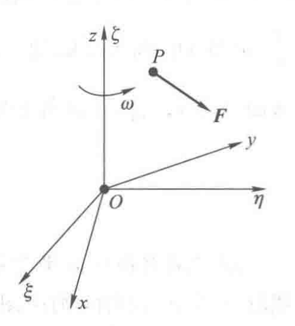

我们取$O-\xi\eta\zeta$为静止坐标系，并令转动坐标系在$z$轴与静止坐标系的$\zeta$轴重合的情况下，以恒定角速度$\omega$绕$\zeta$轴转动（图 5.3.1）．如质点$P$相对于转动坐标系的坐标为$(x,y,z)$，则由 §4.1，知此质点的绝对速度在三个动坐标轴上的分量是

$$
\left.
\begin{aligned}
v_x&=\dot{x}-\omega y\\
v_y&=\dot{y}+\omega x\\
v_z&=\dot{z}
\end{aligned}
\right\}
\qquad (5.3.28)
$$

因而质点$P$相对于静止坐标系的动能是

$$
\begin{aligned}
T&=\frac{1}{2}m\left[(\dot{x}-\omega y)^2+(\dot{y}+\omega x)^2+\dot{z}^2\right]\\
&=\frac{1}{2}m(\dot{x}^2+\dot{y}^2+\dot{z}^2)+m\omega(x\dot{y}-y\dot{x})\\
&\quad+\frac{1}{2}m\omega^2(x^2+y^2) \qquad (5.3.29)
\end{aligned}
$$

式中$m$为质点的质量．如果$\boldsymbol{F}$在转动坐标轴上的三个分量为$F_x,F_y$及$F_z$，则由式（5.3.14），得

$$
\left.
\begin{aligned}
m(\ddot{x}-2\omega\dot{y}-\omega^2x)&=F_x\\
m(\ddot{y}+2\omega\dot{x}-\omega^2y)&=F_y\\
m\ddot{z}&=F_z
\end{aligned}
\right\}
\qquad (5.3.30)
$$

故质点在非惯性参考系中的运动方程为

$$
\left.
\begin{aligned}
m\ddot{x}&=F_x+2m\omega\dot{y}+m\omega^2x\\
m\ddot{y}&=F_y-2m\omega\dot{x}+m\omega^2y\\
m\ddot{z}&=F_z
\end{aligned}
\right\}
\qquad (5.3.31)
$$

与用第四章中的方法所得的结果相同．此时科里奥利力与惯性离心力都可由拉格朗日方程直接给出，这显然是一个很大的优点．

在前几章里，我们有意回避了用球面坐标系来解题，因为用那时已知的方法，来求在球面坐标系中质点的加速度的分量，是非常繁难的．现在有了拉格朗日方程，我们就可解除这种束缚，进一步熟悉有关球面坐标系的计算问题．

在球面坐标系中，任一质点$P$的位置，由$r,\theta,\varphi$三个量来决定，如图 5.3.2 所示．其中$r=\overrightarrow{OP}$，是$P$点的径矢，$\theta$是$OP$与$z$轴间的夹角，叫做**极角**，它的余角$\frac{\pi}{2}-\theta$（即$OP$与$OM$间的夹角）叫**纬度**，而$\varphi$则叫**方位角**．由图 5.3.2 可以看出，球面坐标$r,\theta,\varphi$与直角坐标$x,y,z$之间的关系为

$$
\left.
\begin{aligned}
x&=r\sin\theta\cos\varphi\\
y&=r\sin\theta\sin\varphi\\
z&=r\cos\theta
\end{aligned}
\right\}
\qquad (5.3.32)
$$

现在来求在球面坐标系中质点$P$的速度．在半径为$r$的球面（包含$P$点）上截取一微小六面体，则由图 5.3.3 可以看出，此六面体三个边的长分别为$\mathrm{d}r,r\mathrm{d}\theta$和$r\sin\theta\mathrm{d}\varphi$，故此微小六面体对角线的长$\mathrm{d}s$可由下式求出：

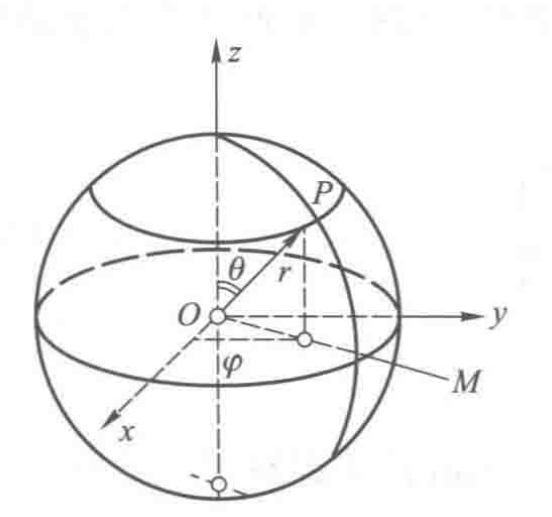

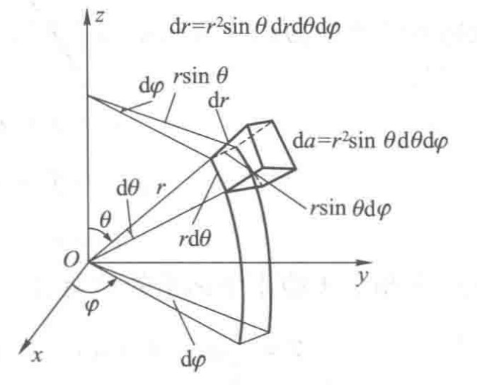

$$
(\mathrm{d}s)^2=(\mathrm{d}r)^2+r^2(\mathrm{d}\theta)^2+r^2\sin^2\theta(\mathrm{d}\varphi)^2
$$

而此质点的速度则为

$$
\dot{s}^2=\dot{r}^2+r^2\dot{\theta}^2+r^2\sin^2\theta\dot{\varphi}^2 \qquad (5.3.33)
$$

当质点$P$以速度$v$运动时，它的动能$T$为$\frac{1}{2}mv^2=\frac{1}{2}m\dot{s}^2$，$m$是此质点的质量．由式（5.3.33），我们可立即得出质点的动能$T$为

$$
T=\frac{m}{2}\left(\dot{r}^2+r^2\dot{\theta}^2+r^2\sin^2\theta\dot{\varphi}^2\right)
$$

用拉格朗日方程式（5.3.14）来写出自由质点在球面坐标系中的运动微分方程，是非常简便的．现在已经知道了用球面坐标所表出的动能，我们就可把$r,\theta,\varphi$作为本问题的三个广义坐标．这里要注意的是，如果令$F_r,F_{\theta}$和$F_{\varphi}$为作用在质点$P$上的合外力$\boldsymbol{F}$的三个分量，则广义力$Q_r$，$Q_\theta$和$Q_\varphi$并不完全是$F_r$，$F_\theta$和$F_\varphi$．因为对应于它们的广义坐标$\theta$，$\varphi$都是角度，所以$Q_r=F_r$，$Q_\theta=rF_\theta$，$Q_\varphi=(r\sin\theta)F_\varphi$，后两者都是力矩．式（5.3.14）可变为

$$
\left.\begin{aligned}
\frac{1}{2}m\left[\frac{\mathrm{d}}{\mathrm{d}t}\left(\frac{\partial \dot{s}^2}{\partial \dot{r}}\right)-\frac{\partial \dot{s}^2}{\partial r}\right]&=F_r\\
\frac{1}{2r}m\left[\frac{\mathrm{d}}{\mathrm{d}t}\left(\frac{\partial \dot{s}^2}{\partial \dot{\theta}}\right)-\frac{\partial \dot{s}^2}{\partial \theta}\right]&=F_\theta\\
\frac{1}{2r\sin\theta}m\left[\frac{\mathrm{d}}{\mathrm{d}t}\left(\frac{\partial \dot{s}^2}{\partial \dot{\varphi}}\right)-\frac{\partial \dot{s}^2}{\partial \varphi}\right]&=F_\varphi
\end{aligned}\right\}\qquad (5.3.34)
$$

由此即得

$$
\left.\begin{aligned}
m(\ddot{r}-r\dot{\theta}^2-r\sin^2\theta\,\dot{\varphi}^2)&=F_r\\
m(r\ddot{\theta}+2\dot{r}\dot{\theta}-r\sin\theta\cos\theta\,\dot{\varphi}^2)&=F_\theta\\
m(r\sin\theta\,\ddot{\varphi}+2\sin\theta\,\dot{r}\dot{\varphi}+2r\cos\theta\,\dot{\theta}\dot{\varphi})&=F_\varphi
\end{aligned}\right\}\qquad (5.3.35)
$$

这样，我们就得出了在球面坐标系中自由质点的运动微分方程，比用坐标变换式（5.3.32）要简便多了．

上面所讨论的两个问题，都是属于自由质点的运动问题．但在很多问题中，我们都是研究受有约束的力学体系的运动问题．因此，作为示例，我们在这里也像 §1.5 所讲的那样，列出几条解题步骤给初学者作为参考．在已经熟练掌握以后，读者就应根据具体情况，灵活运用，不要硬套．由于今后所研究的问题，大部分是属于保守力系的问题，所以以这类问题为代表，可把解题分为如下步骤：① 确定力学体系的自由度；② 适当选取描写体系运动的广义坐标；③ 写出力学体系的动能$T$及势能$V$，并进而写出体系的拉格朗日函数$L$；④ 把$L$代入拉格朗日方程［式（5.3.18）］，得出力学体系的运动微分方程；⑤ 解方程并讨论．现以滑轮组为例来加以说明．

两个滑轮及三个砝码组成一滑轮组，如图5.3.4所示．略去摩擦及滑轮本身的重量，求每一砝码的加速度．

① 确定体系的自由度

在本问题中，每一砝码都作直线运动，故每一砝码都只要一个坐标就能确定它的运动．但因绳长一定，故只有两个坐标是独立的，即本问题的自由度为2．

② 选广义坐标

根据题意及图 5.3.4，选$q_1$、$q_2$为本问题的两个广义坐标．

③ 写出体系的动能$T$、势能$V$及拉氏函数$L$

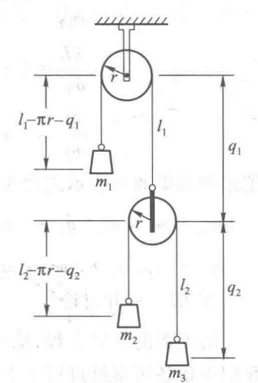在图 5.3.4 中，令$r$为每一滑轮的半径，$l_1$为上面一根绳子的长度，$l_2$为下面一根绳子的长度，则从图上可以看出，在任一瞬时，砝码$m_1$、$m_2$和$m_3$低于上面那个固定滑轮轴的距离分别为$(l_1-\pi r-q_1)$、$(q_1+l_2-\pi r-q_2)$及$(q_1+q_2)$．我们如果把坐标原点就取在上面那个固定滑轮轴上，则上述三个距离就是任一瞬时三个砝码的位置坐标．至于三个砝码的速度及加速度，则分别为

砝码$m_1$　　$-\dot q_1$，$-\ddot q_1$

砝码$m_2$　　$\dot q_1-\dot q_2$，$\ddot q_1-\ddot q_2$

砝码$m_3$　　$\dot q_1+\dot q_2$，$\ddot q_1+\ddot q_2$

故动能$T$为

$$
T=\frac{1}{2}[(m_1+m_2+m_3)\dot q_1^2+(m_2+m_3)\dot q_2^2+2(m_3-m_2)\dot q_1\dot q_2]\qquad (5.3.36)
$$

在不计摩擦的情况下，重力是唯一的外力，故势能$V$为

$$
\begin{aligned}
V=-{}&[m_1(l_1-\pi r-q_1)+m_2(q_1+l_2-\pi r-q_2)\\
&+m_3(q_1+q_2)]g
\end{aligned}\qquad (5.3.37)
$$

至于拉格朗日函数$L$则为

$$
\begin{aligned}
L=T-V={}&\frac{1}{2}[(m_1+m_2+m_3)\dot q_1^2+(m_2+m_3)\dot q_2^2\\
&+2(m_3-m_2)\dot q_1\dot q_2]+[m_1(l_1-\pi r-q_1)\\
&+m_2(q_1+l_2-\pi r-q_2)+m_3(q_1+q_2)]g\qquad (5.3.38)
\end{aligned}
$$

④ 把$L$代入拉格朗日方程，求出体系的运动微分方程

由式（5.3.38），可求出$L$对$q$及$\dot q$的偏微商如下：

$$
\frac{\partial L}{\partial \dot q_1}=(m_1+m_2+m_3)\dot q_1+(m_3-m_2)\dot q_2
$$

$$
\frac{\partial L}{\partial \dot q_2}=(m_2+m_3)\dot q_2+(m_3-m_2)\dot q_1
$$

$$
\frac{\partial L}{\partial q_1}=(-m_1+m_2+m_3)g
$$

$$
\frac{\partial L}{\partial q_2}=(m_3-m_2)g
$$

把这些偏微商的表示式代入拉格朗日方程［式（5.3.18）］中，就得到

$$
\left.\begin{aligned}
(m_1+m_2+m_3)\ddot q_1+(m_3-m_2)\ddot q_2+(m_1-m_2-m_3)g&=0\\
(m_3-m_2)\ddot q_1+(m_2+m_3)\ddot q_2+(m_2-m_3)g&=0
\end{aligned}\right\}\qquad (5.3.39)
$$

⑤ 解方程并讨论

解上面的联立方程，就可得出$\ddot q_1$和$\ddot q_2$，进而就可以求出每一砝码的加速度，我们不预备再继续进行下去，只以一个特例作出具体演算．

如$m_1=3\ \mathrm{kg}$，$m_2=2\ \mathrm{kg}$，$m_3=1\ \mathrm{kg}$，代入数值，式（5.3.39）就简化为

$$
\left.\begin{aligned}
6\ddot q_1-\ddot q_2&=0\\
-\ddot q_1+3\ddot q_2&=-g
\end{aligned}\right\}\qquad (5.3.40)
$$

解之，得　　$\ddot q_1=-\frac{1}{17}g$，　$\ddot q_2=-\frac{6}{17}g$

因我们取$g$的方向向下为正，故

$3\ \mathrm{kg}$砝码的加速度为$-\ddot q_1=\frac{1}{17}g$（方向向下）；

$2\ \mathrm{kg}$砝码的加速度为$\ddot q_1-\ddot q_2=\frac{5}{17}g$（方向向下）；

$1\ \mathrm{kg}$砝码的加速度为$\ddot q_1+\ddot q_2=-\frac{7}{17}g$（方向向上）．

若给出初始条件，就可进一步由此求出全部运动情况．

### （6）冲击运动的拉格朗日方程

一个力学体系在冲力作用下的拉格朗日方程，一般是把在广义力$Q_\alpha$作用下力学体系的基本形式的拉格朗日方程（5.3.14）自时间$t_1$积分到时间$t_2$，其中$t_2-t_1$为冲力作用的时间，通常是十分短促的．

将式（5.3.14）自时间$t_1$积分到时间$t_2$后，得

$$
\int_{t_1}^{t_2}\frac{\mathrm{d}}{\mathrm{d}t}\left(\frac{\partial T}{\partial \dot q_\alpha}\right)\mathrm{d}t-\int_{t_1}^{t_2}\frac{\partial T}{\partial q_\alpha}\mathrm{d}t=\int_{t_1}^{t_2}Q_\alpha\mathrm{d}t\qquad (\alpha=1,2,\cdots,s)\qquad (5.3.41)
$$

但

$$
\int_{t_1}^{t_2}\frac{\mathrm{d}}{\mathrm{d}t}\left(\frac{\partial T}{\partial \dot q_\alpha}\right)\mathrm{d}t=\left(\frac{\partial T}{\partial \dot q_\alpha}\right)_{t_2}-\left(\frac{\partial T}{\partial \dot q_\alpha}\right)_{t_1}\qquad (\alpha=1,2,\cdots,s)\qquad (5.3.42)
$$

又函数$\frac{\partial T}{\partial q_\alpha}$是有限的（通常与惯性力有关），而且由于$t_2-t_1$甚为微小，所以$\int_{t_1}^{t_2}\frac{\partial T}{\partial q_\alpha}\mathrm{d}t$的数值比其他项的积分要小得多，可以略去不计．至于$Q_\alpha$对时间的积分$\int_{t_1}^{t_2}Q_\alpha\mathrm{d}t$，则由 §1.8，知为广义冲量$I_\alpha$，它的数值也是有限的，故最后冲击运动的拉格朗日方程为

$$
\left(\frac{\partial T}{\partial \dot q_\alpha}\right)_{t_2}-\left(\frac{\partial T}{\partial \dot q_\alpha}\right)_{t_1}=I_\alpha\qquad (\alpha=1,2,\cdots,s)\qquad (5.3.43)
$$

上列方程是力学体系受冲力作用后的广义速度$\dot q_\alpha(t_2)$与未受冲力作用前的广义速度$\dot q_\alpha(t_1)$及广义冲量$I_\alpha$之间的线性关系式．在一般情况下，有确定的解．

### * （7）不完整约束

我们在本节（1）中推导拉格朗日方程时，是假定力学体系只受有$k$个几何约束（完整约束）．如果力学体系还受有不完整的约束，就必须对拉格朗日方程作一些修正．对于线性依赖于速度的不完整约束来讲，通常是引入拉格朗日未定乘数，并选择未定乘数，使诸不独立的$\delta q_\alpha$前面的乘数等于零，因而诸独立的$\delta q_\alpha$前面的乘数也就等于零了．换句话说，把未定乘数法和拉格朗日方程结合起来，就可以解决这类不完整约束力学体系的运动问题．

设力学体系除受有$k$个完整约束外，还受有下列$r$个线性依赖于速度的微分约束

$$
\sum_{i=1}^{n}(a_{\rho i}\dot x_i+b_{\rho i}\dot y_i+c_{\rho i}\dot z_i)+a_\rho=0\qquad (\rho=1,2,\cdots,r)\qquad (5.3.44)
$$

或

$$
\sum_{i=1}^{n}(a_{\rho i}\mathrm{d}x_i+b_{\rho i}\mathrm{d}y_i+c_{\rho i}\mathrm{d}z_i)+a_\rho\mathrm{d}t=0\qquad (\rho=1,2,\cdots,r)\qquad (5.3.45)
$$

由于$a_{\rho i}$、$b_{\rho i}$、$c_{\rho i}$及$a_\rho$都是$x_i$、$y_i$、$z_i$（$i=1,2,\cdots,n$）的函数，故由式（5.1.8）的变换关系，把$a_{\rho i}$、$b_{\rho i}$、$c_{\rho i}$及$a_\rho$连同$\mathrm{d}x_i$、$\mathrm{d}y_i$、$\mathrm{d}z_i$统统换为$q_\alpha(a=1,2,\cdots,s)$的函数，则式（5.3.45）可以写为

$$
\sum_{\alpha=1}^{s}(A_{\rho\alpha}\mathrm{d}q_\alpha)+A_\rho\mathrm{d}t=0\qquad (\rho=1,2,\cdots,r)\qquad (5.3.46)
$$

式中$A_{\rho\alpha}$（$\alpha=1,2,\cdots,s$）及$A_\rho$都是$q_\alpha$（$\alpha=1,2,\cdots,s$）及$t$的函数，而$3n-k=s$个$q_\alpha$的虚位移，还要受到下列条件的限制［参看 §5.2 中的式（5.2.9）］

$$
\sum_{\alpha=1}^{s}A_{\rho\alpha}\delta q_\alpha=0\qquad (\rho=1,2,\cdots,r)\qquad (5.3.47)
$$

因而其中又有$r$个$\delta q_\alpha$是不独立的．

把式（5.3.47）中每一个方程乘以$\mu_\rho$，对$\rho$求和后再与式（5.3.13）相加，就得到

$$
\sum_{\alpha=1}^{s}\left[-\frac{\mathrm{d}}{\mathrm{d}t}\left(\frac{\partial T}{\partial \dot q_\alpha}\right)+\frac{\partial T}{\partial q_\alpha}+Q_\alpha+\sum_{\rho=1}^{r}\mu_\rho A_{\rho\alpha}\right]\delta q_\alpha=0\qquad (5.3.48)
$$

选择未定乘数$\mu_\rho$，使$r$个不独立虚位移前的乘数等于零，因而剩下的$s-r$个独立虚位移前的乘数也就等于零了．这样，我们就得出下列$s$个方程：

$$
\frac{\mathrm{d}}{\mathrm{d}t}\left(\frac{\partial T}{\partial \dot q_\alpha}\right)-\frac{\partial T}{\partial q_\alpha}=Q_\alpha+\sum_{\rho=1}^{r}\mu_\rho A_{\rho\alpha}\qquad (\alpha=1,2,\cdots,s)\qquad (5.3.49)
$$

把约束方程（5.3.46）和（5.3.49）合并起来，就得$s+r$个方程，可以确定$s+r$未知变量$q_1$，$q_2$，$\cdots$，$q_s$；$\mu_1$，$\mu_2$，$\cdots$，$\mu_r$，因而问题完全解决．可以证明，$\mu_\rho$也是和约束力成比例的标量．我们通常把式（5.3.49）叫做罗斯方程．

如果还要求与$k$个完整约束相联系的约束力，则可引入另一组拉格朗日未定乘数$\lambda_\beta$，并仿 §5.2（4）中的同样方法，在式（5.3.49）中再加上一组$\sum_{\beta=1}^{k}\lambda_\beta\frac{\partial \varphi_\beta}{\partial q_\alpha}$，就可由修正后的$s$个式（5.3.49）及两组$k+r$个约束方程（5.2.22）与（5.3.46），定出$\lambda_\beta$（$\beta=1,2,\cdots,k$），$\mu_\rho$（$\rho=1,2,\cdots,r$）和$q_\alpha$（$\alpha=1,2,\cdots,s$），因而问题亦完全解决，详细演算从略．

## §5.4 小振动

### （1）保守系在广义坐标系中的平衡方程

根据式（5.2.9），我们知道：在广义坐标系中的平衡条件是所有广义力在任意虚位移下所作元功之和为零，即

$$
\sum_{\alpha=1}^{s}Q_\alpha\delta q_\alpha=0
$$

因为诸$\delta q_\alpha$是互相独立的，因而得出广义坐标系中的平衡方程是所有的广义力等于零，即

$$
Q_\alpha=0\qquad (\alpha=1,2,\cdots,s)
$$

如果作用在力学体系上的力都是保守力，由式（5.3.15），则

$$
Q_\alpha=-\frac{\partial V}{\partial q_\alpha}\qquad (\alpha=1,2,\cdots,s)
$$

式中$V$是力学体系的势能．故保守力系平衡时的条件是势能具有稳定值，亦即

$$
\frac{\partial V}{\partial q_\alpha}=0\qquad (\alpha=1,2,\cdots,s)\qquad (5.4.1)
$$

### （2）多自由度力学体系的小振动

我们在普通物理中已经研究过一个自由度的谐振动问题，例如弹簧振子．对摆长为$l$、摆锤的质量为$m$的单摆，只有当它的幅角（即振幅）很小时，才能作谐振动．现在让我们进一步用拉格朗日方程来研究多自由度振动的小振动问题．这个问题，在物理学很多领域里都会碰到，例如分子物理中的分子光谱，固体物理中的晶格振动以及电磁学中的耦合振动等．至于声学所研究的对象，则几乎全是振动问题．本节将只讨论有限自由度的振动问题，而不涉及无限自由度的声振动问题．

设一个完整、稳定、保守的力学体系在平衡位置时的广义坐标$q_\alpha$（$\alpha=1$，$2$，$\cdots$，$s$）均等于零①．如果力学体系自平衡位置发生微小偏移，那么该力学体系的运动情况应当怎样？为此，可将力学体系的势能在平衡位形区域内展成泰勒级数，就得到

$$
V=V_0+\sum_{\alpha=1}^{s}\left(\frac{\partial V}{\partial q_\alpha}\right)_0 q_\alpha+\frac{1}{2}\sum_{\substack{\alpha=1\\ \beta=1}}^{s}\left(\frac{\partial^2 V}{\partial q_\alpha\partial q_\beta}\right)_0 q_\alpha q_\beta+\text{高级项}
$$

利用我们上面的假设及式（5.4.1），在讨论平衡位置附近的小振动问题时，即假定对一切时间$t$，所有$q(t)$始终很小，则可略去二次以上的高级项并令$V_0=0$，就得到

$$
V=\frac{1}{2}\sum_{\substack{\alpha=1\\ \beta=1}}^{s}c_{\alpha\beta}q_\alpha q_\beta\qquad (5.4.2)
$$

式中系数$c_{\alpha\beta}=\left(\frac{\partial^2 V}{\partial q_\alpha\partial q_\beta}\right)_0$是常数．下标“0”代表在平衡位置时所具有的值．

再将动能的表示式也加以变换．因为在稳定约束的情形下，动能$T$只是速度的二次齐次函数，即

> ① 一般来讲，我们总可通过线性变换作到这一点．

$$
T=\frac{1}{2}\sum_{\substack{\alpha=1\\ \beta=1}}^{s}a_{\alpha\beta}\dot q_\alpha\dot q_\beta
$$

式中系数$a_{\alpha\beta}$是坐标$q_\alpha(t)$等的显函数．把$a_{\alpha\beta}$在力学体系平衡位形的区域内展成泰勒级数，就得到

$$
a_{\alpha\beta}=(a_{\alpha\beta})_0+\sum_{r=1}^{s}\left(\frac{\partial a_{\alpha\beta}}{\partial q_r}\right)_0 q_r+\text{高级项}
$$

由于$q_r(t)$的值很小，因此在$a_{\alpha\beta}$的展开式中只需保留头一项$(a_{\alpha\beta})_0$，于是动能$T$变为

$$
T=\frac{1}{2}\sum_{\substack{\alpha=1\\ \beta=1}}^{s}a_{\alpha\beta}\dot q_\alpha\dot q_\beta\qquad (5.4.3)
$$

现在式中系数$a_{\alpha\beta}$已略去下标“0”，并可当作是不变的．$V$、$T$展开式中的系数，具有特别名称，即$c_{\alpha\beta}$称为恢复系数或准弹性系数，而$a_{\alpha\beta}$则称为惯性系数．

由式（5.4.3），得

$$
\frac{\partial T}{\partial \dot q_\alpha}=\sum_{\beta=1}^{s}a_{\alpha\beta}\dot q_\beta
$$

$$
\frac{\mathrm{d}}{\mathrm{d}t}\left(\frac{\partial T}{\partial \dot q_\alpha}\right)=\sum_{\beta=1}^{s}a_{\alpha\beta}\ddot q_\beta
$$

$$
\frac{\partial T}{\partial q_\alpha}=0
$$

另外，由式（5.4.2），我们又有

$$
\frac{\partial V}{\partial q_\alpha}=\sum_{\beta=1}^{s}c_{\alpha\beta}q_\beta
$$

把这些表示式代入拉格朗日方程式（5.3.16）中，就得到力学体系在平衡位置附近的动力学方程：

$$
\sum_{\beta=1}^{s}(a_{\alpha\beta}\ddot q_\beta+c_{\alpha\beta}q_\beta)=0\qquad (\alpha=1,2,\cdots,s)\qquad (5.4.4)
$$

这是线性齐次常微分方程组，它的解答具有

$$
q_\beta=A_\beta e^{\lambda t}
$$

的形式，式中$A_\beta$及$\lambda$是常数．把这表示式代入式（5.4.4）中，得

$$
\sum_{\beta=1}^{s}A_\beta(a_{\alpha\beta}\lambda^2+c_{\alpha\beta})=0\qquad (\alpha=1,2,\cdots,s)\qquad (5.4.5)
$$

从行列式

$$
\begin{vmatrix}
a_{11}\lambda^2+c_{11}&a_{12}\lambda^2+c_{12}&\cdots&a_{1s}\lambda^2+c_{1s}\\
a_{21}\lambda^2+c_{21}&a_{22}\lambda^2+c_{22}&\cdots&a_{2s}\lambda^2+c_{2s}\\
\vdots&\vdots&&\vdots\\
a_{s1}\lambda^2+c_{s1}&a_{s2}\lambda^2+c_{s2}&\cdots&a_{ss}\lambda^2+c_{ss}
\end{vmatrix}=0\qquad (5.4.6)
$$

中，可以求出$2s$个$\lambda$的本征值$\lambda_l(l=1,2,\cdots,2s)$．将每一个$\lambda_l$代入式（5.4.5），可求出一组$A_\beta^{(l)}(\beta=1,2,\cdots,s)$．$2s$个$\lambda_l$对应着$2s$组$A_\beta^{(l)}$．方程式（5.4.4）的解是所有的$A_\beta^{(l)}e^{\lambda_l t}$的线性组合，即

$$
q_\beta=\sum_{l=1}^{2s}A_\beta^{(l)}e^{\lambda_l t}\qquad (\beta=1,2,\cdots,s)\qquad (5.4.7)
$$

我们只考虑力学体系在平衡位置附近的小振动问题．显然，所有的$\lambda_l$均应为纯虚数．因为如果某些$\lambda_l$有实数部分，则由于从行列式中解出时该$\lambda_l$的正负根必同时出现，由式（5.4.7）看出对有正实数部分的根而言，某些广义坐标将随$t$的增大而无限制的增大，显然不是我们讨论的振动．

怎样才能使所有的$\lambda_l$都为纯虚数呢？我们知道：动能$T$恒为正，而势能$V$则可正可负，因为已取平衡位置时的势能为零．如果平衡位置时的势能取极小值，则当体系受扰动而偏离平衡位置时，势能$V$将增大而动能$T$（或速度$\dot q$等）则减小，故系统无论向哪个方向偏离，都只能作往复式的振动．一个质点处在球壳内的最低点时就是这种情况．反之，如果平衡位置时的势能取极大值，例如质点处在球壳外的最高点时，则无论它朝哪个方向偏离，势能$V$将减小而动能$T$（或速度$\dot q$等）则增大，体系将越来越偏离平衡位置，平衡是不稳定的．这种情况可参看一个自由度的势能曲线图（图1.8.4）．自由度增多时道理是一样的．

根据上面的讨论，我们可以得出这样的结论：在平衡位置附近，力学体系的势能$V>0$（即平衡位置$V=0$是极小值）是保证所有的根$\lambda_l$为纯虚数的充要条件，我们只研究这种情况．

既然$\lambda_l$是纯虚数，因此可令$\lambda_l=\pm \mathrm{i}\nu_l$，式中$\mathrm{i}=\sqrt{-1}$．这样，式（5.4.7）变为

$$
q_\beta=\sum_{l=1}^{s}(A_\beta^{(l)}e^{\mathrm{i}\nu_l t}+A_\beta^{'(l)}e^{-\mathrm{i}\nu_l t})\qquad (\beta=1,2,\cdots,s)\qquad (5.4.8)
$$

$q_\beta$的实数解可表示为

$$
q_\beta=\sum_{l=1}^{s}(a_\beta^{(l)}\cos\nu_l t+b_\beta^{(l)}\sin\nu_l t)\qquad (\beta=1,2,\cdots,s)\qquad (5.4.9)
$$

因此，体系将在平衡位置附近作复杂的振动，不会远离平衡位置．

实际上，我们把$\lambda$的某一本征值$\lambda_l$代入式（5.4.5）后，并不能得出$s$个互相独立的常数$A_\beta(\beta=1,2,\cdots,s)$，而只能得出它们的比，因为式（5.4.5）的系数行列式等于零．如果行列式（5.4.6）的$(s-1)$阶代数余子式中有一个不等于零，则在一组解$A_1^{(l)}$，$A_2^{(l)}$，$\cdots$，$A_s^{(l)}$（即把$\lambda$代以$\lambda_l$后所求得的$A_\beta$）中，只有一个数是可以任意取的．即对应于一个本征值$\lambda_l$只有一个任意常数．如果设此常数为$A^{(l)}$，则$A_\beta^{(l)}$可改写为

$$
\left.\begin{aligned}
A_\beta^{(l)}&=A^{(l)}\Delta_{1\beta}(\lambda_l^2)\\
A_1^{(l)}&=A^{(l)}\Delta_{11}(\lambda_l^2),A_2^{(l)}=A^{(l)}\Delta_{12}(\lambda_l^2),\cdots\\
A_s^{(l)}&=A^{(l)}\Delta_{1s}(\lambda_l^2)
\end{aligned}\right\}\qquad (5.4.10)
$$

式中$\Delta_{1\beta}(\lambda_l^2)$是行列式（5.4.6）削去第一行和第$\beta$列后的代数余子式代入$\lambda_l^2$后所得的值．在式（5.4.8）或式（5.4.9）中共有$2s^2$个常数，因为每个$\lambda_l$对应着一个任意常数，而$\lambda_l$共有$2s$个，所以$2s^2$个常数中只有$2s$个常数是独立的．这$2s$个常数，可由起始条件决定，即$t=0$时，$q_\beta$及$\dot q_\beta$之值应为已知．

关于常数间的这种关系，我们可用一个比较简单的例子来说明．例如，假设我们有下列这样一个三元一次方程组：

$$
\begin{aligned}
a_1x+b_1y+c_1z&=0\\
a_2x+b_2y+c_2z&=0\\
a_3x+b_3y+c_3z&=0
\end{aligned}
$$

这里的$x,y,z$相当于我们上面讨论的一组待求常数$A_1^{(l)}$，$A_2^{(l)}$，$A_3^{(l)}$（$s=3$的情况）．它们的系数行列式是

$$
\Delta=\begin{vmatrix}
a_1&b_1&c_1\\
a_2&b_2&c_2\\
a_3&b_3&c_3
\end{vmatrix}
$$

如果从上面所给方程组中第二式和第三式先后消去$z$及$x$，则得

$$
\begin{aligned}
(a_2c_3-a_3c_2)x+(b_2c_3-b_3c_2)y&=0\\
(b_3a_2-b_2a_3)y+(a_2c_3-a_3c_2)z&=0
\end{aligned}
$$

由此即得

$$
\frac{x}{\begin{vmatrix}b_2&c_2\\b_3&c_3\end{vmatrix}}=-\frac{y}{\begin{vmatrix}a_2&c_2\\a_3&c_3\end{vmatrix}}=\frac{z}{\begin{vmatrix}a_2&b_2\\a_3&b_3\end{vmatrix}}=A
$$

即

$$
x=A\Delta_{11},\quad y=A\Delta_{12},\quad z=A\Delta_{13}
$$

式中$\Delta_{1\beta}$是消去对应的行列后的代数余子式．因此$x,y,z$中只有一个是任意的．读者可以用此例和式（5.4.10）比较．

现在回到原来的问题上来．根据式（5.4.10）的关系，我们可把式（5.4.8）改写为

$$
\begin{aligned}
q_\beta={}&\sum_{l=1}^{s}\left[A^{(l)}\Delta_{1\beta}(-\nu_l^2)e^{\mathrm{i}\nu_l t}\right.\\
&\left.+A^{'(l)}\Delta_{1\beta}(-\nu_l^2)e^{-\mathrm{i}\nu_l t}\right]\qquad (\beta=1,2,\cdots,s)\qquad (5.4.11)
\end{aligned}
$$

而其实数解则为

$$
\begin{aligned}
q_\beta={}&\sum_{l=1}^{s}\left[a^{(l)}\Delta_{1\beta}(-\nu_l^2)\cos\nu_l t+b^{(l)}\Delta_{1\beta}(-\nu_l^2)\sin\nu_l t\right]\\
={}&\sum_{l=1}^{s}c^{(l)}\Delta_{1\beta}(-\nu_l^2)\cos(\nu_l t+\varepsilon_l)\qquad (\beta=1,2,\cdots,s)\qquad (5.4.12)
\end{aligned}
$$

故一共只有$2s$个常数．这里的$\nu_l$叫做简正频率①，它的数目共有$s$个，和力学体系的自由度数相等．

### （3）简正坐标

从上面的解算可以看出：多自由度体系的小振动问题之所以比较复杂，在于式（5.4.2）和式（5.4.3）中的势能$V$和动能$T$中都含有交叉项$q_\alpha q_\beta$和$\dot q_\alpha\dot q_\beta$．如

> ① 此地的$\nu_l$，实际上相当于习惯上所讲的角频率（又称圆频率）$\omega$．所以这里的$\nu_l$和通常的频率$\nu$相差$2\pi$倍，即$\nu_l=\omega=2\pi\nu$．

果我们能设法使这些交叉项不出现，那问题就要简单得多．根据线性代数理论，这是可以办到的．

因为在多自由度体系的小振动问题中，动能$T$是正定的，即对不全为零的广义速度来说，$T$恒为正值，根据线性代数理论，总可以找到这样的线性变换

$$
q_\beta=\sum_{i=1}^{s}g_{\beta i}\xi_i\qquad (5.4.13)
$$

使得$T$和$V$同时变成正则形式，即没有相乘的项$\xi_\alpha\xi_\beta$和$\dot\xi_\alpha\dot\xi_\beta$．有时，要作两次这样的变换，才能达到目的．在变换后

$$
\left.\begin{aligned}
T&=\frac{1}{2}\sum_{l=1}^{s}a_l^0\dot\xi_l^2\\
V&=\frac{1}{2}\sum_{l=1}^{s}c_l^0\xi_l^2
\end{aligned}\right\}\qquad (5.4.14)
$$

因这时变量由$q_\alpha$变为$\xi_l$，故拉格朗日方程也应改为

$$
\frac{\mathrm{d}}{\mathrm{d}t}\left(\frac{\partial T}{\partial \dot\xi_l}\right)-\frac{\partial T}{\partial \xi_l}+\frac{\partial V}{\partial \xi_l}=0\qquad (l=1,2,\cdots,s)\qquad (5.4.15)
$$

再将式（5.4.14）中的$T$及$V$的表示式代入式（5.4.15）中，则得

$$
a_l^0\ddot\xi_l+c_l^0\xi_l=0\qquad (l=1,2,\cdots,s)\qquad (5.4.16)
$$

将这些方程积分，就得到

$$
\begin{aligned}
\xi_l&=A_l\cos(\nu_l t)+B_l\sin(\nu_l t)\\
&=C_l\cos(\nu_l t+\varepsilon_l)\qquad (l=1,2,\cdots,s)
\end{aligned}\qquad (5.4.17)
$$

式中

$$
\nu_l=\sqrt{\frac{c_l^0}{a_l^0}}\qquad (5.4.18)
$$

坐标$\xi_l$叫做简正坐标，比较（5.4.4）与（5.4.16），可知$\nu_l$仍为简正频率．由所得的$\xi_l$的表示式，知每一简正坐标将作具有自己的固有频率（即简正频率）$\nu_l$的谐振动．而其他$q$坐标，作为简正坐标的线性函数，将具有由$s$个谐振动叠加而成的复杂振动，和前面所得的结果一样．所以先经过一个线性变换，后面的计算就要简单得多．但线性变换和求本征值一样，也不是很简便的，特别是自由度较多的情况下．

［例］　耦合摆　两相同的单摆，长为$a$，摆锤的质量为$m$，用劲度系数（即伸长单位长度所需的力）为$k$且其自然长度等于两摆悬点之间距离的无重弹簧相耦合．略去阻尼作用，试求此体系的运动．

［解］　本问题是两个摆在同一平面内的振动问题．如果取振动平面为$xy$平面，并且令两个摆锤的坐标为$(x_1,y_1)$及$(x_2,y_2)$，则由于约束关系（两摆的摆长一定），四个坐标中只有两个是独立的，所以是两个自由度的振动问题．今选$x_1$及$x_2$作为本问题的两个广义坐标，而$x_1$及$x_2$等于零时相当于耦合摆的平衡状态（图5.4.1）．

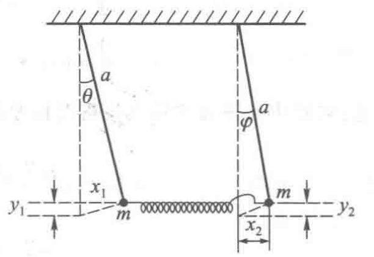

耦合摆的势能等于弹簧的弹性势能与摆锤重力势能两者之和，即

$$
V=\frac{1}{2}k(x_1-x_2)^2+mgy_1+mgy_2\qquad (1)
$$

而耦合摆的动能则为

$$
T=\frac{1}{2}m(\dot x_1^2+\dot y_1^2)+\frac{1}{2}m(\dot x_2^2+\dot y_2^2)\qquad (2)
$$

因为

$$
a-y_1=\sqrt{a^2-x_1^2}
$$

$$
a-y_2=\sqrt{a^2-x_2^2}
$$

$$
\dot y_1=\frac{x_1}{\sqrt{a^2-x_1^2}}\dot x_1
$$

$$
\dot y_2=\frac{x_2}{\sqrt{a^2-x_2^2}}\dot x_2
$$

故

$$
\left.\begin{aligned}
V&=\frac{k}{2}(x_1-x_2)^2+mg\left(a-\sqrt{a^2-x_1^2}\right)+mg\left(a-\sqrt{a^2-x_2^2}\right)\\
T&=\frac{1}{2}m\left(1+\frac{x_1^2}{a^2-x_1^2}\right)\dot x_1^2+\frac{1}{2}m\left(1+\frac{x_2^2}{a^2-x_2^2}\right)\dot x_2^2
\end{aligned}\right\}\qquad (3)
$$

根据式（5.4.2）及式（5.4.3），为了算出在平衡位置附近的势能$V$及动能$T$，先算出按泰勒级数展开后的低次项系数$c_{\alpha\beta}$与$a_{\alpha\beta}$，即

$$
c_{11}=\left(\frac{\partial^2 V}{\partial x_1^2}\right)_{x_1=0}=\left[k+\frac{mgx_1^2}{(a^2-x_1^2)^{3/2}}+\frac{mg}{(a^2-x_1^2)^{1/2}}\right]_{x_1=0}=k+\frac{mg}{a}
$$

$$
c_{12}=c_{21}=\left(\frac{\partial^2 V}{\partial x_1\partial x_2}\right)_{x_1=x_2=0}=-k
$$

$$
c_{22}=\left(\frac{\partial^2 V}{\partial x_2^2}\right)_{x_2=0}=\left[k+\frac{mgx_2^2}{(a^2-x_2^2)^{3/2}}+\frac{mg}{(a^2-x_2^2)^{1/2}}\right]_{x_2=0}=k+\frac{mg}{a}
$$

又

$$
(a_{11})_0=m,\quad (a_{22})_0=m
$$

故在平衡位置附近，$V$与$T$简化为

$$
\left.\begin{aligned}
V&=\frac{1}{2}kx_1^2+\frac{1}{2}\frac{mg}{a}x_1^2-kx_1x_2+\frac{1}{2}kx_2^2+\frac{1}{2}\frac{mg}{a}x_2^2\\
&=\frac{k}{2}(x_1-x_2)^2+\frac{1}{2}\frac{mg}{a}x_1^2+\frac{1}{2}\frac{mg}{a}x_2^2\\
T&=\frac{1}{2}m(\dot x_1^2+\dot x_2^2)
\end{aligned}\right\}\qquad (4)
$$

把（4）式中的$V$及$T$代入拉格朗日方程（5.3.16）中，得耦合摆的动力学方程为

$$
\left.\begin{aligned}
m\ddot x_1&=-k(x_1-x_2)-\frac{mg}{a}x_1\\
m\ddot x_2&=k(x_1-x_2)-\frac{mg}{a}x_2
\end{aligned}\right\}\qquad (5)
$$

这是二阶常系数线性齐次方程组，具有

$$
x_1=A_1e^{\lambda t},\quad x_2=A_2e^{\lambda t}
$$

形式的解．代入（5）式，得

$$
\left.\begin{aligned}
A_1\left(m\lambda^2+\frac{mg}{a}+k\right)-A_2k&=0\\
-A_1k+A_2\left(m\lambda^2+\frac{mg}{a}+k\right)&=0
\end{aligned}\right\}\qquad (6)
$$

此方程组非零解的充要条件是

$$
\begin{vmatrix}
m\lambda^2+\frac{mg}{a}+k&-k\\
-k&m\lambda^2+\frac{mg}{a}+k
\end{vmatrix}=0\qquad (7)
$$

由此得四个本征值如下：

$$
\lambda_1=\pm \mathrm{i}\sqrt{\frac{g}{a}}=\pm \mathrm{i}\nu_1,\quad \lambda_2=\pm \mathrm{i}\sqrt{\frac{g}{a}+\frac{2k}{m}}=\pm \mathrm{i}\nu_2\qquad (8)
$$

而（5）式的通解则为

$$
\left.\begin{aligned}
x_1&=A_1^{(1)}e^{\mathrm{i}\nu_1 t}+A_1^{(-1)}e^{-\mathrm{i}\nu_1 t}+A_1^{(2)}e^{\mathrm{i}\nu_2 t}+A_1^{(-2)}e^{-\mathrm{i}\nu_2 t}\\
x_2&=A_2^{(1)}e^{\mathrm{i}\nu_1 t}+A_2^{(-1)}e^{-\mathrm{i}\nu_1 t}+A_2^{(2)}e^{\mathrm{i}\nu_2 t}+A_2^{(-2)}e^{-\mathrm{i}\nu_2 t}
\end{aligned}\right\}\qquad (9)
$$

乍一看来，（9）式里好像有$2s^2=2\cdot 2^2=8$个（$s=$自由度）任意常数，其实只有$2s$个（4个）是独立的．因为如果以$\lambda=\lambda_1$代入（7）式中，依次求出（7）式中削去第1行及第$\beta$列后的代数余子式$\Delta_{1\beta}$，则有

$$
\Delta_{11}=k,\quad \Delta_{12}=k
$$

故可令

$$
A_1^{(1)}=A_2^{(1)}=A^{(1)},\quad A_1^{(-1)}=A_2^{(-1)}=A^{(-1)}\qquad (10)
$$

同理，如果以$\lambda=\lambda_2$代入（7）式中，则有

$$
\Delta_{11}=-k,\quad \Delta_{12}=k
$$

故可令

$$
A_1^{(2)}=-A_2^{(2)}=A^{(2)},\quad A_1^{(-2)}=-A_2^{(-2)}=A^{(-2)}\qquad (11)
$$

这样，（9）式变为

$$
\left.\begin{aligned}
x_1&=A^{(1)}e^{\mathrm{i}\nu_1 t}+A^{(-1)}e^{-\mathrm{i}\nu_1 t}+A^{(2)}e^{\mathrm{i}\nu_2 t}+A^{(-2)}e^{-\mathrm{i}\nu_2 t}\\
x_2&=A^{(1)}e^{\mathrm{i}\nu_1 t}+A^{(-1)}e^{-\mathrm{i}\nu_1 t}-A^{(2)}e^{\mathrm{i}\nu_2 t}-A^{(-2)}e^{-\mathrm{i}\nu_2 t}
\end{aligned}\right\}\qquad (12)
$$

式中四个任意常数$A^{(1)}$、$A^{(-1)}$、$A^{(2)}$及$A^{(-2)}$由起始条件确定，即由$t=0$时$x_1$、$x_2$、$\dot x_1$及$\dot x_2$之值确定．

由（12）式可以看出，如果令$\xi_1=\frac{1}{\sqrt{2}}(x_1+x_2)$，$\xi_2=\frac{1}{\sqrt{2}}(x_1-x_2)$，则$\xi_1$、$\xi_2$将以单一的频率$\nu_1$或$\nu_2$振动．因此，$\xi_1$、$\xi_2$就是本问题的简正坐标．用一般的线性变换，亦可得出同样结果，但计算较繁，读者可自行加以验证．

如果$\xi_2=0$，则$x_1=x_2$，故$\xi_1$代表两摆按同一步调振动，这时两摆中间的弹簧既不伸长也不缩短，根本失去作用．反之，如$\xi_1=0$，则$x_1=-x_2$，两摆振动的位相恰好相反，弹簧两端以同等程度伸长或缩短．

## §5.5 哈密顿正则方程

### （1）勒让德变换

在 §5.3 中，我们已经指出，拉氏函数$L$是$q_\alpha$，$\dot q_\alpha$（$\alpha=1,2,\cdots,s$）及$t$的函数，并可由此得出拉格朗日方程式（5.3.18）．但拉格朗日方程是二阶常微分方程组．如果我们把$L$中的广义速度$\dot q_\alpha$等换成广义动量$p_\alpha$等就可使方程组降阶，即由二阶变为一阶，而且还可具有其他的一些优点．我们现在就来进行这种变换．

在（5.3.18）中，如果令

$$
p_\alpha=\frac{\partial L}{\partial \dot q_\alpha}=\frac{\partial T}{\partial \dot q_\alpha}\qquad (\alpha=1,2,\cdots,s)\qquad (5.5.1)
$$

作为独立变量，则由式（5.3.18），可得

$$
\dot p_\alpha=\frac{\partial L}{\partial q_\alpha}\qquad (\alpha=1,2,\cdots,s)\qquad (5.5.2)
$$

而由式（5.5.1），又可解出$\dot q_\alpha$，使$\dot q_\alpha$是$p_\beta$，$q_\beta$（$\beta=1,2,\cdots,s$）及$t$的函数，即

$$
\dot q_\alpha=\dot q_\alpha(p_1,p_2,\cdots,p_s;q_1,q_2,\cdots,q_s;t)\qquad (5.5.3)
$$

这是因为$L$原是$q_\alpha$，$\dot q_\alpha$，$t$的函数，而$\frac{\partial L}{\partial \dot q_\alpha}$也仍然是$q_\alpha$，$\dot q_\alpha$，$t$的函数．

如果把式（5.5.3）中的$\dot q_\alpha$代入拉氏函数$L$中，则$L$也将变为$p,q,t$的函数，兹以$\overline{L}$表之，即

$$
\overline{L}=\overline{L}(p_1,p_2,\cdots,p_s;q_1,q_2,\cdots,q_s;t)\qquad (5.5.4)
$$

这时方程式（5.5.2）及（5.5.3）一共是$2s$个一阶微分方程组，是拉格朗日方程式（5.3.18）的另一表达形式．但这两组方程形式并不对称，计算也不方便．进一步的研究表明，当独立变量改变时，函数本身随之改变为另一种形式的函数才好计算．在今后的热力学及其他学科中，还要经常碰到这种情况．这种由一组独立变数变为另一组独立变数的变换，在数学上叫做勒让德变换．

先考虑两个变量的勒让德变换．设$f=f(x,y)$，则

$$
\mathrm{d}f=u\mathrm{d}x+v\mathrm{d}y
$$

式中

$$
u=\frac{\partial f}{\partial x},\quad v=\frac{\partial f}{\partial y}\qquad (5.5.5)
$$

我们在这里是用$x,y$作为独立变量的．实际上，根据问题的需要，$x,y,u,v$中任何两个都可作为独立变量看待．如果我们把$u,y$当作独立变量，则由式（5.5.5），可得

$$
x=x(u,y),\quad v=v(u,y)\qquad (5.5.6)
$$

这时函数$f$亦可改用$u,y$表出，记为$\bar f(u,y)$，即

$$
\bar f(u,y)=f[x(u,y),y]\qquad (5.5.7)
$$

而

$$
\left.\begin{aligned}
\frac{\partial \bar f}{\partial y}&=\frac{\partial f}{\partial y}+\frac{\partial f}{\partial x}\frac{\partial x}{\partial y}=v+u\frac{\partial x}{\partial y}\\
\frac{\partial \bar f}{\partial u}&=\frac{\partial f}{\partial x}\frac{\partial x}{\partial u}=u\frac{\partial x}{\partial u}
\end{aligned}\right\}\qquad (5.5.8)
$$

我们也可把式（5.5.8）写成（注意下面求偏导时把$u,y$看成自变量）：

$$
\left.\begin{aligned}
v&=-\frac{\partial}{\partial y}(-\bar f+ux)=-\frac{\partial g}{\partial y}\\
x&=\frac{\partial}{\partial u}(-\bar f+ux)=\frac{\partial g}{\partial u}
\end{aligned}\right\}\qquad (5.5.9)
$$

式中$g(u,y)=-\bar f+ux=\left(-f+\frac{\partial f}{\partial x}x\right)_{x=x(u,y)}$．由此可见，当独立变量由$x,y$变为$u,y$时，如果仍用函数$\bar f$，则$x,v$不能像式（5.5.5）那样直接用$\bar f$对$u$及$\bar f$对$y$的偏微商表出，而应换成函数$g$，这时$x,v$才可用$g$对$u$及$g$对$y$的偏微商表出，这就是勒让德变换的基本法则，它可以从两个变量推广到多个变量．新的函数（如$g$或$H$）等于不要的变量（例如$x$或$\dot q_\alpha$）乘以原来的函数对该变量的偏微商（例如$u=\frac{\partial f}{\partial x}$或$p_\alpha=\frac{\partial L}{\partial \dot q_\alpha}$）再减去原来的函数（例如$f$或$L$）．

### （2）正则方程

现在回到我们原来所讨论的问题上来．如果通过勒让德变换，要使拉氏函数$L$中的一种独立变量由$\dot q_\alpha$（$\alpha=1,2,\cdots,s$）变为$p_\alpha$（$\alpha=1,2,\cdots,s$），其中$p_\alpha=\frac{\partial T}{\partial \dot q_\alpha}=\frac{\partial L}{\partial \dot q_\alpha}$，则应引入新函数$H$，使

$$
\boxed{H(p,q,t)=-L+\sum_{\alpha=1}^{s}p_\alpha\dot q_\alpha}\qquad (5.5.10)
$$

而

$$
\mathrm{d}H=-\mathrm{d}L+\sum_{\alpha=1}^{s}(p_\alpha\mathrm{d}\dot q_\alpha+\dot q_\alpha\mathrm{d}p_\alpha)\qquad (5.5.11)
$$

因为我们现在仍把$L$认为是$q,\dot q$及$t$的函数，故根据高等数学中多元函数求微分的法则，有

$$
\mathrm{d}L=\sum_{\alpha=1}^{s}\left(\frac{\partial L}{\partial q_\alpha}\mathrm{d}q_\alpha+\frac{\partial L}{\partial \dot q_\alpha}\mathrm{d}\dot q_\alpha\right)+\frac{\partial L}{\partial t}\mathrm{d}t
$$

$$
=\sum_{\alpha=1}^{s}(\dot p_\alpha\mathrm{d}q_\alpha+p_\alpha\mathrm{d}\dot q_\alpha)+\frac{\partial L}{\partial t}\mathrm{d}t\qquad (5.5.12)
$$

这里利用了（5.5.1）及（5.5.2）两式．把式（5.5.12）中的$\mathrm{d}L$代入式（5.5.11）中，得

$$
\mathrm{d}H=\sum_{\alpha=1}^{s}(-\dot p_\alpha\mathrm{d}q_\alpha+\dot q_\alpha\mathrm{d}p_\alpha)-\frac{\partial L}{\partial t}\mathrm{d}t\qquad (5.5.13)
$$

因为经过变换后，$H$已是$p,q,t$的函数，故根据上面所讲的同样理由，知

$$
\mathrm{d}H=\sum_{\alpha=1}^{s}\left(\frac{\partial H}{\partial q_\alpha}\mathrm{d}q_\alpha+\frac{\partial H}{\partial p_\alpha}\mathrm{d}p_\alpha\right)+\frac{\partial H}{\partial t}\mathrm{d}t\qquad (5.5.14)
$$

比较（5.5.13）及（5.5.14）两式，并因为$\mathrm{d}p_\alpha$、$\mathrm{d}q_\alpha$及$\mathrm{d}t$都是独立的，故得

$$
\boxed{\begin{gathered}
\dot q_\alpha=\frac{\partial H}{\partial p_\alpha}\qquad (\alpha=1,2,\cdots,s)\\
\dot p_\alpha=-\frac{\partial H}{\partial q_\alpha}
\end{gathered}}\qquad (5.5.15)
$$

又

$$
\frac{\partial H}{\partial t}=-\frac{\partial L}{\partial t}\qquad (5.5.16)
$$

方程式（5.5.15）通常叫做哈密顿正则方程，简称正则方程，而式（5.5.10）所定义的函数$H$，则叫哈密顿函数，它是$2s+1$个变量即$p_\alpha$，$q_\alpha$（$\alpha=1,2,\cdots,s$）及$t$的函数．哈密顿正则方程是包含有$2s$个一阶常微分方程的方程组，它们的形式简单而对称，故称为正则方程．在理论物理学中，以$p,q$作为独立变量比用$q$及$\dot q$作独立变量要广泛和方便得多，广义动量$p_\alpha$（动量或动量矩）在物理学中也比广义速度$\dot q_\alpha$要重要得多，这些在统计物理及量子力学中常常用到．由经典物理学过渡到近代物理学，正则方程也常被认为是最方便的形式．我们通常把$p_\alpha$、$q_\alpha$（$\alpha=1,2,\cdots,s$）叫做正则变量，并用它们代表由广义坐标和广义动量所组成的$2s$维相宇（或相空间）中的一个相点．

### （3）能量积分与循环积分

在一定条件下，哈密顿正则方程也跟拉格朗日方程一样，可以给出能量积分与循环积分，现在先讲能量积分．我们知道，哈密顿函数$H$中的宗量$p_\alpha$，$q_\alpha$（$\alpha=1,2,\cdots,s$）都是时间$t$的函数，故求$H$对时间$t$的微商时，应按照高等数学中复合函数求微商的法则来进行，即

$$
\frac{\mathrm{d}H}{\mathrm{d}t}=\sum_{\alpha=1}^{s}\left(\frac{\partial H}{\partial q_\alpha}\dot q_\alpha+\frac{\partial H}{\partial p_\alpha}\dot p_\alpha\right)+\frac{\partial H}{\partial t}\qquad (5.5.17)
$$

把式（5.5.15）的关系代入式（5.5.17）中，得

$$
\frac{\mathrm{d}H}{\mathrm{d}t}=\sum_{\alpha=1}^{s}\left(\frac{\partial H}{\partial q_\alpha}\frac{\partial H}{\partial p_\alpha}-\frac{\partial H}{\partial p_\alpha}\frac{\partial H}{\partial q_\alpha}\right)+\frac{\partial H}{\partial t}=\frac{\partial H}{\partial t}\qquad (5.5.18)
$$

故如函数$H$中不显含$t$，则因$\frac{\partial H}{\partial t}=0$，故$\frac{\mathrm{d}H}{\mathrm{d}t}$也等于零，因而正则方程有一积分

$$
H=h\qquad (5.5.19)
$$

此处$h$是一积分常数．如为稳定约束，可将动能$T$表示为广义速度的二次齐次函数，则由本节中的式（5.5.10）及 §5.3 中的式（5.3.23），得

$$
\begin{aligned}
H&=-L+\sum_{\alpha=1}^{s}p_\alpha\dot q_\alpha=-(T-V)+\sum_{\alpha=1}^{s}\frac{\partial T}{\partial \dot q_\alpha}\dot q_\alpha\\
&=-(T-V)+2T=T+V
\end{aligned}\qquad (5.5.20)
$$

可见式（5.5.19）代表能量积分，在稳定约束时$H$就等于力学体系的总能量$E$．如果动能$T$不是广义速度的二次齐次函数，即体系所受的约束是不稳定约束，则式（5.5.19）将代表广义能量积分，与 §5.3 中式（5.3.27）所讨论过的情形相同．因此，哈密顿函数也是力学体系的特性函数．如为稳定约束，它就是力学体系的动能和势能之和；如为不稳定约束，则它等于$T_2-T_0+V$．

从上面的计算可以看出：由正则方程得出能量积分，比由拉格朗日方程得出的要简便得多．由于正则方程是$p,q$的一阶常微分方程，故这积分也就是正则方程的一个积分．

现在再来讲循环积分．由式（5.5.15）可以看出，哈密顿函数$H$中如果有循环坐标，则也可立即得出积分，这些积分叫做循环积分．和 §5.3 中所讲的情况是一样的．可以看出，不含某个广义坐标$q_i$时，对应的广义动量$p_i$即为常数．因$H$为$p,q,t$的函数，故比用拉氏方程更为简便，更富有物理意义，这显然是一个很大的优点．由于哈密顿正则方程具有上述的这些优点，所以发展了很多求解正则方程的方法，我们将在 §5.6、§5.8 及 §5.9 中扼要介绍其中最主要的几种．

［例］　电子的运动　设电荷为$-e$的电子，在电荷为$Ze$的核力场中运动，$Z$为原子序数，试用正则方程研究电子的运动．

［解］　在本问题中，我们采用球面坐标$r,\theta,\varphi$为广义坐标，如图5.5.1所示，并设电子的质量为$m$．

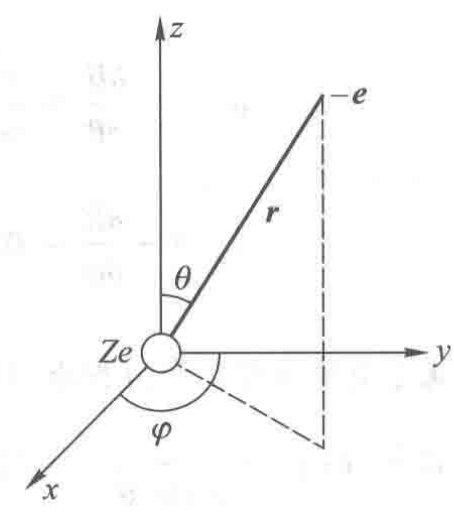

根据式（5.3.33），我们知道，在球面坐标系中，质点速度的平方为

$$
v^2=\dot s^2=\dot r^2+r^2\dot\theta^2+r^2\sin^2\theta\,\dot\varphi^2\qquad (1)
$$

故质量为$m$的电子在核力场中以速度$v$运动时，它的动能$T$为

$$
T=\frac{1}{2}mv^2=\frac{1}{2}m(\dot r^2+r^2\dot\theta^2+r^2\sin^2\theta\,\dot\varphi^2)\qquad (2)
$$

因电荷间相互作用的库仑力是保守力，故势能$V$为

$$
V=-\frac{1}{4\pi\varepsilon_0}\frac{Ze^2}{r}=-\frac{\alpha}{r}\qquad (3)
$$

而拉格朗日函数$L$则为

$$
\begin{aligned}
L&=T-V\\
&=\frac{1}{2}m(\dot r^2+r^2\dot\theta^2+r^2\sin^2\theta\,\dot\varphi^2)+\frac{\alpha}{r}
\end{aligned}\qquad (4)
$$

现在来计算$p_\alpha$，并进而求哈密顿函数$H$：

$$
\left.\begin{aligned}
p_r&=\frac{\partial L}{\partial \dot r}=m\dot r\\
p_\theta&=\frac{\partial L}{\partial \dot\theta}=mr^2\dot\theta\\
p_\varphi&=\frac{\partial L}{\partial \dot\varphi}=mr^2\sin^2\theta\,\dot\varphi
\end{aligned}\right\}\qquad (5)
$$

$$
\begin{aligned}
H&=-L+p_r\dot r+p_\theta\dot\theta+p_\varphi\dot\varphi\\
&=\frac{1}{2}m(\dot r^2+r^2\dot\theta^2+r^2\sin^2\theta\,\dot\varphi^2)-\frac{\alpha}{r}\\
&=\frac{1}{2m}\left(p_r^2+\frac{p_\theta^2}{r^2}+\frac{p_\varphi^2}{r^2\sin^2\theta}\right)-\frac{\alpha}{r}
\end{aligned}\qquad (6)
$$

把$H$的表示式代入正则方程式（5.5.15）中，得

$$
\left.\begin{aligned}
\dot p_r&=-\frac{\partial H}{\partial r}=\frac{p_\theta^2}{mr^3}+\frac{p_\varphi^2}{mr^3\sin^2\theta}-\frac{\alpha}{r^2},&\dot r&=\frac{\partial H}{\partial p_r}=\frac{p_r}{m}\\
\dot p_\theta&=-\frac{\partial H}{\partial \theta}=\frac{p_\varphi^2\cos\theta}{mr^2\sin^3\theta},&\dot\theta&=\frac{\partial H}{\partial p_\theta}=\frac{p_\theta}{mr^2}\\
\dot p_\varphi&=-\frac{\partial H}{\partial \varphi}=0,&\dot\varphi&=\frac{\partial H}{\partial p_\varphi}=\frac{p_\varphi}{mr^2\sin^2\theta}
\end{aligned}\right\}\qquad (7)
$$

这就是由哈密顿正则方程求出的电子在核力场中的运动方程．因$H$中不含$\varphi$，$\dot p_\varphi=0$，故$p_\varphi=c=$常数，而$\dot\varphi=\frac{c}{mr^2\sin^2\theta}$．由（7）式第一对方程及（5）式，可得

$$
m\ddot r-mr\dot\theta^2-\frac{c^2}{mr^3\sin^2\theta}+\frac{\alpha}{r^2}=0\qquad (8)
$$

由（7）式的第二对方程，得

$$
\frac{\mathrm{d}}{\mathrm{d}t}(mr^2\dot\theta)=\frac{c^2\cos\theta}{mr^2\sin^3\theta}\qquad (9)
$$

（8）式和（9）式都不含$\varphi$，故知电子是在一平面内运动，这正是我们所预期的，因电子所受的力是有心力．如果我们令此平面为$\varphi=0$的平面，则$\dot\varphi=0$，$c=0$，而电子在此平面内的运动方程变为

$$
\left.\begin{aligned}
m\ddot r-mr\dot\theta^2+\frac{\alpha}{r^2}&=0\\
\frac{\mathrm{d}}{\mathrm{d}t}(mr^2\dot\theta)&=0
\end{aligned}\right\}\qquad (10)
$$

这是我们很熟悉的结果，这里只是作为一个范例，说明用正则方程解题的一般步骤．当然，用正则方程来解这类简单问题，可能反而迂回，但在较复杂的问题中，却能显示出它的优越性．

## §5.6 泊松括号与泊松定理

### （1）泊松括号

在上节中，我们曾经提到，哈密顿正则方程具有许多优点，因此它在分析力学中就占有很重要的地位，并发展了一些不同的求解方法．本节所要介绍的泊松定理，就是其中之一．在推导泊松定理之前，让我们先介绍泊松括号的定义及其一些主要性质．因为它不但要在推证泊松定理的过程中要用到，而且也是理论物理学（例如量子力学）中经常碰到的一种符号．

假如函数$\varphi$是正则变量$p_\alpha$、$q_\alpha$（$\alpha=1,2,\cdots,s$）及时间$t$的函数，即

$$
\varphi=\varphi(p_1,p_2,\cdots,p_s;q_1,q_2,\cdots,q_s;t)\qquad (5.6.1)
$$

则因$p,q$又都是时间$t$的函数，故根据前述的复合函数求微商的法则，得$\varphi$对$t$的微商为

$$
\frac{\mathrm{d}\varphi}{\mathrm{d}t}=\frac{\partial \varphi}{\partial t}+\sum_{\alpha=1}^{s}\left(\frac{\partial \varphi}{\partial q_\alpha}\dot q_\alpha+\frac{\partial \varphi}{\partial p_\alpha}\dot p_\alpha\right)\qquad (5.6.2)
$$

我们已经知道$H$同样也是正则变量$p_\alpha$，$q_\alpha$（$\alpha=1,2,\cdots,s$）及时间$t$的函数，因此可以把 §5.5 中的式（5.5.15）的$\dot q_\alpha$和$\dot p_\alpha$代入，则$\frac{\mathrm{d}\varphi}{\mathrm{d}t}$可写为

$$
\frac{\mathrm{d}\varphi}{\mathrm{d}t}=\frac{\partial \varphi}{\partial t}+[\varphi,H]\qquad (5.6.3)
$$

此处的$[\varphi,H]$叫做泊松括号，它的定义是

$$
\boxed{[\varphi,H]=\sum_{\alpha=1}^{s}\left(\frac{\partial \varphi}{\partial q_\alpha}\frac{\partial H}{\partial p_\alpha}-\frac{\partial \varphi}{\partial p_\alpha}\frac{\partial H}{\partial q_\alpha}\right)}\qquad (5.6.4)
$$

所以也可以说，它是一种缩写的符号．

使用泊松括号时，要注意所有的$p,q$都是相互独立的，任意一个对另外一个的偏微商都等于零，例如

$$
\frac{\partial p_\alpha}{\partial q_\alpha}=0,\quad \frac{\partial p_\alpha}{\partial p_\beta}=0,\quad \frac{\partial q_\alpha}{\partial p_\alpha}=0,\quad \frac{\partial q_\alpha}{\partial q_\beta}=0
$$

而相同的$p,q$相互取偏微商则等于1，例如

$$
\frac{\partial p_\alpha}{\partial p_\alpha}=1,\quad \frac{\partial q_\alpha}{\partial q_\alpha}=1
$$

这样，正则方程也可用泊松括号表出，即

$$
\left.\begin{aligned}
\dot p_\alpha&=[p_\alpha,H]\\
\dot q_\alpha&=[q_\alpha,H]
\end{aligned}\right\}\qquad (\alpha=1,2,\cdots,s)\qquad (5.6.5)
$$

应当注意：当力学体系运动时，如由正则变量$p_\alpha$，$q_\alpha$（$\alpha=1,2,\cdots,s$）及时间$t$所组成的某一函数$\varphi$［即式（5.6.1）中的$\varphi$］保持为常数，则此函数就是正则方程的一个第一积分，$\varphi(p_\alpha,q_\alpha,t)=C$可以反映该体系的运动规律，所以也称之为运动积分，例如 §5.5 中的式（5.5.19）就是一个运动积分，如$\varphi=C$是运动积分，则由式（5.6.3），必有

$$
\frac{\partial \varphi}{\partial t}+[\varphi,H]=0\qquad (5.6.6)
$$

反之，如$\varphi$满足式（5.6.6），则$\varphi=C$（$C$为一常数）是正则方程的一个运动积分，因为对应于式（5.6.6）的常微分方程组是

$$
\begin{aligned}
\mathrm{d}t&=\frac{\mathrm{d}q_1}{\frac{\partial H}{\partial p_1}}=\frac{\mathrm{d}q_2}{\frac{\partial H}{\partial p_2}}=\cdots=\frac{\mathrm{d}q_s}{\frac{\partial H}{\partial p_s}}=\frac{\mathrm{d}p_1}{-\frac{\partial H}{\partial q_1}}=\frac{\mathrm{d}p_2}{-\frac{\partial H}{\partial q_2}}\\
&=\cdots=\frac{\mathrm{d}p_s}{-\frac{\partial H}{\partial q_s}}
\end{aligned}
$$

正好和正则方程式（5.5.15）相同①．

如另一函数$\psi$也是正则变量及时间的函数，则类似于式（5.6.4），泊松括号$[\varphi,\psi]$的定义是

$$
[\varphi,\psi]=\sum_{\alpha=1}^{s}\left(\frac{\partial \varphi}{\partial q_\alpha}\frac{\partial \psi}{\partial p_\alpha}-\frac{\partial \varphi}{\partial p_\alpha}\frac{\partial \psi}{\partial q_\alpha}\right)\qquad (5.6.7)
$$

泊松括号具有下列几种特性：

① $[c,\psi]=0$（$c$为常数）　　(5.6.8)

② $[\varphi,\psi]+[\psi,\varphi]=0$　　(5.6.9)

③ 如$\psi=\sum_{j=1}^{n}\psi_j$，则$[\varphi,\psi]=\sum_{j=1}^{n}[\varphi,\psi_j]$　　(5.6.10)

④ $[-\varphi,\psi]=-[\varphi,\psi]$　　(5.6.11)

⑤ $\frac{\partial}{\partial t}[\varphi,\psi]=\left[\frac{\partial \varphi}{\partial t},\psi\right]+\left[\varphi,\frac{\partial \psi}{\partial t}\right]$　　(5.6.12)

⑥ $[\theta,[\varphi,\psi]]+[\varphi,[\psi,\theta]]+[\psi,[\theta,\varphi]]=0$　　(5.6.13)

⑦ $[q_\alpha,p_\beta]=\delta_{\alpha\beta}=\begin{cases}1&(\alpha=\beta)\\0&(\alpha\neq\beta)\end{cases}$　　(5.6.14)

以上的一些性质，除式（5.6.13）外，都是显而易见的．方程（5.6.13）是双重的泊松括号，叫做泊松恒等式，也叫雅可比恒等式，式中$\theta$也是正则变量和时间的函数．直接计算双重泊松括号，可以证明（5.6.13）成立．读者如有兴趣，可自行验证．

### （2）泊松定理

利用泊松括号，我们可以从正则方程的两个积分，求出另外一个积分，因如

> ① 可参看高等数学中的一阶偏微分方程部分．

$$
\left.
\begin{aligned}
\varphi(p_1,p_2,\cdots,p_s;q_1,q_2,\cdots,q_s;t)=C_1\\
\psi(p_1,p_2,\cdots,p_s;q_1,q_2,\cdots,q_s;t)=C_2
\end{aligned}
\right\}
\qquad (5.6.15)
$$

是正则方程的两个积分，则类似于式（5.6.6），$\psi$也必满足下列关系：

$$
\frac{\partial\psi}{\partial t}+[\psi,H]=0
\qquad (5.6.16)
$$

用$H$代替泊松恒等式（5.6.13）中的$\theta$，则由（5.6.6）、（5.6.16）及（5.6.9）诸式，我们有

$$
[H,[\varphi,\psi]]-\left[\varphi,\frac{\partial\psi}{\partial t}\right]+\left[\psi,\frac{\partial\varphi}{\partial t}\right]=0
\qquad (5.6.17)
$$

再利用（5.6.9）、（5.6.12）及（5.6.3）等式的关系，最后得到

$$
\frac{\partial}{\partial t}[\varphi,\psi]+[[\varphi,\psi],H]=\frac{\mathrm{d}}{\mathrm{d}t}[\varphi,\psi]=0
\qquad (5.6.18)
$$

故

$$
[\varphi,\psi]=C_3
\qquad (5.6.19)
$$

也是正则方程的一个积分，式中$C_3$是另一个积分常数，这个关系，叫做**泊松定理**．

利用泊松定理，似乎只要知道正则方程的两个积分，就可以求出其余的积分，但实际上它常常只能给出原有积分的线性组合或者恒等式，不能提供新的积分，所以在求正则方程的积分时，并不能完全依靠它．

在$H$不是$t$的显函数的情形下，$H=h$是正则方程的一个积分，参看 §5.5．因此，如果知道正则方程的另一积分

$$
\varphi(p_1,p_2,\cdots,p_s;q_1,q_2,\cdots,q_s;t)=C_1
$$

那么根据泊松定理

$$
[\varphi,H]=C_1'
$$

也是正则方程的积分．但

$$
[\varphi,H]=-\frac{\partial\varphi}{\partial t}=C_1'
$$

故

$$
\frac{\partial\varphi}{\partial t}=C_2'
$$

也是正则方程的积分．依此类推下去，$\frac{\partial^2\varphi}{\partial t^2}=C_3'$，$\frac{\partial^3\varphi}{\partial t^3}=C_4'$等也都是正则方程的积分．但如$\varphi$不是时间$t$的显函数，则

$$
\frac{\partial\varphi}{\partial t}=0
$$

而$[\varphi,H]=0$变成一恒等式，不能提供任何新的积分．

泊松括号和量子力学有密切的关系．方程式（5.6.14）是和量子条件相合的．正则方程用泊松括号表出的形式，即式（5.6.5），在量子力学中也常用到．

［例］ 一组质点只在保守内力作用下运动．如$x,y$方向的两分动量矩为常数，则$z$方向的分动量矩也必定是一个常数，试用泊松定理加以证明．

［解］ 根据第二章 §2.3 中的公式，我们知道：

$$
\left.
\begin{aligned}
J_x&=\sum_{i=1}^n m_i(y_i\dot{z}_i-z_i\dot{y}_i)=\sum_{i=1}^n(y_ip_{iz}-z_ip_{iy})\\
J_y&=\sum_{i=1}^n m_i(z_i\dot{x}_i-x_i\dot{z}_i)=\sum_{i=1}^n(z_ip_{ix}-x_ip_{iz})\\
J_z&=\sum_{i=1}^n m_i(x_i\dot{y}_i-y_i\dot{x}_i)=\sum_{i=1}^n(x_ip_{iy}-y_ip_{ix})
\end{aligned}
\right\}
\qquad (1)
$$

式中$J_x,J_y,J_z$是动量矩$\boldsymbol{J}$在三坐标轴$x,y,z$上的分量，而$p_{ix},p_{iy},p_{iz}$则是动量$\boldsymbol{p}_i$的三个分量．由题给条件，知

$$
J_x=C_1,\quad J_y=C_2
\qquad (2)
$$

故根据泊松定理，应有

$$
[J_x,J_y]=C_3=\text{常数}
\qquad (3)
$$

现在来计算$J_x,J_y$所组成的泊松括号$[J_x,J_y]$的表示式，看看它和$J_z$有什么关系？

$$
\begin{aligned}
[J_x,J_y]&=\sum_{i=1}^n\left[\left(\frac{\partial J_x}{\partial x_i}\frac{\partial J_y}{\partial p_{ix}}-\frac{\partial J_x}{\partial p_{ix}}\frac{\partial J_y}{\partial x_i}\right)\right.\\
&\quad+\left(\frac{\partial J_x}{\partial y_i}\frac{\partial J_y}{\partial p_{iy}}-\frac{\partial J_x}{\partial p_{iy}}\frac{\partial J_y}{\partial y_i}\right)\\
&\quad+\left.\left(\frac{\partial J_x}{\partial z_i}\frac{\partial J_y}{\partial p_{iz}}-\frac{\partial J_x}{\partial p_{iz}}\frac{\partial J_y}{\partial z_i}\right)\right]\\
&=\sum_{i=1}^n(x_ip_{iy}-y_ip_{ix})=J_z
\end{aligned}
\qquad (4)
$$

这是因为$x_i,y_i,z_i,p_{ix},p_{iy}$和$p_{iz}$都是互相独立的变量，只有自己对自己的偏微商，如$\frac{\partial z_i}{\partial z_i}$才等于1，而任一变量对另一变量的偏微商均等于零．故$[J_x,J_y]$中的前两大项均为零，只剩下最后一个大项，而它恰等于$J_z$．这样，由（3）及（4）式，我们就证明了

$$
J_z=C_3=\text{常数}
\qquad (5)
$$

## §5.7 哈密顿原理

### （1）变分运算的几个法则

我们已经讲了分析力学中的拉格朗日方程和正则方程，现在让我们再来介绍一个要用到变分运算①的力学原理，叫做哈密顿原理，它也是分析力学中很重要的一个原理．

凡力学原理用到变分运算的，叫做**力学变分原理**．力学变分原理有微分形式，也有积分形式．虚功原理是力学变分原理的微分形式，而本节的哈密顿原理，则是力学变分原理的积分形式．

哈密顿原理中要用到变分运算，这里我们从介绍变分运算的几个法则入手．变分符号用$\delta$表示，在虚功原理中实际上曾经用过．有些变分运算法则和微分

> ① 变分问题即泛函的极值问题，关于变分运算可详细参阅：［苏］Л. э. 艾利斯哥尔兹．变分法．李世晋译．北京：人民教育出版社，1958．

相同，例如，假设有两个变量$A$和$B$，它们一般是$p,q,t$的函数，则

$$
\left.
\begin{aligned}
&\delta(A+B)=\delta A+\delta B\\
&\delta(AB)=A\delta B+B\delta A\\
&\delta\left(\frac{A}{B}\right)=\frac{B\delta A-A\delta B}{B^2}
\end{aligned}
\right\}
\qquad (5.7.1)
$$

为了看出变分和微分运算某些不同的地方，以及同时进行微分、微商和变分时的对易规则，我们来说明变分的概念．

假定$C$是$s$维空间的一条曲线，且为质点遵循运动定律运行时的轨道，即动力轨道或真实轨道．$C'$为邻近$C$的一条曲线，但不是质点的动力轨道，唯$C$及$C'$的两端点$P_1$和$P_2$相同（图5.7.1）．设一质点$M$沿曲线$C$运动，而想象另一质点$M'$沿曲线$C'$运动，它们同时自$P_1$出发，并同时到达$P_2$．

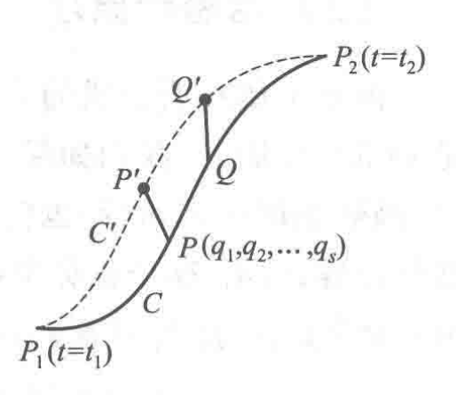

我们把相差甚微的轨道曲线$C$与$C'$［亦即相差甚微的函数$C(q_1,q_2,\cdots,q_s,t)$和$C'(q_1',q_2',\cdots,q_s',t)$］之间的差异称为**变分**，并用变分符号$\delta$来表示，以区别于表示在同一曲线轨道上由于自变数微小变化而引起的差异的微分符号$\mathrm{d}$．则在$P_1$及$P_2$点上，有

$$
\left.
\begin{aligned}
&\delta t=0\\
&\delta q_\alpha\big|_{P_1}=\delta q_\alpha\big|_{P_2}=0\quad(\alpha=1,2,\cdots,s)
\end{aligned}
\right\}
\qquad (5.7.2)
$$

另一方面，如果$P$及$P'$是$C$及$C'$上两对应点，即$M$和$M'$同时自$P_1$出发，分别沿着$C$及$C'$运动，当$M$到达$P$时，$M'$达到$P'$．$Q$是$P$点附近的一点，并且和$P$在同一轨道$C$上．如果$P$点的坐标为$q_\alpha(\alpha=1,2,\cdots,s)$，$P'$点的坐标为$q_\alpha+\delta q_\alpha(\alpha=1,2,\cdots,s)$，$Q$点的坐标则为$q_\alpha+\mathrm{d}q_\alpha(\alpha=1,2,\cdots,s)$．至于在$C'$上和$Q$对应的$Q'$点，则可从两方面来考虑：

（1）质点自$P$至$Q$然后到$Q'$；

（2）质点由$P$至$P'$然后至$Q'$．

因此，我们有

$$
q_\alpha+\mathrm{d}q_\alpha+\delta(q_\alpha+\mathrm{d}q_\alpha)=q_\alpha+\delta q_\alpha+\mathrm{d}(q_\alpha+\delta q_\alpha)
$$

即

$$
\delta(\mathrm{d}q_\alpha)=\mathrm{d}(\delta q_\alpha)
\qquad (5.7.3)
$$

可见$\mathrm{d}$与$\delta$的先后次序可以对易．

但

$$
\begin{aligned}
\delta\left(\frac{\mathrm{d}q_\alpha}{\mathrm{d}t}\right)&=\frac{\delta(\mathrm{d}q_\alpha)}{\mathrm{d}t}-\frac{\mathrm{d}q_\alpha\delta(\mathrm{d}t)}{\mathrm{d}t^2}\\
&=\frac{\mathrm{d}(\delta q_\alpha)}{\mathrm{d}t}-\frac{\mathrm{d}q_\alpha\mathrm{d}(\delta t)}{\mathrm{d}t^2}
\end{aligned}
\qquad (5.7.4)
$$

故应该注意$\delta$与$\frac{\mathrm{d}}{\mathrm{d}t}$的先后次序，一般来讲不能对易．若$\delta t=0$，则

$$
\delta\left(\frac{\mathrm{d}q_\alpha}{\mathrm{d}t}\right)=\frac{\mathrm{d}}{\mathrm{d}t}(\delta q_\alpha)
\qquad (5.7.5)
$$

可见在$\delta t=0$的假设下，$\delta$与$\frac{\mathrm{d}}{\mathrm{d}t}$的先后次序也是可以对易的，这种变分叫做**等时变分**．至于$\delta$与$\frac{\mathrm{d}}{\mathrm{d}t}$的先后次序不能对易的那种变分，则叫**不等时变分**或**全变分**．为了区别起见，有时用$\Delta$来代表不等时变分，这时式（5.7.4）应写为

$$
\Delta\left(\frac{\mathrm{d}q_\alpha}{\mathrm{d}t}\right)=\frac{\mathrm{d}}{\mathrm{d}t}(\Delta q_\alpha)-\frac{\mathrm{d}q_\alpha}{\mathrm{d}t}\frac{\mathrm{d}}{\mathrm{d}t}(\Delta t)
\qquad (5.7.6)
$$

知道了这些运算法则以后，我们就可以叙述并推证哈密顿原理了．

### （2）哈密顿原理

设$n$个质点所形成的力学体系受有$k$个几何约束，则这力学体系的自由度是$s=3n-k$．因此，我们如果能够做到把$s$个广义坐标$q_\alpha(\alpha=1,2,\cdots,s)$作为时间$t$的函数加以确定，我们也就确定了这力学体系的运动．因运动方程是$s$个二阶微分方程，故有$2s$个积分常数，兹以$c_1,c_2,\cdots,c_{2s}$表示．另一方面，我们也可以认为$s$个确定的$q_\alpha$代表着$s$维空间的一个点，而描写力学体系运动状态的积分

$$
q_\alpha=q_\alpha(t,c_1,c_2,\cdots,c_{2s})\quad(\alpha=1,2,\cdots,s)
\qquad (5.7.7)
$$

由于时间$t$的推移则在$s$维空间中描出一条曲线．

为了寻求力学体系的运动规律，哈密顿提出可以从具有相同端点、并为约束所许可的许多条可能的运动轨道即$s$维空间曲线中，挑出一条真实轨道．为此，可以采用变分法的方法来挑选这一条真实轨道．既然可以从许多约束所许可的轨道中，选出真实轨道，当然也就确定了力学体系沿着这条真实轨道运动时的运动规律．

我们现在用拉格朗日方程来推导在保守力系作用下的哈密顿原理．关于在任意力系作用下的哈密顿原理，由于用得不是太多，这里就从略了．

把拉格朗日方程（5.3.18）中的各项乘以$\delta q_\alpha$，对$\alpha$求和．然后沿着一条可能的运动轨道即$s$维空间一条曲线（如图 5.7.1）自两曲线共同端点$P_1(t=t_1)$至$P_2(t=t_2)$对$t$积分，则得

$$
\int_{t_1}^{t_2}\sum_{\alpha=1}^s\left\{\left[\frac{\mathrm{d}}{\mathrm{d}t}\left(\frac{\partial L}{\partial\dot{q}_\alpha}\right)-\frac{\partial L}{\partial q_\alpha}\right]\delta q_\alpha\right\}\mathrm{d}t=0
\qquad (5.7.8)
$$

但

$$
\begin{aligned}
\frac{\mathrm{d}}{\mathrm{d}t}\left(\frac{\partial L}{\partial\dot{q}_\alpha}\right)\delta q_\alpha&=\frac{\mathrm{d}}{\mathrm{d}t}\left(\frac{\partial L}{\partial\dot{q}_\alpha}\delta q_\alpha\right)-\frac{\partial L}{\partial\dot{q}_\alpha}\frac{\mathrm{d}}{\mathrm{d}t}(\delta q_\alpha)\\
&=\frac{\mathrm{d}}{\mathrm{d}t}\left(\frac{\partial L}{\partial\dot{q}_\alpha}\delta q_\alpha\right)-\frac{\partial L}{\partial\dot{q}_\alpha}\delta\dot{q}_\alpha
\end{aligned}
\qquad (5.7.9)
$$

因哈密顿用的是等时变分，故这里也用了式（5.7.5）的对易关系，把式（5.7.9）代入式（5.7.8），得

$$
\left.\sum_{\alpha=1}^s\frac{\partial L}{\partial\dot{q}_\alpha}\delta q_\alpha\right|_{t_1}^{t_2}-\int_{t_1}^{t_2}\sum_{\alpha=1}^s\left(\frac{\partial L}{\partial\dot{q}_\alpha}\delta\dot{q}_\alpha+\frac{\partial L}{\partial q_\alpha}\delta q_\alpha\right)\mathrm{d}t=0
\qquad (5.7.10)
$$

因$L=L(q_1,q_2,\cdots,q_s;\dot{q}_1,\dot{q}_2,\cdots,\dot{q}_s;t)$，而$\delta q_\alpha|_{t=t_1}=\delta q_\alpha|_{t=t_2}=0$，故式（5.7.10）简化为

$$
\int_{t_1}^{t_2}\delta L\mathrm{d}t=0
\qquad (5.7.11)
$$

又因$\delta t=0$，故式（5.7.11）中积分号内的$\delta$可移至积分号外，即

$$
\delta\int_{t_1}^{t_2}L\mathrm{d}t=0
\qquad (5.7.12)
$$

这就是在保守力系作用下的哈密顿原理的数学表达式．哈密顿称$\int_{t_1}^{t_2}L\mathrm{d}t$为**作用函数**，当它表示为端点时间和位置的函数时，也叫**主函数**，并以$S$表示．

我们已经讲过：描写力学体系运动状态的积分（5.7.7）是代表$s$维空间的一条曲线（图 5.7.1），时间$t$是此曲线的参数．假定此曲线$C$通过$s$维空间的两个定点$P_1$和$P_2$．若以式（5.7.7）代入拉氏函数$L$中，然后沿$C$自$P_1(t=t_1)$至$P_2(t=t_2)$对$t$积分，则积分有一确定的值$S$．如果我们沿着一条约束所许可的邻近轨道$C'$，将拉氏函数$L$对$t$积分，$C'$也通过$P_1$和$P_2$两点，而代表$C'$的参数方程是

$$
\left.
\begin{aligned}
&q_\alpha'=q_\alpha(t,c_1,c_2,\cdots,c_{2s})+\delta q_\alpha\\
&\delta q_\alpha\big|_{t=t_1}=\delta q_\alpha\big|_{t=t_2}=0
\end{aligned}
\right\}\quad(\alpha=1,2,\cdots,s)
\qquad (5.7.13)
$$

其中$\delta q_\alpha$是一组任意小的函数．这新积分的值将是

$$
S'=\int_{t_1}^{t_2}L(q_1',q_2',\cdots,q_s';\dot{q}_1',\dot{q}_2',\cdots,\dot{q}_s';t)\mathrm{d}t
\qquad (5.7.14)
$$

可见式（5.7.12）左端就是$\delta S$即$S'$与$S$的差，而哈密顿原理（5.7.12）式$\delta S=0$就表示$S$具有稳定值．因此哈密顿原理就是用变分法中求稳定值的办法来挑选真实轨道，并由此来确定力学体系的运动规律．哈密顿原理的文字表述如下：

保守的、完整的力学体系在相同时间内，由某一初位形转移到另一已知位形的一切可能运动中，真实运动的主函数具有稳定值，即对于真实运动来讲，主函数的变分等于零．

哈密顿原理是和牛顿运动定律等价的原理，并且常广泛地被人们用来推导其他原理、定律和方程．我们前面是用拉格朗日方程推出哈密顿原理的．如果反过来，当然也可以从哈密顿原理推出拉格朗日方程．此外，正则方程也可从哈密顿原理导出（参看下面的例题）．甚至牛顿运动定律也可认为是哈密顿原理的必然结果．

除了虚功原理与哈密顿原理外，力学中还有用到变分法的其他一些原理，例如最小作用量原理等．最小作用量原理用的是不等时变分，在历史上起过一定的作用，但计算较烦琐，现在已经用得多了．

［例］ 试由哈密顿原理导出正则方程．

［解］ 由式（5.5.10），知

$$
H=-L+\sum_{\alpha=1}^s p_\alpha\dot{q}_\alpha
$$

故

$$
L=\sum_{\alpha=1}^s p_\alpha\dot{q}_\alpha-H
\qquad (1)
$$

把（1）式中的$L$代入哈密顿原理式（5.7.12）中，得

$$
\delta\int_{t_1}^{t_2}\left(\sum_{\alpha=1}^s p_\alpha\dot{q}_\alpha-H\right)\mathrm{d}t=0
\qquad (2)
$$

因$H$是$p,q,t$的函数，故算出（2）式中的变分，并记住$\delta t=0$，就得到

$$
\int_{t_1}^{t_2}\sum_{\alpha=1}^s\left(p_\alpha\delta\dot{q}_\alpha+\dot{q}_\alpha\delta p_\alpha-\frac{\partial H}{\partial p_\alpha}\delta p_\alpha-\frac{\partial H}{\partial q_\alpha}\delta q_\alpha\right)\mathrm{d}t=0
\qquad (3)
$$

但

$$
\sum_{\alpha=1}^s(p_\alpha\delta\dot{q}_\alpha)=\sum_{\alpha=1}^s\left[p_\alpha\frac{\mathrm{d}}{\mathrm{d}t}(\delta q_\alpha)\right]=\frac{\mathrm{d}}{\mathrm{d}t}\left(\sum_{\alpha=1}^s p_\alpha\delta q_\alpha\right)-\sum_{\alpha=1}^s\dot{p}_\alpha\delta q_\alpha
\qquad (4)
$$

把（4）式代入（3）式，得

$$
\left.\sum_{\alpha=1}^s p_\alpha\delta q_\alpha\right|_{t_1}^{t_2}+\int_{t_1}^{t_2}\sum_{\alpha=1}^s\left[\left(\dot{q}_\alpha-\frac{\partial H}{\partial p_\alpha}\right)\delta p_\alpha-\left(\dot{p}_\alpha+\frac{\partial H}{\partial q_\alpha}\right)\delta q_\alpha\right]\mathrm{d}t=0
\qquad (5)
$$

因两端点相同，故

$$
\delta q_\alpha\big|_{t=t_1}=\delta q_\alpha\big|_{t=t_2}=0\quad(\alpha=1,2,\cdots,s)
$$

故（5）式中的第一项为零，而（5）式则简化为

$$
\int_{t_1}^{t_2}\sum_{\alpha=1}^s\left[\left(\dot{q}_\alpha-\frac{\partial H}{\partial p_\alpha}\right)\delta p_\alpha-\left(\dot{p}_\alpha+\frac{\partial H}{\partial q_\alpha}\right)\delta q_\alpha\right]\mathrm{d}t=0
\qquad (6)
$$

因$\delta p_\alpha$及$\delta q_\alpha(\alpha=1,2,\cdots,s)$在积分范围内是任意的，而且是相互独立的，故得

$$
\left.
\begin{aligned}
\dot{q}_\alpha&=\frac{\partial H}{\partial p_\alpha}\\
\dot{p}_\alpha&=-\frac{\partial H}{\partial q_\alpha}
\end{aligned}
\right\}\quad(\alpha=1,2,\cdots,s)
\qquad (7)
$$

这就是所要求的正则方程．

## §5.8 正则变换

### （1）正则变换的目的和条件

在 §5.5 中，我们已经指出，哈密顿函数是$p_\alpha,q_\alpha(\alpha=1,2,\cdots,s)$及$t$的函数，而哈密顿正则方程则是$2s$个一阶微分方程．如果$H$中不出现某个$q$，例如$q_i$，则这个不出现的$q_i$就是循环坐标，而我们也将由正则方程式（5.5.15）得出一个对应的积分．换句话说，如$H$中不出现$q_i$，则对应的$p_i$，就是常数，所以只要$H$中能多出现一些循环坐标，我们就能多得出一些积分，这当然是我们在求解正则方程时所希望的．

但是，力学体系的哈密顿函数$H$中，有没有循环坐标，与我们所选用的坐标系有关．在某种坐标系中没有循环坐标，在另一种坐标系中却可以有一个或几个循环坐标．有心力就是一个最明显的例子．在极坐标系中，如质点的质量是$m$，则动能$T=\frac{1}{2}m(\dot{r}^2+r^2\dot{\theta}^2)$．对平方反比引力问题来讲，势能$V=-\frac{k^2m}{r}$，故$H=T+V$(因动能是广义速度的二次齐次式)．很显然，这里极角$\theta$是一个循环坐标，故对应的广义动量的微分$\dot{p}_\theta=-\frac{\partial H}{\partial\theta}=0$，即

$$
p_\theta=\frac{\partial L}{\partial\dot{\theta}}=mr^2\dot{\theta}=\text{常数}
$$

即对应的广义动量是守恒的［参看 §5.3 及式（5.5.1）］．在这一节里，我们将介绍坐标和动量的变换，使新的哈密顿函数中能出现一些循环坐标．如果通过某种变数的变换，能够找到新的函数，设为$H^*$，使正则方程的形式不变，这种变换就叫**正则变换**．很显然，我们进行变数变换来获取循环坐标时，必须使这种变换是正则变换．否则，变换后的方程若不像式（5.5.15）那样简单，即使有循环坐标，也不一定能得出积分．

通过变数变换后，是要使原有的正则变量$p_\beta,q_\beta(\beta=1,2,\cdots,s)$变为新的正则变量$P_\alpha,Q_\alpha$．如果它们的变换关系是

$$
\left.
\begin{aligned}
&P_\alpha=P_\alpha(p_1,p_2,\cdots,p_s;q_1,q_2,\cdots,q_s;t)\\
&Q_\alpha=Q_\alpha(p_1,p_2,\cdots,p_s;q_1,q_2,\cdots,q_s;t)
\end{aligned}
\right\}\quad(\alpha=1,2,\cdots,s)
\qquad (5.8.1)
$$

则因为这$2s$个代数方程必须是互相独立的，故解上列诸方程，可得$p_\alpha$、$q_\alpha$为$P_\beta$、$Q_\beta(\beta=1,2,\cdots,s)$及时间$t$的函数．

设式（5.8.1）及哈密顿函数$H$中皆明显地含有$t$，则正则变换的条件是

$$
\sum_{\alpha=1}^s(p_\alpha\mathrm{d}q_\alpha-P_\alpha\mathrm{d}Q_\alpha)+(H^*-H)\mathrm{d}t=\mathrm{d}U
\qquad (5.8.2)
$$

式中$\mathrm{d}U$为一恰当微分，而$H^*$可称之为用新变量$P_\alpha,Q_\alpha$所表示的“哈密顿函数”，现在证明于下：

设我们使$p_\alpha,q_\alpha$有任意的变分$\delta p_\alpha,\delta q_\alpha(\alpha=1,2,\cdots,s)$．当正则变换满足（5.8.2）的条件时，因$\delta t=0$，故式（5.8.2）变为

$$
\sum_{\alpha=1}^s(p_\alpha\delta q_\alpha-P_\alpha\delta Q_\alpha)=\delta U
\qquad (5.8.3)
$$

在式（5.8.2）中取$U$对时间的微商得

$$
\sum_{\alpha=1}^s(p_\alpha\dot{q}_\alpha-P_\alpha\dot{Q}_\alpha)+(H^*-H)=\dot{U}
\qquad (5.8.4)
$$

根据 §5.7 的式（5.7.5），当$\delta t=0$时，算符$\delta$与$\frac{\mathrm{d}}{\mathrm{d}t}$的先后次序可以对易，即

$$
\left.
\begin{aligned}
&\frac{\mathrm{d}}{\mathrm{d}t}\delta q_\alpha=\delta\dot{q}_\alpha,\quad\frac{\mathrm{d}}{\mathrm{d}t}\delta Q_\alpha=\delta\dot{Q}_\alpha\quad(\alpha=1,2,\cdots,s)\\
&\frac{\mathrm{d}}{\mathrm{d}t}\delta U=\delta\dot{U}
\end{aligned}
\right\}
\qquad (5.8.5)
$$

于是由式（5.8.3）和式（5.8.4）分别取对时间微商和取变分后，得

$$
\begin{aligned}
&\delta\left(\sum_{\alpha=1}^s P_\alpha\dot{Q}_\alpha\right)-\frac{\mathrm{d}}{\mathrm{d}t}\left(\sum_{\alpha=1}^s P_\alpha\delta Q_\alpha\right)-\delta H^*\\
&\quad=\delta\left(\sum_{\alpha=1}^s p_\alpha\dot{q}_\alpha\right)-\frac{\mathrm{d}}{\mathrm{d}t}\left(\sum_{\alpha=1}^s p_\alpha\delta q_\alpha\right)-\delta H
\end{aligned}
\qquad (5.8.6)
$$

但由正则方程（5.5.15）及（5.8.5）等关系，知式（5.8.6）右端

$$
\begin{aligned}
&\sum_{\alpha=1}^s\left[\delta(p_\alpha\dot{q}_\alpha)-\frac{\mathrm{d}}{\mathrm{d}t}(p_\alpha\delta q_\alpha)\right]-\delta H=\sum_{\alpha=1}^s[\dot{q}_\alpha\delta p_\alpha-\dot{p}_\alpha\delta q_\alpha]-\delta H\\
&\quad=\sum_{\alpha=1}^s\left(\frac{\partial H}{\partial p_\alpha}\delta p_\alpha+\frac{\partial H}{\partial q_\alpha}\delta q_\alpha\right)-\delta H=\delta H-\delta H=0
\end{aligned}
\qquad (5.8.7)
$$

因此

$$
\delta H^*=\sum_{\alpha=1}^s\left(\frac{\partial H^*}{\partial P_\alpha}\delta P_\alpha+\frac{\partial H^*}{\partial Q_\alpha}\delta Q_\alpha\right)=\sum_{\alpha=1}^s(\dot{Q}_\alpha\delta P_\alpha-\dot{P}_\alpha\delta Q_\alpha)
$$

即

$$
\sum_{\alpha=1}^s\left[\left(\dot{Q}_\alpha-\frac{\partial H^*}{\partial P_\alpha}\right)\delta P_\alpha-\left(\dot{P}_\alpha+\frac{\partial H^*}{\partial Q_\alpha}\right)\delta Q_\alpha\right]=0
\qquad (5.8.8)
$$

因$\delta P_\alpha$和$\delta Q_\alpha$都是互相独立的，故由式（5.8.8），得

$$
\left.
\begin{aligned}
\dot{Q}_\alpha&=\frac{\partial H^*}{\partial P_\alpha}\\
\dot{P}_\alpha&=-\frac{\partial H^*}{\partial Q_\alpha}
\end{aligned}
\right\}\quad(\alpha=1,2,\cdots,s)
\qquad (5.8.9)
$$

即$H^*=H^*(P,Q,t)$所满足的方程不改变正则方程的形式．故由正则变量$p_\beta,q_\beta$变为$P_\alpha,Q_\alpha$时，如适合式（5.8.2）所给出的关系，则这种变换就是一个正则变换，而经过这种变换后，正则方程的形式不变．

回到式（5.8.2），我们知道$U$可写为$(q,Q,t)$的函数，即

$$
\begin{aligned}
&\sum_{\alpha=1}^s(p_\alpha\mathrm{d}q_\alpha-P_\alpha\mathrm{d}Q_\alpha)+(H^*-H)\mathrm{d}t=\mathrm{d}U(q,Q,t)\\
&\quad=\sum_{\alpha=1}^s\left(\frac{\partial U}{\partial q_\alpha}\mathrm{d}q_\alpha+\frac{\partial U}{\partial Q_\alpha}\mathrm{d}Q_\alpha\right)+\frac{\partial U}{\partial t}\mathrm{d}t
\end{aligned}
\qquad (5.8.10)
$$

由此得

$$
\left.
\begin{aligned}
&p_\alpha=\frac{\partial U}{\partial q_\alpha},\quad P_\alpha=-\frac{\partial U}{\partial Q_\alpha}\quad(\alpha=1,2,\cdots,s)\\
&H^*-H=\frac{\partial U}{\partial t}
\end{aligned}
\right\}
\qquad (5.8.11)
$$

从式（5.8.11）可以看出：正则变换有赖于函数$U(q,Q,t)$的选择，这个函数叫做**母函数**．故可设一母函数$U(q,Q,t)$，那么由式（5.8.11）的第一和第二两式，就可求出变换方程（5.8.1），而且这种变换一定是正则变换，可使正则方程的形式不变．至于$H^*$，则可由式（5.8.11）中第三式求出．

如果变换方程（5.8.1）及哈密顿函数$H$中皆不明显地含有$t$，则正则变换的条件式（5.8.2）简化为

$$
\sum_{\alpha=1}^s(p_\alpha\mathrm{d}q_\alpha-P_\alpha\mathrm{d}Q_\alpha)=\mathrm{d}U
\qquad (5.8.12)
$$

即适合这样关系的变换，不改变正则方程的形式．此时母函数$U$也将不是$t$的显函数，即$U=U(q,Q)$，故$\frac{\partial U}{\partial t}=0$，因而$H^*=H$．

### （2）几种不同形式的正则变换

由于母函数规定得不同，正则变换还可以有下列三种不同的形式，兹分述于下：

（a）在式（5.8.2）

$$
\sum_{\alpha=1}^s(p_\alpha\mathrm{d}q_\alpha-P_\alpha\mathrm{d}Q_\alpha)+(H^*-H)\mathrm{d}t=\mathrm{d}U
$$

中，变换$\sum_{\alpha=1}^s p_\alpha\mathrm{d}q_\alpha$项，即

$$
\sum_{\alpha=1}^s p_\alpha\mathrm{d}q_\alpha=\mathrm{d}\left(\sum_{\alpha=1}^s p_\alpha q_\alpha\right)-\sum_{\alpha=1}^s q_\alpha\mathrm{d}p_\alpha
$$

代入式（5.8.2）中，得

$$
\begin{aligned}
&\sum_{\alpha=1}^s(-q_\alpha\mathrm{d}p_\alpha-P_\alpha\mathrm{d}Q_\alpha)+(H^*-H)\mathrm{d}t\\
&\quad=\mathrm{d}\left[U(q,Q,t)-\sum_{\alpha=1}^s p_\alpha q_\alpha\right]\\
&\quad=\mathrm{d}U_1(p,Q,t)
\end{aligned}
\qquad (5.8.13)
$$

此时母函数$U_1$是$p,Q,t$的函数，且

$$
\left.
\begin{aligned}
&P_\alpha=-\frac{\partial U_1}{\partial Q_\alpha},\quad q_\alpha=-\frac{\partial U_1}{\partial p_\alpha}\quad(\alpha=1,2,\cdots,s)\\
&H^*-H=\frac{\partial U_1}{\partial t}
\end{aligned}
\right\}
\qquad (5.8.14)
$$

（b）如果在式（5.8.2）中变换$\sum_{\alpha=1}^s P_\alpha\mathrm{d}Q_\alpha$项，则用同样方法，可得

$$
\begin{aligned}
&\sum_{\alpha=1}^s(p_\alpha\mathrm{d}q_\alpha+Q_\alpha\mathrm{d}P_\alpha)+(H^*-H)\mathrm{d}t\\
&\quad=\mathrm{d}\left[U(q,Q,t)+\sum_{\alpha=1}^s P_\alpha Q_\alpha\right]\\
&\quad=\mathrm{d}U_2(q,P,t)
\end{aligned}
\qquad (5.8.15)
$$

且

$$
\left.
\begin{aligned}
&p_\alpha=\frac{\partial U_2}{\partial q_\alpha},\quad Q_\alpha=\frac{\partial U_2}{\partial P_\alpha}\quad(\alpha=1,2,\cdots,s)\\
&H^*-H=\frac{\partial U_2}{\partial t}
\end{aligned}
\right\}
\qquad (5.8.16)
$$

（c）如果在式（5.8.2）中同时变换$\sum_{\alpha=1}^s p_\alpha\mathrm{d}q_\alpha$和$\sum_{\alpha=1}^s P_\alpha\mathrm{d}Q_\alpha$两项，则得

$$
\begin{aligned}
&\sum_{\alpha=1}^s(Q_\alpha\mathrm{d}P_\alpha-q_\alpha\mathrm{d}p_\alpha)+(H^*-H)\mathrm{d}t\\
&\quad=\mathrm{d}\left[U(q,Q,t)+\sum_{\alpha=1}^s P_\alpha Q_\alpha-\sum_{\alpha=1}^s p_\alpha q_\alpha\right]\\
&\quad=\mathrm{d}U_3(P,p,t)
\end{aligned}
\qquad (5.8.17)
$$

且

$$
\left.
\begin{aligned}
&Q_\alpha=\frac{\partial U_3}{\partial P_\alpha},\quad q_\alpha=-\frac{\partial U_3}{\partial p_\alpha}\quad(\alpha=1,2,\cdots,s)\\
&H^*-H=\frac{\partial U_3}{\partial t}
\end{aligned}
\right\}
\qquad (5.8.18)
$$

实际上，这四种不同的变换，是由于母函数中的独立变量规定得不同所致．亦即后三种变换可以看做是从式（5.8.2）经过一个勒让德变换得出来的．因为在式（5.8.2）两侧同减去$\mathrm{d}\left(\sum_{\alpha=1}^s p_\alpha q_\alpha\right)$，即得式（5.8.13）．同理，如在式（5.8.2）两侧同加上$\mathrm{d}\left(\sum_{\alpha=1}^s P_\alpha Q_\alpha\right)$，即得式（5.8.15）．如在两侧同加上$\mathrm{d}\sum_{\alpha=1}^s(P_\alpha Q_\alpha-p_\alpha q_\alpha)$，即得式（5.8.17）．

### （3）正则变换的关键

假如经过变换后，新的哈密顿函数$H^*$只是变量$P_1,P_2,\cdots,P_s$及时间$t$的函数，即

$$
H^*=H^*(P_1,P_2,\cdots,P_s;t)
\qquad (5.8.19)
$$

则自式（5.8.9），知$\dot{P}_\alpha=0(\alpha=1,2,\cdots,s)$，因此得力学体系$s$个积分$P_\alpha=$常数$(\alpha=1,2,\cdots,s)$，而$Q_\alpha$亦可利用（5.8.9）中的另一组方程经过积分而求得，即

$$
Q_\alpha=\int\frac{\partial H^*}{\partial P_\alpha}\mathrm{d}t\quad(\alpha=1,2,\cdots,s)
$$

于是力学体系的运动问题就完全解决了．力学体系此时能否有$2s$个积分，全靠母函数$U$规定得如何而定．所以力学体系运动微分方程的积分，从正则变换的角度看来，就变为如何找合适的母函数$U$的问题了．如果母函数$U$规定得适当，使变换后能有很多循环坐标出现，问题即可大为简化．

［例］ 用正则变换法求平面谐振子的运动．

［解］ 以$x,y$代表谐振子的直角坐标，$p_x,p_y$为它们的动量，$\omega_1,\omega_2$为谐振子沿$Ox$轴及$Oy$轴的振动频率，$m$为振子的质量，于是此谐振子的哈密顿函数为

$$
H=T+V=\frac{1}{2m}(p_x^2+p_y^2)+\frac{1}{2}m(\omega_1^2x^2+\omega_2^2y^2)
\qquad (1)
$$

如规定本题的母函数$U$为

$$
U=\frac{1}{2}m(\omega_1x^2\cot Q_1+\omega_2y^2\cot Q_2)=U(q,Q)
\qquad (2)
$$

则由式（5.8.11），得

$$
\left.
\begin{aligned}
&p_x=\frac{\partial U}{\partial x}=m\omega_1x\cot Q_1,\quad p_y=\frac{\partial U}{\partial y}=m\omega_2y\cot Q_2\\
&P_1=-\frac{\partial U}{\partial Q_1}=\frac{1}{2}m\omega_1x^2\csc^2Q_1,\quad P_2=-\frac{\partial U}{\partial Q_2}=\frac{1}{2}m\omega_2y^2\csc^2Q_2
\end{aligned}
\right\}
\qquad (3)
$$

将（3）式中的$p_x$及$p_y$的表示式代入（1）式中，得

$$
\begin{aligned}
H&=\frac{1}{2}m(\omega_1^2x^2\cot^2Q_1+\omega_2^2y^2\cot^2Q_2)+\frac{1}{2}m(\omega_1^2x^2+\omega_2^2y^2)\\
&=\frac{1}{2}m\omega_1^2x^2(1+\cot^2Q_1)+\frac{1}{2}m\omega_2^2y^2(1+\cot^2Q_2)
\end{aligned}
\qquad (4)
$$

再利用（3）式中$P_1$及$P_2$的表达式，即可得出用新变量表示的哈密顿函数$H^*$为

$$
H^*=\omega_1P_1+\omega_2P_2
\qquad (5)
$$

而用新变量表示的谐振子的运动方程根据式（5.8.9）

$$
\left.
\begin{aligned}
&\dot{P}_1=0,\quad\dot{P}_2=0\\
&\dot{Q}_1=\omega_1,\quad\dot{Q}_2=\omega_2
\end{aligned}
\right\}
\qquad (6)
$$

积分，得

$$
\left.
\begin{aligned}
&P_1=C_1,\quad P_2=C_2\\
&Q_1=\omega_1t+\delta_1,\quad Q_2=\omega_2t+\delta_2
\end{aligned}
\right\}
\qquad (7)
$$

式中$C_1,C_2,\delta_1$及$\delta_2$是四个积分常数，由起始条件决定．

再回到原来的坐标上来，根据（3）式下面两式即得谐振子在$x,y$平面上的运动方程为

$$
\left.
\begin{aligned}
&x=\sqrt{\frac{2C_1}{m\omega_1}}\sin(\omega_1t+\delta_1)\\
&y=\sqrt{\frac{2C_2}{m\omega_2}}\sin(\omega_2t+\delta_2)
\end{aligned}
\right\}
\qquad (8)
$$

由此可以看出，本问题利用正则变换后之所以有解，在于（2）式中的母函数$U$规定得适当．在本问题中，用新变量表示的哈密顿函数$H^*$，只是变量$P_1,P_2$的函数，而变量$Q_1,Q_2$皆为循环坐标，但用旧变量表示的$H$，则没有循环坐标．故我们不能由（1）式直接解出（8）式，而要通过一个恰当的变换，这正是引入正则变换的目的（参看下节）．

## * §5.9 哈密顿-雅可比理论

### （1）哈密顿-雅可比偏微分方程

我们在上面已经讨论了利用泊松定理和正则变换两种求解正则方程的方法，它们在某些情况下，可以给出我们所需要的积分或运动积分，但也不总是很有效的．我们知道，利用正则变换，固然可以得出一些循环坐标，而使正则方程立即有解，但母函数的适当选择，却往往很困难．利用泊松定理，虽可由两个已知的运动积分，求出其余的运动积分，但又往往得出一些已知解的线性组合或者是恒等式，并未能提供新的积分．现在我们来介绍另一种特殊的正则变换，它往往使我们能彻底求解正则方程．

如果我们通过一个特殊的正则变换，使得用新变量$P_\alpha,Q_\alpha$表示的哈密顿函数$H^*=0$，则由式（5.8.9），可知新变量$P_\alpha,Q_\alpha(\alpha=1,2,\cdots,s)$这时全部变为常数$\alpha_i,\beta_i(i=1,2,\cdots,s)$，而如根据习惯，我们选用主函数$S$来作为式（5.8.15）中我们要寻找的母函数$U_2$，则由式（5.8.16）

中的第三式，得

$$
\frac{\partial S}{\partial t}+H(t;q_1,q_2,\cdots,q_s;p_1,p_2,\cdots,p_s)=0
\qquad (5.9.1)
$$

但由式（5.8.16）中的第一式，我们有

$$
p_\alpha=\frac{\partial S}{\partial q_\alpha}\quad(\alpha=1,2,\cdots,s)
\qquad (5.9.2)
$$

故如把式（5.9.1）中的$p_\alpha$全部代以它的等式$\frac{\partial S}{\partial q_\alpha}$，则式（5.9.1）变为

$$
\frac{\partial S}{\partial t}+H\left(t;q_1,q_2,\cdots,q_s;\frac{\partial S}{\partial q_1},\frac{\partial S}{\partial q_2},\cdots,\frac{\partial S}{\partial q_s}\right)=0
\qquad (5.9.3)
$$

这是一阶二次偏微分方程（因为$H$是$p_1,p_2,\cdots,p_s$的二次式），叫做**哈密顿-雅可比偏微分方程**，哈密顿的主函数$S$作为母函数正好满足这个偏微分方程．这个关系是哈密顿与雅可比分别用不同方法导出并给予解释的．式（5.9.3）有时也简称之为**哈-雅方程**．

哈密顿-雅可比偏微分方程是一阶偏微分方程，这里时间和坐标是独立变量，因此对$s$个自由度的力学体系而言，它的全解包含$s+1$个积分常数．但在现在式（5.9.3）的情况下，由于函数本身仅仅以自己的偏微商形式存在于方程中，$S$本身并不存在，因此$s+1$个常数中有一个应该以相加的形式出现，也就是说，从哈密顿-雅可比偏微分方程求出的运动积分应具有下列形式：

$$
S=S(t;q_1,q_2,\cdots,q_s;\alpha_1,\alpha_2,\cdots,\alpha_s)+C
\qquad (5.9.4)
$$

其中$\alpha_1,\alpha_2,\cdots,\alpha_s$，是任意常数，亦即新的广义动量，而$C$则为一可加常数．

哈-雅方程亦可按下法导出．如主函数（5.9.4）的具体形式已知，则求$S$对$t$的全微商，并利用式（5.9.2），得

$$
\frac{\mathrm{d}S}{\mathrm{d}t}=\frac{\partial S}{\partial t}+\sum_{\alpha=1}^s\frac{\partial S}{\partial q_\alpha}\dot{q}_\alpha=\frac{\partial S}{\partial t}+\sum_{\alpha=1}^s p_\alpha\dot{q}_\alpha
\qquad (5.9.5)
$$

式（5.7.12）下面的两行内容，知$\frac{\mathrm{d}S}{\mathrm{d}t}=L$，而由式（5.5.10）又知$H=-L+\sum_{\alpha=1}^s p_\alpha\dot{q}_\alpha$，把这些关系代入式（5.9.5），即可同样得出哈-雅方程（5.9.3）．

由此可见，如果主函数$S$已经求出，则主函数$S$必定满足哈-雅方程，这就是哈密顿当时推证时所用的方法．但实际上我们现在都是用雅可比的方法，即从哈-雅方程求出$S$，然后由式（5.9.2）求$p_\alpha(\alpha=1,2,\cdots,s)$，用

$$
\frac{\partial S}{\partial\alpha_i}=\beta_i\quad(i=1,2,\cdots,s)
\qquad (5.9.6)
$$

求$Q_\alpha(\alpha=1,2,\cdots,s)$，就可以得出正则方程的全部积分了．这样，正则方程的求解问题，就归结为如何从哈-雅方程求$S$的问题．式（5.9.6）实际上就是式（5.8.16）中的第二式，只是由于正则变换，现在是以$\alpha_i$代$P_\alpha$，以$\beta_i$代$Q_\alpha$．

如果一个力学体系的哈密顿函数$H$中不显含时间$t$，并且约束又是稳定的，则由式（5.5.20），知$H=E$，$E$是力学体系的总能量．如为不稳定的约束，则以$h$代$E$，$h$仍为一常数．由式（5.9.3），可知$\frac{\partial S}{\partial t}=-H$；在稳定约束情形下，$\frac{\partial S}{\partial t}=-E$．对$t$积分，并因式（5.9.3）是包含$s$个自变量$q$和变量$t$的偏微分方程，$t$仅仅是其中一个变量，故积分后，得

$$
S=-Et+W(q_1,q_2,\cdots,q_s,\alpha_2,\alpha_3,\cdots,\alpha_s,E)+C
\qquad (5.9.7)
$$

式中$\alpha_1$已用$E$代替，$\alpha_i$等的物理意义同前．$W$为一新函数，不包含$t$，常称为**哈密顿-雅可比**特性函数．根据式（5.9.7），有$\frac{\partial S}{\partial q_\alpha}=\frac{\partial W}{\partial q_\alpha}(\alpha=1,2,\cdots,s)$．这样，式（5.9.3）就变为

$$
H\left(q_1,q_2,\cdots,q_s;\frac{\partial W}{\partial q_1},\frac{\partial W}{\partial q_2},\cdots,\frac{\partial W}{\partial q_s}\right)=E①
\qquad (5.9.8)
$$

这样，正则方程的求解问题就又变为从偏微分方程（5.9.8）求$W$的问题．

### （2）分离变量法

在某些情况下，我们可用“分离变量法”来解式（5.9.8）．因如$W$(它往往和动能有关)和$V$(它和势能有关)都可分为$s$个$W_\alpha$及$V_\alpha$之和，而每一个$W_\alpha$和$V_\alpha$都只与一个坐标$q_\alpha$有关，则一阶二次偏微分方程式（5.9.8）可分为$s$个一阶二次常微分方程．即在此情形下，式（5.9.8）可写为

$$
\begin{aligned}
&\frac{1}{2}\left[A_1(q_1)\left(\frac{\mathrm{d}W_1}{\mathrm{d}q_1}\right)^2+A_2(q_2)\left(\frac{\mathrm{d}W_2}{\mathrm{d}q_2}\right)^2+\cdots+A_s(q_s)\left(\frac{\mathrm{d}W_s}{\mathrm{d}q_s}\right)^2\right]\\
&\qquad+V_1(q_1)+V_2(q_2)+\cdots+V_s(q_s)=E
\end{aligned}
\qquad (5.9.9)
$$

因此

$$
\left.
\begin{aligned}
&\frac{1}{2}A_\alpha(q_\alpha)\left(\frac{\mathrm{d}W_\alpha}{\mathrm{d}q_\alpha}\right)^2+V_\alpha(q_\alpha)=\alpha_\alpha\quad(\alpha=1,2,\cdots,s)\\
&\alpha_1+\alpha_2+\cdots+\alpha_s=E
\end{aligned}
\right\}
\qquad (5.9.10)
$$

如每一$W_\alpha$均已求出，则

$$
W=W_1+W_2+\cdots+W_s
\qquad (5.9.11)
$$

而由（5.9.2）及（5.9.6）两式，得

$$
\left.
\begin{aligned}
&\frac{\partial W}{\partial q_i}=\frac{\partial S}{\partial q_i}=p_i\quad(i=1,2,\cdots,s)\\
&\frac{\partial W}{\partial E}=t+\frac{\partial S}{\partial E}=t-t_0\\
&\frac{\partial W}{\partial\alpha_i}=\frac{\partial S}{\partial\alpha_i}=\beta_i\quad(i=1,2,\cdots,s)
\end{aligned}
\right\}
\qquad (5.9.12)
$$

上式中的第二式显含$t$，是运动积分，可用以求出运动规律；第三组$(s-1)$个方程称为几何积分，可用来确定轨道，而第一组$s$个方程则可用来确定广义动量$p_i$．由此可见，正则方程的优越性在于利用哈-雅方程后，所得的结果十分普遍，可同时得出运动规律、轨道及动量，这是拉格朗日方程所不及的．

在具体问题中，式（5.9.3）并不一定就能立即分成像式（5.9.10）那样很简易的形式．而是要采用逐步分离的办法来进行．我们现在就来介绍这种方法．

设在哈-雅方程中只有某一坐标$q_i$和它相对应的微商$\frac{\partial S}{\partial q_i}$以某种形式的组合$\varphi\left(q_i,\frac{\partial S}{\partial q_i}\right)$的形式出现，其他坐标(或时间)和它们的微商依旧，也就是说，方程（5.9.3）具有如下形式：

$$
\Phi\left[t;q_1,\cdots,q_{i-1},q_{i+1},\cdots,q_s;\frac{\partial S}{\partial t},\frac{\partial S}{\partial q_1},\cdots,\frac{\partial S}{\partial q_{i-1}},\frac{\partial S}{\partial q_{i+1}},\cdots,\frac{\partial S}{\partial q_s};\varphi\left(q_i,\frac{\partial S}{\partial q_i}\right)\right]=0
\qquad (5.9.13)
$$

在这种情况下，我们将寻找下列形式的解：

$$
S=S_i(q_i)+S'(t;q_1,\cdots,q_{i-1},q_{i+1},\cdots,q_s)
\qquad (5.9.14)
$$

> ① 如为不稳定约束，则只需以$h$代$E$即可，余不变．

把它代入式（5.9.13）中，便得到

$$
\Phi\left[t;q_1,\cdots,q_{i-1},q_{i+1},\cdots,q_s;\frac{\partial S'}{\partial t},\frac{\partial S'}{\partial q_1},\cdots,\frac{\partial S'}{\partial q_{i-1}},\frac{\partial S'}{\partial q_{i+1}},\cdots,\frac{\partial S'}{\partial q_s};\varphi\left(q_i,\frac{\partial S_i}{\partial q_i}\right)\right]=0
\qquad (5.9.15)
$$

如解式（5.9.14）为已知，则把它代入式（5.9.15）后，式（5.9.15）就变成恒等式，而这一恒等式在$q_i$为任何值时都是正确的．但当$q_i$变化时，只有函数$\varphi$可能变化．因此式（5.9.15）的恒等性，要求$\varphi$本身必须是个常数，故得

$$
\left.
\begin{aligned}
&\varphi\left(q_i,\frac{\partial S_i}{\partial q_i}\right)=\alpha_i\\
&\Phi\left(t;q_1,\cdots,q_{i-1},q_{i+1},\cdots,q_s;\frac{\partial S'}{\partial t},\frac{\partial S'}{\partial q_1},\cdots,\frac{\partial S'}{\partial q_{i-1}},\frac{\partial S'}{\partial q_{i+1}},\cdots,\frac{\partial S'}{\partial q_s};\alpha_i\right)=0
\end{aligned}
\right\}
\qquad (5.9.16)
$$

式中$\alpha_i$是常数．上面的第一个方程是常微分方程，函数$S_i(q_i)$可由它经过简单的积分求出．剩下的第二个方程，虽然还是偏微分方程，但其中独立变量的数目已经减少了一个．

如继续运用这种方法，能够分离出所有的坐标和时间，那么求哈密顿-雅可比偏微分方程的解就全部化为求积了．

循环坐标的情况，可以说是分离变量法的特殊情况．循环坐标$q_i$不显含在哈密顿函数$H$中，因而也就不显含在哈密顿-雅可比偏微分方程中，这时函数$\varphi\left(q_i,\frac{\partial S}{\partial q_i}\right)$变为只含$\frac{\partial S}{\partial q_i}$，而由（5.9.16）中的第一式，很容易得出$S_i=\alpha_i q_i$，于是

$$
S=\alpha_i q_i+S'(t;q_1,\cdots,q_{i-1},q_{i+1},\cdots,q_s)．
\qquad (5.9.17)
$$

由（5.9.12）中的第一式，知$\alpha_i=\frac{\partial S}{\partial q_i}=p_i$是和循环坐标$q_i$相对应的广义动量．对保守系来讲，把时间分离成$-Et$的形式，也是对“循环变量”$t$的分离方法．由此可见，哈密顿-雅可比理论是求正则方程普遍积分最有效的方法．

为了在哈密顿-雅可比方程中能够分离变量，适当地选择坐标系具有决定性的意义．现在举几个常用的坐标系，它们和质点在各种不同外场中的运动问题有关，因此具有明显的物理意义．

**1. 球坐标**

在 §5.5 中，我们已用了球坐标$(r,\theta,\varphi)$来研究电子的运动问题．动能$T$已用$p,q$表出，它是

$$
T=\frac{1}{2m}\left(p_r^2+\frac{p_\theta^2}{r^2}+\frac{p_\varphi^2}{r^2\sin^2\theta}\right)
$$

而在一般情况下，具有物理意义的势能可表为

$$
V=a(r)+\frac{b(\theta)}{r^2}
$$

在这种情况下，函数$W$的哈-雅方程是

$$
\frac{1}{2m}\left(\frac{\partial W}{\partial r}\right)^2+a(r)+\frac{1}{2mr^2}\left[\left(\frac{\partial W}{\partial\theta}\right)^2+2mb(\theta)\right]+\frac{1}{2mr^2\sin^2\theta}\left(\frac{\partial W}{\partial\varphi}\right)^2=E
\qquad (5.9.18)
$$

因为$\varphi$是循环坐标，故所求的解具有下列的形式：

$$
S=-Et+p_\varphi\varphi+W_1(r)+W_2(\theta)
$$

对于函数$W_1(r)$和$W_2(\theta)$，我们得到下列两个方程：

$$
\left.
\begin{aligned}
&\left(\frac{\mathrm{d}W_2}{\mathrm{d}\theta}\right)^2+2mb(\theta)+\frac{p_\varphi^2}{\sin^2\theta}=\alpha_2\\
&\frac{1}{2m}\left(\frac{\mathrm{d}W_1}{\mathrm{d}r}\right)^2+a(r)+\frac{\alpha_2}{2mr^2}=E
\end{aligned}
\right\}
\qquad (5.9.19)
$$

积分这两个方程，最后可得

$$
S=-Et+p_\varphi\varphi+\int\sqrt{\alpha_2-2mb(\theta)-\frac{p_\varphi^2}{\sin^2\theta}}\,\mathrm{d}\theta+\int\sqrt{2m[E-a(r)]-\frac{\alpha_2}{r^2}}\,\mathrm{d}r
\qquad (5.9.20)
$$

式中$p_\varphi,\alpha_2,E$是积分常数．利用式（5.9.12），我们就可以求出运动方程的普遍积分．

**2. 抛物线坐标**

从柱坐标$(r,\theta,z)$变换到抛物线坐标$(\xi,\eta,\theta)$，我们可根据下列公式

$$
z=\frac{1}{2}(\xi-\eta),\quad r=\sqrt{\xi\eta}
\qquad (5.9.21)
$$

来进行．坐标$\xi$和$\eta$可取0到$\infty$的一切值，而$\xi$和$\eta$等于常量的曲面是两族以$z$轴为对称轴的旋转抛物面．

在柱坐标中，质量为$m$的质点的拉格朗日函数$L$为

$$
L=\frac{1}{2}m(\dot{r}^2+r^2\dot{\theta}^2+\dot{z}^2)-V(r,\theta,z)
\qquad (5.9.22)
$$

从式（5.9.21）中求出$\dot{r}$、$\dot{z}$，然后连同$r,z$本身的表达式，代入式（5.9.22）中，就得到

$$
L=\frac{1}{8}m(\xi+\eta)\left(\frac{\dot{\xi}^2}{\xi}+\frac{\dot{\eta}^2}{\eta}\right)+\frac{1}{2}m\xi\eta\dot{\theta}^2-V(\xi,\eta,\theta)
\qquad (5.9.23)
$$

动量$p$为

$$
p_\xi=\frac{\partial L}{\partial\dot{\xi}}=\frac{1}{4}\frac{m}{\xi}(\xi+\eta)\dot{\xi},\quad p_\eta=\frac{\partial L}{\partial\dot{\eta}}=\frac{1}{4}\frac{m}{\eta}(\xi+\eta)\dot{\eta},
$$

$$
p_\theta=\frac{\partial L}{\partial\dot{\theta}}=m\xi\eta\dot{\theta}
$$

而哈密顿函数$H$则为

$$
H=T+V=\frac{2}{m}\frac{\xi p_\xi^2+\eta p_\eta^2}{\xi+\eta}+\frac{p_\theta^2}{2m\xi\eta}+V(\xi,\eta,\theta)
\qquad (5.9.24)
$$

在这种坐标系中，物理上有意义的分离变量的情况相应于下列形式的势能：

$$
V=\frac{a(\xi)+b(\eta)}{\xi+\eta}
\qquad (5.9.25)
$$

在这种情况下，函数$W$的哈-雅方程为

$$
\frac{2}{m(\xi+\eta)}\left[\xi\left(\frac{\partial W}{\partial\xi}\right)^2+\eta\left(\frac{\partial W}{\partial\eta}\right)^2\right]+\frac{1}{2m\xi\eta}\left(\frac{\partial W}{\partial\theta}\right)^2+\frac{a(\xi)+b(\eta)}{\xi+\eta}=E
\qquad (5.9.26)
$$

和以前一样，$\theta$是循环坐标，可以$p_\theta\theta$的形式分出，故所求的解具有下列的形式：

$$
S=-Et+p_\theta\theta+W_1(\xi)+W_2(\eta)．
$$

用$m(\xi+\eta)$乘式（5.9.26），则对函数$W_1(\xi)$和$W_2(\eta)$，我们有

$$
\left.
\begin{aligned}
&2\xi\left(\frac{\mathrm{d}W_1}{\mathrm{d}\xi}\right)^2+ma(\xi)-mE\xi+\frac{p_\theta^2}{2\xi}=\alpha_2\\
&2\eta\left(\frac{\mathrm{d}W_2}{\mathrm{d}\eta}\right)^2+mb(\eta)-mE\eta+\frac{p_\theta^2}{2\eta}=-\alpha_2
\end{aligned}
\right\}
\qquad (5.9.27)
$$

积分这两个方程，最后可得

$$
\begin{aligned}
S&=-Et+p_\theta\theta+\int\sqrt{\frac{mE}{2}+\frac{\alpha_2}{2\xi}-\frac{ma(\xi)}{2\xi}-\frac{p_\theta^2}{4\xi^2}}\,\mathrm{d}\xi\\
&\quad+\int\sqrt{\frac{mE}{2}-\frac{\alpha_2}{2\eta}-\frac{mb(\eta)}{2\eta}-\frac{p_\theta^2}{4\eta^2}}\,\mathrm{d}\eta
\end{aligned}
\qquad (5.9.28)
$$

式中$\alpha_2,E,p_\theta$是任意常数．

**3. 椭圆坐标**

从柱坐标变换到椭圆坐标$(\xi,\eta,\theta)$的变换关系是

$$
r=\sigma\sqrt{(\xi^2-1)(1-\eta^2)},\quad z=\sigma\xi\eta
\qquad (5.9.29)
$$

式中常数$\sigma$是变换参量．坐标$\xi$的数值可以从1到$\infty$，而坐标$\eta$的数值则从-1到+1．

在势能$V$为

$$
V=\frac{a(\xi)+b(\eta)}{\xi^2-\eta^2}
\qquad (5.9.30)
$$

的情况下，可用分离变量法求出哈-雅方程的解．因和前面所讲的方法完全一样，所以我们只写出最后的结果：

$$
\begin{aligned}
H&=\frac{1}{2m\sigma^2(\xi^2-\eta^2)}\left[(\xi^2-1)p_\xi^2+(1-\eta^2)p_\eta^2+\left(\frac{1}{\xi^2-1}+\frac{1}{1-\eta^2}\right)p_\theta^2\right]\\
&\quad+\frac{a(\xi)+b(\eta)}{\xi^2-\eta^2}
\end{aligned}
\qquad (5.9.31)
$$

而

$$
\begin{aligned}
S&=-Et+p_\theta\theta+\int\sqrt{2m\sigma^2E+\frac{\alpha_2-2m\sigma^2a(\xi)}{\xi^2-1}-\frac{p_\theta^2}{(\xi^2-1)^2}}\,\mathrm{d}\xi\\
&\quad+\int\sqrt{2m\sigma^2E-\frac{\alpha_2+2m\sigma^2b(\eta)}{1-\eta^2}-\frac{p_\theta^2}{(1-\eta^2)^2}}\,\mathrm{d}\eta
\end{aligned}
\qquad (5.9.32)
$$

式中$p_\theta,E,\alpha_2$是任意常数．至于详细的运算过程，读者可自行完成．

［例］ **电子的运动** 设电荷为$-e$的电子，绕电荷为$Ze$的原子核旋转，试用哈-雅方程求电子的轨道方程．

［解］ 本问题在 §5.5 的例题中，已经用正则方程求出电子的运动微分方程．但如要求轨道方程，则还要像 §1.9 中所讲的那样，要由比耐公式或由能量积分才能求出．此处如用哈-雅方程，则可由它直接求出轨道方程，还可同时求出广义动量和运动规律．所以是一个较好的解题方法．

在 §5.5 中，我们是先用球坐标来解题的．但在解题过程中，发现它是一个平面问题，故只需用平面极坐标就行了．由 §5.5，知动能$T$和势能$V$分别为

$$
T=\frac{1}{2}m(\dot{r}^2+r^2\dot{\theta}^2),\quad V=-\frac{a}{r}
\qquad (1)
$$

故

$$
p_r=\frac{\partial T}{\partial\dot{r}}=m\dot{r},\quad p_\theta=mr^2\dot{\theta}
\qquad (2)
$$

而

$$
H=-L+p_r\dot{r}+p_\theta\dot{\theta}=\frac{1}{2m}\left(p_r^2+\frac{1}{r^2}p_\theta^2\right)-\frac{a}{r}
\qquad (3)
$$

因$H$中不显含$t$，故可令

$$
S=-Et+W(r,\theta)
\qquad (4)
$$

而哈密顿-雅可比偏微分方程则取式（5.9.8）的形式：

$$
\frac{1}{2m}\left[\left(\frac{\partial W}{\partial r}\right)^2+\frac{1}{r^2}\left(\frac{\partial W}{\partial\theta}\right)^2\right]-\frac{\alpha}{r}=E
\qquad (5)
$$

我们可用分离变量法来解（5）式．令$W(r,\theta)=W_1(r)+W_2(\theta)$，于是

$$
\frac{\partial W_2}{\partial\theta}=\sqrt{2Emr^2+2m\alpha r-r^2\left(\frac{\partial W_1}{\partial r}\right)^2}=\alpha_2
\qquad (6)
$$

这样，就分开了变量，而得到两个常微分方程式：①

$$
\left.
\begin{aligned}
&\frac{\mathrm{d}W_2}{\mathrm{d}\theta}=\alpha_2\\
&\frac{\mathrm{d}W_1}{\mathrm{d}r}=\sqrt{2mE+\frac{2m\alpha}{r}-\frac{\alpha_2^2}{r^2}}
\end{aligned}
\right\}
\qquad (7)
$$

前者告诉我们动量矩(广义动量)$p_\theta$为一常数，而$\theta$为一循环坐标．将（7）式中的两式相加，得

$$
W=\alpha_2\theta+\int\sqrt{2mE+\frac{2m\alpha}{r}-\frac{\alpha_2^2}{r^2}}\,\mathrm{d}r
\qquad (8)
$$

而据式（5.9.12），

$$
\frac{\partial W}{\partial E}=t-t_0
\qquad (9)
$$

$$
\frac{\partial S}{\partial\alpha_2}=\frac{\partial W}{\partial\alpha_2}=\beta_2
\qquad (10)
$$

由（9）式可求运动规律，我们留给读者自行计算．由（10）式及（8）式则得

$$
\theta-\alpha_2\int\frac{\mathrm{d}r}{r\sqrt{-\alpha_2^2+2m\alpha r+2mEr^2}}=\beta_2
\qquad (11)
$$

这个积分和 §1.9 中求行星轨道时的积分极为类似，故根据该处所给出的公式进行积分后，得

$$
\frac{1}{r}=\frac{m\alpha}{\alpha_2^2}+\sqrt{\frac{m^2\alpha^2}{\alpha_2^4}+\frac{2mE}{\alpha_2^2}}\cos(\theta-\beta_2')\quad\left(\beta_2'=\beta_2-\frac{\pi}{2}\right)
\qquad (12)
$$

或

$$
r=\frac{\alpha_2^2/m\alpha}{1+\sqrt{1+2E\alpha_2^2/m\alpha^2}\,[\cos(\theta-\beta_2')]}
$$

这也是圆锥曲线方程，与式（1.9.23）相仿．此圆锥曲线的偏心率$\varepsilon$为

$$
\varepsilon=\sqrt{1+\frac{2E\alpha_2^2}{m\alpha^2}}
\qquad (13)
$$

这表明轨道是椭圆、抛物线或双曲线，依$\varepsilon$小于、等于或大于零而定．

## * §5.10 相积分与角变数

我们现在对 §5.9 中所介绍的方法加以引申，使其更适宜于解周期运动这一类问题．设哈密顿-雅可比偏微分方程中的变量已分离，则由式（5.9.2），我们有

> ① 令式（5.9.19）中的$b(\theta)=0,p_\varphi=c=0,a(r)=-\frac{\alpha}{r}$，亦能得出同样结果．

$$
p_i=\frac{\partial S}{\partial q_i}=f_i(q_i,\alpha_1,\alpha_2,\cdots,\alpha_s)\quad(i=1,2,\cdots,s)
$$

现定义与广义坐标$q_i$共轭的**相积分**$J_i$①，即

$$
J_i=\oint p_i\,\mathrm{d}q_i=\oint f_i(q_i,\alpha_1,\alpha_2,\cdots,\alpha_s)\mathrm{d}q_i
\qquad (5.10.1)
$$

上式积分号上的圆圈，表示就一个周期进行积分．

因我们现研究的限于周期运动，故$q_i$一般代表某一角度．如$q_i$为循环坐标，则$p_i$为常数．而上述积分的极限为从0到$2\pi$．如$q_i$不是循环坐标，则应对$q_i$的周期积分．例如，如$q_i$为椭圆运动的径矢$r$，则其值由近日点的$r_1$逐渐增加到远日点的$r_2$，然后又逐渐减小到$r_1$，故函数$f$具有下列形式：

$$
f=\pm a\sqrt{(r_2-r)(r-r_1)}
\qquad (5.10.2)
$$

式中$a$为常数，而$f$即式（5.10.1）中的$f_i$，因这时$i=1$．从式（5.10.2）可以看出，$p_r$仅当$r$在极限$r_1$及$r_2$之间始为实数．此处当$r$增加时，根号前取正号，而当$r$减小时，根号前取负号，以使$p_r\mathrm{d}r$恒为正．

积分式（5.10.1），得

$$
J_i=J_i(\alpha_1,\alpha_2,\cdots,\alpha_s)\quad(i=1,2,\cdots,s)
\qquad (5.10.3)
$$

我们也可用$J$来表示$\alpha$，即

$$
\alpha_k=\alpha_k(J_1,J_2,\cdots,J_s)\quad(k=1,2,\cdots,s)
\qquad (5.10.4)
$$

而式（5.9.4）则可改写为

$$
S=S(t;q_1,q_2,\cdots,q_s;J_1,J_2,\cdots,J_s)+C
\qquad (5.10.5)
$$

利用式（5.9.7）及式（5.9.12），并令$\alpha_1=E$，则可得

$$
\frac{\partial W(q,J)}{\partial J_i}=\sum_{k=1}^s\frac{\partial W(q,J)}{\partial\alpha_k}\frac{\partial\alpha_k}{\partial J_i}=(t+\beta_1)\frac{\partial\alpha_1}{\partial J_i}+\beta_2\frac{\partial\alpha_2}{\partial J_i}+\cdots+\beta_s\frac{\partial\alpha_s}{\partial J_i}
\qquad (5.10.6)
$$

式中$\beta_i(i=1,2,\cdots,s)$为常数，而$\beta_1$则相当于式（5.9.12）中的$-t_0$．

因$\alpha$对$J$的微商为常数，故式（5.10.6）的右方为$t$的线性函数．把$W(q,J)$简写为$W$，则

$$
\frac{\partial W}{\partial J_i}=\omega_it+\delta_i\quad(i=1,2,\cdots,s)
\qquad (5.10.7)
$$

式中$\omega_i\equiv\frac{\partial\alpha_1}{\partial J_i}=\frac{\partial E}{\partial J_i}$，而$\delta_i$是常数．因$W$对$J$的微商是$q_1,q_2,\cdots,q_s$及$t$的函数，故

$$
q_i=q_i(\omega_1,\omega_2,\cdots,\omega_s;\delta_1,\delta_2,\cdots,\delta_s;t)
\qquad (5.10.8)
$$

由于$\alpha_1=E$为系统的总能量，故可写为相积分$J$的函数，即

$$
E=E(J_1,J_2,\cdots,J_s)
$$

此外，在式（5.10.7）中，令$\frac{\partial W}{\partial J_i}=w_i$，则

$$
w_i=\omega_it+\delta_i\quad(i=1,2,\cdots,s)
\qquad (5.10.9)
$$

因$\dot{w}_i=\omega_i$，而$E=\alpha_1$，故

$$
\dot{w}_i=\frac{\partial E}{\partial J_i}\quad(i=1,2,\cdots,s)
\qquad (5.10.10)
$$

另外，因$E$不是$w_1,w_2,\cdots,w_s$的函数，而$J$不是$t$的函数，故又有

> ① $J$的量纲是能量×时间，与 §5.7 中主函数$\int_{t_1}^{t_2}L\mathrm{d}t$相同．

$$
\dot{J}_i=-\frac{\partial E}{\partial w_i}\qquad (i=1,2,\cdots,s)\qquad (5.10.11)
$$

这是因为上式两侧均等于零．可以看到，式（5.10.10）和（5.10.11）一起正好与正则方程（5.5.15）具有相同的形式，$E$像$H$一样代表总能量，$J$代替动量，而$w$则代替坐标．故它们也是一种正则变换，即把$p_1,p_2,\cdots,p_s;q_1,q_2,\cdots,q_s$换成参量$J_1,J_2,\cdots,J_s;w_1,w_2,\cdots,w_s$．

前面已经讲过，$E$是体系的总能量，而$J$的量纲是能量$\times$时间，故$\frac{\partial E}{\partial J_i}$是时间倒数的量纲，而由式（5.10.10）及式（5.10.9），知$\omega_i$也必定是时间倒数的量纲．为了更加明确起见，让我们计算当$q_i$增加一个周期之值时所导致$w_i$的增加．为此可计算$\oint\mathrm{d}w_i$之值：

$$
\begin{aligned}
\Delta w_i&=\oint\mathrm{d}w_i=\oint\frac{\partial w_i}{\partial q_i}\mathrm{d}q_i=\oint\frac{\partial^2 W}{\partial q_i\partial J_i}\mathrm{d}q_i=\frac{\partial}{\partial J_i}\oint\frac{\partial W}{\partial q_i}\mathrm{d}q_i\\
&=\frac{\partial}{\partial J_i}\oint\frac{\partial S}{\partial q_i}\mathrm{d}q_i=\frac{\partial}{\partial J_i}\oint p_i\,\mathrm{d}q_i=\frac{\partial J_i}{\partial J_i}=1\qquad (5.10.12)
\end{aligned}
$$

由此可见，当$q_i$经过一个周期回复到原有之值时，$w_i$增加1，而所有其他的$w$均保持不变．因此，$q_i$是$w_i$的周期函数，其周期为1，而$\omega_i$则因是时间倒数的量纲，所以是运动的真正基本频率（不是角频率）．如

$$
q_i=a\sin 2\pi w_i=a\sin 2\pi(\omega_i t+\delta_i)\qquad (5.10.13)
$$

当$w_i$增加1时，$q_i$回复其起始值．由于这种性质，$w$必为无量纲的量，亦即代表角度，所以我们把所有的$w_i(i=1,2,\cdots,s)$叫做**角变数**，它是相积分$J_i$的共轭变数．

现在让我们回来研究§5.9的电子运动问题中的相积分与基本频率．由该例题中的（7）式，并根据本节中所给出的符号，我们有

$$
J_\theta=\oint p_\theta\mathrm{d}\theta=\oint\alpha_2\mathrm{d}\theta=2\pi\alpha_2\qquad (5.10.14)
$$

$$
J_r=\oint p_r\mathrm{d}r=\oint\frac{1}{r}\sqrt{2mEr^2+2m\alpha r-\alpha_2^2}\,\mathrm{d}r\qquad (5.10.15)
$$

式（5.10.15）的积分，可由标准积分表查出．至于$r$的积分限，对椭圆运动，为由$r_1$到$r_2$，$r_1$及$r_2$，又为$2mEr^2+2m\alpha r-\alpha_2^2=0$的根．积分后，整理得

$$
J_r=\frac{2\pi m\alpha}{\sqrt{-2mE}}-2\pi\alpha_2\qquad (5.10.16)
$$

从式（5.10.14）及式（5.10.16）中消去$\alpha_2$，并解出$E$，得

$$
E(J_r,J_\theta)=-\frac{2\pi^2m\alpha^2}{(J_r+J_\theta)^2}\qquad (5.10.17)
$$

其基本频率为

$$
\omega_\theta=\frac{\partial E}{\partial J_\theta}=\frac{4\pi^2m\alpha^2}{(J_r+J_\theta)^3}=\frac{\partial E}{\partial J_r}=\omega_r\qquad (5.10.18)
$$

因此两基本频率相同，故此系统称为**简并系**．把式（5.10.14）中的$\alpha_2$及式（5.10.17）中的$E$代入§5.9例题中的（13）式，得其偏心率为

$$
\varepsilon=\sqrt{1-\frac{J_\theta^2}{(J_r+J_\theta)^2}}\qquad (5.10.19)
$$

恒小于1，证实了前面所作的假定．

仿照式（1.9.29），如椭圆轨道的半长轴为$a$，则

$$
2a=-\frac{\alpha}{E}=\frac{(J_\theta+J_r)^2}{2\pi^2m\alpha}\qquad (5.10.20)
$$

如自（5.10.20）及（5.10.18）两式中消去$J_r+J_\theta$，则得

$$
\omega_r=\omega_\theta=\frac{1}{2\pi a^{3/2}}\sqrt{\frac{\alpha}{m}}\qquad (5.10.21)
$$

对于行星运动来讲，$k^2m=\alpha$，故频率的倒数，即周期$\tau$为

$$
\tau=\frac{2\pi a^{3/2}}{k}\qquad (5.10.22)
$$

这个结果和式（1.9.27）是一致的．

式（5.10.17）用相积分$J_r$和$J_\theta$来表示能量，它的重要性从玻尔原子理论中提出的量子化条件可以看出来．他认为原子定态的$J_r$和$J_\theta$都只能是普朗克常数$h(h=6.60620\times10^{-24}\ \mathrm{J\cdot s})$的整数倍，即

$$
J_r=n_rh,\quad J_\theta=n_\theta h\qquad (n_r,n_\theta=0,1,2,\cdots)\qquad (5.10.23)
$$

式中$n_r$叫做**径量子数**，$n_\theta$叫做**角量子数**．于是，由式（5.10.17）知能量$E$也是不连续的，即

$$
E=-\frac{2\pi^2m\alpha^2}{(n_r+n_\theta)^2h^2}=\frac{2\pi^2m\alpha^2}{n^2h^2}\qquad (5.10.24)
$$

式中$n=n_r+n_\theta$叫做**总量子数**①．但玻尔原子理论只能解释少量的实验结果，直到十年以后1924年，德布罗意提出了微观粒子具有波粒二象性后，一个描写微观粒子运动规律的学科——量子力学才逐渐建立起来，弥补了玻尔理论的不足，并成为近代物理学中一个最基本的理论．

## * §5.11 刘维尔定理

用本章所介绍的分析力学的方法来解宏观机械运动这类问题，有时并不一定就比牛顿定律更为简便．但它是从较高的观点来处理问题，也为从经典物理转入近代物理打下必要的基础．

在经典力学中，我们可以从已给的起始条件，由运动方程决定系统以后的运动．但对复杂系统来讲，这种准确解却常常无法获得．例如，如一容器中含有$10^{23}$个气体分子，显然无法对它们的运动一一加以确定，特别是它们起始条件，我们也不能完全了解．我们可知在$t_0$时一定质量的气体所具有的能量，但不能决定每一个气体分子的起始坐标与起始速度．统计力学与此相反，它并不要求含有大数目粒子系统的完全解，而只要判断大数目全同系统运动的平均性质，这种全同系统按统计力学的说法，叫做**系综**．

我们知道：哈密顿正则方程是用$2s$个独立变量$p_\alpha,q_\alpha(\alpha=1,2,\cdots,s)$来描写自由度为$s$的力学体系的运动问题．而$2s$个这种变量则组成$2s$维相宇中的一个代表点，相宇中每一个

> ① 参看原子物理学方面有关章节．

点对应于系综中某一个力学体系的运动状态．当时间改变时，力学体系的运动状态改变，因此代表点将在相宇中运动，它的运动轨道，则由正则方程（5.5.15）唯一地确定．所以当力学体系从不同的起始状态出发而运动时，在相宇中的代表点就沿着不同的轨道运动．这些不同的轨道组成一群互不相交的相轨道．因为通过相交的代表点．就将有两个不同的相轨道，而这是不可能的．

若我们研究的对象是大数目质点（分子）所组成的力学体系，就必须用统计方法来处理，刘维尔定理就是其中之一．

**刘维尔定理**　保守力学体系在相宇中代表点的密度，在运动过程中保持不变．

这个定理中所说的代表点，是指同一力学体系在不同的起始状态所构成的不同的代表点，它们各自独立地沿正则方程所规定的轨道运动．当这代表点由相宇中的一个区域开始运动，在一定的时间以后，将移到另一区域．刘维尔定理说，在新区域中，代表点的密度，等于在出发区域中的密度．

设相宇的“体元”$\mathrm{d}\tau$为

$$
\mathrm{d}\tau=\mathrm{d}q_1\mathrm{d}q_2\cdots\mathrm{d}q_s\mathrm{d}p_1\mathrm{d}p_2\cdots\mathrm{d}p_s\qquad (5.11.1)
$$

如在此“体元”中代表点的数目为$\mathrm{d}N$，代表点的密度为$\rho$，则

$$
\mathrm{d}N=\rho\mathrm{d}\tau\qquad (5.11.2)
$$

在最普遍的情况下，密度随时随地不同，故$\rho$应为$\rho(p,q,t)$的函数，即

$$
\rho=\rho(t;q_1,q_2,\cdots,q_s;p_1,p_2,\cdots,p_s)\qquad (5.11.3)
$$

至于$\rho$的变化率则显然等于

$$
\frac{\mathrm{d}\rho}{\mathrm{d}t}=\frac{\partial\rho}{\partial t}+\sum_{\alpha=1}^{s}\left(\frac{\partial\rho}{\partial q_\alpha}\dot{q}_\alpha+\frac{\partial\rho}{\partial p_\alpha}\dot{p}_\alpha\right)\qquad (5.11.4)
$$

这是我们熟悉的公式[参看式（5.6.2）]．

为了证明刘维尔定理，让我们来考虑代表点的运动怎样引起密度$\rho$的改变．考虑一个固定在相宇中的“体元”$\mathrm{d}\tau$，$\mathrm{d}\tau$的表达式由式（5.11.1）给出，它是由下列各“曲面”所组成的：

$$
q_\alpha,\ q_\alpha+\mathrm{d}q_\alpha;\ p_\alpha,\ p_\alpha+\mathrm{d}p_\alpha\qquad (\alpha=1,2,\cdots,s)
$$

在时间$\mathrm{d}t$后，有一些代表点走出这个“体元”，而另一些代表点则走进这个“体元”，使这个固定“体元”中的代表点由$\rho\mathrm{d}\tau$变为

$$
\left(\rho+\frac{\partial\rho}{\partial t}\mathrm{d}t\right)\mathrm{d}\tau
$$

即增加了

$$
\mathrm{d}(\mathrm{d}N)=\frac{\partial\rho}{\partial t}\mathrm{d}t\mathrm{d}\tau\qquad (5.11.5)
$$

另一方面，我们也可从代表点在运动中出入这个固定“体元”的边界的数目来计算在$\mathrm{d}t$时间内代表点的增加数．先考虑通过一对“曲面”$q_\alpha,q_\alpha+\mathrm{d}q_\alpha$进出$\mathrm{d}\tau$代表点的增加．把“体元”$\mathrm{d}\tau$的表达式（5.11.1）改写为

$$
\mathrm{d}\tau=\mathrm{d}A_\alpha\mathrm{d}q_\alpha\qquad (\mathrm{d}A_\alpha=\mathrm{d}q_1\cdots\mathrm{d}q_{\alpha-1}\mathrm{d}q_{\alpha+1}\cdots\mathrm{d}q_s\mathrm{d}p_1\cdots\mathrm{d}p_s)
$$

在$\mathrm{d}t$时间内通过$\mathrm{d}A_\alpha$进入$\mathrm{d}\tau$的代表点必定位于一个“柱体”内，这“柱体”的“底”为$\mathrm{d}A_\alpha$，高为$\dot{q}_\alpha\mathrm{d}t$，$\dot{q}_\alpha$为相空间中代表点垂直于曲面$q_\alpha$的速度分量．故在$\mathrm{d}t$时间内通过曲面$q_\alpha$进入$\mathrm{d}\tau$的代表点数为

$$
[\rho\dot{q}_\alpha\mathrm{d}t\mathrm{d}A_\alpha]_{q_\alpha}
$$

同理，在$\mathrm{d}t$时间内通过“曲面”$q_\alpha+\mathrm{d}q_\alpha$而离开$\mathrm{d}\tau$的代表点数则为

$$
[\rho\dot{q}_\alpha\mathrm{d}t\mathrm{d}A_\alpha]_{q_\alpha+\mathrm{d}q_\alpha}=\left[(\rho\dot{q}_\alpha)_{q_\alpha}+\frac{\partial}{\partial q_\alpha}(\rho\dot{q}_\alpha)\mathrm{d}q_\alpha\right]\mathrm{d}t\mathrm{d}A_\alpha
$$

两者相减，得通过这一对“曲面”$q_\alpha$及$q_\alpha+\mathrm{d}q_\alpha$进入$\mathrm{d}\tau$的代表点的净增加数为

$$
-\frac{\partial}{\partial q_\alpha}(\rho\dot{q}_\alpha)\mathrm{d}q_\alpha\mathrm{d}t\mathrm{d}A_\alpha=-\frac{\partial(\rho\dot{q}_\alpha)}{\partial q_\alpha}\mathrm{d}t\mathrm{d}\tau
$$

同理，知在$\mathrm{d}t$时间内通过一对“曲面”$p_\alpha$及$p_\alpha+\mathrm{d}p_\alpha$进入$\mathrm{d}\tau$的代表点的净增加数为

$$
-\frac{\partial(\rho\dot{p}_\alpha)}{\partial p_\alpha}\mathrm{d}t\mathrm{d}\tau
$$

把上面两式相加，并对$\alpha$求和，则得在$\mathrm{d}t$时间内由于代表点的运动，穿过$\mathrm{d}\tau$的边界进入$\mathrm{d}\tau$的代表点的净增加数，它也是式（5.11.5）中的$\mathrm{d}(\mathrm{d}N)$，即

$$
\mathrm{d}(\mathrm{d}N)=-\sum_{\alpha=1}^{s}\left[\frac{\partial(\rho\dot{q}_\alpha)}{\partial q_\alpha}+\frac{\partial(\rho\dot{p}_\alpha)}{\partial p_\alpha}\right]\mathrm{d}t\mathrm{d}\tau\qquad (5.11.6)
$$

令（5.11.5）及（5.11.6）两式相等，并消去$\mathrm{d}t\mathrm{d}\tau$，得

$$
\frac{\partial\rho}{\partial t}+\sum_{\alpha=1}^{s}\left[\frac{\partial(\rho\dot{q}_\alpha)}{\partial q_\alpha}+\frac{\partial(\rho\dot{p}_\alpha)}{\partial p_\alpha}\right]=0\qquad (5.11.7)
$$

把式（5.11.7）代入式（5.11.4），并稍加整理，就得到

$$
\frac{\mathrm{d}\rho}{\mathrm{d}t}=-\rho\sum_{\alpha=1}^{s}\left(\frac{\partial\dot{q}_\alpha}{\partial q_\alpha}+\frac{\partial\dot{p}_\alpha}{\partial p_\alpha}\right)\qquad (5.11.8)
$$

利用§5.5中的式（5.5.15），式（5.11.8）即可简化为

$$
\boxed{\frac{\mathrm{d}\rho}{\mathrm{d}t}=-\rho\sum_{\alpha=1}^{s}\left(\frac{\partial}{\partial q_\alpha}\frac{\partial H}{\partial p_\alpha}-\frac{\partial}{\partial p_\alpha}\frac{\partial H}{\partial q_\alpha}\right)=0}\qquad (5.11.9)
$$

这就是刘维尔定理，即保守系的代表点在相宇中运动时，密度$\rho$不随时间变．

由式（5.11.4）及式（5.5.15），我们又可把刘维尔定理表示为

$$
\boxed{\frac{\partial\rho}{\partial t}+\sum_{\alpha=1}^{s}\left(\frac{\partial\rho}{\partial q_\alpha}\frac{\partial H}{\partial p_\alpha}-\frac{\partial\rho}{\partial p_\alpha}\frac{\partial H}{\partial q_\alpha}\right)=0}\qquad (5.11.10)
$$

如再利用式（5.6.4），我们可用泊松括号把刘维尔定理简写为

$$
\boxed{\frac{\partial\rho}{\partial t}+[\rho,H]=0}\qquad (5.11.11)
$$

这是刘维尔定理的另一种数学表达式，它是一群代表点所遵循的运动方程．

根据刘维尔定理，可以推知相宇中的代表点在运动中没有集中或分散的倾向，而保持原来的密度不变．如果起始时刻代表点的密度是均匀的，那么在任何时刻密度都是均匀的．

当系统的系综处于统计平衡时，在相宇中的给定点的密度将不随时间变化，即$\frac{\partial\rho}{\partial t}=0$．由式（5.11.11），知统计平衡条件可表示为

$$
[\rho,H]=0\qquad (5.11.12)
$$

刘维尔定理是$2s$维相空间中的定理，在$s$维位形空间中并不存在类似的定理．刘维尔定理是统计力学中的一个基本定理．由此可再一次说明，以$p、q$作为独立变量的哈密顿正则方程，比只以广义坐标$q$作为独立变量的拉格朗日方程更为有用．

## 小结

I．约束的类别与广义坐标

1\. 约束的类别

a. 稳定约束与不稳定约束——由几何约束方程中是否显含时间$t$而定．不含$t$的为稳定约束，含$t$的则为不稳定约束．

b. 可解约束与不可解约束——由约束方程能否用等式就足以表示而定．除等式外还需要用不等式来表示的是可解约束，用等式就足以表示的是不可解约束．

c. 几何约束与微分约束——由约束方程中是否含有速度投影而定．凡只含有坐标和时间的是几何约束，而同时含有坐标、时间和速度投影的是微分约束，又叫运动约束．

d. 凡只受几何约束的力学体系叫完整系，凡同时受有几何约束与微分约束的力学体系或受有可解约束的力学体系都叫不完整系．

2\. 广义坐标与自由度

对完整系而言，力学体系由于约束的存在而使独立坐标数减少．这些独立坐标的数目叫力学体系的自由度．用来表示这些独立变量的参数则叫广义坐标，通常用$q$表示，它不一定是长度，可以是角度或其他物理量．

II．虚功原理

1\. 实位移与虚位移

a. 实位移——质点由于运动实际上发生的位移（由于时间$t$发生变化所致）．

b. 虚位移——想象中可能发生的位移，决定于质点所在的位置及加于其上的约束（$\delta t=0$）．

2\. 理想约束——诸约束反力在任意虚位移上所作的虚功之和为零时的约束为理想约束$\left(\sum_{i=1}^{n}\boldsymbol{F}_{Ni}\cdot\delta\boldsymbol{r}_i=0\right)$．光滑面、光滑曲线、光滑铰链、刚性杆、不可伸长的绳等都是理想约束．

3\. 虚功原理

a. 力学体系如受$n$个外力作用而平衡，则对理想、不可解约束来讲，此$n$个外力所作的虚功之和等于零，即

$$
\delta W=\sum_{i=1}^{n}\boldsymbol{F}_i\cdot\delta\boldsymbol{r}_i=0
$$

b. 利用虚功原理不能求约束反作用力，但用未定乘数法可求．

III．拉格朗日方程（只限于完整系）

1\. 变换方程$\boldsymbol{r}_i=\boldsymbol{r}_i(q_1,q_2,\cdots,q_s,t)(i=1,2,\cdots,n)$，式中$q_1,q_2,\cdots,q_s$为力学体系的广义坐标．$s=3n-k$，$k=$约束度，$s=$自由度．

2\. 基本形式的拉格朗日方程

$$
\frac{\mathrm{d}}{\mathrm{d}t}\left(\frac{\partial T}{\partial\dot{q}_\alpha}\right)-\frac{\partial T}{\partial q_\alpha}=Q_\alpha\qquad (\alpha=1,2,\cdots,s)
$$

式中$T$为体系的动能，$\frac{\partial T}{\partial\dot{q}_\alpha}$为广义动量，$Q_\alpha$为广义力．

3\. 保守系的拉格朗日方程（最常用）

$$
\frac{\mathrm{d}}{\mathrm{d}t}\left(\frac{\partial L}{\partial\dot{q}_\alpha}\right)-\frac{\partial L}{\partial q_\alpha}=0\qquad (\alpha=1,2,3,\cdots,s)
$$

式中$L=T-V$($V$为体系的势能)称为拉格朗日函数．

4\. 循环坐标——如$L$中不显含某一坐标$q_i$，$q_i$就叫循环坐标．有一循环坐标，则

$$
\frac{\partial L}{\partial\dot{q}_i}=b_i=\text{常数}
$$

即有一对应的积分，因此问题可简化．

5\. 能量积分与广义能量积分

如拉格朗日函数不显含时间，则稳定约束在保守力系作用下，可由拉氏方程得出能量积分$T+V=E$；但如为不稳定约束，则只能得广义能量积分$T_2-T_0+V=h$．

IV．多自由度力学体系的小振动（不计阻尼）

1\. 在广义坐标系中的平衡方程

a. $Q_\alpha=0\qquad(\alpha=1,2,3,\cdots,s)$

b. 如为保守力系，则$Q_\alpha=-\frac{\partial V}{\partial q_\alpha}=0\qquad(\alpha=1,2,\cdots,s)$

2\. 平衡位置附近的小振动

a. 如果在平衡位置处势能有极小值，则系统在该处受微扰后将作复杂的无阻尼振动，平衡是稳定的．如在平衡位置处势能有极大值，则小运动可逐渐变为大运动，平衡是不稳定的．

b. 振动方程——先将动能$T$中$\dot{q}_\alpha\dot{q}_\beta$前的系数及势能$V$的表示式在平衡区域附近展开，并只保留前一项．取平衡位置时的势能为零，则由拉氏方程，知体系在平衡位置附近的运动微分方程为

$$
\sum_{\beta=1}^{s}(a_{\alpha\beta}\ddot{q}_\beta+c_{\alpha\beta}q_\beta)=0\qquad (\alpha=1,2,\cdots,s)
$$

式中$a_{\alpha\beta}$及$c_{\alpha\beta}$等都是常数．这方程的解是一系列简谐运动的叠加，简谐运动的频率称为简正频率$\nu_i$．$\nu_i$的数目和体系自由度的数目相同．

c. 简正坐标——因动能是正定的，故总可以经过一个线性变换，使$T$和$V$同时变成正则形式，即没有相乘的项，这样的坐标叫简正坐标．每一简正坐标都作单一频率的简谐振动，而原有坐标则作复杂的振动．

V．哈密顿正则方程

1\. 勒让德变换

以$\frac{\partial T}{\partial\dot{q}_\alpha}=\frac{\partial L}{\partial\dot{q}_\alpha}$当作一个变量，记为$p_\alpha$，叫做广义动量．该式表示由$q_\alpha$，$\dot{q}_\alpha(\alpha=1,2,\cdots,s)$到$p_\alpha,q_\alpha$的变换，这时，拉氏函数$L$也相应变为哈密顿函数$H$，且

$$
H=-L+\sum_{\alpha=1}^{s}p_\alpha\dot{q}_\alpha
$$

这里所运用的变换就是勒让德变换．

2\. 正则方程

$$
\dot{q}_\alpha=\frac{\partial H}{\partial p_\alpha},\quad \dot{p}_\alpha=-\frac{\partial H}{\partial q_\alpha}\qquad (\alpha=1,2,\cdots,s)
$$

3\. 如为保守力系，且约束是稳定的，则$H=T+V=E$．

4\. 循环积分与能量积分

a. 循环积分——$H$中不显含某个$q_i$，则对应的$p_i$即为常数．

b. 能量积分——$H$中不显含$t$，则$H=E$(稳定约束)或$H=h$(不稳定约束)．

VI．泊松括号与泊松定理

1\. 泊松括号a. $[\varphi,H]=\sum_{\alpha=1}^{s}\left(\frac{\partial\varphi}{\partial q_\alpha}\frac{\partial H}{\partial p_\alpha}-\frac{\partial\varphi}{\partial p_\alpha}\frac{\partial H}{\partial q_\alpha}\right)$叫做泊松括号．

b. 如$\varphi(p_1,p_2,\cdots,p_s;q_1,q_2,\cdots,q_s,t)=C$是正则方程的运动积分，则

$$
\frac{\partial\varphi}{\partial t}+[\varphi,H]=0
$$

反之亦然．

2\. 泊松定理

如$\varphi=C_1,\psi=C_2$是正则方程的两个积分，则$[\varphi,\psi]=C_3$也是正则方程的积分．但通常只能给出原有积分的线性组合或者恒等式，不能提供新的积分．

VII．哈密顿原理

1\. 变分运算的几个法则

a. 变分符号用$\delta$表示，它和微分运算有许多类似之处，如

$$
\delta(A+B)=\delta A+\delta B,\quad \delta(AB)=A\delta B+B\delta A
$$

$$
\delta\left(\frac{A}{B}\right)=\frac{B\delta A-A\delta B}{B^2},\quad \mathrm{d}(\delta r)=\delta(\mathrm{d}r)
$$

b. 对于等时变分(即$\delta t=0$)来讲，$\delta$与$\frac{\mathrm{d}}{\mathrm{d}t}$的先后次序也可对易，即$\delta\left(\frac{\mathrm{d}r}{\mathrm{d}t}\right)=\frac{\mathrm{d}}{\mathrm{d}t}(\delta r)$．

c. 对于不等时变分，$\delta$改为$\Delta$，但$\Delta$与$\frac{\mathrm{d}}{\mathrm{d}t}$的先后次序不能对易．

2\. 哈密顿原理(保守力系适用)

$\delta\int_{t_1}^{t_2}(T-V)\mathrm{d}t=0$或$\delta\int_{t_1}^{t_2}L\mathrm{d}t=0$．哈密顿称$\int_{t_1}^{t_2}L\mathrm{d}t$为主函数，并以$S$表示．哈密顿原理是用变分法求稳定值的办法，从一些约束所许可的轨道中挑选出真实轨道，进而求出运动规律．即对真实轨道来讲，主函数$S$具有稳定值．

VIII．正则变换

1\. 目的——希望通过变数变换，能得出较多的循环坐标，以使问题简化．

2\. 条件——$\sum_{\alpha=1}^{s}(p_\alpha\mathrm{d}q_\alpha-P_\alpha\mathrm{d}Q_\alpha)+(H^*-H)\mathrm{d}t=\mathrm{d}U(q,Q,t)$．当变量由$p,q$变为$P,Q$时，$H$变为$H^*$，如能使上式成立，即$\mathrm{d}U(q,Q,t)$为一恰当微分，这时正则方程的形式不变，这种变换叫正则变换，式中$H^*$为用新变量$P,Q,t$所表示的“哈密顿函数”，而$U$则叫母函数．

3\. 如变换后，$H^*$中有很多循环坐标，问题就可大为简化．

4\. 其他形式的正则变换

a. $\sum_{\alpha=1}^{s}(-q_\alpha\mathrm{d}p_\alpha-P_\alpha\mathrm{d}Q_\alpha)+(H^*-H)\mathrm{d}t=\mathrm{d}U_1(p,Q,t)$

b. $\sum_{\alpha=1}^{s}(p_\alpha\mathrm{d}q_\alpha+Q_\alpha\mathrm{d}P_\alpha)+(H^*-H)\mathrm{d}t=\mathrm{d}U_2(q,P,t)$

c. $\sum_{\alpha=1}^{s}(Q_\alpha\mathrm{d}P_\alpha-q_\alpha\mathrm{d}p_\alpha)+(H^*-H)\mathrm{d}t=\mathrm{d}U_3(P,p,t)$

d. 如变换方程及哈密顿函数都不含$t$，以上诸式的$(H^*-H)\mathrm{d}t$项等于0．

\* IX．哈密顿-雅可比理论

1\. 哈-雅方程

$$
\frac{\partial S}{\partial t}+H\left(t;q_1,q_2,\cdots,q_s;\frac{\partial S}{\partial q_1},\frac{\partial S}{\partial q_2},\cdots,\frac{\partial S}{\partial q_s}\right)=0
$$

叫哈密顿-雅可比偏微分方程．

2\. 如$S=S(t,q_1,q_2,\cdots,q_s,\alpha_1,\alpha_2,\cdots,\alpha_s)+C$是从上述哈-雅方程求出的全解，则由

$$
\frac{\partial S}{\partial q_i}=p_i\qquad (i=1,2,\cdots,s)
$$

$$
\frac{\partial S}{\partial\alpha_i}=\beta_i\qquad (i=1,2,\cdots,s)
$$

可求出正则方程的全部积分．

3\. 如为稳定约束，且$H$中不显含$t$，则

$$
S=-Et+W(q_1,q_2,\cdots,q_s;E,\alpha_2,\alpha_3,\cdots,\alpha_s)+C
$$

而哈-雅方程变为

$$
H\left(q_1,q_2,\cdots,q_s;\frac{\partial W}{\partial q_1},\frac{\partial W}{\partial q_2},\cdots,\frac{\partial W}{\partial q_s}\right)=E
$$

4\. 分离变量法

a. 在某些情形下，变数可分离而成常微分方程组，即

$$
W=W_1(q_1)+W_2(q_2)+\cdots+W_s(q_s)
$$

哈-雅方程简化为

$$
\frac{1}{2}A_\alpha(q_\alpha)\left(\frac{\mathrm{d}W_\alpha}{\mathrm{d}q_\alpha}\right)^2+V_\alpha(q_\alpha)=a_\alpha\qquad (\alpha=1,2,\cdots,s)
$$

于是由

$$
\frac{\partial W}{\partial E}=t-t_0\ \text{可求运动规律；}
$$

$$
\frac{\partial W}{\partial\alpha_i}=\beta_i(i=2,3,\cdots,s)\ \text{可求轨道；}
$$

$$
\frac{\partial W}{\partial q_i}=p_i(i=1,2,\cdots,s)\ \text{可求动量．}
$$

b. 在许多具体问题中，常采用逐步分离的办法来进行，并且还要根据外场的情况，选用适宜的坐标．常用的坐标有球坐标、抛物线坐标和椭圆坐标等．

\* X　相积分与角变数

1\. 解周期运动问题时，常引用相积分$J$与角变数$w$以代替动量与坐标，它们的定义是

$$
J_i=\oint p_i\mathrm{d}q_i,\quad w_i=\frac{\partial W}{\partial J_i}\qquad (i=1,2,\cdots,s)
$$

2\. 相应的正则方程这时变为

$$
\dot{w}_i=\frac{\partial E}{\partial J_i},\quad \dot{J}_i=\frac{\partial E}{\partial w_i}\qquad (i=1,2,\cdots,s)
$$

式中$E$为力学体系的总能量，相当于哈密顿函数$H$．

\* XI　刘维尔定理

1\. 保守力学体系在相宇中代表点的密度，在运动过程中保持不变．

2\. 几种数学表达形式

a. $\frac{\mathrm{d}\rho}{\mathrm{d}t}=0$

b. $\frac{\partial\rho}{\partial t}+\sum_{\alpha=1}^{s}\left(\frac{\partial\rho}{\partial q_\alpha}\frac{\partial H}{\partial p_\alpha}-\frac{\partial\rho}{\partial p_\alpha}\frac{\partial H}{\partial q_\alpha}\right)=0$

c. $\frac{\partial\rho}{\partial t}+[\rho,H]=0$

## 补充例题

**5.1**　试用拉格朗日方程推出§3.9中对称陀螺的三个第一积分．

［解］　用拉格朗日方程解比较复杂的问题，常比用牛顿定律方便，特别是拉氏函数$L$中含有较多的循环坐标时就更为简便．本例就是用来说明这一问题的．

对称陀螺是三个自由度的问题．在第三章中，我们曾用三个欧拉角$\theta,\varphi,\psi$来描述它的运动．现在，我们仍然用这三个角度作为描写它的运动的三个广义坐标，因为它们是相互独立的．

解这类问题时，根据第三章中的讨论，总是要选用惯量主轴为动坐标轴，才能使惯量系数都是常数．因现在我们所研究的对象是对称陀螺，故如取对称轴为$z$轴，则三个主转动惯量可用$I_1,I_2$及$I_3$表示．由式（3.5.21），知其转动动能为

$$
T=\frac{1}{2}I_1(\omega_x^2+\omega_y^2)+\frac{1}{2}I_3\omega_z^2\qquad (1)
$$

如果把式（3.3.3）中的$\omega_x,\omega_y$和$\omega_z$的表达式，即欧拉运动学方程代入（1）式中，则得

$$
T=\frac{1}{2}I_1(\dot{\theta}^2+\sin^2\theta\,\dot{\varphi}^2)+\frac{1}{2}I_3(\cos\theta\,\dot{\varphi}+\dot{\psi})^2\qquad (2)
$$

而由图3.9.3，知势能$V$为

$$
V=mgl\cos\theta\qquad (3)
$$

式中$m$是陀螺的质量，$g$为重力加速度，而$l$则为陀螺的重心$G$到定点$O$的距离，参看图3.9.3．

有了动能$T$和势能$V$的表达式，我们就可写出拉格朗日函数$L$：

$$
L=\frac{1}{2}I_1(\dot{\theta}^2+\sin^2\theta\,\dot{\varphi}^2)+\frac{1}{2}I_3(\cos\theta\,\dot{\varphi}+\dot{\psi})^2-mgl\cos\theta\qquad (4)
$$

因$L$中不显含$\varphi$和$\psi$，即$\varphi$和$\psi$都是循环坐标，故由式（5.3.19），得

$$
\left.\begin{aligned}
\frac{\partial L}{\partial\dot{\varphi}}&=I_1\sin^2\theta\,\dot{\varphi}+I_3(\cos\theta\,\dot{\varphi}+\dot{\psi})\cos\theta=\text{常数}=\alpha\\
\frac{\partial L}{\partial\dot{\psi}}&=I_3(\cos\theta\,\dot{\varphi}+\dot{\psi})=I_3s=\text{常数}=\beta
\end{aligned}\right\}\qquad (5)
$$

即

$$
\left.\begin{aligned}
\cos\theta\,\dot{\varphi}+\dot{\psi}&=s\\
I_1\sin^2\theta\,\dot{\varphi}+\beta\cos\theta&=\alpha
\end{aligned}\right\}\qquad (6)
$$

又因动能$T$是广义速度$\dot{\theta}$，$\dot{\varphi}$及$\dot{\psi}$的二次齐次函数，故能量积分成立，即

$$
T+V=E
$$

或

$$
\frac{1}{2}I_1(\dot{\theta}^2+\sin^2\theta\,\dot{\varphi}^2)+\frac{1}{2}I_3(\cos\theta\,\dot{\varphi}+\dot{\psi})^2+mgl\cos\theta=E
$$

或

$$
I_1(\dot{\theta}^2+\sin^2\theta\,\dot{\varphi}^2)+\frac{\beta^2}{I_3}=2(E-mgl\cos\theta)\qquad (7)
$$

方程（6）及（7）就是对称陀螺绕固定点转动的三个第一积分．用欧拉动力学方程式（3.8.7）虽然能够得出同样结果，但运算过程则较繁．

**5.2　线对称三原子分子的振动**　设两个质量为$m$的原子，对称地位于质量为$m'$的原子的两侧，三者皆处于一直线上，其间的相互作用可近似地认为是准弹性的，即相当于用劲度系数为$k$的两个相同弹簧把它们连接起来．如平衡时，$m'$与每一$m$间的距离均等于$b$，求三者沿连线振动时的简正频率．

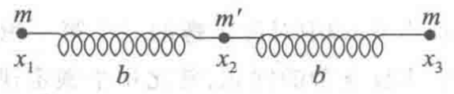

［解］　由图知，若以水平轴$x$上某处$O$为原点，系统的势能$V$为

$$
V=\frac{k}{2}(x_2-x_1-b)^2+\frac{k}{2}(x_3-x_2-b)^2\qquad (1)
$$

而动能$T$则为

$$
T=\frac{1}{2}m(\dot{x}_1^2+\dot{x}_3^2)+\frac{1}{2}m'\dot{x}_2^2\qquad (2)
$$

令

$$
q_1=x_1,\quad q_2=x_2-b,\quad q_3=x_3-2b\qquad (3)
$$

则

$$
V=\frac{1}{2}k(q_2-q_1)^2+\frac{1}{2}k(q_3-q_2)^2=\frac{k}{2}(q_1^2+2q_2^2+q_3^2-2q_1q_2-2q_2q_3)\qquad (4)
$$

$$
T=\frac{1}{2}m(\dot{q}_1^2+\dot{q}_3^2)+\frac{1}{2}m'\dot{q}_2^2\qquad (5)
$$

本问题是三个自由度的问题，故$q_1,q_2,q_3$就是本问题的广义坐标，把（4）、（5）两式代入拉格朗日方程式（5.3.16）中，得

$$
\left.\begin{aligned}
m\ddot{q}_1+kq_1-kq_2&=0\\
m'\ddot{q}_2-kq_1+2kq_2-kq_3&=0\\
m\ddot{q}_3-kq_2+kq_3&=0
\end{aligned}\right\}\qquad (6)
$$

我们现在把解直接写为正弦函数（余弦函数当然也可以），而不像以前那样先写成指数函数，再取其实数部分，这当然是一样的．即在本问题中，设（6）式的解，具有

$$
q_\beta=c_\beta\sin(\nu t+\varepsilon)\qquad (7)
$$

的形式，则把它代入（6）式后，得

$$
\left.\begin{aligned}
c_1(k-m\nu^2)-c_2k+0&=0\\
-c_1k+c_2(2k-m'\nu^2)-c_3k&=0\\
0-c_2k+c_3(k-m\nu^2)&=0
\end{aligned}\right\}\qquad (8)
$$

（8）式这组方程有异于零解的条件是系数行列式等于零，即

$$
\begin{vmatrix}
k-m\nu^2 & -k & 0\\
-k & 2k-m'\nu^2 & -k\\
0 & -k & k-m\nu^2
\end{vmatrix}=0\qquad (9)
$$

由此，得

$$
(k-m\nu^2)^2(2k-m'\nu^2)-2k^2(k-m\nu^2)=0
$$

$$
(k-m\nu^2)[(k-m\nu^2)(2k-m'\nu^2)-2k^2]=0
$$

$$
(k-m\nu^2)(\nu^4mm'-2km\nu^2-km'\nu^2)=0
$$

即

$$
\nu^2(k-m\nu^2)(\nu^2mm'-2km-km')=0\qquad (10)
$$

得

$$
\nu_1=0,\quad \nu_2=\sqrt{\frac{k}{m}},\quad \nu_3=\sqrt{\frac{k}{m}\left(1+\frac{2m}{m'}\right)}\qquad (11)
$$

这就是我们所要求的三个简正频率．请读者想一想$\nu=0$的物理意义是什么？

**5.3**　轴为竖直而顶点在下的抛物线形金属丝，以匀角速$\omega$绕轴转动．一质量为$m$的小环，套在此金属丝上，并可沿着金属丝滑动．试用正则方程求小环在$x$方向的运动微分方程．已知抛物线的方程为$x^2=4ay$，式中$a$为一常数．

［解］　由第四章相对运动所给出的关系，知小环沿金属丝滑动的速度$v'$是相对速度，且$v'^2=\dot{x}^2+\dot{y}^2$，而$v'$的方向则沿着抛物线上$P$点的切线方向，如图所示．又因抛物线形金属丝绕$y$轴转，故小环还有牵连速度$\omega x$，垂直纸面，故$v^2=\dot{x}^2+\dot{y}^2+\omega^2x^2$，而动能$T$为

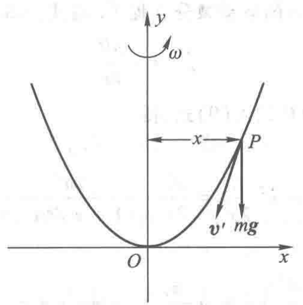

$$
T=\frac{1}{2}m[(\dot{x}^2+\dot{y}^2)+\omega^2x^2]\qquad (1)
$$

又势能$V$为

$$
V=mgy\qquad (2)
$$

由于约束关系（约束方程为$x^2=4ay$），故本题中自由度为1，今选$x$为广义坐标．由约束方程，知

$$
y=\frac{x^2}{4a},\quad \dot{y}=\frac{x}{2a}\dot{x}\qquad (3)
$$

把（3）式中的$y$及$\dot{y}$代入（1）式与（2）式中，得

$$
T=\frac{m}{2}\left[\dot{x}^2\left(1+\frac{x^2}{4a^2}\right)+\omega^2x^2\right]
$$

$$
V=mg\frac{x^2}{4a}
$$

而拉氏函数$L$则为

$$
L=T-V=\frac{1}{2}m\left[\dot{x}^2\left(1+\frac{x^2}{4a^2}\right)+\omega^2x^2\right]-mg\frac{x^2}{4a}\qquad (4)
$$

因小环只受重力$mg$的作用，故应为保守系，但动能$T$并不是广义速度的二次齐次式，故应由广义能量积分求哈密顿函数$H$，根据式（5.3.20）求出$T_2$与$T_0$，即

$$
H=T_2-T_0+V=\frac{1}{2}m\left[\dot{x}^2\left(1+\frac{x^2}{4a^2}\right)-\omega^2x^2\right]+mg\frac{x^2}{4a}\qquad (5)
$$

当然，由$H=-L+p_x\dot{x}$的关系，也能求出$H$，但计算比较烦琐．

现在用$p_x$来代换$\dot{x}$．由（4）式，

$$
p_x=\frac{\partial L}{\partial\dot{x}}=m\dot{x}\left(1+\frac{x^2}{4a^2}\right)\qquad (6)
$$

即

$$
\dot{x}=\frac{p_x}{m(1+x^2/4a^2)}\qquad (7)
$$

把（7）式中的$\dot{x}$代入（5）式，得

$$
H=\frac{1}{2m}\left(\frac{p_x^2}{1+x^2/4a^2}\right)-\frac{m}{2}\omega^2x^2+mg\frac{x^2}{4a}\qquad (8)
$$

现在，可以由正则方程来求小环的运动微分方程了．由式（5.5.15）中的第二式，我们有

$$
\dot{p}_x=-\frac{\partial H}{\partial x}\qquad (9)
$$

把（6）式中的$p_x$及（8）式中的$H$代入（9）式，得

$$
m\left(1+\frac{x^2}{4a^2}\right)\ddot{x}+m\dot{x}^2\frac{x}{2a^2}=\frac{p_x^2}{2m}\cdot\frac{\frac{x}{2a^2}}{(1+x^2/4a^2)^2}+m\omega^2x-mg\frac{x}{2a}
$$

由（7）式，即得

$$
m\left(1+\frac{x^2}{4a^2}\right)\ddot{x}+m\frac{x}{4a^2}\dot{x}^2-m\omega^2x+mg\frac{x}{2a}=0\qquad (10)
$$

这就是所求的小环运动微分方程．显然，用正则方程来解这类问题反而比较迂回，不如用第四章中所讲的方法简便，只在比较复杂的问题，它才能显示出它的优越性．

**5.4**　试由哈密顿原理求质点在万有引力作用下的运动微分方程．

［解］　由§1.9知，在极坐标系中，动能$T$及势能$V$分别为

$$
\left.\begin{aligned}
T&=\frac{m}{2}(\dot{r}^2+r^2\dot{\theta}^2)\\
V&=-\frac{k^2m}{r}
\end{aligned}\right\}\qquad (1)
$$

故拉格朗日函数$L$为

$$
L=T-V=\frac{1}{2}m(\dot{r}^2+r^2\dot{\theta}^2)+\frac{k^2m}{r}\qquad (2)
$$

代入哈密顿原理

$$
\delta\int_{t_1}^{t_2}L\mathrm{d}t=0
$$

中，得

$$
\int_{t_1}^{t_2}\left(m\dot{r}\delta\dot{r}+mr\dot{\theta}^2\delta r+mr^2\dot{\theta}\delta\dot{\theta}-\frac{k^2m}{r^2}\delta r\right)\mathrm{d}t=0\qquad (3)
$$

但

$$
\left.\begin{aligned}
\dot{r}\delta\dot{r}&=\frac{\mathrm{d}}{\mathrm{d}t}(\dot{r}\delta r)-\ddot{r}\delta r\\
r^2\dot{\theta}\delta\dot{\theta}&=\frac{\mathrm{d}}{\mathrm{d}t}(r^2\dot{\theta}\delta\theta)-\frac{\mathrm{d}}{\mathrm{d}t}(r^2\dot{\theta})\delta\theta
\end{aligned}\right\}\qquad (4)
$$

把（4）式中的两个关系代入（3）式，得

$$
m\dot{r}\delta r+mr^2\dot{\theta}\delta\theta\Big|_{t_1}^{t_2}-\int_{t_1}^{t_2}\left(m\ddot{r}-mr\dot{\theta}^2+\frac{k^2m}{r^2}\right)\delta r\mathrm{d}t-\int_{t_1}^{t_2}\frac{\mathrm{d}}{\mathrm{d}t}(mr^2\dot{\theta})\delta\theta\mathrm{d}t=0\qquad (5)
$$

因

$$
\delta r\big|_{t_1}=\delta r\big|_{t_2}=0,\quad \delta\theta\big|_{t_1}=\delta\theta\big|_{t_2}=0
$$

而积分号内的$\delta r$及$\delta\theta$则是任意的，即它们一般并不等于零，而且是相互独立的，故得

$$
\left.\begin{aligned}
m\ddot{r}-mr\dot{\theta}^2+\frac{k^2m}{r^2}&=0\\
\frac{\mathrm{d}}{\mathrm{d}t}(mr^2\dot{\theta})&=0
\end{aligned}\right\}\qquad (6)
$$

即

$$
\left.\begin{aligned}
m(\ddot{r}-r\dot{\theta}^2)&=-\frac{k^2m}{r^2}\\
r^2\dot{\theta}&=\eta=\text{常量}
\end{aligned}\right\}\qquad (7)
$$

这就是我们所要求的关系．

## 思考题

**5.1**　虚功原理中的“虚功”二字做何解释？用虚功原理解平衡问题，有何优点及缺点？

**5.2**　为什么在拉格朗日方程中，$Q_\alpha$不包含约束反作用力？又广义坐标及广义力的含义为何？我们根据什么关系可以由一个量的量纲定出另一个量的量纲？

**5.3**　广义动量$p_\alpha$和广义速度$\dot{q}_\alpha$是不是只相差一个乘数$m$？为什么$p_\alpha$比$\dot{q}_\alpha$更富有物理意义？

**5.4**　既然$\frac{\partial T}{\partial\dot{q}_\alpha}$是广义动量，那么根据动量定理，$\frac{\mathrm{d}}{\mathrm{d}t}\left(\frac{\partial T}{\partial\dot{q}_\alpha}\right)$是否应等于广义力$Q_\alpha$？为什么？拉格朗日方程（5.3.14）中多出了$\frac{\partial T}{\partial q_\alpha}$项？你能说出它的物理意义和所代表的物理量吗？

**5.5**　为什么拉格朗日方程只适用于完整系？如为不完整系，能否由式（5.3.13）得出式（5.3.14）？

**5.6**　平衡位置附近的小振动的性质，由什么来决定？为什么$2s^2$个常数只有$2s$个是独立的？

**5.7**　什么叫做简正坐标？怎样去找？它的数目和力学体系的自由度之间有何关系？又每一简正坐标将作怎样的运动？

**5.8**　多自由度力学体系如果还有阻尼力，那么它们在平衡位置附近的运动和无阻尼时有何不同？能否列出它们的运动微分方程？

**5.9**　$\mathrm{d}L$与$\mathrm{d}\bar{L}$有何区别？$\frac{\partial L}{\partial q_\alpha}$与$\frac{\partial\bar{L}}{\partial q_\alpha}$有何区别？

**5.10**　哈密顿正则方程能适用于不完整系吗？为什么？能适用于非保守系吗？为什么？

**5.11**　哈密顿函数在什么情况下是常量？在什么情况下是总能量？试详加讨论，有无是总能量而不为常量的问题？

**5.12**　何谓泊松括号与泊松定理？泊松定理在实际上的功用如何？

**5.13**　哈密顿原理是用什么方法确定运动规律的？为什么变分符号$\delta$可置于积分号内也可移到积分号外？又全变分符号$\Delta$能否这样？

**5.14**　正则变换的目的及功用何在？又正则变换的关键在于何处？

**5.15**　哈密顿-雅可比理论的目的何在？试简述应用此理论解题时所应有的步骤．

**5.16**　正则方程（5.5.15）与式（5.10.10）及式（5.10.11）之间的关系如何？我们能否用一正则变换由前者得出后者？

**5.17**　在研究机械运动的力学中，刘维尔定理能否发挥其作用？何故？

**5.18**　分析力学学完后，请把本章中的方程和原理与牛顿运动定律相比较，并加以评价．

## 习题

**5.1**　试用虚功原理解3.1题．

**5.2**　试用虚功原理解3.4题．

**5.3**　如图，长度同为$l$的轻棒四根，光滑地连成一菱形$ABCD$．$AB,AD$两边支于同一水平线上相距为$2a$的两根钉上，$BD$间则用一轻绳连接，$C$点上系一重物$W$．设$A$点上的顶角为$2\alpha$，试用虚功原理求绳中张力$F_T$．

答：$F_T=W\tan\alpha\left(\frac{a}{2l}\csc^3\alpha-1\right)$

**5.4**　一质点的重量为$W$，被约束在竖直圆周

$$
x^2-y^2-r^2=0
$$

上，并受一水平斥力$k^2x$的作用，式中$r$为圆的半径，$k$为常数．试用未定乘数法求质点的平衡位置及约束反作用力的量值．

答：（1）$x=0,y=\pm r,R=\mp W$；
（2）$y=\frac{W}{k^2}$，$x=\pm\sqrt{r^2-W^2/k^4}$，$R=-k^2r$．

**5.5**　如图，在离心节速器中，质量为$m_2$的质点$C$沿着一竖直轴运动，而整个系统则以匀角速$\Omega$绕该轴转动．试写出此力学体系的拉氏函数．设连杆$AB,BC,CD,DA$等的质量均可不计．

答：$L=m_1a^2(\dot{\theta}^2+\Omega^2\sin^2\theta)+2m_2a^2\sin^2\theta\,\dot{\theta}^2+2ga(m+m_2)\cos\theta$

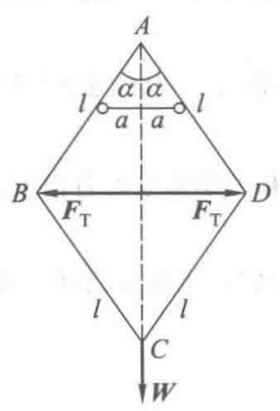

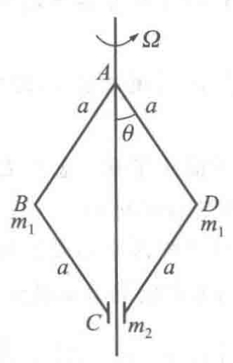

**5.6**　试用拉格朗日方程解4.10题．

**5.7**　试用拉格朗日方程解本章补充例题5.3．

**5.8**　一光滑细管可在竖直平面内绕通过其一端的水平轴以匀角速$\omega$转动．管中有一质量为$m$的质点．开始时，细管取水平方向，质点距转动轴的距离为$a$，质点相对于管的速度为$v_0$，试由拉格朗日方程求质点相对于管的运动规律．

答：

$$
\begin{aligned}
x=&\left[\frac{1}{2}\left(a+\frac{v_0}{\omega}\right)-\frac{g}{4\omega^2}\right]e^{\omega t}+\left[\frac{1}{2}\left(a-\frac{v_0}{\omega}\right)+\frac{g}{4\omega^2}\right]e^{-\omega t}\\
&+\frac{g}{2\omega^2}\sin\omega t\quad(\text{取管轴为}x\text{轴})
\end{aligned}
$$

**5.9**　如图，设质量为$m$的质点，受重力作用，被约束在半顶角为$\alpha$的圆锥面内运动．试以$r,\theta$为广义坐标，由拉格朗日方程求此质点的运动微分方程．

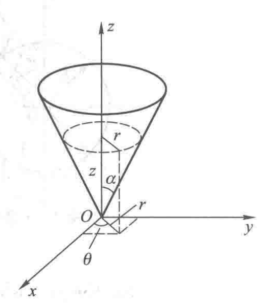

答：$r^2\dot{\theta}=$常量，$\ddot{r}-r\dot{\theta}^2\sin^2\alpha+g\sin\alpha\cos\alpha=0$

**5.10**　试用拉格朗日方程解2.4题中的（1）及（2）．

**5.11**　试用拉格朗日方程求3.20题中的$a_1$及$a_2$．

**5.12**　均质棒$AB$，质量为$m$，长为$2a$，其$A$端可在光滑水平导槽上运动．而棒本身又可在竖直面内绕$A$端摆动．如除重力作用外，$B$端还受有一水平的力$F$的作用．试用拉格朗日方程求其运动微分方程．如摆动的角度很小，则又如何？

答：$m(\ddot{x}+a\ddot{\theta}\cos\theta-a\dot{\theta}^2\sin\theta)=F$

$$
m[a\ddot{x}\cos\theta+(a^2+k^2)\ddot{\theta}]=2Fa\cos\theta-mga\sin\theta
$$

如$\theta$很小，则

$$
\ddot{x}+a\ddot{\theta}=\frac{F}{m}
$$

$$
\ddot{x}+\frac{4}{3}a\ddot{\theta}+g\theta=\frac{2F}{m}
$$

式中$x$为任一瞬时$A$离定点$O$的距离，$\theta$为任一瞬时棒与竖直线间所成的角度，$k$为棒绕质心的回转半径．

**5.13**　行星齿轮机构如图所示．曲柄$OA$带动行星齿轮II在固定齿轮I上滚动．已知曲柄的质量为$m_1$，且可认为是匀质杆．齿轮II的质量为$m_2$，半径为$r$，且可认为是匀质圆盘．至于齿轮I的半径则为$R$．今在曲柄上作用一不变的力矩$M$．如重力的作用可以略去不计，试用拉格朗日方程研究此曲柄的运动．

答：$\ddot{\varphi}=\frac{2M}{3m_2(R+r)^2\left(1+\frac{2}{9}\frac{m_1}{m_2}\right)}$

**5.14**　质量为$m$的圆柱体$S$放在质量为$m'$的圆柱体$P$上作相对纯滚动，而$P$则放在粗糙平面上．已知两圆柱的轴都是水平的，且重心在同一竖直面内．开始时此系统是静止的．若以圆柱体$P$的重心的初始位置为固定坐标系的原点，则圆柱体$S$的重心在任意时刻的坐标为

$$
\left.\begin{aligned}
x&=c\frac{m\theta+(3m'+m)\sin\theta}{3(m'+m)}\\
y&=c\cos\theta
\end{aligned}\right\}
$$

试用拉格朗日方程证明之．式中$c$为两圆柱轴线间的距离，$\theta$为两圆柱连心线与竖直向上的直线间的夹角．

**5.15**　如图，质量为$m'$、半径为$a$的薄球壳，其外表面是完全粗糙的，内表面则完全光滑，放在粗糙水平桌上．在球壳内放一质量为$m$、长为$2a\sin\alpha$的均质棒．设此系统由静止开始运动，且在开始的瞬间，棒在通过球心的竖直平面内，两端都与球壳相接，并与水平线成$\beta$角．试用拉格朗日方程证明在以后的运动中，此棒与水平线所夹的角$\theta$满足关系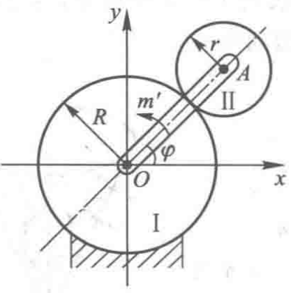

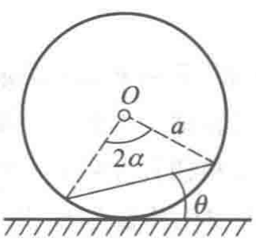

$$
\begin{aligned}
&[(5m'+3m)(3\cos^2\alpha+\sin^2\alpha)-9m\cos^2\alpha\cos^2\theta]a\dot{\theta}^2\\
&=6g(5m'+3m)(\cos\theta-\cos\beta)\cos\alpha
\end{aligned}
$$

**5.16**　半径为$r$的均质圆球，可在一具有水平轴、半径为$R$的固定圆柱的内表面滚动．试求圆球绕平衡位置作微振动的运动方程及其周期．

答：$\tau=2\pi\sqrt{\frac{7}{5}\frac{R-r}{g}}$

**5.17**　如图，质点$M_1$，其质量为$m_1$，用长为$l_1$的绳子系在固定点$O$上．在质点$M_1$上，用长为$l_2$的绳系另一质点$M_2$，其质量为$m_2$．以绳与竖直线所成的角度$\theta_1$与$\theta_2$为广义坐标，求此系统在竖直平面内作微振动的运动方程．如$m_1=m_2=m,l_1=l_2=l$，试再求出此系统的振动周期．

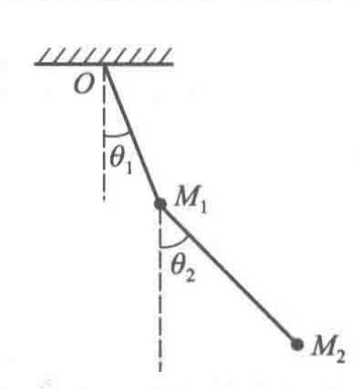

答：$\tau_1=2\pi\sqrt{\frac{l}{g(2+\sqrt{2})}},\tau_2=2\pi\sqrt{\frac{l}{g(2-\sqrt{2})}}$

**5.18**　在上题中，如双摆的上端不是系在固定点$O$上，而是系在一个套在光滑水平杆上、质量为$2m$的小环上，小环可沿水平杆滑动．如$m_1=m_2=m,l_1=l_2=l$，试求其运动方程及其周期．

答：$\tau_1=2\pi\sqrt{\frac{l}{g}},\tau_2=2\pi\sqrt{\frac{l}{g}}$

**5.19**　质量分别为$m_1,m_2$的两原子分子、平衡时原子间的距离为$a$，它们的相互作用力是准弹性的，取两原子的连线为$x$轴，试求此分子的运动方程．

答：$x_1=A+Bt+C\sin(\nu t+\varepsilon),x_2=A+Bt+a-C\frac{m_1}{m_2}\sin(\nu t+\varepsilon)$

式中$A,B,C$及$\varepsilon$为积分常数，$\nu=\sqrt{\frac{m_1+m_2}{m_1m_2}}k$，$k$为劲度系数．

**5.20**　已知一带电粒子在电磁场中的拉格朗日函数$L$(非相对论的)为

$$
L=T-q\varphi+q\boldsymbol{A}\cdot\boldsymbol{v}=\frac{1}{2}mv^2-q\varphi+q\boldsymbol{A}\cdot\boldsymbol{v}
$$

式中$\boldsymbol{v}$为粒子的速度，$m$为粒子的质量，$q$为粒子所带的电荷，$\varphi$为标量势，$\boldsymbol{A}$为矢量势．试由此写出它的哈密顿函数．

答：$H=\frac{1}{2}mv^2+q\varphi=\frac{1}{2m}(\boldsymbol{p}-q\boldsymbol{A})^2+q\varphi$

**5.21**　试写出自由质点在作匀速转动的坐标系中的哈密顿函数的表示式．

答：在以角速度$\Omega$转动的旋转坐标系中

$$
H=\frac{1}{2m}p^2-\boldsymbol{\Omega}\cdot(\boldsymbol{r}\times\boldsymbol{p})+V
$$

式中$\boldsymbol{r}$为质点的位矢，$\boldsymbol{p}=m\boldsymbol{v}$，$\boldsymbol{v}$为质点相对于固定坐标系的速度．

**5.22**　试写出§3.9中拉格朗日陀螺的哈密顿函数$H$，并由此求出它的三个第一积分．

答：$H=\frac{p_\theta^2}{2I_1}+\frac{(p_\varphi-p_\psi\cos\theta)^2}{2I_1\sin^2\theta}+\frac{p_\psi^2}{2I_3}+mgl\cos\theta$

**5.23**　试用哈密顿正则方程解4.10题．

**5.24**　半径为$c$的均质圆球，自半径为$b$的固定圆球的顶端无初速地滚下，试由哈密顿正则方程求动球球心下降的切向加速度．

答：$a=\frac{5}{7}g\sin\theta$

式中$\theta$为两球连心线与竖直向上直线间的夹角．

**5.25**　试求由质点组的动量矩$\boldsymbol{J}$的笛卡儿分量所组成的泊松括号．

答：$[J_x,J_y]=J_z,[J_y,J_z]=J_x,[J_z,J_x]=J_y$

$[J_x,J_x]=0,[J_y,J_y]=0,[J_z,J_z]=0$

**5.26**　试求由质点组的动量$\boldsymbol{p}$和动量矩$\boldsymbol{J}$的笛卡儿分量所组成的泊松括号．

答：$[J_x,p_y]=p_z,[J_y,p_z]=p_x,[J_z,p_x]=p_y$

$[J_x,p_z]=-p_y,[J_y,p_x]=-p_z,[J_z,p_y]=-p_x$

$[J_x,p_x]=0,[J_y,p_y]=0,[J_z,p_z]=0$

**5.27**　如果$\varphi$是坐标和动量的任意标量函数，即$\varphi=ar^2+b\boldsymbol{r}\cdot\boldsymbol{p}+cp^2$，其中$a,b,c$为常数，试证

$$
[\varphi,J_z]=0
$$

**5.28**　半径为$a$的光滑圆形金属丝圈，以匀角速$\omega$绕竖直直径转动，圈上套着一质量为$m$的小环．起始时，小环自圆圈的最高点无初速地沿着圆圈滑下．当环和圈中心的联线与竖直向上的直径成$\theta$角时，用哈密顿原理求出小环的运动微分方程．

答：$ma\ddot{\theta}=ma\omega^2\sin\theta\cos\theta+mg\sin\theta$

**5.29**　试用哈密顿原理解4.10题．

**5.30**　试用哈密顿原理求复摆作微振动时的周期．

答：$\tau=2\pi\sqrt{\frac{I_0}{mgl}}$

式中$m$是复摆的质量，$I_0$是复摆绕悬点$O$振动时的转动惯量，$l$为复摆重心$G$与悬点$O$之间的距离，$g$为重力加速度．

**5.31**　试用哈密顿原理解5.9题．

**5.32**　试证

$$
Q=\ln\left(\frac{1}{q}\sin p\right),\quad P=q\cot p
$$

为一正则变换．

**5.33**　证：变换方程

$$
q=(2Q)^{\frac{1}{2}}k^{-\frac{1}{2}}\cos P,\quad p=(2Q)^{\frac{1}{2}}k^{\frac{1}{2}}\sin P
$$

代表一正则变换，并将正则方程

$$
\dot{q}=\frac{\partial H}{\partial p},\quad \dot{p}=-\frac{\partial H}{\partial q}
$$

变为

$$
\dot{Q}=\frac{\partial H^*}{\partial P},\quad \dot{P}=-\frac{\partial H^*}{\partial Q}
$$

式中

$$
H=\frac{1}{2}(p^2+k^2q^2),\quad H^*=kQ
$$

**5.34**　如果利用下列关系把变数$p,q$换为$P,Q$：

$$
q=\varphi_1(P,Q),\quad p=\varphi_2(P,Q)
$$

则当

$$
\frac{\partial(q,p)}{\partial(Q,P)}=1
$$

时，这种变换是一正则变换，试证明之．

**5.35**　试利用正则变换，由正则方程求竖直上抛的物体的运动规律．已知本问题的母函数$U=mg\left(\frac{1}{6}gQ^3+qQ\right)$，式中$q$为确定物体位置的广义坐标，$Q$为变换后新的广义坐标，$g$为重力加速度．

**5.36**　试求质点在势场

$$
V=\frac{\alpha}{r^2}-\frac{Fz}{r^3}
$$

中运动时的主函数$S$，式中$\alpha$及$F$为常数．

答：在球面坐标系中，

$$
S=-Et+\int\sqrt{2mE-\frac{\alpha_2}{r^2}}\,\mathrm{d}r+\int\sqrt{\alpha_2+2mF\cos\theta-\frac{\alpha_3^2}{\sin^2\theta}-2m\alpha}\,\mathrm{d}\theta+\alpha_3\varphi
$$

式中$m$是质点的质量，$E$为总能量，$\alpha_2,\alpha_3$为积分常数．

**5.37**　试用哈密顿-雅可比偏微分方程求抛射体在真空中运动的轨道方程．

**5.38**　如力学体系的势能$V$及动能$T$可用下列两函数表示：

$$
V=\frac{V_1+V_2+\cdots+V_s}{A_1+A_2+\cdots+A_s}
$$

$$
T=\frac{1}{2}(A_1+A_2+\cdots+A_s)(B_1\dot{q}_1^2+B_2\dot{q}_2^2+\cdots+B_s\dot{q}_s^2)
$$

式中$V_\alpha,A_\alpha,B_\alpha(\alpha=1,2,\cdots,s)$都只是一个参数$q_\alpha$的函数，则此力学体系的运动问题可用积分法求解，试证明之．

**5.39**　试用哈-雅方程求行星绕太阳运动时的轨道方程．

**5.40**　试由（5.9.29）及（5.9.30）两式推证（5.9.31）及（5.9.32）两式．

**5.41**　试求质点在库仑场和均匀场

$$
V=\frac{\alpha}{R}-Fz
$$

的合成场中运动时的主函数$S$，以抛物线坐标$\xi,\eta,\theta$表示，式中$\alpha$及$F$是常数，而$R=\sqrt{r^2+z^2}$(参看图1.2.4)．

答：

$$
\begin{aligned}
S=&-Et+p_\theta\theta+\int\sqrt{\frac{mE}{2}-\frac{m\alpha-\alpha_2}{2\xi}-\frac{p_\theta^2}{4\xi^2}+\frac{mF\xi}{4}}\,\mathrm{d}\xi+\\
&\int\sqrt{\frac{mE}{2}-\frac{m\alpha+\alpha_2}{2\eta}-\frac{p_\theta^2}{4\eta^2}-\frac{mF\eta}{4}}\,\mathrm{d}\eta
\end{aligned}
$$

式中$p_\theta,E$及$\alpha_2$是积分常数．

**5.42**　刘维尔定理的另一表达式是相体积不变定理．这里又有两种不同的说法：

（1）考虑相宇中任何一个区域．当这区域的边界依照正则方程运动时，区域的体积在运动中不变．

（2）相宇的体积元在正则变换下不变．试分别证明之．
