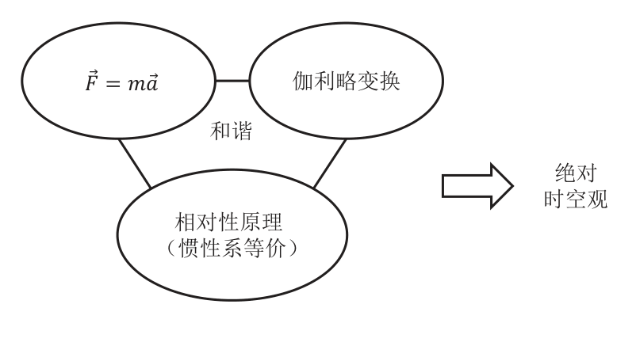
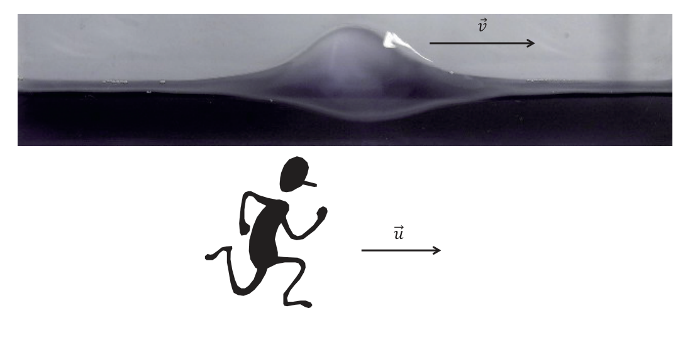
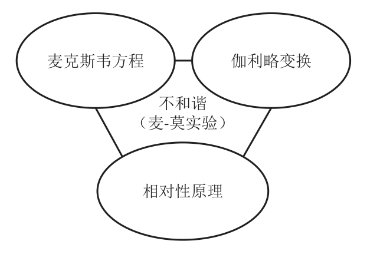
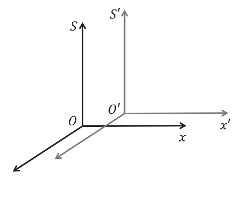
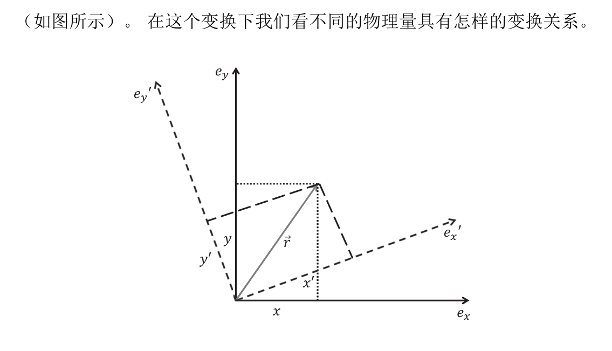
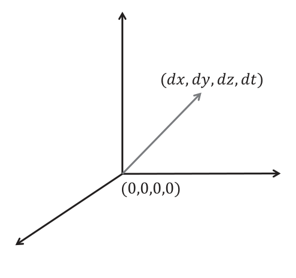
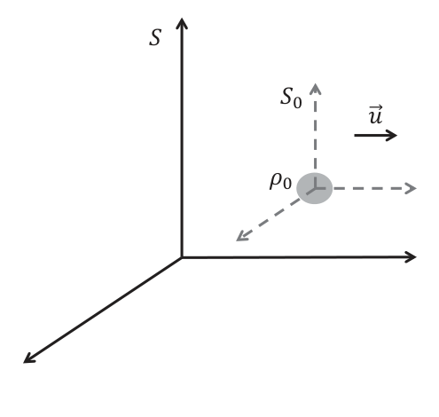
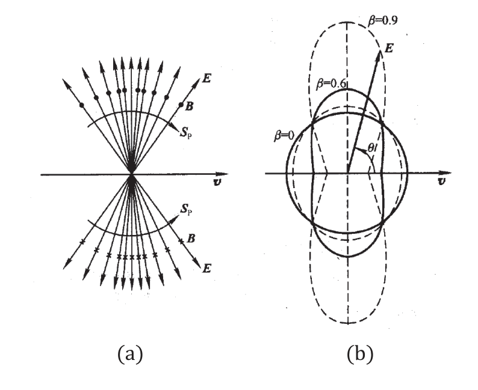

# 第十章 相对论电动力学

到现在为止，我们已经系统地研究了电磁场理论在不同条件下（静电、静磁、准静、辐射）的表现。然而，这些结果至今仍然是针对某一个特定坐标系成立的。在不同坐标系下的电磁现象之间的关联如何呢？这就是本章的研究内容。

### 10.1 狭义相对论的时空观

要想联系不同坐标系下的物理现象，就必须建立正确的时空变换，而后者是建立在一定的时空观下的。我们在本课程中只关心惯性坐标系之间的变换。牛顿在总结其发展的力学规律时得到了如下绝对时空观。

图内文字：$\vec{F}=m\vec{a}$；伽利略变换；和谐；相对性原理（惯性系等价）；绝对时空观

### 10.1.1 绝对时空观

#### 相对性原理

物理世界的规律是通过时间和空间坐标来描述的，而物理规律本身应当与（惯性）坐标系的选取无关，这就是说，在不同的惯性坐标系中，物理规律表述的形式始终保持不变，这是一个重要的基本假定，称为相对性原理，思想最先由伽利略提出。

#### 力学规律

牛顿力学的基本方程是

$$
\vec{F}=m\vec{a}=m\frac{d^{2}\vec{r}}{dt^{2}}
\tag{10.1.1}
$$

#### 伽利略变换

两个相对运动的惯性坐标系 $S$ 和 $S'$ 之间由伽利略变换联系起来：

$$
\begin{cases}
\vec{r}'=\vec{r}-\vec{v}t \\
t'=t
\end{cases}
\tag{10.1.2}
$$

将 10.1.2 代入 10.1.1 发现力学规律在不同的坐标系中保持相同，因此，牛顿力学，伽利略变换与相对性原理和谐统一。

### 10.1.2 绝对时空观的困难

但是，当人们把绝对时空观应用到电磁理论时遇到了巨大的困难，主要表现在对光的传播规律的描述上。对于经典的力学规律描述的波，如水波，当它在一个坐标系中的速度为 $\vec{v}$ 时，在相对于这个坐标系做匀速运动的另一个坐标系中测出的速度为 $\vec{v}'=\vec{v}-\vec{v}_{0}$。特别是，当 $\vec{v}=\vec{v}_{0}$ 时，$\vec{v}'=0$，即水波不再运动。电磁波也是一种波，有一个运动速度 $c$，因此人们自然

图内文字：$\vec{v}$；$\vec{u}$

要问：究竟这个光速 $c$ 是在哪个坐标系中测得的？假设光速为 $c$ 的这个坐标系叫做以太系，是否可以测得地球相对于以太系的运动速度？抑或地球就是那个绝对坐标系？

迈克耳孙和莫雷设计了精妙的干涉实验测量了不同条件下测量点相对于以太系的运动速度。然而实验测不到任何的以太漂移速度。换言之，在任何惯性坐标系中测得的光速是同一个常数 $c$，与传播方向无关，与光源运动的速度无关。这个结果是惊人的，揭示了描述电磁规律的麦克斯韦方程组，与伽利略变换以及相对性原理不和谐。

### 10.1.3 爱因斯坦的选择

相对性原理、Maxwell方程以及伽利略变换不和谐，则必须放弃（改造）其中一个使得这三者和谐。爱因斯坦选择保留前面两个，放弃伽利略变换。他提出如下两条基本假设：

图内文字：麦克斯韦方程；伽利略变换；不和谐（麦-莫实验）；相对性原理

自然规律在不同惯性系中的表达式相同。

#### 光速不变原理（选择Maxwell方程在一切惯性系中形式不变）

光速与光源的运动无关，与光的传播方向无关，在不同的惯性系中观察到的真空中的光速相同。这事实上并非爱因斯坦的假设，而是麦-莫实验所揭示的基本实验事实。在这个基础上，Maxwell方程组在所有坐标系下都保持不变，人们必须寻找新的时空变换来替代伽利略变换。

### 10.1.4 洛伦兹变换

基于不同惯性系中测出的光速不变这一假设，洛伦兹提出了他的时空变换。

考虑在 $t=t'=0$ 时，$S$ 与 $S'$ 重合，$S'$ 系相对于 $S$ 系沿 $x$ 轴以速度 $\vec{v}$ 运动。假设此时从原点发射一束光波，光沿各方向的传播方向都是 $c$。所以 $t$ 时

图内文字：$S$；$S'$；$O$；$O'$；$x$；$x'$

刻 $S$ 系中光到达的位置满足

$$
x^{2}+y^{2}+z^{2}=c^{2}t^{2}
\tag{10.1.3}
$$

存在两事件：

1. 发射　$(0,0,0,0)$
2. 接收　$(x,y,z,t)$

在 $S'$ 看来，同样的事件应该用如下时空点描述：

1. 发射　$(0,0,0,0)$
2. 接收　$(x',y',z',t')$

根据光速不变原理，变换后的 $(x',y',z',t')$ 必须满足

$$
x'^{2}+y'^{2}+z'^{2}=c^{2}t'^{2}
\tag{10.1.4}
$$

基于变换后满足 10.1.3 与 10.1.4 这个基本约束，数学家洛伦兹提出如下（线性）时空变换：

$$
\begin{cases}
x'=(x-vt)\Big/\sqrt{1-v^{2}/c^{2}} \\
y'=y \\
z'=z \\
t'=\left(t-\dfrac{v}{c^{2}}x\right)\Big/\sqrt{1-v^{2}/c^{2}}
\end{cases}
\tag{10.1.5}
$$

容易证明，若两个时空点原本满足 10.1.3，则洛仑兹变换后的是空间一定满足10.1.4——也就是说，在 $S'$ 系中观测事件传播的速度仍为 $c$，而且是各向同性的－尽管 $S'$ 相对 $S$ 沿 $x$ 轴运动，在 $S'$ 系中看到的速度沿 $x$ 轴与其它轴没有任何的不同！这个结果相当惊人，因为实施洛伦兹变换时貌似选择打破空间的对称性（选择了 $v$ 为 $x$ 方向），然而对测量光速来讲在这个扭曲的时空内没有任何各向异性。

引入一个虚构的由三维实空间和虚的时间轴构成的四维空间（闵可夫斯基空间），一个时空点在这个空间中的表示为

$$
x_{\mu}=(x,y,z,ict)
\tag{10.1.6}
$$

则Lorentz变换可以写成

$$
x'_{\mu}=\alpha_{\mu\nu}x_{\nu}
\tag{10.1.7}
$$

变换矩阵为

$$
\alpha=
\begin{pmatrix}
\gamma & 0 & 0 & i\beta\gamma \\
0 & 1 & 0 & 0 \\
0 & 0 & 1 & 0 \\
-i\beta\gamma & 0 & 0 & \gamma
\end{pmatrix}
\tag{10.1.8}
$$

其中 $\beta=v/c$，$\gamma=1/\sqrt{1-\beta^{2}}$。容易证明 $\alpha$ 是个正交矩阵，即

$$
\alpha\cdot\alpha^{T}=I \qquad \alpha^{-1}=\alpha^{T}
\tag{10.1.9}
$$

一个直接的结果就是

$$
x_{\mu}=\alpha_{\nu\mu}x'_{\mu}
\tag{10.1.10}
$$

### 10.2 物理规律协变性的数学形式

相对性原理要求物理规律在不同的惯性坐标系下保持不变，而不同惯性系之间的物理量之间的关系由洛伦兹变换给出，这就要求描述物理规律

的物理方程式形式一定要在Lorentz变换下保持不变。我们下面首先研究不同物理量在Lorentz变换是如何变换的。

### 10.2.1 物理量按时空变换性质分类

我们首先将所遇到的各种物理量作一番分类。先考虑大家熟知的三维空间中的一个纯坐标转动变换下，比如将坐标系以 $z$ 轴为转轴转动 $\theta$ 角度（如图所示）。在这个变换下我们看不同的物理量具有怎样的变换关系。

图内文字：$e_{x}$；$e_{y}$；$e'_{x}$；$e'_{y}$；$\vec{r}$；$x$；$y$；$x'$；$y'$

比如

1. 任意一点到原点的空间距离 $r=\sqrt{\vec{r}\cdot\vec{r}}$ 在变换下保持不变，这就是一个标量。

2. 位置矢量 $\vec{r}=\{x_{1},x_{2},x_{3}\}$ 经过坐标旋转变换后变成 $\vec{r}'=\{x'_{1},x'_{2},x'_{3}\}$，$\{x_{1},x_{2},x_{3}\}$ 与 $\{x'_{1},x'_{2},x'_{3}\}$ 两组数之间的变换关系为

$$
x'_{i}=T_{ij}x_{i}
\tag{10.2.1}
$$

其中，转动矩阵的形式为

$$
T = \begin{pmatrix}
\cos\theta & \sin\theta & 0 \\
-\sin\theta & \cos\theta & 0 \\
0 & 0 & 1
\end{pmatrix}
\tag{10.2.2}
$$

容易证明，所有三维空间的矢量（$\vec{E}$，$\vec{H}$，$\vec{F}$等）的三个分量都满足上面的变换关系。我们把满足10.2.1式变换关系的三个数组成的物理量叫做矢量。

3. 同样道理，二阶张量（如电四极矩$\overleftrightarrow{D}$）中的9个元素在坐标变换下满足

$$
D'_{ij} = T_{il}T_{jk}D_{lk}
\tag{10.2.3}
$$

#### 10.2.2　物理量的四维时空变换

将上面对三维坐标变换的定义推广到四维时空变换。

##### 标量

一个Lorentz变换下保持不变的物理量叫做标量。正交性质10.1.9显示，四维矢量的标积是个变换不变量：

$$
x'_i x'_i = \alpha_{ij}\alpha_{ik}x_j x_k = x_j x_j
\tag{10.2.4}
$$

因此这是个“四维标量”。10.2.4是光速不变10.1.3与10.1.4的另外一种表述方式。通常将两个时空点之间的四维距离：

$$
\Delta s^2 = -\Delta x_\mu \Delta x_\mu = (c\Delta t)^2 - |\Delta\vec{r}|^2
\tag{10.2.5}
$$

叫做间隔，它描述的是两个事件之间的时空间隔，是个不依赖于惯性系的“标量”。在相对论时空观中，时间空间耦合在一起，单独讨论两个事件

的时间和空间间隔都没有意义（依赖于具体的参照系），但“间隔”却是有意义的物理量。

##### 矢量（一阶张量）

定义一个由四个数量定义的集合$\{V_x, V_y, V_z, V_4\}$，若这些量在Lorentz变换下满足与四维坐标一样的变换关系

$$
V'_\mu = \alpha_{\mu\nu}V_\nu
\tag{10.2.6}
$$

则这样的集合称为一个四维矢量（或是一阶张量）。

##### 二阶张量

进一步，若有一物理量用$4\times 4$矩阵$T_{\mu\nu}$表示，在坐标变换$x'_\mu = \alpha_{\mu\nu}x_\nu$下，其变换关系为

$$
T'_{\mu\nu} = \alpha_{\mu k}\alpha_{\nu l}T_{kl}
\tag{10.2.7}
$$

则称此物理量为二阶张量。

##### 几个例子

1. $\dfrac{\partial}{\partial x_\mu}$的变换行为为一阶张量

   因为

$$
x'_\mu = \alpha_{\mu\nu}x_\nu \Rightarrow x_\nu = \left(\alpha^{-1}\right)_{\nu\mu} \qquad x'_\mu = \left(\alpha^{T}\right)_{\nu\mu} \qquad x'_\mu = \alpha_{\mu\nu}x'_\mu
\tag{10.2.8}
$$

   故

$$
\frac{\partial}{\partial x'_\mu} = \frac{\partial}{\partial x_\nu}\frac{\partial x_\nu}{\partial x'_\mu} = \alpha_{\mu\nu}\frac{\partial}{\partial x_\nu}
\tag{10.2.9}
$$

   上式显示$\left\{\dfrac{\partial}{\partial x_\mu}\right\} = \left\{\nabla, -i\dfrac{\partial_t}{c}\right\}$就是一个四维矢量。

2. 任意两个四维矢量的标积为四维标量

   比如四维间隔就是两个（四维时空位置）矢量的标积。同理，因为$\dfrac{\partial}{\partial x_\mu}$是一个矢量，故有

$$
\frac{\partial}{\partial x'_\mu}\frac{\partial}{\partial x'_\mu} = \alpha_{\mu\nu}\frac{\partial}{\partial x_\nu}\alpha_{\mu\beta}\frac{\partial}{\partial x_\beta} = \frac{\partial}{\partial x_\nu}\frac{\partial}{\partial x_\nu} = \nabla^2 - \frac{1}{c^2}\frac{\partial^2}{\partial t^2} = \Box^2
\tag{10.2.10}
$$

   即$\Box^2$算符为四维不变量。由此推知，若$A_\mu$为四维矢量，则此矢量的四维散度$\dfrac{\partial}{\partial x_\mu}A_\mu$为一不变量，即

$$
\frac{\partial}{\partial x'_\mu}A'_\mu = \alpha_{\mu\nu}\frac{\partial}{\partial x_\nu}\alpha_{\mu\beta}A_\beta = \frac{\partial}{\partial x_\nu}A_\nu
\tag{10.2.11}
$$

#### 10.2.3　物理规律的协变性

相对性原理要求，物理规律在任何一个惯性参考系内都是相同的，这就意味着在坐标变换下，表示物理规律的等式的形式应保持不变。如果等式两边的物理量是由同阶的张量构成的，那么这种形式的方程一定满足相对性原理，我们称这种形式的方程式为协变式。例如，某一物理规律可表示为如下形式：

$$
A_\mu = B_\mu
\tag{10.2.12}
$$

式中$A_\mu$，$B_\mu$分别代表S系中这一物理过程的不同物理量。当把它变换到$S'$系时，由于$A_\mu$，$B_\mu$都是一阶张量(即矢量)，其变换规律分别为

$$
A'_\mu = \alpha_{\mu\nu}A_\nu
\tag{10.2.13}
$$

$$
B'_\mu = \alpha_{\mu\nu}B_\nu
\tag{10.2.14}
$$

故

$$
A'_\mu = \alpha_{\mu\nu}A_\nu = \alpha_{\mu\nu}B_\nu = B'_\mu
\tag{10.2.15}
$$

由此可见，要判断规律是否满足相对性原理，只要看其物理方程是否为Lorentz协变。反之，在我们构造任何新规律时，原则上都应当使其满足Lorentz协变。

#### 10.2.4　速度及四维速度矢量

假定在S系中考察一个物体的运动，其速度的定义是$\vec{u} = \dfrac{d\vec{r}}{dt}$。现在假定$S'$系相对S系以速度$v$沿着$x$轴运动，则在$S'$系中同一粒子的速度定义为$\vec{u}' = \dfrac{d\vec{r}'}{dt'}$。因为在相对论时空观中，时间和空间是一起变换的，由Lorentz公式得

$$
\begin{cases}
dx' = (dx - vdt)\gamma_v \\
dy' = dy \\
dz' = dz \\
dt' = \left(dt - \dfrac{v}{c^2}dx\right)\gamma_v
\end{cases}
\tag{10.2.16}
$$

用上面第4个方程除前3个，则得

$$
\begin{cases}
u'_x = \dfrac{dx'}{dt'} = \dfrac{(dx - vdt)\gamma_v}{\left(dt - \dfrac{v}{c^2}dx\right)\gamma_v} = \dfrac{u_x - v}{1 - \dfrac{vu_x}{c^2}} \\[12pt]
u'_y = \dfrac{dy'}{dt'} = \dfrac{u_y\sqrt{1-\beta^2}}{1 - \dfrac{vu_x}{c^2}} \\[12pt]
v'_z = \dfrac{dz'}{dt'} = \dfrac{u_z\sqrt{1-\beta^2}}{1 - \dfrac{vu_x}{c^2}}
\end{cases}
\tag{10.2.17}
$$

上式决定了两个参考系中速度的变换，这就是相对论中的速度合成法则。在极限$v \ll c$的情况下（同时要求$|\vec{u}| \ll c$），可将分母展开，上式变成经

典力学中速度的矢量合成法则，即

$$
\begin{cases}
u'_x = u_x - v \\
u'_y = u_y \\
u'_z = u_z
\end{cases}
\tag{10.2.18}
$$

根据这些结果可以回答之前几个Puzzle：

1. 为什么水波和电磁波都是波，换一个坐标系观测水波，其速度变化甚至变为0（像那位英国科学家一样骑着马追泰晤士河上的一个水孤波），但电磁波却从来不变（M-M实验）？原因是水波的运动$u \ll c$，而电磁波的速度$u = c$。将$\vec{u} = c\hat{x}$带入10.2.17，发现$\vec{u}' = u'_x\hat{x}$，$u'_x = \dfrac{c-v}{1 - vc/c^2} \equiv c$。这是一个多么惊人的结果？！当且仅当我们考察的“物质”的运动速度为光速时，无论如何换坐标系都不能改变其运动速度的观测值！

2. 可否改变坐标系运动速度$v$，使得原本低速运动的粒子在另一个坐标系的运动速度“超”光速？答案是“否”。即使我们以光速反向运动，根据10.2.17我们发现$u'_x = u_x + c/(1 + cu_x/c^2) = c$，而当坐标系速度小于光速时，粒子速度也必然小于光速。也就是说，我们最多能使得粒子的相对运动速度达到光速，而不能超过光速！

注意到速度的变换公式很复杂，不满足四维矢量的变换公式，这是因为三维空间速度的定义不是相对论协变的。如图10.7所示，在S系中测量粒子运动的速度，须定义两个事件，粒子在$t = 0$时刻在原点（时空坐标(0,0,0,0)），粒子在$dt$时刻在$d\vec{r}$这一点（时空坐标$(dx, dy, dz, dt)$）。三维速度的定义是$\vec{u} = \dfrac{d\vec{r}}{dt}$——式中分子是三维矢量，很容易推广到四维协变形式$x_\mu = \{\vec{r}, ict\}$。问题出在分母上：$dt$不是一个四维标量！其在不同惯性系中测量值不同！为了解决这个问题，我们知道两个事件之间的四维时空

图内文字：(dx, dy, dz, dt)；(0, 0, 0, 0)

##### 间隔

$$
(ds)^2 = -dx_\mu dx_\mu = (cdt)^2 - d\vec{r}\cdot\vec{r}
\tag{10.2.19}
$$

是一个标量，其在不同惯性系中的测量值不变。可以据此定义一个具有时间量纲的标量

$$
d\tau = ds/c = dt\sqrt{1 - \vec{u}\cdot\vec{u}/c^2} = dt\sqrt{1-\beta_u^2}
\tag{10.2.20}
$$

用来替代$dt$。考察$d\tau$的物理意义。注意到其与坐标系无关，因此我们可以选取与粒子一起运动的坐标系来测量它。此时我们有$\beta_u^2 = 0$，因此得到$d\tau = dt$。故$d\tau$的物理意义为：在粒子静止的坐标系中测量的两个事件之间的时间差。通常我们也把$d\tau$称作“固有时”——Proper Time。对两个事件的时间间隔$dt$，在与粒子相对运动的坐标系中测到的值为

$$
dt = \frac{d\tau}{\sqrt{1-\beta_u^2}} = \gamma_u d\tau
\tag{10.2.21}
$$

这个时间间隔值比与运动粒子相对静止的坐标系中测得的“固有时”增大了$\gamma_u = \dfrac{1}{\sqrt{1-\beta_u^2}}$倍——这就是所谓“运动时钟变慢”效应（这里的运动时钟指得是在与粒子相对运动的坐标系中的“时钟”）。既然“固有时”是个与坐标变换无关的具有时间量纲的标量，我们可据此定义一个四维矢量

（四维速度）：

$$
u_\mu = \frac{dx_\mu}{d\tau} = \gamma_u\{\vec{u}, ic\}
\tag{10.2.22}
$$

它显然是在Lorentz变换下协变的，因为分子是个四维矢量而分母是个四维不变量。这个四维矢量中三维空间部分与三维速度矢量相关（但不是一回事！因为运动的时钟测得的时间不是固有时，需做修正——此即为$\gamma_u$的来源！）。

*Tips*：对理论物理学家来说，最重要的就是对任何一个三维矢量如何正确的找到它的四维伴侣！你试试其他的三维矢量，能否自己找到它们的伴侣？

### 10.3　麦克斯韦方程的协变形式

根据相对性原理要求，作为描述电磁体系物理规律的麦克斯韦方程组应当在Lorentz变换下协变。下面我们就把我们所关心的方程一一写成在Lorentz变换下协变的形式。

#### 10.3.1　电荷守恒定律 - 四维电流矢量

电荷密度和电流密度之间满足连续性方程

$$
\nabla\cdot\vec{j} + \frac{\partial\rho}{\partial t} = 0
\tag{10.3.1}
$$

此方程是在某一个坐标系（记为S系）下写出的，在$S'$系中$\vec{j}$，$\rho$都应相应变化成$\vec{j}'$，$\rho'$。根据相对性原理，10.3.1的方程形式应当洛伦兹变换下不变。因为$\{\vec{\nabla}, \partial(ict)\}$构成一个四维矢量，假如

$$
J_\mu = (\vec{j}, ic\rho)
\tag{10.3.2}
$$

也构成一个四维矢量，则10.3.1式可以写成相对论不变的形式：

$$
\partial_\mu J_\mu = 0
\tag{10.3.3}
$$

为书写方便，式中$\dfrac{\partial}{\partial x_\mu}$记为$\partial_\mu$。下面我们证明$(\vec{j}, ic\rho)$确实构成一个四维矢量。实验显示，电荷是洛伦兹不变量，亦即——一个带电体在任意一个惯性系下测得的电荷量均相同，这一实验事实将成为我们证明的关键。

图内文字：S；S₀；$\vec{u}$；ρ₀

设在S系中有一体积元$\Delta\Omega$，其中电荷以速度$u$沿$x$方向运动，体积元$\Delta\Omega$中的总电荷为$\Delta Q = \rho\Delta\Omega$，其中$\rho$为S系中测量的电荷密度。在与电荷相对静止的参考系$S_0$中，电荷速度为零，电荷密度为$\rho_0$，相应的体积元为$\Delta\Omega_0$，根据电荷的洛伦兹不变性，我们有

$$
\rho\Delta\Omega = \rho_0\Delta\Omega_0
\tag{10.3.4}
$$

由于$S_0$相对于S系以速度$\vec{u}$运动，则两个坐标系的时空微元的变换关系为

$$
\begin{cases}
\Delta x_0 = (\Delta x - u\Delta t)\gamma_u \\
\Delta y_0 = \Delta y \\
\Delta z_0 = \Delta z \\
\Delta t_0 = (\Delta t - u\Delta x/c^2)\gamma_u
\end{cases}
\tag{10.3.5}
$$

在S系中测量运动物体的“长度”时必须同时进行，亦即，$\Delta t = 0$。将其带入上式，我们发现两参考系之间的体积元的关系为

$$
\Delta\Omega_0 = dx_0dy_0dz_0 = \gamma_u dxdydz = \gamma_u \Delta\Omega \tag{10.3.6}
$$

我们注意到同一个带电微元，其体积在相对其运动的坐标系中测量时（$d\Omega$）比静止坐标系测量出的结果 $d\Omega_0$ 小，这就是所谓的“**运动物体长度收缩**”的概念。把10.3.6式代入10.3.4式，则得

$$
\rho = \rho_0\gamma_u \tag{10.3.7}
$$

将上式代入电流密度的表达式发现

$$
\vec{j} = \rho\vec{u} = \rho_0\gamma_u\vec{u} \tag{10.3.8}
$$

因为$\rho_0$为四维不变量，10.3.8式显示

$$
(\vec{j}, ic\rho) = \rho_0\left(\gamma_u\vec{u}, ic\gamma_u\right) = \rho_0 u_\mu \tag{10.3.9}
$$

正好构成一个正比于四维速度的四维矢量，因此电流守恒定律是满足相对论协变性要求的。

*Tips:* 其实写出正确的四维速度，又知道了电荷是个Lorentz不变量，10.3.8是非常容易预期的。

#### 10.3.2 电磁势方程的协变形式

电磁场可以用矢势$\vec{A}$和标势$\varphi$来描写，在洛伦兹规范条件下，电磁势方程为

$$
\left(\nabla^2 - \frac{1}{c^2}\frac{\partial^2}{\partial t^2}\right)\begin{pmatrix} \vec{A} \\ \varphi \end{pmatrix} = \begin{pmatrix} -\mu_0 \vec{j} \\ -\rho/\varepsilon_0 \end{pmatrix} \tag{10.3.10}
$$

式中$\vec{A}$和$\varphi$应满足洛伦兹条件

$$
\nabla\cdot\vec{A} + \frac{1}{c^2}\frac{\partial\varphi}{\partial t} \tag{10.3.11}
$$

若我们定义一个四维矢量：

$$
A_\mu = \left(\vec{A}, i\frac{\varphi}{c}\right) \tag{10.3.12}
$$

则10.3.10式的电磁势方程可以写为

$$
\square^2 A_\mu = -\mu_0 J_\mu \tag{10.3.13}
$$

洛伦兹条件可以写为

$$
\partial_\mu A_\mu = 0 \tag{10.3.14}
$$

10.3.13式很清楚地显示：若我们要求Maxwell方程在Lorentz变换下协变，则$A_\mu$一定是一个四维矢量，因为等式右方的$J_\mu$为一四维矢量，等式的左方亦应为一四维矢量，由于$\square^2$为一标量，故$A_\mu$为一四维矢量，称为四维势。这意味着矢势$\vec{A}$和标势$\varphi$在不同的坐标下会相互耦合在一起。

*Tips:* 这里的逻辑与之前有点不同——根据M-M实验推断Maxwell方程组及所有相关的方程一定是Lorentz协变的。根据这些方程的协变性，我们断定$A_\mu$为四维矢量。

#### 10.3.3 电磁场张量

现在我们来讨论用场强表示的麦克斯韦方程的协变形式，电磁场强度$\vec{E}$和$\vec{B}$可以用电磁势$\vec{A}$和$\varphi$表示，即

$$
\vec{E} = -\nabla\varphi - \frac{\partial\vec{A}}{\partial t} \tag{10.3.15}
$$

$$
\vec{B} = \nabla\times\vec{A} \tag{10.3.16}
$$

电磁场强$\vec{E}$和$\vec{B}$不是四维矢量。注意到$(\vec{\nabla}, \partial(ict))$构成四维矢量，$(\vec{A}, i\frac{\varphi}{c})$也构成四维矢量，显然上式右边是两个四维矢量，$\partial_\mu$，$A_\nu$之间的数学运算。排除降阶的缩并运算（左边不是标量）、只能是升阶的并矢运算。再考虑到对称性，发现等式右边只能是一个反对称的二阶张量。综合上述分析，可定义

$$
F_{\mu\nu} = \partial_\mu A_\nu - \partial_\nu A_\mu \tag{10.3.17}
$$

$F_{\mu\nu}$是四维二阶反对称张量，满足$F_{\mu\nu} = -F_{\nu\mu}$，称为电磁场张量。直接结算可得其具体形式为

$$
F_{\mu\nu} = \begin{pmatrix}
0 & B_3 & -B_2 & -iE_1/c \\
-B_3 & 0 & B_1 & -iE_2/c \\
B_2 & -B_1 & 0 & -iE_3/c \\
iE_1/c & iE_2/c & iE_3/c & 0
\end{pmatrix} \tag{10.3.18}
$$

利用$F_{\mu\nu}$和$J_\mu$，我们可以把麦克斯韦方程组中的两个非齐次方程

$$
\nabla\cdot\vec{E} = \rho/\varepsilon_0 \tag{10.3.19}
$$

$$
\nabla\times\vec{B} - \frac{1}{c^2}\frac{\partial\vec{E}}{\partial t} = \mu_0\vec{j} \tag{10.3.20}
$$

合并写成一个一阶的Lorentz协变的形式：

$$
\partial_\mu F_{\nu\mu} = \mu_0 J_\nu \tag{10.3.21}
$$

容易证明：$\nu = 4$的结果对应$\nabla\cdot\vec{E} = \rho/\varepsilon_0$，而$\nu = 1,2,3$的结果对应$\nabla\times\vec{B} = \frac{1}{c^2}\frac{\partial\vec{E}}{\partial t} = \mu_0\vec{j}$。同理，可把两个齐次方程

$$
\nabla\times\vec{B} = 0 \tag{10.3.22}
$$

$$
\nabla\times\vec{E} + \frac{\partial\vec{B}}{\partial t} = 0 \tag{10.3.23}
$$

合并写成

$$
\partial_\mu F_{\nu\alpha} + \partial_\alpha F_{\mu\nu} + \partial_\nu F_{\alpha\mu} = 0 \qquad \mu \neq \nu \neq \alpha \tag{10.3.24}
$$

10.3.21式和10.3.24式即是协变形式的麦克斯韦方程组。

### 10.4 电磁场的变换公式

下面考虑电磁场（由反对称电磁张量$F_{\mu\nu}$表示）在不同惯性系下得变换关系。因为$F_{\mu\nu}$是二阶张量，故不同参考系中的$F_{\mu\nu}$间的变换关系为

$$
F'_{\mu\nu} = \alpha_{\mu\beta}\alpha_{\nu\gamma}F_{\beta\gamma} \tag{10.4.1}
$$

根据Lorentz变换把10.4.1式具体写成分量的形式，则为

$$
\begin{cases}
E'_1 = E_1 \\
E'_2 = \gamma(E_2 - vB_3) \\
E'_3 = \gamma(E_3 + vB_2) \\
B'_1 = B_1 \\
B'_2 = \gamma(B_2 + \frac{v}{c^2}E_3) \\
B'_3 = \gamma(B_3 - \frac{v}{c^2}E_2)
\end{cases} \tag{10.4.2}
$$

假若我们把矢量场按平行和垂直于相对运动速度的方向分解，则10.4.2式可表示为

$$
\begin{cases}
\vec{E}'_\parallel = \vec{E}_\parallel \\
\vec{E}'_\perp = \gamma(\vec{E} + \vec{v}\times\vec{B})_\perp \\
\vec{B}'_\parallel = \vec{B}_\parallel \\
\vec{B}'_\perp = \gamma\left(\vec{B} + \frac{\vec{v}}{c^2}\times\vec{E}\right)_\perp
\end{cases} \tag{10.4.3}
$$

上述场变换方程式自动给出了Lorentz力以及动生电动势的物理解释。动生电动势是指一段运动导体切割磁力线产生的电动势。在实验室坐标系下观测，体系只有静磁场，当一个导线以速度$\vec{v}$切割磁力线时，在导线静止的坐标系中产生了新的电场$\vec{E}'_\perp = \gamma(\vec{v}\times\vec{B})_\perp \approx (\vec{v}\times\vec{B})_\perp$（后一个等式在低速下成立），因此导线中的电荷会受到这个电场的作用力—这就是动

生电场（电动势）的来源。而导线中的电荷受到的力$\vec{F}' \approx q(\vec{v}\times\vec{B})_\perp$，就是Lorentz力的来源。

**[例1]** 试求匀速运动的点电荷的场。

**解：**设$S$系为实验室坐标系，其中点电荷以速度$\vec{v}$沿$x$轴运动。在这个坐标系中既有电场，又有磁场（运动电荷产生电流进而产生磁场），不方便求解。不妨另设$S'$系，其原点固定在点电荷$q$上跟着点电荷一起运动。在$S'$系中点电荷是静止的，只有电场没有磁场，其场为

$$
\vec{E}'(\vec{r}', t') = \frac{1}{4\pi\varepsilon_0}\frac{q\vec{r}'}{r'^3} \qquad \vec{B}'(\vec{r}', t') = 0 \tag{10.4.4}
$$

我们随后将$S'$系中的电磁场利用变换公式变换到$S$系。因为$S$系相对$S'$系沿$x$轴以速度$-v$运动，则由式10.4.2得$S$系中的场强

$$
\begin{cases}
E_x = E'_x \\
E_y = \gamma(E'_y + vB'_z) \\
E_z = \gamma(E'_z - vB'_y) \\
B_x = B'_x \\
\vec{B}_\perp = \gamma\left(\vec{B}'_\perp + \frac{\vec{v}}{c^2}\times\vec{E}'_\perp\right)
\end{cases} \tag{10.4.5}
$$

由于$\vec{B}' = 0$，故

$$
\begin{cases}
E_x = \dfrac{1}{4\pi\varepsilon_0}\dfrac{qx'}{r'^3} \\
E_y = \dfrac{1}{4\pi\varepsilon_0}\gamma\dfrac{qy'}{r'^3} \\
E_z = \dfrac{1}{4\pi\varepsilon_0}\gamma\dfrac{qz'}{r'^3} \\
B_x = 0 \\
\vec{B}_\perp = \gamma\dfrac{\vec{v}}{c^2}\times\vec{E}'_\perp = \dfrac{\vec{v}}{c^2}\times\vec{E}_\perp
\end{cases} \tag{10.4.6}
$$

现在必须把$S'$系中的$\vec{r}'$，$t'$用$S$系中的$\vec{r}$，$t$来表示，因为我们要知道的是在$S$系中的某一个时空点地场强。为此，设$t = 0$时点电荷$q$正好与$S$系的原

点重合，并且我们在这一时刻测量空间的场，于是，根据洛伦兹变换，我们有

$$
\begin{cases}
x' = \gamma x \\
y' = y \\
z' = z \\
t' = -\gamma\beta x/c
\end{cases} \tag{10.4.7}
$$

将10.4.7代入10.4.6即可得最终结果。$s'$系中$\vec{r}'$可表示成

$$
r' = \sqrt{x'^2 + y'^2 + z'^2} = \left[(\gamma x)^2 + y^2 + z^2\right]^{1/2} \tag{10.4.8}
$$

这样，$S$系中在$\vec{r}$这一点（等同于$S'$系的$\vec{r}'$这一点）的电场强度为

$$
\vec{E} = \frac{1}{4\pi\varepsilon_0}\frac{\gamma q\vec{r}}{\left[(\gamma x)^2 + y^2 + z^2\right]^{3/2}} \tag{10.4.9}
$$

$$
= \frac{1}{4\pi\varepsilon_0}\frac{q\vec{r}}{\left[(r\cos\theta)^2 + (1-\beta^2)(r\sin\theta)^2\right]^{3/2}}\gamma^2 \tag{10.4.10}
$$

$$
= \frac{q\vec{r}}{4\pi\varepsilon_0}\frac{1-\beta^2}{\left(1-\beta^2\sin^2\theta\right)^{3/2}} \tag{10.4.11}
$$

式中$\theta$是$\vec{r}$与$\vec{v}$的夹角。由10.4.6不难算出磁感应强度

$$
\vec{B} = \frac{\vec{v}}{c^2}\times\vec{E} \tag{10.4.12}
$$

我们看到，匀速运动的点电荷的场的特点是：

1. 电场方向仍然是沿着径向，但强度分布不再是球对称的，而是受制于一个与$\theta$及运动速度$v$有关的角度分布函数

$$
F_\beta(\theta) = \frac{1-\beta^2}{\left(1-\beta^2\sin^2\theta\right)^{3/2}} \tag{10.4.13}
$$

$\theta = 0$处场最弱，$\theta = \pi/2$处场最强，场向着垂直于速度方向的平面集中，如图10.9(a)所示，集中的程度与点电荷运动速度有关，当$v \to c$时，场基本上集中分布在垂直于$\vec{v}$的平面内。图10.9(b)画出了三种不同$\beta$值的分布情况。

图内文字：(a) 中标有 $E$、$B$、$S_r$、$\vec{v}$；(b) 中标有 $\beta=0.9$、$\beta=0.6$、$\beta=0$、$E$、$\theta$、$\vec{v}$；子图标记 (a)、(b)

2. 能流分布为

$$
\vec{S}_P = \vec{E}\times\vec{H} = \varepsilon_0\left[\vec{v}E^2 - \vec{E}\left(\vec{E}\cdot\vec{v}\right)\right] \tag{10.4.14}
$$

注意到$\vec{E} \parallel \hat{r}$，容易计算得知

$$
\vec{S}_P\cdot\hat{r} \propto \left[E^2(\vec{v}\cdot\hat{r}) - E^2(\vec{v}\cdot\hat{r})\right] = 0 \tag{10.4.15}
$$

这说明没有能流沿着径向方向辐射出去。从上图我们也可直接看出，能流是在以电荷为中心的球面上流动。

3. 虽然能量并不沿着$\vec{r}$方向辐射出去，但在实验室系看，能流仍在做定向流，只伴随着电荷一起运动。要理解这个问题，只需要将时间加上即可。

*Tips:*

1. 在利用相对论电磁场变换公式时，不用忘了需要做两次Lorentz变换，一次是将场变换，另一次是将坐标点进行变换。

2. 为什么运动电荷的电场会发生有趣的畸变？根本的原因是“运动”尺子收缩，因此，将原本均匀分布的场向中间压缩。

3. 这个问题的求解，可以解释我们之前课堂上讲到的一个悬案：为什么两个孤立电流源之间的相互作用力不满足牛顿第三定律。你试试？
