# 第一章 麦克斯韦方程组

我们在《大学物理》的“电磁学”部分已经学习了许多电磁现象。在那里的数学语言比较简单，比如，通常只利用到积分运算，不涉及微分运算。在《电动力学》中，我们将使大量使用矢量微分运算等较为复杂的数学工具。本章中，我们将利用矢量运算的语言简要回顾一下Maxwell方程组，为以后章节中利用这组方程继续深入了解各种电磁现象打下基础。

### 1.1 静电现象的基本理论描述

#### 1.1.1 库仑定律

人们定量研究电磁现象是从库仑开始的。1785年，库仑做了大量的实验，总结发现真空（空气）中两个点电荷（自身尺寸无限小）之间的作用力满足

$$
\vec{F}_{12} = \frac{1}{4\pi\varepsilon_0} \frac{q_1 q_2}{r_{12}^3} \vec{r}_{12} \tag{1.1.1}
$$

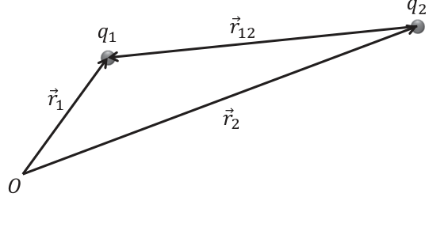

其中 $q_1, q_2$ 为两个点电荷所带的电量（单位为C），$\varepsilon_0 \approx 8.85 \times 10^{-12}\,\mathrm{C^2/(N\cdot m^2)}$ 为真空介电常数，$\vec{r}_{12} = \vec{r}_1 - \vec{r}_2$ 为2指向1的矢量。1.1.1式是由大量实验事实总结出来的数学表达式,物理意义包含了：
- 牛顿第三定律 $\vec{F}_{12} = -\vec{F}_{21}$
- 向心力
- 平方反比
- 同性相斥、异性相吸

#### 1.1.2 叠加原理

库仑定律是针对一对点电荷成立的，若同时存在多个点电荷会如何呢？另外，自然界存在的带电体大多数为连续带电体，对这种情况，静电力又如何描述呢？实验发现，当同时存在多个电荷时，某一特定电荷所受的作用力为其他所有电荷独立施与其上的作用力的线性叠加：

$$
\vec{F}_{i} = \frac{1}{4\pi\varepsilon_0} \sum_{i\neq j}^{N} \frac{q_i q_j}{r_{ij}^3} \vec{r}_{ij} \tag{1.1.2}
$$

这个原理的核心在于：电荷之间的相互作用为两体相互作用，与第三者的存在与否、大小、正负号都没有关系。这也是一个实验定律，被大量实验事实所证实。有了这个定律，我们可以非常容易地计算连续带电体之间的相互作用力。

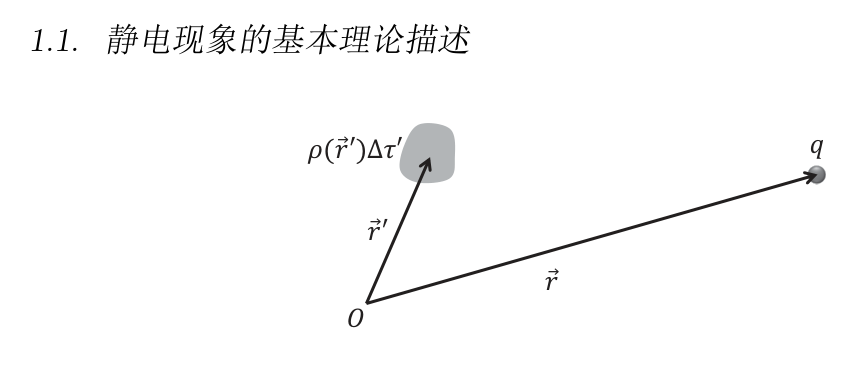

考虑一个连续带电体对处于 $\vec{r}$ 带电量为 $q$ 的力。将连续带电体分成许多微元，其中一个为处于 $\vec{r}_2 = \vec{r}'$ 带电量为 $q_2 = \rho(\vec{r}')\Delta \tau'$ 的点电荷。这里 $\rho(\vec{r}') = (\Delta q / \Delta \tau')_{\Delta r' \to 0}$ 为电荷密度，而 $\Delta \tau'$ 为此微元的体积。则根据库仑定律以及线性叠加原理，整个带电体对的静电力为

$$
\vec{F} = \frac{1}{4\pi\varepsilon_0} \int \frac{q \rho(\vec{r}') d\tau'}{R^3} \vec{R} \tag{1.1.3}
$$

其中，$\vec{R}=\vec{r}-\vec{r}'$。（注：一般情况下我们把源所出的坐标用 $\vec{r}'$ 标记，观察点的坐标用 $\vec{r}$ 标记，由源到观察点的矢量用 $\vec{R}$ 来标记。）
进一步推广，当有两个连续带电体，其电量分布分别为 $\rho_1,\rho_2$ 时，带电体1受到带电体2的总的静电力为

$$
\vec{F}_{12} = \frac{1}{4\pi\varepsilon_0} \int \frac{\rho_1(\vec{r}) \rho_2(\vec{r}') d\tau d\tau'}{R^3} \vec{R} \tag{1.1.4}
$$

#### 1.1.3 电场

由1.1.3可知，对电荷 $q$ 来说，其所受的力与其本身的电量成正比。这启发我们定义一个物理量

$$
\vec{E}(\vec{r}) = \vec{F}(\vec{r}) / q \tag{1.1.5}
$$

这个新的物理量与放在这个位置的电荷没有任何关系，而只与空间其他电荷在此地产生的效果有关。这个量被称为电场。电场的引入，不仅方便我们计算静电力，更重要的是给了我们一个静电相互作用的新的图像。

原来的

$$
\text{电荷} q_1 \stackrel{\text{超距}}{\Longleftrightarrow} \text{电荷} q_2
$$

新的

$$
\text{电荷} q_1 \Longleftrightarrow \text{电场} \Longleftrightarrow \text{电荷} q_2
$$

这个图像与原有的超距相互作用的图像是不一样的，关键是后者引入了作为作用力中介而存在的电场。在静电范畴分辨不出这两种图像的区别，但当所有物理量随时间变化时，可以清楚地看到第二种图像是正确的，而第一种是不正确的。电场象所有其他物质一样，具有能量、动量等，是一种客观存在的物质。显然，一个连续带电体在空间产生的电场为

$$
\vec{E}(\vec{r}) = \frac{1}{4\pi\varepsilon_0} \int \frac{\rho(\vec{r}') d\tau}{R^3} \vec{R} \tag{1.1.6}
$$

#### 1.1.4 电场的散度性质-高斯定理

数学上讲，要完整了解一个矢量场的性质，我们需知道这个场的散度和旋度两方面的性质。换言之，我们需知道场对任意闭合曲面的面积分，及对任意闭合曲线的线积分。关于场的散度性质，我们需知道对于任何闭合曲面电场的面积分。在《电磁学》中我们知道 $\oint \vec{E}(\vec{r})\cdot d\vec{S} = Q/\varepsilon_0$。证明如下：
我们先来看点电荷的情况：

$$
\vec{E} = \frac{1}{4\pi\varepsilon_0} \frac{q}{r^2} \vec{e}_r \tag{1.1.7}
$$

1. 闭合曲面包含电荷

$$
\vec{E} \cdot \Delta\vec{S} = \frac{1}{4\pi\varepsilon_0} \frac{q}{r^2} \cdot \Delta S \tag{1.1.8}
$$

$$
= \frac{1}{4\pi\varepsilon_0} \frac{q}{r^2} \cdot r^2 \cdot \Delta\Omega \tag{1.1.9}
$$

$$
= \frac{q}{4\pi\varepsilon_0} \Delta\Omega \tag{1.1.10}
$$

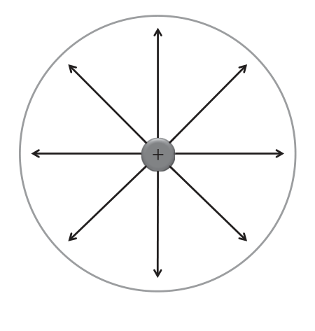

则

$$
\oint \vec{E}\cdot d\vec{S} = \int \frac{q}{4\pi\epsilon_0} d\Omega = \frac{q}{4\pi\epsilon_0}\int d\Omega = \frac{q}{\epsilon_0} \tag{1.1.11}
$$

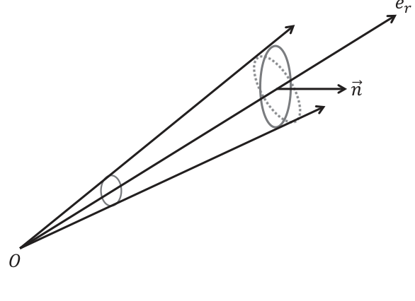

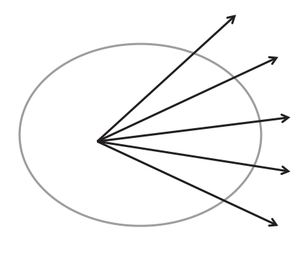

2. 闭合曲面内不包含电荷

$$
\oint \vec{E}\cdot d\vec{S} = \int \vec{E}\cdot d\vec{S}_1 + \int \vec{E}\cdot d\vec{S}_2 \tag{1.1.12}
$$

$$
= \sum_{i=1}^{N} \vec{E}(\vec{r}_i)\cdot \Delta\vec{S}_i + \sum_{j=1}^{N} \vec{E}(\vec{r}_j)\cdot \Delta\vec{S}_j \tag{1.1.13}
$$

$$
= \sum_i [\Delta\Omega_i + (-\Delta\Omega_i)] \tag{1.1.14}
$$

$$
= 0 \tag{1.1.15}
$$

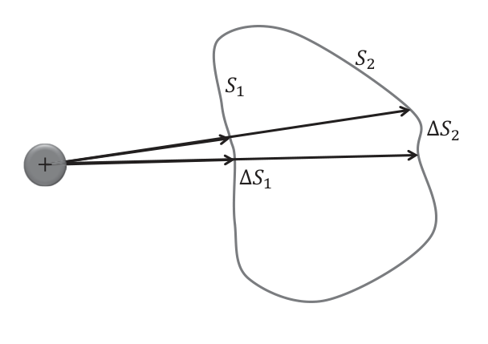

3. 线性叠加原理

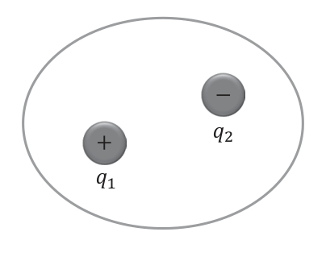

$$
\oint \vec{E}\cdot d\vec{S} = \sum_i \frac{q_i}{\varepsilon_0} = \int_\tau \rho(\vec{r}) \cdot d\tau / \varepsilon_0 \tag{1.1.16}
$$

此即为Gauss定理的数学表达形式。利用数学中矢量场的高斯定理，我们可以把1.1.16改写为

$$
\oint \vec{E}\cdot d\vec{S} = \int [\nabla \cdot \vec{E}(\vec{r})] d\tau = \int \rho(\vec{r}) \cdot d\tau / \varepsilon_0 \tag{1.1.17}
$$

考虑到曲面的任意性，我们得

$$
\nabla \cdot \vec{E}(\vec{r}) = \rho(\vec{r}) / \varepsilon_0 \tag{1.1.18}
$$

上式为Gauss定理的微分表达式。从几何上理解，Gauss定理描述的是场线在空间的分布是否存在奇点，当散度为0时，场线在此处连续，而散度不为0时就表示空间出现了奇点（或导致场线汇聚、或导致发散）。直接对1.1.6式中电场求散度，得

$$
\nabla \cdot \vec{E}(\vec{r}) = \frac{1}{4\pi\varepsilon_0} \int \rho(\vec{r}') d\tau \left(\nabla \cdot \frac{\vec{R}}{R^3}\right) \tag{1.1.19}
$$

对比1.1.18与1.1.19，我们得到一个非常有用的公式

$$
\nabla \cdot \left(\frac{\vec{R}}{R^3}\right) = 4\pi\delta(\vec{R}) \tag{1.1.20}
$$

Tips：严格直接证明上述公式相当不容易，很多时候把它当作已知的公式直接使用。你能否从数学上严格证明？自己尝试一下！

#### 1.1.5 静电场的旋度-安培环路定理

现在我们研究电场的旋度性质 $\nabla \times \vec{E} = ?$，这等价于研究静电场对任意环路的线积分：$\oint \vec{E}\cdot d\vec{l} = ?$。在《电磁学》中，我们通常的求解方法如下：
- 将电场对任意路径的积分分解为：
  1. 电场沿径向的积分
  2. 电场沿切向的积分
- 利用静电场为向心力这一特点可知，（2）的贡献为0，只需考虑（1）的贡献。
- 对任意环路，$\oint \vec{E}\cdot d\vec{l}$ 积分可以简化到一个径向的积分，因此其结果恒为0。

这里我们利用更高等的数学方法证明。首先注意一个非常有用的公式：

$$
\nabla r = \vec{r}/r \rightarrow \nabla R = \vec{R}/R \tag{1.1.21}
$$

由此可以得到另一个恒等式:

$$
\nabla\left(\frac{1}{R}\right) = -\frac{\nabla R}{R^2} = -\frac{1}{R^2}\frac{\vec{R}}{R} = -\frac{\vec{R}}{R^3} \tag{1.1.22}
$$

注：此处用到分部微分公式：$\nabla f(r) = \frac{\partial f}{\partial r}\nabla r,\nabla f(R) = \frac{\partial f}{\partial R}\nabla R$，其实 $\nabla$ 算符同时具有矢量性和微分性，在标量做梯度运算时只显示微分性，因此常规的分部计算法可以大胆地使用。
将上述恒等式带入场的定义：

$$
\vec{E}(\vec{r}) = \frac{1}{4\pi\varepsilon_0} \int \frac{\rho(\vec{r}') d\tau}{R^3} \vec{R} \tag{1.1.23}
$$

即可得

$$
\vec{E}(\vec{r}) = -\frac{1}{4\pi\varepsilon_0} \int \rho(\vec{r}') d\tau \cdot \nabla\left(\frac{1}{R}\right) \tag{1.1.24}
$$

$$
= -\nabla \left[\frac{1}{4\pi\varepsilon_0} \int \frac{\rho(\vec{r}')}{R} d\tau\right] \tag{1.1.25}
$$

$$
= -\nabla \varphi(\vec{r}) \tag{1.1.26}
$$

其中

$$
\varphi(\vec{r}) = \frac{1}{4\pi\varepsilon_0} \int \frac{\rho(\vec{r}')}{R} d\tau \tag{1.1.27}
$$

为标量势。利用静电场的标量势表达1.1.24，我们得到静电场的环路定理的积分表达形式：

$$
\oint \vec{E}\cdot d\vec{l} = -\oint \nabla \varphi(\vec{r})\cdot d\vec{l} = -\oint (\partial \varphi / \partial l)\cdot d l \equiv 0 \tag{1.1.28}
$$

其中 $\partial \varphi/\partial l$ 意味着沿着环路的切线方向对 $\varphi$ 求偏导。上式的物理意义为静电场是保守场。也可以将环路定理写成微分形式：

$$
\nabla \times \vec{E}(\vec{r}) = -\nabla \times \nabla \varphi(\vec{r}) \equiv 0 \tag{1.1.29}
$$

物理意义是静电场是无旋场。“无旋”、“保守”、可定义标量势这三者是相互关联，可以相互导出的，其本质都来源于静电场是向心力。
思考：还有什么形式的场可以定义标量势？
注：到现在为止，$\nabla \cdot \vec{E} = \rho/\varepsilon_0$ 和 $\nabla \times \vec{E} = 0$ 已经给了我们非常完整的电场的图像：有源（从正电荷出发散出来，到负电荷出汇聚），无旋（有头有尾，有始有终）。

#### 1.1.6 电偶极子

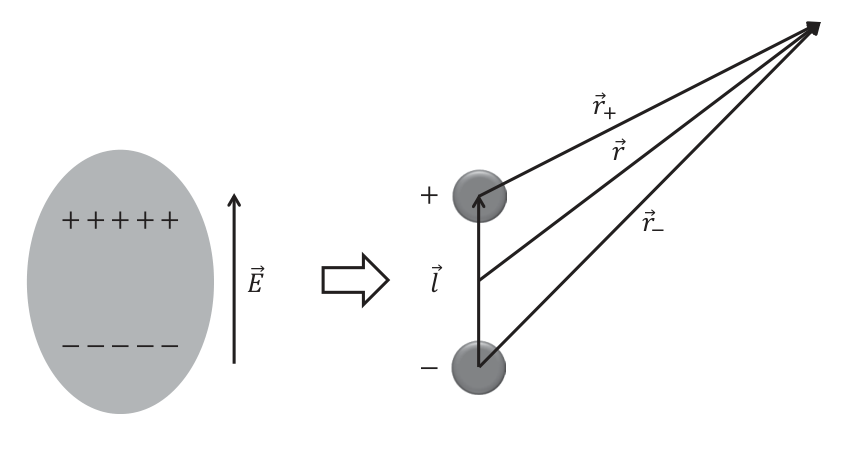

当施加电场于一个中性的物体上时，电场将物体中的正/负电荷拉开。因此为了描述物质的这种对外场的响应，人们定义电偶极子为两个相聚很近的带等电量的正负电荷组成的体系，并研究其电行为。偶极子的大小由偶极距描述，其定义为 $\vec{p} = q\vec{l}$，方向由负电指向正电（思考：为什么要这样定义？）。其实对任意的一个带电体，在远场看，最低价近似下可看成以 $q$ 为带电体总带电量的一个点电荷的贡献，再进一步就能“感受”到偶极子的场的贡献。偶极子场比点电荷的场衰减的快，所以要近一点才能看到。因此研究电偶极子具有重要意义。具体计算偶极子的电势为

$$
\varphi(\vec{r}) = \frac{q}{4\pi\varepsilon_0}\left(\frac{1}{r_+} - \frac{1}{r_-}\right) \tag{1.1.30}
$$

$$
\approx \frac{q}{4\pi\varepsilon_0} \frac{r_- - r_+}{r^2} \tag{1.1.31}
$$

$$
\approx \frac{q}{4\pi\varepsilon_0} \frac{l\cos\theta}{r^2} \tag{1.1.32}
$$

$$
= \frac{p\cos\theta}{4\pi\varepsilon_0 r^2} \tag{1.1.33}
$$

$$
= \frac{\vec{p}\cdot\vec{r}}{4\pi\varepsilon_0 r^3} \tag{1.1.34}
$$

我们注意到偶极子的电势果然比点电荷的电势更快地衰减。计算可知

$$
\vec{E}(\vec{r}) = -\nabla \varphi \tag{1.1.35}
$$

$$
= -\frac{1}{4\pi\varepsilon_0}\left[\frac{\nabla(\vec{p}\cdot\vec{r})}{r^3} + \vec{p}\cdot\vec{r}\nabla\frac{1}{r^3}\right] \tag{1.1.36}
$$

$$
= -\frac{1}{4\pi\varepsilon_0}\left[\frac{\vec{p} - 3(\vec{p}\cdot\hat{r})\hat{r}}{r^3}\right] \tag{1.1.37}
$$

非常容易可以计算出场的分量形式（设 $\hat{p}\parallel \hat{z}$）：

$$
E_r = \frac{p\cos\theta}{2\pi\varepsilon_0 r^3} \tag{1.1.38}
$$

$$
E_\theta = \frac{p\sin\theta}{4\pi\varepsilon_0 r^3} \tag{1.1.39}
$$

$$
E_\phi = 0 \tag{1.1.40}
$$

Tips: 与《电磁学》相比较，《电动力学》中更讲究数学形式的紧凑的矢量表述方式，而不是写成分量后的形式或是在某一些特定条件下的（比如 $r \parallel z$）形式。熟练掌握常用的几个矢量运算是必要的：$\nabla r = \vec{r}/r$，$\nabla(r^n) = nr^{n-1}\hat{r}$，$\nabla^2(1/r) = -4\pi\delta(\vec{r})$ 等。

### 1.2 静磁现象的基本理论描述

磁现象的描述要比电现象复杂。在1820年之前，磁现象是与磁铁（磁石）等相连，表现神秘，不易定量研究。直至Oersted发现电流也可以产生与磁铁一样的现象，人们才可以定量研究磁现象。我们下面将与电现象对比，简要总结静磁现象的基本理论描述。

#### 1.2.1 电流（磁的来源、与电荷对比）

电流——顾名思义为电荷的流动。为定量描述电荷流动，定义电流为：单位时间内垂直穿过某一特定截面的电荷量，用 $I$ 表示：

$$
I = \Delta q / \Delta t \big|_{S} \tag{1.2.1}
$$

$I$ 是个描述电荷流动的积分的总效果。为了更微观地看电荷的流动情况，定义电流密度 $\vec{j}$ 为单位面积单位时间通过的电荷量 $j = \frac{\Delta q}{\Delta t\Delta S}$，可以推知 $j = \frac{\rho\Delta\Omega}{\Delta t\Delta S} = \frac{\rho\Delta S v\Delta t}{\Delta t\Delta S} = \rho v$。

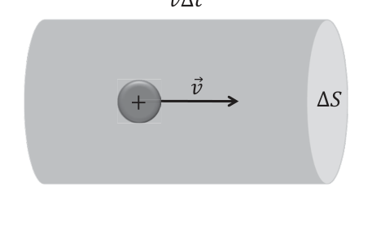

进一步考虑电流密度的矢量性，可以推广以上结果定义矢量形式的电流密度：

$$
\vec{j} = \rho(\vec{r})\vec{v}(\vec{r}) \tag{1.2.2}
$$

式中 $\vec{v}$ 代表在 $\vec{r}$ 处的电荷的运动速度，$\rho$ 为电荷密度。考虑电流密度的矢量性之后，其与电流 $I$ 之间的关系为更一般的形式：

$$
\vec{j} = \rho(\vec{r})\vec{v}(\vec{r}) \Longrightarrow I = \int_S \vec{j}\cdot d\vec{S} \tag{1.2.3}
$$

上式显然是合理的，因为只有投影到 $d\vec{S}$ 方向上的电流密度才能通过这块面积，而与其平行的分量对通过此截面积的总电流 $I$ 没有贡献。
电荷守恒：实验表明电荷是守恒的，即电荷不能消灭及产生，而只能转移。在空间内任取一封闭曲面 $S$，单位时间内穿流出去的电荷量为（根据电流密度的定义1.2.1）$\oint_S \vec{j}\cdot d\vec{S}$，流出去的电荷量应等于封闭曲面 $S$ 内总

电荷在单位时间内的减少量，即 $-\frac{d}{dt}\int_{V}\rho d\tau ,V$ 是 $S$ 所包围的体积，所以

$$
\oint_{S} \vec{j} \cdot d \vec{S} = - \frac{d}{d t} \int_{V} \rho d \tau \tag{1.2.4}
$$

根据高斯定理，有

$$
\vec{j} \cdot d \vec{S} = \int_{V} \nabla \cdot \vec{j} d \tau \tag{1.2.5}
$$

代入1.2.4可得

$$
\int_{V} \left(\nabla \cdot \vec{j} + \frac{\partial \rho}{\partial t}\right) d \tau = 0 \tag{1.2.6}
$$

由于曲面 $S$ 是任意选取的，所以被积函数恒为零，即

$$
\nabla \cdot \vec{j} + \frac{\partial \rho}{\partial t} = 0 \tag{1.2.7}
$$

1.2.7式是电荷守恒定律的数学表达式，也称连续性方程。

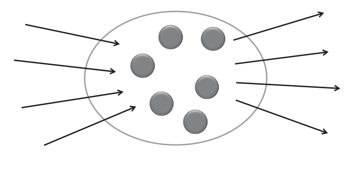

注：所有的“*流密度”的微观形式都是“**密度（乘以）速度”，如粒子流密度，能流密度，物理意义均为单位时间单位面积通过的粒子数（能量、电荷等）。
守恒律的普遍表达形式（粒子数守恒、能量守恒、…）为：

$$
\text{流密度的散度} + \text{数密度的变化率} = 0
$$

在稳定电流情况下,由于$\partial\rho/\partial t=0$,所以有$\nabla \cdot \vec{j}=0$,电流密度的散度为0。这一点从几何上看意味着电流线在空间任何一点均没有源头,这表示稳恒条件下电流线是闭合无源的。非稳恒时电流线的汇聚/发散总是伴随着电荷的积累,亦即$\partial\rho/\partial t$项。

### 1.2.2 安培定律（与库仑定律对比）

既然电流是磁场的来源,类比库仑定律,我们应考虑两个这样的基本单位(电流元,定义为$\vec{j}d\tau$,与$\rho d\tau$地位相仿)之间的作用力。安培定律就是这样一个实验定律,其地位与库伦定律相仿。若真空中的两个电流元$\vec{j}_1 d\tau_1$和$\vec{j}_2 d\tau_2$,则安培定律告诉我们2对1的作用力$d\vec{F}_{12}$为

$$
d\vec{F}_{12} = \frac{\mu_0}{4\pi} \frac{\vec{j}_1 d\tau_1 \times (\vec{j}_2 d\tau_2 \times \vec{R}_{12})}{\vec{R}_{12}^3} \quad (1.2.8)
$$

其中$\vec{R}_{12} = \vec{r}_1 - \vec{r}_2$为2指向1的位置矢量。与库仑定律比较,我们可以看到:

1. 电流元之间的相互作用力也服从平方反比律。
2. 电流元之间作用力非向心力——磁场的散度及旋度行为与电场将截然不同！
3. 电流元之间的相互作用力不满足牛顿的作用力与反作用力定律, 即$d\vec{F}_{12} \neq d\vec{F}_{21}$ (比如考虑下图的情况)。

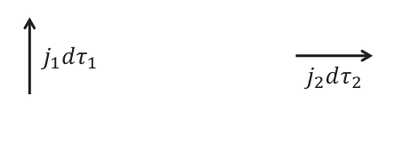

对这个问题的简单回应是因为实际上不可能存在稳定的电流元,实验所能测量的只能是闭合回路的情况。

——以下为选读内容——

考虑两闭合载流线圈，则2对1的作用力为

$$
\vec{F}_{12} = \frac{\mu_{0} I_{1} I_{2}}{4 \pi} \oint_{l_{1}} \oint_{l_{2}} \frac{d \vec{l}_{1} \times (d \vec{l}_{2} \times \vec{R}_{12})}{\vec{R}_{12}^{3}} \tag{1.2.9}
$$

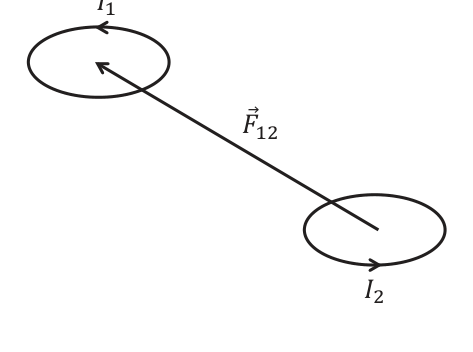

利用矢量公式 $\vec{A} \times (\vec{B} \times \vec{C}) = \vec{B} (\vec{C} \cdot \vec{A}) - \vec{C} (\vec{A} \cdot \vec{B})$ （非常有用，请牢记），可得

$$
\vec{F}_{12} = \frac{\mu_{0} I_{1} I_{2}}{4 \pi} \oint_{l_{1}} \oint_{l_{2}} \left[ \frac{d \vec{l}_{2} (d \vec{l}_{1} \cdot \vec{R}_{12})}{\vec{R}_{12}^{3}} - \frac{\vec{R}_{12} (d \vec{l}_{2} \cdot d \vec{l}_{1})}{\vec{R}_{12}^{3}} \right] \tag{1.2.10}
$$

$$
= - \frac{\mu_{0} I_{1} I_{2}}{4 \pi} \oint_{l_{2}} d \vec{l}_{2} \oint_{l_{1}} \left[ d \vec{l}_{1} \cdot \nabla \frac{1}{R_{12}} \right] - \frac{\mu_{0} I_{1} I_{2}}{4 \pi} \oint_{l_{1}} \oint_{l_{2}} \frac{\vec{R}_{12} (d \vec{l}_{2} \cdot d \vec{l}_{1})}{\vec{R}_{12}^{3}} \tag{1.2.11}
$$

$$
= 0 + - \frac{\mu_{0} I_{1} I_{2}}{4 \pi} \oint_{l_{1}} \oint_{l_{2}} \frac{\vec{R}_{12} (d \vec{l}_{2} \cdot d \vec{l}_{1})}{\vec{R}_{12}^{3}} \tag{1.2.12}
$$

$$
= - \vec{F}_{21} \tag{1.2.13}
$$

即闭合回路之间的相互作用力满足牛顿第三定律。

——以上为选读内容——

然而我们对这个经典回答并不满足，深思以后，至少有这样几个问题值得研究：

1. 我们可以让一个电荷做匀速运动（速度$\ll$光速），这样就制造出空间的一个电流元$\vec{j} = qv\delta(\vec{r} - vt\hat{x})$，这样两个匀速运动的电荷之间的磁力是什么？
2. 它们两个的相互作用满足不满足牛顿第三定律呢？为什么？
3. 牛顿第三定律是本质的定律吗？若不是，其本质是什么？

### 1.2.3 磁场

类比电场的定义，可定义磁场。将作用在电流元$\vec{j}_1 d\tau_1$上的力写为

$$
d\vec{F}_1 = \vec{j}_1 d\tau_1 \times \vec{B}(\vec{r}) \quad (1.2.14)
$$

其中$\vec{B}(\vec{r}) = \frac{\mu_0}{4\pi}\vec{j}_2 d\tau_2 \times \frac{\vec{R}_{12}}{R_{12}^3}$为电流元$\vec{j}_2 d\tau_2$在$\vec{r}$处产生的磁场。由叠加原理，对任意的电流分布$\vec{j}(\vec{r}')$，其在$\vec{r}$处产生的磁场为

$$
\vec{B}(\vec{r}) = \frac{\mu_0}{4 \pi} \int \frac{\vec{j}(\vec{r}') d\tau' \times \vec{R}}{R^3} \quad (1.2.15)
$$

函数$\vec{B}(\vec{r})$称为磁感应强度（纯粹是由于历史上的原因才不把它称为磁场强度）。上式常称为Biot-Sarvart定律。
以速度$\vec{v}$运动的电荷$q$产生的电流密度为$\vec{j} = q\vec{v}\delta(\vec{r} - vt\hat{x})$（仅在$v \ll$光速时成立），因此其在$\vec{B}$场中所受的力为

$$
\vec{F} = \int_{\tau} q\delta(\vec{r} - vt\hat{x})d\tau\vec{v} \times \vec{B} = q\vec{v} \times \vec{B} \quad (1.2.16)
$$

若空间既有磁场又有电场，则总受力为

$$
\vec{F} = q (\vec{E} + \vec{v} \times \vec{B}) \quad (1.2.17)
$$

这就是描述带电粒子在空间既有电场又有磁场时的受力——Lorentz 力。

### 1.2.4 $\vec{B}(\vec{r})$ 的散度

要完整理解矢量场的全部特征，须研究其散度和旋度。对比具有平方反比+径向的静电场，磁场为横向场，故可以预期 $\vec{B}$ 场的散度及旋度性质一定与静电场相当不同。考虑散度性质，利用计算标势 $\varphi$ 时采用的技巧，可将磁场改写为

$$
\vec{B} (\vec{r}) = \frac{\mu_{0}}{4 \pi} \int \vec{j} (\vec{r}^{\prime}) \times \frac{\vec{R}}{R^{3}} d \tau^{\prime} \tag{1.2.18}
$$

$$
= - \frac{\mu_{0}}{4 \pi} \int \vec{j} (\vec{r}^{\prime}) \times \left(\nabla \frac{1}{R}\right) d \tau^{\prime} \tag{1.2.19}
$$

$$
= \frac{\mu_{0}}{4 \pi} \int \left(\nabla \frac{1}{R}\right) \times \vec{j} (\vec{r}^{\prime}) d \tau^{\prime} \tag{1.2.20}
$$

$$
= \frac{\mu_{0}}{4 \pi} \int \nabla \times \frac{\vec{j} (\vec{r}^{\prime})}{R} d \tau^{\prime} \tag{1.2.21}
$$

$$
= \nabla \times \left[ \frac{\mu_{0}}{4 \pi} \int \frac{\vec{j} (\vec{r}^{\prime})}{R} d \tau^{\prime} \right] \tag{1.2.22}
$$

$$
= \nabla \times \vec{A} \tag{1.2.23}
$$

其中

$$
\vec{A} (\vec{r}) = \frac{\mu_{0}}{4 \pi} \int \frac{\vec{j} (\vec{r}^{\prime})}{R} d \tau^{\prime} \tag{1.2.24}
$$

定义为矢势，地位与电场的标势相对应。因此

$$
\nabla \times \vec{B} (\vec{r}) = \nabla \cdot (\nabla \times \vec{A}) \equiv 0 \tag{1.2.25}
$$

注：
1. 在1.2.21的推导中，中，我们用到了矢量运算公式

$$
\nabla \times (\vec{a} \psi) = (\nabla \times \vec{a}) \psi + \nabla \psi \times \vec{a} \tag{1.2.26}
$$

以及 $\vec{j} (\vec{r}^{\prime})$ 不依赖于 $\vec{r}$ 的性质。先利用分步微分将 $\nabla$ 分解： $\nabla \rightarrow \vec{\nabla}_R +\vec{\nabla}_j$ ，然后分别运算到 $R$ 和 $j$

$$
\nabla \times \left(\frac{\vec{j} (\vec{r}^{\prime})}{R}\right) = \nabla_{R} \left(\frac{1}{R}\right) \times \vec{j} (\vec{r}^{\prime}) + \left(\nabla_{j} \times \vec{j} (\vec{r}^{\prime})\right) / R \tag{1.2.27}
$$

注意到 $\nabla_{j}\times \vec{j} (\vec{r}^{\prime})\equiv 0$ （因为 $\vec{j} (\vec{r}^{\prime})$ 不依赖于 $r$），故

$$
\nabla \times \left(\frac{\vec{j} (\vec{r}^{\prime})}{R}\right) = \nabla \left(\frac{1}{R}\right) \times \vec{j} (\vec{r}^{\prime}) \tag{1.2.28}
$$

2. 尽管我们本节研究的是稳恒电流，此处的推导丝毫没有假设电流不依赖于时间。换言之，若随时间变化的电流产生的磁场仍由B-S定律描述，则此时高斯定理仍成立。这条性质在随后我们推广Maxwell方程式到非稳态时有重要作用。

### 1.2.5 $\vec{B}(\vec{r})$ 的旋度

下面来求 $\vec{B} (\vec{r})$ 的旋度。由1.2.23式得

$$
\nabla \times \vec{B} (\vec{r}) = \nabla \times (\nabla \times \vec{A}) = \nabla (\nabla \cdot \vec{A}) - \nabla^{2} \vec{A} \tag{1.2.29}
$$

注：上面这个公式可以通过将矢量叉积公式 $\vec{a} \times (\vec{b} \times \vec{c}) = \vec{b} (\vec{a} \cdot \vec{c}) - \vec{c} (\vec{a} \cdot \vec{b})$ （这个公式非常有用，应当牢记）作代换 $\nabla \leftrightarrow \vec{a}, \nabla \leftrightarrow \vec{b}, \vec{c} \leftrightarrow \vec{A}$ 得到。
先看第一项：

$$
\nabla \cdot \vec{A} = \nabla \cdot \frac{\mu_{0}}{4 \pi} \int \frac{\vec{j} (\vec{r}^{\prime})}{R} d \tau^{\prime} = \frac{\mu_{0}}{4 \pi} \int \left(\nabla \frac{1}{R}\right) \cdot \vec{j} (\vec{r}^{\prime}) d \tau^{\prime} \tag{1.2.30}
$$

利用恒等式

$$
\left. \begin{array}{r l} \nabla f (R) & = \frac{\partial f}{\partial R} \nabla R = \frac{\partial f}{\partial R} \frac{(\vec{r} - \vec{r}^{\prime})}{R} \\ \nabla^{\prime} f (R) & = \frac{\partial f}{\partial R} \nabla^{\prime} R = \frac{\partial f}{\partial R} \frac{(\vec{r}^{\prime} - \vec{r})}{R} \end{array} \right\} \Rightarrow \nabla f (R) = - \nabla^{\prime} f (R) \tag{1.2.31}
$$

注：注意 $\nabla$ 和 $\nabla^{\prime}$ 的不同，前者作用在变量 $\vec{r}$ ——观察点坐标，后者作用于变量 $\vec{r}^{\prime}$ ——源所在坐标。
可将1.2.30式改写成全微分的形式

$$
\nabla \cdot \vec{A} = - \frac{\mu_{0}}{4 \pi} \int \left(\nabla^{\prime} \frac{1}{R}\right) \cdot \vec{j} (\vec{r}^{\prime}) d \tau^{\prime} \tag{1.2.32}
$$

$$
= - \frac{\mu_{0}}{4 \pi} \int \left[ \nabla^{\prime} \cdot \left(\frac{\vec{j} (\vec{r}^{\prime})}{R}\right) - \frac{1}{R} \left(\nabla^{\prime} \cdot \vec{j} (\vec{r}^{\prime})\right) \right] d \tau^{\prime} \tag{1.2.33}
$$

注意到在稳恒电流条件下，有 $\nabla^{\prime}\cdot \vec{j} (\vec{r}^{\prime}) = -\dot{\rho} = 0$ ，故

$$
\nabla \cdot \vec{A} = - \frac{\mu_{0}}{4 \pi} \int \nabla^{\prime} \cdot \left(\frac{\vec{j} (\vec{r}^{\prime})}{R}\right) d \tau^{\prime} = - \frac{\mu_{0}}{4 \pi} \oint \frac{\vec{j} (\vec{r}^{\prime})}{R} \cdot d \vec{S}^{\prime} \Big |_{r^{\prime} \to \infty} = 0 \tag{1.2.34}
$$

这里考虑电流分布在有限区域，无穷远处边界处的电流密度一定为零。第二项为：

$$
\nabla^{2} \vec{A} = \frac{\mu_{0}}{4 \pi} \int \nabla^{2} \frac{\vec{j} (\vec{r}^{\prime})}{R} d \tau^{\prime} = \frac{\mu_{0}}{4 \pi} \int \vec{j} (\vec{r}^{\prime}) \left(\nabla^{2} \frac{1}{R}\right) d \tau^{\prime} \tag{1.2.35}
$$

将第一讲中的恒等式略加修改可得

$$
4 \pi \delta (\vec{R}) = \nabla \cdot \left(\frac{\vec{R}}{R^{3}}\right) = - \nabla \cdot \left(\nabla \frac{1}{R}\right) = - \nabla^{2} \frac{1}{R} \tag{1.2.36}
$$

将其带入1.2.35得到

$$
\nabla^{2} \vec{A} = - \mu_{0} \int \vec{j} (\vec{r}^{\prime}) \delta (\vec{R}) d \tau^{\prime} = - \mu_{0} \vec{j} (\vec{r}) \tag{1.2.37}
$$

整理两项贡献可得 $\vec{B}$ 的旋度为

$$
\nabla \times \vec{B} = \mu_{0} \vec{j} (\vec{r}) \tag{1.2.38}
$$

1.2.38式称为安培环路定理的微分形式，对应的积分形式为

$$
\oint \vec{B} \cdot d \vec{l} = \mu_{0} I \tag{1.2.39}
$$

Tips:

1. 从推导过程中可以看出, 1.2.38式显然只在稳恒电流条件下成立, 一般情况下的形式必须重新考虑! 另外, 旋度不为0, 意味着场在打转, 一圈积分下来比不为0, 因此磁场是有旋场, 不是保守场。
2. 有同学会害怕使用Delta函数。其实Delta函数是由物理学家Dirac引入的物理工具, 目的是用来方便地描述点电荷等问题, 其数学的严谨性是建立了泛函分析才被证明。在本课程中, 只需知道其积分表达式 $\int \delta(x - x')dx = 1$, $\int \delta(\vec{r} - \vec{r}')d\vec{r} = 1$ 以及性质 $\int \delta(\vec{r} - \vec{r}')f(\vec{r})d\vec{r} = f(\vec{r}')$, $\delta(x - x') = \delta(x' - x)$, 就可以了。

### 1.2.6 磁偶极子

当外加电场时, 物质中的正电荷受到沿电场的作用力而负电荷受到反向于电场的作用力, 因此正负电荷被拉开形成电偶极子。与此相对应, 对一个物质施加磁场, 电子在磁场Lorentz力的作用下做回旋运动, 形成一个分子环流。因此, 一个环形稳恒电流在静磁学中起到与电偶极子在静电学中完全一样的作用, 我们叫它磁偶极子, 都是物质对外场的基本响应形式。下面我们就研究一个磁偶极子 (电流$I$, 线圈半径$a$) 的磁场, 与$\vec{p}$类似, 我们先计算$\vec{m}$产生的势。

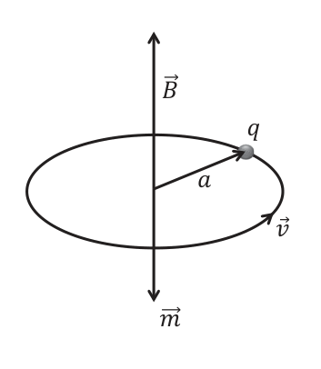

$$
\vec{A} (\vec{r}) = \frac{\mu_{0}}{4 \pi} \int \frac{\vec{j} (\vec{r}^{\prime})}{R} d \tau^{\prime} = \frac{\mu_{0} I}{4 \pi} \int \frac{1}{R} d \vec{l} \tag{1.2.40}
$$

在远场条件下 $r \gg r'$，利用Taylor展开到第一阶可得

$$
\frac{1}{R} = \frac{1}{| \vec{r} - \vec{r^{\prime}} |} = \frac{1}{\left(r^{2} - 2 \vec{r} \cdot \vec{r^{\prime}} + r^{\prime 2}\right)^{1 / 2}} \approx \frac{1}{r} + \frac{\vec{r} \cdot \vec{r^{\prime}}}{r^{3}} \tag{1.2.41}
$$

代入上式后，第一项贡献 $\sim \frac{1}{r}\oint dl^{\prime}\equiv 0$ （闭合回路，稳恒电流，绕一圈当然为0），故

$$
\vec{A} (\vec{r}) = \frac{\mu_{0} I}{4 \pi r^{3}} \int (\vec{r} \cdot \vec{r}^{\prime}) d \vec{l} \tag{1.2.42}
$$

为了便于计算，考虑一个大小为 $a \times b$ 的矩形线圈。计算 $x$ 分量可得

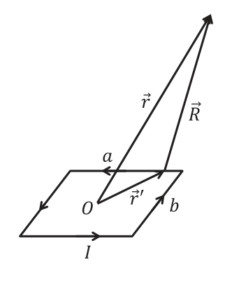

$$
A_{x} (\vec{r}) = \frac{\mu_{0}}{4 \pi r^{3}} \left[ \int_{- a / 2}^{a / 2} (x x^{\prime} - y b / 2) d x^{\prime} + \int_{a / 2}^{- a / 2} (x x^{\prime} + y b / 2) d x^{\prime} \right] \tag{1.2.43}
$$

$$
= - \frac{\mu_{0}}{4 \pi r^{3}} y b a \tag{1.2.44}
$$

同理可以得到 $y$ 分量的表达式

$$
A_{y} (\vec{r}) = \frac{\mu_{0}}{4 \pi r^{3}} x b a \tag{1.2.45}
$$

综合可得

$$
\vec{A} (\vec{r}) = \frac{\mu_{0} I b a}{4 \pi r^{3}} (- y \hat{x} + x \hat{y}) \tag{1.2.46}
$$

注意到 $\vec{m} = I\vec{S} = Iab\hat{z}$，类似电偶极子的标势，我们可以将磁偶极子的矢势写成更紧凑的形式

$$
\vec{A}(\vec{r}) = \frac{\mu_0}{4\pi} \cdot \frac{\vec{m} \times \vec{r}}{r^3} \qquad (1.2.47)
$$

由此可进一步求出空间的磁场

$$
\vec{B}(\vec{r}) = \nabla \times \vec{A} = \frac{\mu_0}{4\pi} \nabla \times \left( \vec{m} \times \frac{\vec{r}}{r^3} \right) = -\frac{\mu_0}{4\pi} \left[ \frac{\vec{m} - 3(\vec{m} \cdot \hat{r})\hat{r}}{r^3} \right] \qquad (1.2.48)
$$

推导上式时考虑了远场条件，则$r \neq 0$。我们发现磁偶极子的磁场与电偶极子的电场的形式完全一致！这并不奇怪，在远场看，$p$与$m$的场是完全一样，尽管近场结构很不一样。这事实上蕴含着很深的物理：在无源区，电场的磁场满足一样的方程。

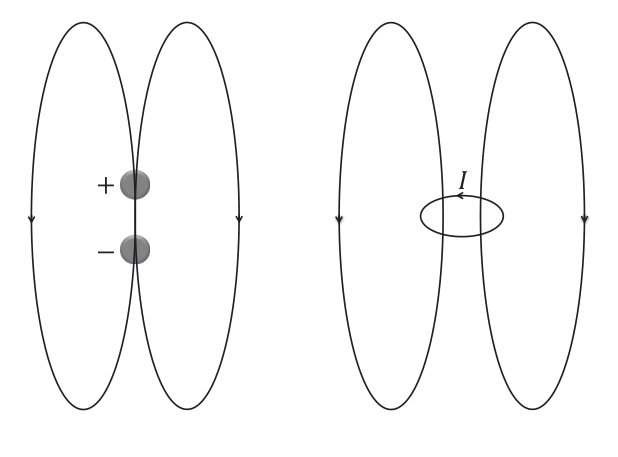

对比静电场与静磁场，发现它们之间有着惊人的对称性。以后我们还会发现电、磁之间更多的对称性，这在学习《电动力学》中（特别是与磁场相关的问题时特别需要注意的）。

## 1.3 电磁感应定律

自从奥斯特发现了电流产生磁场之后，人们一直在研究是否存在相反的效应，即磁场能不能产生电流。Faraday总结大量实验建立了描述磁产生电的电磁感应定律，对一个闭合的线圈，Faraday的实验表明：

1. 仅当通过这个线圈的磁通量产生变化时，线圈之中才会产生感应电流；
2. 电流的大小与线圈材料的电导成正比（同样形状的线圈，线圈材料的导电性越好，电流越大）

这第二个性质预示着电磁感应效应中更基本的物理量应当是电动势，而不是电流。总结了大量的实验，Faraday给出了感应电动势的定量表达式

$$
\epsilon_{\text{感}} = \left| \frac{d}{dt} \int_S \vec{B} \cdot d\vec{S} \right| \qquad (1.3.1)
$$

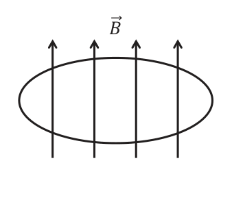

感生电动势(电流)的方向是由楞次给出的,用物理的语言表示,即“感生电流的产生是用来抵消磁通量的改变的”。这条规律其实正是能量守恒的必然要求!(思考一下假如感生电流的产生是增强磁通量的改变,则世界会变成什么样子?)总结法拉弟和楞次的贡献,完整的电磁感应定律是

$$
\epsilon_{\text {感 }}=-\frac{d}{d t} \int_{S} \vec{B} \cdot d \vec{S} \qquad(1.3.2)
$$

显然，磁通量的改变可以由两种机制产生：

|  | 电 | 磁 |
|---|---|---|
| 源 | $\rho$ | $\vec{j}$ |
| 场 | $\vec{E}(\vec{r}) = \frac{1}{4\pi\varepsilon_0}\int_{\tau}\frac{\rho(\vec{r}')d\tau}{R^3}\vec{R}$ | $\vec{B}(\vec{r}) = \frac{\mu_0}{4\pi}\int\frac{\vec{j}d\tau'\times\vec{R}}{R^3}$ |
| 力 | $\vec{F} = \rho d\tau \vec{E}$ | $\vec{F} = \vec{j}d\tau \times \vec{B}$ |
| 散度 | $\nabla \cdot \vec{E}(\vec{r}) = \rho(\vec{r})/\varepsilon_0$ | $\nabla \cdot \vec{B}(\vec{r}) = 0$ |
| 旋度 | $\nabla \times \vec{E}(\vec{r}) = 0$ | $\nabla \times \vec{B}(\vec{r}) = \mu_0\vec{j}(\vec{r})$ |
| 势 | $\vec{E}(\vec{r}) = -\nabla \varphi$ $\varphi = \frac{1}{4\pi\varepsilon_0}\int_{\tau}\frac{\rho(\vec{r}')d\tau}{R}$ | $\vec{B}(\vec{r}) = \nabla \times \vec{A}$ $\vec{A} = \frac{\mu_0}{4\pi}\int\frac{\vec{j}(\vec{r}')d\tau'}{R}$ |
| 偶极子的势 | $\varphi = \frac{1}{4\pi\varepsilon_0}\frac{\vec{p}\cdot\vec{r}}{r^3}$ | $\vec{A}(\vec{r}) = \frac{\mu_0}{4\pi}\frac{\vec{m}\times\vec{r}}{r^3}$ |
| 偶极子的场 | $\vec{E}_p = -\frac{1}{4\pi\varepsilon_0}\left[\frac{\vec{p} - 3(\vec{p}\cdot\hat{r})\hat{r}}{r^3}\right]$ | $\vec{B}_m = -\frac{\mu_0}{4\pi}\left[\frac{\vec{m} - 3(\vec{m}\cdot\hat{r})\hat{r}}{r^3}\right]$ |

表 1.1 静电场与静磁场的对称性

1. 磁场本身发生变化（$\vec{B}$变，称之感生电动势）。
2. 回路相对磁场发生变化（$d\vec{S}$ 变，称之为动生）。

注意到电动势的定义为外力将单位电量的电荷在环路上驱动一周所提供的能量，即 $\varepsilon = \Delta W / q = \oint \vec{F}_K\cdot d\vec{l} /q$ （其中 $\vec{F}_K$ 为电荷受到的力），则可以将电动势改写成

$$
\varepsilon_{\text {感}} = \oint_{C} \vec{E}_{K} \cdot d \vec{l} \tag{1.3.3}
$$

其中 $\vec{E}_K = \vec{F}_K / q$ 与静电场同样量纲。对电荷来讲，它既能感受到静电场的静电力，也能感受到非静电起源的这个场的作用力，因此后者也称为一种电场，尽管其为“非静电来源的电场”。

对第一种情况，1.3.2式可改写成

$$
\oint_{C} \vec{E}_{K} \cdot d \vec{l} = - \int_{S} \frac{\partial \vec{B}}{\partial t} \cdot d \vec{S} \tag{1.3.4}
$$

利用斯托克斯定理: $\oint_{C}\vec{E}_{K}\cdot d\vec{l}=\int_{S}\left(\nabla\times\vec{E}_{K}\right)\cdot d\vec{S}$ , 得。因为线圈回路是任意的故积分曲面是任意的，所以得到

$$
\nabla \times \vec{E}_{K} = - \frac{\partial \vec{B}}{\partial t} \tag{1.3.5}
$$

此即是电磁感应定律的微分形式, 式中的 $\vec{E}_K$ 和 $\vec{B}$ 是相对于同一参考系定义的。

第二种情况要复杂许多，因为此时线圈在运动，此时线圈内的电荷受到的驱动电场是在一个相对于实验室运动的坐标系中的电场，用 $\vec{E}_K^{\prime}$ 表示。 $\vec{E}_K^{\prime}$ 与 $\vec{B}$ 的关系是两个相对运动的坐标系中场的关系。对这个问题的深入理解，我们将推迟到学习相对论时进行。

1.3.5式显示：当磁场发生变化时，

1. 空间中会激发出类似静磁场的（这里 $-\dot{B} / \mu_0$ 等价于电流密度）蜗旋电场；
2. 这种电场不是由电荷激发的，而是由变化的磁场产生的；
3. 它们的存在并不依赖于有没有线圈，线圈中产生电流只是一个探测手段；
4. $\vec{E}_K$和静电场一样对电荷产生驱动力$\vec{F} = q(\vec{E}_S + \vec{E}_K)$，因此对电荷来讲，它感知到的就是空间的总场$\vec{E} = \vec{E}_S + \vec{E}_K$，无论来源。

## 1.4 麦克斯韦方程组

前面几节中，我们讲述了电磁现象的基本实验定律，现总结如下：

$$
\left. \begin{array}{l} \nabla \cdot \vec{E}_S = \rho / \varepsilon_0 \\ \nabla \times \vec{E}_S = 0 \end{array} \right\} \quad \text{静止电荷} \qquad (1.4.1)
$$

$$
\left. \begin{array} {l} \nabla \cdot \vec{B}_S = 0 \\ \nabla \times \vec{B}_S = \mu_0 \vec{j} \end{array} \right\} \quad \text{稳定电流} \qquad (1.4.2)
$$

$$
\nabla \times \vec{E}_K = -\frac{\partial \vec{B}}{\partial t} \quad \text{变化磁场} \qquad (1.4.3)
$$

它们分别都有自己的适用条件和范围。在一般的情况下，所有的场量及激发它们的源($\rho, \vec{j}$)都可能随时间变化，此时描述它们行为的电磁规律是什么呢？Maxwell仔细研究了这个问题，总结出了Maxwell方程组。让我们假设自己就是当年的Maxwell，面对已经建立的实验定律思考一下一般的规律应当是怎样的。

### 1.4.1 第一条方程

$\nabla \cdot \vec{E}_S = \rho / \varepsilon_0$是由库仑定律导出的。它的直观物理图像是单位电荷激发$1/\varepsilon_0$根电场线。在普遍情况下，电场可以随时间变化，电场的变化有两种可能的起源：

1. 源电荷运动；
2. 总电场中含有感应电场 $\vec{E}_K$。

对第一个可能，电荷运动是其发出的电力线将跟随它运动，因此在 $t$ 时刻在 $r$ 位置处做一无限小的闭合区间，可以预期此时刻电场线通过表面的总数仍然与其中的电量成正比。对第二个可能，注意到 $\vec{E}_K$ 与静磁场非常类似，是围绕着磁场变化产生的蜗旋场，而这种电场场线显然是连续无源的，可以预期 $\nabla \cdot \vec{E}_K = 0$ 。综合这两个考虑，对空间的总电场来说：

$$
\nabla \cdot \vec{E} (\vec{r}, t) = \nabla \cdot \vec{E}_{S} + \nabla \cdot \vec{E}_{K} = \rho (\vec{r}, t) / \varepsilon_{0} \tag{1.4.4}
$$

注：直接从电磁感应定律的原始形式不能推出感应电场为无源场 $\nabla \cdot \vec{E}_K = 0$ 的结论的。这应当是Maxwell做的合理推广，正确与否被后来的无数实验所验证。有机会查查历史上Maxwell当时是怎样得到这个结论的。

### 1.4.2 第二条方程

在普遍情况下电场应当是总场，故其旋度为

$$
\nabla \times \vec{E} = \nabla \times \vec{E}_{S} + \nabla \times \vec{E}_{K} = - \frac{\partial \vec{B}}{\partial t} \tag{1.4.5}
$$

### 1.4.3 第三条方程

虽然 $\nabla \cdot \vec{B} = 0$ 是对静磁场推出的，我们注意到在推导的过程中并没有利用到电流必须稳恒的条件（即 $\nabla' \cdot \vec{j}(\vec{r}') = 0$）。从物理上讲，散度刻画的是场线是否有奇点（源），自然界不存在磁荷，可以想象即使在物理量随时间变化时磁场线仍然连续。综合以上考虑，在一般情况下的一个大胆而合理的推论是磁场的高斯定理仍成立：

$$
\nabla \cdot \vec{B}(\vec{r}, t) = 0 \qquad (1.4.6)
$$

但这个推广必须与其他定律（注意这里我们已经推广了2条方程！）不互相矛盾，不妨对与磁场关联的法拉第定律两边取散度：

$$
\nabla \cdot (\nabla \times \vec{E}) = -\nabla \cdot \frac{\partial \vec{B}}{\partial t} \qquad (1.4.7)
$$

因为$\nabla \cdot (\nabla \times \vec{E}) \equiv 0$，所以

$$
\nabla \cdot \frac{\partial \vec{B}}{\partial t} = \frac{\partial}{\partial t} \nabla \cdot \vec{B} = 0 \qquad (1.4.8)
$$

即$\nabla \cdot \vec{B} = $常数（与时间无关），此常数决定于初始时刻的值。假设变化的电磁场是由初始静态的电磁场演化而来的，上式意味着此常数$= 0$（因为静态磁场满足高斯定理），因此随时间变化的条件下$\nabla \cdot \vec{B} = 0$仍然正确！

### 1.4.4 第四条方程

与推导高斯定理不同，推导环路定理$\nabla \times \vec{B} = \mu_0 \vec{j}$时我们用到了稳恒电流的条件$\nabla \cdot \vec{j}_S = 0$。然而$\nabla \cdot \vec{j} = 0$在一般情况下不成立，根据电荷守恒定律，有

$$
\nabla \cdot \bar{j} = -\frac{\partial \rho}{\partial t} \neq 0 \qquad (1.4.9)
$$

因此在一般情况下$\nabla \times \vec{B} = \mu_0 \vec{j}$不再成立。为了证明这一点，对$\nabla \times \vec{B} = \mu_0 \vec{j}$两边同时取散度，得

$$
\nabla \cdot ( \nabla \times \vec{B} ) = \mu_0 \nabla \cdot \vec{j} \qquad (1.4.10)
$$

等式左边$\equiv 0$，但等式右边一般情况下不为0（只在静态时$= 0$）。可见静态的环路定理与电荷守恒定律是有矛盾的。两者之间我们应当做何取舍？显然电荷守恒定律定律更基本，故安培环路定理必须作相应修改。

如果在一般情况下我们仍然想将环路定理写成

$$
\nabla \times \vec{B} = \mu_{0} \vec{G} \tag{1.4.11}
$$

这一形式，并有如下要求：

1. 矢量 $\vec{G}$ 在静态时回到 $\vec{j}$;
2. 上式应与电荷守恒定律协调。

为了寻找 $\vec{G}$ 的形式，我们将1.4.11式两边求散度，得到对 $\vec{G}$ 的限制条件为

$$
\nabla \cdot \vec{G} (\vec{r}, t) = 0 \tag{1.4.12}
$$

再考察电荷守恒定律1.4.4，注意到 $\rho = \varepsilon_0\nabla \cdot \vec{E}$ （第一条方程），则有

$$
\nabla \cdot \vec{j} + \frac{\partial}{\partial t} \rho = \nabla \cdot \vec{j} + \frac{\partial}{\partial t} \left(\varepsilon_{0} \nabla \cdot \vec{E}\right) = \nabla \cdot \left(\vec{j} + \varepsilon_{0} \frac{\partial}{\partial t} \vec{E}\right) = 0 \tag{1.4.13}
$$

因此，一个自然的选择是 $\vec{G} = \vec{j} +\varepsilon_0\frac{\partial}{\partial t}\vec{E}$ （显然上述定义使得 $\vec{G}$ 在静态时回到 $\vec{j}$ ）。故，安培环路定理可以推广为

$$
\nabla \times \vec{B} = \mu_{0} \left(\vec{j} + \varepsilon_{0} \frac{\partial}{\partial t} \vec{E}\right) = \mu_{0} \vec{j} + \mu_{0} \varepsilon_{0} \frac{\partial}{\partial t} \vec{E} \tag{1.4.14}
$$

式中的 $\varepsilon_0\frac{\partial}{\partial t}\vec{E}$ 称为位移电流，与传导电流有着相同的量纲，但却不是实际的传导电流。可以把位移电流理解成电流线的延续。如图1.17所示，在一段有限长度的金属棒中激发电流，因电流遇到边界不能继续，必然在金属线的两端产生电荷积累，同时会导致电流的变化。电荷的产生就会在空间产生变化的电场，而其恰恰是补偿真实的传导电流的变化的。从物理上讲，电流的非稳恒性与电荷的积累 $\rho$ 通过流守恒定律 $\nabla \cdot \vec{j} +\dot{\rho} = 0$ 相互关联，而后者又反映到空间电场的变化。

根据上面的分析, Maxwell 总结出真空中电磁场的所满足的普遍规律为

$$
\left\{
\begin{array}{l}
\nabla \cdot \vec{E} = \rho / \varepsilon_0 \\
\nabla \times \vec{E} = -\frac{\partial}{\partial t} \vec{B} \\
\nabla \cdot \vec{B} = 0 \\
\nabla \times \vec{B} = \mu_0 \vec{j} + \mu_0 \varepsilon_0 \frac{\partial}{\partial t} \vec{E}
\end{array}
\right.
\qquad (1.4.15)
$$

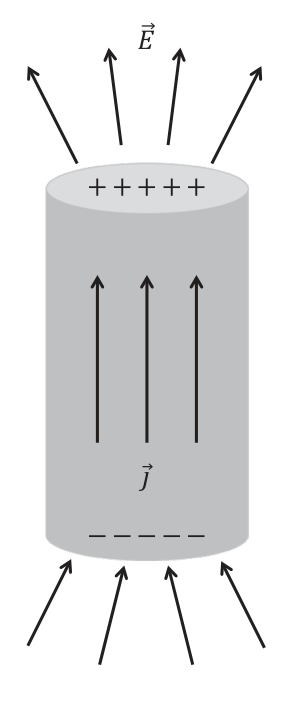

在没有源 ($\vec{j} = 0, \rho = 0$) 的空间中, 则Maxwell 方程变为

$$
\left\{
\begin{array}{l}
\nabla \cdot \vec{E} = 0 \\
\nabla \times \vec{E} = -\frac{ \partial }{ \partial t } \vec{B} \\
\nabla \cdot \vec{B} = 0 \\
\nabla \times \vec{B} = \mu_{0} \varepsilon_{0} \frac{ \partial }{ \partial t } \vec{E}
\end{array}
\right.
\qquad (1.4.16)
$$

我们看到电场/磁场具有近乎完美的对称性，除了两点：

1. 公式（2）与（4）在系数上仍有差异；
2. 有个正负号的差异。

对第1点，后面我们会发现这是个历史的误会；对第2点，这个正负号的差异是至关重要的，没有这个符号的差别，电磁波就不复存在，世界就可能是另一个面目。位移电流的引入从另一个侧面深刻揭示了电场和磁场之间的联系：不仅变化的磁场激发电场，变化着的电场同样激发磁场，两者都以祸旋形式激发，并左右手对称。

注：有人说Maxwell只干了引入位移电流这一件事，其他的3.5个方程都是别人的功劳，这非常不公平。从本节的学习中我们可以看到，Maxwell方程组的每一条公式的建立都不是显而易见的，事实上，与其他静态时的实验定律（库伦定律、安培定律）不同，Maxwell方程组的建立并没有坚实的实验基础，而是Maxwell的一些合理的推广。在这个意义上讲，Maxwell建立这组方程时的勇气是巨大的。这个方程的直接预言是电磁波，Maxwell试图自己做实验验证电磁波却没有成功。Maxwell方程组的正确性直到几十年后Hertz的实验出来后才被证实。最后，Maxwell方程的建立使得电磁现象与光学现象联系起来，从此人们对光学有了定量的认识。

## 1.5 介质中的麦克斯韦方程组

前面我们了解了真空中的电磁理论。然而，人们更关心介质中的电磁场行为，其实，即使空气也是一种特殊的电磁介质。在我们仔细考虑电磁介质中的电磁理论之前，有一点核心问题必须澄清——

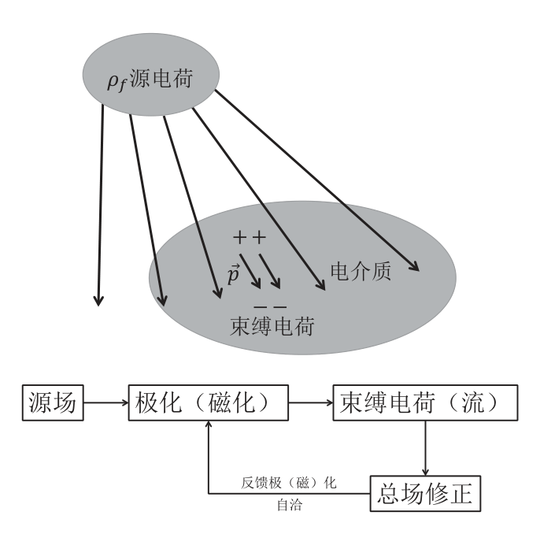

电磁场的最终来源是电荷及电流，只要空间某处存在某种电荷/电流（无论其起源），就有电磁场产生，而与那个地方有无物质/什么物质无关！

有了这点基本认识，我们研究电磁介质中的电磁场就归结为寻找当有电磁介质存在时的总的电荷/电流分布。在具体研究之前，首先理一理脉络。在空间施加由处于很远处的电荷（流）产生的电（磁）场，当在这个场中放入一块电（磁）介质时，电（磁）介质在外电（磁）场的作用下被极（磁）化，产生电（磁）偶极子。电（磁）偶极子的产生使得空间中不再为电（磁）中性，从而产生了束缚于电（磁）介质的极化（磁化）电荷（电流），这些束缚电荷（电流）与处于远处的自由电荷（电流）一样可以产生电磁场，因此它们一起产生了空间的总场。介质的极化（磁化）是由空间的总场决定的，因为场，无论是由源电荷产生的，还是由极（磁）化电荷（流）产生的，都会作用到介质中上。因此介质的极化（磁化）应与空间总场达到平衡。

因此,理解了所有的过程后,我们才能对介质中的电磁场有完整的理解。

### 1.5.1 介质的极化及磁化

当电介质放置于电场中时,正负电荷被电场拉开,产生电偶极子,这个过程叫极化。同样,一个无磁性的磁介质被放置于外磁场中时,原本杂乱无章运动的电子在外磁场的作用下产生一个个分子环流(亦即磁偶极子),这个过程被称作磁化。

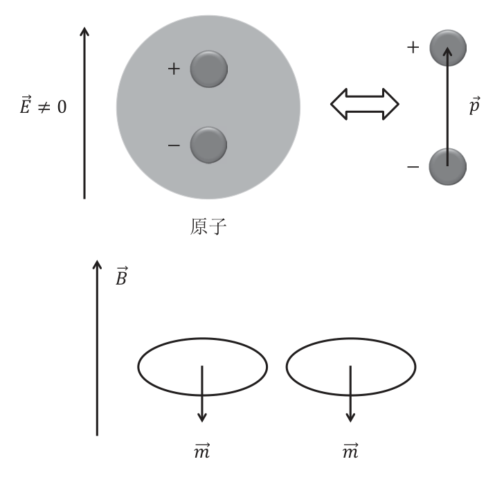

极化和磁化的过程还有另外的可能性。体系中的构成单元原本是带有固有电(磁)偶极距的,但在无外加电(磁)场的时候这些电(磁)极距杂乱排列,不显示出极(磁)性;当外加电(磁)场时,这些原本杂乱排列的电(磁)偶极子沿着电(磁)场排列,产生宏观电(磁)矩。为了描述极化（磁化）的大小，定义极化（磁化）强度两个宏观量，其定义为单位体积内的偶极子的大小（多少）

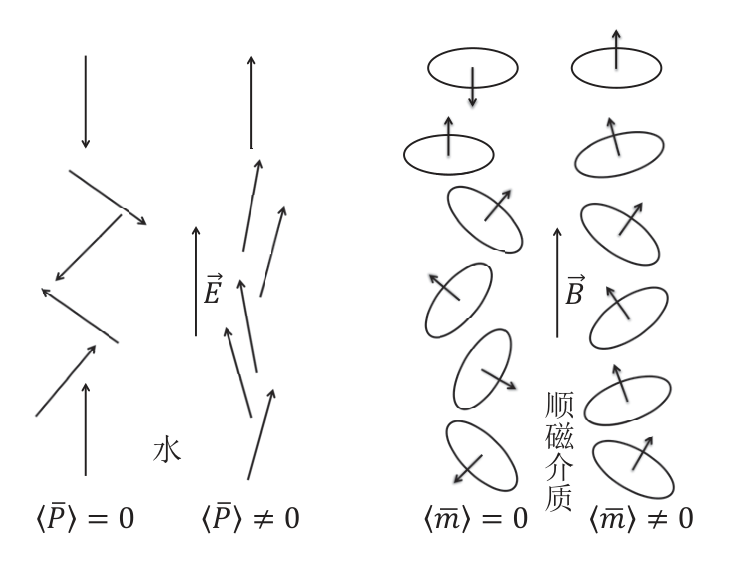

$$
\vec{P} = \frac{\sum_{i} \vec{p}_{i}}{\Delta V} \quad \vec{M} = \frac{\sum_{i} \vec{m}_{i}}{\Delta V} \tag{1.5.1}
$$

显然，电（磁）场越大，极（磁）化强度也越大。对第一种情况上述结论显而易见，对第二种情况，只要考虑外场效应（趋向于使电磁矩平行排列）与温度效应（趋向于它们无规排列）之间的竞争即可以明白。在低场近似下，很多材料对电磁场程线性响应，即

$$
\vec{P} (\vec{r}, t) = \varepsilon_{0} \chi_{e} \vec{E} (\vec{r}, t) \quad \vec{M} (\vec{r}, t) = \frac{1}{\mu_{0}} \frac{\chi_{m}}{1 + \chi_{m}} \vec{B} (\vec{r}, t) \tag{1.5.2}
$$

其中，$\chi_{e}, \chi_{m}$ 为极化（磁化）率。这就是介质极化（磁化）的基本像，计算 $\chi_{e}, \chi_{m}$ 要用到微观理论，即牛顿力学或者量子力学。需要强调指出的是，这里 $\vec{E}, \vec{B}$ 应当是介质分子在此处感受到的局域总场，因为只要是场，无论是源场还是极（磁）化电荷（流）产生的场，都可以对介质产生作用力。

### 1.5.2 极（磁）化电荷（流）

极化

极化电荷：由于极化，正负电荷间发生了相对位移，每处的正负电荷可能不完全抵消，这样就呈现出束缚在介质中的宏观电荷，称为极化电荷。

假设空间的极化强度分布为 $\vec{P} (\vec{r})$ ，我们在 $\vec{r}$ 点附近取一块宏观小微观大的区域 $\tau$ ，其边界由 $\vec{S}$ 给定，计算这中间包含的极化总电荷 $Q_{P}$ 。显然，完全处于区域内部或完全处于区域外部的偶极子对 $Q_{P}$ 均没有贡献，只有那些穿过 $\vec{S}$ 的偶极子才有贡献。

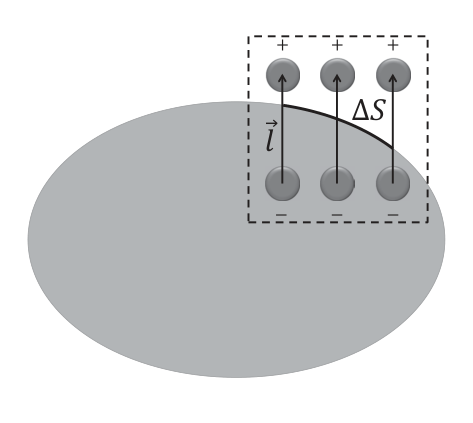

若极化时正负电荷拉开的位移为 $\vec{l}$，取一小块边界 $d\vec{S}$，则在体积 $\vec{l} \cdot d\vec{S}$ 内的每一个偶极子都会因为穿过界面而在体积内部留下一个负的静电荷 $q$（如图1.21所示）。设介质此处的偶极子数密度为 $n$，则这些偶极子对区域内的净电荷数为 $dQ_{P} = -qn\vec{l} \cdot d\vec{S} = -\vec{P} \cdot d\vec{S}$。$\vec{P}$ 为此处的极化强度。考虑所有穿过界面的偶极子的贡献后，则留在 $\tau$ 区域内的总的束缚电荷为

$$
Q_{P} = - \oint_{S} \vec{P} \cdot d \vec{S} \tag{1.5.3}
$$

利用Gauss定理，容易得到

$$
\rho_{P} = - \nabla \cdot \vec{P} \tag{1.5.4}
$$

式中 $\rho_{P}$ 称为极化电荷密度。

注：仔细思考后会发现1.5.4大有问题。比如对一个均匀极化的介质 $P=\text{const.}$，1.5.4告知体内无极化电荷分布。然而实际上极化后每个分子都呈现为一个偶极子，因此细致到分子的尺度上，极化电荷的分布是非常不均匀的，不可能为0。从数学上讲，1.5.3是正确的，但条件是积分区域必须是宏观大的。过渡到1.5.4就不是严格成立的了，因为Gauss定理可以使用的前提是1.5.3对任意积分区域都正确。但为什么我们还可以用1.5.4呢？这是因为在分子尺度上计算极化电荷以及其它物理量的分布是困难而且是没有必的，因为我们所关心的（实验上所能测量的）是宏观小但微观大的一个区域内的物理量的平均值。因此，当我们考虑连续介质中的物理量时，一个空间的几何点是这样定义的：取这样一个区间——微观上足够大包含了许多极化后的偶极子，但宏观仍然足够小使得我们可以认为它是空间上的一个几何点，然后取这个区间内的微观量的平均值作为在这一几何点的场的数值。这事实上是电动力学处理连续介质的一个基本精髓。1.5.2及下面的处理、甚至是目前前沿的Meta-material的研究均基于这个基础。

极化电流：当电场随时间改变时，极化过程中正负电荷的相对位移也将随时间改变，由此产生的电流称为极化电流，记为 $\vec{j}_{P}$ 。考虑空间 $\Delta\Omega$ 体积内存在有一个因极化而产生的偶极子，则极化电荷密度分布为 $\rho_{P}(\vec{r})=\rho_{+}+\rho_{-}=q\delta(\vec{r}-\vec{r}_{+})-q\delta(\vec{r}-\vec{r}_{-})$ 。假设两个极化电荷的运动速度分别为 $\vec{v}_{+}=\frac{d\vec{r}_{+}}{dt},\vec{v}_{-}=\frac{d\vec{r}_{-}}{dt}$ ，则运动引起的极化电流密度为

$$
\vec{j}_{P} (\vec{r}) = \rho_{+} \vec{v}_{+} + \rho_{-} \vec{v}_{-} = \frac{\partial}{\partial t} \left(\rho_{+} \vec{r}_{+} + \rho_{-} \vec{r}_{-}\right) \tag{1.5.5}
$$

注意到针对一个偶极子的空间极化强度为

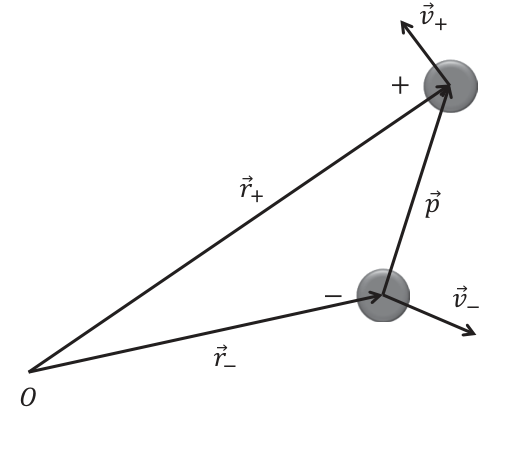

$$
\vec{P} = \frac{\vec{p}}{\Delta \Omega} = \frac{q (\vec{r}_{+} - \vec{r}_{-})}{\Delta \Omega} = \rho_{+} \vec{r}_{+} + \rho_{-} \vec{r}_{-} \tag{1.5.6}
$$

所以

$$
\vec{j}_{P} = \frac{\partial \vec{P}}{\partial t} \tag{1.5.7}
$$

显然，根据叠加原理，上式在有许多偶极子存在时依然正确。同时我们注意到1.5.7与连续性方程一致。根据1.5.4和1.5.7可知

$$
\nabla \cdot \vec{j}_{P} + \frac{\partial \rho_{P}}{\partial t} = \nabla \cdot \frac{\partial \vec{P}}{\partial t} - \frac{\partial}{\partial t} \nabla \cdot \vec{P} \equiv 0 \tag{1.5.8}
$$

与连续性方程一致。

磁化

磁化电流：介质被磁化后产生束缚于磁介质上的电流称为磁化电流。假设已知空间的磁化情况 $\vec{M} (\vec{r})$ ，我们来讨论磁化电流密度 $\vec{j}_M$ 。类似电介质的讨论，在一个具有磁化强度 $\vec{M} (\vec{r})$ 的磁介质中选取一个宏观大小的面 $S$ ，其边界由 $\oint dl$ 描述，计算穿过 $S$ 产生的总磁化电流 $I_{M}$ 。磁化后产生大量的磁偶极子，每个磁偶极子对应一个分子环流。

1. 若这些环流完全处于 $S$ 内，则对 $I_{M}$ 的贡献因环流两次穿过 $S$ 而抵消；

2. 若完全在 $S$ 外，则根本没有贡献。

因此，只需计算那些与边界铰链的环流，因为它们只对 $S$ 面内贡献一次电流。考虑与一段边界 $\vec{dl}$ 铰链的分子环流。设每个分子环流电流为 $i$ ，线

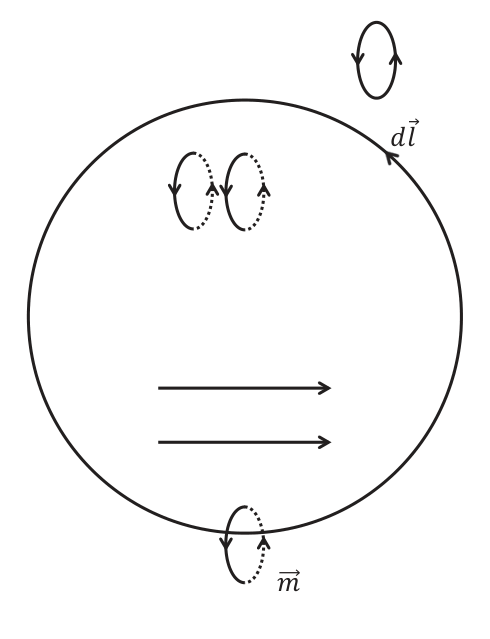

圈面积为 $\Delta \vec{s}$，则显然在 $\Delta \vec{s} \cdot d\vec{l}$ 体积内的所有的磁偶极子都对 $S$ 内的净电流有贡献。假设偶极子的体密度为 $n$。则 $d\vec{l}$ 边界处对 $I_M$ 的贡献为

$$
d I_{M} = i \times \text{No. of } m = i \times n \Delta \vec{s} \cdot d \vec{l} = \vec{M} \cdot d \vec{l} \tag{1.5.9}
$$

综合整个环路的贡献，得

$$
I_{m} = \oint \vec{M} \cdot d \vec{l} \tag{1.5.10}
$$

利用 $I_{M} = \int \vec{j}_{m}\cdot d\vec{S}$ 及Stokes定理 $\oint \vec{M}\cdot d\vec{l} = \int \nabla \times \vec{M}\cdot d\vec{S}$ ，有

$$
\vec{j}_{m} = \nabla \times \vec{M} \tag{1.5.11}
$$

其中 $\vec{j}_m$ 为描述束缚于磁介质内部的磁化电流密度。对上式两边取散度得

$$
\nabla \cdot \vec{j}_{m} = 0 \tag{1.5.12}
$$

这说明磁化电流不引起电荷的积累，因此不用考虑磁化电荷。

1.5.3 介质中的Maxwell方程组

下面我们进行图1.18中第3步讨论——看看极（磁）化电流（荷）如何改变总电（磁）场。当介质存在时空间电荷包括自由电荷（源电荷）和极化电荷（束缚电荷），即

$$
\rho_{t} = \rho_{f} + \rho_{P} = \rho - \nabla \cdot \vec{P} \tag{1.5.13}
$$

式中 $\rho_{t}$ 表示总电荷。介质中可能出现的电流有传导电流、极化电流和磁化电流，因此总电流为

$$
\vec{j}_{t} = \vec{j}_{f} + \frac{\partial \vec{P}}{\partial t} + \nabla \times \vec{M} \tag{1.5.14}
$$

在麦克斯韦方程组中，不管 $\rho$ 和 $\vec{j}$ 的来源如何，只要是电荷或电流，它们都将在空间激发电场或磁场。所以，麦克斯韦方程组在介质存在的情况下应该修改成

$$
\left\{
\begin{array}{l}
\nabla \cdot \vec{E} = \frac{1}{\varepsilon_{0}} \left(\rho_{f} - \nabla \cdot \vec{P}\right) \\
\nabla \times \vec{E} = - \frac{\partial}{\partial t} \vec{B} \\
\nabla \cdot \vec{B} = 0 \\
\nabla \times \vec{B} = \mu_{0} \varepsilon_{0} \frac{\partial}{\partial t} \vec{E} + \mu_{0} \left(\vec{j}_{f} + \frac{\partial \vec{P}}{\partial t} + \nabla \times \vec{M}\right)
\end{array}
\right. \tag{1.5.15}
$$

原则上1.5.15不能求解，因为多了2个物理量， $\vec{P},\vec{M}$ 。利用1.5.2，我们可以将这2个物理量消除，则问题可以求解。因此，与真空中的电磁问题不同，介质中的电磁问题一定需要知道介质对外场的响应，如1.5.2，不同的介质中的电磁行为完全不同！

然而1.5.15式中（1）（4）两式看似很复杂，右边即有原本的自由电荷（流）的“源”，又有极磁化后产生的新的场，物理意义不清晰。试图将所有的宏观量都表示成自由电荷/电流的函数，则引入两个辅助矢量

$$
\vec{D} = \varepsilon_{0} \vec{E} + \vec{P} \quad \vec{H} = \frac{\vec{B}}{\mu_{0}} - \vec{M} \tag{1.5.16}
$$

代入方程组1.5.15式化简可得：

$$
\left\{
\begin{array}{l}
\nabla \cdot \vec{D} = \rho_f \\
\nabla \times \vec{E} = -\frac{\partial}{\partial t} \vec{B} \\
\nabla \cdot \vec{B} = 0 \\
\nabla \times \vec{H} = \vec{j}_f + \frac{\partial \vec{D}}{\partial t}
\end{array}
\right. \tag{1.5.17}
$$

其中新引入的辅助矢量 $\vec{D}$ 称为电位移矢量， $\vec{H}$ 称为磁场强度。它们的导入使方程组只出现自由电荷和自由电流，仅仅是为了便于讨论问题。而它们本身不是真实的场，它们不会对身处其中的电荷/电流产生作用力。

1.5.4 本构关系

现在考虑图1.18中最后一步：局域总场的改变是如何与极（磁）化程度自洽的。这就需要确定1.5.15中的极（磁）化强度等物理量如何与总电（磁）场自洽决定的。换言之，必须确定麦克斯韦方程1.5.17导入量 $\vec{D}$， $\vec{H}$ 与 $\vec{E}$， $\vec{B}$ 之间的关系，才能求出方程组的解。这些关系式被称为本构关系，与具体的材料有关系——我们的世界之所以如此丰富多彩就是因为我们有各种各样的具有不同本构关系的介质。

对线性介质，其实我们已经知道了其对外加电磁场得响应1.5.2，这本质上就是一种本构关系。进一步，利用1.5.2及1.5.16得

$$
\left\{
\begin{array}{l}
\vec{D} = \varepsilon \vec{E} \\
\vec{H} = \vec{B}/\mu
\end{array}
\right. \tag{1.5.18}
$$

其中

$$
\varepsilon = \varepsilon_{r} \varepsilon_{0} = (1 + \chi_e) \varepsilon_{0} \quad \mu = \mu_{r} \mu_{0} = (1 + \chi_m) \mu_{0} \tag{1.5.19}
$$

叫做介电常数及磁导率， $\varepsilon_r$， $\mu_r$ 称为相对介电常数及相对磁导率（无量纲量）。利用1.5.16，可将1.5.16中第2式改写为 $\vec{M} = \chi_m \vec{H}$，结合1.5.18可以看出,历史上以为 $\vec{H}$ 是基本量与 $\vec{E}$ 的地位相同,对磁化率的定义是针对 $\vec{H}$ 场的!将本构关系带入无源空间的Maxwell方程组,得

$$
\begin{cases}
\nabla \cdot \vec{E} = 0 \\
\nabla \times \vec{E} = -\mu \frac{\partial \vec{H}}{\partial t} \\
\nabla \cdot \vec{H} = 0 \\
\nabla \times \vec{H} = \varepsilon \frac{\partial \vec{E}}{\partial t}
\end{cases} \tag{1.5.20}
$$

其中 $\vec{E}$ 和 $\vec{H}$ 完美对称。另外需要指出的是: 导体本身就是一种特殊的电磁介质, 它的本构关系就是欧姆定律 $\vec{j} = \sigma \vec{E}$ 。

应当指出,这里我们给出的本构关系是最简单的一种(尽管是最常见的)——极(磁)化对外场的响应呈现局域/即时/线形/各向同性的响应。更一般的情况下,本构关系可以非常丰富多彩:

1. 在铁电和铁磁物质或强场情况下, $\vec{P}$ 与 $\vec{E}$、 $\vec{M}$ 与 $\vec{H}$ 之间将不再呈现线性关系;

2. 对于各向异性的介质来说,介电常数和磁导率都是对称张量,场强和感应场强之间的关系推广为 $D_i = \varepsilon_{ik}E_k$, $B_i = \mu_{ik}H_k$;

3. 在高频情况下,由于场变化得很快,以至于极化电荷和磁化电流跟不上场的变化,这时的响应在最一般情形下可以写成 $\vec{D}(t) = \int \varepsilon(t-t')\vec{E}(t')dt'$。但当外场随时间以频率 $\omega$ 简谐变化时,傅立叶分析显示对单频仍然有 $\vec{D}(\omega) = \varepsilon(\omega)\vec{E}(\omega)$。所以极化率和磁化率都将是频率的函数,因而 $\varepsilon = \varepsilon(\omega)$, $\mu = \mu(\omega)$。

4. 有些材料响应是非局域的: $\vec{D}(\vec{r}) = \int \varepsilon(\vec{r}-\vec{r}')\vec{E}(\vec{R}')d\tau'$, 也就是说, 在 $\vec{r}'$ 处的扰动会在 $\vec{r}$ 出产生响应。这种效应又叫作空间色散。类似时间色散情形(3),对特定的以某一个 $k$ 为波矢在空间变化的场,经过傅立叶变换可知, $\vec{D}(\vec{k}) = \varepsilon(\vec{k})\vec{E}(\vec{k})$, 此时 $\varepsilon$ 是 $k$ 的函数。

1.6 麦克斯韦方程组的边界条件

Maxwell方程组的精妙之处在于其在不同介质的交界面上“自带”边界条件，无须外设。这点是其超越其它许多方程（如流体力学方程）的地方。在界面上，微分形式的麦克斯韦方程失去意义，但积分形式仍可使用。这一节我们就从积分形式的场方程出发导出交界面两边Maxwell方程的边界条件。

对应 $\nabla \cdot \vec{D} = \rho_f$ 的积分形式是

$$
\oint \vec{D} \cdot d \vec{S} = \int \rho_{f} d \tau \tag{1.6.1}
$$

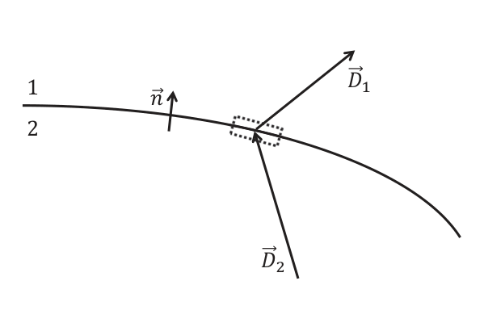

如图所示，定义界面的方向矢量为介质2指向介质1的单位方向矢量 $\vec{n}$ ，横跨介质的分界面做一扁平的柱体，两个底面平行于界面，分别为 $\Delta\vec{S}_{1}=\Delta S\vec{n}$ 及 $\Delta\vec{S}_{2}=-\Delta S\vec{n}$ ，高度 $h$。为了得到场在界面两边的行为，先令 $h$ 趋向于0，此时显然 $D$ 在侧表面的积分趋于0，因此：

$$
\oint \vec{D} \cdot d \vec{S} = \Delta \vec{S}_{1} \cdot \vec{D}_{1} + \Delta \vec{S}_{2} \cdot \vec{D}_{2} = \Delta S \cdot (\vec{n} \cdot \vec{D}_{1} - \vec{n} \cdot \vec{D}_{2}) = q_{f} \tag{1.6.2}
$$

其中 $q_{f}$ 为柱体内的自由电荷量（不包括因为极化产生的束缚电荷！）。在 $\Delta S\to 0$ 时，我们进一步得到

$$
\vec{n}_{1} \cdot \left(\vec{D}_{1} - \vec{D}_{2}\right) = \sigma_{f} \tag{1.6.3}
$$

$\sigma_{f} = q_{f} / \Delta S$ 是交界面上的自由电荷面密度。在一般情况下 $\sigma_{f} = 0$ （没有自由电荷，或是自由电荷呈现体分布）， $D$ 场的法向分量守恒。

同理，对应方程 $\nabla \cdot \vec{B} = 0$ ，容易得到 $B$ 场的法向分量连续的结论：

$$
\vec{n} \cdot \left(\vec{B}_{1} - \vec{B}_{2}\right) = 0 \Rightarrow B_{n 1} = B_{n 2} \tag{1.6.4}
$$

对应第四条方程 $\nabla \times \vec{H} = \vec{j}_f + \frac{\partial\vec{D}}{\partial t}$ 的积分形式为

$$
\oint \vec{H} \cdot d \vec{l} = \int_{S} \vec{j}_{f} \cdot d \vec{S} + \int \frac{\partial}{\partial t} \vec{D} \cdot d \vec{S} \tag{1.6.5}
$$

假设 $\vec{e}_1, \vec{e}_2$ 为界面上相互垂直的两个方向矢量，其与界面方向矢量 $\vec{n}$ 呈右手螺旋：

$$
\vec{n} \times \vec{e}_{1} = \vec{e}_{2} \quad \vec{n} \times \vec{e}_{2} = - \vec{e}_{1} \tag{1.6.6}
$$

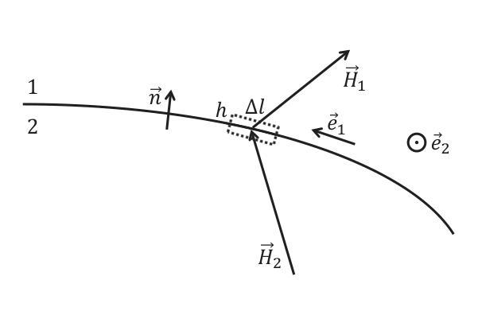

则如图所示在界面处画一个长为 $\Delta l$ （方向沿 $\vec{e}_1$ ），宽为 $h$ 的矩形。仍然先考虑 $h\to 0$ ，则 $\vec{H}$ 场在 $h$ 上的积分趋于0。于是 $\vec{H}$ 场在整个环路上的积分为

$$
\vec{H}_{1} \cdot \Delta \vec{l}_{1} + \vec{H}_{2} \cdot \Delta \vec{l}_{2} = \oint \vec{H} \cdot d \vec{l} \tag{1.6.7}
$$

$$
= \int \left(\vec{j}_{f} + \frac{\partial \vec{D}}{\partial t}\right) \cdot d \vec{S} \tag{1.6.8}
$$

$$
= \vec{j}_{f} \cdot \vec{e}_{2} (h \cdot \Delta l) + \frac{\partial}{\partial t} (D \cdot \Delta l \cdot h) \tag{1.6.9}
$$

一般情况下边界处 $\frac{\partial}{\partial t}\vec{D}$ 是有限值，则在 $h\to 0$ 时，上式右边第2项为零。右边第1项在界面存在面电流分布时不为0。定义 $\vec{j}_f\cdot h\xrightarrow{h\to 0}\vec{\alpha}_f$ 为面电流分布，我们便有

$$
\vec{e}_{1} \cdot \left(\vec{H}_{1} - \vec{H}_{2}\right) = \vec{\alpha}_{f} \cdot \vec{e}_{2} \tag{1.6.10}
$$

考虑面内另一个方向，可得

$$
\vec{e}_{2} \cdot \left(\vec{H}_{1} - \vec{H}_{2}\right) = - \vec{\alpha}_{f} \cdot \vec{e}_{1} \tag{1.6.11}
$$

非常容易将上两式改写成更一般紧凑的形式

$$
\vec{n} \times \left(\vec{H}_{1} - \vec{H}_{2}\right) = \vec{\alpha}_{f} \tag{1.6.12}
$$

要证明1.6.12式，可将矢量 $\vec{H}_1 - \vec{H}_2$ 分解到 $\vec{e}_1$ 和 $\vec{e}_2$ 方向，再根据 $\vec{n} \times \vec{e}_1 = \vec{e}_2, \vec{n} \times \vec{e}_2 = -\vec{e}_1$ 得出结果。

同理，对于方程 $\nabla \times \vec{E} = -\frac{\partial}{\partial t}\vec{B}$，与上面的推导比较可知，相应的边界条件为

$$
\vec{n} \times \left(\vec{E}_{1} - \vec{E}_{2}\right) = 0 \tag{1.6.13}
$$

故电场的切向分量连续。

注：

1. 4条边界条件怎么记？可以很容易通过将Maxwell方程中的 $\nabla \rightarrow \vec{n}$，再将体分布 $\rho, \vec{j}$ 换成面分布 $\sigma, \vec{\alpha}$。

2. 在绝大多数正常情况下，电磁场的边界条件都是 $\vec{E}, \vec{h}$ 场切向分量连续， $\vec{D}, \vec{B}$ 场法向方向连续。只有当有自由面电荷（流）分布时，才有 $\vec{D}$ 场与 $\vec{B}$ 场的不连续。而所谓面分布，其实是真实的体分布的一种简化，亦即，电荷/流分布在非常薄的一层介质里。此时，若我们不关心此薄层里的场分布，则跨越这个薄层的场当然不连续。
